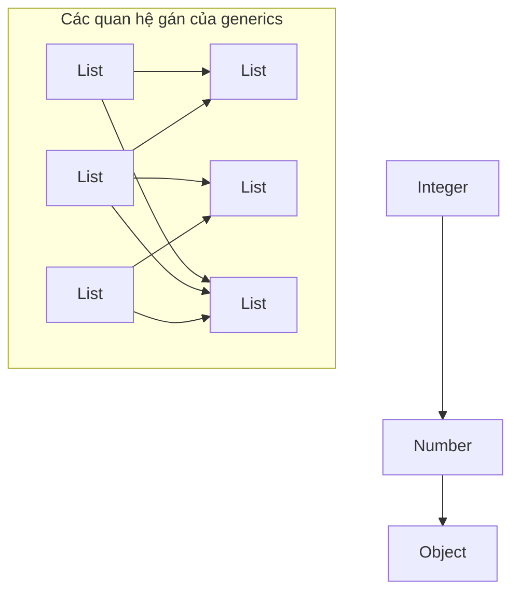
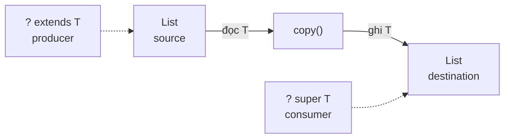
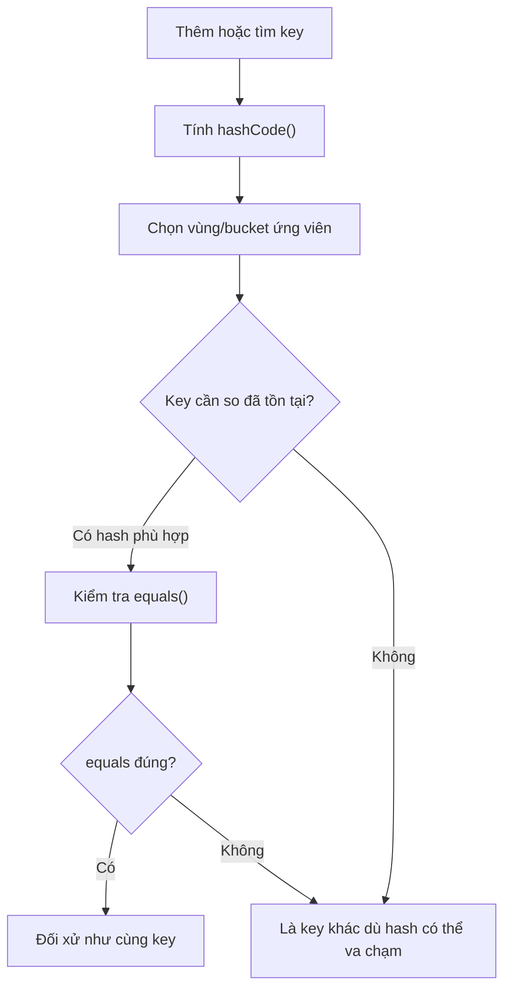
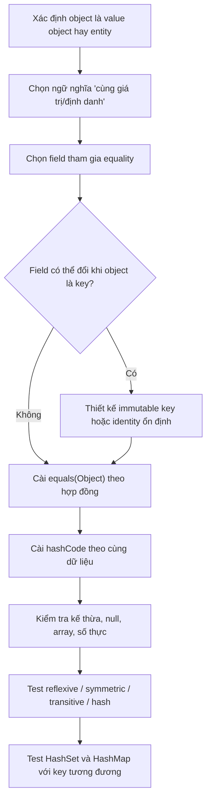
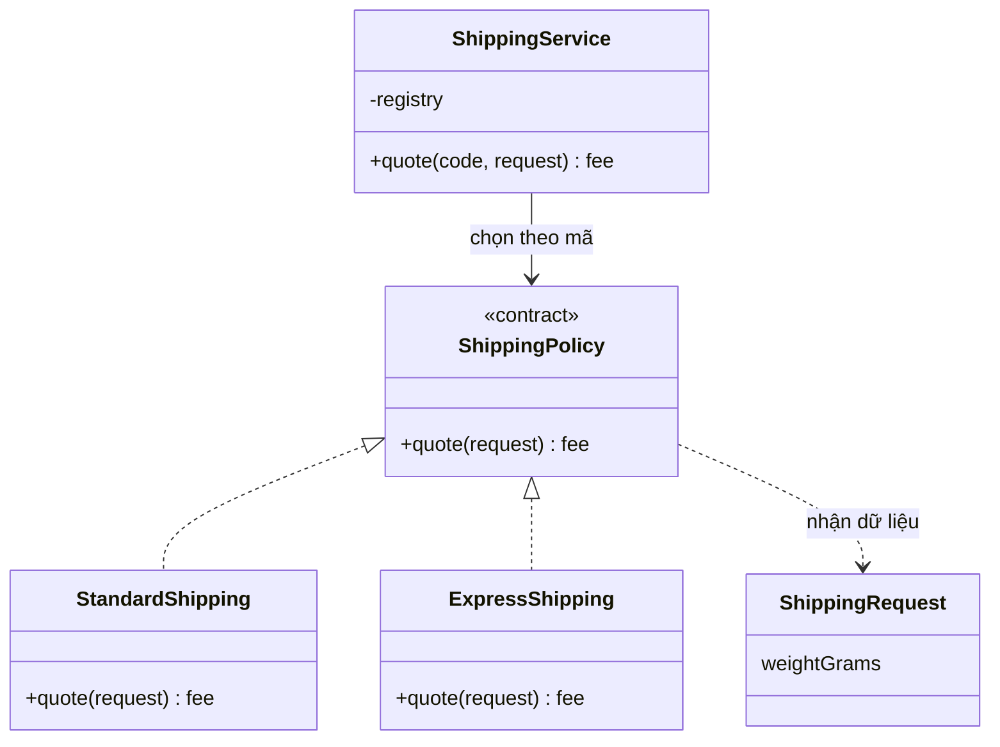
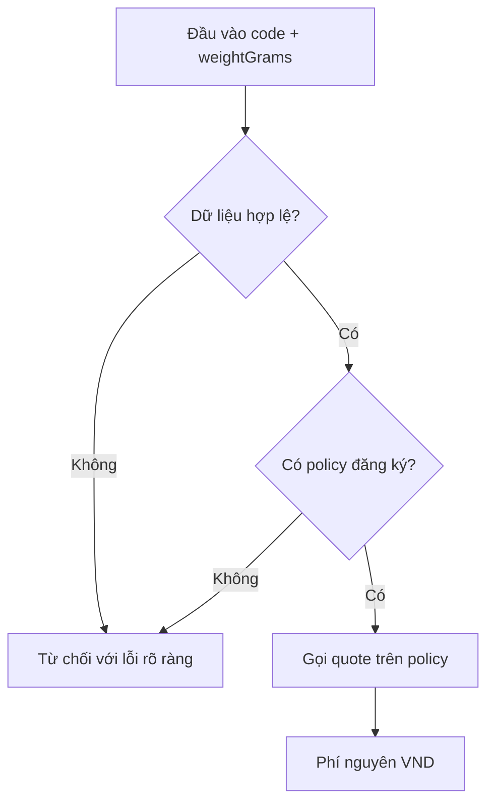

<a id="back-to-top"></a>

# Language Mechanics

## Menu
- [Generic types and parameterized classes](#language-mechanics-001)
- [Type parameter bounds](#language-mechanics-002)
- [Type relationships in generic constructs](#language-mechanics-003)
- [Static types, dynamic types, and type checking](#language-mechanics-004)
- [Operators, properties, and language conventions](#language-mechanics-005)
- [Equality and hash-code contracts](#language-mechanics-006)
- [Object string representations and diagnostic information](#language-mechanics-007)
- [Exceptions, error states, and method contracts](#language-mechanics-008)
- [Language differences when implementing the same OOP design](#language-mechanics-009)

## <a id="language-mechanics-001">Generic types and parameterized classes</a>

<details>
<summary>View details</summary>

# Java Generics: Generic types and parameterized classes

> **Topic:** OOP → Language Mechanics → Generic types and parameterized classes.  
> **Goal:** Declare and use `Box<T>`, `Pair<K,V>`, and parameterized data-storage classes; understand generic types, type parameters, type arguments, type inference, type bounds, wildcards, and type erasure; and avoid common Java API design mistakes.

## 1. What problems do generics solve?

**Generics** let classes, interfaces, and methods declare **some data types as parameters** instead of duplicating code for each type. The Java compiler can therefore catch many type mismatches at compile time.

An example from before type-safe generics:

~~~java
import java.util.ArrayList;
import java.util.List;

List raw = new ArrayList(); // raw type: không chỉ ra kiểu phần tử
raw.add("Java");
raw.add(123);              // Cả chuỗi lẫn số đều được chấp nhận

String name = (String) raw.get(1);
// Biên dịch được (có cảnh báo raw/unchecked) nhưng chạy sẽ
// gặp ClassCastException vì phần tử ở vị trí 1 là Integer.
~~~

With generics, the type contract becomes explicit:

~~~java
List<String> names = new ArrayList<>();
names.add("Java");
names.add("OOP");

// names.add(123); // LỖI BIÊN DỊCH: Integer không phải String.
String first = names.get(0); // Không phải ép kiểu thủ công.
~~~

**Key point:** Generics improve **compile-time type safety**, clarify API intent, and reduce casts. They **do not create a separate runtime class for every type argument**: Java implements generics largely through *type erasure* (removing type-parameter information from many places in bytecode), explained below.

## 2. Reading generic-type syntax correctly

| Syntax | Meaning | Example |
|---|---|---|
| `class Box<T>` | Declares **a class with one type parameter** named `T` | `Box<String>` |
| `interface Store<K,V>` | An interface with two type parameters | `Store<Long,User>` |
| `Box<String>` | A **parameterized type**: a specific use of `Box` with the type argument `String` | `Box<String> x` |
| `T`, `K`, `V` | **Type parameters**: symbolic names in a declaration | `T value` |
| `String`, `Long`, `User` | **Type arguments**: types supplied when using a generic | `new Box<String>(...)` |
| `<>` | The **diamond operator**: lets the compiler infer suitable type arguments | `new Box<>("Hi")` |
| `<T> T first(...)` | A generic method declaring its **own** type parameter | `static <T> T first(List<T> list)` |

`T` is not a Java keyword. Common conventions include `T` (Type), `E` (Element), `K` (Key), `V` (Value), `R` (Result), and `S` (another type). More descriptive names such as `ENTITY` or `ID` may suit complex systems, though short uppercase names keep familiar Java APIs readable.

Compare these two declarations:

~~~java
class Holder<T> {
    T value; // T do class khai báo, dùng được ở instance member.

    Holder(T value) {
        this.value = value;
    }

    T get() {
        return value;
    }

    static <U> U identity(U x) {
        // U được khai báo bởi chính phương thức static này.
        return x;
    }
}
~~~

A `static` method **cannot** use the class's `T` to declare a field or method signature tied to an instance type parameter because static members belong to the class, not a particular `Holder<String>` or `Holder<Integer>`. A static method **can declare its own** `<U>`, as `identity` does.

## 3. Complete Java 17 example: generic Box, Pair, and Repository

This standalone example runs on JDK 17+ with no Spring or external libraries. It demonstrates three levels of use:

1. `Box<T>` stores a value whose concrete type is chosen at the usage site.
2. `Pair<K,V>` has **two** independent type parameters.
3. `InMemoryRepository<ID,T>` reuses one data-storage implementation for different entity and ID types while enforcing type consistency.

Create **`GenericsDemo.java`**:

~~~java
import java.util.HashMap;
import java.util.Map;
import java.util.Objects;
import java.util.Optional;
import java.util.function.Function;

// Generic class: T đại diện cho kiểu dữ liệu được chứa.
final class Box<T> {
    private T value;

    Box(T value) {
        this.value = Objects.requireNonNull(value, "value");
    }

    T get() {
        return value;
    }

    void set(T next) {
        value = Objects.requireNonNull(next, "next");
    }

    // Generic method: R là tham số kiểu MỚI của phương thức.
    // Có thể biến Box<String> thành Box<Integer>, v.v.
    <R> Box<R> map(Function<? super T, ? extends R> mapper) {
        Objects.requireNonNull(mapper, "mapper");
        return new Box<>(
                Objects.requireNonNull(mapper.apply(value), "mapped value"));
    }
}

// Generic record: các thành phần độc lập về kiểu.
record Pair<K, V>(K key, V value) {}

// Entity ví dụ, record bất biến.
record User(String id, String name) {}

// Repository in-memory phục vụ demo, không phải kho dữ liệu bền vững.
final class InMemoryRepository<ID, T> {
    private final Function<T, ID> idOf;
    private final Map<ID, T> data = new HashMap<>();

    InMemoryRepository(Function<T, ID> idOf) {
        this.idOf = Objects.requireNonNull(idOf, "idOf");
    }

    void save(T item) {
        Objects.requireNonNull(item, "item");
        ID id = Objects.requireNonNull(idOf.apply(item), "id");
        data.put(id, item);
    }

    Optional<T> findById(ID id) {
        Objects.requireNonNull(id, "id");
        return Optional.ofNullable(data.get(id));
    }
}

public class GenericsDemo {
    public static void main(String[] args) {
        Box<String> language = new Box<>("Java"); // Diamond: suy luận T
        Box<Integer> counter = new Box<>(42);

        System.out.println("Box<String>: " + language.get());
        System.out.println("Box<Integer>: " + counter.get());

        // R = Integer vì String::length trả về int, được boxing.
        Box<Integer> length = language.map(String::length);
        System.out.println("Độ dài: " + length.get());

        Pair<String, Long> invoice = new Pair<>("HD-01", 180_000L);
        System.out.println(
                "Hóa đơn: " + invoice.key() + " = " + invoice.value());

        InMemoryRepository<String, User> users =
                new InMemoryRepository<>(User::id);
        users.save(new User("U-01", "Lan"));

        System.out.println(
                "Người dùng: " + users.findById("U-01").orElseThrow().name());
    }
}
~~~

Run:

~~~bash
javac GenericsDemo.java
java GenericsDemo
~~~

Expected output:

~~~text
Box<String>: Java
Box<Integer>: 42
Độ dài: 4
Hóa đơn: HD-01 = 180000
Người dùng: Lan
~~~

### Tracing the type flow

- For `Box<String> language`, every use of `T` in an instance member of `Box<T>` is **treated as `String` by the compiler**. `language.set(123)` will not compile.
- For `Box<Integer> counter`, `counter.get()` has the return type `Integer` at compile time.
- `<R> Box<R> map(...)` converts between different value types, such as `Box<String>` to `Box<Integer>`. The method's type parameter `R` is independent of the class's `T`.
- `Pair<K,V>` represents two values that can have different types. With `Pair<String,Long>`, `key()` returns `String` and `value()` returns `Long`.
- `InMemoryRepository<ID,T>` keeps the **key type** and **entity type** consistent. Here `findById` accepts `String` and returns `Optional<User>` without casting from `Object`.
- `User::id` is a method reference that extracts a key as a `Function<User,String>`. The repository need not know how each entity stores its `id` field.

**Example scope:** `InMemoryRepository` demonstrates type safety and reuse; it does not implement transactions, durable persistence, concurrent access, or duplicate-key controls. Do not use it directly as a production repository for a multithreaded application.

## 4. Multiple type parameters and where to apply bounds

A generic class can declare multiple type parameters:

~~~java
interface Repository<ID, ENTITY> {
    void save(ENTITY entity);
    Optional<ENTITY> findById(ID id);
}
~~~

Examples of different usages:

~~~java
Repository<Long, Product> products;
Repository<String, Customer> customers;
~~~

`Product` and `Customer` are illustrative domain types that must be defined in the project. Each combination creates a **source-level parameterized type**, not a separate bytecode class.

How many type parameters should a class have? Add one only when **clients need to specify and check that type**. If a generic class has five or six parameters and an unreadable signature, consider splitting responsibilities, adding a type alias via a separate abstraction (Java lacks a general-purpose type-alias syntax found in some languages), or wrapping related properties in a meaningful domain type.

### 4.1. When an algorithm requires a bound on `T`

A `Box<T>` that only stores/returns values need not know what operations `T` supports. To call `doubleValue()`, however, declare `<T extends Number>`; to call `compareTo`, use a bound as follows:

~~~java
static <T extends Comparable<? super T>> T greater(T a, T b) {
    return a.compareTo(b) >= 0 ? a : b;
}
~~~

In generic declarations, `extends` accepts **both classes and interfaces**. Multiple bounds use `&` (with the class first, if any): `<T extends Number & Comparable<? super T>>`. Java does not support `<T super Number>`; lower bounds are only supported on wildcards such as `? super Number`.

A bound ensures an API is available at compile time; it **does not** validate business values, nulls, or ordering semantics. The **Type parameter bounds** lesson covers `NumberBox`, `Comparable<? super T>`, intersection/recursive bounds, tests, and erasure limitations in detail.

### 4.2. Generic methods versus generic classes

A whole generic class is unnecessary when only **one method** works across multiple types:

~~~java
import java.util.List;
import java.util.NoSuchElementException;

final class Lists {
    private Lists() {}

    // <T> xuất hiện TRƯỚC kiểu trả về T.
    static <T> T first(List<T> items) {
        if (items.isEmpty()) {
            throw new NoSuchElementException("empty list");
        }
        return items.get(0);
    }
}

// Trong method khác:
String title = Lists.first(List.of("Java", "OOP"));
Integer number = Lists.first(List.of(10, 20));
~~~

Both calls use **the same method**; the compiler infers `T = String` or `T = Integer` from arguments and context. You can also specify a type argument explicitly:

~~~java
String title = Lists.<String>first(List.of("Java", "OOP"));
~~~

Explicit syntax is rarely needed when inference suffices. If the project already declares a `title` variable in an earlier snippet, put this example in a separate method to avoid redeclaring a local variable.

## 5. Type inference: how much can the compiler infer?

Java infers type arguments in many situations:

~~~java
Box<String> box = new Box<>("Hello");  // Diamond operator
var another = new Box<>("World");      // Suy ra Box<String> trong JDK 10+
Pair<String, Integer> pair = new Pair<>("SKU-7", 3);
~~~

**Inference is not dynamic typing**: `var another` still has a definite static compile-time type, `Box<String>`. Calling `another.set(100)` is still a compilation error.

Be careful when a generic constructor infers its type from an initializer expression with no target type:

~~~java
var emptyStrings = new java.util.ArrayList<String>();
emptyStrings.add("A");

// var unknown = new java.util.ArrayList<>();
// Nếu không có thông tin ràng buộc, phần tử thường được suy ra
// kiểu Object; không thể tự kỳ vọng là String.
~~~

When an API needs an explicit element type, declare `List<String> names = new ArrayList<>();` or use a constructor with explicit type arguments. Read the generic method signature before attempting to “fix” code with a cast.

## 6. Invariance: why isn't Box<Integer> a Box<Number>?

`Integer extends Number` is a valid subtype relationship. But with ordinary generic types, Java **does not infer** that `Box<Integer> extends Box<Number>`. Likewise, `List<Integer>` is not a subtype of `List<Number>`.

~~~java
Box<Integer> ints = new Box<>(10);

// Box<Number> numbers = ints; // KHÔNG biên dịch.
~~~

If it were allowed, a client could insert a `Double` into a box intended to hold only `Integer` values:

~~~java
// Giả sử giả định sai: Box<Number> numbers = ints;
numbers.set(3.14);             // 3.14 là Double hợp lệ cho Number
Integer x = ints.get();        // Nhưng ints lẽ ra chỉ chứa Integer!
~~~

Therefore, type arguments of generics such as `Box<T>` and `List<T>` are **invariant** by default. Do not bypass the error with raw types or unchecked casts; consider whether the API needs wildcards or another abstraction.

By contrast, Java arrays are **covariant**, but invalid writes may fail at runtime:

~~~java
Number[] nums = new Integer[1];
nums[0] = 3.14; // ArrayStoreException lúc chạy.
~~~

Generic invariance prevents a class of type errors at compile time. This matters when migrating an array-based API to generic collections.

## 7. Wildcards for safely accepting different collection types

Ordinary generics are **invariant**: `List<Integer>` cannot be assigned to `List<Number>`. Wildcards express which types may be **read** or **written** while retaining type checks:

| Signature | Compiler guarantee | Adding elements |
| --- | --- | --- |
| `List<?>` | Reads as `Object` | Only `null` is type-safe to add |
| `List<? extends Number>` | Reads as `Number` | Cannot arbitrarily add `Integer`/`Double` |
| `List<? super Integer>` | Can safely add `Integer`; reads as `Object` | Can add `Integer` |
| `List<Number>` | Reads/writes as exactly `Number` | May add `Number` subtypes |

~~~java
static double sum(List<? extends Number> source) {
    double total = 0;
    for (Number n : source) total += n.doubleValue();
    return total;
}

static <T> void copyAll(
        List<? extends T> source, List<? super T> destination) {
    for (T item : source) destination.add(item);
}
~~~

`sum(List.of(1, 2, 3))` compiles even when the source is a `List<Integer>`; `copyAll` can copy a `List<Integer>` into a `List<Number>`. **PECS** (Producer Extends, Consumer Super) describes source/destination roles in a method; it does not make collections immutable. Collections created by `List.of` still reject `add` at runtime even when the signature permits writing.

Wildcards differ from `<T>`: name the type parameter `T` when several input/output positions must have related types. The **Type relationships in generic constructs** lesson covers invariance, wildcard capture, PECS, and generic inheritance with complete compile/error tables and tests.

## 8. Erasure: the compiler knows `T`, but runtime has no separate class per type argument

With Java generics, the compiler checks `List<String>` and `List<Integer>` using type arguments, yet both `ArrayList` instances have the same runtime class:

~~~java
var texts = new java.util.ArrayList<String>();
var ints = new java.util.ArrayList<Integer>();
System.out.println(texts.getClass() == ints.getClass()); // true
~~~

After **type erasure**, an unbounded `T` is generally replaced with `Object`; a bounded parameter is generally erased to its leftmost bound, such as `T extends Number` becoming `Number`. The compiler may insert casts and bridge methods to preserve verified behavior.

| Directly invalid expression | Reason |
|---|---|
| `new T()`, `T.class`, `new T[10]` | Runtime does not know the concrete type of `T` |
| `obj instanceof List<String>` | `List<String>` is not reifiable for checking its type argument |
| `static T shared` in `class Box<T>` | A static member does not belong to a separate `Box<String>` variant |
| Overloading `f(List<String>)` and `f(List<Integer>)` | Both signatures collide after erasure |
| `class CustomError<T> extends Exception` | Subclasses of `Throwable` cannot be generic |

To construct `T`, pass a `Supplier<? extends T>`; for runtime class checks, pass `Class<T>` and use `isInstance/cast`. Reflection can inspect **declared generic signatures** but does not turn `ArrayList<String>` into a different runtime class from `ArrayList<Integer>`.

Raw types and unchecked casts in the next section can undermine the compiler's type-safety guarantees.

## 9. Raw types, unchecked warnings, and heap pollution

A **raw type** omits all type arguments: `List` instead of `List<String>`, or `Box` instead of `Box<User>`. Raw types often appear in older Java code or nongeneric APIs; using them in new code loses important type checks.

~~~java
import java.util.ArrayList;
import java.util.List;

List<String> names = new ArrayList<>();
List raw = names;        // Cùng object, nhìn qua kiểu raw.
raw.add(123);           // Cảnh báo unchecked nhưng có thể biên dịch.
String name = names.get(1);
// ClassCastException khi đọc: Integer đã được thêm ở chỉ số 1.
~~~

When a variable/collection declared with a parameterized type contains incompatible values, that is **heap pollution**. If Java reports `unchecked assignment`, `unchecked call`, or `unchecked cast`, do not simply suppress the warning. Trace the boundary to raw types and convert with meaningful checks.

If a legacy API returns `List<?>`, inspect each element using `instanceof String` and copy validated values into a new `List<String>`; that performs meaningful runtime checking. A mere cast to `(List<String>) raw` cannot validate every element.

This distinction matters for public APIs: **generic type safety is trustworthy only when unchecked casts or raw types do not silently bypass its guarantees**.

## 10. Designing generic classes: how general should they be?

Generics are useful when types share **structures and processing rules** while type arguments capture meaningful relationships. Do not make every domain class generic merely because `<T>` is available.

### Appropriate uses

- `Box<T>`, `Optional<T>`: wrap a value or its possible absence.
- `Pair<K,V>`, `Map<K,V>`: relate multiple typed values.
- `Repository<ID,ENTITY>`: reuse the same key/entity type relationship.
- `Result<T>`: wrap a successful result of a known type with an explicitly modeled failure state.
- Collection processors or algorithms independent of specific types except for capabilities required by their bounds.

### Cases where generics should not be forced

Suppose the domain contains only a `BankAccount` governed by account-number, status, and balance rules. Turning it into `BankAccount<TBalance,TState,TId>` with no actual need for multiple types can obscure the business concept and hurt readability. Favor meaningful domain types and introduce generics only at genuinely reusable abstractions.

### Practical design guidelines

1. **Expose necessary type parameters accurately** in public APIs: returning `Object` and forcing callers to cast undermines the value of `<T>`.
2. **Prefer collection interfaces** as parameters when no `ArrayList`- or `HashSet`-specific behavior is needed.
3. **Keep bounds no stricter than necessary**; do not require `T extends SomeBaseClass` merely because current code uses that class when a smaller interface satisfies the algorithm.
4. **Document the null policy**. The example `Box<T>` rejects null, but Java's type parameter `T` **does not inherently guarantee non-null values**.
5. **Maintain consistent types** across methods/constructors: `Repository<ID,T>.findById(ID)` should return `Optional<T>` rather than `Object` or an unchecked cast.
6. **Test invalid type usage at compile time** and correct behavior at runtime; merely demonstrating that a class can hold a value is insufficient.
7. **Do not confuse generic types with inheritance polymorphism**. `List<Integer>` does not extend `List<Number>`; wildcards express more flexible constraints when necessary.

## 11. Testing generic classes and their contracts

Generic testing has two complementary levels:

- **Compile-time type safety:** `Box<String> box; box.set(1);` must be rejected by the compiler. This is a type-system property, not a runtime exception to catch with JUnit.
- **Runtime behavior:** Even a correctly typed generic signature does not guarantee correct implementation logic (returning the wrong value, altering state, or violating a null contract).

Example JUnit Jupiter 5 tests for `Box<T>` and `InMemoryRepository<ID,T>` in section 3, are placed in `GenericsDemoTest.java` in the same package's test source set:

~~~java
import static org.junit.jupiter.api.Assertions.*;

import java.util.NoSuchElementException;
import org.junit.jupiter.api.Test;

class GenericsDemoTest {
    @Test
    void boxPreservesTheDeclaredValueType() {
        Box<String> language = new Box<>("Java");
        assertEquals("Java", language.get());

        language.set("Spring");
        assertEquals("Spring", language.get());

        Box<Integer> length = language.map(String::length);
        assertEquals(6, length.get());
    }

    @Test
    void repositoryUsesConsistentIdAndEntityTypes() {
        InMemoryRepository<String, User> users =
                new InMemoryRepository<>(User::id);

        users.save(new User("U-9", "Mai"));

        assertEquals("Mai",
                users.findById("U-9").orElseThrow().name());
        assertTrue(users.findById("U-unknown").isEmpty());

        assertThrows(NoSuchElementException.class,
                () -> users.findById("U-unknown").orElseThrow());
    }

    @Test
    void boxedNullIsRejectedByThisImplementation() {
        assertThrows(NullPointerException.class,
                () -> new Box<String>(null));
    }
}
~~~

These tests require the `org.junit.jupiter:junit-jupiter` dependency and a compatible JUnit runner. They verify implementation behavior and null contracts; **there is no need** for separate runtime tests for every `T` argument when the algorithm is the same and the compiler already checks type relationships.

For complex generic libraries, test diverse type families such as `String`, `Integer`, records/domain objects, and advanced bounds to detect unreasonable algorithm assumptions.

## 12. Frequently asked questions

**Q1. Is `List<String>` a separate class inheriting from `List`?**  
No. `List<String>` is a **parameterized type** of the generic `List<E>` interface. It specifies a type argument at compile time; the runtime does not create separate classes for every `String` argument.

**Q2. Why is `Box<int>` invalid but `Box<Integer>` valid?**  
Java generic type arguments must be reference types. Boxing/unboxing converts between `int` and `Integer` in many expressions, but does not make a primitive type argument valid.

**Q3. Must a class with type parameters be abstract or an interface?**  
No. `class Box<T>` can be concrete, as in this example. `record Pair<K,V>` and `interface Repository<ID,T>` may also declare type parameters.

**Q4. Do generics replace inheritance/polymorphism?**  
Not entirely. Inheritance/interface polymorphism defines **behavioral contracts**, while generics express **type relationships in APIs** and reuse algorithms/structures with different type arguments. They work together.

**Q5. Does `T extends Number` define generic addition using `+` for every class?**  
No. Java defines no generic addition operator for `Number`. Precise arithmetic may require a dedicated interface, strategy, or appropriate concrete API; `doubleValue()` can lose precision.

**Q6. When should `<?>` be used instead of `<T>`?**  
When there is no need to name and connect types across several positions, a wildcard is more concise. When the same type parameter relates inputs and outputs, `<T>` is usually more meaningful.

## 13. Practice: implement a type-safe Cache<K,V>

Implement this class:

~~~java
public final class Cache<K, V> {
    // TODO:
    // 1. private final Map<K, V> entries;
    // 2. public void put(K key, V value);
    // 3. public Optional<V> get(K key);
    // 4. public boolean containsKey(K key);
    // 5. public int size();
}
~~~

Requirements:

1. Reject null keys and values according to your chosen policy, documented in JavaDoc.
2. Create `Cache<String,User>`, store `User("U-01", "Lan")`, and retrieve an appropriately typed `Optional<User>`.
3. Create `Cache<Long,String>` with the same class and `Long` IDs.
4. Try `cache.put(123L, user)` when the cache is a `Cache<String,User>` to observe the compilation error.
5. If copying between collections is needed, write a `<T> void copyAll(List<? extends T>, List<? super T>)` helper and explain PECS.
6. Try declaring a `static V lastValue` field inside `Cache<K,V>` and explain why Java rejects it.
7. If the cache needs TTL, concurrency, or eviction, identify the **additional runtime requirements** rather than assuming generic signatures address them.

### Self-check after this lesson

- Where is `<T>` declared? How do `class Box<T>` and `static <T> T identity(T value)` differ?
- Why can't `List<Integer>` be assigned directly to `List<Number>` even though `Integer extends Number`?
- What is gained by using `List<? extends Number>` to read values from multiple numeric subtypes?
- Why is `new T()` invalid in a generic class, and how does `Supplier<? extends T>` solve the problem?
- What runtime failure can raw types and unchecked casts cause?
- How does type erasure affect `instanceof`, method overloading, and generic-array creation?

**Remember:** Generics let us write **one structure or algorithm reusable across multiple types while checking type relationships at compile time**. When designing parameterized classes, consider API contracts, variance/invariance, appropriate wildcards, and type-erasure boundaries rather than simply appending `<T>`.


</details>

- [Back to top](#back-to-top)

---

## <a id="language-mechanics-002">Type parameter bounds</a>

<details>
<summary>View details</summary>

# Type Parameter Bounds (Bounded Type Parameters) in Java Generics

**Topic:** OOP → Language Mechanics → Type parameter bounds.  
**Goal:** Understand how to restrict types accepted by generic classes or methods; correctly use `extends` and multiple bounds with `&`; write algorithms using `Comparable`; distinguish type parameters from wildcards; and recognize type-erasure limitations.

## 1. Why do generics need bounds?

Generics let one structure or algorithm work with multiple types while preserving compile-time type checking:

```java
final class Box<T> {
    private final T value;

    Box(T value) {
        this.value = value;
    }

    T get() {
        return value;
    }
}
```

Both `Box<String>` and `Box<Integer>` are valid. But calling `value.doubleValue()` inside `Box<T>` is rejected: `T` may be any reference type and does not necessarily expose `doubleValue()`.

A **bounded type parameter** restricts valid types and allows generic code to use members guaranteed by that bound:

```java
final class NumberBox<T extends Number> {
    private final T value;

    NumberBox(T value) {
        this.value = java.util.Objects.requireNonNull(value);
    }

    T get() {
        return value;
    }

    double asDouble() {
        return value.doubleValue();
    }
}

NumberBox<Integer> a = new NumberBox<>(42);
NumberBox<java.math.BigDecimal> b =
        new NumberBox<>(new java.math.BigDecimal("12.50"));

// Lỗi biên dịch: String không phải subtype của Number.
// NumberBox<String> wrong = new NumberBox<>("42");
```

Here `extends` means **the type must satisfy an upper bound**. It works with a **class** or **interface** bound, even though Java normally calls the relation to an interface `implements`.

For example, `<T extends Number>` accepts `Integer`, `Long`, `Double`, `BigDecimal`, and other `Number` subtypes. It rejects `String`.

**Note:** `T extends Number` does not make every arithmetic operator valid on `T`. Java does not permit `a + b` when `a` and `b` have type `T`; only operations guaranteed by `Number` (such as `doubleValue()`) or explicitly supplied arithmetic services are available. Conversion to `double` may lose precision, especially for money.

## 2. Declaration syntax and placement

| Purpose | Java syntax | Guarantee |
| --- | --- | --- |
| Unbounded generic class | `class Box<T>` | `T` has a default upper bound of `Object` |
| Generic class with an upper bound | `class NumberBox<T extends Number>` | `T` is a subtype of `Number` |
| Interface bound | `<T extends Comparable<T>>` | `compareTo(T)` is available through the interface |
| Generic method | `static <T extends Number> double value(T x)` | The bound belongs to the method's type parameter |
| Multiple bounds | `<T extends Number & Comparable<T>>` | Must satisfy both bounds |
| Upper-bounded wildcard | `List<? extends Number>` | List elements belong to some subtype of `Number` |
| Lower-bounded wildcard | `List<? super Integer>` | List element type is `Integer` or its supertype |

For methods, **the type-parameter declaration precedes the return type**:

```java
static <T extends Number> double twiceAsDouble(T value) {
    return value.doubleValue() * 2;
}
```

In this snippet, `T` is a generic type parameter **of the method**; the containing class need not be generic.

For a generic class, `T` can appear in fields, constructors, arguments, return types, and instance methods:

```java
final class Pair<T extends CharSequence> {
    private final T first;
    private final T second;

    Pair(T first, T second) {
        this.first = first;
        this.second = second;
    }

    int totalLength() {
        return first.length() + second.length();
    }

    T first() {
        return first;
    }
}
```

Both `String` and `StringBuilder` implement `CharSequence`, but **StringBuilder is mutable**, so a `Pair<StringBuilder>` does not automatically become immutable merely because its fields are `final`.

## 3. Multiple bounds: intersection types

Sometimes an algorithm needs **several capabilities at once**. For example, a value may need to be numeric (`Number`) and comparable (`Comparable`):

```java
static <T extends Number & Comparable<? super T>>
T greater(T first, T second) {
    java.util.Objects.requireNonNull(first);
    java.util.Objects.requireNonNull(second);
    return first.compareTo(second) >= 0 ? first : second;
}
```

Here:

- `Number` is the class upper bound on `T`, providing the API of `Number`.
- `Comparable<? super T>` requires `T` to support comparison with `T` or a suitable supertype.
- **`&`** means **all bounds must hold**, not that one of them is enough.
- When bounds contain a class and interfaces, **the class must be first**; subsequent bounds must be interfaces. Java cannot combine two unrelated class bounds.

Valid:

```java
<T extends Number & Comparable<T>>
<T extends java.io.Serializable & Comparable<T>>
<T extends Number & java.io.Serializable & Comparable<T>>
```

Invalid:

```java
// Class Number phải đứng trước các interface.
// <T extends Comparable<T> & Number>

// Không được có hai class bound.
// <T extends Number & java.util.ArrayList<String>>

// Không dùng dấu phẩy để mô tả nhiều bound của một T.
// <T extends Number, Comparable<T>>
```

A comma in `<T, U>` declares **separate type parameters**, as in `<T extends Number, U extends CharSequence>`. Use `&` for multiple bounds on **the same T**.

### Why use `Comparable<? super T>`?

`<T extends Comparable<T>>` works for types such as `String` and `Integer` but may exclude valid subtypes.

Suppose `Person implements Comparable<Person>` and `Employee extends Person`. An `Employee` inherits `Person` comparison behavior but **does not necessarily implement `Comparable<Employee>`**. Thus:

```java
<T extends Comparable<? super T>>
```

the following is more flexible:

- `Employee` can be compared to a `Person`.
- `Person` is a supertype of `Employee`.
- `Comparable<Person>` satisfies `Comparable<? super Employee>`.

This is useful for maximum-element algorithms and sorting by **natural ordering**.

## 4. Standalone runnable Java 17 example

Create **BoundedGenericsDemo.java**. It demonstrates three operations: selecting a maximum using `Comparable`, maintaining a valid numeric range, and handling enums through recursive bounds. All rely on one principle: accept only types with the required algorithmic capabilities.

```java
import java.math.BigDecimal;
import java.time.LocalDate;
import java.util.List;
import java.util.Objects;

public class BoundedGenericsDemo {

    // Comparable<? super T> chấp nhận cả kiểu so sánh với supertype.
    public static <T extends Comparable<? super T>>
    T max(List<? extends T> values) {
        Objects.requireNonNull(values, "values");
        if (values.isEmpty()) {
            throw new IllegalArgumentException(
                    "Danh sách không được rỗng");
        }

        T best = Objects.requireNonNull(values.get(0), "element");
        for (T item : values) {
            Objects.requireNonNull(item, "element");
            if (item.compareTo(best) > 0) {
                best = item;
            }
        }
        return best;
    }

    // T phải là Number VÀ có khả năng so sánh tự nhiên.
    public record NumericRange<T extends Number & Comparable<? super T>>(
            T lower, T upper) {

        public NumericRange {
            Objects.requireNonNull(lower, "lower");
            Objects.requireNonNull(upper, "upper");
            if (lower.compareTo(upper) > 0) {
                throw new IllegalArgumentException(
                        "Giới hạn dưới lớn hơn giới hạn trên");
            }
        }

        public boolean contains(T value) {
            Objects.requireNonNull(value, "value");
            return lower.compareTo(value) <= 0
                    && upper.compareTo(value) >= 0;
        }
    }

    // Lớp cha so sánh theo level.
    public static class Person implements Comparable<Person> {
        private final int level;

        public Person(int level) {
            this.level = level;
        }

        public int level() {
            return level;
        }

        @Override
        public int compareTo(Person other) {
            Objects.requireNonNull(other, "other");
            return Integer.compare(this.level, other.level);
        }
    }

    // Employee thừa hưởng Comparable<Person>, không khai báo
    // Comparable<Employee>.
    public static final class Employee extends Person {
        public Employee(int level) {
            super(level);
        }
    }

    enum Priority {
        LOW, MEDIUM, HIGH
    }

    // Bound đệ quy như cấu trúc Enum<E extends Enum<E>> trong JDK.
    public static <E extends Enum<E>> E parseEnum(
            Class<E> enumClass, String constantName) {
        Objects.requireNonNull(enumClass, "enumClass");
        Objects.requireNonNull(constantName, "constantName");
        return Enum.valueOf(enumClass, constantName);
    }

    public static void main(String[] args) {
        System.out.println("Max score: " + max(List.of(10, 25, 14)));

        System.out.println("Max date: " + max(List.of(
                LocalDate.of(2026, 1, 10),
                LocalDate.of(2026, 8, 20)
        )));

        Employee senior = max(List.of(
                new Employee(3),
                new Employee(9)
        ));
        System.out.println("Max employee level: " + senior.level());

        NumericRange<BigDecimal> range = new NumericRange<>(
                new BigDecimal("1.00"),
                new BigDecimal("2.00")
        );
        System.out.println("In range: " +
                range.contains(new BigDecimal("1.25")));

        System.out.println("Priority: " +
                parseEnum(Priority.class, "HIGH"));
    }
}
```

Run:

```bash
javac BoundedGenericsDemo.java
java BoundedGenericsDemo
```

Output:

```text
Max score: 25
Max date: 2026-08-20
Max employee level: 9
In range: true
Priority: HIGH
```

**Interpret each bound's result:**

1. `max(List.of(10, 25, 14))`: `Integer` supplies `Comparable<Integer>`, satisfying the upper bound.
2. `max(List<LocalDate>)`: `LocalDate` provides natural ordering through `ChronoLocalDate`, a superinterface compatible with `Comparable<? super LocalDate>`.
3. `max(List<Employee>)`: the subclass inherits comparison through `Comparable<Person>`; the `<? super T>` bound keeps this valid case available.
4. `NumericRange<BigDecimal>`: `BigDecimal` extends `Number` and implements `Comparable<BigDecimal>`, satisfying the intersection bound.
5. `parseEnum(Priority.class, "HIGH")`: `Priority` is an enum matching `<E extends Enum<E>>`.

`BigDecimal.compareTo` compares **numeric values**, whereas `equals` also considers scale (such as `1.0` and `1.00`). For numeric ranges, `compareTo` is appropriate under the assumed value semantics; other domains must specify their own comparator and boundary rules.

The example intentionally does not combine `Double` and `BigDecimal` in one `NumericRange<T>`: comparisons use a consistent contract for **one T**, not implicit conversions across representations with potentially different precision or meaning.

## 5. What can the compiler verify through bounds?

Consider the method:

```java
static <T extends CharSequence> int countChars(T text) {
    return text.length();
}
```

Valid:

```java
countChars("Java");                  // String implements CharSequence
countChars(new StringBuilder("OOP")); // StringBuilder cũng vậy
```

Invalid:

```java
// Integer không triển khai CharSequence.
// countChars(123);
```

At a generic method call, Java infers `T` from arguments, target types in some contexts, and constraints. Compilation fails when no inference yields a `T` satisfying all requirements.

**What upper bounds do not guarantee:**

- They do not prohibit passing `null` at compile time. A subtype bound is not a non-null annotation or null-safety type system.
- They do not validate business rules, such as “amount must be positive” or “start date precedes end date”; runtime checks are required.
- They do not make `T` immutable or thread-safe automatically.
- They do not enable every primitive operator, such as `+` or `<`, on variables of type `T`.
- They do not guarantee that `doubleValue()` is exact for every `Number` subtype.

Bounds permit calling APIs defined by the upper bound. Business constraints outside the type system must still be validated explicitly.

## 6. Bounded type parameters versus bounded wildcards

Both forms use `extends` but serve different purposes:

**Named type parameter (`T extends Number`):** assigns a reusable name to a type to express **consistent relationships** across a signature.

```java
static <T extends Number> T firstOf(List<T> values) {
    return values.get(0);
}
```

The result has type `T`: if you pass `List<Integer>`, the call can return `Integer`. The name `T` expresses the link between input element type and return type.

**Wildcard (`? extends Number`):** accepts an unknown element type known to satisfy an upper bound.

```java
static double sumAsDouble(List<? extends Number> values) {
    double sum = 0.0;
    for (Number value : values) {
        sum += value.doubleValue();
    }
    return sum;
}
```

`sumAsDouble(List.of(1, 2, 3))` accepts `List<Integer>`; the method **does not need to know** its precise element type or preserve/return it. It only reads values as `Number`.

**`List<Integer>` is not a subtype of `List<Number>`**. Concrete Java generic parameters are **invariant**:

```java
List<Integer> integers = List.of(1, 2, 3);

// Lỗi biên dịch dù Integer extends Number.
// List<Number> numbers = integers;

List<? extends Number> readableNumbers = integers;
Number n = readableNumbers.get(0);
```

With `List<? extends Number>`, you cannot ordinarily add an `Integer` or `Double` because the actual element type could be another `Number` subtype. `null` may be added if the collection permits it, but that is not useful for a read-only API.

A **lower-bounded wildcard** uses `super` to express a destination that accepts a type and its subtypes:

```java
static void addDefaults(List<? super Integer> target) {
    target.add(10);
    target.add(20);
    Object first = target.get(0);
}
```

A caller can pass a mutable `List<Integer>`, `List<Number>`, or `List<Object>`. Because the concrete element type of `target` is unknown, retrieved values can safely be treated only as `Object` without further knowledge.

| Construct | When to use | Safe read type | What can be added? |
| --- | --- | --- | --- |
| `<T extends Number>` | Need a reusable name `T` in the signature | `T` or `Number` | According to the API of the structure carrying `T` |
| `List<? extends Number>` | Mainly **reading** numeric values | `Number` | No non-`null` values through this reference |
| `List<? super Integer>` | Mainly **writing** `Integer` | `Object` | `Integer` (and subtypes, if any) |
| `List<Number>` | Exactly a list with element type `Number` | `Number` | Valid `Number` subtypes |

Remember **PECS — Producer Extends, Consumer Super**: use `extends` for a source that **produces values to read** and `super` for a destination that **consumes values to write**. This is an API-selection heuristic, not an inflexible rule for every method.

### `super` does not bound named type parameters

Invalid:

```java
// Java không cho khai báo lower bound trực tiếp cho T.
// class Box<T super Integer> {}
```

Valid:

```java
static void putInteger(List<? super Integer> output) {
    output.add(100);
}
```

An easy distinction to miss: `Comparable<? super T>` **is still within an upper bound for `T`**, but the type argument of `Comparable` is itself a lower-bounded wildcard. Those are two separate syntactic levels.

## 7. API design: when to name T and when to use wildcards

Suppose you want to read a list of numbers:

```java
static double average(List<? extends Number> numbers) {
    if (numbers.isEmpty()) {
        throw new IllegalArgumentException("Danh sách rỗng");
    }
    double total = 0;
    for (Number number : numbers) {
        total += number.doubleValue();
    }
    return total / numbers.size();
}
```

Here **T is unnecessary** because the method does not link the type of an input value to an output type. A wildcard gives a simpler contract.

In contrast, when a result must have **the same concrete type** as an element in the collection:

```java
static <T extends Comparable<? super T>> T chooseMax(
        List<? extends T> values) {
    if (values.isEmpty()) {
        throw new IllegalArgumentException("Danh sách rỗng");
    }
    T best = values.get(0);
    for (T value : values) {
        if (value.compareTo(best) > 0) {
            best = value;
        }
    }
    return best;
}
```

The name `T` links the return type to the list's element type. In a public API, prefer wildcards where they add flexibility without sacrificing required type relationships.

**Avoid overengineering:** do not introduce a generic type parameter merely to replace `Number` with `T` if it conveys no useful type information to callers.

## 8. Recursive bounds (including F-bounded types)

A bound may refer to the type parameter being declared:

```java
interface SelfComparable<T extends SelfComparable<T>>
        extends Comparable<T> {
}
```

The idea is for implementations to describe operations using their own compatible types. This is **F-bounded polymorphism**. It appears in APIs that retain type relationships across inheritance or multilevel builders.

A familiar JDK example:

```java
public abstract class Enum<E extends Enum<E>>
        implements Comparable<E>, java.io.Serializable {
    // Phần triển khai thật của JDK có thêm chi tiết nội bộ.
}
```

When declaring:

```java
enum Status { NEW, DONE }
```

`Status` is an enum type compatible with `<E extends Enum<E>>`. Therefore this helper accepts the appropriate enum type:

```java
static <E extends Enum<E>> E parseEnum(
        Class<E> enumType, String name) {
    return Enum.valueOf(enumType, name);
}
```

`parseEnum(Status.class, "DONE")` returns `Status` without a manual cast. An invalid constant name makes `Enum.valueOf` throw `IllegalArgumentException`; that is a runtime input-data error, not a type-inference error.

**Do not apply F-bounds to every interface**. They can produce hard-to-read signatures, especially with multiple inheritance levels, wildcards, and recursive generics. Use them only when the relation “this type uses its own concrete type” adds clear value.

## 9. Type erasure and its limitations

Java generics are primarily checked at **compile time**. In executable bytecode, much type-parameter information is **erased** to its bounds; the compiler can insert casts and generate **bridge methods** to preserve polymorphism.

For example:

```java
final class NumberBox<T extends Number> {
    private final T value;

    NumberBox(T value) {
        this.value = value;
    }

    T get() {
        return value;
    }
}
```

Conceptually after erasure, the first upper bound of `T` is `Number`, so corresponding fields/methods use `Number` in bytecode. This is **an explanatory model**, not an exact line-by-line Java listing emitted by the compiler.

With multiple bounds:

```java
class Store<T extends Number & Comparable<T>> {
    T value;
}
```

**T erases to its leftmost bound**, namely `Number`. Since bound order matters for erasure, Java requires class bounds to precede interfaces. The compiler handles calls to methods on other bounds to preserve compile-time typing contracts.

### Operations you cannot perform directly with T

```java
class Example<T extends Number> {
    // Không thể tạo mới đối tượng chỉ từ một type variable:
    // T value = new T();

    // Không thể tạo generic array:
    // T[] values = new T[10];

    // Không thể kiểm tra kiểu thực tế của T theo cách này:
    // boolean exact = obj instanceof T;

    // Không thể dùng type parameter của class trong static field:
    // static T shared;
}
```

Choose a solution based on the goal:

- To create an instance of `T`: pass a `Supplier<T>`, factory, or `Class<T>` with a controlled creation mechanism.
- To hold multiple `T` values: prefer `List<T>` over generic arrays when appropriate.
- To check types at runtime: pass `Class<T>` and call `Class.isInstance/cast`, without assuming `Class<List<String>>` retains the list's `String` element type at runtime.
- To use `T` in a static context: declare a **static generic method** with its own type parameter.

```java
static <T extends Number> T requireNumber(T value) {
    return java.util.Objects.requireNonNull(value);
}
```

Two parameterizations of the same **raw class** generally cannot be distinguished with `instanceof`:

```java
Object value = java.util.List.of("A", "B");

if (value instanceof java.util.List<?> list) {
    System.out.println(list.size());
}

// Không hợp lệ:
// if (value instanceof java.util.List<String> strings) { ... }
```

Erasure can also make two methods whose only difference is the type argument of one raw collection collide after erasure:

```java
// Không thể cùng khai báo trong một class:
// void process(List<String> values) {}
// void process(List<Integer> values) {}
// Sau erasure cả hai đều nhận List.
```

**Important:** Type erasure does not make generics “useless at runtime.” Compile-time type checks are their primary advantage; reflection can still expose some generic declaration details in certain signatures. But the JVM does not assign a distinct `List<String>` runtime label to each `ArrayList` instance.

## 10. Common mistakes and remedies

| Mistake | Why it is wrong / hard to maintain | Approach |
| --- | --- | --- |
| With `<T extends Number>`, writing `a + b` | Arithmetic operators are not defined on reference type variables | Use `Number` APIs with precision awareness or inject an addition strategy |
| Using `<T extends Comparable<T>>` everywhere | Can exclude subtypes comparable through a supertype | Consider `Comparable<? super T>` |
| Trying `<T super Number>` | Java does not support direct lower bounds on type parameters | Use `? super ...` in wildcard positions |
| `List<Number> x = new ArrayList<Integer>()` | Generic parameters are invariant | Use `List<? extends Number>` if mostly reading |
| Adding concrete values to `List<? extends Number>` | Actual element type is unknown | Use `List<? super Integer>` when writing Integer values |
| Placing an interface before a class in an intersection bound | Class bound must come first | `<T extends Number & Comparable<T>>` |
| Assuming upper bounds exclude null | `null` can still pass through generic references | Use `Objects.requireNonNull` and validation |
| Using `doubleValue()` for exact money arithmetic | Can lose precision and scale | Use `BigDecimal` with a clear rounding policy |
| Using raw `Comparable` for “simplicity” | Loses type safety and may fail with runtime casts | Parameterize `Comparable<T>` or `Comparable<? super T>` |
| Overly complex generic APIs for one concrete use | Understanding/maintenance costs outweigh reuse | Use concrete types or focused abstractions |

### Can T be bound to a primitive?

No: Java generics accept **reference types** as type arguments. Primitive `int` and `double` cannot be used in `List<int>` or `Box<int>`. Use wrapper types `Integer` and `Double` (autoboxing), or primitive-specific structures such as `IntStream` and `int[]` when performance/memory matters.

### Must a class explicitly implement all interfaces in multiple bounds?

A type can satisfy bounds through **inheritance** or **indirectly implemented interfaces**; it need not list every interface name directly in an `implements` clause. Java checks actual type relationships in the hierarchy.

### Is an upper bound a type constraint or a value constraint?

Bounds constrain **types**, not **values**. `T extends Number` does not express `T > 0`. Positive-number requirements need runtime validation. `T extends Comparable<T>` does not prove that `compareTo` is correct, transitive, or consistent with `equals`; implementations must honor the `Comparable` contract.

## 11. Exercise: repository for sensor measurements

Build a model to store sensor readings. Every measurement has **a sensor ID**, **a value**, and **a recorded timestamp**.

1. Write `Measurement<T extends Number & Comparable<? super T>>` as a `record`; reject blank sensor IDs and null values.
2. Write `maxMeasurement(List<Measurement<T>>)` to return the measurement with the largest value using an appropriately bounded type parameter. Reject empty lists explicitly.
3. Create examples with `Integer` and `BigDecimal`. Explain why comparisons need a consistent contract rather than automatically mixing all `Number` representations.
4. Write a method that only **reads** `List<? extends Number>` and computes an approximate `double` sum; describe limitations for financial data.
5. Write a method to append a default value to `List<? super Integer>`, then invoke it using `List<Integer>`, `List<Number>`, and `List<Object>`.
6. Write JUnit 5 tests for null, empty lists, equal values, negative values, and a subtype inheriting `Comparable` from a supertype.

**Self-check:** Which variables truly must share type `T`? Where is a wildcard enough? Which conditions does the compiler guarantee, and which need runtime checks? What does `Comparable<? super T>` do when a subclass inherits its comparison from a superclass?

## 12. Key points for correct usage

- `<T extends Bound>` is an **upper-bounded type parameter**: it restricts accepted types and which members can be invoked safely.
- One `T` may have **multiple bounds joined by `&`**; place the class bound first when present.
- `Comparable<? super T>` is often preferable to `Comparable<T>` for subtypes that inherit comparison against a supertype.
- A named `T` expresses **type relationships** across arguments, fields, and results; wildcards fit where that relationship need not be named.
- `? extends` supports reading at the upper bound; `? super` supports writing a concrete type under PECS.
- **Type erasure** restricts some runtime operations; generic bounds ensure compile-time type checking but do not replace validation or tests.
- Choose the weakest bound that satisfies the algorithm. Overly strict bounds exclude usable types, while overly loose bounds force risky casts.

**Conclusion:** Type parameter bounds describe **the capabilities an algorithm requires** directly in Java APIs. Appropriate bounds make code reusable, type-safe, and understandable; knowing wildcard, erasure, and runtime constraints avoids common generics pitfalls.

</details>

- [Back to top](#back-to-top)

---

## <a id="language-mechanics-003">Type relationships in generic constructs</a>

<details>
<summary>View details</summary>

# Type relationships in generic constructs in Java (Generic Type Relationships)

> **Scope:** Java language mechanics, especially *generics*: subtype relationships among parameterized types, *invariance*, wildcards `? extends`/`? super`, *bounded type parameters*, generic inheritance, and *type erasure*. The goal is to read API signatures correctly, explain what compiles, and write type-safe generic methods.

## 1. What are “generic constructs” and “type relationships”?

In Java, generics let classes, interfaces, and methods describe algorithms/contracts using **types that have not yet been fixed**:

```java
final class Box<T> {
    private T value;

    Box(T value) { this.value = value; }
    T get() { return value; }
    void set(T value) { this.value = value; }
}
```

- `Box<T>` is a generic declaration; `T` is a **type parameter**.
- `Box<String>` and `Box<Number>` are **parameterized types**; `String` and `Number` are **type arguments**.
- `List<Integer>`, `List<? extends Number>`, and `List<?>` are all parameterized types, but with different read/write capabilities and assignment relationships.
- **Subtype** (`A <: B`) means values of type `A` can be used where `B` is required without unsafe casts. For example, `Integer <: Number <: Object`.

A key question: if `Integer` is a subtype of `Number`, is `List<Integer>` also a subtype of `List<Number>`? **No.** Relationships between *type arguments* do not automatically carry over to *entire parameterized types*.

### An intuitive diagram



The arrows in the generics diagram indicate **assignment compatibility** (a value `x` with the type on the left can be assigned to the type on the right), not inheritance between `Integer` and `Number` in generic declarations.

## 2. Generic type arguments are invariant by default

For the same generic declaration `G<T>`, Java generally **does not permit this inference**:

`A <: B` ⟹ `G<A> <: G<B>`.

An example that **does not compile**:

```java
List<Integer> integers = new ArrayList<>();
List<Number> numbers = integers; // COMPILE ERROR!
```

Why? Suppose Java allowed that assignment:

```java
List<Integer> integers = new ArrayList<>();
List<Number> numbers = integers;  // Giả sử được, nhưng thực tế bị cấm
numbers.add(3.14);                // Hợp lệ đối với List<Number>
Integer value = integers.get(0);  // Có thể gặp Double: sai type!
```

Then the same list could claim to “contain only Integer” while permitting insertion of `Double`. The compiler blocks **the assignment**, rather than waiting for a runtime `ClassCastException`.

| Source type | Target type | Result |
|---|---|---|
| `Integer` | `Number` | Valid: class inheritance |
| `ArrayList<Integer>` | `List<Integer>` | Valid: `ArrayList<E> implements List<E>` |
| `List<Integer>` | `List<Number>` | **Invalid**: generic invariance |
| `List<Integer>` | `List<Object>` | **Invalid** |
| `List<Number>` | `List<Number>` | Valid |
| `List<Integer>` | `List<? extends Number>` | Valid |
| `List<Number>` | `List<? super Integer>` | Valid |
| `List<String>` | `List<?>` | Valid |

**Two different dimensions:**

1. **Inheritance across generic class/interface declarations:** `ArrayList<String>` is a subtype of `List<String>` because `ArrayList<E>` implements `List<E>`.
2. **Changing the argument within one generic:** `List<String>` is not a subtype of `List<Object>` even though `String` is a subtype of `Object`.

This is one of the most common mistakes when interpreting Java generic APIs.

## 3. Three wildcard forms: `?`, `? extends U`, `? super L`

Wildcards do not create new “runtime classes.” They describe **sets of acceptable parameterized types** at the usage site (*use-site variance*).

### 3.1. `List<?>` — list with an unknown element type

```java
static void printAny(List<?> values) {
    for (Object value : values) {
        System.out.println(value);
    }
}
```

Both `printAny(List.of(1, 2))` and `printAny(List.of("a", "b"))` work because the method does not assume a concrete element type.

With a `List<?> list` variable:
- `list.get(0)` can safely be read as `Object`.
- You **cannot** invoke `list.add("x")`, `list.add(12)`, or `list.add(new Object())`: the actual element type is unknown.
- `list.add(null)` is type-correct, but **the collection may forbid null or mutation**; wildcards do not make a collection immutable.
- `list.clear()` can compile because it does not insert wrongly typed values; runtime success still depends on whether the collection is mutable.

**`List<?>` is not `List<Object>`.** A mutable `List<Object>` can accept any object, whereas `List<?>` merely says the element type argument is unknown.

### 3.2. `? extends U` — upper bound, safely read as U

```java
static double sum(List<? extends Number> values) {
    double total = 0.0;
    for (Number n : values) {
        total += n.doubleValue();
    }
    return total;
}
```

This method accepts `List<Integer>`, `List<Double>`, `List<BigDecimal>`, and `List<Number>`, all containing `Number` values or subtypes.

```java
List<Integer> ints = new ArrayList<>(List.of(2, 4, 6));
List<? extends Number> source = ints;

Number n = source.get(0); // HỢP LỆ: phần tử là Number
// source.add(10);        // COMPILE ERROR
// source.add(3.5);       // COMPILE ERROR
```

Why can't we add an `Integer` even when the declaration says “extends Number”? `source` **could refer to `List<Double>`**, so Java disallows non-`null` additions without knowing the concrete element type. `extends` is a **type bound**, not a “read-only collection” directive; operations such as `remove` and `clear` may still be allowed on mutable collections.

### 3.3. `? super L` — lower bound, safely write L

```java
static void addDefaults(List<? super Integer> destination) {
    destination.add(10);
    destination.add(20);

    // Integer i = destination.get(0); // COMPILE ERROR
    Object value = destination.get(0);  // Đọc dưới Object
}
```

A `List<? super Integer>` reference may point to:
- `List<Integer>`;
- `List<Number>`;
- `List<Object>`.

All those lists can hold `Integer`, so Java allows adding `Integer`. When reading, however, the shared guaranteed type is only `Object` because the list could be `List<Object>`.

**Do not infer that `List<? super Integer>` contains only Integers.** If its actual type is `List<Object>`, it may already contain `String` values and others.

### Read/write reference table

| Reference type | Safe read type | Safe additions |
|---|---|---|
| `List<Integer>` | `Integer` | `Integer` or `null` if permitted by the collection |
| `List<Number>` | `Number` | `Number` and its subtypes |
| `List<?>` | `Object` | No non-`null` elements |
| `List<? extends Number>` | `Number` | No non-`null` elements |
| `List<? super Integer>` | `Object` | `Integer` and subtypes of `Integer` (in practice `Integer` is final) |

“Reading” refers to the **type guaranteed by the compiler**, not the only runtime type possible. “Adding” refers to **compile-time type checks**; an unmodifiable collection can still throw `UnsupportedOperationException` at runtime.

## 4. PECS: Producer Extends, Consumer Super

**PECS** is a guideline for parameters acting as data sources or destinations.

- **Producer extends:** when an argument produces values to read, use `? extends T`.
- **Consumer super:** when an argument receives values of type `T` to write, use `? super T`.
- If a parameter must both read **exactly T** and write **T**, use `List<T>` or another generic method where appropriate. Do not force wildcards into every API.

An example `copy` method:

```java
static <T> void copy(
        List<? super T> destination,
        List<? extends T> source) {
    for (T value : source) {
        destination.add(value);
    }
}
```

- `source` produces values of type `T` ⇒ `? extends T`.
- `destination` consumes values of type `T` ⇒ `? super T`.

```java
List<Integer> source = List.of(1, 2, 3);
List<Number> destination = new ArrayList<>();
copy(destination, source); // Hợp lệ: Integer -> Number
```

Java also provides `Collections.copy(List<? super T> dest, List<? extends T> src)`, but its **behavior differs**: it **replaces existing positions**, and the destination must already contain enough elements; unlike the sample above, it does not `add` to grow the list.

### Data flow



**A `List` is not inherently always a producer or a consumer.** The designation describes **its role in a particular method**. A `List<Integer>` may be read and written in another context.

## 5. Standalone, compilable Java 17 example

The example combines a generic `Box<T>` class, `ArrayList<Integer> → List<Integer>` inheritance, bidirectional wildcards, a generic copy method, and a maximum-selection method bounded by `Comparable`.

Save as `GenericTypeRelationsDemo.java`:

```java
import java.util.ArrayList;
import java.util.List;
import java.util.Objects;

public class GenericTypeRelationsDemo {

    static final class Box<T> {
        private T value;

        Box(T value) {
            this.value = Objects.requireNonNull(value);
        }

        T get() { return value; }

        void set(T value) {
            this.value = Objects.requireNonNull(value);
        }
    }

    static double total(List<? extends Number> values) {
        Objects.requireNonNull(values);
        double sum = 0.0;
        for (Number value : values) {
            sum += Objects.requireNonNull(value).doubleValue();
        }
        return sum;
    }

    static void addDefaults(List<? super Integer> destination) {
        Objects.requireNonNull(destination);
        destination.add(10);
        destination.add(20);
    }

    static <T> void copy(
            List<? super T> destination,
            List<? extends T> source) {
        Objects.requireNonNull(destination);
        Objects.requireNonNull(source);
        for (T item : source) {
            destination.add(item);
        }
    }

    static <T extends Comparable<? super T>> T maximum(
            List<? extends T> values) {
        Objects.requireNonNull(values);
        if (values.isEmpty()) {
            throw new IllegalArgumentException("Danh sách rỗng");
        }
        T best = Objects.requireNonNull(values.get(0));
        for (int i = 1; i < values.size(); i++) {
            T item = Objects.requireNonNull(values.get(i));
            if (item.compareTo(best) > 0) {
                best = item;
            }
        }
        return best;
    }

    public static void main(String[] args) {
        Box<String> text = new Box<>("Java");
        // Box<Object> bad = text; // ERROR: generics bất biến
        Box<Object> objectBox = new Box<>(text.get());
        System.out.println(objectBox.get()); // Java

        ArrayList<Integer> concrete = new ArrayList<>(List.of(2, 3, 5));
        List<Integer> integers = concrete; // Cùng type argument
        List<? extends Number> reader = integers;
        Number first = reader.get(0);
        System.out.println(first);         // 2
        System.out.println(total(integers)); // 10.0

        List<Number> numbers = new ArrayList<>();
        List<? super Integer> writer = numbers;
        addDefaults(writer);
        Object unknown = writer.get(0);
        System.out.println(unknown); // 10

        copy(numbers, integers);
        System.out.println(numbers); // [10, 20, 2, 3, 5]

        System.out.println(maximum(List.of(7, 3, 9)));       // 9
        System.out.println(maximum(List.of("An", "Binh")));   // Binh
    }
}
```

Run on JDK 17 or later:

```bash
javac GenericTypeRelationsDemo.java
java GenericTypeRelationsDemo
```

**Why does `maximum` use `Comparable<? super T>`?**

A value of type `T` must be comparable to another `T`, but `Comparable` may be implemented for **a supertype of T**. The bound `T extends Comparable<? super T>` is more flexible than `T extends Comparable<T>` and still allows `item.compareTo(best)`. This is another example of “consumer super”: `compareTo` **consumes** the value being compared.

In this example, `List.of(...)` returns an unmodifiable list; calls to `total` and `maximum` only read it. The `copy` method requires a mutable destination because it invokes `add`.

## 6. Declaration-site bounds versus use-site wildcards

A type parameter's bound specifies **which APIs the algorithm can use on T**:

~~~java
class NumericBox<T extends Number> {
    private final T value;
    NumericBox(T value) { this.value = value; }
    double asDouble() { return value.doubleValue(); }
}
~~~

`NumericBox<Integer>` is valid; `NumericBox<String>` does not compile. A type parameter can have multiple upper bounds such as `<T extends Number & Comparable<T>>`, with the class bound before interfaces. `? extends Number & Comparable<?>` **is not** valid Java syntax.

Unlike declaration-site bounds, `List<? extends Number>` and `List<? super Integer>` are **use-site wildcards** expressing assignment/read/write relationships. The **Type parameter bounds** lesson covers intersections, `Comparable<? super T>`, recursive bounds, and erasure of individual bounds in depth. Here the key is that **bounding T does not make List<T> covariant**.

## 7. Generic classes extending generic classes/interfaces

Consider two distinct relationships:

```java
interface Store<T> {
    T find();
}

class MemoryStore<T> implements Store<T> {
    private final T item;

    MemoryStore(T item) { this.item = item; }

    @Override
    public T find() { return item; }
}

class StringStore extends MemoryStore<String> {
    StringStore(String s) { super(s); }
}
```

Therefore:

- `MemoryStore<String>` **is** a `Store<String>`.
- `StringStore` **is** a `MemoryStore<String>` and `Store<String>`.
- `Store<String>` **is not** a `Store<Object>`.
- `StringStore` can be assigned to `Store<? extends CharSequence>` because `String` implements `CharSequence`.

```java
Store<String> a = new MemoryStore<>("abc");
Store<String> b = new StringStore("xyz");
Store<? extends CharSequence> c = b;
CharSequence x = c.find();

// Store<Object> invalid = b; // COMPILE ERROR
```

In `Store<? extends CharSequence>`, calling `find()` safely returns `CharSequence`. Although `Store<T>` here **only exposes reads**, why doesn't `Store<String>` automatically become `Store<Object>`? Java does not infer covariance by inspecting an interface's read-only methods; the declaration `Store<T>` remains invariant. Express covariance with use-site wildcards.

### Inherited generic signatures with a fixed T

If a subclass fixes `T` to `String`, the compiler treats its `find()` return type as `String`, consistent with the declaration. This is compiler-verified typing, not an arbitrary runtime cast.

A class cannot implement the same generic interface with incompatible type arguments along one inheritance tree, such as both `Comparable<String>` and `Comparable<Integer>`; erasure makes those superinterfaces conflict too.

## 8. Wildcard type relationships are not arbitrary substitutions

The following table explains common assignments:

| Assignment | Result | Explanation |
|---|---|---|
| `List<Integer> → List<? extends Number>` | Allowed | Integer is a subtype of Number |
| `List<Double> → List<? extends Number>` | Allowed | Double is a subtype of Number |
| `List<Number> → List<? extends Object>` | Allowed | Number is a subtype of Object |
| `List<Integer> → List<? super Integer>` | Allowed | The lower bound may be Integer |
| `List<Number> → List<? super Integer>` | Allowed | Number is a supertype of Integer |
| `List<Object> → List<? super Integer>` | Allowed | Object is a supertype of Integer |
| `List<String> → List<? extends Number>` | **Not allowed** | String is not a subtype of Number |
| `List<Object> → List<? extends Number>` | **Not allowed** | Object may contain non-Number types |
| `List<Number> → List<? super Number>` | Allowed | Number satisfies the lower bound |
| `List<Integer> → List<? super Number>` | **Not allowed** | Integer is not a supertype of Number |
| `List<Integer> → List<Number>` | **Not allowed** | Invariance |
| `List<?> → List<Object>` | **Not allowed** | Actual type argument is unknown |

**Mind the assignment direction:** a `List<? extends Number>` variable may refer to different source types, but cannot itself be assigned to `List<Number>`: it might refer to `List<Integer>`. Likewise, `List<? super Integer>` is not equivalent to `List<Integer>`.

### A wildcard covering multiple types is not a union type

`List<? extends Number>` uses an existential wildcard with one bound. It is not `List<Integer | Double>` and does not reveal one concrete runtime element type to the caller. An API may use only what the bound guarantees.

Nor does `? super Integer` test whether “values must be Number/Object.” It constrains the *collection's* type argument; existing elements may be of different types when the actual argument is `Object`.

## 9. Wildcard capture: why is a helper sometimes needed?

A `List<?>` has a **concrete element type that the compiler has not named**. *Capture conversion* lets a generic helper temporarily name it and safely operate on that type.

For example, swap the first two elements of a mutable list:

```java
static void swapFirstTwo(List<?> values) {
    if (values.size() < 2) {
        return;
    }
    swapCaptured(values);
}

private static <T> void swapCaptured(List<T> values) {
    T first = values.get(0);
    values.set(0, values.get(1));
    values.set(1, first);
}
```

`swapFirstTwo(new ArrayList<>(List.of("A", "B")))` is valid. `swapCaptured` ensures both values have **the same type T as the source list**. In the outer method handling `List<?>`, directly writing `values.set(0, values.get(1))` may produce a capture error because the compiler cannot prove that the unnamed wildcard expressions share the necessary type. A helper makes that relationship explicit.

Java's `Collections.swap(List<?>, int, int)` already solves this case; no custom helper is needed just to exchange elements.

**Limitation:** compilation does not guarantee mutability. `List.of("A", "B")` can still throw `UnsupportedOperationException` on `set`; use `new ArrayList<>(...)` when modification is needed.

## 10. Wildcards versus generic-method return types

Compare:

```java
static Object takeUnknown(List<?> items) {
    return items.get(0);
}

static <T> T takeTyped(List<T> items) {
    return items.get(0);
}
```

With `List<String> strings`:
- `takeUnknown(strings)` has return type `Object`.
- `takeTyped(strings)` returns `String` because the compiler infers `T = String`.

When an API must **preserve the relationship between input and output types**, a named type parameter is generally more appropriate than a wildcard.

For an API selecting the first element from two lists, shared `T` requires care; if the lists have different generic types, the compiler may infer **a common supertype**, and only that type is guaranteed in the result. Type inference reduces syntax, not type-safety requirements.

## 11. Arrays and generics follow different type relationships

Java arrays are **covariant**:

```java
Integer[] numbers = new Integer[2];
Number[] refs = numbers;     // Biên dịch được
refs[0] = 3.14;              // Runtime: ArrayStoreException
```

Arrays preserve their component type at runtime, so the JVM can detect attempts to store a `Double` in an `Integer[]` array.

Generics are **invariant** by default:

```java
List<Integer> integers = new ArrayList<>();
// List<Number> refs = integers; // Lỗi lúc biên dịch
```

There is no equivalent runtime warning for an array created as `new List<String>[10]` because **you cannot create such a generic array**. Java forbids arrays with non-reifiable generic component types:

```java
// List<String>[] a = new List<String>[10]; // COMPILE ERROR
// T[] values = new T[10];                   // COMPILE ERROR
```

Combining arrays, varargs, and generics can lead to **heap pollution** if warnings are ignored or raw types are used. Prefer `List<T>` in collection APIs instead of mixing generic arrays with uncontrolled casts.

## 12. How type erasure affects assignments

```java
List<String> a = new ArrayList<>();
List<Integer> b = new ArrayList<>();
System.out.println(a.getClass() == b.getClass()); // true
```

Java checks generic types at compile time but does not create a separate runtime class for every type argument. Thus `instanceof List<String>`, overloads differing only in `List<String>`/`List<Integer>`, and `new List<String>[10]` are invalid. `instanceof List<?>` can be used, with individual elements validated when data comes from untrusted APIs.

~~~java
List<String> names = new ArrayList<>();
List raw = names;       // Legacy raw type.
raw.add(42);           // Unchecked warning: mất kiểm tra kiểu.
String first = names.get(0); // ClassCastException khi đọc Integer.
~~~

**Heap pollution** occurs when a parameterized-type variable refers to data containing incompatible elements, often through raw/unchecked operations. Type erasure does not prevent compile-time checking of properly typed generic calls; the risk arises where those checks are bypassed.

The introductory **Generic types and parameterized classes** lesson covers `Supplier<T>` and reflection metadata; this lesson focuses on assignment and read/write relationships the compiler can prove.

## 13. Choose signatures based on actual reads and writes

| Client requirement | Suitable signature | Guaranteed type |
|---|---|---|
| Print all elements without a concrete type | `printAll(List<?>)` | Reads `Object` |
| Sum different numeric types | `sum(List<? extends Number>)` | Reads `Number` |
| Insert `Integer` into different destinations | `seed(List<? super Integer>)` | Adds `Integer`, reads `Object` |
| Copy between compatible lists | `<T> copy(List<? super T>, List<? extends T>)` | Compiler checks source/destination type relationships |
| Preserve input type in a result | `<T> T first(List<T>)` | Returns `T` |
| Swap two elements of one `List<?>` | Helper `<T>` captures a hidden type | `set` is valid on mutable lists |

If `average(List<Number>)` only reads, it **does not** accept `List<Integer>`; change the parameter to `List<? extends Number>`. If `seed(List<? extends Number>)` tries to `add(1)`, it does not compile because the actual subtype could be `Double`; use `List<? super Integer>` when writing is the goal.

Reason from *producer/consumer* roles instead of just memorizing PECS. Assignment safety is distinct from mutability, null policies, thread safety, and business contracts.

## 14. A small JUnit 5 test suite

The following tests use the standalone `GenericTypeRelationsDemo` class from section 5. Put `GenericTypeRelationsDemoTest.java` in the same package and add the appropriate JUnit Jupiter dependency to the build.

```java
import static org.junit.jupiter.api.Assertions.*;
import java.util.ArrayList;
import java.util.List;
import org.junit.jupiter.api.Test;

class GenericTypeRelationsDemoTest {

    @Test
    void sumReadsNumbersOfDifferentTypes() {
        assertEquals(6.0,
                GenericTypeRelationsDemo.total(List.of(1, 2, 3)));
        assertEquals(4.0,
                GenericTypeRelationsDemo.total(List.of(1.5, 2.5)));
    }

    @Test
    void canCopyIntegerValuesIntoNumberList() {
        List<Integer> source = List.of(7, 8);
        List<Number> destination = new ArrayList<>();

        GenericTypeRelationsDemo.copy(destination, source);

        assertEquals(List.of(7, 8), destination);
    }

    @Test
    void lowerBoundDestinationAcceptsIntegers() {
        List<Object> destination = new ArrayList<>();
        GenericTypeRelationsDemo.addDefaults(destination);
        assertEquals(List.of(10, 20), destination);
    }

    @Test
    void maximumPreservesElementType() {
        String best =
                GenericTypeRelationsDemo.maximum(List.of("A", "Z"));
        assertEquals("Z", best);
    }

    @Test
    void maximumRejectsEmptyInput() {
        assertThrows(IllegalArgumentException.class,
                () -> GenericTypeRelationsDemo.maximum(
                        List.<Integer>of()));
    }
}
```

To test **noncompiling code** (such as assigning `List<Integer>` to `List<Number>`), do not place a compilation error directly in an ordinary Java test and expect the test suite to run. Instead use documented snippets or a compile-testing tool when a project genuinely needs compiler-error tests.

## 15. Common mistakes and remedies

| Symptom | Cause | Remedy |
|---|---|---|
| `List<Integer> cannot be converted to List<Number>` | Generic invariance | Use `List<? extends Number>` if only reading |
| Cannot `add(Integer)` to `List<? extends Number>` | Actual element type is unknown | Consider `List<? super Integer>` for writes |
| Cannot assign a result from `List<? super Integer>` directly to `Integer` | It could be a Number/Object list | Read as `Object` or redesign the contract |
| Treating `List<?>` as `List<Object>` | Wildcard does not specify a concrete argument | Follow the method's real read/write needs |
| Compiler reports `capture of ?` | Cannot prove an operation preserves one unnamed type | Use a `<T>` helper to capture |
| `new T()` or `new T[]` fails to compile | Type erasure / generic arrays | Suppliers/factories, collections, or carefully created arrays |
| Overloads on different `List<T>` arguments cause a name clash | Same signature after erasure | Rename or distinguish API contracts |
| Casting to a raw type to silence an error | Defeats generic checking | Remove raw types; correct bounds/adapters |
| Overusing `<T>` in every method | Long signatures and difficult inference | Name T only when connecting positions |
| `List.of(...)` fails when adding an element | The collection is unmodifiable; unrelated to variance | Use `new ArrayList<>(...)` for mutations |
| Assuming wildcards enforce synchronization/immutability | Generics only check types | Review concurrency and mutability separately |
| Treating `extends`/`super` as ordinary object inheritance | Confuses type-argument constraints with collection subtyping | Draw source/destination types and identify reads/writes |

## 16. Practice analyzing type relationships

**Exercise 1 — Choose the proper parameter type.** Given `List<Integer>`, `List<Double>`, and `List<Number>`, write a sum method accepting all three without casts or raw types. Explain why `List<Number>` is insufficiently general.

**Exercise 2 — Move values.** Write `<T> void moveAll(List<? super T> dst, List<? extends T> src)` that appends source elements to the destination. Explain what can go wrong if src and dst refer to the same list while iterating and adding; choose a snapshot or document preconditions. Consider whether the source is mutable.

**Exercise 3 — Fix a signature.** An API declares `void addScores(List<Number> xs)`, but its caller has `List<Object>` and only wants to append Integer values. Rewrite the signature to express that intent and check safe reads.

**Exercise 4 — Predict compile errors.** Given `List<Integer> a` and `List<Number> b`:

```java
List<?> x = a;
List<? extends Number> y = a;
List<? super Integer> z = b;
// b = a;                // ?
Object o = x.get(0);     // ?
Number n = y.get(0);     // ?
// y.add(3);             // ?
z.add(3);                // ?
Object p = z.get(0);     // ?
```

Explain each line using **source type, destination type, and read/write capabilities**. Answers: `b = a` and `y.add(3)` do not compile; the other lines compile, assuming a list contains elements when `get(0)` is executed.

**Exercise 5 — Generic inheritance.** Define `Repository<T>` and `InMemoryRepository<T> implements Repository<T>`. Identify valid assignments among `InMemoryRepository<String>`, `Repository<String>`, `Repository<Object>`, and `Repository<?>`.

**Exercise 6 — Compare with arrays.** Why can `Integer[]` be assigned to `Number[]` but produce `ArrayStoreException`, whereas `List<Integer>` cannot be assigned to `List<Number>`? Relate compile-time versus runtime element checks.

## 17. Checklist before designing a generic API

- [ ] I can distinguish **inheritance between type declarations** from **relationships between type arguments**.
- [ ] I understand Java generics are normally **invariant**.
- [ ] I use `? extends T` when a parameter **provides data of type T** to read.
- [ ] I use `? super T` when a parameter **accepts data of type T** to write.
- [ ] I use `<T>` to relate types across parameters or to return values.
- [ ] I do not mistake wildcards for read-only/immutable collections.
- [ ] I separately check mutability, null, thread safety, exceptions, and business rules.
- [ ] I understand erasure, raw types, generic arrays, and runtime-checking limits.
- [ ] My API examples include tests for supported subtypes and supertypes.
- [ ] I can explain **why** an assignment or call compiles, not just recite PECS.

**Remember:** `Integer <: Number` **does not imply** `List<Integer> <: List<Number>`. Generic type relationships in Java depend on inheritance among **generic declarations**, bounds on **type parameters**, and wildcards at **use sites**. Design around data *read*, data *written*, and the type relationships the compiler can prove safe.


</details>

- [Back to top](#back-to-top)

---

## <a id="language-mechanics-004">Static types, dynamic types, and type checking</a>

<details>
<summary>View details</summary>

# Static types, dynamic types, and type checking in Java

> **Topic:** OOP → Language Mechanics → Static types, dynamic types, and type checking.  
> **Goal:** Distinguish *statically typed* from *dynamically typed* languages; understand **compile-time types** versus **actual runtime object classes**; explain why Java combines static type checking with dynamic polymorphism; identify when runtime checks are needed; and handle generic-type limitations.

## 1. What does “type” refer to?

A **data type** describes the values an expression may represent and the operations permitted on it. Java has primitive types such as `int`, `boolean`, and `double`, and reference types such as `String`, `List<String>`, `User`, or the `PaymentService` interface.

A type system prompts at least three distinct questions:

1. **What is the expression/variable's compile-time type?** Java uses it to check assignments, method calls, operators, and most generic constraints.
2. **What is the actual class of the referenced object at runtime?** A variable with an interface static type can refer to different implementations.
3. **What checks remain necessary at runtime?** Downcasts, array writes, input validation, *reflection*, and many business constraints can only be confirmed during execution.

The terms “static/dynamic” can describe either **type checking** or **method dispatch**, which are different concepts. Java uses **static type checking** but supports **dynamic dispatch** for overridden instance methods.

## 2. Statically typed and dynamically typed languages

In a **statically typed** language, expression types are analyzed and many type relationships are checked **before execution**. Java belongs to this category: incompatible assignments and calls are rejected at compilation in ordinarily compiled source code.

In **dynamically typed** languages, variable names are generally not tied to one declared type as in Java; more operations are checked **during execution**. Python and JavaScript are familiar examples. Dynamic typing does not mean “no types”: values still have types, and unsupported operations can fail at runtime.

| Criterion | Java (static typing) | Python/JavaScript (dynamic typing, broadly) |
|---|---|---|
| Checks before execution | Compiler checks many expression, assignment, and method-call types | Many type-related mistakes appear only when affected code executes |
| Reassignment | Local variables have fixed types; new values must be compatible | Names may be successively bound to values of different types |
| Polymorphism | Yes: an interface variable can reference different implementations | Achievable through language-specific mechanisms |
| Runtime failures | Still possible: `ClassCastException`, `ArrayStoreException`, invalid input, etc. | Unsupported operations on values can still fail |
| Tooling | `javac` performs compile-time checks | Optional type checkers/linters exist; ecosystem policies vary |

A short syntax comparison:

~~~java
// Java: kiểu của biến được xác định tại compile time.
Object value = "hello";
value = 123; // Hợp lệ vì cả String và Integer đều là Object.

// String name = "hello";
// name = 123; // LỖI BIÊN DỊCH: không gán int cho String.
~~~

~~~python
# Python: tên value lần lượt trỏ tới các giá trị khác kiểu.
value = "hello"
value = 123
# Một thao tác không được đối tượng hỗ trợ có thể báo lỗi khi chạy.
~~~

Java allowing `Object value` to hold first a `String` and later an `Integer` **does not make Java dynamically typed**. The **variable's type** remains `Object`; operations remain limited to the `Object` API until a valid cast or type check.

**Avoid overgeneralizing:** “Static typing” does not mean “every type error is caught at compile time,” and “dynamic typing” does not mean “errors only occur at runtime.” Analysis tools, annotations, optional type systems, and runtime checks can be combined.

## 3. From Java source to runtime

~~~mermaid
flowchart TD
    A["Mã nguồn .java"] --> B["javac: phân tích cú pháp, tên và kiểu"]
    B --> C{"Ràng buộc kiểu tĩnh hợp lệ?"}
    C -->|Không| D["Lỗi biên dịch: không sinh chương trình hợp lệ"]
    C -->|Có| E["Bytecode .class"]
    E --> F["JVM tải và xác minh bytecode"]
    F --> G["Chạy chương trình"]
    G --> H["Runtime checks: cast, array store, input..."]
    G --> I["Dynamic dispatch: chọn implementation override"]
    H --> J["Kết quả hoặc lỗi runtime"]
    I --> J
~~~

The Java compiler does more than “check for matching method names”: it considers expression types, accessibility, overload resolution, subtypes, generic constraints, and other language rules.

The JVM performs **bytecode verification** to enforce safety constraints on loaded bytecode. This does not replace business-data validation, access authorization, or application logic. Runtime still resolves actual object classes and verifies relevant casts.

## 4. Variables' static types and objects' runtime classes

Consider two classes implementing the same interface:

~~~java
interface Message {
    String render();
}

final class EmailMessage implements Message {
    @Override
    public String render() {
        return "[EMAIL] Thông báo đơn hàng";
    }

    public String addressDomain() {
        return "example.com";
    }
}

final class SmsMessage implements Message {
    @Override
    public String render() {
        return "[SMS] Thông báo đơn hàng";
    }
}
~~~

This code declares:

~~~java
Message msg = new EmailMessage();
~~~

- **Static type of the variable expression `msg`**: `Message`. The compiler permits `msg.render()` because `Message` declares that method.
- **Actual class of the currently referenced object**: `EmailMessage`. The JVM runs `EmailMessage.render()`.
- `msg.addressDomain()` **does not compile** because `Message` does not expose `addressDomain()`, even though the actual object has it.
- When assigning `msg = new SmsMessage()`, **the variable's static type remains `Message`**, but it now refers to an `SmsMessage`.

Related concepts:

| Concept | Determined when | Example |
|---|---|---|
| **Declared/static variable type** | Compile time | `Message msg` |
| **Actual/runtime object class** | Runtime | `new EmailMessage()` |
| **Subtype/polymorphism** | Type relationship checked at compile time; behavior executed at runtime | `EmailMessage implements Message` |
| **Dynamic dispatch** | At runtime for overridden instance methods | `msg.render()` invokes `EmailMessage.render()` |
| **Downcast** | Cast possibility checked at compile time; reference cast validated at runtime | `(EmailMessage) msg` |

**Important:** An object created with `new EmailMessage()` does not “change its class” to `SmsMessage`. Instead, `msg` refers to **another object** after reassignment. Primitives such as `int` do not have referenced objects with runtime classes in this model.

## 5. Java 17 program: compile-time checks, dynamic dispatch, casts, and overloads

Save the following to **`TypeCheckingDemo.java`**. It runs on JDK 17 or later without external libraries.

~~~java
import java.util.ArrayList;
import java.util.List;

interface Notification {
    String format();
}

final class EmailNotification implements Notification {
    @Override
    public String format() {
        return "EMAIL: đơn hàng đã được xác nhận";
    }

    public String channelSpecificInfo() {
        return "SMTP";
    }
}

final class SmsNotification implements Notification {
    @Override
    public String format() {
        return "SMS: đơn hàng đã được xác nhận";
    }
}

public class TypeCheckingDemo {
    static String describe(Object input) {
        return "overload(Object)";
    }

    static String describe(String input) {
        return "overload(String)";
    }

    static void deliver(Notification notification) {
        // Instance method được dispatch theo object thực tế.
        System.out.println(notification.format());
    }

    public static void main(String[] args) {
        Notification notification = new EmailNotification();

        deliver(notification);
        System.out.println(
                "Runtime class: " + notification.getClass().getSimpleName());

        // Biên dịch sai vì declared type Notification không có method này:
        // notification.channelSpecificInfo();

        // Java 17: instanceof pattern matching vừa kiểm tra vừa bind biến.
        if (notification instanceof EmailNotification email) {
            System.out.println("Kênh đặc thù: "
                    + email.channelSpecificInfo());
        }

        notification = new SmsNotification();
        deliver(notification); // Cùng dòng gọi, implementation khác.

        Object value = "Java";
        System.out.println(describe(value));
        System.out.println(describe((String) value));

        Object untrusted = 42;
        if (untrusted instanceof String str) {
            System.out.println("Text: " + str);
        } else {
            System.out.println("Giá trị không phải String");
        }

        try {
            String bad = (String) untrusted; // Cast hợp lệ về cú pháp.
            System.out.println(bad);
        } catch (ClassCastException ex) {
            System.out.println("Cast sai ở runtime");
        }

        var count = 10; // Compiler suy luận int, không phải kiểu động.
        count = 11;
        // count = "mười"; // LỖI BIÊN DỊCH.

        List<String> codes = new ArrayList<>();
        codes.add("ORD-1");
        // codes.add(123); // LỖI BIÊN DỊCH do generic type.

        System.out.println("Code: " + codes.get(0));
    }
}
~~~

Run:

~~~bash
javac TypeCheckingDemo.java
java TypeCheckingDemo
~~~

Output:

~~~text
EMAIL: đơn hàng đã được xác nhận
Runtime class: EmailNotification
Kênh đặc thù: SMTP
SMS: đơn hàng đã được xác nhận
overload(Object)
overload(String)
Giá trị không phải String
Cast sai ở runtime
Code: ORD-1
~~~

### 5.1. Why does `deliver(notification)` invoke the correct implementation?

The compiler confirms that `notification` has static type `Notification`, whose interface declares `format()`. Runtime selects the overridden implementation on the actual class: `EmailNotification.format()` or `SmsNotification.format()`.

This is **dynamic polymorphism (runtime polymorphism)**. It exists **within statically typed Java**, so dynamic dispatch is not evidence that “Java is dynamically typed.”

### 5.2. Why do the two `describe(...)` calls differ?

In this example:

~~~java
Object value = "Java";
System.out.println(describe(value));          // overload(Object)
System.out.println(describe((String) value)); // overload(String)
~~~

**Overloading** is resolved **using expression types at compile time**. `describe(value)` selects `describe(Object)` because `value` has static type `Object`; the compiler does not inspect the runtime object to select the `String` overload.

`describe((String) value)` uses an **expression after casting** whose static type is `String`, so the compiler selects `describe(String)`. The reference cast itself is still checked at runtime.

**Overriding** is different: once the appropriate instance-method signature has been selected, the JVM can dispatch to an override based on the actual runtime class. Keep these stages distinct when overloads interact with inheritance.

### 5.3. Is `var` dynamically typed?

No. Java `var` (introduced in Java 10) enables **local variable type inference**; it does not let a variable change to an incompatible type:

~~~java
var score = 100;       // int
score = 120;           // Đúng
// score = "cao";      // Sai compile time

var label = "READY";   // String
// label = false;      // Sai compile time
~~~

Furthermore, `var` cannot replace declared types everywhere:

~~~java
// int calculate(var value) { ... } // Không hợp lệ: var
// không dùng làm kiểu formal parameter của method thông thường.

// var field = 1; // Không hợp lệ cho field thông thường.
~~~

One syntax exception lets `var` appear in some **lambda** formal parameters under specific language rules; do not confuse this with ordinary declared-method parameters.

## 6. Compile-time type checking: what does it catch and miss?

Some mistakes are routinely rejected by `javac`:

~~~java
String label = "READY";
// label = 42;        // Không thể gán int cho String.
// label.toUpperCase(1); // Sai danh sách tham số của method.

List<Integer> scores = new java.util.ArrayList<>();
scores.add(90);
// scores.add("A");   // Sai generic element type.

interface Printer { void print(); }
class ConsolePrinter implements Printer {
    public void print() { System.out.println("ok"); }
}
~~~

Java checks many constraints using **declarations, signatures, generic usage, accessibility, and subtyping**. Yet the compiler cannot know actual inputs from networks, files, databases, HTTP responses, or users ahead of time.

| Scenario | Can compile-time checks reject it? | What must happen at runtime? |
|---|---|---|
| Assigning `String` directly to `int` | Yes | Code cannot run until the error is fixed |
| Calling an absent method on a static type | Yes | Code cannot run until the error is fixed |
| Adding `String` to a correctly declared `List<Integer>` | Yes | Code cannot run until the error is fixed |
| Downcasting an `Object` containing `Integer` to `String` | Cannot determine the actual object with certainty | Cast is checked and may throw `ClassCastException` |
| Writing `Double` to an actual `Integer[]` array through a `Number[]` reference | Compiler allows covariance of arrays | May throw `ArrayStoreException` |
| Whether an email from a user has valid formatting | No | Business validation required |
| `100 / divisor` with a runtime-provided `divisor` | Cannot validate all cases | May throw `ArithmeticException` on integer division by 0 |
| Class loaded/created by reflection | Cannot fully prove runtime class names | May require checking `Class<?>` and handling reflection exceptions |

**Not all errors are type errors:** `NullPointerException`, `IndexOutOfBoundsException`, validation failures, and incorrect logic can all occur in correctly statically typed programs. Successful compilation does not guarantee correct execution.

## 7. `instanceof`, pattern matching, and safe casts

When a value has a broad static type like `Object`, **check its actual type** before accessing subtype-specific behavior:

~~~java
static String describeValue(Object value) {
    if (value instanceof String text) {
        return "String: " + text.toUpperCase();
    }
    if (value instanceof Integer number) {
        return "Integer: " + number;
    }
    return "Other or null";
}
~~~

The example uses **pattern matching for `instanceof`** (available in Java 17). The `text` variable is in scope only where the compiler knows the pattern matched, under **flow scoping**. `null instanceof String` returns `false`, so the last branch also handles `null`.

Sometimes a downcast is justified by a validated business contract, but do not guess the class:

~~~java
Object incoming = Integer.valueOf(42);

// String text = (String) incoming;
// Compiler cho phép cast từ Object, nhưng runtime ném ClassCastException.

if (incoming instanceof Integer number) {
    System.out.println(number + 1);
}
~~~

Java casts serve **different purposes**. `(String) someObject` is a reference cast that may be checked at runtime; `(int) 3.9` is a primitive numeric narrowing conversion yielding `3`, **not** a `ClassCastException`. Do not treat all casts alike.

### 7.1. Avoid excessive `instanceof` checks

If code repeatedly does this:

~~~java
if (notification instanceof EmailNotification) {
    // xử lý email
} else if (notification instanceof SmsNotification) {
    // xử lý sms
}
~~~

when an interface already provides the common operation, have classes **override the method** and invoke through the interface. Use `instanceof` for genuine **data classification**, unknown-type input validation, or special capabilities that cannot reasonably be expressed by the abstraction.

**Practical rule:** Use interfaces and polymorphism for **shared behavior**; use controlled pattern matching/casts at **heterogeneous-data boundaries** or where different cases require different handling.

## 8. Generics: compile-time type arguments versus external runtime data

```java
List<String> codes = new ArrayList<>();
codes.add("ORD-1");
// codes.add(123); // Sai ngay khi biên dịch.
System.out.println(codes.get(0)); // ORD-1
```

But `ArrayList<String>` and `ArrayList<Integer>` use the same runtime class; Java cannot test `instanceof List<String>`, only `List<?>` with element checks when needed. Raw types and unchecked casts can cause **heap pollution** and a `ClassCastException` on retrieval.

For data received from JSON/plugins/legacy APIs, do not cast to `(List<String>)` merely to silence a compiler error. Validate values individually and construct a new typed collection:

~~~java
static List<String> requireStrings(List<?> source) {
    Objects.requireNonNull(source);
    List<String> result = new ArrayList<>();
    for (Object item : source) {
        if (!(item instanceof String text)) {
            throw new IllegalArgumentException("Expected String");
        }
        result.add(text);
    }
    return List.copyOf(result);
}
~~~

`null` is also rejected because it does not match `String`. The new list is unmodifiable, but that is **an API choice**, not a wildcard property. The **Type relationships in generic constructs** lesson covers variance/capture and erasure; here the focus is **the boundary between static type checks and untrusted runtime data**.

## 9. Reflection, JSON, and untrusted data: how far does type checking reach?

Receiving `Object` from a plugin, mapped JSON values, or reflection-created objects introduces runtime data that compile-time checks cannot fully verify.

For example, use `Class<T>` to check an object's runtime class before casting:

~~~java
final class TypedReaders {
    private TypedReaders() {}

    static <T> T requireType(Object input, Class<T> expected) {
        if (!expected.isInstance(input)) {
            throw new IllegalArgumentException(
                    "Expected " + expected.getSimpleName());
        }
        return expected.cast(input);
    }
}

// Ví dụ gọi:
String name = TypedReaders.requireType("Lan", String.class);
// TypedReaders.requireType(42, String.class) -> IllegalArgumentException.
~~~

`Class<T>.isInstance` and `Class<T>.cast` provide useful runtime type checking. However, `Class<List<String>>` cannot be represented directly as `List<String>.class`. JSON frameworks may use *type tokens*, `Type`, or `ParameterizedType` to describe parameterized generic structures and map nested data. **Do not** assume `List.class` validates the types of elements in `List<String>`.

Checking the correct class is **still insufficient for data validity**. For example, a `String email` may have type `String` yet be `""`; a `BigDecimal amount` may have the right type but be negative; a properly deserialized request may violate business limits. Distinguish:

1. **Type checking:** Is the value of the expected type or an acceptable subtype?
2. **Validation:** Does it satisfy business meaning, formats, ranges, and permissions?
3. **Business rules:** Is the action allowed in the current state?

Do not use casting as a substitute for validation or check `instanceof` everywhere when static types already express the contract.

## 10. Frequently confused concepts

| Concept pair | Correct distinction | Example |
|---|---|---|
| **Static typing vs dynamic typing** | When expression types are determined/checked under the language's type system | Java vs Python |
| **Static type vs runtime class** | Compiler-known expression type versus the referenced object's actual class | `Notification n = new EmailNotification()` |
| **Type inference vs dynamic typing** | Compiler **infers one static type** versus more flexible runtime bindings | `var x = 1` still has type `int` |
| **Overloading vs overriding** | Overload signature usually selected at compile time; overridden instance implementation selected at runtime | `describe(Object)` / `describe(String)` vs `format()` |
| **Subtype vs cast** | Type relationships guarantee some assignments; reference casts require validation | `EmailNotification` is a `Notification`; `(EmailNotification) n` |
| **Type safety vs logical correctness** | Preventing incompatible-type operations versus ensuring correct business outcomes | `List<String>` does not prevent blank emails |
| **Generic type vs runtime generic check** | Compiler verifies type relationships; erasure does not retain every runtime type argument | `List<String>`, `instanceof List<?>` |
| **Static method vs dynamically dispatched instance method** | Static methods are hidden, not overridden polymorphically | `Parent.print()` vs `child.render()` |

### Static member hiding is not dynamic dispatch

The following small example runs in any method given these two classes:

~~~java
class Parent {
    static String category() { return "Parent"; }
    String name() { return "Parent"; }
}

class Child extends Parent {
    static String category() { return "Child"; } // method hiding
    @Override
    String name() { return "Child"; }             // overriding
}

Parent item = new Child();

System.out.println(item.category()); // Parent: theo static type Parent.
System.out.println(item.name());     // Child: dispatch theo object.
~~~

Java permits calling a static method through an instance, but **prefer** explicit `Parent.category()` or `Child.category()` to avoid confusing it with polymorphism. Identically named fields in parent and child classes are also **hidden**, not overridden like instance methods.

## 11. When Java compiles but runtime still fails

This table helps choose appropriate safeguards rather than adding casts blindly:

| Symptom | Example cause | Prevention |
|---|---|---|
| `ClassCastException` | Downcasting `Object` to an incompatible subtype | Use common interfaces or checked `instanceof`/`Class.cast` |
| `ArrayStoreException` | Writing incompatible runtime element types into a covariant array | Prefer generic collections where appropriate; avoid writing through a supertype array reference into a subtype array |
| `NullPointerException` | Treating a null reference as a valid object | Define a null policy; use `Objects.requireNonNull` at boundaries or model optionality |
| `ArithmeticException` | Integer division by 0 or invalid arithmetic | Check mathematical preconditions |
| `IndexOutOfBoundsException` | Index exceeds array/list bounds | Validate indices or iterate safely |
| `IllegalArgumentException` | Java type is correct but violates a business rule | Validate at boundaries and test edge cases |
| `NoSuchMethodException` / other reflection errors | Runtime member name missing/incompatible | Limit ad hoc reflection; validate APIs and handle dynamic-loading failures |

Static typing reduces type-related errors but cannot replace unit tests, integration tests, exception handling, or explicit contracts.

## 12. Testing important type boundaries

Demonstrate compile-time rules with **noncompiling examples** (comments in the demo), API documentation, or compile-testing tools for libraries that need them. Ordinary JUnit cannot run code already rejected by `javac`.

Runtime tests can verify that different object types implement the same interface and validate unknown-type inputs. For JUnit Jupiter 5, use the classes from `TypeCheckingDemo.java` and place tests in the same package:

~~~java
import static org.junit.jupiter.api.Assertions.*;
import org.junit.jupiter.api.Test;

class RuntimeTypingTest {
    @Test
    void interfaceReferenceCanHoldDifferentImplementations() {
        Notification notification = new EmailNotification();
        assertTrue(notification.format().startsWith("EMAIL:"));

        notification = new SmsNotification();
        assertTrue(notification.format().startsWith("SMS:"));
    }

    @Test
    void downcastIsCheckedByRuntime() {
        Object number = Integer.valueOf(42);

        assertFalse(number instanceof String);
        assertThrows(ClassCastException.class, () -> {
            String text = (String) number;
            System.out.println(text);
        });
    }

    @Test
    void checkedConversionRejectsOtherTypes() {
        assertEquals("Lan",
                TypedReaders.requireType("Lan", String.class));
        assertThrows(IllegalArgumentException.class,
                () -> TypedReaders.requireType(42, String.class));
    }
}
~~~

`TypedReaders` appears in a separate reflection example; to run the final test, place it in the test's package. Other classes come from the demo. Add `org.junit.jupiter:junit-jupiter` and configure the project's JUnit runner.

A `ClassCastException` test shows the JVM checks casts at runtime; it **does not** make incorrect downcasts good design. Prefer clearly typed interfaces/generic APIs on main execution paths to minimize casts.

## 13. Comparing Java, TypeScript, and Python

Java has static typing and dynamically dispatched overrides. **TypeScript** checks shapes/annotations at compilation but erases most types when generating JavaScript; `JSON.parse(...) as User` **does not** validate the resulting object's shape. **Python** checks many operations at runtime, though tools such as mypy/Pyright can analyze type hints for some errors earlier.

~~~typescript
type User = { id: number; name: string };
function displayUser(user: User) {
    console.log(user.name.toUpperCase());
}
// Giá trị từ JSON vẫn cần runtime validation trước khi gọi.
~~~

~~~python
value = 42
value = "forty-two"  # Một tên có thể lần lượt giữ giá trị khác kiểu.
print(value.upper())
~~~

This comparison emphasizes **check timing and runtime contracts**; it does not rank one language as universally safer. The **Language differences when implementing the same OOP design** lesson compares a ShippingPolicy model implemented in Java/Kotlin/Python/TypeScript/C# in detail.

## 14. Exercise: processing heterogeneous notification data

An API receives data that another system converted into `List<?>`; some entries are `String`, some `Integer`, and some `null`. Build display labels for them.

**Requirements:**

1. Implement `static List<String> labels(List<?> input)`.
2. For nonblank `String` after `trim()`, append `"TEXT: " + value`.
3. For nonnegative `Integer`, append `"NUMBER: " + value`.
4. For other elements or null, throw `IllegalArgumentException` indicating the element position.
5. Return an unmodifiable list; handle `null` inputs deliberately.
6. Test valid values, negative numbers, blank strings, null elements, and unexpected types.
7. Explain why `List<?>` does not guarantee every element is already `String` and why `instanceof` is more appropriate here than casting to `(List<String>) input`.

Suggested scaffold:

~~~java
static java.util.List<String> labels(java.util.List<?> input) {
    java.util.Objects.requireNonNull(input, "input");

    java.util.List<String> result = new java.util.ArrayList<>();
    for (int i = 0; i < input.size(); i++) {
        Object value = input.get(i);

        if (value instanceof String text && !text.trim().isEmpty()) {
            result.add("TEXT: " + text.trim());
        } else if (value instanceof Integer number && number >= 0) {
            result.add("NUMBER: " + number);
        } else {
            throw new IllegalArgumentException(
                    "Invalid item at index " + i);
        }
    }
    return java.util.List.copyOf(result);
}
~~~

The scaffold is also a reference solution. Rework it without scattered `instanceof` checks across multiple layers: classify at the boundary, convert to a strongly typed model (for example, a `sealed interface` with two record subtypes), and handle that model consistently in business logic.

### Self-check questions

1. Given `Message msg = new EmailMessage()`, what is the **variable's** type and the **object's** actual class?
2. Why doesn't `var x = 10; x = "ten";` compile?
3. Why is `print(Object)` selected for `print(value)` even when the runtime object is `String`?
4. When are **overloading** and **overriding** decisions made?
5. Why can `List<String>` and `List<Integer>` use the same runtime class while the compiler still checks element types?
6. When is `instanceof` useful for boundary validation, and when does it signal missing polymorphism?
7. How can you distinguish **wrong Java types**, **invalid data formats**, and **violated business rules**?

**Remember:** Java **statically** checks many operations and calls, but interface references may point to objects with **different runtime classes**; overriding uses dynamic dispatch. `var` only infers a static type. External data, casts, reflection, array covariance, and generics boundaries still require runtime type checks or validation. Good design maximizes compiler-verified type relationships while checking at runtime precisely what the compiler cannot know in advance.


</details>

- [Back to top](#back-to-top)

---

## <a id="language-mechanics-005">Operators, properties, and language conventions</a>

<details>
<summary>View details</summary>

# Operators, properties, and conventions in Java

**Topic:** OOP → Language Mechanics.  
**Goal:** Use operator groups correctly; understand expression precedence and result types; distinguish data *fields* from JavaBeans-style properties, getters/setters, and `record` components; apply Java conventions for clear, safe, maintainable code.

Java has fairly strict syntax and type rules. An expression that compiles can still yield wrong results due to integer division, overflow, mistaken reference comparison, side effects, or misunderstood evaluation order. Likewise, a field being accessible externally does not mean all object state should be `public`.

## 1. Operator groups at a glance

| Group | Common symbols | Purpose | Caution |
| --- | --- | --- | --- |
| Arithmetic | `+`, `-`, `*`, `/`, `%` | Computation; `+` also concatenates strings | `int/int` uses integer division; `%` yields a remainder |
| Increment/decrement | `++`, `--` | Increase/decrease a variable by one | Prefix and postfix differ in when a value is read |
| Sign and negation | `+x`, `-x`, `!flag`, `~bits` | Negate a number, Boolean, or individual bits | `!` is for Booleans; `~` operates on integral types |
| Comparison | `<`, `<=`, `>`, `>=` | Compare numbers or types with supported operators | You cannot compare two `String` values using `<` |
| Equality | `==`, `!=` | Compare primitives by value and references by identity | Object contents usually use `equals()` |
| Logical | `&&`, `\|\|`, `!` | Combine Boolean conditions | `&&` / `\|\|` short-circuit |
| Bitwise | `&`, `\|`, `^`, `~` | Operate on bits of integral types; `&`/`\|`/`^` also accept Boolean values | Boolean `&` and `\|` evaluate both sides |
| Bit shifting | `<<`, `>>`, `>>>` | Left, signed right, and 0-fill right shifts | Shift counts are masked by type width |
| Assignment | `=`, `+=`, `-=`, `*=`, `/=`, `%=`, `&=`, … | Update variables | Compound assignments can narrow implicitly to the left-side type |
| Ternary | `condition ? x : y` | Select one of two expressions | Only the selected branch executes |
| Type testing | `instanceof` | Check whether an object is a type at runtime | For `null`, the result is `false` |
| Access/call | `.`, `[]`, `()`, `new` | Access members/elements, call methods, construct objects | Behavior depends on visibility and expression types |

Lambda `->` and method-reference `::` syntax are also important, but they are not ordinary arithmetic operators. They describe functions/method references compatible with functional interfaces.

### Small example: operator results

```java
int a = 7;
int b = 3;

System.out.println(a + b); // 10
System.out.println(a / b); // 2: chia nguyên
System.out.println(a % b); // 1
System.out.println((double) a / b); // 2.3333333333333335

int count = 5;
System.out.println(count++); // 5: dùng giá trị cũ rồi tăng
System.out.println(++count); // 7: tăng trước rồi dùng

System.out.println(-7 % 3); // -1: dấu của phần dư theo số bị chia
```

In Java, **the remainder operator `%` is not the same as always-nonnegative modulo**. For a nonnegative result with a positive divisor, use `Math.floorMod(a, b)` rather than assuming `a % b >= 0`. For example, `Math.floorMod(-7, 3) == 2`.

## 2. Precedence, associativity, and evaluation order

Read expressions using three distinct concepts:

- **Precedence** determines how expressions are grouped when parentheses are omitted.
- **Associativity** determines grouping among operators at **the same precedence**; most binary operators group left to right, while assignments and conditionals group right to left.
- **Evaluation order** describes when operands are computed and side effects occur. Java generally evaluates operands from left to right according to expression rules; this does not mean “every operator executes left to right.”

A shortened Java precedence table (top to bottom, highest to lowest):

| Level | Group | Example |
| --- | --- | --- |
| Highest in this table | Member access, calls, indexing, postfix | `object.field`, `f()`, `array[i]`, `x++` |
| | Unary, casts, prefixes | `!ok`, `~mask`, `(long) x`, `++x` |
| | Multiplication/division/remainder | `*`, `/`, `%` |
| | Addition/subtraction | `+`, `-` |
| | Bit shifts | `<<`, `>>`, `>>>` |
| | Relational/type tests | `<`, `<=`, `>`, `>=`, `instanceof` |
| | Equality | `==`, `!=` |
| | Bitwise or Boolean AND, XOR, OR | `&` then `^` then `\|` |
| | Logical AND | `&&` |
| | Logical OR | `\|\|` |
| | Conditional | `?:` |
| Lowest | Assignment and compound assignment | `=`, `+=`, `-=`, … |

For example:

```java
int result = 2 + 3 * 4;       // 14
int explicit = (2 + 3) * 4;   // 20

boolean allowed = true || false && false; // true
boolean clear = true || (false && false); // true

int x = 1, y = 2, z = 3;
x = y = z; // Tương đương x = (y = z)
```

**Use parentheses when they clarify intent**, particularly for mixed bitwise/logical operators, long conditions, and numerical conversions. Avoid cramming multiple `++` operations, assignments, or side-effecting calls into one line.

A common pitfall:

```java
System.out.println("Tổng: " + 1 + 2);     // Tổng: 12
System.out.println("Tổng: " + (1 + 2));   // Tổng: 3
```

Addition and string concatenation have the same precedence and associate left to right; once the left operand becomes a string, subsequent `+` operations concatenate. Java will not infer that you intended numeric addition first.

## 3. Result types, numeric promotion, and overflow

### 3.1. Division and numeric promotion

```java
int total = 5;
int portions = 2;

double wrong = total / portions;           // 2.0
double correct = (double) total / portions; // 2.5
```

On the first line, `total / portions` is evaluated using `int` arithmetic **before** assignment to `double`, so the fractional part is lost. Casting one operand before division changes the arithmetic type.

For ordinary arithmetic on `byte`, `short`, and `char`, Java applies **binary numeric promotion**: types smaller than `int` are usually promoted to `int`:

```java
byte first = 10;
byte second = 20;

// Lỗi biên dịch: kết quả của first + second là int.
// byte sum = first + second;

int sum = first + second; // 30
```

`short` and `char` follow similar rules. If an operand is `long`, `float`, or `double`, promotion usually follows the wider type under binary numeric-promotion rules. Exact details depend on the operator.

### 3.2. Compound assignments can narrow types

```java
byte value = 127;
value += 1;
System.out.println(value); // -128
```

Compound assignment `E1 op= E2` is equivalent in value to `E1 = (T) ((E1) op (E2))`, where `T` is the type of `E1`, **except that `E1` is evaluated only once**. Thus `byte += int` can implicitly narrow back to `byte` and overflow unnoticed.

For financial operations, large counters, data versions, and other critical calculations, validate ranges and consider `Math.addExact`, `Math.subtractExact`, and `Math.multiplyExact` with `int`/`long`:

```java
try {
    int next = Math.addExact(Integer.MAX_VALUE, 1);
    System.out.println(next);
} catch (ArithmeticException overflow) {
    System.out.println("Tràn miền giá trị int");
}
```

Ordinary primitive integer addition/subtraction/multiplication **do not throw on overflow**; values wrap according to type width. Integer division by 0 throws `ArithmeticException`.

### 3.3. Floating-point numbers and currency

```java
System.out.println(0.1 + 0.2 == 0.3); // false (IEEE 754)
```

`float`/`double` use binary floating-point representations; some decimals cannot be represented exactly. Do not compare computed floating-point results with `==` if the problem requires a tolerance or specific rounding policy.

For money, use **integer minor units** (for example, `long` VND when the domain range permits) or `BigDecimal` with explicit rounding rules:

```java
java.math.BigDecimal price =
        new java.math.BigDecimal("0.10");
java.math.BigDecimal tax =
        new java.math.BigDecimal("0.20");

System.out.println(price.add(tax).toPlainString()); // 0.30
```

Avoid `new BigDecimal(0.1)` when exact representation of decimal `0.1` is required; favor string-based constructors or `BigDecimal.valueOf(double)` when the input is already a `double` and conversion semantics are understood.

## 4. Comparing `==`, `equals()`, and value types

For **primitives**, `==` compares values after applicable numeric conversions:

```java
int a = 42, b = 42;
System.out.println(a == b); // true
```

For **reference types**, `==` tests **whether references point to the same object**:

```java
String first = new String("Java");
String second = new String("Java");

System.out.println(first == second);      // false
System.out.println(first.equals(second)); // true
```

`new String` creates distinct objects in this example. Two literals `"Java" == "Java"` may compare `true` due to string interning, but **do not use `==` to compare String contents**.

For null-safe content comparison where values may be `null`, use:

```java
java.util.Objects.equals(first, second);
```

`Objects.equals(null, null)` is `true`, while `Objects.equals(null, "x")` is `false`. Custom `equals()` implementations must be reflexive, symmetric, transitive, consistent, and false for `null`. When overriding `equals()`, also override `hashCode()` so equal objects share a hash code.

For arrays:

```java
int[] left = {1, 2};
int[] right = {1, 2};

System.out.println(left == right); // false
System.out.println(java.util.Arrays.equals(left, right)); // true
```

`Arrays.equals` compares corresponding elements of one-dimensional arrays; nested arrays may need `Arrays.deepEquals`. `record` generates `equals/hashCode/toString` based on components, but **array components still use array equality semantics**; records do not automatically compare nested array contents deeply.

For `BigDecimal`, `equals()` considers **scale**, whereas `compareTo()` compares numeric values:

```java
var x = new java.math.BigDecimal("1.0");
var y = new java.math.BigDecimal("1.00");

System.out.println(x.equals(y));        // false
System.out.println(x.compareTo(y) == 0); // true
```

Choose comparison semantics appropriate to the domain, such as monetary values, input formatting, or collection uniqueness.

## 5. Short-circuit logic, bitwise operations, and conditionals

### 5.1. `&&` and `||` short-circuit

```java
String input = null;

boolean valid = input != null && !input.isBlank();
System.out.println(valid); // false; vế phải không chạy
```

When the left side of `&&` is false, Java skips the right side. When the left side of `||` is true, Java also skips the right side. Short-circuiting makes guards safe and avoids unnecessary work.

In contrast, `&` and `|` also work on Booleans but **evaluate both operands**:

```java
boolean firstCheck = false;
boolean secondCheck = true;

System.out.println(firstCheck && secondCheck); // false
System.out.println(firstCheck & secondCheck);  // false
```

Results may match, but `&` still evaluates its right operand. For example, `input != null & !input.isBlank()` throws `NullPointerException` when input is null. Use `&&`/`||` for ordinary control-flow conditions, and `&`/`|` for bits or when evaluation of both sides is intentional.

### 5.2. Bitwise operations and bit shifts

```java
int mask = 0b1010;
mask |= 0b0100;                  // 0b1110
boolean enabled = (mask & 0b0100) != 0; // true

System.out.println(1 << 3);         // 8
System.out.println(-8 >> 1);        // -4: mở rộng bit dấu
System.out.println(-8 >>> 1);       // 2147483644: dịch phải điền 0
System.out.println(1L << 32);       // 4294967296
```

`>>` is a sign-preserving right shift; `>>>` shifts right, filling with 0. For `int`, Java uses only the **lowest 5 bits** of the shift distance; for `long`, only the **lowest 6 bits**. Thus `1 << 32` evaluates to `1`, not `4294967296`; to shift by 32 bits on long, use `1L << 32`.

Avoid bitwise operators as a supposed “optimization” when they obscure arithmetic intent; the JVM/JIT performs many optimizations already, while readable code is easier to verify.

### 5.3. Ternary operator

```java
long goodsTotalVnd = 600_000L;
long deliveryFeeVnd = goodsTotalVnd >= 500_000L
        ? 0L
        : 30_000L;
```

`?:` evaluates one of two branches; the unselected branch does not run. It works well for concise choices with compatible types. Prefer `if/else` for complex conditions, side effects, or detailed error handling.

**Ternary expression types:** Java has specific rules for selecting a result type based on branch types and context; mixing primitives with wrappers can trigger **unboxing** and `NullPointerException` unexpectedly. Do not assume the broadest common type always wins; use explicit `if/else` when nulls or mixed types make semantics unclear.

## 6. `instanceof`, casts, and pattern matching

In Java 17, you can use **pattern matching for `instanceof`**:

```java
static int normalizedTextLength(Object value) {
    if (value instanceof String text && !text.isBlank()) {
        return text.trim().length();
    }
    return 0;
}
```

When `instanceof String text` succeeds, `text` has type `String` and is in scope where Java can prove the pattern matched. If `value == null`, `instanceof` evaluates to `false` without throwing.

The traditional approach:

```java
if (value instanceof String) {
    String text = (String) value;
    System.out.println(text.length());
}
```

Distinguish **reference casting** (which may throw `ClassCastException` at runtime) from **primitive numeric conversions** (which may truncate fractions or overflow their range):

```java
double original = 12.9;
int truncated = (int) original; // 12: bỏ phần thập phân
```

Casting is not a way to “repair” generic API design. If code repeatedly casts between classes, consider expressing its contract using more precise types.

## 7. Properties in Java: fields, accessors, and properties

In OOP, an object's “properties” often refer to state-defining data, but Java distinguishes several concepts:

| Concept | Example | Meaning |
| --- | --- | --- |
| **Field** | `private String email;` | A variable declared in a class, belonging to an instance or the class |
| **Instance field** | `private boolean active;` | Each object has its own state |
| **Static field** | `private static int count;` | Value belongs to the class and is shared among instances |
| **Accessor/getter** | `getEmail()`, `isActive()` | Method that exposes readable state through an API |
| **Mutator/setter** | `setActive(boolean)` | Method updating state, possibly with validation |
| **JavaBeans property** | Property `email` inferred from `getEmail()`/`setEmail(...)` | Getter/setter convention used by frameworks and tools |
| **Record component** | `record User(String email)` | Record component generating a private final field and `email()` accessor |
| **Local variable** | `int total = 0;` inside a method | Variable with local scope, not an object field |

**Java has no built-in property declaration syntax like C#** `public string Name { get; set; }`. In Java libraries, “property” often means a convention recognized through methods or framework metadata. Accessing `user.email` accesses a visible field; it **does not automatically invoke** `getEmail()`.

Example of an encapsulated data class:

```java
public final class UserProfile {
    private final String email;
    private boolean active;

    public UserProfile(String email) {
        if (email == null || email.isBlank()) {
            throw new IllegalArgumentException("Email không hợp lệ");
        }
        this.email = email.trim();
    }

    public String getEmail() {
        return email;
    }

    public boolean isActive() {
        return active;
    }

    public void setActive(boolean active) {
        this.active = active;
    }
}
```

`email` is assigned only during construction; `active` can change. Not every field needs a setter. Real business operations may deserve more expressive names:

```java
public void activate() {
    if (active) {
        return;
    }
    active = true;
}
```

Domain-specific methods are often better at enforcing invariants than generic setters. If activation requires approvals or permissions, checks belong at appropriate responsibility boundaries.

### 7.1. Access modifiers and encapsulation

| Modifier | Where is it accessible? | Intended use |
| --- | --- | --- |
| `private` | Inside the class/related nested structures according to Java rules | Internal fields, invariants, helpers |
| No modifier (*package-private*) | Within the same package | Package-scoped implementation components |
| `protected` | Same package; also subclasses in other packages under `protected` access rules | Deliberate subclass extension APIs |
| `public` | Where the enclosing type is visible | Stable public APIs |

Prefer **the narrowest visibility that meets actual needs**. A public getter does not entitle callers to passwords, tokens, sensitive values, or mutable internal state.

If a field holds a mutable collection, returning it directly allows callers to change internal data:

```java
private final java.util.List<String> tags =
        new java.util.ArrayList<>();

public java.util.List<String> getTags() {
    return java.util.List.copyOf(tags); // snapshot không sửa qua getter
}
```

`List.copyOf` creates an unmodifiable list separate from the source list's structure but **does not deep-copy mutable elements**. The example uses `String` elements, so this is safe. Mutable objects with setters may require immutable Value Objects or defensive copies of each element.

### 7.2. `static`, `final`, `var`, and `record`

- `static` marks class-level members; `static final` is commonly used for constants. **Not every `static final` value is a compile-time constant**.
- `final` prevents **reassignment of a variable/field reference or value once initialized**, but does not make its referenced object immutable.
- `var` (Java 10+) infers **local variables with initializers**, certain loop variables, and lambda parameters in permitted situations; it cannot declare fields or method return types. `var x = null;` is invalid.
- `record` (stable since Java 16) fits data modeled as values. Records **do not provide deep immutability** for array/list/mutable object components.

```java
final java.util.List<String> names =
        new java.util.ArrayList<>();
names.add("Java"); // Hợp lệ: sửa object mà names trỏ tới

// names = new java.util.ArrayList<>(); // Lỗi: gán lại biến final
```

`volatile` governs **visibility and memory ordering between threads**; it does not make operations like `count++` atomic. Do not use `volatile` instead of locking or `AtomicInteger` when atomic read-modify-write is required.

## 8. JavaBeans and records: choosing data contracts

### 8.1. Conventional getters/setters

JavaBeans conventions typically use:

```java
String getName()
void setName(String value)
boolean isEnabled()
```

JavaBeans tooling and many frameworks derive property names from methods. However, **not every class with getters/setters is a full JavaBean under the specification**, which also describes conventions for construction, events, introspection, and sometimes serializability.

Arbitrary entity setters can break invariants; do not generate getters/setters for every field automatically. An API such as `changeEmail(...)` with data, state, and permission validation may be preferable to a logic-free setter.

### 8.2. Records do not generate `getX()` accessors by default

```java
record Product(String sku, long unitPriceVnd) {
    Product {
        if (sku == null || sku.isBlank()) {
            throw new IllegalArgumentException("SKU không hợp lệ");
        }
        if (unitPriceVnd < 0) {
            throw new IllegalArgumentException("Đơn giá âm");
        }
        sku = sku.trim();
    }
}

Product product = new Product(" P-01 ", 125_000L);
System.out.println(product.sku());          // P-01
System.out.println(product.unitPriceVnd()); // 125000
```

Records generate `sku()` and `unitPriceVnd()`, not `getSku()` and `getUnitPriceVnd()` by default. They also generate `equals`, `hashCode`, and `toString` from components. Check each serialization/binding framework's conventions when replacing JavaBeans with records.

### 8.3. When should properties be mutable?

A UI form may require incremental edits to several fields. A valid shipping-address domain Value Object is often better immutable. ORM entities may have special construction, hydration, or proxy requirements.

Decide **who may modify state, when, and under what valid conditions** before introducing public setters, builders, constructors, records, or domain-specific operations.

## 9. Java naming and code organization conventions

Common Java conventions improve consistency and comprehension; not all are compiler-enforced rules.

| Element | Convention | Example |
| --- | --- | --- |
| Package | Lowercase, often reverse-domain | `com.example.order` |
| Class/record/interface/enum | `UpperCamelCase` | `OrderService`, `Money`, `PaymentStatus` |
| Methods and fields | `lowerCamelCase` | `calculateTotal()`, `totalPrice` |
| Local variables | `lowerCamelCase`, meaningful name | `deliveryFeeVnd`, `isExpired` |
| Constants that really are constant `static final` | `UPPER_SNAKE_CASE` | `MAX_RETRIES`, `DEFAULT_TIMEOUT` |
| Generic type parameters | Short role-based names when clear | `T` = Type, `E` = Element, `K` = Key, `V` = Value |
| Test names | Describe behavior or conditions | `rejectsNegativePrice` |
| Java files with public top-level types | Filename matches public type | `OrderService.java` |

Helpful code-reading practices:

1. A method needs **an action-oriented name**, not just `process()` without context; Boolean predicates may use `isActive()`, `hasAccess()`, or `canRetry()`.
2. Use `@Override` when overriding methods so the compiler detects mismatched signatures.
3. Apply `final` deliberately for references that should not be reassigned; merely adding `final` does not make data immutable.
4. Convey units in names or Value Objects: `timeoutMillis` and `priceVnd` help distinguish milliseconds from seconds and currencies.
5. Do not hide failures with `catch (Exception ignored)`; handle only errors owned by the current layer.
6. Keep classes, packages, and public APIs focused on responsibilities; getter/setter counts are not a measure of “being OOP.”

**IDE formatters can standardize syntax**, but naming depends on business vocabulary. Clear names matter more than arbitrary fixed character counts or line limits.

## 10. Java 17 program combining operators and properties

Save the complete example as **LanguageMechanicsDemo.java**. It runs on JDK 17+ without external libraries.

```java
import java.math.BigDecimal;
import java.util.Arrays;
import java.util.Objects;

public class LanguageMechanicsDemo {

    // Giá trị nghiệp vụ bất biến, record có compact constructor.
    public record Product(String sku, long unitPriceVnd) {
        public Product {
            if (sku == null || sku.isBlank()) {
                throw new IllegalArgumentException("SKU không hợp lệ");
            }
            if (unitPriceVnd < 0) {
                throw new IllegalArgumentException("Đơn giá âm");
            }
            sku = sku.trim();
        }
    }

    // Đối tượng có encapsulation và method thay đổi trạng thái rõ nghĩa.
    public static final class CartLine {
        private final Product product;
        private int quantity;

        public CartLine(Product product, int quantity) {
            this.product = Objects.requireNonNull(product, "product");
            if (quantity <= 0) {
                throw new IllegalArgumentException(
                        "Số lượng phải dương");
            }
            this.quantity = quantity;
        }

        public Product getProduct() {
            return product;
        }

        public int getQuantity() {
            return quantity;
        }

        public void increaseQuantity(int delta) {
            if (delta <= 0) {
                throw new IllegalArgumentException(
                        "Giá trị tăng phải dương");
            }
            quantity = Math.addExact(quantity, delta);
        }

        public long goodsTotalVnd() {
            return Math.multiplyExact(
                    product.unitPriceVnd(), (long) quantity);
        }
    }

    public static long checkoutTotalVnd(
            CartLine line, boolean vipCustomer) {
        Objects.requireNonNull(line, "line");
        long goodsTotalVnd = line.goodsTotalVnd();

        // VIP được miễn phí vận chuyển, khách khác miễn khi đủ ngưỡng.
        long shippingFeeVnd =
                vipCustomer || goodsTotalVnd >= 500_000L
                        ? 0L : 30_000L;

        return Math.addExact(goodsTotalVnd, shippingFeeVnd);
    }

    public static String normalizeText(Object value) {
        if (value instanceof String text && !text.isBlank()) {
            return text.trim();
        }
        return "";
    }

    public static void main(String[] args) {
        Product product = new Product(" P-01 ", 125_000L);
        CartLine line = new CartLine(product, 2);

        line.increaseQuantity(1);

        System.out.println(product.sku());               // P-01
        System.out.println(line.getQuantity());           // 3
        System.out.println(line.goodsTotalVnd());         // 375000
        System.out.println(checkoutTotalVnd(line, false)); // 405000
        System.out.println(checkoutTotalVnd(line, true));  // 375000

        System.out.println(normalizeText("  Java  "));    // Java

        Product sameValue = new Product("P-01", 125_000L);
        System.out.println(product.equals(sameValue));   // true
        System.out.println(product == sameValue);        // false

        System.out.println(Arrays.equals(
                new int[]{1, 2}, new int[]{1, 2}));      // true

        BigDecimal sum = new BigDecimal("0.1")
                .add(new BigDecimal("0.2"));
        System.out.println(sum.toPlainString());          // 0.3
    }
}
```

Run:

```bash
javac LanguageMechanicsDemo.java
java LanguageMechanicsDemo
```

Output:

```text
P-01
3
375000
405000
375000
Java
true
false
true
0.3
```

In this example:

- **Arithmetic operators** calculate item totals; `Math.multiplyExact` and `Math.addExact` make integer-overflow behavior explicit.
- **`||` and `?:`** implement shipping-fee choices with short-circuiting.
- **`instanceof String text`** filters input before string processing.
- The **Product record** is a Value Object; two separate instances may have equal contents, so `equals()` and `==` differ.
- **CartLine** encapsulates mutable state and changes quantities only through validated `increaseQuantity()`.
- **Accessors** let clients read without directly changing `quantity`; the conventional `getQuantity()` differs from a record's `product.sku()` accessor.

Using `long` VND amounts is an exercise assumption. Real applications must specify currency, tax, discounts, rounding, and valid ranges; do not blindly switch to `double` for money.

## 11. Test behavior rather than operator tricks

Example **JUnit Jupiter 5** tests (in **LanguageMechanicsDemoTest.java**; JUnit must be configured in the project):

```java
import static org.junit.jupiter.api.Assertions.*;
import org.junit.jupiter.api.Test;

class LanguageMechanicsDemoTest {

    @Test
    void khachThuongChuaDuNguongPhaiTraPhiGiao() {
        var product =
                new LanguageMechanicsDemo.Product("P01", 125_000L);
        var line =
                new LanguageMechanicsDemo.CartLine(product, 2);

        assertEquals(280_000L,
                LanguageMechanicsDemo.checkoutTotalVnd(line, false));
    }

    @Test
    void khachVipDuocMienPhiGiao() {
        var product =
                new LanguageMechanicsDemo.Product("P01", 125_000L);
        var line =
                new LanguageMechanicsDemo.CartLine(product, 2);

        assertEquals(250_000L,
                LanguageMechanicsDemo.checkoutTotalVnd(line, true));
    }

    @Test
    void khongChoGiamSoLuongBangSoAm() {
        var product =
                new LanguageMechanicsDemo.Product("P01", 125_000L);
        var line =
                new LanguageMechanicsDemo.CartLine(product, 1);

        assertThrows(IllegalArgumentException.class,
                () -> line.increaseQuantity(-1));
        assertEquals(1, line.getQuantity());
    }

    @Test
    void phatHienTranSo() {
        var product =
                new LanguageMechanicsDemo.Product("P01", Long.MAX_VALUE);
        var line =
                new LanguageMechanicsDemo.CartLine(product, 2);

        assertThrows(ArithmeticException.class, line::goodsTotalVnd);
    }

    @Test
    void recordSoSanhTheoGiaTri() {
        var a =
                new LanguageMechanicsDemo.Product(" P01 ", 100L);
        var b =
                new LanguageMechanicsDemo.Product("P01", 100L);

        assertEquals(a, b);
        assertNotSame(a, b);
    }

    @Test
    void patternMatchingXuLyNull() {
        assertEquals("",
                LanguageMechanicsDemo.normalizeText(null));
        assertEquals("Java",
                LanguageMechanicsDemo.normalizeText(" Java "));
    }
}
```

A strong test suite focuses on **input constraints, ranges, business results, boundary cases, and exceptions**. Avoid constructing needlessly convoluted expressions just to test the compiler. When using `BigDecimal` for money, verify division, scale, rounding mode, and numeric comparisons explicitly.

## 12. Common Java mistakes involving conventions

| Scenario | Problem | Remedy |
| --- | --- | --- |
| `if (name == "admin")` | Compares identity rather than guaranteed content | Use `"admin".equals(name)` or `Objects.equals` |
| `double rate = 5 / 2;` | Performs integer division before converting to double | Use `5.0 / 2` or `(double) 5 / 2` |
| `int result = a * b;` with large values | May overflow silently | Use `Math.multiplyExact` or a suitable type/algorithm |
| `x != null & x.isReady()` | Right operand runs even if `x == null` | Use `&&` when short-circuiting is required |
| Returning a `List` directly from a getter | Callers can mutate internal state | Provide snapshots/immutable views and enforce invariants |
| All fields are `public` | State changes cannot be controlled | Use `private`, constructors, and domain methods |
| Generating setters for every state | Callers can bypass lifecycle rules | Expose only allowed operations |
| Treating a `final List` as immutable | `final` only prohibits reference reassignment | Use immutable collections/defensive copies |
| Using a `record` with an `int[]` component and assuming `equals()` compares arrays by contents | Arrays use reference equality | Design suitable value objects or implement equality/hash codes |
| `volatile int count; count++` | `++` is not atomic | `AtomicInteger`, locks, or suitable concurrency control |
| Naming a `timeout` without units | Seconds/milliseconds become ambiguous | Use `timeoutMillis` or `Duration` |
| Putting many side effects in one expression | Difficult evaluation-order reasoning and debugging | Split steps into named intermediate variables |

## 13. Practical exercise

Build `InvoiceLine` with `unitPriceVnd` and `quantity`, and `Invoice` containing multiple invoice lines.

**Requirements:**

1. Use a `record` or immutable class for unit prices and item codes; reject negative prices and nonpositive quantities.
2. Implement `goodsTotalVnd()` with overflow protection. Shipping is free for orders of at least **1.000.000 VND** or VIP members; otherwise it costs 25.000 VND.
3. Prevent callers from directly appending to the `Invoice` collection. Use `List.copyOf` or defensive copies.
4. Compare `==` and `equals()` for two separately created but equal Value Objects.
5. Write the `String coupon != null && !coupon.isBlank()` condition; explain what happens if `&&` becomes `&` when null is possible.
6. Test the free-shipping threshold, increased quantities, values of 0, overflow, nulls, and invalid data.
7. Review whether names, fields, methods, classes, constants, monetary units, visibility, and immutability accurately express the domain.

**Acceptance criteria:** Code compiles and runs on Java 17+, does not use reference identity for content equality, does not unintentionally lose fractional values, prevents silent overflow in critical calculations, encapsulates internal data, and follows clear Java conventions.

**Remember:** Operators determine **how expressions are evaluated**; the type system determines **which operations are permitted**; and Java fields/properties and conventions determine **how state is exposed and controlled**. Understanding all three produces correct, readable, maintainable OOP code.

</details>

- [Back to top](#back-to-top)

---

## <a id="language-mechanics-006">Equality and hash-code contracts</a>

<details>
<summary>View details</summary>

# Equality and hash-code contracts in Java: `equals()` and `hashCode()`

> **Topic:** Java language mechanics — defining when “two objects are equal,” ensuring `equals(Object)` and `hashCode()` are consistent, and safely using objects as `HashSet` elements or `HashMap` keys. This lesson uses Java 17.

## 1. When are two objects considered “equal”?

With Java objects, at least three distinct questions arise:

- **Same reference?** Do both variables point to the same heap object?
- **Value/semantic equality?** Do two different objects represent the same business value or identifier?
- **Equal in ordering?** Does a `Comparator` or `Comparable` return `0` for the pair?

Do not assume these three relationships are equivalent.

```java
String a = new String("java");
String b = new String("java");

System.out.println(a == b);      // false: hai object riêng
System.out.println(a.equals(b)); // true: String so sánh ký tự
```

On object references, `==` checks **identity**; `equals` is an overridable method for **semantic equality**. On primitives, `==` instead compares primitive values under Java's conversion rules, not addresses.

An object may use:
- **Identity equality:** true only when variables point to the same object. This is the default behavior of `Object.equals`.
- **Value equality:** compares properties defined in a contract; for example, two `CustomerId("KH-01")` values represent the same logical identifier.
- **Domain-specific equality:** depends on business needs; an account with a stable ID should not be compared through its entire balance or current address.

**First design question:** Which properties define the same value or identity, and which may change without making the entity a different entity?

## 2. The formal `equals(Object)` contract

Under `java.lang.Object.equals`, equality between non-null objects must satisfy:

| Property | Intuitive expression | Meaning |
|---|---|---|
| **Reflexive** | `x.equals(x) == true` | An object equals itself |
| **Symmetric** | `x.equals(y) == y.equals(x)` | If A equals B, B must also equal A |
| **Transitive** | If A = B and B = C, then A = C | Equality cannot form contradictory groups |
| **Consistent** | Repeated calls agree when comparison data is unchanged | Do not depend on random values, clocks, or volatile conditions |
| **Non-null** | `x.equals(null) == false` | Objects do not equal null |

Do not call `null.equals(x)` because `null` has no methods; it throws `NullPointerException`. For null-safe comparison, use `Objects.equals(a, b)`, which returns `true` if both arguments are null or `a.equals(b)` is true.

### Equality does not always compare every field

For example, `CustomerId` contains only a customer ID string. This ID determines identity; display names, email, update timestamps, and caches are not part of equality. Comparing all entity fields can break when fields are mutable or object relationships are cyclic.

For Value Objects such as `Money(100_000, "VND")`, both the amount and currency may contribute to equality. `100_000 VND` cannot be considered equal to `100_000 USD` automatically.

## 3. The `hashCode()` contract

`hashCode()` returns an `int` used for grouping and lookup in hash-based collections.

Important requirements:

1. If `a.equals(b)` is `true`, then **`a.hashCode() == b.hashCode()` is required**.
2. If equality-relevant properties remain unchanged, repeated `hashCode()` calls must return the same value during one application run.
3. If `a.equals(b)` is `false`, hashes **need not differ**; **hash collisions** are valid.
4. Different JVM runs need not produce the same hashCode for the same object or value. **Do not use `hashCode()` as a persistent identifier**, cross-network key, or security checksum.

```text
equals(a, b) == true  =>  hash(a) == hash(b)       (BẮT BUỘC)
hash(a) != hash(b)    =>  equals(a, b) == false    (SUY RA)
hash(a) == hash(b)    =>  equals(a, b) ?           (CHƯA BIẾT)
equals(a, b) == false =>  hash(a) == hash(b) ?     (CÓ THỂ)
```

This implication is **one-way**: equal hashes do not prove equal objects.

### Hash collision example

```java
System.out.println("FB".hashCode()); // 2236
System.out.println("Ea".hashCode()); // 2236
System.out.println("FB".equals("Ea")); // false
```

Different strings can have the same hash. `HashMap` uses **both hashCode and equals** to determine duplicate keys; the hash only narrows down candidates.

## 4. How do `HashSet` and `HashMap` behave?

At the API level:



This is a mental model; actual algorithms and internal bucket structures may differ across JDK versions. Do not depend on iteration order, bucket indices, or tree structures as public contracts.

- `HashSet.add(x)` uses equality to determine whether an element already exists.
- `HashMap.put(key, value)` uses equality to find the matching key and replace its associated value.
- `HashSet.contains(x)` and `HashMap.get(key)` require appropriate `hashCode` values to reach candidate keys.
- Overriding `equals` without `hashCode` can place logically equal objects in different lookup regions, producing behavior that contradicts domain intent.

**Key point:** `HashMap` does not check `equals` on every key for every lookup; it identifies candidates by hash first and compares equality when needed.

## 5. A typical mistake: overriding `equals` but not `hashCode`

The following example is intentionally wrong:

```java
final class BrokenCustomerId {
    private final String value;

    BrokenCustomerId(String value) {
        this.value = value;
    }

    @Override
    public boolean equals(Object other) {
        return other instanceof BrokenCustomerId id
                && java.util.Objects.equals(value, id.value);
    }

    // Thiếu hashCode(): kế thừa Object.hashCode()
}
```

```java
var x = new BrokenCustomerId("KH-01");
var y = new BrokenCustomerId("KH-01");

System.out.println(x.equals(y)); // true
System.out.println(x.hashCode() == y.hashCode());
// Không có bảo đảm true: VI PHẠM HỢP ĐỒNG
```

The default `Object.hashCode` is not based on the `value` field, so it fails to guarantee equal objects have equal hashes. Do not infer the default `hashCode` behavior from a single run where hash values happened to match or differ.

When a key's equality contract is broken, `HashSet.contains` or `HashMap.get` may fail to locate an equivalent key.

## 6. Complete Java 17 example: immutable Value Object with correct `equals` and `hashCode`

Design a `CustomerId` type:
- A customer ID must be non-null and nonblank.
- Equality is based on the ID value.
- Instances cannot change after construction.
- `hashCode` uses exactly the field included in equality.

Save as `EqualityHashDemo.java` and run:

```bash
javac EqualityHashDemo.java
java EqualityHashDemo
```

```java
import java.util.HashMap;
import java.util.HashSet;
import java.util.Map;
import java.util.Objects;
import java.util.Set;

public class EqualityHashDemo {

    static final class CustomerId {
        private final String value;

        CustomerId(String value) {
            Objects.requireNonNull(value, "value");
            if (value.isBlank()) {
                throw new IllegalArgumentException(
                        "CustomerId không được rỗng");
            }
            this.value = value;
        }

        String value() {
            return value;
        }

        @Override
        public boolean equals(Object other) {
            if (this == other) {
                return true;
            }
            if (!(other instanceof CustomerId that)) {
                return false;
            }
            return value.equals(that.value);
        }

        @Override
        public int hashCode() {
            return value.hashCode();
        }

        @Override
        public String toString() {
            return "CustomerId[" + value + "]";
        }
    }

    // Record tự tạo equals/hashCode/toString từ components.
    record Money(long amountVnd, String currency) {
        Money {
            Objects.requireNonNull(currency, "currency");
            if (amountVnd < 0 || currency.isBlank()) {
                throw new IllegalArgumentException(
                        "Số tiền/đơn vị không hợp lệ");
            }
        }
    }

    public static void main(String[] args) {
        CustomerId a = new CustomerId("KH-01");
        CustomerId b = new CustomerId("KH-01");
        CustomerId c = new CustomerId("KH-02");

        System.out.println(a == b);             // false
        System.out.println(a.equals(b));        // true
        System.out.println(a.hashCode() ==
                           b.hashCode());       // true
        System.out.println(a.equals(c));        // false

        Set<CustomerId> ids = new HashSet<>();
        ids.add(a);
        ids.add(b);
        ids.add(c);
        System.out.println(ids.size());         // 2
        System.out.println(ids.contains(
                new CustomerId("KH-01")));      // true

        Map<CustomerId, String> names = new HashMap<>();
        names.put(a, "An");
        System.out.println(names.get(b));       // An

        Money m1 = new Money(100_000, "VND");
        Money m2 = new Money(100_000, "VND");
        Money m3 = new Money(100_000, "USD");
        System.out.println(m1.equals(m2));      // true
        System.out.println(m1.hashCode() ==
                           m2.hashCode());      // true
        System.out.println(m1.equals(m3));      // false
    }
}
```

**Noteworthy design choices:**

1. `CustomerId` is `final` to prevent subclasses from changing equality semantics and breaking symmetry/transitivity.
2. The `value` field is `final`, and `String` is immutable, so the hash remains stable while the object serves as a key.
3. `equals(Object)` matches `Object`'s signature; `instanceof CustomerId that` pattern matching is available in Java 17.
4. `hashCode()` depends only on `value` because `equals` also depends only on `value`.
5. A separately created `CustomerId` can retrieve a value through `HashMap.get` if its ID matches; that demonstrates value equality in practice.
6. `Money` uses a `record` to illustrate component-based equality; real applications must agree on monetary units and rules. `Money(100_000, "VND")` differs from `Money(100_000, "USD")`.

The example preserves IDs verbatim: `"kh-01"` and `"KH-01"` **differ**. If business rules require case-insensitive IDs, define and **normalize IDs in the constructor** under an explicit domain policy (such as `Locale.ROOT` when appropriate) before applying equality; do not silently impose a rule the rest of the system does not share.

### Why not use `Objects.hash(value)` here?

`Objects.hash(value)` can also produce consistent hashes but includes varargs processing; `value.hashCode()` is simpler for one required non-null field. For multiple fields, `Objects.hash(field1, field2)` can keep the formula clear.

## 7. Standard approach for multiple fields

For an immutable type, clearly identify the fields that define value equality:

```java
final class ProductKey {
    private final String shopId;
    private final String sku;

    ProductKey(String shopId, String sku) {
        this.shopId = java.util.Objects.requireNonNull(shopId);
        this.sku = java.util.Objects.requireNonNull(sku);
    }

    @Override
    public boolean equals(Object other) {
        if (this == other) return true;
        if (!(other instanceof ProductKey that)) return false;
        return shopId.equals(that.shopId)
                && sku.equals(that.sku);
    }

    @Override
    public int hashCode() {
        return java.util.Objects.hash(shopId, sku);
    }
}
```

**The same semantically relevant equality data** must inform both methods. Comparing `shopId + sku` while hashing only `sku`? Strictly, hashing a subset of equality fields **can satisfy the contract** if equal objects always hash alike, but causes more collisions and often obscures intent. Conversely, hashing **an additional field outside equals** can make equal objects hash differently and **violate the contract**.

```java
// Sai nếu "displayName" không được dùng trong equals():
@Override
public int hashCode() {
    return java.util.Objects.hash(shopId, sku, displayName);
}
```

For primitives:
- `int`, `long`: use `Integer.hashCode`, `Long.hashCode`, or `Objects.hash`.
- `boolean`: use `Boolean.hashCode`.
- `double`/`float`: carefully handle floating-point representations, `NaN`, `+0.0`, and `-0.0`. `Double.compare` and `Double.hashCode` provide consistent boxed-double semantics but do not always match primitive `==`.
- `String`/enum/immutable Value Objects: use appropriate `equals` and `hashCode` methods.
- Arrays: `Objects.equals(arrayA, arrayB)` compares **array references**, not individual elements.

## 8. Arrays and collections: compare structures correctly

If a class has `byte[]` or `int[]` and needs equality based on **element contents**, use suitable APIs:

```java
import java.util.Arrays;

byte[] a = {1, 2, 3};
byte[] b = {1, 2, 3};

System.out.println(a.equals(b));               // false
System.out.println(Arrays.equals(a, b));       // true
System.out.println(Arrays.hashCode(a) ==
                   Arrays.hashCode(b));         // true
```

| Data | Content equality | Suitable hash |
|---|---|---|
| One-dimensional `byte[]`, `int[]`, `String[]` | `Arrays.equals(a,b)` | `Arrays.hashCode(a)` |
| Nested arrays | `Arrays.deepEquals(a,b)` | `Arrays.deepHashCode(a)` |
| `List<E>` | `List.equals` compares elements in order | Corresponding `List.hashCode` |
| `Set<E>` | `Set.equals` compares members regardless of order | Corresponding `Set.hashCode` |
| `Map<K,V>` | `Map.equals` compares key/value mappings | Corresponding `Map.hashCode` |

If a Value Object **contains a mutable array**, defensively copy it in the constructor and when returning getters to preserve immutability:

```java
final class BinaryKey {
    private final byte[] bytes;

    BinaryKey(byte[] bytes) {
        this.bytes = java.util.Arrays.copyOf(
                java.util.Objects.requireNonNull(bytes), bytes.length);
    }

    byte[] bytes() {
        return java.util.Arrays.copyOf(bytes, bytes.length);
    }

    @Override
    public boolean equals(Object other) {
        return other instanceof BinaryKey that
                && java.util.Arrays.equals(bytes, that.bytes);
    }

    @Override
    public int hashCode() {
        return java.util.Arrays.hashCode(bytes);
    }
}
```

Notably, **a record with a `byte[]` component does not automatically compare array contents**. Its generated `equals`/`hashCode` use component equality/hash; arrays use reference equality. For content-based semantics, implement the appropriate methods and defensive copies.

## 9. Mutable keys: correct `hashCode` but broken `HashMap` lookups

An object may implement `equals`/`hashCode` correctly as formulas **yet still be unsuitable as a key** if a hash-relevant field changes after insertion.

A counterexample:

```java
import java.util.HashMap;
import java.util.Map;
import java.util.Objects;

final class MutableUserKey {
    String username;

    MutableUserKey(String username) {
        this.username = username;
    }

    @Override
    public boolean equals(Object other) {
        return other instanceof MutableUserKey key
                && Objects.equals(username, key.username);
    }

    @Override
    public int hashCode() {
        return Objects.hashCode(username);
    }
}

class MutableKeyProblem {
    public static void main(String[] args) {
        MutableUserKey key = new MutableUserKey("A");
        Map<MutableUserKey, String> map = new HashMap<>();
        map.put(key, "admin");

        key.username = "B"; // Thay field dùng làm hash sau put()
        System.out.println(map.get(key)); // Có thể null: key sai bucket
    }
}
```

The map stores key location information when inserting a key. If the key's hash changes, a later lookup may search another bucket and miss the existing entry. This is **a logic bug caused by an unstable key**, not something fixed by “recalculating hashCode perfectly.”

**Correct approach:** Use immutable Value Objects or stable IDs throughout the key's lifetime in a hash collection. If the key-defining information must change, **remove the entry using the old key before modifying it, then insert it again** (or construct a new key).

Also avoid including lazily loaded or mutable relationship fields such as `List<OrderItem>` in an ORM entity's hash. JPA entities need identity policies suitable for their lifecycle and framework proxies; do not blindly copy one `getClass() + id` formula into every project.

## 10. Inheritance can break symmetry

Suppose a `Point` class compares only `x` and `y`, while `ColoredPoint` adds `color`:

```java
class Point {
    final int x, y;

    Point(int x, int y) {
        this.x = x; this.y = y;
    }

    @Override
    public boolean equals(Object other) {
        return other instanceof Point p
                && x == p.x && y == p.y;
    }

    @Override
    public int hashCode() {
        return java.util.Objects.hash(x, y);
    }
}

class ColoredPoint extends Point {
    final String color;

    ColoredPoint(int x, int y, String color) {
        super(x, y);
        this.color = color;
    }

    @Override
    public boolean equals(Object other) {
        return other instanceof ColoredPoint p
                && super.equals(p)
                && java.util.Objects.equals(color, p.color);
    }

    @Override
    public int hashCode() {
        return java.util.Objects.hash(super.hashCode(), color);
    }
}
```

```java
Point plain = new Point(1, 2);
Point red = new ColoredPoint(1, 2, "red");

System.out.println(plain.equals(red)); // true
System.out.println(red.equals(plain)); // false
```

**This violates symmetry.** The parent accepts subclasses through `instanceof Point`, but the child requires an additional `color` match.

Several strategies exist; **no single trick fits every hierarchy**:

1. **Prefer composition and `final` for Value Objects.** `ColoredPoint` can contain a `Point` instead of extending it when equality requires extra components.
2. **Use `getClass()` to require exactly matching runtime classes** in hierarchies sharing that rule; this may not fit **ORM proxies** or hierarchies requiring substitutability.
3. Some models use `canEqual` to enforce symmetry, but that adds contractual complexity; test symmetry/transitivity across class pairs.
4. For **entities**, consider persistent identity and unsaved state; do not decide solely because “two objects share a name” or “both IDs default to null.”

**Why does `final` help?** Without subclasses, `instanceof CustomerId` checks the expected type; no child can add equality conditions that contradict the parent.

## 11. Does `record` eliminate handwritten `equals`/`hashCode`?

Yes. For ordinary **records**, Java generates `equals`/`hashCode` and `toString` from components:

```java
record Coordinate(int row, int column) {}

Coordinate p = new Coordinate(2, 4);
Coordinate q = new Coordinate(2, 4);

System.out.println(p.equals(q)); // true
System.out.println(p.hashCode() == q.hashCode()); // true
```

Records help with **shallowly immutable data**, especially small DTOs/Value Objects. However:
- Records cannot extend ordinary classes (records are implicitly `final`), reducing subclass-related equality risks.
- Mutable collection/array components prevent deep immutability.
- With array components, default equality **does not compare array elements**.
- If equality should include only a subset of components or follow special semantics (code normalization, excluding timestamps), consider another class or a consistent custom contract.
- Records include all components in default equality, so they may not fit mutable entities or objects identified by one field.

Do not claim “records always perform deep equality.” For `record Snapshot(List<String> items)`, `List.equals` compares ordered elements, but if a mutable list is still shared and modified, the record's equality/hash may change.

## 12. `BigDecimal`: `equals` differs from `compareTo`

This matters greatly for money:

```java
import java.math.BigDecimal;

BigDecimal a = new BigDecimal("1.0");
BigDecimal b = new BigDecimal("1.00");

System.out.println(a.compareTo(b)); // 0: cùng giá trị số học
System.out.println(a.equals(b));    // false: khác scale
System.out.println(a.hashCode() == b.hashCode()); // thường false
```

`BigDecimal.equals` checks **both value and scale**. `compareTo` checks numeric value.

Consequences for collections:

```java
var hashSet = new java.util.HashSet<BigDecimal>();
hashSet.add(new BigDecimal("1.0"));
hashSet.add(new BigDecimal("1.00"));
System.out.println(hashSet.size()); // 2

var treeSet = new java.util.TreeSet<BigDecimal>();
treeSet.add(new BigDecimal("1.0"));
treeSet.add(new BigDecimal("1.00"));
System.out.println(treeSet.size()); // 1
```

`HashSet` uses `equals`/`hashCode`, while `TreeSet` uses `compareTo` or `Comparator` to distinguish elements. Different cardinalities can be **correct under their respective contracts**.

If a domain treats `1.0` and `1.00` as equal, normalize scale under a defined policy or use a custom Value Object with explicit equality. Do not apply `stripTrailingZeros()` indiscriminately without agreeing on representation, currencies, and monetary rules: `new BigDecimal("1000").stripTrailingZeros()` may produce scientific notation/negative scale.

### Consistency of ordering in sorted collections

For `TreeSet` and `TreeMap`, comparators consistent with `equals` are **strongly recommended** to match the general `Set`/`Map` conventions. If `compare(a,b)==0` but `!a.equals(b)`, a sorted collection may treat two keys as one although `HashMap` treats them as distinct.

```java
record Person(String id, String name) {}

var byName = java.util.Comparator.comparing(Person::name);
var people = new java.util.TreeSet<>(byName);
people.add(new Person("1", "An"));
people.add(new Person("2", "An"));

System.out.println(people.size()); // 1 theo comparator
```

Two people with different `id` values but the same `name` compare as equivalent. To retain both, use an `id` tie-breaker, such as `comparing(Person::name).thenComparing(Person::id)`.

## 13. `Objects.equals`, `Objects.hash`, and `identityHashCode`

Several standard utilities are useful:

| API | Meaning | Caution |
|---|---|---|
| `Objects.equals(a,b)` | Null-safe equality using the object's `equals` | Does not automatically perform deep equality |
| `Objects.deepEquals(a,b)` | Supports deep content comparison when both objects are arrays | Use only with suitable semantics |
| `Objects.hash(f1,f2)` | Produces a hash from multiple fields | Include the fields used in equality |
| `Objects.hashCode(x)` | Null-safe, returns 0 for null | Useful for a nullable single field |
| `Arrays.equals(a,b)` | Compares array elements | Unlike an array's `a.equals(b)` |
| `Arrays.hashCode(a)` | Hash based on array elements | Pair with `Arrays.equals` |
| `System.identityHashCode(x)` | Identity hash using default behavior | Neither unique nor persistent as an identifier |

```java
String nullable = null;
System.out.println(java.util.Objects.equals(nullable, null)); // true
System.out.println(java.util.Objects.hashCode(nullable));     // 0
```

**Warning:** `System.identityHashCode(x)` may collide across distinct objects and must not be used as a unique ID. When `hashCode()` is overridden, `System.identityHashCode` bypasses that override to return the identity hash; this does not prove whether objects have identical identities.

## 14. Choosing fields and keys

Before implementing equality for a key type, ask:

1. Should distinct instances with the same **business identifier** count as equal?
2. Is the identifier **unique within the right scope**? For example, `customerId` might need `tenantId` as well.
3. Are equality-relevant fields **stable** for as long as the object remains in a hash collection?
4. Must data be **normalized** (case, whitespace, Unicode normalization, time zones, monetary units)?
5. Which fields may be null, and should two nulls mean the “same value”?
6. Could subclasses/ORM proxies change the meaning of `instanceof` or `getClass`?
7. Must ordering be defined by `Comparable`/`Comparator` and kept consistent with equality?

A multitenant example:

```java
record CustomerKey(String tenantId, String customerId) {
    CustomerKey {
        java.util.Objects.requireNonNull(tenantId);
        java.util.Objects.requireNonNull(customerId);
        if (tenantId.isBlank() || customerId.isBlank()) {
            throw new IllegalArgumentException("ID không được rỗng");
        }
    }
}
```

Comparing only `customerId` can merge customers from different tenants. Equality should use **actual domain identity**, not simply a conventionally named field.

## 15. ORM/JPA entity equality needs care

Entities differ from Value Objects through **identity and lifecycle**:

- Newly created entities may **lack database IDs**.
- The database may generate and assign an ID after persistence.
- ORMs may use **proxy subclasses** for lazy loading.
- Bidirectional relationships may create recursion if every field participates in `equals`/`hashCode`.
- Changing a hash after an entity is inserted in a `HashSet` can break lookups.

Thus no single “all JPA entities use `Objects.hash(id)`” formula always works. Some projects use **immutable business keys**, others use **post-persistence IDs** with special hash rules, and all must account for proxies/lifecycles.

One approach uses database-key equality for persisted entities but **reference equality** for transient ones; this still requires consistent `hashCode` and runtime-class behavior with proxies. Do not copy framework-specific code without testing create–persist–load–detach, hash collections, and proxies.

**Favor immutability for plain Java Value Objects**. For entities, start with domain identity definitions and the actual ORM documentation.

## 16. Testing equality contracts with JUnit 5

After creating `EqualityHashDemo.java` in section 6, place `EqualityHashDemoTest.java` in the same package and use JUnit Jupiter 5:

```java
import static org.junit.jupiter.api.Assertions.*;
import java.util.HashMap;
import java.util.HashSet;
import java.util.Map;
import java.util.Set;
import org.junit.jupiter.api.Test;

class EqualityHashDemoTest {

    @Test
    void equalityIsReflexiveSymmetricTransitiveAndNullSafe() {
        var a = new EqualityHashDemo.CustomerId("KH-01");
        var b = new EqualityHashDemo.CustomerId("KH-01");
        var c = new EqualityHashDemo.CustomerId("KH-01");
        var other = new EqualityHashDemo.CustomerId("KH-02");

        assertEquals(a, a);  // Reflexive
        assertEquals(a, b);
        assertEquals(b, a);  // Symmetric
        assertEquals(b, c);
        assertEquals(a, c);  // Transitive
        assertNotEquals(a, other);
        assertNotEquals(null, a);
    }

    @Test
    void equalValuesHaveEqualHashesAndWorkAsKeys() {
        var a = new EqualityHashDemo.CustomerId("KH-01");
        var b = new EqualityHashDemo.CustomerId("KH-01");

        assertEquals(a, b);
        assertEquals(a.hashCode(), b.hashCode());

        Set<EqualityHashDemo.CustomerId> ids = new HashSet<>();
        ids.add(a);
        ids.add(b);
        assertEquals(1, ids.size());

        Map<EqualityHashDemo.CustomerId, String> names =
                new HashMap<>();
        names.put(a, "An");
        assertEquals("An", names.get(b));
    }

    @Test
    void currencyIsPartOfMoneyValueEquality() {
        var a = new EqualityHashDemo.Money(100_000L, "VND");
        var b = new EqualityHashDemo.Money(100_000L, "VND");
        var c = new EqualityHashDemo.Money(100_000L, "USD");

        assertEquals(a, b);
        assertEquals(a.hashCode(), b.hashCode());
        assertNotEquals(a, c);
    }
}
```

These tests cover **representative cases**, not every possible object. For equality with many fields, complicated inheritance, or random data, property-based testing can exercise more cases and verify reflexivity, symmetry, transitivity, and hash consistency **across generated inputs**.

### Suggested test-case matrix

| Scenario | What to verify |
|---|---|
| Same reference | `x.equals(x)` is `true` |
| Separate instances with matching equality fields | Both directions of `equals` return true; hashes match |
| One meaningful field differs | `equals` is false |
| A non-equality field changes | Equality/hash remains unchanged according to the contract |
| `null` or another object type | `equals` returns false without unnecessary exceptions |
| Three equal-valued objects | Transitivity |
| Insert equivalent key into `HashSet` | Size does not increase |
| Look up `HashMap` with a new equivalent key | Retrieves the stored value |
| Object contains arrays | Content equality when the domain requires it |
| Parent and subclass | Symmetry/transitivity preserved |
| Immutable key | Hash stays stable throughout use in a collection |

Do not assert that **unequal** objects must have different hashes. No such guarantee exists; collisions are valid.

## 17. Common mistakes

| Mistake | Consequence | Remedy |
|---|---|---|
| Overriding `equals` without `hashCode` | `HashSet`/`HashMap` may miss equivalent keys | Override both using matching equality fields |
| Writing `boolean equals(CustomerId x)` instead of `equals(Object)` | Overloads, leaving `Object.equals` as identity equality | Use `@Override` with the correct signature |
| Comparing one set of fields but hashing extra fields | Equal objects can have different hashes | Align equality/hash input fields |
| Treating equal hashes as proof of object equality | Collisions cause incorrect matches | Confirm with `equals` |
| Mutating a hash-relevant key field during collection membership | Existing entries become unreachable | Use immutable keys or remove/reinsert |
| Using `==` for `String`/Value Objects | Compares references, not values | Use `equals`/`Objects.equals` |
| Using `array.equals` for array contents | Compares array identity | Use `Arrays.equals`/`deepEquals` and matching hash |
| Subclassing with additional equality conditions per class | Can violate symmetry/transitivity | Prefer final Value Objects/composition or a clear protocol |
| Equating `BigDecimal.compareTo` with `equals` | `HashSet`/`TreeSet` may behave differently | Define normalization/equality/comparators for the domain |
| Using `hashCode` as an ID/security checksum | Collisions and instability across runs | Use suitable IDs or cryptographic hashes |
| Assuming records with mutable lists/arrays are deeply immutable | Hashes change or equality surprises | Defensive copying and immutable components |
| Including every ORM entity field in equality | Reference cycles, lazy loading, hash changes | Model identity and ORM lifecycle |
| Overusing `Objects.hash` in performance-critical logic | Potential boxing/varargs overhead | Benchmark before optimizing |

## 18. Workflow for designing and reviewing `equals`/`hashCode`



Suggested sequence:

1. Define domain equality in one sentence: “Two `CustomerKey` values are equal when both `tenantId` and `customerId` match.”
2. Decide whether values need constructor normalization and invariant validation.
3. For Value Objects, prefer a `record` or immutable `final class` with nonmutable fields.
4. Select comparison methods: primitives use suitable rules, references use `Objects.equals`/`equals`, arrays use `Arrays.equals` when content semantics apply.
5. Implement `hashCode` consistently with equality, without assuming collisions never occur.
6. Review inheritance and ORM proxies, particularly for entity types.
7. Test contractual properties and hash-collection behavior.
8. Assess stability for objects used as long-lived keys or cache entries.
9. With Lombok/IDE generated code, **still review the selected fields**; tools generate code according to configuration, not domain semantics.

## 19. Practice exercises

**Exercise 1 – Multitenant product keys.** Implement `record ProductKey(String tenantId, String sku)` and test two products with the same SKU but different tenants in `HashMap`. Insert a second instance with equivalent values and explain the entry count.

**Exercise 2 – Email types.** Build an immutable `EmailAddress` and specify canonicalization rules (for example, domains may be case-insensitive, local-parts require explicit policy). Implement `equals`/`hashCode` and test nonnormalized inputs. Do not assume every email is case-insensitive without product requirements.

**Exercise 3 – An array-containing class.** Write an `ImageFingerprint` with a `byte[]` field and content-based equality. Defend against modifications to the source array and the array returned from a getter. Test hash collections after modifying input arrays.

**Exercise 4 – Inheritance bug.** With `Point` and `ColoredPoint`, explain why `plain.equals(red)` differs from `red.equals(plain)`. Redesign with composition or a final class and discuss trade-offs.

**Exercise 5 – BigDecimal.** Compare `1.0` and `1.00` using `equals`, `compareTo`, `HashSet`, and `TreeSet`. If the domain requires monetary values with 2 decimal places, propose a normalization step before creating Value Objects.

**Exercise 6 – Generated-ID entities.** Sketch transient → persisted → detached lifecycles. Consider null IDs, proxy classes, and hash stability. Design at least two equality strategies and explain strengths, weaknesses, and tests before real use.

## 20. Review checklist

- [ ] `==` on objects means **same reference**; `equals` may express **value equality**.
- [ ] `equals` satisfies **reflexivity, symmetry, transitivity, consistency, and non-null behavior**.
- [ ] **`equals(a,b)` true ⇒ `hash(a) == hash(b)`**, but the converse is false.
- [ ] I do not use hash codes as unique IDs or security hashes.
- [ ] Equality/hash fields stay stable while the object is a key.
- [ ] I implement `equals(Object)` and `hashCode()` with `@Override`.
- [ ] I distinguish `String`, arrays, collections, `BigDecimal`, and floating-point comparisons.
- [ ] I pay particular attention to inheritance and ORM entities.
- [ ] I test `HashSet`/`HashMap` behavior as well as contractual properties.
- [ ] I use records/IDEs/Lombok deliberately; the domain still defines equality semantics.

**Remember:** `equals` defines what “same value” means; `hashCode` must align with that meaning for hash-based structures to work. The most important quality is not a complicated hashing formula, but **a clear, consistent, stable contract**.


</details>

- [Back to top](#back-to-top)

---

## <a id="language-mechanics-007">Object string representations and diagnostic information</a>

<details>
<summary>View details</summary>

# Object string representations and diagnostic information in Java

> **Topic:** OOP → Language Mechanics.  
> **Goal:** Understand `Object.toString()`; distinguish developer diagnostics from user-facing or API data; design concise, safe diagnostic strings; use logging/exceptions appropriately; and test for sensitive-data leakage.

## 1. Why represent objects as strings?

While an application runs, we often need to know **which object is being processed and which parts of its state matter**. For example, when an order fails to transition from `CREATED` to `PAID`, a log line like:

~~~text
Order{id='ORD-42', status=CREATED, itemCount=2, traceId='REQ-72'}
~~~

is more useful than something like:

~~~text
com.example.Order@6d06d69c
~~~

The first identifies the order ID, status, item count, and trace ID. The second mostly shows the object's class and a hash value, often insufficient for debugging.

In Java, **`toString()`** is the fundamental method for providing an object's text representation. It is declared by `java.lang.Object` and inherited by all Java objects:

~~~java
public String toString()
~~~

A class can **override** `toString()` to display more meaningful information. Typical uses include **debugging, logging, and viewing objects in a debugger**.

**An essential distinction:** A `toString()` result need not be suitable for end users, does not promise JSON/XML formatting, and generally **should not** be an interchange format between systems. Use DTOs and suitable serializers for stable schemas.

## 2. What does `Object.toString()` produce by default?

The default implementation of `Object.toString()` is conceptually equivalent to:

~~~java
public String toString() {
    return getClass().getName() + "@"
            + Integer.toHexString(hashCode());
}
~~~

It produces the **fully qualified class name**, an `@` sign, and a hexadecimal representation of `hashCode()`.

For example:

~~~java
class Ticket {
    private final String code = "T-17";
}

Ticket ticket = new Ticket();
System.out.println(ticket);
~~~

It may print a string shaped like:

~~~text
Ticket@1b6d3586
~~~

The value after `@` **is not fixed** and may differ between runs. Do not treat it as a memory address, database ID, or domain identifier.

### Three misconceptions about the default string

1. `hashCode()` **is not a memory address**. Java's API does not guarantee that `@...` contains a physical address or heap location.
2. `Object.toString()` calls **`hashCode()`**, so a class overriding `hashCode()` may affect its default string representation.
3. Distinct objects **may share a hash code**. `hashCode()` is not a unique identifier or business trace key.

When an identity-based hash independent of overridden `hashCode()` is needed, Java provides `System.identityHashCode(object)`; even this value **is not guaranteed globally unique** and cannot substitute for business IDs.

### How does `toString()` relate to `println` and string concatenation?

Java converts objects to strings automatically in many contexts:

~~~java
Ticket ticket = new Ticket();

System.out.println(ticket);                // println(Object)
System.out.println("Ticket: " + ticket);   // phép nối chuỗi
String text = String.valueOf(ticket);       // String.valueOf(Object)
String formatted = String.format("%s", ticket);
~~~

These operations generally use `toString()` for non-`null` objects. Overriding one method can therefore improve readability across many debugging/logging situations.

Remember how null is handled:

~~~java
Object missing = null;

System.out.println(String.valueOf(missing)); // "null"
System.out.println(java.util.Objects.toString(
        missing, "<chưa có>"));               // "<chưa có>"
~~~

Do not call `missing.toString()` directly: it throws `NullPointerException`. `String.valueOf(Object)` and `Objects.toString(Object, String)` have their own null-handling conventions.

## 3. Practical Java 17 example: diagnosing an order

Suppose an `Order` holds business information and sensitive data:

- **Useful diagnostics:** order ID, status, item count, and trace ID.
- **Do not print:** customer email addresses or access tokens for external services.
- **Avoid including directly in `toString()`:** full processing histories, huge object collections, and data requiring database queries.

Implement `toString()` with a **deliberate field allowlist**, rather than including everything.

Create **`ObjectDiagnosticsDemo.java`** and run it on JDK 17 or later:

~~~java
import java.util.List;
import java.util.Objects;

// Enum mô tả các trạng thái hợp lệ.
enum OrderStatus {
    CREATED, PAID, CANCELLED
}

// Record chỉ chứa dữ liệu có thể hiển thị trong ví dụ này.
record OrderLine(String sku, int quantity) {
    OrderLine {
        Objects.requireNonNull(sku, "sku");

        if (!sku.matches("[A-Z0-9-]+")) {
            throw new IllegalArgumentException("Invalid SKU");
        }
        if (quantity <= 0) {
            throw new IllegalArgumentException(
                    "quantity must be positive");
        }
    }
}

final class Order {
    private final String id;
    private final OrderStatus status;
    private final List<OrderLine> lines;
    private final String traceId;

    // Hai trường này được giữ cho nghiệp vụ, KHÔNG ghi ra toString.
    private final String customerEmail;
    private final String accessToken;

    Order(
            String id,
            OrderStatus status,
            List<OrderLine> lines,
            String traceId,
            String customerEmail,
            String accessToken) {

        this.id = requireSafeId(id, "id");
        this.status = Objects.requireNonNull(status, "status");
        this.lines = List.copyOf(
                Objects.requireNonNull(lines, "lines"));
        this.traceId = requireSafeId(traceId, "traceId");

        this.customerEmail = Objects.requireNonNull(
                customerEmail, "customerEmail");
        this.accessToken = Objects.requireNonNull(
                accessToken, "accessToken");
    }

    private static String requireSafeId(String value, String name) {
        Objects.requireNonNull(value, name);
        if (!value.matches("[A-Z0-9-]+")) {
            throw new IllegalArgumentException("Invalid " + name);
        }
        return value;
    }

    String id() {
        return id;
    }

    int itemCount() {
        return lines.size();
    }

    @Override
    public String toString() {
        return "Order{"
                + "id='" + id + '\''
                + ", status=" + status
                + ", itemCount=" + itemCount()
                + ", traceId='" + traceId + '\''
                + '}';
    }

    // API riêng dành cho hiển thị nghiệp vụ; không dựa vào toString().
    String customerMessage() {
        return "Đơn " + id + " hiện ở trạng thái " + status;
    }
}

public class ObjectDiagnosticsDemo {
    public static void main(String[] args) {
        Order order = new Order(
                "ORD-42",
                OrderStatus.CREATED,
                List.of(
                        new OrderLine("SKU-1", 2),
                        new OrderLine("SKU-2", 1)),
                "REQ-72",
                "khach@example.com",
                "secret-token-do-not-log");

        System.out.println(order); // Tự gọi toString().
        System.out.println("Kiểm tra: " + order);
        System.out.println(order.customerMessage());

        OrderLine line = new OrderLine("SKU-1", 2);
        System.out.println(line); // Record sinh toString() mặc định.
    }
}
~~~

Compile and run:

~~~bash
javac ObjectDiagnosticsDemo.java
java ObjectDiagnosticsDemo
~~~

Output:

~~~text
Order{id='ORD-42', status=CREATED, itemCount=2, traceId='REQ-72'}
Kiểm tra: Order{id='ORD-42', status=CREATED, itemCount=2, traceId='REQ-72'}
Đơn ORD-42 hiện ở trạng thái CREATED
OrderLine[sku=SKU-1, quantity=2]
~~~

### Why is this design useful?

- `Order.toString()` provides **the minimum useful investigation context**: which order, its status, line count, and trace.
- It omits `customerEmail` and `accessToken`. Even partially masked data must be evaluated against privacy policies; a safer default is **not including those fields**.
- `lines` is snapshotted with `List.copyOf` during construction, preventing external changes to the list structure. Because `OrderLine` is a record containing only `String` and `int` components, its sample values have no internal mutable state.
- `customerMessage()` expresses **customer-facing content** under its own contract, independent of developer diagnostic text.
- `traceId` is supplied by the processing flow and can link events across components. It **does not create correlation/tracing automatically** unless the system propagates and records trace IDs.

The example uses a **simple snapshot**. In real systems, consider normalized diagnostic DTOs/fields rather than making `toString()` navigate complex entities or lazy-loaded ORM objects.

## 4. Principles for a good `toString()` method

No single format is mandatory for every class. Instead, evaluate practical criteria:

| Criterion | Practice | Risk if ignored |
|---|---|---|
| **Concise** | Choose IDs, status, and a few error-relevant attributes | Excessive logs, poor readability, increased storage costs |
| **Meaningful** | `orderId`, `status`, `itemCount` | Only hashes or obscure fields |
| **Data-safe** | Use allowlists; exclude tokens, passwords, and unnecessary personal information | Leaks through logs and monitoring tools |
| **Free of side effects** | Do not change state, access networks, or write to databases | Inspecting an object causes unexpected behavior |
| **Null-tolerant** | Handle optional nullable fields | `NullPointerException` while logging |
| **Predictable performance** | Avoid lazy-loading relationships and huge object graphs | N+1 queries, blocked threads, enormous strings |
| **Not treated as a stable API format** | Allow wording changes to aid diagnostics | Consumers parsing `toString()` break after refactoring |
| **Concurrency-aware** | Use immutable snapshots or consistent synchronized state reads | String combines data from different instants |

A `toString()` method may be invoked frequently in consoles, IDEs, string formatting, object arguments to loggers, and exception messages. It should be **fast, safe, and unsurprising**.

### Information that should not appear in `toString()` by default

- Passwords, access/refresh tokens, API keys, session cookies, OTP codes, and internal secrets.
- Detailed personal information (email, phone, address, identifiers) without a clear logging justification.
- Raw request/response bodies that may contain user data.
- Entire large collections, files, images, blobs, or query results.
- Service objects, connections, ORM proxies, bidirectional graphs, or relationships that could trigger queries.

Even **IDs** may be sensitive in some systems. Follow data-classification policies; do not assume “not a password” means safe to log.

## 5. `toString()` for `record`, collection, and array types

### 5.1. Records generate strings from declared components

Java `record` automatically generates `toString()`, `equals()`, and `hashCode()` from components unless overridden. For example:

~~~java
record Coordinate(int x, int y) {}

System.out.println(new Coordinate(2, 5));
// Coordinate[x=2, y=5]
~~~

This is convenient for **Value Objects containing approved display data**. But beware of records containing sensitive fields:

~~~java
// RỦI RO nếu để record tự sinh toString().
record Credentials(String username, String password) {}

// System.out.println(new Credentials("alice", "secret"));
// Có thể làm lộ cả password trong biểu diễn mặc định.
~~~

You can override it:

~~~java
record SafeCredentials(String username, String password) {
    @Override
    public String toString() {
        return "SafeCredentials{username='" + username
                + "', password=<redacted>}";
    }
}
~~~

In production, consider hiding `username` too if it is sensitive. **Logging is not the only caller** of `toString()`: debuggers and exception handlers may also invoke it.

### 5.2. Collections may invoke each element's `toString()`

~~~java
List<OrderLine> lines = List.of(
        new OrderLine("SKU-1", 2),
        new OrderLine("SKU-2", 1));

System.out.println(lines);
// [OrderLine[sku=SKU-1, quantity=2],
//  OrderLine[sku=SKU-2, quantity=1]]
~~~

This is a conceptual example; actual output is usually **on one line**. Collection `toString()` may invoke `String.valueOf`/`toString()` for elements, so **one sensitive element can leak the whole collection's data**.

Avoid appending `list.toString()` to logs on hot paths when a collection contains thousands of elements. Log the `size`, failed-item counts, or a few approved IDs instead. Concurrent modifications may also affect iteration during string construction.

### 5.3. Arrays differ from collections

Java arrays do not default to a per-element string representation like `List`:

~~~java
int[] values = {1, 2, 3};

System.out.println(values);
// Chuỗi dạng [I@... (tên kiểu mảng + hash), không phải [1, 2, 3].

System.out.println(java.util.Arrays.toString(values));
// [1, 2, 3]
~~~

For nested arrays:

~~~java
int[][] matrix = {{1, 2}, {3, 4}};

System.out.println(java.util.Arrays.toString(matrix));
// Các phần tử int[] được in dưới dạng tham chiếu [I@...

System.out.println(java.util.Arrays.deepToString(matrix));
// [[1, 2], [3, 4]]
~~~

`Arrays.deepToString` can also print large amounts of data; apply it only to information approved for logging in complex structures.

### 5.4. Cyclic references can cause recursive failures

Two objects can reference each other: `Parent → Child → Parent`. If `Parent.toString()` includes `child`, while `Child.toString()` includes `parent`, they can recurse indefinitely until `StackOverflowError`.

An example to avoid:

~~~java
class Parent {
    Child child;

    @Override
    public String toString() {
        return "Parent{child=" + child + "}";
    }
}

class Child {
    Parent parent;

    @Override
    public String toString() {
        return "Child{parent=" + parent + "}";
    }
}
~~~

Instead of printing the whole graph, print **related object IDs** or a *shallow representation*:

~~~java
// Hướng thiết kế tốt hơn (minh họa ý tưởng):
// "Parent{id=10, childId=20}"
// "Child{id=20, parentId=10}"
~~~

Avoid reflection-based printing of every field: sensitive data, reference cycles, lazy loading, and performance are hard to control.

## 6. `toString()` is not `equals()` or `hashCode()`

These three methods from `Object` have different purposes:

| Method | Returns | Typical purpose |
|---|---|---|
| `toString()` | `String` | Inspect/represent an object |
| `equals(Object)` | `boolean` | Test the class's defined equality semantics |
| `hashCode()` | `int` | Support hash structures such as `HashMap`/`HashSet` under the `equals` contract |

Overriding `toString()` **does not require** overriding `equals()` or `hashCode()` for diagnostic purposes. Conversely, custom `equals()` must ensure equal objects share `hashCode()` values.

Do not feed `toString()` output into `equals()` algorithms or use it as a default persistence key. Improving a debug format must not change business identity or collection behavior.

### Is `toString()` a stable format?

There is no universal guarantee that custom `toString()` representations are version-stable schemas. Some Java types document specific formats, but **read each API's contract** before relying on it.

For example:

~~~java
// KHÔNG NÊN:
database.save("order_dump", order.toString());

// KHÔNG NÊN:
String responseBody = order.toString(); // coi như JSON cho client

// NÊN:
// DTO -> JSON serializer có schema/validation/phân quyền rõ ràng.
~~~

For structured traces, log permitted fields such as `orderId`, `status`, and `traceId` separately through a structured logging system. For API communication, use DTOs with defined schemas.

## 7. Logging and diagnosing failures correctly

`System.out.println` is useful for quick demonstrations, but Java/Spring applications should use a **logging API** that supports levels, destinations, formatting configuration, and exception handling.

Useful diagnostic information often includes:

- **Events:** creating an order, rejecting payment, or completing a state transition.
- **Identifiers and correlation:** `orderId`, `traceId`, and assigned request/correlation IDs.
- **Relevant state:** current values and attempted actions.
- **Failure causes:** exception type, appropriate message, stack trace, and cause chain.
- **Time and context:** timestamps and environments, usually supplied by logging/tracing frameworks.

### 7.1. Java Util Logging (built into the JDK)

~~~java
import java.util.logging.Level;
import java.util.logging.Logger;

final class OrderDiagnostics {
    private static final Logger LOG =
            Logger.getLogger(OrderDiagnostics.class.getName());

    static void inspect(Order order) {
        // Supplier: xây chuỗi chẩn đoán khi thông điệp được log.
        LOG.log(Level.FINE, () -> "Order snapshot: " + order);
    }

    static void reportFailure(String orderId, Exception error) {
        // Logger nhận Throwable riêng để giữ stack trace.
        LOG.log(Level.WARNING,
                "Cannot process order " + orderId, error);
    }
}
~~~

This standalone snippet assumes `Order` is defined as in the main example. `OrderDiagnostics.inspect(order)` is useful only if the logger is configured to emit `FINE`. The `Supplier<String>` overload avoids building the string when that log level is disabled.

**Note:** `Supplier` cannot sanitize sensitive data: if `Order.toString()` exposes tokens, enabled logging still leaks them. User-provided `orderId` values also need control-character/newline filtering to prevent log injection; the primary example validates ID format.

### 7.2. SLF4J / Spring: parameterized logging

In SLF4J applications, typical syntax looks like:

~~~java
// Snippet dành cho dự án đã có SLF4J, không chạy bằng JDK trần.
private static final org.slf4j.Logger log =
        org.slf4j.LoggerFactory.getLogger(CheckoutService.class);

log.debug("Processing order: {}", order);
log.warn("Failed processing order {}", order.id(), exception);
~~~

`CheckoutService` is an illustrative class name; replace it with your actual class. The `order` argument may be stringified during logger processing, so **`toString()` must be safe by design**. SLF4J's parameterized logging usually avoids string concatenation until logging is needed, although performance depends on implementation and usage.

For errors, passing a `Throwable` to a suitable logging overload retains **stack traces**, instead of only concatenating `exception.toString()`. Backends and configurations may handle traces differently.

### 7.3. `Exception.toString()`, `getMessage()`, and stack traces

~~~java
try {
    Integer.parseInt("abc");
} catch (NumberFormatException ex) {
    System.out.println(ex.getMessage()); // Mô tả riêng.
    System.out.println(ex.toString());    // Tên exception + mô tả.
    ex.printStackTrace();                 // Stack trace ra stderr.
}
~~~

Conceptually:

| Method | Main information |
|---|---|
| `ex.getMessage()` | Exception message (possibly null) |
| `ex.toString()` | Exception class and message, if available |
| `ex.printStackTrace()` | Stack trace and exception/cause information written to a stream |
| `logger.log(Level.WARNING, "...", ex)` | Sends the exception to a configured logger |

Avoid indiscriminate `ex.printStackTrace()` calls in production services when a logger is available: writing directly to a default stream makes log routing difficult. Stack traces can also expose sensitive exception-message data, so exception messages need careful design.

## 8. Common mistakes when overriding `toString()`

### Mistake A: automatically printing all fields without a security review

~~~java
// Minh họa SAI:
@Override
public String toString() {
    return "Account{email=" + email
            + ", apiToken=" + apiToken + "}";
}
~~~

One `log.info("{}", account)` call can leak secrets into long-lived logs. Build **an allowlist of diagnostic fields** and review nested objects.

### Mistake B: fetching external data inside `toString()`

~~~java
// Minh họa SAI:
@Override
public String toString() {
    return "Order{items=" + repository.findAllByOrder(id) + "}";
}
~~~

A `println(order)` call could inadvertently cause I/O, N+1 queries, deadlocks, or errors from closed connections. Gather needed information **before** creating a diagnostic snapshot; let `toString()` format only readily available data.

### Mistake C: depending on `toString()` for business decisions

~~~java
// Không nên dùng:
if (order.toString().contains("status=PAID")) {
    // ...
}
~~~

Business rules must rely on `order.status()`, enums, or explicitly contracted methods, not parsing text intended for humans.

### Mistake D: returning null or unexpectedly throwing exceptions

The `Object.toString()` contract expects an object representation string. Overrides should return **a non-null string** without depending on uninitialized optional fields.

~~~java
// Nếu nickname có thể null:
@Override
public String toString() {
    return "Profile{nickname="
            + java.util.Objects.toString(nickname, "<missing>")
            + "}";
}
~~~

The snippet assumes a `nickname` field. Use existing data; avoid complex callbacks or virtual method calls that might fail while formatting the object.

### Mistake E: unbounded or concurrency-unsafe output

Printing tens of thousands of elements can increase GC pressure and latency. Reading mutable fields without synchronization may yield **an inconsistent state snapshot**. For large or concurrent data, consider a size-limited immutable diagnostic DTO, collected under suitable synchronization and logged in a structured form.

Not every `toString()` needs a `StringBuilder`. Short `+` string concatenations are clear and usually optimized by the compiler/JVM. Optimize based on measured costs and performance goals.

## 9. Testing string representations and security policies

Unit tests for `toString()` should check **important properties**: a lookup ID is included, the state appears, sensitive data does not leak, and valid objects do not trigger exceptions.

Place `ObjectDiagnosticsDemoTest.java` in the same package test source set as `ObjectDiagnosticsDemo.java`, with a JUnit Jupiter 5 dependency:

~~~java
import static org.junit.jupiter.api.Assertions.*;

import java.util.List;
import org.junit.jupiter.api.Test;

class ObjectDiagnosticsDemoTest {

    private Order order() {
        return new Order(
                "ORD-42",
                OrderStatus.CREATED,
                List.of(new OrderLine("SKU-1", 2)),
                "REQ-72",
                "private@example.com",
                "token-top-secret");
    }

    @Test
    void diagnosticContainsUsefulFields() {
        String diagnostic = order().toString();

        assertTrue(diagnostic.contains("ORD-42"));
        assertTrue(diagnostic.contains("CREATED"));
        assertTrue(diagnostic.contains("itemCount=1"));
        assertTrue(diagnostic.contains("REQ-72"));
    }

    @Test
    void diagnosticDoesNotLeakSecrets() {
        String diagnostic = order().toString();

        assertFalse(diagnostic.contains("private@example.com"));
        assertFalse(diagnostic.contains("token-top-secret"));
        assertFalse(diagnostic.contains("customerEmail"));
        assertFalse(diagnostic.contains("accessToken"));
    }

    @Test
    void recordRepresentsSafeComponents() {
        String diagnostic = new OrderLine("SKU-1", 2).toString();

        assertEquals("OrderLine[sku=SKU-1, quantity=2]", diagnostic);
    }

    @Test
    void nullConversionIsPredictable() {
        assertEquals("null", String.valueOf((Object) null));
        assertEquals("<missing>", java.util.Objects.toString(
                null, "<missing>"));
    }
}
~~~

**Why not always `assertEquals` the entire `toString()`?** If its purpose is only diagnostics, exact punctuation assertions can be brittle under reasonable format changes. Check which fields **must appear or must remain hidden**. Compare the whole string only when its format is an explicit contract.

**Security testing limitation:** Proving two known secrets are absent **does not establish** that all other sensitive information is excluded. Review new fields, nested object contents, actual logs, and data-classification rules.

## 10. When should you create a separate diagnostic model?

`toString()` suits brief human-readable descriptions, but larger systems often need varying levels of detail:

- **Public information:** approved tracking IDs and statuses that users may see.
- **Developer information:** permitted internal IDs, correlation codes, technical states, and component names.
- **Deep investigation data:** timings, retry counts, error codes, sanitized span IDs, and access-controlled details.

When an object needs different representations for different purposes, do not force everything into `toString()`. Define distinct APIs:

~~~java
record OrderDiagnostic(
        String orderId,
        String status,
        int itemCount,
        String traceId
) {}

record OrderPublicView(
        String reference,
        String customerFacingStatus
) {}
~~~

These records illustrate **data shapes**. In real APIs, do not serialize `OrderDiagnostic` to public endpoints merely because it is a record: specify destinations, permissions, and approved fields. Record-generated `toString()` methods also expose components, so safe component selection matters.

With structured logging, instead of writing only:

~~~text
Order{id='ORD-42', status=CREATED, traceId='REQ-72'}
~~~

a system can record individual fields:

~~~json
{
  "event": "order.processing",
  "orderId": "ORD-42",
  "status": "CREATED",
  "traceId": "REQ-72"
}
~~~

This JSON is **an illustrative logging schema**, not the output of `Object.toString()`. A structured-logging framework must handle serialization, field filtering, sanitization, and size limits.

## 11. Practice exercise: diagnosing PaymentAttempt

Build a `PaymentAttempt` class with these fields:

| Field | Example | May appear in the demo string? |
|---|---|---|
| `attemptId` | `ATT-17` | Yes |
| `orderId` | `ORD-42` | Yes |
| `status` | `PENDING` | Yes |
| `retryCount` | `2` | Yes |
| `providerToken` | `sk_example_secret` | **No** |
| `payerEmail` | `customer@example.com` | **No** |
| `failureCode` | `PROVIDER_TIMEOUT` | Yes, if an approved error code |

Requirements:

1. Override `toString()` to return a short string with IDs, status, retry count, and an optional error code.
2. Do not include email, tokens, or raw provider responses in the string.
3. If `failureCode` is null, display a fixed value such as `none` without throwing.
4. Write tests proving secrets are absent and the string contains the required diagnostic fields.
5. Create a list of 100.000 attempts and explain why logging the whole list merely to find failed retry counts is unwise.
6. Write a separate `toCustomerMessage()` method or DTO mapper returning only customer-friendly status.
7. When a provider call raises an exception, log the `Throwable` through a suitable API to retain the stack trace instead of concatenating `ex.toString()`.

### Self-check questions

1. Why is a `ClassName@1a2b3c` string not a memory address or business ID?
2. Which object method does `System.out.println(order)` generally use?
3. How does `String.valueOf(null)` differ from calling `nullReference.toString()`?
4. What does a record-generated `toString()` include, and why can it be dangerous?
5. When should `Arrays.toString` and `Arrays.deepToString` be used?
6. Why can cyclic references cause `StackOverflowError` in custom `toString()` methods?
7. Why is parsing `toString()` for order status an unstable design?
8. How does passing `Exception` to a logger differ from only writing `ex.getMessage()`?
9. When is a diagnostic DTO or structured logging preferable to `toString()`?

**Remember:** **`toString()` provides a useful representation for inspecting objects**, defined by the class. Favor **clear semantics, approved data, fast execution, and no side effects**. Customer-facing details, API serialization, domain contracts, and structured diagnostic logs deserve their own interfaces rather than depending on a debug string.


</details>

- [Back to top](#back-to-top)

---

## <a id="language-mechanics-008">Exceptions, error states, and method contracts</a>

<details>
<summary>View details</summary>

# Exceptions, error states, and method contracts in Java

**Topic:** OOP → Language Mechanics

A Java method may **complete and return a result**, **reject a business request**, or **fail to complete because of an error**. Choosing between `boolean`, `Optional`, a structured result type, and exceptions determines how API callers handle each situation.

This lesson explains Java exception mechanics, error-state representation, and **method contracts**: valid callers and inputs, guarantees on success, behavior on failure, and whether object invariants remain intact.

## 1. Start with a practical scenario

A bookstore accepts reservations. Only 2 copies remain, but a customer requests 3 copies.

- **Out of stock** is an expected business condition. The UI should explain “Only 2 copies remain.”
- **A requested quantity of -3** violates the method contract. Clients should not call the API this way.
- **Database unavailable** is a technical failure. Representing it as “out of stock” misstates inventory.
- **Successful reservation** must reduce inventory by the correct count; failed reservations must not deduct stock.

These four cases have different meanings:

| Scenario | What callers need to know | Reasonable representation |
| --- | --- | --- |
| Successfully reserved | Reserved amount and remaining inventory | `Reserved` |
| Insufficient inventory | Rejection reason and current stock | `Rejected(OUT_OF_STOCK)` |
| Contract-breaking argument | Where API usage is invalid | `IllegalArgumentException` |
| Database connection failure | An issue requiring recovery, conditional retry, or an error report | Infrastructure exception with a clear cause |

Practical principle: **do not use one signal for every kind of failure**. In particular, `null` or `false` can be ambiguous when callers must take different actions.

## 2. What constitutes a method contract?

A method contract describes what **callers** and **implementers** agree on:

| Element | Question | Example for `reserve` |
| --- | --- | --- |
| **Precondition** | What must hold before calling? | Nonblank SKU; positive integer quantity |
| **Postcondition** | What does successful completion guarantee? | Inventory decreases by exactly the reserved quantity |
| **Invariant** | What must always hold for the object? | Inventory never becomes negative |
| **Failure contract** | What is returned/thrown on failure? | `Rejected` for insufficient stock; exception for invalid arguments |
| **Side effect** | What external state changes? | Adjusts inventory, but does not email/charge a payment |
| **Atomicity** | Can a failed operation leave partial changes? | Rejections leave inventory unchanged |
| **Concurrency** | Can simultaneous requests corrupt state? | Stock checks and deductions must form one protected operation |

The signature `int reserve(String sku, int amount)` specifies types but cannot tell us whether `-1` means not found, out of stock, or system failure.

A contract can be clearer through **well-named return types**, Javadoc, and tests:

~~~java
/**
 * Giữ một số lượng sản phẩm trong kho.
 *
 * @param sku mã sản phẩm khác null và không rỗng
 * @param quantity số lượng cần giữ, phải > 0
 * @return Reserved nếu giữ thành công;
 *         Rejected nếu sản phẩm không có hoặc không đủ hàng
 * @throws IllegalArgumentException nếu đầu vào sai hợp đồng
 *
 * Khi trả Rejected, tồn kho không thay đổi.
 * Khi trả Reserved, tồn kho còn lại không âm.
 */
ReserveResult reserve(String sku, int quantity);
~~~

Javadoc is **a promise**; only implementation, data constraints, and suitable tests provide evidence that the promise is upheld.

## 3. What are exceptions? How do checked and unchecked differ?

Java's exception hierarchy starts at `Throwable`. Its two principal branches are `Exception` and `Error`; `RuntimeException` extends `Exception`.

~~~mermaid
classDiagram
    Throwable <|-- Exception
    Throwable <|-- Error
    Exception <|-- IOException
    Exception <|-- RuntimeException
    RuntimeException <|-- IllegalArgumentException
    RuntimeException <|-- IllegalStateException
    RuntimeException <|-- NullPointerException
~~~

A **checked exception** extends `Throwable` but not `RuntimeException` or `Error`. When one can escape a method, callers must **catch** it or **declare it with `throws`**. Examples include `IOException` and `SQLException`.

**Unchecked exceptions** include `RuntimeException` and its subclasses. Callers are not compiler-required to catch or declare them. They often represent contract violations, invalid states, or failures whose APIs use this reporting style.

**`Error`** types such as `OutOfMemoryError` and `LinkageError` often indicate serious runtime problems. Most business code should not `catch (Throwable)` and then continue as though nothing happened.

| Category | Example | Compiler requires handling/declaration? | Key point |
| --- | --- | --- | --- |
| Checked | `IOException` | Yes | Catch or propagate |
| Unchecked | `IllegalArgumentException` | No | Still document triggering conditions |
| Error | `OutOfMemoryError` | No | Do not convert to routine business rejections |

**Do not assume** “checked means recoverable” or “unchecked means a bug.” HTTP libraries may report network failures through unchecked exceptions, while some checked failures cannot be handled meaningfully at the current layer.

## 4. `throw`, `throws`, `try`, and `catch`

`throw` actually throws an exception object:

~~~java
static void requirePositive(int quantity) {
    if (quantity <= 0) {
        throw new IllegalArgumentException(
                "quantity phải lớn hơn 0");
    }
}
~~~

`throws` **declares** exceptions allowed to propagate from a method:

~~~java
import java.io.IOException;
import java.nio.file.Files;
import java.nio.file.Path;

static String readSettings(Path file) throws IOException {
    return Files.readString(file);
}
~~~

A caller that can respond meaningfully catches the exception:

~~~java
try {
    String data = readSettings(Path.of("app.conf"));
    System.out.println(data);
} catch (IOException failure) {
    System.err.println("Không đọc được cấu hình: "
            + failure.getMessage());
}
~~~

These are **method/call snippets** intended for appropriate classes. Another caller may declare `throws IOException` and let a higher layer decide. Not every layer needs to catch and log.

**On throwing an exception**, Java interrupts normal execution and searches up the call stack for a matching `catch`. Without a handler, it reaches the thread/framework boundary. Statements after a throw on the same path do not execute normally.

### Catch specific exceptions before general ones

~~~java
try {
    // ... xử lý ...
} catch (IllegalArgumentException badInput) {
    // Xử lý đầu vào sai nếu tầng này có trách nhiệm.
} catch (RuntimeException unexpected) {
    // Chính sách riêng cho RuntimeException còn lại.
}
~~~

Catch subclasses in a `catch` clause before superclass handlers. Java rejects unreachable `catch` clauses: catching `RuntimeException` before a separate `IllegalArgumentException` handler is invalid.

Use **multi-catch** when different errors share a policy:

~~~java
catch (IllegalArgumentException | IllegalStateException failure) {
    // Quy tắc xử lý chung.
}
~~~

Alternatives in a multi-catch cannot have a subclass/superclass relationship. Do not combine every exception merely to reduce code length.

## 5. Choosing between business results and exceptions

Three hypothetical API designs can all be valid under different contracts:

~~~java
// Không cần phân biệt nguyên nhân, ví dụ một thao tác thử đơn giản.
boolean tryReserve(String sku, int quantity);

// Không có giá trị trả về là tình huống bình thường.
java.util.Optional<Book> findByIsbn(String isbn);

// Cần phân biệt thành công với các lý do từ chối.
ReserveResult reserve(String sku, int quantity);
~~~

With `Optional.empty()`, callers understand “no book” when `findByIsbn` specifies that behavior. **Do not** silently return empty on database connection failures: clients would mistakenly believe the book does not exist.

Some systems throw **domain exceptions** for out-of-stock requests, which can also be valid when API, UX, and handlers consistently follow that convention. But for expected rejections that callers commonly distinguish, **structured Result types** often make control flow clearer.

## 6. Complete Java 17 example: successful/rejected results and contract errors

Create **ErrorContractDemo.java**. The example uses `sealed interface` for closed result variants, `record` for immutable result data, and `synchronized` for checking/updating inventory in **one instance**.

~~~java
import java.util.HashMap;
import java.util.Map;
import java.util.Objects;

public class ErrorContractDemo {
    enum RejectionReason {
        UNKNOWN_SKU, OUT_OF_STOCK
    }

    sealed interface ReserveResult permits Reserved, Rejected {}

    record Reserved(String sku, int quantity, int remaining)
            implements ReserveResult {
        Reserved {
            Objects.requireNonNull(sku, "sku");
            if (sku.isBlank() || quantity <= 0 || remaining < 0) {
                throw new IllegalArgumentException(
                        "Kết quả giữ hàng không hợp lệ");
            }
        }
    }

    record Rejected(RejectionReason reason, String message)
            implements ReserveResult {
        Rejected {
            Objects.requireNonNull(reason, "reason");
            Objects.requireNonNull(message, "message");
        }
    }

    static final class StockService {
        private final Map<String, Integer> stock = new HashMap<>();

        StockService(Map<String, Integer> initialStock) {
            Objects.requireNonNull(initialStock, "initialStock");

            for (var entry : initialStock.entrySet()) {
                String sku = entry.getKey();
                Integer quantity = entry.getValue();

                if (sku == null || sku.isBlank()
                        || quantity == null || quantity < 0) {
                    throw new IllegalArgumentException(
                            "Tồn kho khởi tạo không hợp lệ");
                }
                stock.put(sku, quantity);
            }
        }

        /**
         * Preconditions: sku không rỗng, quantity > 0.
         * Rejected không làm thay đổi tồn kho.
         * Reserved giảm tồn đúng quantity, remaining >= 0.
         */
        synchronized ReserveResult reserve(
                String sku, int quantity) {
            if (sku == null || sku.isBlank()) {
                throw new IllegalArgumentException(
                        "SKU không được rỗng");
            }
            if (quantity <= 0) {
                throw new IllegalArgumentException(
                        "Số lượng phải dương");
            }

            Integer available = stock.get(sku);
            if (available == null) {
                return new Rejected(
                        RejectionReason.UNKNOWN_SKU,
                        "Sản phẩm không tồn tại");
            }

            if (available < quantity) {
                return new Rejected(
                        RejectionReason.OUT_OF_STOCK,
                        "Chỉ còn " + available + " sản phẩm");
            }

            int remaining = available - quantity;
            stock.put(sku, remaining);
            return new Reserved(sku, quantity, remaining);
        }

        synchronized int remaining(String sku) {
            Integer quantity = stock.get(sku);
            if (quantity == null) {
                throw new IllegalArgumentException(
                        "Không có SKU: " + sku);
            }
            return quantity;
        }
    }

    public static void main(String[] args) {
        StockService service =
                new StockService(Map.of("JAVA", 3));

        ReserveResult first = service.reserve("JAVA", 2);
        ReserveResult second = service.reserve("JAVA", 2);

        System.out.println(first);
        System.out.println(second);
        System.out.println("Remaining: "
                + service.remaining("JAVA"));

        try {
            service.reserve("JAVA", 0);
        } catch (IllegalArgumentException failure) {
            System.out.println("INPUT_ERROR: "
                    + failure.getMessage());
        }
    }
}
~~~

Compile and run:

~~~bash
javac ErrorContractDemo.java
java ErrorContractDemo
~~~

Output:

~~~text
Reserved[sku=JAVA, quantity=2, remaining=1]
Rejected[reason=OUT_OF_STOCK, message=Chỉ còn 1 sản phẩm]
Remaining: 1
INPUT_ERROR: Số lượng phải dương
~~~

**Analyzing the contract:**

1. The first reservation returns `Reserved`; stock falls from 3 to 1.
2. The second reservation exceeds available stock and returns `Rejected`. No additional units are deducted.
3. A request for quantity 0 violates the precondition and throws `IllegalArgumentException`.
4. `stock` is owned by `StockService`: the input map is copied, so no external mutable reference is retained.
5. `synchronized` protects both checking and decrementing under the service instance's monitor. This **does not replace a database transaction** or protect shared data across multiple JVMs/instances.

To expose result types to clients in other packages, define public APIs with suitable visibility. The example uses package-private types to keep the runnable Java program in one file.

## 7. Test return values and state after failure

Place the following in **ErrorContractDemoTest.java**, in the same package, with **JUnit Jupiter 5** configured:

~~~java
import static org.junit.jupiter.api.Assertions.*;
import java.util.Map;
import org.junit.jupiter.api.Test;

class ErrorContractDemoTest {

    @Test
    void reserveThanhCongGiamDungSoLuong() {
        var stock = new ErrorContractDemo.StockService(
                Map.of("JAVA", 3));

        assertEquals(
                new ErrorContractDemo.Reserved("JAVA", 2, 1),
                stock.reserve("JAVA", 2));
        assertEquals(1, stock.remaining("JAVA"));
    }

    @Test
    void reserveKhongDuHangKhongDoiState() {
        var stock = new ErrorContractDemo.StockService(
                Map.of("JAVA", 1));

        var result = stock.reserve("JAVA", 2);
        assertEquals(
                new ErrorContractDemo.Rejected(
                        ErrorContractDemo.RejectionReason.OUT_OF_STOCK,
                        "Chỉ còn 1 sản phẩm"),
                result);
        assertEquals(1, stock.remaining("JAVA"));
    }

    @Test
    void thamSoSaiNemExceptionTruocKhiThayDoi() {
        var stock = new ErrorContractDemo.StockService(
                Map.of("JAVA", 3));

        assertThrows(IllegalArgumentException.class,
                () -> stock.reserve("JAVA", 0));
        assertEquals(3, stock.remaining("JAVA"));
    }

    @Test
    void khongTimThaySkuLaTuChoiNghiepVu() {
        var stock = new ErrorContractDemo.StockService(
                Map.of("JAVA", 3));

        var result = stock.reserve("MISSING", 1);
        assertInstanceOf(ErrorContractDemo.Rejected.class, result);
        var rejected = (ErrorContractDemo.Rejected) result;
        assertEquals(
                ErrorContractDemo.RejectionReason.UNKNOWN_SKU,
                rejected.reason());
    }
}
~~~

These tests verify **postconditions as well as invariants**. They check not only which exception is thrown but also that failures leave stock unchanged. They do not prove race safety across servers or real database transaction behavior; integration tests are needed.

## 8. Stack traces, propagation, and preserving cause chains

When thrown, an exception searches up the call stack for a handler. If a repository encounters an error while reading a file, an application service may add business context by translating it:

~~~java
final class InventoryUnavailableException
        extends RuntimeException {
    InventoryUnavailableException(
            String message, Throwable cause) {
        super(message, cause);
    }
}

static String loadInventoryText(java.nio.file.Path file) {
    try {
        return java.nio.file.Files.readString(file);
    } catch (java.io.IOException cause) {
        throw new InventoryUnavailableException(
                "Không tải được tồn kho: " + file, cause);
    }
}
~~~

These snippets belong in suitable Java classes/files. New exceptions retain the **cause** so investigations can trace back to the original `IOException`. Catching, printing stack traces, and rewrapping at every layer duplicates logs and obscures root causes.

A useful rule is to **catch at the layer capable of making a decision**:

~~~mermaid
sequenceDiagram
    participant Caller
    participant Service
    participant Repository
    Caller->>Service: load inventory
    Service->>Repository: read file
    Repository--xService: IOException
    Note over Service: Translate + giữ cause nếu cần
    Service--xCaller: InventoryUnavailableException
    Note over Caller: Quyết định phản hồi, log, retry có điều kiện
~~~

Do not use `new RuntimeException(e.getMessage())` when you need the cause chain; pass `e` as the `cause`.

### `getMessage()` should not serve as an error code

One error message might be Vietnamese today, English tomorrow, or gain detail after refactoring. Callers should distinguish failures by **exception type** or **structured error code**, not by parsing `getMessage()` text.

## 9. Try-with-resources, `finally`, and suppressed exceptions

When reading files, writing streams, or using connections, resources need closing. `try-with-resources` follows the `AutoCloseable` contract:

~~~java
import java.io.BufferedReader;
import java.io.IOException;
import java.nio.file.Files;
import java.nio.file.Path;

static long countLines(Path file) throws IOException {
    try (BufferedReader reader = Files.newBufferedReader(file)) {
        long count = 0;
        while (reader.readLine() != null) {
            count++;
        }
        return count;
    }
}
~~~

If both the `try` body and `close()` throw, the body exception normally remains the **primary exception**, while the close failure appears in `getSuppressed()`. This preserves the original failure.

`finally` commonly performs cleanup after `try`/`catch`, but avoid `return` inside it: that can mask a pending result or exception. `finally` is not guaranteed when the JVM terminates abruptly or the process is killed externally.

**Resource cleanup does not equal database rollback.** Closing resources does not undo a previously sent email or a payment already charged before failure.

## 10. Exceptions do not guarantee atomic operations

Consider:

~~~java
balance -= amount;
sendConfirmationEmail(); // Có thể ném exception.
~~~

If email delivery fails, `balance` has already been debited. Catching the exception does not automatically restore the balance.

Define **failure atomicity**: can an unsuccessful operation leave partial changes? Important data may require:

- Validate independent conditions **before** state changes.
- Use transactions for changes within the same transactional data source.
- For databases and message brokers, consider a **transactional outbox** to coordinate state updates and event persistence.
- For commands retried after timeout, use **idempotency keys** or duplicate-prevention conditions.
- Use optimistic locking, conditional updates, or suitable locks to prevent lost updates under concurrency.

Spring `@Transactional` does not undo sent email automatically; transaction-manager rollback behavior also depends on exception types, configuration, proxy boundaries, and managed resources. Test failures at the actual boundary.

## 11. Exception contracts under overriding and polymorphism

Suppose clients use this abstraction:

~~~java
interface AccountStore {
    /** Empty chỉ có nghĩa tài khoản không tồn tại. */
    java.util.Optional<String> findOwner(String accountId);
}
~~~

An implementation must not misreport network errors as `Optional.empty()`, which violates the “not found” meaning clients expect. The signature may be valid while **the behavioral contract is broken**.

Under the **Liskov Substitution Principle (LSP)**, substitutable implementations should preserve:

- **Preconditions:** do not impose unexpected extra requirements on callers.
- **Postconditions:** do not weaken guarantees on successful completion.
- **Invariants:** preserve state conditions promised by the abstraction.
- **Failure semantics:** keep rejection/error meanings and side-effect contracts.

At the Java syntax level, overriding methods **cannot introduce broader new checked exceptions** than the overridden method allows. But Java cannot forbid implementations from throwing unchecked runtime exceptions; behavior needs design and testing beyond compiler checks.

For example, implementing `ReadOnlyRepository` against an interface promising `save()` but always throwing `UnsupportedOperationException` suggests an overly broad contract or an unsuitable subtype; review interface segregation.

## 12. Mapping errors between the domain and APIs

| Layer | Example | Responsibility |
| --- | --- | --- |
| Controller/API | JSON missing fields, negative quantity | Validate inputs, return structured responses, avoid leaking internal data |
| Application service | Reservation/order cancellation request | Coordinate business rules, permissions, transactions, and side effects |
| Domain object | Invariant violation or disallowed state transition | Enforce preconditions/postconditions, return results or domain-specific failures |
| Repository/adapter | Database unavailable, timeout | Preserve causes, propagate or translate errors at appropriate boundaries |
| Job/queue consumer | Failed command handling | Define retries/backoff, dead-letter processing, and duplicate handling |
| HTTP boundary | Unhandled exceptions | Choose safe response statuses, log useful context |

**Domain error codes need not equal HTTP status codes.** `OUT_OF_STOCK` can be a stable domain enum; controllers choose HTTP status based on API policy. Do not couple domain objects to a web framework merely to express a rejection.

### Should you define custom exceptions?

When callers distinguish failures by type, consider:

~~~java
final class OrderAlreadyShippedException
        extends IllegalStateException {
    OrderAlreadyShippedException(String orderId) {
        super("Đơn đã giao không được hủy: " + orderId);
    }
}
~~~

You do not need a class per message. Choose meaningful stable exception types; keep tokens, payment details, and sensitive data out of messages that may reach logs.

## 13. Retries, interrupts, and asynchronous failures

**Do not retry every exception.** An `IllegalArgumentException` from a negative quantity will not recover after three attempts. A timeout may be temporary, but a timeout **after an external system processed the command** can cause duplicate charges or notifications if retried blindly.

When catching `InterruptedException` without propagating it, restore the thread's interrupt flag:

~~~java
try {
    Thread.sleep(1000);
} catch (InterruptedException interrupted) {
    Thread.currentThread().interrupt();
    return; // Trong một phương thức void.
}
~~~

If a method can declare `throws InterruptedException`, propagating is often clearer. Do not swallow interrupts and make tasks ignore cancellation or shutdown.

`CompletableFuture` can end with **exceptional completion**. A caller sees failures from `join()`/`get()` through their respective wrapper exceptions. Contracts must distinguish “scheduled,” “completed in memory,” and “confirmed by the external system.”

## 14. Common design mistakes

| Mistake | Consequence | Better approach |
| --- | --- | --- |
| `catch (Exception e) { return null; }` | Cannot distinguish connection loss from missing values | Optional for absence; separate exceptions/results for errors |
| `catch (Exception ignored) {}` | Reports false success | Deliberately handle or propagate |
| `catch (Throwable t)` in business code | Swallows serious Errors | Catch exceptions that can be handled |
| `throw new RuntimeException(e.getMessage())` | Loses original cause | `new RuntimeException("...", e)` |
| Logging full stack traces at every layer | Duplicate logs obscure error boundaries | Log at the responsible boundary |
| Comparing `getMessage()` with a literal string | Breaks when language/message changes | Use exception types or error codes |
| Returning `false` for every failure | Discards important context | Return a reasoned result or suitable exception |
| Mutating state before validation | May leave invalid state | Validate first; use transactions if needed |
| Catching exceptions and assuming rollback | Prior side effects may remain | Design atomicity/compensation |
| Retrying effectful commands without duplicate protection | Processes them twice | Idempotency keys and guarded updates |
| Treating all checked as recoverable and unchecked as bugs | Wrong for many APIs | Follow contracts and recovery policies |

## 15. Exercise: contract for transfers between accounts

Design `transfer(fromId, toId, amountVnd)` with these requirements:

1. IDs must be nonblank and distinct; transfer amounts must be positive.
2. Accounts may be missing, locked, or insufficiently funded.
3. On success, debit the source and credit the destination by exactly the amount; combined balances remain unchanged.
4. On rejection, **neither account may change**.
5. Database failures must not be reported as “account not found.”
6. If balances use `long` VND, handle overflow with `Math.addExact` or appropriate representation.
7. For concurrent transfers or queue-delivered duplicate commands, describe transactions, versioning/locking, and idempotency keys.

Specify the contract in a **preconditions/postconditions/invariants/failures** table, choose deliberately between `TransferResult` and typed domain exceptions, and write JUnit tests for success, insufficient funds, locked accounts, negative amounts, overflow, and unchanged balances after failure.

**Self-check:** Can callers distinguish business rejections from infrastructure failures? Can any exception occur after half the state has changed? Does the error contract depend on changeable message text?

**Remember:** Java exceptions provide a mechanism for reporting/propagating failures; **method contracts** define what failures mean, what callers must do, and which invariants objects must preserve. Good APIs document both success and failure paths.

</details>

- [Back to top](#back-to-top)

---

## <a id="language-mechanics-009">Language differences when implementing the same OOP design</a>

<details>
<summary>View details</summary>

# Language differences when implementing the same OOP design

**One object-oriented design can preserve its intent while taking very different forms in Java, Kotlin, Python, TypeScript, and C#.** Some languages require explicit interface declarations; others accept objects with the expected methods. Some check types primarily at compilation, others at runtime. Both approaches can support sound OOP systems when business contracts remain intact.

This lesson follows **one shipping-fee design** across examples. The goal is to distinguish OOP design decisions from language mechanics and avoid mistakes when porting designs between ecosystems.

## 1. Preserve the problem, not every line of code

An order-management system calculates shipping fees by service code:

| Service | Rule |
|---|---|
| `standard` | Fixed fee of **20.000 VND** |
| `express` | **35.000 VND + 8.000 VND × kilograms rounded up** |

Input weight is an **integer number of grams**, valid from **1 to 100.000 grams**. The returned fee is **an integer VND amount**, not a fractional floating-point currency value. Unsupported service codes or invalid weights must be rejected explicitly.

For example, 1.200 grams is billed as 2 kg; `express` returns `35.000 + 8.000 × 2 = 51.000 VND`.

Identify three roles:

1. **Request:** holds input data and validation rules.
2. **ShippingPolicy:** a fee calculation contract with multiple implementations.
3. **ShippingService:** selects a policy by code and invokes the contract without embedding formula details.



The diagram shows **a conceptual design** rather than requiring identical class counts in every language. Choosing interfaces, protocols, function types, records, or data classes depends on each language's features and idioms.

## 2. Java: nominal interfaces, explicit types, and polymorphism

In Java, a class declares `implements ShippingPolicy` to formally implement that interface under *nominal typing*. Calling `policy.quote(request)` dynamically dispatches to the actual implementation.

Runnable **Java 17+** example. Save it as `ShippingDemo.java`:

```java
import java.util.Map;
import java.util.Objects;

public class ShippingDemo {
    record ShippingRequest(int weightGrams) {
        ShippingRequest {
            if (weightGrams < 1 || weightGrams > 100_000) {
                throw new IllegalArgumentException(
                        "Trọng lượng phải từ 1 đến 100000 gram");
            }
        }
    }

    interface ShippingPolicy {
        long quote(ShippingRequest request);
    }

    static final class StandardShipping implements ShippingPolicy {
        @Override
        public long quote(ShippingRequest request) {
            return 20_000L;
        }
    }

    static final class ExpressShipping implements ShippingPolicy {
        @Override
        public long quote(ShippingRequest request) {
            long kilograms = (request.weightGrams() + 999L) / 1_000L;
            return 35_000L + 8_000L * kilograms;
        }
    }

    static final class ShippingService {
        private final Map<String, ShippingPolicy> policies;

        ShippingService(Map<String, ShippingPolicy> policies) {
            this.policies = Map.copyOf(
                    Objects.requireNonNull(policies, "policies"));
        }

        long quote(String code, ShippingRequest request) {
            Objects.requireNonNull(code, "code");
            Objects.requireNonNull(request, "request");

            ShippingPolicy policy = policies.get(code);
            if (policy == null) {
                throw new IllegalArgumentException(
                        "Dịch vụ không hỗ trợ: " + code);
            }
            return policy.quote(request);
        }
    }

    public static void main(String[] args) {
        var service = new ShippingService(Map.of(
                "standard", new StandardShipping(),
                "express", new ExpressShipping()
        ));
        var request = new ShippingRequest(1_200);

        System.out.println(service.quote("standard", request)); // 20000
        System.out.println(service.quote("express", request));  // 51000
    }
}
```

Run:

```bash
javac ShippingDemo.java
java ShippingDemo
```

Important choices:

- `interface` specifies the contract; `implements` explicitly declares a type relationship.
- `record` (Java 16+) generates accessors, `equals`, `hashCode`, and `toString` from components; compact constructors reject invalid weights upon request creation. A `record` provides **shallow immutability**, not automatic immutability for nested references.
- `final` on an implementation prevents subclassing it, not implementing the same interface elsewhere.
- `Map.copyOf` produces an unmodifiable map through standard APIs, preventing callers from changing the policy registry externally after construction. It does not make the contained `ShippingPolicy` objects thread-safe.
- `long` covers the defined fee range; fractional monetary values may require `BigDecimal` and explicit rounding policies.

**Core OOP insight:** `ShippingService` depends on `ShippingPolicy`. Adding `SameDayShipping implements ShippingPolicy` extends behavior without embedding another fee formula branch in policy selection.

## 3. Kotlin: similar design, more concise syntax

Kotlin also uses nominal typing for interfaces/classes, but offers `data class`, concise property syntax, and compile-time null safety. Kotlin classes are `final` by default, unlike ordinary Java classes.

Kotlin/JVM example in `ShippingDemo.kt`:

```kotlin
data class ShippingRequest(val weightGrams: Int) {
    init {
        require(weightGrams in 1..100_000) {
            "Trọng lượng phải từ 1 đến 100000 gram"
        }
    }
}

interface ShippingPolicy {
    fun quote(request: ShippingRequest): Long
}

class StandardShipping : ShippingPolicy {
    override fun quote(request: ShippingRequest): Long = 20_000L
}

class ExpressShipping : ShippingPolicy {
    override fun quote(request: ShippingRequest): Long {
        val kilograms = (request.weightGrams.toLong() + 999L) / 1_000L
        return 35_000L + 8_000L * kilograms
    }
}

class ShippingService(policies: Map<String, ShippingPolicy>) {
    private val registry = policies.toMap()

    fun quote(code: String, request: ShippingRequest): Long {
        val policy = registry[code]
            ?: throw IllegalArgumentException("Dịch vụ không hỗ trợ: $code")
        return policy.quote(request)
    }
}

fun main() {
    val service = ShippingService(
        mapOf(
            "standard" to StandardShipping(),
            "express" to ExpressShipping()
        )
    )
    val request = ShippingRequest(1_200)
    println(service.quote("standard", request)) // 20000
    println(service.quote("express", request))  // 51000
}
```

Differences from Java:

- `data class` generates `equals`/`hashCode`/`toString` and `copy` from primary-constructor properties.
- `val` prevents property reassignment by callers but **does not guarantee deep immutability**. `registry = policies.toMap()` produces an ordinary map copy; Kotlin's `Map` interface is read-only from the API perspective, not proof of absolute immutability in every scenario.
- `ShippingPolicy` is non-`null` by default; nullable references require `ShippingPolicy?`. This prevents some errors in pure Kotlin, but Java interop, reflection, and external data still need attention.
- `override` is required to implement interface methods. Object construction needs no `new`.

A **function type** can replace interfaces for extensions requiring just one operation:

```kotlin
typealias FeeRule = (ShippingRequest) -> Long

val expressRule: FeeRule = { request ->
    35_000L + 8_000L * ((request.weightGrams.toLong() + 999L) / 1_000L)
}
```

The same idea of “supplying behavior to a service” works without a class per policy. Where policies need separate configuration, dependencies, logging, or multiple methods, interfaces/classes can express responsibilities better. No reason exists to force every OOP design into one syntax.

## 4. Python: Protocol, duck typing, and runtime checks

Python supports polymorphism via **duck typing**: an object works when it provides the needed operation at call time. `Protocol` describes a **structural typing** contract for tools such as mypy or Pyright; Python generally does not enforce type annotations at runtime.

Example for **Python 3.10+**, saved as `shipping_demo.py`:

```python
from dataclasses import dataclass
from typing import Mapping, Protocol


@dataclass(frozen=True, slots=True)
class ShippingRequest:
    weight_grams: int

    def __post_init__(self) -> None:
        # bool là subclass của int trong Python: từ chối True/False.
        if type(self.weight_grams) is not int:
            raise ValueError("Trọng lượng phải là số nguyên")
        if not 1 <= self.weight_grams <= 100_000:
            raise ValueError("Trọng lượng phải từ 1 đến 100000 gram")


class ShippingPolicy(Protocol):
    def quote(self, request: ShippingRequest) -> int:
        ...


class StandardShipping:
    def quote(self, request: ShippingRequest) -> int:
        return 20_000


class ExpressShipping:
    def quote(self, request: ShippingRequest) -> int:
        kilograms = (request.weight_grams + 999) // 1_000
        return 35_000 + 8_000 * kilograms


class ShippingService:
    def __init__(self, policies: Mapping[str, ShippingPolicy]) -> None:
        self._registry = dict(policies)

    def quote(self, code: str, request: ShippingRequest) -> int:
        if code not in self._registry:
            raise ValueError(f"Dịch vụ không hỗ trợ: {code}")
        return self._registry[code].quote(request)


if __name__ == "__main__":
    service = ShippingService({
        "standard": StandardShipping(),
        "express": ExpressShipping(),
    })
    request = ShippingRequest(1_200)
    print(service.quote("standard", request))  # 20000
    print(service.quote("express", request))   # 51000
```

Run `python shipping_demo.py`.

Distinctive aspects:

- `StandardShipping` and `ExpressShipping` **need not inherit** `ShippingPolicy`. They satisfy the protocol through expected signatures and behavior, which optional type checkers can analyze.
- `@dataclass(frozen=True)` prevents ordinary field reassignment after construction, but provides only shallow immutability. `__post_init__` validates weight at runtime.
- `int` supports arbitrary-precision integers subject to memory limits, unlike 64-bit `long` in Java/Kotlin/C#.
- `//` uses floor division; for validated positive inputs, the rounding-up formula matches Java.
- The annotation `request: ShippingRequest` does not prevent callers from passing an incompatible object at runtime. An error may appear only when a missing attribute/method is accessed.

Do not interpret Python's flexibility as an absence of contracts. Because the interpreter does not precheck all call paths, **boundary validation and contract tests** are especially valuable.

## 5. TypeScript: structural interfaces erased at runtime

TypeScript also supports structural typing: an object with the necessary members usually satisfies an interface without explicitly declaring `implements`. However, most type declarations are **erased when compiled to JavaScript**. Thus API/JSON objects require runtime validation; neither `interface` nor `Readonly` performs it automatically.

Save the example as `shipping_demo.ts`:

```typescript
type ShippingRequest = Readonly<{ weightGrams: number }>;

interface ShippingPolicy {
  quote(request: ShippingRequest): number;
}

class StandardShipping implements ShippingPolicy {
  quote(_request: ShippingRequest): number {
    return 20_000;
  }
}

class ExpressShipping implements ShippingPolicy {
  quote(request: ShippingRequest): number {
    return 35_000 + 8_000 * Math.ceil(request.weightGrams / 1_000);
  }
}

class ShippingService {
  private readonly registry: ReadonlyMap<string, ShippingPolicy>;

  constructor(policies: ReadonlyMap<string, ShippingPolicy>) {
    this.registry = new Map(policies);
  }

  quote(code: string, request: ShippingRequest): number {
    // TypeScript không kiểm tra dữ liệu JSON bên ngoài tại runtime.
    if (!Number.isSafeInteger(request.weightGrams) ||
        request.weightGrams < 1 || request.weightGrams > 100_000) {
      throw new RangeError("Trọng lượng phải từ 1 đến 100000 gram");
    }

    const policy = this.registry.get(code);
    if (policy === undefined) {
      throw new Error("Dịch vụ không hỗ trợ: " + code);
    }
    return policy.quote(request);
  }
}

const service = new ShippingService(
  new Map<string, ShippingPolicy>([
    ["standard", new StandardShipping()],
    ["express", new ExpressShipping()],
  ])
);

const request: ShippingRequest = { weightGrams: 1_200 };
console.log(service.quote("standard", request)); // 20000
console.log(service.quote("express", request));  // 51000
```

After installing the TypeScript compiler, you can run:

```bash
tsc shipping_demo.ts --strict --target ES2020 --module commonjs
node shipping_demo.js
```

An object literal can satisfy the contract without a class:

```typescript
const weekendPolicy: ShippingPolicy = {
  quote: (_request) => 40_000
};
```

Important distinctions:

- TypeScript checks types **before execution**; the JavaScript runtime does not retain a `ShippingPolicy` interface for `instanceof ShippingPolicy`.
- `readonly` on types and ordinary `private` are primarily TypeScript compiler constraints, not runtime guarantees of immutability or access control. JavaScript `#field` private fields use a distinct runtime mechanism.
- `number` uses IEEE 754. With the sample weight limit of 100.000 grams and these fees, integer calculations remain exact within the safe-integer range. For large monetary amounts, exchange rates, or fractions, choose a suitable representation (such as validated integer minor units, compatible `bigint`, or a decimal library).
- `ReadonlyMap` describes a read-only TypeScript API; `new Map(policies)` gives the service a copy of the registry. Do not assume type declarations protect server data at runtime.
- The JavaScript event loop also does not guarantee that shared state is safe: asynchronous steps may interleave over time.

**Cross-language pitfall:** In Java, the compiler can detect classes missing required interface implementations. For arbitrary JSON in TypeScript, the compiler cannot verify actual HTTP response objects. Validate at input boundaries.

## 6. C#: nominal interfaces, record structs, and decimal

C# has nominal interfaces like Java, properties and access modifiers, and its own generics and records. This is a **.NET 8** console example, placed in a console project's `Program.cs`:

```csharp
using System;
using System.Collections.Generic;

var service = new ShippingService(
    new Dictionary<string, IShippingPolicy>(StringComparer.Ordinal)
    {
        ["standard"] = new StandardShipping(),
        ["express"] = new ExpressShipping()
    }
);

var request = new ShippingRequest(1_200);
Console.WriteLine(service.Quote("standard", request)); // 20000
Console.WriteLine(service.Quote("express", request));  // 51000

public readonly record struct ShippingRequest(int WeightGrams);

public interface IShippingPolicy
{
    long Quote(ShippingRequest request);
}

public sealed class StandardShipping : IShippingPolicy
{
    public long Quote(ShippingRequest request) => 20_000L;
}

public sealed class ExpressShipping : IShippingPolicy
{
    public long Quote(ShippingRequest request)
    {
        long kilograms = (request.WeightGrams + 999L) / 1_000L;
        return 35_000L + 8_000L * kilograms;
    }
}

public sealed class ShippingService
{
    private readonly Dictionary<string, IShippingPolicy> _registry;

    public ShippingService(Dictionary<string, IShippingPolicy> policies)
    {
        _registry = new Dictionary<string, IShippingPolicy>(
            policies, StringComparer.Ordinal);
    }

    public long Quote(string code, ShippingRequest request)
    {
        if (request.WeightGrams < 1 || request.WeightGrams > 100_000)
            throw new ArgumentOutOfRangeException(nameof(request));

        if (!_registry.TryGetValue(code, out IShippingPolicy? policy))
            throw new ArgumentException(
                "Dịch vụ không hỗ trợ: " + code, nameof(code));

        return policy.Quote(request);
    }
}
```

Create a project using `dotnet new console -n ShippingDemo`, replace `Program.cs`, and run `dotnet run` from the project folder.

Noteworthy differences:

- `: IShippingPolicy` declares interface implementation; interface calls dispatch dynamically much like Java.
- `readonly record struct` is a **value type**; passing the small value as a parameter copies its value semantics. By contrast, Java `record` is a **reference type** with component-based `equals`.
- This C# example deliberately validates inputs in `ShippingService`, ensuring valid arguments for `Quote`. However, `new ShippingRequest(0)` can still be constructed. For creation-time invariants as in Java/Kotlin/Python, use an appropriate constructor/factory.
- C# `decimal` represents base-10 decimals with its own precision and limits; switching `long` to `decimal` alone does not remove the need for rounding, currency, and overflow rules.
- `readonly` on `_registry` prevents reassigning the field reference but **does not** make every dictionary value immutable. The internal dictionary is copied once and the service exposes no mutation methods.

When using ASP.NET Core, a DI container may create `ShippingService` and its policies. Do not confuse DI lifetimes with choices between records/classes or safety of mutable state.

## 7. Direct comparison: same roles, different mechanisms

| Question | Java | Kotlin | Python | TypeScript | C# |
|---|---|---|---|---|---|
| Behavioral contract | `interface` | `interface` or function type | `Protocol`, ABC, or duck typing | `interface` or type/function | `interface` or delegate |
| When a class satisfies the contract | Must `implements` (nominal) | Must declare `: Interface` (nominal) | `Protocol` may match structurally; runtime duck typing | Structural match at compile time | Must declare `: Interface` (nominal) |
| Type checking | Mostly compile-time plus runtime type checks | Mostly compile-time plus runtime type checks | Hints do not enforce runtime types; optional type checkers | Compile-time; most types erased on transpilation | Compile-time plus runtime CLR type metadata |
| Request data representation | `record` or class | `data class` | `dataclass` | Object + `type`/`interface` | `record`/`record struct`/class |
| Nullable values | References may be `null`; annotations depend on tooling | `T` differs from `T?` | `None`, annotation `T \| None` | `null`/`undefined`, `strictNullChecks` | Nullable references: `T?` |
| Integer monetary fees | `long` is 64-bit | `Long` is 64-bit | `int` has flexible precision | `number` has a safe-integer range | `long` is 64-bit |
| Interfaces at runtime? | Runtime type exists | JVM runtime type exists | `Protocol` is mainly static; runtime behavior depends on checks | No; interface erased in JS | CLR runtime type exists |
| Runtime validation of external inputs | Required | Required | Required | Especially important with JSON/`unknown` | Required |

**Note:** The table summarizes common behavior under the described language/runtime configurations. Some details depend on compilers, platforms, or libraries; do not assume every program in a language shares all these properties.

### Object identity versus value equality

Two objects storing the same weight may be **equal by data** yet **not be the same object**. This distinction is easy to miss when porting OOP code.

| Language | Value comparison | Identity/reference comparison |
|---|---|---|
| Java | `a.equals(b)` (generated for `record`) | `a == b` for two references |
| Kotlin | `a == b` uses null-safe equality | `a === b` |
| Python | `a == b` invokes `__eq__` | `a is b` |
| TypeScript/JavaScript | `===` compares primitive values; objects by identity | `a === b` for objects |
| C# | Depends on overloaded `==`/`Equals`; records support value equality | `ReferenceEquals(a,b)` for references |

In Java, `new ShippingRequest(1200).equals(new ShippingRequest(1200))` evaluates to `true`, whereas `==` between two newly created records is `false`. In TypeScript, comparing separate object literals `{weightGrams: 1200}` with `===` is `false`. Map keys, caching, deduplication, and tests can behave differently if **identity** and **value equality** are confused.

## 8. Which design decisions must survive translation between languages?

The part that cannot be “translated mechanically” is that **observable contracts** matter more than class names.



**The following contracts must remain unchanged:**

- Weight must be an integer in the range `[1, 100000]` grams. Note that Python's `bool` is a subclass of `int`; TypeScript may receive values outside static types when reading untrusted input.
- `standard` returns `20000` for every valid weight.
- `express` returns `35000 + 8000 × ceil(weightGrams / 1000)`.
- Unknown registry codes fail; do not silently return 0 or switch to a default service.
- The service selects and invokes implementations without embedding their formulas.
- Every implementation returns valid fees, leaves inputs unchanged, and uses VND units.

What **may differ**: validation location (constructors or services), interface syntax, numeric types, naming conventions, exception classes, registry syntax, object creation, immutability style, and DI frameworks.

### Shared test matrix for all five versions

| Case | `standard` | `express` | Explanation |
|---|---:|---:|---|
| 1 gram | 20.000 | 43.000 | Minimum billable 1 kg |
| 1.000 grams | 20.000 | 43.000 | Exactly 1 kg |
| 1.001 grams | 20.000 | 51.000 | Crosses threshold, billed for 2 kg |
| 1.200 grams | 20.000 | 51.000 | Rounds up to 2 kg |
| 100.000 grams | 20.000 | 835.000 | Maximum 100 kg |
| 0 or 100.001 grams | Error | Error | Input contract violation |
| `unknown` code | Error | Error | Policy not registered |

For the 100.000-gram case, the calculation is `35.000 + 8.000 × 100 = 835.000`. Any differing result indicates a translation/implementation logic defect, even if the syntax looks “properly object-oriented.”

Test more than successful calls. Check type boundaries (such as Python `true`, JavaScript `NaN`, and noninteger numbers), invalid data, and missing registrations. The goal is **behavioral parity**, not identical class counts or method names.

## 9. When is an interface too much?

The example has two shipping policies to demonstrate polymorphism. In practice, the service may only need **a function**:

- Java: `ToLongFunction<ShippingRequest>` (account for code selection and caller dependencies).
- Kotlin: `(ShippingRequest) -> Long`.
- Python: `Callable[[ShippingRequest], int]`.
- TypeScript: `(request: ShippingRequest) => number`.
- C#: `Func<ShippingRequest, long>`.

These still express **dependency inversion toward supplied behavior**. Use classes/interfaces when a policy has meaningful identity, multiple methods, dependencies, a lifecycle, or a stable public contract. Use functions when behavior is small, independent, and readable.

Java can also accept rules as functions:

```java
import java.util.Map;
import java.util.function.ToLongFunction;

// Dùng record ShippingRequest của ví dụ Java ở trên.
Map<String, ToLongFunction<ShippingRequest>> rules = Map.of(
    "standard", request -> 20_000L,
    "express", request -> 35_000L
        + 8_000L * ((request.weightGrams() + 999L) / 1_000L)
);

long fee = rules.get("express").applyAsLong(
        new ShippingRequest(1_200)); // 51000
```

This is **an illustrative snippet within scope of `ShippingRequest`**. In real applications, verify a code exists before calling `applyAsLong`; `rules.get(...)` returns `null` for missing keys. Function types reduce class count but do not solve validation, registries, logging, or failure policy on their own.

## 10. Differences in encapsulation, inheritance, and polymorphism

Sound OOP design specifies **who owns state** and **what outsiders may do**, since languages enforce those boundaries differently.

**Encapsulation:**

- Java/C#: `private`, `protected`, and other access levels are enforced by language/runtime mechanisms. Reflection and exceptional access mechanisms need separate consideration.
- Kotlin: `private`, `protected`, `internal`, `public`; `internal` serves module boundaries at language level, with compilation/interoperability details to consider.
- Python: `_field` usually signals an internal API convention; `__field` uses *name mangling* to reduce naming conflicts, not create a security boundary.
- TypeScript: `private` is generally compiler-checked; JavaScript `#field` has runtime privacy. Do not rely on `readonly` to secure untrusted data.

**Inheritance:**

- Java, Kotlin, C#, TypeScript: classes typically inherit directly from **one base class** but can implement multiple interfaces; default implementations differ by language.
- Python: supports multiple class inheritance with **MRO** (*method resolution order*). This is powerful but can be confusing when base classes define the same methods.

**Polymorphism:**

- Java/Kotlin/C#: declared class/interface relations are central to static typing.
- Python: runtime dispatch uses actual objects; `Protocol` lets static tooling describe expectations.
- TypeScript: the compiler checks object shapes and JavaScript invokes actual object methods; interfaces have no runtime identity.

Do not copy deep Java class hierarchies into Python/TypeScript mechanically. Functions, composition, protocols, or object literals may preserve **the same responsibilities and contracts** with clearer structures.

## 11. Risks when porting OOP designs between languages

| Scenario | Common mistake | Better approach |
|---|---|---|
| Copying `(w + 999) / 1000` | Forgetting integer versus floating-point division | Java/Kotlin/C# use integer division for integral operands; Python `//`; TypeScript `Math.ceil` |
| Assuming annotations prevent runtime invalid input | Malformed JSON reaches TypeScript/Python | Validate boundaries; test `NaN`/`bool`/out-of-range values |
| Treating `==`/`===` as equivalent across languages | Confusing identity with value equality | Test semantics of each type and language |
| Believing `readonly`/`final` guarantee deep immutability | Inner collections still mutate | Defensive copying, immutable data, clear ownership |
| Translating classes 1:1 mechanically | Excessive boilerplate or non-idiomatic code | Preserve responsibilities, contracts, and dependency direction |
| Using inheritance for every kind of reuse | Couples implementations and creates unpredictable overrides | Favor composition and interfaces/function types where appropriate |
| Assuming DI singleton means thread-safe | Service stores per-request mutable fields | Design stateless services or control concurrency explicitly |
| Ignoring failure handling and lifecycle | Leaks resources, inconsistent retries/APIs | Specify errors, transactions, closing/disposal, and integration tests |

A hidden reason why “the same code behaves differently” is the **execution ecosystem**: Java/JVM, Kotlin's various targets, Python runtimes, Node/browser JavaScript engines, and .NET CLR differ in I/O, GC, scheduling, reflection, serialization, and package models. Do not infer performance, thread safety, or resource cleanup from class diagrams alone.

Java uses `AutoCloseable`/try-with-resources; C# uses `IDisposable`/`using`; Python uses context managers/`with`; TypeScript/JavaScript commonly uses `try/finally` and related close/dispose APIs. **The intent** is still responsible resource cleanup, but **the mechanism** depends on runtime.

## 12. A controlled approach to porting designs

Suppose a team already has the Java version and wants to implement an equivalent TypeScript service:

1. **Specify contracts first:** inputs, units, ranges, formulas, failures, state, and concurrency expectations.
2. **Translate roles:** Request, Policy, Service. Only then decide between `class`, functions, and object literals.
3. **Choose data representations intentionally:** Java `long` to TypeScript `number` is safe only when value limits are established; add runtime checks.
4. **Validate actual boundaries:** HTTP JSON does not carry TypeScript interfaces; validate before entering the domain.
5. **Run the shared test matrix:** VND values and failure outcomes must agree despite different exception classes.
6. **Review runtime and lifecycles:** can registry state be modified externally, do async steps interleave state mutations, how are resources released?
7. **Assess idiomatic code:** preserve the design intent while remaining understandable to target-language developers.

### Exercises

**Exercise 1:** Add fixed-price `same-day` at 70.000 VND in two of the five implementations. Do not change `ShippingService` formulas; write and register a new policy. Explain which languages require an explicit interface declaration.

**Exercise 2:** Replace `ShippingRequest` with an object containing `List<String> notes` or a notes array. Compare “immutability” of Java records, Kotlin data classes, Python frozen dataclasses, TypeScript Readonly, and C# records when inner collections remain mutable.

**Exercise 3:** Create two requests of the same weight, 1.200 grams, and compare equality versus identity in Java, Kotlin, Python, TypeScript, and C#. Explain the results; do not assume `==` means the same thing in every language.

**Exercise 4:** Examine two JSON inputs: `{"weightGrams": 1200}` and `{"weightGrams": "1200"}`. Decide where parsing/validation should happen to avoid ambiguous coercion of strings into numbers. Write tests preventing both TypeScript and Python from accepting unintended data types.

**Self-assessment:** If you remove `interface`, `Protocol`, `data class`, and `record` labels from a description, can you still explain who calculates fees, who selects policies, which contracts must hold, and how to verify them? If so, you understand **OOP design independent of syntax**.

**Remember:** OOP designs are defined by **responsibilities, contracts, state boundaries, and object collaboration**. Java, Kotlin, Python, TypeScript, and C# offer different tools to express those decisions. Successful porting preserves behavior and domain invariants while using the target language's type system, runtime mechanisms, and idioms correctly.


</details>

- [Back to top](#back-to-top)
