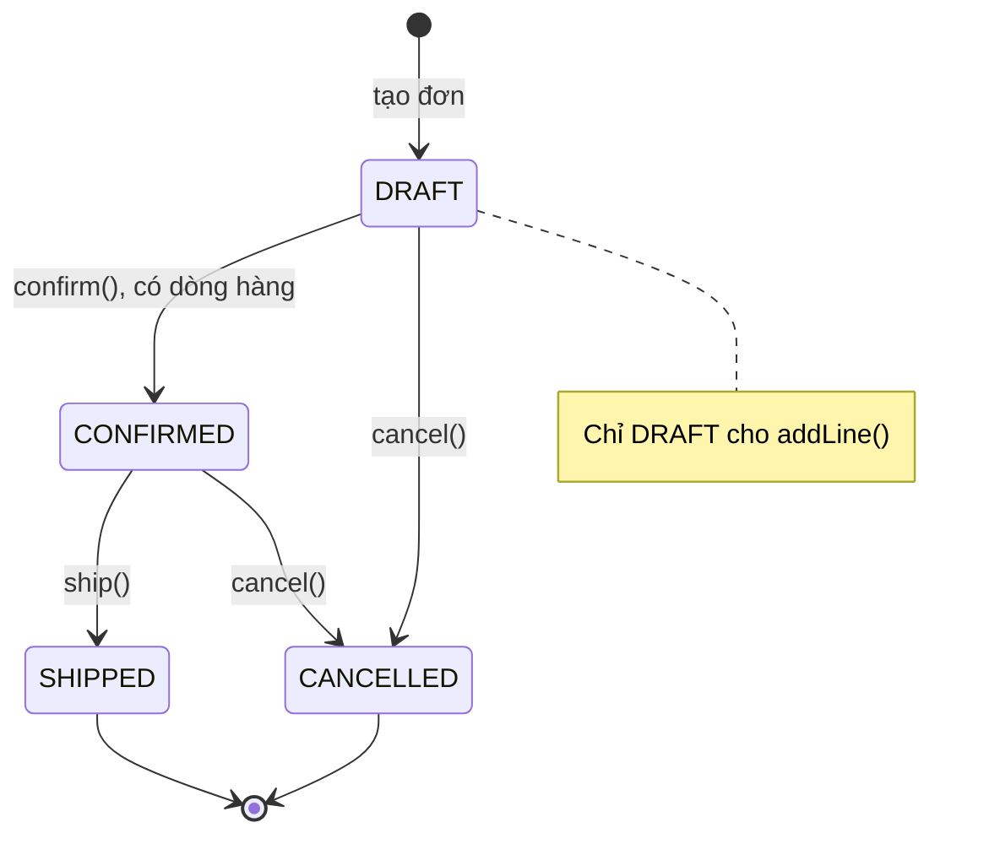
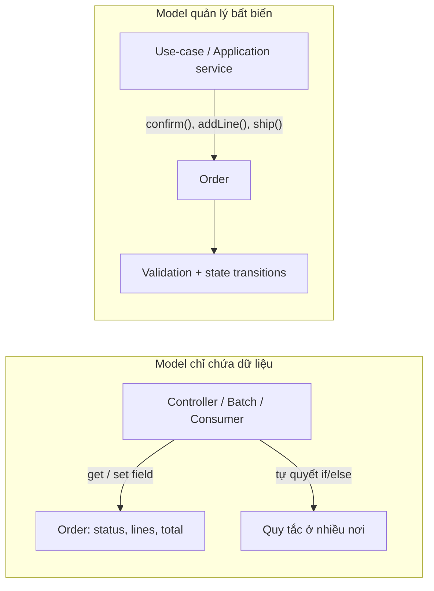
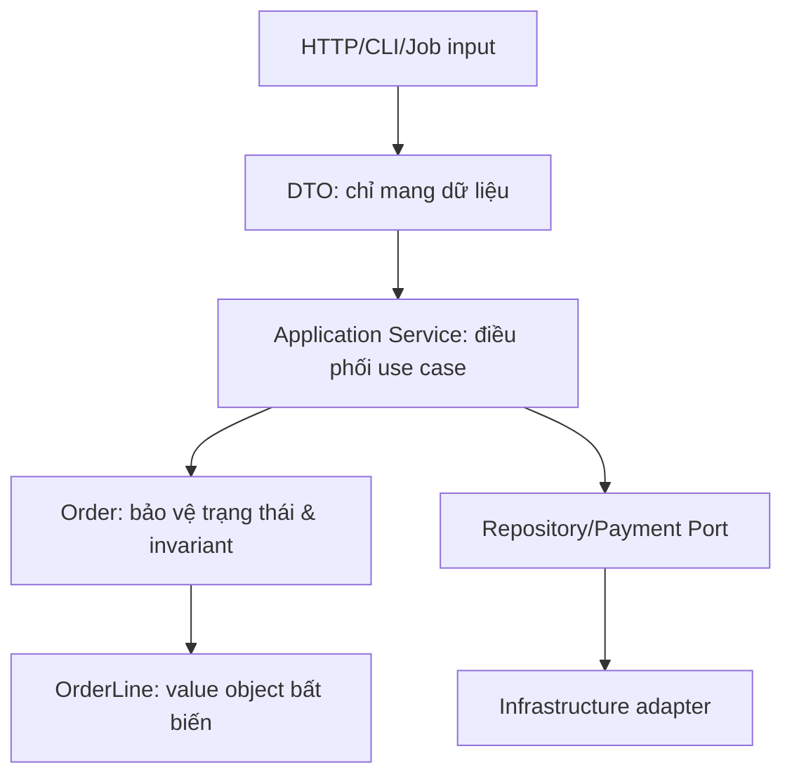
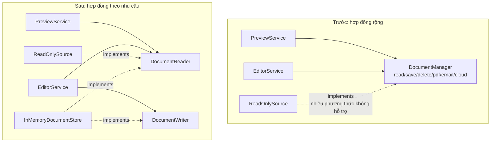
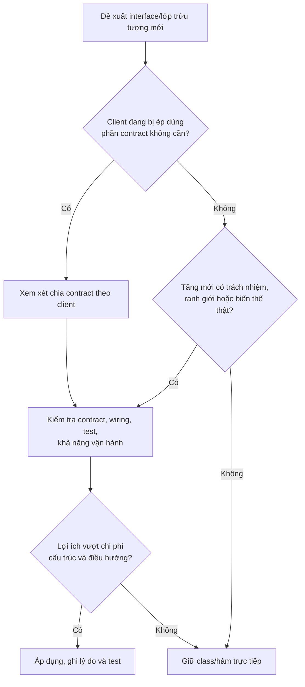
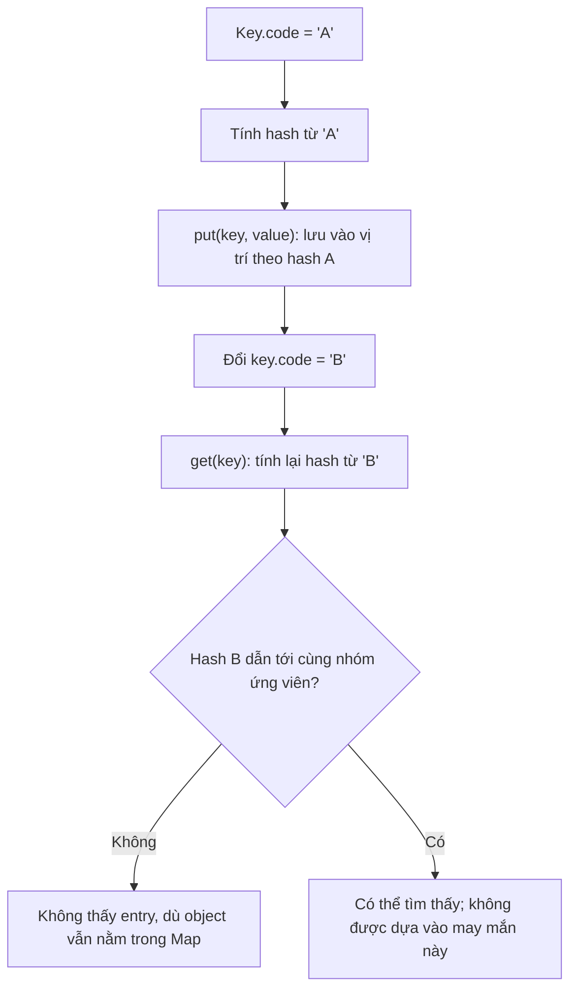
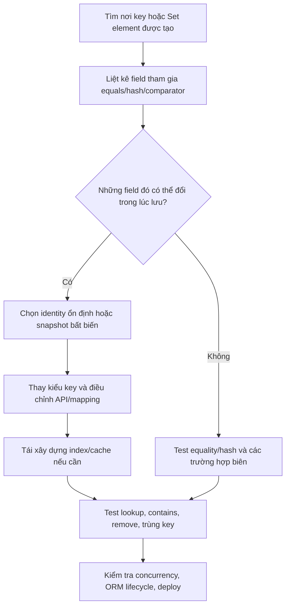

<a id="back-to-top"></a>

# Design Pitfalls

## Menu
- [Classes with too many responsibilities](#design-pitfalls-001)
- [Exposed state and broken invariants](#design-pitfalls-002)
- [Excessive getters and setters without behavior](#design-pitfalls-003)
- [Inheritance solely to reuse a few methods](#design-pitfalls-004)
- [Overusing casts and type checks](#design-pitfalls-005)
- [Oversized interfaces or too many abstraction layers](#design-pitfalls-006)
- [Circular dependencies and deep object navigation](#design-pitfalls-007)
- [Hard-to-control shared state](#design-pitfalls-008)
- [Mutable objects breaking equality or hash codes](#design-pitfalls-009)
- [Overusing design patterns and premature abstraction](#design-pitfalls-010)

## <a id="design-pitfalls-001">Classes with too many responsibilities</a>

<details>
<summary>View details</summary>

# Classes with too many responsibilities (God Class): recognizing and refactoring them correctly

> **Topic:** OOP → Design Pitfalls → Classes with too many responsibilities.  
> **Objective:** Understand why a class can become a maintenance bottleneck, distinguish a "long class" from a "class with too many responsibilities," identify warning signs through reasons to change and cohesion among methods, and refactor into well-defined parts in Java while preserving business behavior.

## 1. What does "a class with too many responsibilities" mean?

**God Class** (sometimes called *Blob*, *Large Class*, or *Bloaters* in code-smell taxonomies) describes a design smell: one class combines too many concerns that should be able to change, be tested, and evolve relatively independently. It may know too much about the rest of the system, hold a large amount of unrelated state, and channel every change through itself.

For example, an `OrderManager` might simultaneously:

- validate order data;
- calculate prices, taxes, and discounts;
- persist orders to a database;
- call a payment gateway;
- send notification emails;
- generate invoice PDFs;
- format data for a REST API.

Changing a tax formula, switching database management systems, or updating an email template may all require editing the same `OrderManager.java` file. Changes arising for **different reasons** collide within one class.

The central question is not "how many lines are too many?" **A 500-line class implementing one highly cohesive algorithm can be reasonable**, while a 100-line class that calculates taxes, sends emails, and makes HTTP calls may already have too many responsibilities.

A practical criterion is the **reason to change**: must the class change because of multiple business decisions or the needs of different groups of people or parts of the system?

## 2. Why does this design arise?

Initially, to deliver a feature quickly, developers often put validation, calculations, persistence, and notifications into one method. When new requirements arrive, they add another `if` branch or dependency to the same class because "everything related to orders is already here."

Over time, the class becomes a central repository of knowledge:

~~~mermaid
flowchart LR
    C["OrderManager"]
    C --> V["Validation"]
    C --> P["Pricing / Tax"]
    C --> D["Database"]
    C --> M["Email / SMS"]
    C --> F["PDF / CSV"]
    C --> A["API response"]
    C --> T["Payment gateway"]
~~~

These responsibilities all concern **orders**, but they do not necessarily share the same **reason to change**. A common business domain name such as `Order` does not prove they belong in the same class.

Common causes include missing module boundaries, reluctance to add classes, copy-paste, direct dependencies on frameworks or SDKs, tight deadlines, and too few tests to refactor safely.

### Distinguishing the terms

| Term | Main concern | Relationship to God Class |
|---|---|---|
| **God Class / Blob** | Knows and does too much, often with broad impact | A typical example of a class with too many responsibilities |
| **Large Class** | Large size: many lines, fields, or methods | A warning sign worth investigating, **not sufficient** for a diagnosis |
| **Low Cohesion** | Fields/methods do not serve a consistent shared purpose | Fairly strong evidence when combined with multiple reasons to change |
| **High Coupling** | Depends directly on many other classes or modules | Widens the impact of changes |
| **SRP violation** | One module serves multiple independent actors/reasons to change | The design-principle interpretation behind many God Classes |
| **Anemic Domain Model** | Domain objects have little business behavior; services hold most logic | May coexist with a God Service, but is a different issue |

A long class is **not necessarily** a God Class. Conversely, a very short "manager" class that forwards dozens of requests to different APIs may still be a hub with excessively broad dependencies.

## 3. Warning signs in code and change history

Inspect the source code and ask:

| Sign | Example | Consequence |
|---|---|---|
| Many reasons to edit the same file | Tax, SQL, and email changes all modify `OrderManager` | Merge conflicts, difficult reviews, and regressions that are hard to isolate |
| Fields form distinct clusters | `dbConnection`, `mailClient`, `pdfWriter`, `taxRate` | The class's state may not serve a common purpose |
| Methods do not share data | `sendEmail()` does not use data from `calculateTax()` | Low cohesion |
| An inflated public API | `createOrder`, `exportCsv`, `resetPassword`, `syncWarehouse` | Clients must see capabilities they do not need |
| Branches mixed with side effects | Price calculations interleaved with DB and HTTP calls | Slow tests and failures that are difficult to reproduce |
| Difficult setup in unit tests | Testing arithmetic requires DB/mail/SDK configuration | Responsibilities have not been isolated |
| Small changes have a wide impact | Updating an email template breaks pricing tests | Weak boundaries between concerns |

The strongest sign is often **repeated unrelated changes touching the same class**. During an audit, inspect change history, actual use cases, and the dependency graph; avoid judging solely by names such as `*Manager` or `*Service`.

### "One responsibility" does not mean "one method"

According to the **Single Responsibility Principle (SRP)**, a module should have one coherent reason to change. A `PriceCalculator` can still provide `calculateSubtotal`, `calculateDiscount`, and `calculateTax` if they all belong to the **pricing policy** and really do change together.

Conversely, splitting a 100-line method into 10 private methods **does not, by itself, fix a God Class** if that class still handles payment calculations, SQL, and SMTP.

## 4. A design smell: everything in one class

The following is an **intentionally flawed example** of an ordering application:

~~~java
import java.math.BigDecimal;
import java.util.HashMap;
import java.util.List;
import java.util.Map;

record Item(String sku, int quantity, BigDecimal unitPrice) {}

final class AllInOneOrderService {
    private final Map<String, BigDecimal> fakeDatabase = new HashMap<>();

    String placeOrder(
            String orderId, String email, List<Item> items) {

        // 1. Validate input.
        if (orderId == null || orderId.isBlank()) {
            throw new IllegalArgumentException("Missing order ID");
        }

        // 2. Calculate price.
        BigDecimal total = BigDecimal.ZERO;
        for (Item item : items) {
            total = total.add(item.unitPrice()
                    .multiply(BigDecimal.valueOf(item.quantity())));
        }

        // 3. Persist (giả lập).
        fakeDatabase.put(orderId, total);

        // 4. Notify (giả lập).
        System.out.println("[DEMO MAIL] " + email + ": " + orderId);

        // 5. Format text for a caller.
        return "Order " + orderId + " total = " + total;
    }
}
~~~

This snippet illustrates a *code smell*; it is **not a production implementation**. It does not validate `items`, quantities, unit prices, duplicate order IDs, or notification failures. These omissions also illustrate the problem: the more concerns one function handles, the easier it is to overlook contracts at the boundaries.

Suppose email must be replaced with SMS. We would have to edit the class containing the pricing formula. Replacing `HashMap` with JPA would again modify that class. To unit-test the price of two items without sending a notification, the test would have to avoid the side effect.

We could add many private methods, but **the reasons to change would still coexist in `AllInOneOrderService`**.

## 5. Redesign: split along responsibility boundaries

One refactoring approach is to keep a relatively thin **orchestrating use case** and put independent policies and integrations in the appropriate places:

~~~mermaid
flowchart TD
    UI["Caller / Controller"] --> UC["PlaceOrderUseCase"]
    UC --> PR["PriceCalculator"]
    UC --> REPO["OrderRepository (port)"]
    UC --> NOTI["OrderNotifier (port)"]
    MEMORY["InMemoryOrderRepository"] -.->|"implements"| REPO
    MAIL["ConsoleOrderNotifier"] -.->|"implements"| NOTI
    DB["Adapter DB thật sau này"] -.->|"implements"| REPO
~~~

This separation has a concrete purpose:

- **`PriceCalculator`:** calculates amounts from order items without knowing about the database or email recipient.
- **`OrderRepository`:** defines a contract for saving order results; an adapter decides where to persist them.
- **`OrderNotifier`:** defines a notification contract; an adapter chooses email, SMS, or demo logging.
- **`PlaceOrderUseCase`:** owns the **order-placement workflow**: accept a valid request → calculate the amount → create the result → request persistence → request notification.
- **Composition root:** creates and connects objects; this is where knowledge of infrastructure implementations belongs.

**Note:** Calling several collaborators does not automatically make a use case a God Class. **Orchestrating the steps of one use case** can be **one cohesive responsibility**. Problems arise when the use case itself contains SQL logic, pricing rules, SMTP, PDF generation, and numerous unrelated use cases.

## 6. Complete, standalone Java 17 example

This example uses monetary amounts with two decimal places to make calculations easy to follow; in a real application, **rounding rules and currency units** must follow business requirements. The adapters simulate in-memory/console operations; they do not send real email or write to a real database.

Save as **`ResponsibilityDemo.java`**:

~~~java
import java.math.BigDecimal;
import java.math.RoundingMode;
import java.util.HashMap;
import java.util.List;
import java.util.Map;
import java.util.Objects;

// Value object: quy tắc hợp lệ của một mặt hàng.
record OrderItem(String sku, int quantity, BigDecimal unitPrice) {
    OrderItem {
        Objects.requireNonNull(sku, "sku");
        Objects.requireNonNull(unitPrice, "unitPrice");

        if (!sku.matches("[A-Z0-9-]+")) {
            throw new IllegalArgumentException("Invalid sku");
        }
        if (quantity <= 0 || unitPrice.signum() < 0) {
            throw new IllegalArgumentException(
                    "Invalid quantity or price");
        }

        try {
            unitPrice = unitPrice.setScale(
                    2, RoundingMode.UNNECESSARY);
        } catch (ArithmeticException ex) {
            throw new IllegalArgumentException(
                    "Unit price has fractions below 0.01", ex);
        }
    }
}

// Dữ liệu đầu vào của một use case.
record PlaceOrderRequest(
        String orderId,
        String customerEmail,
        List<OrderItem> items) {
    PlaceOrderRequest {
        Objects.requireNonNull(orderId, "orderId");
        Objects.requireNonNull(customerEmail, "customerEmail");
        Objects.requireNonNull(items, "items");

        if (!orderId.matches("[A-Z0-9-]+")) {
            throw new IllegalArgumentException("Invalid order ID");
        }
        if (customerEmail.isBlank()) {
            throw new IllegalArgumentException("Missing email");
        }
        items = List.copyOf(items);
        if (items.isEmpty()) {
            throw new IllegalArgumentException("Empty order");
        }
    }
}

record OrderReceipt(String orderId, BigDecimal total) {}

// Chính sách tính tiền: không biết lưu trữ hoặc thông báo.
final class PriceCalculator {
    BigDecimal calculate(List<OrderItem> items) {
        Objects.requireNonNull(items, "items");

        BigDecimal total = BigDecimal.ZERO.setScale(2);
        for (OrderItem item : items) {
            total = total.add(item.unitPrice()
                    .multiply(BigDecimal.valueOf(item.quantity())));
        }
        return total;
    }
}

// Hai port mô tả những việc use case cần.
interface OrderRepository {
    void save(OrderReceipt receipt);
}

interface OrderNotifier {
    void orderPlaced(String customerEmail, OrderReceipt receipt);
}

// Use case: giữ trình tự nghiệp vụ, không chứa công thức/SDK.
final class PlaceOrderUseCase {
    private final PriceCalculator calculator;
    private final OrderRepository repository;
    private final OrderNotifier notifier;

    PlaceOrderUseCase(
            PriceCalculator calculator,
            OrderRepository repository,
            OrderNotifier notifier) {
        this.calculator = Objects.requireNonNull(
                calculator, "calculator");
        this.repository = Objects.requireNonNull(
                repository, "repository");
        this.notifier = Objects.requireNonNull(
                notifier, "notifier");
    }

    OrderReceipt execute(PlaceOrderRequest request) {
        Objects.requireNonNull(request, "request");

        BigDecimal total = calculator.calculate(request.items());
        OrderReceipt receipt = new OrderReceipt(
                request.orderId(), total);

        // Quy trình có thứ tự rõ, mỗi dependency sở hữu một việc.
        repository.save(receipt);
        notifier.orderPlaced(request.customerEmail(), receipt);
        return receipt;
    }
}

// Adapter lưu tại bộ nhớ, minh họa — không thread-safe.
final class InMemoryOrderRepository implements OrderRepository {
    private final Map<String, OrderReceipt> storage = new HashMap<>();

    @Override
    public void save(OrderReceipt receipt) {
        Objects.requireNonNull(receipt, "receipt");

        if (storage.putIfAbsent(receipt.orderId(), receipt) != null) {
            throw new IllegalStateException("Duplicate order ID");
        }
    }

    OrderReceipt findRequired(String id) {
        OrderReceipt found = storage.get(id);
        if (found == null) {
            throw new IllegalArgumentException("Order not found");
        }
        return found;
    }
}

// Adapter mô phỏng gửi thông báo, không in email của khách hàng.
final class ConsoleOrderNotifier implements OrderNotifier {
    @Override
    public void orderPlaced(
            String customerEmail, OrderReceipt receipt) {
        Objects.requireNonNull(customerEmail, "customerEmail");
        System.out.printf(
                "[DEMO] Created %s, total=%s%n",
                receipt.orderId(),
                receipt.total().toPlainString());
    }
}

public class ResponsibilityDemo {
    public static void main(String[] args) {
        var repository = new InMemoryOrderRepository();
        var notifier = new ConsoleOrderNotifier();

        var useCase = new PlaceOrderUseCase(
                new PriceCalculator(),
                repository,
                notifier);

        var request = new PlaceOrderRequest(
                "ORD-42",
                "customer@example.com",
                List.of(
                        new OrderItem(
                                "SKU-1", 2, new BigDecimal("50.00")),
                        new OrderItem(
                                "SKU-2", 1, new BigDecimal("25.50"))
                ));

        OrderReceipt receipt = useCase.execute(request);

        System.out.println("Receipt: " + receipt);
        System.out.println("Saved: "
                + repository.findRequired("ORD-42").total());
    }
}
~~~

Compile and run:

~~~bash
javac ResponsibilityDemo.java
java ResponsibilityDemo
~~~

Expected output:

~~~text
[DEMO] Created ORD-42, total=125.50
Receipt: OrderReceipt[orderId=ORD-42, total=125.50]
Saved: 125.50
~~~

The example uses Java 17 `record` types to represent value data and simple boundaries; **records do not automatically enforce all invariants**, so constructors check the required conditions. `List.copyOf` creates a structural snapshot of the list and rejects null elements; `OrderItem` is a record whose components are immutable, so the example contains no state-mutable elements.

Several demo decisions are intentionally limited in scope:

- `customerEmail` is checked only for nonblank content; this is **not complete email validation**. Real systems need separate validation and verification policies.
- `InMemoryOrderRepository` does not persist to disk, is not thread-safe, and has no transaction support.
- `ConsoleOrderNotifier` **does not send email**. It only simulates a side effect to demonstrate the boundary.
- `OrderReceipt` is a simple use-case result; an application with order, payment, and shipping states needs an appropriate domain model.
- Name classes and modules so dependencies point toward stable contracts. Not every implementation needs an interface if no replacement is required.

### Before and after refactoring: what actually changes?

| System change | With everything in `AllInOneOrderService` | After refactoring |
|---|---|---|
| Change the pricing formula | Edit the same class that handles DB/email | Update `PriceCalculator` and pricing tests |
| Change the persistence mechanism | Edit DB access logic inside a business class | Replace the `OrderRepository` adapter |
| Switch from email to SMS | Edit notification logic inside the business class | Replace the `OrderNotifier` adapter |
| Validate an invalid order item | Validation is buried in a large function | Express the invariant in `OrderItem` |
| Change workflow order: persist before notifying | Side effects are easy to interleave | The order is explicit in `PlaceOrderUseCase.execute` |
| Unit-test the pricing formula alone | DB/mail setup may get in the way | Directly create `new PriceCalculator()` |

**Key point:** Refactoring is **more than splitting files**. We must establish boundaries where *each part owns a decision* and other parts interact with it through clear contracts.

## 7. Class responsibilities versus use-case responsibilities

At this point, you might ask: "`PlaceOrderUseCase` calls three dependencies, so does it have too many responsibilities?"

**Not necessarily.** Placing an order **is itself a workflow** involving pricing, persistence, and notification. A use case may be responsible for executing **one ordered business scenario**, while each collaborator handles a specialized detail.

However, if `PlaceOrderUseCase` also acquires `cancelOrder`, `refund`, `generateMonthlyReport`, `syncWarehouse`, `createPromoCampaign`, and dozens of unrelated state fields, it may be turning into a **God Service**. Examine whether these requirements have the same reason to change or belong to different workflows.

Do not interpret SRP as a mechanical rule such as "one method per class," "at most 100 lines per class," or "at most three dependencies per method." These are heuristics, not definitions of responsibility.

### What behavior should a domain object retain?

Removing every behavior from entities can produce an *anemic domain model*, where all constraints and state changes are pushed into other services. For example, a `BankAccount` can enforce valid withdrawal rules itself because that is **a responsibility closely tied to the account's state**:

~~~java
import java.math.BigDecimal;
import java.util.Objects;

final class BankAccount {
    private BigDecimal balance;

    BankAccount(BigDecimal initial) {
        Objects.requireNonNull(initial);
        if (initial.signum() < 0) {
            throw new IllegalArgumentException("Negative initial balance");
        }
        this.balance = initial;
    }

    void withdraw(BigDecimal amount) {
        Objects.requireNonNull(amount);
        if (amount.signum() <= 0 || amount.compareTo(balance) > 0) {
            throw new IllegalArgumentException("Invalid withdrawal");
        }
        balance = balance.subtract(amount);
    }

    BigDecimal balance() {
        return balance;
    }
}
~~~

This is **appropriate behavior inside a domain object**, not evidence of a class doing too much. `BankAccount` would become suspicious if it started invoking SMTP, generating CSV reports, or knowing the database connection password.

## 8. Common mistakes when refactoring a God Class

### 8.1. Splitting classes but only forwarding calls

Example that does not solve the problem:

~~~java
class OrderFacade {
    private final LegacyOrderManager manager = new LegacyOrderManager();

    void saveOrder() {
        manager.doEverything();
    }
}
~~~

A well-named wrapper does not separate policy from side effects if `LegacyOrderManager` still does everything. Identify **which logic actually changes ownership** and inspect dependencies afterward.

### 8.2. Splitting so finely that the business workflow becomes hard to read

If each pricing step becomes a separate class (`AddItemService`, `MultiplyQuantityService`, `RoundTotalService`...) without its own reason to change, the extra abstractions can make code harder to follow. Group steps that serve the same purpose in a cohesive object.

### 8.3. Moving everything into a static "Utils" class

~~~java
OrderUtils.validate(...);
OrderUtils.calculate(...);
OrderUtils.save(...);
OrderUtils.sendMail(...);
~~~

Renaming `OrderManager` to `OrderUtils` still concentrates responsibilities and may even make dependency injection or side-effect testing harder. `static` methods are suitable for small pure functions, but "utils" should not become a dumping ground for every policy and adapter.

### 8.4. Creating an interface for every class

An interface with exactly one implementation does not automatically add value unless it separates stable and changing boundaries or helps testing. `PriceCalculator` in this example is an ordinary class because its pricing logic can be tested directly and does not yet need multiple algorithms. `OrderRepository` and `OrderNotifier` are meaningful abstractions because they prevent the use case from depending on a particular persistence or notification mechanism.

### 8.5. Overlooking transaction boundaries while moving code

For example, consider these sequential calls:

~~~java
repository.save(receipt);
notifier.orderPlaced(email, receipt);
~~~

If `save` succeeds and `orderPlaced` throws an exception, **the order has been saved but the notification has not been sent**. Splitting classes does not automatically solve atomicity, retries, or idempotency.

In a real system, a **transactional outbox** can persist the order and an event to be published in the same database transaction, after which a worker publishes the event with retry and duplicate-handling capabilities. The details depend on consistency requirements; do not assume a DB transaction can encompass email or every HTTP side effect.

Similarly, if pricing depends on mutable data, establish which price-list/tax-rate version applies when the order is created so refactoring does not change the result.

## 9. Testing for safe refactoring

Before changing a large class, identify **which behavior must be preserved**. For legacy code without tests, *characterization tests* can capture existing behavior and lock down rules that must remain stable; then write isolated tests for extracted components.

The following example uses JUnit Jupiter 5 and classes from `ResponsibilityDemo.java`. Place it in `ResponsibilityDemoTest.java` in the same package, add the `org.junit.jupiter:junit-jupiter` dependency and an appropriate test runner:

~~~java
import static org.junit.jupiter.api.Assertions.*;

import java.math.BigDecimal;
import java.util.ArrayList;
import java.util.List;
import java.util.concurrent.atomic.AtomicInteger;

import org.junit.jupiter.api.Test;

class ResponsibilityDemoTest {
    @Test
    void priceIsIndependentOfDatabaseAndNotification() {
        var calculator = new PriceCalculator();

        BigDecimal total = calculator.calculate(List.of(
                new OrderItem("SKU-1", 2, new BigDecimal("50.00")),
                new OrderItem("SKU-2", 1, new BigDecimal("25.50"))
        ));

        assertEquals(new BigDecimal("125.50"), total);
    }

    @Test
    void useCasePersistsBeforeNotifying() {
        var events = new ArrayList<String>();

        OrderRepository repository = receipt ->
                events.add("saved:" + receipt.orderId());

        OrderNotifier notifier = (email, receipt) ->
                events.add("notified:" + receipt.orderId());

        var useCase = new PlaceOrderUseCase(
                new PriceCalculator(), repository, notifier);

        var request = new PlaceOrderRequest(
                "ORD-42",
                "customer@example.com",
                List.of(new OrderItem(
                        "SKU-1", 1, new BigDecimal("10.00"))));

        var receipt = useCase.execute(request);

        assertEquals(new BigDecimal("10.00"), receipt.total());
        assertEquals(List.of(
                "saved:ORD-42",
                "notified:ORD-42"
        ), events);
    }

    @Test
    void notificationDoesNotRunWhenPersistenceFails() {
        AtomicInteger notifications = new AtomicInteger();

        OrderRepository brokenRepository = receipt -> {
            throw new IllegalStateException("Storage failure");
        };
        OrderNotifier notifier = (email, receipt) ->
                notifications.incrementAndGet();

        var useCase = new PlaceOrderUseCase(
                new PriceCalculator(), brokenRepository, notifier);

        var request = new PlaceOrderRequest(
                "ORD-99",
                "customer@example.com",
                List.of(new OrderItem(
                        "SKU-1", 1, new BigDecimal("10.00"))));

        assertThrows(IllegalStateException.class,
                () -> useCase.execute(request));
        assertEquals(0, notifications.get());
    }

    @Test
    void invalidQuantityIsRejectedBeforeUseCase() {
        assertThrows(IllegalArgumentException.class,
                () -> new OrderItem(
                        "SKU-1", 0, new BigDecimal("10.00")));
    }
}
~~~

**What these tests demonstrate:**

- `PriceCalculator` is tested **without** mocking a database or email.
- The orchestration test confirms the **order**: persistence is requested before notification.
- If the repository fails, the notifier has not been called, making workflow errors easier to detect.
- `OrderItem` invariants are tested where the value object is created.

These tests do not demonstrate that actual persistence or email delivery works. Adapters using JDBC/JPA/HTTP/SMTP need integration tests at the corresponding boundaries. Changes to transaction handling also require tests for retries, race conditions, duplicate notifications, and idempotency requirements.

## 10. Step-by-step refactoring to reduce the risk of behavior changes

A practical process for a large class already running in production:

1. **Identify features and clients:** Who calls which methods? Where do the data and side effects go? Flag high-risk rules (money, state, authorization, transactions).
2. **Capture current behavior:** Use characterization tests or integration tests for important flows; distinguish bugs that need separate fixes from behavior clients currently depend on.
3. **Group reasons to change:** Pricing, persistence, notification, validation, presentation, etc.; confirm the groupings through dependencies and field usage rather than class names.
4. **Extract pure logic first:** Move deterministic calculations (pure logic) into independently tested classes/methods. This is less risky than moving transactions or network calls.
5. **Separate communication ports from the use case:** Define `OrderRepository` and `OrderNotifier` around the caller's needs; add an adapter for old code when necessary.
6. **Move side effects carefully:** Preserve operation order, failure conditions, and retry policies defined by the contract; avoid sending duplicate notifications.
7. **Reduce the old class:** Leave it with only its genuine use-case responsibility or migrate callers to the new API; remove old paths when no one uses them.
8. **Verify changes:** Run appropriate module/unit/integration tests, compare business results, and inspect logs and queries. Optimize performance only when evidence supports it.

Safe refactoring usually consists of **many small, reviewable changes** instead of rewriting a thousand-line class at once. If API compatibility is required, a temporary forwarding adapter can remain until callers migrate, with a plan to remove it.

### Workflow diagram after extraction

~~~mermaid
sequenceDiagram
    actor Client
    participant U as PlaceOrderUseCase
    participant P as PriceCalculator
    participant R as OrderRepository
    participant N as OrderNotifier
    Client->>U: execute(request)
    U->>P: calculate(items)
    P-->>U: total
    U->>R: save(receipt)
    R-->>U: hoàn tất
    U->>N: orderPlaced(email, receipt)
    N-->>U: hoàn tất
    U-->>Client: receipt
    Note over U,N: Nếu notify lỗi sau save, cần chính sách nhất quán/retry riêng
~~~

## 11. When is splitting a class NOT necessary?

Signs that you **should retain** a class include:

- All methods genuinely support one cohesive invariant/algorithm and change under the same policy.
- Splitting it would only create more forwarding objects without reducing coupling or making tests easier.
- The component is a value object or aggregate whose business rules surround the same state.
- The problem is small, the algorithm is clear, and no real variation axis exists yet; refactoring offers too little benefit.
- A class has many methods because it implements a complete protocol, yet retains a clear responsibility boundary.

Do not decide based only on **LOC (lines of code), method count, cyclomatic complexity, or the name `Manager`**. Those help identify areas worth investigating; design decisions should consider cohesion, coupling, reasons to change, testability, and business impact.

## 12. Practice exercise: extracting classes from UserManager

Consider this hypothetical class:

~~~java
class UserManager {
    void register(String email, String password) { /* ... */ }
    boolean authenticate(String email, String password) { /* ... */ }
    void sendWelcomeEmail(String email) { /* ... */ }
    String exportUserCsv() { /* ... */ }
    void cleanupInactiveUsers() { /* ... */ }
}
~~~

Do not immediately turn five methods into five classes. Analyze:

- Which policies govern registration and authentication, and might they need to be separated?
- What security boundaries are required for password hashing, passwords, and sessions/tokens?
- Are email and CSV business responsibilities or system adapters?
- Should deleting inactive users be a separate batch job with different transaction/audit requirements?
- Which actors or requirement groups cause `UserManager` to change?

**Task:** Draw the relationship diagram after extraction, create interfaces only at replaceable boundaries, choose appropriate use-case names, and write at least three tests: invalid registration data, successful user persistence, and email failure after saving. Explicitly define the business policy for email failures (is registration still successful? are retries/an outbox used?).

### Self-check questions

1. Why is a "class with many lines" only a warning sign rather than proof of a God Class?
2. What does it reveal about reasons to change if both SQL and discount formulas require editing `OrderManager`?
3. Does splitting one large method into 10 private methods automatically ensure SRP?
4. Is `PlaceOrderUseCase` necessarily a God Class because it calls three dependencies? Why?
5. Why avoid moving both balance validation and withdrawals out of `BankAccount` when the invariant belongs to the account?
6. How do interfaces and DI help when switching database/mail adapters? Do they automatically solve transaction handling?
7. Why does `repository.save` succeeding while `notifier.orderPlaced` fails require a separate policy?
8. When should refactoring stop to avoid creating dozens of forwarding classes without real responsibilities?

**Conclusion:** A class with too many responsibilities tightly couples independent decisions, so changing one concern affects many others. Effective refactoring means **finding real change boundaries**, placing logic and side effects where they belong, keeping use-case orchestration cohesive, and relying on tests and business contracts to preserve results. **Class count is not a quality metric**; the ability to understand, change, and verify behavior is what matters.


</details>

- [Back to top](#back-to-top)

---

## <a id="design-pitfalls-002">Exposed state and broken invariants</a>

<details>
<summary>View details</summary>

# Exposed state and broken invariants in OOP

> **Topic:** OOP → Design Pitfalls → Exposed state and broken invariants.  
> **Objective:** Recognize how external data paths can corrupt an object's state; understand how invariants differ from input validation; and use encapsulation, domain operations, defensive copies, and tests to protect Java objects.

## 1. The problem: objects can become "self-contradictory" even after valid construction

Suppose a ticketing system has a seat inventory with **capacity 10**, **4** reserved seats, and **6** available. These numbers must satisfy:

\[
0 \le \text{reserved} \le \text{capacity}
\]

and \(\text{available}=\text{capacity}-\text{reserved}\).

This is an **object invariant**: a condition that must hold whenever an object's state can be observed externally, especially **after successful construction** and **after each public operation completes**.

A design can initialize valid state yet allow external code to invalidate it:

~~~java
// Ví dụ CỐ Ý SAI để thấy lỗi thiết kế.
class BrokenSeatInventory {
    public int capacity;
    public int reserved;

    BrokenSeatInventory(int capacity) {
        this.capacity = capacity;
        this.reserved = 0;
    }

    int available() {
        return capacity - reserved;
    }
}

BrokenSeatInventory inventory = new BrokenSeatInventory(10);
inventory.reserved = 12; // Java cho phép: trường public.
System.out.println(inventory.available()); // -2
~~~

A single assignment valid for the **`int` type** has broken a business rule. The compiler cannot infer "`reserved` must not exceed `capacity`" from two `int` fields.

**The issue is more than "making a field `public`."** The deeper problem is that the object **cannot control every path through which its own state changes**. State can be modified directly through a field, through a getter returning a mutable collection, through an object passed to a constructor and later modified externally, or through setters that let related fields change independently.

## 2. What is an invariant, and how does it differ from validation?

Three concepts often appear together but answer different questions:

| Concept | Question | Seat-inventory example |
|---|---|---|
| **Precondition** | What must the caller supply for an operation to be valid? | `reserve(seats)` requires `seats > 0` |
| **Postcondition** | What must be true if the operation succeeds? | Successfully reserving 3 seats increases the reserved count by exactly 3 |
| **Invariant** | Which rule must hold at boundaries where state can be observed? | `0 ≤ reserved ≤ capacity` |

An invariant can involve **multiple fields**:

- Account: `balance >= 0` when overdrafts are prohibited by business policy.
- Inventory: `0 <= reserved <= stock`.
- Time interval: `start.isBefore(end)`.
- Order: `status == PAID` only after specific payment conditions are met.
- User group: ownership and membership must remain consistent with system rules.

Not every object needs complex invariants. For example, a DTO holding unverified input may deliberately contain invalid state so validation errors can be reported. In contrast, **domain objects** expected to represent valid state must preserve their rules across public operations.

### How far does "always true" extend?

A method may modify several fields in internal steps; an intermediate state **that is never exposed** may temporarily violate the invariant. Good designs still aim to make consistent updates and expose only valid state. In multithreaded programs, synchronization is also needed if threads read and write the same state.

Do not treat a promise to "call setters in the correct order" as invariant protection. API clients, subclasses, serializers, frameworks, or a future refactoring may invoke them in another order.

## 3. Why is `private` necessary but insufficient?

**Encapsulation** means more than changing `public` to `private`. It means an object **retains control over its state and enforces validity rules** when receiving requests for changes.

A sound design typically has three layers of protection:

1. **Hide state representation:** prevent clients from writing directly to important fields.
2. **Expose operations in domain language:** `reserve(3)` and `cancel(2)` rather than `setReserved(7)`.
3. **Protect all mutable reference paths:** constructors, getters, setters, collections, arrays, nested objects, and concurrent access.

The following table summarizes common mistakes:

| Approach | Risk | Remedy |
|---|---|---|
| `public int reserved` | Any client can assign an arbitrary value | Use `private` and guarded `reserve`/`cancel` methods |
| Separate `setReserved(x)` and `setCapacity(y)` | Can produce invalid combinations of state | Use a domain operation or update related data atomically |
| `getItems() { return items; }` | Exposes a reference to an internal mutable collection | Return a suitable snapshot/read-only view |
| `this.items = items` receiving an external `List` | Caller retains an alias and can later modify the data | Copy input data according to policy |
| `private final List<X> items` | `final` fixes the reference but does not prevent `add/remove` | Control mutations and prevent reference leaks |
| `record User(List<Role> roles)` | A record does not deep-copy its components automatically | Normalize/copy in the compact constructor |
| Validation on construction but not on updates | An initially valid object becomes invalid later | Enforce invariants in every mutator |

## 4. Complete Java 17 example: a seat inventory that preserves its invariant

Instead of exposing `capacity` and `reserved`, we create an object with encapsulated state:

- Capacity is set once in the constructor and never changes.
- Seats can only be reserved through `reserve(int seats)`.
- Reservations can only be canceled through `cancel(int seats)`.
- No API allows arbitrary assignments to the reserved-seat count.
- When too few seats remain, `reserve` returns `false` and **does not change state**.
- Operation seat counts must be positive; `cancel` cannot cancel more seats than have been reserved.

Create **`InvariantDemo.java`**:

~~~java
import java.util.HashSet;
import java.util.Objects;
import java.util.Set;

// Một thiết kế lỗi để quan sát tác hại của public state.
final class BrokenSeatInventory {
    public int capacity;
    public int reserved;

    BrokenSeatInventory(int capacity) {
        this.capacity = capacity;
        this.reserved = 0;
    }

    int available() {
        return capacity - reserved;
    }
}

// Thiết kế có encapsulation và thao tác nghiệp vụ.
final class SeatInventory {
    private final int capacity;
    private int reserved;

    SeatInventory(int capacity) {
        if (capacity <= 0) {
            throw new IllegalArgumentException("capacity must be positive");
        }
        this.capacity = capacity;
        this.reserved = 0;
    }

    // synchronized làm cho toàn bộ kiểm tra + cập nhật là một critical section.
    synchronized boolean reserve(int seats) {
        requirePositive(seats);

        // Tránh reserved + seats gây overflow số nguyên.
        if (seats > capacity - reserved) {
            return false;
        }
        reserved += seats;
        return true;
    }

    synchronized void cancel(int seats) {
        requirePositive(seats);
        if (seats > reserved) {
            throw new IllegalArgumentException(
                    "cannot cancel more than reserved");
        }
        reserved -= seats;
    }

    synchronized int reserved() {
        return reserved;
    }

    synchronized int available() {
        return capacity - reserved;
    }

    int capacity() {
        return capacity;
    }

    private static void requirePositive(int seats) {
        if (seats <= 0) {
            throw new IllegalArgumentException("seats must be positive");
        }
    }
}

// Bảo vệ cả constructor và getter khỏi tham chiếu Set mutable bên ngoài.
final class PermissionSet {
    private final Set<String> permissions;

    PermissionSet(Set<String> input) {
        Objects.requireNonNull(input, "input");
        this.permissions = Set.copyOf(input);
    }

    Set<String> permissions() {
        return permissions; // Không sửa trực tiếp được.
    }

    boolean allows(String permission) {
        return permissions.contains(permission);
    }
}

public class InvariantDemo {
    public static void main(String[] args) {
        var broken = new BrokenSeatInventory(10);
        broken.reserved = 12;
        System.out.println("Broken available = " + broken.available());

        var seats = new SeatInventory(10);
        System.out.println("Reserve 4 = " + seats.reserve(4));
        System.out.println("Reserve 7 = " + seats.reserve(7));
        System.out.println("Available = " + seats.available());

        seats.cancel(2);
        System.out.println("Available after cancel = " + seats.available());

        Set<String> external = new HashSet<>(Set.of("READ"));
        PermissionSet policy = new PermissionSet(external);
        external.add("ADMIN"); // Thay đổi tập nguồn sau constructor.

        System.out.println("Policy has ADMIN = " + policy.allows("ADMIN"));

        try {
            policy.permissions().add("ADMIN");
        } catch (UnsupportedOperationException expected) {
            System.out.println("Permissions cannot be mutated externally");
        }
    }
}
~~~

Compile and run:

~~~bash
javac InvariantDemo.java
java InvariantDemo
~~~

Expected output:

~~~text
Broken available = -2
Reserve 4 = true
Reserve 7 = false
Available = 6
Available after cancel = 8
Policy has ADMIN = false
Permissions cannot be mutated externally
~~~

### Step-by-step state analysis

| Step | Operation | `reserved` | `available` | Invariant |
|---|---|---:|---:|---|
| Initialize | `new SeatInventory(10)` | 0 | 10 | Holds |
| Reserve 4 | `reserve(4)` returns `true` | 4 | 6 | Holds |
| Reserve 7 more | `reserve(7)` returns `false` | 4 | 6 | Holds; state unchanged |
| Cancel 2 | `cancel(2)` | 2 | 8 | Holds |
| Cancel 5 | `cancel(5)` throws an exception | 2 | 8 | Holds; state unchanged |

**Key point:** `SeatInventory` has no `setReserved` setter; it exposes only behaviors with **business meaning**. Its constructor establishes a valid initial state, and every valid public mutator preserves:

\[
0 \le \text{reserved} \le \text{capacity}
\]

This is an **inductive** argument:

1. **Base case:** after construction, `reserved = 0` and `capacity > 0`.
2. **Reservation step:** add only when `seats > 0` and `seats <= capacity - reserved`; capacity is therefore never exceeded.
3. **Cancellation step:** subtract only when `0 < seats <= reserved`; the result cannot become negative.
4. **Preservation:** if the state before an operation is valid, the state after a successful operation remains valid. Failure paths do not modify state.

This argument applies to the defined methods, assuming no code uses reflection/native access to alter fields illegally or bypasses the methods' synchronization. Under normal Java access rules, private access prevents direct assignment by clients.

### Why use `synchronized`?

If two threads both read `reserved = 4` and each tries to reserve 4 seats, the "check then add" action must be treated as **one unit**. Without synchronization, both might observe enough capacity and return `true`, while the stored result and actual bookings become inconsistent.

Using `synchronized` on `reserve`, `cancel`, and reads makes them use the same object monitor, establishing suitable happens-before relationships within the class. This demonstrates concurrency control **in the memory of one JVM**. If seats are stored in a database and multiple application instances run, transactions, optimistic locking, or conditional atomic updates are still needed at the storage layer. Adding `synchronized` to one service instance cannot eliminate races across nodes.

## 5. A subtle bug: a private field that returns the original collection

Consider a shopping cart:

~~~java
import java.util.ArrayList;
import java.util.List;

class LeakyCart {
    private final List<String> items = new ArrayList<>();

    LeakyCart() {
        items.add("SKU-1");
    }

    public List<String> getItems() {
        return items; // RÒ RỈ live mutable reference.
    }
}

LeakyCart cart = new LeakyCart();
cart.getItems().clear(); // Xóa trạng thái nội bộ từ ngoài class!
~~~

Making `items` a `private final` field **does not fix the issue**: `final` prevents the `List` reference from being reassigned, but does not stop its contents from changing.

One fix, when elements are immutable `String` values:

~~~java
final class SafeCart {
    private final List<String> items = new ArrayList<>();

    SafeCart() {
        items.add("SKU-1");
    }

    void addItem(String sku) {
        if (sku == null || sku.isBlank()) {
            throw new IllegalArgumentException("Invalid SKU");
        }
        items.add(sku);
    }

    List<String> itemsSnapshot() {
        return List.copyOf(items);
    }
}
~~~

Now the following code cannot modify the cart through the snapshot:

~~~java
SafeCart cart = new SafeCart();
List<String> readOnly = cart.itemsSnapshot();

// readOnly.add("SKU-2"); // Biên dịch được, nhưng runtime
// ném UnsupportedOperationException vì snapshot không sửa được.

cart.addItem("SKU-2");
System.out.println(readOnly);          // Vẫn chỉ [SKU-1].
System.out.println(cart.itemsSnapshot()); // [SKU-1, SKU-2].
~~~

A snapshot also clearly distinguishes **a copy captured at call time** from **a view that changes along with its source**. If the API truly needs a live view, its timing and concurrency contract should be explicit, rather than exposing an arbitrary mutable reference.

## 6. Defensive copying in constructors: preventing mutations through aliases

A class can leak state through an externally supplied object even without exposing a getter:

~~~java
import java.util.List;

class BrokenTeam {
    private final List<String> members;

    BrokenTeam(List<String> members) {
        this.members = members; // Giữ alias do client sở hữu.
    }

    int size() {
        return members.size();
    }
}
~~~

The client still holds a reference:

~~~java
List<String> external = new java.util.ArrayList<>(
        List.of("Lan", "Minh"));

BrokenTeam team = new BrokenTeam(external);
external.clear();

System.out.println(team.size()); // 0, dù Team không có mutator.
~~~

If the invariant is "a team must have at least one member," checking `!members.isEmpty()` in the constructor **does not guarantee it later**. We must copy the input structure and retain only a representation that cannot be modified:

~~~java
final class Team {
    private final List<String> members;

    Team(List<String> members) {
        java.util.Objects.requireNonNull(members);
        if (members.isEmpty()) {
            throw new IllegalArgumentException("Team must be nonempty");
        }

        // List.copyOf từ chối phần tử null và snapshot cấu trúc danh sách.
        this.members = List.copyOf(members);

        for (String name : this.members) {
            if (name.isBlank()) {
                throw new IllegalArgumentException("Blank member");
            }
        }
    }

    List<String> members() {
        return members; // Danh sách không thể sửa; String là immutable.
    }

    int size() {
        return members.size();
    }
}
~~~

In this `Team`, both the constructor and getter protect the invariant based on **list structure and immutable String values**. If elements are mutable objects, `List.copyOf` **is not a deep copy**: those objects may still be modified through other aliases.

### The `Collections.unmodifiableList` pitfall

~~~java
List<String> external = new java.util.ArrayList<>(List.of("A"));
List<String> view = java.util.Collections.unmodifiableList(external);

external.add("B");
System.out.println(view); // [A, B]
~~~

`unmodifiableList` prevents mutation **through the view** but does not prevent the original list's owner from changing it. In contrast, `List.copyOf(external)` creates a structural snapshot (for a suitable collection), so later `add/remove` operations on `external` do not modify the snapshot.

| Protection method | Prevent mutation through returned value? | Independent of source collection changes? | Prevent mutation of mutable element objects? |
|---|---|---|---|
| Return `items` directly | No | No | No |
| `Collections.unmodifiableList(items)` | Yes | No, this is a view | No |
| `List.copyOf(items)` | Yes | Yes, for structural changes in the source | No |
| Controlled deep copy | Depends on the API | Yes | Yes, if all relevant mutable elements are copied correctly |

**Therefore:** `private + final + getter` does not by itself prove an object is safely encapsulated. Draw the **reference graph** and check who can still mutate which objects.

## 7. How subclasses, records, and getters/setters can break invariants in other ways

### 7.1. Independent setters break rules involving multiple fields

Consider a booking window with `start < end`:

~~~java
import java.time.Instant;

class MutableWindow {
    private Instant start;
    private Instant end;

    MutableWindow(Instant start, Instant end) {
        setStart(start);
        setEnd(end);
    }

    void setStart(Instant start) {
        this.start = start;
    }

    void setEnd(Instant end) {
        this.end = end;
    }
}
~~~

The constructor calls setters without validating the relationship. Even with validation in each setter, changing a valid interval from `10:00–11:00` to `12:00–13:00` by calling `setStart(12:00)` first could create an invalid intermediate state. With strict checks and an exception, the client may **be unable to update in the desired order**, even though the intended final state is valid.

Instead of two setters, provide an operation that updates both fields together, validating before assignment:

~~~java
import java.time.Instant;
import java.util.Objects;

final class BookingWindow {
    private Instant start;
    private Instant end;

    BookingWindow(Instant start, Instant end) {
        replace(start, end);
    }

    synchronized void replace(Instant nextStart, Instant nextEnd) {
        Objects.requireNonNull(nextStart, "start");
        Objects.requireNonNull(nextEnd, "end");

        if (!nextStart.isBefore(nextEnd)) {
            throw new IllegalArgumentException("start must be before end");
        }

        // Chỉ sửa state sau khi đã kiểm tra cặp giá trị mới.
        this.start = nextStart;
        this.end = nextEnd;
    }

    synchronized boolean contains(Instant point) {
        Objects.requireNonNull(point);
        return !point.isBefore(start) && point.isBefore(end);
    }
}
~~~

`BookingWindow` in the demo keeps two mutable fields to teach paired updates. For a value object that does not need to change after construction, an **immutable** design is simpler:

~~~java
import java.time.Instant;
import java.util.Objects;

record ImmutableWindow(Instant start, Instant end) {
    ImmutableWindow {
        Objects.requireNonNull(start);
        Objects.requireNonNull(end);
        if (!start.isBefore(end)) {
            throw new IllegalArgumentException("Invalid interval");
        }
    }
}

// Thay đổi => tạo một ImmutableWindow mới hợp lệ.
~~~

### 7.2. Records do not guarantee deep immutability

~~~java
record AccountRoles(java.util.List<String> roles) {}

var external = new java.util.ArrayList<>(java.util.List.of("READ"));
var roles = new AccountRoles(external);
external.add("ADMIN");

System.out.println(roles.roles()); // [READ, ADMIN]
~~~

A `record` generates a constructor, accessors, `equals`, and `toString` based on its components, but does not automatically copy a mutable `List`. To retain a snapshot:

~~~java
record SafeAccountRoles(java.util.List<String> roles) {
    SafeAccountRoles {
        roles = java.util.List.copyOf(
                java.util.Objects.requireNonNull(roles));
    }
}
~~~

In a compact constructor, assigning `roles = ...` replaces the parameter used to initialize the record field; with immutable `String` elements, this is a reasonable safeguard.

### 7.3. Inheritance opens additional mutation paths

If the superclass has a mutable `protected` field:

~~~java
class InventoryBase {
    protected int reserved; // Lớp con có thể sửa mà không qua validation.
}
~~~

A subclass can directly increment or decrement it and violate the superclass's invariant. If a class owns a strict invariant, use `private` state, controlled mutation methods, and consider a `final class` or an inheritance API with a clear contract. **`protected` does not mean "usable only inside this class."**

An overridden method called during construction can also observe a subclass whose state is not fully initialized. Avoid calling overridable methods from constructors before subclass invariants are established.

## 8. State-control flow diagram

~~~mermaid
flowchart TD
    Client["Client"] --> Request["reserve(3)"]
    Request --> Preconditions{"seats > 0?"}
    Preconditions -->|Không| Reject["Ném IllegalArgumentException<br/>Không đổi state"]
    Preconditions -->|Có| Capacity{"seats <= capacity - reserved?"}
    Capacity -->|Không| NoChange["Trả false<br/>Giữ nguyên state"]
    Capacity -->|Có| Mutate["reserved += seats"]
    Mutate --> Done["Trả true<br/>Invariant được bảo toàn"]
~~~

The diagram shows the correct boundary: **the client sends a request** rather than writing `reserved` directly. Only the object owning the state decides whether a change is allowed.

When an operation spans multiple aggregates or a database, invariants must be considered at two levels:

- **Invariant within one object/aggregate:** can be enforced using the API, private state, and suitable synchronization.
- **Invariant across multiple records or systems:** typically needs transactions, optimistic locking, unique constraints, an outbox, idempotency, or other consistency mechanisms.

Java encapsulation does not replace database constraints. For example, "never sell more tickets than exist" must still hold when two application nodes reserve seats in the same database.

## 9. Testing invariants: include failure paths and alternate mutation paths

A test that only checks `reserve(4)` returning `true` does not establish that an object is safe. Also check **unchanged state after rejected requests**, indirect mutation paths, and boundary conditions.

The following tests use JUnit Jupiter (JUnit 5) in the same package as **`InvariantDemo.java`**:

~~~java
import static org.junit.jupiter.api.Assertions.*;

import java.util.HashSet;
import java.util.Set;
import org.junit.jupiter.api.Test;

class InvariantDemoTest {
    @Test
    void reservationCannotExceedCapacity() {
        SeatInventory inventory = new SeatInventory(10);

        assertTrue(inventory.reserve(4));
        assertFalse(inventory.reserve(7));

        assertEquals(4, inventory.reserved());
        assertEquals(6, inventory.available());
    }

    @Test
    void invalidCancelDoesNotChangeState() {
        SeatInventory inventory = new SeatInventory(10);
        assertTrue(inventory.reserve(3));

        assertThrows(IllegalArgumentException.class,
                () -> inventory.cancel(4));

        assertEquals(3, inventory.reserved());
        assertEquals(7, inventory.available());
    }

    @Test
    void invalidInitialAndOperationArgumentsAreRejected() {
        assertThrows(IllegalArgumentException.class,
                () -> new SeatInventory(0));

        SeatInventory inventory = new SeatInventory(2);
        assertThrows(IllegalArgumentException.class,
                () -> inventory.reserve(0));
        assertThrows(IllegalArgumentException.class,
                () -> inventory.cancel(-1));

        assertEquals(2, inventory.available());
    }

    @Test
    void originalCollectionCannotMutatePermissionSnapshot() {
        Set<String> source = new HashSet<>(Set.of("READ"));
        PermissionSet policy = new PermissionSet(source);

        source.add("ADMIN");
        assertFalse(policy.allows("ADMIN"));

        assertThrows(UnsupportedOperationException.class,
                () -> policy.permissions().add("ADMIN"));
        assertFalse(policy.allows("ADMIN"));
    }
}
~~~

For generic collections, add tests with **mutable object** elements, not only strings. For `BookingWindow`, test replacing the interval with another valid interval and an invalid one, confirming that the old fields remain unchanged after an exception.

**Test concurrency boundaries too, when required:** let multiple threads reserve seats, but do not rely on a few executions to "prove thread safety." Synchronize tests with latches, use stress tests or specialized race-detection tools, and verify transactions at the persistence layer.

### A dedicated test for atomic updates

~~~java
import static org.junit.jupiter.api.Assertions.*;

import java.time.Instant;
import org.junit.jupiter.api.Test;

class BookingWindowTest {
    @Test
    void invalidReplacementLeavesPreviousIntervalIntact() {
        Instant ten = Instant.parse("2026-10-15T10:00:00Z");
        Instant eleven = Instant.parse("2026-10-15T11:00:00Z");
        Instant twelve = Instant.parse("2026-10-15T12:00:00Z");

        BookingWindow window = new BookingWindow(ten, eleven);

        assertThrows(IllegalArgumentException.class,
                () -> window.replace(twelve, eleven));

        assertTrue(window.contains(ten));
        assertFalse(window.contains(twelve));
    }
}
~~~

This test also verifies the **postcondition on failure**: a rejected update must not leave state half-modified. Note that `Instant` contains no local time zone, while `Z` denotes UTC; the date-time values are sample data only.

## 10. Distinguishing invariants, immutability, and thread safety

These three properties reinforce each other but **are not equivalent**:

| Property | Meaning | Example |
|---|---|---|
| **Invariant** | State rule that must hold | `0 <= reserved <= capacity` |
| **Encapsulation** | Controls who can read/write and through which API | `reserved` is private and changes through `reserve` |
| **Immutability** | Observable state never changes after construction | `ImmutableWindow` with two `Instant` values |
| **Thread safety** | Correct behavior under concurrent use, according to the contract | `SeatInventory` protects both checks and updates with `synchronized` |

A mutable object can always preserve its invariant; `SeatInventory` is an example. An immutable object created with invalid data can **violate an invariant forever** if its constructor does not validate. And a class whose methods preserve invariants when called sequentially can still encounter race conditions when invoked concurrently without protection.

`private` is a mechanism for **hiding data from external code**, not for synchronizing memory. Applying `final` to a reference can support immutability, but does not make a mutable collection immutable.

## 11. When are getters/setters appropriate, and when should domain behavior be used?

Not every setter is bad. For DTOs, JavaBeans, form binding, or configuration, getters/setters may be practical. But when an object **owns invariants or business behavior**, a setter that accepts anything is often a signal to reconsider the API.

| Model | Typically appropriate API | Notes |
|---|---|---|
| Unvalidated input DTO | Fields/bean properties as required by the framework | Validate at the boundary before creating a domain object |
| Domain entity with state rules | `pay()`, `cancel()`, `reserve(n)` | Operations express business intent and preserve invariants |
| Value object | Constructor/factory validation, no mutator | A new value usually means a new object |
| Internal collection | `addItem`, `removeItem`, snapshot | Do not expose the original mutable collection |
| Field pair that must change together | `replaceWindow(start,end)` | Validate the combination before exposing state |

Before adding `setStatus(String status)` to an entity, ask **which state transitions are actually valid?** For example, an order in `PAID` state cannot arbitrarily return to `CREATED` merely because a setter accepts that string.

## 12. Code-review checklist: identify every path that could break an invariant

When reviewing a class with state, check these points in order:

1. **Express the invariant as a concrete statement or formula.** Without defining "valid state," it is hard to protect it.
2. **Constructor/factory:** Does it reject invalid values? Does it copy mutable objects supplied by the caller?
3. **Fields:** Are mutable fields `public`/`protected`? Does `final` apply only to the reference or to the entire value?
4. **Getter:** Does it return an internal collection, array, `Date`, or other mutable object?
5. **Setter/mutator:** Can changing one field contradict another? Does it validate *before* assignment?
6. **Method override:** Can subclasses bypass validation or access state through another path?
7. **Serialization/ORM/framework:** Can a framework instantiate or restore objects via reflection or persistence mapping? If so, apply validation at appropriate boundaries/hooks without violating framework contracts.
8. **Concurrency:** Can multiple threads access one instance? If so, examine check-then-act, memory visibility, and atomicity.
9. **Across systems:** Does the invariant depend on a DB, cache, or another service? Put constraints and consistency mechanisms at the right layer.
10. **Tests:** Do they cover state preservation on failure, alias-based mutations, mutable elements, and boundary states?

### Do not "fix" it by making every field private and stripping away all behavior

Merely replacing public fields with getters and setters that wrap those fields:

~~~java
class WeakInventory {
    private int reserved;

    void setReserved(int value) {
        this.reserved = value; // Không có quy tắc nào được bảo vệ.
    }

    int getReserved() {
        return reserved;
    }
}
~~~

still allows values such as `-50` or `1_000_000`. Instead, define **valid state** and **allowed operations**. Encapsulation does not mean "every field has a getter/setter"; it means **keeping decisions about invariants inside the object itself**.

## 13. Practice exercise: stock quantities and reservations

Design a `StockItem` class with:

- `sku` as a nonblank ID string that never changes after construction.
- `onHand` as the nonnegative quantity of stock available.
- `reserved` as a nonnegative quantity held for orders, never exceeding `onHand`.
- No publicly exposed mutable fields.
- Methods `reserve(n)`, `release(n)`, `receive(n)`, and `shipReserved(n)`.

**State requirements:**

\[
0 \le \text{reserved} \le \text{onHand}
\]

`shipReserved(n)` must decrease **both** `reserved` and `onHand` after validating the request; it must not update one field and then fail on the other. `receive(n)` increases stock on hand and must handle integer overflow when using `int` (for example, with `Math.addExact` or prior validation). `reserve(n)` must not reserve more than the available quantity `onHand - reserved`.

Write unit tests for at least:

- Reject construction with `onHand < 0`.
- Reject reservations exceeding available stock without changing state.
- Shipping reserved stock updates both counts correctly.
- Shipping more than reserved changes no fields.
- Two concurrent reservations cannot both consume the final unit in a shared inventory.
- If inventory is stored in a DB, describe how to enforce the invariant across application nodes.

### Self-check questions

1. Why does compiling `inventory.reserved = 12` not prove that the resulting state is valid?
2. How does the precondition `seats > 0` differ from the invariant `reserved <= capacity`?
3. Why can `private final List<?>` still be modified externally?
4. How does `Collections.unmodifiableList(source)` differ from `List.copyOf(source)`?
5. If `List.copyOf` contains mutable object elements, is the object deeply immutable?
6. Why can the two setters `setStart` and `setEnd` create an invalid intermediate state?
7. When can a record still leak a mutable reference?
8. Does `synchronized` on one Java object protect ticket inventory across JVMs?
9. For a domain entity, when is `reserve(n)` better than `setReserved(n)`?

**Conclusion:** **An invariant is a promise that an object's published APIs cannot put it into a contradictory state.** Keeping this promise takes more than hiding fields: control **every mutation path and mutable reference**, including constructors, getters, mutators, subclasses, and concurrency. Design operations around business intent, validate before updating, protect aliases, and test that both successes and failures leave the object in a valid state.


</details>

- [Back to top](#back-to-top)

---

## <a id="design-pitfalls-003">Excessive getters and setters without behavior</a>

<details>
<summary>View details</summary>

# Excessive getters and setters without behavior: recognizing and fixing an OOP design pitfall

> **Topic:** A design pitfall in object-oriented programming: objects are created mainly to hold data while business decisions are pushed outside them. The goal is to distinguish appropriate getters/setters from an **Anemic Domain Model**, understand why **encapsulation** means more than declaring fields `private`, and refactor toward behavior-oriented methods while preserving business rules.

## 1. Where is the real problem?

Consider an `Order` class with fields `status`, `totalVnd`, and `items`, and methods `getStatus()`, `setStatus()`, `getTotalVnd()`, `setTotalVnd()`, `getItems()`, and `setItems()`. Syntactically this is still a **valid Java class**. But if decisions such as "when may an order be confirmed," "can a shipped order be canceled," and "how is the total calculated" all live in a controller or another service, the `Order` object is merely a **data bag**.

The issue is not whether a method name starts with `get` or `set`. It is that **authority over state changes and responsibility for enforcing business rules** reside in the wrong place.

Distinguish these two design styles:

- **Anemic Domain Model:** entities/domain objects contain data and simple accessors; external services own most of the business rules governing that data.
- **Rich Domain Model:** objects contain or collaborate on behaviors and invariants they own; meaningful changes are expressed in domain language.

Do not take "rich" to mean **one class must contain all business logic**. Rules spanning multiple entities or external systems may belong in a domain service, application service, or workflow. Good design means **assigning responsibilities appropriately**, not stuffing all code into an entity.

### Easily recognized symptoms

| Symptom | Why reconsider it? |
|---|---|
| Domain class with dozens of getters/setters and almost no domain methods | Clients must know how to make valid state changes themselves |
| A service uses `if (order.getStatus() == ...)` then `order.setStatus(...)` in many places | State-transition rules are scattered and easy to update inconsistently |
| `setTotalVnd` lets callers assign an arbitrary total | Computed data may disagree with line items |
| `getItems()` directly returns an internal `ArrayList` | Clients can add/remove order lines, bypassing validation |
| Each controller decides independently when to cancel, confirm, or ship | One use case may enforce different rules from another |
| All fields are `private`, but setters are unconditionally `public` | Syntactic encapsulation does not protect invariants |
| Unit tests call `setX` then merely check that `getX` returns X | Business rules and forbidden states remain untested |

**Encapsulation** places **state and the behavior managing that state** behind a clear contract, limiting the actions external code is allowed to perform. Declaring fields `private` and exposing setters for every field may merely change access from `order.status = ...` to `order.setStatus(...)` without actually restricting clients.

## 2. Counterexample: "OOP" with only getters/setters

Suppose orders have these states:

- `DRAFT`: being created; products may be added.
- `CONFIRMED`: confirmed; order lines may no longer change.
- `SHIPPED`: shipped; cannot be canceled under this example's rules.
- `CANCELLED`: canceled; cannot be confirmed or shipped.

Each order line has an SKU, an integer VND unit price, and a positive quantity.

An anemic model often looks like this (illustrative; remaining imports/getters omitted):

```java
class Order {
    private String id;
    private String status;
    private long totalVnd;
    private java.util.List<OrderLine> lines;

    String getStatus() { return status; }
    void setStatus(String status) { this.status = status; }

    long getTotalVnd() { return totalVnd; }
    void setTotalVnd(long totalVnd) { this.totalVnd = totalVnd; }

    java.util.List<OrderLine> getLines() { return lines; }
    void setLines(java.util.List<OrderLine> lines) {
        this.lines = lines;
    }
}
```

A controller might perform this logic itself:

```java
// Phác họa service dùng model ở trên.
if ("DRAFT".equals(order.getStatus())) {
    order.setStatus("CONFIRMED");
}
```

While another location might call:

```java
order.setStatus("SHIPPED");    // Bỏ qua bước CONFIRMED?
order.setTotalVnd(-100_000L);  // Tổng tiền âm?
order.getLines().clear();      // Xóa hàng mà không cập nhật tổng?
```

These calls demonstrate **an overly broad API**: the class exposes operations that should be restricted by state and business rules. The danger is that an object can enter an invalid state **without a single enforcement point**.

Adding an `if` to the current controller is insufficient. A batch job, message consumer, or second API may forget the same condition. A more robust design makes **invalid operations unavailable through any legitimate public path**, or at least has the object reject them.

## 3. Rethinking the API: from "change this field" to "perform this behavior"

Replace:

- `setStatus(CONFIRMED)` with `confirm()`.
- `setStatus(SHIPPED)` with `ship()`.
- `setStatus(CANCELLED)` with `cancel()`.
- `getLines().add(line)` with `addLine(sku, unitPriceVnd, quantity)`.
- `setTotalVnd(...)` with `totalVnd()` **computed from source data**.

Each behavior can:
1. Check preconditions (*precondition*).
2. Reject invalid transitions.
3. Change state according to one consistent rule.
4. Preserve conditions that must always hold (*invariants*).
5. Return a meaningful result or raise a meaningful error.

This principle is often called **Tell, Don't Ask**: instead of external code querying state and then modifying data itself, **ask the object to perform a meaningful action**.

However, Tell, Don't Ask **does not prohibit state queries**. UIs must show totals, APIs must serialize information, and reports must read state. Read-only getters and query methods are perfectly reasonable when required.

### A new contract in domain language

| Data-oriented API | Behavior-oriented API | Protected rule |
|---|---|---|
| `setStatus(CONFIRMED)` | `confirm()` | Confirm only `DRAFT` orders with at least one line |
| `setStatus(SHIPPED)` | `ship()` | Ship only `CONFIRMED` orders |
| `setStatus(CANCELLED)` | `cancel()` | Do not cancel shipped orders; repeated cancellation may be a no-op |
| `getLines().add(...)` | `addLine(...)` | Modify lines only in `DRAFT`; prices/quantities must be valid |
| `setTotalVnd(x)` | `totalVnd()` | Compute totals from line items instead of accepting arbitrary values |
| `getLines()` returns a mutable list | `lines()` returns an unmodifiable snapshot | Clients cannot mutate internal data through a reference |

A behavior-oriented API is often clearer: `order.confirm()` expresses **a business decision**, whereas `order.setStatus(OrderStatus.CONFIRMED)` merely expresses **a data assignment**.

## 4. Diagram: an object controls its own lifecycle



The arrows represent **allowed state transitions**, not every transition that a setter could create. In this example:

- `ship()` is forbidden while the order is `DRAFT`.
- `confirm()` cannot be called twice.
- Order lines cannot be added after reaching `CONFIRMED`.
- `cancel()` is forbidden after `SHIPPED`.
- Canceling an already `CANCELLED` order is designed as a no-op (*idempotent*) so repetition is harmless.

The "no cancellation after shipping" rule is **an assumption of this example**, not a universal rule for commerce systems. Another product might allow returns/refunds after delivery, but those need their own behaviors and states rather than reopening a setter.

## 5. Complete Java 17 example: keeping invariants in `Order`

Save the following as `BehaviorRichOrderDemo.java`. It compiles and runs with only the JDK:

```bash
javac BehaviorRichOrderDemo.java
java BehaviorRichOrderDemo
```

```java
import java.util.ArrayList;
import java.util.List;
import java.util.Objects;

public final class BehaviorRichOrderDemo {

    enum Status {
        DRAFT, CONFIRMED, SHIPPED, CANCELLED
    }

    // Value object bất biến cho một dòng hàng.
    record OrderLine(String sku, long unitPriceVnd, int quantity) {
        OrderLine {
            Objects.requireNonNull(sku, "sku");
            if (sku.isBlank()) {
                throw new IllegalArgumentException("SKU không được rỗng");
            }
            if (unitPriceVnd < 0) {
                throw new IllegalArgumentException(
                        "Đơn giá không được âm");
            }
            if (quantity <= 0) {
                throw new IllegalArgumentException(
                        "Số lượng phải dương");
            }
        }

        long amountVnd() {
            return Math.multiplyExact(unitPriceVnd, (long) quantity);
        }
    }

    static final class Order {
        private final String id;
        private final List<OrderLine> lines = new ArrayList<>();
        private Status status = Status.DRAFT;

        Order(String id) {
            Objects.requireNonNull(id, "id");
            if (id.isBlank()) {
                throw new IllegalArgumentException("ID không được rỗng");
            }
            this.id = id;
        }

        String id() {
            return id;
        }

        Status status() {
            return status;
        }

        // Snapshot không cho client sửa danh sách nội bộ.
        List<OrderLine> lines() {
            return List.copyOf(lines);
        }

        // Giá trị suy ra, không cung cấp setTotalVnd(...).
        long totalVnd() {
            long result = 0L;
            for (OrderLine line : lines) {
                result = Math.addExact(result, line.amountVnd());
            }
            return result;
        }

        void addLine(String sku, long unitPriceVnd, int quantity) {
            requireDraft();
            OrderLine line = new OrderLine(sku, unitPriceVnd, quantity);

            // Kiểm trước phép cộng/tràn số để không thêm dòng lỗi.
            long nextTotal = Math.addExact(totalVnd(), line.amountVnd());
            if (nextTotal < 0L) {
                throw new IllegalStateException("Tổng không hợp lệ");
            }
            lines.add(line);
        }

        void confirm() {
            requireDraft();
            if (lines.isEmpty()) {
                throw new IllegalStateException(
                        "Không thể xác nhận đơn trống");
            }
            // Kiểm tra tổng để lỗi được phát hiện trước đổi status.
            totalVnd();
            status = Status.CONFIRMED;
        }

        void ship() {
            if (status != Status.CONFIRMED) {
                throw new IllegalStateException(
                        "Chỉ gửi được đơn đã xác nhận");
            }
            status = Status.SHIPPED;
        }

        void cancel() {
            if (status == Status.CANCELLED) {
                return; // Hủy lặp lại được định nghĩa là no-op.
            }
            if (status == Status.SHIPPED) {
                throw new IllegalStateException(
                        "Đơn đã gửi không được hủy");
            }
            status = Status.CANCELLED;
        }

        private void requireDraft() {
            if (status != Status.DRAFT) {
                throw new IllegalStateException(
                        "Chỉ sửa/xác nhận đơn đang DRAFT");
            }
        }
    }

    public static void main(String[] args) {
        Order order = new Order("DH-100");
        order.addLine("KB-01", 120_000L, 2);
        order.addLine("MS-02", 80_000L, 1);

        System.out.println(order.totalVnd()); // 320000
        System.out.println(order.status());   // DRAFT

        order.confirm();
        System.out.println(order.status());   // CONFIRMED

        // Bên ngoài không thể gọi order.setStatus(...).
        // order.lines().clear(); // UnsupportedOperationException.

        order.ship();
        System.out.println(order.status());   // SHIPPED
        System.out.println(order.lines().size()); // 2
    }
}
```

### Design explanation

**1. State cannot be assigned freely.** The `status` field is `private` and **has no `setStatus`**. Only `confirm()`, `ship()`, and `cancel()` change state, and each method validates its own preconditions.

**2. Rules are not scattered.** When a REST controller, batch job, or consumer wants to confirm an order, all call `order.confirm()`. They do not need to duplicate the `DRAFT` and "nonempty" checks in three places.

**3. Internal lists are not exposed.** `lines()` returns `List.copyOf(lines)`. Since `OrderLine` is a record with immutable components (`String`, `long`, `int`), callers cannot silently mutate an element and corrupt the `Order` state. `List.copyOf` creates a *shallow* snapshot; more design work is needed for mutable elements.

**4. There is one source of truth for the total.** Without a `totalVnd` field that clients can set directly, we avoid cases where "order lines total 320.000 but the stored total says 100.000." Applications with very large lists may cache the total **internally**, updating it consistently through every operation; this is a conditional optimization, not a reason to expose `setTotalVnd`.

**5. Integer overflow is never silently accepted.** `Math.multiplyExact` and `Math.addExact` throw `ArithmeticException` on overflow of `long`. `addLine` calculates the new total before appending a line, so a calculation failure cannot leave partially added data.

**6. The object does not do everything.** The demo manages only the internal rules of one order. It does not call a database, a REST API, a payment system, or a shipping-label generator. Those external side effects belong in an appropriate application service or adapter.

### What the example deliberately leaves out

- Real pricing may depend on currency, taxes, coupons, delivery charges, exchange rates, or quote time; the example assumes integer VND values and valid supplied prices.
- `Order` does not authenticate whether a caller may modify an order; authorization needs enforcement at a suitable application boundary.
- The example uses `ArrayList` and a mutable object without protection against concurrent multithreaded access.
- There is no durable storage or locking when two requests modify the same order.
- Payment, inventory reservation, refunds, and consistency across services are not addressed.

An OOP lesson should not equate **proper state encapsulation** with having solved **transactions, concurrency, and distributed consistency**.

## 6. From an "anemic model" to a "rich model": comparing responsibilities



| Aspect | Excessive getters/setters | An object with appropriate behavior |
|---|---|---|
| Who may change `status`? | Any code with access to the setter | Only guarded domain methods |
| Who enforces the total? | Each client or a separate service | Order lines and shared invariants |
| Adding a new entry point | Risks duplicating validation | Calls the established behavior API |
| Code readability in use cases | Many steps that query and then change fields | Usually one clearly named request |
| Ability to test rules | Requires the corresponding service/controller | Can test `Order` directly |
| Risk of invalid data | High with many setters or mutable references | Reduced when all mutation paths use safe APIs |
| Cost | Simple classes initially | Requires boundary design and behavior tests |
| Limitation | Business logic is scattered | Does not automatically solve infrastructure dependencies |

An object with many **query methods** is not necessarily anemic. If its mutations are controlled and it fulfills its contract, read-only accessors such as `status()`, `totalVnd()`, and `lines()` are entirely consistent with encapsulation.

## 7. Testing behavior and forbidden states

Testing that `setStatus(CONFIRMED)` followed by `getStatus()` returns `CONFIRMED` only proves that assignment works; it **does not establish that the order is valid**. Good tests must also exercise rejected operations.

With JUnit 5, place `BehaviorRichOrderDemoTest.java` in the same package as the demo:

```java
import static org.junit.jupiter.api.Assertions.*;
import java.util.List;
import org.junit.jupiter.api.Test;

class BehaviorRichOrderDemoTest {

    @Test
    void cannotConfirmEmptyOrder() {
        var order = new BehaviorRichOrderDemo.Order("DH-1");

        assertThrows(IllegalStateException.class, order::confirm);
        assertEquals(BehaviorRichOrderDemo.Status.DRAFT,
                order.status());
    }

    @Test
    void confirmedOrderCannotReceiveNewLines() {
        var order = new BehaviorRichOrderDemo.Order("DH-2");
        order.addLine("A", 10_000, 2);
        order.confirm();

        assertThrows(IllegalStateException.class,
                () -> order.addLine("B", 5_000, 1));
        assertEquals(20_000L, order.totalVnd());
        assertEquals(1, order.lines().size());
    }

    @Test
    void cannotShipBeforeConfirm() {
        var order = new BehaviorRichOrderDemo.Order("DH-3");
        order.addLine("A", 10_000, 1);

        assertThrows(IllegalStateException.class, order::ship);
        assertEquals(BehaviorRichOrderDemo.Status.DRAFT,
                order.status());
    }

    @Test
    void shippedOrderCannotBeCancelled() {
        var order = new BehaviorRichOrderDemo.Order("DH-4");
        order.addLine("A", 10_000, 1);
        order.confirm();
        order.ship();

        assertThrows(IllegalStateException.class, order::cancel);
        assertEquals(BehaviorRichOrderDemo.Status.SHIPPED,
                order.status());
    }

    @Test
    void cancelledOrderCanBeCancelledAgain() {
        var order = new BehaviorRichOrderDemo.Order("DH-5");
        order.cancel();
        order.cancel(); // Idempotent theo hợp đồng demo.

        assertEquals(BehaviorRichOrderDemo.Status.CANCELLED,
                order.status());
    }

    @Test
    void callersCannotMutateInternalLineList() {
        var order = new BehaviorRichOrderDemo.Order("DH-6");
        order.addLine("A", 10_000, 1);

        List<BehaviorRichOrderDemo.OrderLine> snapshot = order.lines();
        assertThrows(UnsupportedOperationException.class,
                snapshot::clear);
        assertEquals(1, order.lines().size());
    }

    @Test
    void invalidAdditionDoesNotChangeOrder() {
        var order = new BehaviorRichOrderDemo.Order("DH-7");
        order.addLine("A", 10_000, 1);

        assertThrows(IllegalArgumentException.class,
                () -> order.addLine("B", -1, 3));
        assertEquals(10_000L, order.totalVnd());
        assertEquals(1, order.lines().size());
    }
}
```

These tests check **observable rules**, not whether the implementation uses `ArrayList` or another storage type. If a refactoring caches the total internally, the behavior tests can remain unchanged.

### Test failure paths too

When an operation fails, the object should generally retain its state. **Validate first, mutate second** helps achieve this for in-memory logic. But if a method performs external side effects (HTTP calls, file writes, or updates across aggregates), appropriate transactions or workflows are required; naming a method "confirm" does not guarantee atomicity across systems.

## 8. Are getters and setters ever entirely appropriate?

**Yes.** Avoid the extreme rule that "good OOP has no getters/setters."

| Object type / context | Are getters/setters appropriate? | Notes |
|---|---|---|
| **Request/Response DTO** | Usually | Mainly carries data; may use `record`; rich behavior is optional |
| **Configuration properties** | Possibly | Framework binding, input validation, and control of mutable configuration |
| **JavaBeans used by frameworks** | May be required by convention | Prefer package/protected setters or suitable mapping mechanisms where possible |
| **JPA entity** | Depends on mapping strategy | JPA can use field access; there is no general requirement for public setters everywhere |
| **View model / UI form** | May be needed for data binding | Distinguish display/input state from domain invariants |
| **Immutable value object** | Read-only getters are usually appropriate | Do not expose setters that change identity/value after construction |
| **Domain entity with many invariants** | Public setters for every field are suspicious | Prefer domain actions such as `confirm()`, `changeAddress()`, `allocateStock()` |
| **Data-oriented API library** | May intentionally expose data | Judge by its contract; not every object needs algorithms |

For example, a suitable **DTO**:

```java
record ChangeEmailRequest(String newEmail) {}
```

This is HTTP request data; a record without `confirmEmailChange()` **is not a design flaw**. At the application boundary, validate the input DTO, check permissions, and turn it into a business request handled by the appropriate object or service.

**Separating domain models from DTOs** avoids exposing an entire entity graph through APIs and letting clients control internal fields through JSON binding. "Excessive getters/setters" is a smell only when an object expected to **manage state and rules** does not do so.

## 9. Domain-named methods can still be disguised setters

A meaningful name does not guarantee good encapsulation:

```java
void changeStatus(Status status) {
    this.status = status;
}
```

Despite its name, `changeStatus` is still an unrestricted setter if it assigns any state. A good method enforces relevant rules:

```java
void confirm() {
    if (status != Status.DRAFT) {
        throw new IllegalStateException("Chỉ xác nhận DRAFT");
    }
    if (lines.isEmpty()) {
        throw new IllegalStateException("Đơn không có sản phẩm");
    }
    status = Status.CONFIRMED;
}
```

Conversely, not every `setX` is bad. `setDisplayName(String)` may be valid behavior if the domain allows changing display names at any time and the method checks values/authorization appropriately. The issue is the **operation contract**, not the `set` prefix.

## 10. Tell, Don't Ask does not mean eliminating every query

A command should live close to the data it changes when the rule belongs to that object. For example:

```java
order.confirm();
```

Compare with:

```java
if (order.status() == Status.DRAFT && !order.lines().isEmpty()) {
    order.setStatus(Status.CONFIRMED);
}
```

But these pure queries still have a role:

```java
Status status = order.status();
long total = order.totalVnd();
```

UIs must display data, reports must read it, and application services must make decisions **spanning multiple aggregates**. Forcing every query into an unnatural method can produce an object with too many responsibilities. Ask "**Who owns this rule?**" rather than "Does the code contain `get`?"

### Distinguishing internal behavior from external orchestration

| Task | Typically appropriate owner |
|---|---|
| Prevent confirmation of an empty order | `Order.confirm()` |
| Prevent adding lines after confirmation | `Order.addLine()` |
| Calculate totals from order lines | `Order.totalVnd()` or a related domain value/policy |
| Check whether the current user is authorized | Application/security boundary; do not put an HTTP principal into the entity casually |
| Load/save orders from a database | Infrastructure repository/adapter |
| Charge through a payment gateway | Application workflow and payment gateway |
| Send email after confirmation | Workflow/event handling according to reliability requirements |
| Maintain consistency across aggregates | Application service plus an appropriate transaction |

A good **rich domain model** does not become a "God Object" handling business logic, SQL, HTTP, logging, email, retries, and caching. Objects should preserve **the rules governing their own state** and collaborate with other services when work crosses those boundaries.

## 11. Checking invariants through the Order domain API

In section 5's demo, the `Order` must enforce these rules: nonblank ID; valid SKU, nonnegative price, and positive quantity; no overflow of `long` totals; only `DRAFT` can accept new lines; only a nonempty order can be confirmed; only `CONFIRMED` can be shipped; `SHIPPED` cannot be canceled.

Unlike exposing getters/setters, **each named behavior protects the relevant part of its invariants**. `addLine()` validates state, data, and total before appending; `confirm()` checks that lines exist; `ship()` and `cancel()` validate state transitions. `totalVnd()` is a source-data query, not a setter for an arbitrary total.

| Path to block | How the demo blocks it |
|---|---|
| Client calls `setStatus(SHIPPED)` without confirmation | No setter; only `ship()` checks for `CONFIRMED` |
| Client calls `getLines().clear()` after confirmation | `lines()` returns a `List.copyOf` snapshot with immutable `OrderLine` elements |
| Client assigns a total contradicting the lines | `totalVnd()` recalculates it; no `setTotalVnd` |
| A calculation exceeds numeric limits | `Math.addExact`/`Math.multiplyExact` fails before appending a line |

This comparison is about **behavior and authority to mutate**, not another lesson on copying collections. The detailed analysis of constructor/getter aliases, shallow versus deep copies, and ways to break invariants is in *Exposed state and broken invariants*. Copying a collection cannot replace control over domain behavior.

## 12. Anemic Domain Model and Transaction Script are not always wrong

A small CRUD application that only displays and updates data, with few business rules, can reasonably use **transaction scripts** in services with relatively thin DTOs/entities. Creating a rich domain model for every database table can be **overengineering**.

What matters is complexity and frequency of change:

| Context | Typically suitable approach |
|---|---|
| Simple admin CRUD with no cross-field rules | DTO/boundary validation and controlled service updates |
| Many states with forbidden transitions | Domain object/state machine with explicit behavior |
| Several entry points (API, batch, queue) enforce the same rules | Centralize invariants in a model or domain service |
| Workflow spanning DB/payment/email | Coordinate through application service/saga/outbox; objects need not do everything |
| External integration with a fixed request/response | A thin data carrier fulfills its role |
| Pure algorithmic task without object state | Pure functions may be simpler and easier to test |

A balanced rule: **do not add behavior to objects just to "look OOP"**, and do not scatter critical invariants among clients just to keep entities "simple."

## 13. Refactoring getters/setters into behavior without breaking the system

A safe process can proceed in this order:

1. **Identify sensitive setters:** for example, `setStatus`, `setBalance`, `setTotal`, and `setItems`. Not all setters need immediate removal.
2. **Find every caller:** controllers, scheduled jobs, message listeners, mapping frameworks, serialization, tests, and administrative commands.
3. **Document current business rules:** describe valid states, allowed transitions, returned errors, and required side effects.
4. **Freeze behavior with tests:** include success, failure, and unchanged-state checks after errors.
5. **Introduce meaningful methods:** `confirm`, `ship`, `cancel`, `addLine`, etc.; keep invariant checks in one place.
6. **Migrate callers in groups:** business code calls behaviors; avoid breaking framework-dependent setters in the same uncontrolled change.
7. **Narrow the public API:** make setters `private`/package-private or remove them once no legitimate access paths remain; initialize data through constructors/mappers.
8. **Protect mutable fields:** return snapshots and prevent clients from holding and mutating internal collections.
9. **Review persistence boundaries:** an ORM may reconstruct objects through field access or appropriate constructors; validate input and legacy data during loading/migration.
10. **Rerun tests and assess impact:** unit, integration, API contract, mapping/serialization, and concurrency tests where applicable.

### Special care with JPA/Hibernate

JPA may use **field access** or **property access** depending on mapping declarations; there is no universal requirement for entities to expose **public setters for every field**. However, ORMs often require suitable constructors, proxies, and lifecycle handling.

One approach:
- Expose only valid domain behaviors publicly.
- Use field access or suitably scoped accessors for JPA mapping as supported by the framework.
- Application code should not call sensitive setters merely because the persistence layer has an internal assignment path.
- Add integration tests for entity save/load, lazy loading, optimistic locking, and state transitions.

**Automatically converting every setter to `private` cannot solve every problem** when current serializers, mappers, or frameworks depend on conventions; investigate real dependencies before refactoring.

## 14. Concurrent state: proper encapsulation can still leave race conditions

An in-memory order updated through `confirm()` is not automatically thread-safe when two threads act on the same instance. For example:

- Thread A reads `status == DRAFT`.
- Thread B also reads `status == DRAFT`.
- Both pass the check and update status; events or side effects may occur twice.

Database-backed systems usually need an appropriate mechanism such as **optimistic locking** (a version column), row-level locking, or the required transaction isolation. For objects shared among threads within one process, use synchronization/CAS or avoid shared mutable state.

**Encapsulation protects the paths through which rules are enforced**, while **concurrency control protects simultaneous operations**. Both matter when there are concurrent writers.

If the business requires "charge only once," correct domain methods alone are insufficient; use idempotency keys, transactions, and side-effect controls at the relevant boundaries.

## 15. Exceptions and business results

The example throws `IllegalStateException` or `IllegalArgumentException` on invalid operations to keep the code explicit. Real applications may use:

- Domain exceptions such as `InvalidOrderTransitionException` with stable error codes.
- A result type `Result<Success, DomainError>` if the team prefers explicit error handling.
- API validation errors translated into appropriate responses without leaking stack traces or sensitive data.

**Whatever mechanism you choose**, do not partially mutate state and only then discover an error: validate before mutation, or use transactions/compensation for complex operations.

Preventing callers from directly invoking `setStatus` **does not rule out every "admin override."** If operations need manual incident recovery, provide **a dedicated controlled behavior with auditing and authorization**, not a generic setter for every caller.

## 16. Distinguishing Entity, Value Object, DTO, and Application Service

A system can contain several object types with different levels of behavior:



**Entity/aggregate:** has an identity and lifecycle; valid state changes are usually expressed through behaviors. Example: `Order`.

**Value object:** defined by its value, typically immutable, and may contain validation and calculation behavior. Example: `OrderLine.amountVnd()`.

**DTO:** carries data across system boundaries; getters, constructors, or setters for serialization are not inherently bad.

**Application Service:** coordinates loading entities, invoking domain operations, committing through repositories, and sending commands/events without repeating every internal `if` from Order.

Do not force a class to perform all four roles. An object becomes harder to maintain as it takes on unrelated responsibilities.

## 17. When should a method return a new value instead of mutating an object?

For an operation such as changing a shipping address, there are several choices depending on the model:

1. **Mutable entity with behavior:** `order.changeShippingAddress(newAddress)` validates state and updates safely.
2. **Immutable aggregate:** `Order updated = order.withShippingAddress(newAddress)` returns a new instance after validation; the repository/workflow ensures the correct version is persisted.
3. **Domain event/command:** `ChangeAddress` enters a workflow when multiple conditions and asynchronous side effects are involved.

No single choice suits every system. The question remains **who owns and enforces the invariant**, not whether the object must be mutable.

For a value object (such as `Address`), consider an immutable constructor/record:

```java
record Address(String street, String city) {
    Address {
        if (street == null || street.isBlank()
                || city == null || city.isBlank()) {
            throw new IllegalArgumentException("Địa chỉ không hợp lệ");
        }
    }
}
```

A `changeShippingAddress(Address)` method is more meaningful than two independent setters `setStreet` and `setCity` because it avoids half-completed updates.

## 18. Common mistakes during refactoring

| Wrong fix | Why it falls short | Better approach |
|---|---|---|
| Only rename `setStatus` to `changeStatus` | Still allows arbitrary state assignment | Define behavior and validate preconditions |
| Remove every getter | UI/serialization/reports lose valid read access | Keep necessary queries/read-only views |
| Put SQL, email, and payment logic in the entity | Turns the model into a God Object and adds infrastructure coupling | Keep orchestration/I/O in application services and adapters |
| Let controllers validate in place of entities | Another entry point can bypass invariants | Domain operations enforce the final rule |
| Getter directly returns a mutable `List` | Clients bypass the API and mutate data | Suitable snapshots, unmodifiable views, and immutable elements |
| Expose a public setter for derived fields such as totals | Data loses its single source of truth | Compute from source data or update internally and consistently |
| Domain throws an error after partially modifying state | Failure leaves objects inconsistent | Validate before mutation; use transactions when needed |
| Assume records automatically enforce all data relationships | Records only provide shallow immutability, not aggregate rules | Validate/copy and assign behavior at the appropriate level |
| Catch every error and ignore it | Clients believe an operation succeeded | Proper error contracts, logs, and rollback |
| Automatically create domain methods for every table | Overengineering for simple CRUD | Choose architecture based on actual complexity |
| Treat private fields as thread-safe | Concurrent updates still race | Control concurrency independently of access modifiers |

## 19. Practical exercises

### Exercise 1 – Bank account

A `BankAccount` class exposes `getBalance`/`setBalance`. Design `deposit(amount)` and `withdraw(amount)` with these rules: amounts must be positive, withdrawals must not exceed the balance, and arithmetic must not overflow. Explain what concurrency safeguards are needed if two operations arrive simultaneously. Test that failed withdrawals leave the balance unchanged.

### Exercise 2 – Shopping cart

`ShoppingCart` has a getter returning `ArrayList<CartItem>`. Refactor it so clients only use `addItem`, `removeItem`, and `changeQuantity`, while `items()` returns a safe list. Test negative quantities, unknown SKUs, and that the returned list cannot be modified directly.

### Exercise 3 – Order states

Using the example `Order`, add a `RETURNED` state with the assumption "only `SHIPPED` orders can request a return." Design `requestReturn()` and explain why giving every caller `setStatus(RETURNED)` is insufficient. If refunds need another API, explain what belongs in Order and what belongs in the workflow.

### Exercise 4 – DTO or domain model?

Consider three classes: `CreateOrderRequest`, `Order`, and `MonthlySalesReportRow`. Choose which can be pure data holders and which need invariant-preserving behavior. Explain based on **purpose, lifecycle, and risk of invalid state**, not getter/setter counts.

### Exercise 5 – Refactoring a system with ORM

A JPA entity has public setters for `status` and `total`, with 12 callers. Propose a stepwise refactoring plan with tests for mapping, transactions, and rollback; how can the framework continue loading/saving the entity without allowing the application layer to assign those two fields freely?

## 20. Code-review checklist

- [ ] I have identified the **business invariants** the object must enforce itself.
- [ ] No public setter allows callers to bypass those invariants.
- [ ] State transitions use methods named for **domain behavior**, not merely field assignments.
- [ ] Every update method validates before mutation when possible.
- [ ] Derived fields have a clear single source of truth.
- [ ] No collection or mutable reference leaks so clients can make unauthorized changes.
- [ ] Unit tests cover successful flows **and forbidden states**, including state preservation after errors.
- [ ] Read-only getters and DTOs are retained where they serve legitimate roles.
- [ ] External services orchestrate I/O, while objects/domain services enforce the rules they own.
- [ ] I have considered concurrency, transactions, and persistence boundaries where needed.
- [ ] Refactoring preserves framework mappings and existing API callers.
- [ ] The new design expresses **what actions are allowed**, not merely **what data exists**.

**Remember:** **OOP is more than putting data in a class and generating getters/setters**. Objects are most useful when they can protect their meaningful state, expose valid behaviors, and avoid forcing each caller to relearn every business rule. However, keep DTOs and simple data models simple when that is all the context requires.


</details>

- [Back to top](#back-to-top)

---

## <a id="design-pitfalls-004">Inheritance solely to reuse a few methods</a>

<details>
<summary>View details</summary>

# Inheritance solely to reuse a few methods: an OOP design pitfall

> **Lesson:** Do not create an `extends` relationship between two classes merely because a subclass wants to reuse a few superclass methods. Evaluate the type relationship, behavioral contract, and APIs inherited unintentionally; when an object merely **uses** a capability, composition/delegation usually expresses that relationship better.

## 1. Why is this choice so tempting?

When learning Java, we see that `extends` lets a class inherit accessible `public` or `protected` methods from its superclass:

~~~java
class TextFormatter {
    public String format(String value) {
        return value.trim();
    }
}

class RegistrationService extends TextFormatter {
    public String register(String username) {
        return format(username);
    }
}
~~~

This code compiles, but `RegistrationService` becomes a subtype of `TextFormatter` even though a registration service merely **needs to use** formatting. External code can treat the registration service as a formatter:

~~~java
TextFormatter formatter = new RegistrationService();
System.out.println(formatter.format("  An  "));
~~~

The statement is type-correct, but the domain relationship is strange. If `TextFormatter` changes to cache data, support `close()`, or use a different algorithm, `RegistrationService` may be affected just because it reused a convenience method.

A small initial saving in code creates a **long-term dependency**.

This is **implementation inheritance for convenience**: using inheritance as a shortcut for code reuse even though the child object does not actually represent a case of the parent abstraction.

## 2. Inheritance means more than "can call a method"

In OOP, `B extends A` represents a type relationship. If Java allows a `B` to be treated as an `A`, code expecting an `A` can rely on the guarantees published by `A`.

For example, `EmailNotificationSender` may genuinely fulfill the entire `NotificationSender` contract, so callers need only know the shared contract. But if `InventoryService extends HashMap<String, Integer>` merely to call `put()` and `get()`, we are claiming an inventory service can be used as **any ordinary HashMap**.

Ask these design questions before using `extends`:

- **Is there a real "is-a" relationship?** Is every `B` truly an `A` under the domain and its defined contract?
- **Can callers substitute it?** Can any caller expecting `A` use `B` without violating published expectations?
- **Is the inherited API appropriate?** Does `A` expose methods that `B` should not allow?
- **Are we reusing an implementation instead of an abstraction?** If we need only a small capability, would owning a collaborator be clearer?
- **How far will changes propagate?** Could superclass changes to structure, constructors, or methods unexpectedly affect subclasses?

The **Liskov Substitution Principle (LSP)** is closely related: a subtype must preserve the behavioral guarantees clients can expect from the supertype. Compiling successfully does not prove LSP compliance.

Importantly, implementation inheritance is **not inherently wrong**. A base abstraction designed for extension, with a stable contract and genuine subtypes, can share code effectively. The problem is choosing `extends` **solely because a few methods are available**, without considering the full contract.

## 3. A dangerous case: Inventory inherits from HashMap

Suppose we manage inventory quantities while preserving these invariants:

1. SKUs must be nonblank.
2. The quantity of each SKU must be nonnegative.
3. Stock can increase only through `restock` and decrease only through `reserve` after validation.
4. When `reserve` is rejected, inventory remains unchanged.

A flawed solution inherits a mutable collection just to get its access methods:

~~~java
import java.util.HashMap;

class UnsafeInventory extends HashMap<String, Integer> {
    public void restock(String sku, int quantity) {
        if (quantity <= 0) {
            throw new IllegalArgumentException("quantity phải dương");
        }
        merge(sku, quantity, Integer::sum);
    }
}
~~~

This call can break an invariant without changing `restock()`:

~~~java
UnsafeInventory inventory = new UnsafeInventory();
inventory.restock("BOOK", 5);

// Các API được kế thừa công khai từ HashMap:
inventory.put("BOOK", -100);
inventory.put(null, null);
inventory.clear();

System.out.println(inventory.get("BOOK")); // null
~~~

`UnsafeInventory` inherits not only `get` and `put` but also mutation capabilities including `remove`, `replace`, `compute`, `merge`, `putAll`, and `clear`, along with mutable collection views. API clients can bypass validation and business rules.

Failure diagram:

~~~mermaid
flowchart TD
    Client["Client"] -->|restock hợp lệ| Inventory["UnsafeInventory extends HashMap"]
    Client -->|put / clear / compute| MapMethods["API mutable của HashMap"]
    MapMethods --> Inventory
    Inventory --> Broken["Bất biến tồn kho có thể bị phá"]
~~~

The problem is the **boundary controlling state mutation**. Even overriding `put()` to validate would require examining every other mutation path, including inherited behavior and APIs added in the future. That is a steep cost for reusing a few collection methods.

## 4. Fixing it with composition: Inventory owns a Map

An inventory object **has a storage structure**; it does not need to **be a HashMap**. Keep the Map in a `private` field and expose meaningful domain operations.

The following **InheritanceReuseDemo.java** file runs independently on Java 17 or later:

~~~java
import java.util.HashMap;
import java.util.Map;
import java.util.Objects;

public class InheritanceReuseDemo {

    // Inventory không extends HashMap.
    public static final class Inventory {
        private final Map<String, Integer> quantities = new HashMap<>();

        public void restock(String sku, int added) {
            sku = validSku(sku);
            if (added <= 0) {
                throw new IllegalArgumentException(
                        "Số lượng bổ sung phải dương");
            }

            // Từ chối overflow thay vì cho phép số âm do tràn int.
            quantities.merge(sku, added, Math::addExact);
        }

        public boolean reserve(String sku, int requested) {
            sku = validSku(sku);
            if (requested <= 0) {
                throw new IllegalArgumentException(
                        "Số lượng đặt giữ phải dương");
            }

            int available = quantities.getOrDefault(sku, 0);
            if (requested > available) {
                return false; // Không thay đổi state.
            }

            quantities.put(sku, available - requested);
            return true;
        }

        public int available(String sku) {
            return quantities.getOrDefault(validSku(sku), 0);
        }

        // Cho phép đọc một snapshot, không trả Map mutable nội bộ.
        public Map<String, Integer> snapshot() {
            return Map.copyOf(quantities);
        }

        private static String validSku(String sku) {
            if (sku == null || sku.isBlank()) {
                throw new IllegalArgumentException(
                        "SKU không được rỗng");
            }
            return sku.trim();
        }
    }

    public static final class CheckoutService {
        private final Inventory inventory;

        public CheckoutService(Inventory inventory) {
            this.inventory =
                    Objects.requireNonNull(inventory, "inventory");
        }

        public String placeOrder(String sku, int quantity) {
            if (inventory.reserve(sku, quantity)) {
                return "RESERVED " + sku + " x" + quantity;
            }
            return "REJECTED: insufficient stock";
        }
    }

    public static void main(String[] args) {
        Inventory inventory = new Inventory();
        inventory.restock("BOOK", 5);

        CheckoutService checkout = new CheckoutService(inventory);
        System.out.println(checkout.placeOrder("BOOK", 3));
        System.out.println(inventory.available("BOOK"));
        System.out.println(checkout.placeOrder("BOOK", 3));
        System.out.println(inventory.available("BOOK"));

        // Không thể gọi:
        // inventory.put("BOOK", -100);
        // inventory.clear();
    }
}
~~~

Compile and run:

~~~bash
javac InheritanceReuseDemo.java
java InheritanceReuseDemo
~~~

Output:

~~~text
RESERVED BOOK x3
2
REJECTED: insufficient stock
2
~~~

**Protective mechanisms:**

- `Inventory` holds its `Map` as `private final`; clients cannot call `put()`, `clear()`, or `compute()` on an Inventory object.
- Public methods express domain intent: `restock`, `reserve`, and `available`.
- `reserve` validates before subtracting quantities. On insufficient stock, it returns `false` without updating state.
- `Math.addExact` detects integer overflow while adding stock and prevents unintended negative results.
- `snapshot()` returns a Map that cannot be mutated through its returned reference. Because the example's keys and values are `String` and `Integer`, no mutable elements remain inside.
- `CheckoutService` **uses** `Inventory` through a constructor-injected dependency; it does not become a subtype of Inventory or Map.

The example runs in **one thread** to illustrate boundaries and invariants. `HashMap` and the check/update operations shown are not thread-safe under concurrent writes. Real database-backed data needs transactions, locking, or conditional updates to prevent races. Composition fixes the type relationship and API control, not synchronization automatically.

### Design diagram after the fix

~~~mermaid
classDiagram
    class CheckoutService {
        -inventory: Inventory
        +placeOrder(sku, quantity) String
    }
    class Inventory {
        -quantities: Map~String, Integer~
        +restock(sku, added) void
        +reserve(sku, requested) boolean
        +available(sku) int
        +snapshot() Map
    }
    class Map {
        <<interface>>
        +get(key)
        +put(key, value)
        +clear()
    }
    CheckoutService --> Inventory : sử dụng
    Inventory *-- Map : sở hữu nội bộ
~~~

In the diagram's pseudocode, CheckoutService references Inventory, and Inventory internally owns a Map. **The Map interface does not become Inventory's public domain API**.

## 5. Hidden costs of inheritance used only for code reuse

| Risk | Concrete consequence | Warning sign |
| --- | --- | --- |
| **Inflated API** | A subclass exposes methods it does not actually want to provide | Domain class inherits `clear()` and `putAll()` from a collection |
| **Broken invariants** | Callers change state through unvalidated paths | `put("BOOK", -1)` bypasses `restock()` |
| **Incorrect is-a relationship / LSP** | A service is treated like a general-purpose utility or container | `SomeService extends Formatter` solely for `format()` |
| **Tight coupling to the superclass** | Changes to names, return types, constructors, or `protected` details can break subclasses | A small base-class change propagates widely |
| **Fragile base class** | Adding a method or changing internal dispatch can alter subclass behavior | Overrides depend on implementation call order |
| **Hard-to-replace implementation** | Switching `HashMap` to a cache/database forces a change in the type relationship | Business code is tied to a concrete collection |
| **Hierarchy explosion** | Combining capabilities creates many subclass variants | `CachedLoggedValidatedService`… |
| **Difficult isolated tests** | Subtype tests must set up irrelevant parent state/configuration | Subclass needs two functions but depends on parent resources |
| **Misunderstood access** | `protected` is misused as an API for all subclasses | Subclasses can arbitrarily modify internal fields |

These are **risks**, not inevitable consequences of every inheritance relationship. But if the only benefit is "avoiding 5 lines of delegation," it rarely justifies the extra commitments.

### A subtler bug: the base class calls an overridable method

For example:

~~~java
class BaseProcessor {
    public BaseProcessor() {
        initialize(); // Gọi phương thức có thể override.
    }

    protected void initialize() {
        // Mặc định.
    }
}

class CsvProcessor extends BaseProcessor {
    private final String delimiter = ";";

    @Override
    protected void initialize() {
        // Có thể chạy khi field delimiter còn null.
        System.out.println(delimiter.length());
    }
}
~~~

When constructing `new CsvProcessor()`, the base-class constructor runs **before the subclass's field initializers finish**. A call to `initialize()` uses virtual dispatch and may invoke the subclass override; at that moment `delimiter` is still `null`, causing a `NullPointerException`.

This is why overridable methods should not be called from superclass constructors. When using inheritance, understand the object's lifecycle and the subclass contract; `final` methods, factories, or explicit initialization steps are often safer than invoking hooks prematurely.

## 6. How do composition and delegation differ?

- **Composition:** an object manages or uses component objects to fulfill its responsibility. Here, `Inventory` owns the data structure.
- **Delegation:** an object passes part of its work to a collaborator. `CheckoutService` calls `inventory.reserve(...)` rather than modifying stock itself.

The two concepts often work together, but they are not synonyms. An object may contain a dependency without forwarding every call unchanged; it can coordinate several collaborators and enforce business conditions.

A small example: a service needs to normalize identifiers:

~~~java
final class SkuNormalizer {
    String normalize(String sku) {
        if (sku == null || sku.isBlank()) {
            throw new IllegalArgumentException("SKU rỗng");
        }
        return sku.trim().toUpperCase(java.util.Locale.ROOT);
    }
}

final class ImportService {
    private final SkuNormalizer normalizer;

    ImportService(SkuNormalizer normalizer) {
        this.normalizer = java.util.Objects.requireNonNull(normalizer);
    }

    String importSku(String rawSku) {
        String sku = normalizer.normalize(rawSku);
        // Tiếp tục nghiệp vụ import...
        return sku;
    }
}
~~~

`ImportService` **needs** normalized identifiers; it does not need to `extends SkuNormalizer`. With composition, `SkuNormalizer` can be reused in multiple locations without forcing clients to become subtypes of the normalizer.

Still, do not create a helper class for every trivial line of code. For a short algorithm belonging to one class, a `private static method` or private method is sufficient. Extract collaborators for shared responsibility, independent algorithms, testing/replacement needs, or clear boundaries.

## 7. When is inheritance still a good choice?

Inheritance can be appropriate when both **subtype semantics** and **contracts** fit. For example, a framework may provide a base class with well-defined extension points, or the model may have genuine specialized subtypes.

Example of contract-oriented inheritance:

~~~java
abstract class Shape {
    abstract double area();
}

final class Circle extends Shape {
    private final double radius;

    Circle(double radius) {
        if (!Double.isFinite(radius) || radius < 0.0) {
            throw new IllegalArgumentException("Bán kính không hợp lệ");
        }
        this.radius = radius;
    }

    @Override
    double area() {
        return Math.PI * radius * radius;
    }
}

static double areaOf(Shape shape) {
    return shape.area();
}
~~~

Here, `Circle` truly is a `Shape` under the abstraction in use; a caller given a `Shape` can obtain a `Circle`'s area without knowing its concrete shape type. The `areaOf` snippet illustrates a static method that could live in a utility class; putting all snippets into one Java file to experiment requires an enclosing class for that method.

You may choose an **interface** instead of an abstract class when only a capability must be defined:

~~~java
interface Drawable {
    void draw();
}

final class SvgCircle implements Drawable {
    @Override
    public void draw() {
        System.out.println("<circle />");
    }
}
~~~

A class can implement multiple interfaces, but Java supports direct inheritance from only one class. An interface `default method` can sometimes share a default behavior tightly tied to its contract, but **must not become a dumping ground for unrelated utilities**.

### When reusing an implementation through inheritance is valid

Some abstractions are intentionally built for extension:

- A base class has fully documented invariants and lifecycle.
- Subclasses fulfill all public behavior of the base class.
- `protected` extension points and override rules are designed for stability.
- Contract tests for important subtypes guard superclass implementation changes.
- The class hierarchy simplifies the model compared with many additional wrappers.

The JDK's `AbstractList<E>` is a *skeletal implementation* specifically designed for implementing Lists that fulfill its contract. This differs from making `Inventory` inherit `HashMap` just for `get/put`. If a subtype intentionally fulfills every Map/List semantic guarantee, an appropriate collection superclass may be reasonable.

## 8. Comparing reuse options

| Option | When to choose it | Important consideration |
| --- | --- | --- |
| `private method` | Small logic used within a single class | Avoid premature abstraction |
| `static utility method` | Pure algorithm with no state | Keep a clearly named API; avoid "God Utils" |
| **Composition** | An object **has/uses** a collaborator | Define ownership and lifecycle clearly |
| **Delegation** | Transfer a specific task to a collaborator | Do not expose its entire internal API |
| **Interface + implementation** | Multiple implementations fulfill one contract and form a clear dependency boundary | Every implementation must honor the contract |
| **Abstract class** | Genuine subtype family sharing an invariant or extension template | Consider `protected`, constructors, overrides, and LSP |
| **Decorator** | Layer behavior around a contract | Consider wrapper order and side effects |
| **Inheritance from a concrete class** | Only when the superclass is designed for extension and the subtype honors its contract | Risk of coupling to implementation details |

**Composition over inheritance** is a conditional preference, not a ban on inheritance. Choose the form that correctly expresses the domain and reduces long-term coupling.

## 9. Refactoring inheritance into composition

Suppose the codebase currently contains:

~~~java
class PricingService extends SharedStringUtil {
    // Gọi formatCurrency(...) của SharedStringUtil.
}
~~~

Do not build an elaborate interface/factory system if a small helper is all that is needed. A safe refactoring sequence:

1. **Read the entire public superclass API** and every use of the subtype. In particular, find places where `PricingService` is passed as `SharedStringUtil`.
2. **Identify the methods actually needed** and their contracts. Use a helper for small logic; use a collaborator for an independently owned responsibility.
3. **Inject the dependency through a constructor** or retain a suitable private component. Replace `super.someMethod()` with `collaborator.someMethod()` where needed.
4. **Remove `extends`** only after callers stop depending on the old type relationship. For a public API, this can break compatibility and requires a migration plan.
5. **Preserve behavior tests** for business rules and add tests for invariants or previously unsafe access paths.
6. **Remove redundant methods** that merely impersonate a subtype, leaving a small, meaningful API.

Before and after:

~~~mermaid
flowchart LR
    subgraph Before["Trước: is-a giả tạo"]
        A["PricingService"] -->|extends| B["SharedStringUtil"]
    end
    subgraph After["Sau: sử dụng collaborator"]
        C["PricingService"] -->|has-a / delegates| D["CurrencyFormatter"]
    end
~~~

**Do not refactor mechanically** when the base class contains lifecycle hooks, template methods, protected state, or callers strongly depend on polymorphism. Such cases require redesigning boundaries, not just turning `extends` into a field.

## 10. Testing that the design change is beneficial

For the `InheritanceReuseDemo.java` example above, JUnit 5 can verify precisely the invariants that inheriting from HashMap makes harder to enforce:

~~~java
import static org.junit.jupiter.api.Assertions.*;

import org.junit.jupiter.api.Test;

class InheritanceReuseDemoTest {

    @Test
    void thieuHangKhongLamKhoThayDoi() {
        var inventory = new InheritanceReuseDemo.Inventory();
        inventory.restock("BOOK", 2);

        assertFalse(inventory.reserve("BOOK", 3));
        assertEquals(2, inventory.available("BOOK"));
    }

    @Test
    void giuHangThanhCongKhongDeTonKhoAm() {
        var inventory = new InheritanceReuseDemo.Inventory();
        inventory.restock("BOOK", 5);

        assertTrue(inventory.reserve("BOOK", 3));
        assertEquals(2, inventory.available("BOOK"));
    }

    @Test
    void chanSoLuongAmVaTranhOverflow() {
        var inventory = new InheritanceReuseDemo.Inventory();

        assertThrows(IllegalArgumentException.class,
                () -> inventory.restock("BOOK", -1));

        inventory.restock("BOOK", Integer.MAX_VALUE);
        assertThrows(ArithmeticException.class,
                () -> inventory.restock("BOOK", 1));
        assertEquals(Integer.MAX_VALUE, inventory.available("BOOK"));
    }

    @Test
    void snapshotKhongChoSuaKhoQuaReferenceTraVe() {
        var inventory = new InheritanceReuseDemo.Inventory();
        inventory.restock("BOOK", 2);

        var snapshot = inventory.snapshot();

        assertThrows(UnsupportedOperationException.class,
                () -> snapshot.put("BOOK", -10));
        assertEquals(2, inventory.available("BOOK"));
    }
}
~~~

These tests need JUnit Jupiter on the classpath. `InheritanceReuseDemo.java` itself requires no JUnit and runs directly on JDK 17.

More important than testing each individual function is **the Inventory contract**: after every valid operation, stock quantities are nonnegative; invalid inputs do not corrupt state; clients cannot mutate data while bypassing domain methods. If logic moves to a DB, integration tests must check concurrent contention and transactions.

## 11. Common misconceptions

**"Whenever code looks similar, move it into a superclass."** Two code fragments may temporarily look alike but have different reasons to change. Forcing them into a shared parent can couple changes across modules. Share *truly common knowledge and responsibilities*, not just syntactically similar lines.

**"Using `protected` means encapsulation."** `protected` exposes an extension surface to subclasses, creating a commitment that is hard to change in an inheritance hierarchy. A mutable `protected` field may let subclasses violate invariants the superclass intended to enforce.

**"Composition always requires an interface."** No. With one concrete collaborator and no reason to swap it, a `private final SomeHelper` field is enough. Defining an interface that mirrors a class solely for DI adds boilerplate.

**"Switching inheritance to composition fixes everything."** Dependency structure is only part of the problem. A collaborator with improperly shared mutable state can still break invariants or cause races. Design ownership, data, and transaction handling separately.

**"Every is-a relationship requires class inheritance."** No. Many contracts fit an interface, `sealed interface`, or other data types. Shared capabilities can be expressed with `implements` without requiring shared implementation.

**"Inheritance must never be used."** That is also too extreme. Inheritance is useful for genuine subtype relationships where contracts can be upheld and extension points are intentional.

## 12. Checklist before writing `extends`

Answer these questions during code review:

| Question | If the answer is "no" |
| --- | --- |
| Can you say "every B is an A" in terms of contract, not just names? | Reconsider composition or interfaces |
| Does B need **all** public behavior inherited from A? | Avoid bloated APIs and unintended state mutations |
| Can B be passed to a caller that only knows A while preserving postconditions? | Risk of violating LSP |
| Was A designed or documented for subclass extension? | Beware fragile base classes and lifecycle pitfalls |
| Are there contract tests for major subtypes? | Changes that break polymorphism may go unnoticed |
| If A's implementation changes, does B remain correct? | Coupling to `protected`/override details |
| Is a simpler private helper or collaborator possible? | Prefer the clearer model with fewer commitments |

A strong warning sign is **a subclass that uses only one or two superclass methods while the rest are meaningless to it**. In that situation, first try expressing **"B uses A"** rather than **"B is an A"**.

## 13. Exercise: faulty reuse in a discount system

A developer writes:

~~~java
class DiscountRule extends java.util.ArrayList<Integer> {
    int totalDiscount() {
        int sum = 0;
        for (int item : this) {
            sum += item;
        }
        return sum;
    }
}
~~~

The business requirement is that each discount must be nonnegative, total discounts cannot exceed the order amount, and only authorized application services may add or remove discounts.

Complete these tasks:

1. List at least **three inherited API paths** that can create invalid data without validation.
2. Refactor `DiscountRule` into a class owning a private `List<Integer>` and exposing meaningful domain methods (such as `addDiscount` and `totalDiscount`) with limit checks.
3. Distinguish rules belonging to one discount (nonnegative amount) from rules requiring order data (total discounts cannot exceed the order amount) so validation occurs in the correct place.
4. Write unit tests proving external code cannot modify the list and that overflow is detected.
5. If multiple independent discount algorithms are needed, consider a `DiscountPolicy` interface; explain why that represents a meaningful contract unlike `DiscountRule extends ArrayList`.

**Self-assessment:** Can the refactored class still accidentally be used as a `List<Integer>`? Are there public methods that bypass invariants? Would clients need to change if the underlying storage moved from a list to another structure?

**Remember:** `extends` creates **a type and behavioral commitment**, not just a way to "borrow code." If all you need is a few methods from another object, consider helpers, composition, and delegation. Use inheritance when the subtype can truly substitute for the supertype and the entire inherited contract makes sense.

</details>

- [Back to top](#back-to-top)

---

## <a id="design-pitfalls-005">Overusing casts and type checks</a>

<details>
<summary>View details</summary>

# Overusing casts and type checks in OOP: when should you use polymorphism?

> **Topic:** OOP → Design Pitfalls → Overusing casts and type checks.  
> **Objective:** Recognize code smells caused by repeated `instanceof`, downcasts, or class-name comparisons; distinguish necessary type validation from designs coupled to concrete classes; learn to refactor toward polymorphism/composition, validate data boundaries in Java 17, and test without unintentionally changing behavior.

## 1. Code that "knows too much" about object types

Suppose an application calculates shipping fees for two options: economy and express. Both represent shipping choices, but the order-processing class asks **which concrete class the object belongs to**:

~~~java
// Minh họa lỗi thiết kế; các lớp EconomyOption/ExpressOption
// và hàm calculate... được giả định đã định nghĩa.
long fee(DeliveryOption option, DeliveryRequest request) {
    if (option instanceof EconomyOption) {
        EconomyOption economy = (EconomyOption) option;
        return 12_000L + 2_500L * request.distanceKm();
    } else if (option instanceof ExpressOption) {
        ExpressOption express = (ExpressOption) option;
        return 25_000L + 4_500L * request.distanceKm();
    }
    throw new IllegalArgumentException("Unknown option");
}
~~~

This is a *type-checking conditional*: the caller chooses the business algorithm by examining the object's subtype and then implements the formula itself. The `economy`/`express` variables are not even used; the casts are unnecessary.

If a quotation screen, controller, and batch job all repeat the same branches, adding a third shipping type requires modifying multiple places. Extensibility depends on finding every scattered `instanceof`. **That is the design smell**; the `instanceof` operator itself is not forbidden.

A useful code-review question:

> *Does the caller need to know an object's concrete class to choose behavior that the object itself could own?*

If the answer is "yes," consider moving that behavior into an abstraction and using **polymorphism**.

## 2. Understanding casts and type checks in Java

Java is a **statically typed** language, but a reference typed as a superclass/interface can point to a concrete subtype object. Distinguish:

| Concept | Meaning | Example |
|---|---|---|
| **Static type** | Expression/variable type known to the compiler | `Animal animal` |
| **Runtime class** | The class of the referenced object | `new Dog()` |
| **Upcasting** | Using a subtype where a supertype is expected (often with no explicit cast) | `Animal a = new Dog();` |
| **Downcasting** | Asking to treat a broadly typed reference as a narrower type | `Dog d = (Dog) a;` |
| **`instanceof`** | Tests whether a reference matches a type/pattern at runtime | `a instanceof Dog` |
| **Dynamic dispatch** | Chooses the overridden instance-method implementation at runtime | `a.sound()` invokes `Dog.sound()` |

Java 17 example:

~~~java
interface Animal {
    String sound();
}

final class Dog implements Animal {
    @Override
    public String sound() { return "Gâu"; }

    String fetch() { return "Nhặt bóng"; }
}

final class Cat implements Animal {
    @Override
    public String sound() { return "Meo"; }
}

Animal animal = new Dog(); // Upcast: hợp lệ, không mất đối tượng Dog.
System.out.println(animal.sound()); // "Gâu" nhờ overriding.

// animal.fetch(); // Lỗi biên dịch: Animal không công bố fetch().
if (animal instanceof Dog dog) {
    System.out.println(dog.fetch()); // Pattern matching Java 17.
}
~~~

`animal` still has **static type `Animal`**, while the actual object is a `Dog`. Upcasting does not cut the Dog portion off an object. But code knowing only the Animal interface cannot call Dog-specific methods unless it checks and narrows the type or redesigns the API.

### A downcast can be syntactically valid but fail at runtime

~~~java
Animal animal = new Cat();

// Compiler có thể chấp nhận phép cast từ Animal xuống Dog,
// nhưng đối tượng thật là Cat:
Dog dog = (Dog) animal; // ClassCastException khi chạy.
~~~

`(Dog) animal` does not turn a `Cat` into a `Dog`. A reference cast merely asks the JVM to check whether the existing object matches the target type. `instanceof Dog` can guard subtype-specific behavior, but **a successful type check does not itself imply good design**.

## 3. Common forms of overuse

| Symptom | Why it is suspicious | Better direction |
|---|---|---|
| `if (animal instanceof Dog) ... else if (animal instanceof Cat)` repeated in many places | Callers decide behavior instead of the subtypes | Move shared behavior into an interface and override it |
| `((ConcreteRepo) repository).specialSave(...)` | Caller depends on a concrete implementation hidden behind an interface | Revisit the necessary contract or separate a clear capability |
| Comparing `obj.getClass() == Dog.class` to select logic | Coupled to an exact class; excludes subclasses/proxies | Prefer polymorphism; require an exact class only when specified |
| Repeated casts from `Object` in business services | Type contracts were discarded too early | Generics, typed DTOs, and boundary adapters |
| Widespread `@SuppressWarnings("unchecked")` | Hides evidence of unchecked type safety | Isolate legacy APIs, validate, or move to typed APIs |
| Repeated `switch(typeCode)` with per-type formulas | Type codes control behavior instead of objects | Strategy/polymorphism or capability-based organization |
| `catch (ClassCastException)` to try subtypes | Exceptions substitute for type modeling | Check at boundaries and avoid speculative downcasts |

**Not every example in the table is necessarily wrong.** A single `switch` selecting an implementation from configuration may be quite clear; using `instanceof` to validate untrusted input is reasonable. The issue is the **frequency, location, and responsibility** of type checks.

## 4. Focused refactoring: polymorphism for shipping algorithms

Instead of making `Checkout` inspect subtypes and contain every shipping formula, use an interface describing the necessary behavior:

~~~mermaid
flowchart LR
    caller["Client / composition root"] --> checkout["ShippingCheckout"]
    checkout --> port["ShippingPolicy"]
    economy["EconomyShipping"] -.->|implements| port
    express["ExpressShipping"] -.->|implements| port
    caller -.->|chọn implementation| economy
    caller -.->|chọn implementation| express
~~~

The dependency direction matters: **`ShippingCheckout → ShippingPolicy ← Concrete Shipping`**. The caller selects a strategy when constructing objects; the Checkout pricing code need not know subtype names. Strategy selection can belong in configuration, a DI container, or a dedicated policy-selection point.

### Complete Java 17 example that compiles and runs

Assumptions for the demo:

- Order IDs consist only of `A-Z`, digits, and hyphens.
- Integer distances range from **1–1000 km**.
- Integer weights range from **1–20.000 g**.
- Fees use **kilograms rounded up**, avoiding decimal money values to keep the example focused on design.
- Fee amounts are **integer VND**; the formulas below are simulated values, not real shipping tariffs.

Save all the code in **`CastRefactorDemo.java`**:

~~~java
import java.util.Map;
import java.util.Objects;

enum DeliveryTier {
    ECONOMY, EXPRESS
}

record DeliveryRequest(
        String orderId,
        int distanceKm,
        int weightGrams
) {
    DeliveryRequest {
        Objects.requireNonNull(orderId, "orderId");

        if (!orderId.matches("[A-Z0-9-]+")) {
            throw new IllegalArgumentException("Invalid orderId");
        }
        if (distanceKm < 1 || distanceKm > 1_000) {
            throw new IllegalArgumentException("Distance outside 1..1000");
        }
        if (weightGrams < 1 || weightGrams > 20_000) {
            throw new IllegalArgumentException("Weight outside 1..20000");
        }
    }

    int roundedKilograms() {
        // Chặn trên từ record constructor khiến phép cộng an toàn.
        return (weightGrams + 999) / 1_000;
    }
}

// Hợp đồng hành vi: cách tính phí, không yêu cầu caller biết subtype.
interface ShippingPolicy {
    long feeVnd(DeliveryRequest request);
}

final class EconomyShipping implements ShippingPolicy {
    @Override
    public long feeVnd(DeliveryRequest request) {
        Objects.requireNonNull(request);
        return 12_000L
                + 2_500L * request.distanceKm()
                + 2_000L * request.roundedKilograms();
    }
}

final class ExpressShipping implements ShippingPolicy {
    @Override
    public long feeVnd(DeliveryRequest request) {
        Objects.requireNonNull(request);
        return 25_000L
                + 4_500L * request.distanceKm()
                + 5_000L * request.roundedKilograms();
    }
}

record ShippingQuote(String orderId, long feeVnd) {
    ShippingQuote {
        Objects.requireNonNull(orderId, "orderId");
        if (feeVnd < 0) {
            throw new IllegalArgumentException("Negative shipping fee");
        }
    }
}

final class ShippingCheckout {
    private final ShippingPolicy policy;

    ShippingCheckout(ShippingPolicy policy) {
        this.policy = Objects.requireNonNull(policy, "policy");
    }

    ShippingQuote quote(DeliveryRequest request) {
        Objects.requireNonNull(request, "request");
        return new ShippingQuote(
                request.orderId(), policy.feeVnd(request));
    }
}

public class CastRefactorDemo {
    public static void main(String[] args) {
        // Chọn implementation ở composition root, không chọn bằng
        // instanceof/downcast bên trong ShippingCheckout.
        Map<DeliveryTier, ShippingPolicy> policies = Map.of(
                DeliveryTier.ECONOMY, new EconomyShipping(),
                DeliveryTier.EXPRESS, new ExpressShipping()
        );

        DeliveryRequest request =
                new DeliveryRequest("ORD-7", 4, 1_500);

        for (DeliveryTier tier : DeliveryTier.values()) {
            ShippingPolicy selected = policies.get(tier);
            ShippingCheckout checkout = new ShippingCheckout(selected);

            ShippingQuote quote = checkout.quote(request);
            System.out.println(
                    tier + " -> " + quote.feeVnd() + " VND");
        }
    }
}
~~~

Run with JDK 17 or later:

~~~bash
javac CastRefactorDemo.java
java CastRefactorDemo
~~~

Output:

~~~text
ECONOMY -> 26000 VND
EXPRESS -> 53000 VND
~~~

Manually verify a distance of **4 km** and a weight of **1.500 g** (rounded up to **2 kg**):

| Policy | Example formula | Fee |
|---|---|---:|
| Economy | 12.000 + 2.500 × 4 + 2.000 × 2 | 26.000 VND |
| Express | 25.000 + 4.500 × 4 + 5.000 × 2 | 53.000 VND |

Note that `DeliveryRequest` **restricts input ranges** so the `long` multiplication/addition operations cannot overflow within the demo. Real applications with larger ranges or externally supplied formulas must explicitly guard against overflow (for example with `Math.multiplyExact`, `Math.addExact`, or a suitable money type).

### Why does this refactoring actually solve the problem?

Initially, **the caller owns both the subtype selection and every pricing formula**. After refactoring:

1. `ShippingPolicy` defines **one shared capability**: calculating a fee for a `DeliveryRequest`.
2. Each implementation owns **its own formula**.
3. `ShippingCheckout` orchestrates policy calls and returns results. It needs no `instanceof`, casts, `getClass()`, or `switch` on classes.
4. The `Map<DeliveryTier, ShippingPolicy>` in `main` is merely **the policy-selection point**, not business logic scattered throughout the application.
5. Adding `SameDayShipping` mostly requires implementing and registering it; `ShippingCheckout.quote()` stays unchanged.

**Switching to polymorphism does not guarantee correct results.** Each implementation must still honor its contract, such as returning a nonnegative fee without surprising side effects for a pure quotation operation. `ShippingQuote` rejects negative fees; tests must also verify formulas.

## 5. Comparing the execution paths before and after refactoring

~~~mermaid
flowchart TB
    subgraph Before["Trước: caller phải phân loại"]
      B0["Checkout nhận DeliveryOption"] --> B1{"instanceof ?"}
      B1 -->|Economy| B2["downcast / công thức Economy"]
      B1 -->|Express| B3["downcast / công thức Express"]
      B1 -->|khác| B4["Unsupported type"]
    end

    subgraph After["Sau: chọn policy và ủy quyền"]
      A0["Composition root chọn policy"] --> A1["Checkout nhận ShippingPolicy"]
      A1 --> A2["policy.feeVnd(request)"]
      A2 --> A3["JVM dispatch tới implementation"]
    end
~~~

When many places need to "do X differently for each Y type," repeated `instanceof` may indicate **a missing behavior X in Y's contract**. Yet every branch need not become a base-class method: decide whether the behavior truly belongs to Y or to a different service or structure.

## 6. When is `instanceof` the right choice?

### 6.1. Validating data at an untrusted boundary

If a legacy library or API supplies `Object` or `List<?>` values, **validate the data shape before entering a strongly typed domain**. This protects a type contract; it is different from scattering business branches.

For example, extract a list of string labels from an uncertain object:

~~~java
import java.util.ArrayList;
import java.util.List;
import java.util.Objects;

final class InputParser {
    static List<String> requireTags(Object input) {
        // Java 17: pattern matching for instanceof.
        if (!(input instanceof List<?> rawTags)) {
            throw new IllegalArgumentException("Expected a list");
        }

        List<String> tags = new ArrayList<>();
        for (Object raw : rawTags) {
            if (!(raw instanceof String tag) || tag.isBlank()) {
                throw new IllegalArgumentException(
                        "Expected nonblank String element");
            }
            tags.add(tag);
        }

        return List.copyOf(tags);
    }
}
~~~

Example usage:

~~~java
List<String> tags = InputParser.requireTags(
        List.of("java", "oop")); // ["java", "oop"]

// InputParser.requireTags(List.of("java", 42));
// Ném IllegalArgumentException, không cố ép cả List thành List<String>.
~~~

This converts an *Object → typed value*. Afterward, business logic accepts `List<String>` and **does not need to recheck each element** unless raw/unchecked operations violate the contract. `List.copyOf` returns a collection that cannot be mutated through its API and does not follow changes in the source, but it is not a deep copy for mutable elements; here, `String` is immutable.

### 6.2. A subtype truly offers an optional capability

~~~java
interface Printable {
    void print();
}

interface Scannable {
    void scan();
}

void useDevice(Printable device) {
    device.print();

    if (device instanceof Scannable scanner) {
        scanner.scan();
    }
}
~~~

In this simulated example, scanning is an **optional capability** distinct from printing. Checking for `Scannable` may be more appropriate than requiring every `Printable` to implement `scan()` and throw `UnsupportedOperationException`. This need not be a design smell if the optional behavior is genuinely required. Conversely, if callers constantly check for `Scannable`, consider requesting a `Scannable` object in the API from the outset.

### 6.3. A closed data family processed externally

An operation such as **rendering reports** for an AST/expression structure with several variants may need to classify nodes in one centralized place. When the set of subtypes is **closed and controlled**, Java 17 offers `sealed interface` and `instanceof` patterns; this can be reasonable if nodes should not know about every output format.

~~~java
sealed interface Expr permits Literal, Sum {}

record Literal(int value) implements Expr {}

record Sum(Expr left, Expr right) implements Expr {}

static int evaluate(Expr expr) {
    if (expr instanceof Literal literal) {
        return literal.value();
    }
    if (expr instanceof Sum sum) {
        return Math.addExact(
                evaluate(sum.left()), evaluate(sum.right()));
    }
    throw new IllegalStateException("Unexpected Expr: " + expr);
}
~~~

This illustrates Java 17 with an `evaluate` method declared inside a class. `Sum` supports complex expression trees; `Math.addExact` reports overflow beyond `int`. A `sealed` hierarchy limits expression types, keeping dispatch centralized and testable.

Crucially, **type patterns in `switch` were still a preview feature in Java 17**, and should not be presented as an unflagged Java 17 feature. This code uses only `instanceof` pattern matching and compiles with a standard JDK 17. Newer Java versions offer other pattern-switch options.

**Visitor/type-dispatch trade-off:** If new *data types* are added frequently, methods on interfaces/subclasses may be easier to extend; if new *operations* are regularly added to a relatively closed data family, a visitor or separate processor may fit better. Choose based on real change patterns rather than eliminating every type check at all costs.

## 7. Downcasting to implementations: why it undermines abstraction

Consider a service receiving a repository through an interface:

~~~java
interface OrderRepository {
    void save(String id);
}

final class JdbcOrderRepository implements OrderRepository {
    @Override
    public void save(String id) { /* ... */ }

    void flushJdbcBatch() { /* ... */ }
}

void process(OrderRepository repository) {
    repository.save("ORD-1");

    // Code smell nếu caller mặc định repo luôn là JDBC:
    ((JdbcOrderRepository) repository).flushJdbcBatch();
}
~~~

Passing an in-memory repository or mock could make `process` throw `ClassCastException`. Even with `if (repository instanceof JdbcOrderRepository jdbc)`, the service knows JDBC details and behavior becomes inconsistent across adapters.

Possible fixes depend on intent:

- If `flush` belongs in the contract **every repository must honor**, add it to the abstraction deliberately.
- If flushing is merely a JDBC optimization, **keep it inside the adapter** so callers need not know.
- For an **optional capability**, define a separate capability interface and require it only where appropriate.
- If a workflow intentionally supports only JDBC, declare `JdbcOrderRepository` explicitly at the boundary instead of advertising a false polymorphic interface.

**Do not** add a method to an interface merely to avoid `instanceof` when it is inappropriate for other implementations; that can violate the Interface Segregation Principle or Liskov Substitution Principle.

## 8. Overusing casts in generics and collections

Java generics prevent many compile-time errors. Preserve type information through APIs:

~~~java
import java.util.ArrayList;
import java.util.List;

List<String> codes = new ArrayList<>();
codes.add("ORD-1");

// codes.add(100); // Lỗi compile time: 100 không phải String.
String first = codes.get(0);
~~~

Raw types can bypass these protections:

~~~java
List<String> codes = new ArrayList<>();
List raw = codes; // Raw type, compiler phát cảnh báo.
raw.add(123);     // Unchecked call, không an toàn.

// Có thể ném ClassCastException ở đây:
String code = codes.get(0);
~~~

A commonly attempted but incorrect "fix" is:

~~~java
// KHÔNG NÊN: Cast này không kiểm tra từng phần tử của list.
// List<String> names = (List<String>) (List<?>) unknownList;
~~~

Due to **type erasure**, Java cannot check at runtime that an object is `List<String>` using `instanceof List<String>`. `instanceof List<?>` only establishes "this is a List with unknown type arguments"; validate its elements by iterating as in `InputParser.requireTags`.

| Situation | Better approach |
|---|---|
| Method returns `Object` but always contains `User` | Return `User` in its signature, or `Optional<User>` if absence is possible |
| Registry stores objects of multiple types | Use a checked typed-key/`Class<T>` API |
| Legacy API requires raw `List` | Convert/validate once in an adapter; expose typed APIs thereafter |
| Repeated subtype casts to access methods | Move common behavior into an interface or suitable capability |
| Cast merely "to silence the compiler" | Find why type information was lost instead of hiding warnings |

### When `Class<T>.cast` is appropriate

An adapter may know `Class<T>` from configuration but receive only `Object` from a dynamic API. It can check the provided type token:

~~~java
final class TypedBoundary {
    static <T> T require(Object value, Class<T> expected) {
        if (!expected.isInstance(value)) {
            throw new IllegalArgumentException(
                    "Expected " + expected.getName());
        }
        return expected.cast(value);
    }
}

String text = TypedBoundary.require("hello", String.class);
~~~

`Class.cast` only checks **compatible runtime classes**. It cannot turn `List.class` into a validator for `String` elements and cannot guarantee values obey domain rules (nonempty strings, valid IDs, authorization).

## 9. Confusing type checks with state checks

Many `instanceof` branches actually try to answer a **state** question, not a class-type question. For example:

~~~java
if (order instanceof PaidOrder) {
    ship(order);
}
~~~

This can be reasonable if `PaidOrder` is a distinct type and the entire system implements safe *typestate*. More often, state is a business attribute or invariant such as `OrderStatus.PAID`. Do not create `CreatedOrder`, `PaidOrder`, and `CancelledOrder` subtypes solely to replace every enum if objects change state during their lifecycle and the application then requires difficult cross-casting.

Distinguish these questions:

| Real question | Preferred technique |
|---|---|
| How does an object perform its own behavior? | Polymorphism/Strategy |
| Does untrusted data have the expected type? | `instanceof`/type token/validation at the boundary |
| What business state is an order in? | State model, domain methods, or an enum with guarded transitions |
| Does the client need an optional capability? | Capability interface or clear contract |
| Must a framework load a plugin selected at runtime? | Registry/factory and centralized type checking |
| Are multiple operations needed over a closed data family? | Visitor/central dispatch/sealed hierarchy based on change patterns |

Casting is often overused because **the API does not express what callers really need**, not merely due to a syntax problem.

## 10. Testing after refactoring: contracts matter more than class names

Test that `ShippingCheckout` uses the same contract with any implementation, without branching on concrete classes.

JUnit Jupiter 5 example in the same package as `CastRefactorDemo.java`:

~~~java
import static org.junit.jupiter.api.Assertions.*;

import org.junit.jupiter.api.Test;

class ShippingCheckoutTest {
    private static final DeliveryRequest REQUEST =
            new DeliveryRequest("ORD-7", 4, 1_500);

    @Test
    void economyAndExpressFollowTheirOwnAlgorithms() {
        ShippingQuote economy = new ShippingCheckout(
                new EconomyShipping()).quote(REQUEST);
        ShippingQuote express = new ShippingCheckout(
                new ExpressShipping()).quote(REQUEST);

        assertEquals(26_000L, economy.feeVnd());
        assertEquals(53_000L, express.feeVnd());
        assertEquals("ORD-7", economy.orderId());
    }

    @Test
    void anotherImplementationWorksWithoutCast() {
        ShippingPolicy promotional = request -> 0L;

        ShippingQuote quote =
                new ShippingCheckout(promotional).quote(REQUEST);

        assertEquals(0L, quote.feeVnd());
    }

    @Test
    void invalidRequestIsRejectedBeforePricing() {
        assertThrows(IllegalArgumentException.class,
                () -> new DeliveryRequest("ORD-7", 0, 1_500));
        assertThrows(IllegalArgumentException.class,
                () -> new DeliveryRequest("ORD-7", 4, -1));
    }

    @Test
    void policyBreakingTheNonnegativeContractIsRejected() {
        ShippingPolicy broken = request -> -100L;

        assertThrows(IllegalArgumentException.class,
                () -> new ShippingCheckout(broken).quote(REQUEST));
    }
}
~~~

These tests need the `org.junit.jupiter:junit-jupiter` dependency and a suitable JUnit runner. The second test uses a **lambda** because `ShippingPolicy` is a functional interface (one abstract method), showing that the Context does not care whether the object is `EconomyShipping`/`ExpressShipping`.

### Additional shared contract tests

As implementation counts grow, apply the same contract-test suite to every policy:

- For valid requests, results are nonnegative and there are no unexpected side effects.
- Given the same input and stable configuration, results are predictable under the contract.
- Test distance and weight boundaries, including kilogram rounding.
- Each variant has specific expected values, not just `fee >= 0`.

**Do not confuse these claims:** passing unit tests does not prove all real-world cases. If fee policies depend on databases, exchange rates, time-dependent rules, or networks, add appropriate integration tests.

## 11. Choosing a refactoring technique according to change patterns

There is no single solution for every `if (x instanceof Y)` tree:

| Current design | Refactoring approach | Reason |
|---|---|---|
| Callers branch on subtypes to perform **the same behavior** | **Replace Conditional with Polymorphism** | Behavior belongs to the responsible object |
| Each type has its own algorithm, selected at runtime | **Strategy + DI/composition** | Swap behavior without exposing concrete classes to Context |
| Only one place branches to construct an implementation | Factory/registry or a `switch` at the composition root | Centralized selection stays out of business logic |
| An `Object` block from a legacy API | **Boundary parser/adapter** | Validate once, then use typed values |
| Many operations on a closed set of data types | Visitor/central dispatch | Avoid putting unnatural behaviors into the data type |
| An extra capability is not supported by every subtype | Separate capability interface | Do not force implementations to provide meaningless methods |

**SOLID note:** Replacing conditionals with polymorphism may support OCP and DIP, but **LSP** still matters: every implementation must satisfy the shared contract. An interface whose implementation repeatedly throws `UnsupportedOperationException` may only hide a conditional behind poor abstraction.

### Refactoring a running codebase

1. **List type-check sites:** locate `instanceof`, downcasts, `getClass()`, and `switch` statements driven by type codes. Decide whether they check a type, capability, state, or format.
2. **Capture behavior:** test values, failure paths, side effects, ordering, and "unsupported type" cases before editing. Preserve required exceptions.
3. **Define a genuine shared contract:** name methods for domain needs and specify inputs/outputs, null policies, and failure modes.
4. **Move behavior to its owner:** override in subtypes or wrap algorithms in independent Strategies; keep infrastructure concerns out of domain objects.
5. **Limit selection points:** let a composition root/registry receive type codes from configuration and supply implementations.
6. **Remove redundant branches/casts:** delete branches replaced by dispatch; explain any remaining casts.
7. **Verify changes with tests:** run relevant unit and integration tests; monitor performance/GC if dispatch changes on hot paths.
8. **Reevaluate simplicity:** if new classes cost more than the refactoring helps, a small, centralized, stable conditional may be preferable.

## 12. When should you NOT refactor every `instanceof`?

Do not insist that "good OOP contains absolutely no `instanceof`." These scenarios can be legitimate:

- Parse untrusted plugin/JSON/legacy API data and validate its type before constructing domain objects.
- Use pattern matching over a `sealed` hierarchy in **one** intentional parser/interpreter.
- Detect optional capabilities the base interface should not be forced to support.
- Implement infrastructure such as serializers, persistence adapters, middleware, or debuggers, where classifying data is the primary task.
- Select an implementation once from enum/config at the composition root; one `switch` does not violate OOP.

Conversely, if 15 places must know `Dog`, `Cat`, and `Bird` just to invoke "make sound," there is a real design problem. **Evaluate coupling and change risk** rather than enforcing a syntactic ban.

## 13. Practice exercise: replacing type checks with polymorphism

A system supports these document types:

~~~java
interface Document {}

final class PdfDocument implements Document {
    final int pages;
    PdfDocument(int pages) { this.pages = pages; }
}

final class TextDocument implements Document {
    final int characters;
    TextDocument(int characters) { this.characters = characters; }
}

class DocumentAnalyzer {
    int workload(Document document) {
        if (document instanceof PdfDocument pdf) {
            return pdf.pages * 5;
        }
        if (document instanceof TextDocument text) {
            return text.characters / 100;
        }
        throw new IllegalArgumentException("Unsupported document");
    }
}
~~~

Requirements:

1. Identify the **type-checking branches** and explain why `DocumentAnalyzer` depends on two implementations.
2. Move appropriate behavior to the `Document.workload()` contract or introduce a `WorkloadStrategy`; explain the choice.
3. Add `SpreadsheetDocument` with a new workload calculation without changing the existing caller.
4. Validate `pages` and `characters`; avoid overflow in `pages * 5` when input is large.
5. Write unit tests for all three types and one test calling `analyzer.workload(document)` through the shared interface.
6. Extend the problem: if 10 more independent analyses are added for three document types, explain why a visitor/separate operation might be better than adding 10 methods to `Document`.
7. Give a case where `instanceof` remains valid in the same system, such as checking objects from an untrusted plugin before adapting them to `Document` contracts.

### Knowledge self-check

1. Why does `Animal a = new Dog()` not remove methods specific to `Dog`?
2. Does `(Dog) a` change the object's runtime class?
3. What do repeated `instanceof` checks across use cases reveal about their contracts?
4. When is `Class.isInstance(...)` safe and useful?
5. Why does `(List<String>) someRawList` not prove every element is a `String`?
6. How do `getClass() == T.class` and `instanceof T` differ in the presence of subclasses?
7. When are `sealed interface` and the visitor pattern appropriate?
8. Does replacing conditionals with polymorphism automatically eliminate business errors or LSP violations?
9. Why might one `switch` at the composition root be better than an elaborate factory-class hierarchy?

**Conclusion:** Excessive casting and type checking indicate that **callers know too much about concrete classes to make business decisions**. Where behaviors share a real contract, put them in objects/strategies and use polymorphism; for uncertain data, **validate centrally at the boundary** and convert early to well-defined types. Do not ban `instanceof` or casts by slogan; use them at **the correct responsibility, layer, and scope**.


</details>

- [Back to top](#back-to-top)

---

## <a id="design-pitfalls-006">Oversized interfaces or too many abstraction layers</a>

<details>
<summary>View details</summary>

# Oversized interfaces or too many abstraction layers: recognizing and fixing OOP design problems

> **Topic:** OOP design pitfalls: an interface that forces clients to depend on too many operations, or a proliferation of interfaces, factories, facades, providers, and adapters that increases the number of classes to read without a real benefit. The lesson aims to identify both problems, examine each client's responsibilities, apply the **Interface Segregation Principle (ISP)** appropriately, and avoid **over-abstraction**.

## 1. Two different problems that often appear together

Two kinds of unnecessary complexity are often confused:

**Oversized interfaces (*fat interface*, *bloated interface*)** expose a contract with too many unrelated capabilities. A client needs only a small subset but must see or depend on the full contract; implementations may also be required to declare operations they cannot support.

**Too many abstraction layers (*over-abstraction*, *needless indirection*)** arise when classes/interfaces/intermediate layers add no worthwhile responsibility boundary, substitutability, or rule. A request passes through several objects that merely forward identical data.

These problems can occur separately:

- A `DocumentManager` with 20 methods has **an oversized interface**, even if there is only one interface.
- A `readDocument(id)` call passes through `ReaderFactory → ReaderProvider → ReaderFacade → ReaderAdapter → Store`: **too many abstractions**, even if each interface has just one method.
- A system with one enormous `IDocumentManager` and five decorator/provider layers has **both problems**.

**Core point:** neither a small method count nor a small class count determines quality. What matters is **whether responsibilities are coherent**, **what clients need to know**, **whether every implementation honors the contract**, and **which real changes an abstraction protects against**.

### A familiar example

A document-management application has users who only **view documents** and others who **edit documents**. One team defines an interface:

```java
interface DocumentManager {
    Document findById(String id);
    void save(Document document);
    void delete(String id);
    byte[] exportPdf(String id);
    void emailTo(String id, String recipient);
    void syncToCloud(String id);
}
```

Viewers need only `findById` but depend on a contract that also exposes writes, deletes, PDF exports, emails, and cloud sync. A read-only source implementing `DocumentManager` must instead define many methods that throw `UnsupportedOperationException`. That signals a contract poorly aligned with **client needs**, rather than merely an interface with "too many lines."

## 2. Why are oversized interfaces harmful?

### 2.1. Clients depend on more than they need

Suppose `DocumentPreviewService` only displays document content. If its constructor accepts `DocumentManager`, changes to email or delete APIs can still affect the shared contract, test stubs/mocks, or modules depending on that interface.

In a large codebase, a "god interface" can force unrelated feature teams to update together. Change velocity slows because editing the common interface risks affecting many consumers.

### 2.2. Implementations are forced to lie

```java
// Phản ví dụ, không phải thiết kế nên làm:
class ReadOnlyDocumentSource implements DocumentManager {
    public Document findById(String id) { /* ... */ return null; }

    public void save(Document document) {
        throw new UnsupportedOperationException("Chỉ đọc");
    }

    public void delete(String id) {
        throw new UnsupportedOperationException("Chỉ đọc");
    }

    public byte[] exportPdf(String id) {
        throw new UnsupportedOperationException("Không hỗ trợ");
    }

    public void emailTo(String id, String recipient) {
        throw new UnsupportedOperationException("Không hỗ trợ");
    }

    public void syncToCloud(String id) {
        throw new UnsupportedOperationException("Không hỗ trợ");
    }
}
```

In this sketch, `findById` has no implementation and returns `null` only to illustrate the structure; it is **not production code**. The problem is that operations the contract **promises to support** always fail in an otherwise valid implementation. That may violate the **Liskov Substitution Principle (LSP)** if clients are entitled to expect these methods to work.

`UnsupportedOperationException` is not universally wrong in Java: some collections have optional operations in the Java Collections Framework contract. But if a use case needs `save` and the interface does not document it as optional, making a read-only source implement a combined read/write interface is **a surprising design**.

### 2.3. Access rights and responsibilities are mixed

If document-display code receives an object capable of `delete` or `syncToCloud`, it may inadvertently perform actions outside its purpose. Segregating contracts **reduces the API surface visible to a client** but **does not replace security**: enforce authorization at trusted boundaries, rather than relying on interface names to stop a user from calling another API.

### 2.4. Tests become harder to mock

Even if a mock framework easily mocks a 20-method interface, its contract and fixtures may expand unnecessarily. Reading tests may need to understand unrelated methods or break when shared mock interfaces change. Watch for tests coupled to **structure unrelated to the behavior under test**.

## 3. What does the Interface Segregation Principle (ISP) address?

**ISP** in SOLID is often stated as:

> Clients should not be forced to depend on methods they do not use.

Rather than one contract encompassing every imaginable operation, identify **coherent capability groups that each client actually needs**.

Starting from the `DocumentManager` interface above, a design might define:

```java
interface DocumentReader {
    Optional<Document> findById(String id);
}

interface DocumentWriter {
    void save(Document document);
}
```

A document-preview service needs only `DocumentReader`. An editing service may need **both** `DocumentReader` and `DocumentWriter`. If PDF export and email are real workflows, establish their boundaries after understanding the use cases; not every method needs its own interface.

### How do dependency arrows change?



**The key:** the two interfaces **do not require separate storage objects**. An `InMemoryDocumentStore` or database adapter may implement **both**, while each client sees only its permitted portion of the contract.

## 4. Complete Java 17 example: small contracts and implementations with real capabilities

The example demonstrates two needs:

1. `PreviewService` only reads documents and creates previews.
2. `EditorialService` reads existing documents and replaces content.

An in-memory store supports both reading and writing; a static documentation source only supports reading. Neither implementation is forced to declare unsupported operations.

Create `InterfaceDesignDemo.java`:

```java
import java.util.HashMap;
import java.util.Map;
import java.util.Objects;
import java.util.Optional;

public class InterfaceDesignDemo {

    // Value object bất biến, không lộ mutable state.
    record Document(String id, String content) {
        Document {
            Objects.requireNonNull(id, "id");
            Objects.requireNonNull(content, "content");
            if (id.isBlank()) {
                throw new IllegalArgumentException("id không được rỗng");
            }
        }
    }

    // Hợp đồng nguồn dữ liệu chỉ đọc.
    @FunctionalInterface
    interface DocumentReader {
        Optional<Document> findById(String id);
    }

    // Hợp đồng nơi nhận tài liệu cần lưu.
    @FunctionalInterface
    interface DocumentWriter {
        void save(Document document);
    }

    // Implementation có cả hai khả năng.
    static final class InMemoryDocumentStore
            implements DocumentReader, DocumentWriter {

        private final Map<String, Document> documents = new HashMap<>();

        @Override
        public Optional<Document> findById(String id) {
            Objects.requireNonNull(id, "id");
            return Optional.ofNullable(documents.get(id));
        }

        @Override
        public void save(Document document) {
            Objects.requireNonNull(document, "document");
            documents.put(document.id(), document);
        }
    }

    // Implementation chỉ đọc, không có save() giả.
    static final class StaticDocumentReader implements DocumentReader {
        private final Map<String, Document> documents;

        StaticDocumentReader(Map<String, Document> documents) {
            this.documents = Map.copyOf(
                    Objects.requireNonNull(documents, "documents"));
        }

        @Override
        public Optional<Document> findById(String id) {
            Objects.requireNonNull(id, "id");
            return Optional.ofNullable(documents.get(id));
        }
    }

    static final class PreviewService {
        private final DocumentReader reader;

        PreviewService(DocumentReader reader) {
            this.reader = Objects.requireNonNull(reader, "reader");
        }

        String preview(String id, int maxChars) {
            if (id == null || id.isBlank() || maxChars < 0) {
                throw new IllegalArgumentException("Input không hợp lệ");
            }

            Document document = reader.findById(id)
                    .orElseThrow(() -> new IllegalArgumentException(
                            "Không tìm thấy tài liệu: " + id));

            String content = document.content();
            // Demo cắt theo số đơn vị UTF-16 của String.
            return content.substring(0, Math.min(maxChars, content.length()));
        }
    }

    static final class EditorialService {
        private final DocumentReader reader;
        private final DocumentWriter writer;

        EditorialService(DocumentReader reader, DocumentWriter writer) {
            this.reader = Objects.requireNonNull(reader, "reader");
            this.writer = Objects.requireNonNull(writer, "writer");
        }

        void replaceContent(String id, String newContent) {
            if (id == null || id.isBlank()) {
                throw new IllegalArgumentException("id không hợp lệ");
            }
            Objects.requireNonNull(newContent, "newContent");

            // Trong demo, chỉ cho sửa tài liệu đã tồn tại.
            reader.findById(id).orElseThrow(
                    () -> new IllegalArgumentException(
                            "Không tìm thấy tài liệu: " + id));
            writer.save(new Document(id, newContent));
        }
    }

    public static void main(String[] args) {
        InMemoryDocumentStore store = new InMemoryDocumentStore();
        store.save(new Document("DOC-1", "Xin chào Java"));

        PreviewService preview = new PreviewService(store);
        System.out.println(preview.preview("DOC-1", 8)); // Xin chào

        EditorialService editor = new EditorialService(store, store);
        editor.replaceContent("DOC-1", "Nội dung mới");
        System.out.println(preview.preview("DOC-1", 20)); // Nội dung mới

        DocumentReader helpSource = new StaticDocumentReader(Map.of(
                "HELP", new Document("HELP", "Hướng dẫn người dùng")
        ));
        PreviewService helpPreview = new PreviewService(helpSource);
        System.out.println(helpPreview.preview("HELP", 9)); // Hướng dẫn
    }
}
```

Run with JDK 17 or later:

```bash
javac InterfaceDesignDemo.java
java InterfaceDesignDemo
```

### Why does this example fix the actual problem?

- `PreviewService` **does not have** a `save` API in its dependency type; it only knows how to find documents.
- `StaticDocumentReader` implements its real read capability, without methods that throw `UnsupportedOperationException` to fill gaps.
- `EditorialService` declares its actual needs: reading and saving documents; its constructor shows precisely which two contracts it uses.
- `InMemoryDocumentStore` can implement both capabilities without forcing clients to depend on the same "super-interface."
- `Document` is a shallowly immutable record with immutable `String` components; returned data cannot directly mutate the store.
- If preview presentation changes, `PreviewService` changes. If the store moves to a DB, replace the injected adapter; SQL does not belong in the preview service.

**Demo limitations:** `HashMap` is not thread-safe; `EditorialService`'s "check existence → write document" sequence has no transaction and may race under concurrent edits. A production system might need an atomic repository operation such as `replaceIfVersionMatches` with optimistic locking. Splitting interfaces **does not automatically solve consistency or authorization**.

The `substring` example uses simple API logic and operates in **UTF-16 code units**; safely truncating by Unicode code points, grapheme clusters, or display rules requires an appropriately designed formatter. Do not assume every arbitrary character length avoids splitting emoji or combining characters.

## 5. Segregate by client, not "one interface per method"

ISP can easily be taken to the opposite extreme:

```java
interface FindDocumentByIdUseCase {
    Optional<Document> findById(String id);
}

interface FindDocumentTitleUseCase {
    String findTitle(String id);
}

interface FindDocumentContentUseCase {
    String findContent(String id);
}

interface FindDocumentAuthorUseCase {
    String findAuthor(String id);
}
```

If real clients **always need a title, content, and author together in one read operation**, splitting them into four tiny interfaces may only increase dependencies, calls, and configuration. In particular, if each interface has a separate adapter querying the DB, I/O costs and inconsistent snapshots may increase.

**Split interfaces around the roles clients need**, not around method counts:

- A **read-only** client needs a query contract.
- A **write-only** client needs a command contract.
- A **read/write** client may accept two interfaces or a meaningful composite contract if they always belong together.
- Complex PDF export might deserve a separate application service rather than living in a repository.
- A database adapter can still implement multiple relevant interfaces.

### When is a composite contract useful?

If a client frequently needs reading and writing within **one consistent transaction**, an API might expose:

```java
interface DocumentRepository
        extends DocumentReader, DocumentWriter {
}
```

Or, better yet, if the actual requirement is an atomic operation, express that directly:

```java
interface VersionedDocumentStore {
    boolean replaceIfVersionMatches(
            String id, long expectedVersion, String newContent);
}
```

Do not combine interfaces just to have "fewer constructor parameters," or split them because "smaller interfaces are always more SOLID." Choose according to **contracts and types of change** that must be protected.

## 6. How can too many abstraction layers cause harm?

Consider this document-reading flow:

```text
Controller
  → PreviewFacade
    → PreviewProvider
      → PreviewFactory
        → DocumentReaderProxy
          → DocumentReaderAdapter
            → DatabaseDocumentReader
```

If each layer only does:

```java
String preview(String id) {
    return delegate.preview(id);
}
```

and adds no necessary security, transaction, caching, tracing, type conversion, error policy, or implementation selection boundary, that is **indirection without value**.

A more reasonable flow might be:

```text
Controller
  → PreviewService
    → DocumentReader (port)
      → JdbcDocumentReader (adapter)
```

Each component now has a clear responsibility:
- The controller handles HTTP input/output.
- PreviewService implements the presentation use case.
- DocumentReader expresses the application's query needs.
- JdbcDocumentReader implements queries and data mapping.

**Do not judge only by call-stack depth.** A proxy may enforce access rights, a decorator may add metrics, a factory may manage lifecycles, and an adapter may hide a vendor API. Multiple layers are appropriate when each has **its own contract, reason to change, and tests**. But if most layers only forward calls without purpose, reconsider them.

### Decision-point diagram



## 7. Is the number of interfaces a measure of SOLID?

**No.** SOLID does not require an `IClass` for every class or an interface for every method.

Distinguish these cases:

| Situation | Reasonable assessment |
|---|---|
| `PaymentGateway` has one real implementation but hides a bank SDK from the application | The interface provides a valuable infrastructure boundary and supports fakes/tests |
| `PriceCalculator` calculates only two fixed numbers, without changing dependencies | A direct class/function may be simpler than an interface |
| `DocumentManager` has 30 methods, but document viewers only need one | Review ISP and split by needed capabilities |
| Three interfaces are always used together by **every** client, have one implementation, and have identical lifecycles | They may be over-segregated |
| A Java class has many methods serving one coherent abstraction | Method count alone does not violate ISP |
| One-method interface forces callers through unnecessary factories/providers/service locators | This may be over-abstraction |
| An application module must select implementations by environment | A composition root/DI can be a legitimate boundary |

A better indicator than "interface count" is **change propagation**: does adding a feature force updates to unrelated clients, more empty adapters, or layers that simply forward calls?

## 8. How ISP relates to SRP, LSP, and DIP

### ISP — each client depends only on what it uses

`PreviewService` depends on `DocumentReader` instead of the combined `DocumentManager`. That is the core oversized-interface problem.

### SRP — concerns with different reasons to change are not forced together

Document reading, email delivery, and PDF export may change for different actors. Combining them in one interface **may** increase coupling across reasons for change. However, SRP concerns module/class responsibilities; it does not require every method to live in a different interface.

### LSP — implementations must honor their promises

If a read-only source implements an interface requiring `save` but always throws `UnsupportedOperationException`, clients cannot safely substitute implementations. Separating `DocumentReader` lets the read-only source honor its entire contract.

### DIP — high-level policy does not depend on infrastructure details

A document-reading application can depend on `DocumentReader`, implemented by `JdbcDocumentReader`. But **DIP does not require additional layers**. One purpose-built interface may provide the necessary boundary.

**A healthy combination:** use **enough** abstractions to protect independent responsibilities and real changes; avoid adding them merely to "meet SOLID."

## 9. A dangerous problem: vague contracts and "unsupported" methods

Interface quality depends on **semantics**, not just size:

```java
interface Storage {
    Object execute(String operation, Object payload);
}
```

Even with **one method**, this interface can be worse than a contract with several well-defined methods:

- Clients must remember which "operation" values are valid.
- Incorrect types are only detected at runtime.
- Errors, null policies, atomicity, and side effects are unspecified.
- Widespread `if/switch` statements and casts become likely.

Instead of one multipurpose method, choose a typed contract with clear meaning:

```java
interface DocumentReader {
    Optional<Document> findById(String id);
}
```

**ISP does not mean minimizing method count at all costs.** A single-method API with unlimited meanings may be **an enormous interface hidden inside its parameters**.

### Warning signs of APIs with too many flags

```java
// Khó hiểu, nhiều nhánh theo cờ:
Document process(
        Document d,
        boolean readOnly,
        boolean exportPdf,
        boolean notifyOwner,
        boolean forceSync);
```

One method handles multiple use cases with different side effects. Replace it with domain operations, keep genuine shared logic in appropriate collaborators, and avoid one generic method with many flags.

## 10. Do not use inheritance to force every object to share a capability

A related mistake is stuffing operations into an **abstract base class** so every subclass can use them:

```java
abstract class ContentHandler {
    abstract String read(String id);
    abstract void write(String id, String value);
    abstract void delete(String id);
    abstract void exportPdf(String id);
}
```

If read-only handlers must override three methods just to throw errors, the inheritance hierarchy describes **the wrong relationship**. Use capability interfaces such as `DocumentReader` and `DocumentWriter` so implementations support only what they can do.

But do not automatically create `CanRead`, `CanOpen`, `CanClose`, `CanWrite`, and `CanDelete` interfaces for every object without genuinely different clients. Group capabilities by **cohesion** and **use case**.

### Interfaces extending interfaces

Java allows broader contracts to be composed from smaller ones:

```java
interface ReadWriteDocuments
        extends DocumentReader, DocumentWriter {
}
```

If clients genuinely need complete read/write capabilities, this combined contract may help. Expose it only where appropriate so every client does not end up depending on the large contract again.

## 11. Do Java default methods fix fat interfaces?

Not necessarily.

For example:

```java
interface DocumentManager {
    Document read(String id);

    default void delete(String id) {
        throw new UnsupportedOperationException("Không hỗ trợ");
    }
}
```

A `default` method can help evolve an API without forcing existing implementations to add code, but **it does not automatically correct misplaced responsibilities**. Clients still see `delete` and may call it without knowing whether the implementation supports it.

**A default method is a language feature, not a substitute for contract design.**

For truly optional features, consider:
- Splitting out a capability interface.
- Moving the operation to a separate service.
- Using explicit capability negotiation when the domain genuinely needs dynamic support checks.
- Documenting and testing unsupported-operation failures if the API intentionally permits optional operations.

Avoid adding default no-ops that report fake "success" merely to make every implementation compile.

## 12. Testing small APIs: verify behavior, not only easier mocking

Here is a JUnit 5 example for `InterfaceDesignDemo` from section 4. Put `InterfaceDesignDemoTest.java` in the same package:

```java
import static org.junit.jupiter.api.Assertions.*;
import java.util.Map;
import java.util.Optional;
import org.junit.jupiter.api.Test;

class InterfaceDesignDemoTest {

    @Test
    void previewNeedsOnlyReader() {
        InterfaceDesignDemo.DocumentReader fake = id ->
                Optional.of(new InterfaceDesignDemo.Document(
                        id, "Hello, world"));

        var preview = new InterfaceDesignDemo.PreviewService(fake);

        assertEquals("Hello", preview.preview("DOC-1", 5));
    }

    @Test
    void readOnlySourceDoesNotNeedUnsupportedMethods() {
        var reader = new InterfaceDesignDemo.StaticDocumentReader(
                Map.of("DOC-1", new InterfaceDesignDemo.Document(
                        "DOC-1", "Chỉ đọc")));
        var preview = new InterfaceDesignDemo.PreviewService(reader);

        assertEquals("Chỉ đọc", preview.preview("DOC-1", 20));
    }

    @Test
    void editorCanReplaceExistingDocument() {
        var store = new InterfaceDesignDemo.InMemoryDocumentStore();
        store.save(new InterfaceDesignDemo.Document("A", "Cũ"));
        var editor = new InterfaceDesignDemo.EditorialService(store, store);

        editor.replaceContent("A", "Mới");

        assertEquals("Mới", store.findById("A").orElseThrow().content());
    }

    @Test
    void editorRejectsUnknownDocument() {
        var store = new InterfaceDesignDemo.InMemoryDocumentStore();
        var editor = new InterfaceDesignDemo.EditorialService(store, store);

        assertThrows(IllegalArgumentException.class,
                () -> editor.replaceContent("UNKNOWN", "Nội dung"));
        assertTrue(store.findById("UNKNOWN").isEmpty());
    }

    @Test
    void previewRejectsNegativeLimit() {
        var store = new InterfaceDesignDemo.InMemoryDocumentStore();
        var preview = new InterfaceDesignDemo.PreviewService(store);

        assertThrows(IllegalArgumentException.class,
                () -> preview.preview("A", -1));
    }
}
```

The lesson: `PreviewService` tests can use a **lambda** `DocumentReader` without mocking save/delete/export/email. `StaticDocumentReader` need not implement empty methods. The contract closely reflects actual needs.

A real integration boundary still needs testing: when production uses JDBC, REST, or cloud storage, fakes cannot guarantee SQL, transactions, timeouts, or permissions behave correctly. Adapter integration/contract tests are still required. Having an interface does not eliminate runtime failures.

## 13. When should a concrete class be kept instead of adding an interface?

A class with a short algorithm, one implementation, no infrastructure leakage, and no role as a public API can be used directly:

```java
final class TitleFormatter {
    String format(String title) {
        if (title == null) {
            throw new IllegalArgumentException("title không được null");
        }
        return title.trim();
    }
}
```

Creating `ITitleFormatter`, `DefaultTitleFormatter`, `TitleFormatterFactory`, and `TitleFormatterProvider` for this function usually adds no practical benefit.

When is an interface worthwhile?

- To **separate business logic from SDK/DB/network dependencies**.
- When multiple implementations honor the same real contract.
- When a module deliberately provides an extension point to other teams.
- When a client must see only a constrained set of capabilities.
- When tests must isolate slow/unreliable dependencies and the interface represents a meaningful independent capability.
- When a replacement is planned or changing a widely used technology would be costly.

Not all criteria are required; **one compelling reason** can justify an interface. Conversely, "future extensibility" is weak unless **what will change and who will change it** are identified.

## 14. Comparing two kinds of design cost

| Criterion | Oversized interface | Too many abstractions |
|---|---|---|
| Main issue | Clients depend on unused capabilities | Tasks traverse too many indirect layers |
| Warning signs | `UnsupportedOperationException` in many implementations; frequently changed interface | Classes only delegate; factories only call `new`; complicated wiring |
| Consequences | Widespread coupling, difficult substitution, potential LSP violations | Reading/debugging/configuration costs, circular dependencies, and hidden control flow |
| Typical fix | Segregate contracts by client/capability | Remove redundant forwarding layers; use classes or ports directly |
| Risk of going too far | Dozens of one-method interfaces without cohesion | Consolidating everything into a God Class |
| Success criterion | Clients see only what they need; implementations fulfill the complete contract | Remaining classes have clear responsibilities/boundaries and workflows are easy to follow |

**Look from the client's perspective** to diagnose effectively: map which service methods, results, and error types are used, and which classes a use case must know about.

## 15. How can "too large" and "too many" be measured?

There is no fixed rule such as "no more than 5 interface methods" or "no more than 3 layers." Those numbers do not measure responsibility.

Use observable indicators:

1. **Client usage matrix:** list the interface methods each client actually calls. If most clients use different subsets, splitting by capability group may help.
2. **Implementation support matrix:** which implementations require stubs, no-ops, or unsupported-operation errors?
3. **Change ripple:** does updating one capability require unrelated code or tests to change?
4. **Indirection audit:** how many layers merely call `return delegate.call(args)` without adding value?
5. **Wiring complexity:** is it difficult to determine which bean/adapter executes?
6. **Behavior testability:** can public-boundary tests run without constructing unrelated services?
7. **Operations:** which layer fails, where are timeouts applied, and can tracing distinguish steps?
8. **Ownership:** does one interface represent a capability group with a shared owner/reason to change or several unrelated feature groups?

These are **decision-support data**, not a mechanical pass/fail score. For example, an interface with 12 methods describing a coherent parser API may be entirely appropriate, while two unrelated methods may be too many.

### Simple usage matrix

| Client | Read | Save | Delete | Export PDF | Email |
|---|---:|---:|---:|---:|---:|
| Preview page | Yes | — | — | — | — |
| Content editor | Yes | Yes | — | — | — |
| Admin cleanup | Yes | — | Yes | — | — |
| Report exporter | Yes | — | — | Yes | — |

If all these clients depend on `DocumentManager`, the combined interface burdens clients using only small subsets. Separating **Read**, **Write**, and other use-case operations may reduce coupling. But do not automatically create five microinterfaces: group by responsibilities and preserve data/transaction semantics at a reasonable cost.

## 16. Refactoring a large interface without breaking its users

A practical refactoring plan:

1. **Inventory clients and implementations.** Identify who calls which methods, and which parts are public APIs or external compilation dependencies.
2. **Build a use-case–capability matrix.** Group methods that genuinely belong in one contract. Identify implementations that support only a subset.
3. **Write behavior tests first.** Cover current scenarios with unit and contract tests, including failure cases.
4. **Introduce smaller contracts.** Create `DocumentReader` and `DocumentWriter` around actual needs; avoid creating a slightly smaller "God Interface."
5. **Make existing implementations fulfill new contracts.** Update adapters carefully without changing error or data semantics.
6. **Migrate clients incrementally.** Inject only the reader into previews and the actual capabilities into editors. Remove setters/stubs no longer required by contracts.
7. **Preserve compatibility if needed.** Public libraries may temporarily retain deprecated old interfaces/adapters with a versioning and migration plan.
8. **Review transactions.** If two operations must be atomic, splitting an interface must not turn one transaction into two racy calls; design atomic methods where appropriate.
9. **Review the architecture.** Remove purposeless providers/factories/delegates while keeping the composition root understandable.
10. **Measure outcomes.** Did unrelated client changes, implementation replacement, and reading/debugging costs improve?

**Important:** splitting or changing a public interface can be **a source/binary breaking change** for external implementers and callers. Published libraries need versioning/migration strategies. Do not delete a widely integrated interface immediately just because its design is currently weak.

## 17. Beware seemingly reasonable "solutions"

### 17.1. Create an interface for every unit test

A stable, pure calculation class without side effects is often easiest to test directly. An interface is useful for a collaborator worth replacing/isolating, not as decoration for every class.

### 17.2. Split an interface into dozens of method-level interfaces

A consumer constructor might receive 12 dependencies instead of 1, complicating wiring without improving real extensibility. A cohesive `DocumentReader` contract with related queries may suffice.

### 17.3. Make every interface extend a common base interface

```java
interface BaseService {
    void initialize();
    void validate();
    void close();
}
```

If a pure string service needs no `close` but a network adapter requires `close`, forcing both to extend `BaseService` creates a **fat interface** at the base. Use `AutoCloseable` or explicit lifecycle boundaries when needed; avoid a universal base for superficial uniformity.

### 17.4. Use generic repositories for every use case

A `GenericRepository<T>` with many customizable queries may expose too broad an API. A use-case-specific port (such as `FindActiveOrders`) can better express specialized business queries. But for simple CRUD, a standard repository can be economical; do not mandate an interface for every query.

### 17.5. Hide unsupported operations behind runtime flags

```java
if (documentManager.supportsDelete()) {
    documentManager.delete(id);
}
```

When client/implementation types have distinct capabilities, capability interfaces may provide stronger compile-time checking. But plugin systems can have dynamically changing capabilities, where flags/negotiation are genuine requirements. **Specify the contract** rather than applying one rule to every architecture.

### 17.6. Assume interface segregation provides security automatically

A variable typed `DocumentReader` prevents code from calling `save` through that variable, but an untrusted caller may still access another endpoint. Enforce permissions at the boundary with authentication, authorization, and data-access controls.

## 18. Record design decisions briefly

When debating "split the interface or keep it?", document a few lines in an **Architecture Decision Record (ADR)**:

```markdown
# ADR: Tách hợp đồng đọc/ghi tài liệu

Bối cảnh:
- UI preview chỉ cần đọc.
- Adapter tài liệu hướng dẫn chỉ hỗ trợ đọc.
- Contract cũ có save/delete/export/email và ép nhiều stub.

Phương án:
1. Giữ DocumentManager chung.
2. Tách DocumentReader/DocumentWriter theo client.
3. Tách từng method thành một interface độc lập.

Quyết định:
- Chọn phương án 2. Export/email thuộc use case khác.

Lợi ích:
- Preview không phụ thuộc capability ghi/xóa.
- Adapter chỉ đọc không phải ném UnsupportedOperationException.
- Test preview dùng fake chỉ đọc.

Đánh đổi:
- Cần cập nhật constructor và wiring.
- Những workflow đọc-rồi-ghi có thể cần operation atomic riêng.

Xem xét lại khi:
- Nhiều client cùng cần một bộ capability ổn định,
  hoặc persistence/transaction boundary thay đổi.
```

A good decision has **reasons and review conditions**, not merely the slogan that "ISP requires every interface to be small."

## 19. Analysis exercises

**Exercise 1 – Find the fat interface.** Given `EmployeeSystem` with `findEmployee`, `updateSalary`, `sendBirthdayEmail`, `exportPayrollCsv`, and `deleteEmployee`, list HR, payroll, employee self-service, and email-scheduler clients and determine their actual method needs. Propose contracts without creating 5 interfaces merely to have "one method per interface."

**Exercise 2 – Refactor a read-only source.** `ReportRepository` exposes `load`, `save`, and `delete`, but `RemoteReportArchive` may only fetch reports and throws on writes. Extract a suitable contract, update the dashboard report dependency, and test that neither write/delete method needs mocking.

**Exercise 3 – Audit forwarding layers.** A request traverses `PriceFacade → PriceProvider → PriceFactory → PriceCalculator`. Explain the purpose of each layer. Remove layers without unique responsibilities while preserving behavior and tests; give a case where a factory is needed (multiple implementations chosen by runtime configuration).

**Exercise 4 – Atomicity requirement.** An editor uses `DocumentReader` and `DocumentWriter`, reads version 2, and overwrites it with version 3 while another user edits concurrently. Propose `replaceIfVersionMatches` or transactions/locking; explain why interface segregation does not ensure concurrency safety.

**Exercise 5 – Balance ISP with complexity.** An application has three interfaces `ReadTitle`, `ReadContent`, and `ReadAuthor`; every caller uses all three and their implementation is identical. Propose a more cohesive contract and assess reduced class count and testing impact.

## 20. Review checklist before adding or splitting abstractions

- [ ] I can identify clients that **do not need** part of the current interface.
- [ ] No implementation is forced to create fake methods or violate its contract.
- [ ] Every interface expresses capabilities **meaningful to its clients**.
- [ ] I do not split into "one method per interface" by a fixed formula.
- [ ] I identify forwarding-only layers and have a clear reason to keep or remove them.
- [ ] I know which technology/use-case changes the abstraction will protect.
- [ ] I do not pull SQL/HTTP/SDK into business code merely to reduce class count.
- [ ] I consider transactions, errors, authorization, lifecycle, and operations separately.
- [ ] I have behavior tests, integration tests where needed, and migration plans for public APIs.
- [ ] I do not use interface/class count as an OOP quality metric.

**Remember:** a good interface need not be the shortest; it must offer **the right capabilities to the right clients**. A useful abstraction creates a meaningful boundary without appearing everywhere. **Separate what clients do not need**, **group operations belonging to one real contract**, and **remove intermediary layers lacking clear responsibilities or adaptation value**.


</details>

- [Back to top](#back-to-top)

---

## <a id="design-pitfalls-007">Circular dependencies and deep object navigation</a>

<details>
<summary>View details</summary>

# Circular dependencies and deep object navigation in OOP design

**Topic:** OOP → Design Pitfalls  
**Focus:** Recognize two design smells that often coexist — **circular dependencies** and **deep object navigation / message chains** — and refactor without breaking business behavior.

## 1. A small change can affect the entire system

Suppose a sales application has two services:

- `OrderService` accepts orders and calls `ShippingService` to arrange shipping.
- `ShippingService` needs a delivery address, so it calls back into `OrderService` for order details.

Dependency graph:

~~~mermaid
flowchart LR
    O["OrderService"] -->|gọi ship| S["ShippingService"]
    S -->|gọi findOrder / findAddress| O
~~~

In code, we might see:

~~~java
// Phác thảo mùi thiết kế — KHÔNG phải chương trình hoàn chỉnh.
final class OrderService {
    private final ShippingService shippingService;

    OrderService(ShippingService shippingService) {
        this.shippingService = shippingService;
    }

    void submit(Order order) {
        shippingService.ship(order.id());
    }
}

final class ShippingService {
    private final OrderService orderService;

    ShippingService(OrderService orderService) {
        this.orderService = orderService;
    }

    void ship(String orderId) {
        Order order = orderService.findOrder(orderId);
        // ...
    }
}
~~~

The two objects must know and reference each other. With constructor injection, we cannot construct `OrderService` without `ShippingService`, but cannot construct `ShippingService` without `OrderService` either.

Elsewhere, shipping-fee code contains:

~~~java
// Phác thảo truy cập sâu — tên getter chỉ mang tính minh họa.
String city = order.getCustomer()
                   .getContactInfo()
                   .getDeliveryAddress()
                   .getCity();
~~~

The caller must know how data is nested in `Order → Customer → ContactInfo → DeliveryAddress`. If the model replaces `getContactInfo()` with another address representation, many callers following that chain may need changes.

**Related but distinct problems:** circular dependency is **a dependency path that returns to an earlier component**; deep navigation **exposes paths through internal object structures**. A system can exhibit either one without the other.

## 2. What is a circular dependency?

In a directed graph, each vertex represents a class, service, package, or module; an edge `A → B` means `A` **depends on** `B` according to the chosen criterion (type reference, method call, import, DI configuration, build dependency, etc.).

**A cycle exists** when a path of dependency edges returns to its starting component, for example:

~~~text
A → B → C → A
~~~

| Level | Example | Possible impact |
| --- | --- | --- |
| Object/service | `OrderService → ShippingService → OrderService` | Harder initialization, unit tests, and responsibility ownership |
| Package | `order → shipping → customer → order` | Unclear package boundaries; changes spread widely |
| Module/build | `module-a → module-b → module-a` | Some module/build systems reject cycles; deployment organization becomes difficult |
| Application layer | `controller → service → controller` | Responsibility direction is reversed; architecture becomes confusing |
| Runtime call chain | `A.foo() → B.bar() → A.foo()` without a stopping condition | Can cause infinite recursion/`StackOverflowError` |

**Distinction:** a circular dependency graph does not necessarily imply infinite recursion. Two objects can reference each other but interact only one way in a particular scenario. Conversely, a function can recurse forever without a cycle between two services.

Some bidirectional references in domain models or object graphs are legitimate (for example, parent/child back-references), but still require careful ownership, lifecycle, serialization, equality, and maintenance analysis. **Not every bidirectional reference is automatically an architectural flaw.**

## 3. Why do dependency cycles cause problems?

### 3.1. Initialization with dependency injection

With constructor injection:

~~~java
// Phác thảo Spring beans.
@Service
class OrderService {
    OrderService(ShippingService shipping) { /* ... */ }
}

@Service
class ShippingService {
    ShippingService(OrderService orders) { /* ... */ }
}
~~~

Each bean requires the other before either constructor completes. Typical Spring/Spring Boot configurations detect and reject such constructor cycles during context initialization.

Workarounds such as setter injection, `@Lazy`, and `ObjectProvider` may defer bean resolution or allow some initialization scenarios, but **do not fix responsibility boundaries or dependency direction**. If a workaround is truly necessary, understand lifecycle, possible runtime failures, and architectural reasons; successful startup is not proof of sound design.

### 3.2. Tests and change propagation

Testing `OrderService` may require `ShippingService`; constructing `ShippingService` in turn requires `OrderService`. Tests become nested mocks or complicated containers instead of verification of a clear contract.

When both services know each other's structure and policies, ownership of decisions becomes ambiguous. Small contract changes can break both directions. Package/module cycles especially make independent evolution and releases costly.

### 3.3. Unclear business boundaries

An `Order ↔ Shipping` cycle sometimes means two components are trying to orchestrate the same workflow. Ask:

- Who **decides** when an order is ready for handoff?
- Who **owns** delivery-address data?
- Who **performs** the carrier call?
- Who **orchestrates** the multi-step process?
- Which component needs only values rather than knowing the other service?

There is no formula that "extracting an interface fixes it." Determine genuine responsibilities before redrawing dependency arrows.

## 4. Detecting dependency cycles in graphs

~~~mermaid
flowchart LR
    subgraph "Trước"
      O1["OrderService"] --> S1["ShippingService"]
      S1 --> O1
    end
    subgraph "Sau"
      O2["OrderWorkflow"] --> S2["ShippingService"]
      O2 --> R2["OrderRepository"]
      S2 --> G2["DeliveryGateway"]
    end
~~~

**Reading the diagram:** on the "after" side, the higher-level workflow depends on lower-level capabilities; no arrow returns from `ShippingService` to `OrderWorkflow`. This illustrates a direction, not a requirement that every project have a class named `OrderWorkflow`.

If the graph is written as an edge list:

~~~text
Trước: OrderService -> ShippingService
       ShippingService -> OrderService

Sau:   OrderWorkflow -> OrderRepository
       OrderWorkflow -> ShippingService
       ShippingService -> DeliveryGateway
~~~

A cycle forms a **strongly connected component** containing multiple vertices: every component in the group can reach the others through dependency paths. Static analysis can detect package/module cycles by examining imports or class references. But tools that only inspect imports **may miss cycles** introduced through DI configuration, reflection, or runtime calls.

During review, clarify whether the graph represents **compile-time dependencies**, **runtime beans**, or **business workflows**, because each answers a different question.

## 5. Strategies for breaking dependency cycles

| Strategy | When appropriate | What to preserve |
| --- | --- | --- |
| **Pass required data as arguments** | B calls A only to retrieve a few values already available during orchestration | Pass sufficient correct data without exposing entire internals |
| **Extract a service with its own responsibility** | Two services rely on a genuinely shared rule | The new service must own a meaningful capability, not become a third "GodService" |
| **Orchestrator/application service** | Several operations must be coordinated in order | Keep workflow decisions in one place |
| **Invert dependency using an interface/port** | Core logic directly depends on infrastructure/providers | Place abstractions at the right boundary, not merely replace a class with an interface pointing the same way |
| **Domain event** | Other components need to react after an event | Understand timing, failures, delivery semantics, and eventual consistency |
| **Split modules/ownership** | The cycle stems from shared concepts spanning modules | Redefine responsibility and dependency direction, not only package names |

Example of **passing data instead of calling back**:

~~~java
// Trước: ShippingService tự tìm đơn thông qua OrderService.
shippingService.ship(orderId); // Bên trong gọi orderService.findOrder

// Sau: tầng điều phối đã có dữ liệu và truyền yêu cầu đúng nhu cầu.
shippingService.ship(
        new ShipmentRequest(order.id(), order.shippingDestination()));
~~~

`ShippingService` no longer needs to know `OrderService`; it only knows a **request** containing the order ID and destination.

**Note:** passing an entire `Order` object may break a cycle while coupling ShippingService to a complex aggregate. Choose the minimal data that fits the responsibility, often a value object such as `ShipmentRequest` or `DeliveryAddress`.

## 6. What is Deep Object Navigation?

Consider this code:

~~~java
String city = order.getCustomer()
                   .getContactInfo()
                   .getDeliveryAddress()
                   .getCity();
~~~

This is often called a **message chain** or **train wreck** when a caller navigates multiple objects to make a decision.

The issue is not **the number of dots**. Expressions such as `Math.max(a, b)`, `stream.map(...).filter(...).toList()`, and `builder.address(...).build()` have multiple dots and may be perfectly clear. A design smell arises when callers **know too much about the structure, relationships, and internal data of collaborators**.

Three risks arise:

1. **Structural coupling:** when `Order → Customer → ContactInfo → Address` changes, every caller following that path must change.
2. **Many null/missing-data points:** any nullable link can cause `NullPointerException`; repeated null checks along the chain make code unwieldy.
3. **Misplaced responsibility:** multiple callers deriving shipping decisions from the same structure may interpret business rules inconsistently.

### Law of Demeter — "talk only to close collaborators"

A practical interpretation of the **Law of Demeter (LoD)** is to interact primarily with objects a method knows directly, instead of repeatedly calling methods on objects returned by other objects.

As a rule of thumb, prefer interacting with:

- The current object (`this`).
- Parameters passed to the method.
- Fields/direct collaborators.
- Objects created by the method or directly under its responsibility.

This is a **heuristic for coupling**, not a compiler rule or ban on chaining. Value objects/DTOs, builders, `Stream`, deliberate traversal APIs, and query projections can make method chains clear and appropriate.

**Do not "fix" LoD by hiding traversal in an arbitrary utility**, such as `DeepGetterUtil.getCity(order)`: callers may use fewer dots, but the structural dependency remains in the utility and can spread elsewhere.

## 7. Refactoring deep navigation around business intent

### Approach 1: ask the object that owns the knowledge

Instead of callers knowing the customer/contact/address graph:

~~~java
// Dễ phụ thuộc sâu vào mô hình.
String city = order.getCustomer()
                   .getContactInfo()
                   .getDeliveryAddress()
                   .getCity();
~~~

provide an API with clear meaning:

~~~java
// Order công bố thông tin tối thiểu bên ngoài cần.
DeliveryAddress destination = order.shippingDestination();
~~~

`Order` still knows how to access its own internal data. Callers no longer depend on that object graph. If address representation changes, the change is localized near its owner.

**Warning:** do not give `Order` hundreds of `getCustomerContactAddressCityCountryCode...` methods. Name APIs by business meaning (**shippingDestination**, **billingContact**, **eligibleForCancellation**) and keep only responsibilities owned by that aggregate.

### Approach 2: use a narrow Value Object/DTO

If shipping only needs an order ID and address, pass:

~~~java
record ShipmentRequest(
        String orderId,
        DeliveryAddress destination
) {}
~~~

This contract frees shipping services from knowing `Customer`, `Order`, or intermediate classes. Normalize data in a suitable boundary/assembler when needed.

### Approach 3: "Tell, Don't Ask" for behavior

When an object owns state involved in a business decision, ask it to perform the behavior:

~~~java
// Mùi thiết kế nếu logic kiểm tra bị lặp ở nhiều nơi:
if (order.getStatus() == PAID
        && !order.getItems().isEmpty()) {
    order.setStatus(SHIPPED);
}

// API có ý định rõ, bảo vệ invariant:
order.markShipped(); // tự xác nhận precondition phù hợp
~~~

This is a sketch; `markShipped()` must be designed for the actual aggregate. The key is that **external code does not arbitrarily read fields and assign state**, bypassing domain invariants.

Not every value needs to become object behavior. If a UI only shows `city` from an immutable DTO, accessing `dto.address().city()` can be clear and appropriate.

## 8. Complete Java 17 example: shipping workflow without circular dependencies

This example simulates creating a shipment request in memory. **Order** owns its order address, **OrderService** orchestrates, and **ShippingService** handles requests and depends only on **DeliveryGateway**. No arrow returns from `ShippingService` to `OrderService`.

Save as **DependencyRefactorDemo.java**:

~~~java
import java.util.Objects;

public class DependencyRefactorDemo {

    public record DeliveryAddress(String city, String street) {
        public DeliveryAddress {
            city = requiredText(city, "city");
            street = requiredText(street, "street");
        }
    }

    public record Customer(String id, DeliveryAddress address) {
        public Customer {
            id = requiredText(id, "customerId");
            Objects.requireNonNull(address, "address");
        }
    }

    public record Order(String id, Customer customer) {
        public Order {
            id = requiredText(id, "orderId");
            Objects.requireNonNull(customer, "customer");
        }

        // Công bố nhu cầu nghiệp vụ, không buộc caller lần theo Customer.
        public DeliveryAddress shippingDestination() {
            return customer.address();
        }
    }

    public record ShipmentRequest(
            String orderId,
            DeliveryAddress destination) {
        public ShipmentRequest {
            orderId = requiredText(orderId, "orderId");
            Objects.requireNonNull(destination, "destination");
        }
    }

    public record DispatchReceipt(String orderId, String trackingCode) {
        public DispatchReceipt {
            orderId = requiredText(orderId, "orderId");
            trackingCode = requiredText(trackingCode, "trackingCode");
        }
    }

    // Port: hợp đồng hạ tầng ở ranh giới gửi đơn.
    public interface DeliveryGateway {
        String dispatch(String orderId, DeliveryAddress destination);
    }

    // Fake adapter cho ví dụ; không có kết nối nhà vận chuyển thật.
    public static final class FakeDeliveryGateway implements DeliveryGateway {
        @Override
        public String dispatch(String orderId, DeliveryAddress destination) {
            Objects.requireNonNull(destination, "destination");
            return "TRACK-" + orderId;
        }
    }

    public static final class ShippingService {
        private final DeliveryGateway gateway;

        public ShippingService(DeliveryGateway gateway) {
            this.gateway = Objects.requireNonNull(gateway, "gateway");
        }

        public DispatchReceipt ship(ShipmentRequest request) {
            Objects.requireNonNull(request, "request");
            String trackingCode = gateway.dispatch(
                    request.orderId(), request.destination());
            return new DispatchReceipt(request.orderId(), trackingCode);
        }
    }

    public static final class OrderService {
        private final ShippingService shipping;

        public OrderService(ShippingService shipping) {
            this.shipping = Objects.requireNonNull(shipping, "shipping");
        }

        public DispatchReceipt requestShipment(Order order) {
            Objects.requireNonNull(order, "order");

            ShipmentRequest request = new ShipmentRequest(
                    order.id(),
                    order.shippingDestination());

            return shipping.ship(request);
        }
    }

    private static String requiredText(String value, String name) {
        if (value == null || value.isBlank()) {
            throw new IllegalArgumentException(
                    name + " không được rỗng");
        }
        return value.trim();
    }

    public static void main(String[] args) {
        Order order = new Order(
                "ORD-42",
                new Customer(
                        "CUS-7",
                        new DeliveryAddress("Hà Nội", "Tràng Tiền")
                )
        );

        // Composition root: lắp ráp một chiều từ ngoài.
        DeliveryGateway gateway = new FakeDeliveryGateway();
        ShippingService shipping = new ShippingService(gateway);
        OrderService orders = new OrderService(shipping);

        DispatchReceipt receipt = orders.requestShipment(order);

        System.out.println(order.shippingDestination().city());
        System.out.println(receipt.trackingCode());
    }
}
~~~

Run with JDK 17 or later:

~~~bash
javac DependencyRefactorDemo.java
java DependencyRefactorDemo
~~~

Output:

~~~text
Hà Nội
TRACK-ORD-42
~~~

### Why does this example improve both design smells?

**Dependencies:**

~~~text
OrderService → ShippingService → DeliveryGateway
OrderService → Order (dữ liệu)
ShippingService → ShipmentRequest (dữ liệu)
~~~

There is no `ShippingService → OrderService`. `OrderService` builds a **ShipmentRequest** and passes it downstream; `ShippingService` does not call back to load an address.

**Deep navigation:** previously, ShippingService could traverse `Order.Customer.Address`. After refactoring, it only knows **ShipmentRequest.destination()**. If `Order` changes how it stores customer details, ShippingService's API need not change.

**Interfaces:** `DeliveryGateway` has a real purpose: it separates shipping logic from adapters calling external systems. It is not a trick to create an interface for each class; abstraction belongs at an actual infrastructure boundary.

**Responsibilities:** `OrderService` acts as the orchestrator in this example. If more steps span inventory, payment, and shipping, an `OrderWorkflow` or suitable application service can coordinate them without circular calls among specialized services.

**Limitations:** there is no database, user authorization, transaction, or real carrier integration. `TRACK-ORD-42` is a dummy identifier; shipment handoff is not guaranteed. Real integration requires success-state definitions, acknowledgments, and retry/idempotency policies.

## 9. Unit tests demonstrating reduced coupling

With `ShippingService` depending only on `DeliveryGateway`, tests need no `OrderService` to verify request handoff. A recording fake is sufficient:

~~~java
import static org.junit.jupiter.api.Assertions.*;
import org.junit.jupiter.api.Test;

class DependencyRefactorDemoTest {

    static final class RecordingGateway
            implements DependencyRefactorDemo.DeliveryGateway {
        String lastOrderId;
        DependencyRefactorDemo.DeliveryAddress lastAddress;
        int calls;

        @Override
        public String dispatch(
                String orderId,
                DependencyRefactorDemo.DeliveryAddress destination) {
            calls++;
            lastOrderId = orderId;
            lastAddress = destination;
            return "TEST-001";
        }
    }

    @Test
    void shippingChiCanRequestVaGateway() {
        var gateway = new RecordingGateway();
        var shipping = new DependencyRefactorDemo.ShippingService(gateway);

        var address = new DependencyRefactorDemo.DeliveryAddress(
                "Đà Nẵng", "Bạch Đằng");

        var receipt = shipping.ship(
                new DependencyRefactorDemo.ShipmentRequest(
                        "ORD-1", address));

        assertEquals("ORD-1", gateway.lastOrderId);
        assertEquals(address, gateway.lastAddress);
        assertEquals(1, gateway.calls);
        assertEquals("TEST-001", receipt.trackingCode());
    }

    @Test
    void orderServiceKhongCanShippingGoiNguoc() {
        var gateway = new RecordingGateway();
        var shipping = new DependencyRefactorDemo.ShippingService(gateway);
        var orders = new DependencyRefactorDemo.OrderService(shipping);

        var order = new DependencyRefactorDemo.Order(
                "ORD-2",
                new DependencyRefactorDemo.Customer(
                        "CUS-1",
                        new DependencyRefactorDemo.DeliveryAddress(
                                "Huế", "Hùng Vương")
                )
        );

        orders.requestShipment(order);

        assertEquals("ORD-2", gateway.lastOrderId);
        assertEquals("Huế", gateway.lastAddress.city());
    }

    @Test
    void duLieuDauVaoKhongHopLeBiTuChoiSom() {
        assertThrows(IllegalArgumentException.class,
                () -> new DependencyRefactorDemo.DeliveryAddress(
                        " ", "Đường A"));
    }
}
~~~

The tests use **JUnit Jupiter 5** and belong in **DependencyRefactorDemoTest.java**. The standalone Java demo needs no JUnit. Tests verify business results at the boundary rather than depending on `Order` internals.

After refactoring production code, add integration tests for existing business cases: missing addresses, orders ineligible for shipping, gateway failures, timeouts, and duplicate requests.

## 10. Deep navigation is not always bad

A useful principle should help **make decisions**, not merely increase wrapper and method counts.

| Code | Concern? | Reason |
| --- | --- | --- |
| `order.customer().address().city()` in many business services | **Possibly** | Many callers know the aggregate structure, causing cascading changes |
| `order.shippingDestination()` | Usually clearer | Business-intent API reduces callers' knowledge of internals |
| `dto.customer().address().city()` in a mapper/view | Context-dependent | DTOs are designed for data reading; mappers often own traversal |
| `stream.filter(...).map(...).toList()` | Not automatically | An intentional API pipeline |
| `builder.address(...).note(...).build()` | Not automatically | Chaining represents object construction |
| `config.getDb().getPool().getMaxConnections()` scattered across modules | Worth reviewing | Couples many modules to deeply nested configuration |
| `apiResponse.data().items()` in a boundary adapter | Usually acceptable | Adapters map external API structures to internal types |

**Do not count dots to decide.** Ask: "If the internal structure changes but business meaning stays the same, how many callers must change?" If the answer is many and they do not own that structure, refactoring may help.

Do not "hide" traversal by putting everything in a **God object**. New methods should represent clear responsibilities that can be maintained independently.

## 11. Common pitfalls when refactoring circular dependencies

### 11.1. Extract an interface but retain the cycle

Before:

~~~text
AService → BService → AService
~~~

After merely replacing a class with an interface:

~~~text
AService → BPort → BService → APort → AService
~~~

If the real graph still points back along this path, the cycle remains. Proper refactoring requires **changing where responsibility or information flows**, not just renaming dependencies. Interfaces express boundaries; they do not cure every cycle.

### 11.2. Move everything to "CommonService"

Extracting shared logic from mutually dependent services works only if the third service has **a narrow, independent responsibility**. If it handles orders, shipping, payments, persistence, and notifications, the cycle has merely become a hard-to-maintain **God Service**.

### 11.3. Replace direct calls with events but lose timing contracts

An `OrderPaid` event may trigger Shipping without a direct call from OrderService. But ask: can shipping happen later? What if the consumer fails? Can events be duplicated? Which transaction guarantees publication?

Events **decouple communication** but do not automatically guarantee transactions, exactly-once delivery, or immediate consistency. These concerns may matter more than the original dependency cycle.

### 11.4. Duplicate state across components

To avoid deep navigation, developers sometimes copy every `Customer` field into `Order` and then let every class modify both copies, creating synchronization risks.

Distinguish:

- **Intentional snapshot:** the delivery address at order placement remains fixed even if a customer later updates their account address; that may be a valid business rule.
- **Accidental duplication:** two copies represent the same current fact and must change together; errors are likely.

Value objects or read models may intentionally duplicate data, but their authoritative source and update timing must be explicit.

## 12. Diagnosing Java/Spring projects

Signs in code, tests, and operations:

- Spring reports circular bean references, or class A requires B while B requires A.
- Many classes use `@Lazy` to hide bean cycles without explaining responsibilities.
- Unit-testing one service requires constructing a deep chain of others.
- Changing one object's field forces edits in services using `getA().getB().getC()`.
- Many helpers read data across layers but have no domain-oriented names.
- Higher-level modules import infrastructure, while infrastructure imports packages back from those modules.
- Debugging requires jumping among services to locate decisions and execution points.

### Diagnostic procedure

1. **Classify the symptom:** is it a bean cycle, compile/build cycle, runtime call cycle, or message chain?
2. **Draw current dependency edges:** what does `A → B` mean, and does a real cycle exist?
3. **Identify owners of data and behavior:** which object enforces invariants? Which service orchestrates?
4. **Determine minimal data needs:** does a caller need a value object, a decision, or an entire domain object?
5. **Choose a small refactoring:** pass parameters, move behavior, extract ports, or add an orchestrator; do not redesign everything over one getter.
6. **Write behavior tests first:** capture existing results and error paths; verify they survive refactoring.
7. **Recheck the graph:** confirm the cycle-causing edge is gone, not merely renamed to another interface.
8. **Check change propagation across modules:** internal changes should not force unrelated edits merely because of deep navigation.

IDE call hierarchies, dependency graphs, and static architecture tests (such as package-dependency tests) can help. Tools discover edges; **domain analysis still determines responsibility boundaries**.

## 13. When should these principles *not* be applied mechanically?

### Circular dependencies

In graph/tree data models with back-references (for example, a node with parent and children), reference cycles can be useful and controlled by clear invariants. The larger concerns often involve **lifecycle, ownership, serialization/recursion, and module dependencies**, not merely two arrows.

For business logic or DI, remain cautious when services orchestrate each other. Still, four interfaces, an event bus, and two adapters are not always justified for replacing one simple dependency.

### Deep navigation

Mapping a JSON response/DTO into a view may legitimately involve `response.data().user().name()`. Using `Stream` or a fluent API is not inherently contrary to the Law of Demeter.

Ask whether **the caller depends on internal structure outside its responsibility**. Reading a public data contract designed for traversal may produce acceptable coupling.

## 14. Refactoring exercise

A book-lending system has these components:

~~~text
LoanService → MemberService
MemberService → NotificationService
NotificationService → LoanService
~~~

`NotificationService` calls back into `LoanService` for the due date and contact address. The administration UI also contains many chains like:

~~~java
loan.getMember().getProfile().getContact().getEmail();
~~~

**Exercise requirements:**

1. Draw the dependency graph, identify its cycle, and locate deep-navigation code.
2. Explain what `LoanService` needs from `MemberService` and what data `NotificationService` actually requires to send notifications.
3. Design `ReminderRequest(loanId, dueDate, email)` or a suitable value object so orchestration passes data **according to need** into NotificationService.
4. Decide who owns loan states, member information, and email delivery. Do not combine everything into one service.
5. Define an interface for notification delivery if external provider separation is needed; do not reflexively create an interface for every class.
6. Unit-test correct reminder data, missing email, gateway errors, and duplicate suppression when idempotency is required.
7. Redraw the graph to demonstrate no service-layer cycles remain.
8. Explain whether `loan.member().profile().contact().email()` in a DTO mapper necessarily needs refactoring, and why.

**Assessment criteria:** easy-to-follow one-way dependencies, correct responsibility ownership, notification delivery without knowing the loan object's internal structure, unchanged error and business-result semantics, and independently constructible tests without a bean cycle.

---

**Conclusion:** *Circular dependencies* make components difficult to construct, test, and evolve independently; *deep navigation* exposes too much of the object model to callers. Improvements are not about adding interfaces or removing dots for appearances. Identify who owns data, behavior, and orchestration; pass narrow data contracts, encapsulate business decisions, and maintain clear dependency direction.

</details>

- [Back to top](#back-to-top)

---

## <a id="design-pitfalls-008">Hard-to-control shared state</a>

<details>
<summary>View details</summary>

# Hard-to-control shared state: recognizing, isolating, and protecting it in Java OOP

> **Topic:** OOP → Design Pitfalls → Hard-to-control shared state.  
> **Objective:** Understand *shared mutable state* and why it makes objects unpredictable; distinguish sharing data from sharing mutation rights; identify reference leaks, mutable `static` fields, stateful singletons, and race conditions; and choose appropriately scoped encapsulation, immutable snapshots, stateless services, synchronization, or transactions.

## 1. The real issue: one state with multiple writers

Suppose a ticketing system has **1 seat remaining**. Two booking requests arrive nearly simultaneously:

1. Request A reads: 1 seat remains.
2. Request B also reads: 1 seat remains.
3. A decides the booking succeeds.
4. B also decides the booking succeeds.

The system may report **two successful bookings for the same seat**, even if `reserved` eventually holds only `1`. This is more than a bad increment: business decisions relied on **shared state without controlling read–modify–write operations**.

Another example needs no threads: a `Team` stores the `List<Member>` provided by its caller. The caller later invokes `members.clear()`, changing the `Team` membership **without any domain method on `Team`**. This is also shared mutable state, caused by **aliasing** (multiple references to the same mutable object).

**Shared mutable state** is state that can change and is accessible to multiple parties: objects, modules, requests, threads, or processes reading/writing shared storage. Sharing itself **is not always bad**. The design smell appears when **ownership, mutation authority, atomic operations, and required invariants are unclear**.

### Four situations to distinguish

| Data | Shared? | Mutable? | Main risk |
|---|---|---|---|
| Constant `static final String APP_NAME` | Yes | No, when the value is immutable | Low |
| `List.copyOf(...)` containing `String` | Possibly | Not via the list API; `String` elements are immutable | Low if sharing is authorized |
| One `ArrayList` referenced by many classes | Yes | Yes | Unexpected edits and violated invariants |
| `int remaining` shared among threads | Yes | Yes | Lost updates, stale reads, check-then-act |
| Database inventory shared by applications | Yes | Yes | Conflicting writes, overselling, inconsistent transactions |

**Two key questions:** *Through which paths can the state change?* And *does every change follow the same contract?*

## 2. Why is this dangerous in OOP?

OOP lets several objects reference the same object:

~~~java
import java.util.ArrayList;
import java.util.List;

List<String> shared = new ArrayList<>(List.of("READ"));

List<String> referenceA = shared;
List<String> referenceB = shared;

referenceA.add("WRITE");
System.out.println(referenceB); // [READ, WRITE]
~~~

`referenceA` and `referenceB` are **two variables pointing to one instance**, not separate lists. This remote effect needs neither `static` nor multithreading.

When a class publishes an internal mutable reference, clients gain the ability to change state:

~~~java
final class UnsafeGroup {
    private final List<String> members;

    UnsafeGroup(List<String> members) {
        this.members = members; // Giữ alias từ bên ngoài.
    }

    List<String> members() {
        return members; // Lại đưa alias ra ngoài.
    }
}
~~~

These statements mutate the object outside its control:

~~~java
List<String> external = new ArrayList<>(List.of("Lan"));
UnsafeGroup group = new UnsafeGroup(external);

external.clear();           // Thay đổi từ đầu vào đã truyền.
group.members().add("Nam"); // Thay đổi qua getter.
~~~

Even if `members` is `private final`, **the List contents remain mutable**. `final` prevents reassignment of the field reference, not mutation of the referenced object.

### Common consequences

- **Broken invariants:** `reserved > capacity`, negative balances, or collections missing required data.
- **Call-order-dependent behavior:** results change when a method happens to run earlier.
- **Hard-to-reproduce bugs:** races occur only under certain schedules or load levels.
- **Interfering tests:** singleton/static state persists across test cases.
- **Leaks between requests or users:** a service field stores request A's data, then request B overwrites it.
- **Difficult root-cause analysis:** too many writers can produce invalid state.
- **Difficult scaling across nodes:** a JVM-local lock cannot protect shared database records.

Increasing unit-test counts alone does not solve a design that still permits arbitrary state mutations.

## 3. State ownership and mutation boundaries

An object or module should have **a clear state owner**. Callers request domain operations; the owner decides whether changes are valid:

~~~mermaid
flowchart LR
    C1["Client A"] -->|"reserve(1)"| Owner["SeatInventory: chủ sở hữu"]
    C2["Client B"] -->|"reserve(1)"| Owner
    Owner --> Rule{"capacity còn đủ?"}
    Rule -->|Có| Commit["Cập nhật có kiểm soát"]
    Rule -->|Không| Reject["Từ chối, không đổi state"]
    Owner --> Snapshot["Snapshot chỉ đọc"]
    Snapshot --> C1
    Snapshot --> C2
~~~

Do not interpret "one place controls mutation" as forbidding other classes from **using** state. Clients may still need read access, but through **immutable snapshots**, well-defined getters, or appropriate query methods.

A good design for important state usually has:

1. **Private representation:** clients cannot directly assign internal fields.
2. **Domain operations:** `reserve(1)` instead of `setReserved(7)`.
3. **Clear contracts and invariants:** for example, `0 ≤ reserved ≤ capacity`.
4. **Atomicity at the correct scope:** checks and updates must be coordinated under concurrency.
5. **No mutable alias leaks:** guard constructor input, getters, and nested elements.
6. **Failure-path tests:** invalid operations must not leave partially updated state.

## 4. Reproducible standalone Java 17 race-condition example

Instead of relying on scheduler timing, the example uses `CountDownLatch` to **deliberately make two threads read the same state before either writes**. This reveals the *lost update* bug consistently.

### 4.1. An intentionally incorrect implementation

One seat remains and two customers try to book it. In the flawed design, both threads read `reserved = 0` and then write `observed + 1`:

~~~java
import java.util.concurrent.CountDownLatch;

final class UnsafeSeatGate {
    private final int capacity = 1;
    private int reserved;

    private final CountDownLatch bothRead = new CountDownLatch(2);
    private final CountDownLatch mayWrite = new CountDownLatch(1);

    boolean reserveOne() throws InterruptedException {
        int observed = reserved;

        if (observed >= capacity) {
            return false;
        }

        // Cố ý buộc cả hai request qua bước kiểm tra trước khi ghi.
        bothRead.countDown();
        mayWrite.await();

        reserved = observed + 1; // Ghi từ snapshot cũ.
        return true;
    }

    void letBothWrite() throws InterruptedException {
        bothRead.await();
        mayWrite.countDown();
    }

    int reserved() {
        return reserved;
    }
}
~~~

This class **demonstrates a bug** and must not be used in production. `CountDownLatch` does not create the bug; it reproduces a dangerous execution schedule.

### 4.2. A class that preserves its invariant

A correct solution makes "check then update" **one operation that another thread cannot interleave**:

~~~java
record SeatSnapshot(int capacity, int reserved) {
    SeatSnapshot {
        if (capacity <= 0 || reserved < 0 || reserved > capacity) {
            throw new IllegalArgumentException("Invalid snapshot");
        }
    }

    int available() {
        return capacity - reserved;
    }
}

final class SeatInventory {
    private final int capacity;
    private int reserved;

    SeatInventory(int capacity) {
        if (capacity <= 0) {
            throw new IllegalArgumentException("capacity must be > 0");
        }
        this.capacity = capacity;
    }

    // Cả phần kiểm tra và cập nhật đều nằm trong cùng monitor.
    synchronized boolean reserveOne() {
        if (reserved >= capacity) {
            return false;
        }
        reserved++;
        return true;
    }

    synchronized SeatSnapshot snapshot() {
        return new SeatSnapshot(capacity, reserved);
    }
}
~~~

Here `SeatInventory` keeps `reserved` `private`, exposes no setter, and returns an **immutable `SeatSnapshot`**. Using `synchronized` on both `reserveOne()` and `snapshot()` makes reads/writes consistent through that instance's monitor.

### 4.3. Complete runnable program

Combine **all three snippets below** in **one `SharedStateDemo.java` file** in order: imports; the two classes `UnsafeSeatGate`/`SeatInventory` with `SeatSnapshot` shown above; then the `SharedStateDemo` class below. Each Java file has only one `public` class matching its filename:

~~~java
import java.util.concurrent.ExecutorService;
import java.util.concurrent.Executors;
import java.util.concurrent.Future;

public class SharedStateDemo {
    public static void main(String[] args) throws Exception {
        var unsafe = new UnsafeSeatGate();
        ExecutorService pool = Executors.newFixedThreadPool(2);

        try {
            Future<Boolean> a = pool.submit(unsafe::reserveOne);
            Future<Boolean> b = pool.submit(unsafe::reserveOne);

            // Chỉ nhả barrier sau khi cả hai đã đọc reserved = 0.
            unsafe.letBothWrite();

            int accepted = (a.get() ? 1 : 0) + (b.get() ? 1 : 0);

            System.out.println("Unsafe accepted = " + accepted);
            System.out.println("Unsafe reserved = " + unsafe.reserved());

            var safe = new SeatInventory(1);
            Future<Boolean> c = pool.submit(safe::reserveOne);
            Future<Boolean> d = pool.submit(safe::reserveOne);

            int safeAccepted = (c.get() ? 1 : 0) + (d.get() ? 1 : 0);
            System.out.println("Safe accepted = " + safeAccepted);
            System.out.println("Safe reserved = " + safe.snapshot().reserved());
        } finally {
            pool.shutdownNow();
        }
    }
}
~~~

**When creating the actual file**, put all `import` statements **at the top** (not between classes). Because the snippets are separated conceptually, gather `import java.util.concurrent.CountDownLatch;` and the three imports in `SharedStateDemo` at the beginning:

~~~java
import java.util.concurrent.CountDownLatch;
import java.util.concurrent.ExecutorService;
import java.util.concurrent.Executors;
import java.util.concurrent.Future;
~~~

Then declare `UnsafeSeatGate`, `SeatSnapshot`, `SeatInventory`, and `public class SharedStateDemo`, **without repeating imports between classes**.

Compile and run:

~~~bash
javac SharedStateDemo.java
java SharedStateDemo
~~~

Intentional output:

~~~text
Unsafe accepted = 2
Unsafe reserved = 1
Safe accepted = 1
Safe reserved = 1
~~~

**Key observation:** the incorrect result **does not have to be `reserved > capacity`**. Here `reserved` is still `1`, but both requests report **success**. Recorded state no longer agrees with the announced business decisions: a *lost update*.

In the correct version, only one thread at a time can execute `reserveOne()` on **the same `SeatInventory` instance**, so the second sees `reserved = 1` and is rejected. `SeatSnapshot` captures the `capacity/reserved` pair from one instant under the lock.

## 5. How do `volatile`, `synchronized`, and atomics differ?

A dangerous misconception is that "adding `volatile` to an `int` makes `count++` safe."

~~~java
class WrongCounter {
    private volatile int count;

    void increment() {
        count++; // Đọc -> cộng -> ghi: KHÔNG nguyên tử.
    }

    int get() {
        return count;
    }
}
~~~

In Java, `volatile` provides **visibility and ordering guarantees** for designated variables under the Java Memory Model. It does not make a **read–modify–write** sequence atomic. Two threads can still read one old value and overwrite each other's results.

Comparison:

| Tool | Main guarantee | Suitable for | Insufficient for |
|---|---|---|---|
| `private` | Restricts state access at language level | Encapsulation | Automatic thread safety |
| `final` | Prevents field reassignment; special JMM final-field publication semantics | Stable state design | Making mutable objects immutable |
| `volatile` | Visibility/ordering for one variable; volatile accesses follow JMM rules | Stop flags, simple state | `count++` and multi-step check-then-act |
| `synchronized` | Mutual exclusion and happens-before through one monitor | Related state and invariants | Multiple JVMs/DBs/distributed systems |
| `AtomicInteger` | Atomic operations such as `incrementAndGet` and `compareAndSet` on **one** value | Counters, single-value state, CAS | Enforcing cross-object/record invariants automatically |
| `ReentrantLock` | Explicit locking, `tryLock`, wait conditions | Workflows needing advanced lock capabilities | Any invariant whose access paths bypass the same lock |
| DB transaction/constraint | Controls stored-data consistency per DB/isolation | Concurrent updates across requests/nodes | Guaranteeing all side effects in external systems |

### AtomicInteger: good for counters, insufficient for every constraint

~~~java
import java.util.concurrent.atomic.AtomicInteger;

final class RequestCounter {
    private final AtomicInteger count = new AtomicInteger();

    int markRequest() {
        return count.incrementAndGet();
    }

    int current() {
        return count.get();
    }
}
~~~

This simple counter supports atomic increments without a separate lock. But if the rule is "reserved seats must not exceed capacity," the following approach:

~~~java
// KHÔNG AN TOÀN: check và increment là hai thao tác tách rời.
if (reserved.get() < capacity) {
    reserved.incrementAndGet();
}
~~~

still contains a race. A **CAS loop** can combine checking and updating through compare-and-set:

~~~java
final class AtomicSeatInventory {
    private final int capacity;
    private final java.util.concurrent.atomic.AtomicInteger reserved =
            new java.util.concurrent.atomic.AtomicInteger();

    AtomicSeatInventory(int capacity) {
        if (capacity <= 0) {
            throw new IllegalArgumentException("capacity must be > 0");
        }
        this.capacity = capacity;
    }

    boolean reserveOne() {
        while (true) {
            int current = reserved.get();
            if (current >= capacity) {
                return false;
            }
            if (reserved.compareAndSet(current, current + 1)) {
                return true;
            }
            // Thread khác vừa ghi; đọc lại trạng thái mới và thử lại.
        }
    }

    int reserved() {
        return reserved.get();
    }
}
~~~

The code protects a simple constraint on **one `reserved` value** with immutable `capacity`. If `reserved`, `revenue`, and booking history must be updated together, three AtomicInteger instances do not magically form one atomic transaction. Identify the real **unit of consistency**, which may span several fields/objects.

## 6. Aliasing is shared mutable state even with only one thread

Two variables may reference **the same collection**, allowing one party to modify data without invoking the other object's domain methods. This lesson focuses on *shared-state ownership*; detailed constructor/getter leaks and defensive copying are covered under *Exposed state and broken invariants*.

Consider a group permission set supplied by a caller:

~~~java
// Sai: nhóm giữ cùng List mà caller còn được sửa.
List<String> external = new ArrayList<>(List.of("READ"));

final class PermissionGroup {
    private final List<String> permissions;

    PermissionGroup(List<String> input) {
        this.permissions = input;
    }

    boolean has(String permission) {
        return permissions.contains(permission);
    }
}

PermissionGroup unsafe = new PermissionGroup(external);
external.add("ADMIN");
System.out.println(unsafe.has("ADMIN")); // true ngoài ý muốn
~~~

No race condition is needed here: **an alias exposes a mutation path beyond the owner**. Fix the design by taking an unmodifiable snapshot at input:

~~~java
final class SafePermissionGroup {
    private final java.util.List<String> permissions;

    SafePermissionGroup(java.util.List<String> input) {
        java.util.Objects.requireNonNull(input, "input");
        this.permissions = java.util.List.copyOf(input);
    }

    boolean has(String permission) {
        return permissions.contains(permission);
    }

    java.util.List<String> snapshot() {
        return permissions;
    }
}
~~~

`List.copyOf` protects **List structure** from callers and stops mutations through `snapshot()`; because its elements are immutable `String` values, this is enough for the demo. With mutable elements, this remains a shallow snapshot and element ownership must be examined. Sharing immutable objects or safe snapshots is not itself a flaw: control **who can mutate the shared data**.

## 7. `static` and Singleton: wider sharing than intended

In Java, a `static` field belongs to **its class in a class-loader scope**, rather than to any instance. If mutable, it can be seen and modified by many objects using that class:

~~~java
final class GlobalFlags {
    static boolean maintenanceMode = false;
}

// Một phần chương trình:
GlobalFlags.maintenanceMode = true;
// Phần khác đọc cùng biến trong cùng class-loader context.
~~~

In multithreaded applications, the example's field also lacks visibility guarantees for unsynchronized reads/writes. If it is simply a flag needing cross-thread visibility, consider `volatile` or `AtomicBoolean`, while also defining mutation rights and lifetime. For immutable shared configuration, `static final` is often simpler.

**`static` does not mean "one copy throughout the cluster."** Separate JVMs, class loaders, and processes have distinct state.

### A singleton is not automatically thread-safe

A singleton defines instance management within a scope; it **does not synchronize internal fields**.

~~~java
final class SessionTracker {
    // Một singleton toàn chương trình (minh họa ý tưởng).
    static final SessionTracker INSTANCE = new SessionTracker();

    private String lastUserId;

    private SessionTracker() {}

    void record(String userId) {
        lastUserId = userId;
    }

    String lastUserId() {
        return lastUserId;
    }
}
~~~

If concurrent requests call `record`, `lastUserId` is overwritten repeatedly and belongs to no particular request. `volatile` can improve visibility but cannot make the data belong to "the right user"; **the fundamental flaw is state ownership**.

Instead of keeping request information in a mutable singleton, pass `userId` as an argument or use properly scoped **request state**.

## 8. Spring singleton services and cross-request state leakage

In Spring, `@Service` beans generally have **singleton scope by default within one application context**. Different HTTP requests may execute on **the same instance** from separate threads.

Problematic example:

~~~java
// Ví dụ minh họa cho ứng dụng Spring, không thuộc JDK trần.
@org.springframework.stereotype.Service
class UnsafeCheckoutService {
    private String currentOrderId; // Request state nằm trên singleton!

    String prepare(String orderId) {
        currentOrderId = orderId;

        // Giữa các bước này request khác có thể ghi field.
        return "Processing " + currentOrderId;
    }
}
~~~

Requests A/B may interleave, causing A to read B's `orderId`. The bug persists even when `currentOrderId` is `volatile` or getters/setters are synchronized separately: **multiple requests share one state slot**.

A stateless design is simpler:

~~~java
@org.springframework.stereotype.Service
class CheckoutService {
    String prepare(String orderId) {
        // Dữ liệu riêng của lời gọi nằm trong biến local.
        String validated = java.util.Objects.requireNonNull(orderId);
        if (validated.isBlank()) {
            throw new IllegalArgumentException("orderId is blank");
        }
        return "Processing " + validated;
    }
}
~~~

A local variable belongs to a method invocation, not a service-wide mutable field. A Spring singleton **can be safe with thread-safe or immutable dependencies**; being a singleton is not inherently wrong. Shared caches, repositories, or schedulers still need correct concurrency contracts.

**`ThreadLocal` note:** It can store context per thread, but should not be the default for request state. Thread pools reuse threads; failing to call `remove()` at the correct lifecycle boundary can leak context across tasks. Asynchronous, reactive, and virtual-thread systems require framework-appropriate context propagation. Explicitly passing context is easier to control when possible.

## 9. `ConcurrentHashMap` does not make every business operation atomic

A concurrent collection protects some operations, but does not make a caller's sequence of operations atomic.

~~~java
import java.util.concurrent.ConcurrentHashMap;

var counts = new ConcurrentHashMap<String, Integer>();

// Không an toàn để tăng đồng thời:
int oldValue = counts.getOrDefault("ORD-1", 0);
counts.put("ORD-1", oldValue + 1);
~~~

Two threads may read the same `oldValue` and lose an update. If the required operation modifies **one key** based on its current value:

~~~java
counts.merge("ORD-1", 1, Integer::sum);
~~~

`ConcurrentHashMap.merge` performs an atomic update to that key's mapping according to the collection contract. It does not make updates across **multiple keys**, a database, and email into one transaction.

Likewise, if map values are mutable `ArrayList` instances, a thread-safe map **does not make the ArrayList contents thread-safe**. Aliasing risk remains:

~~~java
// Một ConcurrentHashMap<String, List<String>> có thể
// được truy cập concurrent, nhưng các List bên trong vẫn
// cần hợp đồng cập nhật riêng hoặc thay bằng giá trị bất biến.
~~~

Ask more than "are we using a concurrent collection?": **what is the invariant-preserving unit of change** — one key, multiple keys, or multiple resources?

## 10. A single JVM and a database/cluster have different scopes

Suppose each application instance has:

~~~java
private final SeatInventory inventory = new SeatInventory(100);
~~~

With two separately deployed application nodes, each has **its own SeatInventory**. Node A's locks do not block node B. If capacity is actually stored in a shared database, a local counter is only a cache/estimate unless synchronized with the source of truth.

A database-side solution is a conditional update followed by checking the affected-row count:

~~~sql
-- Pseudocode SQL, cú pháp điều chỉnh theo cơ sở dữ liệu.
UPDATE inventory
SET reserved = reserved + :quantity
WHERE id = :inventory_id
  AND :quantity > 0
  AND reserved <= capacity - :quantity;
~~~

If the update affects **one** row, the reservation succeeds; if it affects **no** rows, the record may be absent, capacity insufficient, or conditions unmet. The caller must distinguish these outcomes under its contract. Add a constraint for `0 <= reserved <= capacity` and consider numeric overflow/types, isolation levels, retries, and idempotency.

When multiple rows must change together (reserve tickets, create bookings, debit wallets, etc.), use an appropriate **transaction** isolation level or another coordination mechanism. Database transactions usually cannot encompass successful email delivery; transactional outbox, idempotent consumers, or compensation policies may be needed.

**Scope matters.** `synchronized` protects **one Java object in one JVM**, not the whole cluster against overselling.

## 11. Root-cause analysis using "who holds the reference?"

Review ownership and mutation paths with a diagram:

~~~mermaid
flowchart TD
    Input["Caller List mutable"] -->|"truyền reference"| C["Order / Group"]
    Input -.->|"vẫn có thể sửa"| Data["Cùng List object"]
    C -->|"giữ alias"| Data
    Getter["Getter trả List"] -->|"trao alias cho"| Other["Client khác"]
    Other -.->|"add/remove"| Data
    Fix["Defensive copy + controlled methods"] --> Safe["Snapshot bất biến"]
~~~

In the flawed design, a caller modifies state through constructor/getter references without invoking the owning class's mutator. A sound design **transfers ownership by copying** or safely shares immutable values according to a contract.

Specific review questions:

- Where was the object created? Who else keeps mutable references?
- Do methods return collections, arrays, or mutable nested objects?
- Does `final` fix only the field reference or the contents too?
- Does a singleton retain request/user/tenant-specific data?
- Which steps must execute as one atomic change?
- Which threads or nodes can read/write the same data?
- Does failure leave a partially modified state?
- Can shared mutable state be avoided while satisfying the requirements?

## 12. Testing concurrency without relying on luck

A test that sleeps with `Thread.sleep(100)` hoping to trigger a race is **unreliable**. Instead, use `CountDownLatch` or synchronization primitives to control start/stop points and `Future.get()` or `Thread.join()` to collect results.

This JUnit Jupiter 5 example tests the **correct** `SeatInventory` implementation. Put `SeatInventoryTest.java` in the same package as the Java classes in section 4:

~~~java
import static org.junit.jupiter.api.Assertions.*;

import java.util.concurrent.CountDownLatch;
import java.util.concurrent.ExecutorService;
import java.util.concurrent.Executors;
import java.util.concurrent.Future;
import java.util.concurrent.TimeUnit;
import org.junit.jupiter.api.Test;

class SeatInventoryTest {
    @Test
    void twoConcurrentRequestsCannotBothReserveTheLastSeat()
            throws Exception {
        SeatInventory inventory = new SeatInventory(1);

        CountDownLatch start = new CountDownLatch(1);
        ExecutorService pool = Executors.newFixedThreadPool(2);

        try {
            Future<Boolean> a = pool.submit(() -> {
                start.await();
                return inventory.reserveOne();
            });
            Future<Boolean> b = pool.submit(() -> {
                start.await();
                return inventory.reserveOne();
            });

            start.countDown();

            boolean first = a.get(3, TimeUnit.SECONDS);
            boolean second = b.get(3, TimeUnit.SECONDS);

            assertEquals(1,
                    (first ? 1 : 0) + (second ? 1 : 0));

            SeatSnapshot snapshot = inventory.snapshot();
            assertEquals(1, snapshot.reserved());
            assertEquals(0, snapshot.available());
        } finally {
            pool.shutdownNow();
        }
    }

    @Test
    void capacityCannotBeZero() {
        assertThrows(IllegalArgumentException.class,
                () -> new SeatInventory(0));
    }

    @Test
    void rejectedBookingDoesNotMutateState() {
        SeatInventory inventory = new SeatInventory(1);

        assertTrue(inventory.reserveOne());
        assertFalse(inventory.reserveOne());

        assertEquals(1, inventory.snapshot().reserved());
    }
}
~~~

The tests need JUnit Jupiter and a compatible runner. `start` lets tasks begin at roughly the same time, but **does not guarantee identical scheduling**. Reliability comes from checking invariants after the tasks finish; serious races may need systematic stress tests or concurrency models. Timeouts reveal hangs rather than letting the suite wait indefinitely.

### Testing aliasing

A quick test can prove snapshots cannot be modified externally:

~~~java
import static org.junit.jupiter.api.Assertions.*;

import java.util.ArrayList;
import java.util.List;
import org.junit.jupiter.api.Test;

class PermissionGroupTest {
    @Test
    void clientCannotEditPermissionsThroughAliasedList() {
        List<String> external = new ArrayList<>(List.of("READ"));
        SafePermissionGroup group = new SafePermissionGroup(external);

        external.add("ADMIN");

        assertFalse(group.has("ADMIN"));
        assertThrows(UnsupportedOperationException.class,
                () -> group.snapshot().add("ADMIN"));
        assertFalse(group.has("ADMIN"));
    }
}
~~~

The test checks **input paths** and **output paths**. For lists of mutable objects, add tests ensuring that elements do not leak internal state or unintended mutation authority.

## 13. Choosing remedies according to shared-state behavior

| Scenario | Approach | What to check |
|---|---|---|
| Shared configuration, unchanged after startup | Immutable config/`static final` | No leaked nested mutable objects |
| Per-request data | Method parameters, locals, correctly scoped request context | Never stored in fields of shared singletons |
| Caller-supplied list | Defensive copy + immutable elements | Shallow versus deep copying |
| Shared counter | `AtomicInteger` or `LongAdder` according to requirements | Approximate count versus snapshot/atomic read; resetting/aggregation |
| Check-then-act on one object | `synchronized`/lock/CAS | Check and update under the same protection |
| Several fields that must remain consistent | One lock or a wholesale immutable-aggregate replacement | Do not expose intermediate states |
| Mutable concurrent collection | `ConcurrentHashMap`/concurrent collection with an appropriate operation contract | Compound actions and mutable values |
| Multi-node shared record | DB transaction/conditional update/optimistic lock | Isolation, retries, idempotency |
| Shared cache | Proven caching library with immutable values | TTL, eviction, stale reads, stampedes |
| Eventual consistency is acceptable | Events, outbox, workers, reconciliation | Define temporary and final states |

No single keyword "cures" all shared state. `volatile`, `synchronized`, atomics, and transactions solve **different constraints at different scopes**. Often the best option is **not sharing mutable state**.

## 14. Exercise: managing a coupon usage limit

A coupon allows **at most 100 uses**. Its API handles concurrent requests.

### Requirements

Design `CouponQuota` with:

- Immutable `maxUses` greater than 0.
- Nonnegative `used` that never exceeds `maxUses`.
- A `boolean tryUse()` method returning `true` only when **exactly one** use is recorded.
- A `snapshot()` method returning an immutable `used`/`remaining` pair.
- No public setters and no direct increment of `used` by callers.
- Tests issuing at least 500 concurrent `tryUse()` requests and ending with **exactly 100 successes** and usage of 100.
- A multi-node extension describing conditional updates or DB versions/constraints instead of relying on one Java instance's lock.

Implement an initial version with `synchronized`, then another with `AtomicInteger.compareAndSet`. Compare clarity, amount of code, and the scope of invariants each protects.

### Self-check

1. Why is a `private final List<String>` field insufficient by itself?
2. If two variables reference one `ArrayList`, how do changes through one affect the other?
3. Why can `volatile int count; count++` still lose updates?
4. In the ticket example, why can `reserved == 1` be a **wrong business outcome** even though both requests are accepted?
5. What risks arise from a `currentOrderId` field in a Spring singleton under concurrent load?
6. How does `Collections.unmodifiableList(source)` differ from the `List.copyOf(source)` snapshot?
7. When is `AtomicInteger` sufficient versus a lock guarding several fields?
8. Does `ConcurrentHashMap` make its `ArrayList` values thread-safe?
9. Why can node A's `synchronized` not protect ticket sales on node B?
10. Where can local variables, immutable snapshots, or explicit parameters eliminate mutable shared state?

**Conclusion:** "Hard-to-control shared state" means more than global variables or multiple threads. The underlying problem is **unclear ownership, mutation rights, observation timing, and consistency boundaries**. Robust OOP designs **encapsulate state, expose domain operations, restrict mutable aliases, and prefer immutable data**, then choose synchronization/transactions according to the actual scope of sharing.


</details>

- [Back to top](#back-to-top)

---

## <a id="design-pitfalls-009">Mutable objects breaking equality or hash codes</a>

<details>
<summary>View details</summary>

# Mutable objects breaking equality or hash codes

> **Topic:** An OOP design pitfall where changes to object state affect `equals()`, `hashCode()`, or comparison ordering. This Java 17 lesson examines hash-based and sorted collections, stable identity, and safeguards against subtle bugs.

## 1. The practical issue: why is a key "still there" but not found?

You insert a `CustomerKey` into a `HashMap` and then change that object's `code` field. Later, `map.get(key)` can return `null` even though you still hold **the very same reference used during insertion**.

At first this seems impossible: "I did not create a new object, so why can't the Map find it?"

A hash-based data structure first uses **a hash to locate candidates**, then **equality to identify a key**. If a stored key's hash changes, later lookups may search a different location from where the entry was inserted.



**Central rule:** Do not mutate information determining an object's `equals()` or `hashCode()` **while that object is an element of a `HashSet` or a key in a `HashMap`**.

The `hashCode()` formula is not necessarily "wrong." It may be valid for each state, but **using an unstable key violates the collection's assumptions**.

## 2. Revisiting the `equals()` and `hashCode()` contracts

### What `equals(Object)` means

For non-`null` objects, equality must satisfy:

| Property | Requirement | Design risk |
|---|---|---|
| Reflexivity (*reflexive*) | `x.equals(x)` is always `true` | Comparison depends on inappropriate conditions |
| Symmetry (*symmetric*) | `x.equals(y)` and `y.equals(x)` agree | Inheritance causes asymmetric comparisons |
| Transitivity (*transitive*) | If `x = y` and `y = z`, then `x = z` | Inconsistent equality criteria |
| Consistency (*consistent*) | Results remain stable **while comparison-relevant information is unchanged** | Clock, randomness, or unstable fields |
| Non-`null` | `x.equals(null)` is `false` | Failure to handle null |

The bold condition matters: **`equals` need not return the same result after you deliberately mutate comparison-relevant state**. Such mutation may be valid for mutable objects generally, but **invalid while they serve as collection keys**.

### `hashCode()` must be compatible with `equals()`

- If `a.equals(b)` is `true`, `a.hashCode() == b.hashCode()` **must also be true**.
- While data used by `equals()` remains unchanged, repeated calls to `hashCode()` must be consistent within one application execution.
- Two **unequal objects** may **have identical hashes**. Hash collisions are normal.
- An object is not guaranteed the same hash across JVM runs.
- `hashCode` is not a unique ID or security checksum and cannot substitute for a database key.

```text
a.equals(b) == true  =>  a.hashCode() == b.hashCode()   [BẮT BUỘC]
a.hashCode() != b.hashCode()  =>  a.equals(b) == false  [SUY RA]
a.hashCode() == b.hashCode()  =>  CHƯA THỂ KẾT LUẬN a.equals(b)
```

A related but **different error from mutable keys** is overriding `equals` based on content but forgetting `hashCode`, producing unequal hashes for objects considered equal. Test the two problems separately.

## 3. Java counterexample: a mutable field used for equality and hashing

Consider `MutableCustomerKey` with an editable `code` field:

```java
import java.util.HashMap;
import java.util.Map;
import java.util.Objects;

final class MutableCustomerKey {
    private String code;

    MutableCustomerKey(String code) {
        this.code = Objects.requireNonNull(code);
    }

    void rename(String newCode) {
        this.code = Objects.requireNonNull(newCode);
    }

    @Override
    public boolean equals(Object other) {
        return other instanceof MutableCustomerKey that
                && code.equals(that.code);
    }

    @Override
    public int hashCode() {
        return code.hashCode();
    }

    @Override
    public String toString() {
        return code;
    }
}

class BadKeyExample {
    public static void main(String[] args) {
        MutableCustomerKey key = new MutableCustomerKey("A");
        Map<MutableCustomerKey, String> map = new HashMap<>();
        map.put(key, "Hồ sơ khách hàng");

        int before = key.hashCode();
        key.rename("B");
        int after = key.hashCode();

        System.out.println(before); // 65
        System.out.println(after);  // 66
        System.out.println(map.get(key));
        // Có thể trả null: hash dùng để tìm không còn khớp
        // với hash được dùng lúc đưa entry vào Map.
    }
}
```

`"A".hashCode()` is `65`, while `"B".hashCode()` is `66`. In typical JDK 17 `HashMap` implementations, these hashes place entries in different candidate groups at suitable table sizes, so `get(key)` often returns `null` after mutation.

**The API does not guarantee** that "every mutated key makes `get` return `null`." With particular old/new hashes, collisions, or implementations, lookups may occasionally succeed. That does not make the design safe.

### Why can lookup fail even with the identical reference?

One might assume `map.get(key)` recognizes identity using `==`. But `HashMap` **does not scan the entire Map for that reference** on every lookup; it first determines candidate entries using the supplied key's hash. If the old entry is outside that bucket, identical references cannot help.

### Can changing the name back fix it?

In a particular case, restoring `code` to its previous value may restore `hashCode` and make lookup succeed again. But this is not a designed recovery mechanism; after `put`/`remove`/`rehash` operations while the key was mutated, the structure and data semantics may already have changed.

**Never rely on restoring the old value as a repair strategy.**

## 4. Concrete consequences in different collections

| Collection/mechanism | Modified field | Possible consequence |
|---|---|---|
| `HashMap<K,V>` | A **key** field involved in hashing | `get`/`containsKey`/`remove` may fail to locate the key |
| `HashSet<E>` | An **element** field involved in hashing | Unexpected `contains`/`remove` results; adding an equal element again may be possible |
| `LinkedHashMap`, `LinkedHashSet` | Hash/equality-relevant field | Similar lookup failures; insertion order does not fix them |
| `ConcurrentHashMap` | Hash-relevant key field | Map concurrency control **does not protect external key mutations** |
| `WeakHashMap` | Mutable key | Weak references affect GC but **do not eliminate hash/equality requirements** |
| `TreeMap`/`TreeSet` | Field used by `compareTo`/`Comparator` | Stored sort order no longer matches updated ordering, breaking lookups/traversal |
| `ArrayList` | Field used by `equals` | `contains`/`indexOf` generally scan current values; no stale bucket, though collection semantics change |
| `HashMap<K,V>` | **Value** field unrelated to the key | Does not directly break key lookup; application semantics/thread safety still matter |

**Distinction:** an object may be mutable and still serve as a key if equality/hash-relevant data **stays unchanged** while it is stored. The issue is not the label `mutable` itself, but mutations to **fields defining identity or comparisons**.

### Can a `HashSet` hold "the same object twice"?

A surprising behavior may occur:

1. Add `key` to the Set while its hash is A.
2. Change a field so its hash becomes B.
3. Call `set.add(key)` again.
4. If the Set cannot locate the original entry among B's candidates, it may add another entry holding **the same object reference**.

Then `set.size()` can exceed the count of objects distinct under current equality. This does not mean the Set contract permits duplicates; **mutating the key violated the assumptions of the hash structure**.

As behavior depends on internal state and hash codes, do not treat this as a feature for storing one object more than once.

## 5. Runnable example: immutable keys and mutable profiles

A common OOP solution is to **separate stable identity from mutable attributes**.

- `CustomerId`: immutable value object used as the key.
- `CustomerProfile`: object with editable data such as `displayName`, but a fixed `id`.
- Profile equality, if defined, should use the chosen identity rather than **arbitrarily incorporating frequently changing fields**.
- `Map<CustomerId, CustomerProfile>`: lookup uses `CustomerId`, so changing display names does not alter buckets.

Save the following as `StableKeyDemo.java` and run with JDK 17:

```bash
javac StableKeyDemo.java
java StableKeyDemo
```

```java
import java.util.HashMap;
import java.util.Map;
import java.util.Objects;

public final class StableKeyDemo {

    // Record với thành phần String bất biến.
    record CustomerId(String value) {
        CustomerId {
            Objects.requireNonNull(value, "value");
            if (value.isBlank()) {
                throw new IllegalArgumentException(
                        "CustomerId không được rỗng");
            }
        }
    }

    // Profile có thuộc tính mutable, ID luôn ổn định.
    static final class CustomerProfile {
        private final CustomerId id;
        private String displayName;

        CustomerProfile(CustomerId id, String displayName) {
            this.id = Objects.requireNonNull(id, "id");
            changeDisplayName(displayName);
        }

        CustomerId id() {
            return id;
        }

        String displayName() {
            return displayName;
        }

        void changeDisplayName(String newName) {
            Objects.requireNonNull(newName, "newName");
            if (newName.isBlank()) {
                throw new IllegalArgumentException(
                        "Tên hiển thị không được rỗng");
            }
            displayName = newName;
        }

        // Trong ví dụ, profile so sánh theo định danh ổn định.
        @Override
        public boolean equals(Object other) {
            return this == other
                    || other instanceof CustomerProfile p
                    && id.equals(p.id);
        }

        @Override
        public int hashCode() {
            return id.hashCode();
        }
    }

    public static void main(String[] args) {
        CustomerId id = new CustomerId("KH-001");
        CustomerProfile profile =
                new CustomerProfile(id, "Nguyễn An");

        Map<CustomerId, CustomerProfile> customers = new HashMap<>();
        customers.put(id, profile);

        // Dữ liệu hồ sơ thay đổi, ID không đổi.
        profile.changeDisplayName("Nguyễn An Bình");

        // Tạo một ID mới nhưng có cùng giá trị:
        CustomerId equivalent = new CustomerId("KH-001");

        System.out.println(
                customers.get(equivalent).displayName());
        // Nguyễn An Bình

        System.out.println(
                customers.containsKey(equivalent)); // true

        CustomerProfile another =
                new CustomerProfile(equivalent, "Tên khác");
        System.out.println(profile.equals(another)); // true
        System.out.println(
                profile.hashCode() == another.hashCode()); // true
    }
}
```

### Why does this design preserve the contract?

**`CustomerId` is a record containing an immutable `String`.** Java generates `equals`/`hashCode` based on the `value` component, which cannot change after construction. Two `CustomerId("KH-001")` instances with the same value are treated as one key by the Map.

**`CustomerProfile` separates identity fields from display fields.** `changeDisplayName` is allowed but does not change `id`; therefore, profile equality/hash remain stable when names change.

**Do not identify people by display names.** Different people may share names, and one person may change theirs. Using `displayName` as the key invites business collisions and mutable-hash failures.

**Limitations:** `CustomerProfile` equality based on ID is **a domain decision**; not every entity needs ID-based equality overrides. If IDs are generated during persistence, consider states before/after saving and ORM proxies. The example assigns IDs at object creation.

### An entity can mutate while its key remains stable

A practical rule:

> **Let objects perform valid state changes, but keep their identity key stable throughout the collection-managed lifecycle.**

The whole application need not be immutable. Protect identity/equality-related information.

## 6. Subtle pitfall: records do not imply deep immutability

Java records prevent **component fields from reassignment**, but do not automatically make referenced objects immutable.

For example:

```java
import java.util.ArrayList;
import java.util.List;

record FilterKey(List<String> tags) {}

List<String> tags = new ArrayList<>(List.of("java"));
FilterKey key = new FilterKey(tags);

int before = key.hashCode();
tags.add("oop");
int after = key.hashCode();

System.out.println(before == after);
// Giá trị có thể thay đổi vì List.hashCode phụ thuộc phần tử.
```

`FilterKey` is a record, but its `tags` component still points to **the same mutable ArrayList**. Record-generated `equals`/`hashCode` use the `List`'s content-based equality/hash. Thus "records make good keys" holds only when **their equality/hash-relevant components also remain stable**.

### Protecting state with `List.copyOf`

```java
import java.util.List;
import java.util.Objects;

record SafeFilterKey(List<String> tags) {
    SafeFilterKey {
        Objects.requireNonNull(tags, "tags");
        tags = List.copyOf(tags);
    }
}
```

The compact constructor reassigns the `tags` parameter before component initialization, ensuring the record stores a list snapshot that cannot be mutated through ordinary collection APIs. Since `String` is immutable, the example's elements are stable too.

```java
List<String> callerTags = new java.util.ArrayList<>(List.of("java"));
SafeFilterKey key = new SafeFilterKey(callerTags);

callerTags.add("oop");       // Không thay đổi key.tags()
System.out.println(key.tags()); // [java]

// key.tags().add("spring"); // UnsupportedOperationException
```

**Note:** `List.copyOf` takes a **shallow** snapshot. If the list contains a mutable class such as `Address` with setters, mutating an element can still change equality/hash. Use immutable elements, suitable deep copies, or a different key.

**Another note:** `List.copyOf` rejects `null` elements. If null is valid in the domain, define a normalization policy or another structure instead of blindly copying and encountering unexpected errors.

## 7. The array pitfall in value objects

A similar but more subtle issue: `byte[]` is mutable, and a `record` with an array component **does not automatically generate element-wise equality**:

```java
record RawToken(byte[] bytes) {}

RawToken a = new RawToken(new byte[]{1, 2});
RawToken b = new RawToken(new byte[]{1, 2});

System.out.println(a.equals(b)); // false, khác array reference
```

If the business defines "tokens with identical byte sequences are equal," implement **content-based equality/hash** and **defensive copying** so the key stays stable.

Example `BinaryKey` class:

```java
import java.util.Arrays;
import java.util.Objects;

final class BinaryKey {
    private final byte[] bytes;

    BinaryKey(byte[] bytes) {
        Objects.requireNonNull(bytes, "bytes");
        this.bytes = Arrays.copyOf(bytes, bytes.length);
    }

    byte[] bytes() {
        return Arrays.copyOf(bytes, bytes.length);
    }

    @Override
    public boolean equals(Object other) {
        return this == other
                || other instanceof BinaryKey key
                && Arrays.equals(bytes, key.bytes);
    }

    @Override
    public int hashCode() {
        return Arrays.hashCode(bytes);
    }
}
```

Choosing `class final` here avoids surprises from default record equality for arrays; both the constructor and getter copy the bytes. `Arrays.equals` and `Arrays.hashCode` use byte contents, keeping the contract consistent.

Security note: if the byte array contains secrets, `Arrays.equals` may be inappropriate for defending against *timing side channels*. Key/hash design does not replace dedicated security protocols.

## 8. Not all mutations are equally dangerous

The following example **does not change** the hash because `equals`/`hashCode` only use `id`:

```java
final class UserKey {
    private final String id;
    private String displayName;

    UserKey(String id, String displayName) {
        this.id = java.util.Objects.requireNonNull(id);
        this.displayName = displayName;
    }

    void renameDisplay(String name) {
        displayName = name;
    }

    @Override
    public boolean equals(Object other) {
        return other instanceof UserKey that
                && id.equals(that.id);
    }

    @Override
    public int hashCode() {
        return id.hashCode();
    }
}
```

Changing `displayName` does not affect this type's equality, making it **safer for hash-key stability** than changing `id`. Still ask:
- Is mutable data shared among threads?
- Does renaming require validation/auditing/authorization?
- If clients sort/filter by name, must the result set be refreshed?
- Is `id` actually unique within the business scope (tenant, organization, data partition)?

**Lesson:** *Immutability* is a powerful tool for protecting keys, but the precise requirement is **stability of attributes used by equality, hashing, and comparators while an object belongs to the relevant structure**.

## 9. Changing `equals` while using different fields in `hashCode` is also a bug

This is an independent problem to avoid during refactoring:

```java
final class BrokenProduct {
    String sku;
    String description;

    @Override
    public boolean equals(Object other) {
        return other instanceof BrokenProduct p
                && java.util.Objects.equals(sku, p.sku);
    }

    @Override
    public int hashCode() {
        return java.util.Objects.hash(sku, description);
    }
}
```

Two products with the same `sku` but different `description` values satisfy `equals() == true` while their `hashCode` values may differ. That **violates the contract even for immutable objects**.

If only `sku` identifies products, `hashCode` must depend only on information guaranteed equal for equal objects, such as `Objects.hashCode(sku)`. Hashing **a subset** of equality fields can be valid but may cause more collisions; hashing fields **outside equality** risks breaking the contract.

Distinguish:

| Situation | Problem |
|---|---|
| `equals` uses `sku` while `hashCode` uses `sku + description` | An immediate equality/hash contract violation |
| `equals` and `hashCode` both use `sku`, but `sku` changes after insertion into Map | State-based contract may be valid, but the **stored key is unstable** |
| `equals`/`hashCode` use `id final` while `displayName` changes | Potentially safe for hash/equality |
| `hashCode` returns a constant and `equals` is correct | Contract may hold, but collisions and performance may suffer |
| `equals` is correct but `hashCode` is inherited from `Object` | Equal objects may have different hashes, violating the contract |

Do not assume every changing hash means "Java itself is wrong," or that matching hashes establish equality.

## 10. Sorted collections have a related failure mode

`TreeSet` and `TreeMap` use **`compareTo` or `Comparator`**, not hash buckets, to determine search order.

For example:

```java
import java.util.Comparator;
import java.util.TreeSet;

final class RankedItem {
    int priority;
    final String id;

    RankedItem(String id, int priority) {
        this.id = id;
        this.priority = priority;
    }
}

class TreeSetProblem {
    public static void main(String[] args) {
        TreeSet<RankedItem> set = new TreeSet<>(
                Comparator.comparingInt(item -> item.priority));

        RankedItem a = new RankedItem("A", 10);
        RankedItem b = new RankedItem("B", 20);
        set.add(a);
        set.add(b);

        a.priority = 30; // Đổi trường quyết định thứ tự.
        System.out.println(set);
        // Cấu trúc đã được xây theo thứ tự cũ, không tự sắp xếp lại.
    }
}
```

Two problems arise:

1. **Ordering no longer matches the comparator** after changing the `priority` field of an object already stored in the tree.
2. The demo comparator **only compares priority**. Different `id` values with equal priority are treated as equivalent by TreeSet (`compare == 0`), even if they are distinct entities.

To sort by both `priority` and `id`, use:

```java
Comparator<RankedItem> ordering =
        Comparator.comparingInt((RankedItem item) -> item.priority)
                  .thenComparing(item -> item.id);
```

But **adding a tie-breaker does not fix a mutable comparator key**. When `priority` must change, remove the object **before** editing it and reinsert under appropriate transaction/synchronization. Or sort **immutable snapshots** and rebuild the set/snapshot when needed.

### What must stay stable in hash-based and sorted collections?

| Structure | Attributes that must stay stable while storing keys |
|---|---|
| `HashMap`/`HashSet` | Data used for hashing and determining equality |
| `TreeMap`/`TreeSet` | Data used for comparator/order and comparator-based equivalence |
| `PriorityQueue` | Mutating an enqueued element's priority does not rebuild the heap; remove/reinsert or use a suitable update strategy |

Do not treat `PriorityQueue` as a queue that automatically reorders itself when an object changes externally.

## 11. Repairing data already stored under mutable keys

If an object was modified after insertion into a Map/Set, **do not** merely call `map.remove(mutatedKey)` and assume it works: hash-based lookup may already be broken.

Recovery depends on data scope:

- **Original value still known:** remove the key **before mutation**, then create and insert a new key, respecting concurrency and atomicity.
- **Only mutated keys remain:** if entries can be reached through an iterator, **collect data and rebuild a collection** with immutable keys. Define how to resolve keys that now compare equal.
- **Another authoritative source exists:** reload from the DB/source of truth, construct semantically correct keys, and rebuild indexes/caches.
- **Cache replicated across nodes:** local key repair may not update other caches; use appropriate invalidation, snapshots, or versions.

**Thought experiment:** Suppose `map` stored an entry with code `"A"`, then the key became `"B"`. Iterating `entrySet()` may still show it. But that does not justify the design: lookups may now violate expectations, so rebuild from a consistent state instead of patching individual lookups.

If two previously distinct keys **both become `"B"`** when rebuilding the map, the business must decide which entry wins or whether to reject a collision. Hashing cannot determine that policy.

## 12. Java ORM/JPA: IDs generated after persistence

A common case is a JPA entity whose ID comes from the database during persistence:

```java
// Phác họa về lifecycle, không phải entity JPA hoàn chỉnh.
class OrderEntity {
    Long id;       // null trước persist, có giá trị sau persist
    String status;
}
```

If `hashCode()` depends directly on `id`, the hash may change between transient (ID null) and persisted (ID assigned) states, breaking lookup if the entity is already in a `HashSet`.

But this does not mean "every entity must use `getClass()` and constant hashes":

- **Transient objects:** two new entities with `id == null` are not necessarily equal.
- **Proxies:** ORMs may return proxy subclasses; blindly comparing `getClass()` can reject two objects representing one database row.
- **Business keys:** immutable, unique business identifiers may provide equality in an appropriate model.
- **Lifecycle:** test equality across managed, detached, and merged states.
- **Collections:** if an entity remains in a hash collection during persistence, its hash must stay stable or the collection must be rebuilt.

Some strategies use reference identity before persistence and ID identity afterward; others avoid using entities as Map keys and use immutable `EntityId` values; others choose ORM-specific stable hashing. **No single formula works for every JPA model**.

One clear risk reduction is storing `Map<OrderId, OrderData>` with immutable `OrderId` instead of managed entities as keys when application semantics allow.

## 13. Lombok, generated methods, and linked data

Code-generating annotations such as `@Data` and `@EqualsAndHashCode` may include mutable fields or bidirectional associations in equality/hash depending on configuration.

Before relying on generated code:
1. Confirm **which fields** are selected.
2. Check whether those fields change after insertion into a collection.
3. Check for lazy-loaded or cyclic associations.
4. Examine how subclasses/ORM proxies affect symmetry and equality.
5. Test objects before/after mutations and before/after persistence.

**Generators only create comparisons from configuration; they cannot decide domain semantics for "the same entity."**

Records holding mutable `List` data and Lombok generating `hashCode` from mutable fields share the same root cause: **unstable values used in comparisons**.

## 14. Should hash codes be cached?

For large immutable value objects, caching `hashCode` results can save work, subject to conditions:

- Hash-related fields must remain **semantically immutable**.
- Cache initialization/reads must be concurrency-safe when multiple threads are involved.
- Do not assume "0 means not computed" without considering legitimate hash 0 values or acceptable recomputation.
- Benchmark actual benefit; hashing a short string or small record is rarely the bottleneck.

**Never assume "caching hashCode" makes a mutable key safe.** When fields used by `equals` change but hashes remain fixed, formerly unequal objects may become equal with different hashes, violating the contract. Or previously equal objects can become unequal while collections retain old state.

The proper fix is **a stable identity or immutable equality-relevant data**, not hiding mutations through caching.

## 15. Concurrency: `ConcurrentHashMap` does not rescue mutable keys

`ConcurrentHashMap` supports concurrent Map operations under its contract, but if one thread mutates key fields while another calls `get`:
- The key's hash may change between operations.
- Unsynchronized fields can introduce visibility bugs and races.
- `equals` may observe inconsistent state when reading multiple mutable fields.
- Lookups/inserts may surprise users even if the collection's concurrent structure remains sound.

**Collection thread safety differs from key semantic safety.**

When entity data must change, retain immutable keys and store mutable details in **values** or objects managed by appropriate services/lifecycles. For atomic updates, apply transactions, locks, or compare-and-set as needed; swapping containers alone cannot fix the problem.

## 16. Testing the flaw and its remedy

Include tests for **the equality/hash contract** and **collection-key usage**.

### JUnit 5 with the safe model

Place tests in the same package as `StableKeyDemo.java`:

```java
import static org.junit.jupiter.api.Assertions.*;
import java.util.HashMap;
import java.util.Map;
import org.junit.jupiter.api.Test;

class StableKeyDemoTest {

    @Test
    void equivalentImmutableIdsRetrieveSameEntry() {
        var id1 = new StableKeyDemo.CustomerId("KH-01");
        var id2 = new StableKeyDemo.CustomerId("KH-01");

        assertEquals(id1, id2);
        assertEquals(id1.hashCode(), id2.hashCode());

        Map<StableKeyDemo.CustomerId, String> map = new HashMap<>();
        map.put(id1, "An");
        assertEquals("An", map.get(id2));
    }

    @Test
    void profileNameChangeDoesNotChangeIdentityOrHash() {
        var id = new StableKeyDemo.CustomerId("KH-02");
        var profile = new StableKeyDemo.CustomerProfile(id, "Tên cũ");
        var sameId = new StableKeyDemo.CustomerProfile(
                new StableKeyDemo.CustomerId("KH-02"), "Tên khác");

        int originalHash = profile.hashCode();
        profile.changeDisplayName("Tên mới");

        assertEquals(originalHash, profile.hashCode());
        assertEquals(profile, sameId);
        assertEquals(sameId, profile);
    }

    @Test
    void changingValueDoesNotBreakLookupByStableId() {
        var id = new StableKeyDemo.CustomerId("KH-03");
        var profile = new StableKeyDemo.CustomerProfile(id, "A");
        Map<StableKeyDemo.CustomerId,
                StableKeyDemo.CustomerProfile> map = new HashMap<>();
        map.put(id, profile);

        profile.changeDisplayName("B");

        var equivalentId = new StableKeyDemo.CustomerId("KH-03");
        assertSame(profile, map.get(equivalentId));
        assertEquals("B", map.get(equivalentId).displayName());
    }
}
```

### How should the counterexample be tested?

Do not write a universal Java test asserting `map.get(mutatedKey) == null` on **every** JDK and hash state; that is not the API contract. Instead:

- Use `BadKeyExample` to **demonstrate** the risk on a particular JDK.
- Confirm in the example that mutating the field changes `hashCode` (code `"A"` → `"B"`).
- Design real keys with **no setters for identity fields**.
- Positive test: allow non-key data changes while lookup by immutable `CustomerId` stays correct.
- For architecture enforcement, check access modifiers, perform code reviews, or apply static analysis to prohibit unwanted setters.

Likewise, a `HashSet` may happen to find a mutated element; a passing contains test **does not prove** the design is safe.

## 17. Refactoring a design that uses mutable keys



Proceed carefully:

1. **Locate all uses of `equals`/`hashCode`/`Comparator`:** Maps, Sets, caches, deduplication, ORM, serializers.
2. **List compared fields:** include fields in nested objects, collections, arrays, and those auto-selected by Lombok/generators.
3. **Find mutation paths:** setters, direct changes through getters, reflection/frameworks, ORM-generated IDs, asynchronous events, and concurrency.
4. **Define domain identity:** an ID scoped by `tenantId + customerId`, or globally unique? Avoid display names and frequently updated fields.
5. **Design immutable value objects:** records with immutable components or final classes with defensive copies for mutable data.
6. **Migrate maps/sets to new keys:** rebuild incorrectly stored data from authoritative sources instead of merely replacing a class.
7. **Regression-test.** Equality/hash properties, get/contains/remove, duplicate prevention, null/empty boundaries, and concurrency when required.
8. **Review external APIs and persistence:** key-type changes can affect JSON, cache keys, DB indexing, message schemas, and compatibility.
9. **Monitor post-deployment:** log duplicate key counts, abnormal cache misses, and mapping conflicts while avoiding sensitive data exposure.

### A decision can be captured in a short ADR

```markdown
# ADR: Không dùng CustomerProfile mutable làm HashMap key

Bối cảnh:
- Profile có displayName và preferences được cập nhật thường xuyên.
- Lookup chỉ dựa trên customerId duy nhất trong tenant.
- Hiện có nguy cơ field trong equals/hash thay đổi sau put.

Quyết định:
- Dùng CustomerKey(tenantId, customerId) bất biến.
- Map giữ CustomerKey → CustomerProfile.
- Không dùng displayName/preferences trong key.

Hệ quả:
+ Lookup ổn định khi hồ sơ thay đổi.
+ Quy tắc cùng khách hàng được thể hiện rõ.
- Phải cập nhật các API đang nhận profile làm key.
- Cần di trú/xây lại cache nếu key cũ không tương thích.

Xem xét lại khi:
- Quy tắc định danh khách hàng hoặc phạm vi tenant thay đổi.
```

## 18. Common misconceptions

| Mistaken belief | Correct interpretation |
|---|---|
| "`equals` must remain unchanged forever for every mutable object." | The contract requires consistency **while relevant data is unchanged**; mutable equality may be unsafe for keys. |
| "`HashMap` uses `==`, so the same object will always be found." | It uses a hash to find candidates before relevant equality/identity checks. |
| "Equal hashes mean the same object." | Collisions happen; `equals` must confirm equality. |
| "To modify a key, call `remove` after changing it." | `remove` may fail after the hash changes; remove first or rebuild. |
| "Records are always deeply immutable." | Records can contain mutable collections, arrays, and objects. |
| "`List.copyOf` makes every element immutable too." | It makes a shallow snapshot; mutable elements still need protection. |
| "Changing a Map value field breaks key hashes." | Changing values does not directly change key hashes, though concurrency/business rules still matter. |
| "`ConcurrentHashMap` fixes mutable keys." | A thread-safe collection cannot guarantee that external keys stay stable. |
| "Caching hashCode solves the problem." | Caching hashes while equality changes can violate the contract. |
| "TreeSet uses no hashes so any field can change." | Comparator/order consistency breaks when sort keys mutate. |
| "For generated JPA IDs, always use `Objects.hash(id)`." | IDs changing from null to assigned may change hashes; lifecycle/proxies matter. |
| "More elaborate hashCode means fewer bugs." | **Correct contracts and stable data** matter most; hash distribution is separate. |

## 19. Practice exercises

**Exercise 1 – Find the `HashSet` bug.** Create `Student` with mutable `studentCode` and `name`, both used by `equals`/`hashCode`. Insert into `HashSet`, rename via `name`, and examine `contains`. Explain the possible failure and refactor to stable-code equality or `StudentId`.

**Exercise 2 – Safe snapshot.** Create `SearchFilterKey(List<String> tags)`, store it in Map, apply `List.copyOf` in its constructor, and test after the caller edits the source list. If elements are `MutableTag`, explain why the snapshot is insufficient.

**Exercise 3 – Binary key.** Create immutable `BinaryKey(byte[])` using `Arrays.equals`, `Arrays.hashCode`, and copies in constructor/getter. Test that editing the input array or an array returned from the getter **does not change** the key's hash.

**Exercise 4 – TreeSet ordering.** A `Task` is sorted by `priority`, which users may change while it resides in a `TreeSet`. Design a safe priority update using removal/reinsertion or snapshots, and test ordering after edits and equal-priority tasks.

**Exercise 5 – JPA-generated ID.** Sketch an entity through transient → persisted → detached states. Compare post-persist generated IDs with immutable business keys. Test new entities, null IDs, matching IDs after loading, proxies, and `HashSet.contains` before/after persistence.

**Exercise 6 – Concurrency.** A Map uses keys based on `tenantId + customerId`. What keeps keys stable? What prevents races in profile updates? Explain why these are distinct problems and recommend locking/versioning.

## 20. Quick review checklist

- [ ] I have defined **equality semantics** for the domain type without relying on vague field names.
- [ ] All fields used in hashing/equality **remain stable while objects serve as keys or Set elements**.
- [ ] Equal objects always have equal hashes; I do not assume the reverse.
- [ ] Immutable keys contain no unprotected mutable references.
- [ ] Records containing lists/arrays have been checked for shallow immutability and default equality.
- [ ] Getters do not leak mutable state that can invalidate keys; arrays/collections use suitable defensive copies.
- [ ] Value mutation is not confused with key mutation.
- [ ] With `TreeSet`/`TreeMap`, comparator fields cannot change outside the collection's control.
- [ ] With JPA/ORM, IDs before/after persistence, proxies, and lifecycles are tested.
- [ ] With concurrency, mutable data has an independent thread-safety design.
- [ ] Unit tests cover contract properties and lookup by equivalent keys.
- [ ] Corrupted Map/Set/cache data has a rebuild plan using authoritative sources.

**Remember:** an object **may be mutable**, but it **must not change every attribute in every role**. In `HashMap`/`HashSet`, information determining `equals` and `hashCode` must remain stable while the object is a key or element. Choose **immutable identity**, protect referenced data, and test lookups after domain updates to prevent silent failures.


</details>

- [Back to top](#back-to-top)

---

## <a id="design-pitfalls-010">Overusing design patterns and premature abstraction</a>

<details>
<summary>View details</summary>

# Overusing design patterns and premature abstraction

**Topic:** OOP → Design Pitfalls  
**Objective:** Recognize when a Design Pattern or abstraction solves a real problem and when it only adds complexity; start with a simple design, identify change pressure, and refactor safely with Java and tests instead of engineering for unverified assumptions.

## 1. Does "good design" necessarily require many classes and interfaces?

Imagine a store's initial requirement:

> Orders below 500.000 VND incur 30.000 VND in shipping fees; orders of at least 500.000 VND ship free.

One implementation:

~~~java
static long shippingFeeVnd(long goodsTotalVnd) {
    if (goodsTotalVnd < 0) {
        throw new IllegalArgumentException("Tiền hàng không được âm");
    }
    return goodsTotalVnd >= 500_000L ? 0L : 30_000L;
}
~~~

For this rule, a short, well-named, tested method may be **the best current design**. It is not less object-oriented simply because it lacks Strategy, Abstract Factory, an interface, or dependency injection.

Yet a developer might think:

> "There will surely be many shipping policies later. Let's prebuild `ShippingPolicy`, `AbstractShippingPolicy`, `PolicyFactory`, `PolicyRegistry`, `PolicyResolver`, `ShippingPolicyConfiguration`, and a plugin framework."

With only one formula, readers must open many files to understand a single `if`. Every new type becomes a maintenance, naming, testing, and documentation commitment.

This is **pattern overuse** and may also be **premature abstraction**: paying for flexibility the project has not demonstrated it needs.

Crucially, **patterns are not inherently bad**, and **fewer classes are not always better**. An abstraction around payments, authorization, or external providers can be valuable immediately when requirements justify it. Evaluate **benefits against costs in the actual context**, not the number of patterns.

## 2. Two related but distinct design smells

### Pattern overuse

Applying a pattern **to the wrong problem**, **at the wrong scale**, or **at the wrong time** can scatter behavior across many components without proportional benefits.

Examples:

- Using **Singleton** for every service despite needing isolated tests and different configurations.
- Using **Abstract Factory** for one object type that only needs a constructor.
- Using **Observer/Event Bus** for one synchronous domain call, making control flow harder to trace without multiple subscribers.
- Layering **Decorators** around one fixed check, obscuring processing order and errors.
- Using **Strategy + Registry** for two very short, rarely changing conditional branches.

A pattern describes a way for objects to collaborate; it does not certify architectural quality.

### Premature abstraction

Generalizing one or a few current cases into a reusable API **before understanding what changes and what stays stable**.

For example, two features both send emails today but may have different purposes later:

- `sendPasswordResetEmail(...)`: expiration, security, and abuse prevention.
- `sendMarketingEmail(...)`: unsubscribe, consent, campaigns, and frequency.

Combining them under `UniversalEmailWorkflow<T, Context, Policy>` solely because both use SMTP can force different responsibilities together. **Similar code does not necessarily mean shared domain knowledge.**

### Comparison

| Criterion | Pattern overuse | Premature abstraction |
| --- | --- | --- |
| Core mistake | Choose a design mechanism larger than required | Predict variation points without enough evidence |
| Example | Factory for `return new User(...)` | Generic `BaseRepository<T, K, V>` for one entity |
| Cost | Many types, forwarding layers, configuration, and tracing | Vague contracts needing flags/branches as real needs arise |
| Consequence | Code looks "architected" but is difficult to read | New cases have to distort old abstractions |
| Remedy | Remove intermediate layers without value | Learn from real use cases, then extract the correct responsibility |

Both problems often appear together: someone predicts 20 future fee algorithms and builds Factory + Strategy + plugin architecture when there is currently one.

## 3. The true cost of an abstraction

A tiny interface may look nearly free:

~~~java
interface FeePolicy {
    long calculateFee(Shipment shipment);
}
~~~

But **design costs** extend beyond these three lines:

| Cost type | What to consider |
| --- | --- |
| **Comprehension** | How many types and configuration classes must be opened to understand one operation? |
| **Change** | Does one new requirement force edits to interfaces, implementations, factories, registries, and test fixtures? |
| **Compatibility** | Is the interface public to other modules, making it hard to change? |
| **Domain language** | Is the abstraction named for a real domain concept rather than generic `Manager`, `Handler`, `Provider`? |
| **Testing** | Does it isolate external dependencies and improve tests, or create dozens of pointless mocks? |
| **Operations** | Does DI setup, implementation selection, diagnosis, logging, or tracing become more complex? |
| **Evolution** | If future assumptions prove false, must the API be removed or heavily changed? |

**An abstraction is valuable when it hides a changeable decision behind a stable, understandable contract.** If it merely forwards a call without dividing responsibility or containing change, it may be unnecessary indirection.

The converse matters too: an object is not expensive merely because it has many lines, and an abstraction is not worthless merely because **one implementation** currently exists. Separating a bank integration port from domain logic may protect an important boundary with just one bank.

## 4. KISS, YAGNI, DRY, and SOLID: avoid extremes

| Principle | Practical meaning | Common misinterpretation |
| --- | --- | --- |
| **KISS** | Choose the simplest correct solution that meets requirements and remains maintainable | "The fewer files, the better" |
| **YAGNI** (*You Aren't Gonna Need It*) | Do not build capabilities without a sufficiently clear need | "Never design any boundaries in advance" |
| **DRY** (*Don't Repeat Yourself*) | Avoid duplicating **knowledge/rules** that must change consistently | "Merge any two similar-looking code blocks" |
| **SRP** | A module has coherent responsibilities and reasons to change | "One method per class" |
| **OCP** | Reduce modifications to stable code when adding variation at suitable extension points | "Never modify an existing class" |
| **DIP** | Keep important logic independent from unstable details | "Every class must have a corresponding interface" |

These principles are not inherently contradictory; they address different questions.

For example, **DIP** may suggest an interface for an external payment gateway because it is an important changing boundary. But **YAGNI** discourages building auto-discovery for 20 gateways without a real requirement.

**DRY is about meaning.** Two functions with 8 lines each should not automatically be merged into one with 6 boolean parameters; if they implement independent domain policies, keeping them separate may support correct evolution.

### Do not turn the "Rule of Three" into law

A practical heuristic is to observe a few similar cases before extracting abstractions. But the numbers 2, 3, and 4 **do not prove** anything by themselves.

If two confirmed clients require one stable contract, an abstraction may be worthwhile immediately. If three code fragments look alike but have separate owners and reasons to change, extracting a shared interface may be wrong.

**A better criterion than repetition count: must these cases genuinely change together?**

## 5. Evolving from one condition to a justified extension point

### Stage 1 — only one shipping policy is required

Suppose a store initially offers only **STANDARD** shipping, free from 500.000 VND, otherwise 30.000 VND.

A simple version with validation and overflow protection:

~~~java
static long checkoutTotalVnd(long goodsTotalVnd) {
    if (goodsTotalVnd < 0) {
        throw new IllegalArgumentException("Tổng tiền hàng âm");
    }
    long fee = goodsTotalVnd >= 500_000L ? 0L : 30_000L;
    return Math.addExact(goodsTotalVnd, fee);
}
~~~

**There is nothing wrong** with starting here. The API is readable, results are obvious, and tests are quick. Prebuilding `PolicyFactory` does not improve the arithmetic.

### Stage 2 — a real variant appears

Later, confirmed requirements arise:

- **STANDARD:** the existing rule.
- **EXPRESS:** a fixed 50.000 VND fee plus 5.000 VND per kilogram, rounding partial kilograms up.
- Separate business groups own the two policies, which may evolve independently.

At least two approaches now make sense:

**Option A — keep a `switch`:** if the formulas are short, share an owner, and rarely change, a tested `switch` can be clear.

**Option B — extract `FeePolicy`:** if algorithms grow, are tested/deployed independently, or gain separate fee providers, Strategy becomes useful. We can now see a **real variation point** instead of guessing.

~~~mermaid
flowchart TD
    A["Một chính sách đơn giản"] --> B{"Có biến thể thật hoặc ranh giới độc lập?"}
    B -->|"Chưa"| C["Hàm/điều kiện rõ nghĩa + test"]
    B -->|"Có"| D{"Các nhánh còn ngắn và cùng thay đổi?"}
    D -->|"Có"| E["Cân nhắc switch + test"]
    D -->|"Không"| F["Policy interface + implementation riêng"]
    C --> G["Quan sát tác động thay đổi"]
    E --> G
    F --> G
    G --> H["Refactor khi có bằng chứng mới"]
~~~

This is **a decision process**, not a mechanical formula. Good structure depends on change risks and code lifecycle.

## 6. Standalone Java 17 example: comparing a simple design and Strategy

Save as **AbstractionTimingDemo.java**. The file contains:

1. `SimpleCheckout` for the initial stage;
2. `FeePolicy`, `StandardFee`, `ExpressFee`, and `PolicyCheckout` for the variant stage;
3. `Shipment` for validated input data.

The example does **not claim that Strategy is always better**. It shows when an abstraction starts serving a real purpose.

~~~java
import java.util.Map;
import java.util.Objects;

public class AbstractionTimingDemo {

    public record Shipment(long goodsValueVnd, long weightGrams) {
        public Shipment {
            if (goodsValueVnd < 0 || weightGrams < 0) {
                throw new IllegalArgumentException(
                        "Giá trị hàng và khối lượng không được âm");
            }
        }
    }

    // Giai đoạn 1: không có nhu cầu hoán đổi thuật toán.
    public static final class SimpleCheckout {
        public long totalVnd(Shipment shipment) {
            Objects.requireNonNull(shipment, "shipment");
            long fee = shipment.goodsValueVnd() >= 500_000L
                    ? 0L : 30_000L;
            return Math.addExact(shipment.goodsValueVnd(), fee);
        }
    }

    public enum Mode {
        STANDARD, EXPRESS
    }

    // Giai đoạn 2: một hợp đồng tính phí cho các chính sách
    // thay đổi độc lập. Interface này chỉ cần đúng một năng lực.
    @FunctionalInterface
    public interface FeePolicy {
        long feeVnd(Shipment shipment);
    }

    public static final class StandardFee implements FeePolicy {
        @Override
        public long feeVnd(Shipment shipment) {
            Objects.requireNonNull(shipment, "shipment");
            return shipment.goodsValueVnd() >= 500_000L
                    ? 0L : 30_000L;
        }
    }

    public static final class ExpressFee implements FeePolicy {
        @Override
        public long feeVnd(Shipment shipment) {
            Objects.requireNonNull(shipment, "shipment");

            // Không dùng weightGrams + 999 để tránh overflow.
            long kilograms = shipment.weightGrams() / 1_000L;
            if (shipment.weightGrams() % 1_000L != 0) {
                kilograms = Math.addExact(kilograms, 1L);
            }

            long surcharge = Math.multiplyExact(kilograms, 5_000L);
            return Math.addExact(50_000L, surcharge);
        }
    }

    public static final class PolicyCheckout {
        private final Map<Mode, FeePolicy> policies;

        public PolicyCheckout(Map<Mode, FeePolicy> policies) {
            this.policies = Map.copyOf(
                    Objects.requireNonNull(policies, "policies"));
        }

        public long totalVnd(Mode mode, Shipment shipment) {
            Objects.requireNonNull(mode, "mode");
            Objects.requireNonNull(shipment, "shipment");

            FeePolicy policy = policies.get(mode);
            if (policy == null) {
                throw new IllegalArgumentException(
                        "Chưa cấu hình chế độ: " + mode);
            }

            long fee = policy.feeVnd(shipment);
            if (fee < 0) {
                throw new IllegalStateException(
                        "Chính sách trả về phí âm");
            }

            return Math.addExact(shipment.goodsValueVnd(), fee);
        }
    }

    public static void main(String[] args) {
        Shipment shipment = new Shipment(600_000L, 1_500L);

        SimpleCheckout initial = new SimpleCheckout();
        System.out.println(
                "Initial: " + initial.totalVnd(shipment));

        PolicyCheckout evolved = new PolicyCheckout(Map.of(
                Mode.STANDARD, new StandardFee(),
                Mode.EXPRESS, new ExpressFee()
        ));
        System.out.println(
                "Standard: " + evolved.totalVnd(Mode.STANDARD, shipment));
        System.out.println(
                "Express: " + evolved.totalVnd(Mode.EXPRESS, shipment));
    }
}
~~~

Run:

~~~bash
javac AbstractionTimingDemo.java
java AbstractionTimingDemo
~~~

Output:

~~~text
Initial: 600000
Standard: 600000
Express: 660000
~~~

**Formula check:** a 600.000 VND order gets free STANDARD shipping. For EXPRESS, 1.500 g rounds up to **2 kg**, giving a fee of 50.000 + 2 × 5.000 = **60.000 VND**, and a total of 660.000 VND.

### What changes between the two stages?

| Before confirmed variation | After confirmed variation |
| --- | --- |
| One formula, one place to edit | Two algorithms can evolve independently |
| No implementation selection required | `Mode`/composition root chooses the policy |
| A simple function is enough | `FeePolicy` becomes a meaningful contract |
| A few direct tests | Separate policy tests and orchestration tests |
| Fewer forwarding layers | An abstraction reduces coupling among algorithms |

**Not every additional mode needs Strategy.** If the logic remains a few statements owned by one team, a `switch` may cost less. Here, Strategy appears because the policies are assumed to **change independently**, not merely because an `enum` has two values.

Extensibility has limits: adding a new shipping mode may still require updating `Mode` and a `Map` configuration. OCP does not promise "never edit any file"; it encourages changes at appropriate extension points.

## 7. Testing preserves behavior during refactoring

When extracting policies from a function, do not assume the new code is "more correct" just because it looks architecturally sophisticated. Capture **existing behavior** in tests and then verify the new branch:

~~~java
import static org.junit.jupiter.api.Assertions.*;

import java.util.Map;
import org.junit.jupiter.api.Test;

class AbstractionTimingDemoTest {

    @Test
    void logicStandardCuVanDungSauKhiTachPolicy() {
        var oldCheckout = new AbstractionTimingDemo.SimpleCheckout();
        var newCheckout = new AbstractionTimingDemo.PolicyCheckout(
                Map.of(AbstractionTimingDemo.Mode.STANDARD,
                        new AbstractionTimingDemo.StandardFee()));

        long[] totals = {0L, 100_000L, 499_999L, 500_000L, 750_000L};

        for (long goodsValueVnd : totals) {
            var request = new AbstractionTimingDemo.Shipment(
                    goodsValueVnd, 1_000L);

            assertEquals(
                    oldCheckout.totalVnd(request),
                    newCheckout.totalVnd(
                            AbstractionTimingDemo.Mode.STANDARD,
                            request)
            );
        }
    }

    @Test
    void expressLamTronTheoKilogram() {
        var policy = new AbstractionTimingDemo.ExpressFee();

        assertEquals(50_000L,
                policy.feeVnd(new AbstractionTimingDemo.Shipment(
                        100_000L, 0L)));
        assertEquals(55_000L,
                policy.feeVnd(new AbstractionTimingDemo.Shipment(
                        100_000L, 1L)));
        assertEquals(60_000L,
                policy.feeVnd(new AbstractionTimingDemo.Shipment(
                        100_000L, 1_500L)));
    }

    @Test
    void thieuChinhSachPhaiBaoLoiRoRang() {
        var checkout = new AbstractionTimingDemo.PolicyCheckout(
                Map.of());

        assertThrows(IllegalArgumentException.class, () ->
                checkout.totalVnd(
                        AbstractionTimingDemo.Mode.EXPRESS,
                        new AbstractionTimingDemo.Shipment(
                                100_000L, 1_000L)));
    }

    @Test
    void dauVaoAmBiTuChoi() {
        assertThrows(IllegalArgumentException.class, () ->
                new AbstractionTimingDemo.Shipment(-1L, 0L));
    }
}
~~~

The test file is **AbstractionTimingDemoTest.java**, requiring JUnit Jupiter 5 on the classpath. The demo itself only requires JDK 17.

What do these tests establish?

- The STANDARD formula **does not change** when extracted from a function into an interface implementation.
- EXPRESS rounds weights according to the documented rule.
- Missing registry implementations produce clear errors.
- Invalid input is rejected before calculation.

**A passing test count cannot prove architectural quality.** Tests primarily support safe changes; complexity and readability need separate review. Do not mock every helper merely for "testability": pure functions are already easy to test directly.

## 8. Signs that abstraction has gone too far

### 8.1. An interface per class without a clear boundary

For example:

~~~text
UserController
  → IUserService
  → UserServiceImpl
  → IUserManager
  → UserManagerImpl
  → IUserRepository
  → UserRepositoryImpl
~~~

This chain is **not automatically bad**: a service with business rules and a repository separating infrastructure can be appropriate. But if each layer merely forwards calls without distinct responsibilities, policies, or replacement points, the layers add work without value.

**Ask:** would removing an interface/intermediary lose a real capability (module boundary, public contract, adapter replacement, isolated testing, authorization)? If not, simplify.

Java does not require interfaces for unit tests. Test concrete classes directly, or use fakes for real external-dependency boundaries.

### 8.2. A generic framework for one problem

~~~java
// Ý tưởng đáng ngờ nếu chỉ dùng với đúng một màn hình CRUD:
// AbstractWorkflowCoordinator<T, ID, META, POLICY, CONTEXT>
~~~

This generic framework burdens API users with type parameters, factories, converters, hooks, configuration, and lifecycle concerns. Without several workflows genuinely sharing one contract, its parameters may simply encode **an incomplete understanding of the problem**.

A powerful abstraction need not be broad. A carefully designed two-method `PaymentGateway` interface can be more valuable than a "universal" framework with twenty extension points.

### 8.3. A configuration system replaces one condition

If changing a free-shipping threshold requires edits to YAML, registry keys, factory mappings, and bean profiles, abstraction may have **moved complexity from Java to configuration** without reducing it.

Dynamic configuration is useful when policies **must change without a code release**, differ by tenant, or select implementations by environment. Otherwise a clear constant/domain setting may suffice.

### 8.4. Abstractions that leak implementation details

A `StoragePort` meant to separate business code from the database fails to hide infrastructure if its API exposes `JdbcConnection`, SQL column names, and transaction drivers. A `NotificationSender` that accepts vendor-specific objects also couples business logic to an SDK.

**The better direction** is to express capabilities in client-side domain terms and let adapters translate them to external APIs.

## 9. Distinguish "duplicated code" from "duplicated knowledge"

Consider two policies with identical formulas today:

~~~java
long loyaltyDiscount(long amountVnd) {
    return amountVnd * 5 / 100;
}

long seasonalDiscount(long amountVnd) {
    return amountVnd * 5 / 100;
}
~~~

Both currently use 5% but may have **different reasons to change**:

- Loyalty discounts change with retention policy.
- Seasonal discounts change with marketing campaigns.

Combining them into `universalDiscount(amount, isLoyalty, isSeasonal, ...)` couples unrelated policies in one function. This is **accidental syntactic similarity**, not necessarily shared knowledge.

Conversely, if both follow a **company-wide money-rounding rule**, extracting a small rounding helper may be right: the **rounding policy** genuinely is shared and must remain consistent.

**Questions to investigate:**

1. When requirement A changes, should requirement B change too?
2. Do the cases share an owner and domain vocabulary?
3. Is there a genuine shared invariant or contract?
4. Does the new abstraction's name reflect a domain concept?
5. How many flags/branches are required for both A and B?

If an abstraction repeatedly acquires flags such as `isSpecial`, `skipValidation`, and `useLegacyMode`, its cases may no longer share a healthy contract.

## 10. Questions to answer before choosing a Design Pattern

| Pattern or mechanism | Evidence to look for | Overuse warning |
| --- | --- | --- |
| **Strategy** | Algorithms fulfilling one role need interchangeable, independently changing implementations | Only one short formula |
| **Factory Method/Abstract Factory** | Object selection/construction has real logic; several related object families | Factory only invokes a constructor |
| **Builder** | Numerous optional arguments, validated combinations, or staged construction | Object with 2–3 straightforward fields |
| **Decorator** | Compose behaviors around objects under a shared interface | Wrapper merely forwards `return next.call()` |
| **Observer/Event** | Independent subscribers react; publish/subscribe decoupling is needed | A direct synchronous call would suffice |
| **State** | Complex lifecycle-dependent behavior and transition tables | Two states and one `if` |
| **Repository/Port** | Business code requires isolation from storage, infrastructure, or a public contract | Interface copies a class API 1:1 without adding a boundary |
| **Dependency Injection** | Explicit dependency supply and lifecycle configuration are needed | Bean container for pure calculations without dependencies |
| **Inheritance** | Genuine subtype relationship preserving the LSP contract | Merely reusing 5 lines of code |

This table is not a mechanical pattern-selection rule. It guards against choosing **pattern names** before understanding **change pressure**.

## 11. Evidence-based refactoring process

### Step 1 — describe existing behavior

Document inputs, outputs, preconditions, postconditions, and boundaries first. For shipping, test the 500.000 threshold, 1 VND below it, free shipping, weight = 0, and fractional-kilogram rounding.

### Step 2 — record actual changes

Repeated edits to one variation point are good evidence: adding fee algorithms, switching payment providers, adding authorization models, or two teams needing different versions of a capability.

There is no need to wait for production incidents before refactoring, but neither should we build a plugin engine for a feature absent from an approved roadmap.

### Step 3 — identify what stays stable and what varies

For example:

- Stable: `checkout` requires **a valid fee amount**.
- Variable: the **fee calculation** for each policy.
- Extract `FeePolicy` at this boundary rather than an oversized "ShippingFramework" managing prices, addresses, warehouses, vouchers, and carriers.

### Step 4 — refactor incrementally with regression tests

Preserve existing behavior tests, extract a small contract, migrate the original implementation, add the variant, and rerun tests. Avoid simultaneously renaming every API, persistence layer, protocol, and business rule without reason.

### Step 5 — assess friction after the change

Do not merely ask "did we apply SOLID?" Ask:

- To add a variant, **how many places and public contracts require editing?**
- Must new developers open many files to follow one formula?
- Do logic tests require huge mock graphs?
- Have runtime failures from configuration or decorator order increased?
- Are there abstractions with no clients or remaining purpose?

If refactoring only turns each `if` into an empty class without improving the actual change scenario, reconsider and simplify.

~~~mermaid
flowchart LR
    A["Yêu cầu có thật"] --> B["Giải pháp rõ nhất đáp ứng yêu cầu"]
    B --> C["Test bất biến và ca biên"]
    C --> D["Quan sát thay đổi"]
    D --> E{"Có điểm biến thiên / coupling gây chi phí?"}
    E -->|"Chưa"| F["Giữ thiết kế nhỏ"]
    E -->|"Có"| G["Trích abstraction tối thiểu"]
    G --> H["Đo lại độ dễ đổi, test và đọc"]
    F --> D
    H --> D
~~~

## 12. Cases where early abstraction is intentional and worthwhile

**YAGNI does not mean "no design."** Some boundaries justify early investment because requirements/risks are already established:

- **Public APIs:** many clients will depend on the contract, making breaking changes costly.
- **Provider integrations:** third-party SDKs change and have network timeouts, retry policies, and permissions; business-oriented ports isolate them.
- **Security and authorization:** clear trust boundaries prevent paths bypassing mandatory checks.
- **Money, transactions, and critical data:** early value types, invariants, and transaction boundaries can prevent costly inconsistencies.
- **Core-domain testability:** isolate clocks (`Clock`), randomness, or network APIs when they genuinely undermine deterministic tests.
- **Independent teams or modules:** define verified stable contracts rather than assuming "countless future modules."

The shared feature is **evidence of change costs or risks**. A small example does not imply every abstraction in application architecture is wasteful.

## 13. Overengineering in Java and Spring

Concrete examples:

**Creating an interface for every `@Service` solely for Spring injection** is unnecessary: Spring can constructor-inject concrete classes. Interfaces should represent meaningful contracts, multiple implementations, or module/infrastructure boundaries, not decoration.

**Making every helper a bean** increases container coupling when a pure method or value object could be created and tested directly. Not all Java code needs to be "managed by Spring."

**Using `@Lazy` to bypass circular dependencies** may allow startup without fixing responsibility cycles among services. Revisit dependency direction and orchestration rather than treating deferred initialization as an architectural repair.

**Using AOP for one isolated call** may be harder to follow than an explicit call. AOP serves cross-cutting concerns applied consistently, but requires understanding join points, advice ordering, proxies, and self-invocation limitations.

**Using an event bus for every call inside one transaction** can obscure completion, failure, and commit timing. Events suit independent subscribers or asynchronous workflows; they do not automatically provide exactly-once semantics or transactions.

Evaluate these cases by **operational goals and domain boundaries**, not because a framework provides the feature.

## 14. Design self-assessment exercise

Suppose a class-scheduling application requires:

- Every class has `startTime`, `endTime`, and `teacherId`.
- `endTime` must be after `startTime`.
- Initially, each created schedule represents one session under one counting rule.
- Later, verified requirements add weekly recurring and special sessions.
- The new cases have distinct validation rules.

**Exercises:**

1. Implement a `record ClassSession` or simple immutable class with validation and no Factory initially.
2. Test start/end times, equality boundaries, and null input.
3. Design a second version when recurring schedules appear: first try a small, well-named API; consider Strategy or specialized domain types if policies diverge.
4. Draw before/after dependency diagrams showing where changing rules belong.
5. Compare a `switch` with an interface: which better supports testing new schedule types, limiting unrelated edits, and readability?
6. Identify abstractions that merely forward calls without protecting contracts; try removing them.
7. Explain why **two schedule types sharing some similar code** does not prove they need a common superclass.

**Success criteria:** meets current requirements; no pointless navigation or factories; tested invariants; every new abstraction has a concrete reason; new changes preserve existing behavior.

## 15. Conclusion: good abstractions must earn their keep

A design pattern matters when it makes the system **more correct, readable, testable, or safer to change** in a particular context. Premature design turns uncertain predictions into contracts that must be maintained.

**Useful approach:** start simply, name concepts in domain language, preserve invariants and tests, then observe actual change and extract **the smallest abstraction addressing the real variation**. Neither minimizing class count nor maximizing pattern count is the goal. Optimize how easily people can understand and safely change a working system.

</details>

- [Back to top](#back-to-top)
