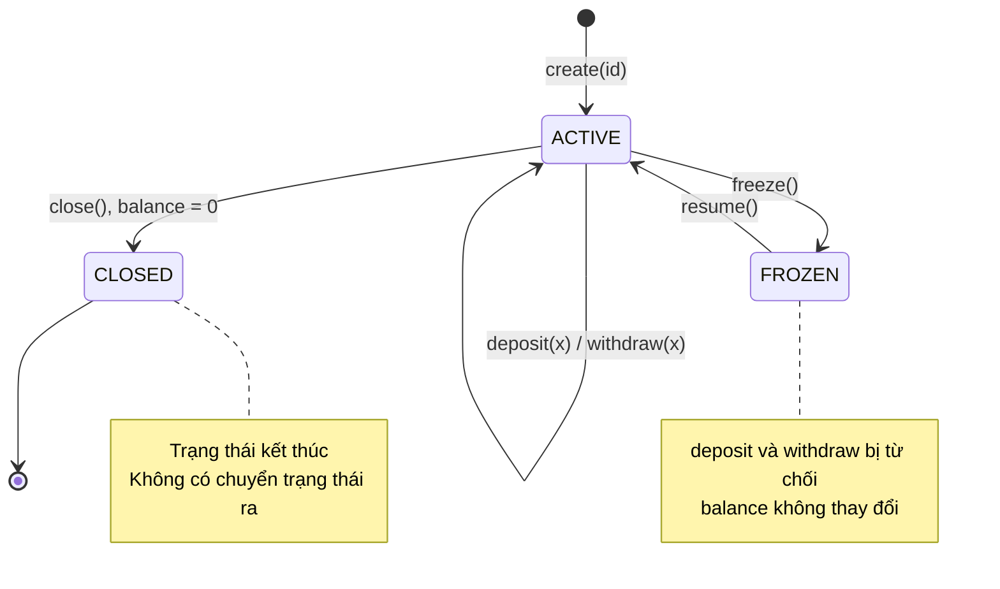
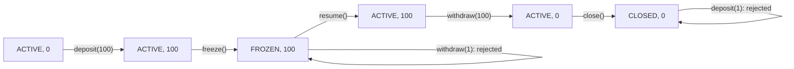
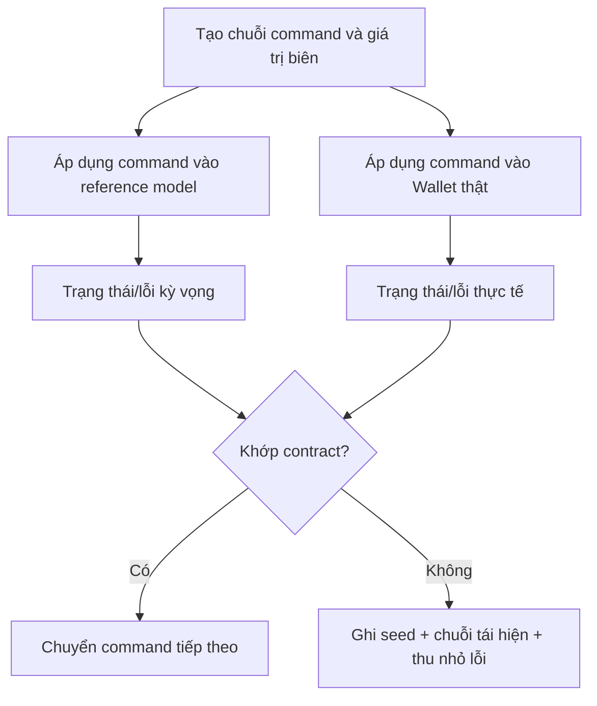

<a id="back-to-top"></a>

# Testing

## Menu
- [Testing Public Behavior and Object Contracts](#testing-001)
- [Testing Constructors and Invalid States](#testing-002)
- [Testing Invariants and State Transitions](#testing-003)
- [Testing Multiple Implementations of the Same Interface](#testing-004)
- [Testing Subtype Substitutability](#testing-005)
- [Fakes, Stubs, Mocks, and Collaborating Objects](#testing-006)
- [Designing for Dependency Substitution in Tests](#testing-007)
- [Avoiding Tests That Are Overly Coupled to Internals](#testing-008)
- [Regression Testing When Designs Change](#testing-009)
- [Testing Interactions Among Multiple Objects](#testing-010)

## <a id="testing-001">Testing Public Behavior and Object Contracts</a>

<details>
<summary>View details</summary>

# Testing Public Behavior and Object Contracts in Java OOP

> **Topic:** OOP → Testing → Testing public behavior and object contracts.  
> **Objective:** Write tests against what clients can actually observe and legitimately request, rather than coupling tests to fields/private methods; specify contracts through preconditions, postconditions, invariants, and error handling; reuse a single test suite across multiple implementations of an interface; detect regressions when a replacement implementation still compiles.

## 1. What Does It Mean to Test an Object?

An object is more than a collection of fields. It exposes a **behavioral interface**: callable operations, return values, side effects, state after each operation, and conditions under which an operation is rejected.

Suppose a seat inventory has 10 available seats. A client requests:

~~~text
Kho vé sức chứa 10
    ├─ tryReserve(4)  → true   → đã đặt 4, còn 6
    ├─ tryReserve(7)  → false  → vẫn đã đặt 4, còn 6
    └─ cancel(2)      → thành công → đã đặt 2, còn 8
~~~

This is **observable behavior**. A good test need not know whether the inventory uses `int reserved`, `AtomicInteger`, `HashMap`, or a database; it should verify **the results and rules promised by the API**.

An **object contract** describes API semantics, not merely Java signatures. For instance, `boolean tryReserve(int count)` does not establish:

- Is `count = 0` valid?
- Does insufficient capacity return `false` or throw an exception?
- Does a failed operation change state?
- After success, by exactly how many seats does the reservation count increase?
- Are concurrent reservations by multiple threads permitted?
- What must remain unchanged when a new implementation replaces an existing one?

Contract tests turn these guarantees into **executable examples** and help detect changes that break *substitutability*.

## 2. Public Behavior Versus Implementation Details

| Test Through Public Behavior | Avoid Depending On Without a Specific Reason |
|---|---|
| `tryReserve(4)` returns `true`, and the snapshot correctly reports 4 reserved seats | Whether the internal field is named `reserved` or `taken` |
| `tryReserve(7)` returns `false` without changing state | Whether private method `hasEnoughSeats()` was invoked |
| `cancel(2)` reduces reserved seats from 4 to 2 | Whether source code uses one or two private helpers |
| Invalid input is rejected using the promised exception | Which source-code line throws it |
| Two implementations meet the same contract suite | Whether the internal mechanism specifically uses `synchronized`, CAS, or a lock |
| External events/collaborators are invoked as contracted, if that is observable behavior | How often a private helper runs when the count has no effect on outcomes |

Refactoring `int reserved` into `AtomicInteger reserved` without **changing behavior** should not cause most unit tests to fail. If tests constantly break whenever the internal structure changes, they are **too tightly coupled to the implementation**.

**This does not mean every test must be strictly black-box.** Unit tests for a pure algorithm or an internal adapter can be appropriate; integration tests may verify DB/HTTP interactions. But tests of an **object contract** should use the API real clients use and assert only the guarantees that must remain stable.

## 3. Four Parts of a Testable Contract

A contract is often described through:

| Part | Question | Seat Inventory |
|---|---|---|
| **Precondition** | What must the caller satisfy? | Reservation/cancellation quantities must be positive |
| **Successful postcondition** | What must hold after a successful call? | Reserving 3 seats increases the reserved count by exactly 3 |
| **Failure postcondition** | How does the object remain valid after a rejection/error? | Insufficient capacity returns `false` without changing state |
| **Invariant** | What condition must always hold at an observable boundary? | `0 ≤ reserved ≤ capacity` |

Real programs may also require **nonfunctional guarantees** that must be stated as needed: thread safety, latency, data-write consistency, idempotency, callback ordering, or access-control constraints. No interface automatically promises all these properties.

### Example Contract Specification

Define an interface for managing seat reservations with these rules:

- The implementation constructor requires `capacity > 0`.
- Initially, the reserved seat count is `0`.
- `tryReserve(n)`: if `n <= 0`, throw `IllegalArgumentException`; if capacity permits, increase the reserved count by `n` and return `true`; otherwise, return `false` without changing state.
- `cancel(n)`: requires `n > 0` and `n <= reserved`; otherwise, throw `IllegalArgumentException` **without modifying state**; if valid, subtract `n`.
- `snapshot()` returns an immutable, consistent snapshot of `capacity` and `reserved` at the moment the method executes.
- Every implementation supports calls from multiple threads in the same JVM; each reservation/cancellation call must act as one atomic change to **a single instance**.

**Note:** This contract is chosen for the example, not prescribed for every ticket-reservation system. Another system might return a `Result` object instead of a boolean, or model excess cancellation as a different domain error. Tests must follow the real contract, not arbitrary preferences of the test author.

## 4. Complete Java 17 Example: One Interface, Two Implementations

To demonstrate the value of contract testing, we build two implementations with **different state-storage mechanisms** but **the same public API**:

- `MonitorSeatInventory` uses `synchronized`.
- `AtomicSeatInventory` uses `AtomicInteger` and a compare-and-set (CAS) loop.

Both must preserve the same business rules regardless of synchronization technique.

Create **`SeatInventoryDemo.java`** using only JDK 17+:

~~~java
import java.util.concurrent.atomic.AtomicInteger;

// Dữ liệu quan sát được, immutable nhờ record với thành phần primitive.
record SeatSnapshot(int capacity, int reserved) {
    SeatSnapshot {
        if (capacity <= 0 || reserved < 0 || reserved > capacity) {
            throw new IllegalArgumentException("Invalid seat snapshot");
        }
    }

    int available() {
        return capacity - reserved;
    }
}

// Hợp đồng mà client phụ thuộc: không tiết lộ cách lưu state.
interface SeatInventory {
    boolean tryReserve(int count);
    void cancel(int count);
    SeatSnapshot snapshot();
}

// Cách A: khóa bảo vệ toàn bộ check + update trên một instance.
final class MonitorSeatInventory implements SeatInventory {
    private final int capacity;
    private int reserved;

    MonitorSeatInventory(int capacity) {
        if (capacity <= 0) {
            throw new IllegalArgumentException("capacity must be positive");
        }
        this.capacity = capacity;
    }

    @Override
    public synchronized boolean tryReserve(int count) {
        requirePositive(count);

        if (count > capacity - reserved) {
            return false;
        }

        reserved += count;
        return true;
    }

    @Override
    public synchronized void cancel(int count) {
        requirePositive(count);

        if (count > reserved) {
            throw new IllegalArgumentException(
                    "Cannot cancel more than reserved");
        }

        reserved -= count;
    }

    @Override
    public synchronized SeatSnapshot snapshot() {
        return new SeatSnapshot(capacity, reserved);
    }

    private static void requirePositive(int count) {
        if (count <= 0) {
            throw new IllegalArgumentException("count must be positive");
        }
    }
}

// Cách B: CAS đảm bảo không làm mất cập nhật trên một biến.
final class AtomicSeatInventory implements SeatInventory {
    private final int capacity;
    private final AtomicInteger reserved = new AtomicInteger();

    AtomicSeatInventory(int capacity) {
        if (capacity <= 0) {
            throw new IllegalArgumentException("capacity must be positive");
        }
        this.capacity = capacity;
    }

    @Override
    public boolean tryReserve(int count) {
        requirePositive(count);

        while (true) {
            int current = reserved.get();

            // Trừ trước để không làm tràn số nguyên do cộng.
            if (count > capacity - current) {
                return false;
            }

            if (reserved.compareAndSet(current, current + count)) {
                return true;
            }
            // Có cập nhật cạnh tranh: đọc lại và thử.
        }
    }

    @Override
    public void cancel(int count) {
        requirePositive(count);

        while (true) {
            int current = reserved.get();

            if (count > current) {
                throw new IllegalArgumentException(
                        "Cannot cancel more than reserved");
            }

            if (reserved.compareAndSet(current, current - count)) {
                return;
            }
        }
    }

    @Override
    public SeatSnapshot snapshot() {
        // capacity không đổi; reserved.get là một phép đọc atomic.
        return new SeatSnapshot(capacity, reserved.get());
    }

    private static void requirePositive(int count) {
        if (count <= 0) {
            throw new IllegalArgumentException("count must be positive");
        }
    }
}

public class SeatInventoryDemo {
    public static void main(String[] args) {
        SeatInventory inventory = new MonitorSeatInventory(10);

        System.out.println("Start: " + inventory.snapshot());
        System.out.println("Reserve 4: " + inventory.tryReserve(4));
        System.out.println("Reserve 7: " + inventory.tryReserve(7));
        System.out.println("After refusal: " + inventory.snapshot());

        inventory.cancel(2);
        System.out.println("After cancel: " + inventory.snapshot());

        // Không sửa nghiệp vụ client khi đổi implementation:
        SeatInventory another = new AtomicSeatInventory(10);
        System.out.println("Atomic reserve 4: " + another.tryReserve(4));
        System.out.println("Atomic snapshot: " + another.snapshot());
    }
}
~~~

Run:

~~~bash
javac SeatInventoryDemo.java
java SeatInventoryDemo
~~~

Output:

~~~text
Start: SeatSnapshot[capacity=10, reserved=0]
Reserve 4: true
Reserve 7: false
After refusal: SeatSnapshot[capacity=10, reserved=4]
After cancel: SeatSnapshot[capacity=10, reserved=2]
Atomic reserve 4: true
Atomic snapshot: SeatSnapshot[capacity=10, reserved=4]
~~~

**The important question is not whether locking or CAS is better.** The example provides two technical approaches, while tests verify **one shared set of promised behaviors**.

### Class Diagram from the Client's Perspective

~~~mermaid
classDiagram
    class SeatInventory {
        <<interface>>
        +tryReserve(count) boolean
        +cancel(count) void
        +snapshot() SeatSnapshot
    }
    class MonitorSeatInventory {
        -int reserved
        +tryReserve(count) boolean
        +cancel(count) void
        +snapshot() SeatSnapshot
    }
    class AtomicSeatInventory {
        -AtomicInteger reserved
        +tryReserve(count) boolean
        +cancel(count) void
        +snapshot() SeatSnapshot
    }
    class SeatSnapshot {
        <<record>>
        +capacity() int
        +reserved() int
        +available() int
    }

    SeatInventory <|.. MonitorSeatInventory
    SeatInventory <|.. AtomicSeatInventory
    SeatInventory ..> SeatSnapshot : công bố
~~~

## 5. Write Tests from the Contract First, Then Apply Them to Both Classes

Writing completely separate test suites risks forgetting failure-path tests for one implementation. A useful approach is **one reusable suite of contract tests**: tests know only the `SeatInventory` interface, while test subclasses provide a way to create each implementation.

In JUnit Jupiter 5, subclasses can inherit `@Test` methods from a test superclass. We use this feature to run the same rules against both Monitor and Atomic.

Create **`SeatInventoryContractTest.java`** in the test source set, in the same package as `SeatInventoryDemo.java`:

~~~java
import static org.junit.jupiter.api.Assertions.*;

import org.junit.jupiter.api.Test;

// Abstract contract test: không biết field/lock/CAS của implementation.
abstract class SeatInventoryContractTest {
    protected abstract SeatInventory create(int capacity);

    @Test
    void startsEmptyAndExposesConsistentSnapshot() {
        SeatInventory inventory = create(10);

        SeatSnapshot initial = inventory.snapshot();

        assertEquals(10, initial.capacity());
        assertEquals(0, initial.reserved());
        assertEquals(10, initial.available());
    }

    @Test
    void acceptsReservationAndChangesObservableState() {
        SeatInventory inventory = create(10);

        assertTrue(inventory.tryReserve(4));

        SeatSnapshot snapshot = inventory.snapshot();
        assertEquals(4, snapshot.reserved());
        assertEquals(6, snapshot.available());
    }

    @Test
    void insufficientCapacityReturnsFalseWithoutMutation() {
        SeatInventory inventory = create(10);
        assertTrue(inventory.tryReserve(4));

        SeatSnapshot before = inventory.snapshot();
        assertFalse(inventory.tryReserve(7));
        SeatSnapshot after = inventory.snapshot();

        assertEquals(before, after); // So sánh record theo giá trị.
    }

    @Test
    void cancellationDecreasesReservation() {
        SeatInventory inventory = create(10);
        assertTrue(inventory.tryReserve(4));

        inventory.cancel(2);

        SeatSnapshot after = inventory.snapshot();
        assertEquals(2, after.reserved());
        assertEquals(8, after.available());
    }

    @Test
    void invalidArgumentsThrowAndDoNotChangeState() {
        SeatInventory inventory = create(10);
        assertTrue(inventory.tryReserve(3));

        SeatSnapshot before = inventory.snapshot();

        assertThrows(IllegalArgumentException.class,
                () -> inventory.tryReserve(0));
        assertThrows(IllegalArgumentException.class,
                () -> inventory.tryReserve(-1));
        assertThrows(IllegalArgumentException.class,
                () -> inventory.cancel(0));
        assertThrows(IllegalArgumentException.class,
                () -> inventory.cancel(4));

        assertEquals(before, inventory.snapshot());
    }

    @Test
    void exactCapacityAndReleaseAllAreAllowed() {
        SeatInventory inventory = create(2);

        assertTrue(inventory.tryReserve(2));
        assertFalse(inventory.tryReserve(1));
        assertEquals(0, inventory.snapshot().available());

        inventory.cancel(2);

        assertEquals(0, inventory.snapshot().reserved());
        assertEquals(2, inventory.snapshot().available());
    }

    @Test
    void invalidCapacityIsRejected() {
        assertThrows(IllegalArgumentException.class, () -> create(0));
        assertThrows(IllegalArgumentException.class, () -> create(-1));
    }
}

// Hai implementation được kiểm tra bằng CÙNG bộ @Test.
class MonitorSeatInventoryTest extends SeatInventoryContractTest {
    @Override
    protected SeatInventory create(int capacity) {
        return new MonitorSeatInventory(capacity);
    }
}

class AtomicSeatInventoryTest extends SeatInventoryContractTest {
    @Override
    protected SeatInventory create(int capacity) {
        return new AtomicSeatInventory(capacity);
    }
}
~~~

**Expected result:** JUnit runs the same inherited tests for both concrete test subclasses. Every implementation must satisfy the full contract. The abstract superclass specifies observable requirements only; it never checks whether `reserved` is an `int` or an `AtomicInteger`.

To run these tests, add JUnit Jupiter to the test dependencies and use a Maven/Gradle/IDE test runner. Both concrete test classes are **package-private**, which JUnit Jupiter 5 permits; depending on the build tool's discovery configuration, ensure the source is in the test source set and the `*Test` class names are detected.

### Why Is the “Failure Leaves State Unchanged” Test Important?

An incorrect implementation might do this:

~~~java
// CỐ Ý SAI: tăng reserved trước rồi mới kiểm tra.
reserved += count;
if (reserved > capacity) {
    return false;
}
~~~

A test asserting only `tryReserve(7) == false` **would pass**, even though `reserved` has been corrupted. Comparing **snapshots before and after** detects the contract violation. Similarly, canceling more seats than reserved must throw an exception **without leaving a partially changed state**.

## 6. Structure Tests Using Given–When–Then

A behavioral test is easier to read when it has three clear parts:

- **Given:** the initial state and data needed to construct the object.
- **When:** a public operation is invoked.
- **Then:** the result, exception, observable state, or side effect matches the contract.

Example:

~~~java
@Test
void rejectedReservationKeepsPreviousState() {
    // Given
    SeatInventory inventory = new MonitorSeatInventory(5);
    inventory.tryReserve(4);
    SeatSnapshot before = inventory.snapshot();

    // When
    boolean accepted = inventory.tryReserve(2);

    // Then
    assertFalse(accepted);
    assertEquals(before, inventory.snapshot());
}
~~~

The name `rejectedReservationKeepsPreviousState` describes **the rule** under test better than `testReserve` or `test1`. The “Then” section should use a legitimate observable API. Do not add setters merely to make tests convenient; that may weaken encapsulation.

## 7. Test State Sequences, Not Just Individual Methods

A stateful object often has **multiple valid paths**. Testing each method independently can miss bugs that appear only after a sequence of operations.

~~~mermaid
stateDiagram-v2
    [*] --> Empty : new(10)
    Empty --> Partial : reserve(4) = true
    Partial --> Partial : reserve(7) = false
    Partial --> Partial : cancel(2)
    Partial --> Full : reserve(8) = true
    Full --> Full : reserve(1) = false
    Full --> Empty : cancel(all)
~~~

The diagram uses a capacity of 10: after reserving 4 and canceling 2, 2 reservations remain; reserving 8 fills the capacity. This is **multi-step behavior**, not an isolated method.

### State Table Testing

| State Before | Command | Result | State After |
|---|---|---|---|
| capacity=10, reserved=0 | `tryReserve(4)` | `true` | reserved=4 |
| capacity=10, reserved=4 | `tryReserve(7)` | `false` | reserved=4 |
| capacity=10, reserved=4 | `cancel(2)` | Success | reserved=2 |
| capacity=10, reserved=2 | `tryReserve(8)` | `true` | reserved=10 |
| capacity=10, reserved=10 | `tryReserve(1)` | `false` | reserved=10 |
| capacity=10, reserved=10 | `cancel(10)` | Success | reserved=0 |

Boundary inputs `0`, `1`, `capacity`, `capacity + 1`, and negative values also deserve tests. For objects with many states and paths, a table avoids covering only the happy path while forgetting rejection rules.

### Testing Against a Simple Reference Model

For a stateful API, a test can maintain a simple **reference model** of expected values and exercise many operation sequences. The reference model should be simpler than the real implementation and should avoid reusing its optimized algorithm, so both do not reproduce the same bug.

The following is an additional test using the earlier classes and JUnit imports; add `import java.util.Random;`:

~~~java
@Test
void sequenceOfOperationsAlwaysMatchesSimpleModel() {
    SeatInventory inventory = create(20);
    Random random = new Random(2026L);
    int expectedReserved = 0;

    for (int step = 0; step < 500; step++) {
        int quantity = 1 + random.nextInt(7);

        if (random.nextBoolean()) {
            boolean shouldAccept = quantity <= 20 - expectedReserved;
            assertEquals(shouldAccept,
                    inventory.tryReserve(quantity));

            if (shouldAccept) {
                expectedReserved += quantity;
            }
        } else if (quantity <= expectedReserved) {
            inventory.cancel(quantity);
            expectedReserved -= quantity;
        } else {
            // Với precondition sai, exception không đổi trạng thái.
            assertThrows(IllegalArgumentException.class,
                    () -> inventory.cancel(quantity));
        }

        SeatSnapshot snapshot = inventory.snapshot();
        assertEquals(20, snapshot.capacity());
        assertEquals(expectedReserved, snapshot.reserved());
        assertEquals(20 - expectedReserved, snapshot.available());
    }
}
~~~

**Benefit:** a fixed seed yields a reproducible sequence that explores varied states without hand-writing 500 test cases. **Limit:** one seed and 500 steps are not formal proof of all sequences; combine them with boundary cases, additional seeds, or property-based testing when risks are higher.

**Note:** If methods have other side effects (DB writes, event publication), the reference model must describe those observable effects as well; comparing only in-memory state is insufficient.

## 8. Testing Implementation Substitutability (LSP)

The **Liskov Substitution Principle (LSP)** requires an implementation to be usable where its abstraction is expected **without violating client assumptions**. Contract testing provides useful empirical evidence: run the same tests against every implementation.

Suppose a new implementation decides to do this:

~~~java
// Vi phạm hợp đồng ví dụ:
boolean tryReserve(int count) {
    if (count <= 0) {
        return false; // Sai: contract yêu cầu IllegalArgumentException.
    }
    // ...
}
~~~

The compiler **does not complain** because method signatures still match. But the contract test `invalidArgumentsThrowAndDoNotChangeState` fails. Likewise, throwing `IllegalStateException` on insufficient capacity rather than returning `false` changes behavior for clients that rely on the boolean result.

An interface **does not guarantee LSP by itself**. The signature is only part of the contract; input/output semantics, exceptions, consistency, and side-effect guarantees also matter.

Practical principles include:

- An implementation should not unexpectedly **strengthen preconditions** if the abstraction permits more inputs.
- An implementation should not **weaken promised postconditions**.
- All invariants must remain true when clients access an object through its abstraction.
- For exceptions, distinguish caller programming errors, expected business failures, and infrastructure failures; do not change failure modes without updating the contract.

**Contract tests cannot mathematically prove complete LSP compliance.** They exercise selected scenarios. Design reviews must also examine the subtype relationship and untested guarantees, especially performance, concurrency, transaction behavior, and security.

## 9. Testing Value Object Contracts: `equals`, `hashCode`, and `toString`

In Java, methods inherited from `Object` also have contracts worth considering. Not every class overrides them, however. Two types of tests are distinct:

1. **Business contract:** `SeatInventory` maintains `0 ≤ reserved ≤ capacity`.
2. **Value contract:** a value object implements `equals`/`hashCode` correctly and provides an appropriate diagnostic representation.

In this example, `SeatSnapshot` is a `record` containing primitives. Java supplies `equals` and `hashCode` based on its components. We can test them through the public API:

~~~java
import static org.junit.jupiter.api.Assertions.*;

import java.util.HashSet;
import java.util.Set;
import org.junit.jupiter.api.Test;

class SeatSnapshotValueTest {
    @Test
    void equalSnapshotsAreEqualAndHaveEqualHashCodes() {
        SeatSnapshot a = new SeatSnapshot(10, 4);
        SeatSnapshot b = new SeatSnapshot(10, 4);
        SeatSnapshot different = new SeatSnapshot(10, 5);

        assertEquals(a, b);
        assertEquals(a.hashCode(), b.hashCode());
        assertNotEquals(a, different);

        Set<SeatSnapshot> set = new HashSet<>();
        set.add(a);
        assertTrue(set.contains(b));
    }

    @Test
    void rejectsBrokenInvariant() {
        assertThrows(IllegalArgumentException.class,
                () -> new SeatSnapshot(10, 11));
        assertThrows(IllegalArgumentException.class,
                () -> new SeatSnapshot(0, 0));
    }
}
~~~

This tests the **value** contract. For an entity with **identity**, two different objects containing the same display data may not be considered equal; define the intended `equals` semantics before writing tests.

### Common `equals` Rules

| Rule | Meaning | Simple Test |
|---|---|---|
| Reflexive | `x.equals(x) == true` | `assertEquals(x, x)` |
| Symmetric | `x.equals(y) == y.equals(x)` | Compare in both directions |
| Transitive | If `x==y` and `y==z`, then `x==z` according to `equals` | Create three equivalent instances |
| Consistent | With no changes to comparison-relevant data, the outcome remains unchanged | Repeat the call on stable state |
| Not equal to null | `x.equals(null) == false` | `assertNotEquals(null, x)` |
| Compatible hash codes | If `x.equals(y)`, then `x.hashCode()==y.hashCode()` | Compare hashes and use a `HashSet` |

Do not infer the reverse: **equal hash codes do not imply equal objects**. Different objects may legitimately have the same hash.

`toString()` is generally for observation/debugging, not a stable API format unless the class explicitly promises one. Avoid tests that match every punctuation mark in `toString()` when its format is not part of the contract. For sensitive data, test what **must not be disclosed**, and consider other logging paths as well.

## 10. Do Not Expose Private Fields or Add Setters Just to Make Testing Easier

An example of a harmful test:

~~~java
// Ý tưởng KHÔNG NÊN làm mặc định:
Field field = MonitorSeatInventory.class
        .getDeclaredField("reserved");
field.setAccessible(true);
field.setInt(inventory, 4);
~~~

If a test knows a field's name and uses reflection to change it, the test bypasses the boundary that the class is supposed to protect. Renaming the field or switching to `AtomicInteger` then breaks the test even when clients are unaffected.

Similarly, adding `setReserved(int)` merely to construct test states quickly can weaken the production API by allowing clients to bypass reservation rules. Instead, create valid states through **public operations**:

~~~java
SeatInventory inventory = new MonitorSeatInventory(10);
assertTrue(inventory.tryReserve(4));
// Bây giờ có trạng thái reserved = 4, hợp lệ và tạo qua API thật.
~~~

If setup becomes excessive because every test must traverse several external systems, consider **test fixtures/builders** for constructing suitable dependencies or data. Fixtures should not create impossible states that legitimate operations cannot reach, unless explicitly testing recovery from corrupted legacy data.

### Avoid Over-Specifying Internal Call Counts

Mocks are valuable when interaction with a dependency **is part of the contract**, such as publishing exactly one event after a successful payment. But a test checking only `verify(calculator).calculate(...)` without asserting a result or observable consequence may pass even when the business outcome is wrong.

Distinguish among:

- **State-based test:** verifies publicly exposed state or results.
- **Interaction-based test:** verifies meaningful externally observable interactions with collaborators, such as sending exactly one notification.
- **Implementation-coupled test:** checks the order of private helpers or call counts of a pure algorithm that callers cannot observe.

Interaction tests are not inherently inferior. What matters is whether an interaction **is required by the contract or merely reflects the current implementation**.

## 11. Testing Errors and Exceptions: Failure Is Also Behavior

A well-defined public contract explains how invalid inputs are handled:

| Scenario | Example Behavior | What the Test Must Verify |
|---|---|---|
| Construct inventory with `capacity = 0` | Throws `IllegalArgumentException` | No falsely valid object is created |
| Reserve `0` or a negative number | Throws `IllegalArgumentException` | State remains unchanged |
| Request more seats than available | Returns `false` | State remains unchanged |
| Cancel more than the reserved count | Throws `IllegalArgumentException` | State remains unchanged |
| Cancel exactly the reserved count | Succeeds | State returns to reserved=0 |
| Replace the Monitor implementation with Atomic | Preserve all public semantics | The contract test suite still passes |

Use `assertThrows` to check the promised exception type. If the exception message is not a stable API guarantee, avoid hardcoding its exact text in tests. If an error code is part of an external contract, assert the structured code rather than the wording of a message.

### Atomicity of Failure Paths

In the example, invalid quantities cause an exception **before** state is updated. In more complex operations, if a database write succeeds and an email later fails, throwing an exception does not mean that every side effect has been rolled back. Tests must specify post-failure state according to actual consistency mechanisms: transactions, outbox, retries, or compensation.

## 12. Contract Tests and Concurrency Testing

If an abstraction promises that two threads may call `tryReserve(1)` on the same instance, atomicity is **part of the contract**, not merely an implementation detail.

A JUnit Jupiter 5 example tests **any implementation** through the interface. This can be placed in `SeatInventoryContractTest` with the necessary imports:

~~~java
import java.util.ArrayList;
import java.util.List;
import java.util.concurrent.CountDownLatch;
import java.util.concurrent.ExecutorService;
import java.util.concurrent.Executors;
import java.util.concurrent.Future;
import java.util.concurrent.TimeUnit;

@Test
void concurrentReservationsNeverOversellOneInstance()
        throws Exception {
    SeatInventory inventory = create(5);
    int attempts = 12;

    CountDownLatch ready = new CountDownLatch(attempts);
    CountDownLatch start = new CountDownLatch(1);
    ExecutorService pool = Executors.newFixedThreadPool(attempts);

    try {
        List<Future<Boolean>> results = new ArrayList<>();

        for (int i = 0; i < attempts; i++) {
            results.add(pool.submit(() -> {
                ready.countDown();
                start.await();
                return inventory.tryReserve(1);
            }));
        }

        assertTrue(ready.await(5, TimeUnit.SECONDS));
        start.countDown();

        int accepted = 0;
        for (Future<Boolean> future : results) {
            if (future.get(5, TimeUnit.SECONDS)) {
                accepted++;
            }
        }

        assertEquals(5, accepted);
        assertEquals(5, inventory.snapshot().reserved());
        assertEquals(0, inventory.snapshot().available());
    } finally {
        start.countDown(); // Không để task chờ vô hạn nếu assert fail.
        pool.shutdownNow();
    }
}
~~~

This verifies **the final result** after every call completes while two threads/groups of threads contend for seats. `CountDownLatch` helps them start at roughly the same time but **does not mathematically prove correctness for all possible thread schedules**. High-risk concurrency requires stress tests, memory-model review, specialized concurrency testing tools, and/or formal modeling.

Avoid `Thread.sleep` with arbitrary time delays to decide whether tests pass or fail. Do not check `reserved + available == capacity` using **two different snapshot calls at different moments** while threads are still updating; obtain **one consistent snapshot** and calculate using its fields.

### One-JVM Limitation

A thread-safety contract for one Java object does not automatically prevent overselling seats when two JVMs update **the same database record**. In a multi-node deployment, a service-level contract needs verification through transactions, conditional updates, or optimistic locking in persistence. Unit tests of `AtomicSeatInventory` cannot replace DB integration tests.

## 13. Test Layers: One Contract, Different Forms of Evidence

| Layer | Objective | Example |
|---|---|---|
| **Object unit test** | Public behavioral contract of one object | `tryReserve`, `cancel`, `snapshot` |
| **Interface contract test** | All implementations preserve shared semantics | Monitor and Atomic run the same suite |
| **Component/integration test** | Interaction among classes or real systems | Seat inventory persisted through repository/JDBC |
| **API test** | HTTP/JSON/status-code contract | Sold-out inventory returns an appropriate business error code |
| **Concurrency test** | Consistency under interleaved operations | Concurrent requests cannot reserve the same seat twice |
| **End-to-end test** | User workflow across components | Select a seat → reserve it → confirm the displayed result |

A fast unit test may establish correct in-memory `SeatInventory` logic, but it cannot establish correctness of DB locks, rollback, API serialization, or end-user experience. Choose **a test level appropriate to the contract boundary**.

## 14. Test Design Mistakes That Reduce Test Value

### Mistake A: Testing an Implementation Instead of Its Contract

~~~java
// Đáng ngờ:
assertEquals("java.util.concurrent.atomic.AtomicInteger",
        inventory.getClass()
                .getDeclaredFields()[0]
                .getType()
                .getName());
~~~

This test says nothing about whether the inventory behaves correctly; it merely locks in an implementation choice. Switching from atomic state to locks may be a valid refactor, but the test would fail unnecessarily.

### Mistake B: Asserting Only the Return Value and Ignoring State

~~~java
assertFalse(inventory.tryReserve(100));
~~~

If an implementation still increments `reserved` before returning `false`, this test misses the bug. Capture snapshots before and after and verify the invariant.

### Mistake C: Testing Failure by Corrupting Private State

If a test uses reflection to set `reserved = -5` and then expects `tryReserve` to repair it, the test imposes a state **not reachable through the valid API**. Unless the real requirement is recovery from corrupted legacy data, test instead that all **public mutation paths** never create such a state.

### Mistake D: Tests Depend on Execution Order or Shared State

Having every test mutate a `static SeatInventory shared` causes results to vary when JUnit runs tests in parallel or changes their order. Give each test an **independent fixture** with a fresh instance. Shared databases require an explicit isolation/cleanup strategy.

### Mistake E: Mocking the Very Object Under Test

If you mock all of `SeatInventory` and configure `when(tryReserve(4)).thenReturn(true)`, you test only behavior **programmed into the mock**, not the real implementation. Use mocks/fakes for collaborators outside the test scope; do not replace the system under test when verifying its contract.

### Mistake F: Overcoupling Tests to Logger Implementations, Time, or Randomness

If the contract does not require an exact log message, verify observable outcomes rather than matching log text verbatim. When the clock or randomness is a genuine business input, inject a `Clock` or controlled random generator/fake so the test is not flaky.

## 15. Writing Contract Tests for Real Adapters

The shared testing pattern applies beyond two in-memory state mechanisms. For example, `DocumentStore` may have file-based and database implementations:

~~~java
interface DocumentStore {
    void save(String id, byte[] bytes);
    java.util.Optional<byte[]> find(String id);
}
~~~

A contract might require:

- Reject null or empty IDs.
- Saving data and reading it back returns identical **byte content**.
- A missing ID returns `Optional.empty()`.
- Modifying the `byte[]` argument after `save` must not silently modify stored data.
- Modifying the `byte[]` returned by `find` must not silently change stored data when the API promises snapshots.
- Duplicate IDs must follow an explicit **overwrite** or **reject** policy, consistently implemented by both implementations.

Because `byte[]` arrays are mutable, **defensive copies** are necessary at input and output boundaries if promised by the API. An `InMemoryDocumentStore` that retains the original byte array's reference can violate the contract despite having the correct method signature.

This shows why **contract tests provide more value than counting methods**: they preserve behavior the Java type system cannot directly express, such as **ownership of a mutable buffer** and duplicate-save failure semantics.

## 16. Checklist for Designing Public Behavior Tests

Before writing tests, answer:

1. **What does the object promise?** Specify preconditions, postconditions, invariants, and failure modes.
2. **Which API is the public contract?** Do not expose private fields merely because setup is difficult.
3. **What is the initial state?** Every test should construct a consistent, independent fixture.
4. **Which observable results should be compared?** Return values, snapshots, exceptions, events, or persisted data.
5. **Are there rejection paths?** What should happen to state and side effects on failure?
6. **What are the boundary cases?** Zero, negative, maximum, empty, null, duplicates, overflow, and state transitions.
7. **Are multiple implementations present?** Use the same contract suite to verify substitutability.
8. **Are time/concurrency/I/O involved?** Use a clock, fakes, fixtures, integration tests, and properly scoped synchronization.
9. **Will tests become brittle after internal refactoring?** Remove assertions outside the contract and retain those clients need.
10. **Has the contract change been approved?** When business rules evolve, intentionally update the specification and tests; do not change tests merely to make them green.

A useful technique is naming tests as sentences of the form **“When X, the system must Y”** so even a reviewer unfamiliar with the implementation understands them. A name like `testPrivateHelperA` likely misses the behavior clients care about.

## 17. Practical Exercise: Digital Wallet Contract

Design an interface:

~~~java
interface Wallet {
    long balanceCents();
    void deposit(long amountCents);
    boolean tryWithdraw(long amountCents);
}
~~~

Assumed rules:

- A wallet starts with a nonnegative balance.
- `deposit(n)` requires `n > 0`; on success it increases the balance by exactly `n`.
- `tryWithdraw(n)` requires `n > 0`; with sufficient funds, it subtracts exactly `n` and returns `true`; otherwise it returns `false` without changing the balance.
- The balance never becomes negative; handle deposit overflow (`Math.addExact` or pre-checks).
- Operations on **one instance** support multiple threads; two withdrawals cannot both succeed using the same stale balance.
- Tests should use integers representing **the smallest monetary unit** to avoid binary floating-point errors in this example.

Requirements:

1. Implement `SynchronizedWallet` and `AtomicWallet`.
2. Write one abstract contract test that runs the same `@Test` methods for both implementations.
3. Test `deposit(0)`, negative withdrawals, withdrawals exceeding the balance, overflowing a `long` deposit, and unchanged state after errors.
4. Test the sequence `deposit(100) → withdraw(30) → withdraw(80 bị từ chối)`.
5. Test two threads each withdrawing 80 from a wallet with 100; **only one succeeds**.
6. Explain why these unit tests do not establish correctness of real-money transactions in a database or payment service.

### Self-Check Questions

1. How does “testing public behavior” differ from inspecting private fields?
2. Why does matching a method signature not guarantee that two implementations are interchangeable?
3. How do preconditions, postconditions, and invariants differ?
4. Why is asserting only `tryReserve(7) == false` insufficient?
5. Why run the same contract suite for every implementation of an interface?
6. When should you test `equals/hashCode`, and why do equal `hashCode` values not imply equal objects?
7. Should reflection be used to change private state merely to shorten test setup?
8. Why do exact log-message assertions make tests brittle when logs are not contractual?
9. Is a one-JVM concurrency test enough to prove that tickets cannot be oversold across multiple nodes?
10. What observable effects matter when a method both updates a DB and publishes an event?

**Remember:** Good OOP tests answer **“Does the object fulfill its promises to clients?”** Specify contracts in observable terms, test success and failure, use state snapshots and operation sequences, and apply one suite to substitutable implementations. Decoupling tests from internals makes refactoring easier **without lowering the correctness bar for behavior**.


</details>

- [Back to top](#back-to-top)

---

## <a id="testing-002">Testing Constructors and Invalid States</a>

<details>
<summary>View details</summary>

# Testing Constructors and Invalid States in OOP

**Topic:** OOP → Testing → **Testing constructors and invalid states**  
**Example environment:** Java 17+, JUnit Jupiter 5 (and `junit-jupiter-params` for parameterized tests).

## 1. Why Test a Constructor That “Only Assigns Fields”?

Consider a class representing an invoice. For an invoice to be meaningful, it must guarantee:

- A **nonblank customer ID**.
- **At least one line item**.
- Every line item has a valid product ID, nonnegative unit price, and positive quantity.
- **Merchandise subtotal** is calculated without overflowing `long`.
- **Discount** is nonnegative and does not exceed the merchandise subtotal.
- After creation, the caller cannot mutate the original list and thereby change the constructed invoice.

If a constructor accepts everything without validation, it can create an object with `discountVnd > subtotalVnd`, no line items, or even a negative payable amount. The error may not surface when `new` runs, but later during database persistence, tax calculation, or refunds.

**A constructor is a boundary that protects an object's invariants.** When a constructor returns normally, callers may trust that the resulting object satisfies its published guarantees. Invalid data should cause the constructor to **reject object creation** through a clear error mechanism.

Not every constructor needs elaborate logic: a simple value object with two fields may require very little validation. But once a class declares invariants, **testing its constructor verifies that the contract holds from the moment the object exists**.

### Three Core Questions

1. **Valid case:** Are fields correct after creation? Are defaults and normalization applied correctly?
2. **Invalid case:** Which inputs must be rejected? What exception type applies? Can an incorrect observable state escape?
3. **After initialization:** Does the object remain valid if mutable input or a shared reference changes?

A test asserting that `new Invoice(...)` merely “does not throw” is insufficient when construction also calculates totals, normalizes values, or snapshots inputs.

## 2. Distinguishing Preconditions, Postconditions, and Invariants

| Concept | Question to Ask | Example |
| --- | --- | --- |
| **Precondition** | Is the input valid when invoking the constructor? | `quantity > 0`; `customerId` is not blank |
| **Postcondition** | After successful construction, is the object initialized correctly? | `total = subtotal - discount` |
| **Invariant** | What must always hold whenever the object is observable? | `0 <= discount <= subtotal`, `total >= 0` |
| **Ownership/aliasing** | Does the object own its data or share mutable references? | Mutating the caller's `ArrayList` does not change the invoice |
| **Failure contract** | How does construction respond to violations? | `IllegalArgumentException` for invalid values, `NullPointerException` for required null references (if the contract chooses this) |
| **Failure atomicity** | Can side effects remain when construction fails? | Do not send email or write external data merely because `new` was attempted |

Compare these three cases:

~~~text
Input hợp lệ:
  Invoice("CUS-01", [2 sách × 125000], discount=20000)
  → subtotal=250000, total=230000

Input không hợp lệ:
  Invoice("CUS-01", [2 sách × 125000], discount=300000)
  → ném IllegalArgumentException; không trả Invoice

Trạng thái bị phá sau tạo nếu thiết kế sai:
  Invoice giữ trực tiếp List mutable của caller
  → caller.clear() → hóa đơn trở thành rỗng
~~~

**“No object is returned” does not mean Java automatically rolls back every side effect** performed inside a constructor. If construction registers `this` with a listener, publishes an event, or writes to a DB before validation finishes, those effects may persist. Avoid such designs, and test side-effect boundaries when genuinely necessary.

## 3. Build a Test Matrix Before Writing Tests

A good matrix specifies **valid cases, boundaries, rejected inputs, and post-call outcomes**:

| Group | Input | Expected Outcome |
| --- | --- | --- |
| Normal | Valid ID and one or more valid items | Construction succeeds, preserving correct data |
| Normalization | ID `"  CUS-01  "` | `customerId()` returns `"CUS-01"` |
| Invalid ID | `null`, `""`, or whitespace only | `IllegalArgumentException` |
| Invalid list | `null` or empty list | Rejected by contract (e.g., `NullPointerException`, `IllegalArgumentException`) |
| Invalid element | List contains `null` | Rejected; no invoice created |
| Invalid line item | 0/negative quantity, negative price, blank SKU | Rejected by `LineItem` |
| Lower discount boundary | `discount = 0` | Valid |
| Upper discount boundary | `discount = subtotal` | Valid; final total = 0 |
| Discount beyond boundary | `discount = subtotal + 1` | `IllegalArgumentException` |
| Arithmetic overflow | `unitPrice × quantity` exceeds `long` | `ArithmeticException` |
| Aliasing | Modify source list after construction | Invoice does not change |
| Accessor protection | Call `invoice.lines().clear()` | `UnsupportedOperationException` |
| State after failure | Construction fails or an operation is rejected | No invalid object is returned; existing state still obeys the contract |

**Select exception types according to the contract**; all invalid inputs need not produce the same exception. For example, `Objects.requireNonNull(...)` throws `NullPointerException`, while negative quantity is typically reported with `IllegalArgumentException`.

## 4. Complete Java 17 Example: Constructor-Enforced Invariants

Create **ConstructorInvariantDemo.java**. This example uses a `record` for an immutable line item, an `Invoice` class whose constructor validates cross-field constraints, `Math.addExact/multiplyExact` to prevent silent overflow, and `List.copyOf` to separate the invoice from the caller's mutable list.

~~~java
import java.util.List;
import java.util.Objects;

public class ConstructorInvariantDemo {

    // Value object: không có setter; mỗi dòng được validate riêng.
    public record LineItem(
            String sku,
            long unitPriceVnd,
            int quantity) {

        public LineItem {
            sku = requiredText(sku, "sku");

            if (unitPriceVnd < 0) {
                throw new IllegalArgumentException(
                        "unitPriceVnd không được âm");
            }
            if (quantity <= 0) {
                throw new IllegalArgumentException(
                        "quantity phải dương");
            }
        }

        public long lineTotalVnd() {
            return Math.multiplyExact(unitPriceVnd, quantity);
        }
    }

    public static final class Invoice {
        private final String customerId;
        private final List<LineItem> lines;
        private final long subtotalVnd;
        private final long discountVnd;
        private final long totalVnd;

        public Invoice(
                String customerId,
                List<LineItem> lines,
                long discountVnd) {

            // Xác thực và tính toán trên biến cục bộ trước khi gán field.
            String normalizedId = requiredText(
                    customerId, "customerId");

            Objects.requireNonNull(lines, "lines");
            if (lines.isEmpty()) {
                throw new IllegalArgumentException(
                        "Hóa đơn cần ít nhất một dòng hàng");
            }

            // Tránh giữ tham chiếu tới ArrayList mutable của caller.
            // List.copyOf cũng từ chối phần tử null.
            List<LineItem> snapshot = List.copyOf(lines);

            long subtotal = 0;
            for (LineItem line : snapshot) {
                subtotal = Math.addExact(
                        subtotal, line.lineTotalVnd());
            }

            if (discountVnd < 0 || discountVnd > subtotal) {
                throw new IllegalArgumentException(
                        "Giảm giá phải nằm trong [0, subtotal]");
            }

            long total = Math.subtractExact(subtotal, discountVnd);

            // Chỉ thiết lập state sau khi toàn bộ điều kiện đã qua.
            this.customerId = normalizedId;
            this.lines = snapshot;
            this.subtotalVnd = subtotal;
            this.discountVnd = discountVnd;
            this.totalVnd = total;
        }

        public String customerId() {
            return customerId;
        }

        public List<LineItem> lines() {
            return lines;
        }

        public long subtotalVnd() {
            return subtotalVnd;
        }

        public long discountVnd() {
            return discountVnd;
        }

        public long totalVnd() {
            return totalVnd;
        }
    }

    private static String requiredText(String value, String field) {
        if (value == null || value.isBlank()) {
            throw new IllegalArgumentException(
                    field + " không được null/rỗng");
        }
        return value.trim();
    }

    public static void main(String[] args) {
        var invoice = new Invoice(
                "  CUS-01  ",
                List.of(
                        new LineItem("BOOK-1", 125_000L, 2),
                        new LineItem("PEN-1", 35_000L, 1)
                ),
                20_000L
        );

        System.out.println(invoice.customerId());
        System.out.println(invoice.subtotalVnd());
        System.out.println(invoice.totalVnd());
        System.out.println(invoice.lines().size());
    }
}
~~~

Run:

~~~bash
javac ConstructorInvariantDemo.java
java ConstructorInvariantDemo
~~~

Output:

~~~text
CUS-01
285000
265000
2
~~~

### Why Validate Before Assigning Fields?

In `Invoice`, the customer ID is normalized, the list validated and copied, and the subtotal calculated before assigning the `final` fields. If an item is missing or a discount exceeds the subtotal, no `Invoice` is returned to the client.

Java does not require the constructor to assign `final` fields in the exact sequence shown, but **calculating and validating with local variables before publishing the object** makes invariants easier to inspect and reduces the risk of leaking `this` during initialization. Avoid calling overridable virtual methods, registering listeners, or passing `this` to another thread from a constructor.

For mutable data structures, `List.copyOf` creates a list that cannot be modified through the returned reference and is detached from the caller's original mutable `ArrayList`. This is a **shallow copy of the elements**: if a `LineItem` contains a mutable object, a caller holding another reference to that element may still modify it. Here, `LineItem` uses `String`, `long`, and `int`, so the example has no mutable-element problem.

### Why Not Use Setters to Complete Construction?

The following approach allows invalid intermediate states:

~~~java
// Chỉ minh họa anti-pattern: không có validation tại ranh giới tạo.
Invoice invoice = new Invoice();
invoice.setCustomerId("CUS-01");
invoice.setDiscountVnd(500_000L);
// Ở đây chưa chắc tồn tại dòng hàng nào!
~~~

The complete example's `Invoice` **has no no-argument constructor or setters**; clients receive an object only after providing all required valid data. UI form objects and framework-managed entities may have different lifecycles, but their **incomplete** states should then be distinguished from **valid domain** states, not treated as equivalent.

## 5. JUnit 5: Testing Valid Paths and Boundary Values

Create **ConstructorInvariantDemoTest.java** (in the same package as the class above). The tests use JUnit Jupiter and the `junit-jupiter-params` module.

~~~java
import static org.junit.jupiter.api.Assertions.*;

import java.util.ArrayList;
import java.util.List;

import org.junit.jupiter.api.Test;
import org.junit.jupiter.params.ParameterizedTest;
import org.junit.jupiter.params.provider.NullAndEmptySource;
import org.junit.jupiter.params.provider.ValueSource;

class ConstructorInvariantDemoTest {

    private static ConstructorInvariantDemo.LineItem item(
            long price, int quantity) {
        return new ConstructorInvariantDemo.LineItem(
                "BOOK-1", price, quantity);
    }

    private static ConstructorInvariantDemo.Invoice invoice(
            String customerId, List<ConstructorInvariantDemo.LineItem> lines,
            long discount) {
        return new ConstructorInvariantDemo.Invoice(
                customerId, lines, discount);
    }

    @Test
    void validInvoiceComputesTotalsAndNormalizesId() {
        var result = invoice(
                "  CUS-01 ",
                List.of(item(125_000L, 2), item(35_000L, 1)),
                20_000L);

        assertAll(
                () -> assertEquals("CUS-01", result.customerId()),
                () -> assertEquals(285_000L, result.subtotalVnd()),
                () -> assertEquals(20_000L, result.discountVnd()),
                () -> assertEquals(265_000L, result.totalVnd()),
                () -> assertEquals(2, result.lines().size())
        );
    }

    @ParameterizedTest
    @NullAndEmptySource
    @ValueSource(strings = {" ", "   ", "\t"})
    void invalidCustomerIdIsRejected(String invalidId) {
        assertThrows(IllegalArgumentException.class, () ->
                invoice(invalidId, List.of(item(100L, 1)), 0L));
    }

    @Test
    void emptyAndNullLinesAreRejected() {
        assertThrows(IllegalArgumentException.class, () ->
                invoice("CUS", List.of(), 0L));

        assertThrows(NullPointerException.class, () ->
                invoice("CUS", null, 0L));
    }

    @Test
    void nullElementIsRejected() {
        var source =
                new ArrayList<ConstructorInvariantDemo.LineItem>();
        source.add(item(10L, 1));
        source.add(null);

        assertThrows(NullPointerException.class, () ->
                invoice("CUS", source, 0L));
    }

    @Test
    void discountBoundariesAreClear() {
        var goods = List.of(item(100L, 2)); // subtotal = 200

        assertEquals(200L,
                invoice("CUS", goods, 0L).totalVnd());
        assertEquals(0L,
                invoice("CUS", goods, 200L).totalVnd());

        assertThrows(IllegalArgumentException.class, () ->
                invoice("CUS", goods, -1L));
        assertThrows(IllegalArgumentException.class, () ->
                invoice("CUS", goods, 201L));
    }

    @Test
    void invalidLineItemIsRejectedAtConstruction() {
        assertThrows(IllegalArgumentException.class, () ->
                item(-1L, 1));
        assertThrows(IllegalArgumentException.class, () ->
                item(100L, 0));
        assertThrows(IllegalArgumentException.class, () ->
                new ConstructorInvariantDemo.LineItem(
                        "  ", 100L, 1));
    }

    @Test
    void overflowIsRejectedInsteadOfWrapping() {
        assertThrows(ArithmeticException.class, () ->
                invoice("CUS", List.of(
                        item(Long.MAX_VALUE, 2)), 0L));

        assertThrows(ArithmeticException.class, () ->
                invoice("CUS", List.of(
                        item(Long.MAX_VALUE, 1),
                        item(1L, 1)), 0L));
    }

    @Test
    void sourceListMutationCannotChangeInvoice() {
        var source =
                new ArrayList<ConstructorInvariantDemo.LineItem>();
        source.add(item(100L, 1));
        var result = invoice("CUS", source, 0L);

        source.clear();
        assertEquals(1, result.lines().size());
        assertEquals(100L, result.totalVnd());

        assertThrows(UnsupportedOperationException.class, () ->
                result.lines().add(item(1L, 1)));
    }
}
~~~

Tests are named after **behavior**, not internal field names. For example, `discountBoundariesAreClear` immediately communicates the rule “0 and subtotal are valid; values outside this range are rejected,” unlike a generic name such as `testConstructor3`.

### Why Each Test Type Matters

- **Happy path:** verify outputs and normalization, not merely “does not throw.”
- **Null/empty/blank:** distinguish null references, empty strings, and whitespace-only strings.
- **Boundary:** test the exact edges `0`, `subtotal`, `-1`, and `subtotal + 1`; mistakes involving `<`/`<=` are easy to make.
- **Nested invalid input:** an `Invoice` is valid only when its `LineItem` instances are valid. Validation at each level forms a chain of contracts.
- **Overflow:** `Math.multiplyExact` or `Math.addExact` explicitly handles a guarantee that ordinary `long` arithmetic does not provide.
- **Aliasing:** prove the object does not change when callers modify the source list.
- **Accessor:** prove the returned reference cannot let callers break invariants by manipulating the list.

**Note:** The example's unit tests require only JUnit Jupiter. JUnit is not included in the JDK by default, so add it as a test dependency. Demo and test files may share a package; if they use different packages, visibility/imports must be adjusted.

## 6. Testing Invalid States *After* Successful Construction

Constructors are not the only concern: an initially valid object can later be corrupted through a method. For mutable objects, update operations must also preserve invariants.

For example, a wallet/limit-management class may be created with a valid balance, but an operation that deducts more than the available amount must be rejected **without changing the balance**:

~~~java
public final class Wallet {
    private long balanceVnd;

    public Wallet(long initialBalanceVnd) {
        if (initialBalanceVnd < 0) {
            throw new IllegalArgumentException(
                    "Số dư ban đầu không được âm");
        }
        this.balanceVnd = initialBalanceVnd;
    }

    public long balanceVnd() {
        return balanceVnd;
    }

    public void debit(long amountVnd) {
        if (amountVnd <= 0) {
            throw new IllegalArgumentException(
                    "Số tiền phải dương");
        }
        if (amountVnd > balanceVnd) {
            throw new IllegalStateException(
                    "Không đủ số dư");
        }

        balanceVnd = Math.subtractExact(balanceVnd, amountVnd);
    }
}
~~~

This is a separate class, saved as **Wallet.java** if run independently. To illustrate testing:

~~~java
@Test
void failedDebitMustPreserveValidState() {
    Wallet wallet = new Wallet(100L);

    assertThrows(IllegalStateException.class, () ->
            wallet.debit(101L));

    assertEquals(100L, wallet.balanceVnd());
}

@Test
void constructorRejectsNegativeInitialBalance() {
    assertThrows(IllegalArgumentException.class, () ->
            new Wallet(-1L));
}
~~~

The two tests above are methods in a JUnit test class with `import static org.junit.jupiter.api.Assertions.*;` and `import org.junit.jupiter.api.Test;`.

**Meaning:** Instead of forcing a valid `Wallet` into a negative state through reflection and then testing a different method, test **the public usage path capable of producing the error**. If invariants are protected correctly, no public API can create a negative balance.

The Wallet example is not thread-safe; concurrent operations may race on `balanceVnd`. Real-money systems also need appropriate transactions, idempotency, and authorization. A passing constructor test does not establish that the object's entire lifecycle is safe under concurrency.

## 7. Do Not Test by Arbitrarily Breaking Invariants

Sometimes we want to “create an invalid object and pass it to a service” to see how the service responds. But if the constructor rejects invalid objects, that is **correct design**.

An example to avoid in ordinary business unit tests:

~~~java
// Không nên dùng reflection chỉ để vượt constructor:
// Field f = Invoice.class.getDeclaredField("discountVnd");
// f.setAccessible(true);
// f.setLong(invoice, -99L);
~~~

That approach ties the test to private structure and violates the invariant that the class promises to protect. Renaming the field during refactoring can break the test even though public behavior is unchanged.

**Instead, introduce failures at the right boundary:**

- If a user submits invalid JSON, test **request validation/deserialization**.
- If the database contains invalid legacy data, test **persistence mapping/migration** or a state-recovery adapter.
- If a service depends on a collaborator that may fail, use a fake or mock that returns errors according to the dependency contract.
- If testing recovery from old snapshots, use **a controlled internal test fixture API** rather than exposing public setters on domain objects.

The key is **testing where an error can actually arise**, instead of manufacturing a state the API forbids.

## 8. Multistep Constructors: Ensure Failures Leave No Side Effects

A dangerous constructor may perform work beyond initializing state:

~~~java
// Anti-pattern minh họa: side effect trước khi validate xong.
class BadRegistration {
    BadRegistration(EventBus bus, String email) {
        bus.publish("RegistrationStarted");
        if (email == null || email.isBlank()) {
            throw new IllegalArgumentException("Email sai");
        }
    }
}
~~~

With an invalid email, the caller never receives a valid `BadRegistration`, **but the event may already have been published**. A listener may have persisted data, sent email, or created an incorrect business log.

A clearer design:

1. Constructors/factories create **valid** value objects with minimal side effects.
2. An application service coordinates transactions, persistence, and events/outbox according to the requirements.
3. If any step fails, define separate handling, rollback, or compensation.
4. Test side effects through fakes to verify invalid input **does not invoke collaborators**.

Example service that creates a registration request:

~~~java
record RegistrationRequest(String email) {
    RegistrationRequest {
        if (email == null || email.isBlank()) {
            throw new IllegalArgumentException("Email sai");
        }
        email = email.trim();
    }
}

interface RegistrationGateway {
    void submit(RegistrationRequest request);
}

final class RegistrationService {
    private final RegistrationGateway gateway;

    RegistrationService(RegistrationGateway gateway) {
        this.gateway = java.util.Objects.requireNonNull(gateway);
    }

    void register(String email) {
        RegistrationRequest request = new RegistrationRequest(email);
        gateway.submit(request);
    }
}
~~~

Now `RegistrationRequest` rejects invalid input before `submit()` executes. Tests can use a fake to count gateway calls and verify invalid input produces no side effects. The implementation still needs gateway-error handling and contract-based retries; validation alone does not create cross-network transactions.

## 9. A Fake for Verifying “No Dependency Call on Invalid Input”

The types above can share a package. An illustrative JUnit test:

~~~java
@Test
void invalidRegistrationDoesNotCallGateway() {
    class RecordingGateway implements RegistrationGateway {
        int calls;

        @Override
        public void submit(RegistrationRequest request) {
            calls++;
        }
    }

    RecordingGateway fake = new RecordingGateway();
    RegistrationService service = new RegistrationService(fake);

    assertThrows(IllegalArgumentException.class, () ->
            service.register("  "));

    assertEquals(0, fake.calls);
}
~~~

This snippet belongs inside a test class with the corresponding JUnit imports. It verifies **external behavior** (no request sent for invalid input), not a private field merely because that field exists.

## 10. Records, Builders, and Inheritance: Beyond Ordinary Constructors

### 10.1. Compact Record Constructors

Java `record` generates a canonical constructor automatically; validation can be added through a **compact constructor**:

~~~java
record Age(int years) {
    Age {
        if (years < 0 || years > 150) {
            throw new IllegalArgumentException("Tuổi không hợp lệ");
        }
    }
}
~~~

Tests should accept `0` and `150`, while rejecting `-1` and `151`. Records **do not validate automatically** without explicit validation code. They are also only **shallowly immutable**: components holding a mutable `List` or array can expose mutable observable state without defensive handling.

### 10.2. A Builder Must Not Bypass Product Invariants

~~~java
Invoice invoice = Invoice.builder()
        .customerId("CUS-01")
        .addLine(...)
        .discountVnd(200_000L)
        .build();
~~~

This is a **hypothetical Builder API illustration**, not an API currently present in `ConstructorInvariantDemo.Invoice`. When a Builder creates an object, `discount <= subtotal` must still be enforced in `build()` or by the Product constructor/factory. Test missing fields, defaults, and invalid combinations; individual valid setters do not imply a valid Builder result.

### 10.3. Inheritance and Overridable Method Calls

Calling an overridable method from a constructor may run the subclass implementation **before the subclass's own fields are fully initialized**:

~~~java
class Base {
    Base() {
        initialize(); // Nguy cơ dispatch tới override.
    }

    void initialize() {}
}

class Child extends Base {
    private String name = "ready";

    @Override
    void initialize() {
        // Ở thời điểm Base() gọi, name chưa được gán "ready".
        System.out.println(name); // null
    }
}
~~~

Therefore, avoid relying on subclass overrides to complete constructor invariants. Tests of a subclass can catch this bug, but **a better design** keeps initialization inside constructors/factories without virtual dispatch and performs subtype-dependent steps after the object is fully initialized.

Do not register `this` with a callback or thread inside a constructor: other code may observe the object too early, before its fields are safely initialized.

## 11. Testing Invalid Combinations of State

Individual fields can be valid while **their combination** is invalid. Consider an appointment:

- `start` and `end` must not be null;
- `end` must be after `start`;
- for `REMOTE`, a meeting link is required;
- for `ONSITE`, a physical location is required.

A small matrix:

| Mode | Meeting Link | Location | Result |
| --- | --- | --- | --- |
| REMOTE | Yes | No | Valid |
| REMOTE | No | No | Invalid: missing link |
| ONSITE | No | Yes | Valid |
| ONSITE | No | No | Invalid: missing location |
| Either | Yes | Yes | Contract-dependent: are extra details allowed? |
| Either | End before start | Either | Invalid |

**Testing fields in isolation will not reveal every cross-field violation.** This is a good place to identify equivalence classes and use parameterized or table-driven tests to reduce duplication while covering important combinations.

However, do not attempt the full Cartesian product of 20 fields without a risk-based reason. Prioritize combinations affecting real invariants; use property-based testing for large value domains when suitable tools are available.

## 12. Testing Errors as Part of a Contract, Not Exact Wording

Example:

~~~java
IllegalArgumentException failure =
        assertThrows(IllegalArgumentException.class,
                () -> new ConstructorInvariantDemo.LineItem(
                        "SKU", -1L, 1));
~~~

You may assert `failure.getMessage()` if the message is **an agreed public contract**, but do not freeze all internal wording merely to add assertions. Changing language, adding context, or improving phrasing is usually not a domain failure.

If a caller must distinguish “discount exceeds subtotal” from “customer ID is missing,” expose an **error code**, result type, or semantically specific exception. Do not make callers parse message strings to decide what to do.

### `assertThrows` and `assertDoesNotThrow`

- `assertThrows(Expected.class, executable)` accepts the expected exception class **or a subclass**. If a contract requires the **exact type**, use `assertThrowsExactly` in a supporting JUnit 5 version.
- `assertDoesNotThrow` is useful for showing boundary values are valid, but generally also **verify the properties** of the constructed object instead of merely asserting no exception.
- `assertAll` groups related assertions about one object so its postconditions are clear; do not use it to conceal failed construction.

Example:

~~~java
var invoice = assertDoesNotThrow(() ->
        new ConstructorInvariantDemo.Invoice(
                "CUS",
                List.of(new ConstructorInvariantDemo.LineItem(
                        "BOOK", 100L, 1)),
                100L));

assertEquals(0L, invoice.totalVnd());
~~~

## 13. Immutable Objects and Invalid States Under Concurrent Load

An object whose fields are `private final`, whose components are immutable, and which does not escape its constructor is generally safer to share across threads. But **`final` does not make every referenced object immutable**, nor does it replace synchronization design for mutable state.

The earlier `Wallet` example is not thread-safe. Two threads may each observe a balance of 100 and attempt to subtract 80, leading to lost updates or unexpected outcomes depending on interleaving. Constructor tests do not exercise that behavior.

Database-backed entities also need **transactions/locking/versioning** to prevent simultaneous requests from overwriting each other. A class with valid in-memory invariants can still behave incorrectly when a persistence mapper bypasses its constructor or a database contains old-version data.

Separate testing responsibilities:

| Boundary | What to Verify |
| --- | --- |
| Constructor/record/builder | Valid input yields a valid object; invalid input is rejected |
| Public mutator | Invalid actions preserve invariants; successful updates satisfy postconditions |
| Serialization/deserialization | JSON input is validated/restored according to the contract |
| Persistence mapper/ORM | Stored and reloaded data preserve invariants; invalid legacy data is handled |
| Application service | Failures do not trigger unintended external side effects; authorization and state are correct |
| Concurrency/transaction boundary | Concurrent commands preserve constraints in the actual source of truth |

Do not rerun expensive integration tests for every small condition already unit-tested; equally, do not claim system-wide safety from one constructor unit test.

## 14. Common Mistakes in Constructor Tests

| Mistake | Problem | Better Approach |
| --- | --- | --- |
| Only checking `assertNotNull(new Object(...))` | Does not establish values, invariants, or failure behavior | Assert meaningful postconditions |
| Testing only the happy path | Misses boundary and invalid values | Test valid, invalid, and boundary cases |
| Expecting every null to throw an arbitrarily chosen exception | Does not reflect the actual contract | Specify the null policy and assert it |
| Using reflection to construct invalid objects | Couples tests to private internals | Test public constructors/mutators and external input boundaries |
| Using `assertThrows(Exception.class, ...)` | Too broad; an incorrect exception still passes | Assert the expected exception type |
| Asserting exact wording of every message | Brittle tests when wording changes | Assert messages only when contractually required |
| Assuming `final List` means immutable | Callers may still change list contents | Defensive copying and aliasing tests |
| Not checking `total` near discount limits | Off-by-one errors can slip through | Test `0`, `subtotal`, `subtotal+1` |
| Unnecessary I/O inside constructors | Side effects are hard to roll back after validation fails | Validate first; coordinate I/O in a service |
| Testing setters individually but not combinations | Individually valid fields may be invalid together | Test cross-field invariants |
| Testing only one thread for a shared mutable object | Misses races and lost updates | Concurrency tests and protection at the correct boundary when needed |

## 15. Constructor Review Checklist

Use this checklist before finalizing tests:

- [ ] Are required parameters checked for null/blank/range violations?
- [ ] Have **exact boundaries** been tested (0, 1, max, max+1)?
- [ ] Are there **cross-field rules** that must be verified together?
- [ ] Are overflow or precision-loss cases handled?
- [ ] After success, are fields normalized and derived values correct?
- [ ] Are collections and mutable references copied or protected appropriately?
- [ ] Can any caller mutate the object in ways that bypass validation?
- [ ] Does construction call overridable code, publish `this`, or create side effects too early?
- [ ] Are exception/result types meaningful to API consumers?
- [ ] Can an ORM, serializer, or framework construct the object through a different path?
- [ ] For mutable objects, do rejected operations preserve valid state?

This checklist does not replace domain reasoning: the strongest tests derive from real invariants, not a generic template.

## 16. Exercise: Creating Valid Appointments

Design a Java `Appointment` class with these fields:

- `appointmentId`: must not be blank.
- `start` and `end`: `LocalDateTime`, non-null, and `end.isAfter(start)`.
- `channel`: an enum, either `ONLINE` or `OFFLINE`.
- `meetingLink`: required for `ONLINE`.
- `location`: required for `OFFLINE`.
- `participants`: a list of participant IDs with at least one entry, no null/blank entries, and no duplicate IDs after normalization.
- After construction, the object is used as immutable configuration.

**Exercise requirements:**

1. Design a constructor (or static factory) that cannot produce invalid states.
2. Draw a table of valid/invalid combinations of `channel`, `meetingLink`, and `location`.
3. Write JUnit 5 parameterized tests for null/blank IDs, boundary `start/end` values, and missing fields for each `channel`.
4. Test empty `participants`, null entries, blank entries, and duplicates after trimming.
5. Verify that editing the source list after creation does not change the object and that accessors do not expose a mutable internal list.
6. If the app receives JSON data, explain which boundary validation occurs before invoking the domain constructor.
7. If an appointment has `reschedule(newStart, newEnd)`, should it return a new immutable object or mutate state in a controlled way? Prove invalid input leaves no corrupted state.

**Acceptance criteria:** every construction path protects invariants; tests assert both valid results and invalid-input rejection behavior; failing parameters/combinations never expose invalid objects; external mutable data cannot corrupt created objects.

---

**Remember:** Constructors do more than “copy data into fields” when objects have business invariants. Constructor testing verifies the promise that **a successfully created object is already valid**; invalid-state testing proves construction and mutation paths **cannot silently violate that promise**.

</details>

- [Back to top](#back-to-top)

---

## <a id="testing-003">Testing Invariants and State Transitions</a>

<details>
<summary>View details</summary>

# Testing Invariants and State Transitions in OOP

> **Learning objective:** Design tests for objects **whose state changes over time**; distinguish *invariants*, *preconditions*, *postconditions*, and *state transitions*; verify both successful and rejected operations; prove that objects remain valid after failures. Examples use Java 17 and JUnit 5 without Spring.

## 1. Why Is Checking One Method's Return Value Insufficient?

A simple test might assert:

```java
wallet.deposit(100_000);
assertEquals(100_000, wallet.balanceVnd());
```

But an object managing money must guarantee much more:

- Can the balance become negative?
- Can a withdrawal exceed the balance?
- After the wallet is **closed**, can more money be deposited?
- Does the state remain unchanged after a rejected operation?
- If addition overflows `long`, is the balance corrupted?
- Do successive calls produce a valid sequence of states?

A test checking the return value of a single call can miss **rules governing the object across multiple interactions**.

In OOP, an object is more than data plus functions. Many objects are responsible for preserving **conditions that must always hold** and controlling **how their state is allowed to change**. Tests must account for both responsibilities.

**Key mindset:** Do not ask only “did the method run correctly?” Ask also “before, during, and after each action, does the object remain within its permitted states?”

## 2. Four Concepts to Distinguish

| Concept | Meaning | Digital Wallet Example |
|---|---|---|
| **Invariant – persistent condition** | A condition true in every **observable valid** object state | `balanceVnd >= 0` |
| **Precondition – requirement before an action** | A condition for permitting an operation | Withdrawals require `ACTIVE` and an amount not exceeding the balance |
| **Postcondition – requirement after an action** | A condition that must hold after a successful operation | Depositing `x` increases balance by exactly `x` while state remains `ACTIVE` |
| **Transition rule – allowed state change** | An allowed edge between states and its guard conditions | `ACTIVE → FROZEN`, `FROZEN → ACTIVE` |

An **invariant** is not merely “a field marked `final`.” A mutable object can still maintain `balance >= 0` throughout its lifetime. Conversely, `final` prevents reassignment of a reference or primitive field but does not make referenced objects immutable.

### State Invariants Versus Temporal Rules

- **State invariant:** one *snapshot* suffices to check it, such as `CLOSED ⇒ balance == 0`.
- **Temporal/transition property:** requires *two states or an event sequence*, such as “while the wallet is `FROZEN`, withdrawing does not change its balance.”

A snapshot of `FROZEN, balance=100000` **is not itself a violation**. A violation occurs only if `withdraw` deducts money while the wallet is `FROZEN`.

Tests should therefore combine **assertions about snapshot properties** with **assertions about each transition's behavior**.

## 3. Running Business Example: A Stateful Digital Wallet

To focus on OOP, we construct a simple model without bank or database connections.

### States

- `ACTIVE`: the wallet is operational and permits `deposit` and `withdraw`.
- `FROZEN`: temporarily locked; neither deposits nor withdrawals are allowed.
- `CLOSED`: permanently closed; deposits, withdrawals, freezing, and resuming are forbidden.

A new wallet begins in `ACTIVE` state with a balance of 0. **Only an ACTIVE wallet with a balance of 0 may be closed**.

### Allowed Behavior

| Action | State Before | Other Conditions | State After | Balance After |
|---|---|---|---|---|
| `deposit(x)` | ACTIVE | `x > 0`, no `long` overflow | ACTIVE | `balance + x` |
| `withdraw(x)` | ACTIVE | `x > 0` and `x <= balance` | ACTIVE | `balance - x` |
| `freeze()` | ACTIVE | None | FROZEN | Unchanged |
| `resume()` | FROZEN | None | ACTIVE | Unchanged |
| `close()` | ACTIVE | `balance == 0` | CLOSED | 0 |

Any case outside the relevant row **is rejected**. In this lesson, calling `close()` twice **is a state error**, not a no-op; that is an explicit contract choice. Another system might define repeat close requests as idempotent, but its table and tests must then reflect that choice.

### Invariants

1. `id` must exist, be nonblank, and remain unchanged after construction.
2. `status` is always one of `ACTIVE`, `FROZEN`, or `CLOSED`, and never null.
3. `balanceVnd >= 0`.
4. `status == CLOSED ⇒ balanceVnd == 0`.
5. Rejected operations **do not modify the snapshot**.

Condition 5 is more precisely a **failure postcondition** or a transition rule, not simply a state invariant. We deliberately distinguish it when designing tests.

These rules are **teaching assumptions**. Real wallets also require ledgers, transactions, limits, access controls, fraud prevention, concurrency, and financial compliance.

## 4. Draw the State Machine Before Writing Tests



Derive tests from the diagram in three groups:

- **Valid edges:** prove every allowed transition can occur when its guard is satisfied.
- **Forbidden edges:** prove transitions absent from the diagram are rejected.
- **Boundary conditions:** for example, `close()` is allowed at balance 0 but not at balance 1; `withdraw(balance)` is allowed while `withdraw(balance + 1)` is forbidden.

A small state machine exposes easily overlooked questions: “Can `resume()` run from `ACTIVE`?” or “Can a `CLOSED` wallet reopen?”

## 5. Complete Java 17 Example: An Object Protecting Its Own State

Create `WalletDemo.java`:

```java
import java.util.Objects;

public final class WalletDemo {

    enum Status { ACTIVE, FROZEN, CLOSED }

    // Snapshot bất biến để quan sát trước/sau thao tác.
    record Snapshot(Status status, long balanceVnd) {}

    static final class Wallet {
        private final String id;
        private Status status = Status.ACTIVE;
        private long balanceVnd = 0L;

        Wallet(String id) {
            Objects.requireNonNull(id, "id");
            if (id.isBlank()) {
                throw new IllegalArgumentException("id không được rỗng");
            }
            this.id = id;
        }

        String id() {
            return id;
        }

        Snapshot snapshot() {
            return new Snapshot(status, balanceVnd);
        }

        void deposit(long amountVnd) {
            requireActive();
            requirePositive(amountVnd);

            // Math.addExact ném lỗi trước khi phép gán thực hiện.
            balanceVnd = Math.addExact(balanceVnd, amountVnd);
        }

        void withdraw(long amountVnd) {
            requireActive();
            requirePositive(amountVnd);
            if (amountVnd > balanceVnd) {
                throw new IllegalStateException("Không đủ số dư");
            }
            balanceVnd -= amountVnd;
        }

        void freeze() {
            requireStatus(Status.ACTIVE, "freeze");
            status = Status.FROZEN;
        }

        void resume() {
            requireStatus(Status.FROZEN, "resume");
            status = Status.ACTIVE;
        }

        void close() {
            requireStatus(Status.ACTIVE, "close");
            if (balanceVnd != 0L) {
                throw new IllegalStateException(
                        "Chỉ đóng ví khi số dư bằng 0");
            }
            status = Status.CLOSED;
        }

        private void requireActive() {
            requireStatus(Status.ACTIVE, "money operation");
        }

        private void requireStatus(Status required, String operation) {
            if (status != required) {
                throw new IllegalStateException(
                        operation + " yêu cầu " + required
                        + ", trạng thái hiện tại " + status);
            }
        }

        private static void requirePositive(long amountVnd) {
            if (amountVnd <= 0L) {
                throw new IllegalArgumentException(
                        "Số tiền phải dương");
            }
        }
    }

    public static void main(String[] args) {
        Wallet wallet = new Wallet("W-100");
        wallet.deposit(150_000L);
        wallet.withdraw(40_000L);

        System.out.println(wallet.snapshot());
        // Snapshot[status=ACTIVE, balanceVnd=110000]

        wallet.freeze();
        System.out.println(wallet.snapshot());
        // Snapshot[status=FROZEN, balanceVnd=110000]

        try {
            wallet.withdraw(10_000L);
        } catch (IllegalStateException expected) {
            System.out.println("Ví FROZEN: không cho rút tiền");
        }

        wallet.resume();
        wallet.withdraw(110_000L);
        wallet.close();

        System.out.println(wallet.snapshot());
        // Snapshot[status=CLOSED, balanceVnd=0]
    }
}
```

Run with JDK 17:

```bash
javac WalletDemo.java
java WalletDemo
```

### Notable Design Decisions

**There are no `setBalance` or `setStatus` methods.** Clients cannot assign `balance=-1` or `status=CLOSED` while funds remain. Public operations express meaningful business actions.

**Validate before mutation.** `withdraw` checks state, amount, and available balance **before** deducting funds. `close` checks the balance before transitioning to `CLOSED`.

**Overflow is controlled.** For `deposit`, `Math.addExact` throws `ArithmeticException` when the total exceeds the `long` limit. Since the right-hand expression is evaluated before assignment, overflow leaves `balanceVnd` unchanged.

**Snapshots separate observation from mutation.** `Snapshot` is a record containing an enum and primitives, so clients cannot modify internal state through a mutable reference returned by the API. Snapshotting has no side effects.

**Terminal-state rules are enforced at transitions.** `CLOSED ⇒ balance == 0` need not be checked again in every getter if all valid mutation paths enforce it, but tests should still verify the invariant against regressions.

**Failure contracts are explicit.** `IllegalArgumentException` covers nonpositive amounts/invalid IDs; `IllegalStateException` covers disallowed states or insufficient funds; `ArithmeticException` covers overflow. Production APIs may use their own business error codes, but tests must state which behavior is promised.

**Example limitation:** this is a sequentially used in-memory object. `Wallet` is not thread-safe and is not a model of real money systems with ledgers, transactions, or fraud controls.

## 6. Testing Strategy: Observe State Before and After

For each action, specify:

```text
Given: trạng thái và dữ liệu trước thao tác
When:  một hành động (hoặc chuỗi hành động)
Then:  trạng thái sau và bất biến cần bảo đảm
```

Example:

```text
Given: Wallet ACTIVE, balance = 100_000
When:  withdraw(30_000)
Then:  ACTIVE, balance = 70_000

Given: Wallet ACTIVE, balance = 100_000
When:  withdraw(120_000)
Then:  throw IllegalStateException
       trạng thái ACTIVE và balance 100_000 KHÔNG ĐỔI

Given: Wallet FROZEN, balance = 100_000
When:  deposit(10_000)
Then:  bị từ chối, snapshot giữ nguyên
```

**Key point:** Failure tests should not rely solely on `assertThrows`. If an object is partially mutated before throwing, `assertThrows` still passes. Also assert **snapshot before = snapshot after** when the contract promises no side effects on failure.

### Suggested Test Matrix

| Scenario | Initial State | Action | Expected Outcome |
|---|---|---|---|
| Valid deposit | ACTIVE, 0 | `deposit(100)` | ACTIVE, 100 |
| Partial withdrawal | ACTIVE, 100 | `withdraw(30)` | ACTIVE, 70 |
| Withdraw full balance | ACTIVE, 100 | `withdraw(100)` | ACTIVE, 0 |
| Withdraw too much | ACTIVE, 100 | `withdraw(101)` | Exception; ACTIVE, 100 |
| Withdraw 0/negative | ACTIVE, 100 | `withdraw(0)`/`withdraw(-1)` | Exception; unchanged |
| Deposit overflow | ACTIVE, MAX | `deposit(1)` | Exception; MAX unchanged |
| Freeze wallet | ACTIVE, 100 | `freeze()` | FROZEN, 100 |
| Deposit/withdraw while frozen | FROZEN, 100 | `deposit/withdraw` | Exception; unchanged |
| Resume wallet | FROZEN, 100 | `resume()` | ACTIVE, 100 |
| Resume when already active | ACTIVE, 100 | `resume()` | Exception; unchanged |
| Close with remaining funds | ACTIVE, 100 | `close()` | Exception; unchanged |
| Close with zero balance | ACTIVE, 0 | `close()` | CLOSED, 0 |
| Money operation after closing | CLOSED, 0 | `deposit/withdraw` | Exception; CLOSED, 0 |
| Resume after closing | CLOSED, 0 | `resume()` | Exception; CLOSED, 0 |

You need not write **one test method per row**, but each distinct rule should be covered in a recognizable way.

## 7. Runnable JUnit 5 Test Suite

Create `WalletDemoTest.java` in the same package as `WalletDemo.java`, using the project's JUnit Jupiter dependency. The nested methods/package-private classes of `WalletDemo` are accessible to tests in the same package.

```java
import static org.junit.jupiter.api.Assertions.*;
import org.junit.jupiter.api.Test;

class WalletDemoTest {

    @Test
    void newWalletStartsActiveAndEmpty() {
        var wallet = new WalletDemo.Wallet("W-1");

        assertEquals("W-1", wallet.id());
        assertEquals(new WalletDemo.Snapshot(
                WalletDemo.Status.ACTIVE, 0L), wallet.snapshot());
    }

    @Test
    void depositAndWithdrawPreserveNonNegativeBalance() {
        var wallet = new WalletDemo.Wallet("W-2");

        wallet.deposit(100L);
        wallet.withdraw(30L);

        assertEquals(new WalletDemo.Snapshot(
                WalletDemo.Status.ACTIVE, 70L), wallet.snapshot());
    }

    @Test
    void exactBalanceCanBeWithdrawn() {
        var wallet = new WalletDemo.Wallet("W-3");
        wallet.deposit(100L);

        wallet.withdraw(100L);

        assertEquals(new WalletDemo.Snapshot(
                WalletDemo.Status.ACTIVE, 0L), wallet.snapshot());
    }

    @Test
    void insufficientFundsRejectsWithoutMutation() {
        var wallet = new WalletDemo.Wallet("W-4");
        wallet.deposit(100L);
        var before = wallet.snapshot();

        assertThrows(IllegalStateException.class,
                () -> wallet.withdraw(101L));

        assertEquals(before, wallet.snapshot());
    }

    @Test
    void invalidAmountDoesNotChangeState() {
        var wallet = new WalletDemo.Wallet("W-5");
        var before = wallet.snapshot();

        assertThrows(IllegalArgumentException.class,
                () -> wallet.deposit(0L));
        assertThrows(IllegalArgumentException.class,
                () -> wallet.withdraw(-1L));

        assertEquals(before, wallet.snapshot());
    }

    @Test
    void frozenWalletRejectsMoneyOperations() {
        var wallet = new WalletDemo.Wallet("W-6");
        wallet.deposit(200L);
        wallet.freeze();
        var before = wallet.snapshot();

        assertThrows(IllegalStateException.class,
                () -> wallet.deposit(10L));
        assertThrows(IllegalStateException.class,
                () -> wallet.withdraw(10L));

        assertEquals(new WalletDemo.Snapshot(
                WalletDemo.Status.FROZEN, 200L), before);
        assertEquals(before, wallet.snapshot());
    }

    @Test
    void freezeAndResumeFormValidTransitions() {
        var wallet = new WalletDemo.Wallet("W-7");

        wallet.freeze();
        assertEquals(WalletDemo.Status.FROZEN,
                wallet.snapshot().status());

        wallet.resume();
        assertEquals(WalletDemo.Status.ACTIVE,
                wallet.snapshot().status());

        // Lặp lại resume không được phép theo contract ví dụ.
        var before = wallet.snapshot();
        assertThrows(IllegalStateException.class, wallet::resume);
        assertEquals(before, wallet.snapshot());
    }

    @Test
    void cannotCloseWalletWithFunds() {
        var wallet = new WalletDemo.Wallet("W-8");
        wallet.deposit(1L);
        var before = wallet.snapshot();

        assertThrows(IllegalStateException.class, wallet::close);

        assertEquals(before, wallet.snapshot());
    }

    @Test
    void closedWalletIsTerminalAndEmpty() {
        var wallet = new WalletDemo.Wallet("W-9");
        wallet.close();
        var closed = wallet.snapshot();

        assertEquals(new WalletDemo.Snapshot(
                WalletDemo.Status.CLOSED, 0L), closed);

        assertThrows(IllegalStateException.class,
                () -> wallet.deposit(1L));
        assertThrows(IllegalStateException.class, wallet::freeze);
        assertThrows(IllegalStateException.class, wallet::resume);
        assertThrows(IllegalStateException.class, wallet::close);

        assertEquals(closed, wallet.snapshot());
    }

    @Test
    void overflowRejectsWithoutMutation() {
        var wallet = new WalletDemo.Wallet("W-10");
        wallet.deposit(Long.MAX_VALUE);
        var before = wallet.snapshot();

        assertThrows(ArithmeticException.class,
                () -> wallet.deposit(1L));

        assertEquals(before, wallet.snapshot());
    }
}
```

The suite intentionally combines **tests of individual states** with **tests of action sequences**. It covers important branches but is not formal proof for every possible unbounded sequence or concurrent interleaving.

## 8. Why Verify the State “After Failure”?

Consider a dangerous implementation:

```java
// Phản ví dụ: mutate trước khi kiểm tra.
void withdrawWrong(long amountVnd) {
    balanceVnd -= amountVnd;
    if (balanceVnd < 0L) {
        throw new IllegalStateException("Không đủ tiền");
    }
}
```

With `balance=100` and `withdrawWrong(120)`, the method throws but leaves `balance=-20`. If the test only contains:

```java
assertThrows(IllegalStateException.class,
        () -> wallet.withdraw(120));
```

then it **fails to detect the broken invariant**.

Instead, assert:

```java
var before = wallet.snapshot();
assertThrows(IllegalStateException.class,
        () -> wallet.withdraw(120));
assertEquals(before, wallet.snapshot());
```

**Core message:** Failure tests must assert more than an exception type: also assert **the failure postcondition**.

However, the rule that “a failed action changes nothing” must come from **the business contract**. A workflow may deliberately record `FAILED` state or append an audit record after an unsuccessful operation. Tests should then verify *allowed failure-side effects*, not mechanically require every feature to be mutation-free on failure.

## 9. Testing Boundaries: Values Adjacent to Conditions

When rules use `>`, `>=`, `<`, or `<=`, checking values next to their boundaries helps catch off-by-one errors.

For `withdraw(amount)` with a balance of 100:

| Withdrawal Amount | Expected Outcome |
|---:|---|
| -1 | Reject as negative |
| 0 | Reject as nonpositive |
| 1 | Succeeds; 99 remains |
| 99 | Succeeds; 1 remains |
| 100 | Succeeds; 0 remains |
| 101 | Reject for insufficient funds |

For `close()`:
- Balance = 0 → valid.
- Balance = 1 → rejected.
- Negative balance → **must never occur** if public operations enforce the invariant.

For `deposit`:
- `Long.MAX_VALUE - 1` plus 1 → valid.
- `Long.MAX_VALUE` plus 1 → overflows and must be rejected without changing the balance.

**Do not use reflection to alter private fields and manufacture an invalid state merely to test another method**, unless intentionally testing recovery from corrupt legacy data. Normally, construct objects through public APIs and preserve invariants throughout fixture setup.

## 10. State Coverage Is Different from Transition Coverage

Suppose tests reach all three states: `ACTIVE`, `FROZEN`, and `CLOSED`. That **does not mean** every transition behavior among them has been tested.

### State coverage

Each state appears in at least one test. For example, `new Wallet` creates ACTIVE, `freeze` produces FROZEN, and `close` produces CLOSED.

### Transition coverage

Every **valid edge** in the diagram is exercised at least once:
- ACTIVE → FROZEN;
- FROZEN → ACTIVE;
- ACTIVE → CLOSED;
- ACTIVE → ACTIVE for valid deposits/withdrawals.

### Invalid-transition coverage

Select meaningful forbidden operations:
- `resume` from ACTIVE;
- `freeze` from FROZEN;
- `deposit`/`withdraw` from FROZEN;
- any state-changing operation from CLOSED;
- `close` from ACTIVE when the balance is not equal to 0.

### Transition-pair / sequence coverage

Some bugs arise only from sequences: ACTIVE → FROZEN → ACTIVE followed by a withdrawal, or deposit → withdraw all → close → try depositing again. Two isolated tests may miss defects in saving/restoring state across a sequence.



A self-loop arrow labeled *rejected* means **the state does not change after a rejected operation**, not that a successful business transition occurred.

### Do Not Exhaustively Generate Infinite Combinations

With `n` states, `m` commands, and many possible parameters, the number of test sequences grows rapidly. Prioritize:

- High-risk states and transitions.
- Boundary values.
- Repeated commands, out-of-order commands, and actions after terminal states.
- Sequences involving mutation and rollback.
- Rules likely to evolve in the real product.

Measuring state/branch coverage is useful, but **a high coverage percentage does not prove invariants hold** if assertions are weak.

## 11. Model-Based Testing: Comparing Against a Simple Model

With numerous states and command sequences, manually writing tests for every path is expensive. One approach is to create a simple **reference model** with explicit rules, generate command sequences, and compare outcomes.

The idea:

1. A **reference model** stores `status` and `balance`, determines permitted commands, and predicts state.
2. The **System Under Test (SUT)** is the real `Wallet`.
3. A command generator creates sequences such as `deposit(100)`, `freeze()`, `withdraw(10)`, `resume()`, and `close()`.
4. After each command, compare the SUT snapshot with the model; even rejected commands must leave state unchanged if the contract requires it.
5. When a failing sequence is found, record its seed/sequence and minimize it through *shrinking* to create a short regression test.



**Important:** The reference model should be sufficiently **implementation-independent** to avoid copying the SUT's bugs. If the model duplicates every line of `Wallet`, the same defect could occur in both and the test would still pass.

### A Tiny Table-Driven Reference Model

In ACTIVE:
- `freeze` always transitions to FROZEN.
- `resume` is always rejected.
- `close` succeeds if and only if the balance is 0.
- `withdraw(x)` succeeds if and only if `x > 0 && x <= balance`.

In FROZEN:
- Only `resume` is allowed among the defined commands.

In CLOSED:
- No command can change state.

This model can be represented as an independent transition table, then exercised across many distinct sequences.

## 12. Property-Based Testing: Verify Properties, Not Only Individual Examples

Traditional JUnit tests invoke a few selected inputs. In property-based testing, a library such as jqwik or QuickTheories can generate numerous valid input sequences and check general properties.

Properties appropriate for `Wallet` include:

**P1 – Nonnegative balance:** after any valid command sequence, `balance >= 0`.

**P2 – Terminal state:** if `status == CLOSED`, then `balance == 0`, and no operation can move the wallet out of CLOSED.

**P3 – No mutation on rejection:** if the demo contract rejects an operation, before and after snapshots must be equal.

**P4 – Deposit then withdraw the same amount:** starting from an ACTIVE wallet with balance `b`, where `x > 0` and `b+x` does not overflow, depositing `x` and immediately withdrawing `x` restores balance `b` without changing status.

**P5 – Freeze/resume preserves balance:** from ACTIVE, `freeze(); resume();` returns to ACTIVE with the same balance.

**P6 – Withdrawal is bounded:** when `x > balance`, `withdraw(x)` is rejected without changing balance.

These properties require **explicit input preconditions**. P4, for example, is false if the wallet is FROZEN or addition overflows. A property test must generate cases meeting its assumptions, or assert the correct rejection behavior when assumptions are unmet.

The main example does not require another library; start with JUnit 5 and a case table. With a large state space, property-based testing helps discover unexpected sequences, but specific example tests are still needed to document business rules.

## 13. Preconditions, Invariants, and Postconditions in One Method

Analyze `withdraw`:

```java
void withdraw(long amountVnd) {
    requireActive();                 // Precondition về status
    requirePositive(amountVnd);     // Precondition về input

    if (amountVnd > balanceVnd) {    // Precondition về state
        throw new IllegalStateException("Không đủ số dư");
    }

    balanceVnd -= amountVnd;         // Mutation được phép
}
```

Tests should address three layers:

| Layer | What Does the Test Ask? | Assertion |
|---|---|---|
| Precondition | `amount<=0` or state is not ACTIVE? | Rejected without change |
| Postcondition | Withdraw 30 from balance 100? | Balance 70; state ACTIVE |
| Invariant | After any valid withdrawal? | Nonnegative balance |

Asserting only “withdraw 30 leaves 70” misses boundaries and failures. Asserting only a nonnegative balance may miss an incorrect deduction amount. Asserting only an exception may miss partial mutation.

**Combining all three** produces meaningful coverage.

## 14. Test Doubles and Business Boundaries

The `Wallet` example has no external dependencies; tests can instantiate a real Wallet directly. Do not mock the domain object whose invariants you are testing. Mocking `Wallet` and verifying one `deposit` call does not verify that `balance` changed correctly.

When a business object collaborates with external dependencies:

- Fake `Clock` to test time-based expiration rules.
- Fake `ExchangeRateProvider` to test exchange-rate selection.
- Mock `NotificationGateway` to verify the application sends a request after a successful state transition.
- Use an in-memory repository or transaction test to verify that state persists and reloads correctly.

**Distinguish responsibilities:** Object unit tests verify local rules. Integration tests verify collaboration among components (DB, transactions, message queues, etc.). Notifications/email should not directly dictate Wallet's internal state unless they are actually part of its invariants.

## 15. Testing Invariants in Objects with Internal Collections

Invariants can concern more than one number. Consider a shopping cart:

- Every line item has a positive quantity.
- Duplicate SKUs are forbidden when the business requires uniqueness.
- The total equals the sum of `unitPrice * quantity` across lines.
- After an order is confirmed, lines cannot be added or removed.

If an API directly returns a mutable `ArrayList`:

```java
List<Line> lines = order.getLines();
lines.clear(); // Có thể qua mặt phương thức domain.
```

then tests of `order.addLine` might pass while invariants can still be broken through the getter. Also test that:

1. Clients cannot modify the internal collection through a returned value.
2. Constructors/setters do not retain unprotected references to mutable collections supplied by callers.
3. If a returned record contains a list, protect both the list and its elements as necessary.
4. Legitimate changes must go through methods that enforce the rules.

`List.copyOf` provides **a shallow snapshot**; if elements are mutable, copying the list alone does not guarantee invariants. Tests for escaped references are part of verifying state integrity.

## 16. Invariants Across Two Related Objects

One object maintaining `balance >= 0` is insufficient for a business operation that **transfers money between two wallets**:

```text
Nguồn: 100   Đích: 20
Chuyển 30
Sau thành công: Nguồn 70   Đích 50
Tổng hệ thống trước/sau: 120
```

A cross-object invariant may require **preservation of the total amount** during an internal transfer (ignoring fees and creation/destruction of money).

If an implementation successfully invokes `source.withdraw(30)` but fails on `target.deposit(30)`, **cross-object consistency is broken** even though both individual wallets may still have nonnegative balances.

Use-case-level tests must verify:
- Either both wallets update or neither does, according to the atomicity contract.
- Repeating the transfer with the same request ID follows the idempotency policy.
- Retrying after a timeout does not create a duplicate transfer.
- DB transactions/locking or equivalent distributed mechanisms are applied correctly.

**Atomic mutation of one object does not imply atomicity of an entire workflow.** If wallets reside in different systems, design suitable transactions, sagas, ledgers, or compensation rather than expecting an object unit test to solve distributed consistency.

## 17. Concurrency: Sequential Tests Do Not Prove Thread Safety

In this example, `balanceVnd` is a `long` field, and a deposit executes:
`balanceVnd = Math.addExact(balanceVnd, amountVnd)`.

If two threads run simultaneously, both may read the same old balance and write conflicting results, causing a **lost update**. Each thread may observe valid preconditions, yet the final state can still be wrong.

Likewise:
- Two requests each withdrawing 80 from a balance of 100 may both read 100 before either writes.
- Two requests attempting to transition ACTIVE to FROZEN may both observe a satisfied precondition.
- One thread closing a wallet while another deposits or withdraws may produce inconsistent state.

Concurrency tests require coordinated execution:
- Use `CountDownLatch`/`CyclicBarrier` to induce controlled contention.
- Repeat tests with explicit inputs and expectations; do not rely on `Thread.sleep` to “wait long enough.”
- For DB-backed code, test transaction isolation, row locks, optimistic locking/versions, and retry logic.
- Where appropriate, use specialized concurrency testing tools for low-level structures.

**Important:** One passing concurrency run does not prove a race condition is absent. Tests help uncover defects; correctness requires an actual synchronization or transaction mechanism.

For real-money wallets, updates need a clear concurrency boundary; this teaching example **must not be copied directly into financial systems**.

## 18. Do Not Couple Tests to Implementation Details

A brittle test suite might check:
- How often a method invokes helper `validateBalance`.
- The exact line where field `status` is assigned.
- Whether an internal collection is an `ArrayList` or `LinkedList`.
- The exact characters of an exception message, even when not part of the public contract.

These are usually not user-visible outcomes. Test observable behavior through public APIs:

```java
WalletDemo.Snapshot before = wallet.snapshot();
assertThrows(IllegalStateException.class, wallet::close);
assertEquals(before, wallet.snapshot());
```

Future changes in state storage, balance-calculation optimizations, or private helper extraction will then preserve the business-rule tests. However, if the exact error text/structure **is a public API contract**, assertions about error codes and schemas may be necessary.

### Choosing the Right Assertions

| Need | Appropriate JUnit Assertion |
|---|---|
| Correct balance | `assertEquals(expected, actual)` |
| Correct enum state | `assertEquals(Status.ACTIVE, snapshot.status())` |
| Operation throws expected error type | `assertThrows(ExpectedException.class, executable)` |
| Object unchanged after failure | Capture a snapshot, then `assertEquals(before, after)` |
| Several outcomes must hold | `assertAll(...)` when helpful for diagnosis |
| No exception for a valid operation | `assertDoesNotThrow(...)` when useful |
| Exact instance identity | `assertSame(...)` – only when identity is contractual |
| Lists/collections | Assert contents according to List/Set/Map semantics |

**Do not use `==` for distinct value-object instances** when the domain requires value equality; use appropriate equality semantics.

## 19. A Layered Testing Strategy from Small to Large

Organize testing levels by cost and purpose:

| Test Level | Subject | What It Establishes | Remaining Risk |
|---|---|---|---|
| Unit | Real in-memory `Wallet` | Invariants, transitions, errors, and post-error state | Does not prove DB/concurrency correctness |
| Unit property/model-based | Many command sequences | Find unexpected mutation paths | The reference model may be incorrect/incomplete |
| Integration | Repository + transaction | State persistence/reloading, versioning, rollback | External systems may still fail |
| Contract | API/port between modules | Error semantics and substitutability | Does not cover every end-to-end path |
| End-to-end | One primary business workflow | Users can complete the task through the entire system | Slow, difficult to isolate root causes |

Do not omit state unit tests because end-to-end tests exist: E2E is costly and rarely covers all forbidden transitions. Conversely, Wallet unit tests alone cannot establish correctness when two users modify the same database record.

## 20. Common Testing Mistakes

| Mistake | Why It Is Dangerous | Improvement |
|---|---|---|
| Testing only the happy path | Misses forbidden inputs/states | Valid/invalid transition matrix |
| Using only `assertThrows` | An object may have been partially mutated | Compare snapshots before and after errors |
| Checking state without invariants | The transition occurs but the balance may become negative | Assert all relevant invariants |
| Testing each method in isolation | Misses bugs in operation sequences | Test transition pairs and scenarios |
| Using reflection to assign invalid fields in every test | Bypasses domain safeguards; unrealistic usage | Create states through valid APIs; reserve reflection for special recovery tests |
| Mocking the domain object itself | Does not test real behavior | Use real domain objects and fake external dependencies |
| Asserting excessive private calls | Valid refactors break tests | Assert behavior and public contracts |
| Ignoring overflow/numeric boundaries | Large values can corrupt state | Test `0`, negatives, balance, balance+1, MAX |
| Assuming every exception rolls back an entire workflow | Ignores legitimate audit/FAILED-state behavior | Define layer-specific failure contracts |
| Treating “invariant” as a `final` field | Misses mutable objects that violate or preserve rules | Express invariants as logical conditions |
| Declaring thread safety based on tests without versioning/locks | Real execution may lose updates | Add concurrency integration tests |
| Measuring only coverage percentage | High coverage can miss important assertions | Map each invariant/transition to a test |
| Copying production algorithms into the test model | Tests and production may share bugs | Independent reference model based on the specification |
| Many random sequences with no recorded seed | Failures cannot be reproduced | Record seed, command sequence, and minimize it |

## 21. Practical Workflow When Testing a Stateful Class

1. **List state variables:** `status`, `balance`, line items, version, expiration times, etc.
2. **Express invariants** as testable formulas, such as `balance >= 0` and `CLOSED ⇒ balance == 0`.
3. **List commands and queries:** commands change state; queries only observe it.
4. **Draw a state diagram** with guards on transitions.
5. **Create a transition table** covering prior state, boundary input, success/failure, and resulting state.
6. **Prioritize tests:** every valid edge, each error category, boundary values, and at least one multistep sequence.
7. **Verify no mutation on failure** if promised by the contract, not merely exception type.
8. **Add property/model-based tests** when sequences proliferate and state changes are complex.
9. **Check for escaped references:** can a getter return mutable collections/arrays that bypass validation?
10. **Test concurrency, persistence, and transactions separately:** sequential unit tests are insufficient.
11. **Associate every invariant/transition with at least one test** to identify gaps.
12. **Update tables and tests as business rules change**; never change only the implementation while leaving the contract outdated.

## 22. Exercises

### Exercise 1 – Orders

Design `Order` with `DRAFT`, `CONFIRMED`, `SHIPPED`, and `CANCELLED`. Allow adding items in DRAFT, confirming when items exist, shipping from CONFIRMED, and prohibit cancellation after SHIPPED. Draw a state diagram, specify three invariants, and write at least six tests for valid and invalid transitions.

### Exercise 2 – Account with a Balance Limit

Add a maximum balance to Wallet: `balance <= limit`, where `limit > 0` is fixed. Test deposits that reach the limit exactly and exceed it by one unit; rejected operations must preserve the snapshot. If the limit may decrease, specify behavior when the current balance exceeds the new limit.

### Exercise 3 – Exposing Mutable State

Create `Order` with a getter returning mutable `List<OrderLine>` and an invariant that “CONFIRMED orders cannot have their lines edited.” Write a test exposing the getter-based bug, then refactor to snapshots/unmodifiable APIs and safe domain methods.

### Exercise 4 – Generating Command Sequences

Implement a simple state model for Wallet and randomly generate sequences of up to 20 `deposit`/`withdraw`/`freeze`/`resume`/`close` commands. After each, compare status, balance, and error type with the model. Record failing command sequences. Do not duplicate the Wallet implementation inside the model.

### Exercise 5 – Failure After Withdrawing Money

Analyze a workflow transferring 100 VND from wallet A to wallet B. If A is debited but B cannot be credited, design application/transaction-level tests to preserve the total amount or explicitly record a pending-recovery workflow state. Explain why each wallet can satisfy its individual invariants while the overall operation is still wrong.

### Exercise 6 – Two Concurrent Requests

Two threads each invoke `withdraw(80)` with an initial balance of 100. State the business expectation (“only one withdrawal succeeds, leaving 20”) and outline transaction/optimistic-locking approaches to achieve it; do not treat sequential tests or a `Thread.sleep` as evidence of concurrency safety.

## 23. Checklist Before Declaring Tests Sufficient

- [ ] I distinguish invariants, preconditions, postconditions, and transition rules.
- [ ] I have identified valid states and permitted transition edges.
- [ ] There are tests for **correct state after successful operations**.
- [ ] There are tests for **forbidden operations**, not only normal paths.
- [ ] After errors, tests check that **the object remains unchanged** or changes only according to its contract.
- [ ] Boundary values 0, negatives, exact limits, exceeded limits, and overflow are tested when relevant.
- [ ] At least one multistep sequence reaching a terminal state is tested.
- [ ] No getter or escaped mutable reference lets clients break invariants.
- [ ] Assertions verify public behavior rather than only implementation details.
- [ ] I know which behavior still requires integration/concurrency tests.
- [ ] Side effects crossing multiple objects are tested at the appropriate boundary.
- [ ] Tests are updated when transitions or business rules change.

**Remember:** Testing stateful OOP objects goes beyond “a method returned the right number.” Tests should establish that **objects never enter invalid states**, **every change respects allowed transitions**, and **failure-state guarantees remain intact after rejected operations**.


</details>

- [Back to top](#back-to-top)

---

## <a id="testing-004">Testing Different Implementations of the Same Interface</a>

<details>
<summary>View details</summary>

# Testing Different Implementations of the Same Interface in Java

## 1. The Problem to Solve

In object-oriented programming, an **interface** may have multiple implementations. For example, an integer-set interface might be implemented using HashSet, TreeSet, or a custom data structure. These classes use different algorithms, but callers must observe **the same promised behavior** through the interface.

If each class has a completely separate test suite, it is easy to omit a case for one implementation or accidentally accept conflicting semantics. **Contract testing** addresses this by defining a shared behavioral test suite and running it unchanged against every implementation.

Lesson objectives:
- Distinguish **observable contracts** from internal implementation details.
- Write shared tests using a **factory** that creates implementations.
- Test state, return values, boundary cases, and independence between objects.
- Recognize where implementation-specific tests are needed in addition to the common contract suite.

## 2. Define the Contract Before Writing Tests

We define an IntSet interface that stores integers without duplicates. The contract is defined at the interface level, so HashIntSet and TreeIntSet must both comply.

| Operation | Testable Shared Contract |
| --- | --- |
| new IntSet | Initially empty; size() = 0. |
| add(x) | Returns true for a newly added element, false if x already exists; duplicate adds do not increase size. |
| contains(x) | Reports whether x is currently present without changing state. |
| remove(x) | Returns true if x was removed, false if not found; updates size correctly. |
| size() | Always equals the count of **distinct** elements and is never negative. |
| Value domain | Supports every int value, including negatives, 0, MIN_VALUE, and MAX_VALUE. |
| Instance independence | Operations on one object do not affect another newly created object. |

**Do not add** iteration order, tree/hash-table choice, execution time, or memory details to this contract because the interface does not promise them. Do not assert unpromised properties.

Testing flow:

~~~mermaid
flowchart TD
  A["Hợp đồng IntSet"] --> B["Bộ contract test JUnit 5"]
  B --> C["Factory: HashIntSet"]
  B --> D["Factory: TreeIntSet"]
  C --> E["Cùng các trường hợp kiểm thử"]
  D --> E
  E --> F{"Mọi implementation đều đạt?"}
  F -->|Có| G["Phù hợp với hợp đồng đã kiểm"]
  F -->|Không| H["Xác định implementation và ca vi phạm"]
~~~

## 3. Runnable Example: Java 17 + Maven + JUnit 5

Project structure:

~~~text
oop-contract-test/
├── pom.xml
└── src/
    ├── main/java/example/IntSet.java
    └── test/java/example/IntSetContractTest.java
~~~

### 3.1. pom.xml

~~~xml
<project xmlns="http://maven.apache.org/POM/4.0.0">
  <modelVersion>4.0.0</modelVersion>
  <groupId>example</groupId>
  <artifactId>oop-contract-test</artifactId>
  <version>1.0-SNAPSHOT</version>
  <properties>
    <maven.compiler.release>17</maven.compiler.release>
    <project.build.sourceEncoding>UTF-8</project.build.sourceEncoding>
  </properties>
  <dependencies>
    <dependency>
      <groupId>org.junit.jupiter</groupId>
      <artifactId>junit-jupiter</artifactId>
      <version>5.11.4</version>
      <scope>test</scope>
    </dependency>
  </dependencies>
  <build>
    <plugins>
      <plugin>
        <groupId>org.apache.maven.plugins</groupId>
        <artifactId>maven-surefire-plugin</artifactId>
        <version>3.5.2</version>
      </plugin>
    </plugins>
  </build>
</project>
~~~

### 3.2. src/main/java/example/IntSet.java

~~~java
package example;

import java.util.HashSet;
import java.util.Set;
import java.util.TreeSet;

/**
 * Tập hợp các giá trị int phân biệt.
 * Mỗi đối tượng mới phải rỗng; mọi giá trị int đều hợp lệ.
 */
public interface IntSet {
    /** true chỉ khi giá trị được thêm mới. */
    boolean add(int value);

    /** Không làm thay đổi tập hợp. */
    boolean contains(int value);

    /** true chỉ khi phần tử có tồn tại và đã bị xóa. */
    boolean remove(int value);

    /** Số phần tử phân biệt hiện đang có. */
    int size();
}

final class HashIntSet implements IntSet {
    private final Set<Integer> values = new HashSet<>();

    @Override
    public boolean add(int value) {
        return values.add(value);
    }

    @Override
    public boolean contains(int value) {
        return values.contains(value);
    }

    @Override
    public boolean remove(int value) {
        return values.remove(value);
    }

    @Override
    public int size() {
        return values.size();
    }
}

final class TreeIntSet implements IntSet {
    private final Set<Integer> values = new TreeSet<>();

    @Override
    public boolean add(int value) {
        return values.add(value);
    }

    @Override
    public boolean contains(int value) {
        return values.contains(value);
    }

    @Override
    public boolean remove(int value) {
        return values.remove(value);
    }

    @Override
    public int size() {
        return values.size();
    }
}
~~~

To keep the example compact and compilable from one file, both concrete classes here are package-private (not declared public). In real applications, each could be moved to its own file.

### 3.3. src/test/java/example/IntSetContractTest.java

~~~java
package example;

import static org.junit.jupiter.api.Assertions.*;

import java.util.function.Supplier;
import java.util.stream.Stream;

import org.junit.jupiter.params.ParameterizedTest;
import org.junit.jupiter.params.provider.Arguments;
import org.junit.jupiter.params.provider.MethodSource;

class IntSetContractTest {

    // Mỗi test nhận một nhà máy tạo đối tượng mới.
    static Stream<Arguments> variants() {
        return Stream.of(
            Arguments.of("HashIntSet", (Supplier<IntSet>) HashIntSet::new),
            Arguments.of("TreeIntSet", (Supplier<IntSet>) TreeIntSet::new)
        );
    }

    @ParameterizedTest(name = "{0}: tap moi phai rong")
    @MethodSource("variants")
    void initiallyEmpty(String name, Supplier<IntSet> factory) {
        IntSet set = factory.get();

        assertEquals(0, set.size());
        assertFalse(set.contains(5));
        assertFalse(set.remove(5));
        assertEquals(0, set.size());
    }

    @ParameterizedTest(name = "{0}: them trung khong tang size")
    @MethodSource("variants")
    void addIsIdempotent(String name, Supplier<IntSet> factory) {
        IntSet set = factory.get();

        assertTrue(set.add(7));
        assertTrue(set.contains(7));
        assertEquals(1, set.size());

        assertFalse(set.add(7));
        assertEquals(1, set.size());
    }

    @ParameterizedTest(name = "{0}: xoa va them lai")
    @MethodSource("variants")
    void removeAndReAdd(String name, Supplier<IntSet> factory) {
        IntSet set = factory.get();

        assertTrue(set.add(10));
        assertTrue(set.add(20));
        assertTrue(set.remove(10));
        assertFalse(set.contains(10));
        assertTrue(set.contains(20));
        assertEquals(1, set.size());

        assertFalse(set.remove(10));
        assertTrue(set.add(10));
        assertEquals(2, set.size());
    }

    @ParameterizedTest(name = "{0}: gia tri bien va so am")
    @MethodSource("variants")
    void acceptsAllIntValues(String name, Supplier<IntSet> factory) {
        IntSet set = factory.get();
        int[] inputs = {
            Integer.MIN_VALUE, -1, 0, Integer.MAX_VALUE
        };

        for (int x : inputs) {
            assertTrue(set.add(x));
            assertTrue(set.contains(x));
        }
        assertEquals(inputs.length, set.size());

        for (int x : inputs) {
            assertFalse(set.add(x));
        }
        assertEquals(inputs.length, set.size());
    }

    @ParameterizedTest(name = "{0}: cac doi tuong doc lap")
    @MethodSource("variants")
    void independentInstances(String name, Supplier<IntSet> factory) {
        IntSet first = factory.get();
        IntSet second = factory.get();

        assertTrue(first.add(42));
        assertTrue(first.contains(42));
        assertFalse(second.contains(42));
        assertEquals(0, second.size());
    }
}
~~~

How the tests run:
1. The variants() method enumerates **implementation names + Suppliers**.
2. JUnit 5 invokes **each @ParameterizedTest method once per data row** from @MethodSource.
3. Each invocation calls factory.get() to create **a fresh object**, preventing earlier tests from contaminating later ones.
4. The same 5 cases run against 2 implementations, for **10 expected test invocations**. The implementation name appears in failure output.

Run from the directory containing pom.xml:

~~~bash
mvn test
~~~

With the classes above, Maven Surefire should complete successfully with 10 passing test invocations. If an implementation violates the contract, JUnit identifies the failing case and variant.

## 4. Why Is a Shared Test Suite Valuable?

Suppose a faulty implementation defines add as follows:

~~~java
@Override
public boolean add(int value) {
    values.add(value);
    return true; // Sai khi value đã tồn tại!
}
~~~

The addIsIdempotent test fails on the second add(7), even though size remains 1. This violates the **return-value contract**, not the storage structure.

Another defect is using a shared static variable to store elements across instances. The independentInstances test detects interference between two objects. Testing each operation in isolation might miss this behavior.

| Scenario | Checking Only the Final Result | Better Contract Testing |
| --- | --- | --- |
| Adding the same value twice | size may still be 1. | Assert both boolean results and size. |
| Removing a missing element | An incorrect return value may go unnoticed. | Require false and unchanged state. |
| Adding MIN_VALUE | Easily forgotten in ordinary tests. | Cover the declared int domain. |
| Two instances exist simultaneously | Easy to miss when only one object is created. | Ensure no unpromised shared state. |

## 5. Contract Tests Versus Implementation-Specific Tests

**Contract tests** protect requirements common to every implementation: valid inputs, outputs, promised exceptions, state invariants, and repeated-call behavior.

**Implementation-specific tests** verify requirements unique to an implementation. A database-backed class may need real connection, transaction, rollback, and mapping tests. A cache may require TTL, eviction, and thread-safety tests **when these are class requirements**.

**Integration tests** use real system configuration to verify adapters interacting with external resources. Passing contract tests against a fake or in-memory implementation cannot establish that a JDBC implementation works with the real database.

For example, if Repository has InMemoryRepository and JdbcRepository implementations, the contract suite can be reused through factories:

~~~java
// Ý tưởng tổ chức, không phải mã độc lập của dự án IntSet.
abstract class RepositoryContractTest {
    protected abstract Repository newRepository();

    // Các @Test chỉ gọi hàm trên Repository,
    // không phụ thuộc InMemoryRepository hay JdbcRepository.
}
~~~

Ensure resource setup/cleanup (schema creation, seed data, rollback, or per-test deletion) and prevent parallel tests from conflicting over the same data. Exercise real implementations in CI so a fake passing tests cannot hide different SQL behavior.

## 6. Principles for Writing Trustworthy Contracts

- **Specify behavior first:** interface documentation/Javadoc and business requirements define correctness. Two implementations returning the same wrong result do not make that result correct.
- **Test from the caller's perspective:** invoke public operations through an interface-typed variable; avoid reading private fields or downcasting merely to assert internal structure.
- **Keep tests independent:** create fresh fixtures per case; control clocks, random seeds, test order, and external resources when relevant.
- **Test operation sequences:** add → find → duplicate add → remove → add again often catches state bugs that single-operation tests miss.
- **Cover partitions and boundaries:** empty, present/absent, duplicate, negative, MIN_VALUE/MAX_VALUE; for interfaces accepting references, specify null handling too.
- **Assert exceptions deliberately:** if the contract requires IllegalArgumentException for invalid input, use assertThrows for *every* implementation; do not infer error behavior from one concrete class.
- **Avoid asserting unpromised details:** do not compare HashSet iteration order to TreeSet; if ordering is a requirement, document it on the interface and test that requirement.
- **Do not overuse mocks:** mocks help isolate a dependency while testing its consumer, but cannot replace verification that actual implementations satisfy the contract.
- **A new implementation belongs in the same suite:** for example, add LinkedHashIntSet and one Arguments.of entry to variants(); do not duplicate the five test methods.
- **Understand limitations:** a shared suite establishes that selected cases pass, not that every input and every nonfunctional property is correct.

## 7. Self-Practice

1. Add LinkedHashIntSet using LinkedHashSet<Integer> and declare implements IntSet. Register its factory in variants() and rerun; expect 15 test invocations.
2. Deliberately change remove() to always return false, run the tests to identify the detecting cases, then restore the correct code.
3. Add a contract test for add(3), add(4), remove(3), add(3), checking size and contains at each step.
4. If you add values() returning Collection<Integer>, explicitly decide whether ordering is promised. Write tests for the stated contract, not accidental data-structure behavior.

**Completion criterion:** Every class declaring implements IntSet should run the same test suite, and every failure should identify the violated contractual behavior.

</details>

- [Back to top](#back-to-top)

---

## <a id="testing-005">Testing Subtype Substitutability</a>

<details>
<summary>View details</summary>

# Testing Subtype Substitutability (Liskov Substitution Principle — LSP)

> **Context:** OOP → Testing. This lesson focuses on **testing that every subtype can replace a superclass/interface at its use sites** without violating promised behavior.

## 1. Learning Outcomes

After this lesson, you can:

- Explain LSP through **behavioral contracts**, not only `extends`/`implements` relationships.
- Separate testable requirements into **preconditions**, **postconditions**, **invariants**, **exceptions**, and **side effects**.
- Design **one reusable contract test suite** for every implementation of an abstraction.
- Test **input-domain boundaries**, combining representative cases with reproducibly seeded generated data.
- Detect LSP violations and distinguish **passing tests** from proving correctness for all possible inputs.

## 2. What Does Subtype Substitution Mean?

Suppose client code depends on abstract type `T`. If `S` is a subtype of `T`, replacing an object of `T` with an `S` **must not break expectations documented in `T`'s contract**.

~~~java
DiscountPolicy policy = new TenPercentDiscount(); // dùng qua interface
Checkout checkout = new Checkout(policy);
long payable = checkout.amountToPay(50_000);
~~~

`Checkout` depends only on `DiscountPolicy`, so every implementing class must honor that interface's shared guarantees.

**Java's type relationship alone cannot guarantee LSP.** The compiler checks method signatures and type constraints; it cannot prove implementations produce correct results, preserve invariants, avoid undocumented exceptions, or prevent unexpected side effects.

| Contract Element | What a Subtype May Do | Violation to Test For |
|---|---|---|
| Preconditions (`precondition`) | Preserve or **weaken** them | Add requirements to inputs valid for the supertype |
| Postconditions (`postcondition`) | Preserve or **strengthen** them | Return out-of-range results or drop promised guarantees |
| Invariants (`invariant`) | Preserve all shared invariants | Enter states forbidden by the abstraction |
| Exceptions | Throw only as promised by the contract | Throw new errors on valid inputs or alter failure semantics |
| Side effects | Preserve observable guarantees | Mutate state, write data, or perform forbidden effects |
| Client observations | Preserve behavior clients legitimately expect | Force clients to use `instanceof` for subtype-specific handling |

For example, if the supertype accepts all amounts from 0 through 1.000.000 cents, a subtype must not arbitrarily reject orders below 50.000 cents. That would **strengthen the precondition** even though compilation still succeeds.

## 3. Choose a Testable Contract

We implement discount calculation in **cents** using `long` to avoid floating-point precision issues in this example.

Contract for `DiscountPolicy.discountCents(subtotalCents)`:

1. **Valid input domain:** `0 <= subtotalCents <= 1_000_000`.
2. **Postcondition:** `0 <= discountCents <= subtotalCents`.
3. Input `0` must produce `0`.
4. For the same object and valid input, results remain consistent; this example requires the policy to have **no mutable state**.
5. No `RuntimeException` is thrown for valid inputs.
6. `Checkout` computes `payable = subtotal - discount` and keeps `payable` within `[0, subtotal]`.

**Contract scope must be explicit.** We make no guarantee for negative inputs or values above 1.000.000; subtypes may reject or additionally support them. Do not invent a rule that “the discount always increases with subtotal,” since valid discount policies have not promised that.

## 4. Runnable Java Example: One Test Suite, Multiple Subtypes

**Requirement: JDK 17 or newer**, without external libraries. Create `LspContractDemo.java` containing all the code below:

~~~java
import java.util.List;
import java.util.Objects;
import java.util.Random;
import java.util.function.Supplier;

public class LspContractDemo {
    private static final long MAX_SUBTOTAL = 1_000_000L;

    /**
     * Hợp đồng:
     * - Với 0 <= subtotalCents <= MAX_SUBTOTAL:
     *   trả giá trị trong [0, subtotalCents], không ném RuntimeException.
     * - discountCents(0) == 0.
     * - Không phụ thuộc vào lịch sử gọi (stateless/deterministic).
     * - Không có tác dụng phụ quan sát được bởi client.
     */
    interface DiscountPolicy {
        long discountCents(long subtotalCents);
    }

    // Hợp lệ: không giảm giá.
    static final class NoDiscount implements DiscountPolicy {
        @Override
        public long discountCents(long subtotalCents) {
            return 0;
        }
    }

    // Hợp lệ: giảm 10%, làm tròn xuống tới cent.
    static final class TenPercentDiscount implements DiscountPolicy {
        @Override
        public long discountCents(long subtotalCents) {
            return subtotalCents / 10;
        }
    }

    // Hợp lệ: chỉ giảm 20% khi đủ ngưỡng.
    // Không giảm dưới ngưỡng vẫn hợp lệ vì hợp đồng cho phép trả 0.
    static final class TieredDiscount implements DiscountPolicy {
        @Override
        public long discountCents(long subtotalCents) {
            return subtotalCents >= 50_000 ? subtotalCents / 5 : 0;
        }
    }

    // CỐ Ý SAI: từ chối những subtotal hợp lệ dưới 50_000.
    static final class MinimumOnlyDiscount implements DiscountPolicy {
        @Override
        public long discountCents(long subtotalCents) {
            if (subtotalCents < 50_000) {
                throw new IllegalArgumentException("Minimum purchase is 50000");
            }
            return subtotalCents / 10;
        }
    }

    static final class Checkout {
        private final DiscountPolicy policy;

        Checkout(DiscountPolicy policy) {
            this.policy = Objects.requireNonNull(policy);
        }

        long amountToPay(long subtotalCents) {
            return subtotalCents - policy.discountCents(subtotalCents);
        }
    }

    // Factory tạo fixture độc lập, tránh dùng chung một object có state.
    record PolicyCase(String name, Supplier<DiscountPolicy> factory) {}

    // Đây chính là contract suite áp cho TẤT CẢ kiểu con.
    static void verifyContract(PolicyCase testCase) {
        DiscountPolicy policy = testCase.factory().get();

        // Biên dưới, biên trên, hai phía ngưỡng nghiệp vụ và lân cận.
        long[] boundaryValues = {
            0, 1, 9, 10, 49_999, 50_000, 50_001, 999_999, 1_000_000
        };

        for (long subtotal : boundaryValues) {
            checkOne(testCase.name(), policy, subtotal);
        }

        // Bổ sung các giá trị trong miền hợp lệ, có thể tái lập nhờ seed.
        Random random = new Random(205L);
        for (int i = 0; i < 500; i++) {
            long subtotal = random.nextInt(1_000_001);
            checkOne(testCase.name(), policy, subtotal);
        }
    }

    static void checkOne(String name, DiscountPolicy policy, long subtotal) {
        try {
            long first = policy.discountCents(subtotal);
            long second = policy.discountCents(subtotal);
            long payable = new Checkout(policy).amountToPay(subtotal);

            require(first >= 0 && first <= subtotal,
                name + ": discount outside [0, subtotal] for " + subtotal);
            require(first == second,
                name + ": same input produced different results at " + subtotal);
            require(subtotal != 0 || first == 0,
                name + ": discount(0) must be zero");
            require(payable == subtotal - first,
                name + ": Checkout cannot rely on stable policy at " + subtotal);
            require(payable >= 0 && payable <= subtotal,
                name + ": invalid amount to pay at " + subtotal);
        } catch (RuntimeException ex) {
            throw new AssertionError(
                name + ": threw exception for valid subtotal " + subtotal, ex
            );
        }
    }

    static void require(boolean ok, String message) {
        if (!ok) {
            throw new AssertionError(message);
        }
    }

    public static void main(String[] args) {
        List<PolicyCase> validPolicies = List.of(
            new PolicyCase("NoDiscount", NoDiscount::new),
            new PolicyCase("TenPercentDiscount", TenPercentDiscount::new),
            new PolicyCase("TieredDiscount", TieredDiscount::new)
        );

        // Thay thế các kiểu con qua CÙNG interface và CÙNG contract suite.
        for (PolicyCase testCase : validPolicies) {
            verifyContract(testCase);
            System.out.println("PASS: " + testCase.name());
        }

        // Demonstration: bộ kiểm thử phải bắt được implementation sai.
        PolicyCase broken = new PolicyCase(
            "MinimumOnlyDiscount", MinimumOnlyDiscount::new
        );
        boolean detected = false;
        try {
            verifyContract(broken);
        } catch (AssertionError error) {
            detected = true;
            System.out.println("EXPECTED FAIL: " + error.getMessage());
        }
        require(detected, "Broken implementation unexpectedly passed");
        System.out.println("DONE: contract tests detected the LSP violation");
    }
}
~~~

Open a terminal in the file's directory:

~~~powershell
javac LspContractDemo.java
java LspContractDemo
~~~

Expected output (abbreviated):

~~~text
PASS: NoDiscount
PASS: TenPercentDiscount
PASS: TieredDiscount
EXPECTED FAIL: MinimumOnlyDiscount: threw exception for valid subtotal 0
DONE: contract tests detected the LSP violation
~~~

**Why does this test substitutability?** The suite invokes every implementation **through `DiscountPolicy`**, applies the same interface expectations, and exercises them in a real client (`Checkout`). Although `MinimumOnlyDiscount` declares `implements DiscountPolicy`, it throws for `0`, which is valid under the contract. Therefore it cannot safely substitute for the supertype.

The `AssertionError` catch at the end of `main` merely demonstrates an **intentionally incorrect** implementation. In CI and actual project tests, report **FAIL** whenever an implementation violates the contract; do not swallow the failure and report success.

## 5. From the Example to a Project Test Suite

A reusable testing design:

~~~mermaid
flowchart TD
    A["Hợp đồng của interface / lớp cha"] --> B["Bộ test chung"]
    C["Factory: implementation A"] --> B
    D["Factory: implementation B"] --> B
    E["Factory: implementation mới"] --> B
    B --> F["Kiểm tra tiền/hậu điều kiện, bất biến, ngoại lệ"]
    F --> G{"Mọi assertion đều đạt?"}
    G -->|Có| H["Đạt các ca đã kiểm tra"]
    G -->|Không| I["Phát hiện vi phạm hợp đồng"]
~~~

In a project using **JUnit 5**, put `verifyContract` in a helper and run the same assertions using `@TestFactory`/`@ParameterizedTest`. The following example belongs in the same package as `LspContractDemo` with JUnit Jupiter installed:

~~~java
import static org.junit.jupiter.api.DynamicTest.dynamicTest;
import java.util.stream.Stream;
import org.junit.jupiter.api.DynamicTest;
import org.junit.jupiter.api.TestFactory;

class DiscountPolicyContractTest {
    @TestFactory
    Stream<DynamicTest> everyImplementationRespectsContract() {
        return Stream.of(
            new LspContractDemo.PolicyCase(
                "NoDiscount", LspContractDemo.NoDiscount::new),
            new LspContractDemo.PolicyCase(
                "TenPercentDiscount", LspContractDemo.TenPercentDiscount::new),
            new LspContractDemo.PolicyCase(
                "TieredDiscount", LspContractDemo.TieredDiscount::new)
        ).map(item ->
            dynamicTest(item.name(), () -> LspContractDemo.verifyContract(item))
        );
    }
}
~~~

When adding an implementation, register its **factory** in the test list. When external systems also use the interface, add integration tests at API/storage/network boundaries to check real observable behavior; pure mocks may conceal important differences.

## 6. Designing a More Complete LSP Test Suite

| Case Category | Examples to Verify | Potential LSP Defect |
|---|---|---|
| Boundary values | `0`, `1`, maximum value, just below/above limits | Subtype rejects valid input; off-by-one error |
| Postconditions | `discount >= 0` and `discount <= subtotal` | Negative discount or discount exceeding total |
| Exceptions | Every input in the valid domain | Throws undocumented `IllegalArgumentException` |
| Operation sequences | Repeat one input 2 times; invoke A–B–A | Hidden state makes results depend on call order |
| State invariants | Before/after each operation and after exceptions | Total or state becomes invalid |
| Client observations | Use implementation through interface in `Checkout` | Client must branch on subtype |
| Independence | Create a new object per test when stateful | Test state leaks among implementations |
| Extensibility | Register every implementation selectable at runtime | A new subtype is omitted from the shared suite |

For a **stateful abstraction**, also test operation sequences and post-error state. For example, if `Account.withdraw(x)` promises unchanged balance when withdrawal fails, a subtype that deducts first and then throws violates invariants/postconditions even when its signature matches.

Tests must not require behavior **outside the contract**. For example, they cannot demand that every `DiscountPolicy` give a 10% discount or that two subtypes return identical amounts. Assert that each satisfies **the same guarantees**, not **the same exact results**.

## 7. Common Mistakes in Substitutability Testing

**1. Only checking `instanceof` or using a cast.** This proves a type relationship, not behavioral compatibility. Test through `DiscountPolicy` variables and the same assertions.

**2. Separate, inconsistent standards for each implementation.** Specialized tests are useful for implementation-specific rules but do not replace **the shared contract suite**. If every subtype accepts a different input domain, the abstraction may no longer express a valid shared contract.

**3. Confusing invalid subtype input with invalid supertype input.** A subtype cannot introduce a 50.000 minimum when the shared contract accepts 0.

**4. Checking return values while ignoring exceptions and state.** A subclass may produce correct success results yet mutate data after failure or throw where the client expects success.

**5. Random testing without fixed seeds.** Failures become hard to reproduce. Use fixed seeds in CI, record failing inputs, and include intentional boundary tests. `500` sample inputs **are not mathematical proof** for all inputs.

**6. Replacing contracts with implementation details.** If tests demand an internal data structure, algorithm, or exact discount percentage not promised by the API, they undermine substitutability without a legitimate client requirement.

**7. Weakening an interface to justify a broken subtype.** Sometimes the right solution is to **split the abstraction**: a mandatory writable API should not receive a read-only subtype that throws `UnsupportedOperationException` for every valid write. Consider separate `ReadableRepository` and `WritableRepository` interfaces instead of a contradictory contract.

## 8. Applying This in Code Review and CI

1. **Write verifiable contract statements.** Define valid inputs, outputs, exceptions, invariants, states, and side effects expected by clients.
2. **Put shared assertions in one suite.** Use an interface or superclass in helper signatures, with a factory for each implementation.
3. **Cover boundaries and operation sequences.** For stateful classes, create fresh objects and check rejected operations too.
4. **Run tests when adding/changing subtypes.** When shared tests fail, investigate the subtype and contract rather than automatically rewriting assertions.
5. **Add integration tests for representative clients.** Particularly for transactions, I/O, caches, concurrency, and external APIs.
6. **Acknowledge limits of test claims.** Passing tests establishes only the measured cases/properties; design review and other verification methods remain necessary.

### Practical Exercises

- Add `NegativeDiscount` returning `-1`: identify which postcondition assertion fails.
- Add `MoreThanTotalDiscount` returning `subtotalCents + 1`: identify the violated postcondition and its impact on `Checkout`.
- Add a policy that counts invocations and changes results: identify the consistency test that catches it.
- Modify `MinimumOnlyDiscount` to accept all valid inputs while still giving no discount on small orders; rerun the contract suite to confirm the subtype now complies.
- Choose a real interface (repository, payment gateway, data reader), specify its observable guarantees, and run the same suite against at least two different implementations.

**Completion criterion:** You can add a subtype to the existing contract suite and identify exactly which behavioral conditions would reject it, even if its Java signatures remain entirely valid.


</details>

- [Back to top](#back-to-top)

---

## <a id="testing-006">Fakes, Stubs, Mocks, and Collaborating Objects</a>

<details>
<summary>View details</summary>

# Fakes, Stubs, Mocks, and Collaborators in OOP Testing (Java)

## 1. Context: Why Replace Collaborating Objects?

An OOP object rarely works alone. For example, **CheckoutService** processes orders by collaborating with:
- **Inventory**: checking and decrementing stock.
- **PaymentGateway**: requesting payment.
- **ReceiptSender**: sending receipts to customers.

These three components are **collaborators** of CheckoutService. In production, they may access a database, payment processor, or email service. If tests of CheckoutService's business logic call those services directly, results may depend on networks, data, transaction fees, and environment configuration.

A **test double** replaces a collaborator during testing. Supply it to the **SUT — System Under Test** through a constructor or method to control scenarios and observe behavior.

~~~mermaid
flowchart LR
    T["Bài kiểm thử"] --> S["CheckoutService (SUT)"]
    S --> I["Inventory interface"]
    S --> P["PaymentGateway interface"]
    S --> R["ReceiptSender interface"]
    I -. "trong test" .-> F["FakeInventory"]
    P -. "trong test" .-> ST["StubPaymentGateway"]
    R -. "trong test" .-> M["MockReceiptSender"]
~~~

The key distinction: **collaborator** describes a dependency's design role; **fake/stub/mock** describes the purpose of its test replacement. A collaborator may be real in integration tests, fake in unit tests, or mocked to verify interactions.

## 2. Distinguishing Fakes, Stubs, Mocks, Spies, and Dummies

| Type | Characteristic | When to Use | Example |
|---|---|---|---|
| **Dummy** | Passed only to satisfy a parameter; the test never uses it | Required but irrelevant argument | Empty Logger object in a test path that does not log |
| **Stub** | Returns predetermined values/results for calls | Control indirect inputs to the SUT | PaymentGateway always returns **true** or **false** |
| **Fake** | Simplified but working implementation, often using in-memory storage | Verify state without real infrastructure | RAM-based Map inventory supporting reads and stock decrements |
| **Mock** | Records and/or verifies how the SUT invoked a collaborator | Assert requested external effects | Verify ReceiptSender was called exactly **once**, with the right recipient and amount |
| **Spy** | Observes calls to a real or wrapped object, potentially preserving real behavior | Observe interactions while retaining the original implementation | Spy wraps an in-memory repository and counts calls |

**Classify by purpose, not class names or frameworks.** An object created through Mockito.mock(...) can supply configured values (**stubbing**) and be checked through verify(...) (**mock-style verification**). A fake can also record call history and act as a spy. In classical terminology, **stubs control state/outputs**, while **mocks assert expected interactions**.

Two common ways to assert outcomes:
- **State verification:** after checkout succeeds, inventory falls from 3 to 1.
- **Interaction verification:** a receipt is requested exactly once with the correct orderId, email, and total amount.

Not every test needs mocks. Verifying results or observable state is often less coupled to implementation than checking every internal call.

## 3. Complete Runnable Java Example Without Test Libraries

The example uses Java 11 or newer in a single file, **CheckoutDemo.java**. Interfaces define collaborator contracts, while CheckoutService depends only on those interfaces. Three test doubles illustrate separate goals: an in-memory inventory fake, a payment-result stub, and a mock recording receipt requests.

~~~java
import java.util.ArrayList;
import java.util.HashMap;
import java.util.List;
import java.util.Map;
import java.util.Objects;

public class CheckoutDemo {
    // Hợp đồng của các collaborator
    interface Inventory {
        int available(String sku);
        void decrease(String sku, int quantity);
    }

    interface PaymentGateway {
        boolean charge(String orderId, long amountVnd);
    }

    interface ReceiptSender {
        void send(String email, String orderId, long amountVnd);
    }

    enum Result {
        SUCCESS, OUT_OF_STOCK, PAYMENT_DECLINED
    }

    // SUT: code nghiệp vụ, không biết test double đang được dùng
    static final class CheckoutService {
        private final Inventory inventory;
        private final PaymentGateway payments;
        private final ReceiptSender receipts;

        CheckoutService(Inventory inventory,
                        PaymentGateway payments,
                        ReceiptSender receipts) {
            this.inventory = Objects.requireNonNull(inventory);
            this.payments = Objects.requireNonNull(payments);
            this.receipts = Objects.requireNonNull(receipts);
        }

        Result checkout(String orderId, String sku, int quantity,
                        long unitPriceVnd, String email) {
            if (orderId == null || orderId.isBlank()
                    || sku == null || sku.isBlank()
                    || email == null || email.isBlank()
                    || quantity <= 0 || unitPriceVnd <= 0) {
                throw new IllegalArgumentException("Invalid checkout data");
            }

            if (inventory.available(sku) < quantity) {
                return Result.OUT_OF_STOCK;
            }

            long total = Math.multiplyExact(unitPriceVnd, (long) quantity);
            if (!payments.charge(orderId, total)) {
                return Result.PAYMENT_DECLINED;
            }

            inventory.decrease(sku, quantity);
            receipts.send(email, orderId, total);
            return Result.SUCCESS;
        }
    }

    // FAKE: có trạng thái và hành vi đọc/trừ tồn kho thực tế trong RAM
    static final class FakeInventory implements Inventory {
        private final Map<String, Integer> stock = new HashMap<>();

        void put(String sku, int quantity) {
            if (quantity < 0) {
                throw new IllegalArgumentException("Negative stock");
            }
            stock.put(sku, quantity);
        }

        @Override
        public int available(String sku) {
            return stock.getOrDefault(sku, 0);
        }

        @Override
        public void decrease(String sku, int quantity) {
            if (quantity <= 0 || available(sku) < quantity) {
                throw new IllegalStateException("Insufficient stock");
            }
            stock.put(sku, available(sku) - quantity);
        }
    }

    // STUB: điều khiển trước kết quả của cổng thanh toán
    static final class StubPaymentGateway implements PaymentGateway {
        private final boolean approved;

        StubPaymentGateway(boolean approved) {
            this.approved = approved;
        }

        @Override
        public boolean charge(String orderId, long amountVnd) {
            return approved;
        }
    }

    // MOCK thủ công: ghi nhận tương tác và cung cấp phương thức verify
    static final class MockReceiptSender implements ReceiptSender {
        private static final class Call {
            final String email;
            final String orderId;
            final long amountVnd;

            Call(String email, String orderId, long amountVnd) {
                this.email = email;
                this.orderId = orderId;
                this.amountVnd = amountVnd;
            }
        }

        private final List<Call> calls = new ArrayList<>();

        @Override
        public void send(String email, String orderId, long amountVnd) {
            calls.add(new Call(email, orderId, amountVnd));
        }

        void verifySentExactlyOnce(String email, String orderId,
                                   long amountVnd) {
            check(calls.size() == 1,
                    "Expected one receipt, got " + calls.size());

            Call actual = calls.get(0);
            check(Objects.equals(actual.email, email),
                    "Wrong receipt email");
            check(Objects.equals(actual.orderId, orderId),
                    "Wrong receipt orderId");
            check(actual.amountVnd == amountVnd,
                    "Wrong receipt amount");
        }

        void verifyNoCalls() {
            check(calls.isEmpty(), "No receipt should be sent");
        }
    }

    private static void check(boolean condition, String message) {
        if (!condition) {
            throw new AssertionError(message);
        }
    }

    private static void successfulCheckout() {
        FakeInventory inventory = new FakeInventory();
        inventory.put("BOOK", 3);
        StubPaymentGateway payments = new StubPaymentGateway(true);
        MockReceiptSender receipts = new MockReceiptSender();

        CheckoutService service =
                new CheckoutService(inventory, payments, receipts);
        Result actual = service.checkout(
                "ORD-01", "BOOK", 2, 250_000L, "buyer@example.test");

        check(actual == Result.SUCCESS, "Checkout should succeed");
        check(inventory.available("BOOK") == 1,
                "Inventory should decrease from 3 to 1"); // state
        receipts.verifySentExactlyOnce(
                "buyer@example.test", "ORD-01", 500_000L); // interaction
    }

    private static void declinedPayment() {
        FakeInventory inventory = new FakeInventory();
        inventory.put("BOOK", 3);
        StubPaymentGateway payments = new StubPaymentGateway(false);
        MockReceiptSender receipts = new MockReceiptSender();

        CheckoutService service =
                new CheckoutService(inventory, payments, receipts);
        Result actual = service.checkout(
                "ORD-02", "BOOK", 2, 250_000L, "buyer@example.test");

        check(actual == Result.PAYMENT_DECLINED,
                "Payment should be declined");
        check(inventory.available("BOOK") == 3,
                "Declined payment must not reduce inventory");
        receipts.verifyNoCalls();
    }

    private static void insufficientStock() {
        FakeInventory inventory = new FakeInventory();
        inventory.put("BOOK", 1);
        StubPaymentGateway payments = new StubPaymentGateway(true);
        MockReceiptSender receipts = new MockReceiptSender();

        CheckoutService service =
                new CheckoutService(inventory, payments, receipts);
        Result actual = service.checkout(
                "ORD-03", "BOOK", 2, 250_000L, "buyer@example.test");

        check(actual == Result.OUT_OF_STOCK,
                "Insufficient stock should block checkout");
        check(inventory.available("BOOK") == 1,
                "Stock must remain unchanged");
        receipts.verifyNoCalls();
    }

    public static void main(String[] args) {
        successfulCheckout();
        declinedPayment();
        insufficientStock();
        System.out.println("3 scenarios PASS");
    }
}
~~~

Run from the directory containing the file:

~~~bash
javac CheckoutDemo.java
java CheckoutDemo
~~~

Output when all three scenarios pass:

~~~text
3 scenarios PASS
~~~

Making one condition incorrect—for example, sending email before payment approval—causes the **declinedPayment** test to throw AssertionError. No real email, transaction, or database is invoked.

### What Is Being Verified

| Scenario | Payment Stub | Fake State After Call | Receipt Mock | Result |
|---|---|---|---|---|
| 3 items available, buy 2 | Approved | 1 remains | Exactly 1 call, 500.000 VND | SUCCESS |
| 3 items available, buy 2 | Declined | Still 3 | Not invoked | PAYMENT_DECLINED |
| Only 1 available, buy 2 | No payment decision needed | Still 1 | Not invoked | OUT_OF_STOCK |

In the out-of-stock scenario, checkout returns before requesting payment; the current test checks only inventory state and email. If the business requires **proof that the gateway is never called**, use a call-counting test double or Mockito.verifyNoInteractions(...), and assert it separately.

## 4. The Same Approach with JUnit 5 and Mockito

When a project already uses **JUnit Jupiter** and **Mockito**, you need not implement MockReceiptSender manually. The next example assumes CheckoutDemo from the previous section is in the same package and that the project declares JUnit Jupiter and Mockito test dependencies.

~~~java
import org.junit.jupiter.api.Test;
import static org.junit.jupiter.api.Assertions.assertEquals;
import static org.mockito.Mockito.*;

class CheckoutServiceTest {
    @Test
    void successfulCheckoutReducesStockAndSendsReceipt() {
        CheckoutDemo.Inventory inventory =
                mock(CheckoutDemo.Inventory.class);
        CheckoutDemo.PaymentGateway gateway =
                mock(CheckoutDemo.PaymentGateway.class);
        CheckoutDemo.ReceiptSender sender =
                mock(CheckoutDemo.ReceiptSender.class);

        // STUBBING: thiết lập kết quả collaborator trả về
        when(inventory.available("BOOK")).thenReturn(3);
        when(gateway.charge("ORD-01", 500_000L)).thenReturn(true);

        var service = new CheckoutDemo.CheckoutService(
                inventory, gateway, sender);

        var result = service.checkout(
                "ORD-01", "BOOK", 2, 250_000L, "buyer@example.test");

        // Kiểm tra giá trị trả về của SUT
        assertEquals(CheckoutDemo.Result.SUCCESS, result);

        // MOCK-STYLE VERIFICATION: xác minh hiệu ứng cộng tác
        verify(inventory).decrease("BOOK", 2);
        verify(gateway).charge("ORD-01", 500_000L);
        verify(sender, times(1)).send(
                "buyer@example.test", "ORD-01", 500_000L);
        verifyNoMoreInteractions(sender);
    }

    @Test
    void outOfStockDoesNotChargeOrSendReceipt() {
        CheckoutDemo.Inventory inventory =
                mock(CheckoutDemo.Inventory.class);
        CheckoutDemo.PaymentGateway gateway =
                mock(CheckoutDemo.PaymentGateway.class);
        CheckoutDemo.ReceiptSender sender =
                mock(CheckoutDemo.ReceiptSender.class);

        when(inventory.available("BOOK")).thenReturn(1);

        var service = new CheckoutDemo.CheckoutService(
                inventory, gateway, sender);

        var result = service.checkout(
                "ORD-03", "BOOK", 2, 250_000L, "buyer@example.test");

        assertEquals(CheckoutDemo.Result.OUT_OF_STOCK, result);
        verify(inventory, never()).decrease(anyString(), anyInt());
        verifyNoInteractions(gateway, sender);
    }
}
~~~

Note: **verify(inventory).decrease(...) does not prove stock quantities actually changed**, because a default Mockito mock of Inventory stores no state. To verify remaining stock, use FakeInventory or an integration test with a real repository. This is the key distinction between **interactions** and **observable results**.

Common Mockito operations:
- **when(...).thenReturn(...)**: configures stub output.
- **verify(mock).method(...)**: asserts a matching invocation; defaults to exactly 1 call.
- **times(n)**, **never()**, **verifyNoInteractions(...)**: verify counts and absent calls.
- **ArgumentCaptor**: captures arguments for content assertions when needed.
- **spy(realObject)**: observes an object with real behavior; consider side effects and do not assume spies are always safe.

## 5. Designing Collaborators for Testability

### Depend on Contracts and Inject Dependencies Externally

~~~java
// Khó cô lập: tự tạo phụ thuộc trong hàm nghiệp vụ
// PaymentGateway gateway = new RealPaymentGateway(...);

// Dễ kiểm thử: nhận đối tượng thực thi interface từ constructor
CheckoutDemo.CheckoutService service =
        new CheckoutDemo.CheckoutService(inventory, gateway, sender);
~~~

This combines **dependency injection** with **programming to an interface**. The goal is not an interface for every class, but clear boundaries where behavior must be replaceable or controlled: data, time, networks, message queues, and external services.

### What Should Tests Verify?

1. **Business rules:** returned outcomes, inventory, amounts, and data validity.
2. **Business-significant interactions:** after successful payment, request the correct receipt; after failure, do not send it.
3. **Failure paths:** out of stock, payment declined, invalid input, and external failures.
4. **Component contracts:** does the fake honor assumptions of the real repository? Are method signatures and error cases consistent?

Do not verify every getter call, internal step ordering, or private structure merely because Mockito allows it. If behavior-preserving refactoring breaks many unit tests unnecessarily, those tests likely depend too closely on implementation details.

## 6. Common Mistakes and Fixes

| Mistake | Consequence | Better Approach |
|---|---|---|
| Mocking every object, even pure value objects | Long, unreadable tests brittle under refactoring | Use real instances for simple DTOs/value objects |
| Stubbing only default results and omitting failures | No coverage for declines, timeouts, or out-of-stock cases | Write explicit tests for important failure branches |
| Verifying repository calls and assuming persistence is correct | Confuses interactions with state | Use a stateful fake or integration tests |
| Fake ignores real storage constraints | Unit tests pass but production fails | Contract/integration tests for unique keys, transactions, and concurrency |
| Mocking internal details such as helper call counts | Tests tightly coupled to implementation | Verify outputs and externally visible effects |
| Spying on real side-effectful services | May unintentionally charge payments, send mail, or write to DB | Spy only on safe objects without unexpected side effects |
| Using unit-test doubles instead of all integration tests | Misses configuration, network, schema, or protocol failures | Add integration tests for adapters and important workflows |

**Intentional limitation of the example:** CheckoutService illustrates sequential logic. Real systems must handle consistency across payment, inventory, and receipts (transactions, idempotency, outbox/sagas, retries), and inventory contention under concurrent requests. The in-memory FakeInventory does not automatically simulate these properties. Test doubles isolate SUT responsibilities but do not replace integration/end-to-end testing.

## 7. Practice Exercises

- Add a **quantity = 0** scenario: expect IllegalArgumentException and no receipt; consider how to establish that no payment-gateway call occurred.
- Create **SpyPaymentGateway** around a StubPaymentGateway, count charge calls, and record orderId/amountVnd. Verify **0 charge calls** in the OUT_OF_STOCK case.
- Deliberately replace **inventory.decrease(sku, quantity)** with a subtraction of 1, then verify that the successful-case test detects the incorrect state.
- Add an integration test for a real Inventory implementation (if the project uses a database) and compare its contract with FakeInventory.

**Remember:** A Fake answers “how does state change?”; a Stub answers “what does the collaborator return?”; a Mock answers “how was the collaborator invoked?”. Choose a test double based on what must actually be established, keep the SUT dependent on clear contracts, and use integration tests for what replacements do not simulate.

</details>

- [Back to top](#back-to-top)

---

## <a id="testing-007">Designing for Dependency Substitution in Tests</a>

<details>
<summary>View details</summary>

# Designing for Dependency Substitution in Tests (Java OOP)

## 1. Why Is a Class Hard to Test?

Suppose CheckoutService processes payments. If it constructs an HTTP client internally, connects to a payment provider, sends email, and reads the system clock, every unit-test run may require network access, real credentials, or the machine's current time. Such tests are slow, difficult to reproduce, and potentially side-effectful.

The solution is to design **a test seam for replacing dependencies**: CheckoutService knows only the **contracts** it needs, while concrete collaborators are supplied externally. Production wiring provides real adapters; tests supply doubles with controlled behavior.

In Java, the usual technique is **constructor Dependency Injection (DI)** combined with the **Dependency Inversion Principle (DIP)**. Interfaces express capabilities, and constructors allow implementation selection when objects are created. Spring or another DI framework is not required.

### Boundaries to Isolate

| Dependency | Production Runtime | Unit Test | Reason for Substitution |
| --- | --- | --- | --- |
| Payment gateway | Adapter invokes external API | Stub returns planned success/failure/errors | Avoid real service calls; control scenarios |
| Notification sender | SMTP or email service | Spy records send requests | Verify interactions; avoid real email |
| Clock | Clock.systemUTC() | Clock.fixed(...) | Deterministic time, exact assertions |
| Data repository | JDBC/ORM | In-memory fake when appropriate | Isolate business rules and run quickly |

Distinguish **the dependency contract** from **its implementation**. CheckoutService needs to know that PaymentGateway can charge, not whether it uses REST, gRPC, or a test fake.

~~~mermaid
flowchart LR
    T["JUnit test"] --> S["CheckoutService"]
    W["Ứng dụng chạy thật"] --> S
    S --> G["PaymentGateway"]
    S --> R["ReceiptSender"]
    S --> C["Clock"]
    G -. "khi chạy thật" .-> GA["Adapter API thanh toán"]
    G -. "trong test" .-> GS["StubGateway"]
    R -. "trong test" .-> RS["RecordingSender"]
    C -. "trong test" .-> FC["Clock.fixed"]
~~~

## 2. Example Design: Checkout Service

Business contract chosen for this lesson:
1. Order IDs must be non-null and not whitespace-only; VND amounts must be greater than 0.
2. Invalid data throws IllegalArgumentException **before** invoking any dependencies.
3. When the gateway returns true, send one notification; when false, send none.
4. The result contains the approval status and the time obtained from the injected Clock.
5. If the payment gateway throws an exception, propagate it without sending a notification.

This example teaches testing techniques. Real payment systems also require idempotency, transactions, retries, and reliable notifications to avoid an approved charge followed by a lost receipt.

Build a **Java 17 + Maven + JUnit 5** project with this structure:

~~~text
replaceable-dependencies/
├── pom.xml
└── src/
    ├── main/java/vn/example/
    │   ├── PaymentGateway.java
    │   ├── ReceiptSender.java
    │   └── CheckoutService.java
    └── test/java/vn/example/
        └── CheckoutServiceTest.java
~~~

### 2.1. Maven: pom.xml

~~~xml
<project xmlns="http://maven.apache.org/POM/4.0.0">
    <modelVersion>4.0.0</modelVersion>
    <groupId>vn.example</groupId>
    <artifactId>replaceable-dependencies</artifactId>
    <version>1.0-SNAPSHOT</version>

    <properties>
        <maven.compiler.release>17</maven.compiler.release>
        <project.build.sourceEncoding>UTF-8</project.build.sourceEncoding>
    </properties>

    <dependencies>
        <dependency>
            <groupId>org.junit.jupiter</groupId>
            <artifactId>junit-jupiter</artifactId>
            <version>5.11.4</version>
            <scope>test</scope>
        </dependency>
    </dependencies>

    <build>
        <plugins>
            <plugin>
                <groupId>org.apache.maven.plugins</groupId>
                <artifactId>maven-surefire-plugin</artifactId>
                <version>3.5.2</version>
            </plugin>
        </plugins>
    </build>
</project>
~~~

### 2.2. Define the Contracts (Ports)

**src/main/java/vn/example/PaymentGateway.java**

~~~java
package vn.example;

/** Giao tiếp tối thiểu mà nghiệp vụ checkout cần. */
public interface PaymentGateway {
    /**
     * @return true nếu được chấp nhận; false nếu bị từ chối.
     * @throws RuntimeException khi dịch vụ phụ thuộc gặp sự cố.
     */
    boolean charge(String orderId, long amountVnd);
}
~~~

**src/main/java/vn/example/ReceiptSender.java**

~~~java
package vn.example;

/** Gửi thông báo cho đơn hàng đã được chấp nhận. */
public interface ReceiptSender {
    void send(String orderId);
}
~~~

Place interfaces near **the needs of their consumers**, rather than importing third-party SDKs directly into business classes. Real adapters can implement PaymentGateway/ReceiptSender in the infrastructure layer.

### 2.3. Inject Dependencies Through the Constructor

**src/main/java/vn/example/CheckoutService.java**

~~~java
package vn.example;

import java.time.Clock;
import java.time.Instant;
import java.util.Objects;

public final class CheckoutService {
    private final PaymentGateway gateway;
    private final ReceiptSender sender;
    private final Clock clock;

    public CheckoutService(
            PaymentGateway gateway,
            ReceiptSender sender,
            Clock clock) {
        this.gateway = Objects.requireNonNull(gateway, "gateway");
        this.sender = Objects.requireNonNull(sender, "sender");
        this.clock = Objects.requireNonNull(clock, "clock");
    }

    public Result checkout(String orderId, long amountVnd) {
        // Xác thực trước khi tạo bất kỳ tác dụng phụ nào.
        if (orderId == null || orderId.isBlank()) {
            throw new IllegalArgumentException("orderId must not be blank");
        }
        if (amountVnd <= 0) {
            throw new IllegalArgumentException("amountVnd must be positive");
        }

        boolean accepted = gateway.charge(orderId, amountVnd);

        if (accepted) {
            sender.send(orderId);
        }

        return new Result(accepted, clock.instant());
    }

    public record Result(boolean accepted, Instant checkedAt) {}
}
~~~

All three fields are final: each object's dependencies are fixed when constructed. Objects.requireNonNull reports wiring errors early rather than waiting until checkout is actually called. Clock is an existing Java abstraction; there is no need to invent TimeProvider solely to replace Instant.now().

The key: CheckoutService **does not construct adapters with new**, select environments inside business logic, or instantiate Clock.systemUTC() itself. The **composition root** supplies these dependencies. Production wiring might provide a real PaymentGateway, ReceiptSender, and Clock.systemUTC(); tests can inject the doubles below.

## 3. Writing Unit Tests Without Network or Real Email

We use two test doubles:
- **StubGateway**: returns predetermined results (true/false/exceptions) and records arguments and call counts.
- **RecordingSender**: a minimal spy recording order IDs for requested sends.
- **Clock.fixed(...)**: replaces the system clock with a fixed instant.

**src/test/java/vn/example/CheckoutServiceTest.java**

~~~java
package vn.example;

import static org.junit.jupiter.api.Assertions.*;

import java.time.Clock;
import java.time.Instant;
import java.time.ZoneOffset;
import java.util.ArrayList;
import java.util.List;

import org.junit.jupiter.api.Test;

class CheckoutServiceTest {
    private static final Instant FIXED_TIME =
            Instant.parse("2026-01-02T03:04:05Z");

    private final StubGateway gateway = new StubGateway();
    private final RecordingSender sender = new RecordingSender();
    private final Clock clock = Clock.fixed(FIXED_TIME, ZoneOffset.UTC);

    private CheckoutService service() {
        return new CheckoutService(gateway, sender, clock);
    }

    @Test
    void successChargesOnceAndSendsOneReceipt() {
        gateway.approved = true;

        CheckoutService.Result result =
                service().checkout("ORD-001", 150_000);

        assertTrue(result.accepted());
        assertEquals(FIXED_TIME, result.checkedAt());
        assertEquals(1, gateway.calls);
        assertEquals("ORD-001", gateway.lastOrderId);
        assertEquals(150_000, gateway.lastAmount);
        assertEquals(List.of("ORD-001"), sender.sentOrderIds);
    }

    @Test
    void declinedPaymentDoesNotSendReceipt() {
        gateway.approved = false;

        CheckoutService.Result result =
                service().checkout("ORD-002", 80_000);

        assertFalse(result.accepted());
        assertEquals(FIXED_TIME, result.checkedAt());
        assertEquals(1, gateway.calls);
        assertTrue(sender.sentOrderIds.isEmpty());
    }

    @Test
    void invalidInputNeverCallsDependencies() {
        CheckoutService checkout = service();

        assertThrows(IllegalArgumentException.class,
                () -> checkout.checkout(null, 100));
        assertThrows(IllegalArgumentException.class,
                () -> checkout.checkout("  ", 100));
        assertThrows(IllegalArgumentException.class,
                () -> checkout.checkout("ORD-003", 0));
        assertThrows(IllegalArgumentException.class,
                () -> checkout.checkout("ORD-003", -10));

        assertEquals(0, gateway.calls);
        assertTrue(sender.sentOrderIds.isEmpty());
    }

    @Test
    void gatewayFailurePropagatesWithoutSending() {
        IllegalStateException failure =
                new IllegalStateException("Gateway unavailable");
        gateway.failure = failure;

        IllegalStateException actual = assertThrows(
                IllegalStateException.class,
                () -> service().checkout("ORD-004", 200_000));

        assertSame(failure, actual);
        assertEquals(1, gateway.calls);
        assertTrue(sender.sentOrderIds.isEmpty());
    }

    @Test
    void constructorRejectsMissingDependencies() {
        assertThrows(NullPointerException.class,
                () -> new CheckoutService(null, sender, clock));
        assertThrows(NullPointerException.class,
                () -> new CheckoutService(gateway, null, clock));
        assertThrows(NullPointerException.class,
                () -> new CheckoutService(gateway, sender, null));
    }

    // Stub có khả năng ghi lại tương tác: dùng trong phạm vi test.
    private static final class StubGateway implements PaymentGateway {
        boolean approved = true;
        RuntimeException failure;
        int calls;
        String lastOrderId;
        long lastAmount;

        @Override
        public boolean charge(String orderId, long amountVnd) {
            calls++;
            lastOrderId = orderId;
            lastAmount = amountVnd;

            if (failure != null) {
                throw failure;
            }
            return approved;
        }
    }

    // Spy ghi nhận tác dụng phụ thay vì gửi email.
    private static final class RecordingSender implements ReceiptSender {
        final List<String> sentOrderIds = new ArrayList<>();

        @Override
        public void send(String orderId) {
            sentOrderIds.add(orderId);
        }
    }
}
~~~

### 3.1. Run the Tests

Install JDK 17 and Maven, open a terminal in the directory containing pom.xml, then run:

~~~bash
mvn test
~~~

The code contains **5 @Test methods**; with correct compilation and execution, Maven reports 5 tests, 0 failures, and 0 errors. All scenarios run in memory without actual HTTP requests or email.

By default, JUnit Jupiter creates a fresh test-class instance for each @Test method. StubGateway and RecordingSender are therefore reinitialized for each case; no ordering dependency exists.

### 3.2. What the Tests Actually Establish

| Test | Behavior to Protect | Example Defect Detected |
| --- | --- | --- |
| successChargesOnceAndSendsOneReceipt | Correct charge parameters; receipt only after approval; correct timestamp | Duplicate charges, wrong amount, missing receipt |
| declinedPaymentDoesNotSendReceipt | No notification when the gateway declines | Sends email regardless of outcome |
| invalidInputNeverCallsDependencies | Validate before any side effects | Calls API with blank ID or negative amount |
| gatewayFailurePropagatesWithoutSending | Do not send after a charge failure | Swallows exception and reports successful notification |
| constructorRejectsMissingDependencies | Required collaborators must exist | Constructs an object without a required dependency |

Do not use reflection to read CheckoutService's private fields in tests. These assertions observe public outcomes and interactions recorded by doubles, without prescribing a particular internal algorithm.

## 4. Identifying Test Double Types

| Type | Purpose | Example |
| --- | --- | --- |
| Dummy | Supplied to satisfy a signature but not used in that test | Empty sender when validating input |
| Stub | Supplies fixed/configurable values or outcomes | StubGateway.approved = false |
| Fake | Simple but functional implementation, often storing data in memory | InMemoryUserRepository |
| Spy | Records calls for later verification | RecordingSender.sentOrderIds |
| Mock | Object with specified and verified interaction expectations, often library-generated | Mockito mock(PaymentGateway.class) and verify(...) |

A test double can serve more than one role. StubGateway both supplies predetermined results and records call counts. Avoid forcing every double into a fixed label; choose tools that clearly express the contract under test.

**Mocks are not synonymous with unit tests.** The example uses hand-written fakes/spies, which suffice for simple interactions without Mockito. For many methods or complex interactions, a mocking library can reduce boilerplate, but verifying every internal call makes tests brittle under legitimate refactoring.

## 5. Dependency Substitution Points in OOP Design

### Constructor Injection (Preferred for Required Dependencies)

~~~java
// Ví dụ mẫu về cú pháp; các interface tương ứng phải được khai báo.
final class ReportService {
    private final ReportRepository repository;

    ReportService(ReportRepository repository) {
        this.repository = java.util.Objects.requireNonNull(repository);
    }
}
~~~

Benefits: required dependencies are explicit; incomplete objects are harder to create; real and fake implementations are easy to supply; immutable collaborators fit naturally. Constructor injection works well for dependencies shared throughout an object's lifecycle.

### Method Injection (Useful for Per-Call Dependencies)

~~~java
import java.time.Clock;

final class DeadlinePolicy {
    boolean expired(java.time.Instant deadline, Clock clock) {
        return clock.instant().isAfter(deadline);
    }
}
~~~

A small policy can receive Clock as a parameter because time is an input to the operation. Avoid passing a long list of dependencies through every method when they truly belong to the class lifecycle; constructor injection is then clearer.

### Adapter / Ports and Adapters

In hexagonal architecture, PaymentGateway is a **port** required by the business; both the real HTTP client and a test stub are **adapters** satisfying that port. Source-code dependencies point toward the abstraction; the appropriate adapter is wired at runtime.

This also allows provider changes without rewriting checkout rules. Not every class needs its own interface, however: extracting an interface solely to mock a pure calculation with no I/O and no meaningful alternate provider usually makes the design more complex.

## 6. Designs That Make Tests Difficult and How to Improve Them

| Testability Problem | Consequence | Improvement |
| --- | --- | --- |
| Constructs HTTP client, repository, or SMTP client inside business code | Tests require real systems or hacks to replace objects | Inject port/interface through constructor |
| Calls Instant.now() / LocalDate.now() directly in business rules | Results vary with time | Inject Clock and call clock.instant() / LocalDate.now(clock) |
| Calls System.getenv() throughout business branches | Tests depend on machine configuration | Read configuration at the composition root; inject immutable values/config |
| Uses global singleton or static mutable state | Tests interfere with one another and parallel execution | Limit state to instances; define clear lifecycles/reset rules |
| One business method deeply invokes numerous external APIs | Failures are difficult to localize | Split responsibilities; isolate adapters and orchestration |
| Mocks every internal object | Tests depend on call order and implementation details | Verify observable outcomes; mock genuine boundaries |

Do not use interfaces to conceal a design problem. If testing one small method requires dozens of mocks, the class may have too many responsibilities (violating the Single Responsibility Principle).

## 7. Unit Tests Versus Integration Tests

The tests above establish CheckoutService's decisions **assuming dependencies honor their simulated contracts**. They do not prove that the real payment adapter formats requests correctly, email arrives, timeouts are handled, or the system recovers from outages.

Useful testing layers:

~~~mermaid
flowchart TD
    U["Unit test: CheckoutService + test doubles"] --> C["Quy tắc nghiệp vụ"]
    I["Integration test: adapter + dịch vụ test/database"] --> K["Giao thức, serialization, giao dịch"]
    E["End-to-end test: luồng ứng dụng thực"] --> H["Cấu hình và phối hợp toàn hệ thống"]
~~~

A real PaymentGateway needs integration/contract tests against the provider API, especially error codes, retries, and timeouts. Unit tests remain useful for fast, reproducible feedback on business branches. Do not infer real-adapter correctness from a fake.

## 8. Key Principles for Replacing Dependencies

1. **Control nondeterminism:** clocks, networks, randomness, files, and databases are good seam candidates when they affect tests. For randomness, inject a Random or a seeded generator if required by the contract.
2. **Control state:** every test uses clean doubles; avoid shared static mutable fixtures.
3. **Match fake behavior to the contract:** a fake that accepts more than the real API may make tests pass while production fails. Use integration tests for adapters and update fakes when contracts change.
4. **Test failure paths:** rejection, exceptions, missing data, and timeouts remain important even when the happy path passes.
5. **Do not fake the SUT itself:** to test CheckoutService, construct the real CheckoutService and replace external collaborators.
6. **Prefer business-significant assertions:** for example, do not send receipts after declined payments; do not verify every getter, setter, or internal call sequence by default.
7. **Separate application assembly from business logic:** the composition root chooses implementations, configuration, and lifecycles; services perform their own responsibilities.
8. **Do not require a DI framework:** creating new CheckoutService(fakeGateway, recordingSender, fixedClock) is already valid dependency injection.

## 9. Applied Exercises

**Exercise 1 — Persisting transactions.** Define TransactionRepository with save(...), injected through the constructor. Use RecordingRepository in tests to verify persistence occurs only when the gateway returns true. Specify what happens on persistence failures and test that behavior.

**Exercise 2 — Expiration time.** Add a checkout deadline. Use Clock.fixed(...) to test instants before, at, and after it; document which boundary is valid.

**Exercise 3 — Notification failure.** Make RecordingSender throw an exception. Observe that a payment may have succeeded despite checkout throwing. Propose persisting transaction state and publishing events or using a transactional outbox for safe resends, avoiding an additional charge.

**Self-assessment:** If you can construct a business class with controlled dependencies, exercise success/failure paths without real services, and still test real adapters separately, you have created a useful OOP test seam.


</details>

- [Back to top](#back-to-top)

---

## <a id="testing-008">Avoiding Tests Overcoupled to Internal Details</a>

<details>
<summary>View details</summary>

# Avoiding Tests Overcoupled to Internal Details

> **Context:** OOP → Testing. The goal is to catch business defects while allowing implementation refactoring when public behavior remains unchanged.

## 1. The Problem: A Test Can Be Right Today but Block Tomorrow's Changes

When a class under test (SUT — System Under Test) uses collaborators, many details are *observable*: return values, exceptions, state, emails sent, dependency call counts, helper call order, private field names, and collection types. But not all are **client contracts**.

An **implementation-coupled test** fails when developers change algorithms, split or combine helpers, add caching, or replace data structures even though promised client behavior remains correct. This is a *brittle test*.

A reliable test asks: **Given this input, which required outcome or side effect follows?** Verify interactions only when actual requirements constrain those interactions.

| Overcoupled Test | Contract-Oriented Test |
|---|---|
| Uses reflection to invoke private calculateSubtotal helper | Calls the public quote API and asserts the total |
| Verifies catalog.priceOf is called exactly 2 times | Asserts repeated SKUs are priced correctly across line items |
| Asserts the implementation uses HashMap | Asserts business results across data sets |
| Verifies 5 helper calls in a particular order | Asserts final state and meaningful side effects |
| Asserts error messages including line numbers/stack traces | Asserts promised error types and information |

**Important exception:** sending mail, writing databases, charging payments, and publishing events can be **observable side effects**. Verifying *no mail is sent after a failed payment* is entirely valid because that is a business rule. An internal interaction is merely an implementation detail when no contract promises it.

## 2. Standalone Example: Two Algorithms, One Contract

Quote-service requirements:
- Every line has an SKU and a positive integer quantity; the cart is nonempty.
- Merchandise subtotal equals unit prices multiplied by quantities and summed.
- Shipping costs 30.000 VND below a 500.000 VND subtotal and is free at 500.000 VND or above.
- Return merchandise subtotal, shipping, and total; the number of SKU price lookups **is not** part of the public contract.

Implementation A looks up the price of each line; implementation B groups quantities by SKU first, then looks up prices. This refactor may reduce calls to collaborator **PriceCatalog** without changing results. We write one suite for both.

Save the following as **QuoteContractDemo.java**; it uses Java 11 or newer and requires no JUnit:

~~~java
import java.util.LinkedHashMap;
import java.util.List;
import java.util.Map;

public class QuoteContractDemo {
    static final long FREE_SHIPPING_FROM = 500_000L;
    static final long SHIPPING_FEE = 30_000L;

    static final class Line {
        final String sku;
        final int quantity;
        Line(String sku, int quantity) {
            this.sku = sku;
            this.quantity = quantity;
        }
    }

    static final class Quote {
        final long subtotal;
        final long shipping;
        final long total;
        Quote(long subtotal, long shipping) {
            this.subtotal = subtotal;
            this.shipping = shipping;
            this.total = Math.addExact(subtotal, shipping);
        }
    }

    interface PriceCatalog {
        long priceOf(String sku);
    }

    interface QuoteService {
        Quote quote(List<Line> lines);
    }

    // Test fake: giá cố định trong RAM, không dùng API hay database.
    static final class FakeCatalog implements PriceCatalog {
        private final Map<String, Long> prices =
                Map.of("BOOK", 200_000L, "PEN", 50_000L);
        int lookups;

        @Override
        public long priceOf(String sku) {
            lookups++;
            Long price = prices.get(sku);
            if (price == null) {
                throw new IllegalArgumentException("Unknown SKU: " + sku);
            }
            return price;
        }
    }

    private static void validate(List<Line> lines) {
        if (lines == null || lines.isEmpty()) {
            throw new IllegalArgumentException("Empty cart");
        }
        for (Line line : lines) {
            if (line == null || line.sku == null
                    || line.sku.isBlank() || line.quantity <= 0) {
                throw new IllegalArgumentException("Invalid line");
            }
        }
    }

    private static Quote buildQuote(long subtotal) {
        return new Quote(subtotal,
                subtotal >= FREE_SHIPPING_FROM ? 0L : SHIPPING_FEE);
    }

    // Implementation A: tra giá một lần cho từng dòng.
    static final class PerLineService implements QuoteService {
        private final PriceCatalog catalog;
        PerLineService(PriceCatalog catalog) {
            this.catalog = catalog;
        }

        @Override
        public Quote quote(List<Line> lines) {
            validate(lines);
            long subtotal = 0L;
            for (Line line : lines) {
                long amount = Math.multiplyExact(
                        catalog.priceOf(line.sku), (long) line.quantity);
                subtotal = Math.addExact(subtotal, amount);
            }
            return buildQuote(subtotal);
        }
    }

    // Implementation B: gộp SKU, mỗi SKU chỉ tra giá một lần.
    // Tổng quantity dùng long vì nhiều dòng int dương có thể vượt int.
    static final class GroupedService implements QuoteService {
        private final PriceCatalog catalog;
        GroupedService(PriceCatalog catalog) {
            this.catalog = catalog;
        }

        @Override
        public Quote quote(List<Line> lines) {
            validate(lines);
            Map<String, Long> grouped = new LinkedHashMap<>();
            for (Line line : lines) {
                grouped.merge(line.sku, (long) line.quantity, Math::addExact);
            }

            long subtotal = 0L;
            for (Map.Entry<String, Long> entry : grouped.entrySet()) {
                long amount = Math.multiplyExact(
                        catalog.priceOf(entry.getKey()),
                        entry.getValue());
                subtotal = Math.addExact(subtotal, amount);
            }
            return buildQuote(subtotal);
        }
    }

    private static void check(boolean ok, String message) {
        if (!ok) throw new AssertionError(message);
    }

    private static void assertQuote(QuoteService service,
                                    List<Line> lines,
                                    long subtotal, long shipping, long total) {
        Quote actual = service.quote(lines);
        check(actual.subtotal == subtotal, "Wrong subtotal");
        check(actual.shipping == shipping, "Wrong shipping");
        check(actual.total == total, "Wrong total");
    }

    private static void expectInvalid(Runnable action) {
        try {
            action.run();
        } catch (IllegalArgumentException expected) {
            return;
        }
        throw new AssertionError("Expected invalid input rejection");
    }

    // Kiểm tra hợp đồng, không biết SUT dùng vòng lặp nào.
    private static void runContract(QuoteService service) {
        // 2 dòng trùng BOOK: 400.000 + 2 PEN: 100.000.
        assertQuote(service, List.of(
                new Line("BOOK", 1),
                new Line("BOOK", 1),
                new Line("PEN", 2)),
                500_000L, 0L, 500_000L);

        // Thấp hơn ngưỡng: vẫn tính phí.
        assertQuote(service,
                List.of(new Line("BOOK", 1)),
                200_000L, 30_000L, 230_000L);

        // Hai quantity int đều hợp lệ, nhưng cộng lại vượt Integer.MAX_VALUE.
        // Tổng tiền vẫn nằm trong miền long: hai implementation phải như nhau.
        assertQuote(service, List.of(
                new Line("BOOK", Integer.MAX_VALUE),
                new Line("BOOK", Integer.MAX_VALUE)),
                858_993_458_800_000L, 0L, 858_993_458_800_000L);

        expectInvalid(() -> service.quote(List.of()));
        expectInvalid(() ->
                service.quote(List.of(new Line("BOOK", 0))));
    }

    public static void main(String[] args) {
        FakeCatalog first = new FakeCatalog();
        FakeCatalog second = new FakeCatalog();

        runContract(new PerLineService(first));
        runContract(new GroupedService(second));

        System.out.println("Both implementations PASS");
        System.out.println("Per-line lookups: " + first.lookups);
        System.out.println("Grouped lookups: " + second.lookups);
    }
}
~~~

Run:

~~~bash
javac QuoteContractDemo.java
java QuoteContractDemo
~~~

Expected output:

~~~text
Both implementations PASS
Per-line lookups: 6
Grouped lookups: 4
~~~

The suite **PASSES for both implementations**. The price-lookup counters illustrate an implementation difference (6 versus 4 calls for three valid carts), not a pass condition. A test insisting on exactly four lookups would fail after a refactor even when prices remained correct.

The cases deliberately detect real business defects: duplicate SKUs, free shipping at **exactly 500.000**, below-threshold carts, empty input, quantity 0, and total quantities beyond `int` while money totals still fit `long`. Changing the comparison from >= to > makes the boundary case fail: a meaningful regression.

## 3. A Brittle Mockito Test and Its Replacement

This anti-pattern assumes the section 2 classes are imported appropriately and Mockito is available:

~~~java
PriceCatalog catalog = mock(PriceCatalog.class);
when(catalog.priceOf("BOOK")).thenReturn(200_000L);
when(catalog.priceOf("PEN")).thenReturn(50_000L);

QuoteService service = new PerLineService(catalog);
service.quote(List.of(
        new Line("BOOK", 1),
        new Line("BOOK", 1),
        new Line("PEN", 2)));

verify(catalog, times(2)).priceOf("BOOK");
verify(catalog, times(1)).priceOf("PEN");
~~~

Replacing PerLineService with GroupedService reduces BOOK lookups from 2 to 1. The test fails even though the contract is unchanged.

A more durable test (JUnit 5, in the same package as the sample classes):

~~~java
import java.util.List;
import org.junit.jupiter.api.Test;
import static org.junit.jupiter.api.Assertions.assertEquals;

class QuoteBehaviorTest {
    @Test
    void duplicateSkuKeepsCorrectTotals() {
        QuoteContractDemo.PriceCatalog catalog = sku -> {
            if (sku.equals("BOOK")) return 200_000L;
            if (sku.equals("PEN")) return 50_000L;
            throw new IllegalArgumentException("Unknown SKU");
        };
        QuoteContractDemo.QuoteService service =
                new QuoteContractDemo.GroupedService(catalog);

        QuoteContractDemo.Quote quote = service.quote(List.of(
                new QuoteContractDemo.Line("BOOK", 1),
                new QuoteContractDemo.Line("BOOK", 1),
                new QuoteContractDemo.Line("PEN", 2)));

        assertEquals(500_000L, quote.subtotal);
        assertEquals(0L, quote.shipping);
        assertEquals(500_000L, quote.total);
    }
}
~~~

This test remains green whether PerLineService or GroupedService is used. Add JUnit Jupiter dependencies and run with a Maven/Gradle/IDE test runner; section 2's standalone example needs no dependencies.

**Why not verify PriceCatalog calls?** Here lookup is only a means to calculate prices. If a new requirement states “look up each SKU at most once per quote,” the lookup limit becomes **a testable contract**. Add a separately named assertion for that new constraint; implementation A then fails while B passes.

## 4. When Interaction Verification Is Truly Appropriate

Collaborators at external boundaries—mail, payments, event publication, databases—may have **side effects**. If the rule is “do not send an invoice after payment is declined,” verify that no invoice send was requested on failure. Illustrative Mockito snippet (types are application-defined):

~~~java
when(gateway.charge(orderId, totalVnd)).thenReturn(false);

CheckoutResult result = checkout.checkout(orderId);

assertEquals(CheckoutResult.PAYMENT_DECLINED, result);
verifyNoInteractions(receiptSender);
~~~

Here, **not calling ReceiptSender** is a meaningful requirement, unlike a private helper's call count. Likewise, authentication before sensitive actions or publishing events only after commit can be contractual. There is no absolute rule to “avoid all verify(mock) calls.”

~~~mermaid
flowchart TD
    A["Muốn thêm một assertion"] --> B{"Nó bảo vệ yêu cầu quan sát được?"}
    B -- "Có" --> C["Assert kết quả, state, error hoặc side effect"]
    B -- "Không rõ" --> D{"Chỉ đổi thuật toán thì assertion đổi?"}
    D -- "Có" --> E["Xem lại và diễn đạt bằng hành vi nghiệp vụ"]
    D -- "Không" --> F["Xác định yêu cầu và cấp test thích hợp"]
    C --> G["Test ca biên, ca lỗi và ca bình thường"]
    E --> G
    F --> G
~~~

## 5. Common Forms of Excessive Coupling

**Reflection to invoke private methods.** Renaming, merging, or splitting helpers breaks tests despite an intact API. Test through public APIs. If substantial logic is genuinely independent, extract it into a component with its own contract and test via that interface.

**Asserting private fields or collection structure.** For example, reflection exposes a cache field and checks that a HashMap holds 3 elements. Changing the cache to LRU breaks the test. If TTL or lookup limits matter, use a fake Clock and a call-counting adapter to verify the requirement without freezing the Map type.

**Mocking every value object.** For Money, Address, and OrderLine, real objects are usually preferable. Excessive mocking means tests mostly verify stubs the tests themselves created.

**Verifying the entire call order.** Reserve Mockito InOrder for promised ordering, such as authentication before charging or publishing only after commit. Do not verify each validate/parse/calculate/format helper when those are internal steps.

**Oversized data snapshots.** Random IDs, timestamps, debug metadata, and unspecified JSON property ordering may change. Assert important public fields; snapshot the entire structure only when that structure is itself the API contract.

**Using real clocks and randomness.** When a rule depends on time, inject java.time.Clock; for random IDs, inject Supplier<UUID> or a generator interface. Make nondeterministic inputs reproducible in tests and assert business outcomes. Do not assert how often Instant.now() is invoked in a private helper.

**Using doubles without integration tests.** Fake catalogs do not simulate timeouts, cache consistency, or schema changes. Unit tests establish application logic assuming collaborator contracts hold; integration tests establish whether real adapters actually satisfy those contracts.

## 6. Choose a Test Level for Each Responsibility

| Level | What to Establish | Test Double | Limitation |
|---|---|---|---|
| Unit | Behavior of one SUT | Substitute collaborators to control inputs | Prone to over-mocking |
| Component | Rules across collaborating classes | Selective use | Fakes may omit transaction behavior |
| Integration | Real APIs, SQL, mapping, and transactions | Fewer at the primary boundary under test | Slow and requires an environment |
| End-to-end | Final workflow from the user's perspective | Controlled environment | Expensive and unstable if too many cases are combined |

Also distinguish **public contracts** from implementation choices: an API may specify ordering, idempotency, call limits, exception types, or monetary precision. If these properties are promised, test them. Private/public modifiers alone do not determine which properties are internal details.

## 7. Checklist khi review test

1. Test names express requirements (e.g., freeShippingAppliesAtThreshold), not helpers (testCallsPriceOfTwice).
2. Arrange constructs only relevant data, stubs, and dependencies.
3. Act invokes the public API or appropriate contractual interface.
4. Assert required outcomes, state, errors, and external effects.
5. Do not force implementations to retain arbitrary call counts, helper names, collection types, or processing order.
6. Add normal, failure, boundary, and integration cases for important connections.
7. When tests fail after refactoring, determine whether **the contract changed** or the test was merely asserting internals.

## 8. Exercises and Self-Assessment

**Exercise 1:** Replace PerLineService's total-calculation loop with a Stream while retaining runContract assertions. All cases should still pass.

**Exercise 2:** Change the free-shipping condition to subtotal > 500_000. The exactly-500.000 case must FAIL: a genuine regression.

**Exercise 3:** Write verify(catalog, times(2)).priceOf("BOOK"), then switch to GroupedService. Explain why the failure is a false alarm without a lookup-count requirement.

**Exercise 4:** Add the requirement “look up each SKU at most once per quote.” Write a dedicated test; implementation A fails and B passes. Lookup count is now a contractual condition.

**Exercise 5:** Cover a missing SKU, null Line, negative quantity, and money totals exceeding long. Specify promised exception types and avoid asserting undocumented internal messages/stack traces.

**Remember:** A quality test suite permits valid refactoring while failing when promised behavior is broken. Verify **meaningful outcomes and effects**, use test doubles to isolate dependencies, and reserve interaction assertions for calls required by the specification.


</details>

- [Back to top](#back-to-top)

---

## <a id="testing-009">Regression Testing When Designs Change</a>

<details>
<summary>View details</summary>

# Regression Testing When OOP Designs Change

## 1. The Problem: Changing Code Structure While Preserving Behavior

In OOP, a design might evolve from one large class to several smaller classes, extract interfaces, adopt **Strategy**, add **Dependency Injection (DI)**, or change object collaboration. Such changes are often **refactoring**: improving internal structure without intending to change external behavior.

**Regression testing** reruns existing tests and adds necessary cases to detect broken behavior after a change. The core question is:

> After changing the design, do the same valid inputs and states still produce the results, failures, and side effects promised by the contract?

For example, an initial implementation may calculate order totals in one method. After refactoring, it uses Strategy to calculate shipping. Clients must still receive the correct invoice; an order exactly at the free-shipping threshold must ship free; invalid data must still be rejected as contracted.

**Learning outcomes:**

- Identify **observable behavior** that must remain stable when changing a design.
- Write requirement-based regression tests with explicit inputs and expected outputs.
- Run the same suite against **old and new designs** through a shared interface.
- Detect boundary, exception, state, and object-interaction defects.
- Distinguish **comparing two versions** from an **independent source of truth** in the business contract.
- Establish regression-testing practices in reviews/CI before and after refactoring.

## 2. What Must Remain Unchanged?

Suppose an order-quoting system has these requirements:

1. `subtotalCents` is an integer number of cents between **0 and 1.000.000**, inclusive.
2. Members always receive **free shipping**.
3. Nonmembers with `subtotalCents >= 100_000` get free shipping; below the threshold, shipping costs **15.000 cents**.
4. `totalCents = subtotalCents + shippingCents`.
5. An out-of-range merchandise subtotal throws `IllegalArgumentException`.
6. Quoting does not mutate the order or system data.

Class organization is an implementation detail. **The returned `Invoice`, failures, and side effects** are what clients legitimately expect.

| Element | May Change During Refactoring | Must Remain Contractually Stable |
|---|---|---|
| Class design | Split `Checkout` and `ShippingRule`, rename internal classes | Clients can still invoke the published quoting service |
| Internal algorithm | Extract conditions, replace with Strategy | Pricing and shipping rules remain the same |
| Dependencies | Introduce constructor injection | Valid inputs still succeed |
| Return value | Object construction process | Monetary fields in `Invoice` are correct |
| Exceptions | Where validation occurs | Out-of-domain inputs are rejected as promised |
| State/side effects | Storage or component collaboration | No unexpected data writes occur |
| Performance | Cache or algorithm optimization | Any contractual SLA remains satisfied |

**Note:** Not every detail must remain unchanged. If business requirements deliberately change, affected tests should be updated intentionally and reviewed; this is no longer pure refactoring.

## 3. Three Types of Evidence for Regression Tests

A good suite does more than compare `before` and `after`:

- **Specification examples:** cases with expected outcomes derived from business requirements. These provide independent oracles to avoid copying preexisting defects.
- **Differential testing:** run the same inputs against old and new versions and compare observable outcomes. This detects differences beyond a fixed example set.
- **Invariant/contract tests:** verify persistent properties such as `total = subtotal + shipping`, nonnegative totals, and consistent input-error behavior.

No single approach gives absolute assurance. If old code is wrong, both versions can return the same wrong result and still pass a `before/after` comparison. Prefer **validated contracts** as the correctness oracle.

## 4. Runnable Java Example: Refactoring Checkout to Strategy

Use **JDK 17 or newer**. Create one file, `DesignRegressionDemo.java`, paste the complete code below, and run it without external libraries:

~~~java
import java.util.Random;

public final class DesignRegressionDemo {
    private static final long MAX_SUBTOTAL = 1_000_000L;
    private static final long FREE_SHIPPING_AT = 100_000L;
    private static final long STANDARD_SHIPPING = 15_000L;

    // Hợp đồng chung mà các client sử dụng.
    interface PriceQuoteService {
        Invoice quote(long subtotalCents, boolean member);
    }

    // Value object bất biến, equals() so sánh theo giá trị.
    record Invoice(long shippingCents, long totalCents) {}

    private static void validateSubtotal(long subtotalCents) {
        if (subtotalCents < 0 || subtotalCents > MAX_SUBTOTAL) {
            throw new IllegalArgumentException("subtotalCents out of range");
        }
    }

    // BEFORE: nghiệp vụ và logic vận chuyển trong một class.
    static final class LegacyCheckout implements PriceQuoteService {
        @Override
        public Invoice quote(long subtotalCents, boolean member) {
            validateSubtotal(subtotalCents);
            long shipping = (member || subtotalCents >= FREE_SHIPPING_AT)
                    ? 0L : STANDARD_SHIPPING;
            return new Invoice(shipping, subtotalCents + shipping);
        }
    }

    // AFTER: tách chính sách giao hàng ra khỏi Checkout.
    interface ShippingRule {
        long shippingFor(long subtotalCents, boolean member);
    }

    static final class StandardShippingRule implements ShippingRule {
        @Override
        public long shippingFor(long subtotalCents, boolean member) {
            if (member || subtotalCents >= FREE_SHIPPING_AT) {
                return 0L;
            }
            return STANDARD_SHIPPING;
        }
    }

    static final class RefactoredCheckout implements PriceQuoteService {
        private final ShippingRule shippingRule;

        RefactoredCheckout(ShippingRule shippingRule) {
            this.shippingRule = java.util.Objects.requireNonNull(shippingRule);
        }

        @Override
        public Invoice quote(long subtotalCents, boolean member) {
            validateSubtotal(subtotalCents);
            long shipping = shippingRule.shippingFor(subtotalCents, member);
            return new Invoice(shipping, subtotalCents + shipping);
        }
    }

    // AFTER nhưng cố ý LỖI: > thay vì >= ở ngưỡng miễn phí.
    static final class BrokenShippingRule implements ShippingRule {
        @Override
        public long shippingFor(long subtotalCents, boolean member) {
            if (member || subtotalCents > FREE_SHIPPING_AT) {
                return 0L;
            }
            return STANDARD_SHIPPING;
        }
    }

    // Expected value đến từ đặc tả, không gọi production code để tự tính.
    record Example(long subtotal, boolean member, Invoice expected) {}

    private static final Example[] EXAMPLES = {
        new Example(0L,       false, new Invoice(15_000L,   15_000L)),
        new Example(0L,       true,  new Invoice(0L,             0L)),
        new Example(99_999L,  false, new Invoice(15_000L,  114_999L)),
        new Example(100_000L, false, new Invoice(0L,       100_000L)),
        new Example(100_001L, false, new Invoice(0L,       100_001L)),
        new Example(99_999L,  true,  new Invoice(0L,        99_999L)),
        new Example(1_000_000L, false, new Invoice(0L,   1_000_000L))
    };

    private static void require(boolean condition, String detail) {
        if (!condition) {
            throw new AssertionError(detail);
        }
    }

    // Chạy được cho mọi implementation của PriceQuoteService.
    static void verifyAgainstSpecification(
            String label, PriceQuoteService service) {
        for (Example example : EXAMPLES) {
            Invoice actual = service.quote(example.subtotal(), example.member());

            require(actual.equals(example.expected()),
                label + ": wrong quote at subtotal=" + example.subtotal()
                + ", member=" + example.member()
                + ", expected=" + example.expected()
                + ", actual=" + actual);

            require(actual.shippingCents() >= 0L,
                label + ": shipping cannot be negative");
            require(actual.totalCents()
                    == example.subtotal() + actual.shippingCents(),
                label + ": total must equal subtotal + shipping");
        }

        expectInvalid(label, service, -1L);
        expectInvalid(label, service, MAX_SUBTOTAL + 1L);
    }

    private static void expectInvalid(
            String label, PriceQuoteService service, long subtotal) {
        try {
            service.quote(subtotal, false);
            throw new AssertionError(label + ": accepted invalid subtotal " + subtotal);
        } catch (IllegalArgumentException expected) {
            // Đúng hợp đồng: từ chối input không hợp lệ.
        }
    }

    // So sánh hai thiết kế trên nhiều input có thể tái lập.
    static void verifySameBehavior(
            PriceQuoteService before, PriceQuoteService after) {
        Random random = new Random(209L);
        for (int i = 0; i < 1_000; i++) {
            long subtotal = random.nextInt(1_000_001);
            boolean member = random.nextBoolean();

            Invoice expectedFromOld = before.quote(subtotal, member);
            Invoice actualFromNew = after.quote(subtotal, member);
            require(expectedFromOld.equals(actualFromNew),
                "Behavior changed at subtotal=" + subtotal
                + ", member=" + member);
        }
    }

    public static void main(String[] args) {
        PriceQuoteService before = new LegacyCheckout();
        PriceQuoteService after =
            new RefactoredCheckout(new StandardShippingRule());

        verifyAgainstSpecification("LegacyCheckout", before);
        System.out.println("PASS specification: LegacyCheckout");

        verifyAgainstSpecification("RefactoredCheckout", after);
        System.out.println("PASS specification: RefactoredCheckout");

        verifySameBehavior(before, after);
        System.out.println("PASS differential: before vs after");

        // Minh họa khả năng phát hiện regression ở đúng điểm biên.
        PriceQuoteService broken =
            new RefactoredCheckout(new BrokenShippingRule());
        boolean regressionDetected = false;
        try {
            verifyAgainstSpecification("BrokenShippingRule", broken);
        } catch (AssertionError error) {
            regressionDetected = true;
            System.out.println("EXPECTED FAIL: " + error.getMessage());
        }
        require(regressionDetected, "The broken implementation was not detected");
        System.out.println("DONE: regression tests caught the design-change bug");
    }
}
~~~

Run from a terminal:

~~~bash
javac DesignRegressionDemo.java
java DesignRegressionDemo
~~~

Expected output (lines may be longer depending on the record's `toString()`):

~~~text
PASS specification: LegacyCheckout
PASS specification: RefactoredCheckout
PASS differential: before vs after
EXPECTED FAIL: BrokenShippingRule: wrong quote at subtotal=100000, member=false, ...
DONE: regression tests caught the design-change bug
~~~

**Defect explanation:** `BrokenShippingRule` uses `subtotalCents > 100_000`. When the subtotal is **exactly** 100.000 for a nonmember, it charges 15.000 even though the contract requires free shipping. This is an **off-by-one boundary defect**. Both the old and new classes implement `PriceQuoteService`, but only the correctly refactored design preserves behavior.

In this example, `main` catches `AssertionError` from an **intentionally broken** implementation for demonstration. In actual regression suites, the CI job must **FAIL**; do not convert errors into passing results.

## 5. Why Is This More Reliable Than Testing Internals?

Consider the class relationships after refactoring:

~~~mermaid
classDiagram
    class PriceQuoteService {
      <<interface>>
      +quote(long, boolean) Invoice
    }
    class LegacyCheckout
    class RefactoredCheckout
    class ShippingRule {
      <<interface>>
      +shippingFor(long, boolean) long
    }
    class StandardShippingRule
    class BrokenShippingRule
    PriceQuoteService <|.. LegacyCheckout
    PriceQuoteService <|.. RefactoredCheckout
    RefactoredCheckout --> ShippingRule : sử dụng
    ShippingRule <|.. StandardShippingRule
    ShippingRule <|.. BrokenShippingRule
~~~

The suite invokes `quote()` through **`PriceQuoteService`**, observes the returned `Invoice` and public exceptions, and therefore remains meaningful when an internal `if` becomes a constructor-injected Strategy.

**Do not** require a particular class to invoke `shippingRule.shippingFor()` exactly once, or to contain a specific `private` method, in a regression test. These design details may change while results stay correct. Assert call counts or interaction order only when **actually promised**, such as never charging a card twice.

## 6. Build a Regression Matrix Before Refactoring

| Test Category | Example Case | Typical Defect Detected |
|---|---|---|
| Normal cases | Member/nonmember, small/large orders | Branch logic changes during extraction |
| Boundary values | 0; 99.999; **100.000**; 100.001; 1.000.000 | `>`/`>=`, incorrect shipping fees, overflow |
| Invalid inputs | -1; 1.000.001 | Missing validation or changed error type |
| Output contract | Total = subtotal + shipping | Inconsistent results across components |
| State | Repeated calls; data before and after | State changes during responsibility extraction |
| Side effects | Quoting does not write to DB or charge money | Refactor inadvertently invokes a side-effectful command |
| Integration | API → service → simulated repository/payment gateway | Incorrect wiring/DI or transaction behavior |
| Contention | Concurrent requests against a shared object | Cache or shared mutable state creates races |
| Nonfunctional | Response time within a promised threshold | Unexpected query/I/O increases |

**Select cases based on risk.** For changes mainly within pure Java domain logic, prioritize unit, contract, and boundary tests. For wiring, transaction, data, or serialization changes, add integration tests. For API surface changes, include payload contract or backward-compatibility tests.

## 7. Applying JUnit 5 in a Real Project

In a Maven/Gradle project with **JUnit Jupiter** configured and `DesignRegressionDemo` in the same package as tests, move checks into `@Test`/`@TestFactory`. Example:

~~~java
import static org.junit.jupiter.api.Assertions.assertEquals;
import static org.junit.jupiter.api.Assertions.assertThrows;

import org.junit.jupiter.api.Test;

class CheckoutRegressionTest {
    @Test
    void minimumFreeShippingBoundaryMustRemainUnchanged() {
        DesignRegressionDemo.PriceQuoteService service =
            new DesignRegressionDemo.RefactoredCheckout(
                new DesignRegressionDemo.StandardShippingRule());

        assertEquals(
            new DesignRegressionDemo.Invoice(0, 100_000),
            service.quote(100_000, false)
        );
    }

    @Test
    void rejectsOutOfRangeSubtotals() {
        DesignRegressionDemo.PriceQuoteService service =
            new DesignRegressionDemo.RefactoredCheckout(
                new DesignRegressionDemo.StandardShippingRule());

        assertThrows(IllegalArgumentException.class,
            () -> service.quote(-1, false));
        assertThrows(IllegalArgumentException.class,
            () -> service.quote(1_000_001, false));
    }

    @Test
    void refactoringKeepsContractAndSampledBehavior() {
        DesignRegressionDemo.PriceQuoteService before =
            new DesignRegressionDemo.LegacyCheckout();
        DesignRegressionDemo.PriceQuoteService after =
            new DesignRegressionDemo.RefactoredCheckout(
                new DesignRegressionDemo.StandardShippingRule());

        DesignRegressionDemo.verifyAgainstSpecification("old", before);
        DesignRegressionDemo.verifyAgainstSpecification("new", after);
        DesignRegressionDemo.verifySameBehavior(before, after);
    }
}
~~~

Put tests in `src/test/java` under the same package to access non-`public` nested types from this example. Production applications usually split types into files and choose access modifiers appropriate to the public API.

When moving to JUnit, **do not put an intentionally broken implementation among tests expected to PASS**. To demonstrate that tests detect the sample defect, use mutation testing or a separate controlled example. Genuine production failures must remain failures that block the pipeline.

## 8. Implementing Regression Tests Step by Step

1. **Establish the current contract.** Document requirements, examples, boundaries, allowed errors, invariants, and side effects. Review ambiguities with a domain expert.
2. **Create a baseline before changing the design.** Run tests on current code; record passes, failures, and known defects. Do not assume old behavior is automatically correct.
3. **Add boundary and critical-flow cases.** Prioritize code areas most likely to change behavior.
4. **Refactor in small increments.** Extract abstractions, move dependencies, or change object construction, rerunning tests after each change.
5. **Compare both contracts and versions.** Use independent example-based tests first, then differential tests over a wider input range.
6. **Run the right test layers.** Unit tests catch logic defects; integration tests verify wiring, transactions, and side effects; end-to-end tests check main user workflows.
7. **Integrate with CI and review.** Run automated test jobs reporting failing cases/inputs; never hide failures by arbitrarily modifying expected values.
8. **Remove the old design deliberately.** Once the refactor is stable and verified, retire old paths; retain **specification tests** as a long-term regression suite. Differential tests tied solely to old code may be retired when comparison is no longer needed.

~~~mermaid
flowchart TD
    A["Chốt hợp đồng và baseline"] --> B["Viết test đặc tả + biên"]
    B --> C["Refactor từng bước nhỏ"]
    C --> D["Chạy unit/contract regression tests"]
    D --> E{"Các cam kết còn đúng?"}
    E -->|Không| F["Điều tra lỗi, sửa code hoặc làm rõ yêu cầu"]
    F --> D
    E -->|Có| G["Chạy integration + luồng quan trọng"]
    G --> H{"Đã xác minh thay đổi?"}
    H -->|Chưa| F
    H -->|Rồi| I["Merge và giữ regression suite trong CI"]
~~~

## 9. Mistakes to Avoid

**Running only the new class's tests.** A new class passing its unit suite may still break transactions, serialization, or API error propagation. Run tests at all relevant client-visible boundaries.

**Testing only “nice” inputs.** Defects often occur at 0, thresholds, maximum values, empty objects, `null`, or unusual operation orders. Specify the input domain and check boundaries inside and outside it.

**Treating the old implementation as the only specification.** Old code may have bugs; copying them still passes differential tests. Add independently agreed requirement-based examples.

**Coupling tests to class structure.** Legitimate refactoring changes class counts, internal call order, or injection style. Test values, state, exceptions, and meaningful external effects.

**Overusing mocks.** Mocking every dependency and call sequence makes tests brittle when object collaboration changes. Mock at I/O boundaries that should not execute for real, alongside integration tests using representative configuration.

**Using irreproducible random data.** For differential/property tests, use fixed seeds, print failing inputs, and add failures to a deterministic regression suite; do not rely only on random cases.

**Treating all-green tests as proof no regressions exist.** Tests measure only encoded cases/properties; high coverage does not guarantee a valid oracle. Code reviews, integration tests, and risk assessments remain important.

## 10. Practical Exercises

1. Change `>=` to `>` in `StandardShippingRule`; predict and run the affected test.
2. Move validation from `RefactoredCheckout` into `ShippingRule` and deliberately omit one branch. Test inputs -1 and 1.000.001.
3. Add a new `PromotionShippingRule`: assuming **business requirements remain unchanged**, run the same suite to see whether it satisfies the contract.
4. Add `discountCents` to `Invoice` under a **new requirement**; specify the new contract and intentionally update tests, distinguishing a functional change from refactoring.
5. Apply this to a real repository or service: choose a public method, specify inputs/outputs/errors/side effects, write specification tests, then refactor at least two classes while keeping those tests green.

**Acceptance criterion:** You can change an OOP design and verify correct client-visible behavior using specification tests, boundary inputs, and at least one before/after comparison. A regression must cause a test to identify the specific broken input and promise.


</details>

- [Back to top](#back-to-top)

---

## <a id="testing-010">Testing Interactions Among Multiple Objects</a>

<details>
<summary>View details</summary>

# Testing Interactions Among Multiple Objects in Java OOP

## 1. Why Test Collaboration?

An object-oriented method rarely performs everything itself. It receives requests, invokes collaborators, processes their results, and decides the next steps. In a sales application, a checkout service may coordinate:

1. **Inventory** to reserve stock.
2. **PaymentGateway** to charge payments.
3. **ReceiptSender** to send receipts.

Each class can pass independent tests while the overall workflow is still wrong: a receipt is sent before payment, money is charged without stock, inventory is not released after payment rejection, or a charge is attempted twice. These are **object-interaction defects**.

**Interaction testing** verifies that objects invoke collaborators under the right conditions, with correct parameters and necessary call counts and ordering. **State-based testing** checks resulting data and state. These approaches complement each other; counting calls alone is not a substitute for verifying business outcomes.

After this lesson, you can:
- Identify object boundaries that need testing.
- Write tests for success, rejection, and failure paths.
- Use Mockito verify, never, verifyNoInteractions, and InOrder.
- Write collaboration tests with real in-memory objects.
- Distinguish ordering required by business rules from mere implementation details.

## 2. Define the Business Contract First

We implement CheckoutService. Each order has an ID, SKU, quantity, and positive VND amount. Rules:

| Scenario | Required Calls | Outcome |
| --- | --- | --- |
| Insufficient stock | inventory.reserve returns false; **do not** invoke payment or sender | OUT_OF_STOCK |
| Reservation and payment succeed | reserve → charge → send, each exactly once | PAID |
| Gateway declines payment | reserve → charge → release; no receipt | DECLINED |
| Gateway throws RuntimeException | reserve → charge → release; no receipt; propagate error | Exception |
| Null order | Do not call any collaborator | NullPointerException |
| Receipt sending fails after a charge | Propagate exception; do not charge again or release automatically | Exception (requires safe resend mechanism in real systems) |

The crucial conditions are **do not charge when reservation fails** and **do not send a receipt until payment is confirmed successful**.

Sequence overview:

~~~mermaid
sequenceDiagram
    actor Client
    participant C as CheckoutService
    participant I as Inventory
    participant P as PaymentGateway
    participant R as ReceiptSender
    Client->>C: checkout(order)
    C->>I: reserve(sku, quantity)
    alt Hết hàng
        I-->>C: false
        C-->>Client: OUT_OF_STOCK
    else Đã giữ hàng
        I-->>C: true
        C->>P: charge(orderId, amountVnd)
        alt Thanh toán bị từ chối
            P-->>C: false
            C->>I: release(sku, quantity)
            C-->>Client: DECLINED
        else Thanh toán thành công
            P-->>C: true
            C->>R: send(orderId)
            C-->>Client: PAID
        end
    end
~~~

The diagram shows the normal path. Test exceptional paths separately because each dependency can fail differently.

## 3. Java 17 + Maven + JUnit 5 + Mockito Project

The project uses Java 17 for records, JUnit Jupiter for tests, and Mockito for verifying calls. Spring is not required.

~~~text
oop-collaboration-tests/
├── pom.xml
└── src/
    ├── main/java/vn/example/
    │   ├── Inventory.java
    │   ├── PaymentGateway.java
    │   ├── ReceiptSender.java
    │   └── CheckoutService.java
    └── test/java/vn/example/
        ├── CheckoutServiceTest.java
        └── CheckoutCollaborationTest.java
~~~

### 3.1. pom.xml

~~~xml
<project xmlns="http://maven.apache.org/POM/4.0.0">
    <modelVersion>4.0.0</modelVersion>
    <groupId>vn.example</groupId>
    <artifactId>oop-collaboration-tests</artifactId>
    <version>1.0-SNAPSHOT</version>

    <properties>
        <maven.compiler.release>17</maven.compiler.release>
        <project.build.sourceEncoding>UTF-8</project.build.sourceEncoding>
    </properties>

    <dependencies>
        <dependency>
            <groupId>org.junit.jupiter</groupId>
            <artifactId>junit-jupiter</artifactId>
            <version>5.11.4</version>
            <scope>test</scope>
        </dependency>
        <dependency>
            <groupId>org.mockito</groupId>
            <artifactId>mockito-junit-jupiter</artifactId>
            <version>5.14.2</version>
            <scope>test</scope>
        </dependency>
    </dependencies>

    <build>
        <plugins>
            <plugin>
                <groupId>org.apache.maven.plugins</groupId>
                <artifactId>maven-surefire-plugin</artifactId>
                <version>3.5.2</version>
            </plugin>
        </plugins>
    </build>
</project>
~~~

### 3.2. Three Collaborator Interfaces

**src/main/java/vn/example/Inventory.java**

~~~java
package vn.example;

public interface Inventory {
    /** true nếu giữ đủ số lượng; false nếu không thể giữ. */
    boolean reserve(String sku, int quantity);

    /** Hoàn lại đúng số lượng đã giữ. */
    void release(String sku, int quantity);
}
~~~

**src/main/java/vn/example/PaymentGateway.java**

~~~java
package vn.example;

public interface PaymentGateway {
    /** true: chấp nhận thanh toán; false: từ chối. */
    boolean charge(String orderId, long amountVnd);
}
~~~

**src/main/java/vn/example/ReceiptSender.java**

~~~java
package vn.example;

public interface ReceiptSender {
    void send(String orderId);
}
~~~

These interfaces expose only the capabilities CheckoutService needs. The consumer does not care whether stock is stored in SQL or memory, the payment gateway uses HTTP or a fake, or the sender uses SMTP or a queue.

### 3.3. Real Orchestrating Class

**src/main/java/vn/example/CheckoutService.java**

~~~java
package vn.example;

import java.util.Objects;

public final class CheckoutService {
    private final Inventory inventory;
    private final PaymentGateway gateway;
    private final ReceiptSender sender;

    public CheckoutService(
            Inventory inventory,
            PaymentGateway gateway,
            ReceiptSender sender) {
        this.inventory = Objects.requireNonNull(inventory, "inventory");
        this.gateway = Objects.requireNonNull(gateway, "gateway");
        this.sender = Objects.requireNonNull(sender, "sender");
    }

    public record Order(
            String orderId,
            String sku,
            int quantity,
            long amountVnd) {

        public Order {
            if (orderId == null || orderId.isBlank()
                    || sku == null || sku.isBlank()
                    || quantity <= 0 || amountVnd <= 0) {
                throw new IllegalArgumentException("Invalid order");
            }
        }
    }

    public enum Outcome {
        OUT_OF_STOCK, DECLINED, PAID
    }

    public Outcome checkout(Order order) {
        Objects.requireNonNull(order, "order");

        if (!inventory.reserve(order.sku(), order.quantity())) {
            return Outcome.OUT_OF_STOCK;
        }

        final boolean accepted;
        try {
            accepted = gateway.charge(
                    order.orderId(), order.amountVnd());
        } catch (RuntimeException failure) {
            inventory.release(order.sku(), order.quantity());
            throw failure;
        }

        if (!accepted) {
            inventory.release(order.sku(), order.quantity());
            return Outcome.DECLINED;
        }

        sender.send(order.orderId());
        return Outcome.PAID;
    }
}
~~~

Notable points:

- **CheckoutService is the real system under test**. Its three collaborators are constructor-injected.
- The Order object protects its own data invariants; tests cannot put a negative quantity into a valid Order.
- On insufficient stock, return immediately, so PaymentGateway and ReceiptSender must never be invoked.
- If the gateway declines, release occurs **after** charge. If the gateway throws RuntimeException, release also occurs before propagating the error.
- The try block surrounds only charge, so an exception from release is not caught again to trigger a second release.
- Sender failures after successful charging propagate; the service **does not** try to reverse the payment. This is an intentional simplification to clarify cross-system consistency.

**Real-world payment caveat:** a gateway network failure may leave uncertainty about whether funds were charged. The demo's rule of releasing inventory when the gateway throws is a simplified teaching assumption, not a safe production payment workflow. Real systems need idempotency keys, status reconciliation, compensation, and reliable coordination of order state.

## 4. Interaction Unit Tests with Mockito

Mockito creates collaborators whose responses can be controlled and calls recorded. Tests instantiate a **real CheckoutService**, never mock CheckoutService itself.

**src/test/java/vn/example/CheckoutServiceTest.java**

~~~java
package vn.example;

import static org.junit.jupiter.api.Assertions.*;
import static org.mockito.Mockito.*;

import org.junit.jupiter.api.BeforeEach;
import org.junit.jupiter.api.Test;
import org.junit.jupiter.api.extension.ExtendWith;
import org.mockito.InOrder;
import org.mockito.Mock;
import org.mockito.junit.jupiter.MockitoExtension;

@ExtendWith(MockitoExtension.class)
class CheckoutServiceTest {
    private static final CheckoutService.Order ORDER =
            new CheckoutService.Order("O-1", "SKU-1", 2, 100_000);

    @Mock Inventory inventory;
    @Mock PaymentGateway gateway;
    @Mock ReceiptSender sender;

    private CheckoutService service;

    @BeforeEach
    void setUp() {
        service = new CheckoutService(inventory, gateway, sender);
    }

    @Test
    void successCallsCollaboratorsInBusinessOrder() {
        when(inventory.reserve("SKU-1", 2)).thenReturn(true);
        when(gateway.charge("O-1", 100_000)).thenReturn(true);

        CheckoutService.Outcome result = service.checkout(ORDER);

        assertEquals(CheckoutService.Outcome.PAID, result);
        InOrder calls = inOrder(inventory, gateway, sender);
        calls.verify(inventory).reserve("SKU-1", 2);
        calls.verify(gateway).charge("O-1", 100_000);
        calls.verify(sender).send("O-1");
        calls.verifyNoMoreInteractions();
    }

    @Test
    void outOfStockStopsBeforePaymentAndReceipt() {
        when(inventory.reserve("SKU-1", 2)).thenReturn(false);

        CheckoutService.Outcome result = service.checkout(ORDER);

        assertEquals(CheckoutService.Outcome.OUT_OF_STOCK, result);
        verify(inventory).reserve("SKU-1", 2);
        verifyNoMoreInteractions(inventory);
        verifyNoInteractions(gateway, sender);
    }

    @Test
    void declinedPaymentReleasesInventoryWithoutReceipt() {
        when(inventory.reserve("SKU-1", 2)).thenReturn(true);
        when(gateway.charge("O-1", 100_000)).thenReturn(false);

        CheckoutService.Outcome result = service.checkout(ORDER);

        assertEquals(CheckoutService.Outcome.DECLINED, result);
        InOrder calls = inOrder(inventory, gateway);
        calls.verify(inventory).reserve("SKU-1", 2);
        calls.verify(gateway).charge("O-1", 100_000);
        calls.verify(inventory).release("SKU-1", 2);
        calls.verifyNoMoreInteractions();
        verifyNoInteractions(sender);
    }

    @Test
    void gatewayFailureReleasesInventoryAndPropagatesError() {
        when(inventory.reserve("SKU-1", 2)).thenReturn(true);
        IllegalStateException failure =
                new IllegalStateException("Gateway unavailable");
        when(gateway.charge("O-1", 100_000)).thenThrow(failure);

        IllegalStateException actual = assertThrows(
                IllegalStateException.class,
                () -> service.checkout(ORDER));

        assertSame(failure, actual);
        InOrder calls = inOrder(inventory, gateway);
        calls.verify(inventory).reserve("SKU-1", 2);
        calls.verify(gateway).charge("O-1", 100_000);
        calls.verify(inventory).release("SKU-1", 2);
        calls.verifyNoMoreInteractions();
        verifyNoInteractions(sender);
    }

    @Test
    void receiptFailureIsNotTreatedAsPaymentFailure() {
        when(inventory.reserve("SKU-1", 2)).thenReturn(true);
        when(gateway.charge("O-1", 100_000)).thenReturn(true);
        doThrow(new IllegalStateException("Mail unavailable"))
                .when(sender).send("O-1");

        assertThrows(IllegalStateException.class,
                () -> service.checkout(ORDER));

        InOrder calls = inOrder(inventory, gateway, sender);
        calls.verify(inventory).reserve("SKU-1", 2);
        calls.verify(gateway).charge("O-1", 100_000);
        calls.verify(sender).send("O-1");
        calls.verifyNoMoreInteractions();
        verify(inventory, never()).release(anyString(), anyInt());
    }

    @Test
    void nullOrderDoesNotTouchCollaborators() {
        assertThrows(NullPointerException.class,
                () -> service.checkout(null));
        verifyNoInteractions(inventory, gateway, sender);
    }

    @Test
    void constructorRequiresAllCollaborators() {
        assertThrows(NullPointerException.class,
                () -> new CheckoutService(null, gateway, sender));
        assertThrows(NullPointerException.class,
                () -> new CheckoutService(inventory, null, sender));
        assertThrows(NullPointerException.class,
                () -> new CheckoutService(inventory, gateway, null));

        verifyNoInteractions(inventory, gateway, sender);
    }
}
~~~

### Understanding Verification Calls

| Testing API | Meaning | When to Use |
| --- | --- | --- |
| when(...).thenReturn(...) | Configure mock response for a scenario | Stock available/unavailable; payment approved/declined |
| when(...).thenThrow(...) | Simulate collaborator exception | Payment provider failure |
| doThrow(...).when(sender).send(...) | Simulate an exception from a void method | Receipt notification failure |
| verify(mock).method(args) | By default, require exactly one matching call | Parameters passed to inventory and gateway |
| verify(mock, never()).method(...) | Verify a particular call never occurs | No release after a successful charge followed only by email failure |
| verifyNoInteractions(mock) | No interactions with a mock | Out-of-stock branch never touches gateway/sender |
| inOrder(a, b, c) | Verify order of required business calls | Reserve before charging, charge before sending |
| assertEquals / assertThrows | Verify public results and exceptions | Avoid tests containing only verify calls |

**Caution:** Mockito defaults unstubbed booleans to false. Thus the out-of-stock case could run when Inventory is accidentally left unstubbed, producing a misleading green test. Explicitly configure each branch's necessary responses as in the example.

**Interaction order is a design decision.** If operations are independent with no promised ordering, use ordinary verify rather than InOrder. Fix ordering only for steps where reordering would violate business rules.

## 5. Collaboration Tests with Real In-Memory Objects

Mocks can establish that CheckoutService **called** release, but cannot establish that stock was actually returned. To test state after a call sequence, combine real objects and in-memory implementations with explicit behavior.

**src/test/java/vn/example/CheckoutCollaborationTest.java**

~~~java
package vn.example;

import static org.junit.jupiter.api.Assertions.*;

import java.util.ArrayList;
import java.util.HashMap;
import java.util.List;
import java.util.Map;

import org.junit.jupiter.api.Test;

class CheckoutCollaborationTest {

    private static final CheckoutService.Order ORDER =
            new CheckoutService.Order("O-1", "SKU-1", 2, 100_000);

    @Test
    void successfulWorkflowUpdatesRealInMemoryState() {
        InMemoryInventory inventory = new InMemoryInventory();
        RecordingSender sender = new RecordingSender();

        // Hàm lambda này là implementation của PaymentGateway.
        PaymentGateway gateway = (orderId, amountVnd) -> true;
        CheckoutService service =
                new CheckoutService(inventory, gateway, sender);

        assertEquals(CheckoutService.Outcome.PAID,
                service.checkout(ORDER));
        assertEquals(3, inventory.available("SKU-1"));
        assertEquals(List.of("O-1"), sender.sent);
    }

    @Test
    void rejectedPaymentRestoresStockWithoutNotification() {
        InMemoryInventory inventory = new InMemoryInventory();
        RecordingSender sender = new RecordingSender();
        PaymentGateway gateway = (orderId, amountVnd) -> false;
        CheckoutService service =
                new CheckoutService(inventory, gateway, sender);

        assertEquals(CheckoutService.Outcome.DECLINED,
                service.checkout(ORDER));
        assertEquals(5, inventory.available("SKU-1"));
        assertTrue(sender.sent.isEmpty());
    }

    private static final class InMemoryInventory implements Inventory {
        private final Map<String, Integer> stock = new HashMap<>();

        InMemoryInventory() {
            stock.put("SKU-1", 5);
        }

        @Override
        public boolean reserve(String sku, int quantity) {
            int current = stock.getOrDefault(sku, 0);
            if (current < quantity) {
                return false;
            }
            stock.put(sku, current - quantity);
            return true;
        }

        @Override
        public void release(String sku, int quantity) {
            stock.merge(sku, quantity, Integer::sum);
        }

        int available(String sku) {
            return stock.getOrDefault(sku, 0);
        }
    }

    private static final class RecordingSender implements ReceiptSender {
        final List<String> sent = new ArrayList<>();

        @Override
        public void send(String orderId) {
            sent.add(orderId);
        }
    }
}
~~~

Here, InMemoryInventory is a stateful fake, while RecordingSender is a spy recording side effects. These two tests need no Mockito: inventory state and sent-record lists provide evidence of collaboration outcomes. They still do not connect to production inventory or payment systems, so they are not full infrastructure integration tests.

### 5.1. Run the Entire Lesson

In the directory containing pom.xml, use JDK 17 or a newer version compatible with Maven:

~~~bash
mvn test
~~~

The two test classes contain **9 @Test methods**: 7 mock-interaction tests and 2 in-memory collaboration tests. With the code entered as shown and appropriate Maven dependencies, expect 9 passes, with no failures/errors. Every test uses its own fixture to avoid order dependencies.

## 6. Distinguishing Test Levels

| Level | Real Components Executed | Dependencies Replaced | Main Guarantee |
| --- | --- | --- | --- |
| Unit + interaction test | CheckoutService | Mock Inventory, Gateway, Sender | Conditions, parameters, ordering, counts, and exceptions |
| Unit/collaboration test | CheckoutService, InMemoryInventory, RecordingSender | Gateway returns fixed result | In-memory state changes across objects |
| Integration test | JDBC/API adapters and test services | Only some external systems | Mapping, transactions, configuration, infrastructure contracts |
| End-to-end test | Application workflow close to reality | May use a sandbox to avoid real charges | End-to-end component coordination |

Test-level terminology can vary across teams. More important than the label is documenting which components actually ran, which were simulated, and what the test did not establish.

Production systems also need tests for inventory adapters under concurrent updates, payments with timeouts, and notification systems with slow or duplicate queue delivery. Mockito alone cannot establish that real systems satisfy their contracts.

## 7. Common Multi-Object Testing Mistakes

### 7.1. Checking Calls but Not Results

~~~java
// Chưa đủ: chỉ biết charge đã được gọi.
verify(gateway).charge("O-1", 100_000);
~~~

Combine result assertions (PAID/DECLINED) with resulting state, such as inventory. Correct call parameters can still yield wrong outcomes if an orchestrator ignores return values.

### 7.2. Mocking the Object Under Test

Mocking CheckoutService and making checkout return PAID only verifies Mockito's configuration, not the business branch. Instantiate a real CheckoutService and substitute collaborators outside the boundary under test.

### 7.3. Verifying Every Internal Detail

Overly detailed tests can break after valid refactoring. For example, adding a logging step may cause a hardcoded list of calls to produce false alarms. Verify only interactions belonging to **business contracts** or those preventing dangerous effects such as duplicate charges.

### 7.4. Tests Depend on Shared Data

If a fake inventory is a singleton shared across tests, an earlier test's stock reduction affects later tests. Create a fresh fake per test; real-DB integration tests need suitable data isolation or rollback/cleanup.

### 7.5. Ambiguous Handling of Failures Across Objects

PaymentGateway throwing does not necessarily mean payment was declined: the gateway may have received the charge but lost its response. Do not infer business outcomes from technical exceptions without a defined contract. Real payment systems need reconciliation, idempotency keys, durable progress records, and safe retries.

Failure to send a receipt is also not a reason to charge again automatically. Transactional outbox or durable events may be needed for safe resend. Specify those decisions as contracts and test matching scenarios.

## 8. Designing for Testable Interactions

1. **Small role-specific interfaces:** Inventory, PaymentGateway, and ReceiptSender expose only operations needed by the workflow.
2. **Constructor injection:** receive collaborators from outside rather than constructing them internally or accessing global singletons.
3. **Separate orchestration from I/O:** CheckoutService chooses ordering while adapters handle external communication.
4. **Explicit outcome models:** the Outcome enum distinguishes success, out-of-stock, and payment-declined branches so tests do not infer outcomes from null.
5. **Distinguish false results from exceptions:** business rejection differs from technical failure; recovery policies may differ.
6. **Recognize side-effect boundaries:** charge, release, and send are sensitive interactions requiring careful tests because they change the outside world.
7. **Combine state and ordering tests:** collaboration is correct only when final results are correct too.
8. **Use fakes/mocks deliberately:** mocks verify interactions, fakes model state changes, and real adapters need separate integration tests.

## 9. Practice Exercises

**Exercise 1 — Catch ordering errors.** Deliberately move sender.send(...) before gateway.charge(...). Rerun tests and identify the failing cases. Restore the correct order and explain its business significance.

**Exercise 2 — Catch duplicate calls.** Deliberately invoke gateway.charge(...) twice on the successful path. Verify that InOrder/verifyNoMoreInteractions detects the extra call, then restore correct code.

**Exercise 3 — Add an out-of-stock collaboration test.** Add a test to CheckoutCollaborationTest for an order requesting 6 items when inventory contains only 5. Expect OUT_OF_STOCK, unchanged stock of 5, and no receipt.

**Exercise 4 — Add a durable event.** Simulate EventPublisher and extend the workflow to publish OrderPaid after successful payment. Specify ordering between persisted payment state and event publication; use mocks to verify order and a fake repository to check final state.

**Self-assessment criterion:** A good multi-object interaction test makes clear **who calls whom, when, with which data, and which side effects must occur or be prohibited**, while also proving observable user-facing results or business state.


</details>

- [Back to top](#back-to-top)
