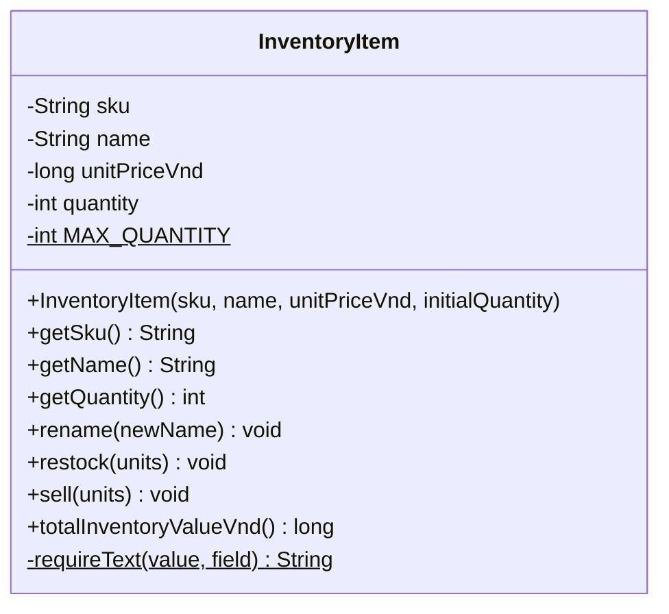
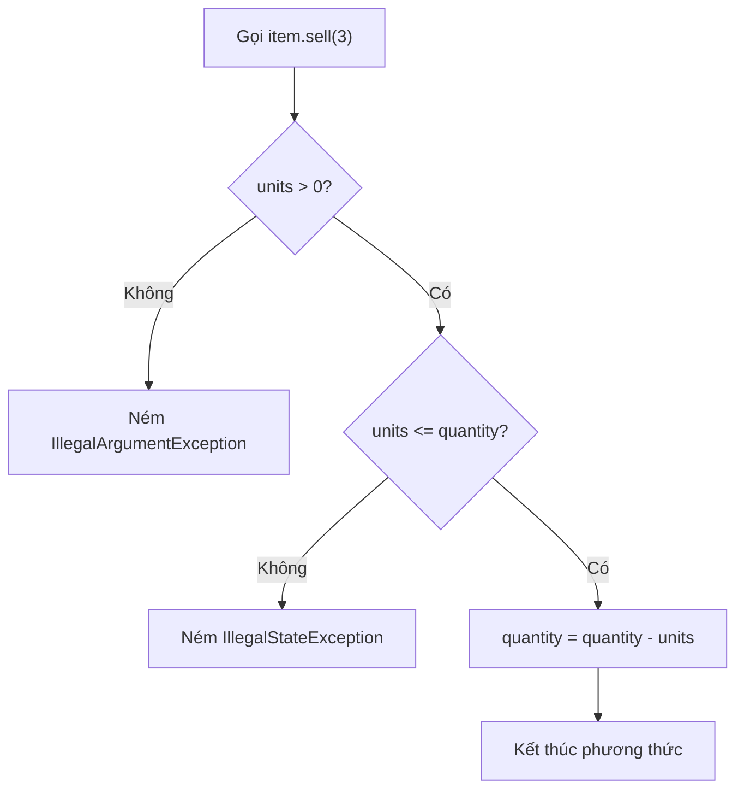
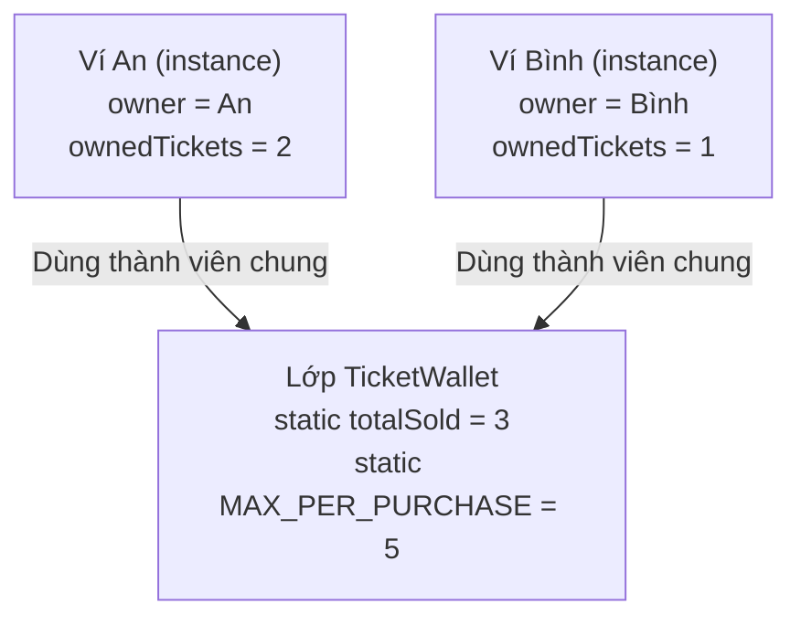
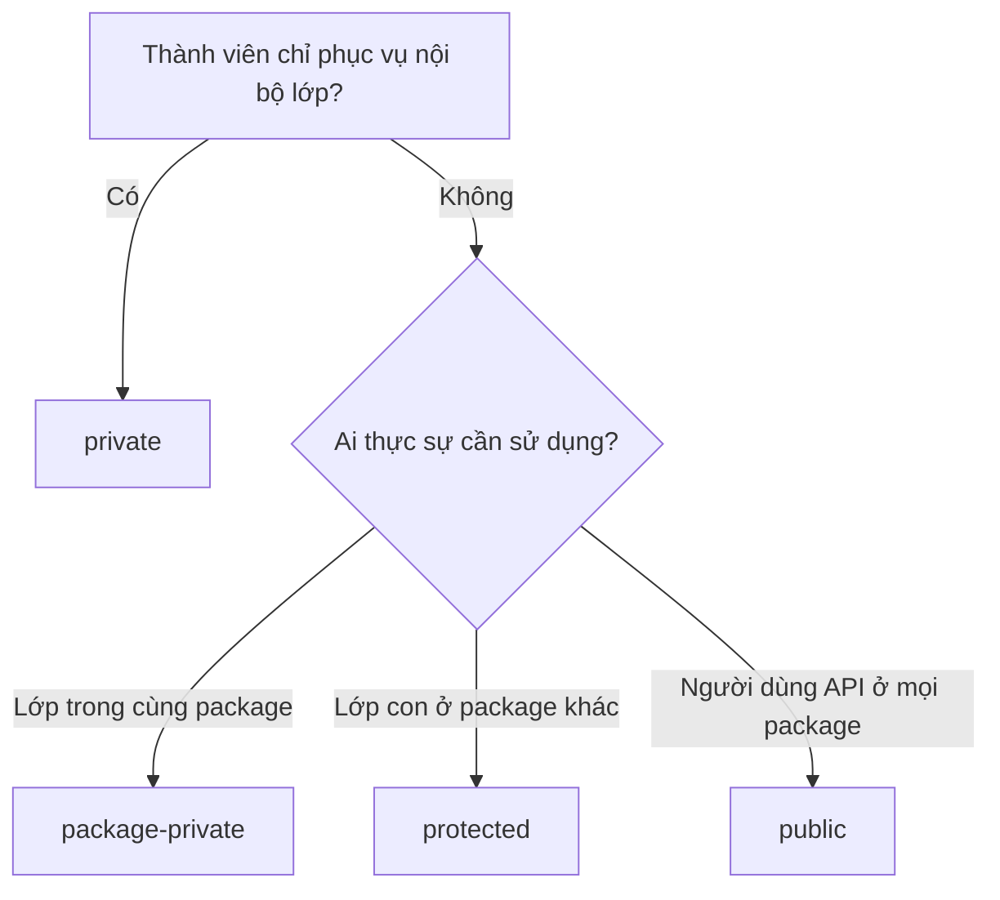
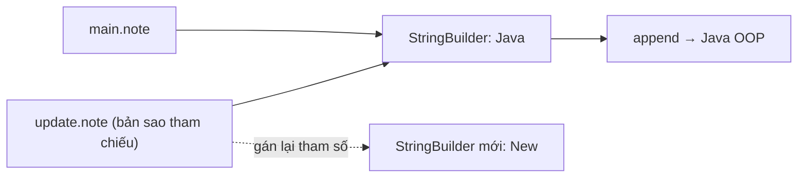
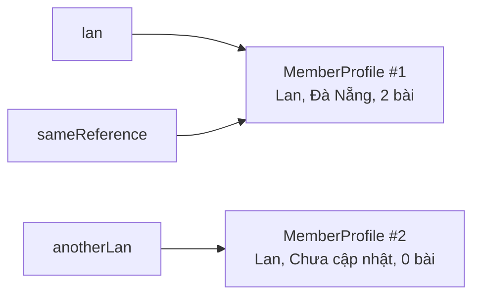
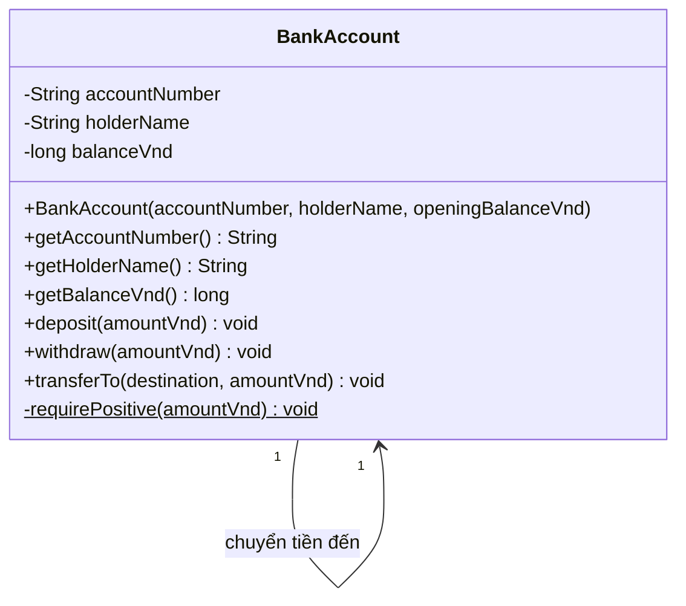
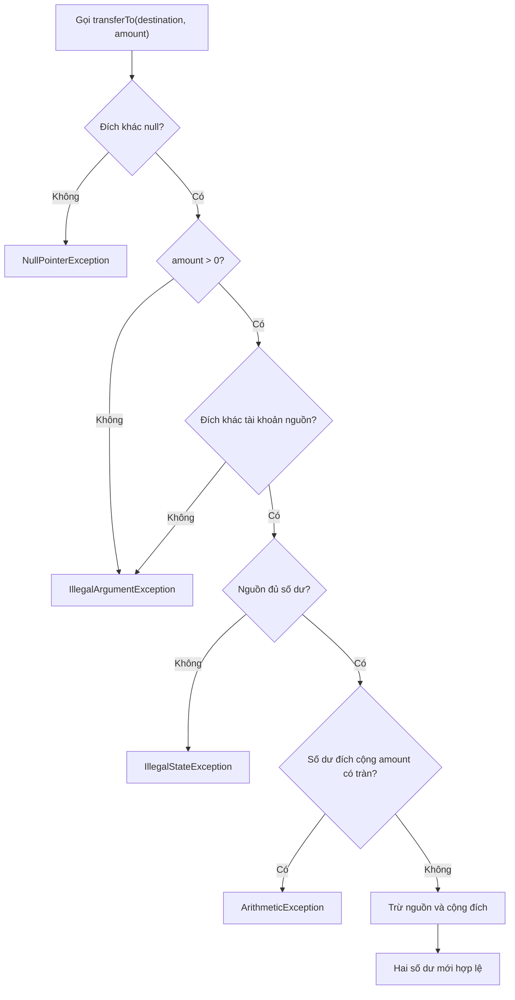

<a id="back-to-top"></a>

# Classes

## Menu
- [Class structure: fields and methods](#class-001)
- [Declaring classes and creating instances](#class-002)
- [Instance members and shared members](#class-003)
- [Member access levels](#class-004)
- [Method parameters, return values, and effects](#class-005)
- [Read-only and mutable members](#class-006)
- [References to the current object](#class-007)
- [Designing a class through a bank account example](#class-008)

## <a id="class-001">Class structure: fields and methods</a>

<details>
<summary>View details</summary>

# Class structure in Java: fields and methods

A **class** is a blueprint for objects of the same type. Within a class, **fields** store state, and **methods** define what an object can do. These two parts work together: methods read or modify fields according to rules that the class is responsible for enforcing.

For example, an inventory item has a stock-keeping code, name, unit price, and quantity on hand. Restocking or selling changes the quantity while the item code remains unchanged. Instead of letting external code change the quantity arbitrarily, the `InventoryItem` class provides `restock()` and `sell()` methods that validate the operation before making a change.

## 1. Overview of a class's structure

```java
public class Product {
    // Thuộc tính: trạng thái của từng đối tượng
    private final String code;
    private String name;
    private long priceVnd;

    // Constructor: tạo đối tượng với trạng thái ban đầu hợp lệ
    public Product(String code, String name, long priceVnd) {
        this.code = code;
        this.name = name;
        this.priceVnd = priceVnd;
    }

    // Phương thức: đọc trạng thái
    public String getName() {
        return name;
    }

    // Phương thức: thay đổi trạng thái
    public void rename(String newName) {
        this.name = newName;
    }
}
```

This is a syntax sketch; the complete example later adds input validation.

| Component | Example | Role |
| --- | --- | --- |
| Class declaration | `public class Product` | Defines an object type; class names typically use PascalCase |
| Field | `private String name;` | Holds data belonging to an object |
| Constructor | `public Product(...)` | Establishes the state when `new Product(...)` is called |
| Method | `public void rename(...)` | Exposes an operation the object permits |
| Parameter | `String newName` | Data received when a method is called |
| Return type | `String`, `long`, `void` | Specifies the returned result, or `void` if no result is returned |
| Access modifier | `private`, `public` | Determines where the member can be accessed |
| `this` | `this.name = newName` | Refers to the object currently executing the method |

The class diagram shows the components without detailing their implementations:



In UML notation, `+` means `public` and `-` means `private`; here, `$` indicates a `static` member.

## 2. How do fields store state?

A field is declared **directly in the class body, outside its methods**:

```java
private final String sku;
private String name;
private final long unitPriceVnd;
private int quantity;
```

- `sku` receives its value during initialization and cannot be reassigned afterward because it is `final`.
- `name` can be changed through a method controlled by the class.
- `unitPriceVnd` uses `long` to store an integer amount in Vietnamese dong; `double` is unsuitable for an example requiring exact integer monetary amounts.
- `quantity` represents state that changes as items are restocked or sold.

Each call to `new InventoryItem(...)` creates an object with **its own set of instance field values**. Selling an item from object A does not automatically reduce object B's stock.

### Instance fields, static fields, and local variables

| Kind | Declaration location | Ownership / lifetime |
| --- | --- | --- |
| Instance field | In the class, without `static` | Each object holds its own value |
| Static field | In the class, with `static` | Belongs to the class and is shared across objects |
| Local variable | Inside a method or block | Exists only within that block's execution scope |
| Parameter | In a method's parameter list | A local variable that receives a value when called |

For example, `private static final int MAX_QUANTITY = 1_000_000;` is a class-wide limit constant; conceptually, each object need not hold its own copy. `int units` in `sell(int units)` is a parameter, while `int remaining = quantity - units;` (if declared inside the method) is a local variable.

`final` prevents reassignment of **that variable or field** after initialization, but does not mean that every object it references is immutable. `private` restricts access from outside the class; it does not automatically make data valid, so methods and constructors must still validate it.

## 3. Methods define behavior and the public interface

A method declaration has this form:

```java
public void restock(int units) {
    // thân phương thức
}
```

Breaking it down: `public` is the access level; `void` is the return type; `restock` is the name; `int units` is the parameter; and the code inside `{ ... }` is the implementation. A method returning data declares an appropriate type and uses `return`:

```java
public int getQuantity() {
    return quantity;
}
```

Methods can be grouped by **responsibility**:

- Query methods (`getQuantity()`, `totalInventoryValueVnd()`) provide information without intentionally changing state.
- Command methods (`restock()`, `sell()`, `rename()`) perform operations and may change state.
- `private` helper methods reuse internal logic without becoming part of the object's public API.

Method names should be verbs or phrases that clearly describe the result. A method can take multiple parameters; Java also supports **overloading** (the same method name with different parameter types or counts). Changing only the return type is insufficient for an overload.

## 4. Complete example: an inventory management class

Create `InventoryItem.java`. This example requires Java 11 or later because it uses `String.isBlank()` and `String.strip()`.

```java
public final class InventoryItem {
    private static final int MAX_QUANTITY = 1_000_000;

    private final String sku;
    private String name;
    private final long unitPriceVnd;
    private int quantity;

    public InventoryItem(String sku, String name,
                         long unitPriceVnd, int initialQuantity) {
        this.sku = requireText(sku, "sku");
        this.name = requireText(name, "name");

        if (unitPriceVnd < 0) {
            throw new IllegalArgumentException("Giá không được âm");
        }
        if (initialQuantity < 0 || initialQuantity > MAX_QUANTITY) {
            throw new IllegalArgumentException("Số lượng ban đầu không hợp lệ");
        }

        this.unitPriceVnd = unitPriceVnd;
        this.quantity = initialQuantity;
    }

    public String getSku() {
        return sku;
    }

    public String getName() {
        return name;
    }

    public int getQuantity() {
        return quantity;
    }

    public void rename(String newName) {
        this.name = requireText(newName, "name");
    }

    public void restock(int units) {
        if (units <= 0) {
            throw new IllegalArgumentException("Số nhập phải dương");
        }
        if (units > MAX_QUANTITY - quantity) {
            throw new IllegalArgumentException("Vượt giới hạn tồn kho");
        }
        quantity += units;
    }

    public void sell(int units) {
        if (units <= 0) {
            throw new IllegalArgumentException("Số bán phải dương");
        }
        if (units > quantity) {
            throw new IllegalStateException("Không đủ hàng trong kho");
        }
        quantity -= units;
    }

    public long totalInventoryValueVnd() {
        return Math.multiplyExact(unitPriceVnd, (long) quantity);
    }

    private static String requireText(String value, String field) {
        if (value == null || value.isBlank()) {
            throw new IllegalArgumentException(field + " không được trống");
        }
        return value.strip();
    }
}
```

Key points to observe in the structure above:

1. **`private` fields and `public` methods:** external code reads the quantity through `getQuantity()` and changes it through valid operations; it cannot perform `item.quantity = -10`.
2. **Constructors have no return type:** a constructor has the same name as its class. It ensures that newly created objects have valid codes, names, prices, and quantities.
3. **`this.sku` versus `sku`:** the left side is the object's field, while the right side is the constructor parameter. `this` distinguishes the two variables with the same name.
4. **Consistent state:** `restock()` checks for a positive amount and the upper limit before adding; `sell()` checks for a positive amount and sufficient stock before subtracting. If validation fails, `quantity` has not been changed.
5. **Derived data through a method:** total inventory value equals unit price multiplied by current quantity, so it is calculated from the two fields. Storing an extra `totalValue` field would risk forgetting to update it. `Math.multiplyExact` signals an error if the `long` multiplication overflows.
6. **`static`:** `MAX_QUANTITY` and `requireText()` belong to the class because neither requires the state of a particular item. By contrast, `sell()` uses each object's `quantity`, so it is an instance method.

### Try running the object

Create `Main.java` in the same directory:

```java
public class Main {
    public static void main(String[] args) {
        InventoryItem item =
                new InventoryItem("KB-01", "Bàn phím", 129_000, 10);

        item.restock(5);               // 10 -> 15
        item.sell(3);                  // 15 -> 12
        item.rename("Bàn phím cơ");

        System.out.println(item.getSku());                    // KB-01
        System.out.println(item.getName());                   // Bàn phím cơ
        System.out.println(item.getQuantity());               // 12
        System.out.println(item.totalInventoryValueVnd());    // 1548000

        try {
            item.sell(20);
        } catch (IllegalStateException ex) {
            System.out.println(ex.getMessage()); // Không đủ hàng trong kho
        }

        System.out.println(item.getQuantity()); // Vẫn là 12
    }
}
```

Compile and run with:

```bash
javac InventoryItem.java Main.java
java Main
```

The control flow for `item.sell(3)`:



Immediately before the call, `quantity = 15`. The conditions are satisfied, so the field becomes `12`. With `sell(20)`, the sufficient-stock check fails, an exception is thrown, and the quantity **remains 12**. This illustrates the practical benefit of placing logic inside methods instead of allowing external code to modify fields directly.

### Two objects of the same class

```java
InventoryItem a = new InventoryItem("A", "Chuột", 200_000, 2);
InventoryItem b = new InventoryItem("B", "Bàn phím", 500_000, 4);

a.restock(3);

System.out.println(a.getQuantity()); // 5
System.out.println(b.getQuantity()); // 4
```

`InventoryItem` is the class; `a` and `b` refer to **two distinct objects**. Both have the same set of field and method names but independent state.

## 5. Distinguishing fields, properties, and methods

In everyday OOP terminology, an "attribute" often means data that characterizes an object. In basic Java, a data member declared as `private int quantity;` is specifically called a **field**. In design terminology, a "property" may be a value exposed through `getQuantity()` or calculated by `totalInventoryValueVnd()`; Java does not have automatic property syntax like some other languages.

Not every field needs a getter or setter. If a public `setQuantity(int x)` accepts any integer, callers can bypass the restocking and selling rules. Here, `restock()` and `sell()` express the business operations and enforce their conditions more effectively. Likewise, `sku` needs no setter because the item's identity is established at initialization.

### Common access levels

| Modifier | Typical access | Appropriate use |
| --- | --- | --- |
| `private` | Only within the declaring class | Fields and internal implementation details |
| No modifier (package-private) | Within the same package | Internal collaboration among classes in a package |
| `protected` | Within the same package and in subclasses under Java's rules | Members intended for extension through inheritance |
| `public` | Anywhere the class itself is accessible | API used by callers of the class |

A class can have many `private` fields and still expose all its intended behavior through `public` methods. This is the foundation of **encapsulation**: an object retains control over its own state.

## 6. Common design and Java mistakes

| Situation | Why it causes problems | Improvement |
| --- | --- | --- |
| `public int quantity;` | External code can assign a negative quantity | Keep the field `private` and provide validated operations |
| Constructor directly assigns an empty name | The object starts in an invalid state | Validate parameters during construction |
| `setQuantity(...)` for every operation | Callers must remember the restocking and selling rules | Use behavior-oriented names such as `restock` and `sell` |
| Adding a `totalValue` field and forgetting to synchronize it | Redundant data can become incorrect | Calculate it in a query method |
| Parameter and field share a name, but `this` is omitted | Assignment may affect the parameter or fail to update the field | Use `this.field = parameter` |
| Mistaking `static` for per-object data | Every object uses the same shared variable | Keep per-object data in instance fields |
| Calling an instance method without an object | There is no specific object state to work with | First create an object with `new` |
| Validating only after updating a field | An exception may leave the object in an invalid state | Validate all conditions before making changes |

Remember that a method does not necessarily modify fields; getters and calculations are valid behavior. Conversely, merely having fields and methods does not make a class well designed if its responsibilities are muddled or it permits data rules to be violated.

## 7. Check your understanding

Try modifying the example to meet these three requirements:

1. Add `getUnitPriceVnd()` to return the unit price without allowing external callers to change it.
2. Add `boolean canSell(int units)` to check `units > 0 && units <= quantity` **without changing** the quantity.
3. Call `restock(0)`, `sell(-1)`, and `sell(999)` and identify the exception types; check the stock before and after each call.

When reading any Java class, ask yourself: **Which fields represent state? Which fields belong to the class through `static`? What does the constructor guarantee? Which methods read or modify state? What rules prevent the object from becoming invalid?** If you can answer these questions, you understand the basic structure of a class with fields and methods.


</details>

- [Back to top](#back-to-top)

---

## <a id="class-002">Declaring classes and creating instances</a>

<details>
<summary>View details</summary>

# Declaring classes and creating instances in Java

In object-oriented programming (OOP), a **class** describes the data and behavior shared by a group of objects. An **instance** (or object) is a specific object created from that class definition.

For example, the `Workshop` class can represent a workshop with a name, capacity, and number of registered participants. From the same class, the program creates two independent instances: a "Java cơ bản" workshop with two seats and a "Spring Boot" workshop with one seat.

## 1. Declaring a class

Basic syntax:

~~~java
class TenLop {
    // Các trường (fields): lưu trạng thái
    // Constructor: thiết lập trạng thái khi tạo đối tượng
    // Các phương thức (methods): mô tả hành vi
}
~~~

A Java class typically has three components:

| Component | Role | Example in `Workshop` |
| --- | --- | --- |
| Field | Stores data belonging to each object | `name`, `capacity`, `registeredCount` |
| Constructor | Validates and initializes an object | `Workshop(String name, int capacity)` |
| Method | Allows an object to perform behavior | `register()`, `remainingSeats()` |

The `class` keyword defines a new object type. By Java convention, class names use `PascalCase` (`Workshop`, `OrderItem`). The `public` keyword controls accessibility; a source file typically contains one `public` top-level class, and its filename must match that class name (for example, `Main.java` for `public class Main`).

**Declaring a class does not create instances of it.** Instances appear only when the program performs an object-creation operation, typically using `new`.

## 2. Creating instances with `new`

A typical expression:

~~~java
Workshop java = new Workshop("Java cơ bản", 2);
~~~

Read it from left to right:

1. `Workshop` is the **variable's type**.
2. `java` is a **reference variable** used to access the object.
3. `new Workshop(...)` creates an instance of `Workshop` and invokes the matching constructor.
4. `"Java cơ bản"` and `2` are arguments used to initialize the name and capacity.
5. The assignment operator `=` stores **a reference to the object** in the variable `java`.

You can declare a reference and create the object later:

~~~java
Workshop course;                         // Chưa tham chiếu đến đối tượng nào
course = new Workshop("Java cơ bản", 2); // Bắt đầu trỏ đến thể hiện mới
~~~

The local variable `course` must be assigned before use. Unlike local variables, a **reference field** that has not been explicitly initialized defaults to `null`. Calling a method through a `null` reference causes a `NullPointerException`.

## 3. Complete example: workshop registration

Place all the following code in **`Main.java`**. The example uses Java 11 or later because it calls `String.isBlank()`.

~~~java
class Workshop {
    private final String name;
    private final int capacity;
    private int registeredCount;

    // Constructor: cùng tên với lớp, không khai báo kiểu trả về.
    Workshop(String name, int capacity) {
        if (name == null || name.isBlank()) {
            throw new IllegalArgumentException("Tên buổi học không hợp lệ");
        }
        if (capacity <= 0) {
            throw new IllegalArgumentException("Sức chứa phải lớn hơn 0");
        }

        this.name = name;
        this.capacity = capacity;
        this.registeredCount = 0;
    }

    // Hành vi thay đổi trạng thái riêng của thể hiện hiện tại.
    boolean register() {
        if (registeredCount >= capacity) {
            return false;
        }
        registeredCount++;
        return true;
    }

    int remainingSeats() {
        return capacity - registeredCount;
    }

    String getName() {
        return name;
    }
}

public class Main {
    public static void main(String[] args) {
        Workshop java = new Workshop("Java cơ bản", 2);
        Workshop spring = new Workshop("Spring Boot", 1);

        System.out.println(java.getName());
        System.out.println(java.register());
        System.out.println(java.register());
        System.out.println(java.register());
        System.out.println(java.remainingSeats());
        System.out.println(spring.remainingSeats());

        Workshop alias = spring; // Thêm tham chiếu, không tạo đối tượng mới
        System.out.println(alias == spring);
        alias.register();
        System.out.println(spring.remainingSeats());

        Workshop separate = new Workshop("Spring Boot", 1);
        System.out.println(separate == spring);
        System.out.println(separate.remainingSeats());
    }
}
~~~

Run these commands from the directory containing `Main.java`:

~~~bash
javac Main.java
java Main
~~~

Output:

~~~text
Java cơ bản
true
true
false
0
1
true
0
false
1
~~~

**Explanation:** The `java` object has two seats, so its first two `register()` calls succeed and the third fails. The `spring` object still has one seat: changing `java` does not affect `spring`. Calling `alias.register()` reduces `spring`'s remaining seats to 0 because both variables refer to the same object. Then `new Workshop("Spring Boot", 1)` creates a *different* instance, even though its arguments match those used to create `spring`.

## 4. What does a constructor do?

A constructor initializes an instance. It **has the same name as its class** and **has no return type**, not even `void`. In the example above, the constructor requires a nonblank name and a positive capacity, then assigns the instance's fields.

The `this` keyword refers to the current object. In `this.name = name;`, the left side is the object's `name` field; the right side is the `name` parameter passed to the constructor. This form avoids ambiguity when a field and parameter share a name.

If you declare **no constructors at all**, the compiler supplies a default no-argument constructor whose access level matches the class's accessibility. But **once you declare a parameterized constructor**, Java does not automatically generate a no-argument constructor:

~~~java
class Marker {
    String color;
}

Marker a = new Marker(); // Hợp lệ: constructor mặc định

// Với lớp Workshop ở ví dụ chính:
// new Workshop();        // Lỗi biên dịch: thiếu 2 đối số
~~~

The `Marker` snippet is a standalone illustration; do not append it after the complete example outside the `main` method. You can also define multiple constructors with different signatures (*constructor overloading*) when several initialization paths are valid, but each constructor must ensure a valid initial state.

## 5. Distinguishing classes, instances, and references

| Concept | Meaning | Example |
| --- | --- | --- |
| Class | A definition of data and behavior | `class Workshop { ... }` |
| Instance | An object created from a class | The "Java cơ bản" object |
| Reference variable | A variable used to access an object | `java`, `spring`, `alias` |
| `new` | An expression that creates an object and invokes a constructor | `new Workshop("Spring Boot", 1)` |

After the assignments in the example, the reference relationships can be visualized as follows:

~~~mermaid
flowchart LR
    J["java"] --> W1["Workshop #1: Java cơ bản"]
    S["spring"] --> W2["Workshop #2: Spring Boot"]
    A["alias"] --> W2
    D["separate"] --> W3["Workshop #3: Spring Boot"]
~~~

There are three objects but four reference variables. `spring` and `alias` both access object #2; object #3 was created separately.

- `Workshop alias = spring;` **does not copy the object**. It copies the reference value.
- `new Workshop(...)` performs another instance-creation operation.
- `alias == spring` is `true` because the references point to the same object.
- `separate == spring` is `false` because they point to different objects.
- For objects, `==` checks **reference identity**; `equals()` can express content equality if the class overrides it. Here, `Workshop` does not override `equals()`.

Do not think of each reference variable as holding an independent copy of the object. When multiple references point to the same mutable object, changes made through one reference are visible through the others.

## 6. Access control and encapsulation from the declaration stage

The three fields of `Workshop` are declared `private` so calling code cannot directly assign `registeredCount = 999` or change the capacity arbitrarily. To register, the program calls `register()`, which checks for available seats before incrementing the count.

`final` on `name` and `capacity` requires each field to be assigned once during initialization and prevents later reassignment. It does **not** make the entire object immutable, because `registeredCount` can still change.

In this example, `Workshop` is not declared `public`, so it is accessible only within its package. Its methods also have default (package-private) access, which is enough for `Main` because both are in the same file/package. When a project spans multiple packages, use `public` for APIs that must be accessed from another package.

## 7. Common mistakes

| Situation | Cause | Solution |
| --- | --- | --- |
| `new Workshop()` does not compile | The class only has a two-parameter constructor | Supply both arguments or explicitly declare a no-argument constructor if appropriate |
| Declaring `Workshop x;` and then calling `x.register()` | The local variable has not been assigned | Initialize with `new` or assign a valid reference before use |
| Declaring `Workshop x = null;` and then calling a method | `null` does not refer to an object | Check the initialization path and avoid calling methods through `null` |
| Assuming `Workshop b = a;` duplicates the data | Assignment copies only the reference | Create a new object and deliberately copy the data if needed |
| Declaring `public class Workshop` inside `Main.java` | The filename does not match the `public` class name | Move `Workshop` to `Workshop.java`, or keep it non-`public` inside `Main.java` |
| Writing `void Workshop(...)` | This declares a method named `Workshop`, not a constructor | Omit the return type to declare a constructor |

## 8. Check your understanding

1. If you create `Workshop a = new Workshop("A", 3);` and `Workshop b = new Workshop("B", 3);`, does calling `a.register()` change `b.remainingSeats()`? **No**: these are two independent instances.
2. If you then write `Workshop c = a;`, what is `c == a`? **`true`**, because both references point to the same instance.
3. Where should you check that a workshop cannot be created with a capacity of 0? **In the constructor**, so every new object starts in a valid state.
4. Does `new Workshop("A", 3)` create a new class or a new object? **A new object** of the already-defined `Workshop` class.
5. If you only write `class Workshop { ... }` without executing `new Workshop(...)`, has that declaration created any `Workshop` instances? **No**.

**Remember when writing Java:** Declare a `class` to define structure and behavior; use `new` and a constructor to create objects; retain references to call methods. Each new instance has its own state, while reference assignment can allow multiple variables to access the same instance.


</details>

- [Back to top](#back-to-top)

---

## <a id="class-003">Instance members and shared members</a>

<details>
<summary>View details</summary>

# Instance members and shared members in Java

In object-oriented programming, a **class** describes an object type, while an **instance** is a specific object created from that class. When declaring fields and methods, Java lets you choose whether a member belongs to **each individual object** or **the class and is shared** by using the `static` keyword.

This distinction answers two practical questions:

- Does this data belong to one particular object? Examples: an account holder's name, an account balance, or an order's status.
- Is this data or behavior meaningful for the entire object type? Examples: a counter for accounts created, a fixed limit, or a utility function that needs no individual account state.

## 1. Two kinds of members

| Criterion | Instance member | Shared (static) member |
|---|---|---|
| Declaration | Without `static` | With `static` |
| Associated with | Each object | The class (within the corresponding class loader) |
| Field storage | Each object has its own storage location | A single field is shared by that class's objects |
| Preferred access syntax | `doiTuong.tenThanhVien` | `TenLop.tenThanhVien` |
| Members a method can access directly | Instance and static fields/methods | Static members; instance members require an object reference |
| Use of `this` | Allowed in an instance context | Not allowed in a static context |
| Typical examples | `account.balance`, `account.deposit()` | `Account.getTotalCreated()`, `Math.max(a, b)` |

**Note:** `static` does not mean `public` or `final`. These have three distinct meanings: `static` determines what a member belongs to; `public/private` controls access; and `final` restricts reassignment or overriding, depending on the member type.

## 2. Practical example: an event ticket wallet

Suppose each customer has a wallet for event tickets and keeps track of their own tickets. At the same time, the system must count the total number of tickets sold across all wallets in the running program.

Create a **Demo.java** file and run it with Java 17 or later:

```java
public class Demo {
    public static void main(String[] args) {
        TicketWallet an = new TicketWallet("An");
        TicketWallet binh = new TicketWallet("Bình");

        an.buyTickets(2);
        binh.buyTickets(1);

        System.out.println(an.getOwner() + ": " + an.getOwnedTickets());
        System.out.println(binh.getOwner() + ": " + binh.getOwnedTickets());
        System.out.println("Tổng vé đã bán: " + TicketWallet.getTotalSold());
    }
}

class TicketWallet {
    // Dùng chung cho mọi TicketWallet trong phạm vi lớp đã nạp.
    private static int totalSold = 0;

    // Hằng số dùng chung: không cần một bản sao ở mỗi ví.
    public static final int MAX_PER_PURCHASE = 5;

    // Mỗi đối tượng TicketWallet có trạng thái của riêng mình.
    private final String owner;
    private int ownedTickets;

    public TicketWallet(String owner) {
        if (owner == null || owner.isBlank()) {
            throw new IllegalArgumentException("Tên chủ ví không hợp lệ");
        }
        this.owner = owner;
        this.ownedTickets = 0;
    }

    // Phương thức instance: tác động lên chính ví được gọi.
    public void buyTickets(int quantity) {
        if (quantity <= 0 || quantity > MAX_PER_PURCHASE) {
            throw new IllegalArgumentException("Số vé mỗi lần mua phải từ 1 đến 5");
        }

        this.ownedTickets += quantity; // Chỉ thay đổi ví hiện tại.
        totalSold += quantity;         // Thay đổi bộ đếm chung.
    }

    public String getOwner() {
        return owner;
    }

    public int getOwnedTickets() {
        return ownedTickets;
    }

    // Phương thức static: không cần một ví cụ thể để trả lời.
    public static int getTotalSold() {
        return totalSold;
    }
}
```

Output:

```text
An: 2
Bình: 1
Tổng vé đã bán: 3
```

Follow the steps:

1. `new TicketWallet("An")` creates An's wallet with `ownedTickets = 0`.
2. `new TicketWallet("Bình")` creates Bình's wallet with `ownedTickets = 0`. The wallets are two distinct objects.
3. `an.buyTickets(2)` sets `an.ownedTickets = 2` and `TicketWallet.totalSold = 2`.
4. `binh.buyTickets(1)` sets `binh.ownedTickets = 1` and `TicketWallet.totalSold = 3`. An still owns 2 tickets.

Visualize the relationship:



The diagram represents **logical ownership**, not a byte-level memory layout in the JVM. Each instance has its own fields; both see the same `TicketWallet.totalSold` within that loaded class.

## 3. Instance fields: state belonging to each object

A field declared without `static` is an instance field:

```java
class Lamp {
    private boolean on; // Mặc định là false cho mỗi đèn.

    public void turnOn() {
        this.on = true;
    }

    public boolean isOn() {
        return on;
    }
}
```

Usage:

```java
Lamp bedroom = new Lamp();
Lamp kitchen = new Lamp();

bedroom.turnOn();

System.out.println(bedroom.isOn()); // true
System.out.println(kitchen.isOn()); // false
```

Both objects are `Lamp` instances, but turning on the bedroom lamp does not automatically change the kitchen lamp's state. This ability to **encapsulate individual state** is fundamental to OOP.

Instance fields receive default values when an object is initialized (for example, `int = 0`, `boolean = false`, and reference fields `= null`), unless code assigns other values. Each new object gets its own initialized instance fields. If two reference fields point to the same other object, that referenced object can still be shared; "separate fields" does not imply that the entire object graphs are independent.

## 4. Static fields: class-level data

Declare a field `static` when the information **truly applies to the entire class**:

```java
class Player {
    private static int createdCount;
    private final String nickname;

    public Player(String nickname) {
        this.nickname = nickname;
        createdCount++;
    }

    public static int getCreatedCount() {
        return createdCount;
    }

    public String getNickname() {
        return nickname;
    }
}
```

```java
Player p1 = new Player("Fox");
Player p2 = new Player("Bear");

System.out.println(p1.getNickname());     // Fox
System.out.println(p2.getNickname());     // Bear
System.out.println(Player.getCreatedCount()); // 2
```

`nickname` is an attribute of each player. `createdCount` records the number of *instance-creation events* counted by the constructor during the current run; it is not the number of live players, database records, or players across all servers.

**Distinguish `static` from constants:**

```java
class Pricing {
    public static final int MAX_DISCOUNT_PERCENT = 30;
    private static int successfulOrders = 0;
}
```

- `MAX_DISCOUNT_PERCENT` is a class-level integer constant that cannot be reassigned.
- `successfulOrders` also belongs to the class but can change over time; it is **mutable shared state**.
- `final` on a reference variable only prevents it from referring to a different object; it does not automatically make the referenced object immutable.

A potentially confusing example:

```java
private static final java.util.List<String> NAMES =
        new java.util.ArrayList<>();

// NAMES = new java.util.ArrayList<>(); // Lỗi: không thể gán lại.
// NAMES.add("An");                       // Vẫn hợp lệ: nội dung list có thể đổi.
```

If you need an unmodifiable list, you can use `List.of("An", "Bình")` together with appropriate data-control rules.

## 5. Instance methods and static methods

An instance method executes in the context of **an object receiving the call**, so it can use `this`, read or modify instance fields, and call other instance methods.

```java
class Rectangle {
    private final double width;
    private final double height;

    Rectangle(double width, double height) {
        this.width = width;
        this.height = height;
    }

    public double area() {        // Instance method
        return width * height;
    }

    public static boolean isValidSize(double width, double height) {
        return width > 0 && height > 0; // Static method
    }
}
```

```java
Rectangle r = new Rectangle(3, 4);
System.out.println(r.area());                     // 12.0
System.out.println(Rectangle.isValidSize(3, 4));  // true
```

`area()` needs the dimensions of **a particular rectangle**. `isValidSize(width, height)` receives all the required data through parameters and does not need an existing rectangle, so it can be `static`.

A `static` method **cannot directly** read an instance field or use `this`:

```java
class Student {
    private String name;

    public static void printNameWrong() {
        // System.out.println(name); // Lỗi biên dịch:
        // non-static variable name cannot be referenced from a static context
        // System.out.println(this.name); // Cũng lỗi: không có this.
    }

    public static void printName(Student student) {
        System.out.println(student.name); // Hợp lệ nhờ đối tượng student.
    }

    public void printMyName() {
        System.out.println(this.name);    // Hợp lệ trong instance method.
    }
}
```

The key point is that a static method **can still use object data** if it is given an object reference (for example, as a parameter). It simply has no implicit `this`.

Java technically allows calling a static method through an object reference expression, but you should call it through the **class name**: `TicketWallet.getTotalSold()`. This expresses its meaning correctly and avoids suggesting that each wallet has its own counter.

## 6. Initialization and lifecycle: what happens when an object is created?

In a simple case (without considering inheritance), the general sequence is:

1. When a class is used in a way that requires initialization, the JVM initializes the class: it executes static field initializers and `static { ... }` blocks in source order. This happens once **per class initialization within a class loader**, rather than every time `new` is used.
2. On each `new` operation, Java allocates an instance, initializes its instance fields and instance initializer blocks, then executes the constructor body.
3. When a static field changes, instances of that loaded class observe the shared state. When an instance field changes, only the state associated with that instance is affected.

Example:

```java
class Sample {
    static int shared = 10;
    int local = 1;

    Sample() {
        local++;
        shared++;
    }
}

Sample a = new Sample(); // a.local = 2; shared = 11
Sample b = new Sample(); // b.local = 2; shared = 12
a.local += 5;

System.out.println(a.local);      // 7
System.out.println(b.local);      // 2
System.out.println(Sample.shared); // 12
```

Do not imagine `static` as "one variable for the entire world." Different JVMs/processes have their own state; applications running on multiple servers do not automatically synchronize static fields. Separate class loaders can also load classes with the same name as distinct classes. Moreover, static fields **are not persistent storage**: restarting an application does not guarantee that their previous values will survive.

## 7. Inheritance: overriding instance methods versus hiding static methods

Instance methods can participate in **runtime polymorphism**: the implementation invoked depends on the actual object's type. Static methods are not overridden in this sense; when a subclass declares a static method with the same signature, this is **method hiding**.

```java
class Animal {
    public static String group() {
        return "Animal";
    }

    public String sound() {
        return "...";
    }
}

class Dog extends Animal {
    public static String group() {
        return "Dog";
    }

    @Override
    public String sound() {
        return "Gâu";
    }
}

Animal pet = new Dog();
System.out.println(pet.sound());   // Gâu: đa hình instance.
System.out.println(pet.group());   // Animal: chọn static theo kiểu tham chiếu.
System.out.println(Dog.group());   // Dog: gọi rõ tên lớp.
```

The `pet.group()` line illustrates a language rule; in real code, prefer `Animal.group()` or `Dog.group()`. Do not put `@Override` on a static method or rely on static dispatch to implement behavior that requires polymorphism.

## 8. Risks of shared state: concurrency and testing

A mutable `static` field can support counters or shared configuration within a JVM, but it also creates a shared point that multiple parts of the code can modify. For example, `totalSold += quantity` is a read-add-write operation and is **not atomic**. If multiple threads buy tickets concurrently, overlapping updates can cause the total to be too low.

When you need a counter in JVM memory that multiple threads can update, you can use `AtomicInteger`:

```java
import java.util.concurrent.atomic.AtomicInteger;

class SalesMetrics {
    private static final AtomicInteger TOTAL_SOLD = new AtomicInteger();

    public static void recordSale(int quantity) {
        if (quantity <= 0) {
            throw new IllegalArgumentException("quantity phải > 0");
        }
        TOTAL_SOLD.addAndGet(quantity);
    }

    public static int getTotalSold() {
        return TOTAL_SOLD.get();
    }
}
```

`AtomicInteger` provides atomic operations **on this counter itself**, but does not automatically guarantee consistency across ticket purchases, order storage, refunds, or different servers. In a production system, total sales might need to be derived from a database or transaction-management service, depending on the required accuracy.

Mutable static fields can also cause tests to affect each other because state remains between tests. Do not make all data static merely for convenient access.

## 9. Choosing members in real-world designs

| Requirement | Recommended choice | Reason |
|---|---|---|
| Name, status, or balance of an account | Instance field | Each account has its own data |
| `deposit(amount)`, `withdraw(amount)` | Instance method | The behavior affects a specific account |
| Shared fixed limit, such as `MAX_RETRY` | `static final` | One shared rule without per-object copies |
| Pure function `Math.abs(x)` | Static method | The output depends only on inputs; no `this` is needed |
| Counter of objects created within one JVM | Possibly a static field | Shared within the loaded class; watch for concurrency |
| Number of registered users across a system | Suitable data store/service | Must remain accurate across processes, restarts, and servers |
| Data that varies by request or user | Usually instance / request scope | Prevents state leaking between users |

**Rule of thumb:** If the meaning of data disappears when an instance is deleted, that data usually belongs in an instance field. If a behavior needs no receiving object, consider a static method. If data must be shared and mutable, consider sharing scope, concurrency, lifecycle, and storage requirements before choosing a static field.

## 10. Check your understanding

**Question 1.** Two `Counter` objects each have a non-static `int value` field. Does incrementing `a.value` increment `b.value`?  
**Answer:** No, unless other logic explicitly updates `b`.

**Question 2.** Is `static int count` recreated every time `new Counter()` is executed?  
**Answer:** No. It belongs to the class within its class loader; the constructor may update its value, but does not create a new static field for each instance.

**Question 3.** Can a static method access `user.name`?  
**Answer:** Yes, if it has a valid `user` reference and sufficient access rights. What is prohibited is accessing `name` as though an implicit `this` were available.

**Question 4.** Is a `static final List<String>` always immutable?  
**Answer:** No. `final` only prevents reassigning the reference variable; the list may still be mutable if the object permits modification.

**Question 5.** Should a static field store the total payments from all customers across multiple servers?  
**Answer:** It is unsuitable as the authoritative data source. Static fields are not synchronized across JVMs and do not persist automatically across restarts.

**Remember when reading Java code:** Ask whether a member is declared `static`, **whose** state it stores, whether it needs `this`, and **what scope** that state must be shared within. Answering these four questions is usually enough to choose correctly between instance and shared members.


</details>

- [Back to top](#back-to-top)

---

## <a id="class-004">Member access levels</a>

<details>
<summary>View details</summary>

# Member access levels in Java

When designing a class in OOP, an **access level** determines where code is allowed to use that class's members: fields, methods, constructors, and nested types. Java enforces access control at compile time, allowing a class to expose the operations callers need while hiding its data and implementation details.

For example, a student object's ID must be readable externally, but its credit count should not be modified arbitrarily. You can expose a read method while restricting the method that adds credits to preserve business rules.

## 1. Four member access levels

| Declaration | Meaning | Use case |
|---|---|---|
| `private` | Direct access only within the declaring class (including nested types under Java's rules) | Internal data, helper functions, input validation |
| *package-private* (no keyword) | Accessible to classes in the **same package** | Helpers internal to a package |
| `protected` | Accessible to classes in the same package; subclasses in other packages can access it subject to additional conditions | Extension points for subclasses |
| `public` | Accessible from any package if the containing type is also accessible | API the class exposes to external callers |

In Java, *package-private* is the name for default access when **no access modifier is written**. There is no `default int score;` syntax for a field: `default` is a keyword used in other contexts, such as a `default` interface method.

### Access matrix

Assume the member is declared in a `public` class and the accessing code can see that class:

| Accessing code's location | `private` | No modifier | `protected` | `public` |
|---|:---:|:---:|:---:|:---:|
| Within the declaring class | ✅ | ✅ | ✅ | ✅ |
| Another class in the same package | ❌ | ✅ | ✅ | ✅ |
| Subclass in a different package | ❌ | ❌ | ✅* | ✅ |
| Unrelated class in a different package | ❌ | ❌ | ❌ | ✅ |

**(*) Important `protected` restriction:** From another package, a subclass can access an inherited member through `this`, `super`, or an expression whose type is that subclass (or one of its subclasses). It cannot access a `protected` member through an arbitrary reference whose type is the parent class.

## 2. Real-world example: student management

Consider this package structure:

```text
vn.edu.school
├── domain
│   ├── Student.java
│   └── StudentAudit.java
├── exchange
│   └── ExchangeStudent.java
└── presentation
    └── StudentViewer.java
```

### 2.1. Declaring access levels within a class

**`domain/Student.java`**

```java
package vn.edu.school.domain;

public class Student {
    private final String studentId; // Chỉ Student trực tiếp sử dụng
    private int credits;            // Không cho bên ngoài sửa tùy ý
    String internalNote;            // Package-private: cùng package

    public Student(String studentId) {
        this.studentId = requireValidId(studentId);
    }

    public String getStudentId() {
        return studentId;
    }

    public int getCredits() {
        return credits;
    }

    protected void addCredits(int amount) {
        if (amount <= 0) {
            throw new IllegalArgumentException("Số tín chỉ phải dương");
        }
        credits += amount;
    }

    private static String requireValidId(String id) {
        if (id == null || id.isBlank()) {
            throw new IllegalArgumentException("Mã sinh viên không hợp lệ");
        }
        return id;
    }
}
```

In this example:

- `studentId` and `credits` are `private`, so outside classes cannot modify them directly.
- `getStudentId()`, `getCredits()`, and the constructor are `public`: other code can create an object and read its information.
- `internalNote` has no modifier, so only classes in `vn.edu.school.domain` can access it directly.
- `addCredits()` is `protected` so subclasses can extend the validated behavior.
- `requireValidId()` is `private`: callers of `Student` do not need to know how the ID is validated.

### 2.2. Another class in the same package

**`domain/StudentAudit.java`**

```java
package vn.edu.school.domain;

class StudentAudit {
    void markReviewed(Student student) {
        student.internalNote = "Đã kiểm tra"; // Hợp lệ: cùng package
        student.addCredits(3);                // Hợp lệ: protected cũng mở cho package
        System.out.println(student.getCredits()); // public

        // student.credits = 99; // LỖI BIÊN DỊCH: credits là private
    }
}
```

Two classes belong to the same package only when they declare **exactly the same package name**; `vn.edu.school.domain` and `vn.edu.school.domain.audit` are different packages. Sharing a package-name prefix grants no special access.

### 2.3. A subclass in another package: the subtlety of protected

**`exchange/ExchangeStudent.java`**

```java
package vn.edu.school.exchange;

import vn.edu.school.domain.Student;

public class ExchangeStudent extends Student {
    public ExchangeStudent(String studentId) {
        super(studentId); // Gọi public constructor của Student
    }

    public void recognizeTransferredCredits(int amount) {
        addCredits(amount);       // Hợp lệ: gọi thành viên kế thừa trên this
        this.addCredits(1);       // Hợp lệ: this là ExchangeStudent

        Student other = new Student("S-02");

        // other.addCredits(1);   // LỖI: receiver có kiểu Student
        // other.internalNote = ""; // LỖI: package-private
        // other.credits = 100;   // LỖI: private
    }
}
```

In the `vn.edu.school.exchange` package, `ExchangeStudent` can use `addCredits()` because it inherits from `Student`. However, the variable `other` has type `Student`, so `other.addCredits(1)` is invalid even inside the subclass. This is why `protected` should not be interpreted as "a subclass can access every parent-class object."

Note: adding 1 credit with `this.addCredits(1)` only illustrates access syntax. In a real application, every credit adjustment must follow a well-defined business process.

### 2.4. An ordinary class in another package

**`presentation/StudentViewer.java`**

```java
package vn.edu.school.presentation;

import vn.edu.school.domain.Student;

public class StudentViewer {
    public String format(Student student) {
        // student.credits = 100;      // private: không được
        // student.internalNote = "";  // package-private: không được
        // student.addCredits(3);      // protected: không được

        return student.getStudentId() + " - " + student.getCredits();
    }
}
```

`StudentViewer` can use only the `public` API of `Student`. These restrictions prevent the presentation layer from bypassing business validation by changing data directly.

## 3. Access control and encapsulation

**Encapsulation** means more than making every field `private` and adding getters and setters. The goal is to protect an object's valid state while exposing only the operations that are actually needed.

An error-prone design:

```java
public class ExamResult {
    public int score; // Bất kỳ ai cũng có thể gán -5 hoặc 200
}
```

A controlled design:

```java
public class ExamResult {
    private int score;

    public ExamResult(int initialScore) {
        updateScore(initialScore);
    }

    public int getScore() {
        return score;
    }

    public void updateScore(int newScore) {
        if (newScore < 0 || newScore > 100) {
            throw new IllegalArgumentException("Điểm phải từ 0 đến 100");
        }
        this.score = newScore;
    }
}
```

`score` remains readable from outside the class, but modifying it must go through `updateScore()`, where the 0-to-100 rule is always enforced. You do not need a setter for every field: state that should remain unchanged after initialization may need only a constructor and getter together with `private final`.

## 4. Additional common rules

**Class accessibility and member accessibility are separate concerns.** A top-level class can be declared `public` or with no modifier (*package-private*), but not `private` or `protected`. A nested class may use any of the four levels. Even if a method is `public`, code outside the package cannot access it through a top-level class that is itself inaccessible.

**Rules for constructors.** A `private` constructor is often used to control object creation (for example, with static factories or utility classes). A `protected` constructor can support inheritance. If a class declares no constructors, Java generates a default constructor with access corresponding to the class's accessibility; do not confuse this with explicitly writing a `public` constructor.

**Overriding cannot reduce method accessibility.** If a parent class declares a `protected` method, a subclass may override it as `protected` or `public`, but not as `private`.

```java
class Parent {
    protected void validate() {}
}

class Child extends Parent {
    @Override
    public void validate() {} // Hợp lệ: mở rộng quyền truy cập

    // private void validate() {} // Không hợp lệ nếu dùng để override
}
```

**`private` does not grant access to subclasses.** A subclass cannot directly use its parent's `private` fields or methods; if that behavior is needed, the parent should expose an appropriate `protected` or `public` method.

**In interfaces:** Fields declared in an interface are implicitly `public static final`; ordinary abstract methods are implicitly `public`. Interfaces also support `private` methods for internal logic reuse (since Java 9), but do not allow `protected` or package-private interface methods.

## 5. How should you choose an access level?



Choose **the narrowest access level that meets the requirement**. Prefer `private` for data; expose `package-private`, `protected`, or `public` access only when there is a clear design reason. Avoid exposing directly mutable fields when the class must maintain business constraints.

## 6. Check your understanding

1. Class `A` has an `int count;` field. Can class `B` in the same package read `count`? **Yes**, because the field is package-private by default.
2. Can `C extends A` in another package read `count`? **No**, because package-private access does not extend to subclasses in different packages.
3. Change `count` to `protected`. Inside `C`, is `this.count` valid? **Yes**. But `new A().count` in `C` is still **invalid** across package boundaries.
4. Can a `private` field be changed through a `public` method? **Possibly**, if the class itself provides a public method that makes the change. Access control governs *where direct access is allowed*; it does not mean that state is permanently immutable.

**Remember:** `private` protects details within a class; *package-private* shares members within a package; `protected` supports package access and conditional subclass access; `public` exposes an interface to external code. Design APIs around the class's responsibilities and the invariants they must protect.


</details>

- [Back to top](#back-to-top)

---

## <a id="class-005">Method parameters, return values, and effects</a>

<details>
<summary>View details</summary>

# Method parameters, return values, and effects in Java

> **Context:** OOP → Classes. Methods describe object behavior. When calling a method, we can supply data through **parameters**, receive a **return value**, and observe **effects** on state or the environment.

## 1. Reading a method's structure

```java
public class Rectangle {
    public static double area(double width, double height) {
        if (width <= 0 || height <= 0) {
            throw new IllegalArgumentException("Kích thước phải dương");
        }
        return width * height;
    }

    public static void main(String[] args) {
        double result = area(3.5, 2.0);
        System.out.println(result); // 7.0
    }
}
```

In this example:

- `area` is the **method name**, indicating the requested operation.
- `double width, double height` are the **formal parameters**: the declared names and types of the inputs.
- `3.5, 2.0` are the **arguments**: the actual values passed at the call site.
- `double` before `area` is the **return type**, while `7.0` is the **return value** of this particular call.
- `return width * height;` sends the result back to the call site and ends the current method invocation.
- The `area` method does not modify external data; the `println` call inside `main` produces the console-output effect.

| Concept | Question to answer | Example |
|---|---|---|
| Parameter | What data does the method need? | `width`, `height` |
| Argument | What values were supplied when calling? | `3.5`, `2.0` |
| Return value | What result does the caller receive? | `7.0` |
| Effect | What did the call change? | `area` does not modify state |

**Return values differ from effects:** a method can return a result without changing state, change state without returning a result, or do both.

## 2. Parameters: the input contract

A declaration has this form:

```java
[accessModifier] ReturnType methodName(Type1 param1, Type2 param2) {
    // Thân phương thức
}
```

Parameters are in the method's scope; callers must supply arguments compatible in type, number, and order (except for cases such as varargs). For example:

```java
public static String formatUser(String name, int age, boolean active) {
    if (name == null || name.isBlank()) {
        throw new IllegalArgumentException("Tên không được để trống");
    }
    if (age < 0) {
        throw new IllegalArgumentException("Tuổi không hợp lệ");
    }
    return name + " (" + age + "), active=" + active;
}

String label = formatUser("An", 20, true);
```

Input validation matters because valid data is part of a method's contract. If a method requires a positive monetary amount, check that condition before using it.

### Method overloading

Java allows multiple methods with the same name if their **parameter lists** differ:

```java
static int multiply(int a, int b) {
    return a * b;
}

static double multiply(double a, double b) {
    return a * b;
}
```

The compiler selects which version to call based on the arguments and method-resolution rules. Changing only the **return type** does not create a valid overload.

### Default parameters and varargs

Java has no default-parameter syntax such as `method(int x = 10)`. You can use overloading instead:

```java
static String greeting(String name) {
    return greeting(name, "Xin chào");
}

static String greeting(String name, String prefix) {
    return prefix + ", " + name;
}
```

For a variable number of arguments, use varargs:

```java
static int sum(int... numbers) {
    int total = 0;
    for (int number : numbers) {
        total += number;
    }
    return total;
}

int x = sum();         // 0
int y = sum(2, 4, 6);  // 12
```

`int... numbers` is treated as an array inside the method. A varargs parameter must be the last parameter in the list.

## 3. Java always passes arguments by value

In Java, **all arguments are passed by value**, even when an argument is an object. What gets copied depends on the data type:

| Parameter | Value copied | Consequence |
|---|---|---|
| `int`, `long`, `double`, `boolean`... | Primitive value | Reassigning the parameter does not change the original variable |
| `StringBuilder`, `List`, class instances... | Object reference value | The method can mutate the same mutable object held by the caller |
| Reference reassigned to a new object | Only the method's copy of the reference | The caller's reference variable does not point to the new object |

A standalone Java example:

```java
public class ParameterDemo {
    static void update(int score, StringBuilder note) {
        score = 100;                       // Chỉ sửa bản sao của số
        note.append(" OOP");               // Sửa đối tượng đang được chia sẻ
        note = new StringBuilder("New");   // Chỉ gán lại tham số cục bộ
    }

    public static void main(String[] args) {
        int score = 10;
        StringBuilder note = new StringBuilder("Java");

        update(score, note);

        System.out.println(score); // 10
        System.out.println(note);  // Java OOP
    }
}
```



Initially, the `note` variable in `main` and the `note` parameter both refer to the same object. The `append` call modifies that object, so the caller sees the change. In contrast, `note = new StringBuilder(...)` only changes the local parameter.

With `String`, strings are **immutable** objects:

```java
static void rename(String name) {
    name = name.toUpperCase();
}

String name = "Lan";
rename(name);
System.out.println(name); // Lan
```

To obtain a new string, return it and assign the result:

```java
static String normalize(String input) {
    return input.trim().toUpperCase();
}

name = normalize(name); // LAN
```

The key point: Java **does not pass reference variables by reference**. It passes **copies of reference values**.

## 4. Return values and the return statement

The return type appears before the method name. For methods with a return type other than `void`, every path that completes normally must return a compatible value.

```java
static String grade(int score) {
    if (score < 0 || score > 100) {
        throw new IllegalArgumentException("Điểm không hợp lệ");
    }
    if (score >= 85) return "Giỏi";
    if (score >= 70) return "Khá";
    if (score >= 50) return "Đạt";
    return "Chưa đạt";
}
```

Here, `return` ends the method immediately. The `throw` branch completes abruptly and transfers control to exception handling.

| Return type | Meaning | Example |
|---|---|---|
| `int`, `long`, `double` | Numeric value | `return total;` |
| `boolean` | True/false or success/failure result | `return balance >= amount;` |
| `String` or object | Result data | `return user;` |
| `Optional<T>` | Presence or absence of a result, when the API chooses this representation | `Optional<User>` |
| `void` | No return value | `return;` (early exit) |

`void` does not mean "no effects." A `void` method can update state, print information, or store data.

### Returning objects can expose internal state

```java
List<String> getNames() {
    return names; // Người gọi có thể sửa trực tiếp nếu names là danh sách mutable
}
```

If `names` is an `ArrayList`, calling `getNames().clear()` will erase the contents of the list owned by the class. A safer option for a list of strings is:

```java
List<String> getNames() {
    return List.copyOf(names);
}
```

`List.copyOf` (Java 10+) creates an unmodifiable list. This is a **shallow** copy: if its elements are mutable objects, they can still be changed through other references. The element types therefore matter too.

## 5. What are method effects?

A **side effect** is an observable change other than the return value: modifying an object's field, changing an input collection, writing a file, printing to the console, updating a database, sending a network request, and so on.

| Operation | What can change? | Note |
|---|---|---|
| `square(4)` returns `16` | No external state | Example of a pure function |
| `account.getBalance()` | Does not modify the account | Result depends on current state |
| `account.deposit(50)` | The `balance` field | Affects the object itself |
| `items.add("Java")` | List contents | Other holders of the list see the change |
| `System.out.println(...)` | Console | I/O is a side effect |
| `repository.save(entity)` | Stored data | May involve transactions or I/O failures |

A **pure function** produces the same result for the same input and has no observable side effects. A function that reads `balance` may modify nothing but still depend on object state, so it is not necessarily pure in the strict sense.

Throwing an exception also changes control flow and is observable behavior. When designing a method contract, specify possible exceptions alongside return values and state changes.

## 6. Practical OOP example: method contracts for a job counter

Consider a counter for jobs waiting to be processed. This example distinguishes **inputs**, **return values**, and **effects on state** in each method's signature and body. The counter only simulates the number of jobs; it does not execute any real work.

~~~java
public class MethodDemo {
    static final class JobCounter {
        private int pendingJobs;

        JobCounter(int initialJobs) {
            if (initialJobs < 0) {
                throw new IllegalArgumentException("Số tác vụ ban đầu không hợp lệ");
            }
            this.pendingJobs = initialJobs;
        }

        public int getPendingJobs() {
            return pendingJobs; // Chỉ đọc, trả về số tác vụ
        }

        public void addJobs(int count) {
            if (count <= 0) {
                throw new IllegalArgumentException("Số tác vụ thêm phải dương");
            }
            pendingJobs = Math.addExact(pendingJobs, count);
        }

        public boolean completeOne() {
            if (pendingJobs == 0) {
                return false; // Không có việc để hoàn tất, không thay đổi trạng thái
            }
            pendingJobs--;
            return true; // Đã giảm số tác vụ chờ đi một
        }
    }

    public static void main(String[] args) {
        JobCounter jobs = new JobCounter(1);
        jobs.addJobs(2);
        System.out.println(jobs.getPendingJobs()); // 3
        System.out.println(jobs.completeOne());     // true
        System.out.println(jobs.getPendingJobs()); // 2

        try {
            jobs.addJobs(-1);
        } catch (IllegalArgumentException ex) {
            System.out.println("Bị từ chối");
        }
        System.out.println(jobs.getPendingJobs()); // 2

        jobs.completeOne();
        jobs.completeOne();
        System.out.println(jobs.completeOne());     // false
        System.out.println(jobs.getPendingJobs()); // 0
    }
}
~~~

After saving the code as `MethodDemo.java`, compile and run:

~~~bash
javac MethodDemo.java
java MethodDemo
~~~

Output:

~~~text
3
true
2
Bị từ chối
2
false
0
~~~

| Method | Parameters | Return value | Effect or error |
| --- | --- | --- | --- |
| `getPendingJobs()` | None | `int`: number of pending jobs | Does not modify the counter |
| `addJobs(int count)` | Number of jobs to add | `void` | Increases jobs if `count > 0`; an invalid argument throws `IllegalArgumentException`, and overflow throws `ArithmeticException` before assignment |
| `completeOne()` | None | `boolean` | Returns `true` and removes one pending job when work remains; returns `false` and leaves state unchanged when there are no jobs |

~~~mermaid
flowchart TD
    A["completeOne()"] --> B{"pendingJobs > 0?"}
    B -->|Không| C["return false; không đổi"]
    B -->|Có| D["pendingJobs--"]
    D --> E["return true"]
~~~

Suppose there is initially one job: `addJobs(2)` raises the counter from 1 to 3. The first `completeOne()` returns `true` **and** reduces the counter to 2. When no jobs remain, the method returns `false` without reducing the count below 0. `addJobs(-1)` fails **before changing** the counter.

`Math.addExact` detects `int` overflow, but does not make the check-and-update operation thread-safe. This example assumes one thread; a real application needs suitable synchronization if several threads update the same counter.

Here, returning `true` or `false` reports **the result of the operation**, while decrementing `pendingJobs` is **an effect on the object**. The signature alone does not reveal both; you need to understand the method's contract and error conditions.

## 7. Return a new object or modify an input object?

The following two versions have different API semantics. The examples require `import java.util.*;`.

**Version A — return a new list:**

```java
static List<String> withAddedTag(List<String> original, String tag) {
    List<String> result = new ArrayList<>(original);
    result.add(tag);
    return result;
}

List<String> oldTags = new ArrayList<>(List.of("OOP"));
List<String> newTags = withAddedTag(oldTags, "Java");
// oldTags = [OOP]
// newTags = [OOP, Java]
```

**Version B — modify the supplied list directly:**

```java
static void addTag(List<String> tags, String tag) {
    tags.add(tag);
}

List<String> tags = new ArrayList<>(List.of("OOP"));
addTag(tags, "Java");
// tags = [OOP, Java]
```

Approach A is easier to reason about when callers need to preserve their inputs. Approach B is convenient when the operation intentionally updates a list. Do not call `addTag` with `List.of(...)` because that list is unmodifiable; `add` would throw `UnsupportedOperationException`.

Note that in approach B, Java still passes **a copy of the reference** into `addTag`. The effect occurs because both sides see the same `ArrayList` object, not because the variable is passed by reference.

## 8. Designing methods with clear contracts

Before writing a method, define four things:

1. **Inputs:** which parameters are needed, and what makes them valid?
2. **Output:** which type is returned, and can the result be absent or the operation fail?
3. **Effects:** which fields, arguments, or external resources will be modified?
4. **Errors:** when are exceptions thrown, and does the state remain consistent?

| Purpose | Suggested signature | Contract |
|---|---|---|
| Calculation | `double calculateTotal(int quantity, double price)` | Returns a result |
| State query | `boolean isEmpty()` | Only queries state |
| State change | `void clear()` | Empties the object's contents |
| Change with a result | `boolean remove(String key)` | Reports whether an element was removed |
| Search that may find nothing | `Optional<User> findUser(String id)` | Expresses the possibility of no result |

Some practical guidelines:

- **Names reflect behavior:** `calculate...`, `find...`, and `get...` commonly signal queries; `add...`, `update...`, and `delete...` commonly signal changes. These are conventions, not substitutes for actual contracts.
- **Check invariants before updating:** for example, a balance must remain nonnegative. Avoid making partial updates before discovering invalid inputs.
- **Avoid silently modifying caller data:** when an API must modify a collection, make that clear in its name, documentation, and tests. Consider returning a copy when independence is required.
- **Do not expose internal mutable fields:** keep fields `private` and provide suitable access methods.
- **Do not overuse `void` when a result should be reported:** a withdrawal method should clearly indicate success, failure, or an error.
- **Reduce unrelated parameters:** group related information into a meaningful class or record. Replace `process(x, true)` with an API that makes the meaning of `true` clear.

In larger systems, it can be helpful to separate **commands** (which perform changes) from **queries** (which only return data). This is a useful design direction, not a rigid rule for every Java class.

## 9. Common mistakes

```java
// Sai kỳ vọng 1: tưởng n thay đổi ở bên ngoài.
static void increment(int n) { n++; }

// Sai kỳ vọng 2: tưởng gán lại tham số là thay biến của người gọi.
static void replace(StringBuilder b) {
    b = new StringBuilder("X");
}

// Sai kỳ vọng 3: bỏ qua dữ liệu trả về của đối tượng bất biến.
String original = " java ";
original.trim(); // original vẫn là " java "

// Đúng: nhận và lưu kết quả trả về.
String cleaned = original.trim(); // "java"
```

Also remember:

- `System.out.println(total)` only prints data, whereas `return total;` sends data back to the call site; both can occur, but neither replaces the other.
- If `return` executes before a statement, that statement will not execute along the corresponding path.
- Using `==` on two object references generally checks whether they point to the same object; to compare `String` contents, you would typically use `equals`.
- Do not assume that a `get...` method is always pure: it may depend on changing state or produce side effects if poorly designed.

## 10. Self-check exercises

1. Write `TemperatureConverter.toFahrenheit(double celsius)`: identify its parameter and return type, the result for `0`, and whether it changes any state.
2. Write a `Counter` class with a `private int count` field and two methods, `increment()` and `getCount()`. Explain which updates state and which queries it.
3. Predict the result of passing an `int`, `StringBuilder`, and `ArrayList<String>` into a method, then distinguish **reassigning a parameter** from **modifying an object**.
4. Given a class that manages a `tasks` list, explain why `return tasks;` can break encapsulation and propose a safer `getTasks()` implementation.

**Remember:** **Parameters** describe incoming data; **return** delivers a result and ends a call; **effects** describe observable changes after a call. To understand a Java method correctly, always consider **both its returned value and the state it may change**.


</details>

- [Back to top](#back-to-top)

---

## <a id="class-006">Read-only and mutable members</a>

<details>
<summary>View details</summary>

# Read-only and mutable members in Java classes

When designing a class, not all object data should be modifiable after initialization. A product's identifier usually needs to remain unchanged, while its display name or selling price may change according to business rules. Java supports both categories of attributes through **encapsulation**, the `final` keyword, read methods (getters), and update methods (setters or domain-specific methods).

> **Key idea:** "Read-only" may mean *callers can only view a value* or *the value cannot be reassigned after initialization*. These ideas are related but not identical. Be clear about whether you are protecting **a reference**, **an object's state**, or **the right to update it externally**.

## 1. Distinguishing member types

In Java, "class members" include fields, methods, nested classes, and more. When discussing "read-only/mutable" members, we usually mean **attributes/state** and the APIs that expose them.

| Declaration or exposed API | Readable externally? | Directly modifiable externally? | Changeable inside the class? |
| --- | --- | --- | --- |
| `private final String id` + `getId()` | Yes | No | Cannot reassign `id` after initialization |
| `private String name` + `getName()`, `setName()` | Yes | Through the setter | Yes, subject to setter validation |
| `private int stock` + `getStock()`, `reserve()` | Yes | Only through the `reserve()` operation | Yes, according to business rules |
| `public String name` | Yes | Yes, by direct assignment | Yes, hard to control |
| `private final List<String> tags` + `getTags()` | Yes | Depends on how the list is returned | The reference cannot be reassigned, but elements may still be changed if the list is mutable |

**Encapsulation** usually starts by declaring fields `private`, then exposing only the methods that are genuinely necessary. Getters and setters are design choices, not a rule requiring both for every attribute.

## 2. Practical example: a product with read-only and updatable attributes

Suppose a product management system requires:

- **SKU**: product code, which must not change after creation.
- **createdAt**: creation timestamp, which must not change.
- **name**: display name, which may be edited but must not be blank.
- **price**: selling price, which may be edited but must not be negative.

`Product.java` (Java 11+):

~~~java
import java.math.BigDecimal;
import java.time.Instant;
import java.util.Objects;

public class Product {
    // Chỉ được gán trong quá trình khởi tạo đối tượng.
    private final String sku;
    private final Instant createdAt;

    // Có thể được gán lại thông qua các phương thức được kiểm soát.
    private String name;
    private BigDecimal price;

    public Product(String sku, String name, BigDecimal price) {
        this.sku = Objects.requireNonNull(sku, "sku").trim();
        if (this.sku.isEmpty()) {
            throw new IllegalArgumentException("SKU không được rỗng");
        }

        this.createdAt = Instant.now();
        setName(name);
        setPrice(price);
    }

    // API chỉ đọc.
    public String getSku() {
        return sku;
    }

    public Instant getCreatedAt() {
        return createdAt;
    }

    // API đọc/ghi có kiểm soát.
    public String getName() {
        return name;
    }

    public void setName(String name) {
        String value = Objects.requireNonNull(name, "name").trim();
        if (value.isEmpty()) {
            throw new IllegalArgumentException("Tên không được rỗng");
        }
        this.name = value;
    }

    public BigDecimal getPrice() {
        return price;
    }

    public void setPrice(BigDecimal price) {
        Objects.requireNonNull(price, "price");
        if (price.signum() < 0) {
            throw new IllegalArgumentException("Giá không được âm");
        }
        this.price = price;
    }
}
~~~

Usage:

~~~java
import java.math.BigDecimal;

public class Main {
    public static void main(String[] args) {
        Product product = new Product(
                "BOOK-001", "Java căn bản", new BigDecimal("150000")
        );

        System.out.println(product.getSku());       // BOOK-001
        System.out.println(product.getCreatedAt()); // Thời điểm tạo
        System.out.println(product.getPrice());     // 150000

        product.setName("Java nâng cao"); // Hợp lệ
        product.setPrice(new BigDecimal("180000")); // Hợp lệ

        // product.setSku("BOOK-002"); // Lỗi biên dịch: không có setSku
        // product.sku = "BOOK-002";  // Lỗi biên dịch: sku là private

        // Ném IllegalArgumentException:
        // product.setPrice(new BigDecimal("-1000"));
    }
}
~~~

The key point is that **the class decides who may modify an attribute**. Callers of `Product` can read `sku` but have no public way to update it; they can change `price` only through a method that validates the new price. This design helps prevent objects from entering invalid business states.

## 3. What does `final` protect?

A `final` field may be **assigned exactly once** during initialization: at its declaration, in an initializer block, or in an appropriate constructor. After assignment, that field cannot be reassigned.

~~~java
public class Customer {
    private final long id;
    private String email;

    public Customer(long id, String email) {
        this.id = id;
        this.email = email;
    }

    public long getId() { return id; }
    public String getEmail() { return email; }

    public void changeEmail(String email) {
        this.email = email;
    }

    // public void changeId(long newId) {
    //     this.id = newId; // LỖI: không thể gán lại final field
    // }
}
~~~

However, **`final` on a reference variable does not make the referenced object immutable**:

~~~java
import java.util.ArrayList;
import java.util.List;

public class Basket {
    private final List<String> items = new ArrayList<>();

    public void add(String item) {
        items.add(item); // Hợp lệ: thay đổi nội dung List
    }

    public List<String> getItems() {
        return items; // Nguy hiểm: làm lộ List mutable
    }
}
~~~

The following code can modify internal data without going through `add`:

~~~java
Basket basket = new Basket();
basket.add("Sách");
basket.getItems().clear(); // Xóa dữ liệu nội bộ!
~~~

`items` cannot point to another list because it is `final`, but the existing list can still change. Likewise, a getter without a setter is **not enough** to guarantee that an object is immutable.

## 4. Creating safe read-only APIs for collections

If the desired state is a read-only list, you can create an **unmodifiable copy** during initialization:

~~~java
import java.util.List;
import java.util.Objects;

public class Course {
    private final String code;
    private final List<String> topics;

    public Course(String code, List<String> topics) {
        this.code = Objects.requireNonNull(code, "code");
        this.topics = List.copyOf(
                Objects.requireNonNull(topics, "topics")
        );
    }

    public String getCode() {
        return code;
    }

    public List<String> getTopics() {
        return topics;
    }
}
~~~

Verification:

~~~java
import java.util.ArrayList;
import java.util.List;

List<String> input = new ArrayList<>(List.of("OOP", "Exception"));
Course course = new Course("JAVA-01", input);

input.add("Thread"); // Không ảnh hưởng topics của course

System.out.println(course.getTopics()); // [OOP, Exception]

// Ném UnsupportedOperationException:
course.getTopics().add("Spring");
~~~

`List.copyOf` (Java 10+) creates an unmodifiable list that does not reflect later changes to the input list. Note that this provides **shallow immutability**. If its elements are mutable objects, those objects can still be modified through other references; the example above is safe because `String` is immutable. `List.copyOf` also disallows `null` elements.

Quick comparison:

| Return approach | Characteristics |
| --- | --- |
| `return internalList;` | Callers can modify it directly if it is a mutable List |
| `return Collections.unmodifiableList(internalList);` | Callers cannot modify it through the view, but the view still reflects changes to the underlying list |
| `return List.copyOf(internalList);` | The returned list is unmodifiable; it creates a logical snapshot of the elements |
| `return new ArrayList<>(internalList);` | Callers can modify the copy without affecting the internal list (provided elements do not share mutable state) |

If a class **must continue managing a mutable list internally**, its getter can return `List.copyOf(items)` to provide a read-only snapshot on each call, while domain methods perform internal updates.

## 5. Read-only from outside, but mutable inside

Sometimes a value is allowed to change but **should not have a public setter**. For example, inventory should decrease only for a valid order; exposing `setStock(int)` would let callers bypass the ordering process.

~~~java
public class Inventory {
    private int available;

    public Inventory(int initialQuantity) {
        if (initialQuantity < 0) {
            throw new IllegalArgumentException("Tồn kho không được âm");
        }
        this.available = initialQuantity;
    }

    public int getAvailable() {
        return available; // Người ngoài chỉ đọc được con số
    }

    public void reserve(int quantity) {
        if (quantity <= 0 || quantity > available) {
            throw new IllegalArgumentException("Số lượng đặt không hợp lệ");
        }
        available -= quantity;
    }

    public void restock(int quantity) {
        if (quantity <= 0) {
            throw new IllegalArgumentException("Số lượng nhập phải dương");
        }
        available = Math.addExact(available, quantity);
    }
}
~~~

~~~java
Inventory inventory = new Inventory(10);
inventory.reserve(3);
System.out.println(inventory.getAvailable()); // 7

// inventory.setAvailable(999); // Không có API này
~~~

Here, `available` is **not a final field** because its value changes after transactions. But external callers still have **read-only access through the getter**; every change must go through `reserve` or `restock`.

The flow of responsibility can be visualized as follows:

~~~mermaid
flowchart TD
    A["Code sử dụng Inventory"] --> B["getAvailable(): đọc tồn kho"]
    A --> C["reserve(quantity): yêu cầu đặt"]
    C --> D{"Số lượng hợp lệ?"}
    D -->|Có| E["Cập nhật available"]
    D -->|Không| F["Ném ngoại lệ"]
~~~

**Concurrency note:** The `Inventory` example illustrates encapsulation in a single-threaded environment. If multiple threads or requests place orders concurrently, stock validation and decrementing must be protected by appropriate synchronization, transactions, or locking; `private`, getters, and `final` do not prevent race conditions on their own.

## 6. Are read-only attributes, constants, and immutable objects the same?

| Concept | Main meaning | Example |
| --- | --- | --- |
| Read-only API | External code can observe state but cannot assign arbitrary values | `getAvailable()` without `setAvailable()` |
| Final field | A field cannot be reassigned after initialization | `private final String sku` |
| Constant | A value often shared across the class, commonly using `static final` | `public static final int MAX_ITEMS = 100;` |
| Immutable object | All observable state remains unchanged after creation | `String`, `BigDecimal`, a properly designed value object class |
| Mutable object | Some state can change over time | `Product` with `setPrice()` |

Constant example:

~~~java
public final class CartRules {
    private CartRules() {
        // Không cho tạo instance của lớp tiện ích.
    }

    public static final int MAX_ITEMS = 100;
}

// Dùng: CartRules.MAX_ITEMS
~~~

A `static final` reference to a mutable object still **does not automatically make that object immutable**. Constants of primitive types or `String` are more straightforward and safer examples.

Java 16+ also provides **records**, which simplify representing read-only data:

~~~java
import java.math.BigDecimal;
import java.util.Objects;

public record ProductSummary(String sku, BigDecimal price) {
    public ProductSummary {
        Objects.requireNonNull(sku, "sku");
        Objects.requireNonNull(price, "price");
        if (price.signum() < 0) {
            throw new IllegalArgumentException("Giá không được âm");
        }
    }
}
~~~

~~~java
ProductSummary summary =
        new ProductSummary("BOOK-001", new BigDecimal("200000"));

System.out.println(summary.sku());
System.out.println(summary.price());

// summary.price = ...; // Không thể gán: component thuộc record là final
// summary.setPrice(...); // Record không tự tạo setter
~~~

Because `String` and `BigDecimal` are both immutable, `ProductSummary` is an immutable value object with these components. **Records provide only shallow immutability**: if a component is a `List` or another mutable object, defensive copying, controlled accessors, or suitably immutable component design is needed.

## 7. Choosing a design based on business requirements

Before declaring a field, identify **who may change it**, **when it may change**, and **which values are valid**:

| Attribute | Commonly suitable design | Reason |
| --- | --- | --- |
| Invoice or product code | `private final` + getter | Identity remains stable after initialization |
| Display name | `private` + getter + validated setter | Updates are allowed but must be valid |
| Account balance | `private` + getter + `deposit()/withdraw()` | Avoids arbitrary setters that bypass rules |
| Creation date | `private final Instant` + getter | A historical timestamp that need not change |
| List of roles | Unmodifiable copy or controlled update API | Prevents direct caller interference |
| Total calculated from line items | Calculated getter; omit the field if unnecessary | Prevents derived data from going out of sync |

**Common beginner mistakes:**

1. Automatically generating setters for every field, including identifiers or important business state.
2. Assuming `private` means immutable. In fact, `private` only restricts direct access.
3. Assuming `final List<T>` makes the entire list and its elements unmodifiable.
4. Returning internal arrays, collections, or mutable `Date` objects without copying them when necessary.
5. Validating values only in the constructor while allowing setters to assign invalid values.
6. Using generic getters/setters for operations with clear business meaning, instead of names such as `reserve`, `cancel`, or `activate`.

## 8. Check your understanding

**Question 1.** In what sense is a `private final String id` field with a getter but no setter read-only?

The `id` field cannot be reassigned after initialization; external code can only view its value through the getter. `String` is also immutable, so there is no risk of modifying the string's internal state.

**Question 2.** Is a `private int stock` field with a getter and `reserve(int)`, but no setter, "read-only"?

It is read-only **through the API exposed to external callers**; the actual state remains mutable and is updated through `reserve`. This is often preferred when operations must follow business rules.

**Question 3.** Why can a getter returning a `List` undermine read-only behavior even when the field is `final`?

Because `final` prevents **reassigning the reference**, not **modifying the object's contents**. If the getter exposes a mutable list, callers can change it directly. Use an immutable collection, a defensive copy, or a controlled access API.

**Question 4.** When should you choose a fully immutable object?

When data represents a value or snapshot that should stay stable (for example, summary information transferred between components), individual fields rarely need updating, and a new object can be created when values change. For objects with lifecycles and business state transitions, controlled mutability may be more appropriate.

**Remember:** Read/write permissions should follow an object's rules. `final` prevents reassignment; `private` and getters/setters help control the API; defensive copies protect referenced data; immutable objects keep state unchanged. Combining these tools appropriately creates a class that is easy to use and hard to update incorrectly.


</details>

- [Back to top](#back-to-top)

---

## <a id="class-007">References to the current object</a>

<details>
<summary>View details</summary>

# References to the current object in Java: `this`

In Java, each object has fields that store state and methods that operate on it. While an **instance method** or **constructor** is running, the `this` keyword allows the code to refer to **the current object itself**.

For example, when you call `lan.completeLesson()`, `this` inside `completeLesson()` is the object referenced by the `lan` variable. When the same method is called on `minh`, `this` refers to the object referenced by `minh` instead.

```java
MemberProfile lan = new MemberProfile("Lan");
MemberProfile minh = new MemberProfile("Minh");

lan.completeLesson();  // this trong lời gọi này là đối tượng Lan
minh.completeLesson(); // this trong lời gọi này là đối tượng Minh
```

**Key point:** `this` does not create a new object. It lets code inside an instance refer to that very instance.

## 1. Using `this.field` to access the current object's fields

Consider the `MemberProfile` class:

```java
class MemberProfile {
    private String username;

    MemberProfile(String username) {
        this.username = username;
    }
}
```

In the constructor, the `username` parameter has the same name as the field:

- `this.username` is **the current object's field**.
- `username` on the right is **the constructor parameter**.
- `this.username = username;` stores the supplied data in the object's state.

If you write `username = username;`, both sides refer to the parameter. The `username` field is left unassigned and retains its default value, `null`. This mistake is easy to miss because the statement can still compile.

The same rule applies when a local variable **shadows** a field:

```java
class Counter {
    private int count = 10;

    void example() {
        int count = 3;
        System.out.println(count);      // 3: biến cục bộ
        System.out.println(this.count); // 10: trường của đối tượng
    }
}
```

When no local variable or parameter shares the field's name, you can write `count` instead of `this.count` inside an instance method. However, deliberately using `this.` helps readers recognize that the code operates on the object's state.

## 2. Practical example: a learner profile updating its own state

Put all the following code in **`Main.java`** and run it with Java 11 or later (because it uses `String.isBlank()`):

```java
class MemberProfile {
    private final String username;
    private String city;
    private int completedLessons;

    // Constructor một tham số ủy quyền sang constructor hai tham số.
    MemberProfile(String username) {
        this(username, "Chưa cập nhật");
    }

    MemberProfile(String username, String city) {
        if (username == null || username.isBlank()) {
            throw new IllegalArgumentException("Tên không được trống");
        }
        if (city == null || city.isBlank()) {
            throw new IllegalArgumentException("Thành phố không được trống");
        }

        this.username = username;
        this.city = city;
        this.completedLessons = 0;
    }

    MemberProfile moveTo(String city) {
        if (city == null || city.isBlank()) {
            throw new IllegalArgumentException("Thành phố không được trống");
        }
        this.city = city;
        return this;
    }

    MemberProfile completeLesson() {
        this.completedLessons++;
        return this;
    }

    boolean isSameInstance(MemberProfile other) {
        return this == other;
    }

    void sendReport(Reporter reporter) {
        reporter.print(this);
    }

    String getUsername() {
        return username;
    }

    String getCity() {
        return city;
    }

    int getCompletedLessons() {
        return completedLessons;
    }
}

class Reporter {
    void print(MemberProfile member) {
        System.out.println(
            "Báo cáo: " + member.getUsername()
            + " - " + member.getCity()
            + " - " + member.getCompletedLessons()
        );
    }
}

public class Main {
    public static void main(String[] args) {
        MemberProfile lan = new MemberProfile("Lan");
        MemberProfile sameReference = lan;
        MemberProfile anotherLan = new MemberProfile("Lan");

        lan.moveTo("Đà Nẵng")
           .completeLesson()
           .completeLesson();

        System.out.println(lan.getCity());
        System.out.println(lan.getCompletedLessons());
        System.out.println(sameReference.getCompletedLessons());
        System.out.println(lan.isSameInstance(sameReference));
        System.out.println(lan.isSameInstance(anotherLan));

        lan.sendReport(new Reporter());
        System.out.println(anotherLan.getCity());
    }
}
```

Compile and run:

```bash
javac Main.java
java Main
```

Output:

```text
Đà Nẵng
2
2
true
false
Báo cáo: Lan - Đà Nẵng - 2
Chưa cập nhật
```

**Examine the different roles of `this` in the same example:**

| Source code | What does `this` represent or do? |
| --- | --- |
| `this.username = username` | Distinguishes the `username` field from the parameter with the same name |
| `this(username, "Chưa cập nhật")` | Calls another constructor of **the same class** |
| `this.city = city` | Changes the receiving object's `city` field |
| `this.completedLessons++` | Increments this object's completed-lesson count |
| `return this` | Returns a reference to the current object so another method can be called |
| `this == other` | Checks whether two references point to the same object |
| `reporter.print(this)` | Passes the current object itself as an argument to another method |

`sameReference = lan` **does not** create a new profile, so both variables see `completedLessons = 2`. In contrast, `new MemberProfile("Lan")` creates a different object even though the learner's name is the same. Therefore, `lan.isSameInstance(anotherLan)` returns `false`.

## 3. `this` depends on the object receiving the call

The following diagram shows the relationships between references:



In the `lan.completeLesson()` call, object #1 is the current object. If you call `anotherLan.completeLesson()`, object #2 becomes the current object. The same method code can run with different values of `this`.

Within an instance method, the following two calls are usually equivalent:

```java
completeLesson();
this.completeLesson();
```

Both invoke `completeLesson()` on the current object. `this.` emphasizes the receiving object but is not always required.

Distinguish these references:

- `this`: the current object.
- `other` or `member`: another supplied reference that may point to the same object or a different one.
- `new MemberProfile(...)`: creates a new object.
- `super`: accesses parent-class members or invokes a parent-class constructor; it is not the same as `this`.

## 4. Using `this(...)` to call another constructor in the same class

In addition to `this.field` and `return this`, Java provides the special `this(...)` syntax to **invoke another constructor in the same class** (*constructor chaining*).

```java
class ReportConfig {
    private final String language;
    private final int pageSize;

    ReportConfig() {
        this("vi", 20);
    }

    ReportConfig(String language) {
        this(language, 20);
    }

    ReportConfig(String language, int pageSize) {
        if (language == null || language.isBlank() || pageSize <= 0) {
            throw new IllegalArgumentException("Cấu hình không hợp lệ");
        }
        this.language = language;
        this.pageSize = pageSize;
    }
}
```

In Java 17/21, a `this(...)` call must be **the first statement** in the invoking constructor. You cannot place another statement before `this(...)` in that constructor:

```java
// Ví dụ SAI trên Java 17/21:
ReportConfig() {
    System.out.println("Đang khởi tạo");
    this("vi", 20); // Lỗi biên dịch
}
```

Constructors must not form circular invocation chains. A constructor also cannot contain both an explicit `this(...)` call and an explicit `super(...)` call. If no explicit constructor invocation is present, Java implicitly calls `super()` when applicable.

| Syntax | Meaning |
| --- | --- |
| `this.field` | Accesses a field of the current object |
| `this.method()` | Calls a method on the current object |
| `this(...)` | In a constructor, invokes another constructor of the same class |
| `super(...)` | In a constructor, invokes a parent-class constructor |
| `super.method()` | Calls the parent-class method implementation when appropriate |

**Note:** The "first statement" restriction above applies to Java 17/21, common versions for learning Spring/Java. Newer Java versions introduce changes to constructor structure; when using them, consult the rules for the exact compiler version.

## 5. Returning `this` for method chaining

A method can return the object receiving the call:

```java
MemberProfile moveTo(String city) {
    this.city = city;
    return this;
}
```

This allows:

```java
lan.moveTo("Đà Nẵng").completeLesson().completeLesson();
```

This is equivalent to:

```java
lan.moveTo("Đà Nẵng");
lan.completeLesson();
lan.completeLesson();
```

This technique is called a *fluent API* or *method chaining*. **`return this` simply returns a reference to the current object**; it neither copies the object nor creates a new immutable version. In this example, the calls modify `lan`'s state.

Not every method should return `this`. A query such as `getCity()` should return the requested data; a method that reports errors or transaction results may need a more suitable return type. In an **immutable** class, a change operation usually creates and returns **a new object** rather than modifying the current one.

## 6. Passing `this` to another object

In the main example:

```java
void sendReport(Reporter reporter) {
    reporter.print(this);
}
```

The `reporter.print(this)` call passes a reference to the `MemberProfile` object currently executing `sendReport()`. This lets `Reporter` read information from the supplied object.

Similar use cases include:

- Registering an object as a listener: `eventBus.register(this)`.
- Passing an object to a processor: `processor.process(this)`.
- Calling a helper that needs the current object: `validator.validate(this)`.

**Be careful when exposing `this` from a constructor.** If a listener, another thread, or an external component uses the object before construction finishes, it may observe incompletely initialized state. Complete initialization before registering or publishing the object.

## 7. When can `this` not be used?

`this` belongs to a **specific instance**. A `static` method belongs to the class and has no implicit receiving object, so `this` cannot be used in a static context:

```java
class MathHelper {
    static int doubleValue(int value) {
        // return this.value; // SAI: không có this trong static method
        return value * 2;
    }
}
```

Likewise, `this` cannot be used directly in a `static` initializer block or a `static` field initializer. A static method can still work with an object when that object is **explicitly passed** as a parameter:

```java
class ProfilePrinter {
    static void print(MemberProfile member) {
        System.out.println(member.getUsername());
    }
}
```

Reference table:

| Context | Can `this` be used? | Why? |
| --- | --- | --- |
| Instance method | Yes | There is a receiving object |
| Constructor | Yes, subject to initialization rules | The current object is being constructed |
| Instance initializer block | Yes | Part of initializing each instance |
| Static method | No | There is no current object |
| Static initializer block or field initializer | No | Belongs to the class, not an instance |

## 8. Advanced case: `OuterClass.this` in an inner class

A **non-static inner class** has an enclosing object. Inside the inner class, `this` refers to **the inner-class object**, while `OuterClass.this` refers to the enclosing class's object.

```java
class Classroom {
    private final String name;

    Classroom(String name) {
        this.name = name;
    }

    class Student {
        private final String name;

        Student(String name) {
            this.name = name;
        }

        String describe() {
            return this.name + " thuộc lớp " + Classroom.this.name;
        }
    }
}

public class InnerClassDemo {
    public static void main(String[] args) {
        Classroom room = new Classroom("Java OOP");
        Classroom.Student student = room.new Student("Mai");
        System.out.println(student.describe());
    }
}
```

Save this example **separately** as `InnerClassDemo.java`, then run `javac InnerClassDemo.java` and `java InnerClassDemo`. Output: `Mai thuộc lớp Java OOP`.

Here, `this.name` is the student's name, while `Classroom.this.name` is the classroom's name. This is a case where you must distinguish whether you mean the inner object or its enclosing object.

## 9. Common misconceptions

| Misconception | Correct interpretation |
| --- | --- |
| `this` is a new object | `this` refers to the object that received the call or is being initialized |
| `this.username = username` and `username = username` are always equivalent | Not when a parameter shadows the field; the second statement assigns the parameter to itself |
| `this(...)` calls a method named `this` | No; it invokes another constructor of the same class |
| `return this` creates a copy | No; it returns the same reference |
| Assigning `b = a` gives `b` its own object | No; for reference types, assignment copies the reference |
| `this` can be used in every Java function | No; static methods have no `this` |
| `this == other` compares object contents | No; it checks whether the references point to the same object |
| `OuterClass.this` and `this` always refer to the same object | No; within an inner class, they can refer to different objects |

## 10. Check your understanding

**Question 1.** Given:

```java
class Box {
    int value;

    Box(int value) {
        value = value;
    }
}
Box box = new Box(5);
System.out.println(box.value);
```

The result is **`0`**, because `value = value;` affects only the parameter, leaving the `int value` field at its default value. Changing it to `this.value = value;` makes the result `5`.

**Question 2.** Suppose `MemberProfile a = new MemberProfile("A");` and `MemberProfile b = a;`. After `b.completeLesson()`, what does `a.getCompletedLessons()` return? **`1`**, because `a` and `b` refer to the same object.

**Question 3.** How does `this("vi", 20);` in a constructor differ from `this.language = "vi";`? The first **delegates to another constructor**; the second **assigns an object field**.

**Question 4.** Can you write `static void hello() { System.out.println(this); }`? **No**, because a static method has no current instance.

**Question 5.** After `MemberProfile result = a.moveTo("Huế");`, what is `result == a`? **`true`**, because `moveTo()` returns `this` without creating a new object.

When reading or writing Java code, ask yourself, "On **which object** is this method running?" That object is what `this` means at that location. Thinking this way helps you understand how objects hold separate state, how constructors initialize state, and how calls affect the same instance.


</details>

- [Back to top](#back-to-top)

---

## <a id="class-008">Designing a class through a bank account example</a>

<details>
<summary>View details</summary>

# Designing a class using a bank account example (Java OOP)

## Problem: what must a bank account know and do?

Suppose we are building the core of a simulated banking application in Java. Each account has an **account number**, **account holder's name**, and **balance**. Users can deposit money, withdraw money, transfer money to another account, and check their balance.

A key idea in object-oriented design is that **data and its related operations belong in the same class**, and the class is responsible for keeping data valid. If arbitrary code could modify `balance` directly, negative balances or incorrect transfers could easily occur.

This lesson builds an educational model that runs on Java 11+, using Vietnamese dong (`VND`) represented as `long` integers to keep the examples clear. It is an in-memory model for learning **class design**, not a production banking system.

### Business requirements

| Scenario | Rule to enforce |
| --- | --- |
| Open an account | Valid account number, nonblank holder name, and nonnegative initial balance |
| Deposit | Deposit amount must be greater than 0; addition must not overflow `long` |
| Withdraw | Withdrawal amount must be greater than 0 and must not exceed the balance |
| Transfer | Destination account must exist and differ from the source; source must have sufficient funds, and destination must accept the amount without overflow |
| Query | Necessary information can be read, but external code cannot arbitrarily assign a balance |
| Failed operation | Balances must remain unchanged if validation conditions fail |

A condition that always holds for an object after initialization and every valid operation is called an **invariant**. For this class, the most important invariant is `balanceVnd >= 0`. The established identity information also remains unchanged throughout the object's lifetime.

## 1. Identifying the class, fields, and methods

Before writing code, translate the business description into class components:

| Business concept | Suggested Java component | Reason |
| --- | --- | --- |
| Account number | `private final String accountNumber` | Identifies the account; cannot be reassigned after creation |
| Account holder | `private final String holderName` | Name confirmed at account opening in this model |
| Balance (VND) | `private long balanceVnd` | Per-object state that changes through business operations |
| Open account | Constructor `BankAccount(...)` | Establishes and validates initial state |
| Check balance | `getBalanceVnd()` | Provides controlled read access |
| Deposit | `deposit(long amountVnd)` | Validates and increases the balance |
| Withdraw | `withdraw(long amountVnd)` | Validates and decreases the balance |
| Transfer | `transferTo(BankAccount destination, long amountVnd)` | Coordinates changes across two objects |
| Validate amount | `requirePositive(long amountVnd)` | Shared validation logic for internal use only |

**Why use `private` for fields?** If `public long balanceVnd` were declared, external code could do this:

```java
// Ví dụ thiết kế SAI: giả sử balanceVnd được khai báo public
account.balanceVnd = -500_000;
```

The balance would then violate the rules. A generic setter such as `setBalanceVnd(-500_000)` could cause the same problem if it lacked business validation. The `deposit`, `withdraw`, and `transferTo` API methods express **the meaning of each operation**, keeping validation in one place.

The UML diagram shows the main structure:



In the notation, `-` means `private`, `+` means `public`, and `$` indicates a `static` member. The association shows that the transfer method works with **another BankAccount object**; it does not mean that every account has one fixed destination account.

## 2. Implementing the BankAccount class

Create **`BankAccount.java`** as follows. To keep the example self-contained, the class does not depend on a framework, database, or libraries outside the JDK.

```java
import java.util.Objects;

public final class BankAccount {
    private final String accountNumber;
    private final String holderName;
    private long balanceVnd;

    // Constructor: tạo đối tượng ở trạng thái ban đầu hợp lệ
    public BankAccount(String accountNumber,
                       String holderName,
                       long openingBalanceVnd) {
        Objects.requireNonNull(accountNumber, "accountNumber");
        Objects.requireNonNull(holderName, "holderName");

        if (!accountNumber.matches("[A-Z0-9]{6,20}")) {
            throw new IllegalArgumentException(
                    "Số tài khoản phải gồm 6-20 chữ in hoa hoặc chữ số");
        }

        String normalizedName = holderName.strip();
        if (normalizedName.isBlank()) {
            throw new IllegalArgumentException(
                    "Tên chủ tài khoản không được rỗng");
        }

        if (openingBalanceVnd < 0) {
            throw new IllegalArgumentException(
                    "Số dư ban đầu không được âm");
        }

        this.accountNumber = accountNumber;
        this.holderName = normalizedName;
        this.balanceVnd = openingBalanceVnd;
    }

    // Các phương thức truy vấn: không thay đổi trạng thái
    public String getAccountNumber() {
        return accountNumber;
    }

    public String getHolderName() {
        return holderName;
    }

    public long getBalanceVnd() {
        return balanceVnd;
    }

    // Nạp tiền: validate trước, cập nhật sau
    public void deposit(long amountVnd) {
        requirePositive(amountVnd);
        balanceVnd = Math.addExact(balanceVnd, amountVnd);
    }

    // Rút tiền: không cho phép thấu chi trong ví dụ
    public void withdraw(long amountVnd) {
        requirePositive(amountVnd);

        if (amountVnd > balanceVnd) {
            throw new IllegalStateException("Số dư không đủ để rút");
        }

        balanceVnd -= amountVnd;
    }

    // Chuyển tiền giữa hai tài khoản trong chương trình đơn luồng
    public void transferTo(BankAccount destination, long amountVnd) {
        Objects.requireNonNull(destination, "destination");
        requirePositive(amountVnd);

        if (destination == this) {
            throw new IllegalArgumentException(
                    "Không chuyển tiền cho chính tài khoản nguồn");
        }

        if (amountVnd > balanceVnd) {
            throw new IllegalStateException("Số dư không đủ để chuyển");
        }

        // Tính trước số dư đích để bắt tràn số trước khi trừ tiền nguồn.
        long nextDestinationBalance =
                Math.addExact(destination.balanceVnd, amountVnd);

        // Cập nhật chỉ sau khi mọi kiểm tra đều thành công.
        this.balanceVnd -= amountVnd;
        destination.balanceVnd = nextDestinationBalance;
    }

    private static void requirePositive(long amountVnd) {
        if (amountVnd <= 0) {
            throw new IllegalArgumentException(
                    "Số tiền giao dịch phải lớn hơn 0");
        }
    }
}
```

### Analyzing the design decisions

**`public final class BankAccount`:** this is a concrete class; `final` prevents other classes from extending it. This lesson deliberately avoids inheritance to focus on the account contract. Declaring the class `final` **does not** make its objects immutable: `balanceVnd` can still change through methods.

**`private final String accountNumber`:** `private` prevents direct external access, while `final` means the field is assigned once in the constructor. The example requires account numbers with 6–20 uppercase letters or digits; this is an **illustrative rule**, not a standard for every bank.

**`private long balanceVnd`:** this field is not `final` because the balance must change through deposits, withdrawals, and transfers. It represents each object's own state. Values are expressed in **Vietnamese dong**, so `125_000` means 125,000 VND.

**Constructor `BankAccount(...)`:** it has no return type, shares its name with the class, and is invoked by `new BankAccount(...)`. The constructor validates all parameters before assigning fields, preventing objects with negative balances or invalid names. `this.accountNumber` denotes the object's field; `accountNumber` on the right is the parameter.

**Getter:** `getBalanceVnd()` returns a primitive `long`, so callers receive the value without gaining permission to modify the field. Because the requirements prohibit arbitrary balance updates, the class **has no** `setBalanceVnd()`.

**`deposit()`:** uses `Math.addExact` to detect overflow. If the sum cannot be represented as a `long`, Java throws `ArithmeticException` before assignment, leaving the balance unchanged.

**`withdraw()`:** validates the amount before subtracting; it throws `IllegalArgumentException` for arguments equal to 0 or negative values and `IllegalStateException` when the account has insufficient funds. A real product might define a domain-specific exception such as `InsufficientFundsException`.

**`transferTo()`:** receives a reference to another `BankAccount` object. Java lets a class method access the `private` fields of *another object of the same class*, because `private` applies to **the declaring class**, not each individual instance. The destination balance is calculated first to avoid debiting the source before discovering an overflow.

**`requirePositive()`:** is `private static` because this validation depends only on its parameter and needs neither `this` nor account fields. The helper still belongs to the class but is not exposed publicly.

## 3. Creating and using two objects

Create another file, **`Main.java`**, in the same directory:

```java
public class Main {
    public static void main(String[] args) {
        BankAccount an = new BankAccount(
                "ACC001", "Nguyễn An", 1_000_000);
        BankAccount binh = new BankAccount(
                "ACC002", "Trần Bình", 200_000);

        an.deposit(300_000);       // An: 1.000.000 -> 1.300.000
        an.withdraw(100_000);      // An: 1.300.000 -> 1.200.000
        an.transferTo(binh, 400_000);

        System.out.println("An: " + an.getBalanceVnd());
        System.out.println("Bình: " + binh.getBalanceVnd());

        try {
            an.withdraw(900_000);  // An còn 800.000: không đủ tiền
        } catch (IllegalStateException ex) {
            System.out.println("Bị từ chối: " + ex.getMessage());
        }

        System.out.println("An sau lỗi: " + an.getBalanceVnd());
    }
}
```

Run these commands in a terminal with JDK 11 or later installed:

```bash
javac BankAccount.java Main.java
java Main
```

Expected output:

```text
An: 800000
Bình: 600000
Bị từ chối: Số dư không đủ để rút
An sau lỗi: 800000
```

Track the balances step by step:

| Operation | An's account | Bình's account |
| --- | ---: | ---: |
| Immediately after initialization | 1.000.000 | 200.000 |
| An deposits 300,000 | 1.300.000 | 200.000 |
| An withdraws 100,000 | 1.200.000 | 200.000 |
| An transfers 400,000 to Bình | **800.000** | **600.000** |
| An attempts to withdraw 900,000 (rejected) | **800.000** | **600.000** |

The transfer preserves the combined balance of the two accounts in this scenario: it is 1,400,000 VND before the transfer and remains 1,400,000 VND afterward. Deposits and withdrawals change the total amount held by these two accounts, while transfers only move money from one object to another.

## 4. How does a method call execute?

Suppose `an` and `binh` refer to two different objects. When `an.transferTo(binh, 400_000)` is called:

```mermaid
sequenceDiagram
    participant Main
    participant An as an: BankAccount
    participant Binh as binh: BankAccount
    Main->>An: transferTo(binh, 400000)
    An->>An: Kiểm tra đích và số tiền dương
    An->>An: Kiểm tra đủ số dư
    An->>Binh: Đọc balanceVnd để tính số dư mới
    Note over An,Binh: Tính trước kết quả; kiểm tra tràn số
    An->>An: balanceVnd -= 400000
    An->>Binh: balanceVnd = số dư mới
    An-->>Main: Hoàn tất
```

When a condition fails, the operation stops before updating state:



This mechanism leaves balances unchanged when ordinary validation fails **in the single-threaded example**. It does not guarantee a durable transaction if the machine shuts down between updates to the two variables, nor is it safe when multiple threads modify the accounts concurrently.

## 5. Understanding OOP concepts through the example

### Classes and objects

`BankAccount` is the **class** (the blueprint). `an` and `binh` are **reference variables** referring to two **objects** created with `new`. Each object has its own `accountNumber`, `holderName`, and `balanceVnd`.

```java
BankAccount first = new BankAccount("ACC003", "Lan", 500_000);
BankAccount alias = first; // Hai biến cùng tham chiếu một đối tượng

alias.deposit(50_000);
System.out.println(first.getBalanceVnd()); // 550000
```

The assignment `alias = first` **does not create a new object**. Both names see the same balance because they refer to the same instance. By contrast, calling `new BankAccount(...)` again creates an independent instance.

### Encapsulation

Encapsulation combines two ideas: keeping state inside the class and providing a controlled API. `private` is only an access-control tool; good design also requires rules in constructors and methods.

```java
// Không biên dịch được vì balanceVnd là private:
an.balanceVnd = -1;

// Cũng không có phương thức setBalanceVnd:
an.setBalanceVnd(-1);

// Phải sử dụng hành vi đã được lớp định nghĩa:
an.withdraw(100_000);
```

This example does not mean that every field in every class must automatically be `private`. What matters is protecting invariants, defining clear class responsibilities, and providing a sensible API.

### State and behavior

- **State:** `balanceVnd` is the *current* balance.
- **State-changing behavior:** `deposit`, `withdraw`, and `transferTo`.
- **Query behavior:** `getAccountNumber`, `getHolderName`, and `getBalanceVnd`.
- **Information unchanged after initialization:** `accountNumber` and `holderName` are marked `final` in this version.

A method therefore does not necessarily modify fields. A getter is query behavior, while a business method may interact with another object.

### Abstraction at the API level

Callers only need to know that `an.withdraw(100_000)` requests a withdrawal of 100,000 VND. They do not need to calculate the new balance or validate the amount themselves. If a daily withdrawal limit is introduced later, the class or an appropriate business service can enforce it without requiring every caller to duplicate the logic.

### Assigning responsibilities appropriately

An account class **should** know its state and the rules for changing that state within the model. It **should not** handle everything itself, such as reading passwords, sending emails, writing SQL data, generating PDF reports, or rendering user interfaces. In larger systems, appropriate components coordinate those responsibilities.

| Component in a larger application | Example responsibility |
| --- | --- |
| `BankAccount` (domain model) | Account state and local business rules |
| `TransferService` | Coordinates transfers, policies, authorization, and database transactions |
| `BankAccountRepository` | Reads/writes accounts from/to storage |
| `TransactionRepository` | Stores transaction history for traceability |
| API/controller | Receives requests, validates inputs at the system boundary, and returns responses |

These are architectural extension directions, not classes required to run this small example.

## 6. Testing edge cases

A well-designed class must handle more than successful scenarios; it should define what happens when input is invalid.

| Call | Expected result | State |
| --- | --- | --- |
| `new BankAccount("ACC004", "Mai", -1)` | `IllegalArgumentException` | No valid object is created |
| `new BankAccount("A", "Mai", 0)` | `IllegalArgumentException` | No valid object is created |
| `new BankAccount("ACC004", "   ", 0)` | `IllegalArgumentException` | No valid object is created |
| `deposit(0)` / `deposit(-10)` | `IllegalArgumentException` | Balance unchanged |
| `withdraw(0)` / `withdraw(-10)` | `IllegalArgumentException` | Balance unchanged |
| `withdraw(x)` where `x > balanceVnd` | `IllegalStateException` | Balance unchanged |
| `transferTo(null, 100)` | `NullPointerException` | Balance unchanged |
| `transferTo(this, 100)` | `IllegalArgumentException` | Balance unchanged |
| `deposit(Long.MAX_VALUE)` with a positive balance | `ArithmeticException` | Balance unchanged |
| Transfer into an account near `Long.MAX_VALUE` causing overflow | `ArithmeticException` | Both balances unchanged |

You can check error cases without adding libraries:

```java
public class BoundaryCheck {
    public static void main(String[] args) {
        BankAccount account =
                new BankAccount("ACC005", "Hà", 100_000);

        try {
            account.withdraw(200_000);
            throw new AssertionError("Lẽ ra phải từ chối rút");
        } catch (IllegalStateException expected) {
            // Đúng: số dư không đủ
        }

        if (account.getBalanceVnd() != 100_000) {
            throw new AssertionError("Số dư đã bị thay đổi khi rút thất bại");
        }

        try {
            account.deposit(0);
            throw new AssertionError("Lẽ ra phải từ chối nạp 0 đồng");
        } catch (IllegalArgumentException expected) {
            // Đúng: số tiền phải dương
        }

        System.out.println("Kiểm tra biên thành công");
    }
}
```

Compile and run:

```bash
javac BankAccount.java BoundaryCheck.java
java BoundaryCheck
```

The checks above illustrate the behavior. In a real application, these scenarios can be turned into JUnit unit tests for automated execution.

## 7. Why not use double to store money?

`double` uses binary floating-point representation; many decimal values cannot be represented exactly.

```java
System.out.println(0.1 + 0.2); // 0.30000000000000004
```

For a problem involving only **whole VND amounts**, `long` is a simple choice: `500_000L` represents 500,000 dong. Systems that support fractional amounts or multiple currencies typically require `BigDecimal` along with consistent rules for units, rounding, and scale.

A separate example of exact decimal addition:

```java
import java.math.BigDecimal;

BigDecimal amount = new BigDecimal("0.10")
        .add(new BigDecimal("0.20"));

System.out.println(amount); // 0.30
```

Note: `new BigDecimal("0.10")` accepts a decimal string; `new BigDecimal(0.1)` takes a `double` value that already contains a representation error. `BigDecimal` also does not automatically solve every monetary rule: you still need explicit choices for units, decimal places, and rounding.

In a real financial system, money can be represented by a `Money` value type that contains an amount, currency, and valid operations. This helps prevent accidentally adding VND to USD.

## 8. Intentional model limitations and future extensions

The `BankAccount` code above works well for learning **classes, objects, fields, methods, constructors, access control, encapsulation, and invariants**. However, real banking requires additional layers of protection and guarantees:

**Concurrency.** Two threads withdrawing from the same account could both read the old balance and then subtract funds, producing an incorrect result. This model has no locks or contention control. `Math.addExact` cannot replace synchronization.

**Atomicity and durability of transfers.** In a real application, debiting the source and crediting the destination must occur within **a single atomic data transaction**. Writing to two fields in RAM is insufficient: if the process crashes partway through, memory is lost or a database write is incomplete, the transfer is not guaranteed. A `TransferService` can coordinate database transactions and mechanisms to prevent duplicate request processing.

**Security.** Holding a `BankAccount` reference and calling `withdraw()` is only an illustration of behavior in this lesson. It does not verify identity, check authorization, or represent transaction authentication. In a real system, users must not be allowed to modify balances without server-side authorization checks.

**Audit trails and reconciliation.** A balance alone cannot answer "where did this money come from?" Operational systems need transaction records, timestamps, request IDs, auditability, and error/refund handling procedures. A double-entry ledger may be appropriate when business requirements call for it.

**Evolving business rules.** Account holders may legally change their names; accounts may be frozen or subject to limits, fees, or multiple currencies. These needs require extending the model; do not change fields arbitrarily without a clear policy.

### Practice questions

1. Why is `balanceVnd` not declared `public` while `getBalanceVnd()` is `public`?
2. How does `final` on `accountNumber` differ from `final` on the `BankAccount` class itself?
3. If `deposit(-50_000)` is rejected, what should the balance be before and after the call?
4. If account A holds 300,000 dong and account B holds 200,000 dong, what is the result of `A.transferTo(B, 120_000)`? What happens if the requested transfer is 400,000?
5. Why can `transferTo()` read `destination.balanceVnd` even though the field is declared `private`?
6. Why must checking for overflow at the destination happen **before** debiting the source account?
7. If every transaction must be stored in a database, should that responsibility be added directly to `BankAccount` or coordinated through a service/repository? Explain in terms of giving each class a clear responsibility.

**Extension exercise:** Add a `status` field with two states, `ACTIVE` and `FROZEN`. Write a `freeze()` method; only `ACTIVE` accounts may withdraw or transfer money out. Clearly define whether a frozen account may receive money, then add validation to the appropriate methods. This demonstrates a benefit of class design: **rules for changes are centralized where the state is owned**.


</details>

- [Back to top](#back-to-top)
