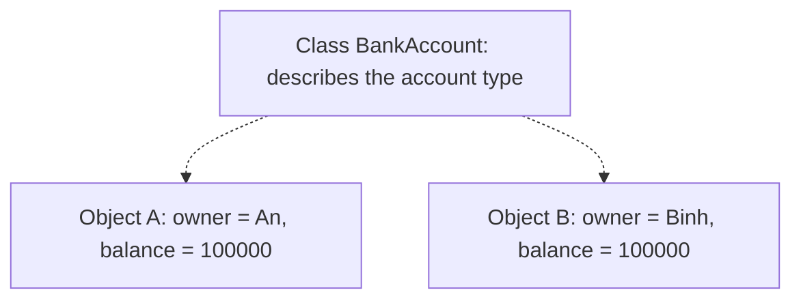
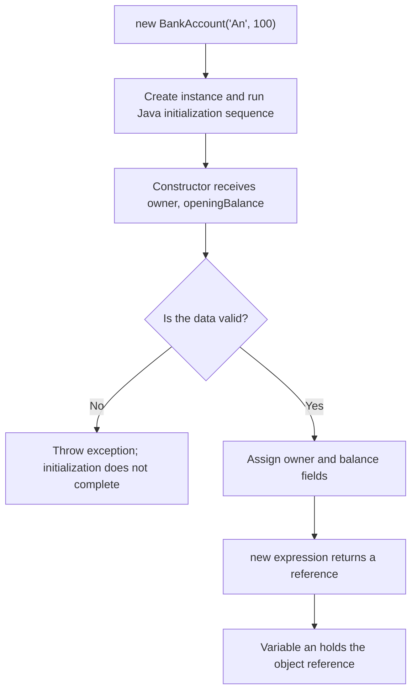

<a id="back-to-top"></a>

# Understanding Classes and Objects — Foundations Before the Four OOP Principles

## Menu
- [2.1 What Is an Object? Distinguishing Identity, State, Behavior, and Responsibility](#oop-2-1)
- [2.2 What Is a Class? Distinguishing Classes from Objects/Instances](#oop-2-2)
- [2.3 Creating Objects with Constructors; the Java Keywords new and this](#oop-2-3)
- [2.4 Fields, Methods, and How to Call Methods](#oop-2-4)
- [2.5 Reference Variables: Do Two Variables Refer to One Object or Two Different Objects?](#oop-2-5)

## <a id="oop-2-1">2.1 What Is an Object? Distinguishing Identity, State, Behavior, and Responsibility</a>

<details>
<summary>Click for details</summary>

In a banking application, you might encounter statements such as:

- Account A currently holds VND 100,000.
- Account A withdraws VND 30,000, leaving a balance of VND 70,000.
- Account B also holds VND 100,000, but it is a different account.
- Each account must ensure that withdrawals never exceed its balance.

These four statements illustrate four aspects of an **object** in object-oriented programming (OOP): **identity**, **state**, **behavior**, and **responsibility**.

An object is an entity within a program, created to represent a concept or perform a role. It may have data of its own, provide behaviors, and collaborate with other objects. In OOP design, the question is not merely “which variables and methods does this object have?” but also “which object is this, and what is it responsible for?”

We will start with a specific example, then distinguish the concepts one by one.

### 1. What Is an Object in Java?

In Java, an object is an **instance** of a class or of an instantiable reference type (such as a concrete class or array).

A class describes a type's structure and behavior. An object is a particular entity that exists when the program runs.

For example:

```java
class BankAccount {
    String owner;
    long balance;
}
```

This is only a **class definition**. Merely writing the class does not create any specific bank accounts.

When we execute:

```java
BankAccount accountA = new BankAccount();
accountA.owner = "An";
accountA.balance = 100_000;

BankAccount accountB = new BankAccount();
accountB.owner = "Binh";
accountB.balance = 100_000;
```

The program creates two separate objects. Both follow the same `BankAccount` definition, but each has its own data and separate existence.

A simple illustration:



In Java, variables such as `accountA` usually hold a **reference** to an object, rather than a copy of the entire object. Two different variables may reference **the same object**.

From here, we will see why identical data does not necessarily mean identical objects.

> **Terminology note:** Java also has a root class named `java.lang.Object`. That is the name of a particular class in the Java library. In this lesson, “object” means an **object in general**. The two notions are related, but they are not entirely synonymous.

### 2. Identity: “Which Object Is This?”

**Identity** is what distinguishes one object from another, even when they have the same type and identical data values.

Imagine two people both named “An” who are both 25 years old. They do not become the same person merely because their information matches.

In Java:

```java
BankAccount accountA = new BankAccount();
accountA.owner = "An";
accountA.balance = 100_000;

BankAccount accountB = new BankAccount();
accountB.owner = "An";
accountB.balance = 100_000;

BankAccount anotherReference = accountA;

System.out.println(accountA == accountB);         // false
System.out.println(accountA == anotherReference); // true
```

Line-by-line explanation:

- `accountA` and `accountB` are created by two separate `new` expressions, so they are different objects even though their current states match.
- `anotherReference = accountA` **does not create a new object**. Both variables refer to object A.
- For **references**, the `==` operator tests whether two references point to **the exact same object**. It does not compare the `owner` and `balance` fields.

#### Is Identity the Same as a Database ID?

Not necessarily. We must distinguish two layers of meaning:

| Concept | Example | Meaning |
| --- | --- | --- |
| Java object identity | `a == b` | Do two references point to the same object while the program runs? |
| Business identity | Account number `ACC-001` | How the system recognizes a business account across saves and loads |
| Data value | `balance = 100_000` | Current account information, which may change |

Suppose account `ACC-001` is loaded from the database on two occasions. The system might create two different Java objects representing the same business account `ACC-001`. In that case, `==` may be `false` even though both describe the same business entity.

**Do not equate object identity with a displayed memory address, `hashCode()`, or a database ID.** JVM memory management is an implementation detail, and a hash value is not a universally unique identifier.

#### How Do `==` and `equals()` Differ?

For ordinary objects:

- `==` between two references always tests whether they refer to **the same object**.
- `equals()` checks **equality according to rules defined by the class**. Unless overridden, the default `Object.equals()` behaves like reference comparison with `==`.
- Classes such as `String` override `equals()` to compare their contents.

For example:

```java
String first = new String("Java");
String second = new String("Java");

System.out.println(first == second);      // false
System.out.println(first.equals(second)); // true
```

Having the same `"Java"` content does not mean two variables reference the same object.

In a business model, `equals()` may need to compare IDs; in other cases, it may compare all relevant values. That is a **class design decision**, not a rule by which Java automatically treats every pair of objects with matching fields as one object.

### 3. State: “What Is This Object Like Right Now?”

**State** is the current information describing an object at a particular point in time.

An account might need:

- Account number: `ACC-001`.
- Account owner: `An`.
- Balance: `100_000`.
- Operating status: active or locked.

Some information may remain unchanged throughout the object's lifetime; other information changes over time.

For example, state before and after a withdrawal:

| Moment | Account | Balance |
| --- | --- | ---: |
| Before withdrawal | `ACC-001` | 100,000 |
| After withdrawing 30,000 | `ACC-001` | 70,000 |
| After attempting to withdraw 120,000 and being rejected | `ACC-001` | 70,000 |

We are still observing **the same account object**, but its state changed after a valid transaction.

This separates identity from state:

**Identity answers “who/which one is this?”, while state answers “what is it like now?”**

#### Must State Be Mutable?

No. An object may be **mutable** (its state can change) or **immutable** (its observable state remains unchanged after creation).

For example, an immutable coordinate:

```java
final class Point {
    private final int x;
    private final int y;

    Point(int x, int y) {
        this.x = x;
        this.y = y;
    }

    int x() { return x; }
    int y() { return y; }
}
```

Two `Point` objects may have identical `x, y` values but still be different Java objects. Having no setters does not make them any less “objects.”

Also, declaring a field `final` only prevents **reassigning that field's value or reference**. If the field holds a mutable list, the list's contents can still change. To make an object truly immutable, we must also consider mutable objects to which it refers.

### 4. Behavior: “What Can This Object Do?”

**Behavior** consists of operations an object can perform or requests that outside code can send it, commonly expressed as **instance methods**.

For an account, behaviors might be:

```java
account.deposit(50_000);
account.withdraw(30_000);
long currentBalance = account.getBalance();
```

`withdraw(30_000)` is more than a subtraction. That behavior may need to:

1. Verify that the requested amount is greater than zero.
2. Check whether the current balance is sufficient.
3. Update the balance only after all conditions are satisfied.
4. Report an error if the operation cannot be completed.

A behavior does not have to change state. For example, `getBalance()` only observes it, `isActive()` reports the active status, and `calculateFee()` computes a result.

Likewise, not every behavior has to be publicly exposed. An object may have `private` methods for internal implementation details, while its `public` methods represent the behaviors it promises external callers.

**Behavior does not mean “any function declared inside a class.”** A `static` function belongs to the class and has no particular receiver object; an instance method such as `account.withdraw(...)` operates on a specific object with its own state.

### 5. Responsibility: “What Is This Object Accountable For?”

This is the concept most easily confused with behavior.

**Behavior** describes a specific action. **Responsibility** describes an object's role or obligation within a design: **what it needs to know, what it must guarantee, and which work it must perform so the system behaves correctly**.

For `BankAccount`:

- Behavior: `deposit(amount)`, `withdraw(amount)`, `getBalance()`.
- Responsibility: **manage the account's balance and ensure operations that change it comply with account rules**.

If an account cannot be overdrawn, an important *invariant* is that **the balance must not be negative**. The object is responsible for protecting that rule through the operations it allows.

But must the account also generate statement PDFs, send SMS messages, call payment gateways, and render web pages?

Not necessarily. Those activities may belong to other objects or components.

| Component | Possible appropriate responsibility | Example behavior |
| --- | --- | --- |
| `BankAccount` | Maintain one account's state and rules | `withdraw()`, `deposit()` |
| `TransferService` | Coordinate transfers between accounts, handle requests and system-level conditions | `transfer(from, to, amount)` |
| `StatementGenerator` | Generate statements from transaction records | `generateStatement(...)` |
| `NotificationSender` | Send notifications through appropriate channels | `send(...)` |

Thus, an object may have multiple behaviors serving **one cohesive group of responsibilities**. Conversely, a single behavior is not enough to accurately define an object's responsibility.

For example, a class named `AccountManager` with 50 methods is not necessarily well designed; if it handles withdrawals, PDF export, email delivery, UI controls, and configuration reading, its responsibilities have become mixed. OOP does not require everything related to an “account” to be placed inside a single object.

#### Distinguish Them with Two Questions

When reading a method name, ask:

- “**What does it do?**” → You are describing behavior.
- “**Why** does this work and its rules belong to this object?” → You are describing responsibility.

For example, `withdraw()` is a behavior. Being responsible for **preventing an account from entering an invalid state** is part of its design and behavioral contract.

### 6. A Complete Java Example Showing All Four Concepts

Save the following as `Main.java` and run it:

```java
final class BankAccount {
    // State: data held by each object
    private final String accountNumber;
    private long balance;

    BankAccount(String accountNumber, long openingBalance) {
        if (accountNumber == null || accountNumber.isBlank()) {
            throw new IllegalArgumentException("Account number is required");
        }
        if (openingBalance < 0) {
            throw new IllegalArgumentException("Opening balance must be >= 0");
        }
        this.accountNumber = accountNumber;
        this.balance = openingBalance;
    }

    public String getAccountNumber() {
        return accountNumber;
    }

    public long getBalance() {
        return balance;
    }

    // Behavior: deposit money
    public void deposit(long amount) {
        requirePositive(amount);
        balance = Math.addExact(balance, amount);
    }

    // Behavior: withdraw money, validating to protect the invariant
    public void withdraw(long amount) {
        requirePositive(amount);
        if (amount > balance) {
            throw new IllegalStateException("Insufficient balance");
        }
        balance -= amount;
    }

    private static void requirePositive(long amount) {
        if (amount <= 0) {
            throw new IllegalArgumentException("Amount must be positive");
        }
    }
}

public class Main {
    public static void main(String[] args) {
        BankAccount accountA = new BankAccount("ACC-A", 100_000);
        BankAccount accountB = new BankAccount("ACC-B", 100_000);
        BankAccount aliasOfA = accountA;

        System.out.println(accountA == accountB);  // false
        System.out.println(accountA == aliasOfA);  // true

        accountA.withdraw(30_000);

        System.out.println(accountA.getBalance()); // 70000
        System.out.println(aliasOfA.getBalance()); // 70000
        System.out.println(accountB.getBalance()); // 100000

        try {
            accountA.withdraw(120_000);
        } catch (IllegalStateException ex) {
            System.out.println(ex.getMessage());
        }

        System.out.println(accountA.getBalance()); // 70000
    }
}
```

Output:

```text
false
true
70000
70000
100000
Insufficient balance
70000
```

This example uses `long` with integral monetary units for simplicity rather than using `double` for money. `Math.addExact` also detects addition that exceeds the `long` range by throwing an exception instead of silently overflowing. It simulates in-memory state; real-world transaction, persistence, and concurrency requirements are beyond this code's scope.

#### Read the Example Concept by Concept

**Identity**

`accountA` and `accountB` are **two different objects**, even though both initially have balances of 100,000. `aliasOfA` and `accountA` refer to **the same object**.

**State**

`accountA` has `accountNumber = "ACC-A"` and initially `balance = 100_000`. After withdrawal, its balance becomes `70_000`. `accountB` remains at `100_000`.

**Behavior**

`withdraw(30_000)` performs a withdrawal. `getBalance()` reads information. `deposit(...)` deposits funds.

**Responsibility**

`BankAccount` is responsible for maintaining the balance and checking withdrawal/deposit requests. There is no public `setBalance(...)` that allows callers to assign arbitrary balances.

#### What Happens When a Withdrawal Is Invalid?

Before calling `accountA.withdraw(120_000)`, the balance is `70_000`.

```text
Receive withdraw(120000) request
          |
          v
120000 > 0 ? -------- no --------> IllegalArgumentException
          |
         yes
          v
120000 <= 70000 ? --- no --------> IllegalStateException
          |
         (balance is not updated)
```

The subtraction does not happen, and `accountA` still holds `70_000`. This demonstrates the relationship between behavior and responsibility: the `withdraw` behavior checks conditions to fulfill the responsibility of keeping the state valid.

### 7. Why Does the Distinction Between Identity and State Matter?

Imagine tracking a shopping cart:

- At 9:00, the cart contains 1 item.
- At 9:05, the cart contains 3 items.
- At 9:10, the cart is empty after checkout.

We generally still refer to **the same shopping cart**, even though its contents have changed. Identity allows us to track an entity across time, while state describes its current snapshot.

The reverse also holds: two shopping carts that are both “empty” do not become one cart.

That is why identity matters when modeling entities such as `Order`, `Account`, and `ShoppingCart`. For values such as coordinates `Point(2, 3)` or money `Money(50, "USD")`, however, we often care more about **value equality** than whether the references are identical.

OOP supports both objects **with business identity** and objects **primarily representing values**. Not every object needs a separate `id` field or a customized `equals()` implementation.

### 8. Common Misconceptions

| Statement | True or false? | Explanation |
| --- | --- | --- |
| “Two objects with identical state are the same object.” | False | Matching data does not guarantee identical identity. |
| “Two different reference variables always point to two objects.” | False | `aliasOfA = accountA` creates another reference to an existing object. |
| “State consists only of fields that can change.” | False | Immutable information is also part of state. |
| “Every object must have setters.” | False | An object may be immutable or only allow changes through business behaviors. |
| “Behavior only means methods that change state.” | False | Methods that read, validate, or calculate also represent behavior. |
| “Responsibility is a list of method names.” | Incomplete | Responsibility describes the work and rules the object must ensure. |
| “Creating a class with fields and getters/setters is automatically good OOP design.” | False | Responsibility boundaries and state protection still matter. |
| “Java objects and database rows always correspond one-to-one.” | False | A row may be loaded into several objects at different times or in different contexts. |

Another common design mistake is putting **all business logic outside the object**, leaving the object with fields and getters/setters:

```java
// Caller directly decides how to change balance:
account.setBalance(account.getBalance() - amount);
```

Without controlled rules, callers may subtract more than the account's balance. Calling `account.withdraw(amount)` makes it clear which object must validate and update the balance.

That said, data-only objects can still serve useful purposes, such as DTOs that transfer data between application layers. Not every class must contain business logic; its design should fit its real role.

### 9. Try Reasoning: Two Objects or One?

Before running the code, predict the output:

```java
BankAccount first = new BankAccount("ACC-1", 100);
BankAccount second = new BankAccount("ACC-2", 100);
BankAccount third = first;

first.withdraw(30);

System.out.println(first == second);      // ?
System.out.println(first == third);       // ?
System.out.println(second.getBalance());  // ?
System.out.println(third.getBalance());   // ?
```

Answer:

```text
false
true
100
70
```

Why?

- `first` and `second` are created independently → different identities.
- `third` refers to the same object as `first` → same identity.
- State changes made through `first` are also visible through `third` because both reference one object.
- `second` has its own state and is unaffected.

Now describe an **order** in exactly four statements, one for each concept:

1. **Identity:** Which order? For example, order `ORD-101`.
2. **State:** What information does the order currently contain? For example, product list, total, and status `CREATED`.
3. **Behavior:** What actions does the order permit? Examples include `addItem()`, `cancel()`, and `markPaid()` when appropriate for the business.
4. **Responsibility:** What must the order guarantee? For example, not allowing product changes after completion or refusing to become `PAID` before payment is confirmed.

If your only answer is “an order has fields `id`, `status`, and `total`,” you are primarily describing **state**. Meaningful object design also requires identifying its **behaviors** and **responsibilities**.

The four aspects are closely connected: **identity** identifies the object being discussed; **state** describes its current condition; **behavior** describes what it can do or which requests it can respond to; **responsibility** explains why that particular object must carry out the work and uphold the associated rules.

</details>

- [Back to top](#back-to-top)

---

## <a id="oop-2-2">2.2 What Is a Class? Distinguishing Classes from Objects/Instances</a>

<details>
<summary>Click for details</summary>

### 1. Start with a Familiar Real-World Example

Imagine a banking system managing two accounts:

- An's account **A-01** holds VND 100,000.
- Binh's account **B-02** also holds VND 100,000.

Both accounts have characteristics in common: each has an account number, a balance, and the ability to receive deposits. But they **are not the same account**. When An deposits another VND 50,000, Binh's balance does not automatically increase.

In object-oriented programming (OOP), we need a way to describe **what accounts have in common** while preserving **the separate state** of each account.

This brings us to three concepts:

- **Class:** a *definition of an object type* that describes the data, behavior, and rules associated with objects of that type.
- **Object:** an entity created from the class definition when the program runs, with its own state and identity.
- **Instance:** usually another name for an object, emphasizing that it is **an instance of a particular class**.

For example, `BankAccount` is a **class**; account A-01 existing in the program is **an object**, or **an instance of `BankAccount`**.

The key distinction is: **a class describes a kind of object; an object is a concrete member of that kind**.

### 2. Writing a Class in Java

Consider this declaration:

```java
class BankAccount {
    private final String accountNumber;
    private long balance;

    BankAccount(String accountNumber, long initialBalance) {
        if (accountNumber == null || accountNumber.isBlank()) {
            throw new IllegalArgumentException("Invalid account number");
        }
        if (initialBalance < 0) {
            throw new IllegalArgumentException("Opening balance must not be negative");
        }

        this.accountNumber = accountNumber;
        this.balance = initialBalance;
    }

    String getAccountNumber() {
        return accountNumber;
    }

    long getBalance() {
        return balance;
    }

    void deposit(long amount) {
        if (amount <= 0) {
            throw new IllegalArgumentException("Deposit amount must be greater than 0");
        }
        balance = Math.addExact(balance, amount);
    }
}
```

Read its business meaning first, then examine the Java syntax.

**`class BankAccount`** declares an object type called `BankAccount`. It does not already stand for An's or Binh's specific account.

Inside the class, we have two broad groups of components:

| Component | Declaration | Meaning |
|---|---|---|
| **Field** | `accountNumber` | The account's identifier |
| **Field** | `balance` | Its current balance |
| **Constructor** | `BankAccount(...)` | Validate data and establish initial state |
| **Method** | `getBalance()` | Report the balance |
| **Method** | `deposit(...)` | Deposit money according to the account's rules |

Fields and methods are more than a naming convention for data and functions. In this example, they tell us **what an account has** and **what the account knows how to do**.

Both fields are declared `private`, so outside code cannot arbitrarily set `balance = -100`. To change the balance, a caller asks the object to perform `deposit(...)`. This helps the class enforce the rules under its control.

**But at this stage, we have only declared a class.** Writing the `BankAccount` definition does not by itself create any particular account.

### 3. Creating Objects from a Class with `new`

To give the program a specific account, we create an object:

```java
BankAccount an = new BankAccount("A-01", 100_000);
BankAccount binh = new BankAccount("B-02", 100_000);
```

Read the first statement by itself:

```text
BankAccount     an       =      new BankAccount("A-01", 100_000);
    │            │                     │
    │            │                     └─ Creates a new BankAccount object
    │            └─ Reference variable named an
    └─ Variable's declared type
```

We must distinguish three things that are often confused:

1. **`BankAccount`:** the class, meaning the type Java uses to describe the permitted operations.
2. **`new BankAccount(...)`:** an expression that creates a new object and invokes its constructor to initialize it.
3. **`an`:** a reference variable used to refer to and work with that object.

The variable `an` is **not the entire class definition**. Nor is it “the class itself.” It holds a **reference** to an object.

Visualize it like this:

```text
                  DEFINITION
             ┌──────────────────┐
             │ class BankAccount│
             │ accountNumber    │
             │ balance          │
             │ deposit()        │
             └──────────────────┘
                  │        │
               creates   creates
                  │        │
                  ▼        ▼
          ┌────────────┐  ┌────────────┐
          │ Object #1  │  │ Object #2  │
          │ id: A-01   │  │ id: B-02   │
          │ balance:   │  │ balance:   │
          │ 100,000    │  │ 100,000    │
          └────────────┘  └────────────┘
                ▲                ▲
                │                │
           variable an      variable binh
```

**One class can be used to create many objects.** They follow the same class definition, but each has its own instance-field values.

In Java, a class declaration also defines the type used for compiler checks, and the JVM manages type information at runtime. The diagram only shows a conceptual relationship, not the JVM's exact memory addresses.

### 4. Try It: One Class, Two Independent Objects

Here is a complete program you can run in `Main.java`. It has a `Main` class to launch the application and a `BankAccount` class to represent accounts.

```java
public class Main {
    public static void main(String[] args) {
        BankAccount an = new BankAccount("A-01", 100_000);
        BankAccount binh = new BankAccount("B-02", 100_000);

        System.out.println(an.getBalance());   // 100000
        System.out.println(binh.getBalance()); // 100000

        an.deposit(50_000);

        System.out.println(an.getBalance());   // 150000
        System.out.println(binh.getBalance()); // 100000
    }
}

class BankAccount {
    private final String accountNumber;
    private long balance;

    BankAccount(String accountNumber, long initialBalance) {
        if (accountNumber == null || accountNumber.isBlank()) {
            throw new IllegalArgumentException("Invalid account number");
        }
        if (initialBalance < 0) {
            throw new IllegalArgumentException("Opening balance must not be negative");
        }
        this.accountNumber = accountNumber;
        this.balance = initialBalance;
    }

    String getAccountNumber() {
        return accountNumber;
    }

    long getBalance() {
        return balance;
    }

    void deposit(long amount) {
        if (amount <= 0) {
            throw new IllegalArgumentException("Deposit amount must be positive");
        }
        balance = Math.addExact(balance, amount);
    }
}
```

Result:

```text
100000
100000
150000
100000
```

What happened?

| Step | An's object | Binh's object |
|---|---|---|
| Just created | `balance = 100_000` | `balance = 100_000` |
| Called `an.deposit(50_000)` | `balance = 150_000` | `balance = 100_000` |
| Read the balances again | `150_000` | `100_000` |

**The method is defined in the class, but when invoked on an object it works with that object's state.**

In `an.deposit(50_000)`, the `deposit` method changes the `balance` of the object referenced by `an`. It does not change the instance field of the object referenced by `binh`.

This is one reason classes and objects must be distinguished: they are related but play different roles.

### 5. A Class Is Like a Blueprint, but the Analogy Has Limits

People often say **a class is a blueprint, and an object is a product created from that blueprint**.

For example:

- A car design specifies components and capabilities such as accelerating and braking.
- Two real cars can follow the same design but have different license plates, fuel levels, and distances traveled.

The analogy helps beginners understand the difference between **a common specification** and **a concrete entity**.

But two points deserve a more precise explanation:

**First, a Java class also defines a type and behavior.** It is not merely an empty diagram; it may contain executable method code, constructors, access rules, and static members.

**Second, an object is not a complete copy of the class's source code.** Objects of the same class use the same behavioral definitions but have **their own instance state**. Java and the JVM determine the exact organization of code and memory; you need not imagine each object containing a full copy of every method.

So use the blueprint analogy as **a starting point**, then return to three precise ideas: **a class defines a type — `new` creates an object — each object holds its own state**.

### 6. Are Objects and Instances Different?

For a statement like:

```java
BankAccount account = new BankAccount("A-01", 100_000);
```

we can equally say:

- “The variable `account` refers to an **object**.”
- “This object is an **instance of `BankAccount`**.”

The word **object** emphasizes an entity in the program. **Instance** emphasizes the entity's relationship to a specific class or type.

Saying that “`new BankAccount(...)` creates a `BankAccount` instance” is entirely natural Java terminology.

An object of a subclass can also be viewed through a superclass or interface type:

```java
class Animal { }

class Dog extends Animal { }

Animal pet = new Dog();

System.out.println(pet instanceof Animal); // true
System.out.println(pet instanceof Dog);    // true
```

Here, the actual object was created from `Dog`, while the variable `pet` is declared as `Animal`. When identifying the exact class used to create the object, we say it is **a `Dog` object**; it is also **compatible with types** such as `Animal`.

This example only clarifies the difference between class/object and reference type. You do not need to study inheritance in depth yet.

### 7. Object Versus Reference Variable: Two Variables Can Point to One Object

This is a very common misunderstanding.

Consider:

```java
BankAccount an = new BankAccount("A-01", 100_000);
BankAccount anotherName = an;

anotherName.deposit(20_000);

System.out.println(an.getBalance());          // 120000
System.out.println(anotherName.getBalance()); // 120000
```

There are **two variables**, `an` and `anotherName`, but only **one `BankAccount` object** was created. Assigning `anotherName = an` **copies the reference value**, not the object itself.

```text
an ──────────────┐
                 ▼
            ┌───────────────┐
anotherName ───► Object A-01 │
            │ balance:120000│
            └───────────────┘
```

Because both variables reference one object, a state change made through one variable is also visible through the other.

Compare:

```java
BankAccount first  = new BankAccount("A-01", 100_000);
BankAccount second = new BankAccount("B-02", 100_000);

System.out.println(first == second); // false

BankAccount alias = first;
System.out.println(first == alias);  // true
```

For two **object references**, `==` checks whether they both point to **the same object**.

- `first == second` is `false`: two separate `new` expressions created two objects.
- `first == alias` is `true`: both variables refer to the same object.

Even if two objects have equal field values, they are **not necessarily the same object**.

#### Then When Do We Use `equals()`?

`==` checks **object identity** for reference types. By contrast, `equals()` is a method a class can redefine to test **equality according to business meaning**.

Without an override, the default implementation inherited from `Object` compares identity, similarly to `==`. Classes such as `String` override `equals()` to compare text values.

```java
String x = new String("Java");
String y = new String("Java");

System.out.println(x == y);      // false: hai object String
System.out.println(x.equals(y)); // true: equal contents
```

The point to understand is that **an object's identity** differs from **the values or state it carries**. You will encounter this difference repeatedly when working with lists, maps, and business objects.

### 8. What Gets Initialized When an Object Is Created?

Consider:

```java
BankAccount an = new BankAccount("A-01", 100_000);
```

Think through the steps:

1. Java checks that the constructor call is valid in syntax and types.
2. When execution reaches `new BankAccount(...)`, the JVM creates a new object of the corresponding type.
3. The instance fields receive Java-defined default values before class initialization code runs.
4. Initialization and constructor logic validate the input, then establish `accountNumber` and `balance`.
5. If initialization completes, the expression returns a reference to the object, which is assigned to `an`.

In this example, the successfully initialized object has:

```text
accountNumber = "A-01"
balance       = 100000
```

If `initialBalance` is `-5`, the constructor throws `IllegalArgumentException`; the creation expression does not return a successfully initialized reference to assign to `an`.

A constructor is **not another object**. It is an initialization mechanism that runs as part of object creation.

You will also see:

```java
BankAccount account = null;
```

That line **only declares a reference variable**; it does not create a `BankAccount`. `null` means the variable currently references no object. Calling `account.getBalance()` in that state throws `NullPointerException`.

Avoid thinking that “declaring a variable of type `BankAccount` means an account already exists.” To obtain a new object as in this example, you actually have to create it, usually with `new`.

### 9. Object Fields Versus `static` Class Members

So far, we have seen two `BankAccount` objects with independent balances. This holds for **instance fields** (fields without `static`), such as:

```java
private long balance;
```

Creating two objects gives them **two independent `balance` values**.

What about members declared `static`?

```java
class Greeting {
    static String language = "vi";
    String message;

    Greeting(String message) {
        this.message = message;
    }
}

Greeting a = new Greeting("Hello");
Greeting b = new Greeting("Hello there");

System.out.println(a.message);        // Prints "Hello"
System.out.println(b.message);        // Prints "Hello there"
System.out.println(Greeting.language); // vi
```

Here:

| Component | What does it conceptually belong to? | How are its values used? |
|---|---|---|
| `message` | Each `Greeting` instance | `a` and `b` contain different values |
| `language` with `static` | The `Greeting` class | A static member shared among the class's instances in the same class-loading context |
| `static` method | The class | Can be called through the class name, without an instance |

`static` reminds us that **not every member declared in a class becomes separate state in every object**. Static members are best accessed through the class name, as in `Greeting.language`, to make their meaning clear.

This does not change what we learned about classes and objects: a class defines both shared members and members associated with individual instances.

### 10. Easy Misconceptions

| Statement | True or false? | Why? |
|---|---|---|
| “Writing `class Car { }` creates a car.” | **False** | That declares a class but creates no `Car` object. |
| “One class can create many objects.” | **True** | Every successful creation of a new object adds another instance. |
| “Two objects of one class must have identical fields.” | **False** | They have the same structure but may have different instance state. |
| “Two differently named variables always point to different objects.” | **False** | They may contain the same reference. |
| “`new` is the class's name.” | **False** | `new` is an operator used in object-creation expressions. |
| “Object and instance usually refer to the same entity.” | **True** | Instance emphasizes that an entity belongs to a class or type. |
| “`BankAccount account = null` already creates an object.” | **False** | That variable does not yet reference an object. |
| “All fields in a class belong separately to every object.” | **False** | Instance fields and `static` fields have different associations. |
| “Two objects with identical values are the same object.” | **False** | Equal state must be distinguished from object identity. |

Another possible source of confusion is that Java also includes the library type `java.lang.Class`, which represents runtime type information, for example `BankAccount.class`. That is **a separate topic** from writing the declaration `class BankAccount`. You do not need to understand reflection or `Class<?>` in depth to distinguish classes from objects here.

### 11. Where Should You Start When Designing a Class?

Beginners often see a noun and immediately create a class file: `Student`, `Book`, `Order`, `Payment`… But a useful class must represent **a meaningful responsibility in the program**, not merely a name.

Ask yourself:

1. **What does this object represent?** For example, a specific bank account.
2. **Which data must each object keep separately?** For example, account number and balance.
3. **What should callers ask the object to do?** For example, accept a deposit or report its balance.
4. **Which rules must always hold?** For example, no negative opening balances and no zero-value deposits.
5. **Which information should be kept inside the object?** For example, outside code must not modify `balance` directly.

These questions lead to a class with a clear purpose. When we later need to manage multiple accounts, we create multiple objects of that class and give each its own state.

Not every concept requires an object. Simple utility functions, immutable values, and temporary data may have other appropriate representations. OOP helps us organize software when classes and objects serve **the right roles**, not when we force everything to become a class.

### 12. Try a Very Short Exercise

Given:

```java
BankAccount a = new BankAccount("A-01", 100_000);
BankAccount b = new BankAccount("B-02", 100_000);
BankAccount c = a;

a.deposit(10_000);
c.deposit(20_000);

System.out.println(a.getBalance());
System.out.println(b.getBalance());
System.out.println(c.getBalance());
System.out.println(a == c);
System.out.println(a == b);
```

Before reading the solution, count: **How many variables? How many objects are created?** Do `a` and `c` have the same balance? Why?

**Answer:**

```text
130000
100000
130000
true
false
```

There are **three reference variables** (`a`, `b`, `c`) but only **two objects**, because `new BankAccount(...)` is called only twice. `c = a` does not create another object.

When `a.deposit(10_000)` runs, account A-01 increases from 100,000 to 110,000. When `c.deposit(20_000)` runs, **that same A-01 account** increases again to 130,000 because `c` refers to the object referenced by `a`. B-02 remains at 100,000.

Understanding this example means you understand the essential difference:

- **Class:** a shared definition of data, behavior, and rules.
- **Object/instance:** a particular entity created according to that definition with its own state.
- **Reference:** how a Java variable refers to an object; several variables may reference the same one.

Distinguishing these three concepts will make Java code much easier to read, particularly when using `new`, passing objects into methods, working with object lists, or changing state through multiple variables.

</details>

- [Back to top](#back-to-top)

---

## <a id="oop-2-3">2.3 Creating Objects with Constructors; the Java Keywords new and this</a>

<details>
<summary>Click for details</summary>

When learning object-oriented programming in Java, you will eventually encounter a line like:

```java
BankAccount an = new BankAccount("An", 100);
```

It may look as if the line simply “creates an account,” but it actually contains three distinct ideas:

1. **`new`** creates a new **object**.
2. A **constructor** initializes that object with appropriate initial data.
3. **`an`** is a **reference variable** used to access the newly created object.

Inside the constructor, the keyword **`this`** makes it clear that “this is data or behavior belonging to the very object being created.”

Understanding these three concepts helps answer: **When does an object come into existence? Why do two `new` expressions produce different objects? Where does the initial data come from? And what exactly does `this.name = name` assign?**

### 1. From Class to Object: Start with `new`

A **class** is a general description. For instance, the `BankAccount` class says that an account has an owner's name, a balance, and some behaviors. But writing that class does not yet produce “An's account” or “Binh's account.”

To create objects, we use the `new` expression:

```java
BankAccount an = new BankAccount("An", 100);
BankAccount binh = new BankAccount("Binh", 100);
```

The two `new` expressions create **two independent objects**. Although both balances are 100, these are not one and the same account.

```text
Class BankAccount
     |
     |  new BankAccount("An", 100)
     v
Object #1: { owner = "An", balance = 100 }  <--- variable an

     |  new BankAccount("Binh", 100)
     v
Object #2: { owner = "Binh", balance = 100 } <--- variable binh
```

Break the Java line into parts:

| Code element | Role |
|---|---|
| `BankAccount` on the left | Declared type of the reference variable |
| `an` | Variable name used to work with the object |
| `new` | Begins an expression creating a new object |
| `BankAccount("An", 100)` | Selects and invokes the constructor with matching arguments |
| `=` | Assigns the successfully created object's reference to `an` |

An important distinction: **`an` is not the object itself**. It holds a reference to the object. We can have two variables referencing the same object without creating another:

```java
BankAccount an = new BankAccount("An", 100);
BankAccount anotherName = an; // No new expression

System.out.println(an == anotherName); // true
```

In Java, `==` between two reference variables checks whether they point to **the same object**. The assignment `anotherName = an` merely copies the reference; it does not run the constructor again.

### 2. What Is a Constructor, and What Does It Do?

A **constructor** is a special class member executed during object creation. It commonly:

- Receives information required to create the object.
- Validates the input data.
- Establishes a valid initial state.
- Ensures the object is ready for its subsequent behaviors.

Consider this simple class:

```java
class BankAccount {
    private String owner;
    private int balance;

    BankAccount(String owner, int openingBalance) {
        if (owner == null || owner.isBlank()) {
            throw new IllegalArgumentException("Invalid account owner name");
        }
        if (openingBalance < 0) {
            throw new IllegalArgumentException("Opening balance cannot be negative");
        }

        this.owner = owner;
        this.balance = openingBalance;
    }
}
```

When we call:

```java
BankAccount an = new BankAccount("An", 100);
```

the constructor receives `owner = "An"` and `openingBalance = 100`. After validation, it assigns the data to fields belonging to **the object currently being created**.

If we write `new BankAccount("", -20)`, the constructor throws `IllegalArgumentException`. The creation expression does not complete normally, so the variable on the left side of the initialization statement does not receive a reference to a successfully created object.

#### Recognizing a Constructor in Java

| Characteristic | Constructor | Ordinary method |
|---|---|---|
| Name | Must match the class name | Named according to behavior |
| Declared return type | **None**, not even `void` | Has one: `void`, `int`, `String`, etc. |
| When executed | During instance initialization as part of object creation | When invoked through a method call |
| Typical purpose | Establish initial state | Perform behavior after the object exists |
| Can it be invoked as `an.BankAccount(...)`? | No | Not applicable; methods are invoked by method name |

For example, writing `void BankAccount(String name)` **does not define a constructor**; it defines a method named `BankAccount` with a `void` return type.

### 3. How Do `new` and a Constructor Work Together?

In simplified terms, for an ordinary class:

1. `new` begins creating an instance, and Java allocates storage for the object.
2. Fields initially receive language-defined defaults (for example, `int` becomes `0` and references become `null`). Superclass initialization, field initializers, and constructors then execute according to Java's rules.
3. The selected constructor checks arguments and establishes the initial state.
4. If the entire process succeeds, the `new ...` expression returns a reference to the object.
5. That reference is assigned to `an`, after which we can invoke the object's behaviors.



With inheritance, Java must also initialize the superclass portion in the correct order. When a constructor does not start with an explicit constructor invocation, the compiler normally inserts an implicit `super()` where valid. The sequence is more complicated for deeper inheritance chains; the key point here is that **constructors participate in initialization, whereas `new` is the instance-creation expression**.

Do not confuse invoking a constructor with “creating another object inside the object.” For example, `this(...)` calls another constructor for **the same instance being initialized**, not a separate new instance.

### 4. The `this` Keyword: “The Current Object”

The keyword **`this`** refers to **the current instance** while a constructor or instance method executes.

Here is an extremely common pattern:

```java
class Student {
    private String name;

    Student(String name) {
        this.name = name;
    }
}
```

Two elements are named `name`:

- `name` to the right of `=` is the **parameter** passed into the constructor.
- `this.name` on the left is the **field of the current object**.

```text
new Student("An")
        |
        v
Constructor: Student(String name)
                         |
                         +--> parameter name = "An"
        |
        v
this.name = name
    |         |
    |         +---- take "An" from the parameter
    +-------------- assign it to the object's name field
```

If you accidentally write:

```java
Student(String name) {
    name = name;
}
```

both occurrences of `name` refer to **the local parameter**, so the object field is never assigned. The field `name` may remain `null`, producing incorrect results later without necessarily causing a constructor error.

#### When Do We Need `this.field`?

When a parameter or local variable has **the same name** as a field, `this.field` distinguishes them clearly. Without a naming conflict, `this.` can be omitted:

```java
class Counter {
    private int count;

    void increment() {
        count++;       // equivalent to this.count++
    }

    int getCount() {
        return this.count;
    }
}
```

`this` can also call another instance method of the current object, such as `this.increment()`.

**Note:** You cannot use `this` in a `static` context to refer to a particular instance. For example, `public static void main(...)` has no current receiver object associated with invoking `main`.

### 5. How Is `this(...)` Different from `this.field`?

The syntax looks similar but serves different purposes:

| Syntax | Purpose |
|---|---|
| `this.name` | Read or assign the current object's `name` field |
| `this.getName()` | Invoke the current object's `getName()` instance method |
| `this("An", 0)` | Call **another constructor in the same class** |
| `super(...)` | Call a superclass constructor |

A class may have **multiple constructors**, offering different ways to initialize it. This is called **constructor overloading**.

For example, when an account is created without an opening balance, default it to zero.

```java
class BankAccount {
    private final String owner;
    private int balance;

    BankAccount(String owner) {
        this(owner, 0); // Calls the two-argument constructor
    }

    BankAccount(String owner, int openingBalance) {
        if (owner == null || owner.isBlank() || openingBalance < 0) {
            throw new IllegalArgumentException("Invalid account information");
        }
        this.owner = owner;
        this.balance = openingBalance;
    }
}
```

Then:

```java
BankAccount an = new BankAccount("An");        // opening balance = 0
BankAccount binh = new BankAccount("Binh", 100); // opening balance = 100
```

`this(owner, 0)` delegates initialization to the two-parameter constructor. **It does not create another object**; it reuses common initialization rules.

Under the familiar Java syntax (including Java 21), `this(...)` or `super(...)` must be **the first statement** in a constructor when present. You therefore cannot call `this(...)` at the end of the constructor after other statements. For newer Java versions that change this part of the language, check the rules of the JDK version you are compiling with.

Likewise, a constructor cannot invoke both `this(...)` and `super(...)` as two explicit constructor calls within the same constructor. The final constructor in the `this(...)` chain must initialize the superclass according to the appropriate rules.

### 6. Complete Java Example: Constructor, `new`, and `this` Working Together

Save everything as `Main.java`:

```java
public class Main {
    public static void main(String[] args) {
        BankAccount an = new BankAccount("An");
        BankAccount binh = new BankAccount("Binh", 100);

        System.out.println(an.describe());
        System.out.println(binh.describe());

        an.deposit(20);
        System.out.println(an.describe());
        System.out.println(binh.describe());

        BankAccount alias = an;
        System.out.println("alias refers to the same object as an? " + (alias == an));
        System.out.println("an refers to the same object as binh? " + (an == binh));
    }
}

class BankAccount {
    private final String owner;
    private int balance;

    // When openingBalance is omitted, default it to zero.
    BankAccount(String owner) {
        this(owner, 0);
    }

    // Common constructor: validate and assign the initial state.
    BankAccount(String owner, int openingBalance) {
        if (owner == null || owner.isBlank()) {
            throw new IllegalArgumentException("Invalid account owner name");
        }
        if (openingBalance < 0) {
            throw new IllegalArgumentException("Opening balance cannot be negative");
        }

        this.owner = owner;
        this.balance = openingBalance;
    }

    void deposit(int amount) {
        if (amount <= 0) {
            throw new IllegalArgumentException("Deposit amount must be positive");
        }
        this.balance = Math.addExact(this.balance, amount);
    }

    String describe() {
        return this.owner + ": " + this.balance;
    }
}
```

Output:

```text
An: 0
Binh: 100
An: 20
Binh: 100
alias refers to the same object as an? true
an refers to the same object as binh? false
```

#### Why Are Those Lines Printed?

**1. `new BankAccount("An")`:** `new` creates a new instance. The one-argument constructor calls `this(owner, 0)`. The two-argument constructor validates `"An"` and `0` and assigns them to the object's fields. An's account starts at zero.

**2. `new BankAccount("Binh", 100)`:** creates **another instance**. The two-argument constructor runs directly, and the new object starts with a balance of 100.

**3. `an.deposit(20)`:** performs a behavior on an existing object, **not another initialization**. It updates the `balance` field of An's object to 20.

**4. `binh.describe()` still returns `"Binh: 100"`:** the objects are independent, so changing An's account does not affect Binh's.

**5. `BankAccount alias = an`:** there is no `new`, so no third account is created. `alias` and `an` refer to the same object. Comparing them with `==` yields `true`.

#### Which Rules Does the Constructor Enforce?

Immediately after successful creation, every account has:

- A non-`null`, nonblank `owner` string.
- A nonnegative `balance`.
- A `final` `owner` field that cannot be reassigned after valid initialization.

This is an important constructor benefit: **an object enters a valid state as soon as it becomes available for use**. Methods that change state later (such as `deposit` or `withdraw`) must continue to preserve those rules.

### 7. No-argument Constructors and Default Constructors

Distinguish three cases.

#### No Constructor Is Declared

```java
class Box {
    int width;
}

Box box = new Box(); // Valid
```

When a class declares no constructors, the compiler supplies a no-argument **default constructor** if the class is valid. This generated constructor has access determined according to Java's rules and invokes an appropriate superclass constructor.

The `int` field `width` has a default value of `0`. However, **whether zero is valid in the business domain** is a separate design decision. Do not rely on it merely because Java allows it.

#### You Have Declared a Constructor with Parameters

```java
class Box {
    private final int width;

    Box(int width) {
        this.width = width;
    }
}

Box a = new Box(10); // Valid
// Box b = new Box(); // Compilation error: Box() does not exist
```

Once you declare any constructor, the compiler **does not automatically generate** a no-argument default constructor. If you want `new Box()` to work, you must declare a corresponding constructor.

#### Explicitly Declaring a No-argument Constructor

```java
class Box {
    private final int width;

    Box() {
        this(1); // Sets a valid default value
    }

    Box(int width) {
        if (width <= 0) {
            throw new IllegalArgumentException("width must be positive");
        }
        this.width = width;
    }
}
```

Here, `Box()` is a no-argument constructor **written by the programmer**, unlike a compiler-provided default constructor. It can invoke `this(1)` to reuse validation logic.

### 8. Very Common Errors

| Code or assumption | Problem | Correct understanding |
|---|---|---|
| `void Student(String name)` is a constructor | Incorrect: it has a `void` return type and is a method | A constructor uses the class name and **declares no return type** |
| `name = name` when a parameter shadows a field | Both sides may refer to the parameter | Use `this.name = name` to assign the field |
| Calling `new Account()` when only `Account(String owner)` exists | No matching constructor exists | Add `Account()` or supply the required argument |
| Assuming `this(owner, 0)` creates another object | Incorrect: it calls a constructor on **the same instance** | Use it to consolidate initialization logic |
| Using `this` in `static main` | There is no current instance | Use a specific object or an appropriate static method |
| Calling `new` several times and assuming all variables refer to one object | Every normally completed creation expression produces a new object | Reference assignment such as `b = a` makes two variables refer to an existing object |
| Assigning fields without checking the input | An object may begin in an invalid state | Constructors should enforce important initialization conditions |

A subtler problem is **calling an overridable method from a constructor**. The subclass method might execute before the subclass's initialization has finished, reading state that is not ready. For beginners, it is safer to keep initialization logic explicit, prefer `private` or `final` helper methods in constructors, and avoid invoking overridable behaviors from constructors.

### 9. Predict the Output Before Running the Code

Consider this class:

```java
class Counter {
    private int value;

    Counter() {
        this(0);
    }

    Counter(int value) {
        this.value = value;
    }

    void increase() {
        this.value++;
    }

    int getValue() {
        return value;
    }
}
```

And the code using it:

```java
Counter a = new Counter();
Counter b = new Counter(5);
Counter c = a;

c.increase();

System.out.println(a.getValue());
System.out.println(b.getValue());
System.out.println(a == c);
System.out.println(a == b);
```

Try answering before looking:

```text
1
5
true
false
```

**Why?** `new Counter()` creates object A; its no-argument constructor invokes `this(0)`, so A starts at zero. `new Counter(5)` creates an independent object B starting at 5. `c = a` simply copies the reference; `c.increase()` increments object A to 1, so `a.getValue()` also returns 1.

---

When reading a line such as `Student s = new Student("An")`, picture the process clearly: **`new` creates an instance; the constructor validates and establishes its initial state; `this` refers to the very instance being initialized; and `s` holds a reference used to work with it**. Java syntax then becomes a traceable object-creation process rather than a disconnected string of keywords.

</details>

- [Back to top](#back-to-top)

---

## <a id="oop-2-4">2.4 Fields, Methods, and How to Call Methods</a>

<details>
<summary>Click for details</summary>

Suppose you are writing a program that manages a desk lamp. Every lamp needs to know its **name**, whether it is **on or off**, and its **current brightness**. A user can **turn it on**, **turn it off**, or **adjust its brightness**.

In Java, we can place these related pieces of information and operations inside one class:

- **Attribute/field:** describes information the object holds, such as `name`, `on`, and `brightness`.
- **Method:** defines actions or capabilities offered by the object, such as `turnOn()`, `turnOff()`, and `setBrightness(...)`.

The important distinction is: **fields describe the data an object currently holds; methods describe what can be done with that object**. A method can read, modify, or compute from data, but it can also perform work without changing the state.

### 1. Examine a Concrete Class

Here is a simple example:

```java
class Lamp {
    String name;        // Field
    boolean on;         // Field
    int brightness;     // Field

    void turnOn() {     // Method
        on = true;
    }

    void turnOff() {    // Method
        on = false;
    }

    void showStatus() { // Method
        System.out.println(name + ": on=" + on
                + ", brightness=" + brightness);
    }
}
```

`Lamp` is the **class**, the definition describing structure and behavior. Once we create an object:

```java
Lamp deskLamp = new Lamp();
deskLamp.name = "Desk lamp";
deskLamp.brightness = 60;
deskLamp.turnOn();
deskLamp.showStatus();
```

Result:

```text
Desk lamp: on=true, brightness=60
```

Read the statements in ordinary language:

| Java expression | Meaning |
| --- | --- |
| `new Lamp()` | Create an object of type `Lamp` |
| `deskLamp.name` | Access the `name` field of the object referenced by `deskLamp` |
| `deskLamp.brightness = 60` | Assign a new value to a field |
| `deskLamp.turnOn()` | Request that the object perform `turnOn` |
| `deskLamp.showStatus()` | Call the method that displays the current state |

The dot `.` is the member-access operator. For a **field**, we write `object.field`. For a **method**, we usually write `object.method(arguments)`, where the parentheses invoke the method.

Note that the initial class allows external code to assign `brightness = -100`. It helps us recognize fields and methods, but it does not yet protect state well. Later, we will improve the design using `private` and validating methods.

### 2. Fields: The State of Each Object

A **field** is a variable declared directly inside a class body, outside its methods, constructors, and local blocks. For an *instance field*, each object has its own state.

For example:

```java
class Student {
    String name;
    int score;
}

public class Main {
    public static void main(String[] args) {
        Student an = new Student();
        an.name = "An";
        an.score = 90;

        Student binh = new Student();
        binh.name = "Binh";
        binh.score = 75;

        System.out.println(an.score);   // 90
        System.out.println(binh.score); // 75
    }
}
```

Although `an` and `binh` both belong to class `Student`, they are different objects. Changing `an.score` does not automatically change Binh's score.

One way to visualize it:

```text
Class Student
  - name: String
  - score: int

Object an                 Object binh
  name  = "An"              name  = "Binh"
  score = 90                score = 75
```

#### Do Fields Have Default Values?

Yes. Java assigns default values to an object's **instance fields** before explicit initialization:

| Field type | Default value |
| --- | --- |
| `byte`, `short`, `int`, `long` | `0` |
| `float`, `double` | `0.0` |
| `boolean` | `false` |
| `char` | Character `'\u0000'` (code point 0) |
| Reference types, such as `String` and `Student` | `null` |

However, **local variables** inside methods do not automatically have default values available for use. Java requires local variables to be assigned before they are read.

```java
class Example {
    int count; // Instance field: defaults to 0

    void run() {
        int number;
        // System.out.println(number); // Error: number has not been assigned
        number = 10;
        System.out.println(number); // 10
    }
}
```

#### Distinguishing Fields, Parameters, and Local Variables

```java
class Rectangle {
    private int width; // Field

    void resize(int newWidth) { // newWidth is a parameter
        int adjusted = Math.max(0, newWidth); // adjusted is a local variable
        width = adjusted;
    }
}
```

| Kind | Where declared? | Purpose |
| --- | --- | --- |
| Instance field `width` | In the class, outside methods | Store the object's own state |
| Parameter `newWidth` | In a method's parameter list | Receive a value supplied by a caller |
| Local variable `adjusted` | Inside the method body | Hold an intermediate result during execution |

**Remember:** A field can remain part of the object's state after a method finishes. A local variable from that invocation is not part of the object's persistent state.

### 3. Methods: How Are Behaviors Declared?

A common structure is:

```java
accessModifier returnType methodName(parameterType parameterName) {
    // Processing statements
}
```

For example:

```java
public int add(int a, int b) {
    return a + b;
}
```

Its components:

| Component | In the example | Meaning |
| --- | --- | --- |
| `public` | Access modifier | Controls where the method may be called |
| `int` | Return type | Type of the returned value |
| `add` | Method name | Name of the operation |
| `int a, int b` | Parameters | Values required by the method |
| `return a + b;` | Return statement | Return the result and end the invocation |

A method can take **no parameters**:

```java
void ring() {
    System.out.println("Ting!");
}
```

A method can also **return no value**:

```java
void printGreeting(String name) {
    System.out.println("Hello " + name);
}
```

The `void` return type means the caller does not receive a return value. A `void` method may still use `return;` to exit early.

Conversely, for a method declaring `int`, every path that can complete normally must provide an appropriate value:

```java
int square(int number) {
    return number * number;
}
```

A `return` statement ends the current invocation. If code following an unconditional `return` in the same block cannot execute, Java reports an *unreachable statement* error.

#### How Do Parameters Differ from Arguments?

In this declaration:

```java
int multiply(int x, int y) {
    return x * y;
}
```

`x` and `y` are **parameters** (formal parameters).

In the invocation:

```java
int result = calculator.multiply(4, 5);
```

`4` and `5` are **arguments** (actual values) passed to the method.

Not every method takes exactly one or two arguments. Their number, order, and types must match the declaration or an overload selected by Java.

### 4. Calling Methods in Java

Three situations are common.

#### A. Calling a Method on a Specific Object

```java
Lamp lamp = new Lamp();
lamp.turnOn();
lamp.showStatus();
```

This is an **instance-method call**: `lamp` is an expression referring to an object, and Java executes `turnOn()` on that object.

If the object has state, the method may read or change the receiving object's own state.

#### B. Calling Another Method from the Same Class

```java
class Speaker {
    void sayHello() {
        System.out.println("Hello");
    }

    void greetTwice() {
        sayHello();
        sayHello();
    }
}
```

When `speaker.greetTwice()` executes, both `sayHello()` invocations run on that same `speaker` object.

Within an instance method, `sayHello()` here is equivalent to `this.sayHello()` in terms of its receiving object. `this` is a reference to **the current object**. Whenever you see `this`, ask: “Which object is this invocation operating on?”

#### C. Calling a `static` Method Through the Class Name

```java
class NumberTools {
    static int doubleOf(int value) {
        return value * 2;
    }
}

public class Main {
    public static void main(String[] args) {
        System.out.println(NumberTools.doubleOf(6)); // 12
    }
}
```

`doubleOf` belongs to the **class** in Java's terminology, so you do not need a `NumberTools` object to call it. `NumberTools.doubleOf(6)` differs from `lamp.turnOn()` because the latter executes on a particular instance.

Java permits certain forms of static-method invocation through reference expressions, but **prefer the class name**, such as `NumberTools.doubleOf(...)`, to avoid suggesting that a static method depends on instance state.

### 5. Complete Java Example: An Object Manages Its Fields Through Methods

Now improve the `Lamp` class to better reflect OOP. Our goals:

- Each lamp has its own name.
- Brightness is restricted to the range 0 through 100.
- When the lamp is off, it emits no light even though it remembers its configured brightness.
- External code controls it through methods rather than assigning arbitrary state.

Save the following as **`Main.java`** and run it:

```java
class Lamp {
    private final String name;
    private boolean on;
    private int brightness;

    Lamp(String name) {
        if (name == null || name.isBlank()) {
            throw new IllegalArgumentException("Lamp name is required");
        }
        this.name = name;
        this.on = false;
        this.brightness = 50;
    }

    public void turnOn() {
        on = true;
    }

    public void turnOff() {
        on = false;
    }

    public void setBrightness(int newBrightness) {
        if (newBrightness < 0 || newBrightness > 100) {
            throw new IllegalArgumentException("Brightness must be 0..100");
        }
        brightness = newBrightness;
    }

    public int getBrightness() {
        return brightness;
    }

    public boolean isOn() {
        return on;
    }

    public int currentLightOutput() {
        return on ? brightness : 0;
    }

    public String describe() {
        return name + " | on=" + on
                + " | brightness=" + brightness
                + " | output=" + currentLightOutput();
    }
}

public class Main {
    public static void main(String[] args) {
        Lamp desk = new Lamp("Desk lamp");
        Lamp bedside = new Lamp("Bedside lamp");

        System.out.println(desk.describe());

        desk.turnOn();
        desk.setBrightness(80);

        System.out.println(desk.getBrightness());
        System.out.println(desk.currentLightOutput());
        System.out.println(desk.describe());
        System.out.println(bedside.describe());

        desk.turnOff();
        System.out.println(desk.currentLightOutput());

        try {
            desk.setBrightness(150);
        } catch (IllegalArgumentException ex) {
            System.out.println(ex.getMessage());
        }
        System.out.println(desk.getBrightness());
    }
}
```

Result:

```text
Desk lamp | on=false | brightness=50 | output=0
80
80
Desk lamp | on=true | brightness=80 | output=80
Bedside lamp | on=false | brightness=50 | output=0
0
Brightness must be 0..100
80
```

#### Read Each Step Instead of Only Looking at the Result

**Step 1 — Create Two Objects**

```java
Lamp desk = new Lamp("Desk lamp");
Lamp bedside = new Lamp("Bedside lamp");
```

Both have type `Lamp`, but they are separate objects. Each has its own `name`, `on`, and `brightness` fields.

**Step 2 — Call Methods That Change State**

```java
desk.turnOn();
desk.setBrightness(80);
```

The first call changes `desk.on` to `true`. The second requests a change in brightness; `Lamp` checks that 80 is within the valid range before assigning the field.

**Step 3 — Call Methods That Read and Calculate**

```java
desk.getBrightness();
desk.currentLightOutput();
desk.describe();
```

- `getBrightness()` reads the stored brightness and returns an `int`.
- `currentLightOutput()` calculates actual light output; if the lamp is off, the result is 0.
- `describe()` builds a description using both the object's fields and another method.

These methods do not modify state in the example.

**Step 4 — The Two Objects Do Not Share Instance Fields**

When `desk` is switched on and set to brightness 80, `bedside` remains off with its original brightness setting of 50. Each object has independent state.

**Step 5 — An Invalid Operation Is Rejected**

```java
desk.setBrightness(150);
```

The method detects that 150 is outside the 0–100 range and throws `IllegalArgumentException` **before assigning anything**. Thus, `brightness` remains 80. This shows how a method can protect an object's rules.

### 6. `private`, `public`, and `this`: How Do They Organize Access?

In the example:

```java
private int brightness;
public void setBrightness(int newBrightness) { ... }
public int getBrightness() { ... }
```

- `private`: the field can be accessed directly only within the scope of class `Lamp` (subject to detailed Java rules for nested classes).
- `public`: the method becomes part of the callable interface for outside code, as long as the relevant object and members are accessible in context.
- `this`: explicitly refers to the current object, especially when a parameter has the same name as a field.

For example:

```java
class Person {
    private String name;

    Person(String name) {
        this.name = name;
    }

    public String getName() {
        return name;
    }
}
```

In the constructor `Person(String name)`, `name` on the right refers to the parameter, whereas `this.name` on the left is an object field. Writing `name = name;` would only assign the parameter to itself, leaving the field unchanged.

Not every field needs `getX()` or `setX()`. For state with business rules, behaviors such as `withdraw(amount)`, `activate()`, or `cancel()` may communicate responsibility more clearly than unconstrained setters. In the lamp example, `setBrightness(...)` is reasonable because changing brightness is an allowed action with simple validation.

### 7. How Does a `static` Field Differ from an Instance Field?

An instance field belongs to each object. A **static field** belongs to the class and is shared among the instances of that class.

For example:

```java
class Ticket {
    private static int createdCount = 0;
    private final int serial;

    Ticket() {
        createdCount++;
        serial = createdCount;
    }

    int getSerial() {
        return serial;
    }

    static int getCreatedCount() {
        return createdCount;
    }
}

public class Main {
    public static void main(String[] args) {
        Ticket first = new Ticket();
        Ticket second = new Ticket();

        System.out.println(first.getSerial());       // 1
        System.out.println(second.getSerial());      // 2
        System.out.println(Ticket.getCreatedCount()); // 2
    }
}
```

Here, `serial` is an instance field; each ticket has its own serial number. `createdCount` is a static field, so each new `Ticket` updates the shared class-level counter.

| Member | Associated with | Typical calling/access syntax |
| --- | --- | --- |
| Instance field | One object | `object.field`, if accessible |
| Instance method | One object | `object.method()` |
| Static field | Class | `ClassName.field` |
| Static method | Class | `ClassName.method()` |

A **static method** has no `this` and cannot directly use an instance field like `brightness` without an appropriate object reference. Conversely, an instance method may access both its own instance members and static members according to Java's rules.

The `createdCount` counter merely illustrates this difference and is not safe when multiple threads construct objects concurrently. Issuing genuinely unique serial numbers requires suitable synchronization, persistence, and identifier-scope design.

### 8. Method Calls: Return Values, Multiple Arguments, and Chaining

#### Receiving a Return Value

```java
int brightness = desk.getBrightness();
System.out.println(brightness);
```

`getBrightness()` declares `int` as its return type, so its result can be assigned to an `int` variable, passed as an argument, or used in an expression.

```java
if (desk.getBrightness() > 70) {
    System.out.println("The lamp is set to high brightness");
}
```

If a method returns `void`, you can call it for its action:

```java
desk.turnOn();
```

But you cannot write `int x = desk.turnOn();` because `turnOn()` does not return a value.

#### Methods with Multiple Parameters

```java
class TextTools {
    static String repeat(String text, int times) {
        return text.repeat(times);
    }
}
```

Call:

```java
String result = TextTools.repeat("Hi", 3);
System.out.println(result); // HiHiHi
```

The arguments `"Hi"` and `3` correspond in order to the parameters `String text` and `int times`. In Java, `String.repeat(times)` requires `times >= 0`; a negative value causes `IllegalArgumentException`.

#### Method Chaining

If a method returns an object, we can call another method on its result:

```java
String input = "  java  ";
String result = input.trim().toUpperCase();
System.out.println(result); // JAVA
```

The process:

```text
input = "  java  "
    -> trim() = "java"
    -> toUpperCase() = "JAVA"
```

Both `trim()` and `toUpperCase()` return a `String`, so the next method call is valid.

Not every method can be chained. `desk.turnOn().setBrightness(70)` does not compile because `turnOn()` returns `void`.

### 9. Overloading: Same Method Name, Different Parameters

Java allows a class to declare multiple methods with the same name when their parameter lists differ in valid ways. This is called **method overloading**.

```java
class Greeting {
    void sayHello() {
        System.out.println("Hello!");
    }

    void sayHello(String name) {
        System.out.println("Hello, " + name);
    }

    void sayHello(String name, int times) {
        for (int i = 0; i < times; i++) {
            sayHello(name);
        }
    }
}

public class Main {
    public static void main(String[] args) {
        Greeting greeting = new Greeting();

        greeting.sayHello();
        greeting.sayHello("An");
        greeting.sayHello("Binh", 2);
    }
}
```

Result:

```text
Hello!
Hello, An
Hello, Binh
Hello, Binh
```

The compiler considers the method name, argument count and types, and Java's overload-resolution rules to choose a suitable method. **Changing only the return type is not sufficient for overloading.**

The following is an invalid duplicate method declaration:

```java
// Invalid within the same class:
int calculate(int number) { return number; }
long calculate(int number) { return number; }
```

Distinguish **overloading** from **overriding**: overriding means a subclass provides a different implementation of an appropriate inherited instance method. That belongs to the topic of inheritance, whereas overloading here means several ways to invoke methods with different parameter lists.

### 10. How Does Java Pass Arguments to Methods?

Java **always passes parameters by value**. This is frequently misunderstood when an argument is an object.

For a primitive type such as `int`, a method receives **a copy of the value**:

```java
static void changeNumber(int number) {
    number = 99;
}

public static void main(String[] args) {
    int value = 10;
    changeNumber(value);
    System.out.println(value); // 10
}
```

For an object reference, the method receives **a copy of the reference value**; that copy still points to the same object. The method can therefore change the object's state if its API permits, but it cannot reassign the caller's reference variable.

An independent example:

```java
class Counter {
    int value;
}

public class Main {
    static void increment(Counter counter) {
        counter.value++;
    }

    static void replace(Counter counter) {
        counter = new Counter();
        counter.value = 999;
    }

    public static void main(String[] args) {
        Counter original = new Counter();
        original.value = 10;

        increment(original);
        System.out.println(original.value); // 11

        replace(original);
        System.out.println(original.value); // 11
    }
}
```

`increment` modifies the object referenced by `original`. `replace` only reassigns **its local parameter's copy of the reference**, so `original` does not start referring to the new object.

Understanding this mechanism prevents the misconception that “Java passes objects by reference.” More precisely, **Java passes a copy of the value of an object reference**.

### 11. Common Mistakes When Accessing Fields and Calling Methods

| Example | Problem | Correct understanding or fix |
| --- | --- | --- |
| `lamp.turnOn;` | Not a method-call expression in Java | Use `lamp.turnOn();` |
| `lamp.brightness = -10;` | If the field is `private`, external code cannot access it | Use the designed method, such as `setBrightness(...)` |
| `lamp.turnOn(10);` | No overload taking an `int` exists in the example | Call `turnOn()` or add an overload if appropriate |
| `int x = lamp.turnOn();` | The method returns `void`, so it produces no assignable value | Just call `lamp.turnOn();` |
| `Lamp.turnOn();` | `turnOn()` is an instance method, not static | Refer to an object and call `lamp.turnOn()` |
| `lamp.describe().length()` | Valid when `describe()` returns a non-`null` `String` | Chaining depends on the return type |
| `lamp = null; lamp.turnOn();` | `NullPointerException` when invoking an instance method through a null reference | Ensure the reference is valid before calling |
| `person.getName()` in a context without access | `private`/package/`protected`/class visibility rules may forbid the call | Design appropriate accessibility |

Note that `NullPointerException` is not limited to method calls. Accessing an instance field through a null reference can also fail. It is better to ensure the object has been created and passed correctly than to wait for exceptions and indiscriminately catch every `NullPointerException`.

Another misconception: **the variable's name does not determine which object receives a call**. For example:

```java
Lamp first = new Lamp("One");
Lamp second = first;

second.turnOn();

System.out.println(first.isOn()); // true
```

`first` and `second` are two reference variables referring to the same object; `turnOn()` changes that shared object's state. Only if they were created by two separate `new Lamp(...)` expressions would they be different objects.

### 12. When Should You Create a Field, and When a Method?

Do not mechanically apply “nouns become fields and verbs become methods.” Consider which data must be stored and which operations must be controlled.

| Need | Possible design | Why |
| --- | --- | --- |
| Remember the lamp's name after creating it | Instance field `name` | The value is part of the state |
| Turn the lamp on | Instance method `turnOn()` | Expresses a state-changing behavior |
| Restrict brightness to 0–100 | Validate in `setBrightness(int)` | Every call must follow the rule |
| Read the current brightness | `getBrightness()` | Provide data without allowing direct assignment |
| Know emitted light while the lamp is off | `currentLightOutput()` | Computed from `on` and `brightness`; does not necessarily need another field |
| Convert text to uppercase | `String.toUpperCase()` or a processing function | Does not necessarily require stored state |
| Count objects created | Static field, if truly required | Class-level information rather than instance-level data |

Avoid storing redundant fields that can easily be calculated from others. For example, if you store `on`, `brightness`, and `currentOutput`, you must keep `currentOutput` synchronized after every on/off or brightness change. In this example, computing the result from the two original fields in `currentLightOutput()` is simpler.

### 13. Check Your Understanding

Read this class:

```java
class CartItem {
    private final int unitPrice;
    private int quantity;

    CartItem(int unitPrice, int quantity) {
        if (unitPrice < 0 || quantity <= 0) {
            throw new IllegalArgumentException();
        }
        this.unitPrice = unitPrice;
        this.quantity = quantity;
    }

    int total() {
        return Math.multiplyExact(unitPrice, quantity);
    }

    void addQuantity(int amount) {
        if (amount <= 0) {
            throw new IllegalArgumentException();
        }
        quantity = Math.addExact(quantity, amount);
    }
}
```

Try answering before looking at the solutions:

1. Which members are **fields**, and which are **methods**?
2. When `item.total()` is called, what type does it return?
3. When calling `item.addQuantity(2)`, is `2` a parameter or an argument?
4. After `CartItem item = new CartItem(10, 2);` and `item.addQuantity(3);`, what does `item.total()` return?
5. Can we call `CartItem.total()` without an object?

**Solutions:**

1. `unitPrice` and `quantity` are instance fields. `total()` and `addQuantity(int)` are methods. `CartItem(...)` is a **constructor**, not a method with a return type.
2. `total()` returns `int`, calculated from `unitPrice * quantity` using `Math.multiplyExact` to detect overflow.
3. `amount` in the declaration is a parameter; the supplied `2` is an argument.
4. Initially `quantity = 2`. Calling `addQuantity(3)` changes it to `5`. The total is `10 * 5 = 50`.
5. No. `total()` is an instance method requiring a suitable object to invoke it.

When reading any Java class, analyze it in this order: **which fields hold state**, **which methods are exposed**, **what each method accepts and returns**, **which object receives a call**, and **whether the method changes that object's state**. Mastering those questions will let you understand Java code actively rather than merely memorizing dot and parenthesis syntax.

</details>

- [Back to top](#back-to-top)

---

## <a id="oop-2-5">2.5 Reference Variables: Do Two Variables Refer to One Object or Two Different Objects?</a>

<details>
<summary>Click for details</summary>

### 1. Two Variables Do Not Necessarily Mean Two Objects

Suppose a Java application manages a customer's shopping carts. You have two variables, `cartA` and `cartB`. Do they represent **two independent shopping carts**, or are they merely **two names for the same cart**?

You cannot know from the variable names alone. You must examine **where objects are created** and **how references are assigned**.

In Java, a reference-type variable stores a **reference value** used to refer to an object; it does not contain a complete copy of the object as we might casually imagine.

Consider two scenarios:

```java
// Scenario A: two separate objects
Cart cartA = new Cart();
Cart cartB = new Cart();

// Scenario B: two variables refer to one object
Cart cartC = new Cart();
Cart cartD = cartC;
```

- **Scenario A:** two successful calls to `new Cart()` create two different `Cart` objects. Each variable holds a reference to one object.
- **Scenario B:** only one `new Cart()` call occurs. The assignment `cartD = cartC` merely **copies a reference value** from one variable to another. It creates no additional `Cart` object.

The number of **variables** and the number of **objects** are different things. Many variables can reference a single object.

### 2. Visualize References as Connections to Objects

```text
A. Two different objects

cartA ───► [ Cart #1 | quantity = 0 ]

cartB ───► [ Cart #2 | quantity = 0 ]

B. Two variables referencing one object

cartC ────┐
          ▼
        [ Cart #3 | quantity = 0 ]
          ▲
cartD ────┘
```

The labels `#1`, `#2`, and `#3` only distinguish the objects in the diagram; they are not JVM-generated memory addresses or IDs.

In Java, we often say a variable “points to an object.” This helps visualize a reference relationship, but **Java does not give programmers direct access to memory pointers** as some other languages do. Understanding references and object identity is enough; you do not need actual machine addresses.

A simple `Cart` class:

```java
class Cart {
    private int quantity;

    public void add(int amount) {
        if (amount <= 0) {
            throw new IllegalArgumentException("Quantity must be positive");
        }
        quantity = Math.addExact(quantity, amount);
    }

    public int getQuantity() {
        return quantity;
    }
}
```

`quantity` is an **instance field**, meaning state belonging to each `Cart` object separately. It will help us observe the differences.

### 3. Two `new` Expressions: Changing One Object Does Not Automatically Change the Other

Run:

```java
Cart first = new Cart();
Cart second = new Cart();

first.add(2);

System.out.println(first.getQuantity());  // 2
System.out.println(second.getQuantity()); // 0
System.out.println(first == second);      // false
```

Sequence:

| Step | `first` | `second` |
|---|---|---|
| After two `new Cart()` calls | Refers to object #1, `quantity = 0` | Refers to object #2, `quantity = 0` |
| After `first.add(2)` | Object #1 has `quantity = 2` | Object #2 still has `quantity = 0` |

Even though both were created from **the same class** and initially had **the same state**, the two objects still have **different identities**.

When we say “two different objects,” we mean their **identities** differ, not necessarily their data.

### 4. Assigning a Reference: Both Names Observe the Change

Now create only one object:

```java
Cart first = new Cart();
Cart alias = first;

alias.add(3);

System.out.println(first.getQuantity()); // 3
System.out.println(alias.getQuantity()); // 3
System.out.println(first == alias);      // true
```

Before `alias.add(3)` is called, `first` and `alias` already contain references to the same object.

```text
1) Cart first = new Cart();
   first ─────► [ Cart #1 | quantity = 0 ]

2) Cart alias = first;
   first ──────┐
               ▼
             [ Cart #1 | quantity = 0 ]
               ▲
   alias ──────┘

3) alias.add(3);
   first ──────┐
               ▼
             [ Cart #1 | quantity = 3 ]
               ▲
   alias ──────┘
```

The `add(3)` method updates **one object**. Since both variables refer to it, reading the quantity through either variable returns 3.

Having several variables or components referring to the same object is called **aliasing**. It is common when passing objects to methods, storing them in collections, or reusing one object in multiple places.

**Remember:** `alias = first` does not call a constructor, copy fields, or duplicate any data.

### 5. Reassigning a Variable Is Different from Modifying an Object

The following operations look somewhat similar but produce very different results.

#### Case 1: Modify an Object's State Through a Variable

```java
Cart a = new Cart();
Cart b = a;

b.add(5);  // Change the object referenced by b

System.out.println(a.getQuantity()); // 5
System.out.println(b.getQuantity()); // 5
```

Both variables still refer to the same object. Its shared state changes.

#### Case 2: Make a Variable Refer to a New Object

```java
Cart a = new Cart();
Cart b = a;

b = new Cart(); // Replace the reference stored in b
b.add(5);

System.out.println(a.getQuantity()); // 0
System.out.println(b.getQuantity()); // 5
System.out.println(a == b);          // false
```

After `b = new Cart()`:

```text
a ───► [ Cart #1 | quantity = 0 ]

b ───► [ Cart #2 | quantity = 5 ]
```

`b = new Cart()` **changes where variable `b` points**. It does not change the reference stored in `a` or transform the old object into the new one.

This is an especially important distinction:

| Statement | What changes? | Does another variable referring to the old object change its target? |
|---|---|---|
| `b.add(5)` | State of the object referenced by `b` | **No target change**, but the updated state can be observed |
| `b = new Cart()` | The reference value stored in `b` | **No**; other variables still refer to the old object |
| `b = a` | The reference value in `b` | **No**; only `b` receives the reference from `a` |

If an old object no longer has any reachable references, it may eventually become eligible for garbage collection. **Losing a reference does not guarantee immediate object destruction at the moment of reassignment.**

### 6. Use `==` to Check Whether References Point to the Same Object

For two expressions with **reference types**, `==` is `true` when they contain reference values to the same object (or both are `null`).

```java
Cart a = new Cart();
Cart b = a;
Cart c = new Cart();

System.out.println(a == b); // true: same object
System.out.println(a == c); // false: hai object
System.out.println(b == c); // false: hai object
```

Identity comparison answers the exact question **“Is this the very same object?”**

But there is another question: **“Do these two objects have equal data or meaning?”** That is commonly handled by `equals()`, provided the class defines an appropriate equality rule.

A clear `String` example:

```java
String left = new String("Java");
String right = new String("Java");

System.out.println(left == right);      // false
System.out.println(left.equals(right)); // true
```

The two `new String(...)` expressions create different objects, so `==` returns `false`. `String.equals()` compares **string contents**, so it returns `true`.

Our illustrative `Cart` class has not overridden `equals()`, so the default implementation inherited from `Object` compares identity.

Do not assume “calling `equals()` on any object automatically compares every field.” **The meaning of `equals()` depends on the class's implementation**, whereas `==` between references tests identity.

**Special note on String:** Java may share string literals through the string pool. Never rely on `==` to test **string content**; use `equals()` when comparing contents.

### 7. Passing Objects into Methods: Java Passes Arguments by Value

Another common misunderstanding is: “Passing an object to a method means Java uses pass-by-reference, so that method can replace the caller's variable entirely.”

In Java, **every parameter is passed by value**. When an argument is a reference variable, **what gets copied is the reference value**.

Consider an example using the same `Cart` class:

```java
static void addTwo(Cart cart) {
    cart.add(2);
}

static void replace(Cart cart) {
    cart = new Cart();
    cart.add(9);
}

public static void main(String[] args) {
    Cart original = new Cart();

    addTwo(original);
    System.out.println(original.getQuantity()); // 2

    replace(original);
    System.out.println(original.getQuantity()); // 2
}
```

**Why can `addTwo()` increase the quantity?**

When `addTwo(original)` is called, Java creates a local parameter variable `cart` and copies the reference value from `original` into it. Both now refer to the same object, so `cart.add(2)` modifies the shared object.

**Why doesn't `replace()` replace the object referenced by `original`?**

Inside `replace()`, the assignment `cart = new Cart()` only reassigns **the local parameter variable `cart`**. It cannot reassign the caller's `original` variable. The new object has quantity 9, but when the method finishes, `original` still refers to the old object with quantity 2.

```text
Before the call:
original ───► [ Cart #1 | quantity = 2 ]

Inside replace(original):
original ───► [ Cart #1 | quantity = 2 ]
cart     ───► [ Cart #2 | quantity = 9 ]

After the method returns:
original ───► [ Cart #1 | quantity = 2 ]
```

If you want a method to supply a new object for the caller, **return** the object and let the caller explicitly assign its variable:

```java
static Cart freshCart() {
    return new Cart();
}

Cart original = new Cart();
original.add(2);

original = freshCart();
System.out.println(original.getQuantity()); // 0
```

In short, distinguish **modifying the object** from **changing the reference stored in a variable**. Java lets a method modify a referenced mutable object, but reassigning a parameter does not automatically reassign the caller's variable.

### 8. `null`: A Reference Variable That Points to No Object

A reference variable may also contain `null`:

```java
Cart cart = null;

System.out.println(cart == null); // true

// cart.add(1); // NullPointerException
```

`null` is not a `Cart` object. It means **the variable currently references no object**.

If the program tries to call an instance method through `null` before obtaining or creating an object, Java throws `NullPointerException`.

Another scenario:

```java
Cart a = new Cart();
Cart b = a;

a = null;

System.out.println(a == null); // true
System.out.println(b == null); // false

b.add(1);
System.out.println(b.getQuantity()); // 1
```

Assigning `a = null` **only discards the reference stored in variable `a`**. The object is still referenced by `b`, so it can still be used through `b`.

Do not interpret `a = null` as “delete this object from memory.”

### 9. Collections Hold References Too: A Real-World Source of Bugs

When you put an object into an `ArrayList` or `HashMap`, the collection normally stores **a reference to that same object**, not an automatic deep copy.

```java
import java.util.ArrayList;
import java.util.List;

Cart cart = new Cart();
List<Cart> carts = new ArrayList<>();
carts.add(cart);

cart.add(4);

System.out.println(carts.get(0).getQuantity()); // 4
System.out.println(carts.get(0) == cart);       // true
```

The reference relationships:

```text
Variable cart ────┐
                  ▼
             [ Cart #1 ]
                  ▲
                  │
carts.get(0) ─────┘
```

This explains a real bug: a developer thinks “adding an object to the list” has saved an independent snapshot. Later, another component modifies the object, and reading it from the list shows the change.

If you need data separation for mutable objects, you must **create another object using an intentional copying strategy**. The collection will not do so automatically.

Even an immutable list or read-only view does not automatically make **every element inside it** immutable. Collection immutability and individual-object immutability are separate matters.

### 10. How Do You Make a Real Copy?

With a `Cart` that only contains an integer field, we can add a copy constructor:

```java
class Cart {
    private int quantity;

    Cart() {
    }

    Cart(Cart other) {
        this.quantity = other.quantity;
    }

    void add(int amount) {
        if (amount <= 0) {
            throw new IllegalArgumentException("Quantity must be positive");
        }
        quantity = Math.addExact(quantity, amount);
    }

    int getQuantity() {
        return quantity;
    }
}
```

Then create a second object:

```java
Cart original = new Cart();
original.add(2);

Cart copy = new Cart(original);
copy.add(3);

System.out.println(original.getQuantity()); // 2
System.out.println(copy.getQuantity());     // 5
System.out.println(original == copy);       // false
```

Here, `new Cart(original)` **creates a new object** and copies the `quantity` value. The two objects therefore have independent state.

But if `Cart` had a field referencing another mutable object, copying just that reference value could cause the original and the copy to **share a nested object**. That is why we distinguish **shallow copying** from **deep copying** when the problem genuinely requires independent copies.

For example, conceptually:

```text
Shallow copy:
original ─► Cart #1 ─► Customer #A
copy     ─► Cart #2 ────┘

Deep copy (if Customer is also intentionally copied):
original ─► Cart #1 ─► Customer #A
copy     ─► Cart #2 ─► Customer #B
```

Do not assume every object requires a deep copy. If internal data is immutable or sharing is intentional, a shallow copy may be more suitable. What matters is understanding **which parts are shared**.

### 11. Why Doesn't `final` Mean an Object Is Immutable?

Consider:

```java
final Cart cart = new Cart();

cart.add(3); // Valid
// cart = new Cart(); // Compilation error: cannot reassign variable cart
```

When `final` is applied to a **local reference variable**, Java prevents assigning that variable again after it has been validly initialized. However, this **does not make the referenced object immutable**.

If the class still provides state-changing behavior, that object remains mutable, as demonstrated by `cart.add(3)`.

The distinction:

| Question | Answer in this example |
|---|---|
| Can variable `cart` refer to a different object after assignment? | No, because it is `final` |
| Can the current object's `quantity` change? | Yes, through `add(...)` |
| Can another variable reference the same object? | Yes, if the reference is shared |
| Is this object immutable? | No, because state-changing operations are available |

An immutable class is designed so that an object's observable state remains unchanged after construction. That is **a class design choice**, not an automatic consequence of adding `final` to a reference variable.

### 12. Using Reference Variables Correctly in Practice

Understanding that multiple variables can refer to the same object does more than answer a theoretical question. It helps prevent hard-to-see bugs:

| Symptom | Common cause | What to check |
|---|---|---|
| Updating an object changes what several screens display | Components hold the same reference | Who owns and may modify the object? |
| Adding an object to a list, then seeing its contents “change by themselves” | The list stores a reference to a mutable object | Should it have been copied when added? |
| Assigning `b = a`, then changing `b` also affects `a` | Both variables alias the same object | Was a genuine copy or a `new` object needed? |
| Calling a method to “replace an object” does not change the variable outside | Java passes reference values by value | Should the method return a new object for the caller to assign? |
| Comparing objects with identical data using `==` returns `false` | `==` checks identity | Is a suitable value-based `equals()` needed? |
| Using `final` but the object still changes | `final` fixes the variable's reference | Is the class actually designed to be immutable? |

On the other hand, **sharing the same object is not always a bug**. When several components need to collaborate on a well-managed account, session, or model object, a single shared identity may be desirable. What matters is who controls state changes and how dependent components observe them.

For multithreaded programs, sharing mutable objects also raises thread-safety concerns. Two variables referencing the same object **do not automatically make updates thread-safe**; synchronization and consistency require separate treatment.

### 13. Final Check: Count Objects and Predict the Output

Using the original `Cart` class (with `add()` and `getQuantity()`), predict **how many objects are created**, which variables refer to the same object, and what will be printed:

```java
Cart a = new Cart();    // Object #1
Cart b = a;
Cart c = new Cart();    // Object #2
Cart d = c;

b.add(2);
d.add(5);

c = a;
c.add(3);

System.out.println(a.getQuantity());
System.out.println(b.getQuantity());
System.out.println(c.getQuantity());
System.out.println(d.getQuantity());

System.out.println(a == b);
System.out.println(a == c);
System.out.println(c == d);
```

**Solution:**

```text
5
5
5
5
true
true
false
```

Follow the steps:

1. `a` refers to object #1; `b = a` makes `b` refer to object #1 as well.
2. `c` refers to object #2; `d = c` makes `d` refer to object #2 as well.
3. `b.add(2)` changes object #1's quantity to 2.
4. `d.add(5)` changes object #2's quantity to 5.
5. `c = a` changes **only variable `c`'s target**, from object #2 to object #1. `d` still points to object #2.
6. `c.add(3)` changes object #1 from 2 to 5. Object #2 remains at quantity 5.

When printed, **two different objects happen to have `quantity = 5`**. The numerical results alone cannot tell you whether variables point to the same object. You need to examine **reference identity**, for example using `==`.

Answer three questions:

- **How many reference variables?** Four: `a`, `b`, `c`, and `d`.
- **How many `Cart` objects are created in this code?** Two, because there are only two `new Cart()` expressions.
- **Which variables refer to the same object at the end?** `a`, `b`, and `c` point to object #1. `d` points to object #2.

When reading Java code with many reference variables, track three things: **when `new` creates an object; when a reference is copied or reassigned; and when an object's state is modified through one of those variables**. Understanding those three operations lets you distinguish “two variables, one object” from “two independent objects,” even when their data is identical.

</details>

- [Back to top](#back-to-top)
