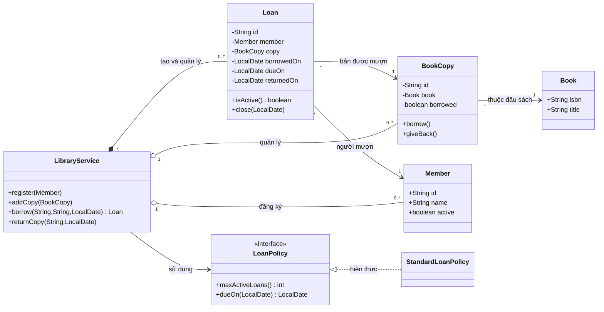
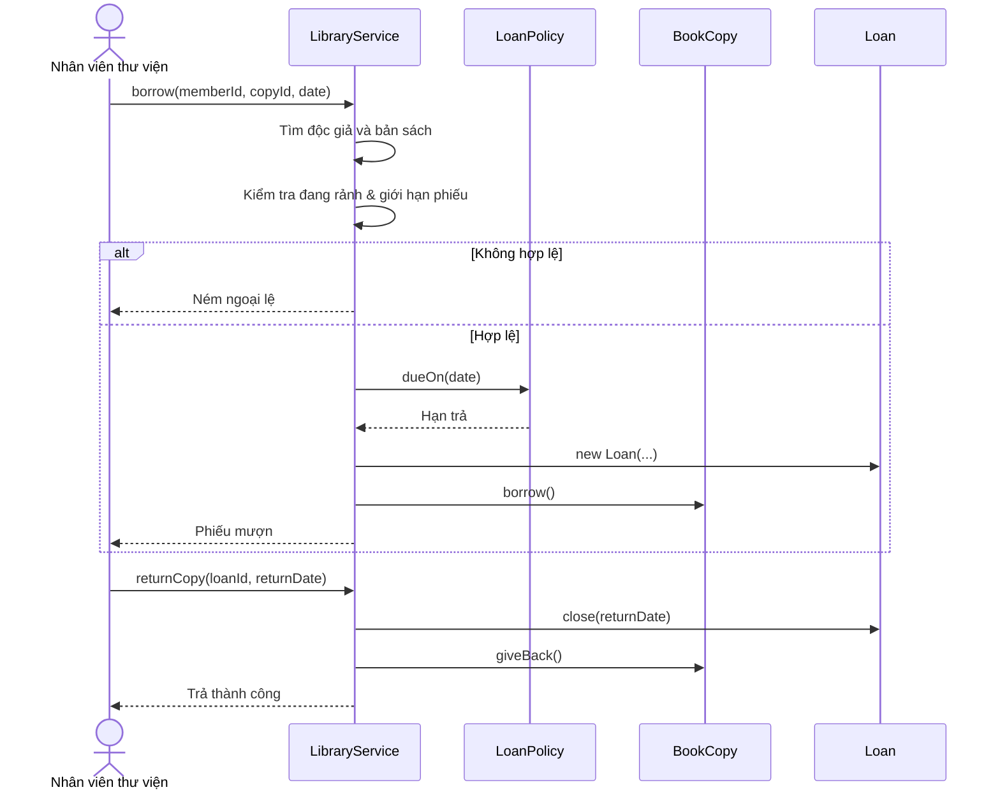

<a id="back-to-top"></a>

# Practice

## Menu
- [Classes and objects: a bank account exercise](#practice-001)
- [Encapsulating order business rules](#practice-002)
- [Payment interfaces and polymorphism](#practice-003)
- [Choosing inheritance or composition](#practice-004)
- [Value objects and equality](#practice-005)
- [Identifying design flaws](#practice-006)
- [Refactoring procedural code into an object model](#practice-007)
- [Capstone project: requirements analysis and use cases](#practice-008)
- [Capstone project: class and relationship design](#practice-009)
- [Capstone project: implementation and behavioral testing](#practice-010)
- [Capstone project: changing requirements and evaluating design](#practice-011)

## <a id="practice-001">Classes and objects: a bank account exercise</a>

<details>
<summary>View details</summary>

# Classes and objects: a bank account exercise — Java OOP

## 1. Learning objectives

This exercise simulates a simple bank account to practice turning business requirements into Java **classes**, **objects**, **fields**, **methods**, **constructors**, and **data encapsulation**.

After completing the exercise, you will be able to:
- Represent an account with the BankAccount class and create multiple independent objects using the new keyword.
- Use private fields to protect balances and final for information that must not change after initialization.
- Write a constructor that validates the initial state and provide deposit, withdrawal, and transfer methods.
- Distinguish reference variables, actual objects, state, and behavior.
- Check boundary conditions, rejected transactions, and integer overflow risks.
- Write unit tests to verify business rules without connecting to a real bank.

This is an **educational OOP simulation**, not a real banking system. All data is held in memory; there is no authentication, authorization, database, accounting ledger, or distributed transaction support.

## 2. From requirements to classes and objects

Suppose we need to manage two accounts:

- Account A: account number TK001, owner An, initial balance 1.000.000 VND.
- Account B: account number TK002, owner Bình, initial balance 200.000 VND.
- Allow deposits, withdrawals, and transfers from A to B.
- Disallow negative balances and 0 or negative deposit, withdrawal, or transfer amounts.
- Report errors when an operation exceeds the long range; do not allow silent overflow.

The OOP concepts involved:

| OOP concept | Application in this example | Meaning |
| --- | --- | --- |
| Class | BankAccount | Shared blueprint for an account |
| Object | accountA, accountB | Two concrete accounts, each with its own state |
| Field | accountNumber, ownerName, balanceVnd | Data belonging to each object |
| Constructor | BankAccount(number, owner, initialBalance) | Initializes an object in a valid state |
| Method | deposit, withdraw, transferTo | Permitted operations on the balance |
| Encapsulation | private balanceVnd and public methods | Prevents external code from assigning arbitrary balances |
| Reference | accountA variable of type BankAccount | Refers to an object in memory |
| final field | accountNumber, ownerName | Cannot be reassigned after the constructor |

Class model:

~~~mermaid
classDiagram
    class BankAccount {
        -String accountNumber
        -String ownerName
        -long balanceVnd
        +BankAccount(accountNumber, ownerName, initialBalanceVnd)
        +getAccountNumber() String
        +getOwnerName() String
        +getBalanceVnd() long
        +deposit(amountVnd) void
        +withdraw(amountVnd) void
        +transferTo(receiver, amountVnd) void
    }
    class BankDemo {
        +main(args) void
    }
    BankDemo --> BankAccount : tạo và gọi phương thức
    BankAccount --> BankAccount : transferTo(receiver)
~~~

Key point: **accountA and accountB are created from the same BankAccount class but are separate objects**. Calling accountA.deposit(...) does not automatically change accountB's balance.

## 3. Defining the contract for each operation

We use **long** to store whole VND amounts, avoiding float/double in this integer-money example. For fractional amounts or multiple currencies, consider BigDecimal together with a currency code; do not use double to represent exact monetary amounts.

| Operation | Valid conditions | Result | Invalid case |
| --- | --- | --- | --- |
| Create account | Number and name are nonblank; initial balance >= 0 | Object is created | IllegalArgumentException |
| deposit(amount) | amount > 0; addition does not overflow long | balance increases by amount | IllegalArgumentException or ArithmeticException |
| withdraw(amount) | amount > 0 and amount <= balance | balance decreases by amount | IllegalArgumentException or IllegalStateException |
| transferTo(receiver, amount) | receiver is non-null and different from this account; amount > 0; sufficient funds; receiver balance does not overflow | Sender decreases and receiver increases by the same amount | NullPointerException, IllegalArgumentException, IllegalStateException, or ArithmeticException |
| getBalanceVnd() | No precondition | Returns current balance | Does not change state |

Exercise convention: an invalid operation **throws an exception without changing balances**; a valid transaction method completes normally. Every precondition is checked before mutating state.

Single-threaded transfer flow:

~~~mermaid
flowchart TD
    A["accountA.transferTo(accountB, amount)"] --> B{"Người nhận hợp lệ và khác người gửi?"}
    B -->|Không| E["Ném lỗi, không đổi số dư"]
    B -->|Có| C{"Số tiền > 0 và bên gửi đủ tiền?"}
    C -->|Không| E
    C -->|Có| D{"Số dư bên nhận cộng amount có tràn long?"}
    D -->|Có| E
    D -->|Không| F["Giảm số dư bên gửi"]
    F --> G["Tăng số dư bên nhận"]
    G --> H["Hoàn tất"]
~~~

**Intentional limitation:** transfers here are synchronous operations on two objects in the same process, assuming single-threaded access. This design **does not guarantee thread safety under concurrent execution** and has no database transaction; do not use this logic in place of real financial transaction mechanisms.

## 4. Building the complete program

Java 17 + Maven project structure:

~~~text
bank-account-oop/
├── pom.xml
└── src/
    ├── main/java/vn/example/
    │   ├── BankAccount.java
    │   └── BankDemo.java
    └── test/java/vn/example/
        └── BankAccountTest.java
~~~

### 4.1. Maven configuration

Create the pom.xml file:

~~~xml
<project xmlns="http://maven.apache.org/POM/4.0.0">
    <modelVersion>4.0.0</modelVersion>
    <groupId>vn.example</groupId>
    <artifactId>bank-account-oop</artifactId>
    <version>1.0-SNAPSHOT</version>

    <properties>
        <maven.compiler.release>17</maven.compiler.release>
        <project.build.sourceEncoding>UTF-8</project.build.sourceEncoding>
    </properties>

    <dependencies>
        <dependency>
            <groupId>org.junit.jupiter</groupId>
            <artifactId>junit-jupiter</artifactId>
            <version>5.11.4</version>
            <scope>test</scope>
        </dependency>
    </dependencies>

    <build>
        <plugins>
            <plugin>
                <groupId>org.apache.maven.plugins</groupId>
                <artifactId>maven-surefire-plugin</artifactId>
                <version>3.5.2</version>
            </plugin>
        </plugins>
    </build>
</project>
~~~

### 4.2. The BankAccount class

Create src/main/java/vn/example/BankAccount.java:

~~~java
package vn.example;

import java.util.Objects;

/**
 * Mô phỏng một tài khoản với tiền nguyên VND.
 * Phiên bản học tập: sử dụng trong một luồng, không lưu dữ liệu bền vững.
 */
public final class BankAccount {

    private final String accountNumber;
    private final String ownerName;
    private long balanceVnd;

    public BankAccount(
            String accountNumber,
            String ownerName,
            long initialBalanceVnd) {

        this.accountNumber = requireText(
                accountNumber, "accountNumber");
        this.ownerName = requireText(ownerName, "ownerName");

        if (initialBalanceVnd < 0) {
            throw new IllegalArgumentException(
                    "Initial balance must not be negative");
        }

        this.balanceVnd = initialBalanceVnd;
    }

    private static String requireText(String value, String field) {
        if (value == null || value.isBlank()) {
            throw new IllegalArgumentException(
                    field + " must not be blank");
        }
        return value.trim();
    }

    private static void requirePositive(long amountVnd) {
        if (amountVnd <= 0) {
            throw new IllegalArgumentException(
                    "Amount must be positive");
        }
    }

    public String getAccountNumber() {
        return accountNumber;
    }

    public String getOwnerName() {
        return ownerName;
    }

    public long getBalanceVnd() {
        return balanceVnd;
    }

    public void deposit(long amountVnd) {
        requirePositive(amountVnd);
        // Tính trước; nếu tràn long thì ném ArithmeticException.
        long newBalance = Math.addExact(balanceVnd, amountVnd);
        balanceVnd = newBalance;
    }

    public void withdraw(long amountVnd) {
        requirePositive(amountVnd);

        if (amountVnd > balanceVnd) {
            throw new IllegalStateException(
                    "Insufficient balance");
        }

        balanceVnd -= amountVnd;
    }

    public void transferTo(BankAccount receiver, long amountVnd) {
        Objects.requireNonNull(receiver, "receiver");

        if (receiver == this) {
            throw new IllegalArgumentException(
                    "Cannot transfer to the same object");
        }

        requirePositive(amountVnd);

        if (amountVnd > balanceVnd) {
            throw new IllegalStateException(
                    "Insufficient balance");
        }

        // Kiểm tra tràn số phía người nhận trước khi thay đổi hai tài khoản.
        long receiverNewBalance = Math.addExact(
                receiver.balanceVnd, amountVnd);

        balanceVnd -= amountVnd;
        receiver.balanceVnd = receiverNewBalance;
    }
}
~~~

**Explanation of the important parts:**

- **private final String accountNumber, ownerName:** the account number and owner name cannot be reassigned after initialization. Here, final does not guarantee system-wide uniqueness; a real application needs account-number management.
- **private long balanceVnd:** mutable state, but other classes cannot directly assign a negative or arbitrary balance.
- **constructor:** validates all initial values before the object is used.
- **getBalanceVnd:** allows balance reads without exposing an arbitrary setBalanceVnd method.
- **deposit:** calls Math.addExact to detect overflow before updating the balance.
- **withdraw:** checks that the amount is positive and the balance is sufficient before subtracting.
- **transferTo:** accepts **another BankAccount object**. Because the code is inside the same class, Java permits access to the private balanceVnd field of another BankAccount instance.
- **receiver == this:** compares object identity. Two references can point to the same object; this prevents transfers from an account to itself.

Note: this version can create two objects with the same accountNumber because the constructor only checks that the value is nonblank. This is a limitation of the learning model; a real system requires a repository/service to manage identity and enforce uniqueness.

### 4.3. Running the program and creating two objects

Create src/main/java/vn/example/BankDemo.java:

~~~java
package vn.example;

public final class BankDemo {

    public static void main(String[] args) {
        BankAccount accountA =
                new BankAccount("TK001", "An", 1_000_000L);
        BankAccount accountB =
                new BankAccount("TK002", "Binh", 200_000L);

        accountA.deposit(200_000L);
        accountA.withdraw(50_000L);
        accountA.transferTo(accountB, 300_000L);

        System.out.println(
                accountA.getAccountNumber()
                + " - " + accountA.getOwnerName()
                + ": " + accountA.getBalanceVnd() + " VND");

        System.out.println(
                accountB.getAccountNumber()
                + " - " + accountB.getOwnerName()
                + ": " + accountB.getBalanceVnd() + " VND");
    }
}
~~~

How to interpret the expression:

~~~java
BankAccount accountA = new BankAccount("TK001", "An", 1_000_000L);
~~~

- **BankAccount** on the left is the reference variable's type.
- **accountA** is the variable name, not the entire object.
- **new BankAccount(...)** creates a BankAccount object and invokes its constructor.
- The dot in **accountA.deposit(...)** invokes behavior on the object referenced by the variable.
- Each object has its own balance; the transfer demonstrates how objects interact through methods.

Run from the directory containing pom.xml:

~~~bash
mvn test
mvn -q -DskipTests package
java -cp target/classes vn.example.BankDemo
~~~

Expected output:

~~~text
TK001 - An: 850000 VND
TK002 - Binh: 500000 VND
~~~

Manual verification:

| Step | Account A (VND) | Account B (VND) |
| --- | ---: | ---: |
| Initial | 1.000.000 | 200.000 |
| A deposits 200.000 | 1.200.000 | 200.000 |
| A withdraws 50.000 | 1.150.000 | 200.000 |
| A transfers 300.000 to B | **850.000** | **500.000** |

During the transfer, the combined balances before and after remain 1.350.000 VND. A transfer neither creates nor loses money **when the valid operation completes in this single-threaded model**.

## 5. Testing behavior and invariants with JUnit 5

Running main once is not enough: good object-oriented code must be tested in multiple states, especially when operations are rejected.

Create src/test/java/vn/example/BankAccountTest.java:

~~~java
package vn.example;

import static org.junit.jupiter.api.Assertions.*;

import org.junit.jupiter.api.Test;

class BankAccountTest {

    @Test
    void newlyCreatedAccountsHaveIndependentState() {
        BankAccount a = new BankAccount("TK001", "An", 100L);
        BankAccount b = new BankAccount("TK002", "Binh", 50L);

        a.deposit(20L);

        assertEquals(120L, a.getBalanceVnd());
        assertEquals(50L, b.getBalanceVnd());
        assertEquals("TK001", a.getAccountNumber());
        assertEquals("Binh", b.getOwnerName());
    }

    @Test
    void depositIncreasesBalance() {
        BankAccount account = new BankAccount("A", "An", 100L);

        account.deposit(25L);

        assertEquals(125L, account.getBalanceVnd());
    }

    @Test
    void withdrawDecreasesBalance() {
        BankAccount account = new BankAccount("A", "An", 100L);

        account.withdraw(100L);

        assertEquals(0L, account.getBalanceVnd());
    }

    @Test
    void cannotWithdrawMoreThanAvailableBalance() {
        BankAccount account = new BankAccount("A", "An", 100L);

        assertThrows(IllegalStateException.class,
                () -> account.withdraw(101L));

        assertEquals(100L, account.getBalanceVnd());
    }

    @Test
    void transactionsRejectZeroAndNegativeAmounts() {
        BankAccount a = new BankAccount("A", "An", 100L);
        BankAccount b = new BankAccount("B", "Binh", 50L);

        assertThrows(IllegalArgumentException.class,
                () -> a.deposit(0L));
        assertThrows(IllegalArgumentException.class,
                () -> a.deposit(-2L));
        assertThrows(IllegalArgumentException.class,
                () -> a.withdraw(0L));
        assertThrows(IllegalArgumentException.class,
                () -> a.transferTo(b, -10L));

        assertEquals(100L, a.getBalanceVnd());
        assertEquals(50L, b.getBalanceVnd());
    }

    @Test
    void transferMovesMoneyBetweenTwoObjects() {
        BankAccount a = new BankAccount("A", "An", 200L);
        BankAccount b = new BankAccount("B", "Binh", 50L);

        a.transferTo(b, 80L);

        assertEquals(120L, a.getBalanceVnd());
        assertEquals(130L, b.getBalanceVnd());
        assertEquals(250L,
                a.getBalanceVnd() + b.getBalanceVnd());
    }

    @Test
    void failedTransferPreservesBothBalances() {
        BankAccount a = new BankAccount("A", "An", 40L);
        BankAccount b = new BankAccount("B", "Binh", 70L);

        assertThrows(IllegalStateException.class,
                () -> a.transferTo(b, 41L));

        assertEquals(40L, a.getBalanceVnd());
        assertEquals(70L, b.getBalanceVnd());
    }

    @Test
    void cannotTransferToSameAccountOrNull() {
        BankAccount account =
                new BankAccount("A", "An", 100L);

        assertThrows(IllegalArgumentException.class,
                () -> account.transferTo(account, 10L));
        assertThrows(NullPointerException.class,
                () -> account.transferTo(null, 10L));

        assertEquals(100L, account.getBalanceVnd());
    }

    @Test
    void overflowFailsWithoutChangingBalances() {
        BankAccount a = new BankAccount("A", "An", 100L);
        BankAccount b =
                new BankAccount("B", "Binh", Long.MAX_VALUE);

        assertThrows(ArithmeticException.class,
                () -> a.transferTo(b, 1L));

        assertEquals(100L, a.getBalanceVnd());
        assertEquals(Long.MAX_VALUE, b.getBalanceVnd());

        assertThrows(ArithmeticException.class,
                () -> b.deposit(1L));
        assertEquals(Long.MAX_VALUE, b.getBalanceVnd());
    }

    @Test
    void constructorRejectsInvalidInitialState() {
        assertThrows(IllegalArgumentException.class,
                () -> new BankAccount("", "An", 10L));
        assertThrows(IllegalArgumentException.class,
                () -> new BankAccount("A", " ", 10L));
        assertThrows(IllegalArgumentException.class,
                () -> new BankAccount("A", "An", -1L));
    }
}
~~~

There are **10 @Test methods**. Running mvn test should successfully execute all 10 tests in the specified files, with 0 failures and 0 errors.

### Why check the state after a failure?

An incorrect implementation might do this:

~~~java
// Ví dụ cố tình SAI, không dùng thay phương thức transferTo thật:
balanceVnd -= amountVnd;
receiver.deposit(amountVnd);
~~~

If receiver.deposit(...) fails because of long overflow, the sender has already been debited. The transaction is then only partially applied. The correct code **computes the receiver's new balance first, then updates both balances** in one thread.

The overflowFailsWithoutChangingBalances test protects this invariant. However, two assignments are still not atomic under concurrent access or process failure; proper synchronization/transactions and ledger design are required to address those cases.

## 6. OOP reasoning questions based on the exercise

**Can another class assign account.balanceVnd = -5?** No, because the field is private. Other classes must use the public API, where BankAccount enforces its invariants. A balance getter does not grant direct write access.

**Why not declare balanceVnd static?** static would create a class-level field potentially shared by all objects. Each BankAccount needs its own state, so balanceVnd is an instance field.

**Can two variables reference the same object?** Yes:

~~~java
BankAccount first = new BankAccount("A", "An", 100L);
BankAccount alias = first;
alias.deposit(50L);
System.out.println(first.getBalanceVnd()); // 150
~~~

Assigning alias = first copies the **reference**; it does not create a new object. Both variables therefore observe the same balance of 150 VND.

**Why not provide setBalanceVnd?** An unrestricted setter could bypass validation of the source of funds. deposit, withdraw, and transferTo express business operations and enforce preconditions before updating state.

**How can transferTo modify receiver.balanceVnd if the field is private?** In Java, private access is scoped to the class. Code inside BankAccount can access the private fields of any BankAccount instance. Code in BankDemo cannot.

**Are deposits/withdrawals and transfers equally safe?** No. Deposits and withdrawals change one object's state; transfers update two related objects. A multithreaded or distributed system must handle contention and durable transaction state.

## 7. Identifying common mistakes

| Mistake | Cause | Fix |
| --- | --- | --- |
| Declaring balanceVnd public | External code can break invariants | Use private fields and expose business operations |
| Declaring static balanceVnd | All objects share one balance | Use an instance field |
| Withdrawing before checking sufficient funds | Can produce a negative balance or invalid state | Validate before subtracting |
| Failing to reject amount <= 0 | Negative withdrawals can add money | Enforce a positive amount in every operation |
| Using double for money | Binary rounding errors are possible | Use long in the smallest currency unit or BigDecimal |
| Failing to check overflow | long may wrap silently | Use Math.addExact and boundary tests |
| Debiting sender before validating receiver | An exception can leave a partial update | Compute and validate all results before mutation |
| Comparing String with == | Compares references instead of content | Use equals for String value comparisons |
| Testing only the happy path | Negative, overflow, and insufficient-funds cases expose defects | Test invariants and failure paths |
| Treating the simulation as a real bank system | Lacks transactions, concurrency controls, authentication, and auditing | Add dedicated production architecture |

## 8. Extension exercises

### Exercise A — Print account information

Implement summary() to return a String containing the account number, owner name, and balance. Do not let callers modify the balance through the result. Call it from BankDemo to observe the two objects' independent information.

### Exercise B — Transaction history

Add a Transaction type containing the transaction kind, amount, and timestamp. Consider exposing a read-only transaction list with List.copyOf(...) and injecting Clock into the constructor for deterministic time tests. Decide explicitly whether rejected transactions are recorded.

### Exercise C — Two account types

Add SavingsAccount with interest or CheckingAccount with different withdrawal rules. Use inheritance only when there is a genuine is-a relationship that satisfies the contract; for changing interest/fee policies, consider composition via InterestPolicy/FeePolicy interfaces. Do not extend BankAccount merely to inherit its private fields.

### Exercise D — Advanced transfers

Simulate concurrent transfer requests between two accounts and analyze why checking a balance before updating it can introduce race conditions. Propose a stable lock-acquisition order or database transactions; write dedicated concurrency tests once the environment has been designed correctly.

### Exercise E — Separating responsibilities

If the application must find accounts by number and guarantee unique account numbers, should BankAccount contain a global static list? Propose AccountRepository/BankService for account storage and explain why BankAccount should stay focused on its own invariants and behavior.

## 9. Self-assessment checklist

- [ ] Create at least two independent BankAccount objects using new.
- [ ] Identify the class, object, instance field, constructor, and method.
- [ ] Explain how first and alias can reference the same object.
- [ ] Prevent arbitrary balance changes from outside the class.
- [ ] Perform deposit/withdrawal/transfer arithmetic correctly and reject invalid amounts.
- [ ] Preserve all affected balances when a transaction fails in this single-threaded model.
- [ ] Organize the code into valid Java files and run BankDemo and the JUnit tests.
- [ ] Understand the model's limitations regarding concurrency, durability, and auditing.

**Expected outcome:** You have built a class with appropriate account responsibilities, initialized and coordinated objects, controlled data through encapsulation, and verified invariants with tests instead of observing only a single run of main.


</details>

- [Back to top](#back-to-top)

---

## <a id="practice-002">Encapsulating order business rules</a>

<details>
<summary>View details</summary>

# Exercise: Encapsulating order business rules with Java OOP

> **Context:** Practice designing an `Order` object that is responsible for protecting its own state and business rules. The goal goes beyond hiding fields with `private`: every data modification path that could produce an invalid order must be prevented.

## 1. Scenario

You are building a shopping-cart/checkout component for an online store. The initial design might look like this:

~~~java
import java.util.ArrayList;
import java.util.List;

class OrderBad {
    public final List<OrderLineBad> lines = new ArrayList<>();
    public String status = "DRAFT";
}

class OrderLineBad {
    public String sku;
    public long priceCents;
    public int quantity;
}
~~~

Other code can perform all of the following:

~~~java
OrderBad order = new OrderBad();
order.status = "PLACED";
order.lines.add(new OrderLineBad()); // sku null, quantity 0
order.lines.get(0).quantity = -5;
order.lines.clear();                 // xóa sau khi đã đặt hàng
~~~

These defects occur because **users of the object have unrestricted control over its state**, so no one enforces business invariants. Changing `public List` to `private List` while returning the original list directly from a getter does not solve the problem either.

**Task:** Redesign `Order` as a simple *aggregate*: `Order` owns its order lines, controls updates, calculates totals, and manages its lifecycle. Clients can only invoke permitted operations.

## 2. Required specification before coding

### Data and rules

Each order has an `orderId`, a status, and a set of order lines. Each line contains a product identifier `sku`, a unit price `unitPriceCents`, and a `quantity`.

| Rule | Specific contract |
|---|---|
| Order ID | Must not be `null`, empty, or whitespace-only; normalize with `trim()` |
| SKU | Must not be `null`/empty; after `trim()` and uppercasing, accept only `A-Z`, `0-9`, and `-` |
| Duplicate SKU | Each normalized SKU occurs in at most one line; `setLine` replaces an existing line |
| Unit price | Measured in **cents**, within `1..1_000_000` |
| Quantity | Each line has `quantity` within `1..100` |
| Subtotal | `subtotal = Σ(unitPriceCents × quantity)`, not exceeding `10_000_000` cents |
| Quantity update | `changeQuantity(sku, 0)` removes a line; negative values or values over 100 are invalid |
| Remove SKU | `removeLine(sku)` returns `true` if a line was removed; `false` if absent |
| Shipping fee | Empty order: 0; `subtotal >= 100_000`: 0; otherwise: `15_000` cents |
| Discount | If `subtotal >= 200_000`, give `5%` using integer division `subtotal / 20`; otherwise 0 |
| Amount payable | `payable = subtotal - discount + shipping` |
| Exceptions | Invalid input: `IllegalArgumentException`; unknown SKU during quantity update: `NoSuchElementException`; operation prohibited by status: `IllegalStateException` |
| Failure effects | A rejected operation leaves the order in its previous state |

The pricing policies above are assumptions for this exercise. In a real system, monetary, tax, discount, and rounding policies must be explicitly agreed with business stakeholders.

### Order lifecycle

- **DRAFT:** adding/replacing lines, changing quantities, and removing lines are allowed.
- **PLACED:** the order has been placed; changing lines or placing it again is forbidden.
- **CANCELLED:** a terminal state; adding, changing, removing, or placing items is forbidden.
- `place()` transitions only from `DRAFT` to `PLACED`, and only when the order has at least one line.
- `cancel()` allows transitions from `DRAFT` or `PLACED` to `CANCELLED`; a second call is rejected.
- Cancellation here changes only the state of the in-memory example; it **does not automatically issue refunds or notifications**.

~~~mermaid
stateDiagram-v2
    [*] --> DRAFT : tạo Order
    DRAFT --> DRAFT : setLine / changeQuantity / removeLine
    DRAFT --> PLACED : place() khi có dòng
    DRAFT --> CANCELLED : cancel()
    PLACED --> CANCELLED : cancel()
    CANCELLED --> [*]
~~~

### Expected API

~~~java
Order order = new Order("ORD-001");

order.setLine(" book ", 90_000, 1);
order.setLine("PEN", 10_000, 2);
order.changeQuantity("BOOK", 2);

List<OrderLine> snapshot = order.lines();  // chỉ đọc, không sửa đơn được
OrderSummary result = order.summary();     // do Order tự tính
order.place();                             // khóa các thao tác chỉnh dòng
~~~

This API exposes **meaningful actions**, rather than `setStatus("PLACED")`, `setSubtotal(...)`, or `getMutableLines()`. This keeps each rule in the object responsible for enforcing it.

## 3. Hints before viewing the solution

Try implementing the following steps yourself:

1. Define `enum OrderStatus { DRAFT, PLACED, CANCELLED }` to eliminate arbitrary status strings.
2. Use `record OrderLine(...)` so each order line has no setter and validates its data at construction.
3. Keep `Order` fields `private`; use `Map<String, OrderLine>` to maintain one line per SKU.
4. Put business logic in `setLine`, `changeQuantity`, `removeLine`, `place`, `cancel`, and `summary` methods.
5. Calculate the **proposed** result of a change before applying it. If it would exceed the subtotal limit, report an error without leaving partially updated data.
6. Return `List.copyOf(lines.values())` as a snapshot; because `OrderLine` has immutable components, callers cannot alter its structure or elements to change the cart.
7. Add tests for boundary values and operations forbidden after `place()`.

A reasonable allocation of responsibilities:

| Component | Responsibility | Should not do |
|---|---|---|
| `Order` | Control order status, lines, invariants, and money rules | Return the internal Map or let callers assign totals |
| `OrderLine` | Represent a valid immutable order line | Expose a setter for quantity or unit price |
| `OrderStatus` | Define the allowed statuses | Represent status with arbitrary strings |
| `OrderSummary` | Provide an immutable calculation result | Store a freely mutable total |
| Client/UI/API | Invoke behaviors and display snapshots | Recompute business rules and directly modify fields |

## 4. Standalone Java 17 reference solution

Create **`OrderExercise.java`**. The code below uses only the Java Standard Library and includes a `main` method to check its business behavior.

~~~java
import java.util.LinkedHashMap;
import java.util.List;
import java.util.Locale;
import java.util.Map;
import java.util.NoSuchElementException;

public class OrderExercise {
    static final long MAX_UNIT_PRICE = 1_000_000L;
    static final long MAX_SUBTOTAL = 10_000_000L;
    static final int MAX_QUANTITY = 100;

    enum OrderStatus {
        DRAFT, PLACED, CANCELLED
    }

    static String normalizeSku(String sku) {
        if (sku == null) {
            throw new IllegalArgumentException("sku must not be null");
        }
        String normalized = sku.trim().toUpperCase(Locale.ROOT);
        if (!normalized.matches("[A-Z0-9-]+")) {
            throw new IllegalArgumentException("Invalid SKU: " + sku);
        }
        return normalized;
    }

    // Immutable value object. Bất biến được kiểm tra ngay khi khởi tạo.
    record OrderLine(String sku, long unitPriceCents, int quantity) {
        OrderLine {
            sku = normalizeSku(sku);
            if (unitPriceCents < 1 || unitPriceCents > MAX_UNIT_PRICE) {
                throw new IllegalArgumentException("Invalid unit price");
            }
            if (quantity < 1 || quantity > MAX_QUANTITY) {
                throw new IllegalArgumentException("Invalid quantity");
            }
        }

        long lineTotalCents() {
            return Math.multiplyExact(unitPriceCents, quantity);
        }
    }

    // Snapshot số tiền; caller chỉ đọc các component.
    record OrderSummary(
            long subtotalCents,
            long discountCents,
            long shippingCents,
            long payableCents) {
    }

    static final class Order {
        private final String orderId;
        private final Map<String, OrderLine> lines = new LinkedHashMap<>();
        private OrderStatus status = OrderStatus.DRAFT;

        Order(String orderId) {
            if (orderId == null || orderId.isBlank()) {
                throw new IllegalArgumentException("orderId is required");
            }
            this.orderId = orderId.trim();
        }

        String orderId() {
            return orderId;
        }

        OrderStatus status() {
            return status;
        }

        int lineCount() {
            return lines.size();
        }

        // Không trả Map hoặc collection mutable đang được giữ bên trong.
        List<OrderLine> lines() {
            return List.copyOf(lines.values());
        }

        private void ensureDraft() {
            if (status != OrderStatus.DRAFT) {
                throw new IllegalStateException(
                    "Order cannot be modified in state " + status
                );
            }
        }

        // Tính trước và từ chối ứng viên sai trước khi sửa state thật.
        private static long subtotalOf(Map<String, OrderLine> candidate) {
            long sum = 0;
            try {
                for (OrderLine line : candidate.values()) {
                    sum = Math.addExact(sum, line.lineTotalCents());
                }
            } catch (ArithmeticException overflow) {
                throw new IllegalArgumentException(
                    "Subtotal arithmetic overflow", overflow
                );
            }
            if (sum > MAX_SUBTOTAL) {
                throw new IllegalArgumentException(
                    "Subtotal exceeds " + MAX_SUBTOTAL
                );
            }
            return sum;
        }

        // Thêm SKU mới hoặc thay thế dòng của SKU đã có.
        void setLine(String sku, long unitPriceCents, int quantity) {
            ensureDraft();
            OrderLine newLine = new OrderLine(sku, unitPriceCents, quantity);

            Map<String, OrderLine> candidate = new LinkedHashMap<>(lines);
            candidate.put(newLine.sku(), newLine);
            subtotalOf(candidate);             // có thể ném lỗi

            lines.put(newLine.sku(), newLine); // commit sau validation
        }

        void changeQuantity(String sku, int newQuantity) {
            ensureDraft();
            String key = normalizeSku(sku);
            if (newQuantity < 0 || newQuantity > MAX_QUANTITY) {
                throw new IllegalArgumentException("Invalid quantity");
            }

            OrderLine current = lines.get(key);
            if (current == null) {
                throw new NoSuchElementException("Unknown SKU: " + key);
            }

            if (newQuantity == 0) {
                lines.remove(key);
                return;
            }

            // Giữ đơn giá cũ và kiểm tra tổng trước khi cập nhật.
            setLine(key, current.unitPriceCents(), newQuantity);
        }

        boolean removeLine(String sku) {
            ensureDraft();
            return lines.remove(normalizeSku(sku)) != null;
        }

        OrderSummary summary() {
            long subtotal = subtotalOf(lines);
            long discount = subtotal >= 200_000 ? subtotal / 20 : 0;
            long shipping = (lines.isEmpty() || subtotal >= 100_000)
                    ? 0 : 15_000;
            long payable = Math.addExact(
                Math.subtractExact(subtotal, discount), shipping);
            return new OrderSummary(
                subtotal, discount, shipping, payable
            );
        }

        void place() {
            ensureDraft();
            if (lines.isEmpty()) {
                throw new IllegalStateException("Cannot place empty order");
            }
            status = OrderStatus.PLACED;
        }

        void cancel() {
            if (status == OrderStatus.CANCELLED) {
                throw new IllegalStateException("Order already cancelled");
            }
            status = OrderStatus.CANCELLED;
        }
    }

    private static void require(boolean value, String message) {
        if (!value) {
            throw new AssertionError(message);
        }
    }

    // Mini assertion utility, không cần dependency ngoài JDK.
    private static void expectThrows(
            Class<? extends RuntimeException> type, Runnable action) {
        try {
            action.run();
        } catch (RuntimeException ex) {
            if (type.isInstance(ex)) {
                return;
            }
            throw new AssertionError(
                "Expected " + type.getSimpleName()
                    + " but caught " + ex.getClass().getSimpleName(),
                ex
            );
        }
        throw new AssertionError(
            "Expected exception " + type.getSimpleName()
        );
    }

    private static OrderLine findLine(List<OrderLine> snapshot, String sku) {
        return snapshot.stream()
            .filter(line -> line.sku().equals(sku))
            .findFirst()
            .orElseThrow();
    }

    public static void main(String[] args) {
        // 1) Chuẩn hóa SKU và tính tiền.
        Order order = new Order(" ORD-001 ");
        require(order.status() == OrderStatus.DRAFT, "initial status");
        require(order.summary().equals(
                new OrderSummary(0, 0, 0, 0)), "empty summary");

        order.setLine(" book ", 90_000, 1);
        order.setLine("PEN", 10_000, 2);
        require(order.lineCount() == 2, "two unique SKUs");
        require(order.summary().equals(
                new OrderSummary(110_000, 0, 0, 110_000)),
                "no discount, free shipping above 100000");

        // 2) Snapshot không thể sửa và không đổi theo update sau đó.
        List<OrderLine> before = order.lines();
        expectThrows(UnsupportedOperationException.class, before::clear);
        require(findLine(before, "BOOK").quantity() == 1,
                "old quantity");

        order.changeQuantity("BOOK", 2);
        require(order.summary().equals(
                new OrderSummary(200_000, 10_000, 0, 190_000)),
                "5% discount from 200000");

        require(findLine(before, "BOOK").quantity() == 1,
                "old snapshot remains unchanged");
        require(findLine(order.lines(), "BOOK").quantity() == 2,
                "new snapshot sees new state");

        // 3) Validation thất bại không làm hỏng đơn.
        OrderSummary goodState = order.summary();
        expectThrows(IllegalArgumentException.class,
            () -> order.setLine("BAD", -1, 1));
        expectThrows(IllegalArgumentException.class,
            () -> order.setLine("?", 100, 1));
        expectThrows(IllegalArgumentException.class,
            () -> order.changeQuantity("BOOK", -3));
        expectThrows(NoSuchElementException.class,
            () -> order.changeQuantity("UNKNOWN", 1));
        expectThrows(IllegalArgumentException.class,
            () -> order.setLine("EXPENSIVE", 1_000_000, 11));

        require(order.summary().equals(goodState),
                "failed mutations must not change totals");
        require(order.lineCount() == 2,
                "failed mutations must not add/remove lines");

        // 4) Kiểm thử cả hai phía của ngưỡng phí ship và giảm giá.
        Order boundaries = new Order("ORD-002");
        boundaries.setLine("A", 99_999, 1);
        require(boundaries.summary().equals(
                new OrderSummary(99_999, 0, 15_000, 114_999)),
                "shipping below threshold");

        boundaries.setLine("A", 100_000, 1);
        require(boundaries.summary().equals(
                new OrderSummary(100_000, 0, 0, 100_000)),
                "shipping free at threshold");

        boundaries.setLine("A", 199_999, 1);
        require(boundaries.summary().discountCents() == 0,
                "no discount below 200000");

        boundaries.setLine("A", 200_000, 1);
        require(boundaries.summary().equals(
                new OrderSummary(200_000, 10_000, 0, 190_000)),
                "discount at threshold");

        // 5) Trạng thái quản lý hành động được phép.
        expectThrows(IllegalStateException.class,
            () -> new Order("EMPTY").place());

        order.place();
        require(order.status() == OrderStatus.PLACED, "placed status");
        expectThrows(IllegalStateException.class,
            () -> order.setLine("NEW", 50, 1));
        expectThrows(IllegalStateException.class,
            () -> order.removeLine("BOOK"));
        expectThrows(IllegalStateException.class, order::place);

        order.cancel();
        require(order.status() == OrderStatus.CANCELLED, "cancelled status");
        expectThrows(IllegalStateException.class, order::cancel);
        expectThrows(IllegalStateException.class,
            () -> order.changeQuantity("BOOK", 1));

        System.out.println("PASS: SKU and business-rule validation");
        System.out.println("PASS: defensive snapshot and protected state");
        System.out.println("PASS: pricing thresholds and unchanged state on error");
        System.out.println("PASS: order lifecycle");
    }
}
~~~

Run:

~~~bash
javac OrderExercise.java
java OrderExercise
~~~

Expected output:

~~~text
PASS: SKU and business-rule validation
PASS: defensive snapshot and protected state
PASS: pricing thresholds and unchanged state on error
PASS: order lifecycle
~~~

**Design explanation:** `Order` has neither `setStatus` nor `setTotal`. Calling code invokes `place()` or `cancel()` according to state-transition rules; `summary()` always calculates from the current lines. The `setLine()` method builds a candidate map and validates limits **before** updating the actual map. Consequently, an operation exceeding the subtotal limit leaves no invalid line behind.

The example uses `LinkedHashMap` to make data easier to inspect, but clients do not depend directly on this map type. `OrderLine` is a record containing only `String` and primitive values, so snapshots expose no mutable elements; if a record contained `Date`, `List`, or an array, using `record` alone would not guarantee deep immutability.

## 5. OOP principles practiced

### Encapsulation: owning the state

~~~mermaid
classDiagram
    class Order {
        -String orderId
        -Map~String,OrderLine~ lines
        -OrderStatus status
        +setLine(String,long,int)
        +changeQuantity(String,int)
        +removeLine(String) boolean
        +lines() List~OrderLine~
        +summary() OrderSummary
        +place()
        +cancel()
    }
    class OrderLine {
        <<record>>
        +sku() String
        +unitPriceCents() long
        +quantity() int
    }
    class OrderSummary {
        <<record>>
        +subtotalCents() long
        +discountCents() long
        +shippingCents() long
        +payableCents() long
    }
    class OrderStatus {
        <<enumeration>>
        DRAFT
        PLACED
        CANCELLED
    }
    Order "1" o-- "*" OrderLine : sở hữu
    Order --> OrderStatus : trạng thái
    Order --> OrderSummary : tạo bản đọc
~~~

In this exercise, **`Order` is the only component allowed to update its collection and status**. Clients invoke the `Order` API instead of modifying a `Map` or enum field directly.

### Invariants: validate every mutation path

Validating unit prices and quantities in the constructor is insufficient if another setter can still alter them. Rules must hold for **every public mutation**, including:

- Adding or replacing a line.
- Changing quantity, especially to `0` or a negative value.
- Removing lines and confirming/placing an order.
- Operations rejected because of status or subtotal limits.

### Information hiding: concealing storage choices

Using `Map<String,OrderLine>` is an internal decision; it can later be replaced with another structure while preserving the public business operations. `Order.lines()` returns a snapshot for UI display without letting the UI manage how lines are stored.

### Cohesion: what logic belongs to Order?

This example puts **totals, status, and order-line rules** inside `Order` because they directly concern an order. But `Order` need not open database connections, send emails, or call external payment gateways. These side effects should be coordinated by the application layer using appropriate services/ports.

## 6. Why avoid unrestricted setters or direct collection getters?

A common design looks like this:

~~~java
class Order {
    private List<OrderLine> lines;
    private long totalCents;
    private String status;

    public void setLines(List<OrderLine> lines) {
        this.lines = lines;
    }
    public void setTotalCents(long totalCents) {
        this.totalCents = totalCents;
    }
    public void setStatus(String status) {
        this.status = status;
    }
}
~~~

It could produce contract violations such as `status="PLACED"` with no items, a total that does not match the lines, or changed lines without updating `totalCents`. To prevent this:

- Allow **placing orders** through `place()`, rather than assigning arbitrary statuses.
- Allow **quantity changes** through `changeQuantity()` to handle `0` explicitly.
- Allow **reading totals** through `summary()`, rather than a total field assignable by clients.
- Allow **viewing order lines** through snapshots of immutable value objects, rather than returning internal mutable references.

This does not mean all objects must avoid setters. DTOs and data transferred through APIs can use JavaBeans/setters. This exercise focuses on **domain objects with rules that must be enforced**.

## 7. Acceptance test matrix

| ID | Action | Expected result |
|---|---|---|
| TC01 | Create a new order | DRAFT status, 0 lines, total 0 |
| TC02 | Add `" book "` then `"BOOK"` | A single normalized SKU remains; the second call replaces the first line |
| TC03 | Price 0, negative, or above 1.000.000 | Throw `IllegalArgumentException` |
| TC04 | Quantity 0 in `setLine`, or quantity 101 | Throw `IllegalArgumentException` |
| TC05 | `changeQuantity("BOOK", 0)` | Remove BOOK if present; leave no line with quantity 0 |
| TC06 | Change quantity for an unknown SKU | Throw `NoSuchElementException` |
| TC07 | Updated subtotal exceeds 10.000.000 | Reject; preserve previous total and lines |
| TC08 | Get `lines()` and then call `clear()` | Reject with `UnsupportedOperationException` |
| TC09 | Obtain snapshot A, then update order | A retains old data, while snapshot B contains new data |
| TC10 | Subtotal 99.999 cents | Shipping fee 15.000 |
| TC11 | Subtotal exactly 100.000 cents | Free shipping |
| TC12 | Subtotal exactly 200.000 cents | Discount 10.000 cents |
| TC13 | Call `place()` on an empty order | Throw `IllegalStateException`; remain DRAFT |
| TC14 | Call `place()` with nonempty order | Transition to PLACED; prohibit line changes |
| TC15 | Call `cancel()`, then try to change/place/cancel again | Throw `IllegalStateException` |
| TC16 | Any invalid input | No partial state changes |

You can write these tests before viewing the solution and use them for self-assessment. Even if the collection's storage representation changes, its behavioral tests must continue to pass.

### Selected JUnit 5 tests

For a project already using `JUnit Jupiter`, place `OrderExerciseTest.java` **in the same package** as `OrderExercise`:

~~~java
import static org.junit.jupiter.api.Assertions.*;
import org.junit.jupiter.api.Test;

class OrderExerciseTest {
    @Test
    void duplicateSkuIsReplacedAfterNormalization() {
        var order = new OrderExercise.Order("ORD-1");
        order.setLine("book", 100, 2);
        order.setLine(" BOOK ", 150, 3);

        assertEquals(1, order.lineCount());
        assertEquals("BOOK", order.lines().get(0).sku());
        assertEquals(450, order.summary().subtotalCents());
    }

    @Test
    void invalidUpdateLeavesOrderUnchanged() {
        var order = new OrderExercise.Order("ORD-2");
        order.setLine("BOOK", 100, 2);
        var before = order.summary();

        assertThrows(IllegalArgumentException.class,
            () -> order.setLine("EXPENSIVE", 1_000_000, 11));

        assertEquals(before, order.summary());
        assertEquals(1, order.lineCount());
    }

    @Test
    void returnedLinesCannotBypassRules() {
        var order = new OrderExercise.Order("ORD-3");
        order.setLine("BOOK", 100, 2);
        var snapshot = order.lines();

        assertThrows(UnsupportedOperationException.class, snapshot::clear);

        order.changeQuantity("BOOK", 3);
        assertEquals(2, snapshot.get(0).quantity());
        assertEquals(3, order.lines().get(0).quantity());
    }

    @Test
    void placingFreezesMutations() {
        var order = new OrderExercise.Order("ORD-4");
        order.setLine("PEN", 99_999, 1);

        assertEquals(15_000, order.summary().shippingCents());
        order.place();

        assertThrows(IllegalStateException.class,
            () -> order.setLine("NEW", 10, 1));
        assertThrows(IllegalStateException.class,
            () -> order.removeLine("PEN"));
        assertEquals(OrderExercise.OrderStatus.PLACED, order.status());
    }
}
~~~

In a real application, organize types as classes/records in appropriate files, choosing `public` or package-private according to API boundaries; the code above uses nested types so the example can run from one file.

## 8. Discussion: design decisions and solution limitations

**Why a Map?** Each SKU is a unique key, and a map directly represents the no-duplicate-SKU invariant. But the map must not be returned directly; clients need not know the storage structure. `LinkedHashMap` preserves insertion order for inspection, but if UI ordering is part of the **contract**, it must be documented and independently tested.

**Why cents and long?** They avoid the binary precision pitfalls of representing money with `double`. Currencies with more complex precision/rounding rules may require `BigDecimal` with specified scale, currency, and rounding mode. `long` in the smallest unit is suitable only if the system consistently defines units and limits.

**Why records?** `OrderLine` and `OrderSummary` are immutable values without separate identities in this example. A record **does not automatically guarantee deep immutability** if its components contain mutable objects; here they use `String` and primitives, which are safe across the chosen boundary.

**Why validate the subtotal before committing?** Adding a line before calculating the subtotal could leave invalid data in the actual map when the limit is exceeded. Constructing and validating a candidate first ensures failed operations do not cause partial changes.

**Why no public `isPlaced` flag?** A client could mark an empty order as placed without enforcing the nonempty-order condition. A status enum and transition methods express the rule in one place.

**Why no database connection inside Order?** Domain rules and infrastructure side effects belong to different responsibilities. An application service can load `Order` from a repository, call `order.place()`, and save it within a transaction, while `Order` is responsible only for validating its operation.

### Limitations to address in production

- **Concurrency:** `LinkedHashMap` and `Order` are not currently thread-safe. If multiple requests can update one order, use transactions, optimistic locking/versioning, and a conflict-handling strategy. Safe read snapshots do not automatically make concurrent updates safe.
- **Shipping and discounts:** Values may depend on coupons, addresses, carrier charges, and promotion dates; do not embed every infrastructure dependency in an entity. As requirements evolve, supply an external pricing policy to domain operations when appropriate.
- **Inventory and payments:** `place()` only changes status in this exercise. Stock deduction, payment gateway calls, emails, and event publication need controlled orchestration; do not assume those tasks finish when `place()` returns.
- **Historical accuracy:** A production system may need snapshots of product names/unit prices at placement time, a transition history, and versioned pricing policies.
- **Cancellation after payment:** This exercise allows `PLACED → CANCELLED` but does not address delivery deadlines or refunds. Real business rules involving `PAID` or `SHIPPED` require a precise state machine and cancellation policy.
- **API compatibility:** Replacing an anemic entity with public getters/setters by an aggregate can break client compilation; update clients, DTO mappings, and applicable ORM/JPA constraints.

## 9. Progressive extension exercises

**Level 1 — Strong encapsulation:** Add tests for blank SKUs, invalid characters, quantity 101, replacing duplicate SKUs, and removing nonexistent items with `removeLine`. Show that each failure preserves `OrderSummary`, `lineCount`, and `status`.

**Level 2 — Protecting monetary rules:** Try a subtotal near `10_000_000`; replace a line so the limit is exceeded, then confirm rejection preserves the original line. Adjust the limit assumption and retest the free-shipping and discount thresholds.

**Level 3 — Alternative policies:** Add free shipping for VIP customers. Consider whether to store `CustomerType` in `Order` or pass in a clearly contracted pricing policy. Justify the design using actual requirements and avoid adding interfaces solely to increase the class count.

**Level 4 — Protecting state:** Add `PAID` or `SHIPPED` and their corresponding transition rules. Write the state-transition table first, then implement and test every prohibited transition.

**Level 5 — Production application:** Implement `PlaceOrderUseCase` to load an order from a repository, call `order.place()`, and save it. Use a fake repository in unit tests; write an integration test for transactions/optimistic locking when two requests concurrently modify an order.

### Self-assessment rubric (10 points)

| Criterion | Points |
|---|---:|
| Status and lines are hidden; clients cannot change them directly | 2 |
| Input validation, unique SKUs, quantity and unit-price limits | 2 |
| Correct subtotal/discount/shipping/payable rules at boundaries | 2 |
| Correct DRAFT/PLACED/CANCELLED transitions | 2 |
| Tests against representation exposure and failed operations corrupting state | 2 |

**The exercise is complete** when every specified acceptance test passes and clients using only the public API cannot invent negative lines, exceed limits, modify placed orders, or bypass rules by altering internal collections. This demonstrates what **encapsulating order business rules** means in OOP.


</details>

- [Back to top](#back-to-top)

---

## <a id="practice-003">Payment interfaces and polymorphism</a>

<details>
<summary>View details</summary>

# Payment interfaces and polymorphism in Java OOP

## Objectives

Build a store payment feature with three options: **card**, **bank transfer**, and **e-wallet**. Each method has its own rules, while the order processor need not know the details of each type.

This exercise covers:

- **Interface:** define a shared PaymentMethod contract.
- **Runtime polymorphism:** invoke the same pay method on objects with different runtime types.
- **Encapsulation:** keep card, bank, and wallet state inside their respective classes.
- **Composition and constructor injection:** supply PaymentProcessor with a PaymentMethod from outside.
- **Testing:** verify fees, payment amounts, rejected transactions, and balance state.

This is an entirely in-memory **simulation**. It neither performs actual financial transactions nor uses real card information or bank connections.

## 1. Exercise requirements

Each transaction has a nonblank order ID and a positive whole-number amount in VND. The fee schedules are exercise assumptions only.

| Method | Success condition | Fee | Decline condition |
|---|---|---|---|
| CardPayment | Card active; amount within per-transaction limit | 2% of amount, rounded down to VND | Card blocked or limit exceeded |
| BankTransferPayment | Amount within per-transaction limit | 5.000 VND | Limit exceeded |
| EWalletPayment | Wallet balance at least equals order amount | 0 VND | Insufficient wallet funds |

A PaymentResult includes the order ID, method name, SUCCESS/DECLINED status, original amount, fee, amount paid, and message.

**Invariants to preserve:**

1. A declined transaction must never be recorded as successful; its fee and total paid are 0.
2. A wallet balance decreases only after a successful payment, by exactly the paid amount.
3. Invalid input data must be detected before any payment behavior executes.
4. PaymentProcessor must not distinguish the three payment classes with if, switch, or instanceof.

## 2. Decomposing the object model

~~~mermaid
classDiagram
    class PaymentMethod {
        <<interface>>
        +label() String
        +pay(request) PaymentResult
    }
    class CardPayment {
        -active boolean
        -limit long
        +pay(request) PaymentResult
    }
    class BankTransferPayment {
        -bankName String
        -limit long
        +pay(request) PaymentResult
    }
    class EWalletPayment {
        -balance long
        +pay(request) PaymentResult
        +balanceVnd() long
    }
    class PaymentProcessor {
        -method PaymentMethod
        +process(request) PaymentResult
    }
    PaymentMethod <|.. CardPayment
    PaymentMethod <|.. BankTransferPayment
    PaymentMethod <|.. EWalletPayment
    PaymentProcessor --> PaymentMethod
~~~

**PaymentMethod** specifies shared behavior without requiring implementations to have identical fields. PaymentProcessor coordinates calls; each implementation determines its own approval rules, fees, and state changes.

## 3. Complete Java 11 solution

Create **PaymentPolymorphismDemo.java**. The program runs with JDK 11 or later, without Spring, Maven, or external libraries.

~~~java
import java.util.List;
import java.util.Objects;

public class PaymentPolymorphismDemo {
    enum Status {
        SUCCESS, DECLINED
    }

    static final class PaymentRequest {
        final String orderId;
        final long amountVnd;

        PaymentRequest(String orderId, long amountVnd) {
            if (orderId == null || orderId.isBlank()
                    || amountVnd <= 0) {
                throw new IllegalArgumentException("Invalid order");
            }
            this.orderId = orderId;
            this.amountVnd = amountVnd;
        }
    }

    static final class PaymentResult {
        final String orderId;
        final String method;
        final Status status;
        final long originalAmountVnd;
        final long feeVnd;
        final long totalPaidVnd;
        final String message;

        private PaymentResult(String orderId, String method,
                Status status, long originalAmountVnd, long feeVnd,
                long totalPaidVnd, String message) {
            this.orderId = orderId;
            this.method = method;
            this.status = status;
            this.originalAmountVnd = originalAmountVnd;
            this.feeVnd = feeVnd;
            this.totalPaidVnd = totalPaidVnd;
            this.message = message;
        }

        static PaymentResult success(
                PaymentRequest request, String method, long fee) {
            if (fee < 0) {
                throw new IllegalArgumentException("Negative fee");
            }
            long total = Math.addExact(request.amountVnd, fee);
            return new PaymentResult(
                    request.orderId, method, Status.SUCCESS,
                    request.amountVnd, fee, total, "Approved");
        }

        static PaymentResult declined(
                PaymentRequest request, String method, String reason) {
            return new PaymentResult(
                    request.orderId, method, Status.DECLINED,
                    request.amountVnd, 0L, 0L, reason);
        }

        @Override
        public String toString() {
            return orderId + " | " + method + " | " + status
                    + " | fee=" + feeVnd
                    + " | paid=" + totalPaidVnd
                    + " | " + message;
        }
    }

    // Hợp đồng chung để thay thế đa hình.
    interface PaymentMethod {
        String label();
        PaymentResult pay(PaymentRequest request);
    }

    // Trả 2% làm tròn xuống; tránh nhân trực tiếp số lớn * 2.
    private static long cardFee(long amount) {
        long base = Math.multiplyExact(amount / 100L, 2L);
        long fraction = (amount % 100L) * 2L / 100L;
        return Math.addExact(base, fraction);
    }

    static final class CardPayment implements PaymentMethod {
        private final boolean active;
        private final long limit;

        CardPayment(boolean active, long limit) {
            if (limit <= 0) {
                throw new IllegalArgumentException("Invalid card limit");
            }
            this.active = active;
            this.limit = limit;
        }

        @Override
        public String label() {
            return "CARD";
        }

        @Override
        public PaymentResult pay(PaymentRequest request) {
            Objects.requireNonNull(request, "request");
            if (!active) {
                return PaymentResult.declined(
                        request, label(), "Inactive card");
            }
            if (request.amountVnd > limit) {
                return PaymentResult.declined(
                        request, label(), "Card limit exceeded");
            }
            return PaymentResult.success(
                    request, label(), cardFee(request.amountVnd));
        }
    }

    static final class BankTransferPayment implements PaymentMethod {
        private final String bankName;
        private final long limit;

        BankTransferPayment(String bankName, long limit) {
            if (bankName == null || bankName.isBlank() || limit <= 0) {
                throw new IllegalArgumentException("Invalid bank");
            }
            this.bankName = bankName;
            this.limit = limit;
        }

        @Override
        public String label() {
            return "BANK(" + bankName + ")";
        }

        @Override
        public PaymentResult pay(PaymentRequest request) {
            Objects.requireNonNull(request, "request");
            if (request.amountVnd > limit) {
                return PaymentResult.declined(
                        request, label(), "Transfer limit exceeded");
            }
            return PaymentResult.success(request, label(), 5_000L);
        }
    }

    static final class EWalletPayment implements PaymentMethod {
        private long balance;

        EWalletPayment(long initialBalance) {
            if (initialBalance < 0) {
                throw new IllegalArgumentException("Negative balance");
            }
            this.balance = initialBalance;
        }

        long balanceVnd() {
            return balance;
        }

        @Override
        public String label() {
            return "E_WALLET";
        }

        @Override
        public PaymentResult pay(PaymentRequest request) {
            Objects.requireNonNull(request, "request");
            if (balance < request.amountVnd) {
                return PaymentResult.declined(
                        request, label(), "Insufficient balance");
            }
            // Chỉ thay đổi trạng thái sau khi kết quả hợp lệ.
            PaymentResult result =
                    PaymentResult.success(request, label(), 0L);
            balance -= request.amountVnd;
            return result;
        }
    }

    // Không kiểm tra kiểu cụ thể: dynamic dispatch ở method.pay.
    static final class PaymentProcessor {
        private final PaymentMethod method;

        PaymentProcessor(PaymentMethod method) {
            this.method = Objects.requireNonNull(method, "method");
        }

        PaymentResult process(PaymentRequest request) {
            Objects.requireNonNull(request, "request");
            return method.pay(request);
        }
    }

    private static void check(boolean valid, String message) {
        if (!valid) {
            throw new AssertionError(message);
        }
    }

    private static void expectSuccess(PaymentResult result,
                                      long fee, long paid) {
        check(result.status == Status.SUCCESS, "Must succeed");
        check(result.feeVnd == fee, "Wrong fee");
        check(result.totalPaidVnd == paid, "Wrong total");
    }

    private static void expectDeclined(PaymentResult result) {
        check(result.status == Status.DECLINED, "Must decline");
        check(result.feeVnd == 0L, "Declined fee must be zero");
        check(result.totalPaidVnd == 0L,
                "Declined paid amount must be zero");
    }

    private static void expectInvalid(Runnable action) {
        try {
            action.run();
        } catch (IllegalArgumentException expected) {
            return;
        }
        throw new AssertionError("Expected invalid argument");
    }

    public static void main(String[] args) {
        PaymentRequest order =
                new PaymentRequest("ORD-101", 200_000L);

        CardPayment card = new CardPayment(true, 500_000L);
        BankTransferPayment bank =
                new BankTransferPayment("ABC", 1_000_000L);
        EWalletPayment wallet = new EWalletPayment(250_000L);

        // Một kiểu interface, nhiều implementation thực tế.
        List<PaymentMethod> methods = List.of(card, bank, wallet);
        long[] fees = {4_000L, 5_000L, 0L};
        long[] totals = {204_000L, 205_000L, 200_000L};

        for (int i = 0; i < methods.size(); i++) {
            PaymentProcessor processor =
                    new PaymentProcessor(methods.get(i));
            PaymentResult result = processor.process(order);
            expectSuccess(result, fees[i], totals[i]);
            check(result.orderId.equals("ORD-101"), "Wrong order ID");
            check(result.originalAmountVnd == 200_000L,
                    "Wrong original amount");
            System.out.println(result);
        }

        // Đã chi 200.000 từ số dư 250.000.
        check(wallet.balanceVnd() == 50_000L, "Wrong balance");

        // Yêu cầu thêm 60.000 bị từ chối, không được trừ ví.
        PaymentResult rejected = new PaymentProcessor(wallet)
                .process(new PaymentRequest("ORD-102", 60_000L));
        expectDeclined(rejected);
        check(wallet.balanceVnd() == 50_000L,
                "Rejected transaction changed wallet balance");

        // Thẻ không hoạt động và chuyển khoản vượt hạn mức.
        expectDeclined(new PaymentProcessor(
                new CardPayment(false, 500_000L)).process(order));
        expectDeclined(new PaymentProcessor(
                new BankTransferPayment("ABC", 100_000L))
                .process(order));

        // Không được tạo đơn không hợp lệ.
        expectInvalid(() -> new PaymentRequest(" ", 10_000L));
        expectInvalid(() -> new PaymentRequest("ORD-103", 0L));
        expectInvalid(() -> new PaymentRequest(null, 1L));

        System.out.println("All payment polymorphism tests: PASS");
    }
}
~~~

Compile and run:

~~~bash
javac PaymentPolymorphismDemo.java
java PaymentPolymorphismDemo
~~~

Output when all conditions are met:

~~~text
ORD-101 | CARD | SUCCESS | fee=4000 | paid=204000 | Approved
ORD-101 | BANK(ABC) | SUCCESS | fee=5000 | paid=205000 | Approved
ORD-101 | E_WALLET | SUCCESS | fee=0 | paid=200000 | Approved
All payment polymorphism tests: PASS
~~~

The tests directly throw AssertionError, so they do not depend on enabling Java assertions. In a real project, these test cases can be migrated to JUnit 5.

## 4. How polymorphism works

Consider these two snippets:

~~~java
PaymentMethod method = new CardPayment(true, 500_000L);
PaymentResult a = new PaymentProcessor(method)
        .process(new PaymentRequest("A", 100_000L));

method = new EWalletPayment(300_000L);
PaymentResult b = new PaymentProcessor(method)
        .process(new PaymentRequest("B", 100_000L));
~~~

The variable method has the **declared** type PaymentMethod, but its referenced object is a CardPayment or EWalletPayment. When PaymentProcessor invokes method.pay(request), the JVM dispatches to the overridden implementation belonging to the runtime object. This is **runtime polymorphism**.

Implementations need not be internally identical. Cards check active status and limits, transfers check limits, and wallets check and change balances. The interface requires only **a common behavioral contract**, not shared fields or formulas.

Constructor injection makes PaymentProcessor depend on the contract. Adding a new payment method does not require changing the process logic.

## 5. Architecture before and after

Before applying polymorphism, beginners often put every branch in one method:

~~~java
// Minh họa anti-pattern, không phải đoạn chạy độc lập:
if (type.equals("CARD")) {
    // Kiểm tra hạn mức, tính 2%.
} else if (type.equals("BANK")) {
    // Kiểm tra hạn mức, cộng 5.000.
} else if (type.equals("WALLET")) {
    // Kiểm tra số dư, trừ tiền.
}
~~~

If refund or transaction-history code also repeats these branches, adding another method becomes even easier to overlook. After extraction, PaymentProcessor only calls:

~~~java
PaymentResult process(PaymentRequest request) {
    return method.pay(request);
}
~~~

~~~mermaid
sequenceDiagram
    participant Caller
    participant Processor as PaymentProcessor
    participant Method as PaymentMethod
    Caller->>Processor: process(request)
    Processor->>Method: pay(request)
    Note over Method: Runtime dispatch theo lớp thực tế
    Method-->>Processor: PaymentResult
    Processor-->>Caller: PaymentResult
~~~

The system can still use a factory or registry to convert an API choice (such as a CARD code) into a concrete object. **Selecting an implementation at object-creation boundaries** differs from embedding fee and state-change branches throughout payment call sites.

## 6. Minimum and extended tests

| Scenario | Expected result |
|---|---|
| Active card, limit 500.000, order 200.000 | SUCCESS, fee 4.000, total 204.000 |
| Inactive card | DECLINED, no recorded payment |
| Card exceeds limit | DECLINED |
| Bank limit 1.000.000, 200.000 order | SUCCESS, 5.000 fee |
| Bank limit 100.000, 200.000 order | DECLINED |
| Wallet with 250.000 pays 200.000 | SUCCESS, 50.000 remaining |
| Wallet with 50.000 attempts another 60.000 payment | DECLINED, balance remains 50.000 |
| Blank order ID, amount 0 or negative | IllegalArgumentException |
| Card payment of 199 VND | Fee is 3 VND (2% rounded down) |
| Adding a fee causes long overflow | ArithmeticException is raised; no success reported |

The sample program runs the main cases; the last two are additional exercises. Math.addExact and the cardFee formula already support explicit overflow and rounding tests.

## 7. Hands-on exercises

**Part A — Implement it yourself:** Using only the requirements and diagram, implement PaymentMethod, the three implementations, PaymentProcessor, and PaymentResult. Compare behavior with the reference solution.

**Part B — Add QRPayment:** Assume a QR fee of 1% and a per-payment limit of 2.000.000 VND. Implement PaymentMethod, add it to the list, and write tests without changing PaymentProcessor code.

**Part C — Fee policies:** If one payment type uses different rates for promotions, try introducing FeePolicy as a collaborator. Explain when this responsibility should be separated from PaymentMethod.

**Part D — Protect state:** Start with a wallet balance of 100.000 VND, pay 100.000 and then attempt another 1 VND. The first succeeds, the second is declined, and the ending balance is 0.

**Part E — Validate errors:** Add test cases for a card limit equal to the amount, an empty bank name, a negative initial balance, a negative card limit, and a null PaymentRequest.

## 8. Design mistakes to avoid

- **Using instanceof in the processor:** forfeits polymorphism because the processor depends on concrete classes again.
- **Moving switch into a utility class:** merely relocates conditions without assigning responsibilities to objects.
- **Debiting a wallet before payment success:** risks incorrect state changes when a payment is declined or an exception occurs.
- **Using double for money:** avoid floating-point rounding errors. This exercise uses whole VND with long and Math.addExact; consider BigDecimal for fractional units.
- **Returning only a boolean:** cannot explain status, fees, and failure reasons when applications need those details.
- **Assuming an interface guarantees payment safety:** this design lacks database transactions, idempotency, sensitive-data security, reconciliation, and webhook processing. Real systems address these concerns separately.
- **Creating an interface for every class:** abstract only where there is a meaningful shared contract. PaymentRequest/PaymentResult are data objects and need no multiple implementations simply to demonstrate polymorphism.

## 9. Self-assessment

1. Why can one PaymentMethod variable invoke different payment algorithms?
2. Why does CardPayment have an active field while BankTransferPayment does not need it?
3. When a new method is added, which class must be created, and which can remain unchanged?
4. Why must a declined wallet payment preserve its balance?
5. Must a switch that maps an input string to PaymentMethod necessarily be removed?
6. What distinguishes an interface, class inheritance, and composition in this example?

After completing the exercise, you should be able to explain that **an interface defines a contract**, **polymorphism selects behavior based on the runtime object**, and **composition** lets PaymentProcessor use that behavior without coupling to a concrete implementation.


</details>

- [Back to top](#back-to-top)

---

## <a id="practice-004">Choosing inheritance or composition</a>

<details>
<summary>View details</summary>

# Exercise: Choosing inheritance or composition in Java OOP

## Objectives

Two common ways for object-oriented classes to collaborate and reuse behavior are **inheritance** and **composition**. This exercise asks you to choose based on the actual business relationship and then justify your choice with runnable Java code and tests.

After completing this lesson, you should:
- Distinguish an **is-a** relationship (one type of another) from a **has-a/uses-a** relationship (owning or using a component).
- Understand when a subclass can **substitute for** its parent without breaking its behavioral contract.
- Use interfaces and constructor injection to assemble interchangeable components.
- Recognize inheritance used only for code reuse, oversized class hierarchies, and excessive coupling to a superclass.
- Propose a design, write runnable Java, and test both shared contracts and component interchangeability.

**Key point:** There is no universal rule to "always use composition" or "use extends whenever code is shared". Decide based on responsibilities, public contracts, coupling, and how the system may evolve.

## 1. Understanding the two approaches

Java class inheritance uses the **extends** keyword. A subclass inherits eligible behavior from its superclass and can add or override permitted methods.

Composition means an object **holds a reference to another object** and invokes its methods to do work. That reference can have an interface type, allowing the concrete implementation to change without the consuming class knowing its details.

| Design question | Inheritance | Composition |
| --- | --- | --- |
| Model relationship | A **is a type of B** | A **has/uses a B** |
| Java representation | class A extends B | private final B b; |
| Common purpose | Specialize a stable shared contract | Assemble capabilities or collaborators |
| Changing implementation | Substitute another subclass that follows the superclass contract | Inject a different implementation |
| Coupling | Can tightly couple subclasses to superclass design | Can reduce coupling through a small interface |
| Testing | Apply shared contract tests to every subclass | Replace a collaborator with a fake or stub |
| Risk | Subclass weakens the contract or inherits inappropriate APIs | Excessive delegation classes or needless abstractions |

**An interface is not composition.** When a class implements ReportFormatter, it declares that its objects satisfy the ReportFormatter contract. Composition appears when ReportPublisher **contains** a ReportFormatter field and **delegates** formatting to it. The two techniques often work together.

## 2. Classification exercise before the answers

For each scenario, choose **K (inheritance), H (composition)**, or **C (needs clarification)** and explain why. Try answering before reading the solution.

| Scenario | Question to explain |
| --- | --- |
| A. Circle and Rectangle are both Shapes, but have different area() formulas | Can every subclass satisfy a shared Shape contract? |
| B. ReportPublisher exports data as CSV, text, or JSON | Is ReportPublisher actually a type of CSV formatter? |
| C. Car has an Engine and may use different engine types | Is a car a kind of engine? |
| D. SavingsAccount extends BankAccount but prohibits most withdrawals that its parent permits | Can the subclass still substitute for the parent? |
| E. AlertService must send through EmailSender or SmsSender | Can delivery behavior be configured independently of alert rules? |
| F. A framework offers AbstractTask with a clear execute() contract and hooks designed for extension | What expectations must framework subclasses satisfy? |

The code exercise combines cases A and B into a runnable project. The remaining cases are examined in the solutions and extensions.

### Decision diagram

~~~mermaid
flowchart TD
    A["Bạn muốn tạo quan hệ giữa A và B"] --> B{"A thực sự là một loại B?"}
    B -->|Không| C["Ưu tiên kết hợp / ủy quyền"]
    B -->|Có| D{"A thay được B theo hợp đồng?"}
    D -->|Không| E["Thiết kế lại hợp đồng hoặc tách vai trò"]
    D -->|Có| F{"Hợp đồng ổn định và cần chuyên biệt hóa?"}
    F -->|Có| G["Có thể dùng kế thừa"]
    F -->|Không| H["Xem xét interface + kết hợp"]
    C --> I["Kiểm tra trách nhiệm và coupling"]
    G --> I
    H --> I
    E --> I
~~~

These are guiding questions, not an algorithm with absolute answers. Even for an is-a relationship, an interface with independent implementations may be simpler than an abstract class with substantial state.

## 3. Exercise A — Model shapes with inheritance

**Requirements:** Define a Shape type with an area-calculation contract; Circle and Rectangle are concrete Shape types. The program should calculate areas for a list of Shapes without class-specific if/else branches.

Choose an **abstract class Shape** because all shapes share an area() contract and display name and are used as Shapes. Both subclasses must return nonnegative areas for validated dimensions.

~~~mermaid
classDiagram
    class Shape {
        <<abstract>>
        -String name
        +name() String
        +area() double*
    }
    class Circle {
        -double radius
        +area() double
    }
    class Rectangle {
        -double width
        -double height
        +area() double
    }
    Shape <|-- Circle
    Shape <|-- Rectangle
~~~

### 3.1. Shape.java

~~~java
package vn.example;

public abstract class Shape {
    private final String name;

    protected Shape(String name) {
        if (name == null || name.isBlank()) {
            throw new IllegalArgumentException("name must not be blank");
        }
        this.name = name;
    }

    public final String name() {
        return name;
    }

    /** Diện tích theo đơn vị bình phương; lớp con phải hiện thực. */
    public abstract double area();
}
~~~

Shape establishes shared state (name), requires a nonblank name, and defines the area() operation. If the classes need no shared state or implementation, an interface Shape with area() would also be valid.

### 3.2. Circle.java

~~~java
package vn.example;

public final class Circle extends Shape {
    private final double radius;

    public Circle(double radius) {
        super("Circle");
        requirePositiveFinite(radius, "radius");
        this.radius = radius;
    }

    @Override
    public double area() {
        return Math.PI * radius * radius;
    }

    private static void requirePositiveFinite(double value, String field) {
        if (!Double.isFinite(value) || value <= 0) {
            throw new IllegalArgumentException(
                    field + " must be finite and positive");
        }
    }
}
~~~

### 3.3. Rectangle.java

~~~java
package vn.example;

public final class Rectangle extends Shape {
    private final double width;
    private final double height;

    public Rectangle(double width, double height) {
        super("Rectangle");
        requirePositiveFinite(width, "width");
        requirePositiveFinite(height, "height");
        this.width = width;
        this.height = height;
    }

    @Override
    public double area() {
        return width * height;
    }

    private static void requirePositiveFinite(double value, String field) {
        if (!Double.isFinite(value) || value <= 0) {
            throw new IllegalArgumentException(
                    field + " must be finite and positive");
        }
    }
}
~~~

**Why is inheritance appropriate here?** A Circle or Rectangle can be used wherever Shape.area() is expected, without making the caller know the underlying formula. Both use area() with the same meaning: geometric area. This demonstrates **polymorphism** and contract-based substitutability.

For very large double values, multiplication may return Infinity even when the input dimensions are finite. This exercise does not guarantee finite areas; if the system requires them, add overflow/precision rules and corresponding tests.

## 4. Exercise B — Export reports through composition

**Requirements:** ReportPublisher receives a sales report, formats it as CSV or text, and stores the result through an output channel. Later it should support JSON formatting and file/database storage without changing orchestration logic.

An **inappropriate** design:

~~~java
// Mã gợi ý về mùi thiết kế; KHÔNG đưa vào dự án chạy bên dưới.
class CsvExporter {
    String toCsv(/* dữ liệu */) { return "..."; }
}

class ReportPublisher extends CsvExporter {
    // Kế thừa chỉ để dùng toCsv().
}
~~~

A report publisher **is not** a kind of CSV exporter. When another format is needed, this inheritance model forces changes to the class relationship or additional conditional branches.

A **better-fitting** design: ReportPublisher has a ReportFormatter and a ReportSink.

~~~mermaid
classDiagram
    class ReportPublisher {
        -ReportFormatter formatter
        -ReportSink sink
        +publish(SalesSummary) void
    }
    class ReportFormatter {
        <<interface>>
        +format(SalesSummary) String
    }
    class CsvFormatter {
        +format(SalesSummary) String
    }
    class TextFormatter {
        +format(SalesSummary) String
    }
    class ReportSink {
        <<interface>>
        +save(String) void
    }
    class SalesSummary {
        +period() String
        +revenueVnd() long
    }
    ReportPublisher --> ReportFormatter : sử dụng
    ReportPublisher --> ReportSink : sử dụng
    ReportPublisher --> SalesSummary : nhận đầu vào
    ReportFormatter <|.. CsvFormatter
    ReportFormatter <|.. TextFormatter
~~~

### 4.1. SalesSummary.java

~~~java
package vn.example;

/** Bản tóm tắt doanh thu cho một tháng, đơn vị tiền nguyên VND. */
public record SalesSummary(String period, long revenueVnd) {
    public SalesSummary {
        // Ví dụ chấp nhận dạng YYYY-MM với tháng từ 01 đến 12.
        if (period == null
                || !period.matches("[0-9]{4}-(0[1-9]|1[0-2])")) {
            throw new IllegalArgumentException("Invalid period");
        }
        if (revenueVnd < 0) {
            throw new IllegalArgumentException(
                    "revenueVnd must not be negative");
        }
    }
}
~~~

SalesSummary is an immutable record that makes input data easy to pass. Its report-period validation belongs in the model class so formatters need not guess whether the input is valid.

### 4.2. ReportFormatter.java

~~~java
package vn.example;

@FunctionalInterface
public interface ReportFormatter {
    String format(SalesSummary summary);
}
~~~

### 4.3. CsvFormatter.java

~~~java
package vn.example;

public final class CsvFormatter implements ReportFormatter {
    @Override
    public String format(SalesSummary summary) {
        return summary.period() + "," + summary.revenueVnd();
    }
}
~~~

The period data contains only digits and hyphens, and revenueVnd contains only digits, so this example does not need comma escaping. A general CSV formatter must correctly handle commas, quotation marks, and line breaks.

### 4.4. TextFormatter.java

~~~java
package vn.example;

public final class TextFormatter implements ReportFormatter {
    @Override
    public String format(SalesSummary summary) {
        return "Thang " + summary.period() + ": "
                + summary.revenueVnd() + " VND";
    }
}
~~~

CsvFormatter and TextFormatter both **implement ReportFormatter** so they are interchangeable. Neither needs to inherit from a concrete formatter.

### 4.5. ReportSink.java

~~~java
package vn.example;

@FunctionalInterface
public interface ReportSink {
    void save(String content);
}
~~~

### 4.6. ReportPublisher.java

~~~java
package vn.example;

import java.util.Objects;

public final class ReportPublisher {
    private final ReportFormatter formatter;
    private final ReportSink sink;

    public ReportPublisher(ReportFormatter formatter, ReportSink sink) {
        this.formatter = Objects.requireNonNull(
                formatter, "formatter");
        this.sink = Objects.requireNonNull(sink, "sink");
    }

    public void publish(SalesSummary summary) {
        Objects.requireNonNull(summary, "summary");
        String content = formatter.format(summary);
        sink.save(content);
    }
}
~~~

ReportPublisher determines the **workflow order**: format first, then store. It does not contain CSV formulas, open files itself, or instantiate a formatter with new. Those capabilities are supplied externally through its constructor.

As a result:
- To add JSON, create JsonFormatter implements ReportFormatter.
- To store in a database, create DatabaseReportSink implements ReportSink.
- To test without writing to a real system, provide a sink that records data in memory.
- ReportPublisher needs no modification for each new format or sink, as long as collaborators satisfy the defined contracts.

## 5. Combining both exercises into a runnable Java program

Project structure:

~~~text
oop-inheritance-or-composition/
├── pom.xml
└── src/
    ├── main/java/vn/example/
    │   ├── Shape.java
    │   ├── Circle.java
    │   ├── Rectangle.java
    │   ├── SalesSummary.java
    │   ├── ReportFormatter.java
    │   ├── CsvFormatter.java
    │   ├── TextFormatter.java
    │   ├── ReportSink.java
    │   ├── ReportPublisher.java
    │   └── Main.java
    └── test/java/vn/example/
        └── DesignChoiceTest.java
~~~

Create pom.xml for Java 17 + JUnit Jupiter:

~~~xml
<project xmlns="http://maven.apache.org/POM/4.0.0">
    <modelVersion>4.0.0</modelVersion>
    <groupId>vn.example</groupId>
    <artifactId>oop-inheritance-or-composition</artifactId>
    <version>1.0-SNAPSHOT</version>
    <properties>
        <maven.compiler.release>17</maven.compiler.release>
        <project.build.sourceEncoding>UTF-8</project.build.sourceEncoding>
    </properties>
    <dependencies>
        <dependency>
            <groupId>org.junit.jupiter</groupId>
            <artifactId>junit-jupiter</artifactId>
            <version>5.11.4</version>
            <scope>test</scope>
        </dependency>
    </dependencies>
    <build>
        <plugins>
            <plugin>
                <groupId>org.apache.maven.plugins</groupId>
                <artifactId>maven-surefire-plugin</artifactId>
                <version>3.5.2</version>
            </plugin>
        </plugins>
    </build>
</project>
~~~

**src/main/java/vn/example/Main.java**

~~~java
package vn.example;

import java.util.List;

public final class Main {
    public static void main(String[] args) {
        // Bài A: cùng kiểu Shape, hai lớp con có cách tính riêng.
        List<Shape> shapes = List.of(
                new Circle(2),
                new Rectangle(3, 4));

        double totalArea = shapes.stream()
                .mapToDouble(Shape::area)
                .sum();

        System.out.println("Tong dien tich = " + totalArea);

        // Bài B: thay formatter và sink bằng cách lắp ghép object.
        SalesSummary report = new SalesSummary("2026-10", 1_500_000);
        ReportSink console = System.out::println;

        ReportPublisher csv = new ReportPublisher(
                new CsvFormatter(), console);
        ReportPublisher text = new ReportPublisher(
                new TextFormatter(), console);

        csv.publish(report);
        text.publish(report);
    }
}
~~~

Running Main adds the areas of Circle and Rectangle through the shared Shape type, then exports the same report in two formats. Business classes do not need to change when the composition root selects another formatter.

Run from the project root:

~~~bash
mvn test
mvn -q -DskipTests package
java -cp target/classes vn.example.Main
~~~

Example output:

~~~text
Tong dien tich = 24.566370614359172
2026-10,1500000
Thang 2026-10: 1500000 VND
~~~

With double values, displayed trailing digits may vary with the calculation environment or formatting choices; tests should compare using an acceptable tolerance.

## 6. Tests that validate design choices

**src/test/java/vn/example/DesignChoiceTest.java**

~~~java
package vn.example;

import static org.junit.jupiter.api.Assertions.*;

import java.util.ArrayList;
import java.util.List;
import java.util.concurrent.atomic.AtomicInteger;
import org.junit.jupiter.api.Test;

class DesignChoiceTest {

    @Test
    void circleAndRectangleWorkThroughShapeContract() {
        Shape circle = new Circle(2);
        Shape rectangle = new Rectangle(3, 4);

        assertEquals(Math.PI * 4, circle.area(), 1e-9);
        assertEquals(12.0, rectangle.area(), 1e-9);

        List<Shape> mixed = List.of(circle, rectangle);
        double sum = mixed.stream().mapToDouble(Shape::area).sum();

        assertEquals(Math.PI * 4 + 12, sum, 1e-9);
        assertEquals("Circle", circle.name());
        assertEquals("Rectangle", rectangle.name());
    }

    @Test
    void shapeDimensionsMustBePositiveAndFinite() {
        assertThrows(IllegalArgumentException.class,
                () -> new Circle(0));
        assertThrows(IllegalArgumentException.class,
                () -> new Circle(Double.NaN));
        assertThrows(IllegalArgumentException.class,
                () -> new Rectangle(-1, 2));
        assertThrows(IllegalArgumentException.class,
                () -> new Rectangle(2, Double.POSITIVE_INFINITY));
    }

    @Test
    void publisherCanReplaceFormatterWithoutSubclassing() {
        List<String> saved = new ArrayList<>();
        ReportSink sink = saved::add;
        SalesSummary summary = new SalesSummary("2026-10", 1_500_000);

        new ReportPublisher(new CsvFormatter(), sink).publish(summary);
        new ReportPublisher(new TextFormatter(), sink).publish(summary);

        assertEquals(List.of(
                "2026-10,1500000",
                "Thang 2026-10: 1500000 VND"), saved);
    }

    @Test
    void publisherAllowsNewFormatterWithoutChangingItsCode() {
        List<String> saved = new ArrayList<>();
        ReportFormatter custom = summary ->
                "REPORT=" + summary.period();

        ReportPublisher publisher = new ReportPublisher(
                custom, saved::add);

        publisher.publish(new SalesSummary("2026-11", 500));

        assertEquals(List.of("REPORT=2026-11"), saved);
    }

    @Test
    void nullReportDoesNotCallCollaborators() {
        AtomicInteger saves = new AtomicInteger();
        ReportSink sink = ignored -> saves.incrementAndGet();
        ReportPublisher publisher = new ReportPublisher(
                new CsvFormatter(), sink);

        assertThrows(NullPointerException.class,
                () -> publisher.publish(null));
        assertEquals(0, saves.get());
    }

    @Test
    void publisherDoesNotSwallowStorageFailure() {
        ReportSink failing = content -> {
            throw new IllegalStateException("Storage unavailable");
        };

        ReportPublisher publisher = new ReportPublisher(
                new CsvFormatter(), failing);

        assertThrows(IllegalStateException.class,
                () -> publisher.publish(
                        new SalesSummary("2026-10", 10)));
    }

    @Test
    void constructorsValidateTheirContracts() {
        assertThrows(IllegalArgumentException.class,
                () -> new SalesSummary(" ", 20));
        assertThrows(IllegalArgumentException.class,
                () -> new SalesSummary("2026-13", 20));
        assertThrows(IllegalArgumentException.class,
                () -> new SalesSummary("2026-10", -1));

        assertThrows(NullPointerException.class,
                () -> new ReportPublisher(null, text -> {}));
        assertThrows(NullPointerException.class,
                () -> new ReportPublisher(new CsvFormatter(), null));
    }
}
~~~

The test suite above contains **7 @Test methods**. With correctly placed files and JDK 17 + Maven, all tests should pass with 0 failures and 0 errors.

The assertions verify two aspects:

| Test | OOP decision being protected |
| --- | --- |
| circleAndRectangleWorkThroughShapeContract | Subclasses can substitute for Shape and honor the shared meaning of area() |
| shapeDimensionsMustBePositiveAndFinite | Each subclass protects its own invariants |
| publisherCanReplaceFormatterWithoutSubclassing | ReportPublisher uses different implementations of one interface |
| publisherAllowsNewFormatterWithoutChangingItsCode | A new formatter does not require changes to the orchestrator |
| nullReportDoesNotCallCollaborators | Invalid input does not trigger collaborator calls |
| publisherDoesNotSwallowStorageFailure | Collaborator failures are not suppressed |
| constructorsValidateTheirContracts | Objects start in valid states |

Tests show that a subclass meets selected contract cases; a few passing tests cannot prove every subclass is interchangeable in every situation. Large hierarchies need shared contract tests across subclasses and clearly specified preconditions/postconditions.

## 7. Solutions to the opening scenarios

| Scenario | Suggested choice | Reasoning |
| --- | --- | --- |
| A. Circle / Rectangle / Shape | **K** (or shared interface) | Both truly are Shapes and fulfill the shared area contract |
| B. ReportPublisher and formatters | **H** | The publisher uses formatting capability; it is not a formatter |
| C. Car and Engine | **H** | A Car has an engine; changing engine types does not make the car an engine subclass |
| D. SavingsAccount restricts withdrawals against BankAccount's contract | **C: reconsider the model** | The subclass may violate Liskov substitution; revise the contract or extract a policy |
| E. AlertService sends email/SMS | **H** | Separate alert rules from delivery channels; inject a MessageSender interface |
| F. AbstractTask and tasks honoring framework hooks | **K when the contract is clear** | The abstract base class is designed for constrained subclass specialization |

### Case D: do not overuse "is-a"

A real-world SavingsAccount may be called a type of bank account, but the name **does not suffice** to justify inheritance in code. If BankAccount promises to withdraw any valid amount within the remaining balance, but SavingsAccount always throws UnsupportedOperationException, callers relying on the superclass contract may break.

Possible design directions:
- Narrow the common contract to an Account that guarantees only behaviors every account type genuinely supports.
- Use capability interfaces such as Withdrawable when callers need to know whether an account supports withdrawals.
- Compose a WithdrawPolicy **inside** the account when the difference is a changeable rule that should not weaken the common contract.
- For an existing hierarchy, review overridden methods for strengthened preconditions or weakened postconditions compared with the superclass.

The best option depends on business requirements. Adding more subclasses is not an automatic solution.

## 8. Common design pitfalls

### Inheriting only to save a few lines

Suppose an invoice sender extends HttpClient only to call post(). The business relationship is incorrect, and the sender also exposes the technical API of HttpClient. Composing an HttpTransport interface better expresses the dependency.

### Too many subclass combinations

If a system has 3 report types, 4 formats, and 2 storage methods, one subclass per combination could yield 3 × 4 × 2 = **24 classes** just to combine features. When these dimensions are genuinely independent, composing ReportType, ReportFormatter, and ReportSink avoids combinatorial inheritance.

### Inheritance that breaks superclass invariants

In a Rectangle model with independent width and height setters, Square extends Rectangle may need to change both dimensions when one setter is invoked. If callers expect setWidth not to change height, Square no longer fulfills the MutableRectangle contract. Prefer immutable modeling or a common Shape contract without conflicting setters.

### Composition with too many abstractions

A straightforward total calculation may only need a method in the data-owning class. Extracting an interface, factory, and delegate merely to perform simple addition is unnecessary. Composition helps when responsibilities are independent, interchangeability is valuable, or external-system boundaries exist.

### Confusing polymorphism with class inheritance

In Java, polymorphism can work through an **abstract class** or an **interface**. ReportFormatter is an interface with multiple implementations; composition arises because ReportPublisher holds ReportFormatter in a field. You do not need to extend a concrete formatter to achieve polymorphism.

## 9. Advanced exercises

### Exercise 1 — Change formats without altering orchestration

Implement JsonFormatter implements ReportFormatter to produce:

~~~json
{"period":"2026-10","revenueVnd":1500000}
~~~

With period restricted to YYYY-MM and a nonnegative long amount, this example can construct fairly simple JSON. In real systems, use a JSON library for escaping and validation. Add a test for the JSON text and ensure ReportPublisher remains unchanged.

### Exercise 2 — Add another sink

Implement InMemoryReportSink to store received Strings in a list. Inject it into ReportPublisher and check two consecutive reports. Explain why the sink is an interchangeable collaborator, not the publisher's superclass.

### Exercise 3 — Detect contract violations

Design MutableRectangle with setWidth and setHeight, assuming the dimensions change independently. Try Square extends MutableRectangle and write a test against a MutableRectangle reference. Identify which expectation fails and propose a better model.

### Exercise 4 — Compose policies

An application calculates shipping charges using Standard, Express, and International methods. Decide whether to:
- Make Shipment a base class with three subclasses; or
- Give Shipment a ShippingPolicy selected through the constructor.

State at least two business requirements that support your choice. For example, if a parcel can change shipping method during processing, the policy is independently replaceable; if these are distinct object types with entirely different lifecycles and invariants, reconsider the class boundaries.

### Exercise 5 — Assess your choice

For each option you selected, briefly explain:
1. Is the precise relationship between the objects is-a or has-a?
2. Can A be used where B is expected without violating the contract?
3. Which classes would a new requirement force you to change?
4. How would you test a different implementation?
5. What becomes more complicated with your chosen approach?

## 10. Completion criteria

- [ ] Classify 6 scenarios and justify each decision.
- [ ] Write a Java program demonstrating semantically **correct inheritance** and responsibility-aligned **composition**.
- [ ] Run a program with two different Shapes without branching on concrete types.
- [ ] Replace CsvFormatter with TextFormatter or a new formatter without modifying ReportPublisher.
- [ ] Explain extends, implements, and holding references to collaborators.
- [ ] Test contracts, invalid input, and component interchangeability.
- [ ] Recognize when Liskov Substitution Principle is violated by a subclass that restricts superclass behavior.
- [ ] Avoid choosing inheritance solely to reuse one method.

**Expected result:** You can explain why Shape specializes into Circle/Rectangle while ReportPublisher uses ReportFormatter/ReportSink as independent components. Choosing the right relationship makes code reflect business requirements, clarifies contracts, and reduces future change costs.


</details>

- [Back to top](#back-to-top)

---

## <a id="practice-005">Value objects and equality</a>

<details>
<summary>View details</summary>

# Value objects and equality in Java OOP

> **Learning goal:** Design *value objects* that validate their data at construction, remain immutable throughout their lifetimes, compare by **value**, and work correctly as `HashMap` keys and `HashSet` or `TreeSet` elements.

Suppose a store identifies products by SKU and represents unit prices as amounts with currencies. Two variables containing the same normalized SKU or the same amount and currency should be **semantically equal**, even if their objects were created at different times.

This exercise combines value-object design with testing the `equals`, `hashCode`, and `compareTo` contracts; it goes beyond merely adding comparison methods to a class.

## 1. Distinguishing identity and value equality

An *entity* (such as a domain `Order`) usually has its **own identity**: two orders with identical totals may still be different orders. A *value object* (such as a normalized SKU or monetary amount) is identified mainly by **the attributes that determine its meaning**.

~~~java
String sku1 = new String("BOOK-1");
String sku2 = new String("BOOK-1");

System.out.println(sku1 == sku2);      // false: hai tham chiếu khác nhau
System.out.println(sku1.equals(sku2)); // true: cùng nội dung
~~~

For user-defined classes:

- `==` checks whether operands reference the same object.
- By default, `Object.equals` returns `true` only when both variables reference the same object.
- Regular classes can override `equals`/`hashCode`; alternatively, a `record` generates component-based equality.
- A `record` compares **its components** by value; if a component contains an array or mutable object, deep immutability and equality semantics still need explicit handling.

| Concept | Entity | Value object |
|---|---|---|
| Meaning of "the same" | Business identity, such as `orderId` | Values of semantically significant attributes |
| Example | Order, user account | SKU, Money, date range |
| Immutability | Business state may change | Prefer immutability for sharing and comparison |
| Two objects with identical displayed data | May still represent distinct entities | Equal if all meaningful components are equal |
| Use in hash-based collections | Based on stable, intentionally designed identity | Suitable when `equals` and `hashCode` are consistent |

**Note:** Do not define entity `equals` solely in terms of all mutable fields. Changing hashed fields while an entity is used as a key can break lookups.

## 2. Requirements and acceptance contract

Build two value objects:

### A. `Sku` — Product identifier

- Accept external text, `trim()` leading/trailing whitespace, and uppercase with `Locale.ROOT`.
- After normalization, require **3–20 characters**, with an uppercase Latin letter or digit at each end; allow `A-Z`, `0-9`, and `-` in between.
- Throw `IllegalArgumentException` for null or invalid strings.
- `new Sku(" ab-01 ")` must equal `new Sku("AB-01")` and have the same hash.
- No setters; the SKU value must remain fixed after construction.

### B. `Money` — Monetary amount

For simplicity, the exercise supports only **USD** and **EUR**, both with **2 decimal places** in this system. No exchange-rate conversion is performed.

- Store an enum `Currency` of `USD` or `EUR` and a `BigDecimal amount`.
- Reject `null`; monetary amounts must be **nonnegative**.
- Normalize `BigDecimal` to **scale = 2** with `setScale(2, RoundingMode.UNNECESSARY)`. Allow redundant trailing 0 digits but never silently round a third decimal place whose digit is not 0.
- `USD 12.3` must equal `USD 12.30` and have the same hash.
- `USD 12.30` must **not** equal `EUR 12.30`: the numbers match, but the currencies differ.
- `add` may combine amounts only when both use the same currency; mixing USD and EUR must be rejected.
- `compareTo` must impose an order **consistent with equals**. For technical sorting in collections, compare **currency codes first**, then amounts. This ordering **does not represent economic conversion**.
- Business comparison method `greaterThan` accepts only the same currency and throws for different currencies.

### C. `ProductKey` and `ProductTags`

- `ProductKey(Sku, Money)` treats SKU + unit price as a composite value: objects with the same SKU, currency, and amount are equal.
- `ProductTags` holds a `List<String>` and must copy the input so later caller modifications cannot change its state; it must not return a mutable list either.
- Comparison of `ProductKey` does not need random IDs, creation timestamps, or counters; those would make semantically equal values appear different.

### Core acceptance cases

| ID | Test case | Expected result |
|---|---|---|
| EQ01 | Two `Sku` values from `" ab-01 "` and `"AB-01"` | `equals = true`; identical hashes |
| EQ02 | Different SKUs | `equals = false` |
| EQ03 | `Money(USD, 12.3)` and `Money(USD, 12.30)` | Equal values, equal hashes, `compareTo = 0` |
| EQ04 | `USD 12.30` and `EUR 12.30` | Different; `compareTo != 0` |
| EQ05 | `HashSet` with two equivalent SKUs | Contains only 1 element |
| EQ06 | Use an equivalent `Money` key for `get` in `HashMap` | Retrieve the value previously `put` |
| EQ07 | `TreeSet` containing equivalent `Money` values | No duplicate element is created |
| EQ08 | Add USD to EUR | `IllegalArgumentException` |
| EQ09 | Negative amount or value requiring rounding, e.g. `1.234` | Rejected |
| EQ10 | Mutate source list after creating `ProductTags` | Value-object state remains unchanged |
| EQ11 | Mutate the list returned by `ProductTags` | Rejected |
| EQ12 | `equals(null)` or `equals` with a different type | `false` |

## 3. Real-world trap: BigDecimal has two meanings of equality

`BigDecimal` uses the **numeric value** for `compareTo` but **both value and scale** for `equals`:

~~~java
BigDecimal a = new BigDecimal("12.3");
BigDecimal b = new BigDecimal("12.30");

System.out.println(a.compareTo(b) == 0); // true
System.out.println(a.equals(b));         // false
~~~

If `Money.equals` uses `amount.compareTo(other.amount) == 0` while `hashCode` uses `amount.hashCode()`, two objects can become **equal by equals but have different hashes**. That violates the hash contract and can make `HashSet`/`HashMap` behave unexpectedly.

Here both amounts are normalized with `setScale(2, UNNECESSARY)` in the constructor. The record can then generate correct `equals` and `hashCode` because its `BigDecimal` component has a fixed scale. This is an example of a **canonical representation**: differently written inputs with the same meaning map to one representation.

Avoid `new BigDecimal(0.1)` when an exact decimal representation of text input is required. Use `new BigDecimal("0.1")` or a suitable factory such as `BigDecimal.valueOf(0.1)`. In this example, monetary input comes from strings.

## 4. Implement it first: starter code

Before viewing the solution, try completing the logic in these types:

~~~java
record Sku(String code) {
    Sku {
        // TODO: normalize + validate; gán ngược vào code
    }
}

enum Currency { EUR, USD }

record Money(Currency currency, BigDecimal amount)
        implements Comparable<Money> {
    Money {
        // TODO: validate currency và chuẩn hóa amount về scale 2
    }

    Money add(Money other) {
        // TODO: chỉ cộng khi cùng currency
        throw new UnsupportedOperationException();
    }

    @Override
    public int compareTo(Money other) {
        // TODO: thứ tự theo mã tiền tệ, sau đó theo amount
        throw new UnsupportedOperationException();
    }
}
~~~

Questions to ask before coding:

1. Will any field change after the object enters a `HashSet` or becomes a `HashMap` key?
2. Should objects with identical contents but different constructor order or case representations be equal?
3. Does ordering require `a.compareTo(b) == 0` if and only if `a.equals(b)`?
4. If an object contains a `List`, `Date`, or array, does simply declaring it `final` prevent mutable aliases?
5. Can different currencies be added or compared directly in economic terms?

## 5. Standalone Java 17 reference solution

Create **`ValueObjectPractice.java`**, paste in all the code below, and run it with JDK 17 or later without external libraries:

~~~java
import java.math.BigDecimal;
import java.math.RoundingMode;
import java.util.ArrayList;
import java.util.HashMap;
import java.util.HashSet;
import java.util.List;
import java.util.Locale;
import java.util.Map;
import java.util.Objects;
import java.util.Set;
import java.util.TreeSet;

public class ValueObjectPractice {

    // Chỉ hỗ trợ hai loại tiền tệ có hai chữ số thập phân.
    enum Currency { EUR, USD }

    // Value object cho mã SKU chuẩn hóa.
    record Sku(String code) {
        Sku {
            if (code == null) {
                throw new IllegalArgumentException("SKU is null");
            }
            code = code.trim().toUpperCase(Locale.ROOT);
            if (!code.matches("[A-Z0-9][A-Z0-9-]{1,18}[A-Z0-9]")) {
                throw new IllegalArgumentException("Invalid SKU: " + code);
            }
        }
    }

    // Cả currency và amount đều là các component bất biến trong bài này.
    record Money(Currency currency, BigDecimal amount)
            implements Comparable<Money> {

        Money {
            currency = Objects.requireNonNull(currency, "currency");
            amount = Objects.requireNonNull(amount, "amount")
                    .setScale(2, RoundingMode.UNNECESSARY);
            if (amount.signum() < 0) {
                throw new IllegalArgumentException("Money must be >= 0");
            }
        }

        static Money of(Currency currency, String decimal) {
            return new Money(currency, new BigDecimal(decimal));
        }

        private void requireSameCurrency(Money other) {
            Objects.requireNonNull(other, "other");
            if (currency != other.currency) {
                throw new IllegalArgumentException(
                    "Currency mismatch: " + currency + " vs " + other.currency
                );
            }
        }

        Money add(Money other) {
            requireSameCurrency(other);
            return new Money(currency, amount.add(other.amount));
        }

        // So sánh nghiệp vụ chỉ hợp lệ khi cùng đơn vị tiền tệ.
        boolean greaterThan(Money other) {
            requireSameCurrency(other);
            return amount.compareTo(other.amount) > 0;
        }

        // Thứ tự phục vụ sorted collections: currency trước, amount sau.
        // KHÔNG phải phép so sánh sức mua giữa USD và EUR.
        @Override
        public int compareTo(Money other) {
            Objects.requireNonNull(other, "other");
            int byCurrency = currency.name().compareTo(other.currency.name());
            return byCurrency != 0
                    ? byCurrency : amount.compareTo(other.amount);
        }
    }

    // Value object kết hợp: equals/hashCode do record sinh theo hai component.
    record ProductKey(Sku sku, Money unitPrice) {
        ProductKey {
            Objects.requireNonNull(sku, "sku");
            Objects.requireNonNull(unitPrice, "unitPrice");
        }
    }

    // Ví dụ value object có thành phần là một collection.
    // String immutable; List.copyOf loại bỏ alias mutable của danh sách.
    record ProductTags(List<String> values) {
        ProductTags {
            values = List.copyOf(Objects.requireNonNull(values, "values"));
            if (values.stream().anyMatch(String::isBlank)) {
                throw new IllegalArgumentException("Tag cannot be blank");
            }
        }
    }

    private static void check(boolean condition, String message) {
        if (!condition) {
            throw new AssertionError(message);
        }
    }

    private static void expect(
            Class<? extends RuntimeException> type, Runnable operation) {
        try {
            operation.run();
        } catch (RuntimeException ex) {
            if (type.isInstance(ex)) return;
            throw new AssertionError(
                "Expected " + type.getSimpleName()
                    + " but got " + ex.getClass().getSimpleName(), ex
            );
        }
        throw new AssertionError("Expected " + type.getSimpleName());
    }

    public static void main(String[] args) {
        // 1. Hai object khác tham chiếu nhưng bằng giá trị.
        Sku first = new Sku(" ab-01 ");
        Sku second = new Sku("AB-01");
        check(first != second, "Objects should be distinct references");
        check(first.equals(second), "SKU value equality");
        check(second.equals(first), "Symmetric equality");
        check(first.hashCode() == second.hashCode(), "Equal hash codes");
        check(!first.equals(null), "Not equal to null");
        check(!first.equals("AB-01"), "Not equal to different type");

        Set<Sku> skuSet = new HashSet<>();
        skuSet.add(first);
        skuSet.add(second);
        check(skuSet.size() == 1, "HashSet should deduplicate equal SKUs");
        expect(IllegalArgumentException.class, () -> new Sku("a"));
        expect(IllegalArgumentException.class, () -> new Sku("bad!"));
        System.out.println("PASS: SKU equality and HashSet");

        // 2. Chuẩn hóa BigDecimal: 12.3 và 12.30 có cùng biểu diễn.
        Money usd1 = Money.of(Currency.USD, "12.3");
        Money usd2 = Money.of(Currency.USD, "12.30");
        Money eur = Money.of(Currency.EUR, "12.30");

        check(usd1 != usd2, "Distinct Money instances");
        check(usd1.equals(usd2), "Numeric representation normalized");
        check(usd1.hashCode() == usd2.hashCode(), "Equal Money hash");
        check(usd1.compareTo(usd2) == 0, "Comparison consistent with equals");
        check(!usd1.equals(eur), "Currency belongs to value");
        check(usd1.compareTo(eur) != 0, "Currencies distinguish sort keys");

        Map<Money, String> descriptions = new HashMap<>();
        descriptions.put(usd1, "Twelve USD and thirty cents");
        check("Twelve USD and thirty cents".equals(descriptions.get(usd2)),
                "HashMap equivalent-key lookup");

        Set<Money> sorted = new TreeSet<>();
        sorted.add(usd1);
        sorted.add(usd2);
        sorted.add(eur);
        check(sorted.size() == 2, "TreeSet uses compareTo for duplicates");
        System.out.println("PASS: Money equality, HashMap and TreeSet");

        // 3. Phép toán phải tuân thủ miền và đơn vị tiền tệ.
        Money plus = usd1.add(Money.of(Currency.USD, "0.70"));
        check(plus.equals(Money.of(Currency.USD, "13.00")),
                "Currency-preserving addition");
        check(usd1.greaterThan(Money.of(Currency.USD, "12.29")),
                "Greater-than same currency");
        expect(IllegalArgumentException.class, () -> usd1.add(eur));
        expect(IllegalArgumentException.class, () -> usd1.greaterThan(eur));
        expect(IllegalArgumentException.class,
                () -> Money.of(Currency.USD, "-0.01"));
        expect(ArithmeticException.class,
                () -> Money.of(Currency.USD, "1.234"));
        System.out.println("PASS: currency-aware operations and validation");

        // 4. Giá trị tổng hợp: cùng SKU và Money thì cùng ProductKey.
        ProductKey key1 = new ProductKey(first, usd1);
        ProductKey key2 = new ProductKey(second, usd2);
        check(key1.equals(key2), "Composite value equality");
        check(key1.hashCode() == key2.hashCode(), "Composite hash");
        System.out.println("PASS: composite value object");

        // 5. Defensive copy: thay đổi list gốc không làm đổi value object.
        List<String> input = new ArrayList<>(List.of("sale", "book"));
        ProductTags tags = new ProductTags(input);
        input.set(0, "changed");
        check(tags.values().get(0).equals("sale"),
                "Input list must not alias internal state");
        expect(UnsupportedOperationException.class,
                () -> tags.values().add("hidden"));
        check(tags.equals(new ProductTags(List.of("sale", "book"))),
                "List components compare by contents");
        System.out.println("PASS: immutable composite data and defensive copy");

        // 6. Bẫy BigDecimal thuần: equals không giống compareTo.
        BigDecimal a = new BigDecimal("12.3");
        BigDecimal b = new BigDecimal("12.30");
        check(a.compareTo(b) == 0, "Numeric values match");
        check(!a.equals(b), "Raw BigDecimal scale differs");
        System.out.println("PASS: BigDecimal equality pitfall demonstrated");
    }
}
~~~

Run from the directory containing the file:

~~~bash
javac ValueObjectPractice.java
java ValueObjectPractice
~~~

Expected output:

~~~text
PASS: SKU equality and HashSet
PASS: Money equality, HashMap and TreeSet
PASS: currency-aware operations and validation
PASS: composite value object
PASS: immutable composite data and defensive copy
PASS: BigDecimal equality pitfall demonstrated
~~~

### Design explanation

**`Sku`:** Normalization occurs in the `record`'s *compact constructor*. Reassigning the `code` parameter updates the value stored in the record component. Each object then has a canonical representation.

**`Money`:** Because every `amount` has `scale = 2`, record-generated `equals` and `hashCode` treat `12.3` and `12.30` as equivalent after normalization. Currency is also a component and therefore participates in equality.

**`ProductKey`:** A composite key combining two immutable value objects. It uses neither creation time, memory address, nor a random ID; therefore, it is suitable as a key as long as object-construction rules remain stable.

**`ProductTags`:** `List.copyOf` creates an unmodifiable list detached from the mutable source list. Because every element is a `String` (immutable), callers cannot indirectly mutate its elements. If elements were `StringBuilder` or `Date`, they would also need copying, not just the list.

**`compareTo`:** Ordering is defined as (currency name, amount). It works for `TreeSet`/`TreeMap` because two `Money` values satisfy `compareTo == 0` only when both currency and normalized amount match. This ordering cannot determine whether EUR 10 has more or less purchasing power than USD 11 in economic terms.

## 6. How to test the equals, hashCode, and compareTo contracts

### The `equals` contract

Let `a`, `b`, and `c` be objects that do not change during the checks:

| Property | Required condition |
|---|---|
| Reflexivity (*reflexive*) | `a.equals(a) == true` |
| Symmetry (*symmetric*) | `a.equals(b) == b.equals(a)` |
| Transitivity (*transitive*) | If `a=b` and `b=c` under equals, then `a=c` |
| Consistency (*consistent*) | Repeated calls return the same result while data is unchanged |
| Comparison with null | `a.equals(null) == false` |

If `a.equals(b)` is `true`, then `a.hashCode() == b.hashCode()` is **required**. The reverse is not required: distinct objects **can have hash collisions**.

### The `compareTo` contract

Java `Comparable` requires consistent ordering. Its key properties include:

- The sign of `a.compareTo(b)` is opposite to the sign of `b.compareTo(a)`.
- If `a > b` and `b > c` under comparison, then `a > c`.
- If `a.compareTo(b) == 0`, comparisons of `a` and `b` with any other value must have the same sign.
- Consistency with equals is **strongly recommended** for `TreeSet` and `TreeMap`: `compareTo == 0` should correspond to `equals == true`. If intentionally inconsistent, document it, because sorted collections distinguish elements using `compareTo`.

In Java, `HashSet` relies on `hashCode` and `equals`; `TreeSet` (with natural ordering) uses `compareTo`. A `Money` comparator that ignores currencies or fails to normalize scale may produce different set results.

~~~mermaid
flowchart TD
    A["Tạo hai value object từ input"] --> B["Chuẩn hóa và validate trong constructor"]
    B --> C["Các component có ý nghĩa có cùng giá trị?"]
    C -->|Có| D["equals = true; hashCode bằng nhau"]
    C -->|Không| E["equals = false; hash có thể trùng"]
    D --> F["HashSet/HashMap nhận diện cùng khóa"]
    D --> G["Nếu Comparable: compareTo = 0"]
    E --> H["Nếu Comparable: compareTo khác 0"]
    G --> I["TreeSet/TreeMap nhận diện cùng phần tử"]
~~~

The diagram assumes `compareTo` is consistent with `equals`, as in the solution. Hash collisions are not defects provided `equals` still distinguishes values correctly.

## 7. Implementing equals/hashCode manually without records

In older projects or classes with special designs, use a **final class** with immutable fields and manual overrides:

~~~java
import java.util.Locale;
import java.util.Objects;

public final class ProductCode {
    private final String value;

    public ProductCode(String raw) {
        if (raw == null) {
            throw new IllegalArgumentException("raw cannot be null");
        }
        String normalized = raw.trim().toUpperCase(Locale.ROOT);
        if (normalized.isEmpty()) {
            throw new IllegalArgumentException("empty product code");
        }
        this.value = normalized;
    }

    public String value() {
        return value;
    }

    @Override
    public boolean equals(Object obj) {
        if (this == obj) return true;
        if (!(obj instanceof ProductCode other)) return false;
        return value.equals(other.value);
    }

    @Override
    public int hashCode() {
        return Objects.hash(value);
    }

    @Override
    public String toString() {
        return value;
    }
}
~~~

Two instances, `new ProductCode(" abc ")` and `new ProductCode("ABC")`, are equal and have the same hash. Making the class `final` here eliminates subclass-related problems that could break the symmetry of `equals` when subclasses add new meaningful fields.

A common mistake:

~~~java
@Override
public boolean equals(Object obj) {
    // Sai: chỉ so sánh field "name" và bỏ qua currency.
    // Hoặc sai: equals dùng compareTo của BigDecimal,
    // nhưng hashCode vẫn dùng BigDecimal.hashCode() chưa chuẩn hóa.
}
~~~

Never override `equals` while forgetting `hashCode`; do not use mutable hashed fields while an object is stored as a key.

## 8. Mutable value-object and aliasing pitfalls

### 8.1. A key changes after insertion into HashMap

~~~java
class MutableKey {
    String code;

    MutableKey(String code) { this.code = code; }

    @Override
    public boolean equals(Object obj) {
        return obj instanceof MutableKey other
                && java.util.Objects.equals(code, other.code);
    }

    @Override
    public int hashCode() {
        return java.util.Objects.hashCode(code);
    }
}
~~~

If you `put` a `MutableKey` into a `HashMap` and then change its `code`, the key's hash can change. Subsequent lookups may fail even though the object remains in the map. Do not rely on a lucky result for a particular input; the design error is **unstable equality/hash data while the key is stored**.

Fix: keep fields `private final`, normalize during construction, and create a **new object** instead of using a setter.

### 8.2. A record containing an array is not automatically a deep value object

~~~java
record ArrayKey(byte[] bytes) {}
~~~

Arrays are mutable, and array `equals` compares references. Two different arrays containing identical bytes are not equal by contents under record-generated equality. Callers can also modify an input array after passing it to the constructor.

A safer design is a purpose-built immutable value object that copies arrays on input/output and overrides equals/hashCode using `Arrays.equals`/`Arrays.hashCode`, or another suitable immutable structure. Do not expose a raw array as a record component and assume deep immutability.

### 8.3. `Collections.unmodifiableList` and `List.copyOf` are different

- `Collections.unmodifiableList(original)` creates an unmodifiable **view** through a wrapper, but still reflects modifications made by the owner of `original`.
- `List.copyOf(original)` creates an API-level immutable list representation that retains the values at receipt time, but **does not deep-copy** individual elements.
- Decide explicitly whether you need a **live read-only view** or an **immutable snapshot**. Value objects usually favor snapshots when input collections can change.

## 9. Advanced exercise: write manual property-based tests

Without a library, generate many numeric strings with the same amount but different scales, such as `"12.3"` and `"12.30"`, and try:

~~~java
Money a = Money.of(Currency.USD, "12.3");
Money b = Money.of(Currency.USD, "12.30");

assert a.equals(b);
assert b.equals(a);
assert a.hashCode() == b.hashCode();
assert a.compareTo(b) == 0;
~~~

**Note:** Java `assert` is disabled by default unless run with `-ea`. For effective CI tests, use JUnit Assertions or a `check` helper as in the complete example; if using `assert`, run `java -ea ...`.

You can also iterate automatically through pairs of values:

~~~java
String[] inputs = {"0", "0.0", "0.00", "1.2", "1.20", "12.30"};

for (String x : inputs) {
    for (String y : inputs) {
        Money a = Money.of(Currency.USD, x);
        Money b = Money.of(Currency.USD, y);
        if (a.compareTo(b) == 0) {
            if (!a.equals(b) || a.hashCode() != b.hashCode()) {
                throw new AssertionError("Inconsistent Money: " + x + ", " + y);
            }
        }
    }
}
~~~

In this example, `Money` and `Currency` are nested types within `ValueObjectPractice`; in another test file, use `ValueObjectPractice.Money` and `ValueObjectPractice.Currency` (in the same package) or import them appropriately.

In a project with JUnit 5, replace the loop with `@ParameterizedTest`/`@MethodSource` and expand boundary cases: `0`, `0.01`, `999999.99`, negatives, scale 3 requiring rounding, and different currencies. On failure, print inputs for reproducibility.

## 10. Extension exercises

1. **Enhance `Sku`:** Disallow consecutive `"--"` in an SKU. Test `"AB--01"` and confirm already valid SKUs still compare correctly.
2. **Add `Money.subtract`:** Decide whether negatives are allowed under business rules. Otherwise, reject a subtraction that would produce a negative value before returning the value object.
3. **Create `Percentage`:** Accept 0–100% with a fixed scale; do not use `double` for ratios. Ensure `5.0%` and `5.00%` are equivalent under the contract.
4. **Create `DateRange`:** Store start/end dates, require `start <= end`, and provide `contains(LocalDate)`. Two ranges with identical endpoints must be equal and have equal hashes.
5. **Create `EmailAddress`:** Define normalization rules before implementing equals. Do not assume the whole email local part is case-insensitive unless your system specifies that behavior.
6. **Replace the record with a hand-written class:** Implement `Money` as a `final class` with `private final` fields and manual `equals`/`hashCode`/`compareTo`. Rerun the same tests and compare code size and maintenance risks.
7. **Test collections:** Add 50 equivalent amount representations and count `HashSet` and `TreeSet` elements after normalization. Do not infer value equality from hash codes alone.

### Self-assessment rubric — 10 points

| Criterion | Points |
|---|---:|
| Data is normalized, validated, and immutable after construction | 2 |
| Identity/value distinction is correct; equals uses meaningful components | 2 |
| hashCode is consistent; HashSet/HashMap do not duplicate equal keys | 2 |
| compareTo agrees with equals; TreeSet behaves correctly | 2 |
| Correctly handles BigDecimal scale, mutable alias, and currency traps | 2 |

**Completion criteria:** Create two distinct value objects from differently written but semantically equivalent inputs and prove they are equal, have the same hash, behave consistently in hash/sorted collections, and cannot be modified through aliases. Also explain why entities and value objects should not automatically share the same equality policy.


</details>

- [Back to top](#back-to-top)

---

## <a id="practice-006">Identifying design flaws</a>

<details>
<summary>View details</summary>

# Identifying design flaws in Java OOP

## 1. Exercise objectives

A program may **compile and produce correct results for a few inputs** while its design remains hard to extend, hard to test, and error-prone when requirements change. Conversely, lengthy code or many conditional statements do not automatically indicate poor design.

In this exercise, act as a code reviewer: inspect Java, identify suspicious design choices, explain consequences, assess their impact, suggest appropriate improvements, and write tests to protect behavior.

Expected learning outcomes:

- Distinguish **behavioral defects (bugs)**, **code smells**, **contract violations**, and **acceptable design trade-offs**.
- Recognize common OOP problems: exposed data, too many responsibilities, direct coupling to implementations, incorrect inheritance relationships, duplicate logic, type-based conditionals, global state, and unsafe money arithmetic.
- Cite concrete evidence from code instead of merely labeling something a "SOLID violation".
- Refactor an example into objects with clear responsibilities.
- Write JUnit tests proving that business logic still works after refactoring.

**Assessment principle:** Do not stop at "this violates SRP". Identify **which lines**, **what could fail**, **which changes make it fragile**, **how to improve it**, and **which tests verify the improvement**.

## 2. A process for identifying design flaws

When reviewing a class, ask these questions in order:

1. **What are its responsibilities?** How many independent reasons could force it to change?
2. **Who owns the state?** Can outside code bypass invariants when modifying data?
3. **What does it depend on?** Interfaces or concrete implementations? Does it create HTTP clients, repositories, clocks, or files itself?
4. **Where are the rules?** Does an object manage its own data, or does another class read getters and compute on its behalf?
5. **Is polymorphism used appropriately?** Is there a chain of if/instanceof checks selecting behaviors by object type?
6. **Are there hidden dependencies?** Static mutable state, global singletons, call order, or system time?
7. **What behavior is actually wrong?** Overflow, inconsistent state, missing validation, or failure-branch bugs?
8. **Is the fix worth its complexity?** A simple class does not need four interfaces merely to add numbers.

### Distinguishing severity

| Assessment | What it means | Example |
| --- | --- | --- |
| Confirmed bug | A specific case violates the contract | A long amount overflows into a negative value |
| Design risk | May not cause bugs today but makes changes difficult | Business class directly instantiates an HTTP adapter |
| Code smell | A reason to investigate, not a conclusive defect | Long method, many switches, numerous parameters |
| Intentional trade-off | A simple choice with explicit scope and limits | A small class instead of an unnecessary hierarchy |

There is no rule that "more than 20 lines is wrong" or "every if must become polymorphism". Evaluate responsibilities, change requirements, and evidence.

## 3. Exercise 1 — Read the code and find problems

Suppose a sales application contains the following Java. It is **deliberately flawed code for analysis**, lacking sufficient validation and financial safeguards.

~~~java
import java.util.List;

interface Gateway {
    boolean charge(String orderId, long amountVnd);
}

final class ConsoleGateway implements Gateway {
    @Override
    public boolean charge(String orderId, long amountVnd) {
        System.out.println("Charge " + orderId + ": " + amountVnd);
        return true;
    }
}

final class CheckoutManager {
    // Tất cả đối tượng CheckoutManager cùng dùng chung biến này.
    static long totalPaidVnd = 0;

    boolean checkout(
            String orderId,
            List<long[]> items,
            boolean vip) {

        long amount = 0;

        for (long[] item : items) {
            // item[0] = đơn giá; item[1] = số lượng
            amount += item[0] * item[1];
        }

        if (vip) {
            amount = amount - amount / 10;
        }

        if (amount <= 0) {
            return false;
        }

        Gateway gateway = new ConsoleGateway();
        boolean accepted = gateway.charge(orderId, amount);

        if (accepted) {
            totalPaidVnd += amount;
        }
        return accepted;
    }
}
~~~

### Your task before viewing the solution

Record at least six observations using this template:

| Location | Observable symptom | Consequence or failure scenario | Proposal | Proving test |
| --- | --- | --- | --- | --- |
| Example: new ConsoleGateway() | Direct dependency on an implementation | Unit tests always invoke the demo adapter; difficult to simulate declines | Inject Gateway through the constructor | Fake Gateway returns false; verify no payment is recorded |

Answer the following questions:

- Are "unit price" and "quantity" sufficiently clear in List<long[]>? What happens if an element contains just one number?
- Are long multiplications/additions checked for overflow?
- If a customer has two different orders, can the method easily reuse pricing rules?
- Which responsibility belongs to **order business logic**, which to **payment orchestration**, and which to **sales recording**?
- If another payment gateway is added, must CheckoutManager change?
- If two tests run in parallel, is totalPaidVnd reliable state?
- How does the program handle items = null, null elements, negative quantities, or blank order IDs?
- Must every code fragment be replaced with a design pattern?

### Suggested answers with reasoning

| Problem | Nature | Why it matters | Fix |
| --- | --- | --- | --- |
| List<long[]> and indices 0, 1 | Primitive Obsession / opaque data | Easy to confuse price and quantity; order-line invariants missing | Create OrderLine with named fields and validation |
| amount computed in CheckoutManager | Mixed responsibilities / possible Feature Envy | Payment service must know pricing internals | Move line calculations into OrderLine and totals into Order |
| amount += item[0] * item[1] | **Reproducible potential bug** on overflow | Java long silently overflows by default | Math.multiplyExact and Math.addExact |
| new ConsoleGateway() | Coupling to implementation | Tests cannot control gateway results | Constructor injection with Gateway |
| static long totalPaidVnd | Shared mutable state | Instances and tests interfere; updates are unsynchronized | Separate repository/ledger with clear lifecycle and consistency controls |
| Missing input validation | Invariants are unprotected | May cause NPE, ArrayIndexOutOfBoundsException, or incorrect values | Constructor/value-object validation |
| One method calculates prices, calls gateway, and aggregates sales | Multiple reasons to change (SRP) | A price-policy change also modifies payment flow | Separate Order, CheckoutService, and SalesLedger |
| Returning false for amount <= 0 | Unclear contract | Invalid data is conflated with declined payments | Distinguish validation exceptions from gateway declines |

An overflow problem can be illustrated independently:

~~~java
long wrong = Long.MAX_VALUE + 1;
System.out.println(wrong); // -9223372036854775808

Math.addExact(Long.MAX_VALUE, 1); // ArithmeticException
~~~

**Note: Not every code smell is a bug.** static can be appropriate for immutable constants. Here the risk is using **static mutable** state to store transactions. Likewise, a class named Manager is not necessarily poorly designed; inspect what it does.

## 4. Exercise 2 — Refactor by OOP responsibilities

Proposed separation:

- **OrderLine / Order:** own data and money-calculation rules.
- **PaymentGateway:** contract for submitting payment requests; implementations can be exchanged in tests.
- **SalesLedger:** contract for recording accepted payments.
- **CheckoutService:** orchestrate without calculating order totals manually or owning global sales state.

~~~mermaid
classDiagram
    class OrderLine {
      +String sku
      +long unitPriceVnd
      +int quantity
      +subtotalVnd() long
    }
    class Order {
      -String orderId
      -List~OrderLine~ lines
      -boolean vip
      +payableVnd() long
      +id() String
    }
    class PaymentGateway {
      <<interface>>
      +charge(orderId, amountVnd) boolean
    }
    class SalesLedger {
      <<interface>>
      +recordPaid(orderId, amountVnd) void
    }
    class CheckoutService {
      -PaymentGateway gateway
      -SalesLedger ledger
      +checkout(order) boolean
    }
    Order "1" *-- "1..*" OrderLine
    CheckoutService --> Order
    CheckoutService --> PaymentGateway
    CheckoutService --> SalesLedger
~~~

Example rules:
- An order contains at least one line; unit prices and quantities are positive; order and product IDs are nonblank.
- The amount is the sum of unit price × quantity for each line.
- VIP customers receive a 10% discount on totals, rounded down to VND using integer division.
- Record payments when the gateway returns true; do not record when it returns false.
- Overflow during calculation must stop execution before payment requests are submitted.

### 4.1. Runnable Java 17 + Maven + JUnit 5 project

~~~text
design-review-lab/
├── pom.xml
└── src/
    ├── main/java/example/
    │   ├── OrderLine.java
    │   ├── Order.java
    │   ├── PaymentGateway.java
    │   ├── SalesLedger.java
    │   ├── CheckoutService.java
    │   └── Demo.java
    └── test/java/example/
        └── DesignReviewTest.java
~~~

**pom.xml**

~~~xml
<project xmlns="http://maven.apache.org/POM/4.0.0">
    <modelVersion>4.0.0</modelVersion>
    <groupId>example</groupId>
    <artifactId>design-review-lab</artifactId>
    <version>1.0-SNAPSHOT</version>
    <properties>
        <maven.compiler.release>17</maven.compiler.release>
        <project.build.sourceEncoding>UTF-8</project.build.sourceEncoding>
    </properties>
    <dependencies>
        <dependency>
            <groupId>org.junit.jupiter</groupId>
            <artifactId>junit-jupiter</artifactId>
            <version>5.11.4</version>
            <scope>test</scope>
        </dependency>
    </dependencies>
    <build>
        <plugins>
            <plugin>
                <groupId>org.apache.maven.plugins</groupId>
                <artifactId>maven-surefire-plugin</artifactId>
                <version>3.5.2</version>
            </plugin>
        </plugins>
    </build>
</project>
~~~

**src/main/java/example/OrderLine.java**

~~~java
package example;

public record OrderLine(String sku, long unitPriceVnd, int quantity) {
    public OrderLine {
        if (sku == null || sku.isBlank()) {
            throw new IllegalArgumentException("sku must not be blank");
        }
        if (unitPriceVnd <= 0 || quantity <= 0) {
            throw new IllegalArgumentException(
                    "Price and quantity must be positive");
        }
    }

    public long subtotalVnd() {
        return Math.multiplyExact(unitPriceVnd, (long) quantity);
    }
}
~~~

**src/main/java/example/Order.java**

~~~java
package example;

import java.util.List;
import java.util.Objects;

public final class Order {
    private final String id;
    private final List<OrderLine> lines;
    private final boolean vip;

    public Order(String id, List<OrderLine> lines, boolean vip) {
        if (id == null || id.isBlank()) {
            throw new IllegalArgumentException("id must not be blank");
        }
        Objects.requireNonNull(lines, "lines");
        if (lines.isEmpty()) {
            throw new IllegalArgumentException("Order must have lines");
        }
        this.id = id;
        this.lines = List.copyOf(lines);
        this.vip = vip;
    }

    public String id() {
        return id;
    }

    public long payableVnd() {
        long subtotal = 0;
        for (OrderLine line : lines) {
            subtotal = Math.addExact(subtotal, line.subtotalVnd());
        }
        long discount = vip ? subtotal / 10 : 0;
        return subtotal - discount;
    }
}
~~~

**src/main/java/example/PaymentGateway.java**

~~~java
package example;

@FunctionalInterface
public interface PaymentGateway {
    boolean charge(String orderId, long amountVnd);
}
~~~

**src/main/java/example/SalesLedger.java**

~~~java
package example;

@FunctionalInterface
public interface SalesLedger {
    void recordPaid(String orderId, long amountVnd);
}
~~~

**src/main/java/example/CheckoutService.java**

~~~java
package example;

import java.util.Objects;

public final class CheckoutService {
    private final PaymentGateway gateway;
    private final SalesLedger ledger;

    public CheckoutService(PaymentGateway gateway, SalesLedger ledger) {
        this.gateway = Objects.requireNonNull(gateway, "gateway");
        this.ledger = Objects.requireNonNull(ledger, "ledger");
    }

    public boolean checkout(Order order) {
        Objects.requireNonNull(order, "order");

        // Tính trước khi gọi phụ thuộc có tác dụng phụ.
        long amount = order.payableVnd();

        boolean approved = gateway.charge(order.id(), amount);
        if (approved) {
            ledger.recordPaid(order.id(), amount);
        }
        return approved;
    }
}
~~~

**src/main/java/example/Demo.java**

~~~java
package example;

import java.util.List;

public final class Demo {
    public static void main(String[] args) {
        Order order = new Order("DH-101", List.of(
                new OrderLine("BOOK", 100_000, 2),
                new OrderLine("PEN", 30_000, 1)), true);

        PaymentGateway gateway = (id, amount) -> {
            System.out.println("Charge " + id + ": " + amount);
            return true; // Adapter minh họa, không thu tiền thật.
        };

        SalesLedger ledger = (id, amount) ->
                System.out.println("Recorded " + id + ": " + amount);

        CheckoutService checkout = new CheckoutService(gateway, ledger);

        System.out.println("Payable: " + order.payableVnd());
        System.out.println("Accepted: " + checkout.checkout(order));
    }
}
~~~

From the directory containing pom.xml, run:

~~~bash
mvn test
mvn -q -DskipTests package
java -cp target/classes example.Demo
~~~

Expected output:

~~~text
Payable: 207000
Charge DH-101: 207000
Recorded DH-101: 207000
Accepted: true
~~~

These interfaces separate **pricing**, **gateway calls**, and **recording**. In production, failures after a charge succeeds but before the ledger is updated require durable transactions, reconciliation/idempotency, or a transactional outbox; separating classes alone cannot guarantee distributed consistency.

## 5. Exercise 3 — Write tests that demonstrate improvements

After refactoring, tests should verify **caller-observable behavior** and **side-effecting interactions**. CheckoutService itself need not be mocked.

**src/test/java/example/DesignReviewTest.java**

~~~java
package example;

import static org.junit.jupiter.api.Assertions.*;

import java.util.ArrayList;
import java.util.List;
import java.util.concurrent.atomic.AtomicInteger;

import org.junit.jupiter.api.Test;

class DesignReviewTest {
    private Order regularOrder() {
        return new Order("DH-1", List.of(
                new OrderLine("BOOK", 100_000, 2),
                new OrderLine("PEN", 30_000, 1)), false);
    }

    @Test
    void lineOwnsItsSubtotal() {
        OrderLine line = new OrderLine("BOOK", 100_000, 2);
        assertEquals(200_000L, line.subtotalVnd());
    }

    @Test
    void orderOwnsPriceAndVipRule() {
        Order regular = regularOrder();
        Order vip = new Order("DH-2", List.of(
                new OrderLine("BOOK", 100_000, 2),
                new OrderLine("PEN", 30_000, 1)), true);

        assertEquals(230_000L, regular.payableVnd());
        assertEquals(207_000L, vip.payableVnd());
    }

    @Test
    void approvedPaymentIsRecordedExactlyOnce() {
        List<String> charges = new ArrayList<>();
        List<String> records = new ArrayList<>();

        PaymentGateway gateway = (id, amount) -> {
            charges.add(id + ":" + amount);
            return true;
        };
        SalesLedger ledger = (id, amount) ->
                records.add(id + ":" + amount);

        CheckoutService service = new CheckoutService(gateway, ledger);

        assertTrue(service.checkout(regularOrder()));
        assertEquals(List.of("DH-1:230000"), charges);
        assertEquals(List.of("DH-1:230000"), records);
    }

    @Test
    void rejectedPaymentMustNotBeRecorded() {
        AtomicInteger gatewayCalls = new AtomicInteger();
        AtomicInteger ledgerCalls = new AtomicInteger();

        PaymentGateway gateway = (id, amount) -> {
            gatewayCalls.incrementAndGet();
            return false;
        };
        SalesLedger ledger = (id, amount) ->
                ledgerCalls.incrementAndGet();

        CheckoutService service = new CheckoutService(gateway, ledger);

        assertFalse(service.checkout(regularOrder()));
        assertEquals(1, gatewayCalls.get());
        assertEquals(0, ledgerCalls.get());
    }

    @Test
    void invalidDataIsRejectedAtConstruction() {
        assertThrows(IllegalArgumentException.class,
                () -> new OrderLine("X", -1, 2));
        assertThrows(IllegalArgumentException.class,
                () -> new OrderLine("X", 100, 0));
        assertThrows(IllegalArgumentException.class,
                () -> new Order(" ", List.of(
                        new OrderLine("X", 100, 1)), false));
        assertThrows(IllegalArgumentException.class,
                () -> new Order("O-1", List.of(), false));
    }

    @Test
    void overflowIsReportedBeforeCallingGateway() {
        Order huge = new Order("DH-HUGE", List.of(
                new OrderLine("X", Long.MAX_VALUE, 2)), false);

        AtomicInteger calls = new AtomicInteger();
        PaymentGateway gateway = (id, amount) -> {
            calls.incrementAndGet();
            return true;
        };
        SalesLedger ledger = (id, amount) ->
                fail("Ledger should not be called");

        CheckoutService service = new CheckoutService(gateway, ledger);

        assertThrows(ArithmeticException.class,
                () -> service.checkout(huge));
        assertEquals(0, calls.get());
    }

    @Test
    void inputListChangesCannotModifyOrder() {
        List<OrderLine> input = new ArrayList<>();
        input.add(new OrderLine("X", 100, 1));
        Order order = new Order("DH-3", input, false);

        input.add(new OrderLine("Y", 200, 1));

        assertEquals(100L, order.payableVnd());
    }
}
~~~

The example suite contains **7 @Test methods**. Running mvn test should complete with no failures when all listed files are copied correctly.

### Which code smells do these tests address?

| Test | Evidence provided |
| --- | --- |
| lineOwnsItsSubtotal | Each order-line calculation lives in the object owning the data |
| orderOwnsPriceAndVipRule | Pricing logic is not duplicated in CheckoutService |
| approvedPaymentIsRecordedExactlyOnce | Both dependencies receive correct data for an approved payment |
| rejectedPaymentMustNotBeRecorded | Gateway declines can be deliberately simulated |
| invalidDataIsRejectedAtConstruction | Invalid state is blocked when objects are created |
| overflowIsReportedBeforeCallingGateway | Arithmetic errors never produce invalid payment requests |
| inputListChangesCannotModifyOrder | External List changes cannot indirectly modify the object |

**Do not overinterpret tests:** These tests exercise business rules and in-memory orchestration. They do not verify real HTTP payment adapters or database ledgers, nor guarantee correct concurrent updates or distributed transactions.

## 6. Exercise 4 — Choose solutions for short code snippets

Identify the issue, impact, and fix before reading the hints. Depending on requirements, more than one solution may be reasonable.

### Scenario A — Objects with arbitrarily mutable state

~~~java
class Customer {
    public String email;
    public boolean active;
}

class CustomerService {
    void activate(Customer customer) {
        customer.active = true;
    }
}
~~~

**Question:** If activation requires a valid email, who enforces this invariant? How do public fields allow outside code to bypass validation?

**Hint:** Make fields private, add a validating constructor or email-setting method, and consider customer.activate() if the behavior genuinely belongs to Customer. Not every field needs a setter.

### Scenario B — Inheritance used only for code reuse

~~~java
class EmailSender {
    void sendEmail(String to, String message) {}
}

class OrderService extends EmailSender {
    void confirm(String address) {
        sendEmail(address, "Order confirmed");
    }
}
~~~

**Question:** Is "OrderService is a type of EmailSender" a valid relationship? Who must change if email delivery becomes SMS?

**Hint:** Compose a MessageSender interface; inject the message sender into OrderService through its constructor. Inheritance is not always wrong; the problem here is a meaningless classification relationship.

### Scenario C — A subtype violates its parent's contract

~~~java
class Bird {
    void fly() { System.out.println("Flying"); }
}
class Penguin extends Bird {
    @Override
    void fly() {
        throw new UnsupportedOperationException();
    }
}
~~~

**Question:** Can a function accepting Bird and calling fly() safely receive Penguin?

**Hint:** Keep only genuinely common behaviors in Bird; extract Flyable for types that can fly. This indicates a Liskov Substitution Principle violation; fix the contract model instead of forcing Penguin to fly.

### Scenario D — Distinguishing object types with instanceof

~~~java
interface Discount {}
class VipDiscount implements Discount {}
class HolidayDiscount implements Discount {}

long discountAmount(Discount d, long subtotal) {
    if (d instanceof VipDiscount) {
        return subtotal / 10;
    }
    if (d instanceof HolidayDiscount) {
        return subtotal / 5;
    }
    return 0;
}
~~~

**Question:** When a discount type is added, how many instanceof branches must change? Should each strategy calculate its own discount?

**Hint:** If types share a varying behavior, declare an interface method: long discount(long subtotal), then implement it for each type. A simple switch over closed, stable inputs is not automatically a defect; assess extension frequency and who owns the rules.

### Scenario E — Hidden dependency on call order

~~~java
class ReportBuilder {
    private String title;

    void setTitle(String title) { this.title = title; }

    String render() {
        return title.toUpperCase();
    }
}
~~~

**Question:** What happens if a caller invokes render() before setTitle()? Does the design permit an invalid interim state?

**Hint:** Require title in the constructor and validate it before instantiation, or explicitly model and handle an "unset" state. Builders are not always wrong; they can help with many optional fields as long as build() validates invariants.

### Scenario F — Unnecessary abstraction

~~~java
interface AdditionStrategy {
    int add(int a, int b);
}

class StandardAddition implements AdditionStrategy {
    public int add(int a, int b) {
        return a + b;
    }
}
~~~

**Question:** When does this interface add value? If there are no alternate addition strategies or meaningful substitution boundaries, is the abstraction justified?

**Hint:** Simplify an interface that forces readers to open more files without delivering a tangible benefit. Excessive abstraction also increases maintenance costs.

## 7. Exercise 5 — Distinguish refactoring from behavioral changes

A **refactoring** change is generally expected to improve code structure while preserving behavior observable under the existing contract. Do not silently change business rules under the refactoring label.

Consider these changes:

| Change | Pure refactor? | Why? |
| --- | --- | --- |
| Move line-price calculations to OrderLine while retaining results | Yes, if data, rounding, and reported errors remain unchanged | Only responsibility placement changes |
| Change VIP discount from 10% to 15% | No | Business rule changes |
| Replace ordinary addition with Math.addExact | Possibly a bug fix/contract tightening; not necessarily behavior-preserving on overflow | Previously, overflow returned a wrong number; now it throws |
| Make a public field private and remove its getter | Potential breaking change | Callers may no longer compile |
| Inject PaymentGateway through the constructor | Usually an internal refactor | But construction signatures change, so callers must be checked |
| Reorder side-effecting steps | Depends on the contract | May break business behavior even if final results look identical |

In this example, we **both refactor the structure and improve validation and overflow handling**. Therefore, explicitly describe the contract changes: invalid input is now rejected earlier, and overflow throws. Do not claim all before/after behavior is identical for every input.

Important tests to write before editing might include:
- Regular and VIP customers with valid monetary values.
- Accepted and declined gateway responses.
- Recorded payment amounts equal the amounts submitted to the gateway.
- Input-validation and arithmetic errors after agreeing on the desired behavior.
- Both cases with and without side effects.

## 8. Exercise 6 — Review new requirements before coding

Management requests three new features:
1. Apply campaign promotion codes.
2. Switch payment gateways between test and production environments.
3. Record successful and failed transaction history.

**Task:** For both the pre-refactor and post-refactor designs, propose where to make changes. Mark any existing class at risk of becoming a **God Object** if all new features are placed together.

One possible allocation:

| Requirement | Suitable class or component | Why? |
| --- | --- | --- |
| Independent promotional policy with multiple variations | Dedicated DiscountPolicy/PricingService | Rules change on a different schedule from Order's lifecycle |
| Environment-specific payment gateway | Composition root and PaymentGateway adapters | CheckoutService does not select implementations |
| Transaction history | TransactionRepository/PaymentRecorder | Storage and retrieval responsibilities stay separate from pricing |
| Validating each order line | OrderLine | Invariants belong to each line |
| Enforcing payment step order | CheckoutService or application service | This is use-case orchestration |

If a feature needs data from multiple aggregates or calls external services, do not force it into an entity simply to "follow OOP". Put it where responsibilities and change boundaries make sense.

## 9. Assessment rubric

Assess review quality using five criteria, each worth 0 to 2 points:

| Criterion | 0 points | 1 point | 2 points |
| --- | --- | --- | --- |
| Issue identification | Only vague comments | Identifies issue but not location | Pinpoints the code region and concrete symptom |
| Consequences | No example scenario | Vague risk | Gives failing input, change, or caller |
| Solution | Arbitrarily suggests design patterns | Right direction with unnecessary dependencies | Clear responsibility and balanced complexity |
| Testing | No tests | Happy path only | Includes happy path, boundaries, errors, and invariants |
| Change assessment | Calls every change refactoring | Recognizes some differences | Distinguishes API compatibility, bug fixes, and business changes |

Maximum score: **10 points**. High scores do not depend on the number of patterns used; simple code with clear reasoning usually outperforms adding classes merely to "satisfy SOLID".

### Checklist before completing the review

- [ ] Distinguish demonstrable bugs from code smells requiring judgment.
- [ ] Cite evidence in Java for every observation.
- [ ] Identify the correct owners of data and business rules.
- [ ] Avoid inheritance or interfaces when unnecessary.
- [ ] Test successful, declined, and error/boundary paths.
- [ ] Do not hide behavioral changes under the refactoring label.
- [ ] Assess impacts on callers and external systems.
- [ ] Weigh the cost of new classes/interfaces before extracting them.

**Learning outcome:** When you encounter a class that "works but is hard to maintain", you can turn that concern into evidence-backed technical findings, propose scoped improvements, and use tests to evaluate them. These are core OOP design-review skills.


</details>

- [Back to top](#back-to-top)

---

## <a id="practice-007">Refactoring procedural code into an object model</a>

<details>
<summary>View details</summary>

# Hands-on exercise: Refactoring procedural code into an object model (Java)

**Topic:** OOP → Practice → Refactoring procedural code into an object model  
**Level:** Intermediate | **Requirements:** Java 17 or later, JDK, terminal; no external libraries.

## 1. Context and requirements

A sales application calculates order totals in a function. Its initial procedural version combines input data, customer-type checks, discounts, and shipping fees in one function. Changes to policies or reuse of individual rules make the function difficult to test and error-prone.

**Business rules to preserve for valid input:**

1. Subtotal = unit price × quantity; all monetary amounts are whole-number VND.
2. VIP customers receive a **10% subtotal discount**, rounded down to whole VND using integer division; REGULAR customers have no discount.
3. Shipping is free when the post-discount amount is **1.000.000 VND or more**.
4. Below the free-shipping threshold: NORMAL = 20.000 VND, EXPRESS = 50.000 VND.
5. Total payable = subtotal − discount + shipping fee.

**Expected outcome:** Reorganize the model into objects with clear responsibilities, hide internal state, replace classification strings with type-safe values, separate discount policies from checkout flow, and prove that calculated totals remain unchanged.

## 2. Starting procedural implementation

Assume all inputs are valid and the following initial logic must be preserved:

~~~java
public static long calculateTotal(
        String customerType, long unitPriceVnd,
        int quantity, String shippingMode) {

    long subtotal = Math.multiplyExact(unitPriceVnd, quantity);

    long discount = "VIP".equals(customerType)
            ? subtotal / 10 : 0;

    long afterDiscount = subtotal - discount;

    long shippingFee;
    if (afterDiscount >= 1_000_000L) {
        shippingFee = 0L;
    } else if ("EXPRESS".equals(shippingMode)) {
        shippingFee = 50_000L;
    } else {
        shippingFee = 20_000L;
    }

    return Math.addExact(afterDiscount, shippingFee);
}
~~~

**Design observations beyond syntax:**

- One function handles input, customer types, pricing, and shipping decisions; many independent reasons could cause it to change.
- String values are easy to mistype: for example, "vip" is treated as REGULAR and "EXPREES" as NORMAL without an error.
- Discount policy is hardcoded into the function, so a new customer type requires changes to orchestration.
- The result contains only a total; an invoice view cannot show discounts or shipping fees separately.
- There is no clear boundary for invalid data (negative unit prices, quantity 0).

**Note:** This exercise improves design and adds validation. Rejecting invalid inputs intentionally changes behavior; only results for valid inputs are required to remain unchanged.

## 3. Implementation tasks

Work through these steps before viewing the solution:

1. **Encapsulate data:** create an Order class that holds unit price, quantity, customer type, and shipping mode; disallow arbitrary modification after construction. Move subtotal calculation into Order.
2. **Replace magic strings:** use enum CustomerType { REGULAR, VIP } and ShippingMode { NORMAL, EXPRESS }.
3. **Extract policy:** define DiscountPolicy and two implementations, NoDiscount and VipDiscount. Each policy returns only the discount, without calculating shipping fees.
4. **Extract service:** ShippingPolicy calculates shipping from the discounted amount and shipping mode; CheckoutService coordinates objects and returns a Receipt with each amount.
5. **Regression tests:** compare REGULAR/VIP, NORMAL/EXPRESS, free/non-free shipping, and cases near the 1.000.000 VND threshold.
6. **Validate errors:** reject negative prices, nonpositive quantities, and null required objects; reject discount policies returning negative values or values greater than subtotal.

Do not introduce objects merely to rename functions. Ask what data/rules each object owns, who can modify them, and which tests confirm that responsibility.

## 4. Assigning OOP responsibilities

| Component | Primary responsibility | Avoid |
|---|---|---|
| Order | Hold valid order data and calculate subtotal | Calculating discounts or printing invoices |
| CustomerType, ShippingMode | Represent valid business choices | Passing arbitrary strings throughout the system |
| DiscountPolicy | Contract for calculating discounts from subtotal | Depending directly on shipping |
| NoDiscount, VipDiscount | Implement two discount rules | Reintroducing customer-type if-else branches inside each policy |
| ShippingPolicy | Calculate fees from post-discount amounts and shipping mode | Recalculating subtotal or discounts |
| CheckoutService | Orchestrate, enforce invariants, and create Receipt | Containing every policy implementation |
| Receipt | Observable and testable calculation result | Silently changing amounts during display |

~~~mermaid
classDiagram
    class Order {
      -CustomerType customerType
      -ShippingMode shippingMode
      -long unitPriceVnd
      -int quantity
      +subtotalVnd() long
    }
    class DiscountPolicy {
      <<interface>>
      +discountVnd(long) long
    }
    class NoDiscount
    class VipDiscount
    class ShippingPolicy {
      +feeVnd(long, ShippingMode) long
    }
    class CheckoutService {
      +checkout(Order) Receipt
    }
    class Receipt
    DiscountPolicy <|.. NoDiscount
    DiscountPolicy <|.. VipDiscount
    CheckoutService --> Order
    CheckoutService --> DiscountPolicy
    CheckoutService --> ShippingPolicy
    CheckoutService --> Receipt
~~~

**Design intent:** Order protects its state and provides data-related behavior; DiscountPolicy uses **polymorphism** to choose discount algorithms; CheckoutService uses **composition** to coordinate them. ShippingPolicy currently has only one calculation approach, so no separate interface is needed.

## 5. Complete standalone reference solution

Create a **RefactorCheckout.java** file and paste in all the code below. Nested classes keep this demonstration in one runnable file; in a real project they can be split into files within the same package.

~~~java
import java.util.Map;
import java.util.Objects;

public class RefactorCheckout {

    enum CustomerType { REGULAR, VIP }
    enum ShippingMode { NORMAL, EXPRESS }

    static final class Order {
        private final CustomerType customerType;
        private final ShippingMode shippingMode;
        private final long unitPriceVnd;
        private final int quantity;

        Order(CustomerType customerType, ShippingMode shippingMode,
              long unitPriceVnd, int quantity) {
            this.customerType =
                    Objects.requireNonNull(customerType, "customerType");
            this.shippingMode =
                    Objects.requireNonNull(shippingMode, "shippingMode");
            if (unitPriceVnd < 0) {
                throw new IllegalArgumentException("Unit price must be >= 0");
            }
            if (quantity <= 0) {
                throw new IllegalArgumentException("Quantity must be > 0");
            }
            this.unitPriceVnd = unitPriceVnd;
            this.quantity = quantity;
        }

        CustomerType customerType() {
            return customerType;
        }

        ShippingMode shippingMode() {
            return shippingMode;
        }

        long subtotalVnd() {
            return Math.multiplyExact(unitPriceVnd, quantity);
        }
    }

    interface DiscountPolicy {
        long discountVnd(long subtotalVnd);
    }

    static final class NoDiscount implements DiscountPolicy {
        @Override
        public long discountVnd(long subtotalVnd) {
            return 0L;
        }
    }

    static final class VipDiscount implements DiscountPolicy {
        @Override
        public long discountVnd(long subtotalVnd) {
            return subtotalVnd / 10L;  // 10%, làm tròn xuống 1 VND
        }
    }

    static final class ShippingPolicy {
        long feeVnd(long afterDiscountVnd, ShippingMode mode) {
            Objects.requireNonNull(mode, "mode");
            if (afterDiscountVnd >= 1_000_000L) {
                return 0L;
            }
            return mode == ShippingMode.EXPRESS ? 50_000L : 20_000L;
        }
    }

    record Receipt(long subtotalVnd, long discountVnd,
                   long shippingVnd, long totalVnd) { }

    static final class CheckoutService {
        private final Map<CustomerType, DiscountPolicy> discountPolicies;
        private final ShippingPolicy shippingPolicy;

        CheckoutService(
                Map<CustomerType, DiscountPolicy> discountPolicies,
                ShippingPolicy shippingPolicy) {
            this.discountPolicies =
                    Map.copyOf(Objects.requireNonNull(discountPolicies));
            this.shippingPolicy =
                    Objects.requireNonNull(shippingPolicy);
        }

        Receipt checkout(Order order) {
            Objects.requireNonNull(order, "order");

            long subtotal = order.subtotalVnd();
            DiscountPolicy policy =
                    discountPolicies.get(order.customerType());

            if (policy == null) {
                throw new IllegalStateException(
                        "Missing policy for " + order.customerType());
            }

            long discount = policy.discountVnd(subtotal);
            if (discount < 0 || discount > subtotal) {
                throw new IllegalStateException("Invalid discount");
            }

            long afterDiscount = Math.subtractExact(subtotal, discount);
            long shipping =
                    shippingPolicy.feeVnd(afterDiscount, order.shippingMode());
            if (shipping < 0) {
                throw new IllegalStateException("Invalid shipping fee");
            }

            long total = Math.addExact(afterDiscount, shipping);
            return new Receipt(subtotal, discount, shipping, total);
        }
    }

    private static void expectTotal(
            CheckoutService checkout, Order order, long expected) {
        Receipt receipt = checkout.checkout(order);
        if (receipt.totalVnd() != expected) {
            throw new AssertionError(
                    "Expected " + expected + ", actual " + receipt);
        }
    }

    private static void expectInvalid(Runnable action) {
        try {
            action.run();
            throw new AssertionError("Expected IllegalArgumentException");
        } catch (IllegalArgumentException expected) {
            // Đầu vào sai đã bị từ chối đúng dự kiến.
        }
    }

    public static void main(String[] args) {
        CheckoutService checkout = new CheckoutService(
                Map.of(
                        CustomerType.REGULAR, new NoDiscount(),
                        CustomerType.VIP, new VipDiscount()),
                new ShippingPolicy());

        // VIP: 1.200.000 - 120.000 = 1.080.000, miễn phí giao.
        expectTotal(checkout,
                new Order(CustomerType.VIP, ShippingMode.EXPRESS,
                        400_000L, 3),
                1_080_000L);

        // REGULAR: 400.000 + 20.000 phí giao thường.
        expectTotal(checkout,
                new Order(CustomerType.REGULAR, ShippingMode.NORMAL,
                        400_000L, 1),
                420_000L);

        // VIP: 400.000 - 40.000 + 50.000 giao nhanh.
        expectTotal(checkout,
                new Order(CustomerType.VIP, ShippingMode.EXPRESS,
                        400_000L, 1),
                410_000L);

        // Tính ngưỡng miễn phí theo giá SAU giảm: 990.000 < 1.000.000.
        expectTotal(checkout,
                new Order(CustomerType.VIP, ShippingMode.NORMAL,
                        1_100_000L, 1),
                1_010_000L);

        // Đúng ngưỡng: 1.000.000, giao thường miễn phí.
        expectTotal(checkout,
                new Order(CustomerType.REGULAR, ShippingMode.NORMAL,
                        1_000_000L, 1),
                1_000_000L);

        expectInvalid(() -> new Order(
                CustomerType.REGULAR, ShippingMode.NORMAL, -1L, 1));
        expectInvalid(() -> new Order(
                CustomerType.VIP, ShippingMode.EXPRESS, 10_000L, 0));

        Receipt receipt = checkout.checkout(
                new Order(CustomerType.VIP, ShippingMode.EXPRESS,
                        400_000L, 1));
        System.out.println(receipt);
        System.out.println("PASS: 5 business cases + 2 invalid inputs");
    }
}
~~~

Run with:

~~~bash
javac RefactorCheckout.java
java RefactorCheckout
~~~

Sample output:

~~~text
Receipt[subtotalVnd=400000, discountVnd=40000, shippingVnd=50000, totalVnd=410000]
PASS: 5 business cases + 2 invalid inputs
~~~

In a production program, policies can live in separate classes. A configuration map is supplied through the constructor, so CheckoutService need not know the concrete implementation for each customer type. If another customer type is introduced, register its policy at the configuration point after updating the enum; the checkout algorithm needs no modification.

## 6. Required test cases

| Customer | Unit price × Qty | Shipping | Discount | Shipping fee | Expected total |
|---|---:|---|---:|---:|---:|
| REGULAR | 400.000 × 1 | NORMAL | 0 | 20.000 | **420.000** |
| VIP | 400.000 × 1 | EXPRESS | 40.000 | 50.000 | **410.000** |
| VIP | 400.000 × 3 | EXPRESS | 120.000 | 0 | **1.080.000** |
| VIP | 1.100.000 × 1 | NORMAL | 110.000 | 20.000 | **1.010.000** |
| REGULAR | 1.000.000 × 1 | NORMAL | 0 | 0 | **1.000.000** |

Add a comparison table of **before/after refactoring results** for every valid input; totals must match. Testing the free-shipping threshold is especially important: if subtotal 1.100.000 is mistakenly checked before the discount, the VIP case in the fourth row incorrectly receives free shipping.

**Include error tests for:** null CustomerType/ShippingMode, quantity 0 or negative, negative price, missing DiscountPolicy for a customer type, discount policies returning negative or above-subtotal values, and long multiplication/addition overflow. The example uses Math.multiplyExact/Math.addExact to throw ArithmeticException instead of silently returning an incorrect result. Avoid double for whole VND amounts; consider BigDecimal with explicit rounding rules for fractional or multicurrency payments.

## 7. Refactoring safely in a real codebase

~~~mermaid
flowchart TD
    A[Chốt đầu vào và luật hiện hữu] --> B[Viết characterization tests]
    B --> C[Đưa dữ liệu vào Order]
    C --> D[Thay chuỗi phân loại bằng enum]
    D --> E[Tách DiscountPolicy và ShippingPolicy]
    E --> F[Đưa luồng điều phối vào CheckoutService]
    F --> G[So sánh đầu ra trước và sau]
    G --> H{Các ca đều khớp?}
    H -- Không --> I[Định vị khác biệt và sửa]
    I --> G
    H -- Có --> J[Xóa đường xử lý cũ, giữ test]
~~~

Make one verifiable change at a time: **Extract Class → Encapsulate Field → Extract Method → Introduce Strategy → Move Method**. Run tests after each step. If legacy code accepts negative prices or arbitrary customer strings, document tighter validation as a separate business-rule change and test it explicitly; do not confuse refactoring regressions with intended behavior changes.

### Signs of a successful refactor

- Each class has a purpose explainable in one sentence; Order fields are private final.
- Adding a discount formula mainly involves implementing DiscountPolicy and registering it in configuration.
- Comparisons against "VIP" or "EXPRESS" are not scattered through CheckoutService.
- Callers cannot directly modify unit price, quantity, or shipping mode after constructing Order.
- Receipt exposes subtotal, discount, shipping fee, and total for invoices and tests.
- Tests verify business results, not just class names or getters.

### Common design mistakes

- **God object:** move the entire old function into Order and make it handle discounts, shipping, and invoice printing.
- **Extreme anemic model:** leave Order with only public getters/setters and move all data-related behavior into static utilities.
- **Superficial polymorphism:** create interfaces for every class even when only one stable policy exists; introduce abstractions at actual variation points.
- **Using double for money:** floating-point representation may be inaccurate; this exercise uses long VND.
- **Testing only the happy path:** overlook shipping thresholds and invalid inputs.
- **Unintended behavior changes:** apply the threshold to subtotal instead of post-discount amount, or round the 10% differently from the original.

## 8. Extensions and submission criteria

**Exercise A — Bronze:** Replace customer/shipping type strings; extract Order, CheckoutService, and Receipt; retain all 5 table results.

**Exercise B — Silver:** Complete DiscountPolicy, test CheckoutService with a fake policy returning an arbitrary discount, and reject invalid discount values.

**Exercise C — Gold:** Add a PREMIUM = 15% discount policy to the enum and configuration without changing CheckoutService.checkout. Test that free shipping is checked using the post-discount price. Document and test any changes to rounding rules for fractional results.

**Submission:** Runnable Java 17+ code, a before/after test-case table with matching results, a class diagram or responsibility table, and a brief explanation of encapsulation, composition, and polymorphism. The exercise is complete once the legacy logic is safely replaced, duplication is removed, and all regression cases pass.


</details>

- [Back to top](#back-to-top)

---

## <a id="practice-008">Capstone project: requirements analysis and use cases</a>

<details>
<summary>View details</summary>

# Capstone project: Requirements analysis and use cases (Java OOP)

> **Context:** This is the starting point of an object-oriented project. Before defining classes or writing Java, the team must agree on **who uses the system, what they need, why, what constitutes success, and which cases must be rejected**. The exercise uses library lending management as a running example. The specific rules below are **exercise assumptions**; in a real project, confirm them with authorized business decision-makers.

## 1. Learning outcomes

After this exercise, you can:

1. Turn a vague description into **project scope**, a stakeholder list, and functional and nonfunctional requirements.
2. Distinguish **user needs**, **business rules**, **use cases**, **acceptance criteria**, and **class design**.
3. Specify use cases with actors, triggers, preconditions, main flows, exception flows, and postconditions.
4. Identify missing or contradictory requirements by asking questions and exploring boundary scenarios.
5. Derive a preliminary Java object model, check consistency, and list tests before implementation.

**Expected deliverables:** a scope statement, identified requirements table, business-rule list, use-case diagram, at least two detailed use-case specifications, preliminary domain model, requirements-to-tests traceability matrix, and open questions needing confirmation.

## 2. Problem and scope

A training center library currently uses paper records. Staff struggle to tell whether a **specific book copy** can be borrowed, who currently has it, and when it is due. The center wants a basic Java application to prevent duplicate records and enforce lending/return rules consistently.

**Business objectives:** staff can look up copies, record loans and returns accurately, and view active loans. Each transaction must have an unambiguous outcome and preserve history.

**In scope for the first version (MVP):**

- Search book titles, their copies, and availability status.
- Look up registered members and check account status.
- Create a loan for a book copy and calculate its due date.
- Return a book, update copy status, and close the loan.
- List a member's currently active loans.

**Out of scope for the first version:** late-fee payments, reservations, email/SMS, bulk book import, online registration, and multiple branches. These can enter the backlog after needs are confirmed.

**Sample data:** two titles, “Java căn bản” and “OOP thực hành”; the first title has two distinct copies, BS-001 and BS-002. Member TV-001 is active, while TV-002 is blocked. Distinguish a *book title* from a *book copy* during analysis: one title may have multiple copies with different loan statuses.

## 3. Identifying stakeholders and eliciting requirements

| Stakeholder | Goal or concern | Interview questions |
|---|---|---|
| Library staff (primary actor) | Process loans/returns quickly and explain rejections | Who can create transactions? What happens during a network outage? |
| Member (beneficiary) | Know availability, due dates, and loan history | How many books may be borrowed? What happens with late returns? |
| Library manager | Preserve data and monitor lending activity | Which policies take priority? Who may change them? |
| Developer/tester | Get explicit implementation and verification criteria | What exactly do "available", "overdue", and "successful return" mean? |
| Storage system/clock | Supply current state and date | Which timezone applies to dates? How is duplicate recording prevented? |

Do not ask only "What features do you want?" Ask staff to walk through a real transaction, a rejection, error correction, and records that must be retained. Observe the current process and forms, then **record unconfirmed assumptions**. Interviews should yield testable requirements instead of vague adjectives such as "fast", "easy", or "reliable".

For example, "A person may borrow only 3 books" is ambiguous. Does it mean **3 copies on loan concurrently** or 3 loans per month? If someone has exactly 3 loans, may they borrow a fourth copy? Are further loans blocked if one is overdue? This exercise chooses at most 3 **open loans**; the fourth is rejected.

## 4. Testable requirements specification

### 4.1. Functional requirements

| ID | Requirement | Core acceptance condition | Priority |
|---|---|---|---|
| FR-01 | Search book titles and copies | Display correct copy IDs and availability | Must |
| FR-02 | Search members | Find members by ID and show active/blocked status | Must |
| FR-03 | Record a book-copy loan | If rules pass, create exactly one loan and mark the copy on loan | Must |
| FR-04 | Reject invalid loan requests | Explain the reason; do not change state or create a loan | Must |
| FR-05 | Record book returns | Close the correct loan and mark the copy available | Must |
| FR-06 | List open loans | Display member, copy ID, borrow date, and due date | Must |
| FR-07 | View loan/return history | Returned transactions remain searchable | Should |
| FR-08 | Report overdue books | Filter unreturned loans where current date exceeds the due date | Could |

“Must / Should / Could” prioritizes implementation scope; it is **not** the order in which Java functions are invoked. Each requirement needs a stable ID, approver, and acceptance criteria.

### 4.2. Business rules

| ID | Rule used in this exercise | Boundary example |
|---|---|---|
| BR-01 | Only active members may borrow | Blocked TV-002 → reject |
| BR-02 | Each member may have at most 3 unreturned loans at once | Exactly 3 → reject the fourth |
| BR-03 | Only a copy with AVAILABLE status can be borrowed | BS-001 on loan → reject, even if BS-002 remains available |
| BR-04 | Reject new loans if a member has at least one overdue loan | Due yesterday, not yet returned → reject |
| BR-05 | Due date = borrow date + 14 calendar days | Borrow on 01/03 → due 15/03 |
| BR-06 | Each loan may be successfully returned only once | Second return attempt → reject, do not duplicate |
| BR-07 | Return date must not precede borrow date | Return 05/03, borrowed 06/03 → error |
| BR-08 | Overdue means not returned and **current date > due date** | Not overdue on the due date itself |

Confirm these policies before fixing them in configuration. Do not invent fines, holidays, or renewal rules without user requirements.

### 4.3. Nonfunctional requirements

| ID | Quality attribute | Suggested verification |
|---|---|---|
| NFR-01 | Data integrity | Two concurrent requests for the same copy cannot both succeed |
| NFR-02 | Consistency | Failed transactions must not leave a copy marked on loan without a loan record |
| NFR-03 | Usability | Errors clearly show relevant member/copy IDs and rejection reasons |
| NFR-04 | Testability | Policy logic is separate from UI; current date is passed in or supplied through Clock |
| NFR-05 | Maintainability | Change loan limits or duration without editing many locations |

**Note:** Response-time milliseconds, concurrent-user counts, authentication mechanisms, and history-retention periods need stakeholder confirmation; do not invent figures to appear "complete".

## 5. Identifying actors and use cases

An **actor** is a role interacting with the system, not necessarily a Java class. In the MVP, **Library staff** is the primary actor carrying out transactions for members; **Members** are beneficiaries whose data is handled. Members become direct actors only if a self-service portal is added.

| ID | Use case | Primary actor | Desired result |
|---|---|---|---|
| UC-01 | Search book copies | Staff | Know which copies are currently lendable |
| UC-02 | Lend a book to a member | Staff | Create one valid loan |
| UC-03 | Accept a book return | Staff | Close the correct loan |
| UC-04 | View open loans | Staff | Obtain an accurate list and due dates |

~~~mermaid
flowchart LR
    NV["Nhân viên thư viện"]
    subgraph SYS["Hệ thống mượn/trả sách"]
        UC1(["UC-01 Tra cứu bản sách"])
        UC2(["UC-02 Mượn sách"])
        UC3(["UC-03 Trả sách"])
        UC4(["UC-04 Xem lượt mượn mở"])
    end
    NV --> UC1
    NV --> UC2
    NV --> UC3
    NV --> UC4
~~~

The diagram describes **user goals and the system boundary**, not a class diagram or UI/API design. Name use cases using **verb + object**, avoiding technical names such as "call BorrowService" or "write to loans table".

## 6. Detailed UC-02 specification — Lending a book copy

| Attribute | Description |
|---|---|
| ID / Name | UC-02 — Lend one book copy to a member |
| Primary actor | Library staff |
| Trigger | A member requests a copy identified by its ID |
| Input | memberId, copyId, transaction date |
| Preconditions | Staff member is authorized; member ID and copy ID exist |
| Success postconditions | Create an open Loan, mark copy ON_LOAN, and save due date |
| Failure postconditions | No Loan is created; copy and loan states remain unchanged |
| Related rules | BR-01 through BR-05; NFR-01, NFR-02 |

**Success flow:**

1. Staff enter member ID and scan the book copy ID.
2. System finds the member and copy and displays details for confirmation.
3. System checks active membership, number of open loans, overdue loans, and the status of **that exact copy**.
4. System calculates the due date by adding 14 days to the transaction date.
5. System saves the Loan and updates copy status as **one consistent transaction**.
6. System returns loan ID, copy ID, and due date.

**Alternative and error flows:**

- **A1 – Member not found:** show "Member not found"; create no records.
- **A2 – Copy not found:** show "Book copy not found"; create no records.
- **A3 – Member blocked (BR-01):** reject loan.
- **A4 – Already has 3 open loans (BR-02):** reject loan.
- **A5 – Overdue loan exists (BR-04):** reject and suggest resolving the overdue loan.
- **A6 – Copy currently on loan (BR-03):** reject; another copy of the same title may be available.
- **A7 – Two staff members lend one copy concurrently:** exactly one transaction succeeds; the other receives a conflict error.
- **A8 – Storage failure:** roll back all changes; Loan and BookCopy must not be left inconsistent.

~~~mermaid
sequenceDiagram
    actor NV as Nhân viên
    participant UI as Giao diện
    participant S as BorrowingService
    participant R as Kho dữ liệu
    NV->>UI: Yêu cầu mượn(memberId, copyId)
    UI->>S: borrow(memberId, copyId, ngày)
    S->>R: Đọc Member, BookCopy, Loan đang mở
    R-->>S: Dữ liệu hiện tại
    alt Tất cả quy tắc hợp lệ
        S->>R: Lưu Loan + đổi trạng thái bản sách (atomic)
        R-->>S: Thành công
        S-->>UI: Biên nhận và hạn trả
    else Vi phạm quy tắc hoặc xung đột
        S-->>UI: Mã lỗi và lý do
    end
    UI-->>NV: Hiển thị kết quả
~~~

**Common pitfall:** If two threads both read AVAILABLE and then write Loan records without concurrency control, the same copy can be loaned twice. Implement NFR-01 with transactions plus storage constraints/locking or conditional updates against a real database; an if statement in RAM is insufficient.

## 7. Detailed UC-03 specification — Returning a book

| Attribute | Description |
|---|---|
| ID / Name | UC-03 — Return one loan |
| Primary actor | Library staff |
| Input | loanId, return date |
| Preconditions | Loan exists and is open; return date is not before borrow date |
| Success postconditions | Loan has returnedAt, copy is AVAILABLE, and history is preserved |
| Failure postconditions | Neither Loan nor BookCopy changes |
| Related rules | BR-06, BR-07; NFR-02 |

**Main flow:** (1) Staff identify the correct open loan; (2) system validates return date and state; (3) system records the return date and makes the copy available in one transaction; (4) system returns a success receipt.

**Exceptions:** unknown loan ID; already returned; return date before borrow date; storage failure. In the MVP, **overdue copies can still be returned**; fee collection is out of scope and must not block returns.

## 8. From business language to an object model

Separate **domain nouns** (Member, BookTitle, BookCopy, Loan) from **coordinating behavior** (BorrowingService) and **infrastructure** (LoanRepository, MemberRepository, CopyRepository). A book copy is a distinct object; Loan represents one transaction. Do not store borrow dates directly on BookTitle because a title has multiple copies.

| Concept | Key attributes | Suggested responsibility |
|---|---|---|
| Member | id, active | Identify a member and account status |
| BookTitle | isbn, title | Describe a work/book title |
| BookCopy | id, bookTitle, status | Represent a physical copy and control its status |
| Loan | id, member, copy, borrowedOn, dueOn, returnedOn | Record a loan's lifecycle |
| BorrowingPolicy | maxActiveLoans, loanDays | Provide/enforce lending policy |
| BorrowingService | repositories, policy, Clock | Execute UC-02 and UC-03, coordinating persistence |

~~~mermaid
classDiagram
    class Member {
        +String id
        +boolean active
    }
    class BookTitle {
        +String isbn
        +String title
    }
    class BookCopy {
        +String id
        +CopyStatus status
    }
    class Loan {
        +String id
        +LocalDate borrowedOn
        +LocalDate dueOn
        +LocalDate returnedOn
    }
    class BorrowingService {
        +borrow(memberId, copyId)
        +returnCopy(loanId)
    }
    BookTitle "1" --> "0..*" BookCopy : bao_gồm
    Member "1" --> "0..*" Loan : thực_hiện
    BookCopy "1" --> "0..*" Loan : lịch_sử
    BorrowingService ..> Loan : xử_lý
~~~

**Use cases versus classes:** UC-02 is a **multi-step business goal**; it may require interactions among Member, BookCopy, Loan, Policy, and Repository. Do not make a class for every step or treat every noun in the description as a mandatory entity.

The preliminary OOP design may change as requirements are validated. Declare only attributes needed for behavior; use **encapsulation** to prevent external state tampering; assign responsibilities by **single responsibility**; access data through interfaces when storage types need to be interchangeable.

## 9. Java 17 example of encoding business rules

This **in-memory simulation** illustrates the connection between requirements and business validation. It lacks staff authentication, a database, transactions, and concurrency safety. Save it as **LibraryDemo.java** and run with Java 17+.

~~~java
import java.time.LocalDate;
import java.util.ArrayList;
import java.util.List;
import java.util.Objects;

public class LibraryDemo {
    enum CopyStatus { AVAILABLE, ON_LOAN }

    static final class Member {
        final String id;
        final boolean active;

        Member(String id, boolean active) {
            this.id = Objects.requireNonNull(id);
            this.active = active;
        }
    }

    static final class BookCopy {
        final String id;
        private CopyStatus status = CopyStatus.AVAILABLE;

        BookCopy(String id) {
            this.id = Objects.requireNonNull(id);
        }

        boolean isAvailable() {
            return status == CopyStatus.AVAILABLE;
        }

        void checkOut() {
            if (!isAvailable()) throw new IllegalStateException("COPY_UNAVAILABLE");
            status = CopyStatus.ON_LOAN;
        }

        void checkIn() {
            if (status != CopyStatus.ON_LOAN)
                throw new IllegalStateException("COPY_NOT_ON_LOAN");
            status = CopyStatus.AVAILABLE;
        }
    }

    static final class Loan {
        final Member member;
        final BookCopy copy;
        final LocalDate borrowedOn;
        final LocalDate dueOn;
        private LocalDate returnedOn;

        Loan(Member member, BookCopy copy, LocalDate borrowedOn, int loanDays) {
            this.member = member;
            this.copy = copy;
            this.borrowedOn = borrowedOn;
            this.dueOn = borrowedOn.plusDays(loanDays); // BR-05
        }

        boolean isOpen() {
            return returnedOn == null;
        }

        boolean isOverdue(LocalDate today) {
            return isOpen() && today.isAfter(dueOn); // BR-08
        }

        void close(LocalDate date) {
            if (!isOpen()) throw new IllegalStateException("LOAN_ALREADY_RETURNED");
            if (date.isBefore(borrowedOn))
                throw new IllegalArgumentException("RETURN_BEFORE_BORROW");
            returnedOn = date;
        }
    }

    static final class BorrowingService {
        private static final int MAX_ACTIVE = 3;
        private static final int LOAN_DAYS = 14;
        private final List<Loan> loans = new ArrayList<>();

        Loan borrow(Member member, BookCopy copy, LocalDate today) {
            Objects.requireNonNull(member);
            Objects.requireNonNull(copy);
            Objects.requireNonNull(today);

            if (!member.active)                    // BR-01
                throw new IllegalStateException("MEMBER_INACTIVE");

            long activeCount = loans.stream()
                .filter(l -> l.member == member && l.isOpen())
                .count();
            if (activeCount >= MAX_ACTIVE)          // BR-02
                throw new IllegalStateException("LIMIT_REACHED");

            boolean hasOverdue = loans.stream()
                .anyMatch(l -> l.member == member && l.isOverdue(today));
            if (hasOverdue)                         // BR-04
                throw new IllegalStateException("OVERDUE_LOAN");

            if (!copy.isAvailable())                // BR-03
                throw new IllegalStateException("COPY_UNAVAILABLE");

            Loan loan = new Loan(member, copy, today, LOAN_DAYS);
            copy.checkOut();
            loans.add(loan);
            return loan;
        }

        void returnCopy(Loan loan, LocalDate returnedOn) {
            if (!loans.contains(loan))
                throw new IllegalArgumentException("LOAN_NOT_FOUND");
            Objects.requireNonNull(returnedOn);
            if (!loan.isOpen())
                throw new IllegalStateException("LOAN_ALREADY_RETURNED");
            if (returnedOn.isBefore(loan.borrowedOn))
                throw new IllegalArgumentException("RETURN_BEFORE_BORROW");

            loan.close(returnedOn);                // BR-06, BR-07
            loan.copy.checkIn();
        }
    }

    public static void main(String[] args) {
        Member member = new Member("TV-001", true);
        BookCopy copy = new BookCopy("BS-001");
        BorrowingService service = new BorrowingService();

        LocalDate borrowedOn = LocalDate.of(2026, 3, 1);
        Loan loan = service.borrow(member, copy, borrowedOn);
        System.out.println("Hạn trả: " + loan.dueOn);  // 2026-03-15
        System.out.println("Còn sách? " + copy.isAvailable()); // false

        service.returnCopy(loan, LocalDate.of(2026, 3, 15));
        System.out.println("Đã trả? " + !loan.isOpen()); // true
        System.out.println("Còn sách? " + copy.isAvailable()); // true
    }
}
~~~

**Why is the example not production-ready?** It compares Member objects by reference because it uses the same in-memory instances; real data requires stable **identity IDs**. The RAM Loan store does not survive application restarts; updates to Loan and BookCopy can diverge on an intervening failure. Production code should delegate persistence to repositories, wrap state changes in transactions, and ensure only one actor can move a copy from AVAILABLE to ON_LOAN. These risks were specified as NFRs during requirements analysis.

## 10. Acceptance scenarios and tests

The following are **business-level test specifications** suitable for later JUnit tests. For deterministic tests, pass a fixed test date or inject Clock rather than calling LocalDate.now() directly.

| Test ID | Related requirements | Given (initial state) | When (action) | Then (expected) |
|---|---|---|---|---|
| T-01 | FR-03, BR-05 | TV-001 active, BS-001 AVAILABLE, no overdue loans | Borrow on 01/03/2026 | Open Loan, due 15/03/2026, copy ON_LOAN |
| T-02 | FR-04, BR-01 | Member blocked | Borrow BS-001 | MEMBER_INACTIVE, no Loan created |
| T-03 | FR-04, BR-02 | Member already has exactly 3 open Loans | Borrow a fourth copy | LIMIT_REACHED, prior data unchanged |
| T-04 | FR-04, BR-03 | BS-001 ON_LOAN | Borrow BS-001 again | COPY_UNAVAILABLE, no Loan created |
| T-05 | FR-04, BR-04, BR-08 | Open Loan due 14/03 | Borrow on 15/03 | OVERDUE_LOAN |
| T-06 | FR-03, BR-08 | Open Loan due 15/03, with no other overdue loan | Borrow on 15/03 if below limit | Not blocked for overdue status |
| T-07 | FR-05, BR-06 | Open Loan | Return twice on valid dates | First succeeds; second LOAN_ALREADY_RETURNED |
| T-08 | FR-05, BR-07 | Loan borrowed on 06/03 | Return on 05/03 | RETURN_BEFORE_BORROW, Loan stays open |
| T-09 | NFR-01 | One AVAILABLE copy, two concurrent requests | Both try to borrow the same copyId | Exactly one Loan is recorded |
| T-10 | NFR-02 | Storage fails during borrowing | Transaction fails | No partial Loan or copy-state change |

One scenario expressed in a **Gherkin-like** syntax:

~~~gherkin
Feature: Cho mượn bản sách
  Scenario: Từ chối khi thành viên đã đạt giới hạn
    Given thành viên "TV-001" đang hoạt động
    And thành viên có đúng 3 lượt mượn chưa trả
    And bản sách "BS-004" đang sẵn có
    When nhân viên yêu cầu cho "TV-001" mượn "BS-004"
    Then hệ thống trả lỗi "LIMIT_REACHED"
    And không tạo thêm lượt mượn
    And bản sách "BS-004" vẫn sẵn có
~~~

A good test checks **both outcomes and data invariants after failure**. Do not merely assert that an exception is thrown: if the function changes a copy's state before throwing, the business operation is still wrong.

## 11. Traceability: requirement → use case → class → test

| Requirement/rule | Use case | Expected OOP owner | Test |
|---|---|---|---|
| FR-01 | UC-01 | BookTitle, BookCopy, CatalogService | Copy lookup by copyId |
| FR-03, BR-01, BR-02 | UC-02 | BorrowingService, Member, BorrowingPolicy | T-01, T-02, T-03 |
| FR-04, BR-03, BR-04 | UC-02 | BookCopy, Loan, BorrowingService | T-04, T-05, T-06 |
| FR-03, BR-05 | UC-02 | Loan, BorrowingPolicy | T-01 |
| FR-05, BR-06, BR-07 | UC-03 | Loan, BookCopy, BorrowingService | T-07, T-08 |
| NFR-01, NFR-02 | UC-02 / UC-03 | Repository, transactions, storage constraints | T-09, T-10 |

The traceability table answers three questions: **Where is this requirement implemented? How is it tested? Which components change if the rule changes?** For example, if the limit changes from 3 to 5, update the policy and T-03 without changing every UI class.

## 12. Team exercise workflow

1. **Elicit:** each person interviews one role; collect 5–10 realistic lending/return scenarios, including failures.
2. **Define scope:** agree on MVP, exclusions, and assumptions. Assign FR, NFR, and BR IDs. Every statement needs testable criteria.
3. **Specify:** draw the use-case diagram and fully describe UC-02, UC-03. Check preconditions, error flows, and postconditions.
4. **Analyze objects:** list entities, value objects, services, and repositories; sketch a class diagram; assign responsibilities using business rules.
5. **Design tests before implementation:** write Given–When–Then scenarios for boundaries, invalid data, repeated transactions, concurrency, and storage failures.
6. **Review with stakeholders:** present concrete examples, get approval for policies and open decisions, and only then distribute implementation tasks.

**Checklist before implementation:**

- [ ] Each functional requirement has an ID, actor, input, and observable result.
- [ ] Book titles and physical copies are distinguished; every Loan references the correct copy.
- [ ] The limit of 3, duration of 14 days, overdue definition, and blocked status are confirmed.
- [ ] UC-02/UC-03 describe successful/error flows and postconditions that preserve data.
- [ ] Tests cover exact limits, exceeded limits, and duplicate returns.
- [ ] Persistence, transactions, and concurrent-access requirements are explicitly recorded.
- [ ] A traceability table links requirements to use cases, intended components, and tests.
- [ ] No critical requirement is described only with vague words such as "fast", "good", or "safe".

## 13. Extension exercises and self-assessment

**Exercise A — Analyze a change:** Management raises the member limit to **5 copies**, while reference materials may be borrowed for only **7 days**. Identify FRs/BRs, use cases, classes, and tests that need updating. Discuss whether loan duration belongs as a fixed Loan attribute or should be calculated by Policy at creation (hint: store the **finalized dueOn** in Loan so future policy changes do not retroactively alter old loans).

**Exercise B — Clarify requirements:** Can overdue members return books directly? Is a return on the due date considered late? Can a lost book be "returned"? Write interview questions rather than inventing answers.

**Exercise C — Find a design flaw:** Someone suggests putting a boolean borrowed flag on BookTitle and creating Loans without copyId. Describe at least three failure scenarios for this model, then correct the domain diagram.

**Self-assessment criteria:** Another reader can use the README to reconstruct the business flow and write tests without guessing; every rule has boundary cases; the class model addresses actual requirements rather than arbitrary structure; and unconfirmed decisions are stated clearly.

---

**Remember:** requirements analysis asks **"what must the system do, and what is correct?"**; use cases ask **"who interacts, when, and along which possible flows?"**; only then does object-oriented design ask **"which objects own the data and perform the behavior?"**. Moving from testable requirements to clear use cases helps Java OOP projects avoid early business-rule misunderstandings.

</details>

- [Back to top](#back-to-top)

---

## <a id="practice-009">Capstone project: class and relationship design</a>

<details>
<summary>View details</summary>

# OOP capstone: Designing classes and relationships in a library lending system

> **Goal:** Starting from natural-language business requirements, identify suitable objects, responsibilities, attributes, behaviors, and class relationships; implement a runnable Java 17 version; verify invariants and justify the chosen relationships. The project focuses on **class and relationship design**, rather than UI or database implementation.

## 1. Context and requirements

A small library manages **book titles**, **physical copies**, **members**, and **loan records**.

- Each title has an ISBN and title name. One title may have multiple distinct copies. For example, three books with the same title share an ISBN but have three different copy IDs.
- Each member is identified by a unique ID.
- Only AVAILABLE copies may be loaned to registered, active members; members with overdue open loans cannot borrow more.
- Borrowing creates a loan record with the member, copy, borrow date, and due date. A copy may not belong to two **active** loans at once.
- Each member may have at most three active loans; the fourth must be rejected. The default loan period is 14 days, and an open loan becomes overdue only after its due date. These policy values may change.
- Returns use the loan ID: the loan must be active, the return date must not precede borrowing, and the copy becomes available afterward.
- Reject duplicate IDs, missing IDs, and invalid operations with meaningful exceptions.

**Out of scope for the first version:** login, reservations, fines, durable storage, graphical UI, and concurrent data writes. Explicit scope limits make the OOP relationships easier to verify.

### Extracting nouns and verbs

| Requirement phrase | Proposed model | Rationale |
|---|---|---|
| Book title | `Book` | Shared descriptive information across copies |
| Book copy | `BookCopy` | Own identifier and availability/loan status |
| Member | `Member` | Has an ID and name |
| Loan record | `Loan` | Records one specific lending event |
| Due-date and quantity rules | `LoanPolicy` | Rules that can vary independently of business flow |
| Register, borrow, return, search | `LibraryService` | Coordinates multiple objects to complete use cases |

Do not mechanically turn every noun into a class. A "return date" is `LocalDate` data; "on loan" is a state; "lend" is behavior involving multiple objects.

## 2. Assign responsibilities before writing code

| Class/interface | Responsibility | Should not be responsible for |
|---|---|---|
| `Book` | Hold valid ISBN and title | Tracking who borrowed each copy |
| `BookCopy` | Hold copy ID and borrowing status | Finding members or deciding borrowing limits |
| `Member` | Hold member identity and active-status flag | Managing the entire book inventory |
| `Loan` | Maintain the history of **one** loan and enforce one-time return | Managing all members |
| `LoanPolicy` | Define loan duration and active-loan limits | Reading/writing storage |
| `StandardLoanPolicy` | Implement a concrete policy | Orchestrating the lending workflow |
| `LibraryService` | Find objects, check cross-object rules, and create/close loans | UI formatting, SQL, or HTTP details |

**Single Responsibility** check: "If loan duration changes from 14 to 21 days, which class must change?" Ideally, adjust configuration or the `LoanPolicy` implementation, not `Book`, `Member`, or `Loan`.

### Relationship diagram (UML)



Interpret the notation carefully:

- **Association (`-->`):** `Loan` references `Member` and `BookCopy`. Referenced objects retain independent meaning and need not be recreated for each loan.
- **Aggregation (`o--`):** `LibraryService` holds a collection of members and copies registered externally; those objects can exist independently of the service.
- **Composition (`*--`):** in this illustrative design, the service creates and manages the lifecycle of `Loan` records in its history store. This represents **conceptual model ownership**; Java does not automatically destroy objects according to UML, and real systems may need a separate loan repository.
- **Realization (`<|..`):** `StandardLoanPolicy` *implements* `LoanPolicy`. The service depends on the interface contract, allowing policies to be replaced without changing the workflow.
- **Multiplicity:** `"*"` means many, and `"1"` means one. A title has multiple copies; a loan references exactly one member and one copy.

**Do not use `extends` just because two classes share fields.** Inherit only when a genuine "is a type of" relationship holds and substitutability preserves the contract (Liskov Substitution). With `Book` and `BookCopy`, a copy *belongs to* its title; it is not a subtype of the title. A reference is more appropriate than inheritance.

## 3. Interaction flow



**Invariants to enforce:**

1. Member and copy IDs are unique within a service; blocked members may not borrow.
2. Every loan refers to a registered member and book copy.
3. `Loan.borrowedOn < Loan.dueOn`; return date cannot precede borrow date.
4. A book copy has at most one active loan at a time.
5. Each member's active loans never exceed `LoanPolicy.maxActiveLoans()`; an overdue open loan prevents further borrowing.
6. Returned loans cannot be returned again.

Invariants 1, 2, 4, and 5 require examining **multiple objects**, so the service enforces them. Invariants internal to a loan belong in `Loan`. Borrowing/return state belongs in `BookCopy` and is guarded by methods rather than an exposed `borrowed` field.

## 4. Runnable Java 17 implementation

Create **one `LibraryDemo.java` file**. Types other than the `public` class are package-private to keep the example in one file; real projects should place types in separate package-organized files.

```java
import java.time.LocalDate;
import java.util.HashMap;
import java.util.Map;
import java.util.Objects;
import java.util.UUID;

public class LibraryDemo {
    public static void main(String[] args) {
        LoanPolicy policy = new StandardLoanPolicy(14, 3);
        LibraryService library = new LibraryService(policy);

        Book book = new Book("978-0134685991", "Effective Java");
        BookCopy copy = new BookCopy("COPY-001", book);
        Member member = new Member("M-001", "Lan", true);

        library.addCopy(copy);
        library.register(member);

        Loan loan = library.borrow(
                "M-001", "COPY-001", LocalDate.of(2026, 10, 15));
        System.out.println("Hạn trả: " + loan.dueOn());
        System.out.println("Đang mượn: " + copy.isBorrowed());

        try {
            library.borrow(
                    "M-001", "COPY-001", LocalDate.of(2026, 10, 16));
        } catch (IllegalStateException expected) {
            System.out.println("Chặn mượn trùng bản sách");
        }

        library.returnCopy(loan.id(), LocalDate.of(2026, 10, 20));
        System.out.println("Đã trả: " + !copy.isBorrowed());
        System.out.println("Phiếu còn hoạt động: " + loan.isActive());
    }
}

final class Checks {
    private Checks() {}

    static String nonBlank(String value, String label) {
        if (value == null || value.isBlank()) {
            throw new IllegalArgumentException(label + " không được rỗng");
        }
        return value.trim();
    }
}

// Value objects: không có trạng thái biến đổi sau khi tạo.
record Book(String isbn, String title) {
    Book {
        isbn = Checks.nonBlank(isbn, "ISBN");
        title = Checks.nonBlank(title, "Tên sách");
    }
}

record Member(String id, String name, boolean active) {
    Member {
        id = Checks.nonBlank(id, "Mã độc giả");
        name = Checks.nonBlank(name, "Tên độc giả");
    }
}

final class BookCopy {
    private final String id;
    private final Book book;
    private boolean borrowed;

    BookCopy(String id, Book book) {
        this.id = Checks.nonBlank(id, "Mã bản sách");
        this.book = Objects.requireNonNull(book, "book");
    }

    String id() { return id; }
    Book book() { return book; }
    boolean isBorrowed() { return borrowed; }

    void borrow() {
        if (borrowed) {
            throw new IllegalStateException("Bản sách đã được mượn: " + id);
        }
        borrowed = true;
    }

    void giveBack() {
        if (!borrowed) {
            throw new IllegalStateException("Bản sách chưa được mượn: " + id);
        }
        borrowed = false;
    }
}

final class Loan {
    private final String id;
    private final Member member;
    private final BookCopy copy;
    private final LocalDate borrowedOn;
    private final LocalDate dueOn;
    private LocalDate returnedOn; // null nghĩa là đang mượn

    Loan(String id, Member member, BookCopy copy,
         LocalDate borrowedOn, LocalDate dueOn) {
        this.id = Checks.nonBlank(id, "Mã phiếu");
        this.member = Objects.requireNonNull(member, "member");
        this.copy = Objects.requireNonNull(copy, "copy");
        this.borrowedOn = Objects.requireNonNull(borrowedOn, "borrowedOn");
        this.dueOn = Objects.requireNonNull(dueOn, "dueOn");
        if (!dueOn.isAfter(borrowedOn)) {
            throw new IllegalArgumentException("Hạn trả phải sau ngày mượn");
        }
    }

    String id() { return id; }
    Member member() { return member; }
    BookCopy copy() { return copy; }
    LocalDate borrowedOn() { return borrowedOn; }
    LocalDate dueOn() { return dueOn; }
    LocalDate returnedOn() { return returnedOn; }
    boolean isActive() { return returnedOn == null; }

    boolean isOverdue(LocalDate day) {
        return isActive() && Objects.requireNonNull(day, "day").isAfter(dueOn);
    }

    void close(LocalDate date) {
        Objects.requireNonNull(date, "Ngày trả");
        if (!isActive()) {
            throw new IllegalStateException("Phiếu đã được trả: " + id);
        }
        if (date.isBefore(borrowedOn)) {
            throw new IllegalArgumentException("Ngày trả trước ngày mượn");
        }
        returnedOn = date;
    }
}

interface LoanPolicy {
    int maxActiveLoans();
    LocalDate dueOn(LocalDate borrowedOn);
}

final class StandardLoanPolicy implements LoanPolicy {
    private final int loanDays;
    private final int maxLoans;

    StandardLoanPolicy(int loanDays, int maxLoans) {
        if (loanDays <= 0 || maxLoans <= 0) {
            throw new IllegalArgumentException("Chính sách phải dương");
        }
        this.loanDays = loanDays;
        this.maxLoans = maxLoans;
    }

    @Override
    public int maxActiveLoans() {
        return maxLoans;
    }

    @Override
    public LocalDate dueOn(LocalDate borrowedOn) {
        return Objects.requireNonNull(borrowedOn).plusDays(loanDays);
    }
}

final class LibraryService {
    private final Map<String, Member> members = new HashMap<>();
    private final Map<String, BookCopy> copies = new HashMap<>();
    private final Map<String, Loan> loans = new HashMap<>();
    private final LoanPolicy policy;

    LibraryService(LoanPolicy policy) {
        this.policy = Objects.requireNonNull(policy, "policy");
    }

    void register(Member member) {
        Objects.requireNonNull(member, "member");
        if (members.putIfAbsent(member.id(), member) != null) {
            throw new IllegalArgumentException("Trùng mã độc giả: " + member.id());
        }
    }

    void addCopy(BookCopy copy) {
        Objects.requireNonNull(copy, "copy");
        if (copies.putIfAbsent(copy.id(), copy) != null) {
            throw new IllegalArgumentException("Trùng mã bản sách: " + copy.id());
        }
    }

    Loan borrow(String memberId, String copyId, LocalDate date) {
        Objects.requireNonNull(date, "Ngày mượn");
        Member member = members.get(memberId);
        BookCopy copy = copies.get(copyId);

        if (member == null) {
            throw new IllegalArgumentException("Không tìm thấy độc giả: " + memberId);
        }
        if (copy == null) {
            throw new IllegalArgumentException("Không tìm thấy bản sách: " + copyId);
        }
        if (!member.active()) {
            throw new IllegalStateException("Độc giả đã bị khóa: " + memberId);
        }
        if (copy.isBorrowed()) {
            throw new IllegalStateException("Bản sách đang được mượn: " + copyId);
        }

        long activeCount = loans.values().stream()
                .filter(l -> l.isActive() && l.member().id().equals(memberId))
                .count();
        if (activeCount >= policy.maxActiveLoans()) {
            throw new IllegalStateException("Độc giả đã đạt giới hạn mượn");
        }
        boolean hasOverdue = loans.values().stream()
                .anyMatch(l -> l.member().id().equals(memberId)
                        && l.isOverdue(date));
        if (hasOverdue) {
            throw new IllegalStateException("Độc giả có phiếu quá hạn");
        }

        LocalDate due = Objects.requireNonNull(policy.dueOn(date), "dueOn");
        Loan loan = new Loan(UUID.randomUUID().toString(),
                member, copy, date, due);
        copy.borrow();
        loans.put(loan.id(), loan);
        return loan;
    }

    void returnCopy(String loanId, LocalDate date) {
        Loan loan = loans.get(loanId);
        if (loan == null) {
            throw new IllegalArgumentException("Không tìm thấy phiếu: " + loanId);
        }
        loan.close(date);       // kiểm tra hợp lệ trước
        loan.copy().giveBack(); // mở bản sách cho lượt mượn sau
    }
}
```

In this code:

- `Book` represents a *book title* (`BookTitle` in the requirements-analysis exercise); `BookCopy` remains a distinct physical copy and does not use ISBN as a copy ID.
- `Book` and `Member` are immutable `record` types, appropriate for identity/descriptive information. Java generates value-based accessors, `equals`, `hashCode`, and `toString`.
- `BookCopy` and `Loan` have **state that evolves over time**. Copies sharing an ISBN remain distinct entities through `copy.id()`.
- Fields use `private`, essential dependencies use `final`, and rules are checked at construction or state changes. This is **encapsulation**, beyond merely writing getters/setters.
- `LibraryService` receives `LoanPolicy` through its constructor (**dependency injection**) and calls through the interface (**polymorphism**). No complex inheritance tree is needed.
- `HashMap` supports lookup by ID, and `UUID` provides illustrative loan IDs; production requires explicit identity, persistence, and transaction rules.

### Compile and run

Requires **JDK 17 or later** because the code uses `record` and `String.isBlank()`.

```bash
javac -encoding UTF-8 LibraryDemo.java
java LibraryDemo
```

Expected output:

```text
Hạn trả: 2026-10-29
Đang mượn: true
Chặn mượn trùng bản sách
Đã trả: true
Phiếu còn hoạt động: false
```

Fixed dates make the example repeatable. `2026-10-15.plusDays(14)` gives `2026-10-29`. The due date does not automatically close a loan; late returns remain allowed because this version has no penalty handling.

## 5. Testing behavior and relationships

Run each scenario with a fresh `LibraryService` or reset state between cases. Reusing a store with existing loans changes test preconditions.

| Test case | Action | Expected result |
|---|---|---|
| Normal flow | Register member, add copy, borrow and return | Correct due date; state changes `false → true → false` |
| Duplicate member ID | Call `register` with two `Member` objects sharing an ID | `IllegalArgumentException` |
| Duplicate copy ID | Call `addCopy` with two copies sharing an ID | `IllegalArgumentException` |
| Unknown ID | `borrow("unknown", "COPY-001", date)` | `IllegalArgumentException` |
| Copy on loan | Borrow the same `copyId` again before return | `IllegalStateException` |
| Loan limit reached | Member has three copies on loan; attempts a fourth | `IllegalStateException` |
| Return twice | Call `returnCopy` again with the same `loanId` | `IllegalStateException` |
| Blocked member | `Member(..., false)` borrows an available copy | `IllegalStateException`; no Loan created |
| Overdue open loan | Open loan due yesterday; member borrows another copy today | `IllegalStateException`; no data changes |
| Exactly on due date | Open loan due today, attempt another loan while below the limit of 3 | Not blocked as overdue |
| Invalid return date | Return before borrowed date | `IllegalArgumentException`; loan remains active |
| Custom loan terms | Construct `StandardLoanPolicy(21, 5)` | Due date + 21 days; limit 5 loans |

A crucial test is **state after exceptions**: an attempted duplicate loan must not create another record, and the copy must still be held by its original loan; an invalid return date must leave `Loan` active and `BookCopy` on loan. Check postconditions, not just exception types.

### Quick self-check example without a test library

Add the following method to `LibraryDemo`, then call `selfCheck()` at the end of `main` if desired. Recreate input data each time to avoid dependencies on previous runs.

```java
private static void selfCheck() {
    LibraryService service = new LibraryService(new StandardLoanPolicy(14, 3));
    service.register(new Member("M2", "Minh", true));
    Book b = new Book("ISBN-2", "OOP");
    BookCopy c = new BookCopy("C2", b);
    service.addCopy(c);

    LocalDate start = LocalDate.of(2026, 10, 15);
    Loan loan = service.borrow("M2", "C2", start);
    if (!loan.dueOn().equals(LocalDate.of(2026, 10, 29))) {
        throw new AssertionError("Sai hạn trả");
    }

    try {
        service.returnCopy(loan.id(), start.minusDays(1));
        throw new AssertionError("Đã chấp nhận ngày trả sai");
    } catch (IllegalArgumentException expected) {
        if (!loan.isActive() || !c.isBorrowed()) {
            throw new AssertionError("Trạng thái bị thay đổi khi lỗi");
        }
    }

    service.returnCopy(loan.id(), start.plusDays(5));
    if (loan.isActive() || c.isBorrowed()) {
        throw new AssertionError("Trả sách chưa cập nhật trạng thái");
    }
}
```

The method above **must be placed inside** the braces of `public class LibraryDemo` when added to the sample file. Its `if` statements check state directly; larger projects can use JUnit with `assertThrows`, `assertEquals`, and independent test suites.

## 6. Reviewing design choices

**Why separate `Book` and `BookCopy`?** With just a `Book` containing a `borrowed` field, a library with two copies sharing an ISBN cannot identify which is borrowed. Separating title data from physical copies reflects reality and avoids duplicated information.

**Why model `Loan` as a class instead of storing `memberId` on `BookCopy`?** Each copy can be borrowed many times. Loans record lending events, borrow/due/return dates, and preserve history after books are returned.

**Why not let `Member.borrow(BookCopy)` modify all the data?** Borrowing requires registration lookup, loan-limit checks, copy status checks, and loan creation. Putting everything into `Member` or `BookCopy` would couple those classes to repositories and global policies. `LibraryService` coordinates while entities enforce their own state.

**When should a new class be added?** When responsibility and reasons for change are independent. For example: real persistence → extract `MemberRepository`, `CopyRepository`, and `LoanRepository`; due-date notifications → `ReminderService`; multiple member groups → different `LoanPolicy` implementations. Do not introduce empty interfaces/repositories merely to inflate the class count.

### Limitations to address in production

- **Concurrency and atomicity:** with parallel `borrow` requests, checking availability and then updating it can race. The demo assumes one thread. Production needs transactions, suitable locks, or database constraints; closing a loan and freeing a copy must also be atomic.
- **Source of truth for status:** `BookCopy.borrowed` and `Loan.returnedOn` both describe loan state. Keep updates consistent or derive copy status from active loans in a different persistence design.
- **Persistence:** `HashMap` loses data when the program stops. Use repositories without dropping business-layer invariants.
- **Access boundaries:** state-changing methods are package-private to keep this lesson in one file. Real applications should organize packages/aggregates and APIs so external callers cannot invoke `copy.borrow()` or `loan.close()` to bypass the service.
- **Data:** proper ISBN validation, identifier normalization, timezone handling for timestamps, logs/audits, fines, and late-return policies require additional modeling.

## 7. Extensions with explicit criteria

1. **Add renewals:** `extendLoan(loanId, days)`; forbid extending returned loans or supplying negative days; decide which class owns due-date updates. Update UML and tests.
2. **Reserve copies:** add `Reservation` only after defining its lifecycle, who creates/cancels it, and duplicate-borrowing cases. Explain how reservations differ from loans.
3. **Change policy without changing service:** implement `ShortTermPolicy` with a due date 7 days later and a maximum of 1 loan; use the same `LibraryService` to demonstrate polymorphism.
4. **Split types into separate files/packages:** practice `public`/package-private and prevent clients from changing loan states outside the workflow.
5. **Revise the diagram after extensions:** for each relationship edge, specify "holds a reference", "owns lifecycle", "implements contract", or "genuine inheritance"; update the diagram if the code does not support the edge.

**Completion criteria:** Justify every class, describe UML relationships and multiplicities, identify where each invariant is enforced, compile and run the example using Java 17, and verify both successful and failed operations preserve consistent state.


</details>

- [Back to top](#back-to-top)

---

## <a id="practice-010">Capstone project: implementation and behavioral testing</a>

<details>
<summary>View details</summary>

# Capstone project: Implementing and testing book lending/return behavior (Java 17)

> **Place in the exercise series:** Continues requirements analysis (FR-01…FR-08, BR-01…BR-08) and class/relationship design. This lesson turns `Book` (title), `BookCopy` (physical copy), `Member`, `Loan`, and `BorrowingService` into runnable code with behavioral tests. **Rules retained:** members must be active, have at most **3 open loans** and no overdue outstanding loan; copies must be AVAILABLE, with a **14-day** loan term. This is still an in-memory application without a database.

## 1. Contract to implement

| ID | Given/When | Then — required result |
|---|---|---|
| BR-01 | Blocked member requests a loan | Reject; do not create Loan |
| BR-02 | Member already has 3 open Loans and attempts another | Reject the fourth loan |
| BR-03 | Copy `BS-001` is already ON_LOAN | Do not create a Loan for **BS-001**, even if `BS-002` of the same title is available |
| BR-04 | An open Loan has `today > dueOn` | Block new loans; a loan due today is not overdue |
| BR-05 | Borrow on 01/03/2026 | `dueOn = 15/03/2026` |
| BR-06 | Return a Loan twice | Reject the second attempt; do not overwrite return date |
| BR-07 | Return date precedes `borrowedOn` | Reject; Loan and BookCopy unchanged |
| BR-08 | Open Loan with `today == dueOn` | Not overdue; overdue only when `today > dueOn` |
| NFR-01/02 | Two tasks borrow one copy concurrently, or storage fails mid-operation | Exactly one loan succeeds and no partial state remains within system guarantees |

`Book` represents a title (`BookTitle` in requirements). **Always lend by `copyId`, never by ISBN**, because a title can have multiple copies. `BorrowingPolicy` provides limits and loan duration; `Clock` is injected for deterministic date tests.

### Behavior flow to protect

~~~mermaid
sequenceDiagram
    actor Staff as Nhân viên
    participant S as BorrowingService
    participant P as BorrowingPolicy
    participant C as BookCopy
    participant L as Loan
    Staff->>S: borrow(memberId, copyId)
    S->>S: Tìm Member và BookCopy
    S->>P: terms()
    S->>S: Kiểm tra active, quota, overdue, available
    alt Hợp lệ
        S->>L: new Loan(... dueOn)
        S->>C: checkOut()
        S->>S: Ghi Loan
        S-->>Staff: Loan, copy ON_LOAN
    else Không hợp lệ
        S-->>Staff: Exception, giữ nguyên state
    end
~~~

## 2. Standalone exercise structure

Create a Java 17 + Maven project:

~~~text
library-practice/
├── pom.xml
└── src/
    ├── main/java/vn/example/library/
    │   └── LibraryPractice.java
    └── test/java/vn/example/library/
        └── LibraryPracticeTest.java
~~~

`pom.xml`:

~~~xml
<project xmlns="http://maven.apache.org/POM/4.0.0">
    <modelVersion>4.0.0</modelVersion>
    <groupId>vn.example</groupId>
    <artifactId>library-practice</artifactId>
    <version>1.0.0</version>
    <properties>
        <maven.compiler.release>17</maven.compiler.release>
        <project.build.sourceEncoding>UTF-8</project.build.sourceEncoding>
    </properties>
    <dependencies>
        <dependency>
            <groupId>org.junit.jupiter</groupId>
            <artifactId>junit-jupiter</artifactId>
            <version>5.11.4</version>
            <scope>test</scope>
        </dependency>
    </dependencies>
    <build>
        <plugins>
            <plugin>
                <groupId>org.apache.maven.plugins</groupId>
                <artifactId>maven-surefire-plugin</artifactId>
                <version>3.5.2</version>
            </plugin>
        </plugins>
    </build>
</project>
~~~

For easy copying and execution, types are declared **nested** in one public class. In larger projects, split them into separate files while keeping the same contracts.

## 3. Complete Java code — `LibraryPractice.java`

~~~java
package vn.example.library;

import java.time.Clock;
import java.time.LocalDate;
import java.util.HashMap;
import java.util.Map;
import java.util.NoSuchElementException;
import java.util.Objects;

public final class LibraryPractice {
    private LibraryPractice() {}

    private static String nonblank(String value, String label) {
        if (value == null || value.isBlank()) {
            throw new IllegalArgumentException(label + " is required");
        }
        return value.trim();
    }

    // Book là ĐẦU sách; nhiều BookCopy có thể tham chiếu một Book.
    public record Book(String isbn, String title) {
        public Book {
            isbn = nonblank(isbn, "isbn");
            title = nonblank(title, "title");
        }
    }

    public record Member(String id, String name, boolean active) {
        public Member {
            id = nonblank(id, "memberId");
            name = nonblank(name, "name");
        }
    }

    public enum CopyStatus { AVAILABLE, ON_LOAN }

    public static final class BookCopy {
        private final String id;
        private final Book book;
        private CopyStatus status = CopyStatus.AVAILABLE;

        public BookCopy(String id, Book book) {
            this.id = nonblank(id, "copyId");
            this.book = Objects.requireNonNull(book, "book");
        }

        public String id() { return id; }
        public Book book() { return book; }
        public CopyStatus status() { return status; }

        private void checkOut() {
            if (status != CopyStatus.AVAILABLE) {
                throw new IllegalStateException("COPY_UNAVAILABLE");
            }
            status = CopyStatus.ON_LOAN;
        }

        private void checkIn() {
            if (status != CopyStatus.ON_LOAN) {
                throw new IllegalStateException("COPY_NOT_ON_LOAN");
            }
            status = CopyStatus.AVAILABLE;
        }
    }

    public static final class Loan {
        private final String id;
        private final String memberId;
        private final String copyId;
        private final LocalDate borrowedOn;
        private final LocalDate dueOn;
        private LocalDate returnedOn;

        private Loan(String id, String memberId, String copyId,
                LocalDate borrowedOn, LocalDate dueOn) {
            this.id = nonblank(id, "loanId");
            this.memberId = nonblank(memberId, "memberId");
            this.copyId = nonblank(copyId, "copyId");
            this.borrowedOn = Objects.requireNonNull(borrowedOn);
            this.dueOn = Objects.requireNonNull(dueOn);
            if (!dueOn.isAfter(borrowedOn)) {
                throw new IllegalArgumentException("INVALID_DUE_DATE");
            }
        }

        public String id() { return id; }
        public String memberId() { return memberId; }
        public String copyId() { return copyId; }
        public LocalDate borrowedOn() { return borrowedOn; }
        public LocalDate dueOn() { return dueOn; }
        public LocalDate returnedOn() { return returnedOn; }
        public boolean isOpen() { return returnedOn == null; }

        public boolean isOverdue(LocalDate today) {
            return isOpen() && Objects.requireNonNull(today)
                    .isAfter(dueOn);
        }

        private void close(LocalDate date) {
            Objects.requireNonNull(date, "date");
            if (!isOpen()) {
                throw new IllegalStateException("LOAN_ALREADY_RETURNED");
            }
            if (date.isBefore(borrowedOn)) {
                throw new IllegalArgumentException("RETURN_BEFORE_BORROW");
            }
            returnedOn = date;
        }
    }

    public record LoanTerms(int maxActive, int loanDays) {
        public LoanTerms {
            if (maxActive <= 0 || loanDays <= 0) {
                throw new IllegalArgumentException("INVALID_POLICY");
            }
        }
    }

    @FunctionalInterface
    public interface BorrowingPolicy {
        LoanTerms terms();
    }

    // Một implementation của hợp đồng, không cần factory/DI framework.
    public static final class FixedPolicy implements BorrowingPolicy {
        private final LoanTerms terms;

        public FixedPolicy(int maxActive, int loanDays) {
            terms = new LoanTerms(maxActive, loanDays);
        }

        @Override
        public LoanTerms terms() { return terms; }
    }

    public static final class BorrowingService {
        private final Map<String, Member> members = new HashMap<>();
        private final Map<String, BookCopy> copies = new HashMap<>();
        private final Map<String, Loan> loans = new HashMap<>();
        private final BorrowingPolicy policy;
        private final Clock clock;
        private long nextNumber = 1L;

        public BorrowingService(BorrowingPolicy policy, Clock clock) {
            this.policy = Objects.requireNonNull(policy, "policy");
            this.clock = Objects.requireNonNull(clock, "clock");
        }

        public synchronized void register(Member member) {
            Objects.requireNonNull(member, "member");
            if (members.putIfAbsent(member.id(), member) != null) {
                throw new IllegalArgumentException("DUPLICATE_MEMBER");
            }
        }

        public synchronized void addCopy(BookCopy copy) {
            Objects.requireNonNull(copy, "copy");
            if (copies.putIfAbsent(copy.id(), copy) != null) {
                throw new IllegalArgumentException("DUPLICATE_COPY");
            }
        }

        public synchronized Loan borrow(String memberId, String copyId) {
            String memberKey = nonblank(memberId, "memberId");
            String copyKey = nonblank(copyId, "copyId");
            Member member = members.get(memberKey);
            BookCopy copy = copies.get(copyKey);
            if (member == null) {
                throw new NoSuchElementException("MEMBER_NOT_FOUND");
            }
            if (copy == null) {
                throw new NoSuchElementException("COPY_NOT_FOUND");
            }

            LocalDate today = LocalDate.now(clock);
            LoanTerms terms = Objects.requireNonNull(
                    policy.terms(), "terms");
            if (!member.active()) {
                throw new IllegalStateException("MEMBER_INACTIVE");
            }

            long activeCount = loans.values().stream()
                    .filter(l -> l.isOpen()
                            && l.memberId().equals(memberKey))
                    .count();
            if (activeCount >= terms.maxActive()) {
                throw new IllegalStateException("LIMIT_REACHED");
            }

            boolean overdue = loans.values().stream()
                    .anyMatch(l -> l.memberId().equals(memberKey)
                            && l.isOverdue(today));
            if (overdue) {
                throw new IllegalStateException("OVERDUE_LOAN");
            }
            if (copy.status() != CopyStatus.AVAILABLE) {
                throw new IllegalStateException("COPY_UNAVAILABLE");
            }

            LocalDate due = today.plusDays(terms.loanDays());
            long next = Math.addExact(nextNumber, 1L);
            Loan loan = new Loan("L-" + nextNumber, member.id(),
                    copy.id(), today, due);

            // Một critical section trên service trong MỘT JVM.
            copy.checkOut();
            loans.put(loan.id(), loan);
            nextNumber = next;
            return loan;
        }

        public synchronized Loan returnLoan(String loanId) {
            Loan loan = loans.get(nonblank(loanId, "loanId"));
            if (loan == null) {
                throw new NoSuchElementException("LOAN_NOT_FOUND");
            }
            BookCopy copy = copies.get(loan.copyId());
            LocalDate today = LocalDate.now(clock);

            // Kiểm tra trước cả hai object để lỗi không ghi nửa chừng.
            if (!loan.isOpen()) {
                throw new IllegalStateException("LOAN_ALREADY_RETURNED");
            }
            if (today.isBefore(loan.borrowedOn())) {
                throw new IllegalArgumentException("RETURN_BEFORE_BORROW");
            }
            if (copy == null || copy.status() != CopyStatus.ON_LOAN) {
                throw new IllegalStateException("COPY_STATE_MISMATCH");
            }
            loan.close(today);
            copy.checkIn();
            return loan;
        }

        public synchronized int activeCount(String memberId) {
            return (int) loans.values().stream()
                    .filter(l -> l.isOpen()
                            && l.memberId().equals(memberId)).count();
        }

        public synchronized CopyStatus copyStatus(String copyId) {
            BookCopy copy = copies.get(copyId);
            if (copy == null) {
                throw new NoSuchElementException("COPY_NOT_FOUND");
            }
            return copy.status();
        }
    }

    public static void main(String[] args) {
        Clock clock = Clock.fixed(
                java.time.Instant.parse("2026-03-01T00:00:00Z"),
                java.time.ZoneOffset.UTC);
        BorrowingService service = new BorrowingService(
                new FixedPolicy(3, 14), clock);
        Book title = new Book("ISBN-1", "Java căn bản");
        service.register(new Member("TV-001", "An", true));
        service.addCopy(new BookCopy("BS-001", title));
        service.addCopy(new BookCopy("BS-002", title));

        Loan loan = service.borrow("TV-001", "BS-001");
        System.out.println("Hạn trả: " + loan.dueOn());
        System.out.println("BS-001: " + service.copyStatus("BS-001"));
        System.out.println("BS-002: " + service.copyStatus("BS-002"));
        service.returnLoan(loan.id());
        System.out.println("Đã trả? " + !loan.isOpen());
        System.out.println("BS-001: " + service.copyStatus("BS-001"));
    }
}
~~~

Compile the main file (without JUnit):

~~~bash
javac -encoding UTF-8 -d out src/main/java/vn/example/library/LibraryPractice.java
java -cp out vn.example.library.LibraryPractice
~~~

Expected output:

~~~text
Hạn trả: 2026-03-15
BS-001: ON_LOAN
BS-002: AVAILABLE
Đã trả? true
BS-001: AVAILABLE
~~~

Observe that `BS-001` and `BS-002` share an ISBN but retain independent states. In `borrow`, the due date is fixed when the Loan is created. `BorrowingService` coordinates constraints across Member, Loan, and BookCopy; `Loan` and `BookCopy` enforce their own internal conditions. Callers have no public setters for dates or status.

## 4. Acceptance testing — `LibraryPracticeTest.java`

Use **JUnit Jupiter 5** in the same package; create `src/test/java/vn/example/library/LibraryPracticeTest.java`.

~~~java
package vn.example.library;

import static org.junit.jupiter.api.Assertions.*;
import java.time.Clock;
import java.time.Instant;
import java.time.LocalDate;
import java.time.ZoneId;
import java.time.ZoneOffset;
import org.junit.jupiter.api.BeforeEach;
import org.junit.jupiter.api.Test;
import vn.example.library.LibraryPractice.*;

class LibraryPracticeTest {
    // Đồng hồ thay đổi được trong test; app code chỉ biết Clock.
    static final class AdjustableClock extends Clock {
        private LocalDate day = LocalDate.of(2026, 3, 1);

        void on(int dayOfMonth) {
            day = LocalDate.of(2026, 3, dayOfMonth);
        }

        void setDate(LocalDate nextDay) {
            day = nextDay;
        }

        @Override public ZoneId getZone() { return ZoneOffset.UTC; }

        @Override public Clock withZone(ZoneId zone) {
            return Clock.fixed(instant(), zone);
        }

        @Override public Instant instant() {
            return day.atStartOfDay(ZoneOffset.UTC).toInstant();
        }
    }

    private AdjustableClock clock;
    private BorrowingService service;
    private Book book;

    @BeforeEach
    void setUp() {
        clock = new AdjustableClock();
        service = new BorrowingService(new FixedPolicy(3, 14), clock);
        book = new Book("ISBN-1", "Java căn bản");
        service.register(new Member("TV-001", "An", true));
        service.register(new Member("TV-002", "Bình", false));
        for (int i = 1; i <= 4; i++) {
            service.addCopy(new BookCopy("BS-00" + i, book));
        }
    }

    @Test
    void createsLoanForExactlyOneBookCopy() {
        Loan loan = service.borrow("TV-001", "BS-001");
        assertEquals(LocalDate.of(2026, 3, 15), loan.dueOn());
        assertEquals(CopyStatus.ON_LOAN, service.copyStatus("BS-001"));
        assertEquals(CopyStatus.AVAILABLE, service.copyStatus("BS-002"));
        assertEquals(1, service.activeCount("TV-001"));
    }

    @Test
    void inactiveMemberAndBorrowedCopyAreRejected() {
        assertThrows(IllegalStateException.class,
                () -> service.borrow("TV-002", "BS-001"));
        Loan first = service.borrow("TV-001", "BS-001");
        assertThrows(IllegalStateException.class,
                () -> service.borrow("TV-001", "BS-001"));
        assertEquals(1, service.activeCount("TV-001"));
        assertTrue(first.isOpen());
    }

    @Test
    void fourthOpenLoanIsRejected() {
        service.borrow("TV-001", "BS-001");
        service.borrow("TV-001", "BS-002");
        service.borrow("TV-001", "BS-003");
        assertThrows(IllegalStateException.class,
                () -> service.borrow("TV-001", "BS-004"));
        assertEquals(3, service.activeCount("TV-001"));
        assertEquals(CopyStatus.AVAILABLE, service.copyStatus("BS-004"));
    }

    @Test
    void overdueStartsAfterDueDateAndBlocksNewBorrow() {
        Loan first = service.borrow("TV-001", "BS-001");
        clock.on(15);
        assertFalse(first.isOverdue(LocalDate.now(clock)));
        service.borrow("TV-001", "BS-002"); // đúng ngày hạn không chặn
        clock.on(16);
        assertTrue(first.isOverdue(LocalDate.now(clock)));
        assertThrows(IllegalStateException.class,
                () -> service.borrow("TV-001", "BS-003"));
        assertEquals(CopyStatus.AVAILABLE, service.copyStatus("BS-003"));
    }

    @Test
    void invalidReturnPreservesStateAndSecondReturnFails() {
        Loan loan = service.borrow("TV-001", "BS-001");
        // Dùng cùng service/kho; lùi đồng hồ trước ngày mượn.
        clock.setDate(LocalDate.of(2026, 2, 28));
        assertThrows(IllegalArgumentException.class,
                () -> service.returnLoan(loan.id()));
        assertTrue(loan.isOpen());
        assertEquals(CopyStatus.ON_LOAN, service.copyStatus("BS-001"));

        clock.setDate(LocalDate.of(2026, 3, 1));
        service.returnLoan(loan.id());
        assertFalse(loan.isOpen());
        assertThrows(IllegalStateException.class,
                () -> service.returnLoan(loan.id()));
        assertEquals(CopyStatus.AVAILABLE, service.copyStatus("BS-001"));
    }

    @Test
    void duplicateMemberAndCopyIdsAreRejected() {
        assertThrows(IllegalArgumentException.class,
                () -> service.register(new Member("TV-001", "Khác", true)));
        assertThrows(IllegalArgumentException.class,
                () -> service.addCopy(new BookCopy("BS-001", book)));
    }
}
~~~

Test `invalidReturnPreservesStateAndSecondReturnFails` deliberately moves the clock backward on **the same service holding the Loan**, confirms the error preserves Loan/BookCopy state, restores a valid date, and attempts to return twice.

Run the complete suite with:

~~~bash
mvn clean test
~~~

PASS conditions: exit code 0, all JUnit tests green, 0 failures/0 errors. The example contains 6 core tests; add invalid-return-date and concurrency tests for broader NFR coverage.

## 5. Why does the design have limitations?

- **One JVM / one service instance:** `synchronized` on `BorrowingService` prevents two requests to the same instance from both passing check-then-act simultaneously. It **does not protect** different instances or JVMs with separate stores.
- **No database transaction:** in the demo, updating `BookCopy` and storing a `Loan` are two steps on RAM objects. A serious failure between them, or real database persistence, requires appropriate transactions/rollback and constraints; naming a method `borrow` does not provide distributed atomicity.
- **Sequential Loan IDs:** `nextNumber` is unique only within one service; do not use it as a global ID across processes. Repositories/databases need unique constraints and a suitable ID generator.
- **No staff roles:** borrowing/return authorization belongs at the application boundary; do not mistake `Member.active` for caller authorization.
- **BookCopy status snapshot:** `Loan` and `BookCopy` each represent part of the lending lifecycle; in a database, update them in one transaction or derive copy status from open Loans to avoid inconsistency.
- **Date/time problems:** `Clock` fixes the current time for tests; systems spanning timezones must standardize `ZoneId` and when transaction dates are finalized.
- **Intentional real-system limits:** lost/damaged returns, overdue fines, emails, reservations, and multiple branches are excluded; do not add interfaces for hypothetical future behaviors.

## 6. Additional tests and handoff

The invalid return-date path is covered by `invalidReturnPreservesStateAndSecondReturnFails`. Add tests for overdue returns, unknown loan IDs, borrowing again after a return, and borrowing two copies with the same ISBN by different members.

For concurrency within one `BorrowingService`, launch two tasks calling `borrow` on the same AVAILABLE `BookCopy`; assert **exactly one** succeeds and one is rejected. When migrating to a database or distributed backend, use integration tests for unique constraints/indexes on active Loans per `copyId`, transactions, and contract-compliant conflict handling.

### Acceptance traceability table

| Requirement | Object/method | Test |
|---|---|---|
| BR-01, FR-04 | `Member.active`, `BorrowingService.borrow` | `inactiveMemberAndBorrowedCopyAreRejected` |
| BR-02, FR-04 | `BorrowingService.activeCount` | `fourthOpenLoanIsRejected` |
| BR-03 | `BookCopy.checkOut` | `createsLoanForExactlyOneBookCopy` |
| BR-04, BR-08 | `Loan.isOverdue`, service borrow | `overdueStartsAfterDueDateAndBlocksNewBorrow` |
| BR-05 | `Loan.dueOn` | `createsLoanForExactlyOneBookCopy` |
| BR-06 | `Loan.close`, service return | `invalidReturnPreservesStateAndSecondReturnFails` |
| BR-07 | `Loan.close` | `invalidReturnPreservesStateAndSecondReturnFails` |
| NFR-01/02 | Lock/transaction at the store | Integration test with DB; stress test on one service |

**Completion criteria:** `mvn clean test` passes; two copies with the same ISBN retain independent status; the loan limit of 3, a term of 14 days, and rules for blocked/overdue/returned cases are tested; callers cannot directly alter Loan/BookCopy; and learners understand the difference between one-JVM in-memory guarantees and durable database transactions.

</details>

- [Back to top](#back-to-top)

---

## <a id="practice-011">Capstone project: changing requirements and evaluating design</a>

<details>
<summary>View details</summary>

# Capstone project: Changing requirements and evaluating library-system design (Java OOP)

> **Continuing scenario:** In the previous three stages, you analyzed lending/return use cases, designed `Book` (title), `BookCopy` (physical copy), `Member`, and `Loan`, then implemented and tested the system. Currently only active members may borrow, with a limit of **3 open loans**, a **14-day** term, and no new borrowing while overdue loans remain open. This exercise introduces **changing requirements in the same system**, rather than switching business domains.

## 1. Change requests from library management

Assume management confirms two new requirements effective from a specified deployment date:

- **CR-01:** Raise the limit from **3 to 5 open loans** for each active member. Members with overdue unreturned loans are still blocked from new borrowing.
- **CR-02:** Categorize titles as **normal (NORMAL)** or **reference (REFERENCE)**. Copies of reference titles may be borrowed for only **7 days**; normal titles retain **14 days**.
- **CR-03 — Historical accuracy:** Due dates for **Loans created before the policy change must remain unchanged**. The new policy affects only new Loans; it must not recalculate `dueOn` on every lookup.
- **CR-04 — Data and reliability:** One copy cannot have two open Loans; duplicate returns must still be rejected. The new policy preserves active-member, overdue-loan, and valid-return-date rules.

These decisions are assumptions for the exercise. Real projects must confirm: "May reference materials leave the library?" "Are new policies retroactive?" "What is the effective date?" "Which category applies to legacy titles with no category?" Do not answer unapproved business questions in code.

### Impact on existing requirements

| ID | Before | After change | Affected areas |
|---|---|---|---|
| BR-02 / CR-01 | At most 3 open Loans | At most 5 open Loans | Policy, tests at 5 and above 5 |
| BR-05 / CR-02 | All copies: 14 days | NORMAL: 14; REFERENCE: 7 | Book category, policy, due-date tests |
| BR-05 / CR-03 | `dueOn` stored in Loan | Still stored, **not retroactive** | Loan, historical data |
| BR-01,03,04,06,07,08 | Active, available, overdue, one-time returns, and valid dates | **Unchanged** | Regression tests |
| NFR-01/02 | Requires consistent multi-object updates | Must not be weakened | Transactions/locking with DB |

## 2. Analyze responsibilities before editing

The **natural change point** is `BorrowingPolicy`: previously `terms()` needed no book-copy details because all loans had equal durations. Now policies must account for **book category**. Intentionally update the contract to `termsFor(Member, BookCopy)` and pass only the **minimum information** the policy needs.

~~~mermaid
classDiagram
    class Book {
        +isbn() String
        +title() String
        +kind() BookKind
    }
    class BookKind {
        <<enumeration>>
        NORMAL
        REFERENCE
    }
    class BookCopy {
        +id() String
        +book() Book
    }
    class LoanTerms {
        +maxActive() int
        +loanDays() int
    }
    class BorrowingPolicy {
        <<interface>>
        +termsFor(Member, BookCopy) LoanTerms
    }
    class LegacyPolicy
    class RevisedPolicy
    class BorrowingService {
        -BorrowingPolicy policy
        +borrow(memberId,copyId) Loan
        +changePolicy(policy) void
    }
    class Loan {
        +borrowedOn() LocalDate
        +dueOn() LocalDate
        +isOpen() boolean
    }
    BookCopy --> Book
    Book --> BookKind
    BorrowingPolicy <|.. LegacyPolicy
    BorrowingPolicy <|.. RevisedPolicy
    BorrowingService --> BorrowingPolicy
    BorrowingService --> Loan
~~~

**Do not replace `Loan.dueOn()` with a policy lookup at read time.** Otherwise a Loan originally due in 14 days could "suddenly" have only 7 days after a policy change. `dueOn` is a snapshot of terms fixed when borrowing. Updating the policy interface may force old callers/implementations to recompile; this API change requires explicit identification, tests, and a deployment plan.

There is no need for `ReferenceLoanService`, `NormalLoanService`, or two separate Loan stores. Copies remain the same entity type; only the **loan-duration policy** varies by category. Composition is more appropriate than introducing a subclass tree solely for 7- or 14-day terms.

## 3. Complete Java 17 code: legacy and revised policies over shared data

Create **`LibraryChangeDemo.java`** with no third-party libraries. The demo preserves the project's core BRs within one process, focusing on policy substitution and historical preservation.

~~~java
import java.time.Clock;
import java.time.Instant;
import java.time.LocalDate;
import java.time.ZoneOffset;
import java.util.HashMap;
import java.util.Map;
import java.util.Objects;

public class LibraryChangeDemo {
    enum BookKind { NORMAL, REFERENCE }

    record Book(String isbn, String title, BookKind kind) {
        Book {
            if (isbn == null || isbn.isBlank()
                    || title == null || title.isBlank()) {
                throw new IllegalArgumentException("Invalid book");
            }
            Objects.requireNonNull(kind, "kind");
        }
    }

    record BookCopy(String id, Book book) {
        BookCopy {
            if (id == null || id.isBlank()) {
                throw new IllegalArgumentException("Invalid copyId");
            }
            Objects.requireNonNull(book, "book");
        }
    }

    record Member(String id, boolean active) {
        Member {
            if (id == null || id.isBlank()) {
                throw new IllegalArgumentException("Invalid memberId");
            }
        }
    }

    record LoanTerms(int maxActive, int loanDays) {
        LoanTerms {
            if (maxActive <= 0 || loanDays <= 0) {
                throw new IllegalArgumentException("Invalid policy");
            }
        }
    }

    interface BorrowingPolicy {
        LoanTerms termsFor(Member member, BookCopy copy);
    }

    static final class LegacyPolicy implements BorrowingPolicy {
        public LoanTerms termsFor(Member member, BookCopy copy) {
            Objects.requireNonNull(member);
            Objects.requireNonNull(copy);
            return new LoanTerms(3, 14);
        }
    }

    static final class RevisedPolicy implements BorrowingPolicy {
        public LoanTerms termsFor(Member member, BookCopy copy) {
            Objects.requireNonNull(member);
            Objects.requireNonNull(copy);
            int days = copy.book().kind() == BookKind.REFERENCE ? 7 : 14;
            return new LoanTerms(5, days);
        }
    }

    static final class Loan {
        private final String id;
        private final String memberId;
        private final String copyId;
        private final LocalDate borrowedOn;
        private final LocalDate dueOn;
        private LocalDate returnedOn;

        Loan(String id, String memberId, String copyId,
             LocalDate borrowedOn, LocalDate dueOn) {
            this.id = Objects.requireNonNull(id);
            this.memberId = Objects.requireNonNull(memberId);
            this.copyId = Objects.requireNonNull(copyId);
            this.borrowedOn = Objects.requireNonNull(borrowedOn);
            this.dueOn = Objects.requireNonNull(dueOn);
            if (!dueOn.isAfter(borrowedOn)) {
                throw new IllegalArgumentException("Invalid due date");
            }
        }

        String id() { return id; }
        String memberId() { return memberId; }
        String copyId() { return copyId; }
        LocalDate borrowedOn() { return borrowedOn; }
        LocalDate dueOn() { return dueOn; }
        boolean isOpen() { return returnedOn == null; }

        boolean isOverdue(LocalDate day) {
            return isOpen() && Objects.requireNonNull(day).isAfter(dueOn);
        }

        void returnOn(LocalDate day) {
            Objects.requireNonNull(day);
            if (!isOpen()) {
                throw new IllegalStateException("ALREADY_RETURNED");
            }
            if (day.isBefore(borrowedOn)) {
                throw new IllegalArgumentException("RETURN_BEFORE_BORROW");
            }
            returnedOn = day;
        }
    }

    static final class BorrowingService {
        private final Map<String, Member> members = new HashMap<>();
        private final Map<String, BookCopy> copies = new HashMap<>();
        private final Map<String, Loan> loans = new HashMap<>();
        private BorrowingPolicy policy;
        private final Clock clock;
        private long sequence = 1;

        BorrowingService(BorrowingPolicy policy, Clock clock) {
            this.policy = Objects.requireNonNull(policy);
            this.clock = Objects.requireNonNull(clock);
        }

        synchronized void register(Member member) {
            Objects.requireNonNull(member);
            if (members.putIfAbsent(member.id(), member) != null) {
                throw new IllegalArgumentException("DUPLICATE_MEMBER");
            }
        }

        synchronized void addCopy(BookCopy copy) {
            Objects.requireNonNull(copy);
            if (copies.putIfAbsent(copy.id(), copy) != null) {
                throw new IllegalArgumentException("DUPLICATE_COPY");
            }
        }

        synchronized void changePolicy(BorrowingPolicy updated) {
            policy = Objects.requireNonNull(updated);
        }

        synchronized Loan borrow(String memberId, String copyId) {
            Member member = members.get(memberId);
            BookCopy copy = copies.get(copyId);
            if (member == null || copy == null) {
                throw new IllegalArgumentException("UNKNOWN_MEMBER_OR_COPY");
            }
            if (!member.active()) {
                throw new IllegalStateException("MEMBER_INACTIVE");
            }

            LocalDate today = LocalDate.now(clock);
            LoanTerms terms = Objects.requireNonNull(
                    policy.termsFor(member, copy));
            long active = loans.values().stream()
                    .filter(l -> l.memberId().equals(memberId) && l.isOpen())
                    .count();
            if (active >= terms.maxActive()) {
                throw new IllegalStateException("LIMIT_REACHED");
            }
            if (loans.values().stream().anyMatch(l ->
                    l.memberId().equals(memberId) && l.isOverdue(today))) {
                throw new IllegalStateException("OVERDUE_LOAN");
            }
            if (loans.values().stream().anyMatch(l ->
                    l.copyId().equals(copyId) && l.isOpen())) {
                throw new IllegalStateException("COPY_UNAVAILABLE");
            }

            LocalDate due = today.plusDays(terms.loanDays());
            long next = Math.addExact(sequence, 1L);
            Loan loan = new Loan("L-" + sequence,
                    memberId, copyId, today, due);
            loans.put(loan.id(), loan);
            sequence = next;
            return loan;
        }

        synchronized void returnLoan(String loanId) {
            Loan loan = loans.get(loanId);
            if (loan == null) {
                throw new IllegalArgumentException("LOAN_NOT_FOUND");
            }
            loan.returnOn(LocalDate.now(clock));
        }

        synchronized int activeCount(String memberId) {
            return (int) loans.values().stream()
                    .filter(l -> l.memberId().equals(memberId) && l.isOpen())
                    .count();
        }
    }

    private static void check(boolean condition, String message) {
        if (!condition) {
            throw new AssertionError(message);
        }
    }

    private static void rejected(Runnable action) {
        try {
            action.run();
        } catch (IllegalStateException expected) {
            return;
        }
        throw new AssertionError("Expected business rejection");
    }

    public static void main(String[] args) {
        Clock fixed = Clock.fixed(
                Instant.parse("2026-03-01T00:00:00Z"), ZoneOffset.UTC);
        BorrowingService service =
                new BorrowingService(new LegacyPolicy(), fixed);
        service.register(new Member("TV-001", true));

        Book normal = new Book("ISBN-N", "Java căn bản", BookKind.NORMAL);
        Book reference = new Book("ISBN-R", "OOP tham khảo",
                BookKind.REFERENCE);
        service.addCopy(new BookCopy("BS-001", normal));
        service.addCopy(new BookCopy("BS-002", reference));
        for (int i = 3; i <= 6; i++) {
            service.addCopy(new BookCopy("BS-00" + i, normal));
        }

        // Giao dịch trước lúc thay chính sách.
        Loan oldLoan = service.borrow("TV-001", "BS-001");
        check(oldLoan.dueOn().equals(LocalDate.of(2026, 3, 15)),
                "Old loan must have 14 days");

        // Chính sách mới có hiệu lực cho các giao dịch tiếp theo.
        service.changePolicy(new RevisedPolicy());
        Loan referenceLoan = service.borrow("TV-001", "BS-002");
        Loan standardLoan = service.borrow("TV-001", "BS-003");
        service.borrow("TV-001", "BS-004");
        service.borrow("TV-001", "BS-005");

        check(referenceLoan.dueOn().equals(
                LocalDate.of(2026, 3, 8)), "Reference = 7 days");
        check(standardLoan.dueOn().equals(
                LocalDate.of(2026, 3, 15)), "Normal = 14 days");
        check(oldLoan.dueOn().equals(
                LocalDate.of(2026, 3, 15)), "History unchanged");
        check(service.activeCount("TV-001") == 5, "Exactly five active");
        rejected(() -> service.borrow("TV-001", "BS-006"));

        System.out.println("Old due: " + oldLoan.dueOn());
        System.out.println("Reference due: " + referenceLoan.dueOn());
        System.out.println("Normal due: " + standardLoan.dueOn());
        System.out.println("Active loans: " + service.activeCount("TV-001"));
        System.out.println("PASS: change + backward compatibility");
    }
}
~~~

Run:

~~~bash
javac --release 17 LibraryChangeDemo.java
java LibraryChangeDemo
~~~

Expected output:

~~~text
Old due: 2026-03-15
Reference due: 2026-03-08
Normal due: 2026-03-15
Active loans: 5
PASS: change + backward compatibility
~~~

**How does this example differ from the previous implementation stage?** The previous lesson showed how to enforce invariants and test individual use cases. This one applies **two policies with different effective periods** to the same Loan store and examines the impact of changing requirements: existing Loans retain their `dueOn`, while new Loans use the revised policy. To focus on the requirement change, this example **derives BookCopy availability from open Loans** instead of also storing a status flag on BookCopy. This modeling choice avoids two sources of truth in RAM; performance and transactional guarantees must be reassessed for a database implementation.

## 4. Before-and-after acceptance matrix

| Test | Policy/condition | Expected result |
|---|---|---|
| CH-01 | Before change, NORMAL loan on 01/03 | Due 15/03 (14 days) |
| CH-02 | After change, REFERENCE loan on 01/03 | Due 08/03 (7 days) |
| CH-03 | After change, NORMAL loan on 01/03 | Due 15/03 |
| CH-04 | Existing Loan after new policy takes effect | `dueOn` remains unchanged |
| CH-05 | Member has exactly 5 open Loans and requests copy number 6 | `LIMIT_REACHED`, no Loan created |
| CH-06 | Blocked member | Reject without changing data |
| CH-07 | Member has an open Loan due yesterday | Reject new borrowing because of overdue status |
| CH-08 | Return a Loan and attempt to return it again | Reject the second attempt |
| CH-09 | Return before `borrowedOn` | Reject; Loan remains open |
| CH-10 | Two copies share an ISBN but have separate IDs | Allow independent loans; do not confuse titles with copies |

Tests CH-01 through CH-05 are illustrated in `main`; CH-06 through CH-10 are required exercises for full acceptance coverage. With JUnit 5, write each case as an `@Test` and create a new service/store per test to avoid order dependencies. Use `Clock.fixed` or a mutable test clock to exercise date boundaries and returns.

### Testing object relationships under the revised policy

A well-designed `BorrowingPolicy` receives only the data it needs instead of reading a singleton containing `currentBook`. You can replace `RevisedPolicy` with a fake returning `LoanTerms(1, 2)` to verify that the service rejects the second loan and assigns a 2-day term. This is **polymorphism backed by an actual requirement**, since two policies have been confirmed rather than introducing an interface solely for its own sake.

Remember that `changePolicy` in the demo is exposed to in-memory callers. In production, **policy changes must be authorized, audited administrative actions with effective dates**; arbitrary HTTP clients must not be allowed to change policies.

## 5. Evaluate design using evidence, not class counts

Choose 5 criteria, score each from 0–2 points, and cite verifiable evidence:

| Criterion | What to demonstrate | Evidence in this example |
|---|---|---|
| **Business correctness** | NFR/BR/CR rules remain valid and historical data is preserved | CH-01 through CH-10, with fixed `Loan.dueOn` |
| **Cohesion** | Loan owns its lifecycle, policy owns rules, service orchestrates | `Loan.returnOn`, `RevisedPolicy.termsFor` |
| **Dependency level (coupling/DIP)** | Service does not depend on concrete `LegacyPolicy`/`RevisedPolicy` | `BorrowingPolicy` can be injected/replaced |
| **Testability** | Dates can be computed without real time, a DB, or UI | `Clock.fixed`, in-memory Map |
| **Simplicity (KISS/YAGNI)** | No needless factory/registry/classes introduced by name alone | One policy interface, two implementations |

Assign **0** when requirements are unmet or evidence is absent; **1** when partly satisfied with specific limitations; **2** when supported by suitable code/tests. Maximum score is 10. In your submission, include scores and specific tests, classes, or changes as evidence; do not award full marks solely because the program runs once.

### Two approaches to critique

**Option A — Scatter `if (kind == REFERENCE)` across every Loan creation site.** This uses fewer classes, but changing loan periods or member categories would require updating repeated rules in multiple places, creating real maintenance costs.

**Option B — Use `BorrowingPolicy`.** This adds a contract but centralizes category-based decisions, supports focused tests, and can be replaced in the service without altering the lending flow. It is justified by the actual requirement change; however, with just one call site and two fixed branches, a tested pure function may also suffice. Explain **why your choice is valuable in this particular project**.

A compatibility consideration: changing the signature from `terms()` to `termsFor(member,copy)` **does not preserve source compatibility**. Update implementers, callers, tests, and documentation; a public library may also need an adapter or migration. `LegacyPolicy` continues to support the old business contract, while the public API intentionally changes.

## 6. Second change request and handoff exercise

Management then asks: **“Reference books cannot be renewed; normal books may be renewed once for at most 7 days.”**

**Tasks:**

1. Clarify currently overdue loans, reserved books, maximum extension duration, and when the new due date is finalized. Do not expose a public `setDueOn` method.
2. Design `extendLoan(loanId, days)` according to business rules; if a Loan can be extended only once, record whether it was extended (`extensionCount`) or maintain an auditable renewal history.
3. `Loan` must protect its own "open" state, require new due dates after existing ones, and enforce the renewal count; a policy decides whether a book category is eligible for renewal.
4. Write test cases: NORMAL may extend 7 days; an 8-day extension is rejected; a second extension is rejected; REFERENCE is rejected; returned Loans cannot be extended; failed requests preserve the original due date.
5. Trace changes to requirements, UML, tests, and responsible classes; explain whether another interface is necessary or the current policy should be extended.

**Deliverables:** Java code, test results, a change-comparison table, a class diagram, and evidence-based evaluation across 5 dimensions. For codebases with databases, also include a migration for `kind`, policy version/effective date, and transaction tests. When constraints span more than one Loan (for example, borrowing a copy already held by someone else), enforce atomicity at the transaction-owning boundary.

### Final acceptance checklist

- [ ] Follow the learning sequence from requirements → classes/relationships → implementation/tests → changed requirements in **the same library domain**.
- [ ] Distinguish original limits of 3/14 from revised limits of 5/7–14 by effective date.
- [ ] Existing Loans do not have due dates recalculated by the new policy.
- [ ] Borrow by `copyId`, with multiple independent copies per title.
- [ ] Test limits, overdue, inactive members, duplicate returns, and invalid return dates.
- [ ] Explain when a policy interface reduces change locations and when it is unnecessary design.
- [ ] Distinguish one-JVM guarantees from transactions/unique constraints required across nodes.
- [ ] Evaluate design from evidence and trade-offs, not just SOLID terminology.

**Learning outcome:** A requirement change is more than replacing 3 with 5. It requires identifying historical transaction data, newly effective policies, responsibility for calculating due dates, and tests covering both old and new behavior. This is how an OOP model's quality is evaluated when real requirements evolve.

</details>

- [Back to top](#back-to-top)
