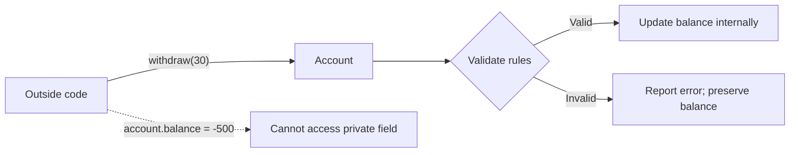
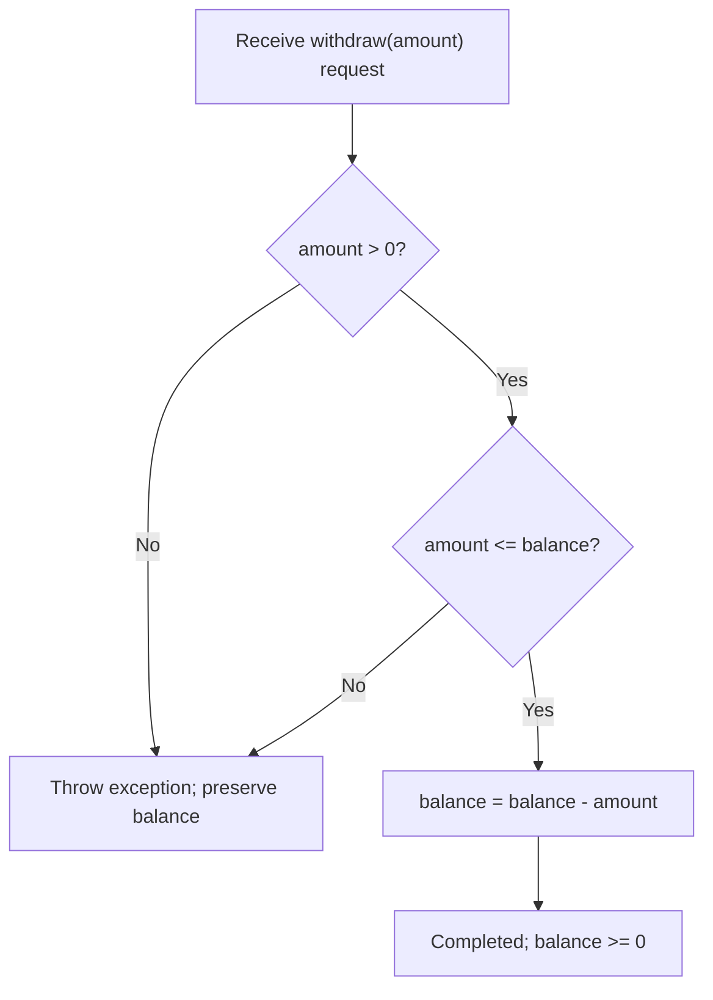

<a id="back-to-top"></a>

# Encapsulation — Managing and Protecting State

## Menu
- [3.1 What Is Encapsulation, and What Problem Does It Solve?](#oop-3-1)
- [3.2 public, private, protected, and Access Scope](#oop-3-2)
- [3.3 Getters and Setters: When Do You Need Them, and Why Should You Avoid Creating Them Everywhere?](#oop-3-3)
- [3.4 State Invariants: An Account Must Not Allow Withdrawals Beyond Its Balance](#oop-3-4)

## <a id="oop-3-1">3.1 What Is Encapsulation, and What Problem Does It Solve?</a>

<details>
<summary>Click for details</summary>

**Encapsulation** in object-oriented programming (OOP) is the practice of **placing data and related behavior in the same object while controlling how outside code interacts with that data**.

Imagine a bank account. It has a balance and supports deposits and withdrawals. However, it must follow a rule: **do not accept withdrawals of negative amounts, zero, or more than the available balance**.

If any part of the application can change the balance at will, this rule is easy to break. Encapsulation makes the account **responsible for its own state**: it validates requests before changing its balance.

> **The central idea:** Other components may **ask an object to perform an action**, but they must not arbitrarily alter its state in ways that violate the rules the object manages.

### 1. The Problem Without Encapsulation

Suppose a developer writes the following `Account` class:

```java
class Account {
    public int balance = 100;
}
```

Other parts of the application can assign values directly:

```java
Account account = new Account();

account.balance -= 30;      // 70 remains: this looks correct
account.balance = -500;     // Negative balance: still allowed
account.balance = 999999;   // Arbitrary balance change: still allowed
```

The problem is that **`Account` has no control over changes to its balance**. Any code that can access the field can modify it.

In a small application, the problem might not be obvious. But once features such as ATM withdrawals, transfers, refunds, or fees are introduced, each area may update the balance differently. One forgotten check is enough to leave an object in an invalid state.

| Design choice | What can happen |
|---|---|
| Allow direct changes to `account.balance` | Each caller decides how to calculate and validate the balance |
| Scatter withdrawal rules across the application | One place checks the rules while another may forget |
| Change a business rule | Many separate locations must be found and updated |
| Let other code manage the object's data | Invalid states become easy to create, and changes become hard to trace |

The problem encapsulation addresses is therefore: **how can an object retain control over its state and uphold its own rules?**

### 2. The Solution: Let the Object Protect Its State

Instead of exposing `balance`, keep it inside `Account` and provide meaningful behaviors: `deposit(...)` and `withdraw(...)`.

The following Java example can be run directly when saved as `Main.java`:

```java
public class Main {
    public static void main(String[] args) {
        Account an = new Account(100);
        Account binh = new Account(100);

        an.withdraw(30);
        System.out.println("An remaining: " + an.getBalance()); // 70

        try {
            binh.withdraw(120);
        } catch (IllegalArgumentException ex) {
            System.out.println("Binh: " + ex.getMessage());
        }

        System.out.println("Binh remaining: " + binh.getBalance()); // 100

        an.deposit(20);
        System.out.println("An after deposit: " + an.getBalance()); // 90
    }
}

class Account {
    private int balance;

    public Account(int openingBalance) {
        if (openingBalance < 0) {
            throw new IllegalArgumentException("Invalid opening balance");
        }
        this.balance = openingBalance;
    }

    public int getBalance() {
        return balance;
    }

    public void deposit(int amount) {
        if (amount <= 0) {
            throw new IllegalArgumentException("Deposit must be positive");
        }
        balance = Math.addExact(balance, amount);
    }

    public void withdraw(int amount) {
        if (amount <= 0) {
            throw new IllegalArgumentException("Withdrawal must be positive");
        }
        if (amount > balance) {
            throw new IllegalArgumentException("Insufficient balance");
        }
        balance -= amount;
    }
}
```

Output:

```text
An remaining: 70
Binh: Insufficient balance
Binh remaining: 100
An after deposit: 90
```

Read the example again in everyday terms:

1. An's account starts with 100. A withdrawal of 30 is valid, so the account updates its own balance to 70.
2. Binh's account is **a different object**, also starting at 100. The request to withdraw 120 is rejected; Binh's balance stays at 100.
3. An's account receives another 20 through the deposit behavior; its balance becomes 90.
4. Outside code can **read** the balance through `getBalance()` but cannot directly assign `an.balance = -500` because the field is `private`.

Here, `int` represents a **hypothetical unit of money** to keep the focus on OOP. A real financial application needs suitable money representation, transaction handling, and concurrency control.

### 3. What Boundary Does Encapsulation Establish?



This table makes each responsibility explicit:

| Component | Role |
|---|---|
| `private int balance` | Restricts direct access to the balance from code outside the class |
| `withdraw(amount)` | Defines a withdrawal action with validation |
| `deposit(amount)` | Defines a deposit action with validation |
| `getBalance()` | Exposes the balance to callers that need to read it |
| `Account` | Takes responsibility for preserving balance-related rules within the object |

Two ideas belong together:

- **Keep related data and behavior together:** `balance` lives alongside the operations that need to work with it.
- **Control the interaction boundary:** outside code knows which methods it may call, while the object decides when its state may change.

Encapsulation **does not mean every field must be completely hidden or every class must have getters and setters**. Whether reading or changing a value should be allowed depends on the object's responsibilities.

### 4. Why Is `private` Alone Not Enough?

A common misunderstanding is that setting every field to `private` and adding a public setter for each field automatically produces good encapsulation.

Consider:

```java
class Account {
    private int balance;

    public void setBalance(int balance) {
        this.balance = balance;
    }
}
```

Although `balance` is `private`, outside code can still call `setBalance(-100)`. Even checking `balance >= 0` inside the setter would not necessarily enforce the business rules: callers could still call `setBalance(1000000)` to increase the money arbitrarily.

**The key is which behaviors are permitted.** `withdraw(30)` communicates the intent to withdraw money, so the object can check both the amount and the available balance. `setBalance(70)` merely requests an assignment to 70 without saying *why* the balance should become 70.

| Call | What does it express? | Does it make withdrawal rules easy to enforce? |
|---|---|---|
| `account.balance = 70` | Directly change a field | No; bypasses the object's boundary |
| `account.setBalance(70)` | Set the balance to 70 | Does not express enough business intent |
| `account.withdraw(30)` | Withdraw 30 from the current balance | Yes; the method can validate before updating |

This **does not mean setters are always wrong**. For properties that may be changed directly, such as enabling or disabling dark mode in UI settings, a setter can be perfectly reasonable. But for **state governed by business constraints**, methods that express actions are generally clearer and safer.

### 5. What Benefits Does Encapsulation Provide?

**Protect the object's rules.** If an account must always have a nonnegative balance, state-changing operations must preserve that condition. Such a condition that must always hold is often called an **invariant**. For example, `withdraw(...)` rejects requests that exceed the balance.

**Reduce dependencies on internal details.** Other code needs to understand what `withdraw(amount)` does without writing `balance = balance - amount` itself. The class may later change how its data is stored or calculated, as long as it preserves the appropriate public contract.

**Centralize validation and error handling.** When many callers use `Account`, invalid amounts such as negative, zero, or excessive withdrawals are checked at the same boundary. This also makes the relevant tests easier to locate.

**Make code express business intentions.** `order.confirmPayment()` communicates the intent more clearly than having outside code assign `status`, `paidAt`, and several other fields.

Encapsulation does not automatically solve every problem. The `Account` example above does not guarantee safety when **multiple threads update the balance concurrently**, or when many database transactions access the same stored balance. Those scenarios require suitable synchronization, transaction management, or consistency controls.

### 6. Is Encapsulation the Same as Abstraction?

The concepts are closely related but emphasize different questions:

| Concept | Main question | Example |
|---|---|---|
| **Encapsulation** | Who owns the state and controls how it changes? | `Account` owns `balance` and validates `withdraw()` |
| **Abstraction** | Which capabilities must callers be able to see? | A caller only needs to understand the `withdraw(amount)` contract |

An object can use both at the same time. Callers see the withdrawal operation they need, while the object manages its data and validation logic internally.

### 7. Check Your Understanding with a Scenario

Suppose an `Order` class contains three fields: `status`, `paidAt`, and `totalAmount`. Outside code executes:

```java
order.setStatus("PAID");
order.setPaidAt(null);
order.setTotalAmount(0);
```

Even if every field is declared `private`, this sequence of setters can create an illogical order: it is marked paid even though there is no payment time, and the total was changed arbitrarily.

A responsibility-centered design might expose `order.confirmPayment(...)`. Inside that method, the object validates its current state and payment data, then updates the related fields according to consistent rules.

Answer these three questions:

1. **What problem does encapsulation solve?** — It helps an object own and control its state instead of allowing other code to change it arbitrarily or bypass its rules.
2. **Is `private` alone sufficient?** — No. You also need to consider whether public methods can create invalid states.
3. **Why is `withdraw(30)` better than `setBalance(70)` for an account?** — It expresses the intention to withdraw money and places validation inside the responsible object.

**Remember:** Encapsulation is more than **hiding data**; it is about **designing a boundary of responsibility**. An object manages the information it owns and exposes behaviors that let callers use it in valid ways.

</details>

- [Back to top](#back-to-top)

---

## <a id="oop-3-2">3.2 public, private, protected, and Access Scope</a>

<details>
<summary>Click for details</summary>

### 1. Why Does an Object Need to Restrict Access?

Imagine a bank account object holding a balance of 1,000,000 VND. If outside code can change that balance freely, it might set it to a negative value, add money arbitrarily, or bypass withdrawal rules. At that point, the `BankAccount` class no longer controls its own state.

In OOP, **encapsulation** means an object manages its data and related behaviors while controlling how other code interacts with them. **Access modifiers** are an important tool for defining which code may see and use a class's members.

Think of a class as a house:
- `public`: an entrance available to everyone.
- `private`: a private area that only code inside the class may access directly.
- `protected`: an area available to code in the same package or to subclasses under Java's rules.
- **package-private** (no keyword): an internal passage shared by classes in the same package.

Access scope applies to many elements: **fields**, **methods**, **constructors**, and **types nested inside classes**. Java checks access at compile time; knowing a member's name does not automatically grant access to it.

### 2. The Four Access Levels: Start with This Table

Suppose a member is declared in `Account` inside package `com.example.bank`.

| Declaration | Inside `Account` | Another class in the same package | Subclass in a different package | Unrelated class in a different package |
|---|:---:|:---:|:---:|:---:|
| `private` | ✅ | ❌ | ❌ | ❌ |
| *package-private* (no modifier) | ✅ | ✅ | ❌ | ❌ |
| `protected` | ✅ | ✅ | ✅* | ❌ |
| `public` | ✅ | ✅ | ✅ | ✅ |

**The asterisk on `protected`:** a subclass in another package may access the member according to inheritance rules; it **does not mean** that subclass can call the protected member on any arbitrary `Account` instance. Section 5 shows a concrete compilation example.

A common way to remember the relative breadth of access is:

```text
private  →  package-private  →  protected  →  public
narrowest                                      broadest
```

This is a comparison of typical access scope, not an instruction to use modifiers in that order. Grant **only the access needed for the member's responsibility**.

### 3. `private`: Protect an Object's State and Rules

For example, an account accepts only positive deposits and withdrawals and prevents withdrawals that exceed its balance:

```java
package com.example.bank;

public class BankAccount {
    private long balance;

    public BankAccount(long initialBalance) {
        if (initialBalance < 0) {
            throw new IllegalArgumentException("Invalid opening balance");
        }
        this.balance = initialBalance;
    }

    public long getBalance() {
        return balance;
    }

    public void deposit(long amount) {
        requirePositive(amount);
        balance = Math.addExact(balance, amount);
    }

    public void withdraw(long amount) {
        requirePositive(amount);
        if (amount > balance) {
            throw new IllegalStateException("Insufficient balance");
        }
        balance -= amount;
    }

    private void requirePositive(long amount) {
        if (amount <= 0) {
            throw new IllegalArgumentException("Amount must be positive");
        }
    }
}
```

Usage:

```java
BankAccount account = new BankAccount(1_000_000);
account.withdraw(200_000);
System.out.println(account.getBalance()); // 800000

// account.balance = -10;        // COMPILATION ERROR: balance is private
// account.requirePositive(10);  // COMPILATION ERROR: method is private
```

Here `balance` is `private`, and the class maintains an **invariant**: the balance remains nonnegative after valid operations. Callers use `deposit()`, `withdraw()`, and `getBalance()` for the supported operations, but cannot modify the field directly. This centralizes the rules and gives the class room to change its internal state representation without extensively affecting callers.

`private` **does not prevent methods inside the same class from accessing each other**. Within `BankAccount`, `withdraw()` can call `requirePositive()` and read `balance`. Java also allows code inside the class to access a `private` field on *another instance of the same class*:

```java
public boolean sameBalance(BankAccount other) {
    return this.balance == other.balance; // Valid inside BankAccount
}
```

**The important distinction:** `private` is **class-scoped**, not restricted to the particular instance named `this`. Java also has special rules for nested classes and nestmates, but when starting out, focus on the restriction against direct access from code outside the class.

### 4. `public`: The Interface That Callers May Use

`public` permits access from other classes, including those in different packages, provided that the declaring type and the access path are also visible.

In the account example, `withdraw()` is `public` because outside code needs to withdraw money. But **public does not mean every requested operation is permitted**: the method still checks the amount and the balance.

```java
BankAccount account = new BankAccount(500_000);

account.deposit(100_000);   // Valid: balance is now 600000
account.withdraw(700_000);  // Throws IllegalStateException: insufficient balance
```

Some practical design principles:
- Make behaviors `public` when callers genuinely need them.
- Prefer business operations (`withdraw`, `deposit`) to `public void setBalance(long x)`, which can bypass the rules.
- Do not assume every field must have a getter and setter. `getBalance()` is meaningful if a caller needs to read the balance; an unrestricted `setBalance()` may violate the invariant.
- A getter returning a mutable object (such as a `List`) may expose a way to change internal data. Consider returning a copy or a read-only view when appropriate.

The larger a public API becomes, the more code may depend on it. Choosing `public` is therefore also a commitment to maintaining that usage contract.

### 5. `protected`: Grant Access Within a Package and in Inheritance Scenarios

`protected` is often used for intentional **extension points** when a parent class is designed to support subclasses. For example, a parent class can describe an account, while a subclass customizes its type label:

```java
// File: com/example/bank/Account.java
package com.example.bank;

public class Account {
    protected String accountType() {
        return "STANDARD";
    }

    public String description() {
        return "Account type: " + accountType();
    }
}
```

```java
// File: com/example/premium/PremiumAccount.java
package com.example.premium;

import com.example.bank.Account;

public class PremiumAccount extends Account {
    @Override
    protected String accountType() {
        return "PREMIUM";
    }

    public String ownType() {
        return this.accountType(); // OK: accessing through the subclass itself
    }

    public String anotherAccountType() {
        Account another = new Account();

        // return another.accountType(); // COMPILATION ERROR
        return this.accountType();
    }
}
```

```java
PremiumAccount premium = new PremiumAccount();
System.out.println(premium.description()); // Account type: PREMIUM
```

Explanation:
1. `Account.description()` is `public`, so other code can call it.
2. `PremiumAccount` is in another package but can still **override** the parent's `accountType()` because the method is `protected`.
3. When `description()` calls `accountType()`, Java uses the implementation belonging to the actual `PremiumAccount` object; the result is `PREMIUM`.
4. However, inside package `com.example.premium`, a subclass cannot access `accountType()` through an independent reference such as `another` with declared type `Account`. Cross-package `protected` access restricts which object references may be used; `this` and `super` are familiar permitted forms.

**A commonly confused detail:** a non-subclass **in the same package** as `Account` can access its `protected` members (given an appropriate object). Conversely, a subclass in another package does not automatically gain access to the parent's `private` or package-private members.

**Should fields be `protected`?** Only if you intentionally want subclasses to access them directly. For data that must preserve invariants, it is usually safer to keep fields `private` and offer controlled `protected` methods to subclasses. For example, `protected void validate...()` or `protected String accountType()` conveys a clearer purpose than `protected long balance`, which allows subclasses to change the balance.

### 6. Package-Private: Leave Out the Modifier

Java has another access level often used for internal library code:

```java
// File: com/example/bank/BalanceRules.java
package com.example.bank;

final class BalanceRules {        // package-private class
    static void requirePositive(long value) { // package-private method
        if (value <= 0) {
            throw new IllegalArgumentException("Must be greater than zero");
        }
    }
}
```

```java
// File: com/example/bank/TransferService.java
package com.example.bank;

public class TransferService {
    public void validate(long amount) {
        BalanceRules.requirePositive(amount); // OK: same package
    }
}
```

From package `com.example.app`, writing `import com.example.bank.BalanceRules;` **does not make** `BalanceRules` an accessible type. The class is intended for use inside `com.example.bank` only.

This level is called **package-private** or *default/package access*. You simply **omit the modifier**; there is no valid syntax `default class BalanceRules` or `default void validate()` for this purpose. The `default` keyword has another meaning when used with interface methods.

Also distinguish `com.example.bank` from `com.example.bank.internal`: they are **different packages**. A dot in a package name is part of its naming structure, not an automatic access grant to a subpackage.

### 7. Where Can Access Modifiers Be Applied?

Not every declaration accepts all four access levels:

| Declaration location | Rule |
|---|---|
| **Top-level class/interface** (not nested in another class) | Can be `public` or *package-private* only. You cannot declare `private class X` or `protected class X` at top level. |
| **Class field / method / constructor** | May be `public`, `protected`, `private`, or have no modifier. |
| **Type nested inside a class** | May use these access levels, subject to additional rules for the type of declaration. |

A `private` constructor is often useful when a class wants to control its own instance creation, for example via a factory method:

```java
public final class AccountId {
    private final String value;

    private AccountId(String value) {
        this.value = value;
    }

    public static AccountId of(String raw) {
        if (raw == null || raw.isBlank()) {
            throw new IllegalArgumentException("ID is blank");
        }
        return new AccountId(raw.trim());
    }
}
```

Outside code can call `AccountId.of("A-01")` but cannot call `new AccountId("A-01")`. Access rules apply to **constructors**, not only to fields and methods.

Additionally, a method declared `public` in a class may still expose parameter or return types that are inaccessible to outside code, making the API difficult to use. Consider the visibility of all types that appear in a public API.

### 8. Self-Check: Which Lines Compile?

Assume the following file exists:

```java
// package: com.demo.shop
package com.demo.shop;

public class Product {
    private long cost = 100;
    int stock = 5;                  // package-private
    protected String category = "BOOK";
    public String name = "Java";
}
```

In **the same package, `com.demo.shop`**:

```java
Product p = new Product();
// long a = p.cost;      // ❌ private
int b = p.stock;         // ✅ same package
String c = p.category;   // ✅ same package (even without inheritance)
String d = p.name;       // ✅ public
```

In **another package**, inside an ordinary class that **does not extend** `Product`:

```java
Product p = new Product();
// long a = p.cost;       // ❌ private
// int b = p.stock;       // ❌ package-private
// String c = p.category; // ❌ protected
String d = p.name;        // ✅ public
```

If you write `class BookProduct extends Product` in a different package, the subclass may access inherited `protected` members through `this.category`; it still cannot directly access the parent's `cost` or `stock`.

### 9. Which Access Level Should You Choose in Real Java Code?

Ask these questions for each member:

1. **Is this internal state or logic that the class must manage itself?** Usually choose `private`.
2. **Does a group of classes in the same package need to cooperate while outside code does not need the detail?** Consider *package-private*.
3. **Is this an intentional extension point for subclasses?** Consider `protected` with a clear contract.
4. **Does outside code genuinely need to use this capability?** Then declare it `public`.

In Spring Boot projects, you may see `public` controller/service methods so other components can call them, while `private` helper methods keep implementation details inside the class. However, **Java access modifiers determine Java-language visibility only**; Spring bean creation, dependency injection, and HTTP endpoint authentication are separate mechanisms.

Try changing `BankAccount.balance` from `private` to `public`. You can then write `account.balance = -5`, bypassing `withdraw()` and its balance checks. That is why access modifiers are tied to **encapsulation and invariant preservation**, rather than merely making code compile.

> **Remember:** `public` exposes a contract to outside code, `private` protects internal details, package-private supports cooperation within a package, and `protected` adds inheritance-related access. Suitable access rights help each object maintain its responsibilities.

</details>

- [Back to top](#back-to-top)

---

## <a id="oop-3-3">3.3 Getters and Setters: When Do You Need Them, and Why Should You Avoid Creating Them Everywhere?</a>

<details>
<summary>Click for details</summary>

In Java, a **getter** usually *reads* a property, while a **setter** usually *changes* its value. For example, `getName()` returns a name and `setName(...)` updates it.

The key OOP idea is that **every public method is a capability the object grants to outside code**. Declaring a field `private` does not necessarily mean that the design provides good encapsulation if all state can be read and changed arbitrarily through getters and setters.

### 1. What Do Getters and Setters Actually Do?

```java
class User {
    private String name;

    public String getName() {
        return name;
    }

    public void setName(String name) {
        this.name = name;
    }
}
```

Usage:

```java
User user = new User();
user.setName("An");
System.out.println(user.getName()); // An
```

Here:
- `name` is the object's **state**.
- `getName()` lets outside code **observe** the state.
- `setName(...)` lets outside code **change** the state.

These methods are not inherently wrong. However, the setter above accepts `null`, an empty string, or an invalid name. If the application requires a meaningful name, the object is not yet enforcing that rule.

**Encapsulation** means keeping data and related operations inside the same object while controlling how the outside world uses that object. Getters and setters are merely **possible tools** for achieving that goal.

### 2. Why Not Generate Getters and Setters for Every Field?

Imagine a bank account with a balance of 100:

```java
class BankAccount {
    private long balance = 100;

    public long getBalance() {
        return balance;
    }

    public void setBalance(long balance) {
        this.balance = balance;
    }
}
```

Outside code can do this:

```java
BankAccount account = new BankAccount();
account.setBalance(-500);      // Negative balance, despite no overdraft being allowed
account.setBalance(1_000_000); // Arbitrarily create money without a transaction
```

The problem is not limited to negative values. Even a `setBalance(200)` value that is valid for the data type says nothing about **where the money came from**. The caller can replace the entire state without following the deposit/withdrawal behaviors.

Excessive use of setters can lead to several problems:

| Consequence | Concrete example |
| --- | --- |
| Violate an *invariant* | Negative balance, or an end date before a start date |
| Bypass a business workflow | Change `order.status` to `PAID` without payment |
| Scatter logic outside the object | Multiple services validate and update the same field independently |
| Increase coupling | Callers know too much about internal properties and need changes when the model evolves |
| Make errors harder to trace | Many callers can invoke `setBalance(...)` |

An **invariant** is a condition that must hold for an object at points when its state is exposed to outside code. For a bank account that disallows overdrafts, `balance >= 0` is an invariant.

### 3. Replace Arbitrary Setters with Meaningful Behaviors

Rather than asking “How can outside code change `balance`?”, ask “What is a user allowed to do with this account?”

```java
class BankAccount {
    private long balance;

    public BankAccount(long initialBalance) {
        if (initialBalance < 0) {
            throw new IllegalArgumentException("Initial balance must be >= 0");
        }
        this.balance = initialBalance;
    }

    public long getBalance() {
        return balance;
    }

    public void deposit(long amount) {
        if (amount <= 0) {
            throw new IllegalArgumentException("Amount must be positive");
        }
        balance = Math.addExact(balance, amount);
    }

    public void withdraw(long amount) {
        if (amount <= 0) {
            throw new IllegalArgumentException("Amount must be positive");
        }
        if (amount > balance) {
            throw new IllegalStateException("Insufficient funds");
        }
        balance -= amount;
    }
}
```

```java
BankAccount account = new BankAccount(100);

account.withdraw(30);
System.out.println(account.getBalance()); // 70

account.deposit(20);
System.out.println(account.getBalance()); // 90

account.withdraw(120); // Throws IllegalStateException
// Because the operation fails before subtracting money, the balance remains 90.
```

**The important change:** the object decides when the balance may change. A caller only requests a meaningful action (`deposit`, `withdraw`); the object checks the rules before updating. `getBalance()` is still useful because callers may need to *know* the balance without needing permission to *assign* it.

This is an example of encapsulation within a single object. A real banking system also needs transactions, audit trails, concurrency control, and other guarantees; one Java class cannot solve all of these problems.

### 4. When Should You Provide a Getter?

Create a getter when another part of the application **genuinely needs to read information** for display, an API response, appropriate logging, or business collaboration, and when exposing that information does not undermine control of the object's state.

| Situation | Often a sensible design |
| --- | --- |
| The UI needs to display the account name | `getDisplayName()` |
| The balance must be shown but cannot be changed directly | `getBalance()` without `setBalance(...)` |
| Code needs to know whether an order has been paid | `isPaid()` may express intent more clearly than reading `getStatus()` and comparing it elsewhere |
| Passwords, secret tokens, and internal keys | Avoid exposing getters unless the data is genuinely authorized for use |
| Callers need to read a mutable internal collection | Return a suitable copy or immutable view rather than a directly modifiable reference |

Remember: **a getter is not automatically harmless**. If it returns a mutable object, a caller may change internal data without any setter.

```java
class Team {
    private final List<String> members = new ArrayList<>();

    // Unsafe for encapsulation:
    public List<String> getMembersUnsafe() {
        return members;
    }

    // Safer when elements are immutable Strings:
    public List<String> getMembers() {
        return List.copyOf(members);
    }

    public void addMember(String name) {
        if (name == null || name.isBlank()) {
            throw new IllegalArgumentException("Invalid member name");
        }
        members.add(name);
    }
}
```

With `getMembersUnsafe()`, outside code can call `team.getMembersUnsafe().clear()` to remove members directly. With `List.copyOf(members)`, the caller receives an unmodifiable list detached from later structural changes to the original list. This is not a universal “deep copy”: if the elements themselves are mutable objects, consider copying them or exposing immutable data.

These code snippets use `java.util.List` and `java.util.ArrayList` (import them when putting the examples in a Java file).

### 5. When Is a Setter a Reasonable Choice?

**Setters are not forbidden in OOP.** They are useful when a property can legitimately change independently, its update rule is simple, and `setX(...)` accurately describes the intended operation.

For example, a user is allowed to change their display name:

```java
class UserProfile {
    private String displayName;

    public UserProfile(String displayName) {
        setDisplayName(displayName);
    }

    public String getDisplayName() {
        return displayName;
    }

    public void setDisplayName(String value) {
        if (value == null || value.isBlank()) {
            throw new IllegalArgumentException("Display name is required");
        }
        this.displayName = value.trim();
    }
}
```

Here, the setter centralizes a rule used both during construction and during updates. If changing a name later requires authentication, audit history, or moderation, a business method such as `changeDisplayName(...)` may express the intention better.

| Data or situation | Use a setter? | Why? |
| --- | --- | --- |
| Display name can be freely edited with simple validation | Possibly | Independent, straightforward update |
| Balance, reward points, available credit limit | Usually no | Require rule-driven operations: deposit, deduct, refund, lock |
| Order status | Usually no | Must follow valid transitions such as `pay()`, `cancel()` |
| A `startDate` / `endDate` pair | Use care | The fields depend on each other; `reschedule(start, end)` may enforce the rules better |
| DTO used to receive/return request data | Often acceptable | Mainly transports data, depending on serialization/binding mechanisms |
| Immutable object | No | State is fixed at construction |

Even a setter with basic input validation may be insufficient when a change depends on the **current state**, **the actor's permissions**, **state-transition rules**, or **coordination among multiple properties**. In these cases, prefer a method that communicates business intent.

### 6. Must Every Class Have Getters and Setters to Follow Java Conventions?

No. `private` only restricts direct field access. Getters and setters are ordinary methods; the API designer decides whether to expose them.

There are situations where extensive use of accessors makes sense:

- **JavaBeans and some binding libraries:** the `getX`/`setX` conventions help tools read or populate properties. Check what your specific library actually requires.
- **DTOs in Spring Boot / JSON:** depending on library version and configuration, a DTO may use getters/setters, constructor binding, or a `record`. Do not automatically impose DTO conventions on domain entities.
- **JPA entities:** JPA can use field or property access depending on the mapping and commonly requires a no-argument constructor with suitable visibility. That **does not mean** every field must have a public setter. Keep domain changes under control.
- **Lombok `@Getter` / `@Setter` / `@Data`:** these reduce repetitive code, but the generated methods still grant real access. For example, placing `@Setter` at class level may accidentally expose mutability for all applicable fields; apply annotations selectively.
- **Java `record`:** useful for data structures whose fields cannot be reassigned after construction; records have accessors such as `name()` but no setters. If a component refers to a mutable object, data protection still requires attention.

It is helpful to distinguish **data objects** (primarily carrying values between layers) from **domain objects** (responsible for maintaining rules). A design can use both without forcing every class into one pattern.

### 7. How to Choose an API When Designing a Class

Before adding a getter or setter, ask yourself:

1. **Who needs to read or write this information, and why?** If there is no clear need, do not expose a public method yet.
2. **Does the caller need a value or need to request an action?** Use `getBalance()` to view a balance; `withdraw(amount)` to withdraw money.
3. **Could a new value violate an invariant?** If so, validate inside the object and prefer an operation with business meaning.
4. **Does this property depend on other fields or previous state?** If so, an independent setter may leave the object invalid.
5. **Could the getter expose a mutable reference or sensitive data?** If so, return a suitable copy/read-only value or do not provide the getter.
6. **Which accessor mechanism does the framework actually require?** Expose only the required access, rather than generating everything by habit.

A small comparison of API names:

```java
order.setStatus(PAID);     // Who verifies that payment occurred?
order.markPaid(paymentId); // Communicates intent and where validation belongs

cart.setTotal(1000);       // Caller chooses the total directly
cart.addItem(product, 2);  // Cart can recalculate its own total
```

Names such as `markPaid` or `addItem` do not guarantee correctness by themselves: the implementation must still check and preserve any necessary invariants. But they **place responsibility where it belongs** and make the object's contract clearer.

### 8. Check Your Understanding

**Scenario A:** `Product` has a `private int stock` field and a public `setStock(int)` method. A service calls `setStock(-3)`. Is declaring the field `private` enough to protect it?

→ **No.** `private` prevents direct updates, but a public setter can still write an invalid value. Depending on the business rules, the object may need `restock(quantity)`, `reserve(quantity)`, and `release(quantity)` with appropriate checks.

**Scenario B:** `getMembers()` returns an internal `List`. Is the object safe simply because it has no setter?

→ **No.** The caller can still change the list through the returned reference. The return strategy and element types matter.

**Scenario C:** A DTO receives form data and exposes `getEmail()` and `setEmail(...)`. Is that an anti-pattern?

→ **Not necessarily.** Accessors are common for structures mainly used to transport data. Input validation still belongs at an appropriate boundary; a DTO does not replace domain-level business checks.

**Remember:** Getters and setters are API design choices. Add them when access is actually needed, and let the object manage changes that affect its rules and valid state. **Good encapsulation is judged by an object's control and responsibilities, not by the number of `private` keywords or generated getters and setters.**

</details>

- [Back to top](#back-to-top)

---

## <a id="oop-3-4">3.4 State Invariants: An Account Must Not Allow Withdrawals Beyond Its Balance</a>

<details>
<summary>Click for details</summary>

Suppose a bank account holds **100 units of money**. A customer requests a withdrawal of **30**, leaving **70** — a valid operation. But if the customer requests **120**, the account must reject it and **keep the balance at 100**, rather than changing the balance to `-20`.

The rule being protected here is a **state invariant**.

### 1. What Is an Invariant?

An **invariant** is a condition that an object's state must satisfy whenever the object is considered valid, particularly **immediately after construction and after each public operation has completed**.

For a simple `Account`, the business rule is:

```text
balance >= 0
```

This means **the balance must never be negative**.

The condition remains true even though the balance itself may change from `100` to `70`, then from `70` to `0`. Thus, *invariant* refers to **a condition that must be maintained**. It does not mean **the variable's value may never change** (*immutability*).

Distinguish these three concepts:

| Concept | In a withdrawal operation |
|---|---|
| **State** | The current `balance` value, for example `100` |
| **Input condition / precondition** | The withdrawal amount must be greater than `0` and must not exceed the available balance |
| **State invariant** | After the operation, `balance >= 0` remains true |

A precondition helps decide **whether an operation is permitted**; an invariant describes **what must always hold for a valid object**.

### 2. Why Must the Account Protect the Rule Itself?

A design with inadequate protection might look like this:

```java
class Account {
    public long balance = 100;
}

// Outside code can change it directly:
Account account = new Account();
account.balance = -20; // Object enters an invalid state!
```

Even if we declare `private long balance`, the problem remains if we provide `setBalance(-20)` without validation. **Declaring a field `private` is not enough; every path that changes state must respect the rule.**

A suitable OOP design makes `Account` **own its balance data and take responsibility for deciding whether a withdrawal is valid**. Outside code asks the account to perform `withdraw(amount)` instead of calculating and assigning the balance directly.

### 3. Java Example: Validate First, Change State Second

Assume monetary amounts are represented as integers in an agreed smallest unit; the example uses `long` to focus on the invariant.

```java
public final class Account {
    private long balance;

    public Account(long initialBalance) {
        if (initialBalance < 0) {
            throw new IllegalArgumentException("Initial balance cannot be negative");
        }
        this.balance = initialBalance;
    }

    public long getBalance() {
        return balance;
    }

    public void withdraw(long amount) {
        if (amount <= 0) {
            throw new IllegalArgumentException("Withdrawal amount must be positive");
        }

        if (amount > balance) {
            throw new IllegalStateException("Insufficient balance to withdraw");
        }

        // Change state only after all conditions have been satisfied.
        balance -= amount;
    }

    public void deposit(long amount) {
        if (amount <= 0) {
            throw new IllegalArgumentException("Deposit amount must be positive");
        }

        // If addition overflows long, Math.addExact throws an exception;
        // assignment does not occur, and the old balance remains unchanged.
        balance = Math.addExact(balance, amount);
    }
}
```

Two points deserve attention:

- **The constructor must validate too.** If `new Account(-10)` were allowed, the object would violate its invariant the moment it was created.
- **Validation happens before subtraction.** In `withdraw`, an invalid amount causes the method to throw an exception **before touching `balance`**. Therefore a failed request does not corrupt the account's state.

Usage:

```java
public class Main {
    public static void main(String[] args) {
        Account successfulAccount = new Account(100);
        successfulAccount.withdraw(30);
        System.out.println(successfulAccount.getBalance()); // 70

        // Another account, also starting at 100: test an independent failure case.
        Account rejectedAccount = new Account(100);
        try {
            rejectedAccount.withdraw(120);
        } catch (IllegalStateException ex) {
            System.out.println(ex.getMessage()); // Insufficient balance to withdraw
        }
        System.out.println(rejectedAccount.getBalance()); // 100
    }
}
```

On the successful path, `100 - 30 = 70`; the invariant still holds. On the failure path, the request `120 > 100` is rejected; the program never performs `100 - 120`, so the balance stays at `100`.

### 4. Track State Before and After an Operation

Each row below represents **an independent scenario** beginning with an account balance of `100`.

| Request | Processing | Final balance | Invariant `balance >= 0` |
|---|---|---:|---|
| Withdraw `30` | Accepted | `70` | True |
| Withdraw `100` | Accepted; withdraw entire balance | `0` | True |
| Withdraw `120` | Rejected because it exceeds the balance | `100` | True |
| Withdraw `0` or `-5` | Rejected because the amount is invalid | `100` | True |

The decision flow inside `withdraw`:



Placing the subtraction **after** the checks gives us a simple argument: if `amount > 0` and `amount <= balance`, then `balance - amount >= 0`. A valid withdrawal therefore **preserves the invariant**.

### 5. How This Relates to Encapsulation

Encapsulation means more than hiding `balance` with `private`. More importantly, it means **keeping control over how state changes** inside the object.

Instead of allowing outside code to do this:

```java
// Dangerous design: outside code changes state directly.
account.balance = account.balance - amount;
```

we expose a business operation:

```java
account.withdraw(amount);
```

Every caller of `Account` then passes through the same validation rules. If the business later introduces withdrawal limits, transaction fees, or locked-account states, there is a clear place to enforce those checks.

**However, having getters and setters does not automatically mean the class is properly encapsulated.** A setter that accepts arbitrary balances can undermine the entire protective boundary. An object should expose business-appropriate behaviors (`withdraw`, `deposit`) rather than letting callers edit its internal data directly.

### 6. Common Misunderstandings to Avoid

**Misunderstanding 1 — “Invariant means the balance cannot change.”** Incorrect. The balance may change through valid operations; the invariant is the condition `balance >= 0`.

**Misunderstanding 2 — “Validation in the UI or controller is enough.”** The UI may validate early to provide feedback, but a domain object should not rely on every caller remembering the checks. When APIs, batch jobs, or tests call the object, the rules must still be enforced where state ownership resides.

**Misunderstanding 3 — “Declaring `private` makes invalid state impossible.”** Even a method inside `Account` can violate the invariant if it modifies `balance` without sufficient checks. Encapsulation establishes a **control boundary**; code inside that boundary is responsible for maintaining correctness.

**Misunderstanding 4 — “The code above automatically handles all concurrent withdrawals safely.”** Not yet. This example illustrates the rules in a sequential call. When multiple threads or requests access the same account, **checking and subtracting the balance** must be protected as a consistent operation, for example through appropriate synchronization or transaction/locking at the storage layer. `private` fields and isolated `if` checks do not guarantee concurrency safety.

### 7. Check Your Understanding

Suppose an `Account` has `balance = 80`:

1. `withdraw(50)` is accepted, leaving `30`.
2. Starting from `30`, `withdraw(40)` is rejected, and the balance **remains `30`**.
3. A new `Account` can be created with `balance = 0` but cannot be created with a negative opening balance.

If you can explain **why these operations maintain `balance >= 0`** and **why the object must validate requests before changing its balance**, you understand the meaning of a *state invariant* in OOP encapsulation.

</details>

- [Back to top](#back-to-top)
