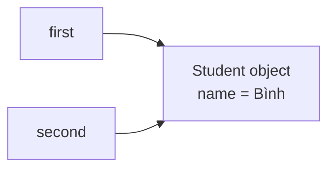
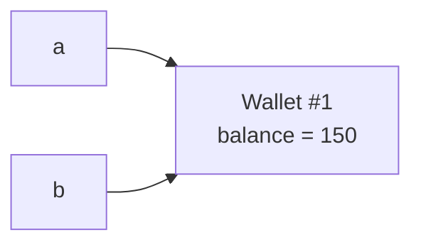
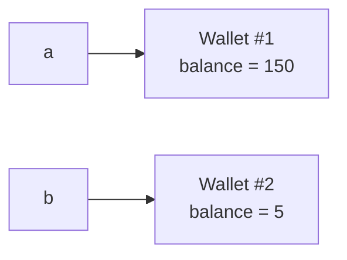
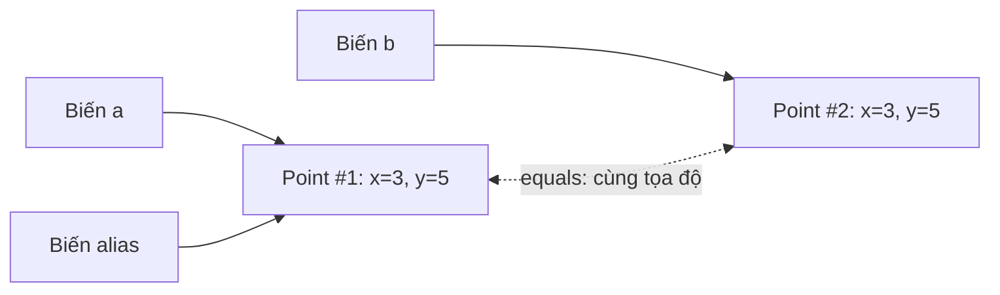
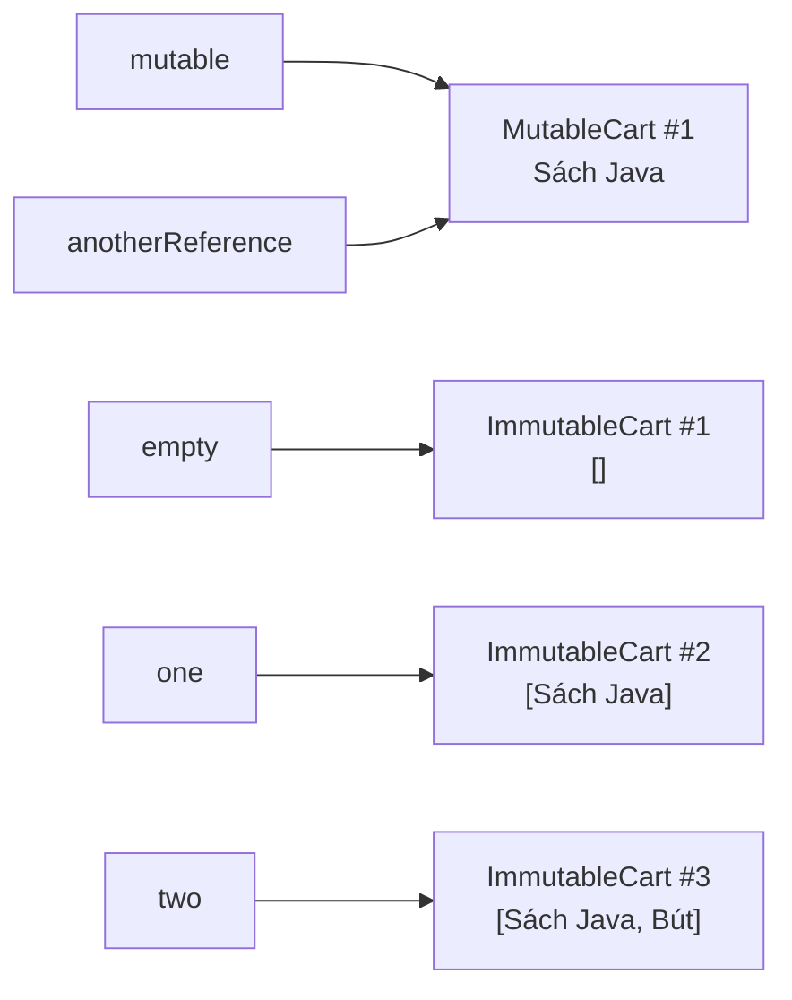
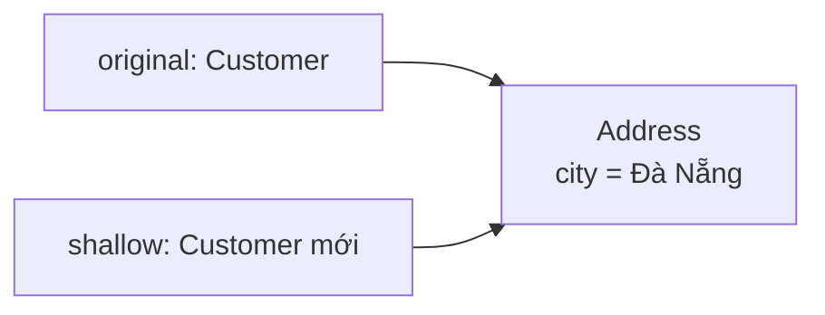
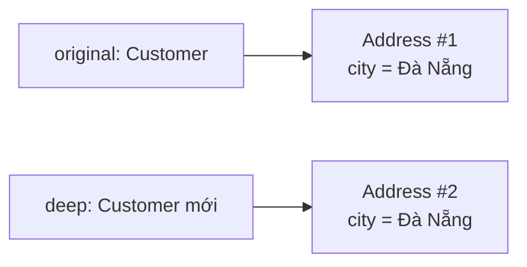

<a id="back-to-top"></a>

# Objects

## Menu
- [Object Identity, State, and Behavior](#object-001)
- [References, Values, and Passing Objects](#object-002)
- [Multiple References to the Same Object](#object-003)
- [Object Identity vs. Value Equality](#object-004)
- [Mutable and Immutable Objects](#object-005)
- [Shallow and Deep Copies](#object-006)
- [Object Sharing and the Effects of State Changes](#object-007)
- [Null Values and Objects That Do Not Exist](#object-008)
- [Tracing Object Interactions in a Scenario](#object-009)

## <a id="object-001">Object Identity, State, and Behavior</a>

<details>
<summary>View details</summary>

# Object Identity, State, and Behavior in Java

In object-oriented programming (OOP), an **object** is more than a collection of variables and functions. It is a concrete entity at runtime with **identity**, **state**, and **behavior**. These three aspects help us model entities such as orders, bank accounts, shopping carts, players, and devices in software.

Imagine two orders belonging to the same customer, Lan, each containing a notebook and both marked “Confirmed.” They may have identical data yet remain **two different orders**. Conversely, an order may start as “Draft” and later become “Confirmed” while remaining **the same order**.

This is the essential distinction:

- **Identity:** Which object is this? Is it the very same object referenced elsewhere?
- **State:** What data does the object hold at this moment?
- **Behavior:** Which operations can the object perform, which questions can it answer, and under what rules may it change its state?

## 1. Comparing the Three Aspects

| Aspect | Question to answer | Example with `Order` | Can it change over time? |
|---|---|---|---|
| **Identity** | Is it *the same object*? | Two variables refer to one `Order` | An object's identity does not change during its lifetime |
| **State** | What data does the object currently contain? | Item list, `DRAFT`/`CONFIRMED` status | May change if the design allows it |
| **Behavior** | What can the object do? | `addItem()`, `confirm()`, `cancel()` | Methods are defined by its type; results/actions may depend on state |

Put another way, **identity** lets us track *the same object over time*; **state** describes *its current condition*; **behavior** defines *how it can respond*.

### Everyday Example

An access card has its own identifier. It may be active today and blocked tomorrow. The `unlock()` behavior is valid only when the person performing it is authorized, and `enter()` must check the current state. Blocking the card does not turn it into another card.

In software systems, distinguish two kinds of identity:

1. **Java object identity:** a particular instance existing in JVM memory, distinguished when comparing references with `==`.
2. **Business identity:** an order ID, UUID, account number, and so on, used to track the same business entity across databases, application executions, and services. Two distinct Java objects can represent the same business record.

These concepts are related but **not equivalent**.

## 2. Objects, Classes, and References

A **class** describes a type and its operations; an **object** is a concrete instance of that type; a **reference variable** is how Java code refers to that object.

~~~java
Order first = new Order("Lan");
Order second = new Order("Lan");
Order alias = first;
~~~

In this snippet:

- `new Order("Lan")` is executed twice, creating two separate instances referenced by `first` and `second`.
- `alias = first` only copies **the reference value**. Without `new`, no third object is created.
- `first == second` is `false`; `first == alias` is `true`.
- If `alias` invokes a state-changing method, `first` also observes the change because both refer to **one object**.

~~~mermaid
flowchart LR
    F["Biến first"] --> A["Order object #1<br/>customer: Lan<br/>status: DRAFT"]
    AL["Biến alias"] --> A
    S["Biến second"] --> B["Order object #2<br/>customer: Lan<br/>status: DRAFT"]
~~~

This models reference relationships, not physical JVM memory locations. The number of reference variables **does not equal** the number of objects.

Also note that `Order x;` merely *declares* a local reference variable; it creates no object and must be assigned before being read. `Order x = null;` creates no object either: `null` indicates that the reference currently points to none.

## 3. Complete Java Example: An Order with Identity, State, and Behavior

The following example models an order with these rules:

- Each instance receives a `UUID` identifier when it is created.
- The order stores the customer name, item list, and current status.
- Items can be added and the order confirmed only while it is in draft.
- An empty order cannot be confirmed; only a confirmed order can be canceled.

Save the entire example as **`Demo.java`** and run it with **Java 17+**:

~~~java
import java.util.ArrayList;
import java.util.List;
import java.util.UUID;

public class Demo {
    public static void main(String[] args) {
        Order first = new Order("Lan");
        Order second = new Order("Lan");
        Order alias = first;

        System.out.println("first == second: " + (first == second));
        System.out.println("first == alias: " + (first == alias));

        alias.addItem("Sổ tay");
        first.confirm();

        System.out.println("first status: " + first.getStatus());
        System.out.println("alias status: " + alias.getStatus());
        System.out.println("first items: " + first.getItems());
        System.out.println("second items: " + second.getItems());
        System.out.println("first.equals(second): " + first.equals(second));

        first.cancel();
        System.out.println("alias after cancel: " + alias.getStatus());
    }
}

enum OrderStatus {
    DRAFT, CONFIRMED, CANCELLED
}

final class Order {
    private final UUID id;
    private final String customer;
    private final List<String> items;
    private OrderStatus status;

    public Order(String customer) {
        if (customer == null || customer.isBlank()) {
            throw new IllegalArgumentException("Tên khách hàng không hợp lệ");
        }

        this.id = UUID.randomUUID();
        this.customer = customer;
        this.items = new ArrayList<>();
        this.status = OrderStatus.DRAFT;
    }

    public UUID getId() {
        return id;
    }

    public String getCustomer() {
        return customer;
    }

    public OrderStatus getStatus() {
        return status;
    }

    // Tạo một bản sao chỉ đọc để bên ngoài không sửa trực tiếp items.
    public List<String> getItems() {
        return List.copyOf(items);
    }

    public void addItem(String item) {
        ensureDraft();

        if (item == null || item.isBlank()) {
            throw new IllegalArgumentException("Tên mặt hàng không hợp lệ");
        }

        items.add(item);
    }

    public void confirm() {
        ensureDraft();

        if (items.isEmpty()) {
            throw new IllegalStateException(
                    "Đơn hàng phải có ít nhất một mặt hàng"
            );
        }

        status = OrderStatus.CONFIRMED;
    }

    public void cancel() {
        if (status != OrderStatus.CONFIRMED) {
            throw new IllegalStateException(
                    "Chỉ được hủy đơn hàng đã xác nhận"
            );
        }

        status = OrderStatus.CANCELLED;
    }

    private void ensureDraft() {
        if (status != OrderStatus.DRAFT) {
            throw new IllegalStateException(
                    "Thao tác chỉ hợp lệ khi đơn hàng là DRAFT"
            );
        }
    }
}
~~~

Run:

~~~bash
javac Demo.java
java Demo
~~~

Output:

~~~text
first == second: false
first == alias: true
first status: CONFIRMED
alias status: CONFIRMED
first items: [Sổ tay]
second items: []
first.equals(second): false
alias after cancel: CANCELLED
~~~

### Analyzing the Example

**Identity:** `first` and `second` are created by separate `new` expressions, so they are distinct instances even though they initially share a customer name, status, and empty item list. `alias` and `first` refer to the same instance, so `first == alias` is `true`. The `id` identifies an order at the business level but does not determine the result of the `==` reference comparison.

**State:** the `id`, `customer`, `items`, and `status` values describe the state of each `Order`. After `alias.addItem("Sổ tay")`, the item list seen through `first` changes, while `second` still has an empty list. After `first.confirm()`, `alias` sees status `CONFIRMED` because it references the same object.

**Behavior:** `addItem()`, `confirm()`, and `cancel()` are operations an `Order` object provides. They enforce business rules before modifying fields. The `getStatus()` and `getItems()` methods are queries that need not change state.

**Encapsulation:** fields are declared `private`; external code cannot write `first.status = ...` or directly insert an element into the internal list. Public methods provide controlled entry points for valid state changes. The example uses a `final class` to keep the design simple and prevent subclasses from changing its rules through inheritance.

### Behaviors Define State Transitions

~~~mermaid
stateDiagram-v2
    [*] --> DRAFT: new Order(...)
    DRAFT --> DRAFT: addItem(item)
    DRAFT --> CONFIRMED: confirm() khi items không rỗng
    CONFIRMED --> CANCELLED: cancel()
~~~

The diagram shows only **implemented valid state transitions**. For example, `cancel()` in `DRAFT` or `addItem()` in `CONFIRMED` throws `IllegalStateException` rather than performing the requested transition. An object retains its identity throughout `DRAFT → CONFIRMED → CANCELLED`.

## 4. Identifying an Object Correctly

When tracking an object through state changes, ask **“Is this still the very same instance?”**. For two reference variables, Java uses `==` to answer that question. A **value-based** comparison, however, depends on the class's `equals()` contract:

~~~java
Order first = new Order("Lan");
Order alias = first;
Order another = new Order("Lan");

System.out.println(first == alias);   // true: cùng một instance
System.out.println(first == another); // false: hai instance
~~~

In the sample `Order` class, `equals()` is not overridden, so it also checks identity by default. For a value object such as `record Point(int x, int y) {}`, two different instances with the same coordinates can instead compare `equals()` as `true`.

**Business identity**, such as `orderId`, is another distinct concept: two Java objects loaded from the same record may have the same ID but be different instances. Do not use `System.identityHashCode()` as an order identifier: it is neither guaranteed unique nor persistent. When comparing values or using objects as collection keys, design `equals()/hashCode()` with a consistent contract. The lesson on *object identity versus value equality* explores this further.

## 5. State Is More Than the Value of One Variable

An object's state can include:

- **Simple values:** `int quantity`, `boolean active`, `OrderStatus status`.
- **References to other objects:** `List<String> items`, `Customer customer`, `Address shippingAddress`.
- **Derived values:** `getItemCount()` can calculate its result from `items.size()` instead of maintaining a separate counter field.

Each `Order` has its own `items` field. However, references are part of state: two objects *can still refer to the same list* if the program intentionally shares it. Thus, “each object has its own field” **does not mean** that all referenced data is automatically deep-copied.

### Example of Exposing Internal State

~~~java
class UnsafeCart {
    private final List<String> items = new ArrayList<>();

    public List<String> getItems() {
        return items; // Làm lộ danh sách có thể sửa.
    }
}
~~~

External code can then call `cart.getItems().add("Mặt hàng bất kỳ")` without passing through the rules in `addItem()`. This is **representation exposure**: the object loses control of its state.

In the sample `Order`, `List.copyOf(items)` provides a snapshot that cannot be modified through `List` operations. Because the elements are immutable `String` values, this works for the example. If the list contained *mutable* objects, copying the list alone would not guarantee **deep immutability**; consider defensive copies of the elements or making the elements immutable.

### Object Invariants

An invariant is a condition that must hold whenever an object is in a valid, usable state. For `Order`:

- `customer` must not be `null` or blank.
- `id` is initialized at construction and never reassigned.
- `items` must not contain blank or `null` item names.
- A `CONFIRMED` order must contain at least one item.
- No items can be added once the order leaves `DRAFT`.

The constructor establishes valid initial state, and state-changing methods are responsible for preserving the invariants. With data but no validating behavior, invalid state can spread throughout the system.

### `final` Does Not Automatically Make an Entire Object Immutable

~~~java
final class Notebook {
    private final List<String> pages = new ArrayList<>();

    public void addPage(String text) {
        pages.add(text); // Vẫn được: nội dung List thay đổi.
    }
}
~~~

A `final class` cannot be subclassed, while `final` on a reference field prevents that field from being reassigned. Neither **automatically** prevents modification of the referenced object's contents. An immutable object must be designed so that no observable state change is possible after construction, accounting for any references to mutable data.

## 6. Behavior Is a Contract, Not Just a Named Function

An object method generally has:

1. **Preconditions:** When is the call valid? For example, `confirm()` works only when the order is `DRAFT` and contains items.
2. **Effects:** What state changes or data does it return? For example, it changes `status` to `CONFIRMED`.
3. **Postconditions:** What must be true after success? For example, the order is confirmed and has at least one item.
4. **Invalid-case handling:** Throw an exception or return a structured error result according to the API's conventions.

**State-changing behavior** (command):

~~~java
order.addItem("Bút"); // Có thể làm thay đổi items.
order.confirm();       // Có thể đổi status.
~~~

**State-querying behavior** (query):

~~~java
OrderStatus current = order.getStatus();
List<String> lines = order.getItems();
~~~

In many designs, separating “commands” from “queries” makes code easier to understand and test: asking for state should not silently change observable state without a clear reason. This is a design guideline, not a restriction imposed by Java syntax.

### Why Does `this` Matter?

Inside an instance method, `this` refers to the object receiving the call:

~~~java
class Counter {
    private int value;

    public void increment() {
        this.value++;
    }

    public int getValue() {
        return this.value;
    }
}
~~~

~~~java
Counter a = new Counter();
Counter b = new Counter();

a.increment();
a.increment();
b.increment();

System.out.println(a.getValue()); // 2
System.out.println(b.getValue()); // 1
~~~

The method has the same implementation in the class, but each call acts on **a different receiving object**. Inside an instance method, `this.` can be omitted when names are unambiguous; explicitly writing `this.value` emphasizes that the field belongs to the object.

A `static` method has no implicit `this` and belongs to the class. For example, `main` is static because the JVM can invoke it without creating a `Demo` instance. When learning about object identity and state, do not confuse shared static fields with per-instance state.

## 7. Selecting Behavior Based on the Actual Object Type

OOP also lets a variable declared with an interface or superclass type reference objects of different concrete classes. When invoking an overridden instance method, Java selects the implementation based on **the actual object type** (*dynamic dispatch*).

~~~java
interface Notification {
    String message();
}

class EmailNotification implements Notification {
    @Override
    public String message() {
        return "Gửi email";
    }
}

class SmsNotification implements Notification {
    @Override
    public String message() {
        return "Gửi SMS";
    }
}

Notification channel = new SmsNotification();
System.out.println(channel.message()); // Gửi SMS.
~~~

Variable `channel` is declared as `Notification` but refers to a `SmsNotification` instance. The concrete type implements `message()`. Contrast this with `static` methods, which are not overridden through this dispatch mechanism.

### Identical Behavior Does Not Determine Identity

Two `SmsNotification` instances can both return the message “Send SMS” (translated from the example output) yet remain independent objects if constructed by two separate `new` expressions. Responding identically does not make `a == b` evaluate to `true`. Conversely, one object may respond differently over time as its state changes without losing its identity.

## 8. Methods Receiving Other Objects: Parameters Are Not the Caller's Variables

A method can receive a reference to another object. Java **always passes arguments by value**: when an argument is a reference, the method receives **a copy of that reference value**. The following methods belong inside a suitable Java class:

~~~java
static void addOne(Counter counter) {
    counter.increment(); // Sửa object được chia sẻ.
}

static void replace(Counter counter) {
    counter = new Counter(); // Chỉ gán lại tham số cục bộ.
}
~~~

When the caller passes the same `Counter`, `addOne` can increment it; `replace` does not reassign the caller's reference variable. Parameter passing, runnable examples, and swap scenarios are covered in *References, Values, and Passing Objects*. Here, connect that principle to behavioral responsibility: **Is the method allowed to modify the object it receives?**

## 9. Identity Exists Throughout an Instance's Lifetime

An object is created, initialized to a valid state, receives calls, and may change state repeatedly while remaining **the same instance**. Once it is no longer *reachable* from GC roots, the garbage collector may reclaim its memory at an unspecified time. Assigning `null` to one variable does not delete the object if another reference path still reaches it.

Java object identity applies to an instance's lifetime in the running JVM. To track an entity after reloading data or restarting the program, use a **business identifier** and explicitly persisted data. The lesson *Null Values and Objects That Do Not Exist* separately examines `null`, unassigned variables, and unreachable objects.

## 10. Keeping State and Behavior Consistent

An object with well-designed behavior enforces its stated *invariants*. When reviewing the `Order` design, ask:

1. **Who may change state?** Returning the internal `ArrayList` directly lets callers bypass `addItem()` validation. Return a snapshot or expose an appropriate public operation instead.
2. **Are method conditions clear?** `confirm()` succeeds only when the order is `DRAFT` and has items; invalid calls must produce consistent errors.
3. **Does observable information match the rules?** In this example, `getStatus()` must not silently alter state; `cancel()` must transition from `CONFIRMED` to `CANCELLED`.
4. **Can multiple threads update the same instance?** Checking and then writing inside separate methods does not automatically create an atomic operation. Concurrent access requires suitable ownership or synchronization.

`private` hides fields, and `final` prevents reassignment of reference fields; immutability and concurrency safety require broader design. These implementation decisions support **behavioral contracts** without changing `Order`'s identity.

## 11. Applying the Concepts to Real Problems

Consider a vending-machine management system:

| Entity | Identity | State | Behavior |
|---|---|---|---|
| `VendingMachine` | Unique machine identifier within the system | Remaining stock, held money, maintenance mode | `insertMoney()`, `selectProduct()`, `dispense()` |
| `BankAccount` | Business account number | Balance, frozen status | `deposit()`, `withdraw()`, `freeze()` |
| `GameCharacter` | Character ID | Health, location, equipment | `move()`, `attack()`, `heal()` |
| `Order` | Order ID | Items, processing status | `addItem()`, `confirm()`, `cancel()` |

When designing a class, ask three questions in order:

1. **Which object must be tracked as a distinct entity?** Define the identity boundary and whether a business ID is needed.
2. **Which data describes that object's state?** Identify its fields, relationships to other objects, and invariants to preserve.
3. **Which valid operations may affect that state?** Define meaningful domain methods, verify preconditions, and guarantee postconditions.

If an operation lives in another class but repeatedly needs all of an object's internal data to make decisions, reconsider whether the behavior belongs to the state-owning object. However, object collaboration, domain services, and persistence remain appropriate where rules do not belong exclusively to one entity.

## 12. Check Your Understanding

**Exercise 1: Two Variables—How Many Objects?**

~~~java
Order x = new Order("Minh");
Order y = x;
Order z = new Order("Minh");
~~~

Question: How many `Order` instances exist? What are the respective results of `x == y` and `x == z`?

**Answer:** There are two instances. `x == y` is `true` because they reference the same object; `x == z` is `false` because the objects were created separately.

**Exercise 2: Does Changing State Change Identity?**

~~~java
Order order = new Order("Hà");
Order savedRef = order;

order.addItem("Balo");
order.confirm();
~~~

Question: Is `savedRef == order` still `true`? What does `savedRef.getStatus()` return?

**Answer:** It remains `true`; `savedRef` sees status `CONFIRMED`. Updating state does not create a new object in this example.

**Exercise 3: Behavior and Invariants**

Question: Is `new Order("Hà").confirm()` valid?

**Answer:** No. The order has no items, so `confirm()` throws `IllegalStateException`. This behavior enforces the invariant that a confirmed order must contain at least one item.

**Exercise 4: Value Comparison**

~~~java
record Size(int width, int height) {}
Size a = new Size(10, 20);
Size b = new Size(10, 20);
~~~

Question: What do `a == b` and `a.equals(b)` return?

**Answer:** `false` and `true`, respectively. They are two instances representing the same value.

**Exercise 5: Does a Business ID Prove Two Variables Refer to the Same Object?**

Question: If two different `Order` objects are loaded from a database with the same `orderId`, must `==` return `true`?

**Answer:** No. The same business identifier can have multiple in-memory representations. Define ID-based comparison rules at the business level instead of confusing them with reference identity.

## Key Points to Remember

A **Java object** retains its identity throughout its lifetime, has state represented by its fields and related objects, and exposes behavior through methods. Many variables can refer to one object; many objects can have identical state. Well-designed behaviors control state transitions and maintain invariants. In OOP design, distinguishing **the same object**, **the same value**, and **the same business entity** prevents many problems in data handling, testing, and system integration.


</details>

- [Back to top](#back-to-top)

---

## <a id="object-002">References, Values, and Passing Objects</a>

<details>
<summary>View details</summary>

# References, Values, and Passing Objects in Java

When working with **objects** in Java, we often encounter these questions:

- Why does assigning `b = a` mean changes made through `b` also appear when reading through `a`?
- Why does passing an object to a method and then assigning `obj = new ...` fail to replace the caller's object?
- Does Java pass arguments **by value** or **by reference**?

The answers depend on distinguishing **the value of a variable**, **a reference to an object**, and **the object itself**. Understanding these distinctions helps prevent errors in API design, state updates, collections, and data passing between classes.

## 1. Values of Primitive and Reference Variables

Java has two main categories of data types:

| Category | Examples | Value stored in the variable | When assigned to another variable of the same type |
|---|---|---|---|
| Primitive type | `int`, `long`, `boolean`, `double`, `char` | A primitive value, such as `42` | Copies that value |
| Reference type | `Student`, `String`, `int[]`, `List<String>` | A reference value pointing to an object, or `null` | Copies **the reference value**, not the object |

Example using a primitive type:

```java
int a = 10;
int b = a;     // b nhận bản sao của giá trị 10
b = 20;

System.out.println(a); // 10
System.out.println(b); // 20
```

Each variable has its own value, so changing `b` does not change `a`.

With an object:

```java
class Student {
    String name;

    Student(String name) {
        this.name = name;
    }
}

Student first = new Student("An");
Student second = first; // Sao chép tham chiếu, không tạo Student mới

second.name = "Bình";

System.out.println(first.name);  // Bình
System.out.println(second.name); // Bình
```

`first` and `second` are **two variables** but refer to **one `Student` object**. Changing that object's `name` field is observable through both variables.

### Visualizing Reference Relationships



The diagram describes logical relationships between variables and objects; it **does not** specify exact physical addresses, stack/heap layout, or how the JVM optimizes memory.

> **Remember:** `Student second = first;` creates another reference variable pointing to an existing object. Only `new Student(...)` in this example creates a new `Student` object.

## 2. Distinguishing Object Mutation from Reference Reassignment

These are very different operations.

```java
class Wallet {
    private int balance;

    Wallet(int balance) {
        this.balance = balance;
    }

    void deposit(int amount) {
        if (amount <= 0) {
            throw new IllegalArgumentException("Số tiền phải dương");
        }
        balance += amount;
    }

    int getBalance() {
        return balance;
    }
}

Wallet a = new Wallet(100);
Wallet b = a;

b.deposit(50);             // Sửa đối tượng được a và b cùng tham chiếu
System.out.println(a.getBalance()); // 150

b = new Wallet(5);         // Chỉ cho biến b tham chiếu đối tượng mới
System.out.println(a.getBalance()); // 150
System.out.println(b.getBalance()); // 5
```

**Before `b = new Wallet(5)`:**



**After `b = new Wallet(5)`:**



`b.deposit(50)` invokes a method on the `Wallet #1` object, so `a` also observes the new balance. Assigning `b = new Wallet(5)` only changes **which object variable `b` references**; it does not affect `a`.

When several variables reference the same object, this is called **aliasing**. Aliasing is not inherently wrong, but it needs careful management when the object has mutable state.

## 3. Java Always Passes Arguments by Value

**In Java, every method argument is passed by value.** A method parameter receives **a copy of the value** produced by the argument expression at the call site.

- For `int`, the copy is the integer value.
- For `Student`, the copy is **the reference value to the `Student` object**.
- Java **does not** pass parameters by making a parameter variable a direct alias of the caller's reference variable.

### 3.1. Passing a Primitive: Changing the Parameter Does Not Affect the Caller

```java
public class PrimitiveParameterDemo {
    static void increase(int number) {
        number += 10;
        System.out.println("Trong method: " + number);
    }

    public static void main(String[] args) {
        int value = 5;
        increase(value);

        System.out.println("Sau lời gọi: " + value);
    }
}
```

Output:

```text
Trong method: 15
Sau lời gọi: 5
```

Parameter `number` starts with the `5` value supplied by `value` and is then changed to `15`. The caller's `value` variable remains `5`.

### 3.2. Passing an Object: Shared Object State Can Be Modified

A complete standalone runnable example:

```java
public class ReferenceParameterDemo {

    static class Account {
        private int balance;

        Account(int balance) {
            this.balance = balance;
        }

        void deposit(int amount) {
            if (amount <= 0) {
                throw new IllegalArgumentException("amount must be positive");
            }
            balance += amount;
        }

        int getBalance() {
            return balance;
        }
    }

    static void depositTo(Account account) {
        account.deposit(20); // Sửa đối tượng qua bản sao tham chiếu
    }

    static void replaceLocally(Account account) {
        account = new Account(999); // Chỉ gán lại tham số cục bộ
    }

    public static void main(String[] args) {
        Account account = new Account(100);

        depositTo(account);
        System.out.println(account.getBalance()); // 120

        replaceLocally(account);
        System.out.println(account.getBalance()); // 120
    }
}
```

With `depositTo(account)`, the method's `account` parameter and the `account` variable in `main` have reference values pointing to the same `Account`. Calling `deposit(20)` changes the shared object, so `main` sees balance `120`.

In `replaceLocally(account)`, assigning `account = new Account(999)` only reassigns **the local parameter variable**. The `account` variable in `main` still references the object with balance `120`.

| Operation inside the method | Changes the caller's reference variable? | Can the caller observe a state change? |
|---|---|---|
| `account = new Account(...)` | No | No, if this assignment is the only operation |
| `account = null` | No | No, if this assignment is the only operation |
| `account.deposit(20)` | No | Yes, because it modifies an object both references point to |
| `account.balance = ...` (if the field is accessible) | No | Yes, because it modifies object state |
| `account = someOtherReference` | No | No, if it only reassigns the parameter |

**Do not conclude that “Java passes objects by reference”** simply because a method can modify an object through its parameter. The reference value is what gets copied; a method cannot reassign the caller's reference variable.

## 4. Attempting to Swap Two Objects Through a Method

One way to verify pass-by-value is to try writing a `swap` function:

```java
static void swap(Account left, Account right) {
    Account temp = left;
    left = right;
    right = temp;
}

// Giả sử Account có getBalance()
Account a = new Account(10);
Account b = new Account(20);

swap(a, b);

System.out.println(a.getBalance()); // 10
System.out.println(b.getBalance()); // 20
```

The `swap` method swaps only **the two local parameter variables**, `left` and `right`. The caller's `a` and `b` variables are not reassigned, so their references remain in their original order.

If the goal is to update which object the caller uses, the API should **return the new object**:

```java
static Account accountWithBonus(Account original, int bonus) {
    return new Account(original.getBalance() + bonus);
}

Account a = new Account(100);
a = accountWithBonus(a, 25);

System.out.println(a.getBalance()); // 125
```

Here, `a` is reassigned **at the call site**, where the caller decides whether to accept the returned result.

## 5. A Reference Variable Does Not Necessarily Point to an Object

The `null` value means a reference variable currently points to no instance. It is not an empty object; invoking an instance method through `null` can cause a `NullPointerException`.

~~~java
Student student = null;
if (student != null) {
    System.out.println(student.name);
}
~~~

Distinguish `Student student;`, an **unassigned local variable** (which cannot be read before assignment), from `Student student = null;`, a variable explicitly assigned `null`. Reference-type fields default to `null` if not explicitly initialized. *Null Values and Objects That Do Not Exist* examines absence and API-handling strategies in greater detail.

## 6. Reference Values Are Also Copied for Strings, Arrays, and Collections

`String`, arrays, and `List` are all reference types; passing them to methods also **copies their reference values**, just as with `Student`. Whether changes are visible depends on **whether the referenced object is mutable**:

~~~java
String text = "Java";
String aliasText = text;
aliasText = aliasText.concat(" OOP");
System.out.println(text);                 // Java

int[] scores = {7, 8};
int[] sharedScores = scores;
sharedScores[0] = 10;
System.out.println(scores[0]);            // 10
~~~

`String` is immutable, so concatenation does not alter the original string; arrays are mutable, so changes through an alias are visible from both variables. With `List<Student>`, `add/get` operations pass and return references to `Student` objects rather than automatically producing deep copies.

This is why, when passing data to a library, you must check whether its contract says the method only reads, mutates in place, or returns a new object. The lessons on *Mutable/Immutable Objects* and *Shallow/Deep Copying* examine these designs in detail.

## 7. `final` Only Restricts Reference Reassignment

~~~java
final StringBuilder message = new StringBuilder("Xin chào");
message.append(" Java"); // Hợp lệ: sửa object.
 // message = new StringBuilder("Khác"); // Không hợp lệ: gán lại final.
~~~

`final` does not make an object immutable. Declaring a parameter `final` only prevents code inside the method from reassigning **that parameter variable**; the method can still call operations that mutate the referenced object.

## 8. Designing APIs That Do Not Mutate the Caller's Objects

A method receiving a mutable object can modify it without reassigning the caller's reference variable. An API contract should therefore state clearly **whether mutation occurs**. When accepting and retaining an array from a caller, consider making a defensive copy:

~~~java
final class ScoreReport {
    private final int[] scores;

    ScoreReport(int[] input) {
        this.scores = java.util.Objects.requireNonNull(input).clone();
    }

    int[] getScores() {
        return scores.clone();
    }
}
~~~

`int[].clone()` creates a new array and copies its primitive elements; modifications to the caller's original array or the getter's returned array cannot affect the internal array. If elements are mutable objects, cloning the array copies only **element references**, so an appropriate copying policy is needed. This follows from pass-by-value and ownership rules; it is not an exception to them.

## 9. Do Not Use Reference Comparison to Check Content

For two reference values, `==` checks whether they refer to the same instance (or both are `null`), while `equals()` checks equality according to the class contract:

~~~java
String a = new String("OOP");
String b = new String("OOP");
System.out.println(a == b);      // false
System.out.println(a.equals(b)); // true
~~~

The `equals/hashCode` contract is implemented and verified in *Object Identity vs. Value Equality*. When writing methods that pass objects, use the comparison appropriate to the business requirement.

## 10. Common Misconceptions

| Claim | True or false? | Explanation |
|---|---|---|
| `obj2 = obj1` creates a copy of the object | False | It copies only the reference value |
| Java passes object parameters by reference | False | Java passes **a copy of the reference value** |
| Modifying a passed object's field can be visible to the caller | True | Both references point to the same object |
| Reassigning a parameter with `new` changes the caller's reference variable | False | The parameter is an independent local variable |
| `final MyType x` guarantees that the object is immutable | False | It only prevents reassignment of `x` |
| `new ArrayList<>(old)` deep-copies elements | False | This is a shallow copy |
| Every `equals()` compares content | False | It depends on the class's contract and implementation |
| A reference variable holding `null` points to an empty object | False | `null` means no object is referenced |

## 11. Self-Assessment Exercises

### Exercise 1 — Predict the Output

```java
class Box {
    int value;
    Box(int value) { this.value = value; }
}

static void modify(Box box) {
    box.value += 5;
    box = new Box(100);
    box.value++;
}

// Tại nơi gọi:
Box original = new Box(10);
modify(original);
System.out.println(original.value);
```

**Answer: `15`.** `box.value += 5` changes the original `Box(10)` to `15`. Then `box = new Box(100)` makes only the `box` parameter reference a new object; `box.value++` changes that new object's value to `101`. The `original` variable still refers to the original object.

### Exercise 2 — Are the Two Arrays Independent?

```java
int[][] matrix = {{1, 2}, {3, 4}};
int[][] copy = matrix.clone();

copy[0][0] = 99;
System.out.println(matrix[0][0]);
```

**Answer: `99`.** `clone()` copies only the outer array; the inner `int[]` elements are still shared. To copy each row, create new inner arrays, for example by repeating `copy[i] = matrix[i].clone()`.

### Exercise 3 — Designing a Safe API

A `Classroom` class accepts `List<Student>` in its constructor and provides `getStudents()`. Identify every path through which external code could modify its internal state. Hint: examine the incoming `List` reference, the returned list reference, and references to the `Student` elements. Propose a design using list copies, read-only query APIs, and either immutable element types or copies of the required data.

---

**Remember:** The value of an object-typed variable is a **reference**. Assignments and method calls copy that reference value; they do not automatically copy the object. **Java is always pass-by-value.** A method can modify a shared object through the reference it receives, but reassigning its parameter cannot reassign the caller's variable. Understanding this is essential for aliasing, immutable objects, arrays, collections, and controlled API design.


</details>

- [Back to top](#back-to-top)

---

## <a id="object-003">Multiple References to the Same Object</a>

<details>
<summary>View details</summary>

# Multiple References to the Same Object in Java

In object-oriented programming (OOP), **one object** can be accessed through **multiple reference variables**. This commonly occurs when assigning one object variable to another, passing an object to a method, retrieving one from a collection, or returning one through a getter.

The key point: **copying a reference does not create a new object**. When two variables refer to the same mutable object, a state change through either reference is visible through the other.

## 1. How Does a Reference Differ from an Object?

Consider this declaration:

~~~java
Student student = new Student("An");
~~~

- `new Student("An")` creates a new `Student` object.
- `student` is a reference variable used to access that object.
- The reference variable does not contain a complete copy of the `Student`; it holds a reference value to the object.
- Adding `Student another = student;` copies **the reference value** rather than creating a second `Student`.

For example:

~~~java
Student a = new Student("An");
Student b = a;
~~~

~~~mermaid
flowchart LR
    A["Tham chiếu a"] --> O["Một đối tượng Student\nname = An"]
    B["Tham chiếu b"] --> O
~~~

The diagram is **a conceptual model** of reference relationships, not a depiction of physical memory locations or actual addresses. Both `a` and `b` access **the same instance**.

Compare this with a primitive type:

~~~java
int x = 10;
int y = x; // Sao chép giá trị số nguyên
y = 20;

System.out.println(x); // 10
System.out.println(y); // 20
~~~

In the `int` example, changing `y` does not affect `x` because each variable holds its own value. Reference variables, however, can point to the same object, so the outcome depends on whether you **mutate the object** or **reassign a reference variable**.

## 2. Runnable Example: Two References Observe the Same Change

`Main.java`:

~~~java
import java.util.Objects;

public class Main {
    static class Student {
        private String name;

        Student(String name) {
            setName(name);
        }

        String getName() {
            return name;
        }

        void setName(String name) {
            String checked = Objects.requireNonNull(name, "name").trim();
            if (checked.isEmpty()) {
                throw new IllegalArgumentException("Tên không được rỗng");
            }
            this.name = checked;
        }
    }

    public static void main(String[] args) {
        Student first = new Student("An");
        Student second = first; // Không gọi new

        System.out.println(first == second);  // true
        System.out.println(first.getName());   // An

        second.setName("Bình"); // Thay đổi đối tượng dùng chung

        System.out.println(first.getName());   // Bình
        System.out.println(second.getName());  // Bình
    }
}
~~~

Step-by-step explanation:

1. `new Student("An")` creates **one** object, referenced by `first`.
2. `second = first` copies its reference value; there is still only **one** object.
3. `second.setName("Bình")` modifies the `name` property of that object.
4. Because `first` refers to the same object, `first.getName()` also returns `Bình`.

This is **aliasing**: several references act as different “names” for accessing the same object.

## 3. Distinguishing State Changes from Reference Reassignment

The following operations produce very different results.

### Case A: Modifying the Object Itself

~~~java
Student a = new Student("An");
Student b = a;

b.setName("Chi");

System.out.println(a.getName()); // Chi
System.out.println(a == b);      // true
~~~

`b.setName(...)` acts on **the referenced object**. Both `a` and `b` continue to refer to the original object.

### Case B: Reassigning a Reference Variable

~~~java
Student a = new Student("An");
Student b = a;

b = new Student("Dung"); // Tạo đối tượng mới, thay tham chiếu ở b

System.out.println(a.getName()); // An
System.out.println(b.getName()); // Dung
System.out.println(a == b);      // false
~~~

~~~mermaid
flowchart LR
    A["a"] --> O1["Student #1\nname = An"]
    B["b"] --> O2["Student #2\nname = Dung"]
~~~

Assigning `b = new Student(...)` changes only **variable b's value**. It neither changes `a` nor deletes or automatically replaces the object referenced by `a`.

Another assignment can make the variables share a reference again:

~~~java
b = a;
System.out.println(a == b); // true
~~~

Comparison:

| Statement | Creates a new object? | Reassigns `a`? | Can a change be observed through `a`? |
| --- | --- | --- | --- |
| `Student b = a;` | No | No | Both variables share the same instance |
| `b.setName("Chi");` | No | No | Yes, `a.getName()` also sees “Chi” |
| `b = new Student("Dung");` | Yes | No | No; `a` still points to the old instance |
| `b = null;` | No | No | No; only `b` stops referencing the instance |
| `a = b;` | No | Yes | `a` points to the instance currently referenced by `b` |

**Rule to remember:** invoking a state-changing method through a reference affects the shared object; reassigning a reference variable affects only that variable.

## 4. How Can You Verify That References Point to the Same Instance?

In Java, `a == b` compares references to confirm whether they point to **the same object** (or are both `null`). Two instances with identical data can still have different identities:

~~~java
record Point(int x, int y) {}
Point a = new Point(3, 5);
Point b = new Point(3, 5);
Point alias = a;

System.out.println(a == alias); // true
System.out.println(a == b);     // false
System.out.println(a.equals(b)); // true: Point so sánh giá trị
~~~

`equals()` answers a **different** question: does the class consider these values equivalent? It is not an alias test. The next lesson explores the `equals/hashCode` contract, `String`, and collections.

## 5. Aliasing Can Occur Within a Single Method Call

Java passes arguments **by value**. When arguments reference objects, parameters receive copies of reference values, so two parameters can even point to **the same object**:

~~~java
static void incrementBoth(Box x, Box y) {
    x.value++;
    y.value++;
}

Box box = new Box(0);
incrementBoth(box, box);
System.out.println(box.value); // 2
~~~

This snippet assumes `Box` has an `int value` field and a constructor accepting an initial value. Although the method declares **two parameter variables**, the caller passes the same object twice. When the method modifies both `x.value` and `y.value`, both statements act on `box`. This matters when designing APIs accepting several objects and incorrectly assuming those objects are independent.

Assigning `x = new Box(...)` inside the method only changes the `x` parameter, not the caller's reference variable. *References, Values, and Passing Objects* provides complete pass-by-value and parameter-swapping examples.

## 6. Multiple References Arise Naturally in Programs

### Through a Collection

~~~java
import java.util.ArrayList;
import java.util.List;

Student student = new Student("An");
List<Student> students = new ArrayList<>();

students.add(student);          // List lưu tham chiếu đến student
Student fromList = students.get(0);

System.out.println(student == fromList); // true

fromList.setName("Hoa");
System.out.println(student.getName());   // Hoa
~~~

`List<Student>` stores elements as references to `Student` objects; it does not automatically deep-copy each object when `add` or `get` is called.

### Through Relationships Between Objects

~~~java
class Address {
    String city;

    Address(String city) {
        this.city = city;
    }
}

class Employee {
    Address address;

    Employee(Address address) {
        this.address = address;
    }
}

Address shared = new Address("Hà Nội");

Employee e1 = new Employee(shared);
Employee e2 = new Employee(shared);

e1.address.city = "Đà Nẵng";
System.out.println(e2.address.city); // Đà Nẵng
~~~

In this example, the two `Employee` instances are **different objects**, but their `address` fields reference **the same Address object**. This is reference sharing through an object relationship; it does not mean every attribute of `e1` and `e2` is shared.

Diagram:

~~~mermaid
flowchart LR
    E1["Employee e1"] --> A["Address\ncity = Đà Nẵng"]
    E2["Employee e2"] --> A
~~~

In a real system, sharing `Address` may be appropriate if both employees refer to a shared address record, but it can be **a bug** if each employee needs an independent address.

## 7. Distinguishing Aliases from Copies That Contain Shared References

~~~java
List<Student> original = new ArrayList<>();
original.add(new Student("An"));

List<Student> copied = new ArrayList<>(original);
System.out.println(original == copied);             // false
System.out.println(original.get(0) == copied.get(0)); // true
~~~

`copied` is **a separate List object**, but the `Student` element is still shared; calling `copied.get(0).setName("Lan")` can make `original.get(0).getName()` return `"Lan"`. Conversely, adding elements to `copied` does not automatically change the structure of `original`.

This is why **“two different containers” does not guarantee “all contained objects are different.”** The lesson *Shallow and Deep Copies* covers shallow and deep copying, preserving shared references, and handling cyclic object graphs.

## 8. What About Sharing Immutable Objects?

An immutable object such as `String` or `LocalDate` can still have multiple aliases. The difference is that the instance's contents cannot be changed through an alias. For example, `String b = a; b = b.toUpperCase();` assigns the resulting string to `b` without modifying the string referenced by `a`.

`final Student owner = new Student("An");` also does not prevent `Student alias = owner; alias.setName("Bình");`: `final` only prevents **reassigning the `owner` variable**. To avoid side effects from multiple aliases, consider mutability and reference exposure, as discussed in *Mutable/Immutable Objects*.

## 9. When an Alias Stops Referencing an Object

~~~java
Student first = new Student("An");
Student second = first;
first = null;

System.out.println(second.getName()); // An
~~~

Assigning `first = null` removes only **one reference path**. The object remains accessible through `second`. Once no strong reference path from GC roots can reach the object, it *may* become eligible for garbage collection, but immediate collection is not guaranteed. *Null Values and Objects That Do Not Exist* distinguishes `null`, uninitialized variables, and object existence in more detail.

## 10. Practical Mistakes and How to Prevent Them

**Mistake 1 — Accidentally Changing Original Data While Experimenting:**

~~~java
Student draft = originalStudent;
draft.setName("Tên thử"); // originalStudent cũng bị thay đổi
~~~

If you need an independent object, create an appropriate copy (using a copy constructor, factory, or deliberate mapping) rather than merely assigning another reference variable.

**Mistake 2 — Exposing a Mutable Field Through a Getter:**

~~~java
class Team {
    private final List<Student> members = new ArrayList<>();

    List<Student> getMembers() {
        return members; // Caller có thể clear(), add(), remove() tự do
    }
}
~~~

Return `List.copyOf(members)` to protect the list structure from external modification. However, because `Student` elements remain mutable, callers **can still** modify each `Student`'s name through returned references. For fully read-only data, return immutable DTOs/value objects or protective copies of all necessary state.

**Mistake 3 — Confusing Reference Sharing with Concurrency Bugs:**

When several **threads** hold references to a mutable object, data races, lost updates, or inconsistent state may occur. Merely having multiple aliases **does not automatically create a race condition**; the problem arises when concurrent operations are not coordinated.

~~~java
class Counter {
    private int value;

    public synchronized void increment() {
        value++;
    }

    public synchronized int getValue() {
        return value;
    }
}
~~~

Here, `synchronized` protects access to `Counter` state when threads use the same instance and all access paths obey the same synchronization mechanism. Systems spanning multiple processes or services need appropriate coordination at the data/distributed layer.

**Mistake 4 — Reassigning a Reference and Assuming a Collection Changed:**

~~~java
Student s = new Student("An");
List<Student> group = new ArrayList<>();
group.add(s);

s = new Student("Bình");

System.out.println(group.get(0).getName()); // An
System.out.println(group.get(0) == s);      // false
~~~

`group` still contains a reference to the original `Student("An")`. To replace a list element, modify the list itself, for example with `group.set(0, s)`.

## 11. Self-Assessment Questions

**Question 1:** Given `Student b = a;`, how many new `Student` objects does that statement itself create in memory?

**Answer:** None. It copies a reference value and contains no `new` expression.

**Question 2:** `a == b` is `true`. If `b.setName("Minh")` is called, does the result of `a.getName()` change?

**Answer:** Yes, provided the setter successfully changes the shared object's `name` property. Both variables reference the same instance.

**Question 3:** After `b = new Student("Khác")`, does `a` automatically refer to the new object?

**Answer:** No. Only `b` is reassigned; `a` retains its previous reference.

**Question 4:** Does `new ArrayList<>(oldList)` completely separate all the contained `Student` objects?

**Answer:** No. It creates another list but retains the same element references. Copy each mutable object if independent state is required.

**Question 5:** Does Java pass objects by reference?

**Answer:** No. Java passes **a copy of the reference value** using pass-by-value. A method can modify a shared object but cannot reassign the caller's reference variable merely by assigning to a parameter.

**Question 6:** Can two distinct instances with identical data satisfy `== true`?

**Answer:** No, if they truly are different instances. `equals()` may evaluate to `true` if the type defines content-based equality.

When reading or writing Java code, ask: **“How many objects exist? Which variables reference which objects? Is the next statement changing object state or only reassigning a reference?”** These questions explain most aliasing behavior and help prevent unintended data changes.


</details>

- [Back to top](#back-to-top)

---

## <a id="object-004">Object Identity vs. Value Equality</a>

<details>
<summary>View details</summary>

# Distinguishing Object Identity from Value Equality in Java

> **Topic:** OOP → Objects. Two reference variables may **point to the same object** or to **two distinct objects with equivalent data**. These are independent questions. Understanding the distinction prevents mistakes when comparing `String` values, designing classes, working with lists, and using `HashSet`/`HashMap`.

## 1. Two Different Questions: Identity and Equality

Suppose two objects are created with the coordinates `(3, 5)`:

```java
Point a = new Point(3, 5);
Point b = new Point(3, 5);
Point alias = a;
```

- **Object identity:** `a` and `alias` refer to **one instance**. Consequently, `a == alias` is `true`.
- **Value equality:** `a` and `b` can be **two instances** with identical `x` and `y` values. If `Point` implements `equals()` to compare coordinates, `a.equals(b)` is `true`.
- **Different objects** do not necessarily have **different values**. `a == b` is generally `false` even when the objects contain identical data.



`a == alias` checks whether two references point to the same object. `a.equals(b)` asks whether `Point` considers two instances equivalent in value.

| Comparison | Question answered | Meaning |
|---|---|---|
| `a == b` when `a` and `b` are references | Are they the same instance? | Object identity |
| `a != b` for references | Do they refer to different objects? | Different identity |
| `a.equals(b)` | Are they equal under the class's `equals` rule? | Value/logical equality |
| `Objects.equals(a, b)` | Are they equal, with safe handling of `null`? | Null-safe equality |
| `x == y` when `x` and `y` are primitives | Are the two **primitive values** equal? | Value comparison, not object identity |

Remember that primitives such as `int` and `boolean` are not objects; `==` compares their **values**. The identity/value-equality distinction is especially important when comparing **object references**.

## 2. Why Can Two Objects with Identical Fields Still Have `equals() == false`?

Every Java class inherits `equals(Object)` from `java.lang.Object`. If it **does not override** that method, the default `Object.equals` implementation considers only **the same instance** equal.

```java
class Book {
    String isbn;
    Book(String isbn) {
        this.isbn = isbn;
    }
}

Book first = new Book("978-000");
Book second = new Book("978-000");

System.out.println(first == second);      // false
System.out.println(first.equals(second)); // false
```

The objects have identical `isbn` field values, but `Book` does not define equality based on `isbn`, so `equals` retains identity-based behavior.

By contrast:

```java
Book sameBook = first;
System.out.println(first == sameBook);      // true
System.out.println(first.equals(sameBook)); // true
```

**Important distinction:** `equals()` does not automatically compare every field of every class. Equality rules are part of the class design.

## 3. Complete Example: Implementing `equals()` and `hashCode()` for a Value Class

We design `Point` as a **value object**: two points are equal when both coordinates match. The class is declared `final` to avoid subclasses altering its equality rules; its fields are `final` so the values cannot change after initialization.

Save the following code as `EqualityDemo.java` (Java 17+):

```java
import java.util.HashMap;
import java.util.HashSet;
import java.util.Map;
import java.util.Objects;
import java.util.Set;

public class EqualityDemo {
    static final class Point {
        private final int x;
        private final int y;

        Point(int x, int y) {
            this.x = x;
            this.y = y;
        }

        @Override
        public boolean equals(Object obj) {
            if (this == obj) {
                return true;  // Cùng một instance luôn bằng nhau
            }
            if (!(obj instanceof Point other)) {
                return false; // Bao gồm cả null và loại khác
            }
            return x == other.x && y == other.y;
        }

        @Override
        public int hashCode() {
            return Objects.hash(x, y);
        }

        @Override
        public String toString() {
            return "Point(" + x + ", " + y + ")";
        }
    }

    public static void main(String[] args) {
        Point a = new Point(3, 5);
        Point b = new Point(3, 5);
        Point alias = a;
        Point c = new Point(4, 5);

        System.out.println(a == b);       // false
        System.out.println(a == alias);   // true
        System.out.println(a.equals(b));  // true
        System.out.println(a.equals(c));  // false
        System.out.println(a.hashCode() == b.hashCode()); // true

        Set<Point> points = new HashSet<>();
        points.add(a);
        points.add(b);
        points.add(c);
        System.out.println(points.size()); // 2

        Map<Point, String> labels = new HashMap<>();
        labels.put(a, "Điểm A");
        System.out.println(labels.get(b)); // Điểm A
    }
}
```

Expected output, in the same order as the `println` statements:

```text
false
true
true
false
true
2
Điểm A
```

Here, `a` and `b` are created by separate `new` expressions, making them distinct instances. But their `x` and `y` values match, so `equals` returns `true` and `hashCode` returns the same hash. `HashSet` retains only one equivalent entry from `a` and `b`; `HashMap` can retrieve a stored value using an equivalent key.

### Reading `equals()` Line by Line

```java
@Override
public boolean equals(Object obj) {
    if (this == obj) return true;
    if (!(obj instanceof Point other)) return false;
    return x == other.x && y == other.y;
}
```

1. `this == obj`: a fast path when two references point to the same object; an object must equal itself.
2. `instanceof Point other`: accepts only objects of the relevant type and binds the checked reference to `other` (pattern matching has been available since Java 16); `null instanceof Point` is `false`.
3. Compare **the fields defining the value** of `Point`. Since `x` and `y` are `int` values, using `==` is correct.

Do not write `public boolean equals(Point other)` when your goal is to override `Object.equals(Object)`: that would be an **overload**, not a replacement for the `equals(Object)` used by Java collections. Use `@Override` so the compiler catches incorrect signatures.

Choosing between `instanceof` and `getClass()` requires considering inheritance. Because `Point` above is `final`, no subclasses can create additional equality problems. For inheritable classes, design equality to be **symmetric** and **transitive**, avoiding conflicting equality criteria in parent and child classes.

## 4. The `equals()` Contract: More Than Comparing the Right Fields

Java specifies several properties of `equals()` for non-null references:

| Property | Requirement | Example |
|---|---|---|
| Reflexive | `x.equals(x)` is `true` | A point equals itself |
| Symmetric | `x.equals(y)` and `y.equals(x)` produce the same result | Equality cannot depend on call direction |
| Transitive | If `x.equals(y)` and `y.equals(z)`, then `x.equals(z)` | Equality must remain consistent across three objects |
| Consistent | Results remain unchanged while data used for equality stays the same | Repeated calls do not unexpectedly change results |
| Non-null vs. `null` | `x.equals(null)` must be `false` | Null is not a Point |

If equality depends on **mutable** state, comparison results may change after fields are updated. This does not automatically violate consistency (because the state changed), but it is a major source of errors when such objects are used in hash-based collections.

**Example of broken symmetry:** a parent class considers its child objects equal, while the child requires an additional field and accepts only objects of the same child class. Then `parent.equals(child)` might be `true` while `child.equals(parent)` is `false`. Avoid such rules.

## 5. Why Must `hashCode()` Be Overridden Alongside `equals()`?

`hashCode()` returns an `int` used by hash-based data structures. Its core contract is:

> **If `a.equals(b)` is `true`, then `a.hashCode() == b.hashCode()` must also be true.**

The reverse is **not** guaranteed: two **unequal** objects can share the same hash code (a hash collision). Hash codes support efficient lookup; they do not replace `equals()`.

| Situation | Valid? | Explanation |
|---|---|---|
| `equals` true, same hash code | Required | `Object` contract |
| `equals` false, same hash code | Possible | Hash collision |
| `equals` false, different hash codes | Possible | Common case |
| `equals` true, different hash codes | **Invalid** | Breaks `HashSet`/`HashMap` behavior |

When overriding `equals`, you almost always need to override `hashCode` using **the same data fields**. `Objects.hash(x, y)` is useful for learning and small classes. In performance-critical paths, calculating the hash manually can avoid unnecessary overhead.

```java
@Override
public int hashCode() {
    int result = Integer.hashCode(x);
    result = 31 * result + Integer.hashCode(y);
    return result;
}
```

The formula above may produce a different number from `Objects.hash(x, y)`, but both are valid if objects with the same `x` and `y` always produce the same hash code. Different hashing algorithms need not return identical numbers.

### A Subtle Bug: Using a Mutable Object as a Key

```java
final class MutableKey {
    int code;

    MutableKey(int code) {
        this.code = code;
    }

    @Override
    public boolean equals(Object obj) {
        return obj instanceof MutableKey other && code == other.code;
    }

    @Override
    public int hashCode() {
        return Integer.hashCode(code);
    }
}

// Ví dụ sử dụng:
MutableKey key = new MutableKey(1);
Map<MutableKey, String> map = new HashMap<>();
map.put(key, "One");

key.code = 2; // Thay đổi trường quyết định equality/hashCode
String result = map.get(key); // Có thể không tìm được giá trị đã lưu
```

A hash table determines a storage location using the hash code when inserting an entry. Changing `code` can change `hashCode()`, causing lookup based on the new state to miss the original location. **Solution:** use immutable keys or ensure that fields involved in equality/hashCode are not modified while the object is used as a key.

## 6. `String`: The Most Common Misuse of `==`

`String` overrides `equals()` to compare **character contents**. Use `equals` to compare string values, or `equalsIgnoreCase` when case-insensitive comparison is required.

```java
String s1 = new String("Java");
String s2 = new String("Java");
String s3 = s1;

System.out.println(s1 == s2);       // false: hai đối tượng riêng
System.out.println(s1 == s3);       // true: cùng tham chiếu
System.out.println(s1.equals(s2));  // true: cùng nội dung
```

For string literals:

```java
String left = "Java";
String right = "Java";
System.out.println(left == right); // true do cơ chế intern của literal
```

Java uses a **string pool/interning**, allowing equivalent literals to reference the same interned string. Thus, `==` between strings *sometimes* returns `true` and hides a bug. **Do not use `==` to compare string contents**, because values can also come from files, APIs, keyboard input, `new String(...)`, or transformations.

```java
String status = null;

System.out.println(Objects.equals(status, "READY")); // false
System.out.println("READY".equals(status));           // false

// status.equals("READY") sẽ ném NullPointerException nếu status null.
```

`Objects.equals(a, b)` is null-safe: it returns `true` if both are null, `false` if only one is null, and otherwise calls `a.equals(b)`.

## 7. Different Types Have Different Equality Rules

| Data type | `==` | `equals()` or an appropriate alternative |
|---|---|---|
| `int`, `boolean`, etc. | Compares primitive values | Primitives do not have `equals` |
| `String` | Same string instance | `String.equals` compares contents |
| `StringBuilder` | Same instance | Inherits `Object.equals`, not content comparison; use `toString().equals(...)` or `contentEquals` as appropriate |
| `List<String>` | Same list instance | `List.equals` compares elements in order |
| `Set<String>` | Same set instance | `Set.equals` compares elements regardless of order |
| `int[]`, `String[]` | Same array instance | `Arrays.equals` compares elements |
| Nested arrays | Same outer-array instance | Use `Arrays.deepEquals` for nested comparisons |
| Java `record` | Same record instance | Generated `equals` compares record components |
| `enum` | Compares enum constants | `==` is appropriate because each enum constant is a unique instance |

**Concrete examples:**

```java
import java.util.Arrays;
import java.util.List;

int[] a = {1, 2, 3};
int[] b = {1, 2, 3};

System.out.println(a == b);             // false
System.out.println(a.equals(b));        // false
System.out.println(Arrays.equals(a, b));// true

int[][] x = {{1, 2}, {3, 4}};
int[][] y = {{1, 2}, {3, 4}};

System.out.println(Arrays.equals(x, y));     // false
System.out.println(Arrays.deepEquals(x, y)); // true

List<String> list1 = List.of("A", "B");
List<String> list2 = List.of("A", "B");
System.out.println(list1.equals(list2));      // true
```

In the two-dimensional example, `Arrays.equals(x, y)` compares elements that are **nested arrays**, which use identity-based `equals`. `Arrays.deepEquals` traverses nested arrays. For arrays of objects, `Arrays.equals` applies the elements' equality rules; for primitive arrays, it compares individual values.

### `BigDecimal`: Numerically Equal Values May Not Have `equals` True

```java
import java.math.BigDecimal;

BigDecimal one = new BigDecimal("1.0");
BigDecimal another = new BigDecimal("1.00");

System.out.println(one.equals(another));       // false
System.out.println(one.compareTo(another) == 0);// true
```

`BigDecimal.equals` compares both **the unscaled value** and **the scale**, so `1.0` differs from `1.00` under `equals` even though their mathematical magnitude matches under `compareTo`. This illustrates that **“equality” depends on a type's contract**.

When using `BigDecimal` as a key in hash-based collections, standardize the scale consistently or understand its `equals`/`hashCode` rules. `TreeSet` normally relies on `compareTo` ordering, while `HashSet` uses `equals` and `hashCode`, so deduplication may differ for values with different scales.

## 8. `record`: A Concise Way to Express a Value Object

Since Java 16, `record` can describe a data group whose components are defined directly in the declaration. Java automatically generates the corresponding constructor, accessors, `equals`, `hashCode`, and `toString`:

```java
record Coordinate(int x, int y) {}

Coordinate first = new Coordinate(3, 5);
Coordinate second = new Coordinate(3, 5);

System.out.println(first == second);      // false
System.out.println(first.equals(second)); // true
System.out.println(first.hashCode() == second.hashCode()); // true
```

For this record, equality matches the idea that equal coordinates represent equal values. But a record only prevents reassignment of **field references**; it does not automatically make contained mutable objects deeply immutable. If a record component is an array, its default equality still compares array references rather than array contents.

For example:

```java
record Bytes(byte[] data) {}

Bytes one = new Bytes(new byte[] {1, 2});
Bytes two = new Bytes(new byte[] {1, 2});

System.out.println(one.equals(two)); // false: mảng con khác identity
```

Therefore, before choosing a record, define **the meaning of value** for each component; consider defensive copying and custom equality when mutable collections or arrays are involved.

## 9. Distinguishing Entities from Value Objects in OOP Design

Not every pair of objects with identical displayed data should be considered equal.

A **value object** is defined primarily by its component properties: `Coordinate(3,5)`, a date range, a pair of coordinates, or a configuration structure. Two instances with the same values can be considered equivalent.

An **entity** has business identity independent of mutable attributes: two accounts may have the same owner name and balance but **are not the same account**. For an entity, define business identity, such as an account number, rather than comparing arbitrary fields.

| Situation | Same object identity? | Desired equality |
|---|---|---|
| Two variables reference the same `BankAccount` | Yes | Yes |
| Two separately created `Coordinate(3,5)` objects | No | Yes, if based on coordinates |
| Two accounts with balance 100.000 but different IDs | No | Usually no |
| Two objects represent the same account ID after separate loads | Not necessarily | Depends on the application's entity contract |
| Two DTOs have the same fields | Not necessarily | Depends on whether the DTO defines value equality |

For database-persisted entities, `equals`/`hashCode` rules must account for unassigned IDs, ORM proxies, and entity lifecycles. Do not mechanically apply `Objects.equals(id, other.id)`: two newly created entities with `id == null` might be incorrectly considered equal. For basic OOP, remember that **equality is a design decision based on the object's meaning**.

## 10. Null Checks, Wrappers, and Common Pitfalls

**Do not call `equals` on a null reference:**

```java
String input = null;

// input.equals("OK") -> NullPointerException
boolean ok = Objects.equals(input, "OK"); // false
boolean alsoOk = "OK".equals(input);      // false
```

**Avoid `==` for boxed values such as `Integer`:**

```java
Integer p = Integer.valueOf(1000);
Integer q = Integer.valueOf(1000);

System.out.println(p.equals(q)); // true
// p == q không phải hợp đồng so sánh giá trị; kết quả tùy identity.
```

Some small boxed values may be cached, causing `==` to return `true`; this does not mean the variables must reference the same instance in every situation. For content comparison, use `equals`; when either side can be null, use `Objects.equals`. Automatically unboxing a null `Integer` into `int` can throw `NullPointerException`.

**Do not infer identity or equality from hash codes:**

```java
boolean equal = a.equals(b);                // Câu hỏi về equality
boolean same = a == b;                      // Câu hỏi về identity
boolean sameHash = a.hashCode() == b.hashCode(); // Chỉ câu hỏi về mã băm
```

`sameHash == true` **does not** prove `equal == true`. Likewise, `System.identityHashCode(obj)` is neither a memory address nor an absolutely unique identifier: different objects may return the same number.

## 11. Self-Assessment and Exercises

**Question 1 — Predict the Output:**

```java
String a = new String("oop");
String b = new String("oop");
String c = a;
System.out.println(a == b);
System.out.println(a.equals(b));
System.out.println(a == c);
```

Answers in order: `false`, `true`, `true`. Two `new String` expressions create separate instances with the same content; `c` refers to exactly the same object as `a`.

**Question 2 — Fix a Bug:** A `ProductCode` class only has a `String code` field, but `new ProductCode("P01").equals(new ProductCode("P01"))` currently returns `false`. Rewrite the class so equality is based on `code`, add `hashCode`, and test it with `HashSet`.

**Question 3 — Explain:** Why is `Arrays.equals(new int[]{1,2}, new int[]{1,2})` `true`, while `new int[]{1,2}.equals(new int[]{1,2})` is `false`? Relate this to the default `equals` method inherited from `Object`.

**Question 4 — Design:** Two `Customer` objects have the same name and birth date but different IDs. Should `equals` return `true`? Decide whether the model is an entity or a value object before choosing equality fields.

**Question 5 — Hash Collections:** Use an object with a mutable field as a `HashMap` key and then change a field used by `hashCode`. Explain why lookup may fail and propose a fix.

---

**Remember:**

- For **references**, `==` asks **“Are these the same instance?”**; for **primitives**, `==` compares **values**.
- `equals` asks **“Are these equal under the class contract?”**; many classes must define this contract themselves.
- Overriding `equals` requires a consistent `hashCode` implementation, particularly with `HashSet` or `HashMap`.
- Objects equal in value **need not** be the same object. Equality rules should reflect whether the data represents an entity or a value object.


</details>

- [Back to top](#back-to-top)

---

## <a id="object-005">Mutable and Immutable Objects</a>

<details>
<summary>View details</summary>

# Mutable and Immutable Objects in Java

In object-oriented programming, **object state** refers to the values an object holds, such as a username, product list, or balance. Depending on whether its state can change **after initialization**, we distinguish:

- **Mutable object:** its observable state can change without creating a replacement object.
- **Immutable object:** once successfully constructed, its observable state never changes. To obtain a new value, the program generally creates another object.

The critical distinction is that **reassigning a reference variable** is not the same as **modifying the object it references**. A variable can be redirected to another object while the original object remains immutable.

## 1. A Quick Comparison of `String` and `StringBuilder`

Two familiar Java types illustrate the difference:

```java
String title = "Java";
String updatedTitle = title.concat(" OOP");

System.out.println(title);        // Java
System.out.println(updatedTitle); // Java OOP

StringBuilder builder = new StringBuilder("Java");
builder.append(" OOP");

System.out.println(builder);      // Java OOP
```

- `String` is **immutable**: `concat()` creates or returns another string; the original `"Java"` content stays unchanged.
- `StringBuilder` is **mutable**: `append()` updates the internal state of the `builder` object itself.

A commonly confusing case:

```java
String message = "A";
message = message + "B";
System.out.println(message); // AB
```

The assignment does not modify the string `"A"`. Variable `message` receives a reference to the resulting string `"AB"`. **A variable being reassignable** does not mean **its object is mutable**.

| Criterion | Mutable object | Immutable object |
| --- | --- | --- |
| State after initialization | Can change | Cannot change through APIs or shared references |
| Update approach | Usually modifies the current object | Usually creates an object containing the new value |
| Multiple references to one object | All observe its changes | All observe a fixed state |
| Java examples | `StringBuilder`, `ArrayList`, `Date` | `String`, `Integer`, `LocalDate`, `BigDecimal` |
| Typical advantages | Frequent updates with fewer copies | Easier reasoning, sharing, and testing |
| Key consideration | Unexpected state changes | Costs of creating values and copying may increase |

The immutable examples above are library classes designed for immutability. A custom class is immutable only if **all observable state** is genuinely protected—not merely because it uses `final`.

## 2. Complete Java Example: Mutable and Immutable Shopping Carts

The following example places both designs side by side. `MutableCart` adds products to the existing object; `ImmutableCart` returns **a new cart** after each addition.

Put all code into **`Main.java`**; it can be compiled with Java 17 or Java 21.

```java
import java.util.ArrayList;
import java.util.List;
import java.util.Objects;

final class MutableCart {
    private final List<String> products = new ArrayList<>();

    void addProduct(String product) {
        validateProduct(product);
        products.add(product);  // Thay đổi trạng thái bên trong đối tượng
    }

    int size() {
        return products.size();
    }

    List<String> products() {
        return List.copyOf(products); // Trả về snapshot để tránh lộ list nội bộ
    }

    private static void validateProduct(String product) {
        Objects.requireNonNull(product, "product");
        if (product.isBlank()) {
            throw new IllegalArgumentException("Tên sản phẩm không được trống");
        }
    }
}

final class ImmutableCart {
    private final List<String> products;

    ImmutableCart(List<String> products) {
        Objects.requireNonNull(products, "products");
        List<String> copy = List.copyOf(products); // Sao chép cấu trúc danh sách
        for (String product : copy) {
            if (product.isBlank()) {
                throw new IllegalArgumentException("Tên sản phẩm không được trống");
            }
        }
        this.products = copy;
    }

    ImmutableCart withAddedProduct(String product) {
        Objects.requireNonNull(product, "product");
        if (product.isBlank()) {
            throw new IllegalArgumentException("Tên sản phẩm không được trống");
        }

        List<String> updated = new ArrayList<>(products);
        updated.add(product);
        return new ImmutableCart(updated); // Không sửa this.products
    }

    int size() {
        return products.size();
    }

    List<String> products() {
        return products; // Danh sách đã không thể sửa cấu trúc
    }
}

public class Main {
    public static void main(String[] args) {
        MutableCart mutable = new MutableCart();
        MutableCart anotherReference = mutable;
        mutable.addProduct("Sách Java");
        System.out.println(anotherReference.size()); // 1

        ImmutableCart empty = new ImmutableCart(List.of());
        ImmutableCart one = empty.withAddedProduct("Sách Java");
        ImmutableCart two = one.withAddedProduct("Bút");
        System.out.println(empty.size());  // 0
        System.out.println(one.size());    // 1
        System.out.println(two.size());    // 2
        System.out.println(one == two);    // false

        List<String> source = new ArrayList<>(List.of("Vở"));
        ImmutableCart snapshot = new ImmutableCart(source);
        source.add("Thước");
        System.out.println(snapshot.products()); // [Vở]

        try {
            snapshot.products().add("Tẩy");
        } catch (UnsupportedOperationException ex) {
            System.out.println("Không thể sửa danh sách kết quả");
        }
    }
}
```

Run:

```bash
javac Main.java
java Main
```

Output:

```text
1
0
1
2
false
[Vở]
Không thể sửa danh sách kết quả
```

**What to Observe:**

1. `mutable` and `anotherReference` refer to the same `MutableCart`; after `addProduct()`, both observe a product count of 1.
2. `empty`, `one`, and `two` hold **three `ImmutableCart` instances**, with 0, 1, and 2 products respectively. Each `withAddedProduct()` call creates a new object without modifying older carts.
3. `one == two` is `false` because they are distinct objects.
4. The `ImmutableCart` constructor copies the input list: later changes to `source` do not affect `snapshot`.
5. `snapshot.products()` disallows `add()`, preventing callers from changing the list structure.

The diagram illustrates the reference differences:



**A class is not necessarily immutable just because it has no setters.** If it exposes a mutable internal list directly, calling `getItems().add(...)` still changes state even without a `setItems()` method.

## 3. Why Is `final` Insufficient to Make an Object Immutable?

`final` can appear in several places, with different meanings:

| Declaration | What `final` guarantees | What `final` does not guarantee |
| --- | --- | --- |
| `final int count` | The field cannot be reassigned after valid initialization | Nothing about other object fields |
| `final List<String> items` | The `items` field cannot point to another list | `items.add(...)` may still be allowed |
| `final class Cart` | The class cannot be subclassed | Its fields and contents can still change |
| `final Cart cart` | Variable `cart` cannot be reassigned | Object `cart` itself can still be mutable |

For example:

```java
final List<String> names = new ArrayList<>();
names.add("An");       // Hợp lệ: sửa nội dung của list
// names = new ArrayList<>(); // Lỗi biên dịch: không được gán lại biến final
```

For a **truly immutable** object, protect *every access path to mutable state*, including nested objects.

## 4. Defensive Copying: Protecting Input and Output Data

Suppose we write:

```java
final class UnsafeSchedule {
    private final List<String> lessons;

    UnsafeSchedule(List<String> lessons) {
        this.lessons = lessons;
    }

    List<String> lessons() {
        return lessons;
    }
}
```

The class uses `final` and has no setter, yet it **is not immutable**:

```java
List<String> input = new ArrayList<>(List.of("OOP"));
UnsafeSchedule schedule = new UnsafeSchedule(input);

input.add("Concurrency");             // Sửa qua tham chiếu bên ngoài
schedule.lessons().add("Spring Boot"); // Sửa qua getter
System.out.println(schedule.lessons()); // [OOP, Concurrency, Spring Boot]
```

A suitable fix for a list of immutable elements, such as `String`:

```java
final class Schedule {
    private final List<String> lessons;

    Schedule(List<String> lessons) {
        this.lessons = List.copyOf(lessons);
    }

    List<String> lessons() {
        return lessons;
    }
}
```

`List.copyOf(lessons)` produces a list whose **structure cannot be modified** and is unaffected by later additions or removals from the input list. This method rejects `null` elements. Because `String` is also immutable, the sample `Schedule` can maintain stable list state.

However, `List.copyOf()` **does not deep-copy element objects**. If an element is mutable, another reference may still modify it.

```java
final class MutableTask {
    String status = "TODO";
}

MutableTask task = new MutableTask();
List<MutableTask> snapshot = List.copyOf(List.of(task));
task.status = "DONE";

System.out.println(snapshot.get(0).status); // DONE
// snapshot.add(new MutableTask());          // UnsupportedOperationException
```

Elements cannot be added to or removed from the list, but `MutableTask` state can still change. For deep immutability, use immutable elements, make suitable deep copies, or redesign the data model.

### How Do `List.copyOf`, `List.of`, and `Collections.unmodifiableList` Differ?

```java
List<String> original = new ArrayList<>(List.of("A"));
List<String> view = java.util.Collections.unmodifiableList(original);
List<String> snapshot = List.copyOf(original);
List<String> literal = List.of("A");

original.add("B");
System.out.println(view);     // [A, B]
System.out.println(snapshot); // [A]
System.out.println(literal);  // [A]
```

| API | Primary meaning | Does it reflect changes to the original list? |
| --- | --- | --- |
| `Collections.unmodifiableList(list)` | Creates a **read-only view** that blocks modifications through the view | **Yes**, when the original list changes |
| `List.copyOf(list)` | Creates a structurally immutable list representing a snapshot of the contents | **No**, for structural changes to the original list |
| `List.of(...)` | Creates an unmodifiable list directly | There is no mutable original list to track |

None of these guarantees immutable elements. Also, `List.copyOf()` may reuse a list that is already unmodifiable; do not assume it **always** creates a new list object. “Snapshot” here refers to **observable contents**, not a guarantee of distinct object identity.

## 5. Are `record` Instances Automatically Immutable?

Java `record` declarations are convenient for data objects: the compiler generates `private final` fields, a canonical constructor, accessors, and methods such as `equals()`, `hashCode()`, and `toString()`. However, **records only ensure reference fields cannot be reassigned; they do not automatically provide deep immutability**.

An unsafe example:

```java
record UnsafeInvoice(List<String> products) {}

List<String> data = new ArrayList<>(List.of("Sách"));
UnsafeInvoice invoice = new UnsafeInvoice(data);
data.add("Bút");

System.out.println(invoice.products()); // [Sách, Bút]
```

A better design when each product is represented by immutable data:

```java
import java.util.List;
import java.util.Objects;

record LineItem(String sku, int quantity) {
    LineItem {
        Objects.requireNonNull(sku, "sku");
        if (sku.isBlank() || quantity <= 0) {
            throw new IllegalArgumentException("Dòng hàng không hợp lệ");
        }
    }
}

record Invoice(List<LineItem> lines) {
    Invoice {
        lines = List.copyOf(lines);
    }
}
```

Here, `LineItem` contains an immutable `String` and a primitive integer; `Invoice` copies the list in its compact constructor. Because `LineItem` elements are also immutable, ordinary code cannot modify the initialized data. Accessor `lines()` returns a list that does not permit additions or removals.

**Note:** A `record` does not automatically protect components containing `StringBuilder`, arrays, `Date`, `List<MutableTask>`, or other mutable objects. Those components need special handling.

## 6. Immutability Does Not Mean New Values Cannot Be Produced

With an immutable object, an “update” often looks like this:

```java
java.time.LocalDate original = java.time.LocalDate.of(2026, 10, 15);
java.time.LocalDate nextWeek = original.plusDays(7);

System.out.println(original); // 2026-10-15
System.out.println(nextWeek); // 2026-10-22
```

`original` stays unchanged; `plusDays(7)` returns a new value. Similarly, `BigDecimal.add()`, `String.replace()`, and `ImmutableCart.withAddedProduct()` do not mutate their receiver objects.

Therefore, you must **retain the returned result**:

```java
String name = "java";
name.toUpperCase(); // Kết quả bị bỏ qua
System.out.println(name); // java

name = name.toUpperCase();
System.out.println(name); // JAVA
```

This differs from mutable APIs that return `void` or `this` after modifying the current object.

## 7. Effects on Reference Sharing and Multithreading

When multiple components share a mutable object, one component can observe state another has just changed:

```java
StringBuilder shared = new StringBuilder("A");
StringBuilder alias = shared;
alias.append("B");
System.out.println(shared); // AB
```

That follows from shared references. In a multithreaded environment, **modifying shared mutable state without proper synchronization** can cause race conditions and unpredictable results. Immutability substantially reduces this risk because the initialized state does not change.

But be precise:

- **Immutable objects** are useful for sharing read-only data across threads; there are no internal updates to contend over.
- To observe correctly initialized state across threads, Java Memory Model initialization rules and **safe publication** still matter. Letting `this` escape before the constructor completes is especially dangerous.
- **A reference to an immutable object can still change**: if multiple threads assign to the same shared variable, suitable synchronization/visibility mechanisms such as `volatile`, locks, or atomic references may be needed.
- **An immutable wrapper** does not automatically make a mutable element, external service, or complete business process thread-safe.

Example of sharing immutable configuration:

```java
record AppConfig(String endpoint, int timeoutSeconds) {
    AppConfig {
        if (endpoint == null || endpoint.isBlank() || timeoutSeconds <= 0) {
            throw new IllegalArgumentException("Cấu hình không hợp lệ");
        }
    }
}
```

Once correctly initialized and safely published, an `AppConfig` can be read by multiple threads without locking solely to prevent modification of its two fields. To update configuration, the application can create a new `AppConfig` and replace the shared reference using an appropriate mechanism.

## 8. Why Can Mutable Objects Be Dangerous as `HashMap` Keys?

`HashMap` and `HashSet` use `hashCode()` and `equals()` to locate keys or elements. If a mutable object is used as a key and its `hashCode()`/ `equals()` fields change after insertion, later lookups may fail.

Example of a risky design:

```java
import java.util.Objects;

class MutableKey {
    String code;

    MutableKey(String code) {
        this.code = code;
    }

    @Override
    public boolean equals(Object obj) {
        return obj instanceof MutableKey other
                && Objects.equals(code, other.code);
    }

    @Override
    public int hashCode() {
        return Objects.hashCode(code);
    }
}
```

If a `MutableKey("A")` is inserted into a `HashSet` and later assigned `key.code = "B"`, the lookup hash may differ from the insertion hash, so `contains(key)` can return `false`. Prefer keys whose comparison values **remain stable throughout their time in the map/set**; immutable value objects are a common choice.

If a key must change, remove the entry while its old key value is still usable and reinsert it with a new key, rather than mutating state that determines hash-bucket placement.

## 9. Choosing Mutable or Immutable Based on Requirements

There is no rule that “every object must be immutable.” The choice depends on usage:

| Situation | Often appropriate design | Reason |
| --- | --- | --- |
| DTOs containing configuration, monetary values, dates | Immutable | Stable value semantics and easy sharing |
| Value objects such as coordinates, identifiers, intervals | Immutable | Prevent unexpected changes and support value equality |
| Buffers for repeated string concatenation | Mutable, e.g. `StringBuilder` | Many updates within one processing cycle |
| Objects managing evolving state, such as a session shopping cart | Controlled mutable or immutable objects returning new versions | Depends on update frequency and sharing needs |
| Event snapshots or data passed between components | Immutable | Preserve data as it existed when captured |
| Large structures updated frequently | Consider mutable or persistent data structures | Avoid copying everything after each update |

**Costs:** For example, `ImmutableCart` copies the entire list for every added product, which can take time and memory with large lists. Systems requiring frequent updates may use carefully encapsulated mutable structures or immutable data structures with **structural sharing** (reusing unchanged portions) instead of full copies. Do not assume immutable designs are always faster or slower; evaluate real operations and workloads.

**Mutable objects still need encapsulation.** A well-designed mutable class should keep fields `private`, control updates through validated methods, and avoid exposing internal references for arbitrary modification. For example, `MutableCart.products()` returns a snapshot even though the cart itself remains mutable.

## 10. Common Mistakes and Fixes

| Mistake | Effect | Fix |
| --- | --- | --- |
| Assuming `final List` makes a list immutable | Code can still call `add/remove` | Use `List.copyOf` for snapshots and control access |
| Storing a caller's mutable list directly | Caller changes the list, modifying object state | Defensive copy in the constructor |
| Returning a mutable internal list directly | Caller mutates it through the getter | Return a snapshot or use a suitable read-only API |
| Assuming `List.copyOf` makes elements immutable | Mutable elements can still change | Use immutable elements or deep-copy them |
| Discarding the result of an immutable object's method | The original value remains unchanged | Retain the returned value |
| Assuming `record` always guarantees deep immutability | Record components can be mutable | Defensive copying and immutable component design |
| Using a mutable object with a changing hash as a map key | Inserted key may become unfindable | Use keys with stable `equals/hashCode` |
| Assuming immutability solves all concurrency issues | Shared reference variables or dependencies may still race | Combine safe publication and synchronization where necessary |

## 11. Check Your Understanding

**Question 1.** What is the output?

```java
String a = "Hi";
String b = a;
a = a.concat("!");
System.out.println(b);
```

**Answer:** `Hi`. `a` is reassigned to the new result string, while `b` still references the original string.

**Question 2.** If `List<String> input` is passed to a constructor for a class containing `private final List<String> data;`, is assigning `this.data = input;` enough to guarantee immutability?

**Answer:** No. The caller can still modify `input`, directly affecting `data`. Use `List.copyOf(input)` when elements are also immutable and the requirement is to store a snapshot.

**Question 3.** Why does `return this` from a field-modifying method differ from `return new ImmutableCart(updated)`?

**Answer:** `return this` returns the receiving object itself (possibly with modified state), while `return new ...` produces a different instance, allowing the original to remain unchanged.

**Question 4.** Does `record Event(List<MutableTask> tasks)` become deeply immutable merely by using `List.copyOf(tasks)`?

**Answer:** No. The list cannot be structurally modified, but each `MutableTask` may still be changed through another reference.

**Question 5.** What matters when designing configuration read concurrently by dozens of threads?

**Answer:** Prefer an immutable model when appropriate; initialize it fully; publish it safely; and synchronize replacement of a shared reference when configuration changes. Value immutability does not replace all system-wide synchronization.

**Remember:** Mutable and immutable describe **whether an object's state can change**, not whether a variable name can be reassigned. To design an immutable Java object, control every path to state changes: constructors, fields, nested elements, incoming arguments, and returned data. For mutable objects, place state changes behind methods with explicit rules.


</details>

- [Back to top](#back-to-top)

---

## <a id="object-006">Shallow and Deep Copies</a>

<details>
<summary>View details</summary>

# Shallow and Deep Copying in Java

When creating a new object from an existing one, the key question is: **Does the new object share mutable child objects with the original?** This distinguishes a **shallow copy** from a **deep copy**.

An order-management program might make a copy to experiment with shipping costs. If that copy shares a mutable shipping address or product list with the original order, an operation intended to modify only the copy may accidentally change the original.

## 1. Three Commonly Confused Operations

Consider these simple classes:

```java
class Address {
    String city;

    Address(String city) {
        this.city = city;
    }
}

class Customer {
    String name;
    Address address;

    Customer(String name, Address address) {
        this.name = name;
        this.address = address;
    }
}
```

Suppose we have:

```java
Customer original = new Customer("Mai", new Address("Đà Nẵng"));
```

There are three possibilities:

| Approach | Creates a new `Customer`? | Creates a new `Address`? | Can mutable state still be shared? |
|---|:---:|:---:|:---:|
| `Customer alias = original;` | No | No | Yes, they are the very same object |
| `new Customer(original.name, original.address)` | Yes | No | Yes, they share `Address` |
| `new Customer(original.name, new Address(original.address.city))` | Yes | Yes | No, for the specific object graph in this example |

**Assigning a reference is not copying an object.** `alias = original` only copies a reference value, making both variables point to the same object.

A **shallow copy** creates a new *outer object*, but reference fields generally refer to the same nested objects. Any primitive fields receive copies of their values.

A **deep copy** creates a new outer object and also copies the child objects that must be independent, so modifying mutable data in the copy does not affect the source. The required “depth” depends on data-ownership boundaries; you need not duplicate everything the object references across the entire system.

## 2. Visualizing Reference Relationships

**Shallow copy:**



Two distinct `Customer` objects share a single `Address` object.

**Deep copy for this structure:**



The diagrams show **logical reference relationships**, not physical memory locations that the JVM must use.

## 3. Standalone Java Example: Two Copying Approaches

File `CopyDemo.java`:

```java
public class CopyDemo {
    static class Address {
        private String city;

        Address(String city) {
            this.city = city;
        }

        Address(Address source) {
            this.city = source.city;
        }

        String getCity() {
            return city;
        }

        void setCity(String city) {
            this.city = city;
        }
    }

    static class Customer {
        private String name;
        private Address address;

        Customer(String name, Address address) {
            this.name = name;
            this.address = address;
        }

        static Customer shallowCopy(Customer source) {
            return new Customer(source.name, source.address);
        }

        static Customer deepCopy(Customer source) {
            return new Customer(
                source.name,
                new Address(source.address)
            );
        }

        String getCity() {
            return address.getCity();
        }

        void moveTo(String city) {
            address.setCity(city);
        }

        Address getAddressForDemo() {
            return address;
        }
    }

    public static void main(String[] args) {
        Customer original = new Customer(
            "Mai", new Address("Đà Nẵng")
        );

        Customer shallow = Customer.shallowCopy(original);
        Customer deep = Customer.deepCopy(original);

        System.out.println(original == shallow); // false
        System.out.println(original == deep);    // false

        System.out.println(
            original.getAddressForDemo()
                == shallow.getAddressForDemo()
        ); // true

        System.out.println(
            original.getAddressForDemo()
                == deep.getAddressForDemo()
        ); // false

        original.moveTo("Hà Nội");

        System.out.println(original.getCity()); // Hà Nội
        System.out.println(shallow.getCity());  // Hà Nội
        System.out.println(deep.getCity());     // Đà Nẵng
    }
}
```

Explanation:

1. `shallowCopy` constructs a new `Customer` but passes **the same reference** from `source.address` into the constructor.
2. `deepCopy` constructs a new `Customer` **and** a new `Address` using a copy constructor.
3. After `original.moveTo("Hà Nội")`, `shallow` observes the change because it shares `Address`; `deep` remains unaffected.

In the example, copying the reference to `String name` is safe for the name's contents because `String` is immutable (its contents never change after creation). If `name` were a custom mutable object, we would need to consider copying it as well.

**Practical note:** `getAddressForDemo()` deliberately exposes a reference to demonstrate the difference. Production APIs should consider avoiding direct exposure of internal references when state independence matters.

## 4. Shallow Copies with Constructors and Object.clone()

Java has no universal `deepcopy(object)` syntax that works correctly for every object graph.

One explicit approach is to write a **copy constructor** or factory method:

```java
class Point {
    int x;
    int y;

    Point(int x, int y) {
        this.x = x;
        this.y = y;
    }

    Point(Point other) {
        this.x = other.x;
        this.y = other.y;
    }
}
```

Because `Point` has only two primitive fields, this copy constructor creates two objects with independent state. There are no references to mutable child objects that need further copying.

### Does Object.clone() Perform a Deep Copy?

**No.** The default `Object.clone()` behavior creates a new object by copying its fields; for reference fields, it copies **the reference values**. Thus, the result is generally a **shallow copy**.

An illustrative example:

```java
class Inventory implements Cloneable {
    int[] quantities;

    Inventory(int[] quantities) {
        this.quantities = quantities;
    }

    @Override
    public Inventory clone() {
        try {
            return (Inventory) super.clone();
        } catch (CloneNotSupportedException ex) {
            throw new AssertionError(ex);
        }
    }
}

Inventory a = new Inventory(new int[] {3, 5});
Inventory b = a.clone();

System.out.println(a == b);                // false
System.out.println(a.quantities == b.quantities); // true

b.quantities[0] = 99;
System.out.println(a.quantities[0]);       // 99
```

`Cloneable` is a marker interface for the `Object.clone()` mechanism; it **does not declare** a public `clone()` method itself. To deep-copy the array field, you can modify the clone after calling `super.clone()`:

```java
@Override
public Inventory clone() {
    try {
        Inventory copy = (Inventory) super.clone();
        copy.quantities = this.quantities.clone();
        return copy;
    } catch (CloneNotSupportedException ex) {
        throw new AssertionError(ex);
    }
}
```

For `int[]`, the array's `clone()` creates a new array and copies primitive values, providing sufficient independence. With `Product[]` containing mutable `Product` objects, the new array still holds references to those same `Product` instances; a deeper copy requires copying the relevant elements.

Given the special requirements and potential complexity of `Object.clone()` in inheritance hierarchies, copy constructors or specialized factories are often easier to read and verify. The right choice still depends on the class contract and the APIs involved.

## 5. List, Set, Map: Copying a Collection Does Not Necessarily Copy Its Elements

This is a very common source of Java bugs.

```java
import java.util.ArrayList;
import java.util.List;

public class ListCopyDemo {
    static class Item {
        String name;

        Item(String name) {
            this.name = name;
        }

        Item(Item source) {
            this.name = source.name;
        }
    }

    public static void main(String[] args) {
        List<Item> original = new ArrayList<>();
        original.add(new Item("Bàn phím"));

        // Danh sách mới, phần tử Item vẫn là đối tượng cũ.
        List<Item> shallow = new ArrayList<>(original);

        // Danh sách mới với từng Item được tạo mới.
        List<Item> deep = new ArrayList<>();
        for (Item item : original) {
            deep.add(new Item(item));
        }

        original.get(0).name = "Chuột";

        System.out.println(shallow.get(0).name); // Chuột
        System.out.println(deep.get(0).name);    // Bàn phím

        shallow.add(new Item("Tai nghe"));
        System.out.println(original.size());    // 1
        System.out.println(shallow.size());     // 2
    }
}
```

Distinguish **two levels of independence**:

- **Collection structure:** `new ArrayList<>(original)` creates a different list, so `add` or `remove` on the new list does not automatically change the original list's structure.
- **Element objects:** the original elements may still be shared. Modifying an `Item` object is visible through both shallowly copied lists.

The same principle applies to `new HashSet<>(source)` and `new HashMap<>(source)`: they create new containers but generally retain references to the original keys, values, or elements.

### Does List.copyOf Perform a Deep Copy?

`List.copyOf(source)` creates a list whose interface **disallows structural changes** (and rejects `null` elements). It **does not** make mutable elements immutable or produce deep copies of them:

```java
List<StringBuilder> source = new ArrayList<>();
source.add(new StringBuilder("A"));

List<StringBuilder> snapshot = List.copyOf(source);
// snapshot.add(new StringBuilder("B")); // UnsupportedOperationException

source.get(0).append("!");
System.out.println(snapshot.get(0)); // A!
```

Likewise, `Collections.unmodifiableList(source)` returns **a view that blocks modification through the view**, but it may still reflect structural changes to the underlying `source` list. To capture the structure at a particular time, copy the container and optionally wrap it as unmodifiable; isolating element state requires a separate solution.

## 6. Copying One-Dimensional and Multidimensional Arrays

### Arrays of Primitive Values

```java
int[] scores = {8, 9, 10};
int[] copied = scores.clone();

copied[0] = 0;

System.out.println(scores[0]); // 8
System.out.println(copied[0]); // 0
```

The destination array is a new object. Because its elements are `int` values, copying each primitive value provides independent array data.

### Two-Dimensional Arrays

Java represents `int[][]` as **an array containing references to inner arrays**:

```java
int[][] grid = {{1, 2}, {3, 4}};

int[][] shallow = grid.clone();
shallow[0][0] = 99;

System.out.println(grid[0][0]); // 99
```

`grid.clone()` creates only a new outer array; both outer arrays still share the same `int[]` rows.

Copy each row to make them independent:

```java
int[][] deep = new int[grid.length][];
for (int i = 0; i < grid.length; i++) {
    deep[i] = grid[i] == null ? null : grid[i].clone();
}

deep[0][0] = 7;
System.out.println(grid[0][0]); // 99
System.out.println(deep[0][0]); // 7
```

For more deeply nested arrays or mutable object elements, further copying must follow the actual structure. The `[][]` notation does not make Java deep-copy data automatically.

## 7. Deep Copying Is Copying an Object Graph

An object can refer to multiple child objects that, in turn, refer to one another. Simply invoking copy constructors recursively may therefore be insufficient.

For example:

```text
Department
  ├── leader ---> Employee #1
  └── staff[0] -> Employee #1
```

If `leader` and `staff[0]` are deep-copied into two separate new `Employee` objects, the copy loses the original relationship in which **both fields point to the same employee**.

Two graph properties matter:

1. **Shared references:** multiple paths to one source object should continue to point to the same **corresponding copy** if the contract requires preserving graph structure.
2. **Cycles:** objects may reference one another in a loop (A → B → A). Naive recursive construction can recurse indefinitely and cause `StackOverflowError`.

Graph copying commonly needs **a mapping from source objects to copied objects**, based on object identity, with each copy entered in the map **before** recursively processing child references.

### Example: Handling Cyclic References with IdentityHashMap

File `GraphCopyDemo.java`:

```java
import java.util.IdentityHashMap;
import java.util.Map;

public class GraphCopyDemo {
    static class Node {
        final String label;
        Node next;

        Node(String label) {
            this.label = label;
        }
    }

    static Node deepCopy(Node source, Map<Node, Node> seen) {
        if (source == null) {
            return null;
        }

        Node existing = seen.get(source);
        if (existing != null) {
            return existing;
        }

        Node copy = new Node(source.label);
        seen.put(source, copy); // Phải lưu trước khi đệ quy
        copy.next = deepCopy(source.next, seen);
        return copy;
    }

    static Node deepCopy(Node source) {
        return deepCopy(source, new IdentityHashMap<>());
    }

    public static void main(String[] args) {
        Node a = new Node("A");
        Node b = new Node("B");
        a.next = b;
        b.next = a; // Tạo vòng A -> B -> A

        Node copiedA = deepCopy(a);

        System.out.println(a == copiedA);          // false
        System.out.println(a.next == copiedA.next); // false
        System.out.println(copiedA.next.next == copiedA); // true
        System.out.println(copiedA.next.next == a); // false
    }
}
```

`IdentityHashMap` compares keys using **object identity (`==`)** rather than the `equals()` contract. This suits graph preservation: two distinct source objects with equal contents must still have separate copies. The algorithm works for `Node` with only a `label` that is an immutable `String` and a `next` reference; a real class might require additional copies of other mutable fields.

For very deep graphs, recursive copying can still overflow the call stack; use iterative traversal with a queue or stack if large graphs must be handled.

## 8. Defensive Copying to Protect Class State

A frequent reason to copy data is at an **API boundary**: a class receives externally mutable data but needs to keep its own state stable.

Suppose a score report only stores `int[]`:

```java
import java.util.Objects;

public final class ScoreReport {
    private final int[] scores;

    public ScoreReport(int[] source) {
        Objects.requireNonNull(source, "source");
        this.scores = source.clone(); // Sao chép khi nhận
    }

    public int[] getScores() {
        return scores.clone(); // Sao chép khi trả ra
    }

    public int total() {
        int result = 0;
        for (int score : scores) {
            result += score;
        }
        return result;
    }
}
```

Usage:

```java
int[] input = {7, 8};
ScoreReport report = new ScoreReport(input);

input[0] = 0;                  // Không làm đổi report
int[] result = report.getScores();
result[1] = 0;                 // Không làm đổi report

System.out.println(report.total()); // 15
```

**Copying on input** prevents callers from modifying data after handing it to `ScoreReport`. **Copying on output** prevents callers from changing internal data through the getter.

Because `scores` is an `int[]`, `clone()` is sufficient. With `List<MutableStudent>`, copying the list alone could expose references to individual mutable students; copy the elements as well, expose immutable DTOs, or return only calculated information.

The `final` keyword on field `scores` prevents reassignment of that field's reference; it **does not** itself prevent array-element changes. Defensive copies and restricted direct access are what protect the state in this example.

## 9. When Is Deep Copying Unnecessary?

Deep copying should not be the default for every situation. Consider **purpose**, **data ownership**, and **mutability**:

| Situation | Often reasonable choice | Reason |
|---|---|---|
| Need another name for the same object | Assign a reference | Intentional data sharing with no copy cost |
| Create a new collection while sharing immutable elements | Shallow-copy the container | Inexpensive and usually safe |
| Create a DTO independent of a mutable domain object | Deep-copy fields that must be independent | Editing the DTO does not affect source data |
| Store `int[]` in a class that protects invariants | Copy the array on input and output | Prevents unintended external changes |
| An object graph contains shared references or cycles | Controlled copying using an identity map | Preserves relationships and avoids infinite recursion |
| The object is immutable (such as `String` or `Integer`) | Sharing the reference may be safe | Its state cannot be modified |
| The object represents an external resource (socket, database connection, lock) | Redesign the contract; usually avoid deep copies | Identity and resources cannot or should not be cloned mechanically |
| A managed ORM/JPA entity | Design a separate DTO/snapshot for the specific purpose | Arbitrary entity copying can confuse identity, relationships, and persistence state |

### Costs and Limitations

Deep copying can consume **time and memory**, especially for large graphs. It also raises business questions: which fields are data owned by the object, and which merely reference an independently identified entity, shared resource, or service?

A “deeper” copy is not necessarily “more correct” if it breaks intentional sharing, duplicates business entities, or creates unwanted independent data. Conversely, shallow copying can cause side effects when callers mistakenly assume complete independence.

Specify clearly in the API **which data levels are copied, which remain shared, and who is allowed to modify them**.

## 10. Common Misconceptions

| Claim | Verdict | Explanation |
|---|---|---|
| `b = a` is a shallow copy | False | It only copies a reference value; no new object is created |
| `new ArrayList<>(oldList)` is always a deep copy | False | The new container commonly shares its elements |
| `Object.clone()` deep-copies by default | False | Copied reference fields still point to the original child objects |
| `int[].clone()` gives independent element values | True | Elements are primitives |
| `Person[].clone()` creates new `Person` copies | False | Referenced elements remain shared |
| `List.copyOf()` makes mutable elements immutable | False | It prevents modifying the collection through the result; it does not freeze elements |
| A `final` field makes a child object immutable | False | `final` only restricts reassignment of that field |
| Deep copying must copy everything unconditionally | False | Respect boundaries, identity, and shared resources |
| Naive recursive copying can fail with cyclic references | True | Track already copied objects or use a different algorithm |

## 11. Practice Exercises

### Exercise 1: Predict the Output

```java
class Category {
    String title;
    Category(String title) { this.title = title; }
}

class Product {
    Category category;
    Product(Category category) { this.category = category; }
}

Category category = new Category("Thiết bị");
Product p1 = new Product(category);
Product p2 = new Product(p1.category);

p2.category.title = "Phụ kiện";
System.out.println(p1.category.title);
System.out.println(p1 == p2);
System.out.println(p1.category == p2.category);
```

**Answer:** `Phụ kiện`, `false`, `true`. The two `Product` objects are distinct but share one `Category`. Creating the new `Product` here effectively performs a shallow copy of the `category` field.

### Exercise 2: Copy a Two-Dimensional Array

```java
int[][] a = {{1}, {2}};
int[][] b = a.clone();
b[0] = new int[] {9};
b[1][0] = 7;

System.out.println(a[0][0]);
System.out.println(a[1][0]);
```

**Answer:** `1` and `7`. Assigning `b[0]` only replaces the first row reference in outer array `b`; however, `b[1]` and `a[1]` still point to the same second row, so an element change is shared.

### Exercise 3: Design a Safe Copy Function

An `Order` contains `id: String`, `shippingAddress: Address`, and `items: List<OrderItem>`, where `Address` and `OrderItem` are mutable. You must create a copy in which users can experiment with the address and product quantities without altering the original order.

Implementation hints:

1. Create a new `Order` and retain its `id` value only if the specification permits it; if this is a business-identity entity, consider a separate ID or a DTO.
2. Create a new `Address` from the original address data.
3. Create a new `List` and new copies of each `OrderItem`; also copy mutable components owned within each item.
4. Verify using reference comparison `==` and by modifying the copy, then checking that the original order remains unchanged.

Also ask: if two original items reference the same mutable `DiscountRule` object, should the copy preserve that sharing? The answer depends on the business contract, which is why data must be considered **a graph**, not just a simple tree.

---

## Remember

- **Reference assignment:** creates no new object.
- **Shallow copy:** creates a new outer object while generally retaining references to child objects.
- **Deep copy:** creates independent child objects where required by the defined scope.
- For `clone()`, copy constructors, new containers, and `List.copyOf()`, determine precisely what level of copying each actually performs.
- Base copying decisions on data mutability, intended sharing, object identity, and API boundaries; test by modifying the copy and observing the source.


</details>

- [Back to top](#back-to-top)

---

## <a id="object-007">Object Sharing and the Effects of State Changes</a>

<details>
<summary>View details</summary>

# Object Sharing and the Effects of State Changes in Java

Multiple components of a program can **share one object**. This is useful when all need to work with common state, but if the object is *mutable*, an operation in one place can cause unexpected results elsewhere.

This lesson focuses on three practical questions:

1. **Who holds a reference to the specific instance being modified?**
2. **Who may update its state, and when do other components observe the changes?**
3. **When do we need shared *live state*, and when do we need an independent *snapshot*?**

Assignment `b = a` copies a reference value; it does not duplicate the object. However, knowing that multiple aliases exist is not enough for safe design: we must understand **how the effects of changes propagate** through objects and the contracts between components.

## 1. A Change Can Affect Other Components Without Direct Calls Between Them

Suppose a room-temperature control application has two interfaces:

- `MobileControl` changes the target temperature.
- `WallDisplay` displays the current target temperature.
- Both receive **the same `TemperaturePolicy`** during construction; this object holds the state and validates permitted values.

When the phone changes the target from 22°C to 24°C, the wall display **does not need a new copy of the policy**. The next time `WallDisplay` reads the shared object, it sees 24°C.

An important subtlety: modifying an object **does not automatically cause the UI to redraw**. In this example, `render()` must be invoked again; a real UI needs notifications, events, polling, or an appropriate state-update mechanism to know when to render.

~~~mermaid
flowchart LR
    M["MobileControl"] -->|giữ tham chiếu| P["TemperaturePolicy<br/>target = 24"]
    W["WallDisplay"] -->|giữ tham chiếu| P
    M -. "changeTarget(24)" .-> P
    P -. "lần đọc tiếp theo" .-> W
~~~

The arrows represent **reference relationships and operations on objects**. They make no claim about JVM memory layout.

## 2. Complete Java Example: Live State, Snapshots, and Reference Reassignment

Save as `SharingScenario.java` and run with JDK 17+:

~~~java
import java.util.ArrayList;
import java.util.List;
import java.util.Objects;

public class SharingScenario {
    static final class TemperaturePolicy {
        private int targetCelsius;
        private final List<String> history = new ArrayList<>();

        TemperaturePolicy(int initial) {
            validate(initial);
            targetCelsius = initial;
        }

        private static void validate(int value) {
            if (value < 16 || value > 30) {
                throw new IllegalArgumentException(
                        "Mục tiêu phải trong khoảng 16..30");
            }
        }

        void setTarget(int newValue) {
            validate(newValue);
            int oldValue = targetCelsius;
            targetCelsius = newValue;
            history.add(oldValue + " -> " + newValue);
        }

        int getTarget() {
            return targetCelsius;
        }

        List<String> getHistorySnapshot() {
            return List.copyOf(history);
        }
    }

    static final class MobileControl {
        private final TemperaturePolicy policy;

        MobileControl(TemperaturePolicy policy) {
            this.policy = Objects.requireNonNull(policy);
        }

        void changeTarget(int value) {
            policy.setTarget(value);
        }
    }

    static final class WallDisplay {
        private final TemperaturePolicy policy;

        WallDisplay(TemperaturePolicy policy) {
            this.policy = Objects.requireNonNull(policy);
        }

        String render() {
            return "Mục tiêu: " + policy.getTarget() + "°C";
        }

        boolean uses(TemperaturePolicy other) {
            return policy == other;
        }
    }

    public static void main(String[] args) {
        TemperaturePolicy shared = new TemperaturePolicy(22);
        MobileControl mobile = new MobileControl(shared);
        WallDisplay wall = new WallDisplay(shared);

        String oldRenderedText = wall.render(); // Ảnh chụp dạng String
        List<String> oldHistory = shared.getHistorySnapshot();

        mobile.changeTarget(24);

        System.out.println(wall.uses(shared)); // true
        System.out.println(oldRenderedText);
        System.out.println(wall.render());
        System.out.println(oldHistory);
        System.out.println(shared.getHistorySnapshot());

        // Gán lại biến cục bộ mobile không thay reference trong wall.
        TemperaturePolicy replacement = new TemperaturePolicy(18);
        mobile = new MobileControl(replacement);
        mobile.changeTarget(19);

        System.out.println(wall.render());
        System.out.println(replacement.getTarget());
    }
}
~~~

Run:

~~~bash
javac SharingScenario.java
java SharingScenario
~~~

Output:

~~~text
true
Mục tiêu: 22°C
Mục tiêu: 24°C
[]
[22 -> 24]
Mục tiêu: 24°C
19
~~~

### Why Is This Output Correct?

**Initialization:** `shared`, the `policy` field of `mobile`, and the `policy` field of `wall` all reference the same `TemperaturePolicy`. The interface objects are distinct instances; **the policy** is what they share.

**First update:** `mobile.changeTarget(24)` calls `setTarget(24)` on that same policy. `wall.render()` reads the updated field and therefore returns `"Mục tiêu: 24°C"`. No `new TemperaturePolicy` is executed during this update.

**Snapshot:** `oldRenderedText` is the `String` created when the target was still 22. Since `String` is immutable, it remains `"Mục tiêu: 22°C"`. `oldHistory` is a structural snapshot taken while the list was empty, because `List.copyOf` does not reflect elements later appended to `history`. The `String` elements here are immutable too.

**Reassignment:** after `mobile = new MobileControl(replacement)`, only the `mobile` variable in `main` refers to another controller. `wall` keeps the old policy at 24, while the new policy changes from 18 to 19. Reassigning one variable does not update every other reference in the program.

## 3. Impact Table: Which Object Actually Changes?

| Point in time | Operation | Old policy held by `wall` | New policy | Text in `oldRenderedText` |
|---|---|---:|---:|---|
| Initialization | `new TemperaturePolicy(22)` | 22 | Does not exist | "Target: 22°C" (translated) |
| After phone update | `mobile.changeTarget(24)` | 24 | Does not exist | "Target: 22°C" (translated) |
| Create another controller | `mobile = new MobileControl(replacement)` | 24 | 18 | "Target: 22°C" (translated) |
| Phone updates again | `mobile.changeTarget(19)` | 24 | 19 | "Target: 22°C" (translated) |

The table distinguishes two forms of state:

- **Live state:** `wall.render()` reads data from the `TemperaturePolicy` that `wall` references **at call time**.
- **Captured values:** `oldRenderedText` and `oldHistory` retain data from the snapshot moment; they do not update automatically with the policy.

When debugging, rather than vaguely asking “Why is the display wrong?”, determine **which policy the display references and whether it uses freshly read or previously cached data**.

## 4. Direct Sharing and Sharing Through Nested Structures

Sharing is not limited to `TemperaturePolicy b = a`. An instance may also be passed through constructors, getters, method parameters, or collections.

~~~java
final class Device {
    final TemperaturePolicy policy;

    Device(TemperaturePolicy policy) {
        this.policy = policy;
    }
}

TemperaturePolicy policy = new TemperaturePolicy(22);
Device heater = new Device(policy);
Device airConditioner = new Device(policy);

heater.policy.setTarget(23);
System.out.println(airConditioner.policy.getTarget()); // 23
~~~

The snippet is a short illustration in a context where the main example's classes are accessible. **Two different `Device` objects** still hold the same child `TemperaturePolicy`. Creating two parent objects does not imply that all nested state is independent.

Conversely, if each device gets a new policy:

~~~java
Device heater = new Device(new TemperaturePolicy(22));
Device airConditioner = new Device(new TemperaturePolicy(22));
~~~

then changing the heater's policy does not affect the air conditioner's policy. Objects with identical initial data still have **different identities**.

### Collections and Registries Can Hold Aliases Too

~~~java
Map<String, TemperaturePolicy> registry = new HashMap<>();
registry.put("living-room", policy);

TemperaturePolicy fromRegistry = registry.get("living-room");
System.out.println(fromRegistry == policy); // true
~~~

This snippet requires `import java.util.Map;` and `import java.util.HashMap;`, with `policy` already declared. `Map.put/get` stores and returns **element references**; it does not automatically duplicate `TemperaturePolicy`.

If `registry.put("living-room", new TemperaturePolicy(18))` executes later, the map points to the new policy for that key; a `WallDisplay` that already holds the old policy **does not switch automatically**. This is a common error when replacing objects in registries/caches while other components retain old references.

## 5. Who Owns the State? Contracts Matter More Than Syntax

When passing a mutable object between components, specify **who may modify it** and **who may only observe it**.

| Contract type | Meaning | Implications for callers |
|---|---|---|
| **Live shared object** | Both parties hold the same mutable instance | Mutations on one side may appear when the other reads again |
| **Read-only API on a live object** | The recipient can only call read methods, while others may still mutate the object | Read results at two moments can differ |
| **Value snapshot** | The recipient holds data captured at one point in time | Old values do not automatically reflect new updates |
| **Independent mutable copy** | The recipient owns a copy of the necessary mutable components | Mutations to the copy do not affect source data within the separated scope |
| **Immutable value object** | Data does not change after initialization | Safer to share; updates generally return another value |

In the main example, `getHistorySnapshot()` returns `List.copyOf(history)` because history entries are immutable `String` values. If history contained mutable element objects, the list snapshot **would not guarantee snapshots of those elements**. Full separation would require an appropriate copying strategy for children, as explained in *Shallow and Deep Copies*.

Avoid vague API names such as `getData()` if users cannot tell whether they receive a live view, copy, or immutable value. Choose intention-revealing names such as `getHistorySnapshot()`, `currentTarget()`, and `withUpdatedTarget(...)`, and document mutation semantics explicitly.

## 6. State Changes Do Not Automatically Send Notifications

For example, `WallDisplay.render()` reads current data on every call, but if a display renders **only once** and caches the string, changing the policy does not transform that old string into a new one.

Interactive applications may require one of these mechanisms:

- The interface proactively **reads again** when a user opens a page or clicks Refresh.
- The updating component **publishes an event** carrying change data, and interested components subscribe.
- A state manager handles subscriptions and notifies observers when state changes.
- Another service retrieves updated state through an API or message rather than relying on references shared within one JVM.

Shared references only let components **access the same state** within one process; they do not automatically create reactive UIs, send network notifications, or allow separate JVMs to share one Java object.

When using events, decide whether each event carries an immutable snapshot or a reference to a mutable object: passing only a shared reference means its contents may change **after event publication**, causing recipients to observe unexpected values.

## 7. Unintended Risks and How to Reduce Side Effects

Several problems arise directly from shared mutable state:

**Modifying data without the caller's awareness.** A `normalize(profile)` helper that accepts a `Profile` and directly changes fields can cause its caller to observe unexpected profile changes. If mutation is permitted, document it in the API; if normalization is only for validation, return a new value or work on a copy.

**Leaking internal references.** A getter that returns a mutable `List` directly allows external code to bypass `addItem/removeItem` rules. An unmodifiable view only blocks changes through that view; another reference can still mutate the original list and alter the view's contents. Alternatives include snapshots of immutable data or dedicated query APIs.

**Replacing a reference in one place but not elsewhere.** `registry.put(key, replacement)` updates the registry, but objects caching `oldReference` still see the old instance. Use a consistent reference-update strategy or a stable holder/service queried by all parties.

**Retaining unintended sharing too long.** A component holding a reference can keep state reachable after other components have released it. This is a lifecycle/ownership issue; do not try to “free an object” with `a = null` while assuming all other aliases disappear.

Choose a design based on **business intent**. Sharing a service/configuration implementation may be correct; mechanically copying every object can waste memory and break relationships that the system deliberately needs.

## 8. When Multiple Threads Modify the Same Object

The earlier examples execute sequentially on **one thread**, yet aliasing and propagated effects already occur. When two threads update the same mutable object concurrently, **atomicity** and **visibility** become additional concerns.

~~~java
class UnsafeCounter {
    private int value;

    void increment() {
        value++; // Read -> calculate -> write, không nguyên tử.
    }

    int getValue() {
        return value;
    }
}
~~~

If two threads both call `increment()`, they may read the same old value and write the same result, causing a **lost update**. The `private` keyword does not eliminate race conditions.

For **one independent counter**, you can use:

~~~java
import java.util.concurrent.atomic.AtomicInteger;

final class SafeCounter {
    private final AtomicInteger value = new AtomicInteger();

    void increment() {
        value.incrementAndGet();
    }

    int current() {
        return value.get();
    }
}
~~~

For **multiple fields with a shared invariant**, making each field atomic/volatile may still expose invalid intermediate states. For example, a temperature range satisfying `min <= max` can be encapsulated as an immutable value and updated by replacing the entire reference:

~~~java
record TemperatureRange(int min, int max) {
    TemperatureRange {
        if (min > max) {
            throw new IllegalArgumentException("min > max");
        }
    }
}

final class RangeConfiguration {
    private volatile TemperatureRange current =
            new TemperatureRange(18, 26);

    TemperatureRange snapshot() {
        return current;
    }

    void replace(int min, int max) {
        current = new TemperatureRange(min, max);
    }
}
~~~

This demonstrates **reading a consistent snapshot of a pair of values** using an immutable object and `volatile` reference assignment. If multiple writers must avoid overwriting one another or update based on prior values, appropriate synchronization or compare-and-set is still needed. An immutable record alone does not make every multithreaded business operation safe.

## 9. Method for Tracing the Effects of State Changes

When debugging “I only changed A, but B changed too,” record these four columns:

| Step | Who acts? | Which instance does the reference point to? | Observable state |
|---|---|---|---|
| T0 | `main` creates `shared` | `wall.policy → Policy #1` | target = 22 |
| T1 | `mobile.changeTarget(24)` | `mobile.policy → Policy #1` | target = 24 |
| T2 | `wall.render()` | `wall.policy → Policy #1` | displays 24 |
| T3 | `mobile` is reassigned to another controller | new controller → Policy #2 | Policy #1 remains 24 |
| T4 | new controller changes Policy #2 | new controller → Policy #2 | #2 = 19; #1 = 24 |

Then check in order: (1) which statement actually creates a `new` instance, (2) which merely copies/reassigns references, (3) which method changes state, (4) who holds snapshot data, and (5) whether synchronization is missing when multiple threads are involved.

In a debugger, set breakpoints at `TemperaturePolicy.setTarget` and `WallDisplay.render`; inspect the called object's **identity**, call stack, and fields before/after. Logs should include business entity names or correlation IDs as appropriate, not rely on `identityHashCode` as a unique identifier.

## 10. Exercises and Answers

**Exercise 1 — Effects Across Components:** Two `WallDisplay` instances receive the same `TemperaturePolicy`. A `MobileControl` changes the target from 20 to 25. What do both displays show when they call `render()` again?

**Answer:** Both display 25°C if they still reference the modified instance and apply no other transformation. Previously cached rendered text does not change automatically.

**Exercise 2 — Does a Snapshot Update Automatically?** `List<String> history = policy.getHistorySnapshot();` is called when history is empty. A policy change is then recorded. What is `history.size()`?

**Answer:** 0. The resulting list is a structural snapshot taken at that moment, not a view of elements added later to the source list.

**Exercise 3 — Replacing a Map Entry:** `WallDisplay` already holds `Policy #1`; the `registry` map replaces that key's value with `Policy #2`. The `WallDisplay` field is not changed. Which object does the display read?

**Answer:** Still `Policy #1`. The map and the display hold **independent reference variables**; reassigning a map entry does not automatically change the display's field.

**Exercise 4 — Designing a Contract:** A service wants displays to see the latest configuration without being allowed to modify it arbitrarily. What API should it provide?

**Hint:** Provide a service/holder that owns mutation, a query API returning current state or immutable snapshots, and a suitable notification mechanism to trigger refreshes. Do not expose mutable references to every caller. In multithreaded environments, control state visibility and atomicity.

**Exercise 5 — Concurrency:** Why is `volatile int count` insufficient to make `count++` atomic?

**Answer:** `volatile` supports visibility for field reads/writes, but `count++` consists of separate read, addition, and write operations that threads can interleave. Use atomic increments or locking when safe incrementing is required.

## Remember

**Object sharing** occurs when multiple components have reference paths to the same instance. If it is mutable, changes made through one path may be observed through another on the next read. To manage these effects deliberately, define **state ownership**, whether contracts expose live references or snapshots, when interfaces refresh, and how threads synchronize their work.

</details>

- [Back to top](#back-to-top)

---

## <a id="object-008">Null Values and Objects That Do Not Exist</a>

<details>
<summary>View details</summary>

# Null Values and Objects That Do Not Exist in Java

In Java, a **reference variable** can either point to an object or hold `null`. When its value is `null`, **there is no object accessible through that reference**. This differs from an existing object containing empty data and from a local variable that has not yet been assigned.

For example, in a sales application:

- A customer exists but has not supplied a `phoneNumber`: the field may be represented by `null` if the model permits it.
- A customer exists with `phoneNumber = ""`: there is a `String` object containing an empty string, not `null`.
- A customer-ID lookup finds no result: no entity matches the search; an API may represent this using `Optional.empty()` or `null`.
- Declaring `Customer customer;` inside a method without assigning it: this is **an uninitialized local variable** that cannot be read.
- Assigning `customer = null` after using it: this changes only the reference variable; the old object may still exist because other code may retain references.

The goal of this lesson is to understand **absence**, **object lifecycles**, and **how to write code that avoids invalid `null` access**.

## 1. What Exactly Is `null`?

`null` is the special value of Java's **null type** and can be assigned to compatible reference types, such as objects, arrays, interfaces, and wrapper classes. `null` is not an instance created using `new`.

~~~java
String title = null;
Customer customer = null;
int[] scores = null;
Runnable task = null;
~~~

These declarations are type-correct. None creates a `String`, `Customer`, array, or `Runnable` object through assignment of `null`.

By contrast, primitive types such as `int`, `long`, `double`, `boolean`, and `char` cannot hold `null`:

~~~java
int quantity = 0;        // Hợp lệ: số nguyên có giá trị 0.
// int count = null;     // Lỗi biên dịch.
Integer optionalCount = null; // Hợp lệ: Integer là kiểu tham chiếu.
~~~

**Key point:** `null` is a **reference value**, not an “empty” object on which methods can be called. With `customer.getName()`, Java must obtain the object through `customer`; if `customer == null`, invoking this instance method throws `NullPointerException`.

## 2. Four Commonly Confused Situations

| Situation | Example | Is an object created? | What it means |
|---|---|---|---|
| Unassigned local variable | `Customer c;` | None created by this declaration | `c` cannot be read until it is properly assigned on every required path |
| Reference variable holding `null` | `Customer c = null;` | None created by this assignment | `c` currently refers to no object |
| Reference pointing to an object | `Customer c = new Customer("Lan");` | Yes, if construction succeeds | An instance exists and `c` refers to it |
| Object with empty data | `String s = "";` or `new ArrayList<>()` | Yes, an appropriate object exists | The object exists; its contents happen to be empty |

Consider this example:

~~~java
String a = null;
String b = "";
String c = " ";

System.out.println(a == null);     // true
System.out.println(b == null);     // false
System.out.println(b.isEmpty());   // true
System.out.println(c.isEmpty());   // false
System.out.println(c.isBlank());   // true (Java 11+)
~~~

- `null`: there is no reference to a `String` object.
- `""`: a string exists with length zero.
- `" "`: a string contains a space; it is not empty under `isEmpty()` but is blank under `isBlank()`.

Similarly, for collections, `List<String> names = null` means no list is currently accessible through that variable, while `List<String> names = List.of()` means **a list exists with size zero**. These situations have different meanings and should not be substituted arbitrarily.

## 3. How Does an Uninitialized Local Variable Differ from `null`?

A method's local variable must be **definitely assigned** before use. Java checks this at compile time:

~~~java
void demo() {
    String name;
    // System.out.println(name); // Lỗi: variable name might not have
    //                           // been initialized.
    name = "Lan";
    System.out.println(name);    // Hợp lệ.
}
~~~

If we assign `name = null;`, the variable **has been assigned according to the language rules**, but its reference value is `null`:

~~~java
void demo() {
    String name = null;
    System.out.println(name == null); // true
}
~~~

For object fields, static fields, and array elements, Java supplies **default values** unless other assignments are made:

| Data type | Default value of a field/array element |
|---|---|
| `byte`, `short`, `int`, `long` | Corresponding numeric zero |
| `float`, `double` | Corresponding 0.0 value |
| `boolean` | `false` |
| `char` | Character `'\u005Cu0000'` (U+0000) |
| Reference types such as `String`, `Customer`, and arrays | `null` |

For example:

~~~java
class Profile {
    String email; // Mặc định null nếu không được gán.
    int points;   // Mặc định 0.
}

Profile profile = new Profile();
System.out.println(profile.email == null); // true
System.out.println(profile.points);        // 0

String[] labels = new String[2];
System.out.println(labels[0] == null);     // true
~~~

Default values **do not apply to ordinary local variables**. Prefer intentional field initialization through constructors rather than relying on defaults, especially when `null` is not a valid object state.

## 4. Distinguishing a Reference Variable from the Object Itself

Think of a reference variable as a “path” to an object. Multiple paths can reach the same object; removing one path does not automatically delete it.

~~~java
class Box {
    int value;
}

Box first = new Box();
first.value = 42;

Box alias = first;
first = null;

System.out.println(first == null); // true
System.out.println(alias.value);   // 42
~~~

`new Box()` creates one object, initially referenced by both `first` and `alias`. After `first = null`, `alias` still refers to that object.

~~~mermaid
flowchart TD
    A["Biến first"] --> N["null<br/>Không trỏ đến object"]
    B["Biến alias"] --> O["Đối tượng Box<br/>value = 42"]
~~~

The diagram depicts the situation **after assigning `first = null`**; it does not represent actual memory addresses.

This clarifies three commonly confused statements:

1. **“The variable is null”** only describes the reference variable's current value.
2. **“The object has been deleted”** cannot be inferred from assigning `null`. Java has no `delete object` operation like some languages use for resource management.
3. **“The object is no longer reachable”** means there is no reference path from GC roots to the object. It *may then become eligible* for garbage collection, but the collection time is not guaranteed.

An object may also remain in memory while no reference accessible to program code can reach it. Thus, distinguish **reachability** from **physical presence in memory at a particular moment**.

## 5. Complete Java Example: A Customer May or May Not Be Found

The following program runs with **Java 17+**. The repository stores one customer; looking up an existing ID returns an `Optional<Customer>` containing that customer, while a missing ID returns `Optional.empty()`.

Save it as **`Demo.java`**:

~~~java
import java.util.Map;
import java.util.Objects;
import java.util.Optional;

public class Demo {
    public static void main(String[] args) {
        CustomerRepository repository = new CustomerRepository();

        Optional<Customer> found = repository.findById("C01");
        Optional<Customer> missing = repository.findById("C99");

        System.out.println("Có C01: " + found.isPresent());
        System.out.println("Có C99: " + missing.isPresent());

        String name = found
                .map(Customer::getName)
                .orElse("Không tìm thấy");

        String absentName = missing
                .map(Customer::getName)
                .orElse("Không tìm thấy");

        System.out.println("Tên C01: " + name);
        System.out.println("Tên C99: " + absentName);

        Customer one = found.orElseThrow();
        Customer alias = one;

        System.out.println("Cùng object: " + (one == alias));
        System.out.println("Địa chỉ giao hàng: "
                + one.getShippingAddress()
                     .orElse("Chưa cung cấp"));

        try {
            repository.findById("C99")
                    .orElseThrow(() -> new IllegalArgumentException(
                            "Không có khách hàng C99"));
        } catch (IllegalArgumentException exception) {
            System.out.println(exception.getMessage());
        }

        // Objects.equals xử lý an toàn khi một hoặc cả hai vế null.
        String inputName = null;
        System.out.println("Tên khớp: "
                + Objects.equals(inputName, one.getName()));
    }

    static final class Customer {
        private final String id;
        private final String name;
        private String shippingAddress;

        Customer(String id, String name) {
            this.id = Objects.requireNonNull(id, "id không được null");
            this.name = Objects.requireNonNull(name, "name không được null");
            if (id.isBlank() || name.isBlank()) {
                throw new IllegalArgumentException(
                        "id và name không được rỗng");
            }
        }

        String getName() {
            return name;
        }

        Optional<String> getShippingAddress() {
            return Optional.ofNullable(shippingAddress);
        }

        void setShippingAddress(String address) {
            if (address != null && address.isBlank()) {
                throw new IllegalArgumentException(
                        "Địa chỉ không được chỉ chứa khoảng trắng");
            }
            this.shippingAddress = address;
        }
    }

    static final class CustomerRepository {
        private final Map<String, Customer> customers =
                Map.of("C01", new Customer("C01", "Lan"));

        Optional<Customer> findById(String id) {
            Objects.requireNonNull(id, "id không được null");
            return Optional.ofNullable(customers.get(id));
        }
    }
}
~~~

Run in a terminal:

~~~bash
javac Demo.java
java Demo
~~~

Output:

~~~text
Có C01: true
Có C99: false
Tên C01: Lan
Tên C99: Không tìm thấy
Cùng object: true
Địa chỉ giao hàng: Chưa cung cấp
Không có khách hàng C99
Tên khớp: false
~~~

### Explaining Each Situation

**Case 1 — The customer exists:** the repository holds a `Customer("C01", "Lan")` object, and `findById("C01")` returns an `Optional` containing a reference to that object. `one` and `alias` are obtained from the same reference, so `one == alias` is `true`.

**Case 2 — The customer is not found:** `Map.get("C99")` returns `null` because the map lacks that key. `Optional.ofNullable(...)` converts it to `Optional.empty()`. There is **no matching query result**; this alone says nothing about whether another object with the same information exists elsewhere in the system.

**Case 3 — The customer exists but has no address:** the `Customer` object exists, but its `shippingAddress` field may contain `null`. The getter exposes possible absence through `Optional<String>`. “Address not provided” does not mean “customer does not exist.”

**Case 4 — Required data must not be null:** the constructor calls `Objects.requireNonNull` to reject an `id` or `name` whose value is `null`. The `isBlank()` check also rejects empty or whitespace-only strings. Thus, an object constructed successfully cannot have invalid values in those two required fields.

In a real application, the repository might query a database instead of a `Map`; the same principles for representing absent data apply.

## 6. Why Does `NullPointerException` Occur?

`NullPointerException` (NPE) is a common runtime error that occurs when code attempts to use a `null` reference as though it pointed to a valid object.

For example:

~~~java
String title = null;
// System.out.println(title.length()); // NPE nếu bỏ comment.

Customer customer = null;
// customer.getName();                  // NPE nếu gọi.

int[] numbers = null;
// System.out.println(numbers.length);  // NPE nếu truy cập độ dài mảng.
~~~

Here, the variable **has a valid type** but there is no object to access. In ordinary Java, the compiler generally cannot prevent these calls; the error occurs when execution reaches the statement.

Distinguish it from other errors:

| Situation | Result |
|---|---|
| Reading an unassigned local variable | Compile-time error |
| Calling an instance method on `null` | `NullPointerException` |
| Accessing an instance field through `null` | `NullPointerException` |
| Reading an array element when the array reference is `null` | `NullPointerException` |
| Accessing an existing array with an out-of-range index | `ArrayIndexOutOfBoundsException` |
| Calling `Optional.empty().get()` | `NoSuchElementException` |
| Explicitly using `Objects.requireNonNull(null)` | Intentional `NullPointerException` to report missing required data |

An NPE does not mean “the garbage collector deleted the object halfway through an operation.” It means the current operation attempted to use a `null` reference incorrectly.

### Automatic Unboxing Can Also Cause an NPE

The `Integer` wrapper can be `null`. When Java converts an `Integer` to `int` (auto-unboxing), it must obtain a value from the object:

~~~java
Integer quantity = null;
// int total = quantity + 1; // NPE do unboxing quantity.
~~~

If a quantity **must always be present**, a primitive `int` with separate validation rules is often suitable. If the data may be absent, represent that absence explicitly and handle it before calculating.

## 7. Appropriate Strategies for Avoiding `null` Errors

No single approach fits every problem. First determine: **is missing data permitted, or is its absence an error?**

### Approach 1 — Explicitly Check for `null`

~~~java
String middleName = getMiddleName();

if (middleName != null) {
    System.out.println(middleName.toUpperCase());
} else {
    System.out.println("(không có tên đệm)");
}
~~~

This is appropriate when the API defines `null` as a valid value. Place the check near the dereference and apply it to the variable actually being used.

If you only want to invoke behavior when an object exists:

~~~java
if (customer != null) {
    customer.sendWelcomeMessage();
}
~~~

The `customer.sendWelcomeMessage()` snippet illustrates a `Customer` class with that method; the `Customer` defined in `Demo.java` above does not provide it.

### Approach 2 — Use `Objects.requireNonNull` for Required Data

~~~java
import java.util.Objects;

class Product {
    private final String sku;

    Product(String sku) {
        this.sku = Objects.requireNonNull(sku, "SKU bắt buộc");
    }
}
~~~

If `sku == null`, the constructor immediately throws an NPE with a clear message at the point of contract violation. This check **does not** reject `""` or whitespace-only strings; add a separate content rule if required.

You may use `IllegalArgumentException` when application conventions classify invalid inputs that way. What matters is consistent input contracts and preventing missing required state from spreading deeper into the system.

### Approach 3 — Use `Optional<T>` for Potentially Absent Results

~~~java
Optional<Customer> result = repository.findById("C01");

result.ifPresent(c -> System.out.println(c.getName()));

String displayName = result.map(Customer::getName)
                           .orElse("Khách chưa xác định");

Customer required = result.orElseThrow(
        () -> new IllegalStateException("Khách hàng không tồn tại"));
~~~

`Optional<T>` is a wrapper object representing either **a present value** or **an absent value**:

| API | Meaning |
|---|---|
| `Optional.of(value)` | Requires `value` to be non-`null`; otherwise throws an NPE |
| `Optional.ofNullable(value)` | May produce `Optional.empty()` if the value is null |
| `Optional.empty()` | Represents no value |
| `map(fn)` | Transforms a present value; a mapper returning null produces an empty result |
| `orElse(defaultValue)` | Returns the value or a default |
| `orElseGet(supplier)` | Creates the default only when empty |
| `orElseThrow(...)` | Reports an error when no value exists |
| `ifPresent(action)` | Performs an action when a value exists |

**Pitfall:** `orElse(expensiveCall())` evaluates `expensiveCall()` as an argument **even when the Optional has a value**. To call it only when absent, use `orElseGet(() -> expensiveCall())`.

Avoid using `Optional.get()` without checking presence: `Optional.empty().get()` throws `NoSuchElementException`. Usually prefer `orElse`, `orElseThrow`, `map`, or `ifPresent`.

**Practice:** `Optional` is particularly useful as a **return type** for methods whose result may be missing. There is no need to replace every field, parameter, collection, or object with `Optional`. Avoid methods that sometimes return `Optional.empty()` but at other times return **`null` instead of an Optional**, forcing callers to handle yet another level of absence.

### Approach 4 — Return an Empty Collection When the Contract Allows “Zero or More Elements”

~~~java
import java.util.List;

List<String> findTagsForProduct(String productId) {
    return List.of(); // Không có tag; vẫn là List hợp lệ.
}
~~~

Returning `List.of()` instead of `null` allows callers to handle results uniformly:

~~~java
for (String tag : findTagsForProduct("P01")) {
    System.out.println(tag);
}
~~~

For APIs that retrieve multiple elements, an empty list is often more natural than `null`: the search simply has **zero results**. However, if “not yet loaded,” “load failed,” and “loaded successfully but empty” are distinct business states, model them explicitly rather than collapsing them all into an empty list.

### Approach 5 — Compare Strings and Objects Safely

~~~java
import java.util.Objects;

String status = null;

System.out.println("ACTIVE".equals(status)); // false
System.out.println(Objects.equals(status, "ACTIVE")); // false
System.out.println(Objects.equals(null, null)); // true
~~~

`status.equals("ACTIVE")` throws an NPE if status is null. To compare object contents, use `equals()` according to the type's contract; `==` between references checks **whether they point to the same object**, not ordinary content equality.

## 8. Detecting `null` with Java Syntax and Safe Conditions

### Comparing with `== null` / `!= null`

~~~java
if (customer == null) {
    System.out.println("Chưa có khách hàng");
} else {
    System.out.println(customer.getName());
}
~~~

Comparing with `null` using `==` is correct. Do not write `customer.equals(null)`: it can throw an NPE when the customer reference is null and also expresses the wrong intent for reference checking.

### Short-Circuit Logical Operators

Java evaluates `&&` from left to right and stops when the left condition is `false`:

~~~java
if (customer != null && customer.isActive()) {
    System.out.println("Có khách hàng đang hoạt động");
}
~~~

`customer.isActive()` is called only when `customer != null`. This illustrates a class with an `isActive()` method.

Reversing the condition can cause an error:

~~~java
// Sai: customer có thể bị dereference trước khi kiểm tra null.
// if (customer.isActive() && customer != null) { ... }
~~~

Similarly, the `||` operator stops when its left operand is true, so `customer == null || customer.isActive()` can avoid null dereferences under single-threaded conditions when the reference is not concurrently changed. Nevertheless, write readable conditions and avoid evaluation side effects.

### `instanceof` with a Null Variable

~~~java
Object value = null;

System.out.println(value instanceof String); // false
~~~

`instanceof` with a `null` operand evaluates to `false` without throwing an NPE. This does not make `null` a `String` object.

### Java Does Not Have the `?.` Operator Found in Some Other Languages

The syntax `customer?.getName()` **is not valid safe-access syntax in Java 17**. Check for `null`, use Optional, or design an API that explicitly models absent data. Do not confuse Kotlin, C#, or JavaScript syntax with Java.

## 9. When Does an Object “Not Yet Exist”?

That phrase has several different meanings:

| Context | Example | Correct interpretation |
|---|---|---|
| In Java code | `User u = null;` | No `User` object is accessible through `u`; a User may still exist elsewhere |
| In a query result | `findById("C99")` returns empty | No matching record was found at query time |
| In a business workflow | No order exists for a cart | An order may not yet have been created or persisted; business rules determine what that means |
| In JVM memory | An object is no longer reachable | It may be reclaimed by GC later; the precise moment cannot be inferred |
| In control flow | A constructor has not been called | The current code path has not created an instance that way |

For example:

~~~java
Order order = null;

// Sau thao tác hợp lệ nào đó:
order = new Order(); // Tạo một instance nếu constructor thành công.
~~~

You cannot infer from `order == null` that “no Order exists anywhere in the program.” You can only say **the `order` variable currently points to no Order**.

Conversely, if an entity has no database record, creating `new Order()` in memory **does not automatically** create a database record. A Java object and the existence of a persisted entity belong to different layers.

### An Existing Object Whose State Contains a Null Field

~~~java
class Employee {
    final String name;
    String managerName; // null nếu chưa có người quản lý.

    Employee(String name) {
        this.name = java.util.Objects.requireNonNull(name);
    }
}

Employee employee = new Employee("Mai");
System.out.println(employee == null);             // false
System.out.println(employee.managerName == null); // true
~~~

This is a realistic scenario: **the employee object exists**, but direct-manager information is missing. A `null` field does not make the entire object null.

## 10. Choosing How to Represent Absence in OOP Design

Before choosing `null`, ask **what absence means in the business domain**.

~~~mermaid
flowchart TD
    A["Cần biểu diễn dữ liệu có thể vắng mặt"] --> B{"Dữ liệu có bắt buộc không?"}
    B -->|Có| C["Kiểm tra ngay ở constructor / ranh giới API"]
    B -->|Không| D{"Kết quả có nhiều phần tử?"}
    D -->|Có| E["Thường trả collection rỗng khi 0 kết quả"]
    D -->|Không| F{"Là kết quả truy vấn đơn có thể không tìm thấy?"}
    F -->|Có| G["Cân nhắc Optional&lt;T&gt; làm kiểu trả về"]
    F -->|Không| H["Mô hình hóa nullable field hoặc trạng thái nghiệp vụ tường minh"]
~~~

The diagram suggests design choices rather than absolute rules. For example, if `null` means “not yet loaded” and `List.of()` means “loaded but empty,” replacing `null` with an empty list loses information. With multiple business states, consider a dedicated type:

~~~java
sealed interface LoadResult<T>
        permits Loaded, NotFound, LoadFailed {}

record Loaded<T>(T value) implements LoadResult<T> {}
record NotFound<T>() implements LoadResult<T> {}
record LoadFailed<T>(String reason) implements LoadResult<T> {}
~~~

The records illustrate that **“not found” differs from “loading failed.”** Java 17 fully supports sealed interfaces and records. If immutable state is required, validate mandatory values in the corresponding record constructors.

### Distinguishing Errors from Normal Cases

- **ID not found** can be an ordinary result: use `Optional.empty()` or an explicit result type.
- **Null ID when the contract requires an ID** is generally a caller error: validate immediately and provide a suitable message.
- **Database connection failure** is not equivalent to “no customer exists”: report the failure instead of returning `Optional.empty()` and misleading callers.
- **A search with zero matches** is commonly represented by an empty collection.
- **An optional attribute not yet supplied** may permit null internally, but the API should make its validity and usage contract clear.

In larger systems, API documentation and tests help callers understand when they must handle absent data.

## 11. Common Mistakes to Avoid

| Mistake | Problem | Fix |
|---|---|---|
| Calling `obj.method()` when `obj` may be null | Runtime NPE | Check for null or design a safe return type |
| Treating `""` as `null` | Incorrect data rules | Distinguish missing, empty, and blank |
| Using a nullable `Integer` in arithmetic | Auto-unboxing may throw an NPE | Validate or provide a business-appropriate default before calculation |
| Returning `null` instead of a list with no elements | Callers must branch in many places | Consider returning an empty collection |
| Returning `null` instead of `Optional<T>` | Violates the contract and undermines `Optional` | Return `Optional.empty()` when no result exists |
| Calling `Optional.get()` without checking | May throw `NoSuchElementException` | Use `orElseThrow`, `orElse`, `map`, etc. |
| Catching every NPE and silently ignoring it | Hides programming or data errors | Fix where null values originate or are read; fail fast when needed |
| Using `null` for every unclear state | Conflates “not entered,” “not present,” and “query failed” | Model business states explicitly |
| Assigning `x = null` and assuming the object was destroyed | Other aliases may remain or GC may not have run | Understand reachability; manage resources appropriately |
| Using `null` as a reason to skip closing files/connections | Leaks external resources outside the heap | Use try-with-resources for `AutoCloseable` resources |

**Note:** the garbage collector manages Java object memory according to the JVM model; it does not guarantee timely closure of files, sockets, or database connections. Do not treat assigning `null` as releasing every kind of resource.

## 12. Practice and Self-Assessment

### Exercise 1 — Predict the Output

~~~java
String first = null;
String second = "";
System.out.println(first == null);
System.out.println(second == null);
System.out.println(second.length());
~~~

**Answer:**

~~~text
true
false
0
~~~

`second` refers to an empty string, so `length()` is valid and returns 0.

### Exercise 2 — Two References to One Object

~~~java
class Note {
    String text = "Ban đầu";
}

Note one = new Note();
Note two = one;
one = null;
System.out.println(two.text);
~~~

**Answer:** Prints `Ban đầu`. Assigning `one = null` does not delete the object referenced by `two`.

### Exercise 3 — At Which Stage Does the Error Occur?

~~~java
String value;
// System.out.println(value);
~~~

**Answer:** Uncommenting the statement that reads `value` causes a **compile-time error** because the local variable has not been assigned. This is not an NPE.

### Exercise 4 — Wrappers and Unboxing

~~~java
Integer score = null;
// int doubled = score * 2;
~~~

**Answer:** Uncommenting the calculation can throw an NPE when Java automatically unboxes `score` to `int`.

### Exercise 5 — Search APIs

A `findUserById(id)` method must distinguish “not found” from “database server failure.” Should it return `Optional.empty()` for both?

**Answer:** No. `Optional.empty()` can represent “not found.” Database access failures must be reported according to the API contract (for example, through an exception or explicit error result) so they are not mistaken for normal absence.

### Exercise 6 — Write a Safe Method

Requirement: accept `String name`, return `"(chưa có tên)"` when `name` is null or consists only of whitespace, and otherwise return the `trim()`-processed string.

Suggested solution:

~~~java
static String displayName(String name) {
    if (name == null || name.isBlank()) {
        return "(chưa có tên)";
    }
    return name.trim();
}
~~~

The `name.isBlank()` expression is evaluated only if `name != null`, because of `||` short-circuiting, so it causes no NPE.

## Remember

In Java, `null` means **the current reference value does not refer to any object**; it is not an empty object. An unassigned local variable is an *initialization* issue checked by the compiler. Empty strings and lists are still **real objects**. Assigning `null` does not mean an object has been destroyed, and a missing query result does not always prove the entity never existed.

When designing classes and APIs, distinguish **required data**, **legitimately absent data**, **not-found results**, and **errors**. Then choose `requireNonNull`, `null` checks, `Optional`, empty collections, or suitable domain result types. This reduces `NullPointerException` errors and keeps object semantics clear in OOP designs.


</details>

- [Back to top](#back-to-top)

---

## <a id="object-009">Tracing Object Interactions in a Scenario</a>

<details>
<summary>View details</summary>

# Tracing Object Interactions in a Scenario (Java OOP)

When an object-oriented program handles a request, the work is often divided among multiple **objects**. Each object owns part of the state and has a particular responsibility. To understand the actual execution, we need to trace **which object receives a call, which other object it calls, what data is passed, what results are returned, and which state changes occur**.

This lesson uses a small ordering scenario to connect Java code with execution timelines and **UML sequence diagrams**. These skills are useful when reading other people's code, debugging, explaining processing flows in interviews, and designing multilayer systems.

## 1. What Does Tracing Objects Involve?

Suppose a customer orders **2 books**. The system must:

1. Obtain the total price from the cart.
2. Check and reserve available inventory.
3. Call the payment processor.
4. Create the order information if payment succeeds.
5. Send a notification.
6. Return the order to the code that requested checkout.

These tasks belong to different objects:

| Object | Responsibility | Important state |
| --- | --- | --- |
| `Cart` | Provides item details, quantity, unit price, and total | SKU, quantity, unit price |
| `Inventory` | Manages stock quantities for each SKU | SKU-to-quantity map |
| `PaymentGateway` | Simulates approving or declining a payment | Simulated approval configuration |
| `OrderService` | Coordinates the checkout sequence | References to collaborating objects |
| `Order` | Holds data about the created order | Order ID, item, quantity, amount, transaction ID |
| `Notifier` | Sends an order notification | Only prints logs in this example |

**A note about abstraction levels:** `Cart`, `Inventory`, and `OrderService` are *classes*; `new Cart(...)` and `new Inventory(...)` create *concrete objects*. Arrows in interaction diagrams represent **runtime calls between instances**, not inheritance relationships between classes.

A useful trace answers five questions:

- **Who initiates the call?** For example, `main` invokes `OrderService.checkout(cart)`.
- **Who receives it?** Variable `service` references an `OrderService` instance.
- **What message/call is made?** The method name and arguments, such as `inventory.reserve("BOOK", 2)`.
- **What result comes back?** A returned value or exception, such as `"TX-001"`.
- **What changes afterward?** Stock decreases from 5 to 3; a new `Order` is created.

## 2. Complete Example: Checkout with Multiple Collaborating Objects

Run with **Java 11 or later**. Save the entire code sample in a single file named `ObjectInteractionDemo.java`; it uses only the Java standard library.

~~~java
import java.math.BigDecimal;
import java.util.HashMap;
import java.util.Map;
import java.util.Objects;

public class ObjectInteractionDemo {

    // Ghi lại thứ tự các sự kiện để quan sát luồng chạy.
    static class Trace {
        private static int step = 0;

        static void log(String message) {
            System.out.printf("%02d %s%n", ++step, message);
        }
    }

    // Giỏ hàng chứa một mặt hàng cho ví dụ dễ theo dõi.
    static class Cart {
        final String sku;
        final int quantity;
        final BigDecimal unitPrice;

        Cart(String sku, int quantity, BigDecimal unitPrice) {
            if (sku == null || sku.isBlank()) {
                throw new IllegalArgumentException("SKU không hợp lệ");
            }
            if (quantity <= 0) {
                throw new IllegalArgumentException("Số lượng phải dương");
            }
            Objects.requireNonNull(unitPrice, "unitPrice");
            if (unitPrice.signum() <= 0) {
                throw new IllegalArgumentException("Đơn giá phải dương");
            }
            this.sku = sku;
            this.quantity = quantity;
            this.unitPrice = unitPrice;
        }

        BigDecimal total() {
            BigDecimal amount = unitPrice.multiply(
                    BigDecimal.valueOf(quantity)
            );
            Trace.log("Cart.total() -> " + amount.toPlainString());
            return amount;
        }
    }

    // Chỉ Inventory có trách nhiệm thay đổi tồn kho.
    static class Inventory {
        private final Map<String, Integer> stock = new HashMap<>();

        Inventory(String sku, int initialQuantity) {
            if (initialQuantity < 0) {
                throw new IllegalArgumentException("Tồn kho âm");
            }
            stock.put(sku, initialQuantity);
        }

        int available(String sku) {
            return stock.getOrDefault(sku, 0);
        }

        void reserve(String sku, int quantity) {
            Trace.log("Inventory.reserve(" + sku + ", " + quantity + ")");
            if (quantity <= 0) {
                throw new IllegalArgumentException("Số lượng phải dương");
            }
            int before = available(sku);
            if (before < quantity) {
                throw new IllegalStateException("Không đủ hàng");
            }
            stock.put(sku, before - quantity);
            Trace.log("Inventory: " + sku + " từ " + before
                    + " còn " + available(sku));
        }

        void release(String sku, int quantity) {
            Trace.log("Inventory.release(" + sku + ", " + quantity + ")");
            stock.put(sku, available(sku) + quantity);
            Trace.log("Inventory: " + sku + " trở lại "
                    + available(sku));
        }
    }

    static class PaymentDeclinedException extends RuntimeException {
        PaymentDeclinedException() {
            super("Thanh toán bị từ chối");
        }
    }

    static class PaymentGateway {
        private final boolean approved;

        PaymentGateway(boolean approved) {
            this.approved = approved;
        }

        String pay(BigDecimal amount) {
            Trace.log("PaymentGateway.pay(" + amount.toPlainString() + ")");
            if (!approved) {
                Trace.log("PaymentGateway: từ chối");
                throw new PaymentDeclinedException();
            }
            Trace.log("PaymentGateway: thành công TX-001");
            return "TX-001";
        }
    }

    static class Order {
        final String id;
        final String sku;
        final int quantity;
        final BigDecimal amount;
        final String transactionId;

        Order(String id, Cart cart, BigDecimal amount,
              String transactionId) {
            this.id = id;
            this.sku = cart.sku;
            this.quantity = cart.quantity;
            this.amount = amount;
            this.transactionId = transactionId;
        }
    }

    static class Notifier {
        void send(Order order) {
            Trace.log("Notifier.send(" + order.id + ")");
        }
    }

    // OrderService phối hợp những đối tượng khác.
    static class OrderService {
        private final Inventory inventory;
        private final PaymentGateway payment;
        private final Notifier notifier;

        OrderService(Inventory inventory, PaymentGateway payment,
                     Notifier notifier) {
            this.inventory = inventory;
            this.payment = payment;
            this.notifier = notifier;
        }

        Order checkout(Cart cart) {
            Trace.log("OrderService.checkout()");

            BigDecimal total = cart.total();
            inventory.reserve(cart.sku, cart.quantity);

            final String transactionId;
            try {
                transactionId = payment.pay(total);
            } catch (PaymentDeclinedException ex) {
                inventory.release(cart.sku, cart.quantity);
                Trace.log("OrderService: hủy do thanh toán thất bại");
                throw ex;
            }

            Order order = new Order("ORD-001", cart, total, transactionId);
            Trace.log("OrderService: tạo " + order.id);
            notifier.send(order);
            return order;
        }
    }

    public static void main(String[] args) {
        Cart cart = new Cart("BOOK", 2, new BigDecimal("100000"));
        Inventory inventory = new Inventory("BOOK", 5);
        PaymentGateway payment = new PaymentGateway(true);
        Notifier notifier = new Notifier();

        OrderService service =
                new OrderService(inventory, payment, notifier);

        Trace.log("Main: gọi checkout(cart)");
        Order order = service.checkout(cart);
        Trace.log("Main: nhận " + order.id);

        System.out.println("Tồn cuối: " + inventory.available("BOOK"));
    }
}
~~~

To run:

~~~bash
javac ObjectInteractionDemo.java
java ObjectInteractionDemo
~~~

Output with `new PaymentGateway(true)`:

~~~text
01 Main: gọi checkout(cart)
02 OrderService.checkout()
03 Cart.total() -> 200000
04 Inventory.reserve(BOOK, 2)
05 Inventory: BOOK từ 5 còn 3
06 PaymentGateway.pay(200000)
07 PaymentGateway: thành công TX-001
08 OrderService: tạo ORD-001
09 Notifier.send(ORD-001)
10 Main: nhận ORD-001
Tồn cuối: 3
~~~

The example deliberately uses one product and fixed order/transaction identifiers for clarity. In production, order and transaction IDs must be generated or obtained from suitably reliable sources; inventory, payments, and notifications generally require more sophisticated persistence, error handling, transactions, and concurrency control.

## 3. Reading the Execution Timeline from Start to Finish

The following table describes the **main messages** and model changes rather than merely listing isolated lines of code.

| Step | Caller → receiver | Method/operation | Result and effects |
| --- | --- | --- | --- |
| 1 | `Main → OrderService` | `checkout(cart)` | Starts the checkout request |
| 2 | `OrderService → Cart` | `total()` | Returns `BigDecimal("200000")` |
| 3 | `OrderService → Inventory` | `reserve("BOOK", 2)` | Decreases `BOOK` stock from 5 to 3 |
| 4 | `OrderService → PaymentGateway` | `pay(200000)` | Returns transaction ID `"TX-001"` |
| 5 | `OrderService` | `new Order(...)` | Creates a new `Order` object |
| 6 | `OrderService → Notifier` | `send(order)` | Sends a notification (only logs here) |
| 7 | `OrderService → Main` | `return order` | Returns a reference to the created `Order` |

One operation can produce **multiple log lines**. For example, the `Inventory.reserve` call is logged at step 04, and step 05 logs the updated state. Console sequence numbers represent **the order of recorded events**, not necessarily the number of objects or method calls.

A useful way to verify the flow is to construct a state table:

| Point in time | `cart.quantity` | `inventory.available("BOOK")` | Payment | `order` |
| --- | ---: | ---: | --- | --- |
| Before `checkout` | 2 | 5 | Not called | Does not exist |
| After `cart.total()` | 2 | 5 | Not called | Does not exist |
| After `reserve` | 2 | 3 | Not called | Does not exist |
| After successful `pay` | 2 | 3 | Approved, `TX-001` | Not yet created |
| After `new Order` | 2 | 3 | Approved | `ORD-001` |
| After `return` | 2 | 3 | Approved | Variable `order` in `main` points to the new order |

Note: `Cart.total()` only calculates and returns a value; it **does not** reduce stock. Stock reduction is the responsibility of `Inventory.reserve`. Keeping these responsibilities distinct helps locate bugs accurately.

## 4. UML Sequence Diagram: Who Calls Whom, and in What Order?

A sequence diagram represents interactions along **a top-to-bottom timeline**. Each column represents an object or actor; horizontal arrows represent calls or replies. Compare it with the program's successful path:

~~~mermaid
sequenceDiagram
    actor Main
    participant Service as OrderService
    participant Cart
    participant Stock as Inventory
    participant Pay as PaymentGateway
    participant Notice as Notifier

    Main->>Service: checkout(cart)
    activate Service
    Service->>Cart: total()
    Cart-->>Service: 200000
    Service->>Stock: reserve("BOOK", 2)
    Stock-->>Service: hoàn tất, tồn còn 3
    Service->>Pay: pay(200000)
    Pay-->>Service: "TX-001"
    Note over Service: new Order("ORD-001", ...)
    Service->>Notice: send(order)
    Notice-->>Service: hoàn tất
    Service-->>Main: order
    deactivate Service
~~~

How to read it:

- **`Main → OrderService`**: the coordinator receives a request from the calling code.
- **`OrderService → Cart`**: requests price information and receives the result.
- **`OrderService → Inventory`**: requests an operation on inventory state.
- **`OrderService → PaymentGateway`**: requests payment and receives a transaction ID.
- **`OrderService → Notifier`**: passes the order object to the notification component.
- **Return arrow for `order`**: the `Order` object is not duplicated when returned; the method returns **a reference value**.

These arrows show **synchronous calls**: the caller waits for a method to complete before continuing. When using queues, asynchronous events, callbacks, or multiple threads, both the diagram and the reasoning about order must reflect the actual execution mechanism.

## 5. How Do Objects Hold References to One Another?

In the constructor:

~~~java
OrderService service =
        new OrderService(inventory, payment, notifier);
~~~

`service` is a reference variable pointing to an `OrderService` instance. Inside that object, the `inventory`, `payment`, and `notifier` fields also hold references to three instances created in `main`.

~~~mermaid
flowchart LR
    M["Biến service ở main"] --> S["OrderService instance"]
    V["Biến inventory ở main"] --> I["Inventory instance"]
    S -->|inventory| I
    S -->|payment| P["PaymentGateway instance"]
    S -->|notifier| N["Notifier instance"]
~~~

Because `service.inventory` and variable `inventory` in `main` refer to the same instance:

~~~java
inventory.reserve("BOOK", 1);
~~~

and:

~~~java
// Bên trong OrderService:
this.inventory.reserve("BOOK", 1);
~~~

both calls operate on **the same inventory** if made in a valid state. This is a natural example of **multiple references pointing to the same object** during an interaction flow.

When `OrderService.checkout` calls `notifier.send(order)`, the `order` parameter of `send` receives a copy of the reference value to **the same Order object** created inside `checkout`. Java passes arguments **by value**, even when the value is a reference.

Two references pointing to the same instance do not imply they are the same *variable*. Reassigning one reference variable does not automatically change the reference value in the other.

## 6. Tracing the Failure Path: Payment Declined

If you change the following in `main`:

~~~java
PaymentGateway payment = new PaymentGateway(false);
~~~

`PaymentGateway.pay` throws `PaymentDeclinedException`. `OrderService.checkout` catches that exception type, calls `inventory.release` to release reserved stock, then rethrows the exception. It creates no `Order` and never calls `Notifier`.

To observe the result without ending in a stack trace, inside `main` replace the `checkout` call and final inventory printout with:

~~~java
Trace.log("Main: gọi checkout(cart)");
try {
    Order order = service.checkout(cart);
    Trace.log("Main: nhận " + order.id);
} catch (PaymentDeclinedException ex) {
    Trace.log("Main: nhận lỗi " + ex.getMessage());
}
System.out.println("Tồn cuối: " + inventory.available("BOOK"));
~~~

Output for this path:

~~~text
01 Main: gọi checkout(cart)
02 OrderService.checkout()
03 Cart.total() -> 200000
04 Inventory.reserve(BOOK, 2)
05 Inventory: BOOK từ 5 còn 3
06 PaymentGateway.pay(200000)
07 PaymentGateway: từ chối
08 Inventory.release(BOOK, 2)
09 Inventory: BOOK trở lại 5
10 OrderService: hủy do thanh toán thất bại
11 Main: nhận lỗi Thanh toán bị từ chối
Tồn cuối: 5
~~~

~~~mermaid
sequenceDiagram
    actor Main
    participant Service as OrderService
    participant Stock as Inventory
    participant Pay as PaymentGateway

    Main->>Service: checkout(cart)
    Note over Service: total = 200000
    Service->>Stock: reserve("BOOK", 2)
    Stock-->>Service: tồn còn 3
    Service->>Pay: pay(200000)
    Pay--xService: PaymentDeclinedException
    Service->>Stock: release("BOOK", 2)
    Stock-->>Service: tồn trở lại 5
    Service--xMain: ném lại ngoại lệ
~~~

Compare **the successful path** and **the failure path**:

| Condition | Calls `release`? | Creates `Order`? | Calls `Notifier`? | Final stock |
| --- | --- | --- | --- | ---: |
| Payment approved | No | Yes | Yes | 3 |
| Payment declined | Yes | No | No | 5 |
| Insufficient stock at `reserve` | Not in this catch branch | No | No | Unchanged from initial stock |

**Example limitations:** releasing inventory here models only one specific failure path in a **single-threaded, in-memory** program. Real applications must address network errors, timeouts, successful payments with lost responses, concurrent shoppers, idempotency, and durable transactions. Mechanically calling `release` after every error can be wrong, especially when it is uncertain whether the payment provider processed the transaction. Notifications are also often sent asynchronously with retries after successful order persistence.

## 7. How the Call Stack Explains Execution Order

Suppose execution is inside `Inventory.reserve` after a call from `OrderService.checkout`:

~~~text
[Đỉnh call stack]
Inventory.reserve(...)
OrderService.checkout(...)
ObjectInteractionDemo.main(...)
[Đáy call stack]
~~~

When `reserve` returns, its stack frame ends, and execution resumes in `checkout` after the `reserve` call. Then `checkout` invokes `PaymentGateway.pay`; a `pay` frame appears on the stack, and control returns to `checkout` after `pay` finishes.

The call stack answers **“Which method is currently calling which other method?”**. By contrast:

- **Object diagrams** answer “Which instances exist and reference one another?”
- **Sequence diagrams** answer “In what order do calls occur?”
- **State tables** answer “How do values inside each object change?”
- **Logs/breakpoints** provide concrete execution evidence to compare against expectations.

Do not confuse **a stack frame** with **an object**. A method may be invoked repeatedly on the same instance, and multiple different methods may act on one shared instance.

## 8. Practicing Debugging an Interaction Flow

In IntelliJ IDEA, Eclipse, or VS Code with a Java debugger, set breakpoints at the following locations:

1. `OrderService.checkout`, immediately before `cart.total()`: inspect which instance the `cart` parameter references and whether `quantity = 2`.
2. `Inventory.reserve`, before `stock.put(...)`: inspect `sku`, `quantity`, and `before = 5`.
3. After `inventory.reserve(...)` in `checkout`: verify that inventory is now 3.
4. Inside `PaymentGateway.pay`: inspect `amount = 200000` and the `approved` flag.
5. Immediately before `return order`: inspect `order.id`, `order.amount`, `order.transactionId`, and final stock.

During debugging, **Step Into** enters the called method; **Step Over** executes the call and moves to the next statement; **Step Out** runs until the current method returns control to its caller.

This table is useful when investigating defects:

| Point in time | Executing object | Method | Input | Output/exception | State before → after |
| --- | --- | --- | --- | --- | --- |
| T1 | `Cart` | `total` | No arguments | 200000 | Unchanged |
| T2 | `Inventory` | `reserve` | BOOK, 2 | Completed | 5 → 3 |
| T3 | `PaymentGateway` | `pay` | 200000 | TX-001 | Unchanged in this example |
| T4 | `OrderService` | `checkout` | `cart` | `order` | Creates an order object |
| T5 | `Notifier` | `send` | `order` | Completed | Logs only |

In larger applications, include **request IDs/correlation IDs** in logs to connect events belonging to one request; when several requests run concurrently, log-line order alone can be misleading. There is no need to log passwords, card numbers, or sensitive data merely to understand object calls.

## 9. Common Misconceptions

### Confusing Which Object Owns an Update

If the inventory count is wrong, inspect the updating `Inventory` object—for example, `reserve` and `release`—rather than looking only at the result printed by `main`. `main` merely observes state.

### Confusing a Returned Reference with Object Creation

~~~java
Order order = service.checkout(cart);
~~~

`checkout` creates an `Order` and returns a reference to it. The statement in `main` **does not create a second Order**. Likewise, passing `order` to `Notifier.send` does not duplicate that object.

### Confusing a Method's Statement Order with the Complete Flow

Within `checkout`, statements execute sequentially, but a call such as `reserve` executes code inside another object. To determine the final state, trace **into the invoked methods** rather than reading only their names.

### Diagramming Only the Successful Path

If `reserve` throws `IllegalStateException`, neither `payment.pay` nor `new Order` runs. If `pay` throws `PaymentDeclinedException`, the `catch` branch executes and no `Order` is created. A diagram that shows only success and omits exceptions can conceal critical behavior.

### Treating a Diagram as Complete Proof

A diagram is a model created by a designer or reader. To verify that the program actually follows it, compare **code, breakpoints, logs, and state**. With asynchronous or multithreaded flows, completion order may differ from initial assumptions.

## 10. Exercises and Answers

**Exercise 1.** The cart has `quantity = 2` and initial inventory is `5`. On the successful path, how much remains after `reserve`, and who performs the update?

**Answer:** 3 remain. The `Inventory` instance updates its state when `OrderService` calls `reserve("BOOK", 2)`.

**Exercise 2.** Why can `Main` observe a stock level of 3 when the deduction happens inside `OrderService`?

**Answer:** The `inventory` variable in `main` and the `inventory` field inside `service` point to **the same instance**. `Inventory.reserve` modifies that instance's state.

**Exercise 3.** With `new PaymentGateway(false)`, does `Notifier.send` execute? Why?

**Answer:** No. `pay` throws `PaymentDeclinedException`, and `catch` restores inventory and rethrows; control never reaches order creation or notification.

**Exercise 4.** `OrderService` calls `notifier.send(order)`. Does `Notifier` receive an independent copy of the entire `Order`?

**Answer:** No. Java passes a copy of **the reference value** to the parameter; the caller and receiver initially refer to the same `Order` object.

**Exercise 5.** What should you add to a trace to distinguish two concurrent checkout requests?

**Answer:** A correlation/request ID associated with each checkout and propagated through its steps; in multithreaded programs, add thread/request information appropriate to the infrastructure. The single-threaded example's `Trace.step` counter does not reliably describe concurrent requests.

**Exercise 6.** When the error is “payment collected but no order created,” which interactions should you trace?

**Suggested answer:** Start with what `PaymentGateway.pay` returned, whether it timed out or threw, what `OrderService` did afterward, whether `new Order` was invoked, whether the order was persisted (if the real system has a repository), and whether retry/compensation paths exist. Do not infer outcomes from a single “pay called” log line.

## Putting It All Together

To analyze an OOP scenario, proceed through these steps: **list the instances → identify the entry point → trace calls and return values → record before/after state → examine failure paths → verify with a debugger/logs → represent the flow in a sequence diagram**.

A good diagram always connects a method name and receiving object to **a concrete effect**. Understanding how call flow combines with object state is what lets us explain accurately how an OOP program operates.


</details>

- [Back to top](#back-to-top)
