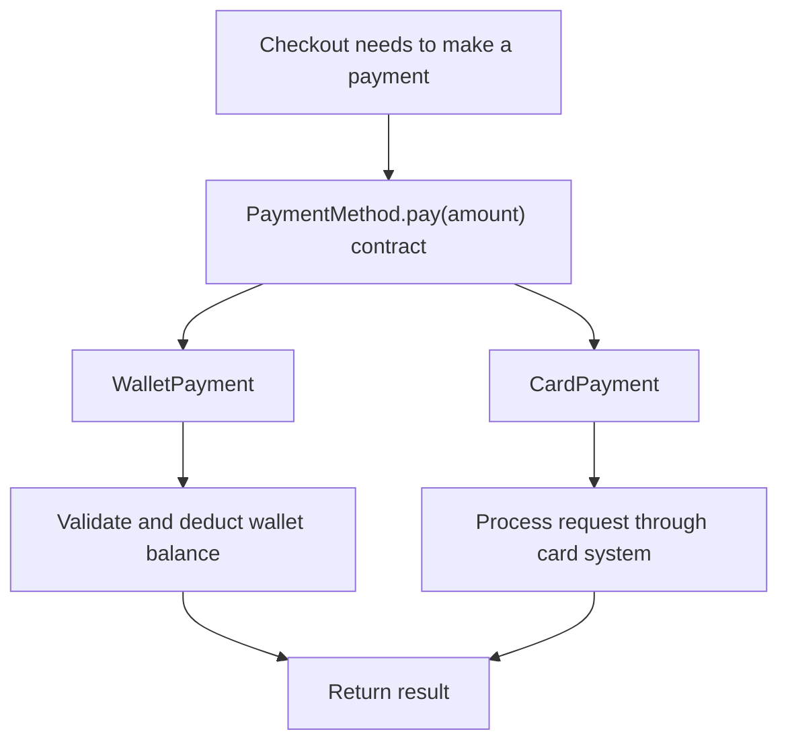
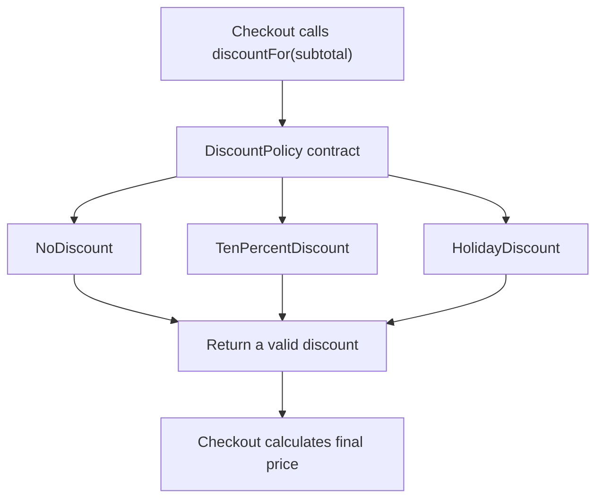
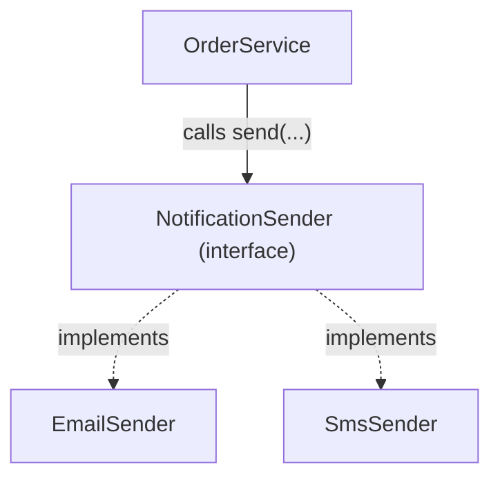
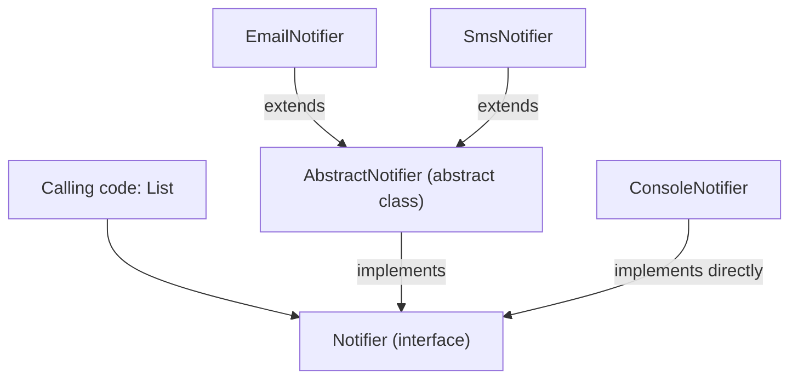

<a id="back-to-top"></a>

# Abstraction — Defining What Outside Code Needs to Know

## Menu
- [4.1 What Is Abstraction? How Is It Different from Encapsulation?](#oop-4-1)
- [4.2 Behavioral Contracts: What Does an Object Promise It Can Do?](#oop-4-2)
- [4.3 Interfaces in Java: Definition and Usage](#oop-4-3)
- [4.4 Abstract Classes: When Should You Choose an Interface or an Abstract Class?](#oop-4-4)

## <a id="oop-4-1">4.1 What Is Abstraction? How Is It Different from Encapsulation?</a>

<details>
<summary>Click for details</summary>

**Abstraction** in object-oriented programming (OOP) is the practice of **selecting the characteristics and behaviors that users of an object need to understand and work with, without requiring them to depend on every internal implementation detail**.

Imagine using an ATM: you choose **Withdraw Cash**, enter an amount, and receive a result. You need to know that the machine supports withdrawals, how to enter an amount, and what happens when there is not enough money. You do not need to perform the checks behind the ATM yourself.

The same idea applies to code:

```java
boolean success = paymentMethod.pay(100);
```

The calling code only needs to understand what the request `pay(100)` means and what the `true`/`false` result represents. Payments through a wallet, card, or another method can be implemented in different ways.

> **The main idea:** Abstraction answers **“What does a user of this object need to know it can do?”** Encapsulation answers **“How does the object manage its data and control interactions with its own state?”**

### 1. Why Do We Need Abstraction?

Suppose an online shopping application supports two payment methods:

- **Internal wallet:** check the balance and deduct the amount.
- **Card:** send a request to a card-processing system and receive its response.

If the order-processing code implements both procedures itself, every checkout flow must know too many details:

```text
Checkout
  → for a wallet: read balance, validate, deduct funds
  → for a card: call the card system, handle the response
  → decide whether the order has been paid
```

Whenever another payment method is added, the checkout logic risks growing larger. More importantly, checkout needs to understand **details that should be the responsibility of each payment method**.

We can look at the problem at a higher level: whether the customer uses a wallet or a card, checkout needs the same capability: **“attempt to pay an amount and report whether it succeeded or failed.”**



Here, `PaymentMethod` represents **what the component's user needs to know**. Concrete classes are responsible for **how the work is performed**.

This allows someone reading the checkout flow to understand the business process without having to trace every payment-processing step from the start.

### 2. Abstraction Means Choosing What Matters at the Right Level of View

An object can have many details, but not every user needs to know all of them.

| When using a capability | Information the caller needs | Details that can stay inside |
|---|---|---|
| Withdraw money from an account | Withdrawal amount; conditions for success or error | How the balance is stored and the order of internal checks |
| Send a notification | Recipient, content, result | How SMTP or a messaging service is connected |
| Make a payment | Amount; payment result | How the wallet is checked or the payment gateway is called |
| Calculate shipping fees | Destination, package, price to pay | Rate-table algorithms and region lookup |

This is why abstraction is also described by the distinction between **WHAT — what something can do** and **HOW — how it does it**.

However, **abstraction is not simply “hide as much as possible.”** If callers do not know important facts such as valid inputs, failure cases, or the meaning of return values, the abstraction becomes difficult to use.

A good contract must say enough for its caller to understand:

- What is the method intended to do?
- What inputs does it require?
- How does it return a result or report an error?
- Are there side effects or limitations the caller needs to know about?

For example, `pay(100)` should be understood as **an attempt to make a payment**; a return value of `false` means that payment has not succeeded. If a new payment implementation silently deducts money while returning `false`, it violates an important expectation of its callers.

### 3. Distinguishing Abstraction from Encapsulation

The two concepts are related and often applied together, but they address **different questions**.

| Aspect | **Abstraction** | **Encapsulation** |
|---|---|---|
| Immediate purpose | Simplify how others understand and use a component | Keep related state and behaviors together and control access to them |
| Main question | “What capabilities should the outside world know about?” | “Who owns this data, and who may change it?” |
| Focus | Contracts, capabilities, exposed behavior | Access boundaries, state, and protected rules |
| Payment example | `PaymentMethod.pay(amount)` | `WalletPayment` keeps `balance` `private` and validates before deducting money |
| What to avoid | Exposing too many implementation details or providing a vague contract | Allowing arbitrary state changes that undermine the rules |

#### A Short Account Example

Suppose we have this call:

```java
account.withdraw(30);
```

**From the perspective of abstraction:** Outside code knows that an account offers the `withdraw(amount)` capability. It does not need to know the data structure used to store account information or the exact statements that validate a withdrawal.

**From the perspective of encapsulation:** `Account` keeps `balance` internally and only permits changes through valid operations. Outside code is not allowed to assign `balance = -500` directly.

One design can embody both properties at once. A public method such as `withdraw()` is both **a capability presented to the caller** and **a controlled path for interacting with state**.

#### Do Not Equate These Concepts with Java Keywords

- `interface` is **a useful tool** for expressing abstraction, but an abstraction does not always require an interface. A class with meaningful public methods also provides a level of abstraction.
- `private` is **an important tool** for encapsulation, but merely declaring fields `private` does not guarantee good encapsulation. Public setters that accept arbitrary values can still break the state.
- `abstract class` also supports the creation of abstract types in Java, but abstraction is a **design idea** broader than the `abstract` keyword.

### 4. Java Example: Abstraction and Encapsulation Working Together

Let's design a small checkout program. Checkout only needs to know that a payment method can `pay(amount)`; each payment method decides how to implement the operation.

Save the entire example as `Main.java`:

```java
public class Main {
    public static void main(String[] args) {
        WalletPayment wallet = new WalletPayment(100);
        CheckoutService checkout = new CheckoutService();

        checkout.checkout(wallet, 30);
        System.out.println("Wallet remaining: " + wallet.getBalance());

        checkout.checkout(wallet, 120);
        System.out.println("Wallet still has: " + wallet.getBalance());

        PaymentMethod card = new DemoCardPayment();
        checkout.checkout(card, 40);
    }
}

// Common capability that CheckoutService needs to know
interface PaymentMethod {
    // true: payment succeeded; false: payment was declined
    boolean pay(int amount);
}

// First payment method: a wallet with its own state
class WalletPayment implements PaymentMethod {
    private int balance;

    WalletPayment(int openingBalance) {
        if (openingBalance < 0) {
            throw new IllegalArgumentException("Invalid wallet balance");
        }
        this.balance = openingBalance;
    }

    @Override
    public boolean pay(int amount) {
        if (amount <= 0) {
            throw new IllegalArgumentException("Amount must be positive");
        }
        if (amount > balance) {
            return false;
        }
        balance -= amount;
        return true;
    }

    public int getBalance() {
        return balance;
    }
}

// Second payment method: a simulated card authorization
class DemoCardPayment implements PaymentMethod {
    @Override
    public boolean pay(int amount) {
        if (amount <= 0) {
            throw new IllegalArgumentException("Amount must be positive");
        }
        System.out.println("Simulated card authorization: " + amount);
        return true;
    }
}

// Checkout only works with the common contract
class CheckoutService {
    public void checkout(PaymentMethod method, int amount) {
        if (method.pay(amount)) {
            System.out.println("Payment successful");
        } else {
            System.out.println("Payment declined");
        }
    }
}
```

Output:

```text
Payment successful
Wallet remaining: 70
Payment declined
Wallet still has: 70
Simulated card authorization: 40
Payment successful
```

Read the example by considering each component's role:

| Component | Role | What does it demonstrate? |
|---|---|---|
| `PaymentMethod` | Declares the `pay(amount)` capability | **Abstraction:** checkout works through a shared contract |
| `CheckoutService` | Requests payment and handles the result | Depends on the ability to pay rather than details of any one payment method |
| `WalletPayment` | Validates and deducts wallet funds | **Encapsulation:** manages `balance` and the rules for reducing it |
| `DemoCardPayment` | Simulates another payment method | The same `pay()` call has a different implementation |
| `private int balance` | Prevents outside code from assigning the wallet balance | Part of the boundary that protects state |

Notice that `CheckoutService` **does not need to know that one payment method has a `balance` field and the other does not**. It only uses the `PaymentMethod` contract. That is a direct benefit of abstraction.

Conversely, `WalletPayment` is responsible for ensuring that a declined request **does not change the balance**. That is a benefit of encapsulation.

The `DemoCardPayment` example merely prints a message and reports success for the sake of illustrating Java; it **does not perform a real card transaction**. A real system needs richer error and result contracts, transaction control, and security.

### 5. How Does Good Abstraction Help a Program Evolve?

Suppose the application initially supports wallet payments only. Later, another payment method is added: `BankTransferPayment`.

If the new method correctly implements the `PaymentMethod` contract, `CheckoutService` can still call:

```java
method.pay(amount);
```

Checkout does not have to become the place that knows all the procedures of every payment system.

But abstraction **does not mean calling code never needs to change**. For example, if the business starts supporting a `PENDING` status (awaiting confirmation), a `boolean` return type may no longer be expressive enough. The contract would then need to be redesigned, perhaps returning a result with `SUCCESS`, `FAILED`, and `PENDING` statuses. That is a **change in business requirements**, which cannot be solved merely by adding another implementation.

A useful abstraction must represent **what participating objects truly have in common**. Forcing different payment methods into an unsuitable contract leads to confusing exceptions and tangled calling code.

### 6. Common Misunderstandings

**“Does abstraction mean hiding all the code inside?”**

No. The goal is to provide a view that is **sufficient and appropriate for the intended use**. Important information such as calling conditions, results, and errors must still be clear.

**“Does having an interface guarantee good abstraction?”**

Not necessarily. For example, an interface named `PaymentMethod` that forces every implementation to support many unrelated operations would be difficult to use. Its contract should express a real shared capability.

**“Are encapsulation and abstraction the same thing?”**

No. Encapsulation manages **boundaries and state validity**, while abstraction selects **which capabilities the caller needs to see**. They can coexist in the same object.

**“Is it enough to make every field private and add getters and setters?”**

Not necessarily. If `WalletPayment` exposes `setBalance(-500)`, its data can still be changed incorrectly. Provide behavior reflecting the business domain, such as `pay(amount)` or `addFunds(amount)`, and validate internally.

**“Is abstraction only about inheritance or polymorphism?”**

No. Even `account.withdraw(30)` represents a level of abstraction: the caller invokes a meaningful action while the implementation details remain with the object. Interfaces and polymorphism are especially effective tools when multiple objects offer a shared capability.

### 7. Check Your Understanding

| Situation | Most prominent concept | Why? |
|---|---|---|
| `CheckoutService` only calls `method.pay(100)` | **Abstraction** | It only needs to understand the payment contract |
| `WalletPayment` prevents others from changing `balance` directly | **Encapsulation** | The object controls permission to change its data |
| If the wallet lacks funds, `pay()` returns `false` without changing the balance | **Encapsulation** | The object consistently preserves its state rules |
| The caller can switch from `WalletPayment` to `DemoCardPayment` | **Abstraction**, combined with polymorphism | Multiple implementations satisfy the same contract |

Answer these two questions yourself:

1. If `CheckoutService` had to read `wallet.balance` directly and subtract money on its own, what would be missing from the design? — **An appropriate encapsulation boundary would be missing**, and checkout would also depend too heavily on wallet internals.
2. If we changed the way `WalletPayment` stores money but kept `pay(amount)` behaving according to its contract, why could checkout code remain unchanged? — Because **abstraction** lets checkout work with the shared capability rather than the internal structure.

**Remember:** Abstraction helps callers understand **what an object can do**; encapsulation helps the object **manage and protect its own state**. Used together, these ideas make code easier to use while limiting changes that would violate business rules.

</details>

- [Back to top](#back-to-top)

---

## <a id="oop-4-2">4.2 Behavioral Contracts: What Does an Object Promise It Can Do?</a>

<details>
<summary>Click for details</summary>

### 1. An Object Does More Than Expose Methods; It Makes Promises

Imagine you are building the payment feature for a store. Before finalizing an order, the program needs to ask a **discount policy**:

> “For an order worth 200,000 VND, how much of a discount do I receive?”

You do not necessarily need to know how the policy calculates its result. Perhaps the store currently offers a 10% discount, perhaps it offers none, or perhaps its promotion changes next month. But to calculate the final amount, the payment code must know **what the discount policy object returns, which inputs it accepts, and when it may report an error**.

That is the idea of a **behavioral contract** in OOP.

A behavioral contract is an object's **observable commitment** to the code using it: which requests it accepts, which conditions are required, what the operation means in business terms, what it returns, how it handles errors, and whether it produces any effects callers need to know about.

Compare these two statements:

- **“The object has a method named `discountFor(long subtotal)`.”** This describes how to invoke it.
- **“The object accepts a nonnegative subtotal and returns a valid discount between zero and the subtotal without changing the order; a negative subtotal is rejected.”** This describes a behavioral commitment.

The second statement is what allows users of the object to **trust it and use it correctly**.

### 2. What Does a Behavioral Contract Usually Include?

| Element | Question to answer | Discount-policy example |
|---|---|---|
| **Capability** | What can the object do? | Calculate the discount amount |
| **Input and meaning** | What data is required, and in which units? | `subtotal` is the merchandise subtotal in VND |
| **Precondition** | What must the input satisfy? | `subtotal >= 0` |
| **Postcondition** | What result is guaranteed if the operation succeeds? | `0 <= discount <= subtotal` |
| **Side effect** | Does it change state or do anything else? | Only calculates; does not change the order |
| **Error behavior** | What happens when a request is invalid? | Throws `IllegalArgumentException` for a negative amount |
| **Specific business rules** | Does the caller need to understand how to interpret the result? | The result is a whole number of VND, with fractions rounded down |

Not every method needs a long description. A simple method can have a very short contract. But details that **directly affect how others use the method** must be clear enough.

One way to picture the contract:

```text
Caller sends a request
          │
          ▼
[Are the input conditions valid?]
          │
     ┌────┴─────┐
     │          │
    Yes         No
     │          │
     ▼          ▼
 Perform     Report the error
 the action  as promised
     │
     ▼
Return the result / produce effects
exactly as promised
```

**Note:** This describes an example that validates input. Not every Java contract must throw an exception, return data, or produce an external effect. Each particular contract defines those details.

### 3. Write the Contract First, Then Its Implementation

In Java, we can express **the behaviors offered** through an `interface` and describe each method's meaning in JavaDoc.

```java
// DiscountPolicy.java
public interface DiscountPolicy {

    /**
     * Calculates the discount amount from the merchandise subtotal.
     *
     * Contract:
     * - subtotal is measured in VND and must be >= 0.
     * - The result is a whole number of VND, between 0 and subtotal.
     * - Any fractional discount is rounded down.
     * - Does not modify the order or produce external effects.
     *
     * @param subtotal merchandise subtotal before discounts
     * @return discount amount (VND)
     * @throws IllegalArgumentException if subtotal < 0
     */
    long discountFor(long subtotal);
}
```

From this declaration, the developer of the payment feature knows:

1. They can **request a discount calculation** by calling `discountFor(...)`.
2. They should pass only **nonnegative** merchandise subtotals.
3. They can subtract the result from the subtotal because it is nonnegative and never greater than the subtotal.
4. For a negative subtotal, the policy **rejects** the request with `IllegalArgumentException`.
5. This method only calculates; it does not secretly update balances, modify orders, or submit payment requests.

The caller still does not know *what percentage discount will apply*. That can depend on the concrete object. This is precisely the value of abstraction: **agree on what outside code can rely on while allowing different internal implementations**.

#### Two Objects, One Contract

The first object offers no promotion:

```java
// NoDiscount.java
public final class NoDiscount implements DiscountPolicy {

    @Override
    public long discountFor(long subtotal) {
        if (subtotal < 0) {
            throw new IllegalArgumentException(
                "Subtotal cannot be negative"
            );
        }
        return 0;
    }
}
```

The second object applies a 10% discount, rounded down to a whole number of VND:

```java
// TenPercentDiscount.java
public final class TenPercentDiscount implements DiscountPolicy {

    @Override
    public long discountFor(long subtotal) {
        if (subtotal < 0) {
            throw new IllegalArgumentException(
                "Subtotal cannot be negative"
            );
        }
        return subtotal / 10;
    }
}
```

Both **keep their shared promise**:

| Input `subtotal` | `NoDiscount` | `TenPercentDiscount` | Explanation |
|---:|---:|---:|---|
| `200_000` | `0` | `20_000` | The result lies between zero and the subtotal |
| `99` | `0` | `9` | The fractional part of the 10% discount is rounded down |
| `0` | `0` | `0` | Zero is a valid input |
| `-100` | Throws an exception | Throws an exception | Rejects input that violates the condition |

The two objects **do not promise the same discount amount**. They promise that whatever amount they calculate complies with the shared rules.

### 4. How Does the Caller Rely on the Contract?

We write a `Checkout` class to calculate what the customer must pay. It receives an object of type `DiscountPolicy`.

```java
// Checkout.java
import java.util.Objects;

public final class Checkout {
    private final DiscountPolicy discountPolicy;

    public Checkout(DiscountPolicy discountPolicy) {
        this.discountPolicy = Objects.requireNonNull(discountPolicy);
    }

    public long finalPrice(long subtotal) {
        long discount = discountPolicy.discountFor(subtotal);
        return subtotal - discount;
    }
}
```

Usage:

```java
Checkout normal = new Checkout(new NoDiscount());
System.out.println(normal.finalPrice(200_000)); // 200000

Checkout promotion = new Checkout(new TenPercentDiscount());
System.out.println(promotion.finalPrice(200_000)); // 180000

// promotion.finalPrice(-100);
// -> IllegalArgumentException: Subtotal cannot be negative
```

Suppose we are using `TenPercentDiscount`. The execution flow is:

```text
Checkout receives subtotal: 200,000
      │
      ▼
Call discountPolicy.discountFor(200,000)
      │
      ▼
Actual TenPercentDiscount object calculates:
discount = 200,000 / 10 = 20,000
      │
      ▼
Return 20,000 according to the contract
      │
      ▼
Checkout calculates: 200,000 - 20,000 = 180,000
```

If we replace it with `NoDiscount`, the final-price calculation in `Checkout` **does not need to be rewritten**. The method still calls `discountFor`; only the object passed in changes.

This collaboration works because `Checkout` can trust that **every valid `DiscountPolicy` returns a discount according to the shared rules**.

The caller requests an object to perform a behavior and understands the result and conditions of that behavior, without having to implement the object's algorithm itself.

### 5. Does Having an `interface` Mean We Already Have a Behavioral Contract?

**Not completely.** An interface primarily lets Java check **structure**: method names, parameter types, return types, and certain type-system rules.

For example, Java may accept the following class syntactically:

```java
public final class BrokenDiscount implements DiscountPolicy {
    @Override
    public long discountFor(long subtotal) {
        return subtotal + 1;
    }
}
```

But given a subtotal of `200_000`, it returns `200_001`, which exceeds the subtotal. That result **violates the behavioral contract** even though the method signature matches the interface.

Another incorrect implementation:

```java
@Override
public long discountFor(long subtotal) {
    if (subtotal < 100_000) {
        throw new IllegalArgumentException("Order is too small");
    }
    return 0;
}
```

Because the shared contract states that **every nonnegative subtotal is valid**, this implementation has introduced an additional rejection condition. Callers could reasonably expect `discountFor(50_000)` to be accepted, but this object breaks that expectation.

Therefore:

| What Java can check | What design, documentation, and tests must guarantee |
|---|---|
| A `discountFor(long)` method exists | The method actually calculates a “discount amount” |
| The return type is `long` | The result always stays within the promised bounds |
| The class `implements DiscountPolicy` | The class handles every valid input according to the rules |
| Visibility and type rules | Side effects and failure behavior match the promises |

An interface can **express** a contract, but **declaring a method alone does not automatically enforce the contract's semantics**.

Nor is an interface required for every behavioral contract. A `public` method in an ordinary class, a method in an abstract class, or behavior exposed through concrete methods can all have clear contracts.

### 6. A Contract Describes Observable Behavior, Not the Machinery Inside

A good contract states what the user **needs** to know:

| What may need to be promised | What the caller usually does not need to know |
|---|---|
| The valid range of discount amounts | How many steps the calculation uses |
| Whether the method reports errors | Which temporary variables are used |
| Currency unit and rounding rules | How internal fields are named |
| Whether the operation changes state | Whether it uses an `if`, lookup table, or helper method |
| What a successful result means | How many private methods organize the code |

For example, you could replace the algorithm inside `TenPercentDiscount` with a more efficient one. As long as the published guarantees remain unchanged, `Checkout` does not need to know about that change.

However, **do not use “hiding the implementation” as an excuse to omit important information**. For example:

- If a discount can be rounded, callers need to know the rounding rule when reconciling invoices.
- If an operation can deduct real money, callers need to know when the deduction occurs, what happens on failure, and whether retrying is safe.
- If an operation takes a long time, works asynchronously, or depends on a network, its contract must make clear when a caller receives a result and what that result means.

In the discount example, the contract explicitly chooses **no side effects**. If a real use case needs to record a transaction or call an external API, that requires a different promise, accurately described in business terms.

### 7. Contracts Let Us Replace Objects Without Breaking Their Callers

Suppose the system is going to add `HolidayDiscount`. To remain compatible with `Checkout`, the new class can use its own discount formula but must preserve the shared `DiscountPolicy` rules.

Visualize the relationship:



The diagram shows **alternative interchangeable implementations**, not a single call running all three classes. For each price calculation, `Checkout` uses **one actual policy object** that was supplied to it.

An implementation that follows the contract must preserve the expectations that callers rely on. If the new class suddenly returns a negative number, discounts more than the subtotal, or rejects an input advertised as valid, replacing the policy could cause `Checkout` to behave incorrectly.

This is the connection between **abstraction** and **implementation substitutability**: classes may perform the work differently but keep their shared promises so calling code continues to work.

Not every implementation must behave identically in every respect. Differences are permitted where the contract **intentionally leaves room for them**. For example, `DiscountPolicy` does not require every policy to apply exactly 10%; it only requires the discount to stay within bounds and errors to follow the agreed rules.

### 8. How Do You Know Whether a Contract Is Clear Enough?

Ask yourself four questions when designing a behavior:

**First: Does the object's user know what they are asking it to do?**

For example, `discountFor(subtotal)` clearly means calculate **the discount amount**, unlike `finalPrice(subtotal)`, which calculates **the amount to pay**. Both methods return `long`, but their meanings are completely different.

**Second: Does the caller know which inputs are valid and which results can be trusted?**

If a description only says “returns `long`,” the caller does not know what a negative result means, whether the units are VND or cents, or whether the result may exceed the subtotal. The contract should clarify those points.

**Third: If the behavior fails, does the caller know what state the system is left in?**

In this calculation-only example, negative input is rejected and there are no side effects. For data-modifying operations, clarify whether an update is complete or partial, whether it rolls back, and which errors the caller must handle. Do not assume every operation is automatically atomic or self-recovering.

**Fourth: If an implementation is replaced, must callers change because an earlier promise was broken?**

If so, either the new implementation violates the contract, or the original contract was incomplete and needs redesign.

#### Common Mistakes

| Error-prone approach | Problem | Improvement |
|---|---|---|
| State only the method name | The caller cannot tell what the result means | Describe the result, valid conditions, and errors |
| Name one action while secretly doing something else | Unexpected side effects | Specify the effects or separate responsibilities |
| Let implementations interpret units differently | Results may become seriously incorrect | Define units and rounding rules |
| Add implementation-specific preconditions that reject valid inputs | Callers cannot safely substitute implementations | Preserve shared conditions or design another contract |
| Expose every field and method publicly to “make it easy to use” | Internal details become dependencies | Expose only behaviors callers need |

### 9. Test Yourself with a Small Scenario

Consider this contract:

> `TemperatureConverter.toCelsius(double fahrenheit)` accepts a valid Fahrenheit temperature and returns degrees Celsius; the result is numeric and does not change external state.

Distinguish these cases:

1. One implementation uses `(fahrenheit - 32) * 5 / 9`, while another uses an algebraically equivalent formula: **allowed**, provided the required accuracy and input handling still conform.
2. An implementation returns Kelvin but keeps the name `toCelsius`: **violates the contract's meaning and units**.
3. An implementation automatically sends an email each time it performs a conversion: **violates the promise of having no side effects**.
4. The caller does not know which variables the implementation uses: **not a problem**, because those details are deliberately hidden.

A behavioral contract therefore answers **“What can I expect when I ask this object to do something?”** In OOP, this is the basis for objects to collaborate while maintaining clear boundaries of responsibility.

**Remember:** Method names and types tell you *how to call a method*; behavioral contracts add its *meaning, conditions, guarantees, and failure handling*. This lets callers work through the necessary interface of an object without needing to understand its internal implementation.

</details>

- [Back to top](#back-to-top)

---

## <a id="oop-4-3">4.3 Interfaces in Java: Definition and Usage</a>

<details>
<summary>Click for details</summary>

An application might send notifications through email, SMS, or a chat application. Each delivery method uses different technology, but the order-processing component only needs to know: **“How can I request that a notification be sent?”**

This is a suitable use case for an **interface** in Java.

An interface describes a **contract** that implementing classes must follow. The contract tells outside code **which operations it can call**, with which parameters and result types. Implementing classes decide **how those operations are carried out**.

In terms of abstraction in OOP, code using an object can work with a **common capability** shared by different objects, instead of knowing the technical details of each kind.

### 1. What Is an Interface?

For example, we want to represent the ability to send notifications:

```java
public interface NotificationSender {
    void send(String recipient, String message);
}
```

The declaration `void send(String recipient, String message);` says that an object supporting the `NotificationSender` capability must provide a `send` operation that accepts a recipient and message content.

It **does not yet specify** whether email must communicate with SMTP, SMS must call a provider's API, or where the data is stored. Those details belong to the implementation.

Here is how the responsibilities are divided:

| Component | Which question does it answer? | Example |
| --- | --- | --- |
| Interface | **What can** the object do? | `NotificationSender.send(...)` |
| Implementing class | **How does** the object perform it? | `EmailSender`, `SmsSender` |
| Caller | **When** is that capability needed? | `OrderService` sends a confirmation |
| Actual object | **Which implementation** is being used? | An instance created by `new EmailSender()` |

An interface is a **reference type** in Java. You can declare variables, parameters, or return types using an interface. But you cannot instantiate it directly with `new NotificationSender()`, because the interface by itself does not specify a complete implementation.

### 2. Declaration and Implementation Syntax: `interface`, `implements`, `@Override`

A class commits to fulfilling the contract using `implements`:

```java
public class EmailSender implements NotificationSender {

    @Override
    public void send(String recipient, String message) {
        System.out.println("EMAIL to " + recipient + ": " + message);
    }
}
```

Another class can implement the same interface differently:

```java
public class SmsSender implements NotificationSender {

    @Override
    public void send(String recipient, String message) {
        System.out.println("SMS to " + recipient + ": " + message);
    }
}
```

In this example:

- `interface` declares the contract.
- `implements` declares that the class accepts responsibility for fulfilling it.
- `@Override` helps the compiler verify that the method correctly implements or overrides an inherited method.
- Both `EmailSender` and `SmsSender` must provide `send(String, String)` with a valid signature.

An abstract method declared in an interface as shown above is implicitly `public`. Therefore the implementation must also be `public`; using `private` or default (*package-private*) access is invalid. A *concrete class* must implement every inherited abstract method that has no valid implementation yet. Otherwise, the class itself must be declared `abstract`.

In Java, a class uses `extends` to inherit from a class and `implements` to implement an interface. Do not confuse these two roles.

### 3. Complete Example: Calling Code Does Not Need to Know Whether It Sends Email or SMS

Consider the following Java program. To make it easy to run, all classes are placed in **a single `Main.java` file**, and only `Main` is `public`. In a regular project, you can split them into separate files.

```java
interface NotificationSender {
    void send(String recipient, String message);
}

class EmailSender implements NotificationSender {
    @Override
    public void send(String recipient, String message) {
        System.out.println("EMAIL to " + recipient + ": " + message);
    }
}

class SmsSender implements NotificationSender {
    @Override
    public void send(String recipient, String message) {
        System.out.println("SMS to " + recipient + ": " + message);
    }
}

class OrderService {
    private final NotificationSender sender;

    public OrderService(NotificationSender sender) {
        this.sender = sender;
    }

    public void confirmOrder(String customer) {
        System.out.println("Order confirmed for " + customer);
        sender.send(customer, "Your order is confirmed");
    }
}

public class Main {
    public static void main(String[] args) {
        NotificationSender email = new EmailSender();
        NotificationSender sms = new SmsSender();

        OrderService firstOrder = new OrderService(email);
        firstOrder.confirmOrder("An");

        OrderService secondOrder = new OrderService(sms);
        secondOrder.confirmOrder("Binh");
    }
}
```

Output:

```text
Order confirmed for An
EMAIL to An: Your order is confirmed
Order confirmed for Binh
SMS to Binh: Your order is confirmed
```

Follow the steps:

1. `NotificationSender email = new EmailSender();` creates an **actual `EmailSender` object**, but stores it in a **reference variable** of type `NotificationSender`.
2. `new OrderService(email)` passes that object to `OrderService` through its constructor.
3. `confirmOrder("An")` performs the order-processing behavior and then calls `sender.send(...)`.
4. Because `sender` refers to an `EmailSender`, Java runs the `EmailSender.send(...)` implementation.
5. In `secondOrder`, `sender` refers to an `SmsSender`; the same statement `sender.send(...)` runs `SmsSender.send(...)` instead.

This is a form of **polymorphism**: the contract and call are the same, but the concrete behavior depends on the actual object.



The diagram represents the design relationship: `OrderService` works through the interface; the choice between `EmailSender` and `SmsSender` is made when the application creates and supplies an object to the service. At runtime, Java invokes the implementation belonging to the supplied object.

**Concrete benefit:** if you later add `PushNotificationSender`, `OrderService` can use that class without changing the `confirmOrder(...)` logic, as long as the new implementation follows the expected contract.

The example uses `System.out.println` to demonstrate observable behavior; it does not actually send emails or SMS messages. In a real application, implementing classes would connect to the relevant delivery services and handle failures appropriately.

### 4. Why Are Parameters Often Declared Using an Interface Type?

Look at the constructor:

```java
public OrderService(NotificationSender sender) {
    this.sender = sender;
}
```

If its parameter were changed to `EmailSender`, `OrderService` could accept only that concrete email type. By declaring `NotificationSender`, the service accepts **any compatible implementation**.

Compare:

```java
// Tightly coupled to EmailSender:
class OrderServiceA {
    private final EmailSender sender = new EmailSender();
}

// Receive the notification-sending capability through the constructor:
class OrderServiceB {
    private final NotificationSender sender;

    OrderServiceB(NotificationSender sender) {
        this.sender = sender;
    }
}
```

With `OrderServiceB`, the consuming class retains the responsibility “I need to send notifications,” while outside code decides which sending mechanism to provide. This is a form of **constructor dependency injection**, achievable in ordinary Java without any framework.

Spring Boot uses a similar idea when injecting beans through an interface. However, when multiple beans implement the same interface, the application must specify which bean to select (for example, with `@Qualifier`, `@Primary`, or appropriate configuration). An interface does not automatically know which implementation should be used.

**One important caution:** interfaces reduce dependencies on concrete class names, but do not automatically create a good design. If calling code still checks `instanceof EmailSender` and then casts to invoke implementation-specific methods, the abstraction benefit is reduced.

### 5. What Can a Modern Java Interface Contain?

In addition to abstract methods, Java interfaces may have these members:

| Member | Meaning | Note |
| --- | --- | --- |
| Abstract method | Requires an implementation to provide behavior | Implicitly `public abstract` when declared as `void send();` |
| `default` method | Provides a default implementation for instances | Implementing classes may override it |
| `static` method | Utility that belongs to the interface itself | Invoke via `InterfaceName.method()` |
| `private` method | Internal helper logic inside the interface | Supported since Java 9; not callable from implementing classes |
| Constants | Shared values | All fields declared in an interface are implicitly `public static final` |

Example:

```java
interface Greeter {
    void greet(String name);

    default void greetGuest() {
        greet("Guest");
    }

    static String defaultLanguage() {
        return "vi";
    }
}

class ConsoleGreeter implements Greeter {
    @Override
    public void greet(String name) {
        System.out.println("Hello, " + name);
    }
}

class Main {
    public static void main(String[] args) {
        Greeter greeter = new ConsoleGreeter();
        greeter.greet("An");       // Hello, An
        greeter.greetGuest();      // Hello, Guest

        System.out.println(Greeter.defaultLanguage()); // vi
    }
}
```

`greetGuest()` is a `default` method: `ConsoleGreeter` inherits its implementation without having to write it again. It calls `greet("Guest")`, and that call ultimately runs the implementation in `ConsoleGreeter`.

A `static` method is called through the interface name. It is not an instance method that participates in polymorphic overriding like `greet(...)`.

Modern Java interfaces offer additional ways to share logic. Nevertheless, **an interface's primary purpose remains defining a public capability or contract**. Avoid packing extensive state or complicated workflows into `default` methods just because the syntax permits it.

**About state:** an interface does not have ordinary instance fields in which each object can store its own data. Interface fields are `public static final` constants. Therefore an interface is not appropriate for owning mutable state specific to individual objects.

### 6. Can One Class Implement Multiple Interfaces?

Yes. Java allows a class to directly extend only one superclass, but it may implement multiple interfaces.

```java
interface Printable {
    void print();
}

interface Exportable {
    String export();
}

class Invoice implements Printable, Exportable {
    @Override
    public void print() {
        System.out.println("Printing invoice");
    }

    @Override
    public String export() {
        return "invoice-data";
    }
}
```

`Invoice` offers both capabilities: printing and exporting data. Code that only needs to print an invoice can accept a `Printable` parameter; code that only needs export functionality can accept `Exportable`.

An interface may also **extend other interfaces** with `extends`:

```java
interface Readable {
    String read();
}

interface Editable extends Readable {
    void edit(String value);
}
```

A class implementing `Editable` must support both `read()` and `edit(...)` if no valid implementation has already been provided.

When several interfaces have `default` methods with conflicting signatures, Java may require the class to override the method to resolve the conflict. Thus, the ability to `implements` multiple interfaces does not mean Java automatically chooses between contradictory default implementations.

### 7. How Is an Interface Different from an Abstract Class?

Both can express abstraction, but their typical uses differ:

| Criterion | Interface | Abstract class |
| --- | --- | --- |
| How a class uses it | `implements` | `extends` |
| Common goal | Define a contract or capability | Provide a base and shared logic/state |
| Inheriting from a class | Can implement multiple interfaces | Can directly extend only one class |
| Instance state | No ordinary instance fields | May have instance fields |
| Constructor | No constructor | May have a constructor to initialize inherited parts |
| Methods with existing logic | `default`, `static`, `private` within their allowed scope | Concrete and abstract methods |

For example, `NotificationSender` makes a good contract because completely different delivery mechanisms can follow it. However, if implementations really do need **shared state and initialization procedures**, an abstract class may be helpful.

Do not choose an interface merely because “using interfaces looks more professional,” or an abstract class merely because it can contain code. Start with the relationships and responsibilities the design must express.

### 8. How to Design an Interface That Is Easy to Understand

A good interface usually has a **clear, coherent purpose**. Callers should be able to understand its capability, valid inputs, and expected results from its name and methods.

For example:

```java
interface PaymentGateway {
    PaymentResult charge(String orderId, long amountInMinorUnits);
}
```

For this contract, the designer still needs to explain which currency's smallest unit is used, whether zero is allowed, how repeated calls with the same `orderId` are handled, which errors are returned, and which states `PaymentResult` can represent. **A method signature is the beginning of a contract, not the entire contract.**

Common mistakes and possible approaches:

| Sign | Impact | Suggestion |
| --- | --- | --- |
| Every class gets an `IClassName` with exactly one implementation and no current abstraction need | More files and harder navigation | Add an interface only when a separate contract is actually useful |
| Interface has many unrelated methods | Callers depend on capabilities they do not need | Separate cohesive groups of responsibilities |
| Implementation merely `throw new UnsupportedOperationException()` for required methods | The contract promises a capability the object cannot provide | Split the interface appropriately or revise the model |
| Code repeatedly casts from an interface back to its concrete class | Callers remain locked to implementations | Revisit the shared contract and allocation of responsibilities |
| Interface exposes SDK-specific or technical details of one implementation | Difficult to substitute implementations | Prefer types and language reflecting the caller's needs when suitable |
| Method signatures or meanings are changed arbitrarily | Implementations and callers may be affected | Treat these changes as changes to the contract |

A simple rule for selecting methods: **include in an interface the capabilities that every implementation of the contract must be able to perform meaningfully**. Do not force a print-only device to implement `scan()` just to put every operation under a single `Machine` interface.

### 9. Interfaces and Testing

A practical benefit of having code depend on an interface is the ability to replace the implementation with a test version that records the service's behavior.

For example, this implementation records a notification instead of sending it:

```java
class RecordingSender implements NotificationSender {
    String lastRecipient;
    String lastMessage;

    @Override
    public void send(String recipient, String message) {
        lastRecipient = recipient;
        lastMessage = message;
    }
}
```

Use it with the earlier `OrderService`:

```java
RecordingSender sender = new RecordingSender();
OrderService service = new OrderService(sender);

service.confirmOrder("An");

if (!"An".equals(sender.lastRecipient)) {
    throw new AssertionError("Wrong recipient");
}
if (!"Your order is confirmed".equals(sender.lastMessage)) {
    throw new AssertionError("Wrong message");
}
```

This test demonstrates that `OrderService` **requested delivery to the correct recipient with the correct content**, without sending real email or SMS. It **does not** prove that a real email/SMS provider successfully delivered a message; that requires separate tests for the concrete implementation or integration tests.

### 10. Check Your Understanding

**Question 1.** Can you write `NotificationSender sender = new EmailSender();`, and can you call `sender.send(...)`?

Yes. `EmailSender` implements `NotificationSender`, so its instance can be held in an interface-typed reference. The `send` method belongs to the contract, so the caller can invoke it.

**Question 2.** Can you write `new NotificationSender()`?

No, because an interface cannot be instantiated directly. You need a concrete implementing class or, in suitable situations, an anonymous class or lambda with a functional interface.

**Question 3.** If the reference is typed as `NotificationSender` but the actual object is `SmsSender`, whose logic runs when `send(...)` is called?

`SmsSender.send(...)` runs. The interface type determines which methods the caller may use; the actual object determines the implementation of the instance-method call.

**Question 4.** Is an interface better when it has more methods?

No. The contract should represent a coherent group of capabilities. A small interface with a clear responsibility is often easier to implement, understand, and replace.

**Question 5.** Must every class have an interface in order to use dependency injection with Spring?

No. Spring can inject concrete classes. Interfaces are useful when a common contract, multiple implementations, a reasonable substitution boundary, or dependency organization is needed, but they are not a mandatory procedure for every class.

As you study interfaces, revisit the key line in the example: **`OrderService` calls `sender.send(...)` because it knows the `NotificationSender` contract; the implementing object is responsible for delivering through email or SMS.** This is how interfaces let Java express abstraction in source code.

</details>

- [Back to top](#back-to-top)

---

## <a id="oop-4-4">4.4 Abstract Classes: When Should You Choose an Interface or an Abstract Class?</a>

<details>
<summary>Click for details</summary>

Suppose an application needs to send notifications to users through email, SMS, or an in-app screen. At the place where a notification is triggered, we only want to write: **“send this content to the recipient.”** The caller does not need to know how email is delivered through SMTP, which provider handles SMS, or how an in-app notification is stored.

This is a problem of **abstraction**: determining what the rest of the program needs to know while hiding some implementation details. In Java, both **`interface`** and **`abstract class`** help create abstractions, but they serve different design needs.

### 1. Distinguish Them by Asking Practical Questions

- **`interface`** is appropriate when you want to define **a shared contract or capability**: any object satisfying the contract can be used. For example, every `Notifier` knows how to `send(recipient, message)`.
- **`abstract class`** is appropriate when you have **a genuine inheritance family of classes** that share state or part of an implementation workflow. For example, email and SMS senders both need input validation, but each has its own way of sending.

One way to think about it:

> `interface` answers: **“In what ways can an object be used?”**  
> `abstract class` answers: **“What implementation foundation do these subclasses share through inheritance?”**

There is no rule requiring you to choose one or the other exclusively. In many designs, **an interface describes the API for outside code**, while **an abstract class is an optional tool for sharing logic among some implementations**.

### 2. Compare the Two Tools

| Criterion | `interface` | `abstract class` |
|---|---|---|
| Common purpose | Define a contract, role, or capability | Define a base class for a related family of classes |
| How a class uses it | `implements` | `extends` |
| How many may be used | A class can `implements` multiple interfaces | A class can directly `extends` only one class |
| Object-specific state | No instance fields; fields declared in an interface are implicitly `public static final` | Can have instance fields, such as `private final String channel` |
| Constructor | No constructor for instances | Can have a constructor to initialize shared parts when a subclass is created |
| Methods with bodies | Supports `default`, `static`, and helper `private` methods (Java 9+) | Supports ordinary methods, `final` and `static` methods, and `abstract` methods |
| Methods requiring implementation | Abstract interface methods are implicitly `public` | `abstract` methods may use a suitable access level, such as `protected` |
| Can it be instantiated directly with `new`? | No | No |
| Main consideration | The behavioral contract must be clear because implementations can differ greatly | Subclasses depend on the parent class's structure and decisions |

**Do not assume an interface “only declares methods and cannot contain code.”** Java allows `default` methods with bodies. However, a `default` method **does not turn an interface into a place for storing each object's individual state**.

Likewise, an `abstract class` does not have to declare an `abstract` method: Java permits a class to be `abstract` even if all its methods have bodies. The essential point is that the class acts as a base and cannot be instantiated directly.

### 3. Complete Java Example: Using Both in Their Appropriate Roles

First, define the contract that application code will call:

```java
interface Notifier {
    void send(String recipient, String message);

    default void sendWelcome(String recipient) {
        send(recipient, "Welcome!");
    }
}
```

`send(...)` is a required capability: every class that `implements Notifier` must provide this behavior (unless the class itself remains abstract). `sendWelcome(...)` is a shared way to use an existing operation; it does not require an instance field.

Suppose email and SMS also share a process: validate inputs first, then delegate the actual sending step to the appropriate channel. We create a base class:

```java
abstract class AbstractNotifier implements Notifier {
    private final String channel;

    protected AbstractNotifier(String channel) {
        if (channel == null || channel.isBlank()) {
            throw new IllegalArgumentException("Invalid channel");
        }
        this.channel = channel;
    }

    @Override
    public final void send(String recipient, String message) {
        if (recipient == null || recipient.isBlank()) {
            throw new IllegalArgumentException("Missing recipient");
        }
        if (message == null || message.isBlank()) {
            throw new IllegalArgumentException("Empty message");
        }

        // Shared workflow: validate first, then perform channel-specific delivery.
        doSend(recipient, message);
    }

    protected abstract void doSend(String recipient, String message);

    protected String channel() {
        return channel;
    }
}
```

Here:

- `channel` is **shared state** initialized by the constructor and kept private with `private`.
- `send(...)` is the **shared workflow**: validate input, then call `doSend(...)`. The `final` keyword prevents a subclass from bypassing validation by overriding `send`.
- `doSend(...)` is the **variation point**: the parent class does not know how to send email or SMS, so it requires each subclass to provide the implementation.

The two concrete classes only need to handle their own differences:

```java
final class EmailNotifier extends AbstractNotifier {
    EmailNotifier() {
        super("EMAIL");
    }

    @Override
    protected void doSend(String recipient, String message) {
        System.out.printf("[%s] Send email to %s: %s%n",
                channel(), recipient, message);
    }
}

final class SmsNotifier extends AbstractNotifier {
    SmsNotifier() {
        super("SMS");
    }

    @Override
    protected void doSend(String recipient, String message) {
        System.out.printf("[%s] Send SMS to %s: %s%n",
                channel(), recipient, message);
    }
}
```

On the other hand, a class that prints notifications to the console can **implement the interface directly**. It does not need to inherit from `AbstractNotifier` if it does not use that class's workflow or state:

```java
final class ConsoleNotifier implements Notifier {
    @Override
    public void send(String recipient, String message) {
        if (recipient == null || recipient.isBlank()
                || message == null || message.isBlank()) {
            throw new IllegalArgumentException("Invalid notification");
        }

        System.out.printf("[CONSOLE] %s: %s%n", recipient, message);
    }
}
```

Finally, the caller only needs to know the `Notifier` type:

```java
import java.util.List;

// Put Notifier, AbstractNotifier, EmailNotifier,
// SmsNotifier, and ConsoleNotifier above in the same package.

public class Demo {
    public static void main(String[] args) {
        List<Notifier> channels = List.of(
                new EmailNotifier(),
                new SmsNotifier(),
                new ConsoleNotifier()
        );

        for (Notifier notifier : channels) {
            notifier.sendWelcome("user-01");
        }
    }
}
```

Illustrative output:

```text
[EMAIL] Send email to user-01: Welcome!
[SMS] Send SMS to user-01: Welcome!
[CONSOLE] user-01: Welcome!
```

The `doSend` methods above only print to the console to demonstrate the class structure; a real application would call the corresponding delivery systems. To copy and run the example, put the types in the same package and save `Demo` in `Demo.java`.

Relationship diagram:



The important point is that **notification-calling code depends on `Notifier`**, so it is not tied to the `AbstractNotifier` base class. If `PushNotifier` is added later, we can choose to inherit the base class or implement the interface directly, depending on which behavior really needs to be shared.

### 4. How Does Execution Proceed?

Consider the call `new EmailNotifier().sendWelcome("user-01")`:

1. When an `EmailNotifier` is created, its subclass constructor calls `super("EMAIL")`; the `AbstractNotifier` constructor validates and then stores `channel = "EMAIL"`.
2. `sendWelcome(...)` is a `default` method from `Notifier`; it calls `send("user-01", "Welcome!")`.
3. `send(...)` is supplied by `AbstractNotifier`: it validates the recipient and content.
4. Once the conditions are valid, `send(...)` calls `EmailNotifier`'s `doSend(...)`. This is **polymorphism**: the call site is the same, but the concrete behavior depends on the object's type.
5. The illustrative email line is printed. If the recipient is blank, an exception occurs **before** `doSend`, and sending does not run.

Thus, an interface defines **the entry points callers can invoke**, while an abstract class helps **reuse shared steps and requires subclasses to complete missing steps**.

### 5. Which One Should You Choose, and When?

| Situation | Suggested choice | Reason |
|---|---|---|
| Need interchangeable payment, notification, storage, or fee-calculation implementations | Start with an **interface** | Callers need a stable contract without knowing concrete classes |
| Classes outside the same inheritance tree share the capability to run, compare, or close resources | **Interface** | A class can implement multiple interfaces, such as `Runnable` and `AutoCloseable` |
| Several related classes need shared instance fields, constructors, and processing workflows | Consider an **abstract class** | Centralizes shared logic and protects shared state |
| The order of steps must remain fixed, but each subclass performs a step differently | An **abstract class** with a *Template Method* may help | For example, `send` is `final` while `doSend` is `abstract` |
| A common contract is useful, but only some implementations share logic | **Combine both** | The `interface` is the public API; an `abstract class implements interface` is optional support |
| Classes only share a few lines of code and are not truly members of the same family | Prefer suitable **composition** or a helper | Avoid creating inheritance solely to share a few lines of code |

Remember the last example: two classes both performing logging **does not by itself mean** they should inherit a shared `AbstractLoggerUser`. They can receive the same `Logger` object through their constructors. That is **composition**: using a supporting object instead of forcing every class into the same inheritance tree.

### 6. Common Misconceptions

**“An abstract class is always better than an interface because it can contain ready-made code.”** Incorrect. Interfaces have `default` methods, but the key question is still whether you need **a contract** or **a shared foundation**. Wanting to reuse code alone does not justify designing a parent class.

**“If we use an abstract class, we don't need an interface.”** Sometimes true for a very small system with a clear inheritance relationship. But if business code should accept unrelated implementations, a separate interface offers more flexibility. For example, `ConsoleNotifier` does not have to inherit `AbstractNotifier`.

**“Can a class extending an abstract class still implement multiple interfaces?”** Yes:

```java
abstract class BaseJob implements Runnable, AutoCloseable {
    // A class can implement multiple interfaces.
}
```

In Java, a class can directly `extends` **only one class**, including an abstract class, but it can `implements` **multiple interfaces**.

**“Does an interface guarantee every implementation behaves identically?”** No. The compiler checks signatures and basic type restrictions; it cannot prove that every implementation follows all business rules. In the example, `ConsoleNotifier` needs its own input validation because it does not go through `AbstractNotifier`. The contract must be clearly described and verified with suitable tests.

**“Should we always create both an interface and an abstract class?”** No. If there is only one implementation and no current need for substitutability or a shared workflow, adding two abstraction layers can make the problem harder to follow. Design should start with real usage and change requirements.

### 7. Questions to Ask Yourself While Designing

For a new feature, try answering these questions in order:

1. **Which operations does the caller actually need to know?** If a contract should support multiple implementations, define an interface.
2. **Which implementations share state and a sequence of steps?** If there is a closely related group, consider an abstract class for that group.
3. **Could a supporting object replace the inheritance relationship?** If the only goal is to reuse some methods, consider composition.
4. **Does a new class need to enter an existing inheritance tree just to be usable?** If that coupling is undesirable, have outside code work through an interface.

The `Notifier` example shows how three ideas can coexist: **abstraction** (outside code only calls `send`), **inheritance** (email/SMS subclasses reuse shared processing), and **polymorphism** (a variable of type `Notifier` can work with multiple sending mechanisms).

When choosing an `interface` or an `abstract class`, the most important question is not “Which is more powerful?” but **whether you want to promise a shared capability to outside code or share the structure and maintenance of behavior among subclasses**.

</details>

- [Back to top](#back-to-top)
