<a id="back-to-top"></a>

# Object Lifecycle

## Menu
- [Object creation and resource allocation](#lifecycle-001)
- [Constructors and establishing valid state](#lifecycle-002)
- [Default, parameterized, and alternative initialization approaches](#lifecycle-003)
- [Initialization order in inheritance](#lifecycle-004)
- [Static factory methods, Factory, and Builder](#lifecycle-005)
- [Object lifetime, reachability, and memory reclamation](#lifecycle-006)
- [Garbage collection and manual memory management](#lifecycle-007)
- [Resource cleanup and the limits of finalizers](#lifecycle-008)
- [Preventing the use of incompletely initialized objects](#lifecycle-009)

## <a id="lifecycle-001">Object creation and resource allocation</a>

<details>
<summary>View details</summary>

# Object Creation and Resource Allocation in Java

> **Topic:** OOP → Object Lifecycle. When you write `new Customer(...)`, the program creates a **Java object** and initializes its state. If the object works with files, sockets, or database connections, the program may also need to **allocate resources outside Java memory**. These two types of resources have different lifecycles and cleanup mechanisms.

## 1. From Classes to Objects

A **class** describes data and behavior; an **object (instance)** is an entity created from that class.

```java
public class CustomerDemo {
    static final class Customer {
        private final String id;
        private String name;

        Customer(String id, String name) {
            if (id == null || id.isBlank()) {
                throw new IllegalArgumentException("ID không hợp lệ");
            }
            if (name == null || name.isBlank()) {
                throw new IllegalArgumentException("Tên không hợp lệ");
            }
            this.id = id;
            this.name = name;
        }

        void rename(String newName) {
            if (newName == null || newName.isBlank()) {
                throw new IllegalArgumentException("Tên không hợp lệ");
            }
            this.name = newName;
        }

        String describe() {
            return id + ": " + name;
        }
    }

    public static void main(String[] args) {
        Customer first = new Customer("C01", "An");
        Customer second = new Customer("C02", "Bình");
        Customer alias = first;

        alias.rename("An Nguyễn");

        System.out.println(first.describe());  // C01: An Nguyễn
        System.out.println(second.describe()); // C02: Bình
        System.out.println(first == alias);     // true
        System.out.println(first == second);    // false
    }
}
```

In the statement `Customer first = new Customer("C01", "An");`:

- `Customer` is the **type of the reference variable**.
- `first` holds a **reference** to the object; it is not the object itself.
- `new Customer(...)` creates an instance and performs initialization.
- `"C01"` and `"An"` are arguments passed to the constructor.
- `alias = first` copies the reference; it **does not create another object**.
- `new Customer("C02", "Bình")` creates a separate instance with its own state.

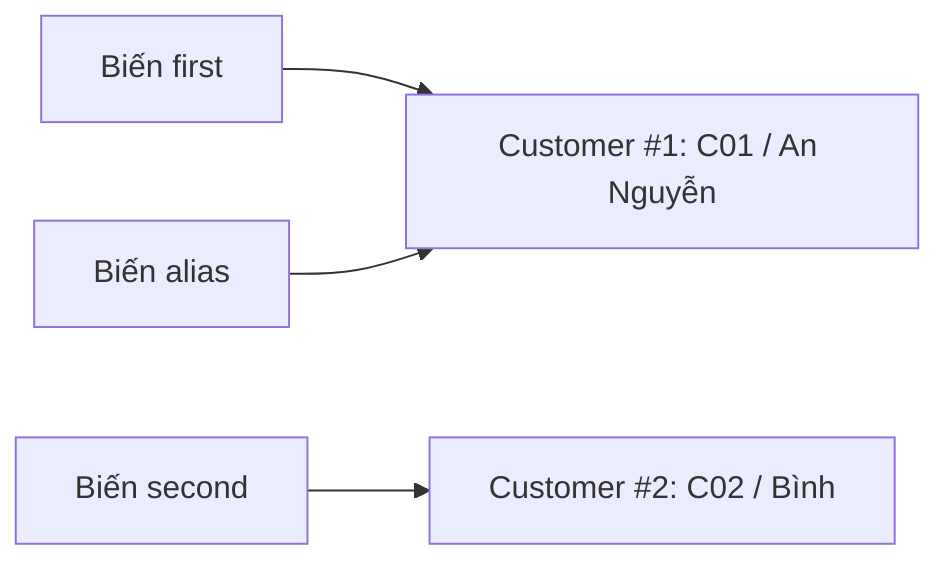

**Key point:** declaring a reference variable does not automatically create an object:

```java
Customer a;              // Chỉ khai báo biến cục bộ; chưa được gán
Customer b = null;       // Có biến tham chiếu nhưng chưa trỏ tới Customer nào
Customer c = new Customer("C03", "Chi"); // Mới tạo instance
```

You cannot read `a` before assigning it because the Java compiler requires local variables to be initialized before use. Calling `b.describe()` when `b == null` throws a `NullPointerException`.

## 2. What Happens When You Call `new`?

At a conceptual level, you can think of the process as follows:

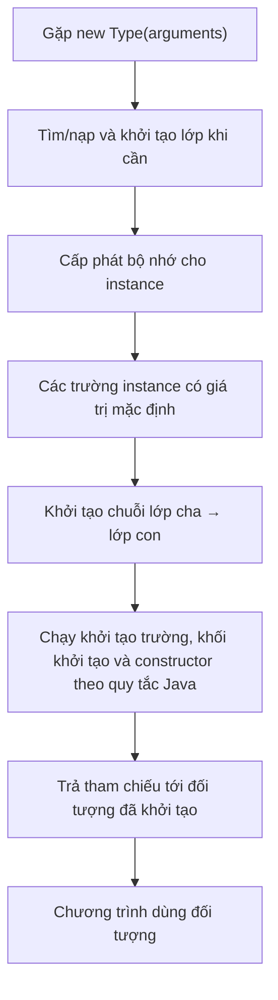

This diagram summarizes the process for learning OOP. On the JVM, class loading, class initialization, allocation optimizations, and constructor invocation follow specific rules; **do not interpret these as mandatory, distinct machine operations for every call**.

Key points to understand:

1. **Classes and objects are different:** the JVM manages class information; each ordinary use of `new` creates an instance with its own instance fields.
2. **Default state:** before initializers and constructors assign data, instance fields receive default values: numeric types get `0`, `boolean` gets `false`, and references get `null`. This **does not apply to unassigned local variables**.
3. **Constructors run during creation:** a constructor establishes valid object state and has no return type, not even `void`.
4. **Initialization follows inheritance rules:** a subclass constructor invokes the appropriate superclass constructor; each class's instance initializers execute in declaration order before that class's constructor body, following the required superclass invocation.
5. **The reference is returned by the `new` expression:** the caller uses it to invoke methods or store the object in a data structure.

### Default Values, Field Initializers, and Constructors

```java
class Device {
    int attempts;                // Mặc định 0
    boolean active;              // Mặc định false
    String label;                // Mặc định null
    int priority = 5;            // Field initializer

    Device(String label) {
        this.label = label;      // Constructor gán trạng thái
        this.active = true;
    }
}
```

After `Device d = new Device("Printer");`, the observed values are `attempts == 0`, `active == true`, `label.equals("Printer")`, and `priority == 5`. However, **do not rely on default `null` values to skip validating required data**; constructors should explicitly establish valid state.

## 3. An Object Is Usable Only After Initialization Completes

After allocation and default-value assignment, Java performs initialization according to the class and inheritance rules. A **constructor** has no return type; it sets required data and can reject invalid input by throwing an exception:

~~~java
class Order {
    private final String code;

    Order(String code) {
        if (code == null || code.isBlank()) {
            throw new IllegalArgumentException("Mã đơn không hợp lệ");
        }
        this.code = code;
    }
}
~~~

`new Order("A01")` completes and returns a reference; `new Order("")` throws an exception, so the expression does not return a successfully initialized object. If a constructor opened a file or allocated a resource before detecting the error, the application must still close any resources it owns: constructor failure **does not automatically roll back side effects**.

Every initialization path must maintain the same state contract. Checking invariants is central to *Constructors and establishing valid state*; overloads and `this(...)` are covered in *Default, parameterized, and alternative initialization approaches*.

## 4. Where Is Memory Allocated? Heap, Stack, and JVM Optimizations

In the Java conceptual model:

| Component | How to understand it | Example |
|---|---|---|
| Object/array | Has storage for its state; the JVM typically manages it on the heap | `new Customer(...)`, `new int[10]` |
| Local reference variable | Holds a reference value, not the entire object | `Customer c` in `main` |
| Instance field | Belongs to an individual instance | `this.name` |
| `static` field | Belongs to the class and is shared at class level | `static int createdCount` |
| Call stack | Relates to method-call execution contexts, local variables, return addresses, and so on | `main()` calls `rename()` |
| Resources outside the JVM heap | File descriptors, sockets, connections, native handles, and so on | Open files, DB connections |

People often say “**objects live on the heap, local variables live on the stack**” as a mental model, but this is **not an absolute physical memory-layout guarantee** of the language. The JVM's JIT compiler can optimize through escape analysis, scalar replacement, and allocation strategies; the Java specification defines observable behavior rather than mandating a particular physical memory layout.

```java
Customer c = new Customer("C04", "Dũng");
Customer alsoC = c; // Hai biến cùng tham chiếu instance
c = null;           // Chỉ bỏ tham chiếu qua biến c
// alsoC vẫn tham chiếu được Customer("C04", "Dũng")
```

Assigning `null` **does not directly delete an object**. As long as the JVM can determine that an object might still be used through a sufficient reference path, it is not eligible for reclamation. Once no reference path from any GC root reaches it, the garbage collector **may** reclaim it at a time chosen by the JVM.

## 5. Two Meanings of “Resource Allocation”

`new Customer(...)` creates a Java object, while `Files.newBufferedReader(path)` can both provide a Java object and open an operating-system-managed **file descriptor**.

| Type | Who releases it? | When? |
|---|---|---|
| Memory of an unreachable Java object | Garbage collector | At the JVM's discretion; reclamation is not immediate |
| File, socket, DB connection, native handle | The owner defined by the API contract | Explicitly call `close()` or use another appropriate management mechanism when finished |

Assigning `reader = null` does not guarantee the file is closed. Nor does `System.gc()` establish a resource-closing contract. When opening a resource, a critical design decision is **who owns it and when its use must end**. *Resource cleanup and the limits of finalizers* examines closing order, exceptions, and ownership in detail.

## 6. The Safest Approach for Closeable Resources: try-with-resources

Since Java 7, `try-with-resources` automatically invokes `close()` when execution leaves the `try` scope, even if an exception occurs. A resource declared in the parentheses must implement `AutoCloseable` (or `Closeable`).

### Runnable Example: Reading a File

```java
import java.io.BufferedReader;
import java.io.IOException;
import java.nio.charset.StandardCharsets;
import java.nio.file.Files;
import java.nio.file.Path;

public class ReadFileDemo {
    static void printFirstLine(Path path) throws IOException {
        try (BufferedReader reader =
                     Files.newBufferedReader(path, StandardCharsets.UTF_8)) {
            String line = reader.readLine();
            System.out.println(line == null ? "(file rỗng)" : line);
        } // Tự động gọi reader.close()
    }

    public static void main(String[] args) throws IOException {
        Path path = Files.createTempFile("oop-demo-", ".txt");
        try {
            Files.writeString(path, "Xin chào Java\nDòng thứ hai", StandardCharsets.UTF_8);
            printFirstLine(path); // Xin chào Java
        } finally {
            Files.deleteIfExists(path); // Dọn file tạm kể cả khi đọc lỗi
        }
    }
}
```

To run this example, save it as `ReadFileDemo.java`:

```bash
javac ReadFileDemo.java
java ReadFileDemo
```

In this example:

1. `Files.createTempFile(...)` **creates a real file on the file system**.
2. `Files.newBufferedReader(...)` opens a file-reading resource.
3. `try (reader)` gives the `try` block responsibility for closing `reader`.
4. When the `try` block ends (successfully or exceptionally), `close()` is called.
5. The `finally` block deletes the temporary file explicitly created by the program; **closing a stream and deleting a file are different operations**.

Do not mistake `newBufferedReader` for simply “creating an object”: it can also open a file and consume operating-system resources. If opening fails, the API may throw `IOException`, which the program must handle or declare.

### What Happens If an Error Occurs?

```java
try (BufferedReader reader = Files.newBufferedReader(path)) {
    throw new IOException("Lỗi xử lý");
}
```

Even if an error occurs inside the `try` body, Java still invokes `reader.close()` under try-with-resources semantics. If both the `try` body and `close()` throw exceptions, the exception from the `try` body remains the **primary exception**, while the closing exception is usually recorded as a **suppressed exception** (see `Throwable.getSuppressed()`). When multiple resources are declared in one `try`, they are closed in **reverse declaration order**.

## 7. When Object Creation Starts a Lifecycle That Requires Closing

A custom class can implement `AutoCloseable` to express responsibility for releasing resources. This illustration does not open a real socket:

~~~java
final class DemoSession implements AutoCloseable {
    private boolean closed;

    void send() {
        if (closed) throw new IllegalStateException("Đã đóng");
    }

    @Override
    public void close() {
        closed = true;
    }
}

try (DemoSession session = new DemoSession()) {
    session.send();
}
// Resource được yêu cầu đóng khi thoát try; object Java có thể còn tồn tại.
~~~

The `closed` state represents a **resource-use contract**, not evidence that the GC deleted the object. `AutoCloseable` does not require every implementation to support repeated closing safely; the example class merely records its closed state. For real resources, see *Resource cleanup and the limits of finalizers* for handling `close()` failures, suppressed exceptions, closing order, and ownership transfers.

## 8. Callers Do Not Always Invoke `new` Directly

A **static factory**, factory service, or framework can supply an object without the caller invoking its constructor directly:

| How an object is obtained | Example | Key consideration |
|---|---|---|
| Constructor | `new Customer("C01", "An")` | Normally creates a new instance |
| Factory | `List.of("A")`, `Integer.valueOf(42)` | May return an existing object; a new instance is not guaranteed on every call |
| Resource-opening API | `Files.newBufferedReader(path)` | May open a file; handle IOException and close it at the right time |
| Dependency injection | Constructor receives `Repository` | The dependency is created/supplied elsewhere |
| Deserialization/reflection | An API or framework creates an instance | Follow its specific contract; do not assume it behaves exactly like every `new` call |

*Static factory methods, Factory, and Builder* explains how to choose meaningful object-creation APIs, control implementations, and manage multiple parameters. Regardless of how an object is created, **the lifecycle of Java memory and the lifecycle of external resources must still be considered separately**.

## 9. Who Still Holds a Reference After Creation?

An object may no longer have business value but remain reachable because a registry, cache, or listener still holds a reference:

~~~java
static final List<Runnable> listeners = new ArrayList<>();

static void register(Runnable listener) {
    listeners.add(listener);
}

static void unregister(Runnable listener) {
    listeners.remove(listener);
}
~~~

This example assumes a class that already imports `java.util.List` and `java.util.ArrayList`. While `listener` remains in the long-lived list, it and the objects it references may stay retained. Registrations need an unregistration policy, and caches need limits/TTL suited to their use. Reference paths from GC roots and retention issues are covered fully in *Object lifetime, reachability, and memory reclamation*.

## 10. Distinguishing Lifecycle Events

| Event | Java object | Resource outside the JVM |
|---|---|---|
| `new`/factory returns successfully | The object can be used | May already be open, depending on the API |
| Method invocation | State may change | Data may be read or written |
| `close()` | The object may still exist | A request is made to release the resource |
| All reachable reference paths disappear | May be reclaimed by the GC | Do not rely on the GC for timely closing |
| GC runs | Memory for eligible objects is reclaimed | Does not provide deterministic resource management |

A commonly confusing example:

```java
BufferedReader reader = Files.newBufferedReader(path);
reader = null; // Không bảo đảm file đã được đóng!
```

The correct approach when this code opens and owns the reader:

```java
try (BufferedReader reader = Files.newBufferedReader(path)) {
    // Sử dụng reader
}
```

If a program continuously creates objects that become unreachable, the GC can reclaim their memory. If it continuously opens files without closing them, it can still exhaust file descriptors or system resource limits even when the heap is not full.

## 11. Common Mistakes and How to Fix Them

| Mistake | Why is it dangerous? | How to address it |
|---|---|---|
| Calling a method through a `null` reference | `NullPointerException` | Initialize correctly and check for null at API boundaries |
| Assuming that declaring a variable creates an object | A local variable may still be unassigned | Use a constructor/factory when needed |
| Assuming that `alias = original` creates a copy | Both variables refer to the same instance | Explicitly create a copy when independent state is needed |
| Opening a resource in a constructor, then throwing without closing it | Resource leak | Handle failures and call `close` according to ownership |
| Using the GC or `System.gc()` to “close” a file | No guaranteed closing time | Use try-with-resources |
| Forgetting `close()` for JDBC/file/socket resources | Finite resources remain held | Define clear ownership and closing rules |
| Closing a caller-managed resource | Breaks the caller's workflow | Agree on ownership in the API contract |
| Storing every object in a `static` collection | Reachable objects cannot be garbage-collected | Bound caches, unregister listeners, remove unused elements |
| Using an already-closed object | State/IO errors | Enforce the `closed` state and valid usage scope |

## 12. Practice Exercises

1. Write a `Student` class with `id` and `name`; use its constructor to reject an empty `id`, create two objects, introduce an alias variable, and predict the result of `==`.
2. Write `Counter` with an instance field `count` and a `static` field counting successfully created instances. Consider that its constructor might throw before incrementing the count.
3. Create a temporary file with `Files.createTempFile`, write and read a line, then ensure the stream is closed and the file is deleted even if an error occurs.
4. Write a `FakeConnection implements AutoCloseable` class that logs when it opens, performs an operation, and closes; throw a `RuntimeException` inside the `try` block to verify that `close()` still runs.
5. A service stores every `Request` object in a `static List<Request>` without removing any. Explain why the GC cannot reclaim objects that remain referenced by the list.

**Remember:** Creating a Java object means constructing an instance and initializing it into a valid state. The GC reclaims **object memory** based on reachability, while releasing **resources with explicit open/close lifecycles** must follow API ownership contracts—usually through `AutoCloseable` and `try-with-resources`.


</details>

- [Back to top](#back-to-top)

---

## <a id="lifecycle-002">Constructors and establishing valid state</a>

<details>
<summary>View details</summary>

# Constructors and Establishing Valid State in Java

An object must do more than simply **get created**; it must be in a **valid state** before outside code starts using it. In Java, the **constructor** is a key place to validate input, assign fields, and enforce the rules an object must always satisfy.

For example, a course enrollment is valid only when the course code is nonempty, capacity is greater than zero, enrollment does not exceed capacity, and the enrollment list has no duplicates. If any condition is violated, the constructor should **refuse to produce a usable object** by throwing an appropriate exception.

## 1. Where Does the Constructor Fit in an Object's Lifecycle?

Consider this invocation:

```java
CourseEnrollment course = new CourseEnrollment("JAVA-01", 20);
```

Conceptually, the process is:

1. The `new` expression requests creation of an object of class `CourseEnrollment`.
2. Java allocates memory, assigns default field values, and performs initialization in the language-defined order (including superclass constructors, field/block initializers, and the constructor body).
3. The constructor receives parameters, validates conditions, and establishes initial state.
4. If initialization completes normally, the `new` expression returns a reference to the caller.
5. If the constructor throws an exception, the creation expression **does not complete normally**; the caller does not receive a result reference from that expression.

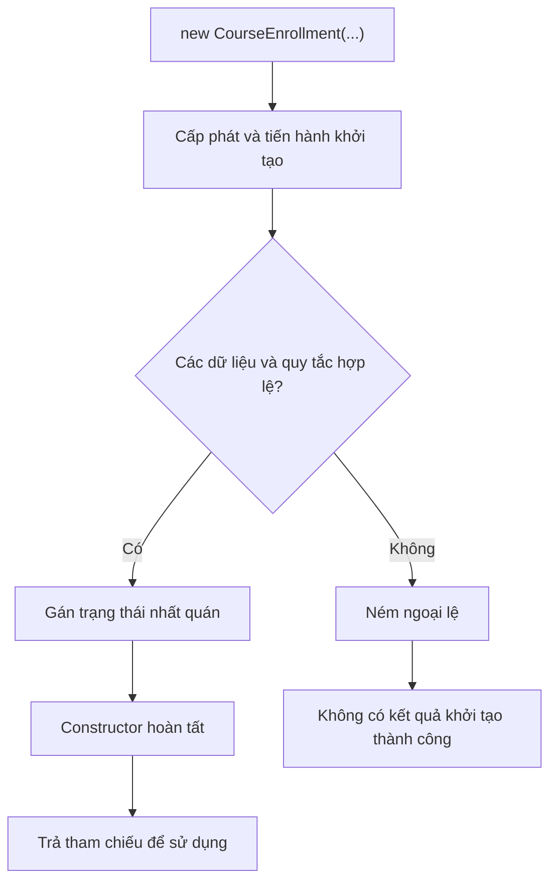

The diagram illustrates the example's validation flow; Java still determines the detailed initialization order for fields and superclasses.

**A constructor is not an ordinary method.** Its name must match the class name, it has no return type (not even `void`), and it is invoked during object creation. It can accept parameters, check conditions, assign fields, and throw exceptions.

## 2. Valid State and Class Invariants

An **invariant** is a set of conditions that must hold when an object is validly published and used.

Consider a `BankAccount` class whose balance must never be negative:

```java
class BankAccount {
    private long balance;

    BankAccount(long openingBalance) {
        if (openingBalance < 0) {
            throw new IllegalArgumentException("Số dư ban đầu không được âm");
        }
        this.balance = openingBalance;
    }

    void withdraw(long amount) {
        if (amount <= 0 || amount > balance) {
            throw new IllegalArgumentException("Số tiền rút không hợp lệ");
        }
        balance -= amount;
    }

    long getBalance() {
        return balance;
    }
}
```

Here, the invariant is `balance >= 0`. The constructor ensures it holds **after creation**, and `withdraw()` must continue to preserve it **throughout use**.

If only the constructor validates the balance, an unchecked `setBalance(-100)` setter could still break the invariant. Therefore:

- The constructor must establish a valid initial state.
- Methods that change state must preserve that validity.
- Fields should be encapsulated with `private` to prevent arbitrary external assignments.
- Not every field needs a setter. Expose only business operations the object actually permits.

Good validation is usually tied to **domain rules**: nonnegative amounts, start times before end times, nonempty identifiers, positive order quantities, or a membership list that stays within capacity.

## 3. Complete Example: Initializing Valid Course Enrollment

The example below builds an **immutable** class: the constructor validates all state, its fields are never reassigned, and adding a student produces a new object through the constructor. This makes it clear why you must **recheck the invariant** whenever new state is needed.

Put all the code below into `Main.java`. Run it with **Java 17 or Java 21**.

```java
import java.util.ArrayList;
import java.util.HashSet;
import java.util.List;
import java.util.Objects;
import java.util.Set;

final class CourseEnrollment {
    private final String courseCode;
    private final int capacity;
    private final List<String> studentEmails;

    // Constructor tiện lợi cho khóa học chưa có người đăng ký.
    CourseEnrollment(String courseCode, int capacity) {
        this(courseCode, capacity, List.of());
    }

    // Constructor thực hiện kiểm tra trạng thái đầy đủ.
    CourseEnrollment(String courseCode, int capacity, List<String> studentEmails) {
        if (courseCode == null || courseCode.isBlank()) {
            throw new IllegalArgumentException("Mã khóa học không được trống");
        }
        if (capacity <= 0) {
            throw new IllegalArgumentException("Sức chứa phải lớn hơn 0");
        }

        Objects.requireNonNull(studentEmails, "studentEmails");

        // Chụp dữ liệu đầu vào để caller không sửa được trạng thái bên trong.
        // List.copyOf cũng từ chối các phần tử null.
        List<String> copy = List.copyOf(studentEmails);

        if (copy.size() > capacity) {
            throw new IllegalArgumentException("Số học viên vượt sức chứa");
        }

        Set<String> unique = new HashSet<>();
        for (String email : copy) {
            if (email.isBlank()) {
                throw new IllegalArgumentException("Email không được trống");
            }
            if (!unique.add(email)) {
                throw new IllegalArgumentException("Email đã đăng ký trùng");
            }
        }

        // Sau khi đã kiểm tra xong, thiết lập trạng thái.
        this.courseCode = courseCode;
        this.capacity = capacity;
        this.studentEmails = copy;
    }

    CourseEnrollment withStudent(String email) {
        Objects.requireNonNull(email, "email");

        List<String> updated = new ArrayList<>(studentEmails);
        updated.add(email);

        // Constructor tiếp tục bảo vệ các invariant.
        return new CourseEnrollment(courseCode, capacity, updated);
    }

    String getCourseCode() {
        return courseCode;
    }

    int getCapacity() {
        return capacity;
    }

    int getRegisteredCount() {
        return studentEmails.size();
    }

    List<String> getStudentEmails() {
        return studentEmails;
    }
}

public class Main {
    public static void main(String[] args) {
        List<String> source = new ArrayList<>(List.of("lan@example.com"));
        CourseEnrollment first = new CourseEnrollment("JAVA-01", 2, source);

        source.add("minh@example.com"); // Sửa danh sách ngoài đối tượng
        System.out.println(first.getStudentEmails());

        CourseEnrollment second = first.withStudent("minh@example.com");
        System.out.println(first.getRegisteredCount());
        System.out.println(second.getRegisteredCount());
        System.out.println(first == second);

        try {
            new CourseEnrollment("JAVA-01", 1,
                    List.of("lan@example.com", "minh@example.com"));
        } catch (IllegalArgumentException ex) {
            System.out.println(ex.getMessage());
        }

        try {
            first.withStudent("lan@example.com");
        } catch (IllegalArgumentException ex) {
            System.out.println(ex.getMessage());
        }

        try {
            new CourseEnrollment(" ", 2);
        } catch (IllegalArgumentException ex) {
            System.out.println(ex.getMessage());
        }

        try {
            first.getStudentEmails().add("other@example.com");
        } catch (UnsupportedOperationException ex) {
            System.out.println("Không thể sửa danh sách đã trả về");
        }
    }
}
```

Compile and run:

```bash
javac Main.java
java Main
```

Output:

```text
[lan@example.com]
1
2
false
Số học viên vượt sức chứa
Email đã đăng ký trùng
Mã khóa học không được trống
Không thể sửa danh sách đã trả về
```

**Interpreting the output:**

- The constructor takes a snapshot with `List.copyOf(source)`, so adding an element to `source` does not change `first`.
- `first.withStudent(...)` invokes the constructor again to create `second`. `first` still has one enrollment and `second` has two; they are different objects.
- When enrollment exceeds capacity, an email is duplicated, or the course code is empty, the constructor throws `IllegalArgumentException`.
- The list returned by `getStudentEmails()` does not allow additions or removals, so the validated state cannot be invalidated that way.

This example compares email strings exactly and case-sensitively; that is only an illustrative rule. Real applications must define their own email normalization and comparison policy and validate other domain constraints as necessary.

## 4. Choosing the Order of Validation and Field Assignment

An easy-to-review constructor often follows this order:

1. Check `null` parameters and individual values: `courseCode`, `capacity`.
2. Normalize or copy external data when necessary.
3. Check cross-field constraints: enrollment must not exceed `capacity`.
4. Assign fields once, using the already-validated state.
5. Let the constructor finish only when all invariants hold.

This reduces the chance of putting an object into an invalid state before discovering an error. Even if a constructor throws, the object is not published through the result of `new`; however, **external effects** that happened before the exception (writing a file, sending an event, transferring money, registering a listener, etc.) **are not automatically undone by Java**. Validate first, avoid unnecessary constructor side effects, and keep lengthy business operations separate from initialization.

| Validation category | Example | Appropriate location |
| --- | --- | --- |
| Must not be `null` | Required input list | Constructor, using `Objects.requireNonNull` |
| Must not be empty | Course code, student name | Constructor, after checking `null` |
| Value range | `capacity > 0` | Constructor |
| Cross-field constraint | `students.size() <= capacity` | Constructor, after obtaining a safe list |
| Uniqueness | No duplicate emails | Constructor or a dedicated value type |
| Update rule | Cannot withdraw more than the balance | State-changing method |
| Rule involving external data | Whether the course remains open in the system | Usually a service/business workflow, before creating the appropriate object |

Not every validation belongs in a constructor. For example, checking whether a coupon is still valid in a database depends on timing, connections, and transactions. That is usually a service or factory's responsibility in coordination with infrastructure; the constructor should still defend the object's **intrinsic** invariants.

## 5. Every Constructor Path Must Preserve the Same Invariant

When supporting different input sets, overloads should **delegate** to one common validation point. In Java 17/21, a `this(...)` call must be the first constructor statement:

~~~java
class RetryPolicy {
    private final int attempts;

    RetryPolicy() {
        this(3);
    }

    RetryPolicy(int attempts) {
        if (attempts <= 0) throw new IllegalArgumentException();
        this.attempts = attempts;
    }
}
~~~

Neither construction path can produce a `RetryPolicy` with `attempts <= 0`. This illustrates constructor invariants; *Default, parameterized, and alternative initialization approaches* explains default/no-arg/parameterized constructors, overload choices, and `this(...)`/`super(...)` in greater detail.

## 6. `final`, Encapsulation, and Defensive Copies

A class with `private final` fields limits changes to its field values or references after assignment:

```java
final class Schedule {
    private final List<String> lessons;

    Schedule(List<String> lessons) {
        this.lessons = List.copyOf(lessons);
    }

    List<String> getLessons() {
        return lessons;
    }
}
```

Declaring a field `final` **does not automatically make the referenced object immutable**:

```java
class UnsafeSchedule {
    private final List<String> lessons;

    UnsafeSchedule(List<String> lessons) {
        this.lessons = lessons; // Vẫn chia sẻ list mutable với caller
    }
}
```

With `UnsafeSchedule`, the caller can modify the original list and thereby change the object's observable state. `Schedule` uses `List.copyOf()` to hold a structurally unmodifiable list unaffected by subsequent additions or removals from the input list.

**Important limitation:** `List.copyOf()` copies the list structure; it **does not deep-copy** all elements. If a list contains mutable elements such as `StringBuilder`, `Date`, or a domain object with setters, additional measures are needed for deep immutability. In the `Schedule` example, the elements are immutable `String` objects, so the approach is suitable.

Practical guidelines:

- Declare fields `private` to control state-update paths.
- Use `final` for data that should be assigned only once.
- Copy mutable inputs if the object's state must be independent of future caller changes.
- Do not expose directly modifiable references to protected internal structures.
- Expose state-changing methods only when they represent meaningful business operations.

## 7. Valid Initialization Versus “Create Now, Fix Later”

The following approaches make different guarantees about the class:

```java
// Phương án dễ tạo trạng thái chưa hợp lệ:
class UnsafeUser {
    String email;

    UnsafeUser() {
    }
}

// Có thể tạo UnsafeUser mà email == null.
```

Compare that with:

```java
final class User {
    private final String email;

    User(String email) {
        if (email == null || email.isBlank()) {
            throw new IllegalArgumentException("Email bắt buộc");
        }
        this.email = email;
    }

    String getEmail() {
        return email;
    }
}
```

With the second approach, a successfully created `User` **does not start out missing an email**. This API design eliminates many scattered checks such as `if (user.getEmail() == null)` at call sites.

A system may still need different business states, such as `DRAFT`, `PENDING`, and `ACTIVE`. These states **are not necessarily invalid**. The key is to model the valid states for each phase explicitly and prevent contradictory combinations, such as `ACTIVE` without an activation date when the policy requires one.

Some designs use static factories such as `User.registered(email)`, `Order.draft(...)`, or separate types to express initialization states. A factory is an additional design tool; the constructors it invokes must still enforce invariants according to the class's access rules and contract.

## 8. What Happens If a Constructor Throws?

For example:

```java
class Seat {
    private final int number;

    Seat(int number) {
        if (number <= 0) {
            throw new IllegalArgumentException("Số ghế phải dương");
        }
        this.number = number;
    }
}
```

```java
Seat good = new Seat(5);   // Tạo thành công
Seat bad = new Seat(-1);  // Ném IllegalArgumentException
```

On the second line, assignment to `bad` does not complete. If the code catches the exception, it can handle the error and continue execution. An exception does not turn an invalid object into a `null` value.

Common choices:

| Exception | Typical situation |
| --- | --- |
| `IllegalArgumentException` | A parameter violates the constructor contract (negative, empty, or out of range) |
| `NullPointerException` | A required parameter must not be `null`, commonly enforced with `Objects.requireNonNull` |
| Custom domain exception | Represents a specific business error consistently across an API |

Do not use `assert` instead of constructor input validation. Assertions may be disabled at runtime; class-contract validation must work independently of the `-ea` setting.

A constructor should expose failures **clearly according to its contract**. It should not swallow an exception and initialize an object with arbitrary defaults unless those defaults are defined as valid state.

## 9. Do Not Expose an Object Before Its Constructor Completes

Even correct invariant validation can fail if external code uses `this` too early. Two common paths are:

- **A superclass constructor invokes an overridden method:** Java can dispatch to the subclass override before its field initializers have run, leaving fields at their default `null`/`0` values.
- **Registering a listener or starting a task inside a constructor:** a callback or another thread may read fields before they are assigned; if the constructor later throws, a reference to the partially initialized object can remain retained.

Therefore, use non-overridable initialization helpers, validate before side effects, and register/publish the object **after the constructor completes** through appropriate synchronization. The precise superclass/subclass order is covered in *Initialization order in inheritance*; causes, callback examples, and safe publication are covered in *Preventing the use of incompletely initialized objects*.

## 10. `record` Constructors Can Also Enforce Invariants

Since Java 16, `record` provides a concise way to represent data objects. A **compact constructor** can validate and normalize parameters before Java automatically assigns them to component fields:

```java
import java.util.List;

record LessonBundle(String name, List<String> lessons) {
    LessonBundle {
        if (name == null || name.isBlank()) {
            throw new IllegalArgumentException("Tên bộ bài học không hợp lệ");
        }
        lessons = List.copyOf(lessons);
        if (lessons.isEmpty()) {
            throw new IllegalArgumentException("Cần ít nhất một bài học");
        }
    }
}
```

`name` and `lessons` are constructor parameters; inside the compact constructor, `lessons = List.copyOf(lessons)` replaces the parameter value with a protected list. After the constructor body, Java automatically assigns the processed parameters to their corresponding fields.

**Note:** Record fields are `final`, but records are not inherently deeply immutable. If a component is mutable, the constructor must still control reference sharing and mutable elements.

## 11. Checklist for Designing Good Constructors

| Review question | Expected result |
| --- | --- |
| What makes the object valid? | A clearly defined set of invariants |
| Is required data provided at creation? | No objects missing essential fields |
| Do all constructor paths follow the same rules? | Prefer delegation to shared validation |
| Are `null` or out-of-range parameters rejected? | Clear, contract-consistent errors |
| Does the object share callers' mutable collections/arrays? | Use defensive copies when protection is required |
| Can a getter expose modifiable state? | Return safe data or a controlled API |
| Does the constructor invoke overrides, publish `this`, or perform I/O too early? | Prevent use before the object is ready and hard-to-undo side effects |
| Do state-changing methods preserve invariants? | Keep the state valid throughout the object's lifetime |

## 12. Self-Check Exercises

**Exercise 1:** What happens?

```java
class Product {
    private final int quantity;

    Product(int quantity) {
        if (quantity <= 0) {
            throw new IllegalArgumentException("quantity phải dương");
        }
        this.quantity = quantity;
    }
}
// new Product(0);
```

**Answer:** If you uncomment and call `new Product(0)`, the constructor throws `IllegalArgumentException` and does not return a successfully initialized `Product` object.

**Exercise 2:** In `CourseEnrollment`, why must the three-parameter constructor check `copy.size() > capacity` even though the two-parameter constructor always passes `List.of()`?

**Answer:** Callers can invoke the three-parameter constructor directly, and `withStudent()` also uses it. Every creation path must protect the same invariant.

**Exercise 3:** What is the risk of replacing `this.studentEmails = copy;` with `this.studentEmails = studentEmails;`?

**Answer:** The mutable list passed by the caller may be modified after initialization, causing enrollment to exceed capacity or contain duplicates even though the constructor already validated it.

**Exercise 4:** Why does `private final List<String> items` not by itself guarantee the invariant “the list never changes”?

**Answer:** `final` only prevents reassigning the field; it does not prevent `items.add(...)`. You must control access to the list object and its elements if they are mutable.

**Exercise 5:** What is the risk when a superclass constructor invokes an overridable method?

**Answer:** A subclass override may execute before subclass initialization completes and read default values such as `null` or `0`.

**Remember:** A good constructor establishes **the object's state contract at successful initialization**. Define invariants, validate inputs and cross-field relationships, protect mutable input data, and publish the object only after initialization finishes. Subsequent state-changing methods must continue to uphold that contract.


</details>

- [Back to top](#back-to-top)

---

## <a id="lifecycle-003">Default, parameterized, and alternative initialization approaches</a>

<details>
<summary>View details</summary>

# Default, Parameterized, and Alternative Object Initialization in Java

An object is useful only when its initial state is valid. When writing classes such as `Student`, `BankAccount`, or `Order`, you must decide which data is required at creation, which data can have defaults, and when multiple object-creation approaches make sense.

In Java, the central mechanism is the **constructor**. Java also supports field initializers, initialization blocks, static factory methods, and the Builder pattern. Each addresses different needs, and they should not be treated as completely interchangeable ways to write the same thing.

## 1. What Is a Constructor?

A constructor is invoked when initializing a class instance, usually through a `new` expression:

```java
public class Student {
    private final String id;
    private final String name;

    public Student(String id, String name) {
        this.id = id;
        this.name = name;
    }

    public String getName() {
        return name;
    }

    public static void main(String[] args) {
        Student student = new Student("SV01", "An");
        System.out.println(student.getName()); // An
    }
}
```

In this example:

1. `new Student("SV01", "An")` requests creation of a `Student` object.
2. The `Student(String id, String name)` constructor receives the input data.
3. The `id` and `name` fields are assigned so the object is ready for use.
4. The `new` expression produces a reference to the object, and the `student` variable receives that reference.

**Constructor characteristics:**

- A constructor's name matches the **class name**.
- A constructor **declares no return type**, not even `void`.
- It can accept parameters, be overloaded, and have access modifiers (`public`, `protected`, package-private, or `private`).
- It cannot be declared `static`, `abstract`, or `final`; constructors are neither inherited nor overridden like methods.
- If a method has the same name as a class but declares a return type, it is still a **method**, not a constructor.

An example of **incorrect** syntax:

```java
class Product {
    // public void Product(String name) { } // Đây là method tên Product
    // public static Product() { }           // Không thể dùng static cho constructor
}
```

A constructor is a suitable place to enforce **object invariants**, such as nonnegative prices, nonempty names, and valid identifiers.

## 2. Default Constructors Versus No-Argument Constructors

These two concepts are often both called “default constructors,” but it is useful to distinguish them in Java:

| Concept | Origin | When does it exist? | Can it execute programmer-written logic? |
|---|---|---|---|
| **Default constructor** (implicitly provided) | Generated by the Java compiler | Only when the class **declares no constructors at all** | Contains no programmer-written logic; calls `super()` |
| **No-argument constructor** | Declared by the programmer | When writing `ClassName() { ... }` | Can contain initialization, validation, and assignment logic |
| **Parameterized constructor** | Declared by the programmer | When writing a constructor with at least one parameter | Uses inputs to establish the required state |

### 2.1. Compiler-Generated Default Constructor

```java
public class Book {
    String title;
    int pages;

    // Không khai báo constructor nào

    public static void main(String[] args) {
        Book book = new Book();

        System.out.println(book.title); // null
        System.out.println(book.pages); // 0
    }
}
```

Because `Book` declares no constructors, the Java compiler supplies an implicit no-argument constructor. In an ordinary class like this, you can think of it as approximately equivalent to:

```java
public Book() {
    super();
}
```

This **does not mean** every class automatically supports `new ClassName()`; once you declare any constructor, the compiler no longer inserts a no-argument constructor.

Fields receive type-specific defaults when an object is created (unless a field initializer or constructor assigns them):

| Field type | Default value |
|---|---|
| `byte`, `short`, `int`, `long` | `0` (of the appropriate type) |
| `float`, `double` | `0.0` (of the appropriate type) |
| `boolean` | `false` |
| `char` | `'\u0000'` |
| Reference types such as `String`, `List` | `null` |

**Local variables** in methods and constructors do not have a readable default-value mechanism like fields; they must be assigned before being read.

### 2.2. Explicit No-Argument Constructor

```java
public class Counter {
    private int value;

    public Counter() {
        this.value = 100;
    }

    public int getValue() {
        return value;
    }

    public static void main(String[] args) {
        Counter counter = new Counter();
        System.out.println(counter.getValue()); // 100
    }
}
```

Here, `Counter()` is **explicitly written**, so it is not a compiler-generated default constructor. A programmer-written constructor can assign nondefault values, invoke helper methods, or delegate to another constructor.

### 2.3. Declaring a Parameterized Constructor Does Not Add a No-Arg Constructor

```java
public class Device {
    private final String serial;

    public Device(String serial) {
        this.serial = serial;
    }
}

Device a = new Device("SN-001"); // Hợp lệ
// Device b = new Device();        // LỖI BIÊN DỊCH
```

Reason: the class already declares `Device(String serial)`. The compiler **will not** generate `Device()`.

If both creation paths are needed, declare both constructors:

```java
public class Device {
    private final String serial;

    public Device() {
        this("UNASSIGNED");
    }

    public Device(String serial) {
        this.serial = serial;
    }
}
```

Here, `Device()` is a programmer-declared no-argument constructor that delegates to the constructor accepting a `String`.

**Note:** If a superclass has no accessible no-argument constructor, the subclass's implicit constructor may fail to compile because subclass initialization must invoke an appropriate superclass constructor.

## 3. Parameterized Constructors: Enforcing Required Data

A parameterized constructor is appropriate when an object **must not exist in a state with missing required data**.

For example, a bank account must have an account ID and a nonnegative initial balance:

```java
import java.math.BigDecimal;
import java.util.Objects;

public class BankAccount {
    private final String accountNumber;
    private BigDecimal balance;

    public BankAccount(String accountNumber, BigDecimal openingBalance) {
        Objects.requireNonNull(accountNumber, "accountNumber");
        if (accountNumber.isBlank()) {
            throw new IllegalArgumentException("Mã tài khoản không được rỗng");
        }
        Objects.requireNonNull(openingBalance, "openingBalance");
        if (openingBalance.signum() < 0) {
            throw new IllegalArgumentException("Số dư mở tài khoản không được âm");
        }

        this.accountNumber = accountNumber;
        this.balance = openingBalance;
    }

    public BigDecimal getBalance() {
        return balance;
    }

    public static void main(String[] args) {
        BankAccount account =
                new BankAccount("ACC-01", new BigDecimal("100000"));

        System.out.println(account.getBalance()); // 100000
    }
}
```

The constructor validates input **before the object is used normally**. Using `BigDecimal` instead of `double` for money helps avoid common binary floating-point representation errors; this is an example design choice, not a mandatory rule for every kind of data.

For required properties, a parameterized constructor is often clearer than creating an empty object and waiting for a sequence of setter calls:

```java
// Dễ gây trạng thái tạm thời chưa hợp lệ nếu thiếu thao tác:
Profile profile = new Profile();
profile.setEmail("an@example.com");
// Nếu quên setUserId(), đối tượng có thể vẫn thiếu dữ liệu bắt buộc.
```

Unless an “incomplete” instance is genuinely needed, design the constructor to accept all required data.

## 4. Constructor Overloading: Multiple Ways to Initialize a Class

**Overloading** means declaring multiple constructors with the same class name but different **parameter lists** (different numbers, types, or type order). Access levels may differ, but changing only an access modifier does not create a separate overload.

For example, an order has a required code and optional shipping fees and discount:

```java
public class Order {
    private final String code;
    private final long shippingFee;
    private final int discountPercent;

    public Order(String code) {
        this(code, 0L, 0);
    }

    public Order(String code, long shippingFee) {
        this(code, shippingFee, 0);
    }

    public Order(String code, long shippingFee, int discountPercent) {
        if (code == null || code.isBlank()) {
            throw new IllegalArgumentException("Mã đơn hàng bắt buộc");
        }
        if (shippingFee < 0) {
            throw new IllegalArgumentException("Phí vận chuyển không được âm");
        }
        if (discountPercent < 0 || discountPercent > 100) {
            throw new IllegalArgumentException("Ưu đãi phải từ 0 đến 100%");
        }
        this.code = code;
        this.shippingFee = shippingFee;
        this.discountPercent = discountPercent;
    }

    public String describe() {
        return code + " | shipping=" + shippingFee
                + " | discount=" + discountPercent + "%";
    }

    public static void main(String[] args) {
        System.out.println(new Order("ORD-01").describe());
        System.out.println(new Order("ORD-02", 25000L).describe());
        System.out.println(new Order("ORD-03", 25000L, 10).describe());
    }
}
```

Output:

```text
ORD-01 | shipping=0 | discount=0%
ORD-02 | shipping=25000 | discount=0%
ORD-03 | shipping=25000 | discount=10%
```

Instead of duplicating all validation logic across three constructors, the shorter overloads **delegate** to the full constructor. This keeps validity rules in one place.

### How Java Resolves Overloads

At **compile time**, the compiler selects a matching constructor based on the argument count and types and valid conversions. If multiple overloads are equally applicable and cannot be distinguished, the call is **ambiguous**.

```java
class Message {
    Message(String text) {}
    Message(Integer code) {}
}

// new Message(null); // LỖI: null phù hợp cả String lẫn Integer
new Message((String) null); // Chọn constructor String
```

Avoid too many easily confused overloads, especially when parameters have the same type or can accept `null`.

## 5. Constructor Chaining with this() and super()

When one constructor invokes another, that is called **constructor chaining**.

- `this(...)`: invokes **another constructor in the same class**.
- `super(...)`: invokes a constructor of the **superclass**.
- In the broadly compatible pattern, an explicit constructor invocation appears at the start of the constructor body.
- You cannot directly invoke both `this(...)` and `super(...)` in the same constructor; a constructor invoked through `this(...)` continues the chain to the superclass.
- You cannot create a cycle of `this(...)` calls (for example, A calls B, and B calls A): the compiler reports an error.

Initialization flow for the `Order` example above:

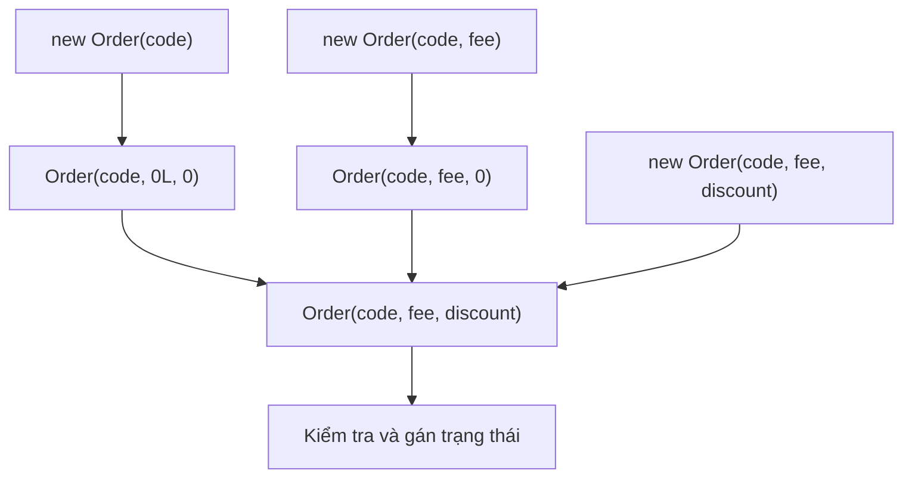

### Superclass and Subclass Example

File `InheritanceInitDemo.java`:

```java
public class InheritanceInitDemo {
    static class Person {
        private final String name;

        Person(String name) {
            this.name = name;
            System.out.println("Person constructor: " + name);
        }

        String getName() {
            return name;
        }
    }

    static class Employee extends Person {
        private final String department;

        Employee(String name, String department) {
            super(name);
            this.department = department;
            System.out.println("Employee constructor: " + department);
        }

        String getDepartment() {
            return department;
        }
    }

    public static void main(String[] args) {
        Employee employee = new Employee("An", "Backend");
        System.out.println(employee.getName() + " - "
                + employee.getDepartment());
    }
}
```

Output:

```text
Person constructor: An
Employee constructor: Backend
An - Backend
```

The superclass constructor executes before the subclass constructor body. If the `Employee` constructor omits `super(name)`, the compiler attempts to insert an implicit `super()` call (which does not exist in this example), causing a compilation error.

**Do not invoke constructors directly like ordinary methods**, such as `employee.Person("An")`. Calls to `this(...)` / `super(...)` use constructor-invocation syntax with its own rules.

## 6. Constructor Chaining in Inheritance: Key Points

If `Child extends Parent`, every `Child` constructor must eventually invoke a valid `Parent` constructor (explicitly through `super(...)` or implicitly through `super()` when valid). This is still **one Child object** containing state declared by its superclass; it does not create a second `Parent` instance.

~~~java
class Parent {
    Parent() { System.out.println("Parent"); }
}
class Child extends Parent {
    Child() {
        super();
        System.out.println("Child");
    }
}
// new Child() in "Parent", rồi "Child".
~~~

The detailed initialization order also involves **static initializers**, field initializers, and instance blocks at each class level. Execution proceeds from parent to child; code that invokes an override in a parent constructor may observe subclass fields at their default values. *Initialization order in inheritance* includes a complete tracing program and distinguishes class initialization from instance initialization.

## 7. When Overloaded Constructors Become Hard to Read

Overloads work well for a few easily distinguished parameter sets. Other needs may call for **named creation methods** or a **Builder**:

~~~java
record Subscription(String plan, int months) {
    static Subscription trial() {
        return new Subscription("TRIAL", 1);
    }
    static Subscription paid(int months) {
        if (months <= 0) throw new IllegalArgumentException();
        return new Subscription("PAID", months);
    }
}

Subscription a = Subscription.trial();
Subscription b = Subscription.paid(12);
~~~

This is a **static factory**: rather than adding a confusing boolean `isTrial` to an overload, the names `trial()` and `paid(...)` express intent. A static factory can return an existing object; in this example, the `trial()` implementation creates a new instance.

If a configuration has many optional fields, a Builder collects named parameters before completing the object with `build()`, avoiding numerous same-type overloads. A Builder-designed API might offer `MailOptions.builder(sender, recipient).subject("Báo cáo").retryCount(2).build()`; Builder implementation, factories that select implementations, and the limitations of both patterns are covered in *Static factory methods, Factory, and Builder*.

Every creation path shares one requirement: **enforce invariants** before returning an object ready for use.

## 8. Comparing Initialization Approaches

| Creation approach | When it fits | Considerations |
|---|---|---|
| Compiler-generated default constructor | Simple classes without explicitly declared constructors | Does not validate data; is not generated once any constructor is declared |
| Explicit no-argument constructor | A standard initial state needs no arguments | Must not leave required data missing |
| Parameterized constructor | Required data and early validation matter | Many parameters can be confused |
| Overloaded constructors | A few sensible parameter sets exist | Prefer `this(...)` to centralize validation and avoid duplication |
| Static factory method | Meaningful creation names or flexible creation policies are needed | Is not a constructor and may return another/existing object |
| Builder | Many optional parameters, with readable call sites | Adds code and usually creates an intermediate Builder object |

**Principle:** Choose the simplest approach that lets users of the class create valid objects. Avoid creating objects that lack essential business data.

## 9. Common Mistakes

### 9.1. Assuming a Parameterized Constructor Keeps the Implicit No-Arg Constructor

```java
class Account {
    Account(String id) {}
}

// new Account(); // Lỗi: constructor Account() không tồn tại
```

Fix: explicitly declare `Account()` **if** a no-argument initialization state is valid; adding a no-arg constructor just to suppress an error is not always necessary.

### 9.2. Accidentally Assigning a Parameter to Itself

```java
class User {
    private String name;

    User(String name) {
        name = name;       // Sai logic: chỉ gán tham số cho chính nó
    }
}
```

Fix it with `this.name = name;` to distinguish the field from the parameter.

### 9.3. Failing to Assign Every Final Field

```java
class Receipt {
    private final String number;

    // Receipt() {} // Lỗi: field number chưa được gán
    Receipt(String number) {
        this.number = number;
    }
}
```

A `final` instance field without a declaration initializer must be **assigned exactly once** on every valid initialization path before the constructor completes. Constructor chaining can help avoid duplication.

### 9.4. Ambiguous Overloads

```java
class Job {
    Job(String id) {}
    Job(Integer priority) {}
}

// new Job(null); // Mơ hồ, compiler không chọn được overload
```

Avoid designing same-arity overloads that accept unrelated reference types when callers might pass `null`; use named factories or explicit casts when appropriate.

### 9.5. Making Constructors Do Too Much

Constructors that open network connections, write to databases, or perform slow tasks are often hard to troubleshoot and test. For complex resource initialization, consider a dedicated factory/service with clear failure reporting and resource cleanup. Constructors can throw exceptions, but objects should not escape before initialization completes.

### 9.6. Confusing Constructors with Setters or Reset Methods

A constructor establishes state at creation; a setter updates state **after the object already exists**. Calling a setter cannot “rerun the constructor” on an object. To obtain a new state, create a new object or define a separately validated update operation.

## 10. Self-Check

### Question 1: Which Code Compiles?

```java
class Ticket {
    Ticket(int price) {}
}

// Ticket t1 = new Ticket();   // A
Ticket t2 = new Ticket(100);  // B
```

**Answer:** Only B. Declaring `Ticket(int)` prevents the compiler from generating an implicit `Ticket()`.

### Question 2: What Is the Result of Constructor Chaining?

```java
public class ChainQuiz {
    ChainQuiz() {
        this(5);
        System.out.println("A");
    }

    ChainQuiz(int number) {
        System.out.println("B" + number);
    }

    public static void main(String[] args) {
        new ChainQuiz();
    }
}
```

**Answer:**

```text
B5
A
```

`ChainQuiz()` delegates to `ChainQuiz(int)`; the constructor accepting `int` finishes before the remaining statements in the no-argument constructor run.

### Question 3: In What Order Do Parent and Child Constructors Run?

```java
class Animal {
    Animal() {
        System.out.println("Animal");
    }
}
class Cat extends Animal {
    Cat() {
        System.out.println("Cat");
    }
}
```

For `new Cat()`, the output is:

```text
Animal
Cat
```

Because `Cat()` does not explicitly invoke `super()`, the compiler inserts an implicit `super()` call; superclass initialization precedes the subclass constructor body.

### Design Exercise

Build a `CourseEnrollment` class with:

- `studentId` and `courseId` as required, non-`null`, nonempty values.
- `semester` as an optional value defaulting to `"2026-FALL"`.
- One constructor taking all three parameters and an overload taking only two.
- Validation centralized in **one** constructor, with required fields declared `private final`.
- A `main` method demonstrating both creation paths and invalid-input checks.

Suggested signatures:

```java
CourseEnrollment(String studentId, String courseId) {
    this(studentId, courseId, "2026-FALL");
}

CourseEnrollment(String studentId, String courseId, String semester) {
    // validate rồi gán các field
}
```

Extension: if six more enrollment options are added later, consider a Builder instead of many overloads with `String` parameters whose order is easy to confuse.

---

**Remember:** Java generates an implicit **default no-argument constructor** only when a class declares no constructors. Parameterized constructors enforce required data; overloads offer multiple creation paths; `this(...)` reuses logic between constructors, and `super(...)` initializes the superclass portion. As options grow or creation acquires distinct business meaning, static factories and Builders can make APIs clearer and safer.


</details>

- [Back to top](#back-to-top)

---

## <a id="lifecycle-004">Initialization order in inheritance</a>

<details>
<summary>View details</summary>

# Initialization Order in Inheritance (Java OOP)

When creating an object from a class that **inherits** from another class, Java does not execute all subclass initialization before handling the superclass. The JVM must prepare the classes, create the object, and construct the **superclass state before the subclass state** according to defined rules.

Understanding this order helps predict behavior involving `static`, field initializers, initialization blocks, constructors, `super(...)`, and `this(...)`, and avoid errors when a constructor invokes an overridable method.

> Scope: the examples work with Java 11+. “Class initialization” (`static`) and “object initialization” (instance) are different operations; the explanation below distinguishes them.

## 1. General Initialization Order for `new Child()`

Suppose `Child extends Parent` and this is the program's first active use of `Child` that requires JVM class initialization:

1. **Initialize class `Parent`**, running its static field initializers and static initialization blocks in source-code order.
2. **Initialize class `Child`**, executing the subclass's `static` initialization elements in source-code order.
3. Allocate a `Child` object and assign **default** values to all instance fields (such as `0`, `false`, and `null`). Fields declared by the superclass are part of this same object.
4. Follow the constructor chain toward the superclass. When processing `Parent` instance initialization, Java runs `Parent` instance field initializers and instance initialization blocks **in textual order**, then executes the `Parent` constructor body.
5. Return to `Child`, execute `Child` instance field initializers and instance initialization blocks **in textual order**, then execute the `Child` constructor body.

With a deeper inheritance hierarchy, the process begins at the highest ancestor and proceeds toward the concrete class named by `new`. Each class level contributes its own instance initialization.

**Two common misconceptions:**

- A class's `static` initialization normally happens **once within the class loader that initializes it**, not on every `new`. Class loading (`loading`) and class initialization (`initialization`) also do not necessarily occur at the same time.
- The superclass constructor is **invoked before subclass instance initialization**. Subclass fields already have **default** values from object allocation, but their specific initializer expressions have not yet run.

Typical order diagram:

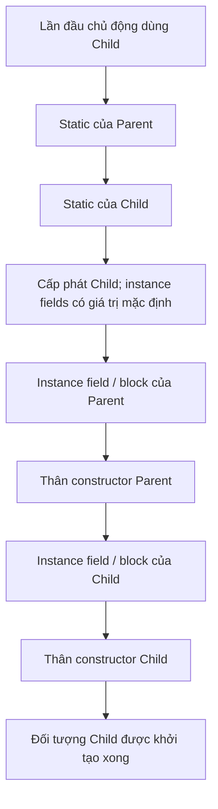

*Constructor-call argument expressions and chains of `this(...)`/`super(...)` are evaluated when those calls are processed; this diagram focuses on the order of initialization elements and constructor bodies in ordinary examples.*

## 2. Full Example: Tracing Every Step

Create the file **`InitializationTrace.java`**:

```java
public class InitializationTrace {

    static int mark(String step) {
        System.out.println(step);
        return 1;
    }

    static class Parent {
        static int parentStatic = mark("1. Parent: static field");

        static {
            System.out.println("2. Parent: static block");
        }

        int parentValue = mark("5. Parent: instance field");

        {
            System.out.println("6. Parent: instance block");
        }

        Parent() {
            System.out.println("7. Parent: constructor");
        }
    }

    static class Child extends Parent {
        static int childStatic = mark("3. Child: static field");

        static {
            System.out.println("4. Child: static block");
        }

        int childValue = mark("8. Child: instance field");

        {
            System.out.println("9. Child: instance block");
        }

        Child() {
            super();
            System.out.println("10. Child: constructor");
        }
    }

    public static void main(String[] args) {
        System.out.println("=== ĐỐI TƯỢNG THỨ NHẤT ===");
        new Child();

        System.out.println("=== ĐỐI TƯỢNG THỨ HAI ===");
        new Child();
    }
}
```

Run:

```bash
javac InitializationTrace.java
java InitializationTrace
```

**Output:**

```text
=== ĐỐI TƯỢNG THỨ NHẤT ===
1. Parent: static field
2. Parent: static block
3. Child: static field
4. Child: static block
5. Parent: instance field
6. Parent: instance block
7. Parent: constructor
8. Child: instance field
9. Child: instance block
10. Child: constructor
=== ĐỐI TƯỢNG THỨ HAI ===
5. Parent: instance field
6. Parent: instance block
7. Parent: constructor
8. Child: instance field
9. Child: instance block
10. Child: constructor
```

Analysis:

- On the first creation, `new Child()` requires initialization of `Child`. Because `Child extends Parent`, the `static` elements of `Parent` initialize before those of `Child`. **Within each class**, static fields and `static` blocks run in declaration order.
- The instance portion of `Parent` (lines 5–7) runs before the instance portion of `Child` (lines 8–10).
- The second `new Child()` **does not print lines 1–4 again**, because the classes are already initialized. It creates a new instance, so lines 5–10 still appear.
- Both `parentValue` and `childValue` have the value `1` because `mark` returns it; the method prints a trace to make execution order easy to verify.

**Try one change:** swap the static block and static field within one class, then swap that class's instance block and instance field. The output order changes accordingly. “Superclass before subclass” does not mean field initializers always precede block initializers within a class: **source-code order matters**.

## 3. Class Initialization Versus Object Initialization

| Component | When does it run? | Class-wide or per instance? |
| --- | --- | --- |
| `static int value = ...;` | When the class is initialized | Class-wide |
| `static { ... }` | When the class is initialized | Class-wide |
| `int value = ...;` | For each object, when initialization reaches the declaring class | Per instance |
| `{ ... }` (instance initializer block) | For each object, when initialization reaches the declaring class | Per instance |
| Constructor | When constructing an object through the constructor chain | Part of object construction |
| Instance field default values | Immediately after allocation, before specific initializers | Per instance |

In Java, instance fields receive default values before constructors execute:

| Field type | Default value |
| --- | --- |
| `byte`, `short`, `int`, `long` | `0` |
| `float`, `double` | `0.0` |
| `boolean` | `false` |
| `char` | `'\u0000'` (NUL character) |
| Reference types such as `String` or `List` | `null` |

This **differs from local variables**: local variables do not receive automatically readable default values; the compiler requires assignment before reading them.

A class can be loaded or linked by the JVM **without** yet executing its `static` initializers. Accessing a `static final` *compile-time constant* may not trigger initialization of the class that defines it, because the value can be inlined at the call site. Merely mentioning a class name is therefore insufficient to guarantee execution of all static blocks.

### One `new` Still Creates a Single Object Containing Superclass State

```java
class Vehicle {
    String brand = "Generic";
}

class Car extends Vehicle {
    int doors = 4;
}

Car car = new Car();
System.out.println(car.brand); // Generic
System.out.println(car.doors); // 4
```

`Car` does not “contain a separate `Vehicle` object automatically created by `new Vehicle()`.” A `Car` object contains inherited instance components from `Vehicle` and components declared by `Car`. The constructor chain ensures they are initialized in order.

## 4. `super(...)` and Superclass Constructors

When creating `Child`, Java must execute an appropriate constructor of `Parent`. Superclass constructors **are not inherited** like ordinary methods; a subclass invokes one through `super(...)` as part of the initialization chain.

### Superclass with a No-Argument Constructor

```java
class Device {
    Device() {
        System.out.println("Device()");
    }
}

class Phone extends Device {
    Phone() {
        super(); // Gọi constructor Device()
        System.out.println("Phone()");
    }
}
```

`new Phone()` prints:

```text
Device()
Phone()
```

If you omit `super();` in this example, the Java 11 compiler inserts an implicit `super();` call at the beginning of the constructor. This **does not** mean the JVM searches for any compatible superclass constructor: the implicit call targets the **no-argument constructor**.

### Superclass with Only a Parameterized Constructor

```java
class Account {
    private final String id;

    Account(String id) {
        if (id == null || id.isBlank()) {
            throw new IllegalArgumentException("ID không hợp lệ");
        }
        this.id = id;
        System.out.println("Account: " + id);
    }

    String getId() {
        return id;
    }
}

class SavingsAccount extends Account {
    private final int interestRatePercent;

    SavingsAccount(String id, int interestRatePercent) {
        super(id); // BẮT BUỘC chỉ rõ lời gọi này trong thiết kế này
        this.interestRatePercent = interestRatePercent;
        System.out.println("SavingsAccount: " + interestRatePercent);
    }
}
```

`new SavingsAccount("SV001", 5)` prints:

```text
Account: SV001
SavingsAccount: 5
```

If `super(id)` is removed, the Java 11 compiler tries to call `super()`, but `Account` **has no** no-argument constructor, so compilation fails. Java does not automatically generate a no-argument constructor for a class that declares a parameterized constructor.

In these Java 11 examples, an explicit `super(...)` or `this(...)` constructor invocation must be the first statement in a constructor. Some newer Java versions allow more flexible constructor syntax, but constructor chaining and the need to invoke a superclass constructor remain essential to understanding initialization order.

### Arguments to `super(...)`

The arguments in `super(expression)` are evaluated to choose and pass values to the superclass constructor. Distinguish **evaluating argument expressions** from **executing the superclass constructor body**. When predicting logs, consider argument expressions with side effects separately instead of mechanically applying a simple log sequence.

A straightforward example:

```java
class Parent {
    Parent(String value) {
        System.out.println("Parent: " + value);
    }
}

class Child extends Parent {
    Child(String input) {
        super(input.trim());
        System.out.println("Child");
    }
}
```

`new Child("  hello  ")` prints `Parent: hello` followed by `Child`.

## 5. `this(...)`: Multiple Constructors in One Class

`this(...)` **invokes another constructor in the same class**. It reuses initialization logic and avoids duplicate code.

```java
public class ConstructorChainDemo {
    static class Base {
        Base() {
            System.out.println("Base constructor");
        }
    }

    static class Derived extends Base {
        int value = initialize();

        static int initialize() {
            System.out.println("Derived field initializer");
            return 10;
        }

        Derived() {
            this(99);
            System.out.println("Derived() constructor body");
        }

        Derived(int number) {
            super();
            System.out.println("Derived(int) constructor body: " + number);
        }
    }

    public static void main(String[] args) {
        new Derived();
    }
}
```

Output:

```text
Base constructor
Derived field initializer
Derived(int) constructor body: 99
Derived() constructor body
```

Explanation:

1. `Derived()` delegates initialization to `Derived(int)` through `this(99)`.
2. `Derived(int)` invokes `Base()` through `super()`.
3. After the superclass constructor finishes, `Derived` instance field initializers and instance blocks run **once**.
4. The `Derived(int)` constructor body runs, and execution returns to the `Derived()` constructor body.

The `value` field is **not** initialized twice just because the `this(...)` chain contains two constructors. Each object creation ultimately invokes the superclass constructor once along its corresponding chain.

A constructor cannot directly contain both `this(...)` and `super(...)` constructor invocations on the same initialization path; the `this(...)` chain eventually reaches a constructor that invokes `super(...)` explicitly or implicitly. Cyclic constructor calls (for example, A calls B and B calls A through `this(...)`) are compilation errors.

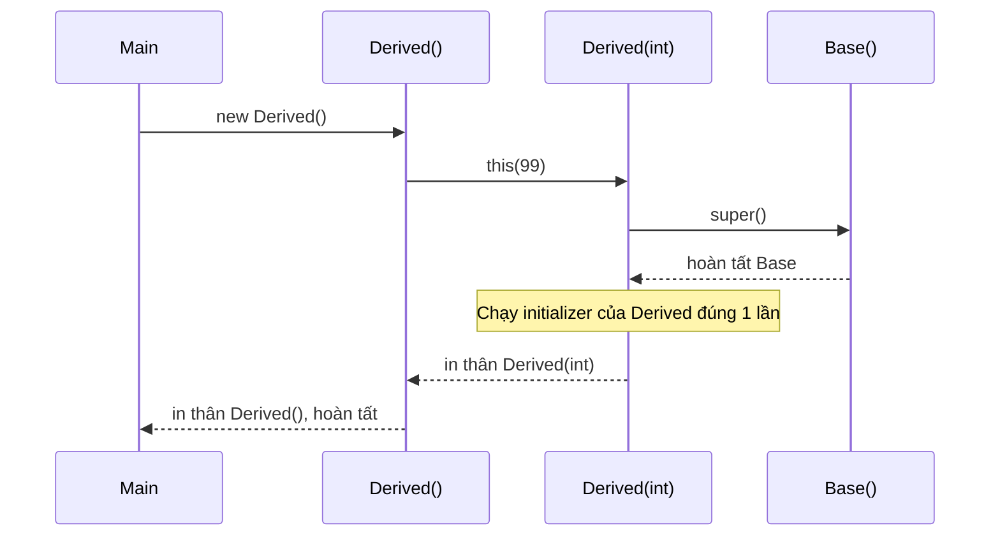

## 6. Important Pitfall: Invoking an Override in a Superclass Constructor

Instance methods may use **dynamic dispatch**: a call from superclass code can execute a subclass override. But while the superclass constructor is running, subclass field initializers **have not run yet**.

Examine **`OverrideDuringConstruction.java`**:

```java
public class OverrideDuringConstruction {

    static class Base {
        Base() {
            System.out.println("Base bắt đầu");
            show(); // Phương thức có thể bị override
            System.out.println("Base kết thúc");
        }

        void show() {
            System.out.println("Base.show()");
        }
    }

    static class Derived extends Base {
        private String message = "Đã sẵn sàng";

        Derived() {
            System.out.println("Derived constructor: " + message);
        }

        @Override
        void show() {
            System.out.println("Derived.show(): " + message);
        }
    }

    public static void main(String[] args) {
        new Derived();
    }
}
```

Output:

```text
Base bắt đầu
Derived.show(): null
Base kết thúc
Derived constructor: Đã sẵn sàng
```

**Why does it print `null` instead of the subclass's initialized message?**

- The object being created is a `Derived`, so `Derived.show()` is selected when `Base` invokes `show()`.
- At that point, all instance fields have default values, so `message` is `null`.
- The assignment `message = "Đã sẵn sàng"` belongs to a `Derived` initializer, which executes only **after the `Base` constructor completes**.
- The `Derived` constructor body then sees the initialized value.

If `show()` invokes `message.length()`, the program may throw `NullPointerException` before the subclass constructor completes.

### A Safer Design

Do not call an overridable method from a superclass constructor when it depends on subclass state. Instead, the superclass constructor should use its own data and suitable `private`, `final`, or `static` logic; or defer any startup step requiring the complete object until **after** the constructor returns.

Example of a superclass handling its own responsibilities:

```java
class SafeBase {
    private final String id;

    SafeBase(String id) {
        if (id == null || id.isBlank()) {
            throw new IllegalArgumentException("ID trống");
        }
        this.id = id;
        System.out.println("Base đã nhận ID: " + id);
    }

    public final String getId() {
        return id;
    }
}

class SafeDerived extends SafeBase {
    private final String message = "Đã sẵn sàng";

    SafeDerived(String id) {
        super(id);
        System.out.println("Derived: " + message);
    }
}
```

Besides avoiding overridable method calls, avoid **letting `this` escape** before the constructor completes (for example, registering a callback that another object can invoke immediately). This can also expose a partially initialized object.

## 7. Multiple Levels of Inheritance

Suppose `C extends B` and `B extends A`:

```java
public class ThreeLevels {
    static class A {
        static { System.out.println("A static"); }
        { System.out.println("A instance"); }
        A() { System.out.println("A constructor"); }
    }

    static class B extends A {
        static { System.out.println("B static"); }
        { System.out.println("B instance"); }
        B() { System.out.println("B constructor"); }
    }

    static class C extends B {
        static { System.out.println("C static"); }
        { System.out.println("C instance"); }
        C() { System.out.println("C constructor"); }
    }

    public static void main(String[] args) {
        new C();
    }
}
```

Output:

```text
A static
B static
C static
A instance
A constructor
B instance
B constructor
C instance
C constructor
```

When creating `C` the second time, the three `static` lines are not printed again. Instance initialization and constructors still run from `A` to `B` to `C`.

**Note:** Both the `static` and instance blocks in the example use valid syntax:

- `static { ... }`: a static initialization block, with no object receiver.
- `{ ... }`: an instance initialization block, executed during construction at its corresponding point in the declaring class's instance initialization.

Do not confuse “constructors run from parent to child” with “all statements in the subclass constructor run first because we called `new C()`.” The `new C()` expression selects the type to instantiate, but superclass constructor bodies complete before the subclass constructor body.

## 8. Common Mistakes About Initialization Order

| Claim or code pattern | Correct conclusion |
| --- | --- |
| “`new Child()` must run the Child constructor first because Child was requested” | Incorrect: the superclass constructor body runs before the subclass body |
| “Every `static` initializer runs when the program starts” | Incorrect: a class normally initializes when an active use requires it |
| “Every new instance reruns static blocks” | Incorrect: static initializers do not run per instance |
| “Child instance fields already have specific initialized values while the Parent constructor runs” | Incorrect in normal cases: Child fields still hold default values |
| “`super()` creates an additional Parent object” | Incorrect: it initializes the superclass portion of the same Child object |
| “Child inherits Parent constructors like methods” | Incorrect: constructors are not inherited |
| “When Parent has only a parameterized constructor, Child can omit `super(args)` and Java will find one” | Incorrect: an unmatched implicit `super()` causes a compilation error |
| “`this(...)` causes the class's field initializers to run multiple times” | Incorrect: its constructor chain initializes that class's instance portion once |
| “Calling an override in a parent constructor always sees initialized Child state” | Incorrect: the override may run before Child initializers |
| “Every field initializer in a class runs before every initializer block” | Incorrect: they execute in source-code order |
| “Accessing a primitive `static final` constant always triggers static blocks” | Not necessarily true for *compile-time constants* |

### When Initialization Fails

If a static initializer throws an uncaught exception, class initialization fails. When the failure is not an `Error`, it is usually reported as `ExceptionInInitializerError`; later attempts to use the class may encounter `NoClassDefFoundError` because the class is in an erroneous initialization state. This differs from an exception thrown by an instance constructor: the object under construction does not complete, but the class itself is not necessarily marked as having failed initialization.

When checking execution order with `System.out.println`, remember that logging itself has side effects. In production, avoid complex business logic, failure-prone environment reads, or starting threads in static initializers; handle errors at clearly defined application initialization steps.

## 9. Practice Exercises with Explanations

### Exercise 1: Predict the Order

```java
class P {
    static { System.out.print("A "); }
    { System.out.print("B "); }
    P() { System.out.print("C "); }
}
class Q extends P {
    static { System.out.print("D "); }
    { System.out.print("E "); }
    Q() { System.out.print("F "); }
}

new Q();
new Q();
```

**Answer:** `A D B C E F B C E F`. `A` and `D` print only on the first class initialization; each instance initializes the `P` portion followed by `Q`.

### Exercise 2: Superclass without a Default Constructor

```java
class Animal {
    Animal(String name) { }
}

class Cat extends Animal {
    Cat() {
        // Thiếu lời gọi constructor của Animal
    }
}
```

**Question:** Why does it fail to compile? How would you fix it?

**Answer:** Java 11 implicitly inserts `super()` into `Cat()`, but `Animal` declares only `Animal(String)`. Fix this by invoking `super("Mèo");` in `Cat()`, or add a no-argument constructor to `Animal` if that makes sense for the domain.

### Exercise 3: Field Values When a Superclass Constructor Calls an Override

```java
class A {
    A() { print(); }
    void print() { System.out.println("A"); }
}
class B extends A {
    int number = 7;
    @Override
    void print() { System.out.println(number); }
}

new B();
```

**Answer:** `0`. Dynamic dispatch selects `B.print()` while `A()` is executing, before the `number = 7` initializer runs. Moving the `print()` call until after `new B()` completes would produce `7`.

### Exercise 4: Extend the Example

Create three classes, `Person`, `Employee`, and `Manager`, with `Manager extends Employee extends Person`. Each class should have a static block, an instance field initializer, and a constructor that prints its class name. Then:

1. Create two `Manager` objects in succession.
2. Predict exactly which lines print once and which print twice.
3. Add a `Manager()` constructor using `this(String department)`; check whether `Manager` initializers run repeatedly.
4. Give `Person` only a constructor accepting `String name`; update the subclasses to pass all required data through `super(...)`.
5. Try calling an overridable `describe()` method from the `Person` constructor, and explain why its output may not yet reflect the `Manager` state.

## Remembering How to Read Constructors in an Inheritance Hierarchy

When you see `new Subclass(...)`, trace the `this(...)` and `super(...)` chain to determine **which constructors are invoked**. Then distinguish two phases: **class initialization (`static`, when needed)** and **per-instance initialization (default values, parent initializers, parent constructor body, child initializers, child constructor body)**. Take special care with overridden method calls from constructors because the object may still be incompletely initialized at that point.


</details>

- [Back to top](#back-to-top)

---

## <a id="lifecycle-005">Static factory methods, Factory, and Builder</a>

<details>
<summary>View details</summary>

# Static Factory Methods, Factory, and Builder in Java

In OOP, using `new` is not the only way to **obtain an object**. You can hide a constructor behind a static method, delegate the choice of concrete class to a Factory, or collect parameters in a Builder before constructing the object. All three relate to **object creation and lifecycle**, but address different problems.

> **Key distinctions:** A constructor is Java's object-initialization syntax; a *static factory method* is a `static` method that returns an object; a *Factory* is usually an object/class responsible for choosing and supplying objects; a *Builder* configures an object step by step and then invokes `build()`. Calling a factory does not guarantee creation of a new instance.

## 1. Starting with Constructors and the Object Lifecycle

A basic Java example:

~~~java
public class User {
    private final String email;

    public User(String email) {
        if (email == null || email.isBlank()) {
            throw new IllegalArgumentException("Email không được rỗng");
        }
        this.email = email.trim();
    }

    public String getEmail() {
        return email;
    }
}
~~~

~~~java
User user = new User("hello@example.com");
System.out.println(user.getEmail());
~~~

In `new User(...)`, the JVM allocates and initializes an instance under Java's language rules and invokes its constructor after the appropriate initialization steps. A constructor shares its class's name, **has no return type**, can be overloaded, and can validate initial state.

However, constructors become less expressive when multiple creation approaches need descriptive names:

~~~java
// Cùng nhận một double nên không thể khai báo cả hai constructor này:
// Temperature(double celsius)
// Temperature(double fahrenheit)
~~~

The two constructors above have the **same signature** `Temperature(double)`; Java cannot distinguish them by parameter names alone. A static factory method handles that case.

For every object-creation approach in this lesson, distinguish:

- **Creating an instance:** the constructor actually executes for a new object (directly or inside a factory/builder).
- **Obtaining an instance:** a method returns an existing object, a cached object, a shared instance, or a particular implementation.
- **Using and releasing an object:** once no reachable strong reference remains to an object, it may become eligible for garbage collection. Factories and Builders do not change this principle; external resources such as files/sockets still need timely closing when appropriate.

## 2. Static Factory Methods: Naming Creation Paths

A **static factory method** is a `static` method that returns an object. It can invoke a constructor, process or convert data before construction, or return an existing object.

A practical example: a temperature can be specified in °C or °F. Internally, we store only **Celsius** as the canonical representation:

`Temperature.java` (Java 11+):

~~~java
public final class Temperature {
    private final double celsius;

    // Ẩn cách khởi tạo: bên ngoài phải chọn đơn vị rõ ràng.
    private Temperature(double celsius) {
        if (!Double.isFinite(celsius)) {
            throw new IllegalArgumentException("Nhiệt độ phải là số hữu hạn");
        }
        this.celsius = celsius;
    }

    public static Temperature celsius(double value) {
        return new Temperature(value);
    }

    public static Temperature fahrenheit(double value) {
        if (!Double.isFinite(value)) {
            throw new IllegalArgumentException("Nhiệt độ phải là số hữu hạn");
        }
        return new Temperature((value - 32.0) * 5.0 / 9.0);
    }

    public double inCelsius() {
        return celsius;
    }

    public double inFahrenheit() {
        return celsius * 9.0 / 5.0 + 32.0;
    }
}
~~~

~~~java
public class Main {
    public static void main(String[] args) {
        Temperature a = Temperature.celsius(30);
        Temperature b = Temperature.fahrenheit(86);

        System.out.println(a.inCelsius()); // 30.0
        System.out.println(b.inCelsius()); // 30.0

        // new Temperature(30); // Không biên dịch: constructor private
    }
}
~~~

The names `celsius` and `fahrenheit` reveal the **meaning** of the arguments at call sites. The class exposes only valid creation paths; with no setter, the instance's `celsius` field cannot be updated after creation. Nevertheless, the two calls above create **separate objects**, because each factory calls `new Temperature(...)`.

### When Are Static Factories Useful?

1. **Meaningful names:** `of(...)`, `from(...)`, `parse(...)`, `forGuest(...)`, and `fromCsv(...)` make the data source clear.
2. **Input validation and normalization:** the factory enforces validity rules before returning an object.
3. **Hiding implementations:** the return type may be an interface/superclass while the instance is a specific implementation.
4. **Reuse/caching when appropriate:** a factory may return an old instance, singleton, or cached object instead of allocating a new one.
5. **A compact API:** constructors can be hidden with `private`/package-private access while valid creation paths stay centralized.

Some common names (mostly **conventions**, not special Java syntax):

| Method name | Common meaning | Familiar example |
| --- | --- | --- |
| `of(...)` | Create/obtain an instance from parameters | `List.of("a", "b")` |
| `from(...)` | Convert another kind of data/type to the target type | `Instant.from(temporal)` |
| `valueOf(...)` | Obtain an object for a corresponding value | `Integer.valueOf(42)` |
| `parse(...)` | Parse a string into a target-type value | `LocalDate.parse("2026-10-15")` |
| `getInstance(...)` | Obtain an instance, possibly shared | A library-defined name |
| `newInstance(...)` | Name suggesting a new instance | A library-defined name |

Do not infer caching behavior or guaranteed new allocation **from the name alone**. Read the API contract: for example, `Integer.valueOf` may return cached objects for some values, while `List.of` creates/obtains an unmodifiable list without guaranteeing instance identity.

### A Static Factory Is Not a “Static Constructor”

Java **has no static constructors** in the sense of declaring `static User(...)` or adding `static` to a constructor. A static initialization block, `static { ... }`, runs when JVM rules initialize the class; it initializes static state and **does not** act as a factory returning an object. A static factory method is an ordinary method with the `static` keyword and a return type.

~~~java
public class Config {
    private static final String DEFAULT_REGION;

    static {
        DEFAULT_REGION = "VN"; // Static initializer, không trả về object
    }

    private final String region;

    private Config(String region) {
        this.region = region;
    }

    public static Config defaultConfig() { // Static factory method
        return new Config(DEFAULT_REGION);
    }

    public String region() {
        return region;
    }
}
~~~

## 3. Factory: Centralizing the Choice of Object Type

The `Temperature` static factory lives **inside the returned class**. But some systems must choose an **implementation type** based on configuration, business conditions, or the runtime environment. A separate Factory class/object prevents callers from scattering `new ConcreteType(...)` throughout the codebase.

Example: selecting a notification channel. For OOP illustration, both implementations only print to the console; they **do not send real emails or SMS messages**.

`NotificationDemo.java` (Java 11+):

~~~java
interface Notifier {
    void send(String message);
}

final class EmailNotifier implements Notifier {
    @Override
    public void send(String message) {
        System.out.println("[EMAIL] " + message);
    }
}

final class SmsNotifier implements Notifier {
    @Override
    public void send(String message) {
        System.out.println("[SMS] " + message);
    }
}

enum Channel {
    EMAIL, SMS
}

final class NotifierFactory {
    private NotifierFactory() {
        // Không cho tạo instance của lớp tiện ích này.
    }

    public static Notifier create(Channel channel) {
        if (channel == null) {
            throw new IllegalArgumentException("Channel không được null");
        }

        switch (channel) {
            case EMAIL:
                return new EmailNotifier();
            case SMS:
                return new SmsNotifier();
            default:
                throw new IllegalArgumentException("Channel không hỗ trợ");
        }
    }
}

public class NotificationDemo {
    public static void main(String[] args) {
        Notifier notifier = NotifierFactory.create(Channel.EMAIL);
        notifier.send("Đơn hàng đã được xác nhận");
        // [EMAIL] Đơn hàng đã được xác nhận

        Notifier sms = NotifierFactory.create(Channel.SMS);
        sms.send("Mã OTP thử nghiệm");
        // [SMS] Mã OTP thử nghiệm
    }
}
~~~

Callers only depend on `Notifier` and the selected `Channel`. The Factory constructs the actual class; application code calls `send` through the interface. If creation of `EmailNotifier` changes (for example, to supply dependencies or configuration), those changes can be concentrated where objects are built.

~~~mermaid
flowchart LR
    Client["Client"] --> Factory["NotifierFactory.create(channel)"]
    Factory --> Decision{"Channel"}
    Decision -->|EMAIL| Email["new EmailNotifier()"]
    Decision -->|SMS| SMS["new SmsNotifier()"]
    Email --> Interface["Notifier"]
    SMS --> Interface
    Interface --> Use["Client gọi send(...)"]
~~~

### Are “Factory” and the “Factory Method Pattern” the Same?

Not exactly. These terms are often confused:

| Term | Characteristics | Example |
| --- | --- | --- |
| **Static factory method** | A `static` method returning an object, usually on the product class | `Temperature.fahrenheit(86)` |
| **Simple Factory** | A method/class centralizing implementation selection and creation; not one of the 23 individually named GoF patterns | `NotifierFactory.create(Channel)` above |
| **Factory Method (GoF)** | A superclass defines an extensible creation operation; subclasses override it | `Creator.createProduct()` implemented by a subclass |
| **Abstract Factory (GoF)** | Provides an interface for creating a **family of related objects** without requiring clients to name concrete classes | `UiFactory.createButton()` and `createDialog()` for each UI family |

A minimal **Factory Method pattern** example:

~~~java
interface Report {
    String render();
}

final class CsvReport implements Report {
    public String render() {
        return "name,quantity\nBook,2";
    }
}

final class JsonReport implements Report {
    public String render() {
        return "{\"name\":\"Book\",\"quantity\":2}";
    }
}

abstract class ReportService {
    // Thuật toán chung gọi điểm mở rộng do subclass cung cấp.
    public final void printReport() {
        Report report = createReport();
        System.out.println(report.render());
    }

    protected abstract Report createReport(); // Factory Method
}

final class CsvReportService extends ReportService {
    @Override
    protected Report createReport() {
        return new CsvReport();
    }
}

final class JsonReportService extends ReportService {
    @Override
    protected Report createReport() {
        return new JsonReport();
    }
}

// Cách dùng:
ReportService service = new CsvReportService();
service.printReport();
~~~

Here, `createReport()` is an overridden **instance method**; it need not be `static`. Thus, a “static factory method” and the “Factory Method design pattern” are different concepts.

**Trade-off:** A factory using `switch` centralizes selection, but adding a new channel still requires modifying the `switch`; it does not automatically satisfy the Open/Closed Principle in every case. Larger projects may register implementations through `Map<Channel, Supplier<Notifier>>`, dependency injection, or a suitable configuration strategy. Avoid excessive Factory layers for a single simple object type.

## 4. Builder: Configure Step by Step Before Creating an Object

Constructors with many parameters are easy to misuse and hard to extend:

~~~java
// Người đọc khó biết 0, 20 và true tương ứng tham số nào:
SearchRequest request = new SearchRequest("java", 0, 20, true);
~~~

Adding more optional parameters creates an increasingly difficult “forest of constructors” (telescoping constructors). The **Builder pattern** solves this with an intermediate object whose clearly named methods configure the result; the final object is created only when `build()` is called.

For example, `SearchRequest` has a required query and optional `page`, `pageSize`, and filter tags.

`SearchRequest.java` (Java 11+):

~~~java
import java.util.ArrayList;
import java.util.List;
import java.util.Objects;

public final class SearchRequest {
    private final String keyword;
    private final int page;
    private final int pageSize;
    private final List<String> tags;

    private SearchRequest(Builder builder) {
        this.keyword = builder.keyword;
        this.page = builder.page;
        this.pageSize = builder.pageSize;
        this.tags = List.copyOf(builder.tags); // Snapshot, không lộ List mutable
    }

    public static Builder builder(String keyword) {
        return new Builder(keyword);
    }

    public String getKeyword() { return keyword; }
    public int getPage() { return page; }
    public int getPageSize() { return pageSize; }
    public List<String> getTags() { return tags; }

    public static final class Builder {
        private final String keyword;
        private int page = 0;          // Giá trị mặc định
        private int pageSize = 20;     // Giá trị mặc định
        private final List<String> tags = new ArrayList<>();

        private Builder(String keyword) {
            String clean = Objects.requireNonNull(keyword, "keyword").trim();
            if (clean.isEmpty()) {
                throw new IllegalArgumentException("Keyword không được rỗng");
            }
            this.keyword = clean;
        }

        public Builder page(int page) {
            if (page < 0) {
                throw new IllegalArgumentException("Page phải >= 0");
            }
            this.page = page;
            return this;
        }

        public Builder pageSize(int pageSize) {
            if (pageSize < 1 || pageSize > 100) {
                throw new IllegalArgumentException("Page size phải trong [1, 100]");
            }
            this.pageSize = pageSize;
            return this;
        }

        public Builder addTag(String tag) {
            String clean = Objects.requireNonNull(tag, "tag").trim();
            if (clean.isEmpty()) {
                throw new IllegalArgumentException("Tag không được rỗng");
            }
            this.tags.add(clean);
            return this;
        }

        public SearchRequest build() {
            return new SearchRequest(this);
        }
    }
}
~~~

`SearchDemo.java`:

~~~java
public class SearchDemo {
    public static void main(String[] args) {
        SearchRequest request = SearchRequest.builder("  java oop  ")
                .page(2)
                .pageSize(25)
                .addTag("core")
                .addTag("interview")
                .build();

        System.out.println(request.getKeyword()); // java oop
        System.out.println(request.getPage());    // 2
        System.out.println(request.getPageSize()); // 25
        System.out.println(request.getTags());    // [core, interview]

        // Khi chỉ có tham số bắt buộc, dùng được giá trị mặc định:
        SearchRequest defaults = SearchRequest.builder("spring").build();
        System.out.println(defaults.getPageSize()); // 20
    }
}
~~~

Analyzing the flow:

~~~mermaid
flowchart TD
    A["SearchRequest.builder(keyword)"] --> B["Tạo Builder, kiểm tra keyword"]
    B --> C["page(), pageSize(), addTag()"]
    C --> D["Builder lưu cấu hình và trả this"]
    D --> E["build()"]
    E --> F["new SearchRequest(builder)"]
    F --> G["Sao chép List; đối tượng kết quả bất biến"]
~~~

- `builder(...)` is a **static factory for a Builder**; it does not yet create `SearchRequest`.
- `page(...), pageSize(...), addTag(...)` update the Builder's **mutable** state and return `this` for fluent chaining.
- `build()` invokes the `private SearchRequest(Builder)` constructor and returns the configured object.
- `List.copyOf(builder.tags)` protects the `SearchRequest` list from later changes to the Builder. Since `String` is immutable, its elements cannot be changed in place either.

Checking what happens when a Builder is reused:

~~~java
SearchRequest.Builder builder = SearchRequest.builder("oop");
builder.addTag("basic");

SearchRequest first = builder.build();

builder.addTag("advanced");
SearchRequest second = builder.build();

System.out.println(first.getTags());  // [basic]
System.out.println(second.getTags()); // [basic, advanced]
System.out.println(first == second);  // false
~~~

**Note:** The Builder in this example is mutable and **not designed to be thread-safe**; do not share it among threads that modify it concurrently. `build()` is also **not required to create a new instance** under every Builder API, but in our sample implementation, each call executes `new SearchRequest(...)`.

## 5. Choosing the Right Creation Approach

| Criterion | Constructor | Static Factory Method | Separate Factory | Builder |
| --- | --- | --- | --- | --- |
| Typical syntax | `new Order(...)` | `Order.from(...)` | `factory.create(...)` | `Order.builder().build()` |
| Main purpose | Direct initialization | Naming a creation path or choosing return behavior | Centralizing implementation selection and dependency creation | Configuring many parameters clearly |
| Must each call create a new instance? | Yes, when using `new` | Not necessarily | Not necessarily | Depends on the contract of `build()` |
| Optional parameters | Use overloads, which may become confusing | Overloads are possible | API-dependent | Convenient for many options |
| Hide concrete implementation class | No, when invoked directly | Possible | Common | Possible |
| Design cost | Low | Low to moderate | Moderate | Moderate to high |

Some quick selection examples:

- **`Point(int x, int y)`**: simple data with few parameters and straightforward creation → a constructor is usually enough.
- **`Temperature.celsius(30)` / `fahrenheit(86)`**: the same parameter type has different meanings → use static factories.
- **Select an encoder/notification sender from configuration** → use a Factory to supply the appropriate interface.
- **Configure many required/optional fields, including defaults and validation** → use a Builder.
- **Create complex objects with both implementation selection and stepwise configuration** → a Factory may supply a Builder, followed by `build()`.

These techniques **are not mutually exclusive**: a class can have a `private` constructor, a static factory returning a `Builder`, another Factory selecting implementations, and the Builder invoking the constructor to create the result.

## 6. Relationship to Dependency Injection and Spring

In Spring applications, the container is often responsible for creating and managing beans and injecting dependencies. Therefore, a real project Factory may need **injected dependencies** instead of constructing every service with `new`.

A minimal illustration:

~~~java
import org.springframework.stereotype.Component;

@Component
public class NotifierSelector {
    private final EmailService emailService;
    private final SmsService smsService;

    public NotifierSelector(EmailService emailService, SmsService smsService) {
        this.emailService = emailService;
        this.smsService = smsService;
    }

    public MessageSender select(Channel channel) {
        return switch (channel) {
            case EMAIL -> emailService;
            case SMS -> smsService;
        };
    }
}
~~~

This assumes `EmailService` and `SmsService` are existing beans implementing `MessageSender`, and `Channel` is an enum with `EMAIL` and `SMS`. The code illustrates **Spring integration**; it is not a standalone Java program like the previous examples. Here, `select` **returns an existing managed bean**, rather than creating a service. Avoid `new EmailService()` in application logic if the service relies on Spring injection, interceptors, transaction proxies, or lifecycle callbacks.

In Spring, an `@Bean` annotation on a configuration method can return an object for container management, but that does not mean every `@Bean` method is a static factory method. Distinguish the **framework's bean management mechanism** from **object-creation patterns in plain Java**.

## 7. Common Errors and Misconceptions

**1. Assuming Static Factories Always Create New Instances**

~~~java
Integer a = Integer.valueOf(42);
Integer b = Integer.valueOf(42);

System.out.println(a.equals(b)); // true
// a == b không nên dùng để kiểm tra bằng nhau về giá trị.
~~~

`valueOf` may use caching; applications should follow the **value contract** (using `equals` to compare values), not depend on which instance a factory allocates. Sharing a mutable object can cause unintended state changes, so cache or share such instances only deliberately.

**2. Putting Heavy Business Logic or I/O into Every Constructor/Factory**

Constructors and factories should ensure valid state. I/O may be necessary by design, but failures, resources, latency, and side effects must be explicit. Do not turn every `new` or `of` into an unexpected network call.

**3. Assuming Builders Automatically Guarantee Immutability**

A Builder is often mutable, and the constructed object may also be mutable if fields, setters, or collections are exposed. For immutable results, use `private final` fields, validate inputs, defensively copy mutable state, avoid public setters, and take care with nested elements.

**4. Validating Individual Setters but Ignoring Cross-Field Constraints**

If `startDate` must precede `endDate`, validating `startDate(...)` and `endDate(...)` separately may not be sufficient. Check the combined constraint in `build()` or the final constructor:

~~~java
public TimeRange build() {
    if (start == null || end == null || !start.isBefore(end)) {
        throw new IllegalStateException("Khoảng thời gian không hợp lệ");
    }
    return new TimeRange(start, end);
}
~~~

The code above sketches `build()` for a Builder with `start` and `end` fields of type `LocalDateTime` (or another comparable time type); it emphasizes **when to validate whole-object invariants**.

**5. Overengineering**

A class with two clear parameters does not need a hundreds-of-lines Builder. There is no need to create a `FactoryFactory` solely to wrap a single `new` statement. Choose abstractions when they improve call-site meaning, implementation extensibility, or control over creation.

**6. Misunderstanding Inheritance and Factories**

Constructors cannot be overridden. Java static methods can be subject to **method hiding**, which is different from instance-polymorphic overriding; they do not offer the same extension point as a `protected createProduct()` method in the GoF Factory Method pattern. For polymorphic creation, consider Factory Method, Abstract Factory, or dependency injection.

## 8. Practice Questions

**Question 1:** Why can't the constructors `Temperature(double celsius)` and `Temperature(double fahrenheit)` coexist?

**Answer:** They have the same parameter-type signature. Parameter names do not distinguish overloads; named static factories `celsius` and `fahrenheit` solve the problem.

**Question 2:** Must `Temperature.fahrenheit(86)` create a new object?

**Answer:** Yes in the sample implementation, because it calls `new Temperature(...)`. But static factory methods in general need not; a factory may return an existing object.

**Question 3:** How do `NotifierFactory.create(Channel.EMAIL)` and `ReportService.createReport()` differ?

**Answer:** The former is a **Simple Factory** using a static method with `switch` to select an implementation; the latter uses the **Factory Method pattern**, allowing subclasses to override creation of `Report`.

**Question 4:** Why do Builders commonly use `return this`?

**Answer:** To enable fluent chaining such as `builder.page(1).pageSize(30).build()`. This is a fluent API; steps before `build()` modify the **Builder**, without necessarily creating the result object.

**Question 5:** Why is `List.copyOf(builder.tags)` used in the `SearchRequest` constructor?

**Answer:** To snapshot the list at construction. If the Builder later adds tags, an existing `SearchRequest` stays unchanged; callers also cannot modify the getter's list through `add/remove`.

**Question 6:** What would you choose for an immutable class with only required `id` and `name` fields?

**Answer:** A simple validating constructor is usually sufficient; add a static factory if a special creation path needs a meaningful name. There is no default requirement to use a Builder.

**Remember:** Constructors create instances directly; static factories **name and control how objects are obtained**; Factories **select and supply implementations**; Builders **collect configuration and then complete objects**. Choose techniques based on creation needs and class invariants instead of applying a design pattern everywhere.


</details>

- [Back to top](#back-to-top)

---

## <a id="lifecycle-006">Object lifetime, reachability, and memory reclamation</a>

<details>
<summary>View details</summary>

# Object Lifetime, Reachability, and Memory Reclamation in Java

In Java, objects are created while the program runs and are usually stored in JVM-managed memory. Java has a **garbage collector (GC)** that reclaims memory from objects no longer considered usable by the program according to *reachability*.

However, three issues must be distinguished:

1. **Lifetime:** When is an object created, when can the program still use it, and when can its memory actually be reclaimed?
2. **Reachability:** Is there still a reference path to the object from the starting points that the GC considers in use?
3. **Memory and resource reclamation:** JVM object-memory reclamation differs from an application's responsibility to close files, network connections, database connections, or operating-system resources.

An assignment such as `obj = null` **does not delete an object**. Returning from a method also does not guarantee that GC runs immediately. Conversely, an object that seems “finished” may remain in memory for a long time if something else still holds a strong reference.

## 1. Distinguishing Key Concepts

| Concept | Meaning | Example |
|---|---|---|
| **Object creation** | Creating an instance, usually with `new` or another mechanism provided by an API | `new Book("Java")` |
| **Reference** | A value that lets Java code access an object | `Book current = book;` |
| **Variable scope** | The source-code region where a variable name can be used under language rules | A local variable can be named only inside its declaring block |
| **Reachability** | Whether a reference path leads from GC roots to an object | A singleton field still holds a `Book` |
| **Eligibility for collection** | The GC no longer considers the object reachable under the applicable processing model | After removing the last strong reference |
| **Memory reclamation** | The JVM/GC actually reuses or releases the memory occupied by an object | Ordinary Java code cannot select the exact moment |
| **Resource closure** | Ending ownership of a file/socket/connection according to its API contract | `close()` or `try-with-resources` |

The following three statements **are not equivalent**:

- “The variable `x` has gone out of scope.”
- “The object formerly referenced by `x` is now unreachable.”
- “The GC has reclaimed that object's memory.”

These can happen at three different times.

## 2. Creating Objects and Keeping References

For example:

~~~java
class Book {
    final String title;

    Book(String title) {
        this.title = title;
    }
}

Book a = new Book("Java");
Book b = a;
a = null;

System.out.println(b.title); // Java
~~~

Initially, `a` refers to a `Book`. The assignment `b = a` copies the **reference value**, so both variables refer to *one* object. After `a = null`, only `a` stops referring to it; `b` remains usable.

~~~mermaid
flowchart LR
    A["a"] --> N["null"]
    B["b"] --> O["Book object<br/>title = Java"]
~~~

Java **passes parameters by value**. When a reference variable is passed to a method, Java copies the reference value. The method can modify the referenced object's state, but reassigning the local parameter does not change the caller's reference variable.

~~~java
static void clearLocalReference(Book book) {
    book = null; // Chỉ gán lại tham số cục bộ.
}

Book myBook = new Book("OOP");
clearLocalReference(myBook);
System.out.println(myBook.title); // OOP
~~~

The snippet illustrates a method defined inside an appropriate Java class. The object is not deleted when the `book` parameter is set to `null`.

## 3. Complete Example: Object Lifetime Through References

The program below uses a static list to demonstrate how a reference can keep an object reachable and then how removing that reference path affects reachability. The initial output is deterministic; the example **does not try to force GC to run**.

Save it as **`Demo.java`** and run with Java 17 or later:

~~~java
import java.util.ArrayList;
import java.util.List;

public class Demo {
    // Registry tồn tại cùng với lớp Demo khi lớp còn được nạp.
    private static final List<Document> registry = new ArrayList<>();

    public static void main(String[] args) {
        Document original = new Document("Hợp đồng số 1");
        Document alias = original;

        System.out.println(original == alias); // true

        original = null;
        System.out.println(alias.title()); // Hợp đồng số 1

        // Registry tiếp tục giữ tham chiếu mạnh đến Document.
        registry.add(alias);
        alias = null;

        System.out.println(registry.size()); // 1
        System.out.println(registry.get(0).title()); // Hợp đồng số 1

        // Bỏ đường tham chiếu từ registry tới Document.
        registry.clear();
        System.out.println(registry.size()); // 0

        // Từ đây không có lời hứa GC sẽ chạy hay object biến mất ngay.
    }

    private static final class Document {
        private final String title;

        private Document(String title) {
            this.title = title;
        }

        String title() {
            return title;
        }
    }
}
~~~

Execute:

~~~bash
javac Demo.java
java Demo
~~~

Output:

~~~text
true
Hợp đồng số 1
1
Hợp đồng số 1
0
~~~

**Explanation:**

1. `new Document(...)` creates a `Document` object.
2. `alias = original` adds another reference variable to the same object; it does not create a new one.
3. `original = null` removes just one reference path. `alias` is still usable.
4. `registry.add(alias)` makes the static list hold a strong reference to the object.
5. `alias = null` does not make the object eligible for collection because the list still holds it.
6. `registry.clear()` removes the list's reference path. If no other strong path makes the object reachable, it may become eligible for collection. This **does not** mean the GC has actually reclaimed its memory at that statement.

Diagram before and after clearing the registry:

~~~mermaid
flowchart TB
    subgraph before["Trước registry.clear()"]
        R1["GC root: lớp đang được sử dụng"] --> S1["Demo.registry"]
        S1 --> L1["List"]
        L1 --> D1["Document<br/>Hợp đồng số 1"]
    end
    subgraph after["Sau registry.clear()"]
        R2["GC root: lớp đang được sử dụng"] --> S2["Demo.registry"]
        S2 --> L2["List rỗng"]
        D2["Document từng được giữ<br/>không còn cạnh từ List"]
    end
~~~

The diagram shows **logical reference relationships**. JVMs and JIT/GC algorithms can organize memory and optimize code differently; the diagram does not establish an object's physical location in RAM.

## 4. Variable Scope Is Not Object Lifetime

A local variable has block scope. But an object it once referenced may remain alive if a field, collection element, or another object still holds a reference.

~~~java
import java.util.ArrayList;
import java.util.List;

class Notebook {
    String title;

    Notebook(String title) {
        this.title = title;
    }
}

class NotebookStore {
    private final List<Notebook> books = new ArrayList<>();

    void addExample() {
        Notebook local = new Notebook("Ghi chú");
        books.add(local);
    } // Tên biến local ra khỏi scope.

    int count() {
        return books.size();
    }
}
~~~

After `addExample()` returns, the name `local` is no longer in use, but `books` may still hold the `Notebook`. If `NotebookStore` remains reachable, the `Notebook` object in the list can remain reachable as well.

The reverse also matters: a variable being in scope at the source-code level **does not guarantee** that the GC must keep its object alive until the block ends if the JVM can prove the object is no longer used. JIT and GC optimizations can shorten reference liveness according to actual use.

For ordinary Java code, reason about the reference paths the program truly needs, without relying on a particular collection time. Libraries managing off-heap resources that require a reference to stay live through a precise point can use the specialized `Reference.reachabilityFence(obj)` method; it is not a replacement for `close()`.

## 5. GC Roots and the Reachability Graph

The JVM uses starting points (*GC roots*) to discover objects currently in use. Exact root categories depend on the JVM and collection mechanism, but typically involve:

- Live references in executing Java threads, such as objects held by required local variables or parameters.
- References in static fields of appropriately loaded and retained classes.
- References held through JNI or runtime/native mechanisms.
- Other runtime structures that the JVM treats as roots.

From these roots, the GC traverses reference fields, array elements, and object relationships to identify reachable objects.

~~~mermaid
flowchart LR
    R1["GC root<br/>Luồng đang chạy"] --> A["Service"]
    R2["GC root<br/>Static field"] --> B["Cache"]
    A --> C["Order"]
    C --> D["Customer"]
    B --> E["Report"]
    X["Temporary X"] --> Y["Temporary Y"]
    Y --> X
~~~

In the diagram, `Service`, `Cache`, `Order`, `Customer`, and `Report` have paths from a root. `Temporary X` and `Temporary Y` refer to each other but **have no path from a root**, so the GC may collect them.

**A reference cycle does not automatically cause a memory leak in Java.** Modern JVM collectors primarily use reachability; unlike simple reference-counting systems, they do not require programmers to break every cycle.

### What Is a Strong Reference?

The ordinary reference you use when writing:

~~~java
Order order = new Order();
List<Order> orders = new ArrayList<>();
orders.add(order);
~~~

This is a **strong reference**. The list continues to hold a strong reference to `order`. If the list is reachable from GC roots, the `Order` object is retained.

The `Order` class here is only illustrative and is assumed to be defined in the surrounding context.

An object stops being *strongly reachable* when no appropriate strong-reference path from a root remains. Other reachability levels exist when using `java.lang.ref`, as discussed below.

## 6. What Does “Collected by the GC” Mean, and When Does It Happen?

A high-level lifecycle can be represented as follows:

~~~mermaid
stateDiagram-v2
    [*] --> Allocated: Tạo đối tượng
    Allocated --> StronglyReachable: Có đường strong reference từ roots
    StronglyReachable --> StronglyReachable: Còn được giữ / sử dụng
    StronglyReachable --> NotStronglyReachable: Mất đường strong reference cuối
    NotStronglyReachable --> Reclaimed: GC có thể xử lý, thu hồi
~~~

This diagram simplifies strong-reference reachability. In reality, objects can become strongly reachable again, weak/soft/phantom references may exist, and the GC applies state-dependent processing steps. Do not treat this as a complete garbage collector state machine.

Three key points:

**First:** becoming unreachable does not automatically trigger memory deallocation on the next Java line. The JVM decides when and how to run GC.

**Second:** reclaimed JVM heap memory may be **reused for new objects**. The JVM is not obligated to return that RAM immediately to the operating system.

**Third:** the GC manages object memory; it does not guarantee timely closing of every resource outside the heap.

You may encounter:

~~~java
System.gc();
~~~

This is a **request or hint** for the JVM to consider collecting garbage, not a guarantee that collection has finished or that every eligible object has been reclaimed. Some JVM configurations may ignore the request. Do not write business logic or tests whose correctness depends on `System.gc()`.

## 7. Reference Types: Strong, Soft, Weak, and Phantom

The `java.lang.ref` package supports specialized reachability mechanisms.

| Type | How it is created/represented | Purpose | Considerations |
|---|---|---|---|
| **Strong reference** | Ordinary variable/field/collection reference | Keeps an object ordinarily usable | If strongly reachable from a root, the GC does not reclaim it as garbage |
| **Soft reference** | `SoftReference<T>` | Allows the JVM to reclaim an object under memory pressure; historically used for memory-sensitive caches | Collection timing is not guaranteed; prefer explicit cache policies in most cases |
| **Weak reference** | `WeakReference<T>` | Does not keep an object alive solely through the weak reference | `get()` may become `null` after GC processing |
| **Phantom reference** | `PhantomReference<T>` with `ReferenceQueue` | Tracks a later stage of handling objects no longer usable, for specialized resource management | `get()` always returns `null`; queue and cleanup must be designed correctly |

Ordinary strong references are the most important kind in everyday OOP code. Weak, soft, and phantom references are **advanced tools**; do not add them merely to “optimize memory automatically.”

### WeakReference Example without a Guaranteed GC Schedule

~~~java
import java.lang.ref.WeakReference;

class Payload {
    final String value = "data";
}

class WeakDemo {
    public static void main(String[] args) {
        Payload strong = new Payload();
        WeakReference<Payload> weak = new WeakReference<>(strong);

        System.out.println(weak.get() != null); // true tại đây:
                                                 // strong còn dùng được.

        strong = null; // Bỏ tham chiếu mạnh do biến strong giữ.

        Payload observed = weak.get();
        if (observed == null) {
            System.out.println("Đối tượng đã bị GC làm rỗng weak reference");
        } else {
            System.out.println(observed.value);
        }
    }
}
~~~

After `strong = null`, the program **cannot predict** which branch runs: that depends on when the GC runs and how the JVM determines the object's liveness. If `weak.get()` returns a non-`null` reference, the `observed` variable temporarily holds a strong reference and can use the value.

**Do not** write a test that expects `weak.get() == null` immediately after `strong = null`.

### What Is ReferenceQueue Used For?

A `ReferenceQueue<T>` lets management code detect when the GC enqueues a corresponding reference according to the rules of that reference type.

~~~java
import java.lang.ref.Reference;
import java.lang.ref.ReferenceQueue;
import java.lang.ref.WeakReference;

class QueueDemo {
    static final class Session {}

    public static void main(String[] args) {
        ReferenceQueue<Session> queue = new ReferenceQueue<>();
        Session session = new Session();
        WeakReference<Session> weak =
                new WeakReference<>(session, queue);

        session = null;

        // Không được dựa vào việc queue đã có phần tử ngay lúc này.
        Reference<? extends Session> event = queue.poll();
        System.out.println("Có sự kiện đã enqueue: " + (event != null));

        // Giữ biến weak ở đây để minh họa đối tượng Reference.
        System.out.println("Tham chiếu weak còn được giữ: " + (weak != null));
    }
}
~~~

The first output line **is nondeterministic**. Real applications need an appropriate queue-processing loop and lifecycle; this example only shows the API and why GC timing cannot be assumed.

### WeakHashMap Is Not a “Leak-Proof Map”

`WeakHashMap<K,V>` holds keys weakly. When no other strong reference to a key remains, its entry may be removed after GC processing. However:

- It is not a cache with TTL, size limits, or deterministic eviction.
- If a *value* holds a strong reference back to its own *key*, that key may remain reachable through the map and value, defeating entry cleanup.
- Do not rely on it for scheduled record removal or for solving every memory leak.

## 8. A Java Object Can Be Closed Yet Remain Alive

**Reachable/unreachable** describes whether the GC can find an object from its roots. **Open/closed** describes the lifecycle of an external resource that the object may represent. These states are independent:

| Example | Is the object still reachable? | Is the resource open? |
|---|---|---|
| `BufferedReader` in use within `try` | Yes | Usually yes |
| `BufferedReader` already `close()`d while a variable still holds its reference | Possibly | Closure requested according to the contract |
| Code drops all references to a reader without closing it | Possibly not | Timely closure is not guaranteed |

When the method itself opens and owns the reader, use:

~~~java
try (BufferedReader reader = Files.newBufferedReader(path)) {
    System.out.println(reader.readLine());
} // Java gọi close() khi rời try.
~~~

This snippet requires imports of `java.io.BufferedReader` and `java.nio.file.Files` and a valid `Path path`. `try-with-resources` guarantees that `close()` is invoked when the block exits through ordinary Java control flow, including exceptions; it does not mean the GC reclaims the object at the closing brace. For errors from `close()`, nested resources, `AutoCloseable`, `finalize()`, and ownership, see *Resource cleanup and the limits of finalizers*.

## 9. When Can Memory Leaks Still Happen in Java?

In Java, a *memory leak* need not mean “lost address of an allocated block” as in manually managed memory. It usually means **an object no longer useful to the application remains strongly referenced from a root**, preventing the GC from reclaiming it.

Common cases:

| Reference holder | Situation | Consequence | Mitigation |
|---|---|---|---|
| Static collection | Every session is added to a `static List` and never removed | Memory grows with requests | Remove expired entries, bound caches, define ownership |
| Unbounded cache | A `Map<Id, Value>` retains every result indefinitely | Uncontrolled heap growth | Use cache size limits, TTL, and eviction |
| Event listener | A listener is registered but never unregistered | Publisher retains subscriber | Call `unsubscribe` at the correct lifecycle point |
| Scheduled task | A task's closure references an object no longer needed | Object remains retained longer than expected | Cancel tasks; close executors according to ownership |
| ThreadLocal | Value stays on a long-running thread without proper cleanup | Stale data survives across many tasks | Call `remove()` in `finally` |
| Collection / queue | Processed elements are never removed | Elements remain reachable | Use `remove()` or `clear()` when appropriate |
| Object graph | A root retains a large object and all its children | Many objects remain indirectly retained | Review reference edges and root lifetime |

### Example: Memory Growth from an Unbounded Cache

~~~java
import java.util.ArrayList;
import java.util.List;

class BadHistory {
    private static final List<byte[]> ALL_REQUESTS = new ArrayList<>();

    static void record(byte[] data) {
        ALL_REQUESTS.add(data); // Không có chính sách loại bỏ.
    }
}
~~~

If `record` is called repeatedly with large arrays, `ALL_REQUESTS` retains all arrays through strong references. The GC cannot determine which entries have “no remaining business value.”

One approach is to use **bounded** storage with an eviction mechanism:

~~~java
import java.util.ArrayDeque;
import java.util.Deque;

class RecentMessages {
    private static final int MAX_SIZE = 100;
    private final Deque<String> messages = new ArrayDeque<>();

    public void add(String message) {
        if (message == null) {
            throw new IllegalArgumentException("message không được null");
        }
        if (messages.size() == MAX_SIZE) {
            messages.removeFirst();
        }
        messages.addLast(message);
    }

    public int size() {
        return messages.size();
    }
}
~~~

The memory used by this bounded structure still depends on input string sizes, because `MAX_SIZE` limits only the **number of entries**, not total bytes. For a memory quota, bound both the size of each entry and the overall budget.

### Example: ThreadLocal in a Thread Pool

~~~java
private static final ThreadLocal<String> CURRENT_USER = new ThreadLocal<>();

static void handleRequest(String userId) {
    CURRENT_USER.set(userId);
    try {
        // Xử lý request với thông tin người dùng hiện tại.
        System.out.println(CURRENT_USER.get());
    } finally {
        CURRENT_USER.remove();
    }
}
~~~

This snippet belongs inside a suitable class. In a thread pool, a thread may be reused for a later request. Calling `remove()` in `finally` helps prevent stale context from being retained or leaked across requests. If asynchronous processing moves to another thread, use an appropriate context-propagation mechanism; ThreadLocal values do not move automatically.

## 10. Do Mutually Referencing Objects Remain Alive Forever?

Not necessarily. Consider:

~~~java
class Node {
    Node next;
}

Node first = new Node();
Node second = new Node();
first.next = second;
second.next = first;

first = null;
second = null;
~~~

The two `Node` objects form a cycle. If neither is reachable from any GC root, the GC may collect both even though they still refer to each other.

~~~mermaid
flowchart LR
    R["GC root"] -.->|"Không còn đường tham chiếu"| A["Node A"]
    A --> B["Node B"]
    B --> A
~~~

The dashed line indicates a lost root path, **not an actual reference edge**. A reachability-based GC can recognize that the entire group is no longer used by the program. Be careful when one node in a cycle remains root-reachable: the whole group may then remain retained.

## 11. Memory Areas: Heap, Stack, and Static State

When learning Java, people often say “objects live on the heap, local variables on the stack.” This is a **useful learning model**, but it does not capture every modern JVM optimization.

| Aspect | Programming-level model | Considerations |
|---|---|---|
| Objects and arrays | May be allocated in JVM-managed object memory | The JIT may eliminate or transform allocations through escape analysis |
| Local variables and parameters | Exist in logical method execution frames | The JVM/JIT may use registers or other optimizations |
| Instance fields | Form part of each object's state | May strongly reference other objects |
| Static fields | Belong to loaded classes, not individual instances | Can retain objects for a long time |
| Native/off-heap resources | May be managed outside the Java heap | Follow the API contract, often using close/release mechanisms |

Avoid absolute claims such as “every local variable always resides on the physical stack,” “every object has a fixed address,” or “static variables always occupy a predetermined memory area.” Implementation details depend on the JVM, collector, and optimizations.

### Does Moving an Object in Memory Change Its Identity?

Some garbage collectors **move objects** to compact memory and reduce fragmentation. This does not change the logical identity observed by Java code through `==` comparisons between valid references. Java does not let you treat a fixed raw object address as a business ID.

For durable IDs, use an application-managed identifier such as a `UUID`, database key, or domain ID rather than `hashCode()` or a machine address.

## 12. Diagnosing Unexpected Object Retention

If heap use keeps growing after old business data should have expired, **do not infer a leak from a single RAM measurement**. Measure live-object trends after comparable load cycles, then inspect **reference paths from GC roots to retained objects**.

An investigation using a profiler or heap dump might look like this:

~~~text
GC root → Static field → Cache → Map entry → RequestData
~~~

If `RequestData` has expired but an entry remains, the fix is usually in the **cache policy** (size limits, TTL, removal when no longer needed), not the `new RequestData(...)` statement. Heap dumps and dominator trees identify retained object sets; JFR and GC metrics help correlate allocation and collection trends. Heap dumps can affect production performance, so choose collection times carefully.

GC diagnostic tools, distinguishing heap leaks from native memory pressure, and JDK command examples are covered in *Garbage collection and manual memory management*.

## 13. Common Design Scenarios

| Scenario | Appropriate approach | Why? |
|---|---|---|
| Object used for one computation | Keep a local reference without retaining it beyond the need | Once no root path remains, the GC may collect it |
| Cached result | Use a bounded/TTL cache with eviction policies | Avoid retaining data that is no longer useful |
| Subscription/listener | Return an unsubscription handle or manage `close()` | Prevent publishers from retaining subscribers indefinitely |
| File, stream, database connection | Use `try-with-resources` according to ownership | Close resources at the right lifecycle point |
| Graph with reference cycles | No need to break cycles just to “make GC run” | GC collects unreachable groups |
| Observe objects without keeping them alive | Consider `WeakReference`/queues when truly needed | Avoid introducing strong retention through observation |
| Release an object at an exact source-code line | Do not build designs around this assumption | Java does not guarantee GC scheduling |
| Session associated with a thread pool | Clean up ThreadLocal in `finally` | Threads are reused across tasks |

### Additional Considerations for Resource-Owning Objects

A `Connection` or `InputStream` can **be closed while still existing as a Java object** if references remain. Calling `close()` neither changes a reference to `null` nor immediately reclaims heap memory. Similarly, a reachable object wrapping a socket does not guarantee that the socket is still open; resource state and reachability are separate dimensions.

A good design makes clear **who owns** the resource, who may use it, when it must close, and which operations remain valid afterward.

## 14. Knowledge-Check Exercises

### Exercise 1 — Does `null` Delete an Object?

~~~java
class Item { int count = 2; }

Item x = new Item();
Item y = x;
x = null;
System.out.println(y.count);
~~~

**Answer:** Prints `2`. The object remains accessible through `y`.

### Exercise 2 — Does Leaving Scope Make an Object GC-Eligible?

~~~java
class Service {
    static final List<Object> STORE = new ArrayList<>();

    static void run() {
        Object result = new Object();
        STORE.add(result);
    }
}
~~~

Assume `java.util.List` and `java.util.ArrayList` are imported. After `run()` returns, `result` is out of scope. Is the newly created object definitely eligible for collection?

**Answer:** No. `STORE` still holds a strong reference if that field/list remains reachable. When the data is no longer needed, remove this reference path (and any others).

### Exercise 3 — A Rootless Reference Cycle

~~~java
Node a = new Node();
Node b = new Node();
a.next = b;
b.next = a;
a = null;
b = null;
~~~

**Answer:** If no other reachable path leads to either node, the GC may collect both. A cycle alone does not keep them alive.

### Exercise 4 — Should You Wait for GC to Close a File?

**Answer:** No. Use `try-with-resources` or `close()` according to resource ownership rules. The GC does not promise timely file closure.

### Exercise 5 — WeakReference Results After Dropping Strong References

~~~java
WeakReference<Object> weak;
{
    Object o = new Object();
    weak = new WeakReference<>(o);
}
// Điều gì được đảm bảo về weak.get() tại đây?
~~~

**Answer:** You cannot conclude that `weak.get()` must be `null` or must be non-`null` merely because a block ended. If the GC cleared the weak reference it returns `null`; otherwise it may still return an object reference.

### Exercise 6 — Choosing an Appropriate Fix

An application keeps all request history in a `static ArrayList`; heap use grows with traffic even though old data is no longer needed.

**Suggested answer:** Bound the history and define a lifecycle policy, retain only necessary information, remove expired entries, and verify with a profiler/heap dump that no unintended reference paths remain. Calling `System.gc()` does not help while the list still retains objects.

## 15. Checklist for Reviewing a Java Class

- When is the object created, and **who** needs to retain a reference?
- Is the object stored in a field, collection, cache, callback, ThreadLocal, or singleton?
- When no longer needed, which strong-reference paths must be removed?
- Are there off-heap resources that need **timely closing**?
- Have request completion, timeouts, subscription cancellation, and shutdown been handled?
- Does any code assume `System.gc()` or `finalize()` will release resources on schedule?
- Can metrics and GC-root paths demonstrate that an object is retained unexpectedly?

**Remember:** Java automatically manages **object-memory reclamation** based on reachability; programmers must still design **data lifecycles, reference relationships, and resource lifecycles**. A no-longer-useful but reachable object can keep occupying memory; an unreachable object does not disappear immediately; and `close()` fulfills a different responsibility from GC.


</details>

- [Back to top](#back-to-top)

---

## <a id="lifecycle-007">Garbage collection and manual memory management</a>

<details>
<summary>View details</summary>

# Garbage Collection and Manual Memory Management in Java

> **OOP → Object Lifecycle.** In Java, programmers create and use objects while the **Garbage Collector (GC)** reclaims memory from objects no longer reachable by the program. However, GC **does not mean all resources are automatically released at the right time**: files, sockets, database connections, and native memory still require appropriate lifecycle management.

## 1. What Does Java Manage Automatically?

Consider this code:

```java
final class User {
    private final String name;

    User(String name) {
        this.name = name;
    }

    String name() {
        return name;
    }
}

static String loadName() {
    User user = new User("An");
    return user.name();
}
```

`new User("An")` creates an instance. While `loadName()` is running, the `user` reference can be used to access it. Once the method returns and no other references to this instance remain, it may become **eligible for garbage collection**. The JVM decides **when** and **how** to reclaim memory; there is no guarantee the object is deleted when the method ends.

Distinguish the following components:

| Component | What does it contain? | How is it managed? |
|---|---|---|
| Java heap | Many Java objects and arrays | The GC manages memory of objects that are no longer reachable |
| Thread stack | Execution frames, call information, and local variables in the JVM model | Associated with calls/threads; not an area where each variable is individually `free()`d |
| Metaspace (on modern HotSpot) | Class metadata | Managed by the JVM; may grow if too many classes/class loaders are loaded |
| Native/off-heap memory | Memory used by APIs/native code outside the Java heap | API-dependent: GC, scopes/arenas, or `close()` |
| File descriptors, sockets, DB connections | External OS/system resources | Released according to API contracts, usually through `close()` |

The model “objects on the heap, local references on the stack” is useful at first, but it **does not guarantee an absolute physical location**. The JVM may optimize allocations or replace objects with separate values while preserving equivalent observable behavior.

### How Does GC Differ from Manual Memory Management?

Languages with manual memory management let program code allocate and explicitly release memory, for example with `malloc/free` in C. Misuse can lead to **memory leaks**, **double frees**, or **use-after-free**.

For **ordinary Java heap objects**, you do not invoke `free(object)` or `delete object`. Standard Java provides no operation for programmers to force immediate reclamation of a specific object's memory.

Java programmers must still **control how many objects remain retained**, bound caches, release resources, avoid excessive allocations, and monitor memory use.

## 2. GC Uses Reachability to Determine Which Objects Are Still Needed

The GC starts from **GC roots** (references needed by executing threads, certain static/JNI/runtime references, etc.) and traverses fields and array elements to find reachable objects. Assigning `x = null` removes only **one** reference path. Another cache or callback may still retain the object.

~~~mermaid
flowchart LR
    Root["GC root"] --> Cache["Cache"]
    Cache --> Data["RequestData"]
    A["Node A"] --> B["Node B"]
    B --> A
~~~

`RequestData` is reachable through `Cache`. The pair `Node A ↔ Node B` shown without a root path can be garbage-collected despite its reference cycle: Java does not require explicit `free` calls or manually breaking every cycle. GC also does not guarantee **when** an unreachable object will actually be reclaimed.

Ordinary references are **strong references**; Java also provides `WeakReference`, `SoftReference`, and `PhantomReference` for specialized purposes. None guarantees deterministic cleanup timing. GC roots and reachability levels are explained in depth in *Object lifetime, reachability, and memory reclamation*.

## 3. How Does GC Work Conceptually?

An approachable model contains three tasks:

1. **Identify live objects:** trace from GC roots to find objects that remain reachable.
2. **Reclaim unused memory:** recover memory belonging to unreachable objects.
3. **Manage the memory layout:** some collectors move or compact objects to reduce fragmentation or improve allocation efficiency.

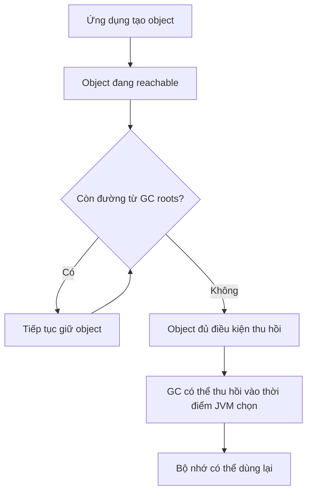

Many collectors are designed around the observation that many objects live only briefly. They may use **generational** collection combined with multiple collection phases. Terms such as *minor GC*, *major GC*, *full GC*, *stop-the-world*, and *concurrent marking* appear in logs and documentation, but **their precise meanings depend on the collector/JDK**.

| Concept | Practical meaning |
|---|---|
| Young generation | Where many new objects are allocated in generational collectors |
| Old generation | Often contains longer-lived objects |
| Stop-the-world (STW) | A phase that pauses application execution for necessary GC work |
| Concurrent GC | Some GC work proceeds alongside application threads |
| Compaction | Moves/consolidates live data to reduce fragmentation |

There is no single “Java GC algorithm.” For example, HotSpot offers collectors such as G1, ZGC, and Parallel GC; selection and behavior depend on JDK version, latency goals, capacity, and configuration. For OOP, focus on **reachability**, **nondeterministic reclamation timing**, and **the fact that GC cannot fix incorrect reference-retention design**.

## 4. GC Cannot Know When Data Has Lost Business Value

An unbounded cache may retain every payload long after it is useful. The objects remain reachable from the map, so the GC **does not consider them garbage**. This is a form of *logical memory leak* in Java applications:

~~~java
static final Map<String, byte[]> payloads = new HashMap<>();

static void remember(String id, byte[] data) {
    payloads.put(id, data);
}
~~~

This example belongs in a class importing `java.util.Map` and `java.util.HashMap`. If new IDs are added without limits, memory may grow with traffic. The fix is a retention policy: TTL, entry count, byte budget, removal of no-longer-needed entries, or an appropriate cache library.

GC may run frequently without reducing retained heap usage if every old object still has a strong-reference path from a root. Diagnose the problem using **heap dumps and retaining paths** rather than GC frequency alone. *Object lifetime, reachability, and memory reclamation* covers registries/caches, listeners, `ThreadLocal`, and tracing GC roots; this lesson focuses on GC mechanics and measurable memory types.

## 5. `null`, `System.gc()`, and `finalize()`: False Expectations

```java
User a = new User("An");
User b = a;

a = null;    // Không xóa object: b vẫn tham chiếu tới nó
// System.gc(); // Không phải cách đảm bảo xóa User
```

- **`a = null`** changes only variable `a`. If `b` or another reference remains, the object is still reachable.
- **`System.gc()`** requests that the JVM make an effort to run GC; it is not a command guaranteeing collection or immediate reclamation of individual objects.
- **`finalize()`** is unsuitable for resource cleanup. Finalization is deprecated for removal and has substantial reliability, security, and performance problems. Avoid it in new code.

There is no need to assign `null` to every local variable before leaving a method. Letting variables leave scope and defining clear object lifecycles is usually enough. Explicitly evicting cache entries, unregistering listeners, or ending long-lived tasks often matters more.

## 6. GC Reclaims Heap Objects; Other Resources Follow Different Contracts

A `FileInputStream` may hold an operating-system file descriptor, while a `Connection` may be managed by a connection pool. Garbage collection of the Java wrapper object **does not guarantee** these resources are returned at the right time.

| Resource to release | Appropriate mechanism | Key point |
|---|---|---|
| Memory of unreachable heap objects | JVM garbage collector | Standard Java cannot call `free(obj)` |
| File/socket/connection | Ownership-based `close()`, often via `try-with-resources` | Closing a resource does not delete the Java object |
| Scoped native/off-heap memory | API contract, such as `Arena.close()` | Follow the JDK version and ownership rules |

~~~java
try (BufferedReader reader = Files.newBufferedReader(path)) {
    System.out.println(reader.readLine());
}
~~~

This example assumes `path` is a valid `java.nio.file.Path` and that `java.io.BufferedReader` and `java.nio.file.Files` are imported. Java invokes `reader.close()` upon leaving the `try` block according to language semantics, including when reading throws an exception. For multiple resource closure, suppressed exceptions, `AutoCloseable`, `Cleaner`, and `finalize()`, see *Resource cleanup and the limits of finalizers* for full explanations and runnable examples.

## 7. When Can Java Explicitly Manage Native Memory?

Ordinary Java heap objects have no `free(object)` operation. But APIs allocating memory outside the heap may require explicit **ownership** and **lifetime** management.

A representative example in **Java 22+** is the Foreign Function & Memory API (FFM), with `Arena` and `MemorySegment`:

```java
import java.lang.foreign.Arena;
import java.lang.foreign.MemorySegment;
import java.lang.foreign.ValueLayout;

public class NativeMemoryDemo {
    public static void main(String[] args) {
        try (Arena arena = Arena.ofConfined()) {
            MemorySegment segment = arena.allocate(16);
            segment.set(ValueLayout.JAVA_INT, 0, 42);

            int number = segment.get(ValueLayout.JAVA_INT, 0);
            System.out.println(number); // 42
        } // close() trên arena giải phóng allocations thuộc arena
    }
}
```

Save as `NativeMemoryDemo.java` and compile/run with **JDK 22 or later**:

```bash
javac NativeMemoryDemo.java
java NativeMemoryDemo
```

Here:

- `arena.allocate(16)` allocates 16 bytes of native memory associated with the arena.
- `MemorySegment` represents a memory region with a defined size and access bounds; it is not an ordinary Java-heap `byte[]`.
- `Arena.ofConfined()` creates an arena with **access restricted to its owning thread**.
- When the `try` block ends, `arena.close()` releases allocations associated with the arena. Subsequent attempts to access an invalidated segment fail according to the API contract.

Version note: the FFM API was standardized in Java 22; earlier JDK releases had incubator/preview variants with different APIs and activation rules, so do not copy the Java 22 example directly into Java 17.

`ByteBuffer.allocateDirect(...)` also supports direct off-heap buffers, but **does not provide a standard `free()` method on ByteBuffer itself** for immediate programmer-controlled release. Do not use reflection or internal APIs to force buffer reclamation; when deterministic native-memory lifecycles are needed, choose an API with an explicit lifecycle contract such as FFM `Arena`, or a library designed for that purpose.

## 8. Out-of-Memory Errors Are Not Always Heap Leaks

Examples of causes to distinguish:

| Symptom or error | Possible cause | What to inspect |
|---|---|---|
| `OutOfMemoryError: Java heap space` | Heap cannot satisfy an allocation | Live objects, caches/lists, heap limits |
| `OutOfMemoryError: Metaspace` | Class metadata occupies too much native memory | Dynamic class loading, class-loader leaks |
| `OutOfMemoryError: Direct buffer memory` | Direct-buffer memory limit reached | Number and lifetime of direct buffers |
| Cannot create another native thread | Thread/native-resource exhaustion or OS limits | Thread count, thread pools, stack sizes |
| Process RSS grows while the heap is stable | Native memory, stacks, mmap, other regions | Native-memory metrics/profilers |

Exact error messages depend on the JVM, version, and failure mode; this table provides **investigation guidance**, not a definitive diagnosis.

Possible issues include:

- **Memory leak:** data is retained indefinitely and grows over time.
- **Normal memory pressure:** the application handles large data batches with a heap too small for the load; the GC can still reclaim memory.
- **Excess allocation:** too many short-lived objects increase GC frequency and CPU use.
- **Native resource leak:** file descriptors, sockets, direct/native memory, or threads are retained too long.

Do not conclude that “GC is broken” merely because process RAM grows. The JVM may **retain previously committed heap memory** for reuse; committed heap space need not be returned to the OS immediately after GC.

## 9. Monitoring Memory and GC in Real Environments

Example using a modern HotSpot/JDK:

```bash
# Chạy chương trình với giới hạn heap rõ ràng (ví dụ 256 MiB).
java -Xms64m -Xmx256m -Xlog:gc* -cp . MyApp

# Xem danh sách tiến trình Java.
jcmd -l

# Kiểm tra thông tin heap của process đang chạy.
jcmd <pid> GC.heap_info

# Thống kê loại đối tượng đang tồn tại.
jcmd <pid> GC.class_histogram

# Kiểm tra Native Memory Tracking nếu đã bật lúc khởi động.
jcmd <pid> VM.native_memory summary
```

`<pid>` is the actual process ID and must be replaced in the commands. `-Xmx` sets the **Java heap** limit; it is not a limit on total process RAM because native memory, thread stacks, metaspace, code cache, and other regions also consume memory.

To collect native-memory statistics using Native Memory Tracking (NMT) on HotSpot, enable it at startup:

```bash
java -XX:NativeMemoryTracking=summary -Xmx256m -cp . MyApp
```

Then run `jcmd <pid> VM.native_memory summary`. NMT may not account for all memory allocated by native libraries outside the JVM's tracking scope.

Other useful tools include **Java Flight Recorder (JFR)** for allocation and GC analysis, **VisualVM** for heap and reference inspection, and **heap dumps** for identifying retention paths and dominators. Heap dumps and class histograms can be costly or pause large systems, so collect them deliberately in suitable environments.

### Investigating a Suspected Leak, Step by Step

1. Measure heap use **after GC** over time at comparable traffic/load and object counts.
2. If live-object usage keeps growing, capture a heap dump or allocation profile at an appropriate time.
3. Inspect **retained size** and GC-root reference paths for memory-heavy objects.
4. Identify retaining structures: collections, singletons, caches, `ThreadLocal`, listeners, queues, and so on.
5. Fix lifecycle and data-bounding rules; retest under comparable load.

Increasing `-Xmx` may be necessary for legitimate load, but **does not fix the cause of a leak** if the program retains ever more data.

## 10. OOP Design Principles for Memory Management

- **Define resource ownership:** the class opening a file or owning a socket/connection needs clear transfer or closing rules.
- **Use `try-with-resources` for `AutoCloseable` resources:** scope-based closing is the default choice when appropriate.
- **Limit data lifetime:** caches, listeners, queues, and sessions need expiration/removal policies.
- **Do not put short-lived objects into excessively long-lived scopes:** a `static` field can retain a large reference graph.
- **Avoid keeping unnecessarily large object graphs:** removing a collection entry makes an object GC-eligible only if no other path reaches it.
- **Understand optimization goals:** many small short-lived objects are not automatically a problem; measure before optimizing.
- **Consider both heap and native memory:** GC addresses only part of resource management.

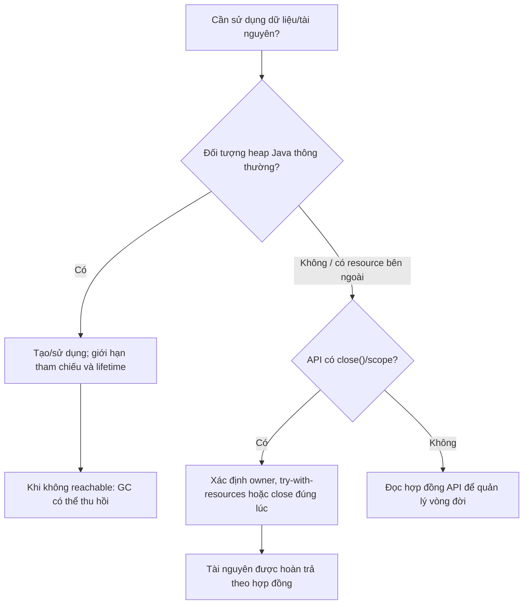

## 11. Exercises and Self-Check Questions

**Exercise 1 — reachability.** Draw reference paths from a `static Map<String, User>` to `User` objects. If a local variable becomes `null` but the `Map` still contains a `User`, can the GC collect that object? Explain using GC roots.

**Exercise 2 — reference cycles.** Create two `Node` objects pointing to each other. When neither is reachable from any GC root, does the cycle keep them alive forever?

**Exercise 3 — detecting leaks.** Change an unbounded `RequestHistory` into a cache that retains only the 50 most recent entries. Verify `size()` stays at or below 50 after 10,000 calls to `record`.

**Exercise 4 — manual management.** Write a `ReportWriter` class that owns a `BufferedWriter`, implements `AutoCloseable`, and is used inside `try-with-resources`. If construction or writing throws an exception, which resources must be closed, and who owns them?

**Exercise 5 — diagnosis.** A service has stable heap usage but increasing process RSS. List at least three areas to examine outside the heap. Why is inspecting only `-Xmx` insufficient?

### Quick Self-Check

| Statement | True/False | Explanation |
|---|---|---|
| A Java object is immediately destroyed when a local variable leaves scope | **False** | GC timing is nondeterministic; other references may remain |
| Objects in a reference cycle can never be collected | **False** | Reachability from GC roots is what matters |
| `System.gc()` guarantees immediate reclamation of an object | **False** | It merely makes a request to the JVM |
| The GC automatically closes files and sockets at the desired time | **False** | Requires closing and ownership contracts |
| An ever-growing `static List` can cause a memory leak | **True** | Its elements remain reachable |
| `try-with-resources` invokes `close()` even if the `try` body fails | **True** | This is defined by Java language syntax |

**Remember:** For Java heap memory, manage **references and usage lifecycles**, letting the GC decide when to reclaim unreachable objects. For files, sockets, database connections, and owned native-memory regions, **close or release them according to API contracts**. Distinguishing these responsibilities is fundamental to long-running Java applications.


</details>

- [Back to top](#back-to-top)

---

## <a id="lifecycle-008">Resource cleanup and the limits of finalizers</a>

<details>
<summary>View details</summary>

# Resource Cleanup and the Limits of Finalizers in Java

In Java, the JVM allocates and manages memory for **objects**, but many objects also represent **resources that must be released promptly**: open files, database connections, sockets, input/output streams, off-heap memory, or objects holding locks. Therefore, distinguish two activities:

- **Reclaiming object memory:** the garbage collector (GC) handles this when an object becomes unreachable under JVM rules.
- **Closing resources owned by an object:** the application must explicitly release them when finished, usually with `close()` and `try-with-resources`.

**Key message:** Java has no automatically invoked, deterministic *destructor* equivalent to C++ destructors. The old `finalize()` mechanism is unreliable for closing resources and is marked **deprecated for removal**; new Java code should avoid it.

## 1. Why Can't Garbage Collection Replace Resource Cleanup?

Consider reading a file:

```java
BufferedReader reader = Files.newBufferedReader(path);
String line = reader.readLine();
// Không đóng reader
```

The `reader` variable references a Java object, while `BufferedReader` indirectly uses operating-system resources associated with the file. When the variable is no longer used, the JVM **does not guarantee** immediate closure. Repeatedly opening files without calling `close()` can exhaust file descriptors or cause subsequent file opens to fail.

| Managed item | Example | Who is primarily responsible? | When is it released? |
| --- | --- | --- | --- |
| Java heap memory | `Customer`, `StringBuilder` objects | JVM/GC | When the JVM decides to collect unreachable objects |
| File resource | `BufferedReader`, `FileInputStream` | The code using it and the resource-owning API class | Explicitly via `close()`, ideally immediately after use |
| Database connection | JDBC `Connection`, `PreparedStatement`, `ResultSet` | Application code in coordination with driver/pool | Close at scope end; `Connection.close()` may return it to the pool |
| Network socket | `Socket` and related streams | Connection owner | Close after communication or when the request is canceled |
| Executor/thread | Executor and tasks | Component managing the lifecycle | Shut down using the appropriate API and await completion as needed; details vary by Java version |

An object may become unreferenced by business code while its OS resource has not yet been closed promptly. Conversely, a Java object **may still exist** after closing its resource and remain accessible for checking state.

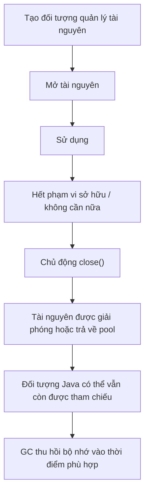

The diagram illustrates the intended lifecycle. Calling `close()` can fail, and some resources have specialized semantics; successful closure must follow the specific API contract.

## 2. Standard Approach: `try-with-resources`

Since Java 7, `try-with-resources` automatically calls `close()` on resources declared inside `try (...)` when the block exits, including when the `try` body throws an exception.

```java
import java.io.BufferedReader;
import java.io.IOException;
import java.nio.charset.StandardCharsets;
import java.nio.file.Files;
import java.nio.file.Path;

class ReaderExample {
    static String readFirstLine(Path path) throws IOException {
        try (BufferedReader reader =
                 Files.newBufferedReader(path, StandardCharsets.UTF_8)) {
            return reader.readLine();
        } // reader.close() được gọi khi rời khối try
    }
}
```

`BufferedReader` is closeable. Once `readLine()` completes, a `return` statement does not skip cleanup; Java still invokes `close()` before the method actually returns its result to the caller.

If `Files.newBufferedReader(...)` cannot open a file, resource construction throws and no successfully initialized `reader` exists to close. If opening succeeds but reading fails, `try-with-resources` still performs cleanup.

**Rule:** Resources declared in `try (...)` must implement `AutoCloseable` (or `Closeable`, which extends `AutoCloseable`).

## 3. Complete Example: Managing Resource Lifecycles

The following example shows two behaviors: custom resources close **in reverse initialization order**, and file reading/writing streams close immediately after use.

Put all the code into **`Main.java`** and use Java 17 or Java 21:

```java
import java.io.BufferedReader;
import java.io.BufferedWriter;
import java.io.IOException;
import java.nio.charset.StandardCharsets;
import java.nio.file.Files;
import java.nio.file.Path;
import java.util.Objects;

public class Main {
    static final class Session implements AutoCloseable {
        private final String name;
        private boolean closed;

        Session(String name) {
            this.name = Objects.requireNonNull(name, "name");
            System.out.println("Mở " + name);
        }

        void use() {
            if (closed) {
                throw new IllegalStateException("Session đã đóng");
            }
            System.out.println("Dùng " + name);
        }

        @Override
        public void close() {
            // Đây là lựa chọn thiết kế của Session, không phải
            // lời bảo đảm áp dụng cho mọi AutoCloseable.
            if (closed) {
                return;
            }
            closed = true;
            System.out.println("Đóng " + name);
        }
    }

    public static void main(String[] args) throws IOException {
        try (Session first = new Session("A");
             Session second = new Session("B")) {
            first.use();
            second.use();
        }

        Path file = Files.createTempFile("oop-resource-", ".txt");
        try {
            try (BufferedWriter writer = Files.newBufferedWriter(
                    file, StandardCharsets.UTF_8)) {
                writer.write("Xin chào Java");
            }

            try (BufferedReader reader = Files.newBufferedReader(
                    file, StandardCharsets.UTF_8)) {
                System.out.println(reader.readLine());
            }
        } finally {
            // File tạm cũng là một tài nguyên tồn tại trên đĩa:
            // xóa khi không cần nữa, dù có lỗi đọc/ghi.
            Files.deleteIfExists(file);
        }
    }
}
```

Run:

```bash
javac Main.java
java Main
```

Output:

```text
Mở A
Mở B
Dùng A
Dùng B
Đóng B
Đóng A
Xin chào Java
```

**What happens?**

1. `Session("A")` is created first, followed by `Session("B")`.
2. Inside the `try` body, the program uses both resources.
3. When the block ends, Java automatically invokes `second.close()` before `first.close()`.
4. For the file example, the writer closes before the reader starts. After reading, the reader closes; `finally` deletes the temporary file.
5. `Session.use()` prevents operations after the resource has closed.

`Files.deleteIfExists(file)` can itself throw `IOException`; in a real application, decide how to report deletion failures, especially if an earlier read/write failure already occurred. This illustrates separate ownership scopes: **closing I/O streams** and **deleting a temporary file path** are different responsibilities.

## 4. `AutoCloseable` and `Closeable`

Two commonly used interfaces:

```java
public interface AutoCloseable {
    void close() throws Exception;
}
```

```java
public interface Closeable extends AutoCloseable {
    void close() throws java.io.IOException;
}
```

| Criterion | `AutoCloseable` | `Closeable` |
| --- | --- | --- |
| Purpose | General contract for resources that must be closed | Contract for closing I/O resources |
| Declared exception in `close()` | `Exception` | `IOException` |
| Usable in `try-with-resources`? | Yes | Yes |
| Repeated closing | Not universally guaranteed safe for every implementation | The `Closeable` contract says closing an already-closed resource has no effect |
| Examples | `java.sql.Connection`, custom lock or transaction-scope objects | `BufferedReader`, `InputStream`, `OutputStream` |

When implementing your own class, `close()` can declare no `throws` clause or a narrower exception type. For example, `Session.close()` above does not throw a checked exception.

**Idempotence note:** It is often useful to design a custom `close()` that is safe to invoke repeatedly, but `AutoCloseable` **does not require** every implementation to be idempotent. Never assume repeated closing or post-close reuse is always supported.

## 5. What Does `try-with-resources` Guarantee?

Two behaviors are especially important:

### 5.1. Closing in Reverse Order

```java
try (Resource a = openA();
     Resource b = openB();
     Resource c = openC()) {
    process(a, b, c);
}
```

Java closes resources in the order `c`, `b`, `a`. If initializing `b` fails, the already-created `a` still closes; `c` has not been created.

This is especially useful for dependent resources, such as a `ResultSet` using a `PreparedStatement` built from a `Connection`.

### 5.2. Closing Exceptions Can Be *Suppressed*

Suppose both processing and cleanup throw errors. Java must preserve the main failure instead of letting a closing error obscure it.

Save this standalone example as **`SuppressedDemo.java`**:

```java
import java.io.IOException;

public class SuppressedDemo {
    static final class FailingResource implements AutoCloseable {
        @Override
        public void close() throws IOException {
            throw new IOException("Lỗi khi đóng");
        }
    }

    public static void main(String[] args) {
        try (FailingResource resource = new FailingResource()) {
            throw new IllegalStateException("Lỗi xử lý");
        } catch (Exception ex) {
            System.out.println("Chính: " + ex.getMessage());
            for (Throwable suppressed : ex.getSuppressed()) {
                System.out.println("Kèm theo: " + suppressed.getMessage());
            }
        }
    }
}
```

Output:

```text
Chính: Lỗi xử lý
Kèm theo: Lỗi khi đóng
```

With `try-with-resources`, an exception from the `try` body is primary, and a `close()` failure is attached through `getSuppressed()`. If the `try` body succeeds but `close()` fails, the closing exception may be thrown directly.

Do not casually ignore closing errors: some APIs detect write/flush failures only during close. When logging, consider the primary exception and any suppressed exceptions to preserve diagnostic information.

## 6. Why Not Use `finalize()` as a Destructor?

Some older documentation shows a class overriding `protected void finalize() throws Throwable` from `Object`. This mechanism, called **finalization**, was once viewed as a way to perform work before object memory was reclaimed.

Avoid this in modern Java:

- You cannot know exactly **when** the JVM may run a finalizer.
- A finalizer is not guaranteed to run before the program exits; some objects may never be finalized.
- Finalizers may run on threads outside application control, complicating synchronization and error handling.
- Retaining or “resurrecting” references from a finalizer complicates lifecycles and risks performance, security, and correctness.
- `Object.finalize()` and finalization have been **deprecated for removal** in modern Java releases (JEP 421). This feature may be disabled or removed in the future.

In particular, **`System.gc()` is only a request or hint to the JVM**, not a promise of immediate collection, and certainly not a method for closing files, sockets, or connections. Never call `System.gc()` to try to force a finalizer to run.

| Mechanism | Purpose | Predictable timing? | Suitable for primary resource closure? |
| --- | --- | --- | --- |
| `try-with-resources` | Closes `AutoCloseable` on scope exit | Yes, during normal control flow or exception propagation | **Yes: preferred** |
| Explicit `close()` | Closes according to business logic | Yes, at the call | Yes, if exceptions and ownership are handled |
| `finally` | Always attempts cleanup on leaving a block | During Java control flow, except abnormal process/JVM termination | Yes, when manual cleanup is needed |
| `Cleaner` | Backup cleanup dependent on GC | No | Only as a suitable fallback, not a replacement for explicit close |
| `finalize()` | Legacy finalization mechanism | No | **Not for new code** |
| GC | Manages heap memory | No | Not a mechanism for closing business resources |

**No mechanism guarantees arbitrary Java cleanup code runs if the process is abruptly killed, power is lost, or the JVM crashes.** Therefore, most resources should be closed early at controlled business boundaries.

## 7. Is `Cleaner` a New Destructor?

`java.lang.ref.Cleaner` lets code register a cleanup action for when an object becomes eligible for collection. It can help in **certain advanced designs**, usually as a fallback for native resources that an application forgot to close.

But `Cleaner` **does not make cleanup deterministic**:

1. You cannot predict exactly when the GC will make an object eligible for cleanup.
2. Do not assume cleanup runs promptly or before process exit.
3. If the cleanup action accidentally holds a strong reference to the target object, it can prevent that object from becoming eligible for collection.
4. Cleanup code runs in a different context from business logic and needs appropriate thread-safety and exception handling.

The right model is to keep a public `close()` API for caller-controlled release; `Cleaner` is only a **fallback safety net** and should be added when genuinely needed. For ordinary JDBC connections, files, and sockets, `try-with-resources` is simpler and clearer.

## 8. Who Owns a Resource, and Who Must Close It?

A common bug is seeing that an object implements `AutoCloseable` and closing it without checking ownership.

**Ownership principle:** The component that **creates or assumes ownership** of a resource must close it at the end of the agreed usage scope. A component that only **borrows** a resource generally does not close it unless the API contract explicitly says so.

For example:

```java
class TextService {
    // Chỉ mượn reader từ caller, không nhận ownership.
    static String readOneLine(java.io.BufferedReader reader)
            throws java.io.IOException {
        return reader.readLine();
    }
}
```

The caller decides the scope:

```java
try (BufferedReader reader = Files.newBufferedReader(path)) {
    String line = TextService.readOneLine(reader);
    // Có thể tiếp tục sử dụng reader nếu cần.
}
```

If `readOneLine()` closes the reader itself, the caller will be surprised to find it can no longer read additional data.

Frameworks also coordinate resource lifecycles: for example, request, transaction, or bean resources managed by a framework may need to be closed by the container at the prescribed time. Manually calling `close()` on a container-managed resource can cause failures elsewhere. Follow the contract for the specific resource type.

## 9. Closing JDBC Connections and Nested Resources

This JDBC example illustrates the structure; running it requires a `DataSource`, a `students` table, and actual application data.

```java
import java.sql.Connection;
import java.sql.PreparedStatement;
import java.sql.ResultSet;
import java.sql.SQLException;
import javax.sql.DataSource;

class StudentRepository {
    private final DataSource dataSource;

    StudentRepository(DataSource dataSource) {
        this.dataSource = dataSource;
    }

    String findName(long id) throws SQLException {
        String sql = "SELECT name FROM students WHERE id = ?";

        try (Connection connection = dataSource.getConnection();
             PreparedStatement statement =
                 connection.prepareStatement(sql)) {
            statement.setLong(1, id);

            try (ResultSet rs = statement.executeQuery()) {
                return rs.next() ? rs.getString("name") : null;
            }
        }
    }
}
```

The connection scope is the outer `try` block. The `ResultSet` closes when the inner block finishes; then the statement and connection close when the outer block exits.

With connection pooling, `Connection.close()` usually **returns the connection to the pool** instead of immediately closing the physical TCP connection. Omitting `close()` can exhaust a connection pool even while GC operates normally.

When transactions require `commit()` or `rollback()`, **closing a connection is no substitute for proper transaction management**. Follow the driver, pool, or transaction-manager contract.

## 10. Implementing a Useful `AutoCloseable` Class

A resource-owning class should clearly define its open and closed states. Consider a wrapper around `BufferedReader`:

```java
import java.io.BufferedReader;
import java.io.IOException;
import java.nio.charset.StandardCharsets;
import java.nio.file.Files;
import java.nio.file.Path;

final class LineSource implements AutoCloseable {
    private final BufferedReader reader;
    private boolean closed;

    LineSource(Path path) throws IOException {
        this.reader = Files.newBufferedReader(
            path, StandardCharsets.UTF_8);
    }

    String nextLine() throws IOException {
        if (closed) {
            throw new IllegalStateException("LineSource đã đóng");
        }
        return reader.readLine();
    }

    @Override
    public void close() throws IOException {
        if (!closed) {
            // Đặt closed trước khi gọi xuống tài nguyên
            // để chặn thao tác qua wrapper sau yêu cầu đóng.
            closed = true;
            reader.close();
        }
    }
}
```

The caller uses it like this:

```java
try (LineSource source = new LineSource(path)) {
    String line;
    while ((line = source.nextLine()) != null) {
        System.out.println(line);
    }
}
```

This design suits **sequential** use. The `closed` field does not make the API thread-safe; concurrent calls to `nextLine()` and `close()` require synchronization or an explicit statement that concurrent use is unsupported.

When `close()` can fail, define whether retrying closure is allowed and what state follows an error. Here, the wrapper becomes **unusable** as soon as closing begins; this is a deliberate design choice, not a universal resource rule.

A `close()` call does not imply that the resource can be reused afterward. Many streams/sockets cannot be reopened on the same instance; using them again often requires **creating a new resource object**.

## 11. `finally` Versus `try-with-resources`

Before Java 7, cleanup code was commonly placed in `finally`:

```java
BufferedReader reader = null;
try {
    reader = Files.newBufferedReader(path);
    System.out.println(reader.readLine());
} finally {
    if (reader != null) {
        reader.close();
    }
}
```

This snippet illustrates manual cleanup syntax and must be placed in a method that declares or handles `IOException`. It is short but error-prone with multiple resources: you might forget a `null` check, miss closing a resource, or let a closing error hide the processing error.

For objects implementing `AutoCloseable`, prefer:

```java
try (BufferedReader reader = Files.newBufferedReader(path)) {
    System.out.println(reader.readLine());
}
```

Nevertheless, `finally` **remains useful** for cleanup actions outside the `AutoCloseable` contract, such as deleting a temporary file, restoring state, or releasing a lock through a special API. In all cases, do not assume `finally` runs despite every possible failure outside the JVM.

## 12. Common Mistakes

| Mistake | Possible consequence | Appropriate approach |
| --- | --- | --- |
| Forgetting `close()` and waiting for GC | Resources stay open; handles/pool are exhausted | `try-with-resources` |
| Overriding `finalize()` to close sockets/files | Unpredictable cleanup timing | Avoid finalization; use `close()` |
| Calling `System.gc()` after each request | No resource-closing guarantee; performance impact | Manage lifecycles explicitly |
| Closing a resource that is only borrowed | The caller cannot continue using it | Agree on ownership contracts |
| Closing only after success | Exceptions leave resources open | `try-with-resources` or suitable `finally` cleanup |
| Ignoring a failed `close()` | Missed flush/write/state-transition errors | Log errors and inspect `getSuppressed()` when needed |
| Assuming `close()` always supports repeated calls | Some APIs do not | Read resource contracts; design wrappers explicitly |
| Using a resource after closing it | `IOException` or `IllegalStateException`, depending on the API | Enforce state and valid usage scopes |
| Manually closing a transaction-manager-controlled connection | Broken transaction lifecycle | Let the container manage it according to contract |
| Assuming `Cleaner` runs before shutdown | Cleanup may be delayed or skipped | Use Cleaner only as a fallback |

## 13. Self-Check Exercises

**Question 1.** Which approach is better for a file opened inside a short method?

```java
// A
BufferedReader reader = Files.newBufferedReader(path);
return reader.readLine();

// B
try (BufferedReader reader = Files.newBufferedReader(path)) {
    return reader.readLine();
}
```

**Answer:** **B**. Java still invokes `close()` upon `return` or an exception after successful resource opening.

**Question 2.** Two resources are opened as `A`, then `B`, in the same `try (...)` declaration. In what order do they close?

**Answer:** **B then A**, because `try-with-resources` closes resources in reverse order.

**Question 3.** The `try` body throws `IllegalStateException` and `close()` throws `IOException`. Which exception is normally primary?

**Answer:** The exception from the `try` body is primary; the `close()` failure is stored by `getSuppressed()`.

**Question 4.** A pooled `Connection` has `close()` called on it. Must the physical TCP connection to the database close immediately?

**Answer:** **No.** In a pool, `close()` typically returns the connection for reuse by other requests; callers must still release their claim on it.

**Question 5.** When the GC reclaims a Java object, can we conclude that a file descriptor it once held was closed on time?

**Answer:** **No.** Resources outside heap memory require explicit cleanup; GC timing cannot be relied upon.

**Question 6.** Should `finalize()` or `Cleaner` be the primary cleanup step for network connections?

**Answer:** **No.** Prefer explicit ownership contracts, `AutoCloseable.close()`, and `try-with-resources`. `Cleaner` can be a fallback in appropriate cases, while `finalize()` should not be used in new code.

**Remember:** The GC manages **object memory**, while `close()` manages **resources with business lifecycles**. A well-designed resource-owning class defines ownership, closing time, error handling, and post-close behavior. In modern Java, use `try-with-resources` whenever an API supports `AutoCloseable`, rather than expecting a “destructor” or GC to handle it.


</details>

- [Back to top](#back-to-top)

---

## <a id="lifecycle-009">Preventing the use of incompletely initialized objects</a>

<details>
<summary>View details</summary>

# Preventing the Use of Incompletely Initialized Objects in Java

In Java, a **constructor** establishes an object's initial state. If a reference to that object becomes externally accessible **before its constructor and the related initialization chain complete**, other code may invoke methods or read fields while the object is still partially initialized. This is commonly called **this escape** (*the `this` reference escapes during construction*).

This problem is not limited to multithreaded programs. A callback invoked immediately during listener registration can use the object too early on the same thread. Multithreaded failures are even harder to reproduce because execution timing and visibility of data across threads vary.

This lesson explains the failure scenarios, their causes, and how to design objects so they are used only when ready.

## 1. What Stages Does an Object Go Through?

During `new SomeClass(...)`, the JVM and Java language initialize the object according to Java's rules: setting default field values, executing the superclass constructor chain, running each class's field and instance initializers in the appropriate order, and executing constructor bodies.

Remember: **an object may already exist even though its constructor has not finished**. A reference to it can escape at this stage, for example through `this`.

Suppose we have this class:

```java
public final class Session {
    private final String sessionId;
    private final String owner;

    public Session(String sessionId, String owner) {
        this.sessionId = sessionId;
        this.owner = owner;
    }

    public String displayName() {
        return sessionId + " - " + owner;
    }
}
```

In ordinary use, the caller receives a reference from `new Session(...)` **only after the constructor completes successfully**. However, the constructor can leak `this` by storing it elsewhere or passing it to a callback.

### Two Distinct Risks

| Risk | What happens? | Example |
|---|---|---|
| **Premature use** | Other code accesses an object before initialization finishes | A listener is invoked immediately during registration from its constructor |
| **Unsafe publication** | Another thread receives a reference without a suitable synchronization relationship, so state visibility may not be guaranteed | Assigning the object to an ordinary shared field, then allowing another thread to read it without synchronization |

These risks are related but different. Even when reference publication is synchronized, **publishing an object before initialization finishes still allows other code to use an incomplete object**.

## 2. What Is This Escape?

Inside instance methods and constructors, `this` refers to the current object. **This escape** occurs when a reference to the object becomes accessible somewhere that can use it before construction completes.

Common ways `this` escapes include:

- Registering a listener or callback with an event bus, registry, or shared service inside a constructor.
- Storing `this` in a `static` field or a collection accessible to another component.
- Passing `this` to uncontrolled code, especially code that may invoke callbacks or retain the reference.
- Starting a thread or asynchronous task that uses `this` from a constructor.
- Exposing a lambda, method reference, or inner-class instance that captures `this`.

Passing `this` to a controlled internal helper that neither retains nor publishes the reference **does not necessarily** cause this escape. The critical question is whether the reference can be used outside the initialization boundary too early.

## 3. Deterministic Failure Example: Registering a Callback Too Early

The following example deliberately simulates a registry invoking a callback **during registration**. No extra thread is involved, so the failure is predictable.

File `UnsafeListenerDemo.java`:

```java
public class UnsafeListenerDemo {
    interface Listener {
        void onEvent();
    }

    static class EventRegistry {
        void register(Listener listener) {
            listener.onEvent(); // Callback chạy đồng bộ ngay lúc đăng ký
        }
    }

    static class ReportListener {
        private final String reportName;

        ReportListener(EventRegistry registry) {
            registry.register(this::onEvent);
            this.reportName = "Báo cáo tháng";
        }

        private void onEvent() {
            System.out.println("Tên báo cáo: " + reportName);
        }
    }

    public static void main(String[] args) {
        new ReportListener(new EventRegistry());
    }
}
```

Output:

```text
Tên báo cáo: null
```

Although `reportName` is declared `final` and assigned in the constructor, the callback runs **before the assignment**. At that point, the reference field still has its default value, `null`. If `onEvent()` invokes `reportName.length()`, the program throws `NullPointerException`.

The `final` keyword is not the problem; the problem is calling code that can observe the object before valid state has been established.

### Failure Sequence

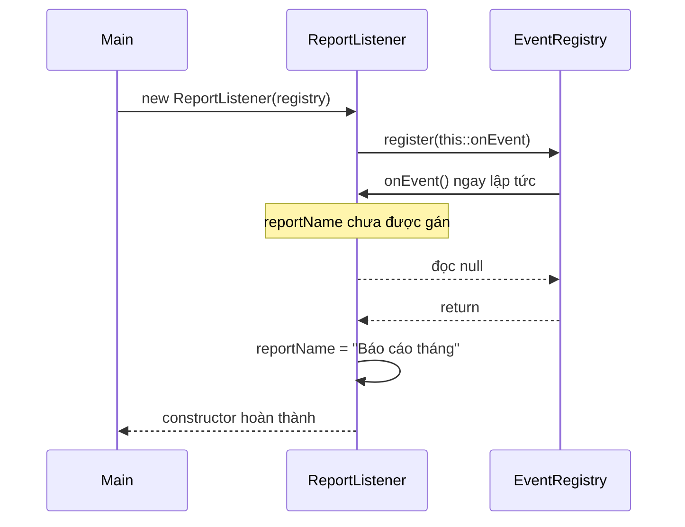

Some libraries only store listeners and do not invoke callbacks immediately, but a risk remains if another thread publishes an event before the constructor finishes. Do not rely on an assumption that “the listener will not be called yet” unless the API guarantees it.

## 4. Fix: Finish Construction Before Registration

A clear design **separates state initialization from exposing the object to external systems**.

For example, use a static factory so callers receive the object only after creation and registration steps are complete:

```java
import java.util.Objects;

public final class SafeListenerDemo {
    interface Listener {
        void onEvent();
    }

    static class EventRegistry {
        void register(Listener listener) {
            listener.onEvent(); // Cố ý gọi ngay để kiểm chứng
        }
    }

    static final class ReportListener {
        private final String reportName;

        private ReportListener(String reportName) {
            this.reportName = Objects.requireNonNull(reportName);
            if (reportName.isBlank()) {
                throw new IllegalArgumentException("Tên báo cáo không được rỗng");
            }
        }

        static ReportListener createAndRegister(
                EventRegistry registry, String reportName) {
            Objects.requireNonNull(registry);

            ReportListener listener = new ReportListener(reportName);
            registry.register(listener::onEvent);
            return listener;
        }

        private void onEvent() {
            System.out.println("Tên báo cáo: " + reportName);
        }
    }

    public static void main(String[] args) {
        ReportListener listener = ReportListener.createAndRegister(
            new EventRegistry(), "Báo cáo tháng"
        );
        // Callback in: Tên báo cáo: Báo cáo tháng
    }
}
```

When `registry.register(...)` runs, the `ReportListener(String)` constructor has **returned successfully** and the object is valid. Even a synchronous callback from `register` sees the correct report name.

This pattern works well for attaching objects to an event bus, message handler, cache, scheduler, or plugin system.

**Registration failure note:** If `register` throws an exception, the factory does not return successfully. However, the registry might have stored the listener before throwing. Real systems must specify whether registration is atomic, how to unregister, and how to handle rollback or cleanup.

### What If a Separate Activation Step Is Required?

You can design a two-phase process:

```java
final class Consumer {
    private final String id;
    private boolean activated;

    Consumer(String id) {
        if (id == null || id.isBlank()) {
            throw new IllegalArgumentException("id không hợp lệ");
        }
        this.id = id;
    }

    void activate(EventRegistry registry) {
        if (activated) {
            throw new IllegalStateException("Đã activate");
        }
        // Chỉ đăng ký sau khi constructor hoàn thành.
        registry.register(() -> System.out.println(id));
        activated = true;
    }
}
```

The example above separates the two phases in a **sequential calling environment**. Its API is not thread-safe: if `activate` can be called concurrently or `register` invokes a reentrant callback, state/locking and failure handling need further design. A factory usually reduces the chance that callers forget to invoke `activate`.

## 5. Do Not Call Overridable Methods from Constructors

Another cause of premature use is **dynamic dispatch** while a superclass constructor is still executing. Java can invoke a subclass override **before the subclass's field initializers and constructor have finished**.

A standalone example:

```java
public class OverrideDuringConstruction {
    static class Parent {
        Parent() {
            printStatus(); // Nguy hiểm: phương thức có thể override
        }

        void printStatus() {
            System.out.println("Parent initialized");
        }
    }

    static class Child extends Parent {
        private String label = "Ready";

        Child() {
            System.out.println("Child constructor");
        }

        @Override
        void printStatus() {
            System.out.println("Child label = " + label);
        }
    }

    public static void main(String[] args) {
        new Child();
    }
}
```

Output:

```text
Child label = null
Child constructor
```

Why? During `new Child()`:

1. Instance fields receive default values (`label` is `null`).
2. The superclass constructor `Parent()` runs.
3. The `printStatus()` call is dynamically dispatched to `Child.printStatus()`.
4. The field initializer `label = "Ready"` of `Child` **has not run yet**.
5. The subclass-specific initialization in `Child` happens only after the superclass constructor finishes.

The important execution order can be visualized as follows:

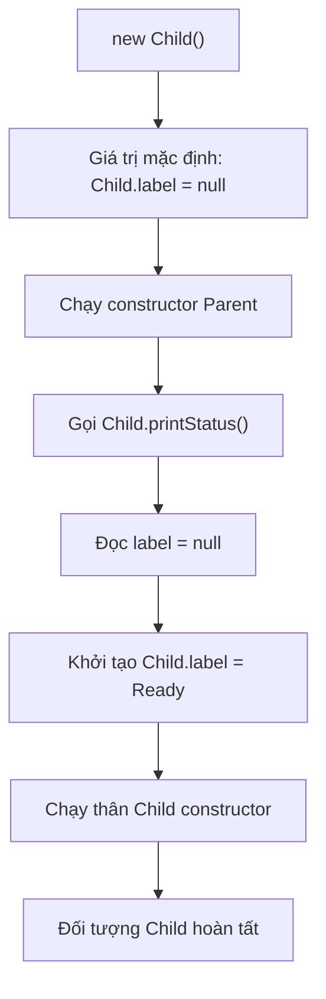

### A Safer Design

- In constructors, invoke appropriate **`private`, `final`, or `static`** methods when you need to prevent subclass overrides from changing the initialization flow. `private` methods cannot be overridden; `final` methods prohibit overriding.
- Better still, validate inputs and establish required state directly through non-overridable helpers.
- If logic depends on subclass data, run it **after all constructors have completed**, through a caller-invoked method or a factory controlling the lifecycle.

For example:

```java
class Parent {
    private final String id;

    Parent(String id) {
        this.id = validate(id);
    }

    private static String validate(String id) {
        if (id == null || id.isBlank()) {
            throw new IllegalArgumentException("id không hợp lệ");
        }
        return id;
    }

    public final String getId() {
        return id;
    }
}

final class Child extends Parent {
    private final String label;

    Child(String id, String label) {
        super(id);
        this.label = java.util.Objects.requireNonNull(label);
    }

    void printStatus() {
        System.out.println(getId() + ": " + label);
    }
}

// Dùng sau khi khởi tạo hoàn tất:
Child child = new Child("C01", "Ready");
child.printStatus(); // C01: Ready
```

In this example, the superclass constructor does not invoke a method that subclasses can override; `printStatus()` runs only after `new Child(...)` completes.

## 6. Do Not Start a Thread That Uses this Inside a Constructor

A particularly dangerous mistake:

```java
class UnsafeWorker {
    private int threshold;

    UnsafeWorker() {
        new Thread(() -> System.out.println(threshold)).start();
        threshold = 10;
    }
}
```

The lambda captures an instance field, and therefore retains a reference to `this`. After `Thread.start()`, the new thread **may** run before the assignment `threshold = 10`, so it may print `0`; the result depends on scheduling. Repeated runs that always print `10` **do not prove the program is correct**.

The *happens-before* relationship from actions performed by the calling thread **before** `Thread.start()` to actions in the new thread does not guarantee that an assignment performed **after** `start()` happens before the worker reads it.

### Finish Construction Before Starting the Thread

A suitable design for background work:

```java
public final class SafeWorker {
    private final int threshold;
    private final Thread thread;

    private SafeWorker(int threshold) {
        if (threshold <= 0) {
            throw new IllegalArgumentException("threshold phải dương");
        }
        this.threshold = threshold;
        this.thread = new Thread(this::runTask, "safe-worker");
    }

    public static SafeWorker createAndStart(int threshold) {
        SafeWorker worker = new SafeWorker(threshold);
        worker.thread.start();
        return worker;
    }

    private void runTask() {
        System.out.println("Threshold = " + threshold);
    }

    public static void main(String[] args) {
        SafeWorker.createAndStart(10);
    }
}
```

When `start()` is invoked, the `SafeWorker` constructor has already returned and all fields have been initialized. Actions before `Thread.start()` *happen-before* actions in the new thread, so the thread cannot run before initialization is complete in this example.

That does not automatically make all subsequent access thread-safe. If threads read or write **shared mutable state**, suitable synchronization is still required.

In real applications, consider using **`ExecutorService`** to manage work, including lifecycle-aware shutdown and cancellation. The principle remains: **submit tasks that reference the object only after its constructor returns**, and explicitly manage resource cleanup.

## 7. Constructor Exceptions and Partially Initialized Objects

A constructor may throw an exception while validating input:

```java
public final class EmailAddress {
    private final String value;

    public EmailAddress(String value) {
        if (value == null || !value.contains("@")) {
            throw new IllegalArgumentException("Email không hợp lệ");
        }
        this.value = value;
    }

    public String value() {
        return value;
    }
}
```

If `new EmailAddress("invalid")` throws, the creation expression does not return a valid reference to the caller during normal execution.

However, if a constructor **stores `this` in a shared variable before throwing**, a reference to the partially initialized object can remain outside the constructor:

```java
import java.util.ArrayList;
import java.util.List;

class UnsafeRegistration {
    static final List<UnsafeRegistration> REGISTRY = new ArrayList<>();
    private final String value;

    UnsafeRegistration(String input) {
        REGISTRY.add(this); // Rò rỉ this
        if (input == null) {
            throw new IllegalArgumentException("input null");
        }
        this.value = input;
    }

    String value() {
        return value;
    }
}
```

In this example, `REGISTRY` illustrates premature use and **is not thread-safe**. If you call `new UnsafeRegistration(null)` and catch the exception, the registry still holds a reference to an object whose `value` field was never assigned.

Fix this by registering the object **only after successful construction**:

```java
static UnsafeRegistration createAndRegister(String input) {
    UnsafeRegistration result = new UnsafeRegistration(input);
    REGISTRY.add(result);
    return result;
}
```

When applying this fix, you must **remove `REGISTRY.add(this)` from the constructor**. In a multithreaded system, the registry also needs an appropriate synchronization strategy. If registration can fail after construction, specify how failures or unregistration are handled.

## 8. Safe Publication Requires More Than Just volatile

In multithreaded applications, even after initialization finishes, you must **publish the reference** so other threads can observe the object's state under the Java Memory Model.

### An Unsafe Publication Example

```java
class Config {
    final int port;
    int timeoutMs;

    Config(int port, int timeoutMs) {
        this.port = port;
        this.timeoutMs = timeoutMs;
    }
}

class Holder {
    Config current; // Field dùng chung, không volatile, không đồng bộ
}

// Thread A:
// holder.current = new Config(8080, 5000);

// Thread B:
// Config config = holder.current;
// if (config != null) { use(config); }
```

If two threads access `current` without a suitable *happens-before* relationship, they have a **data race**. Thread B is not guaranteed to observe the new reference at a particular time, and field values must also be considered under the Java Memory Model. A `final` field such as `port` has special guarantees when an object is properly constructed (without `this` escaping), but those guarantees do not replace safe publication and synchronization for all mutable state.

### Publishing After Initialization with volatile

```java
class Holder {
    private volatile Config current;

    void update(int port, int timeoutMs) {
        Config newConfig = new Config(port, timeoutMs);
        current = newConfig; // Volatile write sau khi constructor xong
    }

    Config current() {
        return current; // Volatile read
    }
}
```

A `volatile` write *happens-before* subsequent `volatile` reads that observe the written value according to synchronization order. State writes before publication can be observed correctly through that synchronization path.

**Important:** Applying `volatile` to a reference variable does not automatically make arbitrary changes to the object's mutable fields **after publication** safe. It also does not fix allowing `this` to escape while the constructor is still running.

Besides `volatile`, publication can use a suitable `synchronized` lock, concurrent collections with appropriate synchronization contracts, class initialization (for example, a `static final` field), or other valid synchronization mechanisms. Both reading and writing must follow **the same synchronization contract**; synchronizing only one side is insufficient.

### Comparison Table

| Scenario | Is initialization complete before use? | Is publication between threads safe? |
|---|---|---|
| Invoking a synchronous callback from a constructor before assigning fields | No | Not applicable; the failure occurs on the same thread |
| Calling `new Thread(this::task).start()` before the constructor finishes | Not guaranteed | `start()` does not protect operations performed afterward |
| A factory completes construction and then registers a callback sequentially | Yes | Synchronization is unnecessary for same-thread use; a multithreaded registry needs analysis |
| A factory completes construction and starts a thread reading the initialized state | Yes | Actions before `start()` have a happens-before relationship with the worker |
| Completing construction and assigning an ordinary shared field across threads | Yes | Not automatically |
| Completing construction and correctly publishing through `volatile` | Yes | This protocol guarantees visibility for state established before publication |

## 9. What Do final Fields Guarantee, and What Don't They?

A `final` field can only be assigned during initialization under Java's rules, expressing that the field cannot be reassigned afterward. The Java Memory Model has **final field semantics**, providing special guarantees for `final` field values when the object is properly constructed and **the `this` reference does not escape during construction**.

A simple design example:

```java
public final class PaymentRequest {
    private final String orderId;
    private final long amount;

    public PaymentRequest(String orderId, long amount) {
        if (orderId == null || orderId.isBlank()) {
            throw new IllegalArgumentException("orderId rỗng");
        }
        if (amount <= 0) {
            throw new IllegalArgumentException("amount phải dương");
        }
        this.orderId = orderId;
        this.amount = amount;
    }

    public String orderId() {
        return orderId;
    }

    public long amount() {
        return amount;
    }
}
```

Here, the object does not expose `this` from its constructor; both fields are initialized and remain unchanged. Such a design is easier to verify and reduces the need to synchronize internal state.

But remember:

- A `final` reference field only prevents **reassignment of the field**; it does not make the referenced object immutable.
- `final List<Item> items` can still contain a mutable `List` or mutable `Item` objects. For deeper immutability, control aliasing and defensive copying.
- `final` cannot fix premature callbacks that run before other fields are assigned.
- State updated after construction still requires appropriate synchronization across threads.

## 10. Factories and Immutable Objects: Reducing Risk

A useful API pattern is **validate → build complete state → return a complete object**. When data contains collection references, copying and sharing also require care.

An immutable configuration example, Java 11+:

```java
import java.util.List;
import java.util.Objects;

public final class JobConfig {
    private final String jobName;
    private final List<String> recipients;

    private JobConfig(String jobName, List<String> recipients) {
        if (jobName == null || jobName.isBlank()) {
            throw new IllegalArgumentException("jobName rỗng");
        }
        this.jobName = jobName;
        this.recipients = List.copyOf(
            Objects.requireNonNull(recipients, "recipients")
        );
    }

    public static JobConfig of(String jobName, List<String> recipients) {
        return new JobConfig(jobName, recipients);
    }

    public String jobName() {
        return jobName;
    }

    public List<String> recipients() {
        return recipients;
    }
}
```

`List.copyOf` creates or returns a list that cannot be modified through the `List` interface and rejects `null` elements. Here, elements are immutable `String` values, so the list provides no path for modifying the configuration's state. With mutable element types, `List.copyOf` **does not deep-copy** elements.

The constructor does not register events, place `this` in shared storage, or start tasks. Only after `JobConfig.of(...)` returns does the caller hold a reference to the complete object. Publishing the configuration to another thread still requires a suitable mechanism.

## 11. Constructor and Lifecycle Review Checklist

When reviewing a class with complex initialization behavior, check:

1. **Has the constructor established all required state?** Does it validate parameters and invariants before exposing the object?
2. **Can `this` escape before the constructor finishes?** Look for listener registration, callbacks, global-registry insertion, task submission, thread creation, or passing `this` to external code.
3. **Does a superclass constructor call an overridable method?** A subclass override may run before its field initializers.
4. **Can initialization fail midway?** If so, could a registry, callback, or resource already hold a reference to the failed object?
5. **How is the object published to another thread after construction?** Ensure the appropriate happens-before relationship for its use.
6. **Is mutable state shared?** Distinguish safe initialization from concurrent access throughout the lifecycle.

The steps can be organized as follows:

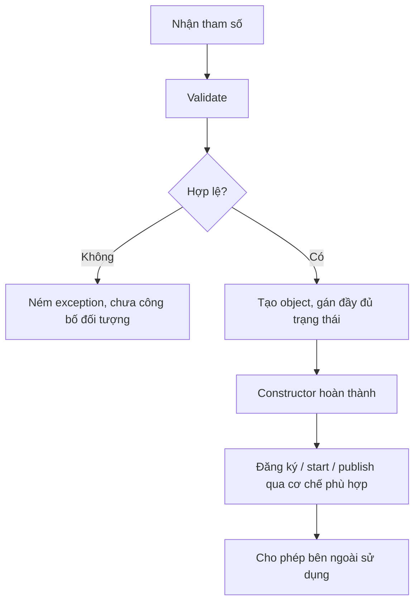

**This diagram does not mean every class needs a factory or event registration.** For simple data classes, a constructor that completely initializes state is sufficient; publication becomes relevant when there is external interaction or multiple threads.

## 12. Self-Check Exercises

### Exercise 1 — Predict the Output

```java
class Base {
    Base() {
        describe();
    }

    void describe() {
        System.out.println("Base");
    }
}

class Child extends Base {
    private int count = 7;

    @Override
    void describe() {
        System.out.println(count);
    }
}

// new Child();
```

**Answer: `0`.** `describe()` dynamically dispatches to the `Child` override from the `Base` constructor, while `count` still has its default value of `0`; the field initializer `count = 7` runs afterward.

### Exercise 2 — Why Isn't final Enough?

```java
class Store {
    static Store published;
    final String code;

    Store() {
        published = this;  // This escape
        code = "READY";
    }
}
```

**Question:** Can `final` guarantee that every reader of `published` sees fully initialized state?

**Answer: No.** `this` was published before the constructor completed. Other code that reads and uses it early may observe unassigned state. In addition, the `published` field is not suitably synchronized for sharing across threads. The correct approach is to complete construction and then publish using an appropriate mechanism.

### Exercise 3 — Refactor to a Factory

Given this class:

```java
class ChatConsumer {
    private final String channel;

    ChatConsumer(EventBus bus, String channel) {
        bus.subscribe(this::onMessage); // Rủi ro this escape
        this.channel = channel;
    }

    void onMessage(String message) {
        System.out.println(channel + ": " + message);
    }
}
```

Refactor it as follows:

- Make the `private` constructor accept `channel`, validate it, and assign the field.
- Define `public static ChatConsumer createAndSubscribe(EventBus bus, String channel)` to finish constructing the object before invoking `bus.subscribe(consumer::onMessage)`.
- If `subscribe` can fail or the registry requires unsubscription, add appropriate cleanup; if events are dispatched from multiple threads, `EventBus` needs clear synchronization rules.

### Exercise 4 — Identify Dangerous Behavior

Mark actions that need scrutiny when performed **inside a constructor**:

| Action | Assessment |
|---|---|
| Assigning `this.id = validatedId` | Usually safe |
| Calling `private static String normalize(String)` | Usually safe if `this` does not escape |
| `eventBus.register(this)` | Risk of this escape |
| `executor.submit(this::process)` | Risk of this escape |
| Calling an overridable `public void initialize()` | Risk of using uninitialized subclass state |
| Calling `register(instance)` after factory construction completes | Safer timing; still consider synchronization and registration failures |

---

## Key Takeaways

An object may have been allocated but **not yet fully initialized**. Prevent `this` from escaping the constructor through listeners, registries, callbacks, threads, or asynchronous tasks; avoid calling overridable methods from constructors because subclasses may not be ready. When registration or startup is required, **complete initialization first**, then activate or publish the object through a suitable mechanism. In multithreaded code, distinguish *preventing premature use* from *safe publication*: addressing both helps avoid hard-to-reproduce lifecycle bugs.


</details>

- [Back to top](#back-to-top)
