<a id="back-to-top"></a>

# Encapsulation

## Menu
- [Information hiding and object boundaries](#encapsulation-001)
- [Object invariants](#encapsulation-002)
- [Access control and state changes](#encapsulation-003)
- [Getters, setters, and intention-revealing methods](#encapsulation-004)
- [Input validation at object boundaries](#encapsulation-005)
- [Preventing exposure of mutable internal data](#encapsulation-006)
- [Defensive copying and immutable representations](#encapsulation-007)
- [Encapsulating behavior rather than merely wrapping data](#encapsulation-008)
- [Example: protecting account balances and order states](#encapsulation-009)

## <a id="encapsulation-001">Information hiding and object boundaries</a>

<details>
<summary>View details</summary>

# Information hiding and object boundaries in Java OOP

## 1. Why do objects need boundaries?

When designing an object, we must decide not only **what data it stores** but also **what external code is allowed to know and do** with that data.

For example, a shopping cart contains line items, unit prices, and quantities. If external code can directly edit its list, assign negative quantities, or change prices without validation, the cart can no longer enforce its own rules. Errors may then arise anywhere the cart is used.

**Information hiding** means exposing only what a class's clients need to know while concealing implementation decisions they should not depend on. An **object boundary** defines the operations and data allowed to cross the object's interface, together with the rules governing those interactions.

Consider this diagram:

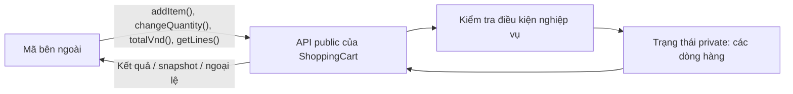

External code requests **adding an item** or **changing a quantity**; it does not need to know whether the class uses an `ArrayList`, `LinkedHashMap`, or another storage mechanism. The object retains control over when and how its valid state may change.

This is the core of **encapsulation** in OOP: keeping related state and behavior together in one class, controlling access, and preserving the object's invariants.

## 2. Distinguishing information hiding, encapsulation, and access control

These three concepts are related, but they are not identical:

| Concept | Question it addresses | Example |
| --- | --- | --- |
| **Encapsulation** | Which state and behaviors belong to the same object? | A shopping cart owns its line items and methods for adding items and changing quantities |
| **Information hiding** | Which details do clients of the class not need to know? | Hide the collection type, lookup strategy, and intermediate calculations |
| **Access control** | Which code may access which members? | `private` fields, `public` APIs, and package-private members for internal package collaboration |

`private` is an important tool, but **making fields `private` alone does not provide effective information hiding**. If a getter exposes a mutable list and a caller modifies it, the object's state is still exposed through that reference.

### Java access levels

| Modifier | Declaring class | Same package | Subclass in another package | Unrelated code in another package |
| --- | --- | --- | --- | --- |
| `private` | Yes | No | No | No |
| Unspecified (package-private) | Yes | Yes | No | No |
| `protected` | Yes | Yes | Yes, subject to Java's rules for inherited access | No |
| `public` | Yes | Yes | Yes | Yes |

The table describes access to **class members**, assuming that the enclosing class itself is accessible. For `protected`, a subclass in a different package cannot access the member arbitrarily through any superclass reference; Java imposes stricter rules in that situation.

As a general rule:
- Keep fields holding internal state `private`.
- Expose operations intended for clients as `public`.
- Keep helper logic that does not need to be exposed `private`.
- Use `protected` and package-private only when there is a clear need for extension or collaboration within a package.

Information hiding is **not** a security mechanism against someone who can execute arbitrary code or use reflection. It is an API design technique that limits dependencies between software components. Authentication, authorization, and protection of sensitive data require separate mechanisms.

## 3. Poor design: allowing external code to modify an object arbitrarily

The following example illustrates a fragile design:

```java
import java.util.ArrayList;
import java.util.List;

class BadCart {
    public List<String> productCodes = new ArrayList<>();
    public int itemCount;
}

BadCart cart = new BadCart();
cart.productCodes.add("KB01");
cart.itemCount = -100;                 // Dữ liệu không hợp lệ
cart.productCodes.clear();            // Xóa hàng mà không qua quy tắc
```

The problem goes beyond `public`. Even if the fields become `private`, callers can still modify state if a getter returns a mutable `List` directly:

```java
class LeakyCart {
    private final List<String> productCodes = new ArrayList<>();

    public List<String> getProductCodes() {
        return productCodes; // Làm lộ tham chiếu tới danh sách nội bộ
    }
}

// Mã bên ngoài:
LeakyCart cart = new LeakyCart();
cart.getProductCodes().add("KB01"); // Bỏ qua nghiệp vụ thêm sản phẩm
```

The boundary is broken because the caller can write to an object owned by the class, even though the field is declared `private`.

A better design starts by asking: *“What does a client of this class actually want to do?”* For a shopping cart, the answers are **add a valid item**, **change a quantity to a valid value**, **view the items**, and **view the total**—not “retrieve the internal collection and modify it freely.”

## 4. Complete example: a ShoppingCart that protects its own state

Design rules:

1. Each product code `sku` appears at most once in the cart.
2. `sku` is nonblank; unit prices in VND are nonnegative; quantities are positive integers.
3. The cart's total always fits within the range of `long`.
4. External code can modify the cart only through validated public methods.
5. If an operation is rejected, existing data must remain unchanged.
6. Getters return read-only snapshots without exposing mutable collections.

Create **`ShoppingCart.java`** (Java 11 or later):

```java
import java.util.ArrayList;
import java.util.LinkedHashMap;
import java.util.List;
import java.util.Map;
import java.util.Objects;

public final class ShoppingCart {
    // Quyết định lưu trữ là chi tiết nội bộ.
    private final Map<String, CartLine> lines = new LinkedHashMap<>();

    public void addItem(String sku, long unitPriceVnd, int quantity) {
        String normalizedSku = normalizeSku(sku);

        if (lines.containsKey(normalizedSku)) {
            throw new IllegalArgumentException("Sản phẩm đã có trong giỏ");
        }

        // Constructor của CartLine tự kiểm tra giá và số lượng.
        CartLine candidate = new CartLine(
                normalizedSku, unitPriceVnd, quantity);

        // Kiểm tra tràn trước khi thay đổi giỏ hàng.
        Math.addExact(totalVnd(), candidate.subtotalVnd());
        lines.put(normalizedSku, candidate);
    }

    public void changeQuantity(String sku, int newQuantity) {
        String normalizedSku = normalizeSku(sku);
        CartLine current = lines.get(normalizedSku);

        if (current == null) {
            throw new IllegalArgumentException("Không tìm thấy sản phẩm");
        }

        CartLine replacement = new CartLine(
                current.sku, current.unitPriceVnd, newQuantity);

        // Mọi phép tính/kiểm tra diễn ra trước khi thay đổi trạng thái.
        long withoutCurrent = Math.subtractExact(
                totalVnd(), current.subtotalVnd());
        Math.addExact(withoutCurrent, replacement.subtotalVnd());

        lines.put(normalizedSku, replacement);
    }

    public long totalVnd() {
        long total = 0L;
        for (CartLine line : lines.values()) {
            total = Math.addExact(total, line.subtotalVnd());
        }
        return total;
    }

    public List<CartLine> getLines() {
        // Snapshot cấu trúc; CartLine cũng bất biến.
        return List.copyOf(lines.values());
    }

    private static String normalizeSku(String sku) {
        Objects.requireNonNull(sku, "sku");
        String result = sku.strip();
        if (result.isBlank()) {
            throw new IllegalArgumentException("Mã sản phẩm không được rỗng");
        }
        return result;
    }

    // Kiểu công khai dùng để đọc một dòng hàng; không có setter.
    public static final class CartLine {
        private final String sku;
        private final long unitPriceVnd;
        private final int quantity;

        private CartLine(String sku, long unitPriceVnd, int quantity) {
            if (unitPriceVnd < 0) {
                throw new IllegalArgumentException("Đơn giá không được âm");
            }
            if (quantity <= 0) {
                throw new IllegalArgumentException("Số lượng phải dương");
            }
            this.sku = sku;
            this.unitPriceVnd = unitPriceVnd;
            this.quantity = quantity;

            // Không chấp nhận dòng hàng có thành tiền tràn long.
            Math.multiplyExact(unitPriceVnd, (long) quantity);
        }

        public String getSku() {
            return sku;
        }

        public long getUnitPriceVnd() {
            return unitPriceVnd;
        }

        public int getQuantity() {
            return quantity;
        }

        public long subtotalVnd() {
            return Math.multiplyExact(unitPriceVnd, (long) quantity);
        }
    }
}
```

### Why does this design preserve the boundary?

**The `lines` field is `private`:** callers do not need to know that the cart uses a `Map`. Choosing `LinkedHashMap` allows products to be managed by code while preserving insertion order when listing items. This is an implementation detail; however, if the API documentation promises a particular order, that order becomes part of the contract and must be maintained.

**`addItem()` and `changeQuantity()` replace unrestricted setters:** every operation that changes the cart has a clear meaning. Callers cannot insert `null` or a negative quantity directly into the internal collection.

**Validate first, update second:** `Math.multiplyExact` and `Math.addExact` detect arithmetic overflow. In the operations above, all checks that can fail run before `put`, so ordinary validation failures cannot leave the cart partially updated.

**`CartLine` is an immutable data carrier for reading:** each line item has `private final` fields containing either an immutable `String` or a primitive value, a controlled constructor, and no setters. Rather than changing the `quantity` of an existing `CartLine`, `changeQuantity()` creates a replacement and installs it only after validation.

**The getter returns a snapshot:** `List.copyOf(lines.values())` returns a list whose elements cannot be added, removed, or replaced through the returned reference; it also captures the contents at call time. Because `CartLine` objects are immutable, callers cannot indirectly modify cart fields through the elements. If the elements were mutable, `List.copyOf` alone would not perform a deep copy.

**`private static normalizeSku()`:** this is an internal processing step outside the public API. It does not depend on the state of a particular cart, so it is `static`.

### Try out the behavior

Create **`Main.java`**:

```java
import java.util.List;

public class Main {
    public static void main(String[] args) {
        ShoppingCart cart = new ShoppingCart();

        cart.addItem("KB-01", 250_000, 2);
        cart.addItem("MS-01", 100_000, 1);
        System.out.println(cart.totalVnd()); // 600000

        List<ShoppingCart.CartLine> before = cart.getLines();
        cart.changeQuantity("KB-01", 3);

        System.out.println(cart.totalVnd()); // 850000
        System.out.println(before.get(0).getQuantity()); // 2
        System.out.println(cart.getLines().get(0).getQuantity()); // 3

        try {
            cart.changeQuantity("KB-01", -5);
        } catch (IllegalArgumentException ex) {
            System.out.println("Từ chối: " + ex.getMessage());
        }
        System.out.println(cart.totalVnd()); // Vẫn 850000

        try {
            before.clear();
        } catch (UnsupportedOperationException ex) {
            System.out.println("Snapshot không cho phép sửa");
        }
    }
}
```

Run these commands from the directory containing both files:

```bash
javac ShoppingCart.java Main.java
java Main
```

Output:

```text
600000
850000
2
3
Từ chối: Số lượng phải dương
850000
Snapshot không cho phép sửa
```

Notice that the `CartLine` objects before and after the quantity change are **two different instances**. The `before` variable still shows quantity `2`, while the current cart returns `3`. The earlier snapshot remains stable and does not let the caller alter the cart's state.

Technical note: this code illustrates invariant protection **in a single-threaded program**. The cart is not designed for concurrent mutations; neither `LinkedHashMap` nor the sequence of validation and update operations is inherently safe against race conditions.

## 5. Public contracts define object boundaries

A well-designed class exposes **useful, stable behavior** without requiring external code to depend on internal details.

Compare these approaches:

| API that exposes implementation | API that hides implementation |
| --- | --- |
| `getInternalMap().put(sku, line)` | `addItem(sku, price, quantity)` |
| `setTotalVnd(value)` | `totalVnd()` computes the result from line items |
| `getMutableLines().clear()` | Provide `removeItem(sku)` when the business rules require it |
| Callers validate prices and quantities themselves | The class validates every entry point that can change state |
| Callers know about `LinkedHashMap` or element indexes | Callers know product codes and business operations |

Exposing getters and setters for every field often turns a class into a “data bag,” with its rules scattered among callers. Not every setter is wrong: a setter can be appropriate if it represents a permitted change, performs clear validation, and does not expose state. For example, `changeDisplayName(String name)` may be more suitable than a generic setter for an entire configuration object.

### Invariants: what conditions must always hold?

Trong `ShoppingCart`:

- No line item has `quantity <= 0`.
- No line item has `unitPriceVnd < 0`.
- Product codes in the cart are unique.
- The total can be represented by a `long`.
- Code outside the class cannot add a line item without validation.

Invariants are established by the constructor or the operation that creates a line item, then maintained by every state-changing method. Any future method, such as `applyDiscount()` or `removeItem()`, must also comply with the relevant rules.

This matters because **an object can be used from many places**: controllers, services, tests, or other components. If a rule exists only in a controller, another caller may bypass it. The class should enforce the core rules governing the state it owns.

## 6. Three reference leaks to watch for

A `private final` field merely hides the field name and prevents reassignment of the reference; it does not freeze the underlying mutable object. When reviewing an API, trace **reference ownership** in both directions:

| Leak path | What the caller can do | Protection strategy |
| --- | --- | --- |
| Getter exposes an internal `List`/array | `getItems().clear()` bypasses `removeItem()` | Snapshot, copy, or a narrower query API |
| Constructor retains a caller-supplied collection | Caller keeps the `input` variable and changes it after construction | Copy on input when the class needs independent ownership |
| Read-only list contains mutable elements | `getItems().get(0).setPrice(...)` | Make elements immutable or create value snapshots |

For example, `List.copyOf(items)` prevents changes to the returned list's structure but **does not deep-copy** its elements. By contrast, `Collections.unmodifiableList(items)` is only a view and still reflects changes to the original list. You must therefore decide whether callers should observe *a snapshot taken at call time* or *live data*, and whether the contained elements are safe to share.

For `ShoppingCart`, the line items are immutable `CartLine` objects, so `getLines()` can return a snapshot without exposing a way to modify the cart. Arrays, `Date` objects, and mutable object graphs require an appropriate copying strategy at each boundary.

## 7. Object boundaries also define responsibilities

Information hiding does not mean putting every responsibility into one class.

A `ShoppingCart` should enforce local rules such as positive quantities, unique product codes, and computing totals from its line items. But it does not necessarily need to perform these tasks itself:

- Fetch the latest prices from a database or pricing service.
- Validate login tokens and user permissions.
- Send email after an order is placed.
- Call a payment gateway or coordinate distributed transactions.
- Return JSON or render HTML.

Those tasks may belong to a service, repository, controller, or adapter. A good boundary means **each component owns the data and decisions for which it is responsible**, and communicates with other components through clear APIs.

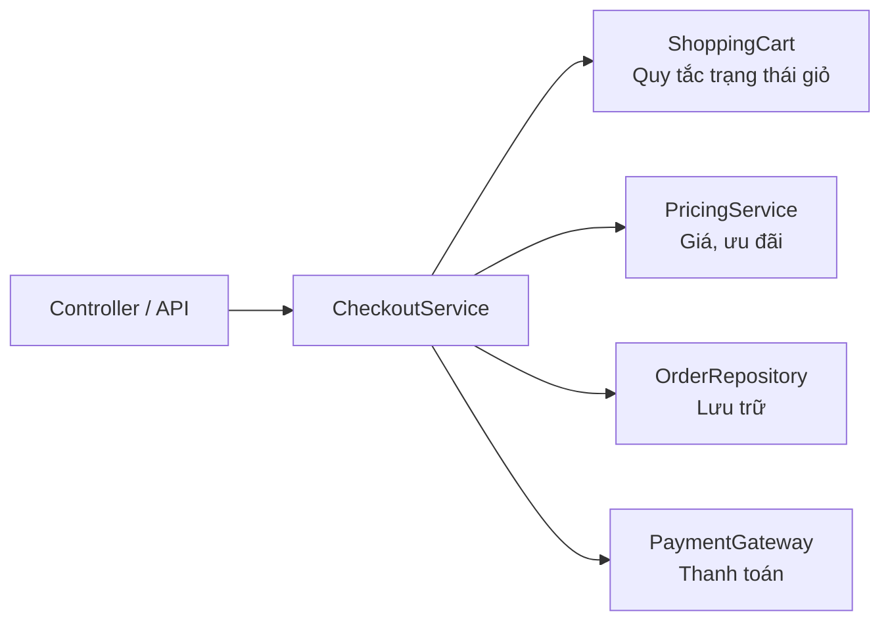

In the diagram, the cart does not need to know how HTTP requests, databases, or payment systems are implemented. Likewise, other classes do not need to know whether the cart uses a `Map` or how it validates data or calculates totals. This is the benefit of maintaining clear **API boundaries** at multiple levels.

One important distinction: a `private` field can still be modified by methods in **the same class**, including through a reference to another instance of that class. The `private` access level applies to code in the declaring class; it is not restricted to a particular instance.

## 8. Good boundaries allow implementation changes with less impact on callers

Suppose a cart initially stores line items in a `List<CartLine>` but later switches to a `Map<String, CartLine>` for faster lookups by code.

If the external API is used only as follows:

```java
cart.addItem("KB-01", 250_000, 2);
cart.changeQuantity("KB-01", 3);
long total = cart.totalVnd();
```

then many internal changes will not require callers to modify their code. However, any behavior published as part of the contract—such as line-item ordering, handling duplicate codes, or exception types—must still be considered when changing the implementation.

This is commonly described as **reducing coupling** between clients and a class's internal details. Practical benefits include:
- Data structures or algorithms can be replaced more easily.
- Testing is easier because observable behavior has clear inputs, outputs, and exceptions.
- Bugs are easier to locate because state changes occur in a defined set of methods.
- External code is less likely to break invariants accidentally.

**Information hiding does not mean hiding everything.** A class that exposes no useful behavior is also difficult to use. The balance is to provide an API expressive enough for business needs while keeping unnecessary implementation decisions private.

## 9. Common mistakes when designing boundaries

| Mistake | Why it causes problems | Better approach |
| --- | --- | --- |
| Making a state field `public` | Callers can change it without validation | Use `private` fields and controlled operations |
| Adding getters/setters for every field by habit | Callers become dependent on the internal structure | Expose only the data and operations actually needed |
| Returning an internal mutable list from a getter | Callers can bypass update rules | Return an appropriate snapshot, immutable view, or copy |
| Treating a `final List<T>` as an immutable list | `final` only prevents reassignment of the reference | Examine the mutability of the collection and its elements |
| Keeping the reference to a list passed into a constructor | The caller can continue changing the data | Copy on input when independent ownership is required |
| Checking conditions after writing to fields | An exception may leave state invalid | Validate and compute first, mutate afterward |
| Putting DB queries and HTTP handling into a domain object | Responsibilities become mixed and coupling increases | Separate services, repositories, and adapters |
| Treating `private` as data security | Access modifiers do not replace authentication or authorization | Enforce security at system boundaries and appropriate layers |
| Assuming a well-designed class is automatically thread-safe | Hiding state does not provide synchronization | Design concurrency handling explicitly when state is shared across threads |

## 10. Practice and self-assessment

### Question 1: why is the following getter dangerous?

```java
public List<CartLine> getLines() {
    return internalLines;
}
```

**Hint:** If `internalLines` is a mutable `ArrayList` owned by the class, callers can invoke `clear()` or `add()` without going through business logic. If `CartLine` is mutable too, merely returning an unmodifiable view is still insufficient to prevent callers from changing its elements.

### Question 2: what makes a reasonable boundary?

Consider an account object with a `balance` field. Choose the more appropriate API:

```java
// Phương án A
account.setBalance(-500_000);

// Phương án B
account.withdraw(500_000);
```

**Explanation:** option B expresses a withdrawal operation and provides an appropriate place to check for a positive amount, sufficient funds, and other rules. An unrestricted setter usually fails to express the purpose of a state change and can violate invariants.

### Question 3: distinguish snapshots from live views

```java
List<String> source = new ArrayList<>();
source.add("A");

List<String> liveView =
        java.util.Collections.unmodifiableList(source);
List<String> snapshot = List.copyOf(source);

source.add("B");

System.out.println(liveView); // ?
System.out.println(snapshot); // ?
```

**Answer:** `liveView` prints `[A, B]` because it is a view that reflects `source`; `snapshot` prints `[A]` because it was created before `"B"` was added. Neither permits additions through its own reference, but they **have different semantics for observing changes**.

### Question 4: extend ShoppingCart

Write `removeItem(String sku)` with these requirements: normalize the code using `normalizeSku`, report an error if the code does not exist, and remove exactly one line item. Then write a program that checks the following:
1. Add two products and save a snapshot from `getLines()`.
2. Remove one product through `removeItem`.
3. Check the current line count and total.
4. Verify that the earlier snapshot still contains the line items present when it was taken.
5. Try removing a nonexistent code and verify that the cart remains unchanged.

This exercise makes you reason about **valid paths for updating state**, **public APIs**, and **observable behavior**, instead of modifying the collection directly.

## Core questions when designing a class

When reading a Java class, ask yourself: (1) what state does this object **own**; (2) which conditions must always hold; (3) who can change its state, and through which methods; (4) can its inputs or outputs leak mutable references; and (5) if the internal implementation changes, which callers would need to change?

A well-defined boundary allows an object to **protect its own state**, express behavior through a clear API, and collaborate with other components without depending on implementation details.


</details>

- [Back to top](#back-to-top)

---

## <a id="encapsulation-002">Object invariants</a>

<details>
<summary>View details</summary>

# Object invariants in Java OOP

In object-oriented programming, an object's state may change through many method calls. However, **not every combination of field values is valid**. For example, the quantity of stock reserved for shipment cannot be negative or exceed the total stock on hand. Rules that must hold whenever an object can be legitimately observed and used are called **conditions that remain invariant for that object** (*object invariants*).

Good class design means more than declaring fields `private`; the class must **control how state is created and changed** so that its invariants are always preserved.

## 1. What is an object invariant?

An **object invariant** is a set of logical conditions describing a valid state of **an instance**. It must hold after successful construction and after every public operation that completes normally. For operations that may fail, robust designs generally require that state remain valid and, where appropriate, unchanged when the operation is rejected.

For an inventory item, for example:

- `sku` must not be `null` or blank.
- `unitPrice` must be greater than 0.
- `onHand` (physical inventory on hand) must be nonnegative.
- `reserved` (stock set aside for orders being processed) must be nonnegative and **must not exceed** `onHand`.
- `available` (stock that can still be ordered) always equals `onHand - reserved`, so it must be nonnegative.

Mathematically:

\[
\text{onHand} \ge 0,\quad 0 \le \text{reserved} \le \text{onHand}
\]

\[
\text{available} = \text{onHand} - \text{reserved} \ge 0
\]

Conditions involving **multiple fields** (such as `reserved <= onHand`) are a key reason **not to provide unrestricted setters for individual fields**.

### Distinguishing commonly confused concepts

| Concept | Question it answers | Example |
| --- | --- | --- |
| **Invariant** | Which object states are valid? | `0 <= reserved <= onHand` |
| **Precondition** | What must hold before invoking an operation? | `quantity > 0`, sufficient available stock |
| **Postcondition** | What must hold after an operation succeeds? | Reserving 2 items increases `reserved` by 2 |
| **Immutability** | Can observable state change after construction? | `String`, `LocalDate`, an immutable value object |
| **Encapsulation** | Who can read or modify state, and how? | A `private` field updated through `reserve()` |

**An invariant is not the same as immutability.** An object can be *mutable* while maintaining its invariant throughout every valid operation. Conversely, an immutable object must also be validated to ensure that its **initial state** is valid.

## 2. Why can independent setters violate invariants?

Suppose a class exposes two setters:

~~~java
class BadStock {
    private int onHand;
    private int reserved;

    public void setOnHand(int onHand) {
        if (onHand < 0) {
            throw new IllegalArgumentException("Âm");
        }
        this.onHand = onHand;
    }

    public void setReserved(int reserved) {
        if (reserved < 0) {
            throw new IllegalArgumentException("Âm");
        }
        this.reserved = reserved;
    }
}
~~~

Each setter validates only its own field, so the following is still possible:

~~~java
BadStock stock = new BadStock();
stock.setOnHand(2);
stock.setReserved(5); // Hai giá trị đều không âm, nhưng trạng thái sai!
~~~

The condition `reserved <= onHand` is violated. Adding a check for each field **is not sufficient**; related changes must be coordinated. Even if each setter checks `reserved <= onHand`, you must consider the **update order** when transitioning between two valid states, especially in concurrent programs.

A better design exposes meaningful **business operations**: `reserve`, `release`, `ship`, and `restock`. Each operation checks the relevant conditions and updates state consistently.

## 3. Complete Java example: an inventory object that stays valid

The following example runs on **Java 11+**. Create `InvariantDemo.java`.

~~~java
import java.math.BigDecimal;
import java.util.Objects;

public class InvariantDemo {

    static final class StockItem {
        private final String sku;
        private final BigDecimal unitPrice;
        private int onHand;
        private int reserved;

        public StockItem(String sku, BigDecimal unitPrice,
                         int initialOnHand) {
            String normalizedSku =
                    Objects.requireNonNull(sku, "sku").trim();
            Objects.requireNonNull(unitPrice, "unitPrice");

            if (normalizedSku.isEmpty()) {
                throw new IllegalArgumentException("SKU không được rỗng");
            }
            if (unitPrice.signum() <= 0) {
                throw new IllegalArgumentException("Giá phải lớn hơn 0");
            }
            if (initialOnHand < 0) {
                throw new IllegalArgumentException("Tồn kho không được âm");
            }

            this.sku = normalizedSku;
            this.unitPrice = unitPrice;
            this.onHand = initialOnHand;
            this.reserved = 0;
        }

        public String getSku() {
            return sku;
        }

        public BigDecimal getUnitPrice() {
            return unitPrice;
        }

        public int getOnHand() {
            return onHand;
        }

        public int getReserved() {
            return reserved;
        }

        // Dữ liệu dẫn xuất: không lưu một field available riêng.
        public int getAvailable() {
            return onHand - reserved;
        }

        public void reserve(int quantity) {
            requirePositive(quantity);
            if (quantity > getAvailable()) {
                throw new IllegalStateException("Không đủ hàng để giữ");
            }
            reserved += quantity;
        }

        public void release(int quantity) {
            requirePositive(quantity);
            if (quantity > reserved) {
                throw new IllegalStateException("Không thể trả quá số đã giữ");
            }
            reserved -= quantity;
        }

        public void ship(int quantity) {
            requirePositive(quantity);
            if (quantity > reserved) {
                throw new IllegalStateException("Chưa giữ đủ hàng để giao");
            }
            // Hàng được giao rời kho và hết trạng thái giữ chỗ.
            reserved -= quantity;
            onHand -= quantity;
        }

        public void restock(int quantity) {
            requirePositive(quantity);
            // Nếu overflow, Math.addExact ném ngoại lệ trước khi gán.
            int nextOnHand = Math.addExact(onHand, quantity);
            onHand = nextOnHand;
        }

        public String snapshot() {
            return "onHand=" + onHand
                    + ", reserved=" + reserved
                    + ", available=" + getAvailable();
        }

        private static void requirePositive(int quantity) {
            if (quantity <= 0) {
                throw new IllegalArgumentException("Số lượng phải dương");
            }
        }
    }

    public static void main(String[] args) {
        StockItem item = new StockItem(
                "BOOK-01", new BigDecimal("120000"), 10
        );

        System.out.println("Ban đầu: " + item.snapshot());

        item.reserve(4);
        System.out.println("Giữ 4: " + item.snapshot());

        try {
            item.reserve(7); // Còn bán được 6, thao tác thất bại.
        } catch (IllegalStateException ex) {
            System.out.println("Từ chối: " + ex.getMessage());
        }
        System.out.println("Sau lỗi: " + item.snapshot());

        item.ship(3);
        System.out.println("Giao 3: " + item.snapshot());

        item.release(1);
        System.out.println("Hủy giữ 1: " + item.snapshot());

        item.restock(5);
        System.out.println("Nhập 5: " + item.snapshot());
    }
}
~~~

Run:

~~~bash
javac InvariantDemo.java
java InvariantDemo
~~~

Output:

~~~text
Ban đầu: onHand=10, reserved=0, available=10
Giữ 4: onHand=10, reserved=4, available=6
Từ chối: Không đủ hàng để giữ
Sau lỗi: onHand=10, reserved=4, available=6
Giao 3: onHand=7, reserved=1, available=6
Hủy giữ 1: onHand=7, reserved=0, available=7
Nhập 5: onHand=12, reserved=0, available=12
~~~

### Why does each method preserve the invariant?

| Operation | Condition before mutation | Update formula | Why does the result remain valid? |
| --- | --- | --- | --- |
| Construction | Valid `sku`, positive price, initial stock ≥ 0 | `reserved = 0` | `0 <= 0 <= onHand` |
| `reserve(q)` | `q > 0` and `q <= onHand - reserved` | `reserved += q` | The new `reserved` does not exceed `onHand` |
| `release(q)` | `q > 0` and `q <= reserved` | `reserved -= q` | The new `reserved` is nonnegative |
| `ship(q)` | `q > 0` and `q <= reserved` | `reserved -= q; onHand -= q` | Both decrease by the same amount; `onHand` remains ≥ `reserved` |
| `restock(q)` | `q > 0` and no integer overflow in the sum | `onHand += q` | Only total stock increases; available stock does not decrease |

Every update **starts from a valid state**. If `reserve(7)` is rejected when only 6 units are available, the method throws an exception **before any change**, preserving the old state.

In particular, `Math.addExact` prevents overflow when adding stock to an `int`. If the sum exceeds `Integer.MAX_VALUE`, ordinary `int` addition could produce a negative result; `addExact` throws `ArithmeticException` before the field is updated. This also protects the invariant.

## 4. Viewing invariants as a validation flow

For the `reserve(q)` operation:

~~~mermaid
flowchart TD
    A["Gọi reserve(q)"] --> B{"q > 0?"}
    B -->|Không| E["IllegalArgumentException\nKhông đổi trạng thái"]
    B -->|Có| C{"q <= available?"}
    C -->|Không| F["IllegalStateException\nKhông đổi trạng thái"]
    C -->|Có| D["reserved = reserved + q"]
    D --> G["Trạng thái hợp lệ\n0 <= reserved <= onHand"]
~~~

The ideal sequence is **validate → compute the result → update state**. When a method must change several fields, avoid letting an exception occur *between updates* and leave the object partially changed.

For example, when transferring money between two wallets, do not debit wallet A before checking whether wallet B can accept the credit. For single-threaded in-memory processing, you can **check both conditions**, compute both new balances, and then assign them. For database updates, multiple services, or concurrent processing, transactions, locking, or another suitable mechanism is needed to make the grouped update reliable.

## 5. Invariants, constructors, and the object lifecycle

An invariant does not become true simply because fields are declared `private`. The class must explicitly establish it during construction.

~~~java
public final class TemperatureRange {
    private final int min;
    private final int max;

    public TemperatureRange(int min, int max) {
        if (min > max) {
            throw new IllegalArgumentException("min phải <= max");
        }
        this.min = min;
        this.max = max;
    }

    public int getMin() { return min; }
    public int getMax() { return max; }
}
~~~

Here the invariant is `min <= max`. The constructor checks it before allowing construction to succeed. Declaring both fields `final` **does not automatically validate** the relationship between them.

If a constructor accepts collections or mutable objects, it must also prevent external code from silently changing the constructed object's state afterward.

~~~java
import java.util.List;
import java.util.Objects;

public final class StudyPlan {
    private final List<String> topics;

    public StudyPlan(List<String> topics) {
        Objects.requireNonNull(topics, "topics");
        if (topics.isEmpty()) {
            throw new IllegalArgumentException("Phải có ít nhất một chủ đề");
        }
        for (String topic : topics) {
            if (topic == null || topic.isBlank()) {
                throw new IllegalArgumentException("Chủ đề không hợp lệ");
            }
        }
        this.topics = List.copyOf(topics);
    }

    public List<String> getTopics() {
        return topics;
    }
}
~~~

~~~java
import java.util.ArrayList;
import java.util.List;

List<String> external = new ArrayList<>(List.of("OOP"));
StudyPlan plan = new StudyPlan(external);

external.clear();                    // Không làm rỗng plan
System.out.println(plan.getTopics()); // [OOP]

// Ném UnsupportedOperationException:
plan.getTopics().clear();
~~~

The invariant of `StudyPlan` is that its topic list is nonempty and every element is a valid string. `List.copyOf` creates an unmodifiable list detached from later changes to the source collection. Because its elements are immutable `String` values, this is safe for the example. With **mutable elements**, `List.copyOf` copies only **references to the elements**, not the entire object graph; use appropriate deep copies or immutable value objects.

**Avoid leaking `this` from a constructor**, for example by registering a partially constructed object with a global listener before all fields and invariants have been established. Another component may observe the unfinished instance, especially in multithreaded programs.

## 6. State can change while the invariant remains true

Returning to `StockItem`, consider two states:

- Before `reserve(4)`: `onHand=10`, `reserved=0`, `available=10`.
- Sau `reserve(4)`: `onHand=10`, `reserved=4`, `available=6`.

**Both states are valid.** This clearly differs from an immutable object: field values change while the invariant is preserved.

An unrestricted setter for reserved stock would break this boundary. Instead of:

~~~java
// Thiết kế dễ bị dùng sai:
public void setReserved(int newReserved) {
    reserved = newReserved;
}
~~~

allow operations that express domain intent:

~~~java
item.reserve(4);
item.release(1);
item.ship(3);
~~~

A meaningful API often makes **invalid states harder to represent and reach**. Method names also make code clearer: “ship 3 reserved units” is more precise than “set reserved to 1 and onHand to 7.”

### Should `checkInvariant()` run after every method?

An internal helper can detect mistakes during development:

~~~java
private void checkInvariant() {
    if (onHand < 0 || reserved < 0 || reserved > onHand) {
        throw new IllegalStateException("Vi phạm invariant của kho");
    }
}
~~~

But the check **does not replace** sound design. If code has already written part of an invalid state before throwing an exception, a check at the end will detect the violation but **will not restore** the data. Prefer checking conditions and computing new values **before writing**.

Java's `assert` statement should not be the only mechanism for validating business inputs either: assertions are usually disabled unless the program runs with `-ea`. Invalid inputs should be rejected by explicit validation logic, typically through `IllegalArgumentException` or a suitable domain-specific exception.

## 7. Exceptions, partial updates, and atomicity

A good method generally aims for this rule: **success moves to a new valid state; failure leaves the object valid**. For many operations, we also want **failure to leave state unchanged** (*strong exception guarantee*), although not every API promises that stronger guarantee.

Incorrect example:

~~~java
public void unsafeReserve(int quantity) {
    reserved += quantity; // Đã thay đổi!
    if (reserved > onHand) {
        throw new IllegalStateException("Không đủ hàng");
    }
}
~~~

If the initial values are `onHand=10, reserved=4`, calling `unsafeReserve(7)` causes `reserved=11` and then throws an exception; the invariant has already been violated.

Correct approach:

~~~java
public void safeReserve(int quantity) {
    if (quantity <= 0) {
        throw new IllegalArgumentException("Số lượng phải dương");
    }
    if (quantity > onHand - reserved) {
        throw new IllegalStateException("Không đủ hàng");
    }
    reserved += quantity;
}
~~~

When the operation is rejected, no field has been modified. This matters in services with multiple steps because **throwing an exception does not automatically undo Java assignments already made**.

Distinguish three scopes:

| Scope | Common measures | Key consideration |
| --- | --- | --- |
| One object in one thread | Guard conditions, precomputation, valid assignments | Invariants can be demonstrated method by method |
| Multiple threads sharing one object | Locks/synchronization, concurrent data structures, or immutable models | Validation and update must be coordinated as one operation |
| Multiple tables, records, or systems | Transactions, constraints, versioning/locking, idempotency, and compensating actions | Java-side checks alone cannot guarantee the consistency of shared data |

## 8. Invariants and concurrency

The `StockItem` example above deliberately illustrates OOP logic in a **single-threaded environment**. If multiple threads call `reserve`, they may simultaneously see the same `available` value, validate against an old state, and then both update it.

For example, suppose 1 item remains and two threads each try to reserve 1. If both read `available=1` before either writes, the “enough stock” decision may be made twice. `private` and `final` **do not automatically provide thread safety**.

For a shared Java object, you can protect the entire read/write operation with the same lock, for example:

~~~java
public synchronized void reserve(int quantity) {
    requirePositive(quantity);
    if (quantity > getAvailable()) {
        throw new IllegalStateException("Không đủ hàng");
    }
    reserved += quantity;
}

public synchronized int getAvailable() {
    return onHand - reserved;
}
~~~

These are only two **illustrative** methods of the same `StockItem` class. For complete thread safety, **every read/write path for shared state** (including `release`, `ship`, `restock`, `getOnHand`, `getReserved`, and snapshots involving several fields) must follow a consistent synchronization strategy. For database access or multiple server instances, `synchronized` within one JVM is insufficient; coordination is needed at the data source.

An invariant might hold at a method's start and end but be temporarily violated between statements. If other code can observe that intermediate state, it is still a design flaw. Avoid exposing intermediate state, invoking external callbacks midway through an update, or releasing a lock before the invariant has been restored.

## 9. Testing invariants at boundaries and after failures

Test more than successful paths: out-of-range values, negative values, 0, and rejected updates often reveal bugs. For example, with **JUnit 5** (using the `StockItem` class from the program above):

~~~java
import static org.junit.jupiter.api.Assertions.*;
import java.math.BigDecimal;
import org.junit.jupiter.api.Test;

class StockItemTest {

    @Test
    void reserveCannotExceedAvailableAndKeepsStateOnFailure() {
        InvariantDemo.StockItem item =
                new InvariantDemo.StockItem(
                        "BOOK-01", new BigDecimal("120000"), 5
                );
        item.reserve(3);

        assertThrows(IllegalStateException.class, () -> item.reserve(3));

        assertEquals(5, item.getOnHand());
        assertEquals(3, item.getReserved());
        assertEquals(2, item.getAvailable());
    }

    @Test
    void shipNeverMakesStockNegative() {
        InvariantDemo.StockItem item =
                new InvariantDemo.StockItem(
                        "BOOK-01", new BigDecimal("120000"), 2
                );
        item.reserve(2);
        item.ship(2);

        assertEquals(0, item.getOnHand());
        assertEquals(0, item.getReserved());
        assertEquals(0, item.getAvailable());

        assertThrows(IllegalStateException.class, () -> item.ship(1));
    }

    @Test
    void constructorRejectsInvalidInitialState() {
        assertThrows(IllegalArgumentException.class, () ->
                new InvariantDemo.StockItem(
                        "BOOK-01", BigDecimal.ONE, -1
                ));
        assertThrows(IllegalArgumentException.class, () ->
                new InvariantDemo.StockItem(
                        "   ", BigDecimal.ONE, 1
                ));
    }

    @Test
    void overflowDoesNotCorruptState() {
        InvariantDemo.StockItem item =
                new InvariantDemo.StockItem(
                        "BOOK-01", BigDecimal.ONE, Integer.MAX_VALUE
                );
        assertThrows(ArithmeticException.class, () -> item.restock(1));
        assertEquals(Integer.MAX_VALUE, item.getOnHand());
        assertEquals(0, item.getReserved());
    }
}
~~~

Note: the test file needs the corresponding JUnit Jupiter dependency and test runner. The `InvariantDemo.java` code in section 3 **does not depend on JUnit** and runs independently with `javac`/`java`. In a real project, **property-based testing** can generate many sequences of `reserve → release → ship → restock` operations and assert after each valid step that `0 <= reserved <= onHand`.

## 10. Common design mistakes

| Mistake | Consequence | Solution |
| --- | --- | --- |
| Validating each field independently | Misses relationships between fields | Write the invariant for the **entire object** before designing the API |
| Exposing unconstrained public setters | Callers can create invalid states | Use business operations with guards |
| Validating after writing a field | Exceptions can leave state corrupted | Validate and compute first, then update |
| Assuming `final` means “everything is valid” | Initial logical relationships may still be invalid | Validate in the constructor |
| Returning an internal mutable collection | Callers can bypass class rules | Use defensive copies, immutable views, or value objects as appropriate |
| Using `assert` instead of input validation | Checks may never execute | Use exceptions and validation in normal runtime execution |
| Testing only valid cases | Boundary errors go undetected | Test boundaries, exceptions, and state after failures |
| Ignoring sharing between threads | Race conditions violate invariants | Synchronize complete operations or use transactions at the right scope |

## 11. Practice questions

**1.** With `onHand=8, reserved=5`, is `reserve(3)` allowed? What are the values after it succeeds?

**Answer:** Yes, because `available = 8 - 5 = 3`. Afterward, `onHand=8, reserved=8, available=0`; the invariant still holds at the boundary.

**2.** With `onHand=8, reserved=5`, what should happen if `ship(6)` is called?

**Answer:** Reject the operation because only 5 units are reserved. State should remain unchanged; do not decrement `onHand` first.

**3.** Does `private final List<OrderLine> lines` guarantee that the object contains an immutable list?

**Answer:** No. `final` only prevents reassignment of the field reference. Both the list and individual `OrderLine` elements may be mutable; you must control every mutation path or use immutable copies, containers, and elements.

**4.** Why can a mutable object still maintain an invariant?

**Answer:** An invariant constrains **the set of permitted states**; it does not prohibit transitions. Methods are designed so that every successful transition ends in a valid state.

**5.** Is locking needed when multiple threads reserve the same inventory item?

**Answer:** A strategy is needed to coordinate validation and updates: locking, serialized processing, atomic operations, transactions, or an equivalent consistency mechanism appropriate to where the state is stored. If state resides in a database accessed by multiple application instances, locking one object in one JVM is insufficient.

When reading or writing a Java class, ask yourself: **“What must be true for every valid instance? How does the constructor guarantee it? How does each method preserve it, including when an error occurs?”** These three questions turn encapsulation into concrete design and testing rules.


</details>

- [Back to top](#back-to-top)

---

## <a id="encapsulation-003">Access control and state changes</a>

<details>
<summary>View details</summary>

# Access control and state changes in Java

> **OOP → Encapsulation.** An object does more than store data: it must protect **the rules that must always hold** for that data. Java provides access levels (`private`, package-private, `protected`, `public`) to restrict which code can see or invoke class members. The rest is a design decision: allow state changes only through valid operations.

## 1. Why shouldn't everyone be allowed to modify fields?

Consider a simple account:

```java
class UnsafeAccount {
    public long balanceCents;
}

UnsafeAccount account = new UnsafeAccount();
account.balanceCents = 100_000;
account.balanceCents = -9_999; // Biên dịch hợp lệ nhưng vi phạm quy tắc số dư
```

A client of the class can assign any value, including a negative one, even if the application requires nonnegative balances. When many places modify state directly, the class cannot control who changes it, when, or whether the change is validated.

Encapsulation addresses this by separating:

- **Internal state**: fields managed by the object, such as `balanceCents`.
- **Public interface (public API)**: operations external code is allowed to invoke, such as `deposit(amount)`, `withdraw(amount)`, and `getBalance()`.
- **Invariants**: conditions that must hold after each valid operation, such as `balanceCents >= 0`.
- **Validation responsibility**: the class that owns the data validates it before making changes.

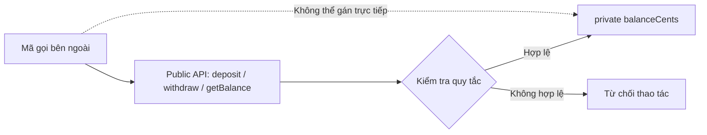

**Encapsulation does not mean every class needs getters and setters for every field.** If a class declares `private long balance` but exposes an unrestricted `public void setBalance(long value)`, external code can still violate business rules. What matters is **controlling the paths through which state changes**.

## 2. Java access levels

Java has four commonly used access levels for class members:

| Modifier | Within the declaring class | Other class in the same package | Subclass in another package | Unrelated class in another package |
|---|---|---|---|---|
| `private` | Yes | No | No | No |
| No modifier (**package-private**) | Yes | Yes | No | No |
| `protected` | Yes | Yes | Yes, subject to inherited-member access rules | No |
| `public` | Yes | Yes | Yes | Yes |

Example:

```java
package shop;

public class Product {
    private int stock;            // Chỉ mã có quyền private access của Product
    String internalCode;          // Package-private
    protected void validate() {}  // Cùng package và lớp con theo quy tắc protected
    public int getStock() {       // Phần API công khai
        return stock;
    }
}
```

Important distinctions:

- **`private`** restricts access according to the declaring class and the scopes Java permits, including interactions between enclosing and nested classes; it does not mean “only within one method.”
- **Package-private** means *no access modifier is specified*; it is not the `default` keyword. Classes in the same package may access the member when other access requirements are satisfied.
- **`protected`** grants access within the same package; subclasses in other packages face additional restrictions on which object references can be used to access inherited members.
- **`public`** makes members accessible to other code, provided the containing class is also accessible and any module restrictions (when using the Java Module System) permit it.
- A normal **top-level** class may be declared only `public` or package-private; `private` and `protected` do not apply directly to top-level classes.

Wider visibility creates more points of dependency. In practice, start with `private` data fields and expose only behavior that external clients actually need. There is no need to make every method `public` by default.

## 3. Controlling changes through meaningful business methods

The following complete example represents money in **cents** using `long`, avoiding the binary floating-point issues of `double` when illustrating monetary values. It is an in-memory OOP example, not a banking transaction system.

Save it as `WalletDemo.java` and run with **Java 17+**:

```java
import java.util.ArrayList;
import java.util.List;

public class WalletDemo {
    public record Movement(String type, long amountCents, long balanceAfter) {}

    public static final class Wallet {
        private final String owner;
        private long balanceCents;
        private final List<Movement> movements = new ArrayList<>();

        public Wallet(String owner, long openingBalanceCents) {
            if (owner == null || owner.isBlank()) {
                throw new IllegalArgumentException("Chủ ví không hợp lệ");
            }
            if (openingBalanceCents < 0) {
                throw new IllegalArgumentException("Số dư đầu kỳ không thể âm");
            }
            this.owner = owner;
            this.balanceCents = openingBalanceCents;
        }

        public String owner() {
            return owner;
        }

        public long balanceCents() {
            return balanceCents;
        }

        public List<Movement> history() {
            return List.copyOf(movements);
        }

        public void deposit(long amountCents) {
            requirePositive(amountCents);
            long newBalance = Math.addExact(balanceCents, amountCents);
            balanceCents = newBalance;
            movements.add(new Movement("DEPOSIT", amountCents, newBalance));
        }

        public boolean withdraw(long amountCents) {
            requirePositive(amountCents);
            if (amountCents > balanceCents) {
                return false;
            }
            balanceCents -= amountCents;
            movements.add(new Movement("WITHDRAW", amountCents, balanceCents));
            return true;
        }

        private static void requirePositive(long amountCents) {
            if (amountCents <= 0) {
                throw new IllegalArgumentException("Số tiền phải dương");
            }
        }
    }

    public static void main(String[] args) {
        Wallet wallet = new Wallet("An", 100_000);

        wallet.deposit(50_000);
        System.out.println(wallet.withdraw(20_000));  // true
        System.out.println(wallet.balanceCents());     // 130000
        System.out.println(wallet.withdraw(200_000)); // false
        System.out.println(wallet.balanceCents());     // 130000

        List<Movement> snapshot = wallet.history();
        System.out.println(snapshot.size());          // 2

        try {
            snapshot.clear();
        } catch (UnsupportedOperationException ex) {
            System.out.println("Không thể sửa lịch sử từ bên ngoài");
        }

        System.out.println(wallet.history().size());  // 2
    }
}
```

Run:

```bash
javac WalletDemo.java
java WalletDemo
```

Expected output:

```text
true
130000
false
130000
2
Không thể sửa lịch sử từ bên ngoài
2
```

### How are invariants protected?

The `Wallet` class has the invariant `balanceCents >= 0`.

| Operation | Input requirements | On success | On failure |
|---|---|---|---|
| `new Wallet(owner, opening)` | Nonblank `owner`; `opening >= 0` | Constructs a valid state | Throws `IllegalArgumentException` |
| `deposit(amount)` | `amount > 0`; addition must not overflow `long` | Increases balance and records history | Invalid input: `IllegalArgumentException`; overflow: `ArithmeticException` |
| `withdraw(amount)` | `amount > 0` | Sufficient funds: decreases balance and returns `true` | Insufficient funds: returns `false` without decreasing balance |
| `balanceCents()` | None | Returns current balance | Does not modify state |
| `history()` | None | Returns an unmodifiable list copy | External code cannot `clear()` the internal history |

State-changing methods express **the meaning of the operation**: depositing and withdrawing money. The class does not expose `setBalanceCents`, because “set an arbitrary balance” could bypass business validation and transaction history.

`Math.addExact` detects `long` overflow: if the balance is near `Long.MAX_VALUE`, addition will not silently wrap into a negative number. These checks make the API harder to misuse.

### Withdrawal flow

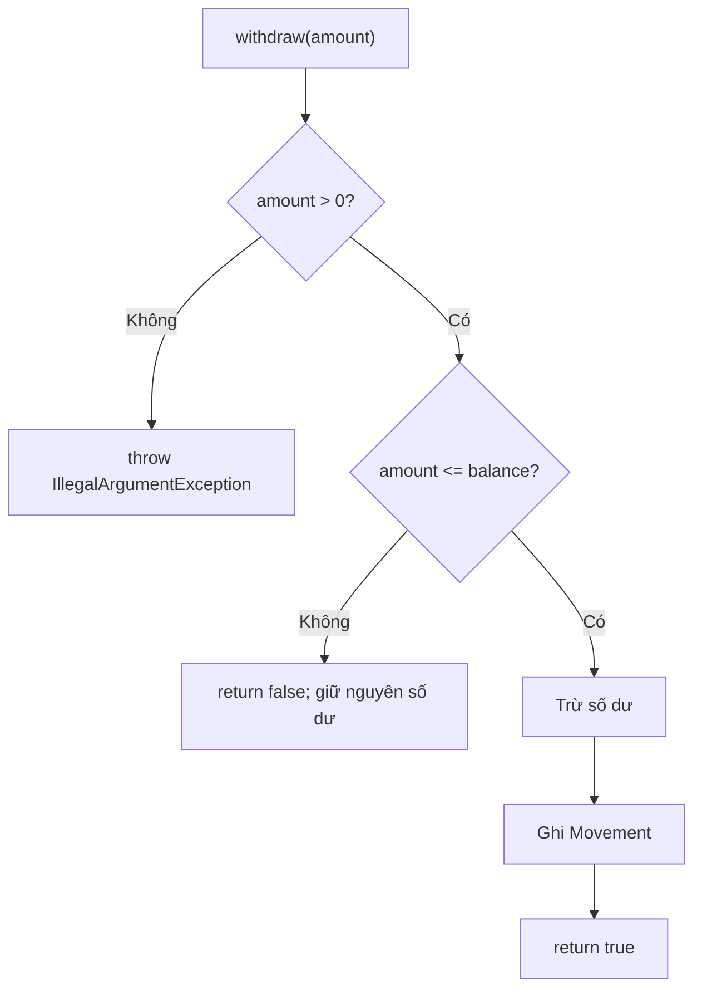

The diagram illustrates why **every path that changes state must pass through a valid decision**. Not every unsuccessful outcome needs to throw an exception: “insufficient funds” can be a normal business result, so this example returns `false`.

**Limitation of the example:** the operations on `Wallet` are not synchronized for concurrent threads. If multiple threads may deposit or withdraw simultaneously, mechanisms are needed to ensure atomicity and memory visibility (such as appropriate locking or transactions at the storage layer). `private` **does not make code thread-safe by itself**.

## 4. Field-name access differs from the ability to mutate a referenced object

Even when a list is `private final`, a getter that returns its `ArrayList` directly lets callers add or remove elements. This creates **a way around the validation methods**:

```java
private final List<String> members = new ArrayList<>();

public List<String> getMembers() {
    return List.copyOf(members); // Snapshot cấu trúc; String bất biến
}
```

If a constructor receives a list from outside, the class must also decide whether to copy it **when received** so the caller cannot continue modifying the same instance. When elements are mutable objects, `List.copyOf` is insufficient to protect the deeper state. These risks are part of API design even when the field's access modifier is correct.

## 5. Accessors must not undermine update rules

A getter supports **observation**; a setter is appropriate only when a property can truly change independently. For example, changing a display name may use `setDisplayName(name)` with `null`/blank-string validation. Conversely, calling `setStatus("SHIPPED")` on an unpaid order could bypass the business workflow even when the `status` field is `private`.

```java
// Trích các phương thức trong một Order có status kiểu enum.
public void pay() {
    if (status != Status.NEW) {
        throw new IllegalStateException("Chỉ đơn NEW được thanh toán");
    }
    status = Status.PAID;
}

public void ship() {
    if (status != Status.PAID) {
        throw new IllegalStateException("Chỉ đơn PAID được giao");
    }
    status = Status.SHIPPED;
}
```

`pay()` and `ship()` communicate intent and enforce checks where the data is owned. In a real application, confirming payment through an external system still requires a trustworthy service; a method name alone cannot authenticate a payment. Getter/setter naming is a Java convention, **not proof of proper encapsulation**.

## 6. Invariants must hold from construction through every operation

An object can enter an invalid state **during construction** if its constructor omits validation. Encapsulation works only when every path for creating and modifying an object preserves its rules.

For example, `Wallet` validates the opening balance in its constructor, while `deposit` and `withdraw` validate before updating the balance. This avoids negative balances along normal execution paths.

A simple design process:

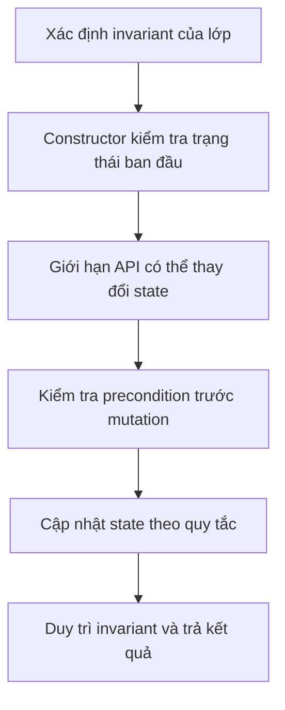

| Design guideline | Reason |
|---|---|
| Keep internal data fields `private` in most cases | Prevent arbitrary direct assignments |
| Validate required data in the constructor | Ensure the object is valid from the start |
| Validate conditions in every state-changing method | Preserve invariants |
| Prefer methods named after behaviors | Limit operations performed out of sequence |
| Do not expose internal mutable collections or arrays | Prevent outside code from bypassing validation |
| Choose consistent failure results | Let callers know when an operation is rejected |
| Make objects immutable where appropriate | Reduce the number of states to manage |

### Avoiding partial changes

Suppose an operation must check several conditions:

```java
void updateLimit(long newLimit) {
    if (newLimit < 0) {
        throw new IllegalArgumentException("Giới hạn không hợp lệ");
    }
    if (newLimit < currentUsage) {
        throw new IllegalStateException(
            "Giới hạn mới thấp hơn mức đang sử dụng"
        );
    }
    limit = newLimit;
}
```

Checking before assignment prevents an invalid value from being written to `limit` before an exception is thrown. If a business operation changes **multiple objects** or writes to an external database/API, it needs an appropriate transaction/rollback mechanism; `private` and a Java method alone do not provide atomicity across resources.

## 7. Access control versus immutability

Encapsulation and immutability are related but distinct:

| Concept | Meaning | Example |
|---|---|---|
| Encapsulation | External code interacts only through permitted APIs | `Wallet.deposit()`, `Wallet.withdraw()` |
| Mutable object | State can change, but only according to its rules | `Wallet` after depositing/withdrawing |
| Immutable object | Observable state does not change after construction | `String`, a correctly designed value object |
| `final` field | Under Java's rules, the field cannot be reassigned after initialization | `private final List<String> names` |
| Unmodifiable collection | Its mutating operations cannot change the collection | Result of `List.copyOf(...)` |

`private` **does not imply immutability**; `final` **does not provide deep immutability**; and a getter is not inherently read-only if it returns a reference to a mutable object.

A simple value-object example:

```java
public record RectangleSize(int width, int height) {
    public RectangleSize {
        if (width <= 0 || height <= 0) {
            throw new IllegalArgumentException("Kích thước phải dương");
        }
    }

    public long area() {
        return (long) width * height;
    }
}
```

A `record` (Java 16+) automatically provides `private final` components and the `width()`, `height()` accessors. Its **compact constructor** validates the invariant before the record is used. With two primitive components, `RectangleSize` has immutable value state and is well suited for passing between objects.

## 8. Encapsulation within the boundaries of responsibility

Declaring fields `private` does not automatically make a design good. A class may have 20 `private` fields and 20 `public` setters, leaving external code to assemble the business logic. The rules are still scattered.

For example, a weak API makes callers validate state themselves:

```java
if (account.getBalance() >= amount) {
    account.setBalance(account.getBalance() - amount);
}
```

There are at least three problems: validation logic lives outside the class; other code can forget to validate; and the read and write steps are not atomic under concurrent access.

A behavior-oriented API such as `account.withdraw(amount)` keeps the logic inside the class that owns the data and knows its invariant. However, concurrent calls still require the method to use a suitable synchronization or transaction mechanism.

**Least visibility:** expose only what belongs to the class's contract. A helper such as `requirePositive` in `Wallet` is `private` because callers do not need to know how validation is implemented. When two classes collaborate closely in one package, package-private visibility may be more appropriate than `public`. Do not widen access merely to make a member “easy to call” if a clearer API design is available.

### Name methods by intent

| Potentially misleading name | More explicit behavioral name | When is it useful? |
|---|---|---|
| `setBalance(500)` | `deposit(500)` / `withdraw(500)` | Deposit/withdrawal rules apply |
| `setStatus(PAID)` | `pay()` | Valid state transitions are required |
| `setQuantity(q)` | `increaseStock(q)` / `reserve(q)` | Inventory constraints apply |
| `getInternalList()` | `listItems()` returns a snapshot | Data must be readable without allowing internal mutation |

Method names do not enforce rules by themselves: **implementation and testing** must ensure the behavior is correct.

## 9. Testing behavior and access boundaries

A good test verifies more than ordinary outputs. It also checks **states that must never occur** and whether calling code can interfere inappropriately.

For `Wallet`, you can verify the following cases:

| Scenario | Expected result |
|---|---|
| Construct a wallet with a negative balance | `IllegalArgumentException` |
| `deposit(0)` or `deposit(-1)` | `IllegalArgumentException`; balance unchanged |
| `deposit(Long.MAX_VALUE)` when balance is positive | `ArithmeticException`; balance unchanged |
| `withdraw(amount)` exceeds the balance | `false`; no withdrawal record is added |
| Withdraw a valid amount with sufficient funds | `true`; balance decreases correctly |
| `wallet.history().clear()` | `UnsupportedOperationException`; internal history remains intact |
| `wallet.balanceCents = -10` from external code | Compile-time error because the field is `private` |

**Distinguish compile-time access checks from user authorization.** `private`/`public` determine whether Java code can access a class member; they **do not replace authentication/authorization checks** when multiple user accounts access a service. For example, a `public withdraw(...)` method still needs the business layer or API to verify the account owner in a multiuser system.

## 10. Common mistakes to avoid

**Mistake 1 — Public mutable fields**

```java
public int stock; // Ai cũng có thể gán giá trị âm
```

Fix this with `private` fields and validated operations, such as `restock(int quantity)` and `reserve(int quantity)`.

**Mistake 2 — Private fields with unchecked setters**

```java
private int stock;
public void setStock(int stock) {
    this.stock = stock; // Vẫn có thể âm
}
```

If the business rules require nonnegative inventory, at minimum validate the value and consider a behavior-oriented API.

**Mistake 3 — Getter returns an internal mutable collection**

```java
public List<String> getNames() {
    return names; // Caller có thể add/remove bất kỳ phần tử
}
```

Fix this with a snapshot such as `List.copyOf(names)` when the elements permit it, or expose a read-only interface with a clear contract; remember that unmodifiable views and snapshots are not exactly the same.

**Mistake 4 — Assuming `final` makes the entire object immutable**

```java
private final List<String> names = new ArrayList<>();
// final ngăn: names = new ArrayList<>(); sau khi khởi tạo
// Nhưng vẫn cho phép: names.add("An");
```

Deep immutability requires considering the objects referenced by the fields as well.

**Mistake 5 — Moving read/check/write operations outside the class**

```java
if (wallet.balanceCents() >= amount) {
    // Không thể bảo đảm việc thay đổi an toàn chỉ từ bước đọc này
}
```

Move mutation logic into the method of the responsible object; under concurrency, add a suitable atomicity mechanism.

## 11. Practice exercises

1. Create an `InventoryItem` class with `private int stock` and a constructor that rejects negative stock. Write `restock(int amount)`, `reserve(int amount)`, and `getStock()`; do not expose a setter for arbitrary stock values.
2. Add a `RETURNED` state to `Order`. Define which transition from `SHIPPED` is valid, check the condition in `returnOrder()`, and update the Mermaid diagram.
3. Given a class whose constructor accepts a `List<String>` and stores the reference directly, demonstrate in code how the caller can modify the list after construction, then add a defensive copy to prevent this.
4. If `String` elements in `Team.members` were replaced with `Employee` objects having setters, would `List.copyOf` still provide sufficient encapsulation? Explain and propose a way to avoid exposing mutable objects.
5. Consider a service with two threads withdrawing from one wallet. Explain why `private balanceCents` does not prevent a race condition and what additional mechanism is needed for safe operations.

**Remember:** Good encapsulation means **hiding state that needs protection, exposing suitable behavior, validating before mutation, and preventing mutable-reference shortcuts**. A `private` field is a tool; invariants and method contracts determine whether an object can keep its state valid.


</details>

- [Back to top](#back-to-top)

---

## <a id="encapsulation-004">Getters, setters, and intention-revealing methods</a>

<details>
<summary>View details</summary>

# Getters, setters, and intention-revealing methods in Java

In object-oriented programming, **encapsulation** is how an object controls external access to and modification of its state. Instead of allowing arbitrary field changes, a class exposes a **public API** with meaningful operations.

Three common tools are:

- **Getter:** returns information that callers are allowed to read, such as `getBalance()` or `isActive()`.
- **Setter:** changes a property according to a defined contract, such as `setDisplayName(...)`.
- **Intention-revealing method:** describes the *business action* a caller wants to perform, such as `deposit(...)`, `withdraw(...)`, `confirm()`, `cancel()`, or `reschedule(...)`.

The key point is that **declaring fields `private` and generating getters/setters for every field does not automatically produce good encapsulation**. Good encapsulation protects the object's *invariants*: conditions that must hold after construction and after each successful operation.

For example, a bank account should not allow calls to `setBalance(-500)` or `setBalance(999999)` from anywhere. The APIs `deposit()` and `withdraw()` express the intent clearly and provide a place to validate the operation.

## 1. Distinguishing getters, setters, and business-oriented methods

| Member | Purpose | Example | Design consideration |
|---|---|---|---|
| Getter | Allow information to be observed | `getName()`, `getBalance()` | Could the returned value expose mutable data? |
| Setter | Assign or change a property | `setNickname("An")` | Does the new value require validation? |
| Intention-revealing method | Perform an operation governed by rules | `withdraw(500)`, `confirm()` | What are the operation's preconditions and postconditions? |
| Constructor/factory | Create an object in a valid state | `new Account("A01")` | Which data must be provided at creation? |
| Derived query method | Answer a question about current state | `hasEnoughBalance(500)` | Should the answer be stored in a field or computed on demand? |

An intention-revealing method makes calling code easier to understand:

~~~java
account.deposit(200_000);
account.withdraw(75_000);
~~~

Compare that with a call that does not express the business operation:

~~~java
account.setBalance(account.getBalance() + 200_000);
account.setBalance(account.getBalance() - 75_000);
~~~

With setters, the caller decides the formula, valid conditions, and how money changes. Different callers may calculate differently, causing negative balances, missed fees, or incorrect updates when operations overlap.

## 2. Why can a class full of getters/setters still have weak encapsulation?

Consider an order class:

~~~java
public class Order {
    private String status;
    private int itemCount;

    public String getStatus() {
        return status;
    }

    public void setStatus(String status) {
        this.status = status;
    }

    public int getItemCount() {
        return itemCount;
    }

    public void setItemCount(int itemCount) {
        this.itemCount = itemCount;
    }
}
~~~

External code can create invalid states:

~~~java
Order order = new Order();
order.setItemCount(-3);
order.setStatus("CONFIRMED");  // Có thể xác nhận đơn hàng âm số lượng.
order.setStatus("UNKNOWN");    // Không có trạng thái nghiệp vụ tương ứng.
~~~

The fields are still `private`, but responsibility for all rules has moved to the caller. Such getters and setters resemble public field access with different syntax.

Potential problems include:

1. There is no single place to validate input values.
2. Setters allow state changes at any time, including when the operation is invalid.
3. Two interdependent properties can temporarily become inconsistent.
4. The name `setStatus("CONFIRMED")` says nothing about why the transition occurs, who may perform it, or which conditions are required.
5. When business rules change, finding every setter call that needs updating becomes difficult.

**The solution is not to ban all setters.** A setter is still suitable when a property can legitimately change independently and changing it does not violate the object's invariant. The task is to choose appropriate mutation permissions and API contracts.

## 3. Complete example: getters for reading, behaviors for controlling state

This example implements a simple bank account. To focus on OOP concepts, money is represented as **`long` amounts in VND**, avoiding floating-point arithmetic for monetary additions and subtractions. The program does not handle actual banking, distributed transactions, or concurrent updates.

Save as **`Demo.java`** (Java 17+):

~~~java
public class Demo {
    public static void main(String[] args) {
        BankAccount account = new BankAccount("A-101", "Lan");

        account.deposit(500_000);
        account.withdraw(125_000);
        account.renameOwner("Lan Nguyễn");

        System.out.println("Tài khoản: " + account.getAccountNumber());
        System.out.println("Chủ tài khoản: " + account.getOwnerName());
        System.out.println("Số dư: " + account.getBalance());
        System.out.println("Đủ tiền trả 400000? "
                + account.hasEnoughBalance(400_000));

        try {
            account.withdraw(500_000);
        } catch (IllegalStateException ex) {
            System.out.println("Bị từ chối: " + ex.getMessage());
        }

        try {
            account.close();
        } catch (IllegalStateException ex) {
            System.out.println("Không thể đóng: " + ex.getMessage());
        }
        account.withdraw(account.getBalance());
        account.close();
        System.out.println("Đã đóng: " + account.isClosed());
    }
}

final class BankAccount {
    private final String accountNumber;
    private String ownerName;
    private long balance;
    private boolean closed;

    public BankAccount(String accountNumber, String ownerName) {
        this.accountNumber = requireText(
                accountNumber, "Mã tài khoản");
        this.ownerName = requireText(ownerName, "Tên chủ");
        this.balance = 0;
        this.closed = false;
    }

    // Getter: quan sát trạng thái, không tự thay đổi tài khoản.
    public String getAccountNumber() {
        return accountNumber;
    }

    public String getOwnerName() {
        return ownerName;
    }

    public long getBalance() {
        return balance;
    }

    public boolean isClosed() {
        return closed;
    }

    public boolean hasEnoughBalance(long amount) {
        return amount > 0 && !closed && balance >= amount;
    }

    // Hành vi: nạp tiền theo quy tắc.
    public void deposit(long amount) {
        requireOpen();
        requirePositive(amount);
        balance = Math.addExact(balance, amount);
    }

    // Hành vi: chỉ trừ khi đủ tiền.
    public void withdraw(long amount) {
        requireOpen();
        requirePositive(amount);

        if (amount > balance) {
            throw new IllegalStateException("Không đủ số dư");
        }

        balance -= amount;
    }

    // Hành vi: đổi tên và duy trì điều kiện tên hợp lệ.
    public void renameOwner(String newName) {
        requireOpen();
        ownerName = requireText(newName, "Tên chủ");
    }

    // Hành vi: chuyển trạng thái sang đã đóng.
    public void close() {
        requireOpen();
        if (balance != 0) {
            throw new IllegalStateException(
                    "Phải tất toán số dư trước khi đóng");
        }
        closed = true;
    }

    private void requireOpen() {
        if (closed) {
            throw new IllegalStateException(
                    "Tài khoản đã đóng");
        }
    }

    private static void requirePositive(long amount) {
        if (amount <= 0) {
            throw new IllegalArgumentException(
                    "Số tiền phải lớn hơn 0");
        }
    }

    private static String requireText(
            String value, String fieldName) {
        if (value == null || value.isBlank()) {
            throw new IllegalArgumentException(
                    fieldName + " không được để trống");
        }
        return value.strip();
    }
}
~~~

Run:

~~~bash
javac Demo.java
java Demo
~~~

Output:

~~~text
Tài khoản: A-101
Chủ tài khoản: Lan Nguyễn
Số dư: 375000
Đủ tiền trả 400000? false
Bị từ chối: Không đủ số dư
Không thể đóng: Phải tất toán số dư trước khi đóng
Đã đóng: true
~~~

The `Không thể đóng` line illustrates the rule that, with a balance of 375.000 VND, `close()` rejects the request **before changing state**. The program then withdraws the remaining balance, closes the account successfully, and prints `Đã đóng: true`. Thus, one run exercises both a rejected path and a successful path.

This example demonstrates three points:

- **Getters** only expose data that the class chooses to make readable. There is no `setAccountNumber()` because the account number must not change during the object's lifetime.
- **Intention-revealing methods** such as `deposit()`, `withdraw()`, `renameOwner()`, and `close()` govern valid changes. For example, `withdraw()` checks the amount and balance *before* subtraction; insufficient funds leave the state unchanged.
- **Invariants** such as `balance >= 0` and “no transactions after closing” are enforced centrally in the class. `Math.addExact()` also prevents silent `long` overflow when adding money.

> In real financial software, an in-memory object alone does not guarantee transaction safety when multiple threads or servers access it. Checking balances, recording transactions, and preventing duplicate updates must be designed at the appropriate storage and transaction layer.

### State-control flow diagram

~~~mermaid
flowchart LR
    U["Code bên ngoài"] --> G["Getter<br/>getBalance()"]
    G --> R["Quan sát số dư"]
    U --> D["Hành vi<br/>withdraw(amount)"]
    D --> V{"Kiểm tra điều kiện"}
    V -->|Hợp lệ| S["Thay đổi field private"]
    V -->|Không hợp lệ| E["Báo lỗi, giữ nguyên trạng thái"]
    X["setBalance(value)"] -.->|"Không cung cấp"| S
~~~

External code only requests an **action**; the class decides whether to allow it and how to update internal data. Thus, when business rules change, the behavior can be updated where the state is owned.

## 4. A getter need not return a field verbatim

A getter can return:

- A **field** that is safe to expose.
- A value **computed** from other fields.
- A **copy** or read-only representation of state.
- A representation that explicitly indicates missing data.

For example, there is no need to store an extra `itemCount` if it can be calculated from the list:

~~~java
import java.util.ArrayList;
import java.util.List;

class ShoppingCart {
    private final List<String> items = new ArrayList<>();

    public int getItemCount() {
        return items.size();
    }

    public boolean isEmpty() {
        return items.isEmpty();
    }

    public void addItem(String item) {
        if (item == null || item.isBlank()) {
            throw new IllegalArgumentException(
                    "Tên sản phẩm không hợp lệ");
        }
        items.add(item);
    }
}
~~~

`getItemCount()` is a **query method**; no `itemCount` field is required. Computing it directly avoids synchronizing `items.size()` and `itemCount` after every addition or removal.

A getter named `getTotalPrice()` can also calculate a result from line items, provided its contract is clear. However, a getter that performs an expensive network/database query or significantly changes state may surprise callers. Names such as `fetchLatestPrice()` or `refreshCache()` better express intent when those are the actual operations.

### Not all internal data needs a getter

Even read-only exposure of all internal data makes external code more dependent on the class structure. If callers only need to know “can this order be checked out?”, a `canCheckout()` API often expresses the intent more clearly than making callers retrieve `status`, `items`, and `shippingAddress` and repeat the same checks in many places.

Nevertheless, display screens, reporting tools, and serialization systems need some readable data. Getters are appropriate when that information genuinely belongs to the class's interface.

## 5. Getters returning mutable references need clear contracts

A getter can expose state even when its field is `private`:

```java
class UnsafeBasket {
    private final java.util.List<String> items =
            new java.util.ArrayList<>();

    public java.util.List<String> getItems() {
        return items; // Caller có thể gọi getItems().add("")
    }
}
```

If the class requires every item name to be nonblank, a caller invoking `getItems().add("")` bypasses validation in `addItem()`. With `List<String>`, the getter can return `List.copyOf(items)` as a structurally unmodifiable snapshot; immutable `String` elements are safe to share.

Choose the returned form according to the need: `Collections.unmodifiableList(items)` is a read-only view that reflects changes in the source list; `List.copyOf(items)` is a structural snapshot; `new ArrayList<>(items)` is a separate copy that callers can modify. **None of these automatically deep-copies mutable elements**. A getter returning an array, `Date`, or a child object with setters requires further reference protection.

## 6. When are setters appropriate?

A setter can be appropriate when:

1. The property is genuinely allowed to change independently.
2. The update has one clear meaning.
3. The value can be validated within the setter.
4. The change cannot create an invalid object state or permit actions forbidden by its lifecycle.

For example, a user changing a display name:

~~~java
public final class Profile {
    private String displayName;

    public Profile(String displayName) {
        setDisplayName(displayName);
    }

    public String getDisplayName() {
        return displayName;
    }

    public void setDisplayName(String displayName) {
        if (displayName == null || displayName.isBlank()) {
            throw new IllegalArgumentException(
                    "Tên hiển thị không được trống");
        }
        this.displayName = displayName.strip();
    }
}
~~~

Here, `setDisplayName()` is appropriate because changing a display name is an independent update and the value rules are enforced at one point. This does not mean a setter should accept every value passed to it.

Depending on the business context, a name such as `renameTo(...)` or `changeDisplayName(...)` might communicate intent more clearly, especially if renaming requires authorization, audit history, or events.

### A setter need not be public

Java allows:

~~~java
class Task {
    private String title;

    public String getTitle() {
        return title;
    }

    private void setTitle(String title) {
        this.title = title;
    }
}
~~~

A `private` setter may be used only within the class. Package-private or `protected` can also be appropriate for specific design needs. **There is no rule requiring getters and setters to have the same access level**, or requiring a setter whenever a getter exists.

Immutable objects usually have no setters:

~~~java
public record Coordinates(int latitude, int longitude) {}
~~~

This `record` illustrates the syntax of a value carrier; its component accessors are named `latitude()` and `longitude()`, not `getLatitude()`. All component fields are final, but a record that references mutable data still needs deeper protection if true immutability is required.

## 7. When fields depend on each other, use one cohesive operation

Suppose a booking has `start` and `end` fields. Two independent setters can create an invalid intermediate state:

~~~java
booking.setStart(newStart);
booking.setEnd(newEnd);
~~~

If `newStart` is later than the old `end`, the first setter may make the booking invalid even though the new pair of times is valid. If each setter enforces the full invariant, updating the two fields sequentially may become impossible.

An intention-revealing API can validate both arguments **together**:

~~~java
import java.time.LocalDateTime;
import java.util.Objects;

public final class Booking {
    private LocalDateTime start;
    private LocalDateTime end;

    public Booking(LocalDateTime start, LocalDateTime end) {
        reschedule(start, end);
    }

    public LocalDateTime getStart() {
        return start;
    }

    public LocalDateTime getEnd() {
        return end;
    }

    public void reschedule(
            LocalDateTime newStart, LocalDateTime newEnd) {
        Objects.requireNonNull(newStart, "start");
        Objects.requireNonNull(newEnd, "end");

        if (!newStart.isBefore(newEnd)) {
            throw new IllegalArgumentException(
                    "Giờ bắt đầu phải trước giờ kết thúc");
        }

        // Chỉ cập nhật sau khi đã kiểm tra toàn bộ đầu vào.
        this.start = newStart;
        this.end = newEnd;
    }
}
~~~

This example protects the invariant during sequential execution. If multiple threads concurrently read or modify `Booking`, a suitable synchronization or immutability strategy is needed to prevent observation of partially updated values.

Benefits of `reschedule(start, end)`:

- The API explicitly expresses the business operation of **rescheduling**.
- Both arguments are validated before any mutation.
- Callers do not need to know the field assignment order.
- Future rules, such as “cannot reschedule after completion,” can be added to the same operation.

## 8. Name methods after valid state transitions

For objects with a lifecycle, avoid `setStatus(anyValue)`. APIs such as `confirm()`, `ship(trackingCode)`, and `cancel()` identify the requested **action** and provide a place to validate current state. For example, a draft order may be confirmed only if it contains line items; a canceled order should not revert to a new state unless the workflow permits it.

```java
// Bên trong lớp Order, với enum Status { DRAFT, CONFIRMED, CANCELLED }.
public void confirm() {
    if (status != Status.DRAFT || itemCount <= 0) {
        throw new IllegalStateException("Đơn chưa thể xác nhận");
    }
    status = Status.CONFIRMED;
}
```

Unlike a setter, an action-based API **does not let callers choose arbitrary target states**. Whether an operation should be idempotent (for example, whether a second `cancel()` should succeed or be rejected) is a business contract decision; the method name alone does not answer it.

## 9. Must getters and setters be “simple”?

A getter should generally express **observation**, be predictable, and avoid surprising business effects. A setter can validate or normalize data, or update another property when necessary to preserve an invariant. However, hiding major operations or subtle side effects inside `setX()` can be confusing:

~~~java
// Dễ gây bất ngờ nếu setter này âm thầm gửi email,
// trừ tiền, gọi API ngoài hoặc phát sự kiện nghiệp vụ.
customer.setEmail("new@example.com");
~~~

If changing an email requires verification, model the workflow with explicit operations:

~~~java
customer.requestEmailChange("new@example.com");
// Sau khi nhận và xác minh mã:
// customer.confirmEmailChange(verificationCode);
~~~

These names only illustrate API design: executable code would require implementations of the class, verification workflow, and related data. The design goal is that **readers of the code understand what is being requested** while important rules remain in the responsible object or service.

### Separating commands and queries by purpose

- **Query:** `getBalance()`, `isClosed()`, `canWithdraw(amount)` — returns information.
- **Command:** `deposit(amount)`, `close()`, `renameOwner(name)` — requests a state change.

This distinction is a useful design guideline, not a mandatory Java syntax rule. When a query involves expensive computation, caching, or external systems, its contract and name should help callers anticipate the cost.

Do not rely solely on `canWithdraw()` followed by `withdraw()` in concurrent code: the state may change between calls (*time-of-check to time-of-use*). The `withdraw()` command must still validate conditions at update time.

## 10. JavaBeans getters/setters and framework requirements

JavaBeans is a widely used convention for accessor names:

~~~java
public class PersonBean {
    private String name;
    private boolean active;

    public String getName() {
        return name;
    }

    public void setName(String name) {
        this.name = name;
    }

    public boolean isActive() {
        return active;
    }

    public void setActive(boolean active) {
        this.active = active;
    }
}
~~~

Under the usual convention, `getName()/setName()` correspond to the `name` property, while `isActive()/setActive()` correspond to the boolean `active` property. This is **a naming/property-discovery convention**, not special syntax. Java still permits other method names.

Some libraries and frameworks (such as bean introspection, data binding, serialization, or ORM tools) may rely on getters, setters, field access, constructors, records, or annotations, depending on their version and configuration. Therefore:

- Check the framework's **actual contract** before exposing additional setters just to “make the framework work.”
- Do not assume every domain entity needs public setters for all fields.
- If a framework must instantiate objects and assign fields, consider separating a **DTO/binding model** from the **domain model** instead of exposing all domain state-changing operations.
- Validation at the API boundary (such as on a DTO) still does not replace the invariants that the domain object must always maintain.

### DTOs can be simple; domain objects need rules

A **DTO (Data Transfer Object)** carries data between application layers or across the network. For a DTO that merely holds input/output data, accessors or a record are often sufficient:

~~~java
public record ChangeDisplayNameRequest(String displayName) {}
~~~

The application layer must validate the request and use domain-model behavior:

~~~java
// Ví dụ minh họa trong ứng dụng có User và UserRepository:
ChangeDisplayNameRequest request =
        new ChangeDisplayNameRequest("Minh");

user.changeDisplayName(request.displayName());
repository.save(user);
~~~

The final two lines depend on `user`, `repository`, and classes defined in a real project. The purpose is to distinguish **requested data** from **permitted actions on a domain object**.

## 11. Do not expose sensitive data through getters

A field being `private` does not mean it should be exposed through a getter.

For example:

~~~java
final class UserCredentials {
    private final String passwordHash;

    UserCredentials(String passwordHash) {
        this.passwordHash =
                java.util.Objects.requireNonNull(passwordHash);
    }

    // Không tự tạo public getPasswordHash()
    // nếu bên ngoài không có nhu cầu hợp lệ để biết giá trị.
}
~~~

If data is needed for authentication logic, provide an appropriate method or service to perform authentication instead of exposing internal data indiscriminately. Access levels are part of secure design, but actual security also depends on handling sensitive data, access control, and authentication mechanisms.

The same principle applies to tokens, secret keys, personal data, and internal implementation details.

## 12. Setters and immutable objects

Not every object needs to change state after construction. For types that represent values, **immutable objects** have many benefits: easier reasoning, convenient use as value objects, and less risk of modification from elsewhere.

~~~java
import java.util.Objects;

public record Money(String currency, long minorUnits) {
    public Money {
        Objects.requireNonNull(currency, "currency");
        if (currency.isBlank()) {
            throw new IllegalArgumentException("Thiếu đơn vị tiền");
        }
        if (minorUnits < 0) {
            throw new IllegalArgumentException("Giá trị âm");
        }
    }

    public Money plus(Money other) {
        Objects.requireNonNull(other, "other");
        if (!currency.equals(other.currency)) {
            throw new IllegalArgumentException(
                    "Không thể cộng khác đơn vị tiền");
        }
        return new Money(currency,
                Math.addExact(minorUnits, other.minorUnits));
    }
}
~~~

This `Money` class has no setters. `plus()` returns a **new value** rather than modifying the existing object:

~~~java
Money price = new Money("VND", 50_000);
Money fee = new Money("VND", 5_000);
Money total = price.plus(fee);

System.out.println(price.minorUnits()); // 50000
System.out.println(total.minorUnits()); // 55000
~~~

`minorUnits` represents the smallest currency unit defined by the system; the example uses VND for illustration. Multicurrency applications need clear conventions for currency scales, rounding, business limits, and negative amounts based on transaction type.

A meaningful operation does not necessarily **change** the object's state; it may return a new object, as `plus()` does.

## 13. Choose a design based on the need

| Need | Typical suitable API | Why |
|---|---|---|
| Read the account holder's name | `getOwnerName()` | Observation only |
| Change a nickname freely within limits | `setNickname(...)` or `renameTo(...)` | One property, with validation |
| Add money to an account | `deposit(amount)` | Protects rules and the balance |
| Subtract money | `withdraw(amount)` | Checks balance and transaction conditions |
| Change an order's state | `confirm()`, `cancel()` | Prevents invalid transitions |
| Change two interdependent times | `reschedule(start, end)` | Validates the pair together |
| Retrieve line items | `getItems()` returns a snapshot/read-only value | Does not expose the internal collection |
| Read the number of elements | `getItemCount()` | Can be calculated without a redundant field |
| Immutable value object | Constructor + accessors + methods producing new values | No need for in-place changes |
| Transfer data through an API | DTO/record or framework-appropriate bean | A data interface suited to the task |
| Secret data that should not be public | Do not expose arbitrary getters | Reduces opportunities for data exposure |

Method names alone are not sufficient design criteria. For example, `setBalance()` may be appropriate for an administration tool or simulation with specific permissions, but dangerous if anyone can call it on a live account. The decision depends on **the class's role, contract, and callers**.

## 14. Knowledge self-check

### Exercise 1 — Identify weaknesses

~~~java
class InventoryItem {
    private int stock;

    public int getStock() {
        return stock;
    }

    public void setStock(int stock) {
        this.stock = stock;
    }
}
~~~

**Question:** What is dangerous about allowing every module to call the setter? How would you redesign it?

**Hint:** A setter may assign negative stock or change quantities without a business reason. Depending on the workflow, consider `receive(quantity)`, `reserve(quantity)`, `releaseReservation(quantity)`, or `ship(quantity)`. Each operation must validate its quantity and update according to inventory rules.

### Exercise 2 — Why copy data?

~~~java
import java.util.ArrayList;
import java.util.List;

class Course {
    private final List<String> students = new ArrayList<>();

    public List<String> getStudents() {
        return students;
    }
}
~~~

**Answer:** The getter returns the mutable list itself, allowing callers to use `add/remove` and bypass class-registration rules. Prefer a read-only snapshot or suitable observable data type. If elements are mutable, also consider copying or protecting them.

### Exercise 3 — Are setters always wrong?

**Answer:** No. `setDisplayName()` can be a simple, valid API if renaming is independent, validated, and compatible with the object's lifecycle. There is no need to create an elaborate class just to change a simple field.

### Exercise 4 — Design an appointment

With `start` and `end` and the condition `start < end`, should independent `setStart()` and `setEnd()` methods be exposed?

**Answer:** They risk creating an invalid intermediate state. `reschedule(start, end)` accepts both values at once, validates the pair, and updates them only afterward, making it more suitable.

### Exercise 5 — Getters and multithreading

In a multithreaded application, if you call `if (account.hasEnoughBalance(100))` followed by `account.withdraw(100)`, does the initial check guarantee the withdrawal will succeed?

**Answer:** No. Another transaction may change the balance between the calls. `withdraw()` must validate the condition and update state safely under the chosen concurrency model.

### Exercise 6 — Value objects

An immutable `Coordinates` object needs to move 5 units along the x-axis. Should it use `setX(x + 5)`?

**Suggested answer:** A setter is unnecessary; `translate(dx, dy)` could return a new `Coordinates` object. This preserves the original value object and expresses the operation's intent.

## How to think about an object's API design

Before adding a getter, setter, or another method, ask:

1. **Does the caller really need to read this data?** Could a smaller amount of information or a derived answer replace exposing all internal state?
2. **Can this property legitimately change independently?** If so, a setter with validation may be suitable.
3. **Is this a business operation?** If so, use an action name such as `confirm()`, `withdraw()`, or `reschedule()`.
4. **Which conditions must always hold?** Validate near the state update and avoid exposing mutable references.
5. **Does this object need to be mutable?** If not, consider an immutable class/record and methods returning new values.

**Key message:** Getters and setters are **tools**, while encapsulation is a **design principle**. Expose exactly what callers need to know and the operations they are permitted to request; keep protection of state and business rules with the component that owns them.


</details>

- [Back to top](#back-to-top)

---

## <a id="encapsulation-005">Input validation at object boundaries</a>

<details>
<summary>View details</summary>

# Input validation at object boundaries in Java

In object-oriented programming (OOP), **encapsulation** involves more than making fields `private`. A class must also control **which values may enter the object** and **which state changes may occur**.

If a `BankAccount` cannot have a negative balance, or an `Enrollment` allows only 1 to 30 credits, those rules must be enforced at points where objects are created and used, even when the data does not come from a web interface.

An **object boundary** is where data or change requests cross from external code into state owned by the object: constructors, static factories, setters, business methods, methods accepting collections, and so on.

## 1. Why validate at the boundary?

Consider an unprotected class:

```java
class CourseEnrollment {
    private int credits;

    public CourseEnrollment(int credits) {
        this.credits = credits;
    }

    public void setCredits(int credits) {
        this.credits = credits;
    }

    public int getCredits() {
        return credits;
    }
}
```

Callers can create or modify the object into a meaningless state:

```java
CourseEnrollment enrollment = new CourseEnrollment(-5);
enrollment.setCredits(999);
System.out.println(enrollment.getCredits()); // 999
```

Although `credits` is `private`, the class still accepts invalid data through its public API. Thus, **`private` restricts access, while input validation protects state rules**.

A well-designed object maintains **invariants**: conditions that must hold whenever its state can legitimately be observed and used.

Example rules:

- A course code must not be `null` or blank after trimming leading and trailing whitespace.
- Credit count must be within `1..30`.
- An update must not transition the object to a state with credits outside the permitted range.

## 2. Validate in constructors and during updates

A straightforward implementation:

```java
public final class CourseEnrollment {
    private final String courseCode;
    private int credits;

    public CourseEnrollment(String courseCode, int credits) {
        this.courseCode = requireCourseCode(courseCode);
        this.credits = requireCredits(credits);
    }

    public void changeCredits(int newCredits) {
        this.credits = requireCredits(newCredits);
    }

    public String getCourseCode() {
        return courseCode;
    }

    public int getCredits() {
        return credits;
    }

    private static String requireCourseCode(String code) {
        if (code == null || code.isBlank()) {
            throw new IllegalArgumentException("Mã khóa học không được rỗng");
        }
        return code.strip();
    }

    private static int requireCredits(int value) {
        if (value < 1 || value > 30) {
            throw new IllegalArgumentException(
                "Số tín chỉ phải nằm trong khoảng 1..30"
            );
        }
        return value;
    }

    public static void main(String[] args) {
        CourseEnrollment course = new CourseEnrollment(" JAVA101 ", 3);
        System.out.println(course.getCourseCode()); // JAVA101
        System.out.println(course.getCredits());    // 3

        course.changeCredits(5);
        System.out.println(course.getCredits());    // 5

        try {
            course.changeCredits(-1);
        } catch (IllegalArgumentException ex) {
            System.out.println(ex.getMessage());
        }

        System.out.println(course.getCredits());    // 5
    }
}
```

Here, **both paths that accept data** use the same rules:

- The constructor calls `requireCourseCode` and `requireCredits` to create objects only with valid values.
- The `changeCredits` method validates the new value before assignment; if the argument is invalid, the `credits` field **remains unchanged**.

A method such as `requireCourseCode` can return a normalized value instead of merely validating and returning `void`. That ensures the stored value is exactly the one that was validated.

**Note:** `String.isBlank()` was introduced in Java 11; `String.strip()` was also introduced in Java 11. Earlier Java versions require compatible alternatives.

## 3. Categories of validation rules

Not every check serves the same purpose.

| Validation type | Example | Appropriate location |
|---|---|---|
| **Non-null** | `customerId` is required | Constructor, factory, or method accepting data |
| **Structure/format** | Nonblank product code, order code following a pattern | Value object or class that owns the property |
| **Value range** | `quantity > 0`, `discountPercent` within `0..100` | Constructor and mutators |
| **Relationships between fields** | `reservedSeats <= capacity` | Method managing both fields |
| **Current state** | A canceled order cannot be paid | Business method authorized to transition state |
| **Rules external to the object** | User ID must be unique in the DB | Service/repository and authoritative data constraints |

Distinguish:

1. **Invalid input:** the argument itself is invalid (for example, `quantity = -1`).
2. **Operation invalid for the current state:** the argument is valid but cannot be applied to this object (for example, reserving 5 seats when only 3 remain).

This distinction helps make method names, exception choices, and tests clearer.

## 4. Validate every condition before changing state

When an operation updates **multiple fields**, ensure that failed checks do not leave the object partially changed.

### A design that can leave state inconsistent

```java
class UnsafeReservation {
    private int capacity = 10;
    private int reserved = 2;

    void reconfigure(int newCapacity, int newReserved) {
        capacity = newCapacity; // Đã thay đổi trạng thái!
        if (newReserved < 0 || newReserved > newCapacity) {
            throw new IllegalArgumentException("Dữ liệu đặt chỗ sai");
        }
        reserved = newReserved;
    }
}
```

Calling `reconfigure(1, 5)` throws an exception **after** assigning `capacity = 1`, leaving `reserved = 2` greater than the new capacity. The class no longer preserves its invariant.

### Validate first, update afterward

The `Reservation.java` file can run on its own:

```java
public final class Reservation {
    private int capacity;
    private int reserved;

    public Reservation(int capacity, int reserved) {
        validateState(capacity, reserved);
        this.capacity = capacity;
        this.reserved = reserved;
    }

    public void reconfigure(int newCapacity, int newReserved) {
        validateState(newCapacity, newReserved);

        // Chỉ ghi khi mọi điều kiện đã đạt.
        this.capacity = newCapacity;
        this.reserved = newReserved;
    }

    public void reserve(int amount) {
        if (amount <= 0) {
            throw new IllegalArgumentException("Số chỗ phải dương");
        }
        if (amount > capacity - reserved) {
            throw new IllegalStateException("Không đủ chỗ trống");
        }
        reserved += amount;
    }

    private static void validateState(int capacity, int reserved) {
        if (capacity <= 0) {
            throw new IllegalArgumentException("Sức chứa phải dương");
        }
        if (reserved < 0 || reserved > capacity) {
            throw new IllegalArgumentException(
                "Số chỗ đã đặt phải thuộc 0..capacity"
            );
        }
    }

    public String summary() {
        return "capacity=" + capacity + ", reserved=" + reserved;
    }

    public static void main(String[] args) {
        Reservation r = new Reservation(10, 2);

        try {
            r.reconfigure(1, 5);
        } catch (IllegalArgumentException ex) {
            System.out.println("Từ chối: " + ex.getMessage());
        }

        System.out.println(r.summary()); // capacity=10, reserved=2

        r.reserve(3);
        System.out.println(r.summary()); // capacity=10, reserved=5
    }
}
```

**Key rule:** Perform potentially failing checks before modifying related fields if the design requires state to remain unchanged when an error occurs (*strong exception safety* at the object level).

This code assumes sequential access to the object. **Input validation does not replace multithreaded synchronization.** If multiple threads may update the same `Reservation`, validation and mutation must be coordinated using appropriate synchronization; otherwise, individually valid operations may still exceed capacity when concurrent.

## 5. Validate every state-changing path, not just setters

Sometimes a class has no setters but can still become invalid through business methods.

```java
public final class InventoryItem {
    private final String sku;
    private int stock;

    public InventoryItem(String sku, int initialStock) {
        if (sku == null || sku.isBlank()) {
            throw new IllegalArgumentException("sku rỗng");
        }
        if (initialStock < 0) {
            throw new IllegalArgumentException("Tồn kho âm");
        }
        this.sku = sku.strip();
        this.stock = initialStock;
    }

    public void receive(int amount) {
        if (amount <= 0) {
            throw new IllegalArgumentException("amount phải dương");
        }
        if (stock > Integer.MAX_VALUE - amount) {
            throw new IllegalStateException("Tràn phạm vi tồn kho");
        }
        stock += amount;
    }

    public void dispatch(int amount) {
        if (amount <= 0) {
            throw new IllegalArgumentException("amount phải dương");
        }
        if (stock < amount) {
            throw new IllegalStateException("Không đủ tồn kho");
        }
        stock -= amount;
    }

    public int getStock() {
        return stock;
    }
}
```

Here there is no `setStock(int)`. Callers can only perform **receive** or **dispatch** operations, and the object validates the meaning of each operation. This is behavioral encapsulation: the API permits only valid state transitions.

Overflow checking in `receive` is essential because, for `int`, an out-of-range sum may wrap around to a negative value **without automatically throwing an exception**. Alternatively, use `Math.addExact` and handle `ArithmeticException`.

## 6. Do not trust mutable input merely because it was validated once

A subtle bug arises when a constructor **validates an input object and then retains the reference to mutable data**. Callers can subsequently modify that data and bypass the validated API.

### Example: an array bug

```java
public class UnsafeScores {
    private final int[] scores;

    public UnsafeScores(int[] scores) {
        for (int score : scores) {
            if (score < 0 || score > 100) {
                throw new IllegalArgumentException("Điểm không hợp lệ");
            }
        }
        this.scores = scores; // Lưu tham chiếu ngoài
    }

    public int[] getScores() {
        return scores; // Trả lại tham chiếu nội bộ
    }
}
```

Because the object retains the caller's array, the requirement that scores be between 0 and 100 can be violated:

```java
int[] input = {80, 90};
UnsafeScores result = new UnsafeScores(input);

input[0] = -10;               // Đi vòng qua constructor
result.getScores()[1] = 500; // Đi vòng qua getter
```

### Defensive copying at input and output boundaries

```java
import java.util.Objects;

public final class Scores {
    private final int[] scores;

    public Scores(int[] source) {
        Objects.requireNonNull(source, "source");
        int[] candidate = source.clone();

        for (int score : candidate) {
            if (score < 0 || score > 100) {
                throw new IllegalArgumentException(
                    "Điểm phải nằm trong 0..100"
                );
            }
        }
        this.scores = candidate;
    }

    public int[] getScores() {
        return scores.clone();
    }

    public int total() {
        int total = 0;
        for (int score : scores) {
            total += score;
        }
        return total;
    }

    public static void main(String[] args) {
        int[] input = {80, 90};
        Scores result = new Scores(input);

        input[0] = -10;
        result.getScores()[1] = 500;

        System.out.println(result.total()); // 170
    }
}
```

**Copying with `clone()` before validating the copy** is also important: the data being checked is exactly what the class is about to store. If another thread can modify the array during the operation, synchronization responsibilities for the data handoff must still be defined; copying an array concurrently being modified does not inherently yield a consistent snapshot of all its values.

With `List<String>`, `List.copyOf(input)` can create an unmodifiable list via the `List` API and detach its structure from changes made through the input list. However, if the elements are mutable (for example, `List<Address>`), `List.copyOf` **does not deep-copy** them. The object must also protect mutable components it owns.

## 7. Normalize data and validate formats only as needed

Valid stored data need not match the input verbatim. For example, a course code may allow trimming surrounding whitespace:

```java
private static String normalizeCode(String input) {
    if (input == null) {
        throw new IllegalArgumentException("code không được null");
    }

    String code = input.strip();
    if (code.isEmpty()) {
        throw new IllegalArgumentException("code không được rỗng");
    }
    return code;
}
```

Some guidelines:

- **Intentional normalization:** trim whitespace or normalize codes according to the business contract. Do not automatically lowercase everything if case distinctions are meaningful.
- **Validate the value that will be stored:** if you normalize input, validate the normalized result and store only that result.
- **Avoid superficial checks:** for example, testing an email with `contains("@")` does not fully validate an email address. If the business requires a strict format, define the rules and use an appropriate solution.
- **Specific error messages:** identify the field and violated rule so the caller can correct the input, but avoid embedding sensitive data in exceptions or logs.

For Java `String`, `isBlank` recognizes whitespace according to Java's rules; `strip` handles Unicode whitespace better than `trim` in many cases. The normalization policy still needs to match the product and data type.

## 8. Value objects: keep rules with the responsible owner

If course codes appear in many places and always follow the same rule, wrap them in a **value object** rather than repeating validation in multiple classes.

Java 17+ example using a `record`:

```java
public record CourseCode(String value) {
    public CourseCode {
        if (value == null || value.isBlank()) {
            throw new IllegalArgumentException("Mã khóa học rỗng");
        }
        value = value.strip();
        if (!value.matches("[A-Z]{2,8}[0-9]{3}")) {
            throw new IllegalArgumentException(
                "Mã phải gồm 2-8 chữ in hoa và 3 chữ số"
            );
        }
    }
}
```

Usage:

```java
CourseCode code = new CourseCode(" JAVA101 ");
System.out.println(code.value()); // JAVA101

// new CourseCode("abc"); // Ném IllegalArgumentException
```

In a record's **compact constructor**, Java automatically assigns parameters to component fields after the constructor body completes normally. Therefore, reassigning the parameter `value = value.strip()` here is valid and results in the normalized value being stored.

A record can avoid repeating conditions tied to a single value. However, it is suitable only when the data model and value-object semantics fit. A record can contain references to mutable objects; using `record` alone does not provide deep immutability.

## 9. Are DTO, controller, and domain boundaries equivalent?

In Java/Spring applications, data crosses multiple boundaries:

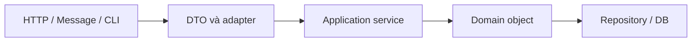

Each boundary has its own responsibility:

| Layer/boundary | Typical validation | Purpose |
|---|---|---|
| **DTO/controller** | Required request fields, data types/formats, error responses to clients | Give users early, clear feedback |
| **Application service** | Authorization, repository data, coordinating multiple objects | Enforce conditions for use cases |
| **Domain object** | Rules that keep the object itself valid | Reject invalid creation/update paths, even when called directly |
| **Repository/DB** | Unique constraints, foreign keys, check constraints, transactional consistency | Protect data integrity across processes |

For example, with Spring Boot and Bean Validation (assuming the project includes a Jakarta Validation dependency):

```java
import jakarta.validation.constraints.Max;
import jakarta.validation.constraints.Min;
import jakarta.validation.constraints.NotBlank;

public record EnrollRequest(
    @NotBlank String courseCode,
    @Min(1) @Max(30) int credits
) {}
```

The controller can trigger validation:

```java
import jakarta.validation.Valid;
import org.springframework.web.bind.annotation.PostMapping;
import org.springframework.web.bind.annotation.RequestBody;
import org.springframework.web.bind.annotation.RestController;

@RestController
class EnrollmentController {
    @PostMapping("/enrollments")
    public void create(@Valid @RequestBody EnrollRequest request) {
        CourseEnrollment enrollment =
            new CourseEnrollment(request.courseCode(), request.credits());
        // Giao cho service/repository theo kiến trúc ứng dụng
    }
}
```

`@Valid` helps reject invalid requests at the HTTP boundary when Bean Validation is properly integrated. But a direct call such as:

```java
new CourseEnrollment("JAVA101", -3);
```

must still be rejected by the domain object, since objects may be created by message consumers, batch jobs, unit tests, or other services that **do not pass through an HTTP controller**.

**Not all validation needs to be repeated identically at every layer.** A DTO can validate input requirements; the domain must maintain invariants; and the database protects constraints requiring global consistency. Each layer enforces its own responsibilities.

## 10. Choose exceptions that express the problem

Java does not require one exception type for every validation failure, but several conventions are common and clear:

| Situation | Common exception | Example |
|---|---|---|
| Argument must not be `null` | `NullPointerException` via `Objects.requireNonNull` or `IllegalArgumentException`, depending on the API | `Objects.requireNonNull(name, "name")` |
| Argument value is invalid | `IllegalArgumentException` | `credits = -1` |
| Operation is invalid in the current state | `IllegalStateException` or a specific domain exception | Paying a canceled order |
| Index is out of bounds | `IndexOutOfBoundsException` | Invalid array/list index |
| Business-rule violation needs a structured error | Custom domain exception | `InsufficientStockException` |

A clear example:

```java
public void withdraw(long amount) {
    if (amount <= 0) {
        throw new IllegalArgumentException("Số tiền phải dương");
    }
    if (amount > balance) {
        throw new IllegalStateException("Số dư không đủ");
    }
    balance -= amount;
}
```

Here, `balance` is assumed to be a nonnegative `long` protected by its constructor. `amount <= 0` is an argument error; `amount > balance` conflicts with the account's current state. If the same information is used to produce an HTTP response, a controller/exception handler can **map the error** to an appropriate message or status without introducing an HTTP dependency into the domain object.

## 11. Input validation is different from synchronization and transactions

Boundary checks protect state **within a properly coordinated execution flow**. They do not solve every concurrency or distributed-consistency problem.

For example, two threads both perform:

```java
if (available >= 1) {
    available--;
}
```

Without synchronization, both threads may see `available = 1` and both allow a reservation. The “do not overbook” business rule can be violated even if each thread validated independently.

When state is shared concurrently, validation must be combined with suitable **locking/synchronization/atomic operations**. When state is held in a database or distributed across services, transactions, optimistic/pessimistic locking, unique constraints, or other consistency mechanisms may be required.

Similarly, a constructor can verify that `userId` is nonblank, but checking that field alone cannot establish uniqueness across the entire database. The unique constraint must be enforced at the authoritative data source.

## 12. Common mistakes

| Mistake | Why it is dangerous | Fix |
|---|---|---|
| Making a field `private` but accepting any setter value | Callers can still create invalid states | Validate every mutator or expose business operations |
| Validating only in the controller | Other construction paths can bypass the controller | Have the domain enforce its own invariant |
| Validating only in the constructor, forgetting update methods | State may be valid initially but invalid later | Reapply invariants during state changes |
| Assigning a field before validating another | Exceptions can leave state partially changed | Validate the entire proposed state before committing |
| Validating a `List`/array but retaining its mutable reference | Callers can change it after validation | Use defensive copying and control getters |
| Treating a `final` `List` as immutable | `final` does not prevent changes to referenced contents | Use immutable collections, defensive copies, or narrower APIs |
| Checking only for negative numbers and ignoring overflow | Calculations can exceed the value range | Check conditions before arithmetic or use `Math.*Exact` |
| Duplicating regex/validation logic in many places | Rules can diverge across entry points | Use value objects/helpers with a consistent contract |
| Assuming validation eliminates race conditions | Checks and updates can interleave across threads | Make operations atomic with respect to the invariant |

## 13. Self-assessment exercises

### Exercise 1 — Find the consistency bug

```java
class Account {
    private long balance = 100;

    void transferOut(long amount) {
        balance -= amount;
        if (amount <= 0 || balance < 0) {
            throw new IllegalArgumentException("Transfer không hợp lệ");
        }
    }

    long balance() {
        return balance;
    }
}
```

**Question:** After `transferOut(200)` throws an exception, what is the value of `balance`?

**Answer:** `-100`. The subtraction happens before validation. Fix this by checking `amount <= 0` and `amount > balance` **before** assigning `balance -= amount`.

### Exercise 2 — Validate relationships between fields

Given a `DateRange` class storing `LocalDate start` and `LocalDate end` with the invariant `start <= end`, design a constructor and `changeRange(start, end)` method so that:

1. `null` is rejected.
2. `start` later than `end` is rejected.
3. Invalid input leaves both previous values unchanged.

Hint:

```java
import java.time.LocalDate;
import java.util.Objects;

public final class DateRange {
    private LocalDate start;
    private LocalDate end;

    public DateRange(LocalDate start, LocalDate end) {
        changeRange(start, end);
    }

    public void changeRange(LocalDate newStart, LocalDate newEnd) {
        Objects.requireNonNull(newStart, "start");
        Objects.requireNonNull(newEnd, "end");
        if (newStart.isAfter(newEnd)) {
            throw new IllegalArgumentException("start phải <= end");
        }
        this.start = newStart;
        this.end = newEnd;
    }

    public LocalDate start() { return start; }
    public LocalDate end() { return end; }
}
```

`LocalDate` is an immutable value type, so directly returning references to `start`/`end` in this example does not expose mutable objects. For multithreaded safety, updates to both fields must still be handled as one consistent change relative to other readers.

### Exercise 3 — Where is the object boundary?

A program receives a `CreateUserRequest` through a REST API, creates a `User`, then saves it to a DB. The REST layer already uses `@NotBlank` on `username`.

**Question:** Must `username` also be validated inside `User`?

**Answer:** Yes, if “nonblank username” is an **invariant** of `User`. The `User` object may be created through paths other than REST. Meanwhile, “username unique across the system” requires a repository/DB or another suitable consistency mechanism to handle competing requests.

---

**Remember:** Protect encapsulation by **validating input at every boundary that can create or modify state**, focusing on the invariants owned by the object. Normalize and validate before storage; for updates to multiple fields, validate the entire proposed change before committing; for mutable inputs, control references through defensive copies. For rules spanning multiple objects, databases, or threads, apply mechanisms at the responsible layer.


</details>

- [Back to top](#back-to-top)

---

## <a id="encapsulation-006">Preventing exposure of mutable internal data</a>

<details>
<summary>View details</summary>

# Preventing exposure of mutable internal data in Java

In object-oriented programming, **encapsulation** means an object controls how its own state is accessed and changed. A common mistake is declaring a field `private` but returning its mutable object directly or retaining an externally supplied mutable reference.

For example, a class enforcing “student enrollment must not exceed capacity” loses control if external code can call `getStudents().add(...)` without going through its validated enrollment method.

**Lesson goal:** recognize when a reference exposes internal state, and use defensive copies, immutable values, and controlled APIs to protect object invariants.

## 1. Why can `private` still be unsafe?

Consider this class:

```java
import java.util.List;

class UnsafeClassroom {
    private final List<String> students;

    UnsafeClassroom(List<String> students) {
        this.students = students;
    }

    List<String> getStudents() {
        return students;
    }
}
```

The `students` field is `private final`, but **the list object** is still mutable. There are two ways to change the underlying data without any setter:

```java
List<String> input = new java.util.ArrayList<>(List.of("An"));
UnsafeClassroom room = new UnsafeClassroom(input);

input.add("Bình");             // Đường 1: sửa qua tham chiếu gốc
room.getStudents().clear();    // Đường 2: sửa qua tham chiếu getter trả ra

System.out.println(input);     // []
System.out.println(room.getStudents()); // []
```

The same list is referenced by `input`, the `students` field, and the result of `getStudents()`. Assigning a reference does not copy the object.

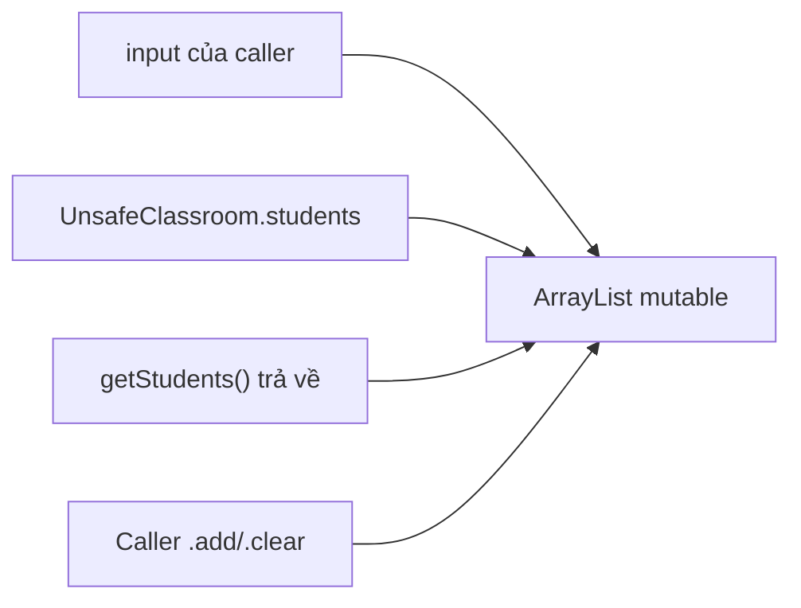

Data leaks in both directions:

- **Inbound aliasing:** a constructor or setter stores the caller's reference unchanged; the caller retains it and can modify the data later.
- **Outbound aliasing:** a getter or another method returns an internal reference directly, letting the caller modify the object through the result.

This can do more than violate business rules. When several components retain the same reference, unexpected changes can cause bugs that are difficult to reproduce.

## 2. A safe design: mutate through behavior, read through snapshots

The following class allows **controlled changes to the student list** through `enroll()`, while retaining control of every internal change. The constructor copies its input; the getter returns **a structurally unmodifiable snapshot**.

Save all the following code in **`Main.java`** and run it with Java 17 or Java 21:

```java
import java.util.ArrayList;
import java.util.Arrays;
import java.util.HashSet;
import java.util.List;
import java.util.Objects;
import java.util.Set;

final class EnrollmentBook {
    private final int capacity;
    private final List<String> students;

    EnrollmentBook(int capacity, List<String> initialStudents) {
        if (capacity <= 0) {
            throw new IllegalArgumentException("Sức chứa phải dương");
        }
        Objects.requireNonNull(initialStudents, "initialStudents");

        // 1. Sao chép tham chiếu list của caller.
        List<String> copied = new ArrayList<>(initialStudents);
        if (copied.size() > capacity) {
            throw new IllegalArgumentException("Vượt sức chứa");
        }

        // 2. Kiểm tra dữ liệu trước khi công bố đối tượng.
        Set<String> unique = new HashSet<>();
        for (String student : copied) {
            validateName(student);
            if (!unique.add(student)) {
                throw new IllegalArgumentException("Học viên trùng");
            }
        }

        this.capacity = capacity;
        this.students = copied;
    }

    void enroll(String student) {
        validateName(student);
        if (students.size() >= capacity) {
            throw new IllegalStateException("Lớp đã đủ chỗ");
        }
        if (students.contains(student)) {
            throw new IllegalArgumentException("Học viên đã tồn tại");
        }
        students.add(student);
    }

    List<String> getStudents() {
        return List.copyOf(students);
    }

    int size() {
        return students.size();
    }

    private static void validateName(String student) {
        if (student == null || student.isBlank()) {
            throw new IllegalArgumentException("Tên học viên không hợp lệ");
        }
    }
}

final class Attachment {
    private final byte[] data;

    Attachment(byte[] original) {
        this.data = Objects.requireNonNull(original, "original").clone();
    }

    byte[] getData() {
        return data.clone();
    }
}

public class Main {
    public static void main(String[] args) {
        List<String> input = new ArrayList<>(List.of("An"));
        EnrollmentBook book = new EnrollmentBook(3, input);

        input.add("Bình"); // Chỉ thay đổi input của caller
        System.out.println(book.getStudents()); // [An]

        List<String> firstSnapshot = book.getStudents();
        try {
            firstSnapshot.add("Cường");
        } catch (UnsupportedOperationException ex) {
            System.out.println("Không thể sửa snapshot");
        }

        book.enroll("Bình"); // Thay đổi qua API kiểm soát
        System.out.println(firstSnapshot);      // [An]
        System.out.println(book.getStudents()); // [An, Bình]
        System.out.println(book.size());        // 2

        byte[] original = {1, 2, 3};
        Attachment attachment = new Attachment(original);
        original[0] = 9; // Không sửa dữ liệu đã lưu
        byte[] exposed = attachment.getData();
        exposed[1] = 8;  // Không sửa dữ liệu đã lưu
        System.out.println(Arrays.toString(attachment.getData()));
    }
}
```

Run:

```bash
javac Main.java
java Main
```

Output:

```text
[An]
Không thể sửa snapshot
[An]
[An, Bình]
2
[1, 2, 3]
```

Important points about the example:

- `new ArrayList<>(initialStudents)` separates **the internal list** from the list still held by the caller.
- `List.copyOf(students)` returns a list whose structure cannot be modified and whose contents reflect the moment of the call. When `book.enroll(...)` runs, the old snapshot `firstSnapshot` still contains `[An]`.
- The students in the example are represented by immutable `String` values, so there is no additional way to modify state through individual elements.
- `Attachment` must `clone()` the array **both on input and on output**, because `byte[]` is always mutable.
- The `EnrollmentBook` class **is still mutable**: what is protected is the right to change state through a controlled API, rather than a ban on all changes.

## 3. Defensive copies at input and output boundaries

A **defensive copy** duplicates data at a trust boundary so other code cannot change state the object needs to own independently.

| Boundary | Code that can leak data | Typical protection |
| --- | --- | --- |
| Constructor accepts a list | `this.items = items;` | `this.items = List.copyOf(items);` or `new ArrayList<>(items)` |
| Setter accepts a list | `this.items = items;` | Validate and copy before storing |
| Getter returns a mutable list | `return items;` | `return List.copyOf(items);` or `new ArrayList<>(items)` |
| Constructor accepts an array | `this.bytes = bytes;` | `this.bytes = bytes.clone();` |
| Getter returns an array | `return bytes;` | `return bytes.clone();` |
| Getter returns mutable `Date` | `return createdAt;` | Return a copy via `new Date(createdAt.getTime())` or use `Instant` by design |
| Returns an internal `Map` | `return scores;` | `Map.copyOf(scores)` if the contained data is safe |
| Returns a nested mutable object | `return settings;` | An appropriate deep copy or immutable value object |

**`List.copyOf` is not the answer in every situation.** If the class needs to modify its internal collection, it can store `new ArrayList<>(input)` and make copies when returning data. If the internal collection should itself be immutable, it can store `List.copyOf(input)`. The choice depends on the behavior the class must support.

`List.copyOf`, `Set.copyOf`, and `Map.copyOf` reject `null` elements or keys/values as specified by their contracts. When `null` is valid data, choose another appropriate structure and copying strategy with a clear API contract.

## 4. An unmodifiable view is not a snapshot

Java offers several ways to return read-only data, but these two approaches have different semantics:

```java
import java.util.ArrayList;
import java.util.Collections;
import java.util.List;

List<String> backing = new ArrayList<>(List.of("A"));

List<String> view = Collections.unmodifiableList(backing);
List<String> snapshot = List.copyOf(backing);

backing.add("B");

System.out.println(view);     // [A, B]
System.out.println(snapshot); // [A]
```

| Mechanism | Can callers invoke `add/remove` through the result? | Do structural changes to the source list become visible? |
| --- | --- | --- |
| `return internalList;` | Yes, if the list is mutable | Yes; callers can also modify it directly |
| `Collections.unmodifiableList(internalList)` | No | **Yes**: it is a view backed by the original list |
| `List.copyOf(internalList)` | No | **No**: it preserves a snapshot of the contents at copy time |
| `new ArrayList<>(internalList)` | Yes, on the independent copy | **No**: modifying the copy does not affect the original list |

`Collections.unmodifiableList` is useful when the intent is to let clients **observe changing state** without modifying it through the view. However, if the requirement is “the data returned must remain stable after the call,” a snapshot is needed.

A few considerations:

- `List.copyOf` may reuse a list that is already unmodifiable, so do not assume it always creates **a new list instance**.
- Neither an unmodifiable view nor a snapshot **automatically makes mutable elements immutable**.
- `new ArrayList<>(...)` creates a structurally independent list, but the caller **is allowed to modify the copy**. This is a valid API contract when the recipient needs to work with its own data.

## 5. A list snapshot can still expose its elements

When elements are mutable, `List.copyOf` and `new ArrayList<>(...)` only copy **the structure or references**, not the state of each element:

```java
class MutableLesson {
    String title;
    MutableLesson(String title) { this.title = title; }
}

MutableLesson lesson = new MutableLesson("OOP");
java.util.List<MutableLesson> snapshot =
        java.util.List.copyOf(java.util.List.of(lesson));
lesson.title = "Đã đổi";
System.out.println(snapshot.get(0).title); // Đã đổi
```

Therefore, inspect **permissions to modify elements**, not only the container's `add/remove` operations. If a stable history or snapshot is required, convert each element into an immutable value object (such as `record Lesson(String title)` with constructor validation) or copy the mutable components that need protection. Deep copying across an object graph and immutable representations are covered in the next lesson.

## 6. Encapsulated API design: expose only necessary behavior

Instead of exposing a mutable `List<OrderLine>` that lets callers increase quantities arbitrarily, a shopping-cart class should provide operations such as:

```java
void addItem(String sku, int quantity);
void changeQuantity(String sku, int newQuantity);
void removeItem(String sku);
List<ItemView> getItems();  // ItemView là value object bất biến
```

Within each method, the class validates rules such as `quantity > 0`, unique product codes, and order limits. Getters return only data needed for display without granting callers the ability to violate business rules.

A getter does not always need to make a complete, large copy. An API may return:

- Primitive or immutable values (`int`, `String`, `LocalDate`).
- An immutable snapshot whose elements are also immutable.
- Computed results or DTOs containing only necessary data.
- A read-only view **when changes over time are intentionally acceptable**.
- An iterator or data stream with a clear contract for mutability and lifecycle.

Do not expose a `public final List<...>` field merely because it cannot be reassigned. The list itself may still allow elements to be added, removed, or modified.

## 7. Recognizing leaks by data type

| Data type | Common leak path | Observation/protection strategy |
| --- | --- | --- |
| `byte[]`, `int[]` | Constructor retains an array; getter returns it directly | `clone()` in both directions (primitive elements) |
| `MutableItem[]` | Array is cloned but elements remain shared | Inspect the state of each element too |
| `java.util.Date` | Caller invokes `setTime()` on a shared reference | Copy with `new Date(date.getTime())` or use `Instant` |
| `List<T>` | Getter returns an `ArrayList`; constructor retains the input list | Snapshot/copy with a suitable element policy |
| `Map<K,V>`, `Set<T>` | Exposes internal structures or shares mutable keys/values | `copyOf` protects only structure; nested objects still matter |

For example, `Collections.unmodifiableMap(internal)` is only a view and continues to reflect updates to the internal map. In contrast, `Map.copyOf(internal)` creates a structural snapshot under its contract but does not deep-copy keys/values. In particular, avoid changing fields involved in a key's `equals/hashCode` implementation in a `HashMap`, since lookups can break.

For legacy APIs that require `Date` or arrays, copying at boundaries is often necessary. For newer models, `Instant`, immutable value objects, and narrow query APIs usually make data ownership easier to understand.

## 8. Limits of defensive copying and common pitfalls

| Misconception | Consequence | Correct approach |
| --- | --- | --- |
| A `private` field cannot be modified externally | Mutable references can still be retained or returned | Inspect every inbound and outbound reference path |
| `final` makes data immutable | Only prevents reassignment of the variable/field | Protect the referenced object itself |
| `Collections.unmodifiableList()` creates a snapshot | Changes to the backing list remain visible | Use `List.copyOf()` when stable contents are required |
| `List.copyOf()` also copies elements | Mutable elements can still be modified | Use immutable elements or deep copies |
| Copying only in a getter | The caller can still mutate through a constructor input reference | Defend both input and output boundaries |
| Copying only in the constructor | The getter may still expose the internal mutable array/list | Do not return mutable references directly |
| Modifying a returned copy to update the object | Changes do not affect the actual state | Update through business methods |
| Calling `clone()` everywhere | Copies may be shallow or unsupported | Choose copying strategies based on the data type |
| Copying a collection while another thread modifies it | The snapshot may fail or be inconsistent | Coordinate synchronization before taking the snapshot |
| Creating a huge copy on every read | More CPU, memory, and GC pressure | Consider immutable models, views with explicit contracts, or narrow query APIs |

**Defensive copying does not make a class thread-safe by itself.** If one thread updates an `ArrayList` while another calls `List.copyOf`, race conditions, inconsistent data, or exceptions can still occur. Shared mutable state requires synchronization or appropriate data structures; snapshots must be taken under a mechanism that protects a consistent state.

A similar problem occurs when a caller modifies a collection while the constructor is copying it. If the input is shared between threads, caller and receiver must agree on synchronization and ownership rather than expecting `new ArrayList<>(input)` to resolve races automatically.

## 9. Performance costs and design decisions

Copying a list of `n` elements typically takes **O(n)** time and memory for the copied list structure. If a snapshot getter is called thousands of times on a very large collection, the cost can be significant. But abandoning defensive protection solely to reduce allocations may violate invariants and create difficult bugs.

Possible approaches:

- Capture a snapshot once at a request or transaction boundary rather than on every small read operation.
- Return the **minimum data** actually needed, such as `size()`, `containsStudent(id)`, or a precomputed DTO.
- Use immutable data models, cached snapshots updated when state changes, or persistent collections when application requirements justify them.
- Keep mutable state inside the class and use business operations for changes instead of handing the collection directly to every caller.

State protection should be **an intentional design contract**: what may the caller observe, can it retain the result, can it modify the returned data, and will older results reflect subsequent internal changes?

## 10. Testing internal-state leaks

Both directions of data leakage can be tested directly for a class such as `EnrollmentBook`:

```java
List<String> input = new ArrayList<>(List.of("An"));
EnrollmentBook book = new EnrollmentBook(2, input);

// Thử thay đổi dữ liệu caller đã đưa vào.
input.add("Bình");
if (book.size() != 1) {
    throw new AssertionError("Constructor làm lộ trạng thái");
}

// Thử thay đổi dữ liệu do getter trả về.
List<String> snapshot = book.getStudents();
try {
    snapshot.add("Cường");
    throw new AssertionError("Getter cho phép sửa snapshot");
} catch (UnsupportedOperationException expected) {
    // Đúng hợp đồng: kết quả không cho sửa cấu trúc.
}

// Thay đổi qua API chính thức không làm đổi snapshot cũ.
book.enroll("Bình");
if (!snapshot.equals(List.of("An"))) {
    throw new AssertionError("Snapshot cũ bị thay đổi");
}
```

This test code belongs inside a method such as `main`, after `EnrollmentBook` has been declared. When a field contains mutable elements, testing must go one step further: modify an **element's** fields through an external reference and verify that internal state remains protected.

## 11. Self-check questions

**1.** Does `private final List<String> students;` followed by `return students;` guarantee encapsulation?

**Answer:** No, if the list is mutable. Callers can invoke `add/remove/clear` directly through the returned reference.

**2.** A constructor uses `this.students = List.copyOf(input)` but the getter returns `students`. Is that safe?

**Answer:** It may be safe if the elements are also immutable (like `String`) and the class retains a structurally unmodifiable list. However, inspect the element objects before concluding that the class is deeply immutable.

**3.** Does `Collections.unmodifiableList(internal)` prevent someone holding `internal` from modifying it?

**Answer:** No. It only prevents mutation **through the view**; updates to the backing list remain visible in that view.

**4.** Is `byte[] getBytes() { return bytes.clone(); }` sufficient if the constructor assigns `this.bytes = input;`?

**Answer:** No. The caller still holds `input` and can modify the internal array. Copy the data on input as well.

**5.** Can a `List<MutableLesson>` copied with `List.copyOf` still have an element's title changed?

**Answer:** Yes, if outside code still holds a reference to that same `MutableLesson`. Immutable elements or a deep copy are required by the contract.

**6.** If a class must support student updates, does it have to become immutable?

**Answer:** No. The class can be mutable with encapsulated state: use `enroll/remove` to enforce rules, and return only snapshots or safe read results.

**Remember:** `private` hides a field name but **does not hide the mutable object** it references. Prevent internal data leaks by controlling references at **both input and output boundaries**, accounting for nested element state, and exposing business behavior instead of distributing mutable data structures directly.


</details>

- [Back to top](#back-to-top)

---

## <a id="encapsulation-007">Defensive copying and immutable representations</a>

<details>
<summary>View details</summary>

# Defensive copying and immutable representations in Java

In OOP, **encapsulation** does not stop at declaring fields `private`. If an object retains a reference to *mutable* data owned elsewhere, or exposes an internal mutable reference through a getter, external code can still violate the object's state without calling a setter.

**Defensive copying** creates copies at input/output boundaries to prevent unintended changes. An **immutable representation** stores and exposes state so that, after construction, the object's observable state remains unchanged.

The two techniques are related but distinct:

- Defensive copying controls **reference sharing** for mutable data.
- Immutable representation controls **the ability to change state**; it commonly uses immutable types, primitive values, and collection snapshots containing immutable elements.
- Some cases require a copy on **both** input and output; protecting only one direction is insufficient.
- An object with a `private final` field can still have changing observable state if that field references a mutable object.

This lesson uses Java 11+ (for `String.isBlank()` and `List.copyOf()`). The practical example captures a fixed event schedule even while the input form continues to edit the attendee list.

## 1. Why doesn't `private final` guarantee immutability?

The following example has two paths for reference “leaks”:

```java
import java.util.Date;

public final class UnsafeReminder {
    private final Date remindAt;

    public UnsafeReminder(Date remindAt) {
        this.remindAt = remindAt; // Giữ đúng đối tượng Date bên ngoài truyền vào
    }

    public Date getRemindAt() {
        return remindAt; // Trả đúng Date nội bộ ra ngoài
    }
}
```

Usage:

```java
Date supplied = new Date(1_000L);
UnsafeReminder reminder = new UnsafeReminder(supplied);

supplied.setTime(2_000L); // Sửa qua tham chiếu mà constructor nhận
System.out.println(reminder.getRemindAt().getTime()); // 2000

reminder.getRemindAt().setTime(3_000L); // Sửa qua tham chiếu getter làm lộ
System.out.println(reminder.getRemindAt().getTime()); // 3000
```

There is no `setRemindAt` method and the field is `private final`, yet the reminder time still changes. `final` only prevents reassigning the `remindAt` variable to another reference; it **does not freeze the referenced `Date` object**.

There are two paths to control:

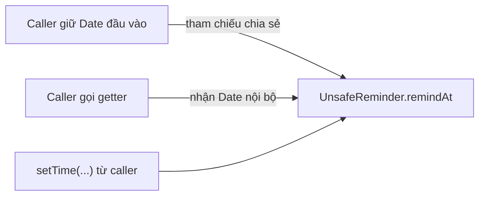

With mutable objects, encapsulation can be broken even when the field is not directly visible.

## 2. Defensive copies in both constructor and getter

Instead of sharing the same `Date`, the class copies it when accepting input and when returning a result:

```java
import java.util.Date;
import java.util.Objects;

public final class SafeReminder {
    private final Date remindAt;

    public SafeReminder(Date remindAt) {
        Objects.requireNonNull(remindAt, "remindAt");
        this.remindAt = new Date(remindAt.getTime());
    }

    public Date getRemindAt() {
        return new Date(remindAt.getTime());
    }
}
```

Verification:

```java
Date source = new Date(1_000L);
SafeReminder reminder = new SafeReminder(source);

source.setTime(2_000L);
Date returned = reminder.getRemindAt();
returned.setTime(3_000L);

System.out.println(reminder.getRemindAt().getTime()); // 1000
```

| Boundary | Approach | Bug prevented |
| --- | --- | --- |
| **Input** | `new Date(remindAt.getTime())` | Caller modifies `source` after passing it in |
| **Output** | `return new Date(remindAt.getTime())` | Caller modifies the `Date` obtained from the getter |
| Internal state | `private final Date remindAt`; no self-mutating operation exposed | External code cannot change the captured time |

This class is **immutable in its observable behavior** if the class itself never modifies `remindAt`: every getter call reports the same instant. However, its internal representation still contains a mutable `Date`. The next section presents a simpler representation.

### Prefer truly immutable representations over repeated copying

If the goal is only to store a point in time, Java provides the immutable `Instant` type (`java.time`):

```java
import java.time.Instant;
import java.util.Objects;

public final class Reminder {
    private final Instant remindAt;

    public Reminder(Instant remindAt) {
        this.remindAt = Objects.requireNonNull(remindAt, "remindAt");
    }

    public Instant getRemindAt() {
        return remindAt; // Chia sẻ kiểu bất biến là an toàn
    }

    public Reminder reschedule(Instant newTime) {
        return new Reminder(newTime); // Trả instance mới
    }
}
```

Calling `remindAt.plusSeconds(60)` returns a new `Instant`; the previous `Instant` object is not modified. Therefore, there is no need to copy each `Instant` returned by a getter. Another option is to store `private final long epochMillis` and convert at the API boundary; a primitive `long` cannot reference mutable state.

**Principle:** prefer a suitable immutable type when available. Defensive copying remains useful when working with APIs that expose mutable types such as `Date`, arrays, or collections with mutable elements.

## 3. Shallow copies versus deep copies

Consider a list containing mutable objects:

```java
import java.util.ArrayList;
import java.util.List;

class GuestDraft {
    String name;

    GuestDraft(String name) {
        this.name = name;
    }
}

List<GuestDraft> input = new ArrayList<>();
input.add(new GuestDraft("An"));

List<GuestDraft> copy = new ArrayList<>(input);

System.out.println(input == copy);            // false
System.out.println(input.get(0) == copy.get(0)); // true

copy.get(0).name = "Bình";
System.out.println(input.get(0).name);        // Bình
```

`new ArrayList<>(input)` creates a new list but only **copies the element references**. The lists thus have separate structures but still share the first `GuestDraft` element.

| Technique | Is the container independent? | Are mutable elements independent? |
| --- | --- | --- |
| `List<T> b = a` | No | No |
| `new ArrayList<>(a)` | Yes | No |
| `List.copyOf(a)` | Semantically a structurally independent, unmodifiable snapshot | No, if elements are mutable |
| Create a new list and copy every mutable element | Yes | Yes, for elements copied correctly |
| Create a new list containing inherently immutable values | Yes | Safe to share the immutable values |

“Deep copy” does not mean Java automatically clones every reachable object. You must **identify which parts of the object graph the class owns**, which parts are mutable, and which must be separated from the caller. With cycles, shared references, external resources, or identity-bearing entities, a general deep copy can be both difficult and semantically wrong.

For example, a “deep” copy of a `BankAccount` might create two instances representing the same real account, misleadingly implying that independent balances are valid. To preserve account information at a point in time, create a **value snapshot** (account number, observed balance, timestamp) rather than duplicating the business entity.

## 4. Complete example: an event schedule with an immutable snapshot

Requirement: an event-registration form uses a mutable `Date` and a list of `AttendeeDraft` objects whose names can change. After confirmation, create an `EventSnapshot` that retains **the event time and attendees as they were at confirmation**. Subsequent changes to the form must not alter the snapshot.

Design requirements:

1. The captured event time never changes.
2. Attendees cannot be added to or removed from the list through the snapshot API.
3. Every attendee in the snapshot must also be immutable, not just the list.
4. Invalid data is rejected during construction; no partially built list remains exposed to future caller modifications.
5. The snapshot can be read without requiring callers to copy more objects.

### File `EventSnapshot.java`

```java
import java.util.ArrayList;
import java.util.Date;
import java.util.List;
import java.util.Objects;

public final class EventSnapshot {
    private final Date startsAt;
    private final List<Attendee> attendees;

    public EventSnapshot(Date startsAt, List<AttendeeDraft> drafts) {
        Objects.requireNonNull(startsAt, "startsAt");
        Objects.requireNonNull(drafts, "drafts");

        // Sao chép Date của caller trước khi giữ lại.
        Date startCopy = new Date(startsAt.getTime());

        // Sao chép *từng phần tử mutable* thành giá trị bất biến.
        List<Attendee> values = new ArrayList<>();
        for (AttendeeDraft draft : drafts) {
            Objects.requireNonNull(draft, "draft");
            values.add(new Attendee(draft.getId(), draft.getName()));
        }

        this.startsAt = startCopy;
        this.attendees = List.copyOf(values);
    }

    public Date getStartsAt() {
        return new Date(startsAt.getTime());
    }

    public List<Attendee> getAttendees() {
        // An toàn vì list không sửa được và Attendee bất biến.
        return attendees;
    }

    // Giá trị bất biến bên trong snapshot.
    public static final class Attendee {
        private final String id;
        private final String name;

        private Attendee(String id, String name) {
            this.id = requireText(id, "id");
            this.name = requireText(name, "name");
        }

        public String getId() {
            return id;
        }

        public String getName() {
            return name;
        }
    }

    // Chỉ dùng làm dữ liệu nhập, cố ý cho phép đổi tên.
    public static final class AttendeeDraft {
        private final String id;
        private String name;

        public AttendeeDraft(String id, String name) {
            this.id = requireText(id, "id");
            this.name = requireText(name, "name");
        }

        public String getId() {
            return id;
        }

        public String getName() {
            return name;
        }

        public void rename(String newName) {
            name = requireText(newName, "name");
        }
    }

    private static String requireText(String value, String field) {
        Objects.requireNonNull(value, field);
        String text = value.strip();
        if (text.isBlank()) {
            throw new IllegalArgumentException(field + " không được trống");
        }
        return text;
    }
}
```

Inspecting the structure:

- `EventSnapshot` is `final` and exposes no setters; both fields are `private final`.
- `Date` is copied in the constructor **and** getter. If only the constructor copied it but the getter returned the field, callers could still modify it; if only the getter copied it, the original input could still affect the snapshot.
- `List.copyOf(values)` creates an unmodifiable structural snapshot, while each contained `Attendee` has an immutable `String` and `final` fields.
- `AttendeeDraft` is a mutable object used during data entry. The constructor creates **a new `Attendee` for each draft** without retaining references to `AttendeeDraft`.
- `requireText` validates data during construction. External code has no way to modify the captured `id` or `name` in an `Attendee`.
- The main class does not directly expose a mutable `ArrayList`. Returning an immutable list of immutable elements is safe because callers cannot modify snapshot state through that path.

### File `Demo.java`

```java
import java.util.ArrayList;
import java.util.Date;
import java.util.List;

public class Demo {
    public static void main(String[] args) {
        Date dateFromForm = new Date(1_000L);
        EventSnapshot.AttendeeDraft an =
                new EventSnapshot.AttendeeDraft("U01", "An");

        List<EventSnapshot.AttendeeDraft> formAttendees =
                new ArrayList<>();
        formAttendees.add(an);

        EventSnapshot snapshot =
                new EventSnapshot(dateFromForm, formAttendees);

        // Form được sửa sau lúc xác nhận.
        dateFromForm.setTime(2_000L);
        an.rename("Bình");
        formAttendees.add(
                new EventSnapshot.AttendeeDraft("U02", "Chi"));

        // Caller thử sửa Date lấy từ getter.
        snapshot.getStartsAt().setTime(3_000L);

        System.out.println(snapshot.getStartsAt().getTime());
        System.out.println(snapshot.getAttendees().size());
        System.out.println(snapshot.getAttendees().get(0).getName());

        try {
            snapshot.getAttendees().clear();
        } catch (UnsupportedOperationException expected) {
            System.out.println("Không cho sửa danh sách snapshot");
        }
    }
}
```

Compile/run with JDK 11+:

```bash
javac EventSnapshot.java Demo.java
java Demo
```

Output:

```text
1000
1
An
Không cho sửa danh sách snapshot
```

The three data types behave differently:

| Data | After editing the form | Returned snapshot |
| --- | --- | --- |
| `dateFromForm` | 2000 | `getStartsAt().getTime() == 1000` |
| `an.name` | Bình | `getAttendees().get(0).getName()` is An |
| `formAttendees.size()` | 2 | `getAttendees().size()` is 1 |
| `Date` returned by getter | Caller changes it to 3000 | Next getter call still returns 1000 |
| List returned by getter | `clear()` throws an exception | Snapshot data remains unchanged |

### Data flow

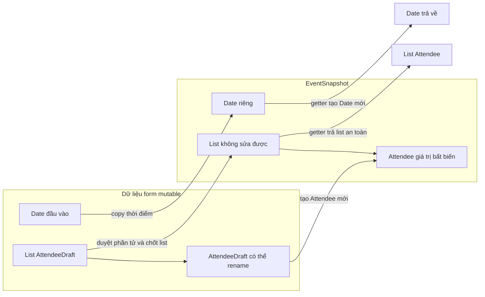

The diagram illustrates data ownership; it does not represent memory addresses or the internal structure of collection classes.

## 5. How do `Collections.unmodifiableList` and `List.copyOf` differ?

Both APIs can prevent callers from modifying a list through the received reference, but **they do not protect against the same kinds of changes**.

```java
import java.util.ArrayList;
import java.util.Collections;
import java.util.List;

List<String> source = new ArrayList<>();
source.add("A");

List<String> view = Collections.unmodifiableList(source);
List<String> snapshot = List.copyOf(source);

source.add("B");

System.out.println(view);     // [A, B]
System.out.println(snapshot); // [A]
```

- `Collections.unmodifiableList(source)` creates **a view that cannot be modified through that view**, but still reflects changes made to `source`.
- `List.copyOf(source)` provides **structural snapshot semantics** at call time (it may reuse an existing unmodifiable instance). Subsequent additions/removals to the source list do not alter the result.
- **Neither automatically deep-copies mutable elements.** If the list contains `AttendeeDraft` objects, calling `rename()` on a shared element can still change data observed through the list.
- `List.copyOf` rejects `null` elements. When `null` must be retained, choose a different representation or validation policy deliberately.

For immutable `List<String>` or `List<Attendee>` data such as the example above, `List.copyOf` is a concise, safe way to expose a snapshot. With `List<MutableItem>`, elements require additional protection.

### Alternative: getters returning copies of mutable lists

If the element type cannot be replaced, you may need to copy every element on both input and output:

```java
import java.util.ArrayList;
import java.util.List;

static List<java.util.Date> copyDates(List<java.util.Date> input) {
    List<java.util.Date> result = new ArrayList<>();
    for (java.util.Date date : input) {
        result.add(new java.util.Date(date.getTime()));
    }
    return result;
}
```

When storing `private final List<Date> dates = copyDates(input)`, the getter should return `copyDates(dates)` to avoid exposing individual mutable `Date` objects. However, this design requires repeated copying and makes it easy to overlook a boundary. Switching to `List<Instant>` is simpler and makes immutability easier to maintain.

## 6. Arrays, maps, sets, and nested data

### Array

An array allows changes to individual elements or positions:

```java
public final class TagSet {
    private final String[] tags;

    public TagSet(String[] tags) {
        this.tags = tags.clone(); // Copy khi nhận
    }

    public String[] getTags() {
        return tags.clone();      // Copy khi trả
    }
}
```

With `String[]`, cloning is sufficient for this purpose because each `String` is immutable. With `Date[]`, cloning only copies **element references**, so each `Date` must also be copied if complete independence is needed. The same applies to multidimensional arrays: `matrix.clone()` creates only a new outer array.

In production classes, validate `null` and each element's invariants within the constructor; the `TagSet` example focuses on cloning behavior to make it easy to observe.

### Maps and sets

`Map.copyOf(map)` and `Set.copyOf(set)` create unmodifiable containers structurally detached from later changes to their inputs; they **do not automatically deep-copy** mutable keys, values, or elements. With `HashMap`, do not use an object as a key and then change fields involved in `equals`/`hashCode`: lookups may stop working correctly because the bucket was chosen using the old hash.

### Object graph

If an `Order` holds a `List<OrderLine>` and each `OrderLine` holds a `Product` whose price can change, copying only the `Order` and `List` does not ensure that the captured total remains fixed.

For a fixed report, store:

```java
final class OrderLineSnapshot {
    final String productCode;
    final long unitPriceVnd;
    final int quantity;

    OrderLineSnapshot(String productCode, long unitPriceVnd,
                      int quantity) {
        this.productCode = productCode;
        this.unitPriceVnd = unitPriceVnd;
        this.quantity = quantity;
    }
}
```

The fields here are primitive values or immutable `String` objects; no mutable `Product` object is retained. Production code needs additional price/quantity validation and numerical policies. The key idea is to **capture business values that must remain immutable**, rather than blindly copying the entire object graph.

## 7. Distinguishing “immutable” from “unmodifiable through one reference”

| Term | Meaning | Example |
| --- | --- | --- |
| **Mutable object** | An instance's state can change | `Date`, `ArrayList`, `StringBuilder` |
| **Immutable object** | Observable state remains unchanged after construction | `String`, `Instant`, a correctly designed snapshot |
| **Unmodifiable view** | The container cannot be modified through the view, but its source may change | `Collections.unmodifiableList(source)` |
| **Structural snapshot** | Captures a container's structure at a point in time | `List.copyOf(source)` |
| **Shallow copy** | Copies the outer container but retains element references | `new ArrayList<>(source)` |
| **Defensive copy** | Copies at boundaries to protect ownership and invariants | `new Date(input.getTime())` in a constructor/getter |
| **Deep copy of the necessary parts** | Also copies mutable internals that must be separated from external code | Convert each `AttendeeDraft` into a new `Attendee` |

A class is not automatically immutable because it is named `ImmutableSomething`, uses `final class`, declares every field `private final`, or returns an unmodifiable collection. To establish immutability, examine **every path through which a caller could modify data** and all nested mutable references.

Java 16+ provides `record` to simplify data-carrier types, but records also **do not deep-copy automatically**:

```java
// Java 16+
import java.util.List;

public record TeamSnapshot(List<String> members) {
    public TeamSnapshot {
        members = List.copyOf(members);
    }
}
```

Here the record captures the structure of a `List<String>` in its canonical constructor; its accessor returns an already unmodifiable list. Replacing `String` with a mutable object would require handling the elements and possibly customizing the constructor/accessor. `record` syntax reduces boilerplate; it does not replace data-ownership design.

## 8. Copy at the appropriate boundary

Not everything needs copying. Copies cost time and memory, especially for large object graphs or data an application **deliberately shares**. Choose according to the API contract.

| Situation | Reasonable choice |
| --- | --- |
| A field receives a mutable object that the class needs to own independently | Defensive copy in the appropriate constructor/setter |
| A getter must not expose an internal mutable object | Copy in the getter or return an immutable type |
| A list of immutable values needs a snapshot | `List.copyOf` or equivalent snapshot mechanism |
| A list with mutable elements needs an independent snapshot | Copy or convert each element into an immutable value |
| Multiple components *intentionally* share one business object | Define mutation rights, synchronization, and lifecycle; do not copy indiscriminately |
| Data is inherently immutable, such as `String` or `Instant` | Sharing references is generally safe |
| Large transactions or high-volume data | Consider copying cost and design value objects/snapshots for the necessary scope |

Distinguish **value snapshots** from **entity identity**. An immutable transaction record may store source/destination account numbers and the amount without cloning entire account objects. Copying an identity-bearing entity can create two independently changing states with the same ID, causing confusion.

## 9. Immutability and concurrency: benefits, but not a complete solution

Truly immutable objects are often easier to share between threads because their internal state cannot change after construction. Nevertheless:

- While **constructing a snapshot**, another thread modifying the `List` or individual `AttendeeDraft` objects may cause inconsistent copied data or iteration failures. Read under an appropriate lock, snapshot stable data, or coordinate access with the component that owns the data.
- If an application repeatedly replaces a `currentSnapshot` reference across threads, **publishing the new reference** still requires appropriate memory-visibility mechanisms such as `volatile`, locks, or corresponding concurrent structures. Immutable individual snapshots do not synchronize reference assignments by themselves.
- The immutability of one object does not replace database transactions when changes across several records must be atomic.

The `EventSnapshot` example assumes that another thread is not editing the form while the constructor copies it. The snapshot provides stable state **after** successful construction.

## 10. Common mistakes when assessing immutability

| Code or assumption | Risk | Remedy |
| --- | --- | --- |
| `this.date = inputDate;` | Caller can modify the internal object | Copy on input or switch to an immutable type |
| `return date;` where `date` is a `Date` | Getter exposes a mutable reference | Copy on output |
| `private final List<Item> items` | `final` does not prevent list or item mutation | Examine the mutability of both container and elements |
| `Collections.unmodifiableList(input)` | Changes to `input` remain visible through the view | Take a structural snapshot when needed |
| `List.copyOf(listOfMutableItems)` | Elements remain shared | Snapshot/copy each element |
| `array.clone()` on an array of nested objects | Copies only one array level | Copy the mutable layers that need isolation |
| Copying an entity while retaining its identity | Can create inconsistent states with duplicate IDs | Create a value snapshot instead of duplicating the entity |
| Getter returns an immutable type but constructor retains mutable data | Changes through the input reference still propagate | Defend both inbound and outbound boundaries |
| “The object is immutable, so constructing it from data being modified is safe” | May capture inconsistent state | Synchronize data reading/capture |

## 11. Applied exercises

**Exercise 1 — Fix a reference leak**

Given the class:

```java
public final class ExamSession {
    private final java.util.Date beginsAt;

    public ExamSession(java.util.Date beginsAt) {
        this.beginsAt = beginsAt;
    }

    public java.util.Date getBeginsAt() {
        return beginsAt;
    }
}
```

Rewrite its constructor and getter so the caller cannot modify `beginsAt` after construction, and reject `null`.

*Guide:* use `Objects.requireNonNull`; create `new Date(input.getTime())` at both boundaries.

**Exercise 2 — Choose the right copying depth**

Suppose you have `List<StringBuilder> notes`. You must return a snapshot that cannot be used to change the original object's note contents. Write a method that converts each `StringBuilder` into a `String` and returns `List.copyOf` of the result. Explain why `List.copyOf(notes)` alone does not satisfy the requirement.

**Exercise 3 — Understand the output**

```java
java.util.List<String> original =
        new java.util.ArrayList<>(java.util.List.of("A"));

java.util.List<String> view =
        java.util.Collections.unmodifiableList(original);
java.util.List<String> snapshot =
        java.util.List.copyOf(original);

original.add("B");

System.out.println(view);
System.out.println(snapshot);
```

**Answer:** `view` prints `[A, B]`, and `snapshot` prints `[A]`. Both may throw `UnsupportedOperationException` if a caller tries `add(...)` through them, but the view is not structurally detached from the source list.

**Exercise 4 — Design a system**

You have a mutable `Order`, and an issued invoice must remain unchanged when product prices are updated later. Identify which data should be captured in an `InvoiceSnapshot` (product code, name, price at sale time, quantity, line total, etc.), which data should be stored by reference identifier, and who is responsible for creating the snapshot from a consistent transactional state.

*Hint:* do not copy an entire mutable `Product` entity into an invoice and assume it will preserve the old price. Convert the necessary information into immutable values and finalize them within an appropriate business transaction.

### Self-check when designing a class

When a class needs to preserve stable state, ask:

1. Which state is **immutable by business rules**, and which needs controlled changes?
2. Does any field retain an external `Date`, array, collection, or mutable object?
3. Which references can callers still use to modify data **after passing it into the constructor**?
4. Does a getter return an internal mutable object directly?
5. Once a collection is snapshotted, are **its elements** truly immutable?
6. Could `Instant`, `String`, a custom value type, or a primitive replace a mutable structure?
7. Is a consistent concurrent copy and safe publication across threads needed?

**Core point:** defensive copying establishes data-ownership boundaries; immutable representations preserve an object's meaning over time. Used together at the right boundaries, they allow a Java class to maintain its invariants while providing an API that is easy to use and test.


</details>

- [Back to top](#back-to-top)

---

## <a id="encapsulation-008">Encapsulating behavior rather than merely wrapping data</a>

<details>
<summary>View details</summary>

# Encapsulating behavior rather than merely wrapping data in Java OOP

**Encapsulation** involves more than making fields `private` and generating getters/setters. Its greater value is making **an object responsible for performing valid operations on its own state**. External code expresses an *intention*, such as “confirm an order” or “add a product”; the object decides whether the operation is allowed and updates related properties consistently.

For example, instead of requiring callers to check conditions and then invoke `order.setStatus(CONFIRMED)`, give `Order` a `confirm()` method. When confirmation rules change, update them where the order's behavior is owned.

## 1. Why is merely wrapping data insufficient?

Consider a simple order class:

~~~java
import java.math.BigDecimal;

public class OrderData {
    private String status;
    private BigDecimal total;

    public String getStatus() {
        return status;
    }

    public void setStatus(String status) {
        this.status = status;
    }

    public BigDecimal getTotal() {
        return total;
    }

    public void setTotal(BigDecimal total) {
        this.total = total;
    }
}
~~~

Although all fields are `private`, this class still allows:

~~~java
OrderData order = new OrderData();

order.setStatus("CONFIRMED");
order.setTotal(new BigDecimal("-90000"));
~~~

Nothing prevents an order with no products or a negative total from being confirmed. All knowledge of valid states may be pushed outside:

~~~java
// Mỗi đoạn code gọi tới OrderData có nguy cơ phải kiểm tra lại:
if (order.getTotal() != null &&
        order.getTotal().signum() > 0 &&
        !"CANCELLED".equals(order.getStatus())) {
    order.setStatus("CONFIRMED");
}
~~~

If the system adds rules such as “products cannot be added after confirmation” or “canceled orders cannot be confirmed again,” many callers must remember and enforce them independently. This design is often called an **anemic domain model** (a domain model that mainly carries data and has little business behavior).

The problem is not with getters/setters themselves. They suit many data-transfer types or simple configuration objects. The problem occurs when **state carries business rules** but every caller can control it through unconstrained setters.

| Question | Class that merely wraps data | Object that encapsulates behavior |
| --- | --- | --- |
| Who decides which states are valid? | Usually external calling code | The object that owns the state |
| How does external code request a change? | `setStatus(...)`, `setTotal(...)` | `confirm()`, `addLine(...)`, `cancel()` |
| Where do the rules live? | Easily duplicated across controllers/services/UIs | Centered around protected behavior |
| What happens when rules are added? | Many field assignments must be found | Related behavior methods are updated |
| Risk of invalid states? | High if checks are forgotten | Lower when all mutation paths are controlled |

A method name describing **a business action** usually communicates intent more effectively than a setter name describing data storage.

## 2. Complete Java example: let Order manage its own lifecycle

Suppose the following rules apply:

- A new order starts in the `DRAFT` state.
- While in `DRAFT`, products may be added with nonblank SKUs, positive unit prices, and positive quantities.
- Only a `DRAFT` order with at least one line item can be confirmed.
- No line items may be added after confirmation.
- Only a `CONFIRMED` order can be canceled; once canceled, it cannot be confirmed again.
- The total is **calculated from line items**, never assigned directly by external code.

This is a self-contained illustrative model without payment, shipping, or database integration. Run it on **Java 11+**, saving everything in `EncapsulatedOrderDemo.java`.

~~~java
import java.math.BigDecimal;
import java.util.ArrayList;
import java.util.List;
import java.util.Objects;

public class EncapsulatedOrderDemo {

    enum Status {
        DRAFT, CONFIRMED, CANCELLED
    }

    // Dòng hàng là một value object: không có setter.
    static final class OrderLine {
        private final String sku;
        private final BigDecimal unitPrice;
        private final int quantity;

        OrderLine(String sku, BigDecimal unitPrice, int quantity) {
            String checkedSku =
                    Objects.requireNonNull(sku, "sku").trim();
            Objects.requireNonNull(unitPrice, "unitPrice");

            if (checkedSku.isEmpty()) {
                throw new IllegalArgumentException("SKU không được rỗng");
            }
            if (unitPrice.signum() <= 0) {
                throw new IllegalArgumentException("Giá phải dương");
            }
            if (quantity <= 0) {
                throw new IllegalArgumentException("Số lượng phải dương");
            }

            this.sku = checkedSku;
            this.unitPrice = unitPrice;
            this.quantity = quantity;
        }

        String getSku() {
            return sku;
        }

        BigDecimal subtotal() {
            return unitPrice.multiply(BigDecimal.valueOf(quantity));
        }
    }

    static final class Order {
        private final String id;
        private final List<OrderLine> lines = new ArrayList<>();
        private Status status = Status.DRAFT;

        Order(String id) {
            String checkedId =
                    Objects.requireNonNull(id, "id").trim();
            if (checkedId.isEmpty()) {
                throw new IllegalArgumentException("Mã đơn không được rỗng");
            }
            this.id = checkedId;
        }

        public String getId() {
            return id;
        }

        public Status getStatus() {
            return status;
        }

        public List<OrderLine> getLines() {
            // Bản sao không thể sửa cấu trúc; OrderLine cũng bất biến.
            return List.copyOf(lines);
        }

        public BigDecimal getTotal() {
            BigDecimal total = BigDecimal.ZERO;
            for (OrderLine line : lines) {
                total = total.add(line.subtotal());
            }
            return total;
        }

        public void addLine(String sku, BigDecimal price, int quantity) {
            requireDraft();
            // Kiểm tra xong trước khi cập nhật danh sách.
            OrderLine candidate = new OrderLine(sku, price, quantity);
            lines.add(candidate);
        }

        public void confirm() {
            requireDraft();
            if (lines.isEmpty()) {
                throw new IllegalStateException(
                        "Không thể xác nhận đơn hàng rỗng"
                );
            }
            status = Status.CONFIRMED;
        }

        public void cancel() {
            if (status != Status.CONFIRMED) {
                throw new IllegalStateException(
                        "Chỉ đơn đã xác nhận mới được hủy"
                );
            }
            status = Status.CANCELLED;
        }

        private void requireDraft() {
            if (status != Status.DRAFT) {
                throw new IllegalStateException(
                        "Chỉ được sửa đơn ở trạng thái DRAFT"
                );
            }
        }
    }

    public static void main(String[] args) {
        Order order = new Order("ORD-101");

        try {
            order.confirm();
        } catch (IllegalStateException ex) {
            System.out.println("Từ chối: " + ex.getMessage());
        }

        order.addLine("BOOK-01", new BigDecimal("80000"), 2);
        order.addLine("PEN-01", new BigDecimal("50000"), 1);

        System.out.println("Tổng tiền: "
                + order.getTotal().toPlainString());

        order.confirm();
        System.out.println("Trạng thái: " + order.getStatus());

        try {
            order.addLine("BOOK-02", new BigDecimal("90000"), 1);
        } catch (IllegalStateException ex) {
            System.out.println("Từ chối: " + ex.getMessage());
        }

        order.cancel();
        System.out.println("Sau hủy: " + order.getStatus());
        System.out.println("Số dòng hàng: " + order.getLines().size());
    }
}
~~~

Compile and run:

~~~bash
javac EncapsulatedOrderDemo.java
java EncapsulatedOrderDemo
~~~

Output:

~~~text
Từ chối: Không thể xác nhận đơn hàng rỗng
Tổng tiền: 210000
Trạng thái: CONFIRMED
Từ chối: Chỉ được sửa đơn ở trạng thái DRAFT
Sau hủy: CANCELLED
Số dòng hàng: 2
~~~

The key point: `Order` enforces each rule where its state actually changes. Calling code **does not need to know** how to assign the `status` field or how a `total` would be updated alongside `lines`.

### Why is this design safer?

**No `setStatus()` method.** Callers express only the intent to `confirm()` or `cancel()`; state transitions are validated.

**No `setTotal()` method.** `getTotal()` computes its result from source data, preventing a separately assigned total from becoming inconsistent with the product list.

**No exposure of an internal mutable list.** `getLines()` returns a structural snapshot via `List.copyOf(lines)`. If it returned `lines` directly, external code could call `clear()` to remove products from a confirmed order, bypassing `requireDraft()`. In this example, `OrderLine` is also immutable, so callers cannot circumvent the rules by modifying elements.

**Validate before writing.** `addLine()` creates and validates an `OrderLine` before appending it to the list; `confirm()` and `cancel()` assign `status` only after their conditions are satisfied. Rejected operations leave no partial updates.

## 3. Tracking state through diagrams and tables

Valid state transitions of `Order`:

~~~mermaid
stateDiagram-v2
    [*] --> DRAFT : new Order(...)
    DRAFT --> DRAFT : addLine(...)
    DRAFT --> CONFIRMED : confirm() khi có dòng hàng
    CONFIRMED --> CANCELLED : cancel()
~~~

Transitions **without arrows** (such as `CANCELLED → CONFIRMED` or `CONFIRMED → DRAFT`) are not permitted by the example API.

| Current state | Call | Result |
| --- | --- | --- |
| `DRAFT`, no line items | `confirm()` | Throws `IllegalStateException`; remains `DRAFT` |
| `DRAFT`, valid product provided | `addLine(...)` | Adds a line item; remains `DRAFT` |
| `DRAFT`, contains products | `confirm()` | Transitions to `CONFIRMED` |
| `CONFIRMED` | `addLine(...)` | Rejected; no product added |
| `CONFIRMED` | `cancel()` | Transitions to `CANCELLED` |
| `CANCELLED` | `confirm()` or `cancel()` | Rejected |

This model's **invariants** (conditions that must hold whenever the object can validly be observed) include: nonblank order codes; valid SKUs, positive prices, and quantities for every `OrderLine`; a list that cannot be directly modified by external code; a state that belongs to one of the three enum values; and at least one line item from prior confirmation whenever the state is `CONFIRMED` or `CANCELLED`.

A well-designed behavior method should preserve invariants before and after every successful operation. For rejected operations, it should fail **before changing state** whenever feasible.

## 4. “Tell, Don't Ask”: ask an object to act instead of extracting data to act on it

The **Tell, Don't Ask** principle encourages sending a business request to the object that owns the data rather than repeatedly inspecting its state and performing the operation externally.

**An approach that scatters rules:**

~~~java
// Chỉ minh họa phong cách code: một kiểu Order khác có các setter này.
if (order.getStatus() == Status.DRAFT
        && !order.getLines().isEmpty()) {
    order.setStatus(Status.CONFIRMED);
}
~~~

**An intention-revealing approach:**

~~~java
order.confirm();
~~~

The `confirm()` method defines the conditions and state transition. When new rules appear, such as checking the delivery address before confirmation, the confirmation behavior or an appropriate collaborator can be extended without searching for `setStatus` calls throughout the application.

This **does not mean getters are bad**. Getters are useful for display, logging, and reporting:

~~~java
System.out.println(order.getStatus());
System.out.println(order.getTotal());
~~~

The difference is **purpose**: *reading for presentation* is reasonable; *reading all state to make a business decision and then assigning several fields externally* often suggests misplaced responsibility.

## 5. What should a good behavioral interface hide?

An object's API should expose **operations meaningful to the business domain** while hiding implementation details that may change.

| Data/operation | Expose publicly? | Reason |
| --- | --- | --- |
| `getStatus()` | Possibly | The UI needs to know the current state |
| `getTotal()` | Possibly | Display totals and support reconciliation |
| `addLine(...)` | Yes | Expresses adding a product and allows validation |
| `confirm()`, `cancel()` | Yes | Express business state transitions |
| `setStatus(Status)` | No in this example | Would bypass the confirmation/cancellation workflow |
| `setTotal(BigDecimal)` | No | Could make the total inconsistent with line items |
| `getMutableLines()` returns the internal `ArrayList` | No | Callers could modify the list without following rules |
| Helper `requireDraft()` | `private` | Implements internal rules |

Also avoid the opposite mistake: creating a method such as `setDataWithValidation()` that merely renames a setter while external code still decides the entire workflow and state. Ask: **“What real operation does this method represent for the object?”**

For complex objects, not every statement needs its own public method. Expose only behavior useful to clients and keep internal details at an appropriate `private` level.

## 6. Dividing responsibilities between entities and services

Behavioral encapsulation **does not mean cramming all application logic into one entity**. Distinguish:

- **Entity / domain object**: enforces its own state and directly related rules, such as `Order.confirm()`, `Order.addLine()`, and `Order.cancel()`.
- **Application service**: coordinates a use case involving repositories, payment gateways, shipping services, or notifications.
- **Infrastructure adapter**: handles HTTP, database, message broker, and other connections.

For example, an order-confirmation flow **illustrating only the architecture**:

~~~java
// Pseudocode: minh họa trách nhiệm, không phải đoạn chạy độc lập.
public void confirmOrder(String orderId) {
    Order order = repository.findById(orderId);

    order.confirm();            // Quy tắc của chính Order
    repository.save(order);     // Lưu trữ qua repository
    eventPublisher.publishOrderConfirmed(order.getId());
}
~~~

`Order` does not need to know how to connect to databases or send emails. `OrderService` (or a use-case service) should not need to reimplement the “order has items and is in DRAFT” condition by reading multiple `Order` fields.

**Consistency note:** the pseudocode only illustrates separation of responsibilities. In a real system, persisting orders and publishing events may fail at different times; transactions, transactional outboxes, retries, or other mechanisms may be needed. Moving rules into an entity **does not automatically solve** distributed-system and transaction problems.

A clear guide for locating logic:

| Logic to enforce | Typical location |
| --- | --- |
| “Only draft orders can accept new items” | `Order` |
| “Cannot confirm an empty order” | `Order` |
| “Line total = price × quantity” | `OrderLine` |
| “Find an order in the database” | Repository |
| “Call the bank to collect payment” | Payment gateway / service |
| “Coordinate confirmation, persistence, and event publishing” | Application service |
| “Rules involving several entities but owned by none individually” | Domain service or an appropriate business workflow |

The boundary depends on the business domain; there is no mandatory formula for every application.

## 7. Why must returned data be protected too?

Declaring `private List<OrderLine> lines` is **not sufficient** if a getter returns the list directly:

~~~java
class UnsafeOrder {
    private final List<String> skus = new ArrayList<>();

    List<String> getSkus() {
        return skus; // Trả về danh sách mutable bên trong
    }
}
~~~

Calling code can modify object state without using the designed behavior:

~~~java
UnsafeOrder order = new UnsafeOrder();
order.getSkus().add("ITEM-001");
~~~

Common choices include:

| How data is exposed | Effect |
| --- | --- |
| `return lines;` | Exposes a mutable collection if `lines` is mutable |
| `return Collections.unmodifiableList(lines);` | An unmodifiable view through the getter that still reflects subsequent changes to the internal list |
| `return List.copyOf(lines);` | An unmodifiable structural snapshot, but **does not deep-copy** elements |
| Return an immutable DTO/value object | May also protect element state, depending on the design |

In `EncapsulatedOrderDemo`, `OrderLine` has `private final` fields containing `String`, `BigDecimal`, and `int` (none exposing mutable internal contents), and no setters. Thus, combining them with `List.copyOf(lines)` meets the list-protection requirements of this example. If elements contain mutable `List` or `Date` values, deeper defensive copying must be considered.

## 8. Test behavior, not just getters and setters

A good test expresses **business rules**, including what happens when an operation is rejected.

For example, using **JUnit 5**, place a test in the same package as `EncapsulatedOrderDemo`:

~~~java
import static org.junit.jupiter.api.Assertions.*;
import java.math.BigDecimal;
import org.junit.jupiter.api.Test;

class OrderBehaviorTest {

    @Test
    void cannotConfirmEmptyOrder() {
        EncapsulatedOrderDemo.Order order =
                new EncapsulatedOrderDemo.Order("ORD-101");

        assertThrows(IllegalStateException.class, order::confirm);
        assertEquals(EncapsulatedOrderDemo.Status.DRAFT,
                order.getStatus());
    }

    @Test
    void confirmedOrderCannotBeEdited() {
        EncapsulatedOrderDemo.Order order =
                new EncapsulatedOrderDemo.Order("ORD-102");

        order.addLine("BOOK", new BigDecimal("100000"), 2);
        order.confirm();

        assertThrows(IllegalStateException.class,
                () -> order.addLine("PEN", BigDecimal.TEN, 1));

        assertEquals(new BigDecimal("200000"), order.getTotal());
        assertEquals(1, order.getLines().size());
    }

    @Test
    void callerCannotModifyInternalLines() {
        EncapsulatedOrderDemo.Order order =
                new EncapsulatedOrderDemo.Order("ORD-103");
        order.addLine("BOOK", BigDecimal.TEN, 1);

        assertThrows(UnsupportedOperationException.class,
                () -> order.getLines().clear());
        assertEquals(1, order.getLines().size());
    }

    @Test
    void cannotConfirmAgainAfterCancellation() {
        EncapsulatedOrderDemo.Order order =
                new EncapsulatedOrderDemo.Order("ORD-104");

        order.addLine("BOOK", BigDecimal.TEN, 1);
        order.confirm();
        order.cancel();

        assertThrows(IllegalStateException.class, order::confirm);
        assertEquals(EncapsulatedOrderDemo.Status.CANCELLED,
                order.getStatus());
    }
}
~~~

The sample test requires the appropriate JUnit Jupiter dependency and test runner; the `EncapsulatedOrderDemo.java` program in section 2 **runs independently** using the Java standard library.

These tests do not merely prove that setters work; they verify that **the object rejects invalid operations** and maintains correct state after rejection. That is the behavior worth preserving during refactoring.

## 9. When is a behavior-rich model useful?

Favor moving behavior into an object when:

- A data field has **state-transition rules** or constraints involving other fields.
- Multiple callers repeat the same `get... → if... → set...` sequence.
- Incorrect updates can create invalid business data.
- The object has natural actions such as `approve`, `reserve`, `withdraw`, `activate`, or `close`.
- You want to test business logic through a clear API without depending directly on field structure.

This approach is not necessary for every object:

- **DTO/request/response** types primarily transfer or display data and may need only constructors, getters, and boundary mapping/validation.
- **Immutable value objects** can focus on constructor validation and transformations returning new objects.
- **Integration tasks or workflows spanning multiple objects** generally need coordinating services.
- Simple configuration data without complex invariants need not be forced into a state machine.

A useful example of shifting from data-oriented to behavior-oriented design:

| Field-oriented thinking | Action-oriented thinking |
| --- | --- |
| “Allow modifying `status`” | “Under what conditions may confirmation/cancellation happen?” |
| “Need a setter to change `balance`” | “What rules govern deposits, withdrawals, and transfers?” |
| “Change `reserved` from 2 to 5” | “Is requesting 3 additional reserved units valid?” |
| “Change `isActive`” | “Who may activate or deactivate it, and when?” |
| “The total is a stored number” | “Which source data determines the total?” |

## 10. Common mistakes when moving to behavioral encapsulation

**1. Merely renaming a setter.** `updateStatus(CONFIRMED)` still lets callers choose state directly. Design a `confirm()` operation with explicit conditions.

**2. Validating in a controller while leaving the entity freely mutable.** Another API, batch job, or test can bypass the controller. Core entity rules belong in its state-changing API, unless there is a clear architectural reason otherwise.

**3. Exposing mutable collections.** A getter returning a reference to an internal collection creates a mutation path that bypasses behaviors.

**4. Partially updating state before throwing.** Validate all conditions and necessary data before assignment when possible; operations involving multiple objects require a suitable consistency strategy.

**5. Putting all logic into one enormous class.** Divide responsibilities according to the data the object actually owns; let services coordinate external interactions.

**6. Assuming encapsulation guarantees concurrency safety.** If multiple threads call `addLine()` or `confirm()` concurrently on the same `Order`, the sample using `ArrayList` and ordinary fields here **is not thread-safe**. Real systems need request/aggregate boundaries and synchronization, transactions, optimistic locking, or equivalent mechanisms.

## 11. Practice exercises

**Exercise 1.** A `BankAccount` class has `getBalance()` and `setBalance(BigDecimal)`. Propose an API that expresses business intent better.

**Hint:** `deposit(amount)`, `withdraw(amount)`, and perhaps `transferTo(target, amount)` if the design can protect both accounts. Enforce positive amounts, sufficient funds, limits, and consistency in appropriate methods; transfers between accounts may require transactions/locking.

**Exercise 2.** Where should the rule “delivered orders cannot be canceled” be checked?

**Hint:** Cancellation behavior in `Order` (or its related lifecycle/authorization model) must know the relevant shipping status. Avoid checking only in a UI while allowing `setStatus(CANCELLED)` elsewhere.

**Exercise 3.** Should every getter on `Order` be removed to follow Tell, Don't Ask?

**Answer:** No. Reading data for display, queries, and reports is legitimate. The warning applies when external code repeatedly reads state to **make decisions on the object's behalf** and then directly modifies multiple fields.

**Exercise 4.** If `Order.getLines()` returns `List.copyOf(lines)` but each `OrderLine` has a `setPrice()` method, is the object fully protected?

**Answer:** No. The collection's structure cannot be changed, but callers can still modify mutable elements through their references. Design immutable `OrderLine` objects, use suitable defensive copies, or expose only safe observable data.

**Exercise 5.** If confirming an order requires payment through an API and persistence to a database, should `Order.confirm()` make the HTTP call directly?

**Hint:** Usually not. Let `Order` decide whether the transition is valid; an application service coordinates the payment gateway, persistence, and event publishing. The design must consider what happens if part of an external workflow fails.

A key design question is: **“What is this object responsible for protecting, and what actions do its clients need to request?”** When an API describes behavior instead of merely exposing data, the class is generally easier to use correctly, harder to misuse, and easier to test against business rules.


</details>

- [Back to top](#back-to-top)

---

## <a id="encapsulation-009">Example: protecting account balances and order states</a>

<details>
<summary>View details</summary>

# Example: protecting account balances and order states in Java

**Topic:** OOP → Encapsulation → Example: protecting account balances and order states.

Two common object-design problems are **preventing negative account balances** and **preventing arbitrary order-state transitions**. Both require more than a `private` field: the object must validate before making changes, expose only meaningful operations, and ensure its state remains valid afterward.

## 1. The problem: external code can change state arbitrarily

Consider the initial design:

```java
class UnsafeAccount {
    public long balanceCents;
}

class UnsafeOrder {
    public String status;
}
```

Calling code can do this:

```java
UnsafeAccount account = new UnsafeAccount();
account.balanceCents = -50_000;       // Số dư âm

UnsafeOrder order = new UnsafeOrder();
order.status = "SHIPPED";             // Giao hàng dù chưa thanh toán
order.status = "SOMETHING_ELSE";      // Trạng thái không thuộc nghiệp vụ
```

These assignments are syntactically valid but violate object **invariants**:

| Object | Invariant to preserve | Example violation |
|---|---|---|
| Account | Nonnegative balance; operations use valid amounts | Withdraw more than the balance or deposit a negative amount |
| Order | State belongs to the permitted set; transitions occur in the correct sequence | Move directly from CREATED to SHIPPED |
| Both | Data changes only through validated behavior | External code assigns fields directly |

A good design lets clients **request actions** (`deposit`, `withdraw`, `markPaid`, `ship`), while objects **decide whether those actions are valid**.

## 2. Complete Java example: Account and Order

This example runs on **Java 17 or later** without external libraries. Save all the following code to `EncapsulationDemo.java`.

```java
import java.util.List;
import java.util.Objects;

public class EncapsulationDemo {

    // ---------- BẢO VỆ SỐ DƯ ----------
    public static final class Account {
        private final String accountNumber;
        private long balanceCents;

        public Account(String accountNumber, long initialCents) {
            if (accountNumber == null || accountNumber.isBlank()) {
                throw new IllegalArgumentException("Mã tài khoản không hợp lệ");
            }
            if (initialCents < 0) {
                throw new IllegalArgumentException("Số dư ban đầu không thể âm");
            }
            this.accountNumber = accountNumber;
            this.balanceCents = initialCents;
        }

        public String accountNumber() {
            return accountNumber;
        }

        public synchronized long balanceCents() {
            return balanceCents;
        }

        public synchronized void deposit(long amountCents) {
            requirePositive(amountCents);

            // Nếu cộng tràn long, Math.addExact ném ArithmeticException.
            // Phép gán chưa chạy nên số dư cũ không bị thay đổi.
            long nextBalance = Math.addExact(balanceCents, amountCents);
            balanceCents = nextBalance;
        }

        public synchronized boolean withdraw(long amountCents) {
            requirePositive(amountCents);

            if (amountCents > balanceCents) {
                return false; // Không đủ tiền: giữ nguyên số dư
            }

            balanceCents -= amountCents;
            return true;
        }

        private static void requirePositive(long amountCents) {
            if (amountCents <= 0) {
                throw new IllegalArgumentException("Số tiền phải lớn hơn 0");
            }
        }
    }

    // ---------- BẢO VỆ TRẠNG THÁI ĐƠN HÀNG ----------
    public enum OrderStatus {
        CREATED, PAID, SHIPPED, CANCELLED
    }

    // Record Java 16+: đối tượng dòng hàng chỉ có dữ liệu đọc được.
    public record OrderItem(String sku, int quantity) {
        public OrderItem {
            if (sku == null || sku.isBlank()) {
                throw new IllegalArgumentException("SKU không hợp lệ");
            }
            if (quantity <= 0) {
                throw new IllegalArgumentException("Số lượng phải dương");
            }
        }
    }

    public static final class Order {
        private final String orderId;
        private final List<OrderItem> items;
        private OrderStatus status;

        public Order(String orderId, List<OrderItem> items) {
            if (orderId == null || orderId.isBlank()) {
                throw new IllegalArgumentException("Mã đơn hàng không hợp lệ");
            }
            Objects.requireNonNull(items, "items");
            if (items.isEmpty()) {
                throw new IllegalArgumentException("Đơn hàng cần có sản phẩm");
            }

            this.orderId = orderId;
            this.items = List.copyOf(items);
            this.status = OrderStatus.CREATED;
        }

        public String orderId() {
            return orderId;
        }

        public List<OrderItem> items() {
            return items; // Danh sách không sửa được, item là record bất biến
        }

        public synchronized OrderStatus status() {
            return status;
        }

        // Chỉ gọi khi tầng nghiệp vụ đã xác thực thanh toán thành công.
        public synchronized void markPaid() {
            requireStatus(OrderStatus.CREATED, "thanh toán");
            status = OrderStatus.PAID;
        }

        public synchronized void ship() {
            requireStatus(OrderStatus.PAID, "giao hàng");
            status = OrderStatus.SHIPPED;
        }

        public synchronized void cancel() {
            requireStatus(OrderStatus.CREATED, "hủy");
            status = OrderStatus.CANCELLED;
        }

        private void requireStatus(OrderStatus expected, String action) {
            if (status != expected) {
                throw new IllegalStateException(
                    "Không thể " + action + " khi đơn ở trạng thái " + status
                );
            }
        }
    }

    public static void main(String[] args) {
        Account account = new Account("ACC-001", 100_000);
        account.deposit(50_000);

        System.out.println("Rút 25.000: " + account.withdraw(25_000));
        System.out.println("Số dư: " + account.balanceCents());
        System.out.println("Rút 200.000: " + account.withdraw(200_000));
        System.out.println("Số dư sau khi rút thất bại: " + account.balanceCents());

        try {
            account.deposit(-1);
        } catch (IllegalArgumentException ex) {
            System.out.println("Nạp tiền âm bị từ chối");
        }

        Order order = new Order(
            "ORD-001",
            List.of(new OrderItem("BOOK-JAVA", 2))
        );

        System.out.println("Trạng thái đầu: " + order.status());
        order.markPaid();
        order.ship();
        System.out.println("Trạng thái cuối: " + order.status());

        try {
            order.cancel();
        } catch (IllegalStateException ex) {
            System.out.println("Không thể hủy: " + order.status());
        }

        System.out.println("Số dòng hàng: " + order.items().size());
    }
}
```

Compile and run in the directory containing the file:

```bash
javac EncapsulationDemo.java
java EncapsulationDemo
```

Expected output:

```text
Rút 25.000: true
Số dư: 125000
Rút 200.000: false
Số dư sau khi rút thất bại: 125000
Nạp tiền âm bị từ chối
Trạng thái đầu: CREATED
Trạng thái cuối: SHIPPED
Không thể hủy: SHIPPED
Số dòng hàng: 1
```

The example simulates only **in-memory state**. The `markPaid()` operation marks a payment as having been verified externally; it **does not process a real payment** or verify a payment-gateway transaction itself.

## 3. Protecting balances through invariants and validated methods

The contract of `Account` is:

```text
Đối tượng hợp lệ: balanceCents >= 0
Tiền nạp/rút hợp lệ: amountCents > 0
```

Because the balance is `private`, the following code **does not compile** outside `Account`:

```java
Account account = new Account("ACC-002", 0);
// account.balanceCents = -10; // Lỗi: balanceCents has private access
```

External code can use only the permitted operations:

| Method | Input | Success | Rejection |
|---|---|---|---|
| `new Account(id, initial)` | Nonblank ID, nonnegative opening balance | Creates a valid object | `IllegalArgumentException` |
| `deposit(amount)` | Positive amount, addition does not overflow | Increases balance | `IllegalArgumentException` or `ArithmeticException` |
| `withdraw(amount)` | Positive amount | Sufficient funds: decreases balance, returns `true` | Insufficient funds: returns `false`, leaves balance unchanged |
| `balanceCents()` | None | Reads the current value | Grants no write access |

### Why must validation happen before assignment?

```java
public synchronized void deposit(long amountCents) {
    requirePositive(amountCents);
    long nextBalance = Math.addExact(balanceCents, amountCents);
    balanceCents = nextBalance;
}
```

This sequence provides a clear update point:

1. Reject nonpositive amounts.
2. Compute the new result using `Math.addExact`; if the sum overflows `long`, the exception occurs **before assignment**.
3. Update `balanceCents` only after all checks have succeeded.

In `withdraw`, the condition `amountCents > balanceCents` is checked before subtraction, so an excessive withdrawal cannot make the balance negative:

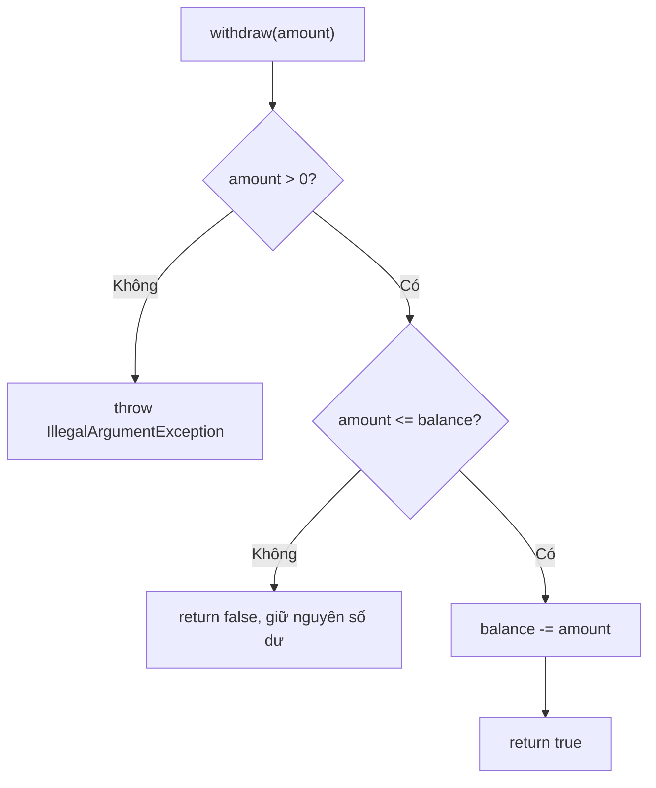

Returning `false` for insufficient funds is an API choice: it can be a normal business outcome. If the reason must be explicit, an enum result such as `SUCCESS` or `INSUFFICIENT_FUNDS` could replace `boolean`. Invalid input, such as a negative amount, is handled with an exception.

### Why use `long` and the smallest monetary unit?

Storing money as integer units (`balanceCents`) lets the example avoid the imprecise binary representation of many decimal values in `double`. Real systems must specify currencies, minor units, rounding, limits, and formatting; `BigDecimal` may be appropriate for the business rules. **Simply renaming `double balance` to `long balance` without currency rules is not enough.**

## 4. Protecting order state through valid transitions

An order has four states:

| State | Meaning |
|---|---|
| `CREATED` | Just created; payment not yet confirmed |
| `PAID` | Successful payment has been recorded |
| `SHIPPED` | The shipping step has been performed in this example |
| `CANCELLED` | Canceled before payment |

For this illustrative workflow, only these transitions are valid:

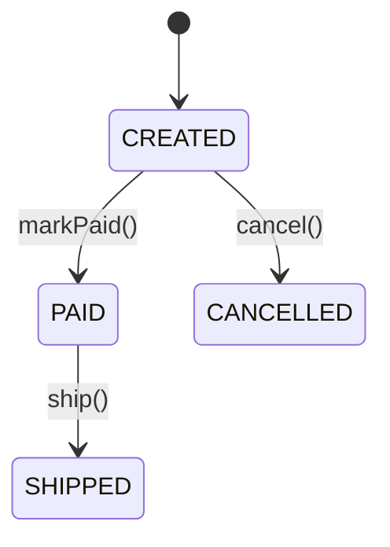

| Current state | Action | Next state | Result |
|---|---|---|---|
| `CREATED` | `markPaid()` | `PAID` | Valid |
| `CREATED` | `cancel()` | `CANCELLED` | Valid |
| `PAID` | `ship()` | `SHIPPED` | Valid |
| `CREATED` | `ship()` | Unchanged | `IllegalStateException` |
| `SHIPPED` | `cancel()` | Unchanged | `IllegalStateException` |
| `CANCELLED` | `markPaid()` | Unchanged | `IllegalStateException` |

The `enum` keyword restricts the set of states, preventing free-form string typos such as `"SHIPED"`. But **an enum is not enough**: exposing `setStatus(OrderStatus status)` would still let callers jump directly from `CREATED` to `SHIPPED`.

Instead, methods are named after actions:

```java
public synchronized void ship() {
    requireStatus(OrderStatus.PAID, "giao hàng");
    status = OrderStatus.SHIPPED;
}
```

Each operation reads the current state, checks it, and only then changes it. If an order is unpaid or canceled, the call is rejected without updating `status`.

Note: real systems may need refunds, returns, post-payment cancellations, or more shipping states. The diagram shows **rules defined for this example**, not a standard state list for every e-commerce application.

## 5. Preventing other access paths from breaking encapsulation

Encapsulation breaks if a getter returns an internal collection that can still be modified:

```java
class UnsafeOrder {
    private final List<String> items = new java.util.ArrayList<>();

    public List<String> items() {
        return items;
    }
}

UnsafeOrder order = new UnsafeOrder();
order.items().add(""); // Bên ngoài bỏ qua mọi validation
```

In the complete `Order` implementation, input data is copied:

```java
this.items = List.copyOf(items);
```

The `items()` result is safe to return because the list does not support mutating operations such as `add`, `clear`, or `set`. Also, `OrderItem` is a `record` with `String` and `int` components, so callers cannot mutate an element to bypass validation.

```java
List<OrderItem> source = new java.util.ArrayList<>();
source.add(new OrderItem("BOOK-JAVA", 2));

Order order = new Order("ORD-002", source);
source.clear();                    // Không xóa item đã lưu trong order
System.out.println(order.items().size()); // 1

// order.items().clear();         // Ném UnsupportedOperationException
```

**Important:** `List.copyOf` creates an unmodifiable list but provides only **shallow protection**. If elements have setters, external code may still modify an element through a shared reference. In that case, make elements immutable or defensively copy them too.

Likewise, a `private final List<T>` field does not automatically make the list contents immutable: `final` prevents reassigning the field reference, not invoking `add` or `remove` on the list.

## 6. Why do both classes use `synchronized`?

When multiple threads update an object, `private` prevents direct access **but does not eliminate race conditions**.

For example, consider a withdrawal method:

```java
if (balanceCents >= amount) {
    balanceCents -= amount;
}
```

If both threads read the old balance before either thread updates it, the result may not correspond to any valid transaction order. That is why the example uses `synchronized` methods for balance reads/writes and for order-state transitions:

```java
public synchronized boolean withdraw(long amountCents) { /* ... */ }
public synchronized long balanceCents() { /* ... */ }
public synchronized void markPaid() { /* ... */ }
```

For **the same instance**, `synchronized` ensures that only one thread at a time executes a synchronized method locking that instance. It also establishes the necessary memory-visibility relationship between lock and unlock operations. This keeps validation and state updates within those methods from overlapping on the same object.

Important limitations:

- `synchronized` on one object **does not synchronize two different instances**, even if both represent the same database account.
- Transferring money between **two accounts** or coordinating payment with **an order** requires an explicit transaction design; locking each instance is not enough to make a multi-object operation atomic.
- Multi-process or multi-server applications require storage-layer measures such as transactions, locking, optimistic versions, or suitable coordination mechanisms.
- `private/public` visibility controls access by **Java source code**, not user permissions. A withdrawal API still needs authentication and authorization at the service layer.

## 7. Handling failures: reject changes and preserve state

The example has two main categories of failure:

| Scenario | Failure signal | State afterward |
|---|---|---|
| Construct an account with a negative balance | `IllegalArgumentException` | No valid account is created |
| Deposit `0` or a negative amount | `IllegalArgumentException` | Previous balance |
| Deposit causes `long` overflow | `ArithmeticException` | Previous balance |
| Withdraw more than the balance | `false` | Previous balance |
| Ship an unpaid order | `IllegalStateException` | `CREATED` |
| Cancel a shipped order | `IllegalStateException` | `SHIPPED` |

“Leave state unchanged when an operation is rejected” makes behavior predictable and easy to test. In the two examples, validation precedes assignment, and no network/database effects are involved, so rejection is straightforward.

In a real application, however, an operation may update the database and call an external API. If part of those effects succeeds before a failure, transactions, idempotency, retries, or compensating actions may be needed. **A single Java method does not automatically roll back systems outside it.**

## 8. Testing the example with boundary cases

Besides checking the output from `main`, use the following table to try invalid cases deliberately:

| Test case | Operation | Expected result |
|---|---|---|
| Negative opening balance | `new Account("A", -1)` | Throws `IllegalArgumentException` |
| Deposit 0 | `deposit(0)` | Throws `IllegalArgumentException`; balance unchanged |
| Negative withdrawal | `withdraw(-1)` | Throws `IllegalArgumentException` |
| Withdraw exactly the balance | `withdraw(balance)` | Returns `true`; balance reaches 0 |
| Withdraw more than the balance | `withdraw(balance + 1)` without overflow | Returns `false`; balance unchanged |
| Overflowing deposit | Balance near `Long.MAX_VALUE`, then another deposit | Throws `ArithmeticException`; balance unchanged |
| Ship too early | `ship()` on a `CREATED` order | Throws `IllegalStateException` |
| Pay a canceled order | `markPaid()` on `CANCELLED` | Throws `IllegalStateException` |
| Modify the input item list | `source.clear()` after creating the order | Order still retains its items |
| Modify the returned item list | `order.items().clear()` | `UnsupportedOperationException` |

You can try a simple check directly in `main`:

```java
Account zero = new Account("ZERO", 5);
try {
    zero.withdraw(-10);
    throw new AssertionError("Phải từ chối tiền âm");
} catch (IllegalArgumentException expected) {
    if (zero.balanceCents() != 5) {
        throw new AssertionError("Số dư đã bị sửa khi thao tác thất bại");
    }
}
```

This check explicitly throws `AssertionError` in code, so it does not depend on the JVM's `-ea` option.

## 9. Exercises extending both scenarios

**Exercise 1 — Withdrawal limits.** Add `dailyWithdrawnCents` and `dailyLimitCents` to `Account`. On withdrawal, check both the balance and remaining limit; update the two fields only when all conditions are valid. Handle arithmetic when adding withdrawn amounts to prevent overflow. Write a test verifying that a rejected transaction **changes neither field**.

**Exercise 2 — Order workflow.** Add a `DELIVERED` state to the enum and a `confirmDelivery()` method, valid only from `SHIPPED`. Redraw the Mermaid diagram and call `confirmDelivery()` from `CREATED` to verify that the class rejects it.

**Exercise 3 — Cancellation after payment.** Suppose the business allows canceling `PAID` orders but requires a refund. Propose responsibilities for `Order`, the payment service, and database transactions to avoid canceling the order while refunding fails. Merely assigning `status = CANCELLED` does not mean all external effects have completed.

**Exercise 4 — API boundaries.** Explain which access paths are protected respectively by `private balanceCents`, `private status`, `List.copyOf(items)`, and the `withdraw/ship` methods. If `items` becomes a list of mutable elements, how must the design change?

---

**Conclusion:** For accounts, encapsulation **protects the balance invariant** through valid deposits and withdrawals. For orders, it **protects state transitions** through conditional operations. A `private` field prevents direct assignment, but correctness comes from **constructor validation, business-oriented methods, mutation after validation, and avoiding exposure of mutable data**.


</details>

- [Back to top](#back-to-top)
