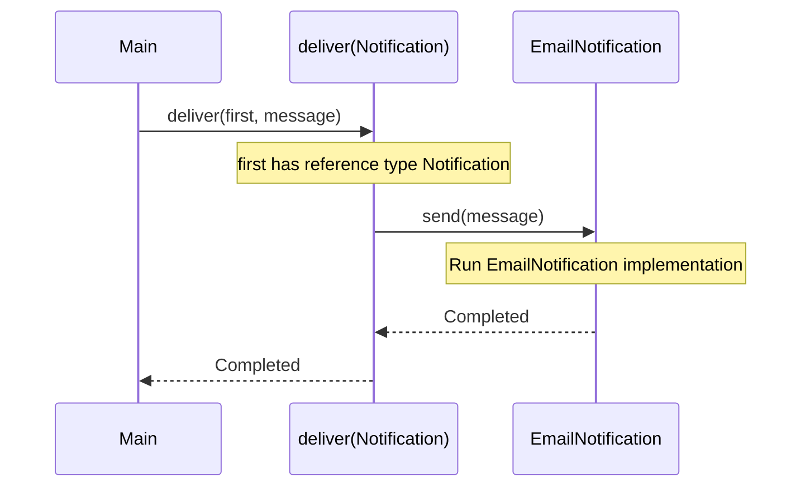
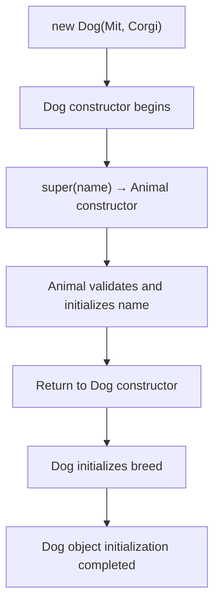
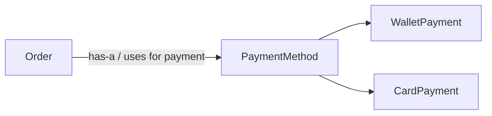
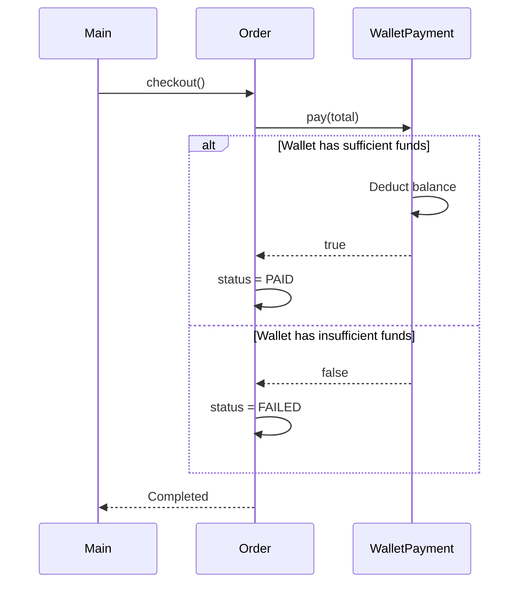

<a id="back-to-top"></a>

# Inheritance — Reusing and Extending Behavior Selectively

## Menu
- [5.1 What Is Inheritance? What Does the Is-a Relationship Mean?](#oop-5-1)
- [5.2 extends, super, and How Constructors Work in Subclasses](#oop-5-2)
- [5.3 Method Overriding and Its Important Rules](#oop-5-3)
- [5.4 Limitations of Inheritance: When Should You Use Composition (Has-a)?](#oop-5-4)

## <a id="oop-5-1">5.1 What Is Inheritance? What Does the Is-a Relationship Mean?</a>

<details>
<summary>Click for details</summary>

**Inheritance** is an object-oriented programming (OOP) mechanism that allows a **subclass** to be defined based on a **superclass**. A subclass can use appropriate behaviors from its parent, add its own characteristics, or provide a different implementation of certain behaviors according to the language's rules.

In Java, we commonly use the `extends` keyword to declare an inheritance relationship between two classes.

For example:

- `Notification`: the general concept of a notification that can be sent.
- `EmailNotification`: a kind of notification sent by email.
- `SmsNotification`: a kind of notification sent by SMS.

We can say **EmailNotification *is-a* Notification** — an email notification **is a kind of** notification.

> The important purpose of inheritance is not merely “reusing code from the parent class.” It also means that **a subclass object can be used wherever the superclass type is expected**, as long as the subclass honors the behavioral promises made by the parent.

### 1. Understanding *Is-a* Through Everyday Examples

Consider these three statements:

| Statement | Relationship | Comment |
|---|---|---|
| A dog **is a kind of** animal | *is-a* | Inheritance may fit: `Dog extends Animal` |
| A car **is a kind of** vehicle | *is-a* | `Car extends Vehicle` may fit if the `Vehicle` contract is appropriate |
| A car **has an** engine | *has-a* | Do not write `Car extends Engine`; the car **uses** an engine |
| An order **has a** payment method | *has-a* | `Order` should be associated with `PaymentMethod`, not inherit from it |

*Is-a* answers: **“Is this object really a kind of that other type?”**  
*Has-a* answers: **“Does this object have, own, or use another component?”**

```text
                 Notification
                 /          \
                / is-a       \ is-a
               v              v
     EmailNotification    SmsNotification

        Order -------- has-a -------> PaymentMethod
```

A common misunderstanding: having similar data or sharing a few lines of code **is not enough** to establish an *is-a* relationship. Two kinds of objects might both have `name`, `id`, or `createdAt` without belonging to the same meaningful behavioral type hierarchy.

### 2. How Does Inheritance Work in Java?

Here is a standalone, runnable example to save as `Main.java`:

```java
public class Main {
    public static void main(String[] args) {
        Notification first = new EmailNotification("an@example.com");
        Notification second = new SmsNotification("0900000000");

        deliver(first, "Order confirmed");
        deliver(second, "Confirmation code: 123456");
    }

    static void deliver(Notification notification, String message) {
        notification.send(message);
    }
}

// Superclass: the general concept of a notification
abstract class Notification {
    private final String recipient;

    protected Notification(String recipient) {
        if (recipient == null || recipient.isBlank()) {
            throw new IllegalArgumentException("Recipient is required");
        }
        this.recipient = recipient;
    }

    protected String getRecipient() {
        return recipient;
    }

    // Each notification type defines its own sending behavior
    public abstract void send(String message);
}

// Subclass: notification sent by email
class EmailNotification extends Notification {
    public EmailNotification(String recipient) {
        super(recipient);
    }

    @Override
    public void send(String message) {
        System.out.println("EMAIL to " + getRecipient() + ": " + message);
    }
}

// Subclass: notification sent by SMS
class SmsNotification extends Notification {
    public SmsNotification(String recipient) {
        super(recipient);
    }

    @Override
    public void send(String message) {
        System.out.println("SMS to " + getRecipient() + ": " + message);
    }
}
```

Output:

```text
EMAIL to an@example.com: Order confirmed
SMS to 0900000000: Confirmation code: 123456
```

The example only **prints to the console** to illustrate OOP. It does not connect to actual email or SMS services.

#### Reading Each Component

| Java component | Meaning |
|---|---|
| `abstract class Notification` | Defines a general notification type without specifying a concrete sending mechanism |
| `extends Notification` | Declares `EmailNotification` / `SmsNotification` as subclasses of `Notification` |
| `private final String recipient` | Shared data managed inside the superclass |
| `protected Notification(...)` | The superclass constructor initializes shared data |
| `super(recipient)` | A subclass calls the superclass constructor |
| `public abstract void send(...)` | The behavioral contract each concrete subclass must implement |
| `@Override` | Indicates that the subclass implements or overrides a method from the parent |
| `Notification first = new EmailNotification(...)` | A variable declared with the parent type refers to a concrete subclass object |

In the example, `Notification` is abstract because we only need the shared idea of “a notification that can be sent.” The two subclasses define how to send an email or SMS. **Not every superclass needs to be `abstract`**; we chose that form because there is no sensible common sending implementation for this problem.

#### What Actually Happens When `deliver(first, ...)` Is Called?



The `deliver` method contains no type-checking branches such as:

```java
if (notification instanceof EmailNotification) { ... }
else if (notification instanceof SmsNotification) { ... }
```

It only calls `notification.send(message)`. Java selects the appropriate implementation based on the concrete object at runtime. Using a subclass where the superclass is expected is **an important expression of *is-a***; selecting the right method implementation is also related to **polymorphism**.

### 3. *Is-a* Means More Than Saying “A Is a Kind of B”

In software design, the *is-a* test is stronger than an everyday comparison of names.

For example, suppose a function already works correctly with `Notification`:

```java
static void sendReminder(Notification notification) {
    notification.send("Payment is due");
}
```

If we pass an `EmailNotification` or `SmsNotification` to that function, the operation should still make sense: both fulfill the common contract to **send a notification**.

Therefore, before declaring `Child extends Parent`, ask:

1. **Is Child genuinely a kind of Parent in this problem?**
2. **Does using Child wherever Parent is expected still make sense?**
3. **Does Child satisfy Parent's important promises?**
4. **Does the subclass frequently have to throw “unsupported” for behaviors requested through the parent type?**

If the answers are unsatisfactory, the inheritance relationship may have been chosen incorrectly.

#### A Counterintuitive Example: Birds and the Ability to Fly

We might assume “all birds can fly” and design:

```java
class Bird {
    void fly() {
        System.out.println("Flying");
    }
}
```

But penguins are birds that cannot fly. If we write `Penguin extends Bird`, the superclass method `fly()` may impose a false promise on the subclass.

The problem is not whether “a penguin is a bird”—biologically, it is. The problem is that **the software contract of `Bird` assigns flying behavior to every bird**, which is untrue. We could move flying into a `Flyable` contract for species that really can fly and leave `Bird` to describe only what all relevant birds have in common.

This is why an ** *is-a* relationship must make sense both conceptually and behaviorally**, not merely as an everyday classification.

### 4. What Can Inheritance Reuse?

In the `Notification` example, the two subclasses reuse the initialization and validation logic for `recipient`. A subclass can also inherit accessible methods without reimplementing them.

There are, however, some important details:

- A superclass's `private` field is still part of the object's state, but **subclass code cannot access that field directly by name**. An appropriate method such as `getRecipient()` can expose the required information.
- Superclass constructors **are not inherited as subclass constructors**; the subclass calls a parent constructor using `super(...)` during initialization.
- A subclass can **add its own behavior**, but code that only knows a `Notification` variable cannot automatically access methods exclusive to `EmailNotification`.
- When the subclass overrides a method, the actual behavior can differ from the parent's, but it must still honor the behavioral contract expected by users.

```text
EmailNotification object
  ├─ Shared state/behavior from Notification
  └─ Behavior specific to EmailNotification
```

This diagram illustrates a concept, not the creation of two independent objects, “one parent + one child,” whenever `new EmailNotification(...)` is called. **There is one object whose concrete type is `EmailNotification`**, including the state associated with the superclass layers in its inheritance hierarchy.

### 5. When Should You Avoid Inheritance?

Inheritance establishes a relatively tight relationship: the subclass is tied to its parent's design and promises. Changes to the parent may affect the child. Therefore, do not choose inheritance merely because two classes have similar fields or because it avoids repeating a short piece of code.

Consider an order:

```java
// Semantically incorrect:
class Order extends PaymentMethod {
    // An order is not a kind of payment method.
}
```

Moreover, `PaymentMethod` might be an interface or a class, depending on the design. The code above illustrates a **semantically incorrect model**, not a complete implementation.

An order **uses** a payment method, so a more appropriate design is:

```java
interface PaymentMethod {
    boolean pay(int amount);
}

class Order {
    private final PaymentMethod paymentMethod;

    Order(PaymentMethod paymentMethod) {
        this.paymentMethod = paymentMethod;
    }

    boolean checkout(int total) {
        if (total <= 0) {
            throw new IllegalArgumentException("Invalid total amount");
        }
        return paymentMethod.pay(total);
    }
}
```

`Order` **has-a `PaymentMethod`**: the order holds a reference to a payment object and collaborates with it. This is **object composition/collaboration** in the general design sense, rather than inheritance.

| Design consideration | Inheritance (*is-a*) | Composition/usage (*has-a*) |
|---|---|---|
| Nature of the relationship | “A is a kind of B” | “A has or uses B” |
| Example | `EmailNotification extends Notification` | `Order` has a `PaymentMethod` |
| Reuse mechanism | Share a type hierarchy and inherited behavior | Collaborate through another object |
| Changing implementations | May be constrained by the superclass | May substitute a compatible collaborator |
| Appropriate when | The child can genuinely substitute for the parent under its contract | An object merely needs a capability or owns another component |

Holding a reference to another object does not automatically imply composition in the strict UML sense of ownership and lifecycle. Practical Java designs also use association, aggregation, or dependency. The essential distinction here is that **“has/uses” is different from “is a kind of.”**

### 6. Common Misconceptions

**“Is inheritance only for saving code?”** — Code reuse is one benefit, but the more important motivation is **modeling a correct type relationship with appropriate substitutable behavior**. Using inheritance to share a few fields between unrelated objects can make the model misleading.

**“Is the subclass another object inside a parent object?”** — No. `new EmailNotification(...)` produces a single `EmailNotification` object, including the data and behavior associated with its full inheritance hierarchy.

**“Can a subclass directly access everything in the superclass?”** — No. For example, it cannot directly access a parent's `private` field.

**“Can a Java class inherit from multiple classes?”** — No. A Java class can directly `extends` **one class**, but may `implements` multiple interfaces. Interfaces also define type relationships, although class inheritance and interface implementation follow different rules.

**“If the names sound like *is-a*, should we definitely use extends?”** — Not necessarily. Check the **behavioral contract**. `Penguin` is a kind of `Bird`, but cannot fulfill a `fly()` contract when `Bird` incorrectly requires every bird to fly.

### 7. Check Your Understanding

| Question | Answer |
|---|---|
| What relationship does `EmailNotification extends Notification` express? | *Is-a*: an email notification is a kind of notification |
| What relationship does an `Order` field of type `PaymentMethod` express? | *Has-a*: an order uses a payment method |
| Why can `deliver(Notification n)` accept an `EmailNotification`? | The subclass is a subtype of the parent and fulfills the notification-sending contract |
| Why should we not write `Car extends Engine`? | A car has or uses an engine; it is not a kind of engine |
| Why must OOP's *is-a* relationship account for behavior? | Code relying on the parent type must be able to work correctly with the subclass object |

**Remember:** Inheritance lets us define **a specialized type from a general type**. When designing `Child extends Parent`, verify both **“Child is a kind of Parent”** and **“Child upholds the promises that users of Parent rely on.”** If the real relationship is **“A uses B,”** design collaboration between two objects instead of forcing them into an inheritance relationship.

</details>

- [Back to top](#back-to-top)

---

## <a id="oop-5-2">5.2 extends, super, and How Constructors Work in Subclasses</a>

<details>
<summary>Click for details</summary>

When learning inheritance in Java, one question often causes confusion: **“If I create a subclass object, why does the superclass constructor run as well?”** To answer it, we need to understand three closely related concepts:

- `extends` defines the inheritance relationship between two classes.
- `super` lets a subclass access the superclass implementation or invoke a superclass constructor.
- When initializing a subclass object, Java must complete the relevant superclass initialization before carrying out the subclass's own initialization.

We will start with a runnable example, then examine situations in which it is easy to make mistakes.

### 1. What Relationship Does `extends` Express?

Suppose a system has `Animal` and `Dog`. A dog is a kind of animal, so the relationship **Dog is an Animal** makes sense:

```java
class Animal {
    public void eat() {
        System.out.println("Animal is eating");
    }
}

class Dog extends Animal {
    public void bark() {
        System.out.println("Woof!");
    }
}
```

Usage:

```java
Dog dog = new Dog();
dog.eat();  // Animal is eating
dog.bark(); // Woof!
```

`Dog extends Animal` means that `Dog` is a **subclass**, while `Animal` is its **superclass**. `Dog` can use the inherited `eat()` method and provide an additional `bark()` method of its own.

Besides reusing behavior, inheritance establishes a type relationship:

```java
Animal animal = new Dog(); // Valid: Dog is an Animal
animal.eat();              // Valid: eat() is declared in Animal
// animal.bark();          // Compilation error: reference type Animal does not declare bark()
```

The concrete object is still a `Dog`; the variable `animal` only allows methods exposed by its declared `Animal` type. If `Dog` overrides an instance method, Java can select the `Dog` implementation at runtime even when the variable is declared as `Animal`.

A Java class can directly `extends` **only one class**. An ordinary class with no explicit superclass implicitly extends `Object`. A class declared `final` cannot be extended. Java provides `implements` to satisfy additional interface contracts.

**When should you use `extends`?** When the subclass truly is an appropriate variation of the superclass and can satisfy its expectations. Do not inherit merely because two classes happen to share a few lines of code; holding another object (*composition*) may be more appropriate in that situation.

### 2. Complete Example: `extends`, `super(...)`, and `super.method()`

Save the following example exactly as `Main.java` and run it with Java 17 or 21:

```java
class Animal {
    private final String name;

    public Animal(String name) {
        if (name == null || name.isBlank()) {
            throw new IllegalArgumentException("Name is required");
        }
        this.name = name;
        System.out.println("1. Animal constructor: " + name);
    }

    public String describe() {
        return "Animal: " + name;
    }

    protected String getName() {
        return name;
    }
}

class Dog extends Animal {
    private final String breed;

    public Dog(String name, String breed) {
        super(name); // Invoke the Animal(String) constructor
        this.breed = breed;
        System.out.println("2. Dog constructor: " + breed);
    }

    @Override
    public String describe() {
        return "Dog: " + getName() + ", breed: " + breed;
    }

    public String describeAsAnimal() {
        return super.describe(); // Invoke the superclass implementation
    }
}

public class Main {
    public static void main(String[] args) {
        Dog dog = new Dog("Mit", "Corgi");

        System.out.println(dog.describe());
        System.out.println(dog.describeAsAnimal());
    }
}
```

Output:

```text
1. Animal constructor: Mit
2. Dog constructor: Corgi
Dog: Mit, breed: Corgi
Animal: Mit
```

Consider this line:

```java
Dog dog = new Dog("Mit", "Corgi");
```

We create **only one `Dog` object**. It includes state managed by `Animal` (such as `name`) and state managed by `Dog` (such as `breed`). `super(name)` does not create a separate, independent `Animal` object alongside the `Dog` object.

The sequence is:

1. Java begins initializing the `Dog` object.
2. The `Dog(String, String)` constructor invokes `super(name)`, meaning `Animal(String)`.
3. `Animal` validates and assigns `name`, then prints the first line.
4. After the superclass constructor completes, `Dog` initialization continues: it assigns `breed` and prints the second line.
5. The object reference is returned and assigned to `dog`; we can now call `describe()` and `describeAsAnimal()`.

A simplified call diagram:



In this example, `Animal` declares a `private name` field. `Dog` cannot read `name` directly but can call the `protected getName()` method deliberately exposed by the superclass. **Inheritance does not remove the access restrictions imposed by `private`.**

### 3. Two Easily Confused Uses of `super`

`super` refers to the **direct superclass** in the context of a subclass, but its meaning depends on how it is written:

| Syntax | Purpose | Example |
| --- | --- | --- |
| `super(...)` | Invoke a superclass **constructor** | `super(name)` |
| `super.method(...)` | Invoke the superclass's **method implementation** | `super.describe()` |
| `super.field` | Refer to an accessible superclass field, when distinguishing it from a field of the same name | `super.value` |

#### `super(...)`: Invoking a Constructor

Example:

```java
public Dog(String name, String breed) {
    super(name);
    this.breed = breed;
}
```

Java looks for the `Animal(String)` constructor matching the `name` argument. When the superclass has overloaded constructors, the argument types and number of arguments determine which one is selected according to overload resolution.

In **Java 21** (and earlier versions), an explicit `super(...)` or `this(...)` constructor invocation must be **the first statement** in the constructor. Thus, the following does not compile on Java 21:

```java
// Sai trong Java 21:
Dog(String name, String breed) {
    this.breed = breed;
    super(name);
}
```

Newer Java versions relax some restrictions on statements before a constructor invocation. All examples in this lesson use Java 21 rules for clarity and consistency with the traditional pattern.

#### `super.method(...)`: Invoking the Parent's Implementation

In the complete example:

```java
@Override
public String describe() {
    return "Dog: " + getName() + ", breed: " + breed;
}

public String describeAsAnimal() {
    return super.describe();
}
```

Calling `dog.describe()` runs the code in `Dog`, while `dog.describeAsAnimal()` explicitly calls `Animal.describe()`.

`super.describe()` **is not a constructor call**, and it does not have to appear at the start of a method. A subclass can use it to reuse parent logic when extending behavior:

```java
@Override
public String describe() {
    return super.describe() + " (dog)";
}
```

If a superclass method is `private`, the subclass cannot invoke it directly as `super.method()`. If a method is declared `final`, the subclass cannot override it.

### 4. Does the Parent Constructor Run If You Do Not Write `super()`?

**Yes.** In Java 21, if a constructor does not begin with an explicit `this(...)` or `super(...)` call, the compiler implicitly inserts `super()`.

For example:

```java
class Parent {
    Parent() {
        System.out.println("Parent()");
    }
}

class Child extends Parent {
    Child() {
        // Java 21 implicitly invokes super();
        System.out.println("Child()");
    }
}

public class Main {
    public static void main(String[] args) {
        new Child();
    }
}
```

Output:

```text
Parent()
Child()
```

This is why the superclass constructor runs even though the subclass constructor never explicitly mentions `super`.

But there is a condition: **the parent must have a no-argument constructor that the subclass is allowed to invoke**.

Consider:

```java
class Parent {
    Parent(String id) {
        System.out.println("Parent id: " + id);
    }
}

class Child extends Parent {
    Child() {
        System.out.println("Child");
    }
}
```

This code **does not compile**. Java implicitly attempts to call `super()`, but `Parent` only defines `Parent(String)`, not a no-argument constructor.

One fix is:

```java
class Child extends Parent {
    Child() {
        super("P-01");
        System.out.println("Child");
    }
}
```

Another option is to add a valid no-argument constructor to `Parent`, if that makes sense for the superclass's data model.

#### Distinguishing a “Default Constructor” from a “No-argument Constructor”

If a class **does not declare any constructors**, Java generates a no-argument *default constructor* with access governed by the language rules. It invokes `super()`.

Once a class **declares any constructor**, Java **does not automatically generate** another no-argument constructor for that class.

For example, the `Parent(String id)` constructor above prevents automatic generation of `Parent()`. That is different from explicitly writing `Parent() { ... }`, which is a **programmer-declared no-argument constructor**, not a compiler-generated default constructor.

Besides existing, the superclass constructor must be **accessible** to the subclass. If the matching constructor is `private` or inaccessible under package/protected access rules, the `super(...)` call is still invalid.

### 5. `this(...)` and `super(...)`: Each Constructor Chooses One Delegation Path

Suppose a subclass supports two ways to create an object: with or without a name.

```java
class Person {
    private final String name;

    Person(String name) {
        this.name = name;
        System.out.println("Person: " + name);
    }
}

class Employee extends Person {
    Employee() {
        this("Not named yet");
    }

    Employee(String name) {
        super(name);
        System.out.println("Employee created");
    }
}

public class Main {
    public static void main(String[] args) {
        new Employee();
    }
}
```

Output:

```text
Person: Not named yet
Employee created
```

Notice:

- `this("Not named yet")` calls **another constructor of `Employee` itself**.
- The `Employee(String)` constructor calls `super(name)` to initialize the `Person` part.
- Although the execution passes through two `Employee` constructors, the object's `Person` part is initialized once.

The call path is:

```text
new Employee()
    └─ Employee()
         └─ this("Not named yet")
              └─ Employee(String)
                   └─ super(name)
                        └─ Person(String)
```

In Java 21, a constructor cannot place **both** `this(...)` and `super(...)` as separate explicit constructor-invocation statements. Both forms require the first position. If `this(...)` is chosen, the eventual chain of constructor invocations must still lead to initializing the superclass. Cycles such as `A() → A(int) → A()` are forbidden: recursive constructor-invocation chains cause compilation errors.

Do not confuse `this(...)` (invoke a constructor in the same class) with `this.field` (refer to a field of the current object). Similarly, `super(...)` differs from `super.method()`.

### 6. Actual Initialization Order: Fields, Initializer Blocks, and Constructors

So far, the examples have used only constructors. But a class can also initialize **instance fields** at their declarations or use an **instance initializer block** (a `{ ... }` block directly in the class body).

The following independent example demonstrates the execution order:

```java
class Parent {
    private final int parentValue = initParent();

    {
        System.out.println("2. Parent initializer block");
    }

    Parent() {
        System.out.println("3. Parent constructor");
    }

    private int initParent() {
        System.out.println("1. Parent field initializer");
        return 10;
    }
}

class Child extends Parent {
    private final int childValue = initChild();

    {
        System.out.println("5. Child initializer block");
    }

    Child() {
        // Implicitly invokes super();
        System.out.println("6. Child constructor");
    }

    private int initChild() {
        System.out.println("4. Child field initializer");
        return 20;
    }
}

public class Main {
    public static void main(String[] args) {
        new Child();
    }
}
```

Output:

```text
1. Parent field initializer
2. Parent initializer block
3. Parent constructor
4. Child field initializer
5. Child initializer block
6. Child constructor
```

You can understand ordinary instance initialization in Java 21 as follows:

1. Java allocates memory for **one subclass object**, and instance fields initially have default values (`0`, `false`, `null`, etc.).
2. The constructor-invocation chain proceeds up the superclass hierarchy, eventually reaching `Object`.
3. As control returns to a class after its superclass constructor completes, Java runs that class's instance field initializers and instance initializer blocks **in their order in the source code**.
4. Java then executes that class's constructor body.
5. It returns to the subclass and repeats the corresponding steps until the final constructor has completed.

In this example, `Parent` initialization finishes before `Child` initialization. However, **this does not mean every statement in the parent constructor is necessarily the first code executed by the program**: class loading/initialization, static initializers, and evaluation of constructor arguments follow their own rules. The preceding example focuses only on the order of **instance** initialization.

A useful memory aid: **the parent constructor is called first, but each class's field initializers run before the body of that class's own constructor**.

### 7. Why Should a Superclass Constructor Avoid Calling Overridable Methods?

This mistake can be particularly difficult to spot when learning inheritance.

```java
class Parent {
    Parent() {
        showInfo();
    }

    void showInfo() {
        System.out.println("Parent info");
    }
}

class Child extends Parent {
    private String name = "An";

    @Override
    void showInfo() {
        System.out.println("Child name: " + name);
    }
}

public class Main {
    public static void main(String[] args) {
        new Child();
    }
}
```

Output:

```text
Child name: null
```

Why not `Child name: An`?

- `new Child()` begins by invoking the `Parent` constructor.
- `Parent()` calls `showInfo()`, an instance method that **can be overridden**.
- The concrete object is a `Child`, so Java invokes `Child.showInfo()`.
- At that moment, the `Child` initializer `name = "An"` **has not yet run**; `name` still has its default value, `null`.
- Only after `Parent()` completes does Java run the `name = "An"` initializer and the `Child` constructor body.

If `showInfo()` called `name.length()`, the program could even throw `NullPointerException` while constructing the object.

**Lesson:** avoid invoking overridable methods from constructors, especially when those methods read subclass state. Prefer initializing and checking invariants directly at each class level, or defer behavior that needs the entire object to be ready until a method is invoked after initialization.

### 8. Other Important Rules for Subclass Constructors

| Situation | Java rule | Practical consequence |
| --- | --- | --- |
| Superclass constructor accepts arguments | `super(args)` selects the matching constructor | The subclass must provide the data required by its parent |
| Subclass constructor omits both `super` and `this` (Java 21) | An implicit `super()` is called | Compilation fails if no accessible no-argument parent constructor exists |
| Subclass constructor calls `this(args)` | Delegates to another constructor in the same class | Reduces repeated initialization code, but the chain must be valid |
| Superclass constructor throws a checked exception | The subclass constructor must follow constructor-invocation rules, typically by declaring an appropriate `throws` | A checked exception from `super(...)` cannot be ignored |
| Superclass constructor fails | Object creation fails, and no successfully initialized object is returned | The subclass constructor body does not continue |
| Superclass is `abstract` | It can still declare constructors invoked by subclasses | Only direct instantiation of an abstract class is forbidden |
| Superclass field is `private` | Subclasses cannot access it directly | Use an appropriate API provided by the parent |
| Subclass declares no constructor | Java may generate a default constructor invoking `super()` | An accessible no-argument parent constructor is required |
| Superclass is `final` | It cannot be extended | Another design must be chosen |

Example with a checked exception:

```java
import java.io.IOException;

class Parent {
    Parent() throws IOException {
        throw new IOException("Cannot initialize parent");
    }
}

class Child extends Parent {
    Child() throws IOException {
        super();
    }
}
```

The `Child()` constructor declares `throws IOException` because initializing `Parent` may throw that checked exception. The caller must handle or redeclare the exception. A `try/catch` inside the `Child` constructor body after `super()` cannot catch an exception already thrown by the earlier `super()` invocation. If superclass initialization failures need special handling, design an appropriate object-creation strategy or exception propagation path.

### 9. Common Mistakes with `extends` and `super`

**Mistake 1 — Thinking `extends` automatically grants access to every field of the parent.**

```java
class Parent {
    private int value = 10;
}

class Child extends Parent {
    // int x = value; // Error: value is private
}
```

The subclass has an inheritance relationship but must still obey access controls. This protects state managed by the superclass.

**Mistake 2 — Thinking constructors are inherited like methods.**

```java
class Parent {
    Parent(int value) {}
}

class Child extends Parent {
    Child(int value) {
        super(value);
    }
}
```

`Child(int)` is a constructor **belonging to `Child`**, not a “received” `Parent(int)` constructor. `super(value)` invokes the parent constructor as part of constructing the same object.

**Mistake 3 — Failing to distinguish `super()` from `super.someMethod()`.**

`super()` invokes a constructor to initialize the superclass portion. `super.someMethod()` calls a superclass method and can appear inside an ordinary instance method.

**Mistake 4 — Initializing subclass fields before invoking the parent constructor.**

In Java 21, you cannot assign subclass instance fields before an explicit `super(...)` call. The superclass must be initialized through a valid constructor chain.

**Mistake 5 — Assuming inheritance exists only to save code.**

`Dog extends Animal` also declares a type relationship and substitutability. If a class is not genuinely a kind of its parent, consider composition rather than establishing an inheritance relationship that lacks meaning.

### 10. Check Your Understanding with Three Short Questions

**Question 1.** Why does the following print `Parent` before `Child`?

```java
class Parent {
    Parent() { System.out.println("Parent"); }
}
class Child extends Parent {
    Child() { System.out.println("Child"); }
}
```

Because `Child()` implicitly invokes `super()`. The parent constructor completes before the subclass constructor body runs.

**Question 2.** `Parent` only provides `Parent(String name)`. Can we write `class Child extends Parent { Child() {} }`?

No. Java 21 searches for `Parent()` when implicitly invoking `super()`, but that constructor does not exist. You must call `super("an appropriate value")` or design another parent constructor.

**Question 3.** If `Dog` overrides `describe()`, which implementation does `super.describe()` inside `Dog` call?

It invokes the implementation of `describe()` in the direct superclass `Animal`, provided that method is accessible. By contrast, an ordinary `dog.describe()` call chooses the overriding implementation in `Dog`.

When reading inheritance code, the essential habit is to follow two separate paths: **`extends` defines the relationship between classes**, while the **`super(...)` / `this(...)` constructor chain determines the object's initialization order**. Once you distinguish these paths, you can understand why parent constructors run, where subclass fields can be assigned, and when `super` must be invoked explicitly.

</details>

- [Back to top](#back-to-top)

---

## <a id="oop-5-3">5.3 Method Overriding and Its Important Rules</a>

<details>
<summary>Click for details</summary>

### 1. What Is Method Overriding?

Suppose a shopping system offers two shipping options:

- **Regular shipping:** VND 25,000, free for orders worth VND 500,000 or more.
- **Express shipping:** the regular shipping fee plus VND 15,000.

Both answer the same question: **“How much is shipping for an order of this value?”** But the calculations can differ.

In object-oriented programming, **method overriding** lets a subclass provide its own implementation of an **inheritable, overridable instance method** declared in a superclass (or implement a method declared in an interface).

In other words, the behavior that external code calls is still named `feeFor(...)`, but the **concrete object** determines which version of the method runs.

This becomes especially useful when the calling code only knows a superclass type such as `ShippingPolicy`. It does not need to check which concrete subclass it received and choose the calculation itself.

### 2. Java Example: The Same Call, Different Results Depending on the Object

First, write a superclass that provides the default policy:

```java
// ShippingPolicy.java
public class ShippingPolicy {
    public long feeFor(long orderTotal) {
        if (orderTotal < 0) {
            throw new IllegalArgumentException(
                "Order total cannot be negative"
            );
        }

        return orderTotal >= 500_000 ? 0 : 25_000;
    }
}
```

Then define a subclass that inherits and **overrides** that method:

```java
// ExpressShippingPolicy.java
public final class ExpressShippingPolicy extends ShippingPolicy {

    @Override
    public long feeFor(long orderTotal) {
        long regularFee = super.feeFor(orderTotal);
        return regularFee + 15_000;
    }
}
```

Try calling:

```java
ShippingPolicy regular = new ShippingPolicy();
ShippingPolicy express = new ExpressShippingPolicy();

System.out.println(regular.feeFor(100_000)); // 25000
System.out.println(express.feeFor(100_000)); // 40000

System.out.println(regular.feeFor(600_000)); // 0
System.out.println(express.feeFor(600_000)); // 15000
```

In the line `ShippingPolicy express = new ExpressShippingPolicy();`:

- The variable's **declared type** is `ShippingPolicy`.
- The **concrete object** is an `ExpressShippingPolicy`.
- Because `feeFor(long)` is a validly overridden instance method, Java invokes the version associated with the **concrete object**: `ExpressShippingPolicy.feeFor(...)`.

Thus, callers can use the parent type and still receive the subclass's specific behavior.

#### Call Flow When the Express Shipping Fee Is Calculated

```text
Variable express has type ShippingPolicy
               │
               ▼
express.feeFor(100_000)
               │
               ▼
Concrete object: ExpressShippingPolicy
               │
               ▼
Run the subclass's feeFor() implementation
               │
               ▼
super.feeFor(100_000) → 25,000
               │
               ▼
Add 15,000
               │
               ▼
Return 40,000
```

The `super` keyword lets the subclass invoke the inherited implementation in its parent. Here, `super.feeFor(orderTotal)` **reuses the validation that the order total is nonnegative and the regular shipping-fee calculation**.

If the caller passes `-10`, the parent check throws `IllegalArgumentException`, and the subclass never proceeds to add the express fee. This is important when reusing parent behavior through `super`.

### 3. Why Is Overriding Connected to Polymorphism?

Consider code that only knows the `ShippingPolicy` type:

```java
public static void printShippingFee(
        ShippingPolicy policy, long orderTotal) {
    System.out.println(policy.feeFor(orderTotal));
}

printShippingFee(new ShippingPolicy(), 100_000);        // 25000
printShippingFee(new ExpressShippingPolicy(), 100_000); // 40000
```

`printShippingFee` contains no `if` statement to distinguish regular from express delivery. It simply asks the object to perform `feeFor(...)`.

**Dynamic dispatch**—resolving a method call at runtime—selects the implementation according to the concrete object's class. This is one form of **polymorphism** enabled by method overriding.

However, at compile time Java still relies on the variable's **declared type** to determine which methods can be called. A `ShippingPolicy` variable cannot automatically call a new method that exists only in `ExpressShippingPolicy`. That behavior must be visible through the type the caller knows, or the program must use an appropriate cast.

### 4. Requirements for Valid Method Overriding

Merely declaring a method with the **same name** in a subclass does not necessarily override anything. Java enforces several rules.

| Requirement | Rule to remember |
|---|---|
| **Inheritance or interface implementation relationship** | The subclass method must actually override an overridable parent/interface method. |
| **Name and parameter list** | The method signature must match under Java rules; changing the number or types of parameters usually produces **overloading**. |
| **Return type** | Must be compatible: a reference return type may become a subtype (*covariant return*); primitive return types generally must stay identical, and `void` must remain `void`. |
| **Access level** | The subclass **cannot reduce** the visibility of an overridden method. |
| **Checked exceptions** | It cannot declare new or broader checked exceptions not covered by the parent method's `throws` contract. |
| **`final`** | A `final` method cannot be overridden. |
| **`static`** | Static methods do not participate in instance-method overriding; a valid same-name/signature declaration performs **hiding** instead. |
| **`private`** | A parent's `private` method is not inherited for overriding. |

Additionally, **constructors cannot be overridden**: they are not inherited methods.

The following sections examine the distinctions most likely to cause confusion.

### 5. Signatures Must Match: Different Parameters Mean Overloading

For example:

```java
class Printer {
    public void print(String message) {
        System.out.println("Cha: " + message);
    }
}

class FancyPrinter extends Printer {
    @Override
    public void print(String message) {
        System.out.println("Con: " + message);
    }
}
```

`FancyPrinter.print(String)` overrides `Printer.print(String)` because the name and parameter list match.

But if we change the parameter type from `String` to `Object`:

```java
class FancyPrinter extends Printer {
    // Do not add @Override: this is a different method.
    public void print(Object message) {
        System.out.println("Object: " + message);
    }
}
```

`print(Object)` **does not override** `print(String)`. It creates an **overloaded** method with a different parameter type. Both may coexist.

If you add `@Override` to `print(Object)`, the compiler reports an error because no matching parent method exists to override.

**Quick comparison:**

| | Overriding | Overloading |
|---|---|---|
| Idea | Change the implementation of an inherited behavior | Provide another invocation form with different parameters |
| Parameters | Match under overriding signature rules | Parameter lists differ |
| Inheritance relationship | Involves a parent/interface method | Can occur within a single class |
| Call selection | The instance implementation is selected based on the concrete object | The applicable signature is primarily selected at compile time |

Changing **only the return type** while keeping the same method name and parameters does not create overloading; Java does not distinguish overloaded methods solely by return type.

### 6. Return Type: Identical or Compatible Through a Subtype

An overriding method may return a **more specific reference type**. This is called a *covariant return type*.

```java
class Animal { }

class Dog extends Animal { }

class AnimalFactory {
    public Animal create() {
        return new Animal();
    }
}

class DogFactory extends AnimalFactory {
    @Override
    public Dog create() { // Valid: Dog is a subclass of Animal
        return new Dog();
    }
}
```

However, if the superclass method returns `int`, the subclass cannot simply change it to `long`, even though both are numeric types:

```java
class BaseCounter {
    public int count() {
        return 1;
    }
}

class WrongCounter extends BaseCounter {
    // @Override
    // public long count() { return 1; } // COMPILATION ERROR
}
```

For `void`, the overriding method must also return `void`. Java generics introduce additional compatibility rules related to type erasure. When beginning, focus on identical return types and the more specific reference-type case above.

### 7. Access Level: May Widen, Must Not Narrow

Suppose the parent exposes a behavior to every class:

```java
class Parent {
    public void execute() {
        System.out.println("Parent");
    }
}

class Child extends Parent {
    @Override
    public void execute() { // Valid
        System.out.println("Child");
    }
}
```

The subclass **cannot** change that `public` method to `protected` or `private`. Doing so would remove access from code already relying on the parent's public contract.

```java
class InvalidChild extends Parent {
    // @Override
    // protected void execute() { } // ERROR: less accessible than public
}
```

Conversely, a subclass **may widen access**: a `protected` parent method can be overridden as `public`.

A common increasing-visibility order, under the appropriate inheritance conditions, is:

```text
package-private → protected → public
```

But this **does not replace package-access rules**: a package-private method in a superclass from a different package is not inherited as an ordinarily overridable method. When unsure, use `@Override` and let the compiler verify your intent.

### 8. Checked Exceptions: Do Not Weaken the Parent's Promise

A parent method can declare a *checked exception* that callers must handle or redeclare.

For example:

```java
import java.io.FileNotFoundException;
import java.io.IOException;

class DataLoader {
    protected Number load() throws IOException {
        return 1;
    }
}

class LocalDataLoader extends DataLoader {
    @Override
    public Integer load() throws FileNotFoundException {
        return 2;
    }
}
```

This override is valid because:

- `Integer` is a subtype of the return type `Number`.
- `public` is more accessible than `protected`.
- `FileNotFoundException` is a subtype of `IOException`, so the declared checked-exception range is **no broader than** the parent's promise.

Conversely, if the parent declares only `throws IOException`, the subclass **cannot** change its overriding method to `throws Exception`. The broader `Exception` could require callers to handle errors outside the contract they already knew.

For **unchecked exceptions** (types in the `RuntimeException` and `Error` families), the same restriction on declared `throws` types does not apply. But that **does not mean** the subclass should arbitrarily introduce new failures for valid inputs: it must still honor the behavioral contract callers depend on.

### 9. Members That Cannot Be Overridden

#### `private`: Not Inherited for Overriding

```java
class Parent {
    private void log() {
        System.out.println("Parent log");
    }

    public void run() {
        log();
    }
}

class Child extends Parent {
    public void log() {
        System.out.println("Child log");
    }
}
```

Here, `Child.log()` is **a separate method belonging to the subclass**, not an override of the parent's `private log()`. Therefore, `new Child().run()` still prints `Parent log`.

Putting `@Override` on `Child.log()` would produce a compile-time error. This demonstrates that **matching names and parameters is not sufficient**.

#### `final`: Explicitly Preventing Subclasses from Changing Behavior

```java
class PaymentRecord {
    public final String recordType() {
        return "PAYMENT";
    }
}

class CardPaymentRecord extends PaymentRecord {
    // @Override
    // public String recordType() { return "CARD"; }
    // ERROR: recordType() is declared final
}
```

A `final` class **cannot be extended**, so it cannot have subclasses that override any of its methods. In the earlier shipping example, `ExpressShippingPolicy` is `final`: it may **override a parent method**, but `ExpressShippingPolicy` itself cannot be subclassed further.

#### `static`: Name Hiding Rather Than Object-Based Polymorphism

```java
class Parent {
    public static String label() {
        return "PARENT";
    }
}

class Child extends Parent {
    public static String label() {
        return "CHILD";
    }
}
```

The two `static label()` methods demonstrate **method hiding**, not overriding. `Parent.label()` returns `PARENT`, while `Child.label()` returns `CHILD`.

A potentially confusing example:

```java
Parent ref = new Child();
System.out.println(ref.label()); // PARENT
```

Even though the concrete object is a `Child`, the `static` method call uses compile-time type information; it is not dynamically dispatched like an instance method. In real code, call `Parent.label()` or `Child.label()` using the **class name** to avoid confusion.

**Fields cannot be overridden either.** If the parent and child each declare a field called `name`, that is **field hiding**; field access does not select an implementation based on runtime type the way an instance-method call does.

#### Constructors Cannot Be Overridden

`new Child(...)` creates a new object; it does not override a `Parent` constructor. The parent constructor is invoked according to the initialization rules (`super(...)`), but it **is not inherited as a method that can be overridden**.

### 10. What Does `@Override` Help With?

`@Override` is an annotation that asks the compiler to verify that the method really overrides or implements a matching method from a parent type/interface.

Suppose you accidentally misspell a method name:

```java
class Parent {
    public void calculate() { }
}

class Child extends Parent {
    @Override
    public void calulate() { } // ERROR: misspelled; the 'c' is missing
}
```

Without `@Override`, Java might treat `calulate()` as a new method, and the program could still compile while the parent's `calculate()` remains in use. The annotation exposes the error early.

Therefore, **use `@Override` whenever you genuinely intend to override a method**, including when implementing an interface method.

The annotation **does not create overriding** or change runtime behavior. It simply asks the compiler to check the programmer's intent.

### 11. Inheriting Implemented Behavior and Implementing Abstract Methods

Not every method requiring an implementation already has a body in its superclass.

With an abstract class:

```java
abstract class MessageSender {
    public abstract void send(String message);
}

class ConsoleSender extends MessageSender {
    @Override
    public void send(String message) {
        System.out.println(message);
    }
}
```

`ConsoleSender` provides an implementation of `send(String)`. A **nonabstract** subclass must implement any remaining abstract methods it inherits, unless a suitable implementation is already inherited from a parent.

With an interface:

```java
interface Greeter {
    void greet(String name);
}

class VietnameseGreeter implements Greeter {
    @Override
    public void greet(String name) {
        System.out.println("Hello, " + name);
    }
}
```

Here, `greet` implements the behavior required by the interface. In everyday Java discussions, implementing an interface method is also commonly covered under the overriding mechanism.

If an interface declares a `default` method, an implementing class can override it where permitted. If a class inherits conflicting `default` methods with the same signature from two interfaces, it generally must resolve the conflict with an explicit implementation.

### 12. Syntactically Valid Overriding May Still Be Behaviorally Wrong

Return to the shipping example. Suppose a subclass says:

```java
class BrokenShippingPolicy extends ShippingPolicy {
    @Override
    public long feeFor(long orderTotal) {
        return -50_000;
    }
}
```

Java can **compile** this method: its name, parameters, return type, and access level all match. However, if the shared `ShippingPolicy` contract says “shipping fees must be nonnegative,” the subclass violates that promise. A `Checkout` that subtracts shipping fees from the merchandise amount could calculate incorrectly.

A well-designed subclass must respect **the contract that users of the superclass rely on**. It can change the algorithm and specific results within the allowed range, but it must preserve essential guarantees.

This is another reason not to override casually just to reduce lines of code. Ask:

- Is the subclass genuinely an appropriate kind of the superclass?
- Does the changed behavior maintain the rules that callers already trust?
- Do you need to branch and alter parent behavior in complicated ways, or would separate implementations of a shared interface be clearer?

Overriding is useful when we deliberately **vary a behavior** while retaining a consistent way to use related objects.

### 13. Quick Check

Read each situation and predict the result:

| Situation | Overriding? | Explanation |
|---|---|---|
| Parent has `public void run()`; child declares `@Override public void run()` | ✅ | Same signature and valid accessibility |
| Parent has `void run(String x)`; child has `void run(int x)` | ❌ | Different parameters: overloading |
| Parent returns `Animal`; child returns `Dog extends Animal` | ✅ | Valid covariant return |
| Parent has `public void run()`; child declares `protected void run()` | ❌ | Narrows accessibility |
| Parent has `final void run()`; child redeclares the same signature | ❌ | Cannot override a `final` method |
| Parent has `static void run()`; child also declares `static void run()` | ❌ | Static method hiding |
| Parent has `private void run()`; child declares `public void run()` | ❌ | Does not override a `private` method |

**Small exercise:** change `ExpressShippingPolicy` to add VND 20,000 in express-service fees. You only need to modify the calculation in the subclass's `feeFor(...)`. Calling code using the `ShippingPolicy` type continues to invoke the same method; that is the direct benefit of overriding combined with polymorphism.

The most important thing when learning overriding is to distinguish **the method signature**, **the actual object receiving the call**, and **the behavioral contract that must be maintained**. With those three points clear, you can tell why an override is valid, when Java selects the subclass version, and when the superclass implementation should remain unchanged.

</details>

- [Back to top](#back-to-top)

---

## <a id="oop-5-4">5.4 Limitations of Inheritance: When Should You Use Composition (Has-a)?</a>

<details>
<summary>Click for details</summary>

When two classes share some behaviors, we often consider **inheritance** to avoid rewriting code. But wanting to reuse behavior does not automatically mean `extends` is the right choice.

There are two very different questions:

- **Is-a:** “Is A **a kind of** B?” → Inheritance may be appropriate.
- **Has-a:** “Does A **have or use** B to get some work done?” → **Composition**, which combines objects and lets them collaborate, is often more appropriate.

For example, `Car` **is a kind of** `Vehicle`, but `Car` **has an** `Engine`. A car is not a kind of engine; it *uses* an engine.

> **Main point:** Inheritance creates a type relationship between parent and child classes. Composition creates a collaboration relationship between objects. When one object only needs to **ask another object to perform part of the work**, consider composition before writing `extends`.

### 1. What Are Inheritance's Benefits, and Where Do Its Limits Begin?

Suppose there are two types of notification:

```java
abstract class Notification {
    public abstract void send(String message);
}

class EmailNotification extends Notification {
    @Override
    public void send(String message) {
        System.out.println("Email: " + message);
    }
}

class SmsNotification extends Notification {
    @Override
    public void send(String message) {
        System.out.println("SMS: " + message);
    }
}
```

`EmailNotification` is a kind of `Notification` and fulfills the `send(...)` contract. Code expecting a `Notification` can accept an `EmailNotification`. This **is-a** relationship makes sense.

But suppose we write the following merely because an order needs to send email:

```java
// Illustrates an inappropriate model:
class Order extends EmailNotification {
    // Order is not a kind of email notification.
}
```

We would be confusing **“an order uses email-sending functionality”** with **“an order is an email notification.”**

The `Order` object's responsibility is to manage the order. It may *ask* a `Notifier` to send a notification, but using that behavior does not make the order itself a `Notifier`.

This is the first limitation of inheritance: **sharing code does not prove that the type relationship is correct**.

### 2. Problems Caused by Overusing Inheritance

#### 2.1. A Subclass Depends Tightly on Its Parent's Design

With `Child extends Parent`, the subclass becomes tied to inherited behaviors and rules. If the parent changes a method that the child relies on, the child's behavior may change or break.

Imagine a `BaseOrder` that calculates totals, handles payment, and sends emails. Later, you want to reuse the total calculation while notifying users by SMS. The subclass now has to work around inherited behavior that does not truly belong to its responsibilities.

If calculating totals, processing payments, and sending notifications can change independently, packing them into one large parent class usually makes maintenance harder.

#### 2.2. A Subclass May Be Forced to Accept Inappropriate Behavior

A classic example:

```java
class Bird {
    void fly() {
        System.out.println("Flying");
    }
}

class Penguin extends Bird {
    @Override
    void fly() {
        throw new UnsupportedOperationException("Penguins cannot fly");
    }
}
```

Biologically, a penguin is a bird. But this `Bird` class makes a **false promise**: every `Bird` object can fly.

If other code accepts a `Bird` and invokes `fly()`, replacing it with a `Penguin` makes the program fail. This is a sign of violating **substitutability** (*Liskov Substitution Principle*): a subclass must preserve important expectations held by users of its parent type.

A more appropriate model could be:

```java
class Bird {
    // Information and behaviors truly shared by the bird types
}

interface Flyable {
    void fly();
}

class Sparrow extends Bird implements Flyable {
    @Override
    public void fly() {
        System.out.println("The sparrow is flying");
    }
}

class Penguin extends Bird {
    // Not required to provide fly()
}
```

Now we only assign flying capability to objects **that can actually fly**.

#### 2.3. Java Allows a Class to Directly Extend Only One Class

Suppose `Order` needs payment, persistence, and notification functionality. Java does not allow:

```java
// Invalid in Java:
// class Order extends PaymentService, NotificationService, Repository { }
```

Even in languages supporting multiple class inheritance, treating all three services as **parent types** of an order would still be conceptually wrong.

Composition lets an `Order` or its coordinating component hold references to multiple collaborators, each with its own responsibility. Java classes may `implements` multiple interfaces, but interfaces express **type contracts**; they do not automatically make every “uses” relationship an appropriate inheritance relationship.

#### 2.4. Large Inheritance Trees Are Difficult to Change

Suppose we want to describe combinations of **payment types** and **notification modes**. If we create a subclass for every combination, the hierarchy may look like this:

```text
Order
├── CardOrder
│   ├── CardOrderWithEmail
│   └── CardOrderWithSms
└── TransferOrder
    ├── TransferOrderWithEmail
    └── TransferOrderWithSms
```

If we later add an e-wallet or push notifications, the number of classes grows quickly when every combination needs its own subclass.

In many designs, payment and notification are **two independent capabilities**. We should combine separate objects rather than create numerous subclasses for every combination.

### 3. What Is Composition?

**Composition in the general OOP design sense** means combining objects and **delegating work** to collaborators instead of inheriting every behavior an object needs.

For example:

```java
class Car {
    private final Engine engine;

    Car(Engine engine) {
        this.engine = engine;
    }

    void start() {
        engine.start();
    }
}
```

Here, `Car` **has-a `Engine`**: the car has or uses an engine. It sends a `start()` request to that engine, rather than declaring `Car extends Engine`.

Similarly, in an ordering application:

- `Order` manages the order's state.
- `PaymentMethod` is responsible for attempting payment.
- `Order` uses `PaymentMethod` to complete part of its workflow.



The arrow from `Order` to `PaymentMethod` indicates a **collaborator-usage relationship**. Both payment types implement the common contract and can substitute for one another where `PaymentMethod` is expected.

**A terminology note:** In many Java discussions, “composition” is used broadly for combining behavior through fields and delegation. In formal UML, however, *composition* also has a stricter meaning concerning **ownership and lifecycle** (represented by a filled diamond). A dependency passed through a constructor and shared among several objects may be only an *association*. This distinction matters when drawing detailed UML models, but it is not essential for understanding *has-a* in this example.

### 4. Java Example: An Order Uses Different Payment Methods

Suppose each order only needs to know:

1. The total amount due.
2. An object that knows how to make a payment.
3. Whether payment succeeded.

The order **does not need to know** how an e-wallet validates its balance or how a card-processing system communicates. We define the `PaymentMethod` contract and pass an implementation into the `Order` constructor.

The following program can run when saved as `Main.java`:

```java
public class Main {
    public static void main(String[] args) {
        WalletPayment wallet = new WalletPayment(100);

        Order first = new Order(70, wallet);
        first.checkout();
        System.out.println("Order 1: " + first.getStatus());
        System.out.println("Wallet remaining: " + wallet.getBalance());

        Order second = new Order(50, wallet);
        second.checkout();
        System.out.println("Order 2: " + second.getStatus());
        System.out.println("Wallet remaining: " + wallet.getBalance());

        Order third = new Order(80, new DemoCardPayment());
        third.checkout();
        System.out.println("Order 3: " + third.getStatus());
    }
}

// Shared contract for payment methods
interface PaymentMethod {
    boolean pay(int amount);
}

// A wallet manages its own balance
class WalletPayment implements PaymentMethod {
    private int balance;

    WalletPayment(int initialBalance) {
        if (initialBalance < 0) {
            throw new IllegalArgumentException("Invalid opening balance");
        }
        balance = initialBalance;
    }

    @Override
    public boolean pay(int amount) {
        if (amount <= 0) {
            throw new IllegalArgumentException("Amount must be greater than 0");
        }
        if (amount > balance) {
            return false;
        }
        balance -= amount;
        return true;
    }

    int getBalance() {
        return balance;
    }
}

// Simulate another payment method
class DemoCardPayment implements PaymentMethod {
    @Override
    public boolean pay(int amount) {
        if (amount <= 0) {
            throw new IllegalArgumentException("Amount must be greater than 0");
        }
        System.out.println("Simulating card payment: " + amount);
        return true;
    }
}

// Order uses PaymentMethod: a has-a relationship
class Order {
    private final int total;
    private final PaymentMethod paymentMethod;
    private String status = "NEW";

    Order(int total, PaymentMethod paymentMethod) {
        if (total <= 0 || paymentMethod == null) {
            throw new IllegalArgumentException("Invalid order");
        }
        this.total = total;
        this.paymentMethod = paymentMethod;
    }

    void checkout() {
        if (!status.equals("NEW")) {
            throw new IllegalStateException("Order has already been processed");
        }
        status = paymentMethod.pay(total) ? "PAID" : "FAILED";
    }

    String getStatus() {
        return status;
    }
}
```

Output:

```text
Order 1: PAID
Wallet remaining: 30
Order 2: FAILED
Wallet remaining: 30
Simulating card payment: 80
Order 3: PAID
```

Here is the sequence:

- **Order 1** uses a wallet containing 100, successfully pays 70, and leaves a balance of 30.
- **Order 2** uses **the same wallet object**, which now contains only 30. Its attempt to pay 50 fails, leaving the balance unchanged.
- **Order 3** uses a different payment method and succeeds according to the simulated behavior.
- `Order` remains **one class**. We vary payment behavior by passing an object implementing the appropriate `PaymentMethod`.

Here, `WalletPayment` and `DemoCardPayment` both **implement** the same interface and fulfill the same type contract. `Order` **has-a** `PaymentMethod` through its field. **Polymorphism** and **composition** are often used together this way.

The integer values are simplified monetary units. `DemoCardPayment` does not perform real transactions; actual systems also require transaction consistency, error handling, and concurrency control.

#### Following the Collaboration



**Design insight:** `Order` knows **that it needs to request a payment**, while `PaymentMethod` knows **how to perform that payment**. Each object has an appropriate responsibility.

### 5. Why Is Composition Often More Flexible in This Case?

| Criterion | Overusing inheritance | Composition through collaborating objects |
|---|---|---|
| Relationship | `Order extends WalletPayment` incorrectly treats an order as a kind of wallet | `Order` has or uses `PaymentMethod` |
| Responsibility | Combines payment and order state within one class hierarchy | Order manages order state; payment method manages payment |
| Adding a payment method | May require more subclasses or changes to the inheritance tree | Can pass another `PaymentMethod` implementation |
| Testing | Can be difficult to isolate complicated inherited behavior | Can pass a fake payment collaborator to test `Order` |
| Changing payment rules | Risks affecting subclasses dependent on the parent | Usually focused on the payment implementation |
| When appropriate | Child must genuinely be a kind of parent and honor its contract | Object merely needs a collaborator to do some work |

For example, to test `Order`, we can pass a fake `PaymentMethod` that always returns `false` and verify the resulting `FAILED` status. We do not need a bank connection just to test an order's state transition.

Another benefit is that **the collaborator can be selected when the object is created**. Depending on the design, the object could also support reconfiguration of collaborators, but that does not mean arbitrary changes during a business operation are always appropriate.

### 6. Composition Is Not Always Better Than Inheritance

There are cases where **inheritance remains an excellent fit**. If an `EmailNotification` really is a kind of `Notification` and honors the general notification-sending contract, a common parent type can express that model clearly.

Frameworks also sometimes provide parent classes with stable extension points specifically designed for subclassing. In those cases, inheritance can be appropriate under the framework's contract.

Composition has costs too:

- Collaborating objects must be created and connected.
- Sometimes you need forwarding methods that merely delegate calls.
- You must decide who creates objects, manages their lifecycles, and shares state; sharing a mutable object across multiple consumers can cause them to affect one another.
- Too many tiny layers of delegation can still make the processing flow hard to follow.

Therefore, **“favor composition over inheritance” is a design guideline, not a rule banning `extends`**.

### 7. Choose Inheritance or Composition by Asking Specific Questions

Before writing `extends`, consider:

| Question | If the answer is... | What to consider |
|---|---|---|
| “Is A genuinely **a kind of B**?” | Yes, within the problem domain | Inheritance may make sense |
| “Can A be used wherever B is expected without breaking the contract?” | No; A must reject many of B's behaviors | Reconsider inheritance |
| “Does A only need to **ask B to do some work**?” | Yes | Composition/collaboration |
| “Are there multiple independent behaviors to coordinate?” | Yes: payment, persistence, notification | Separate collaborating objects |
| “Should an implementation be replaceable without changing the main logic?” | Yes | Depend on an interface and supply an implementation |
| “Do the classes merely share a few lines of code or fields?” | Yes | Not enough reason for inheritance |

A useful trick is to say the relationship aloud:

- **“An order is a payment method.”** → Sounds wrong; do not use `extends`.
- **“An order uses a payment method.”** → Makes sense; hold a reference to `PaymentMethod`.
- **“An email notification is a kind of notification.”** → A plausible *is-a*, provided the parent contract is honored.

#### Other Misconceptions to Avoid

**“If A has a field of type B, is that definitely UML composition?”** Not necessarily. That only establishes that A refers to B. Ownership, lifecycle, and sharing determine the exact UML relationship. In this lesson, *composition* is used in the broader design sense of combining objects to fulfill responsibilities.

**“Does using an interface mean avoiding all inheritance?”** No. `implements PaymentMethod` still establishes a type relationship with the interface. The problem we avoid is forcing `Order` to inherit from a **specific payment implementation**.

**“Does composition eliminate dependencies?”** No. Dependencies still exist, but `Order` relies on the **`PaymentMethod` contract** instead of details inside `WalletPayment`. Good design places clear boundaries around dependencies that match responsibilities.

**“If the parent has a lot of reusable code, is inheritance necessarily best?”** Check the *is-a* relationship and substitutability. If they do not hold, move the shared logic into a separate component and let the relevant objects use it.

### 8. Check Your Understanding

Suppose you are designing a `Report` that must export its content as PDF.

**Option A:** `Report extends PdfExporter`.  
**Option B:** `Report` has an `Exporter` and can use `PdfExporter` or `CsvExporter`.

Which makes more sense? **B**, because a report **uses an exporter**; it is not a kind of PDF exporter. This design also allows additional formats without changing what a `Report` means.

Consider three more questions:

1. If `Penguin extends Bird` but `Bird` requires every bird to support `fly()`, what is wrong? — The parent contract is invalid for some subclasses and breaks substitutability.
2. If `Order` needs payment and notification capabilities, should it inherit both services? — No; those are capabilities that `Order` or its coordinator **uses**.
3. How does composition support adding `BankTransferPayment`? — Create an implementation compatible with `PaymentMethod` and pass it to the place that needs it, provided the contract and business requirements still fit.

**Remember:** **Inheritance expresses “is a kind of” (*is-a*)** and requires genuine substitutability. **Composition expresses “has/uses” (*has-a*)** so objects can collaborate through clear responsibilities. When the goal is to use a capability, substitute a strategy, or combine several independent behaviors, composition is often easier to maintain.

</details>

- [Back to top](#back-to-top)
