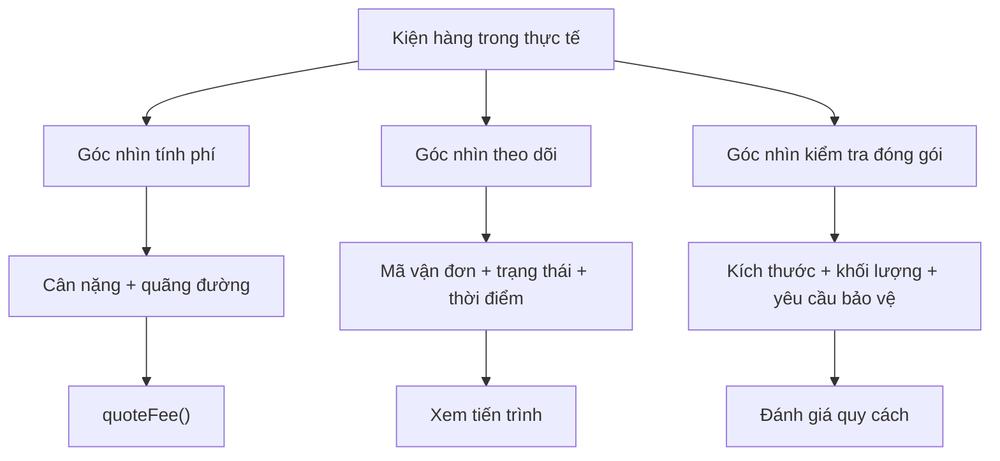
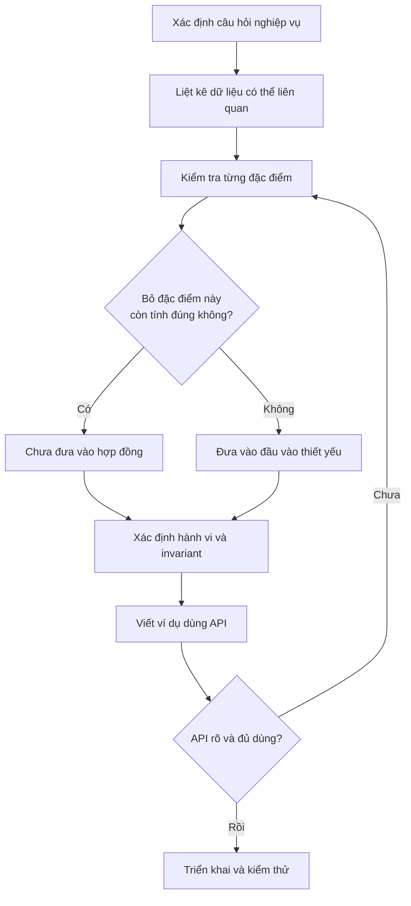
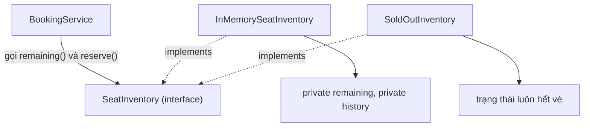
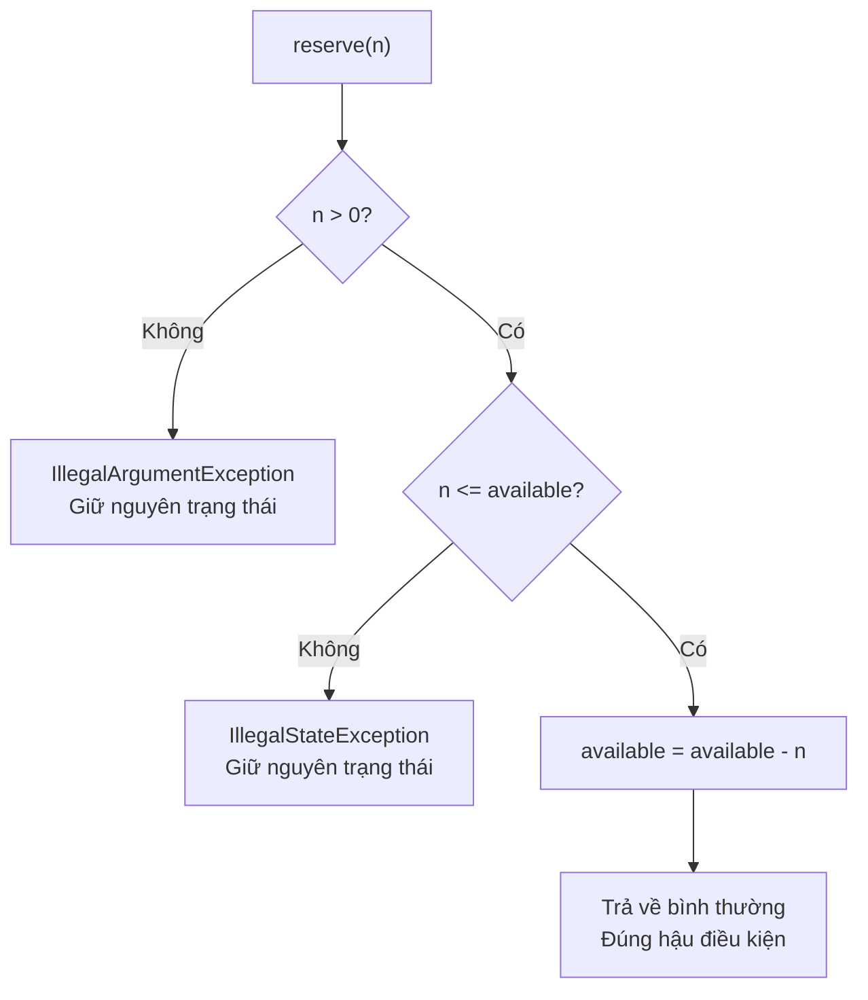
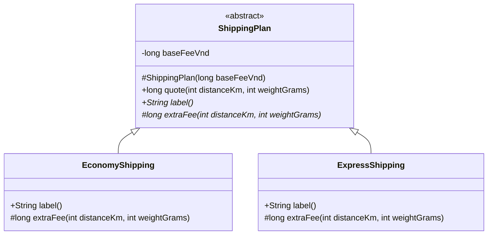
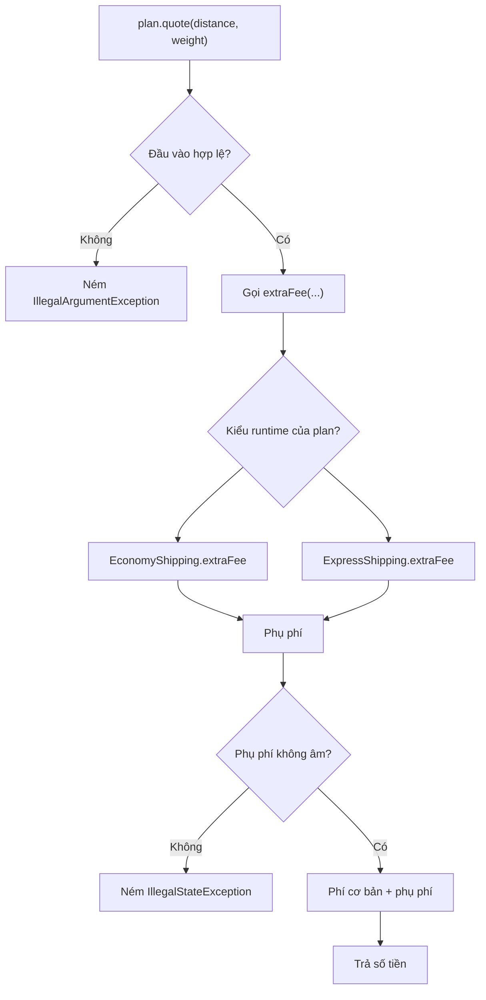
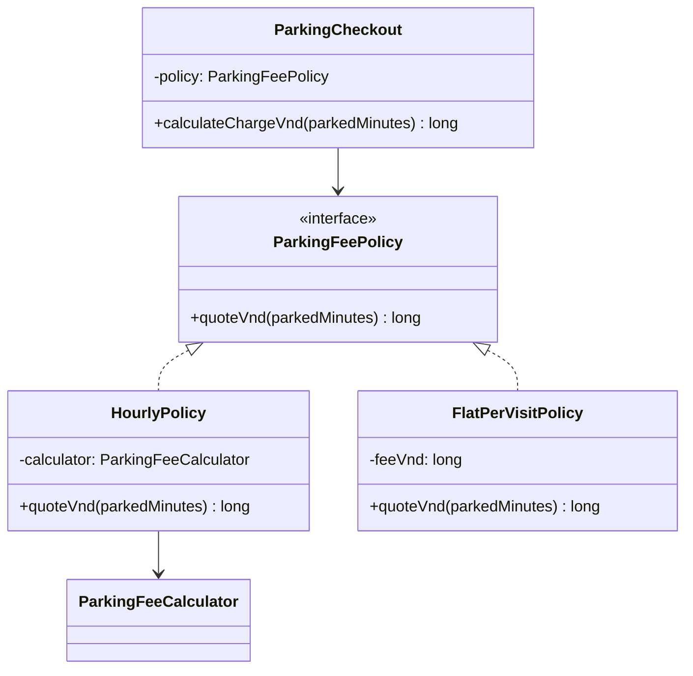
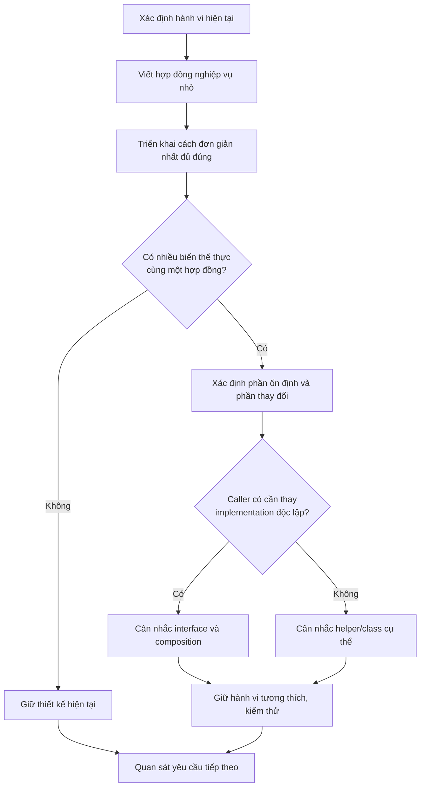
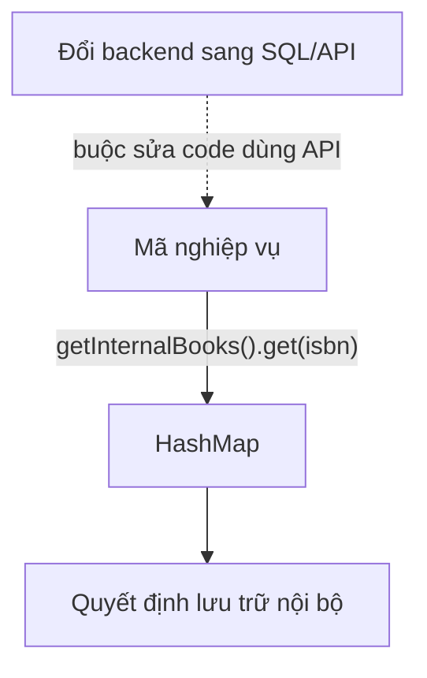
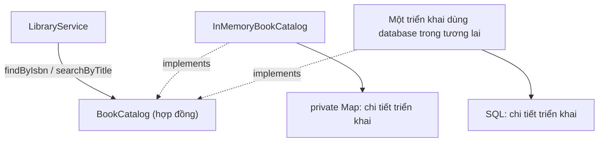

<a id="back-to-top"></a>

# Abstraction

## Menu
- [Abstraction and Selecting Essential Characteristics](#abstraction-001)
- [Distinguishing Abstraction from Encapsulation](#abstraction-002)
- [Usage Contracts and Implementation Details](#abstraction-003)
- [Preconditions, Postconditions, and Behavioral Guarantees](#abstraction-004)
- [Abstract Classes and Abstract Methods](#abstraction-005)
- [Distinguishing Concrete Classes from Abstract Classes](#abstraction-006)
- [Choosing the Right Level of Abstraction](#abstraction-007)
- [Leaking Implementation Details Through Public Interfaces](#abstraction-008)

## <a id="abstraction-001">Abstraction and Selecting Essential Characteristics</a>

<details>
<summary>View details</summary>

# Abstraction and Selecting Essential Characteristics in OOP (Java)

**Abstraction** is the process of identifying characteristics and behaviors **necessary for a particular purpose** while setting aside details that do not affect that purpose. In object-oriented programming, we use the resulting model to design classes, objects, interfaces, and interaction contracts.

The key point is that **no single list of "essential" characteristics is correct for every problem**. Information important to a delivery team may be entirely irrelevant to pricing or reporting.

## 1. From Real-World Objects to Software Models

Consider a **parcel** in an e-commerce system. In reality, a parcel may have dozens of attributes: tracking number, weight, dimensions, box color, pickup address, sender, recipient, carrier, status, scan history, photographs, and more.

If we are building a feature to **quote shipping fees based on weight and distance**, we may need only:

- `weightGrams`: weight in grams;
- `distanceKm`: distance in kilometers;
- the `quoteFee(...)` behavior: calculate and return an estimated fee.

Information such as box color, photographs, or the person holding the parcel **does not enter the fee calculation in this example**, so it need not appear in the pricing API.

For **shipment tracking**, however, the appropriate model differs: the tracking number, current status, and update time are essential, while weight may not be needed.

| Usage context | Essential characteristics | Behavior/question to answer | Details that can be omitted |
|---|---|---|---|
| Shipping fee estimation | Weight, distance, service policy | "What is the estimated fee?" | Box color, parcel photographs |
| Parcel tracking | Tracking number, status, update time | "Where is the parcel in the process?" | Rate calculation formula |
| Packaging inspection | Dimensions, weight, fragile-item requirements | "Does the package meet packaging specifications?" | Payment history |
| Customer support | Order ID, status, necessary contact information | "What problem is the customer experiencing?" | Internal route-optimization algorithm |

The "can be omitted" column **depends on the requirements under consideration**. If actual shipping fees include a surcharge for fragile items, the `fragile` attribute becomes an essential pricing input, and the model must change to reflect that business rule.

### Abstraction Does Not Mean Copying All of Reality

A `Shipment` class containing every piece of data that every department might use often becomes an oversized model. Instead, we can define **separate views or contracts for each need** and share data only when the design calls for it.



This diagram illustrates **analyzing requirements to choose a model**; it is not necessarily a Java class inheritance diagram.

## 2. What Questions Should Abstraction Answer?

When turning a problem-domain concept into a class or interface, answer these questions in order:

1. **What is the purpose?** What must the feature decide or calculate?
2. **What information is required for a correct result?** If this field is omitted, can the feature still work correctly?
3. **Which behaviors belong to the object's responsibilities?** For example, "quoting a fee" belongs to the pricing policy, not the UI color scheme.
4. **Which rules must always hold?** Weight must be positive, distance nonnegative, and status within the allowed set.
5. **Which details can change without API consumers needing to know?** Examples include price tables, surcharge calculations, and configuration sources.
6. **How many real use cases are currently required?** Do not preemptively create numerous class types for features that do not yet exist.

If you cannot describe **what consumers need to do with the model** clearly in a few sentences, it is usually too early to finalize its fields and methods.

## 3. Complete Java Example: Abstracting a Fee-Quotation Feature

To illustrate, we design an API that accepts only the data necessary to **estimate a shipping fee**. Two different pricing policies obey the same contract.

Illustrative rules, **not an actual carrier's rate schedule**:

- Base fee: 12.000 VND.
- Per kilometer: 1.000 VND.
- Per billable kilogram (rounding weight up to the next kilogram): 2.000 VND.
- Express delivery: a surcharge of 18.000 VND over the standard fee.

File `ShippingAbstractionDemo.java` (Java 17+):

```java
import java.util.Objects;

public class ShippingAbstractionDemo {

    // Dữ liệu tối thiểu mà phép báo phí trong ví dụ cần biết.
    record QuoteInput(int weightGrams, int distanceKm) {
        QuoteInput {
            if (weightGrams <= 0) {
                throw new IllegalArgumentException(
                    "Cân nặng phải lớn hơn 0 gram"
                );
            }
            if (distanceKm < 0) {
                throw new IllegalArgumentException(
                    "Quãng đường không được âm"
                );
            }
        }
    }

    // Hợp đồng: ai tính phí cũng phải trả về số tiền VND.
    interface ShippingPricing {
        long quoteFee(QuoteInput input);
    }

    static final class StandardPricing implements ShippingPricing {
        @Override
        public long quoteFee(QuoteInput input) {
            Objects.requireNonNull(input, "input");

            long chargedKg = ((long) input.weightGrams() + 999) / 1_000;
            return 12_000L
                + input.distanceKm() * 1_000L
                + chargedKg * 2_000L;
        }
    }

    static final class ExpressPricing implements ShippingPricing {
        private final ShippingPricing basePricing;

        ExpressPricing(ShippingPricing basePricing) {
            this.basePricing =
                Objects.requireNonNull(basePricing, "basePricing");
        }

        @Override
        public long quoteFee(QuoteInput input) {
            return Math.addExact(basePricing.quoteFee(input), 18_000L);
        }
    }

    static void printQuote(
            String serviceName,
            QuoteInput input,
            ShippingPricing pricing) {

        System.out.println(
            serviceName + ": " + pricing.quoteFee(input) + " VND"
        );
    }

    public static void main(String[] args) {
        QuoteInput input = new QuoteInput(1_500, 5);

        ShippingPricing standard = new StandardPricing();
        ShippingPricing express = new ExpressPricing(standard);

        printQuote("Tiêu chuẩn", input, standard);
        printQuote("Giao nhanh", input, express);
    }
}
```

Output:

```text
Tiêu chuẩn: 21000 VND
Giao nhanh: 39000 VND
```

Calculation explained:

- `1_500` grams is rounded up to **2 billable kg**.
- Standard fee = `12_000 + 5 × 1_000 + 2 × 2_000 = 21_000` VND.
- Express fee = `21_000 + 18_000 = 39_000` VND.

### Abstraction Decisions in the Example

| Component | Role | Why was it chosen? |
|---|---|---|
| `QuoteInput` | Holds the essential input data | The example algorithm needs only weight and distance |
| `ShippingPricing` | Pricing contract | The caller needs a fee result without knowing the specific algorithm |
| `StandardPricing` | One implementation of the contract | Contains the standard pricing formula |
| `ExpressPricing` | A surcharge policy based on another policy | Reuses the pricing behavior instead of copying the formula |
| `printQuote(...)` | Consumer of the contract | Works with `ShippingPricing` regardless of the implementation class |

`ShippingPricing` expresses **what an object can do**: quote a fee for valid input. The detailed formula lives in an implementation. If a new shipping policy is added, code calling `quoteFee` can still work with the new implementation as long as the contract stays the same.

The example uses `long` to represent **whole VND units**. In real systems, different currencies, fractional fees, or special rounding requirements may call for a dedicated money type or `BigDecimal`. Likewise, real shipping calculations may require volume, delivery zones, weight limits, and other surcharges; changing requirements should prompt corresponding changes to the input model.

**The main lesson is not the shipping formula**; it is that the API exposes only what is needed for the required behavior.

## 4. Why Not Put Every Detail in One Class?

An initial design might look like this:

```java
class EverythingShipment {
    String trackingId;
    String senderName;
    String recipientName;
    String boxColor;
    String vehicleLicense;
    int weightGrams;
    int distanceKm;
    String status;
    int retryCount;
    String supportAgent;
    // ... rất nhiều trường không cùng trách nhiệm
}
```

If the pricing API accepts an entire `EverythingShipment`, callers must understand and depend on a large model even when they only need two numbers. Later changes to unrelated operational information may also cascade into the pricing code.

A better model can separate input data **specifically for fee quotations**:

```java
record QuoteInput(int weightGrams, int distanceKm) {
    QuoteInput {
        if (weightGrams <= 0 || distanceKm < 0) {
            throw new IllegalArgumentException("Thông số không hợp lệ");
        }
    }
}
```

For tracking, we can choose a different set of characteristics:

```java
import java.time.Instant;
import java.util.Objects;

enum DeliveryStatus {
    CREATED, PICKED_UP, IN_TRANSIT, DELIVERED
}

record TrackingSnapshot(
    String trackingId,
    DeliveryStatus status,
    Instant updatedAt
) {
    TrackingSnapshot {
        if (trackingId == null || trackingId.isBlank()) {
            throw new IllegalArgumentException("Thiếu mã vận đơn");
        }
        Objects.requireNonNull(status, "status");
        Objects.requireNonNull(updatedAt, "updatedAt");
    }
}
```

These are **two separate data models for different needs**; they do not necessarily have to be subclasses of `Shipment`. In a real application, a service may retrieve data from the same business entity or storage source and construct suitable views.

Do not split classes mechanically just to reduce the field count. If a domain entity truly manages the entire delivery lifecycle, it may legitimately contain extensive information. What matters is avoiding **forcing every consumer to depend on all of its details**.

## 5. How Does Abstraction Differ from Encapsulation?

These concepts work together but are not synonymous:

| Aspect | Abstraction (*abstraction*) | Encapsulation (*encapsulation*) |
|---|---|---|
| Main question | **Which characteristics and behaviors should be visible?** | **Who can access or change state, and how?** |
| Focus | Select what matters for a purpose | Protect data and hide implementation details behind API boundaries |
| Example | `ShippingPricing.quoteFee(input)` | Keep internal fields `private` and validate input before storing it |
| Benefit | Reduce the complexity callers must understand | Preserve invariants and prevent uncontrolled state changes |

A class whose fields are all `private` can still be a **poor abstraction** if it exposes 30 getters/setters unrelated to its responsibilities.

Conversely, a small interface may express a **good abstraction**, but its implementation still needs encapsulation to prevent invalid changes to internal state.

A practical way to remember the difference:

- **Abstraction:** select *what matters and what the system can do*.
- **Encapsulation:** control *how those capabilities can be used correctly*.

## 6. Must We Use an Abstract Class or Interface to Achieve Abstraction?

**No.** Abstraction is an activity of **reasoning and model design**; `abstract class` and `interface` are language mechanisms that help express contracts or share parts of a design.

The `QuoteInput` example above is also an abstraction: the record retains only the information essential to a quotation. It does not use the `abstract` keyword.

In Java, the options include:

| Mechanism | When useful | Caution |
|---|---|---|
| Concrete class (*concrete class*) | Has a clear responsibility and a direct implementation | Still an abstraction when its model omits unnecessary details |
| `record` | Models value-like data with a compact set of components | Records are not automatically deeply immutable if their fields reference mutable objects |
| `interface` | Multiple implementations need a common behavioral contract | There is no need to create an interface for every class without a clear reason |
| `abstract class` | Intentionally combines a contract with shared behavior/state | Class inheritance creates tighter coupling; avoid using it just to "do OOP correctly" |
| Composition | Builds behavior from other objects | Can avoid complicated inheritance hierarchies |

For example, `ExpressPricing` **contains a** `ShippingPricing` instead of copying the algorithm or extending `StandardPricing`. This is composition: express delivery adds a policy on top of existing fee-quotation behavior.

**A good abstraction is not measured by the number of interfaces or inheritance layers**, but by how well the model fits the need and supports future code changes.

## 7. A Practical Process for Selecting Essential Characteristics

Suppose we need to design an "Estimated Shipping Fee" API.



A small checklist can help during analysis:

| Candidate characteristic | Affects the quotation under current requirements? | Decision |
|---|---|---|
| Weight | Yes, changes the fee according to billable kg | Keep |
| Distance | Yes, determines the fee by km | Keep |
| Box color | No | Exclude from the quotation API |
| Recipient name | Not used in the pricing formula | Exclude from the quotation API |
| Standard/express policy | Yes, affects the fee | Represent through the implementation/policy selection |
| Delivery zone | No zone-based rule exists yet | Defer; add when a requirement is confirmed |

Distinguish **essential for the current version of the problem** from **potentially important in the future**. Abstraction does not require predicting every change; when new rules arise, the model can be extended or refactored based on actual needs.

## 8. Select Behavior, Not Just Data

A common mistake is to ask only "What attributes does an object have?" and forget "What is this object responsible for doing?"

For example, consider a fee model that holds values and lets callers calculate the fee themselves:

```java
class RawRate {
    long baseFee;
    long perKm;
    long perKg;
}

// Caller phải tự biết cách tính, cách làm tròn kg,
// giới hạn đầu vào và logic phụ thu.
```

With that design, different callers may perform calculations differently, duplicating the rules and introducing errors.

A contract such as:

```java
interface ShippingPricing {
    long quoteFee(QuoteInput input);
}
```

keeps **fee-quotation behavior** with its responsible component. The caller receives a result in the specified unit rather than needing to know the internal algorithm. This is a useful abstraction when several parts of a system need quotations.

Of course, if an application uses one fixed formula in one place, a concrete class with a `quoteFee` method may be sufficient. An interface is useful when multiple implementations share the contract, policies must be replaceable, or callers should depend less on the calculation.

## 9. An Abstraction Needs a Clear Contract and Boundaries

A good name is not enough. An API must clearly specify **inputs, outputs, units, errors, and limitations**.

For `ShippingPricing.quoteFee(QuoteInput)`:

| Contract question | Decision in this example |
|---|---|
| What are the inputs? | Weight in grams and distance in km |
| Which values are valid? | Positive weight and nonnegative distance |
| What does the output mean? | Estimated fee in whole VND units |
| How is rounding performed? | Billable weight is rounded up to kilograms |
| Does the system guarantee the final actual price? | No; this is only an illustrative quotation model |
| What if `null` is passed? | The example implementation rejects it with `NullPointerException` via `Objects.requireNonNull` |

When a contract is ambiguous, API users may misunderstand it: is `weight` in grams or kilograms? Is `distance` in kilometers or meters? Does the fee include surcharges?

An **overly generic** abstraction such as `Calculator.calculate(Object input)` may force callers to cast values and guess their meaning. Names, types, and rules should convey what API users need to know.

Large applications can use specialized types (`Weight`, `Distance`, `Money`) when units and operations are complex. But introducing many new types also has a cost; do so only when they reduce errors or express important rules.

## 10. Recognizing Too Little or Too Much Abstraction

| Symptom | Problem | Possible adjustment |
|---|---|---|
| A class contains all data for several business areas | Too many responsibilities; unnecessary caller dependencies | Identify views and contracts for each use case |
| A function accepts a large entity but uses only two fields | Input data does not reflect actual needs | Consider a compact, purpose-built input type |
| Pricing formulas are duplicated across screens | Missing shared behavioral abstraction | Put pricing policy behind a responsible API |
| `interface` has only one implementation with no clear need for replacement or a contract | Possibly premature abstraction | Consider starting with a concrete class |
| `BaseAbstractManager` has many inheritance layers just to share a few lines | Inheritance introduces too much coupling | Consider composition or helper methods |
| An API uses `Object`, `Map<String,Object>` for stable data | Type contract is unclear; errors arise only at runtime | Use typed DTOs/records with validation |
| A characteristic directly affecting a rule is omitted | Incomplete model | Add data or behavior based on confirmed requirements |

The goal is to be **specific enough to avoid misunderstanding and concise enough to eliminate unnecessary details**. This is a context-dependent design choice, not a fixed formula.

## 11. Self-Check

### Exercise 1 — Select Essential Data

A system must determine **whether a movie ticket qualifies for a student discount** based on two conditions: the purchaser has valid student status, and the screening is on a discount day.

Candidate data: full name, seat number, `isStudent`, screening date, UI color, phone number.

**Suggested answer:** `isStudent` and the screening date are the two necessary factors under the stated rule. Seat number and phone number do not affect the discount decision in the current problem. An API could look like this:

```java
boolean eligibleForDiscount(boolean isStudent, java.time.LocalDate showDate);
```

If a later rule requires checking a student card's validity or screening type, the corresponding data/behavior must be added.

### Exercise 2 — Predict the Result from the Contract

With `ShippingAbstractionDemo` above:

```java
QuoteInput input = new QuoteInput(1_001, 0);
ShippingPricing pricing = new StandardPricing();
System.out.println(pricing.quoteFee(input));
```

**Answer: `16000`** because `1_001` grams is rounded up to `2` kg, so the fee is `12_000 + 0 + 2 × 2_000`. The result shows that the rounding policy is an important part of the contract even though callers do not need to calculate it themselves.

### Exercise 3 — Critique the Design

A programmer proposes this interface:

```java
interface AnythingService {
    Object execute(Object input);
}
```

**Question:** Is this interface always better than a concrete class because it is "more abstract"?

**Answer:** No. This contract is too vague: it does not specify the input type, the operation, or the meaning of its result. For quotations, `ShippingPricing.quoteFee(QuoteInput)` expresses the need much more clearly and allows the compiler to check types.

### Exercise 4 — Design It Yourself

Choose one of two use cases for the same "library book" object:

- **Book lookup:** search by title, author, and ISBN.
- **Book borrowing:** check the number of copies available for borrowing and update borrowing status.

For the chosen use case, list the **essential characteristics**, **behaviors**, and **invariants**. Then sketch a Java class or record with the smallest API that meets the requirements. Explain why some data for the other use case need not appear in this API.

---

**Remember:** Abstraction means **choosing the right characteristics and behaviors for a purpose**, rather than loading a class with as many attributes as possible or using many `abstract class` declarations. Start with the business question, identify the data needed to answer it, design behavior with a clear contract, and keep implementation details out of the API when callers do not need them.


</details>

- [Back to top](#back-to-top)

---

## <a id="abstraction-002">Distinguishing Abstraction from Encapsulation</a>

<details>
<summary>View details</summary>

# Distinguishing Abstraction from Encapsulation in Java

**Abstraction** and **encapsulation** are both important object-oriented programming (OOP) principles, but they address different problems:

- **Abstraction (abstraction):** selects and exposes an object's **essential capabilities**, allowing consuming code to focus on *what the object can do* without depending on implementation details.
- **Encapsulation (encapsulation):** organizes data with its related operations and **controls how internal state can be accessed or modified**, allowing the object to enforce its own rules.

For example, a ticketing system needs to call `reserve(2)` without knowing whether seats are stored in a `HashMap`, a database, or another service: that is the **abstraction** perspective. The system must also prevent external code from directly changing the seat count to `-10` or bypassing availability checks: that is the goal of **encapsulation**.

These two principles often complement each other, but they **are not synonymous**. A class can use `private` for sound encapsulation without declaring an `interface`; conversely, declaring an `interface` does not guarantee that all implementations correctly protect their state.

## 1. Comparing Their Goals and Implementation

| Perspective | Abstraction | Encapsulation |
| --- | --- | --- |
| Main question | "Which **capabilities** do consumers need to know about and use?" | "Who may **read or modify state**, and through which operations?" |
| Goal | Reduce dependence on implementation details; present an understandable contract | Protect data consistency and business rules |
| What is hidden | Algorithm details, storage structures, and implementation choices outside the contract | Direct access to fields and internal structures requiring control |
| Common Java mechanisms | `interface`, `abstract class`, interface-typed parameters, compact public APIs | `private`, validated methods, defensive copying, immutable values, restricted access |
| Effect on consumers | Code calls `inventory.reserve(2)` without knowing how inventory is stored | Code cannot directly assign `inventory.remaining = -10` |
| Poor-design symptom | Business code depends on multiple concrete classes or storage details | Callers modify internal data without validation |
| Evaluation criterion | Does the contract expose all necessary capabilities while hiding irrelevant details? | Can external code violate an object's (*invariant*) through any available path? |

Avoid the assumptions that "abstraction only uses interfaces" or "encapsulation only uses private". An ordinary class with a few public methods can provide a **good abstraction**. Conversely, a `private final List<...>` field can still be modified indirectly if the class exposes the referenced mutable list.

## 2. Complete Example: Two Principles in the Same Problem

We design a seat-booking feature:

- `SeatInventory` describes the seat-inventory **contract**: check remaining seats and request a reservation.
- `InMemorySeatInventory` is one implementation that holds the seat count in a `private` field and validates requests before decrementing it.
- `SoldOutInventory` is another implementation that always reports sold out.
- `BookingService` depends only on **`SeatInventory`**, so it need not know which concrete object is underneath.

Put all the following code into **`Main.java`** and run it with Java 11 or later:

```java
import java.util.ArrayList;
import java.util.List;
import java.util.Objects;

// TRỪU TƯỢNG: mô tả hợp đồng mà code đặt vé cần.
interface SeatInventory {
    int remaining();

    // Số ghế yêu cầu phải > 0.
    // Trả true nếu giữ chỗ thành công; false nếu không đủ chỗ.
    boolean reserve(int seats);
}

// Một triển khai lưu trạng thái trong bộ nhớ.
final class InMemorySeatInventory implements SeatInventory {
    private int remaining;
    private final List<Integer> successfulReservations =
            new ArrayList<>();

    InMemorySeatInventory(int initialSeats) {
        if (initialSeats < 0) {
            throw new IllegalArgumentException(
                    "Số ghế ban đầu không được âm");
        }
        this.remaining = initialSeats;
    }

    @Override
    public int remaining() {
        return remaining;
    }

    @Override
    public boolean reserve(int seats) {
        if (seats <= 0) {
            throw new IllegalArgumentException(
                    "Số ghế đặt phải lớn hơn 0");
        }
        if (seats > remaining) {
            return false;
        }

        // ĐÓNG GÓI: chỉ logic bên trong được phép giảm số ghế.
        remaining -= seats;
        successfulReservations.add(seats);
        return true;
    }

    // Trả snapshot, không trao list mutable nội bộ cho caller.
    List<Integer> reservationHistory() {
        return List.copyOf(successfulReservations);
    }
}

// Một triển khai hợp đồng khác: địa điểm đã hết vé.
final class SoldOutInventory implements SeatInventory {
    @Override
    public int remaining() {
        return 0;
    }

    @Override
    public boolean reserve(int seats) {
        if (seats <= 0) {
            throw new IllegalArgumentException(
                    "Số ghế đặt phải lớn hơn 0");
        }
        return false;
    }
}

// Code nghiệp vụ làm việc qua kiểu trừu tượng.
final class BookingService {
    private final SeatInventory inventory;

    BookingService(SeatInventory inventory) {
        this.inventory = Objects.requireNonNull(
                inventory, "inventory");
    }

    boolean book(int seats) {
        return inventory.reserve(seats);
    }

    int availableSeats() {
        return inventory.remaining();
    }
}

public class Main {
    public static void main(String[] args) {
        InMemorySeatInventory warehouse =
                new InMemorySeatInventory(5);
        BookingService service = new BookingService(warehouse);

        System.out.println(service.book(2));          // true
        System.out.println(service.availableSeats()); // 3
        System.out.println(service.book(4));          // false
        System.out.println(service.availableSeats()); // 3

        List<Integer> snapshot = warehouse.reservationHistory();
        System.out.println(snapshot); // [2]
        try {
            snapshot.add(100);
        } catch (UnsupportedOperationException ex) {
            System.out.println("Không sửa được lịch sử bên ngoài");
        }

        // Không đổi BookingService khi đổi cách triển khai.
        BookingService soldOutService =
                new BookingService(new SoldOutInventory());
        System.out.println(soldOutService.book(1)); // false

        // warehouse.remaining = -10;
        // Dòng trên không biên dịch: remaining là private.
    }
}
```

Compile and run:

```bash
javac Main.java
java Main
```

Output:

```text
true
3
false
3
[2]
Không sửa được lịch sử bên ngoài
false
```

### Analysis: Which Part Is Abstraction?

`SeatInventory` exposes two clear capabilities: `remaining()` and `reserve(int)`. `BookingService` is written against this contract and can receive any implementation that **preserves the same semantics**: an in-memory inventory, a database-backed inventory, or a test double.

The dependency looks like this:



`BookingService` does not need `instanceof InMemorySeatInventory`, does not read the `remaining` field, and does not choose how data is stored. If a `DatabaseSeatInventory` is introduced later, we can supply the new implementation without changing the `BookingService` consumer API, as long as it satisfies the contract.

**Having an interface does not automatically make every design a good abstraction.** If an interface exposes details such as `getInternalHashMap()` or `getJdbcConnection()` in an ordinary booking API, consumers still become coupled to implementation details. Conversely, public methods of a concrete class can provide an appropriate abstraction if they hide those details well.

### Analysis: Which Part Is Encapsulation?

`InMemorySeatInventory` keeps `remaining` and `successfulReservations` inside the object. Callers cannot set `remaining = -10` or delete the history directly. Instead, they call `reserve(seats)`, where the class validates:

1. The requested number of seats must be greater than 0.
2. Reservations cannot exceed the remaining seats.
3. Only a valid request decrements `remaining` and records the reservation.

These rules are **object invariants**: `remaining` stays nonnegative, recorded reservation counts remain positive, and overbooking does not silently produce a negative balance. The constructor establishes valid initial state, and update methods preserve it.

Although the history list is `private`, the class also returns `List.copyOf(successfulReservations)` so that callers cannot modify the internal collection through a shared reference. Because `Integer` elements are immutable, the snapshot also avoids mutable-element concerns.

The example assumes sequential use. **`private` does not make a check-then-update operation safe when multiple threads book concurrently**; concurrent systems require suitable synchronization or atomic operations.

## 3. Why Do These Principles Usually Go Together Yet Remain Distinct?

Consider two independent questions about the booking class:

**Question A — Does the API hide the details?**

Business code only needs `book(2)` and `availableSeats()`. It does not need to know whether the application uses `ArrayList`, JDBC, or a distributed system. This design emphasizes **abstraction** and the ability to replace implementations.

**Question B — Is the data protected?**

If a class method exposes its internal `ArrayList` and another component calls `clear()`, state changes outside the business workflow. This concerns **encapsulation** and control of state.

These problems can occur independently:

| Situation | Abstraction | Encapsulation |
| --- | --- | --- |
| A service uses `SeatInventory`; its implementation keeps fields `private` and updates them only through a validated API | Good | Good |
| A `SimpleCounter` class has `private count` and `increment()` and is used directly in a small program | Still has an abstraction at the class API level; no separate interface | Potentially good |
| An interface returns an internal mutable collection for callers to modify freely | Uses an interface but may leak implementation details through the contract | Poor |
| A service reads a public field directly from a concrete implementation | Depends on the representation of state | Poor if state needs protection |

The distinction can be summarized in one sentence: **abstraction decides *which capabilities* an object exposes; encapsulation decides how the object maintains *control over its state*.**

Both principles involve "hiding details", however. To distinguish them, consider **why details are hidden**: to shield consumers from implementation choices behind a clear contract, or to block modifications that violate internal rules.

## 4. An `interface` Is Not Required for Abstraction

Abstraction is a **design** activity: selecting important concepts and omitting unnecessary details at a particular level of use. Java offers several supporting mechanisms:

| Mechanism | What it helps express | When appropriate |
| --- | --- | --- |
| `public` methods in ordinary classes | A set of behaviors callers are allowed to use | Simple objects that do not need multiple implementations |
| `interface` | A shared contract for different implementations | Clients should depend on capabilities rather than concrete classes |
| `abstract class` | A shared contract with common state/implementation for subclasses | Implementations genuinely share an inheritance relationship and rules |
| Value object / service API | A clearly defined domain concept | Hide calculations, validation, or storage technology |

For example, a concrete class can still expose an abstracted API:

```java
final class Thermostat {
    private int targetCelsius = 24;

    void increaseTarget() {
        if (targetCelsius >= 30) {
            throw new IllegalStateException("Đã đạt giới hạn");
        }
        targetCelsius++;
    }

    int targetCelsius() {
        return targetCelsius;
    }
}
```

The caller only needs to know `increaseTarget()` and `targetCelsius()`, without directly controlling the field or understanding the validation steps. This is a useful abstracted API **even without a separate interface or abstract class**. The `private` field and limit checks also provide encapsulation.

In Java, the `abstract` keyword has a specific syntactic meaning: an `abstract class` cannot be instantiated directly, and an `abstract` method without a body must be implemented by a concrete subclass (unless the subclass remains abstract). **Do not confuse the `abstract` keyword with the entire principle of abstraction**.

## 5. Encapsulation Is More Than Adding `private` and Getters/Setters

The following style weakens the boundary of control:

```java
class WeakAccount {
    private int balance;

    public int getBalance() {
        return balance;
    }

    public void setBalance(int balance) {
        this.balance = balance;
    }
}
```

`balance` is indeed `private`, but any caller can invoke `setBalance(-1_000)`. If the business rule requires a nonnegative balance, an unrestricted setter prevents the class from maintaining its invariant.

A more appropriate behavioral API:

```java
final class SafeAccount {
    private long balance;

    SafeAccount(long openingBalance) {
        if (openingBalance < 0) {
            throw new IllegalArgumentException("Số dư âm");
        }
        this.balance = openingBalance;
    }

    void deposit(long amount) {
        if (amount <= 0 || amount > Long.MAX_VALUE - balance) {
            throw new IllegalArgumentException("Số tiền nạp không hợp lệ");
        }
        balance += amount;
    }

    boolean withdraw(long amount) {
        if (amount <= 0) {
            throw new IllegalArgumentException("Số tiền rút phải dương");
        }
        if (amount > balance) {
            return false;
        }
        balance -= amount;
        return true;
    }

    long getBalance() {
        return balance;
    }
}
```

`SafeAccount` forces all balance changes through validated behavior. Real applications typically need more precise money units/types; `long` here illustrates only state encapsulation. The class does not guarantee thread safety.

The principle is: **allow callers to perform valid operations without giving them the ability to corrupt state arbitrarily**.

## 6. How Do Java Access Levels Relate to Encapsulation?

Java uses access modifiers to determine the visibility of classes, fields, constructors, and methods.

| Access level | Primary scope |
| --- | --- |
| `private` | Within the declaring class (subject to Java's access rules for nested classes) |
| No explicit modifier (*package-private*) | Within the same package |
| `protected` | Within the same package and through subclass relationships where Java access rules allow |
| `public` | Accessible from permitted locations; also subject to the module system when present |

Choose modifiers according to the object's contract, not just to eliminate compilation errors:

- Fields holding invariants should usually be `private`.
- The public API should expose only operations that consumers are actually allowed to perform.
- Exposing a mutable field as `protected` may let subclasses violate an invariant; consider controlled extension methods.
- `public` is not inherently wrong: public behaviors are precisely what the abstraction needs to expose.

Modifiers are **technical mechanisms**. Good encapsulation also depends on method design, enforced constraints, and how objects reference other mutable data.

## 7. Common Design Misconceptions

**Mistake 1: "An interface guarantees encapsulation."**

```java
interface Basket {
    void add(String sku);
}

class LeakyBasket implements Basket {
    public final List<String> internalItems = new ArrayList<>();

    @Override
    public void add(String sku) {
        internalItems.add(sku);
    }
}
```

This is an illustrative snippet; compiling it separately requires `import java.util.List;` and `import java.util.ArrayList;`. `Basket` provides a usage interface, but a caller holding a `LeakyBasket` reference can modify `internalItems` directly. Declaring a field `final` prevents reassignment but does not prevent changes to the `ArrayList`.

**Mistake 2: "Using `private` means abstraction is unnecessary."**

A service depending directly on `MySqlSeatInventory` may still use a well-encapsulated API, but that concrete dependency can be troublesome if the service needs to switch to PostgreSQL or use a test double. Introducing `SeatInventory` expresses a stable contract when multiple implementations are truly required. Avoid creating an interface solely because of a mechanical rule that "every class needs an interface".

**Mistake 3: "Getters are always safe because they only read."**

```java
private final List<String> names = new ArrayList<>();

List<String> getNames() {
    return names; // Trả tham chiếu mutable nội bộ.
}
```

A caller could invoke `getNames().clear()`. Return `List.copyOf(names)` for a structurally immutable snapshot, or use a read-only view if consumers are intentionally allowed to observe a changing list. For mutable elements, copying the collection is only a shallow copy.

**Mistake 4: "Hiding absolutely everything produces a good API."**

If a class does not provide operations its clients need, clients will seek workarounds: casts, reflection, direct database updates, or duplicated logic. A good abstraction must expose **enough meaningful capabilities**; good encapsulation controls important changes rather than hiding all behavior.

**Mistake 5: "A good abstraction layer automatically guarantees correct business behavior."**

`SeatInventory` describes seat-booking capabilities but does not itself enforce synchronization, persistence, or atomicity. Every implementation must preserve the promised semantics. Two concurrent requests could overbook seats without appropriate transactions or locks, even if the code correctly uses the interface.

## 8. How to Evaluate an OOP Design

When reviewing a class, answer two groups of questions:

| Abstraction questions | Encapsulation questions |
| --- | --- |
| Which capabilities do callers need? | Which states must always be valid? |
| Does the contract specify results, errors, and input conditions? | Which update paths could violate an invariant? |
| Can the implementation change without modifying business code? | Does the class expose internal arrays/lists/maps or mutable objects? |
| Does the API avoid unnecessary technology details? | Do the constructor and every mutating operation validate their conditions? |
| Are there too many interface layers with no clear value? | Are access permissions appropriately restricted? |

If a class has one stable usage pattern and implementation, a clear public API on the concrete class may suffice. If several modules share a contract and the implementation may change, an interface or abstract class often isolates dependencies more effectively.

Either way, data rules must live where they can be enforced. Do not shift responsibility for validating balances, capacity, or consistency to every external caller just because methods have good names.

## 9. Quick Exercises

**Exercise 1.** A class has a `private List<String> items` field, and its getter returns that list directly. Which principle is primarily affected?

**Answer:** **Encapsulation**: callers can modify internal data through an alias. Fix it with a suitable read-only API or defensive copy, depending on the contract.

**Exercise 2.** `BookingService` executes SQL `SELECT ... FOR UPDATE` itself to decrement the seat count. To support two storage systems without rewriting the business logic, which principle matters most?

**Answer:** **Abstraction**: define a `SeatInventory` contract and move SQL handling into the corresponding implementation. The implementation must still ensure transactions and atomicity.

**Exercise 3.** Does `interface PaymentGateway` necessarily protect payment-card data through encapsulation?

**Answer:** **No.** An interface does not determine how data is stored, protected, or exposed. Confidentiality and state control depend on the specific design and implementation.

**Exercise 4.** A `Thermostat` class declares no interface but has `increaseTarget()` and a `private targetCelsius` field. Can it demonstrate both principles?

**Answer:** **Yes.** Its two methods form an appropriately abstracted API; the private field and limit checks protect state.

**Exercise 5.** If `InMemorySeatInventory` is replaced with `SoldOutInventory` and `BookingService` requires no changes, what does that illustrate?

**Answer:** Consuming code is programmed to an **abstract contract**. Each implementation must still enforce its promised state and behavioral rules.

**Remember:** When designing OOP systems, identify **the capabilities to expose to consumers** (abstraction) and **the boundaries that control internal state** (encapsulation). Together these make code easier to understand, change, and maintain correctly, but each addresses a different design risk.


</details>

- [Back to top](#back-to-top)

---

## <a id="abstraction-003">Usage Contracts and Implementation Details</a>

<details>
<summary>View details</summary>

# Usage Contracts and Implementation Details in Java OOP

An object may change its algorithm, data storage, or external provider without requiring consumers to **change how they call it**. This is safe only when we clearly distinguish two things:

- **Usage contract (*contract*):** which behavior callers may request, which inputs are valid, which types of results they receive, and which errors or side effects can occur.
- **Implementation details (*implementation*):** the algorithms, data structures, libraries, or external connections the object uses to fulfill those promises.

In Java, `interface`, `abstract class`, and public APIs can all express parts of a contract. But **a method signature is not the entire behavioral contract**. An implementation can compile successfully yet return results with the wrong meaning.

This lesson uses a **leave-request evaluation policy** to examine contract definition, two different rule implementations, provider substitution, testing, and change management. It is a standalone example that does not require Spring Boot.

## 1. The Caller's Perspective: What Do They Actually Need to Know?

An HR service needs to perform an initial evaluation of a leave request. The illustrative policy needs an employee ID, the number of leave days requested, and the remaining leave balance at the time of evaluation. There are two policies:

- **Standard policy:** returns an eligible decision if the requested days do not exceed the remaining leave balance.
- **Probationary policy:** in addition to the balance requirement, each request can cover at most two days.

These implementations can return **different results for the same input** while honoring the same contract. Callers need only invoke `evaluate(request)` and receive a reasoned decision; they need not know whether the probation rule is implemented with an `if`, a rule table, or an HR system.

| What the contract must expose | Example |
| --- | --- |
| Capability | Evaluate whether a leave request can be accepted |
| Input data | `LeaveRequest` with an employee ID, `requestedDays`, and `remainingDays` |
| Value domain | Nonblank ID, requested days > 0, remaining days >= 0 |
| Result | `LeaveDecision` with a decision code and explanation |
| Shared rule | Do not approve when requested days exceed the remaining balance |
| Errors | `null` is rejected; invalid data is rejected when creating the request |
| Side effects | **Evaluation only**; do not deduct leave days or write to the database |
| Limitation | Decision uses a snapshot; it does not mean the request has been approved or persisted |

**The clearer the contract, the less room each implementation has to interpret it differently.** For example, if one class returns `null` for a rejected request while another returns an object with a rejection code, callers must branch by provider.

## 2. Standalone Java Example: Two Implementations, One Contract

Save as `LeaveContractDemo.java` and compile with **JDK 17 or later**. `record` types are compact value types with constructors that validate data. Here, records contain only `String`, integers, and enums, so they do not expose mutable references.

~~~java
import java.util.Objects;

public class LeaveContractDemo {

    record LeaveRequest(
            String employeeId, int requestedDays, int remainingDays) {
        LeaveRequest {
            if (employeeId == null || employeeId.isBlank()) {
                throw new IllegalArgumentException("Employee ID is required");
            }
            if (requestedDays <= 0 || remainingDays < 0) {
                throw new IllegalArgumentException("Invalid day count");
            }
        }
    }

    enum DecisionCode {
        APPROVED, INSUFFICIENT_BALANCE,
        EXCEEDS_TRIAL_LIMIT, REJECTED_BY_POLICY
    }

    record LeaveDecision(DecisionCode code, String explanation) {
        LeaveDecision {
            Objects.requireNonNull(code, "code");
            if (explanation == null || explanation.isBlank()) {
                throw new IllegalArgumentException("Explanation is required");
            }
        }

        boolean approved() {
            return code == DecisionCode.APPROVED;
        }
    }

    /**
     * Đánh giá một request hợp lệ, khác null.
     * Trả LeaveDecision khác null.
     * Không APPROVED khi requestedDays > remainingDays.
     * Không sửa request hay số dư; không lưu/phê duyệt đơn thật.
     * Null input -> NullPointerException.
     */
    interface LeavePolicy {
        LeaveDecision evaluate(LeaveRequest request);
    }

    static final class StandardLeavePolicy implements LeavePolicy {
        @Override
        public LeaveDecision evaluate(LeaveRequest request) {
            Objects.requireNonNull(request, "request");
            if (request.requestedDays() > request.remainingDays()) {
                return new LeaveDecision(
                        DecisionCode.INSUFFICIENT_BALANCE,
                        "Số ngày phép còn lại không đủ");
            }
            return new LeaveDecision(
                    DecisionCode.APPROVED, "Đủ ngày phép");
        }
    }

    static final class TrialLeavePolicy implements LeavePolicy {
        @Override
        public LeaveDecision evaluate(LeaveRequest request) {
            Objects.requireNonNull(request, "request");
            if (request.requestedDays() > request.remainingDays()) {
                return new LeaveDecision(
                        DecisionCode.INSUFFICIENT_BALANCE,
                        "Số ngày phép còn lại không đủ");
            }
            if (request.requestedDays() > 2) {
                return new LeaveDecision(
                        DecisionCode.EXCEEDS_TRIAL_LIMIT,
                        "Giới hạn thử việc là 2 ngày");
            }
            return new LeaveDecision(
                    DecisionCode.APPROVED, "Đạt quy tắc thử việc");
        }
    }

    static final class LeaveReviewService {
        private final LeavePolicy policy;

        LeaveReviewService(LeavePolicy policy) {
            this.policy = Objects.requireNonNull(policy, "policy");
        }

        LeaveDecision review(LeaveRequest request) {
            return policy.evaluate(request);
        }
    }

    static void print(
            String name, LeavePolicy policy, LeaveRequest request) {
        LeaveDecision result =
                new LeaveReviewService(policy).review(request);
        System.out.println(name + ": " + result.code()
                + " - " + result.explanation());
    }

    public static void main(String[] args) {
        LeaveRequest request = new LeaveRequest("NV-01", 3, 5);
        print("Thông thường", new StandardLeavePolicy(), request);
        print("Thử việc", new TrialLeavePolicy(), request);

        LeaveRequest insufficient = new LeaveRequest("NV-02", 6, 5);
        print("Thiếu phép", new StandardLeavePolicy(), insufficient);
    }
}
~~~

Run:

~~~bash
javac LeaveContractDemo.java
java LeaveContractDemo
~~~

Output:

~~~text
Thông thường: APPROVED - Đủ ngày phép
Thử việc: EXCEEDS_TRIAL_LIMIT - Giới hạn thử việc là 2 ngày
Thiếu phép: INSUFFICIENT_BALANCE - Số ngày phép còn lại không đủ
~~~

**Step-by-step explanation:**

1. The first request asks for 3 days with 5 remaining; this is valid input.
2. `StandardLeavePolicy` checks that requested days do not exceed the balance and returns `APPROVED`.
3. `TrialLeavePolicy` is also called through `LeavePolicy.evaluate`, but applies the additional 2-day limit and therefore returns `EXCEEDS_TRIAL_LIMIT`.
4. The second request asks for 6 days with 5 remaining, so the standard policy returns `INSUFFICIENT_BALANCE`.
5. No operation deducts the balance. `remainingDays` is an **input snapshot**, and `APPROVED` here means only "passed policy evaluation", not final approval of a leave transaction.

Different results do not imply a contract violation. Individual policies are intentionally allowed to apply additional criteria, but every implementation must preserve the **shared rule: never approve a request exceeding the remaining balance**.

## 3. Dependency Map and Responsibilities

~~~mermaid
classDiagram
    class LeavePolicy {
        <<interface>>
        +evaluate(LeaveRequest) LeaveDecision
    }
    class StandardLeavePolicy {
        +evaluate(LeaveRequest) LeaveDecision
    }
    class TrialLeavePolicy {
        +evaluate(LeaveRequest) LeaveDecision
    }
    class LeaveReviewService {
        -LeavePolicy policy
        +review(LeaveRequest) LeaveDecision
    }
    LeavePolicy <|.. StandardLeavePolicy
    LeavePolicy <|.. TrialLeavePolicy
    LeaveReviewService --> LeavePolicy
~~~

**`LeaveReviewService` is the client:** it knows only the `LeavePolicy` type and `LeaveDecision` result. Object construction or configuration decides which policy is passed to the constructor. The interface **does not choose** the appropriate policy for an employee on its own.

**`LeavePolicy` is the contract:** it exposes the evaluation capability, input/output types, and behavioral promises. It does not specify the algorithm.

**`StandardLeavePolicy` and `TrialLeavePolicy` are implementations:** each class is responsible for satisfying the contract, including rejecting `null` and refusing approval when requested days exceed the balance.

Constructor injection in this example passes a dependency from outside. No DI container is required. When a different valid implementation is provided, `LeaveReviewService.review` still need not know the new class's name.

## 4. Distinguishing Method Signatures from Behavioral Contracts

The Java signature:

~~~java
LeaveDecision evaluate(LeaveRequest request);
~~~

tells the compiler a method's name, parameter types, and return type. It **does not itself enforce** every promise, such as "never return null", "do not write to the database", or "do not approve leave beyond the balance".

| Item | Can the Java compiler check it? | What else must be verified |
| --- | --- | --- |
| Has method `evaluate(LeaveRequest)` | Yes | Business meaning |
| Returns `LeaveDecision` | Yes | Whether `null` can be returned when prohibited |
| Request created through a valid constructor | Constructor validates at runtime | Other creation paths and source-data rules |
| Do not approve when the balance is insufficient | Not through the signature | Test requested days > remaining days |
| No side effects | Not through the signature | Code review, tests, and documentation |
| Decision code has the correct meaning | Not through the signature | Scenario tests and shared conventions |

For example, this implementation is wrong even though it compiles:

~~~java
static final class BrokenLeavePolicy implements LeavePolicy {
    @Override
    public LeaveDecision evaluate(LeaveRequest request) {
        return null; // Vi phạm cam kết kết quả khác null.
    }
}
~~~

You can place this snippet as a nested class in `LeaveContractDemo` to observe it. `@Override` only helps the compiler verify that a method correctly overrides a signature; it does not prove correct behavior.

### Things Callers Must Know and Must Not Be Mistakenly Hidden

A real contract may need to specify when leave balances are read, how stale data is handled, approval permissions, persistence state, network errors, and concurrency conditions. If an implementation switches from in-memory evaluation to calling an HR API, timeouts and stale data **may become observable**. Do not promise "identical behavior in every respect" merely because the method name is unchanged.

In this example, `evaluate` deliberately evaluates only the supplied data. Updating leave balances belongs in **a separate use case or transaction** with concurrency control. If two employees or requests use the same balance snapshot, two `APPROVED` decisions do not guarantee that sufficient leave exists to fulfill both requests simultaneously.

## 5. Substitutability Depends on the Contract, Not Just an Interface

The Liskov Substitution Principle (LSP) here means that one implementation can replace another without breaking the **shared promises** clients are entitled to rely on.

Do not assume the two policies must return the same decision. The problem explicitly allows the probationary policy to impose a stricter leave limit, but neither policy may return `APPROVED` when `requestedDays > remainingDays`.

| Implementation behavior | Complies with the example contract? | Why |
| --- | --- | --- |
| Standard policy approves 3/5 days | Yes | The standard rule permits it |
| Probationary policy rejects 3/5 days | Yes | This policy imposes a 2-day limit |
| An implementation returns `APPROVED` for 6/5 days | No | Violates the shared balance guarantee |
| An implementation returns `null` for an invalid request | No | The contract requires a non-null result for a valid request |
| An implementation deducts leave days during evaluation | No | Violates the no-side-effects guarantee |
| Uses a different data structure or algorithm | Yes | Implementation details may change |
| Changes the explanation while preserving the correct code | Usually yes | Unless the exact explanation text is part of the promised API |

Another practical rule: an implementation must not **strengthen shared preconditions** so that contract-valid calls unexpectedly fail, nor **weaken shared postconditions**. Here, policies may *return a valid rejection result*, which differs from *throwing a new error not described by the contract*.

LSP does not require every policy to accept the same requests; the **meaning of different outcomes** must remain consistent.

## 6. Contract Tests and Client Tests Serve Different Purposes

### A. Shared Tests for Implementations

You can add the following method to `LeaveContractDemo`:

~~~java
static void verifyContract(LeavePolicy policy) {
    LeaveRequest insufficient = new LeaveRequest("NV-X", 6, 5);
    LeaveDecision rejected = policy.evaluate(insufficient);

    if (rejected == null || rejected.approved()) {
        throw new AssertionError("Policy approved excessive leave");
    }
    if (policy.evaluate(new LeaveRequest("NV-Y", 1, 3)) == null) {
        throw new AssertionError("Policy returned null");
    }

    try {
        policy.evaluate(null);
        throw new AssertionError("Null must be rejected");
    } catch (NullPointerException expected) {
        // Đúng hợp đồng về null.
    }
}
~~~

Call `verifyContract(new StandardLeavePolicy())` and `verifyContract(new TrialLeavePolicy())` to check the **shared guarantees**. Do not write a shared test asserting "every policy always approves 3 days", because the probationary limit explicitly allows rejection.

This is only a sample test; it does not prove correctness for every input. Real applications should add edge cases such as a balance of 0, update timing, provider failures, and integration tests.

### B. Testing the Client with a Fake Implementation

To test only whether `LeaveReviewService` **passes the correct request and receives the correct result**, we do not need the actual policy:

~~~java
static final class FixedRejectPolicy implements LeavePolicy {
    @Override
    public LeaveDecision evaluate(LeaveRequest request) {
        Objects.requireNonNull(request, "request");
        return new LeaveDecision(
                DecisionCode.REJECTED_BY_POLICY, "Kết quả giả lập");
    }
}
~~~

This is a contract-compliant *test double*: rejection is a valid result, the input is still checked, and there are no side effects. It allows testing the client independently of the real policy algorithm.

**A test double does not replace the provider's contract tests.** A client that works with a fake does not establish that its database or HTTP implementation preserves the same semantics.

## 7. Interface, Abstract Class, or Public Method: How Much Is Enough?

Abstraction is a design decision; it does not require an `interface`. A concrete class that clearly exposes `evaluate` and hides its calculation can also offer a good API.

| When needed | Suggestion |
| --- | --- |
| One simple, stable policy | A concrete class with a clearly specified public method |
| Multiple policies share behavior; the client must replace them independently | A small interface such as `LeavePolicy` |
| A genuine class family shares instance state, constructors, and most of the workflow | Consider an `abstract class` |
| Only a validation rule or algorithm must be reused | Helper function or composition; inheritance may be unnecessary |
| Several interfaces simply forward the same call | Consider removing layers with no responsibility |

An `interface` has no constructors or instance fields; an `abstract class` can hold state and shared implementation, but Java permits only one direct superclass. Detailed syntax for `abstract` belongs to the dedicated abstract classes/methods lesson; here, the main criterion is **which contract clients need to depend on**.

The Dependency Inversion Principle (DIP) suggests that orchestration modules depend on stable contracts instead of hardcoding concrete providers. It **does not** require every small class to have its own interface.

## 8. When Implementations Depend on External Systems

A real policy might query an HR service through a REST API or SDK. `LeaveReviewService` need not know the provider's URL, JSON fields, HTTP headers, or error codes.

The responsibilities can be organized at these boundaries:

~~~mermaid
flowchart LR
    A["LeaveReviewService"] --> C["LeavePolicy<br/>Hợp đồng ứng dụng"]
    P["RemoteHrPolicyAdapter"] -. "implements" .-> C
    P --> H["SDK / HTTP HR"]
    H --> P
    P --> R["LeaveDecision"]
~~~

An adapter maps `LeaveRequest` to provider data, invokes the service, converts its response into `LeaveDecision`, and represents errors using the application's contract. Distinguish **a policy rejection** from **an inability to evaluate because the system failed**.

Example of an error boundary (illustrative code, not a complete file):

~~~java
try {
    // Gọi provider và chuyển phản hồi thành LeaveDecision.
} catch (java.io.IOException ex) {
    throw new HrPolicyUnavailableException(
            "Không thể đánh giá lúc này", ex);
}
~~~

`HrPolicyUnavailableException` is an application exception type that must be declared and given handling rules. This is only a descriptive pattern; mapping every failure to the same exception is not necessarily appropriate. Real systems must specify timeouts, retries, idempotency, stale-data handling, and which failures affect callers.

**In particular, never convert a network error into `APPROVED` or `INSUFFICIENT_BALANCE`** simply to always produce a result. That misrepresents the outcome and falsely suggests the policy check succeeded.

## 9. Contract Changes Can Affect Clients

Keeping the name `evaluate` does not guarantee the contract remains compatible.

| Change | Assessment |
| --- | --- |
| Optimize a private helper without changing semantics | Usually invisible to callers |
| Change a policy's algorithm within its advertised bounds | Callers need not change their calls, but business tests are needed |
| Rename `evaluate` or change the return type | Usually causes compilation errors for callers/implementations |
| Add an abstract method to `LeavePolicy` | Existing implementations must implement it |
| Add a default method | May improve compatibility, but conflicts and semantics must be considered |
| Change `remainingDays` from days to hours without renaming the field | Breaks semantics/units even if the type remains `int` |
| Automatically deduct leave in `evaluate` | Breaks the no-side-effects guarantee |
| Return `null` instead of a rejection decision | Breaks the non-null result promise |
| Throw a new exception for previously rejected but valid input | May break caller logic |
| Switch from local computation to a network call | Consider timeouts, transient errors, and snapshot validity |

If a contract must change, assess source, binary, and behavioral compatibility within the application; version the API if needed, update callers and implementations, and retain contract tests.

**Difference from internal refactoring:** adjusting a private formula may leave the API unchanged; changing a parameter's meaning, commitment timing, or error type can be a **breaking change** even if the Java signature looks identical.

## 10. When Is a Contract Too Broad or Leaking Implementation Details?

Both of these designs can confuse consumers:

~~~java
// Quá mơ hồ: caller phải đoán ngữ nghĩa và ép kiểu.
interface GenericOperation {
    Object execute(Object input);
}

// Rò rỉ hạ tầng: nghiệp vụ bị ép hiểu cách truy xuất cụ thể.
interface RawHrConnector {
    java.sql.ResultSet queryVacationBalance(String employeeId)
            throws java.sql.SQLException;
}
~~~

The `LeavePolicy.evaluate(LeaveRequest)` contract is clearer because it exposes the required behavior and data types. However, if the application deliberately provides a low-level JDBC query library, `ResultSet` may itself be the appropriate contract. Whether something "leaks" depends on **who consumes the API and what they need to know**.

When an API expands to dozens of unrelated methods, some implementations may throw `UnsupportedOperationException` for unsupported operations. That suggests splitting the contract into meaningful capabilities rather than requiring every provider to pretend it supports everything.

A good API does not hide **observable properties callers need to know**. Inputs, results, errors, data freshness, commitment timing, and side effects can all be essential. Details worth hiding are implementation choices *unnecessary for using the contract correctly*.

## 11. Practice: Test Your Ability to Read Contracts

**Question 1.** `LeaveReviewService` declares a `LeavePolicy` field rather than `TrialLeavePolicy`. What is the benefit?

**Hint:** The client depends only on the evaluation capability, so the policy can change at configuration time without editing the `review` method.

**Question 2.** A `LeavePolicy` returns `null` when a request exceeds the leave balance. The code still compiles. Does it satisfy the contract?

**Hint:** No. A valid request must return a non-null `LeaveDecision`; insufficient balance is a rejection decision, not an absence of a result.

**Question 3.** Why may `StandardLeavePolicy` and `TrialLeavePolicy` return different decisions for the same request?

**Hint:** The contract allows specific policies to apply their own rules. They must still respect the shared rules, especially never approving beyond the balance or modifying the input.

**Question 4.** The provider switches to HTTP but still returns `LeaveDecision`. Should the contract be reconsidered?

**Hint:** Possibly: timeouts, transient errors, data freshness, and timing-dependent behavior affect callers. A signature does not itself guarantee these properties.

**Question 5.** Does `@Override` prove that the leave balance was checked correctly?

**Hint:** No. It only confirms the override relationship at compile time; promised postconditions and semantics require testing.

**Question 6.** Should every class get an `ILeaveReviewService` to "meet OOP standards"?

**Hint:** No such rule exists. Introduce a contract layer only when there is a dependency boundary, a need for substitution, or a genuinely independent set of behaviors.

**Question 7.** May the same `LeavePolicy` both evaluate a request and deduct the leave quota?

**Hint:** Not under the stated contract. Granting leave and recording its balance require a separate use case, a transaction, and concurrency checks. Do not silently change the responsibility of `evaluate`.

## Checklist for Designing Durable Contracts

Before finalizing an API, ask: **Who calls it?**; **Are inputs/outputs and units clear?**; **Which preconditions/postconditions may callers rely on?**; **What errors, side effects, timing, and concurrency guarantees are promised?**; **Can two implementations substitute for each other legitimately?**; **Are there shared contract tests?**; **Are unnecessary infrastructure details exposed?**

A contract is a **trust boundary** between consuming code and its implementation. Good abstraction allows controlled internal changes without making external consumers guess what each implementation means.


</details>

- [Back to top](#back-to-top)

---

## <a id="abstraction-004">Preconditions, Postconditions, and Behavioral Guarantees</a>

<details>
<summary>View details</summary>

# Preconditions, Postconditions, and Behavioral Guarantees in OOP (Java)

When working with an object, the important question is not only **"What does this method do?"** but also **"What must be true before the call, and what is the caller guaranteed afterward?"**. This is the perspective of a **behavioral contract** (*behavioral contract*), often associated with *Design by Contract*.

When designing abstractions, users of an interface should be able to rely on these guarantees without knowing whether the implementation uses an array, database, or counter. If two classes advertise the same interface but follow different behavioral rules, apparently compatible types can still produce bugs.

This lesson builds a Java example of **managing available seats**. It distinguishes preconditions, postconditions, invariants, and ways to verify whether an implementation honors its contract.

## 1. Three Core Concepts

| Concept | Question to answer | Seat-reservation example |
| --- | --- | --- |
| **Precondition** (*precondition*) | What must hold **before** a valid operation? | The requested seat count is > 0 and does not exceed availability |
| **Postcondition** (*postcondition*) | If an operation **completes normally**, what must be true? | Available seats decrease by exactly the reserved count |
| **Invariant** (*invariant*) | What must always hold at valid publicly observable object states? | `0 <= available <= capacity` |

We can express this using notation resembling Hoare logic:

```text
{ P }  operation  { Q }
```

Here:

- `P` is the precondition;
- `operation` is the operation/method;
- `Q` is the postcondition when the operation finishes normally.

For example, with `reserve(2)`, if 5 seats remain before the call and the precondition holds, exactly 3 seats must remain when the method returns normally.

**Note:** The expression above does not by itself specify what happens when `P` is false or an exception occurs. To inform callers about error handling, also describe the **failure contract**: the exception type, return value, and whether object state may change.

### Invariants Differ from Local Conditions

An invariant is more than an "input validation condition". For a seat counter:

- `capacity` is the total seat count, fixed and positive.
- `available` is the available seat count, which changes after transactions.
- The `0 <= available <= capacity` invariant must hold when the object is created and after each public method finishes, including failure paths guaranteed to preserve state.

An implementation may temporarily use intermediate variables inside a method. What matters is that state observable through the API at valid observation points obeys the invariant; multithreaded models also need explicit synchronization rules.

## 2. From Business Requirements to a Contract

Suppose a room has `capacity = 10` and initially `available = 10`. Users can reserve or release seats.

| Operation | Preconditions for success | Postconditions on normal return |
| --- | --- | --- |
| `new InMemorySeatInventory(capacity)` | `capacity > 0` | `capacity() == capacity` and `available() == capacity` |
| `reserve(n)` | `n > 0` and `n <= available_before` | `available_after = available_before - n` |
| `release(n)` | `n > 0` and `n <= capacity - available_before` | `available_after = available_before + n` |
| `capacity()` | No special preconditions | Returns the unchanged total capacity |
| `available()` | No special preconditions | Returns the current available seat count without changing state |

`available_before` denotes the seat count **before** processing; `available_after` is the seat count **after** the method returns normally. Java has no special `old(...)` syntax for retrieving old state; tests usually save the pre-call value in a variable.

This is an **aggregate seat-count model**; `release(n)` means returning `n` seats already reserved in the system, without verifying who originally reserved them. To control cancellation rights for individual tickets, a booking-ID and ownership model is needed; such rights cannot be inferred from the counter alone.

## 3. Put the Guarantees in an Interface

An interface expresses **the capabilities provided and the expected guarantees**, rather than merely listing method names. Java cannot enforce all preconditions and postconditions through types, so API documentation and contract tests are essential.

File `SeatInventory.java`:

```java
/**
 * Bộ đếm số ghế cho một phòng có sức chứa cố định.
 *
 * Bất biến: capacity() > 0 và 0 <= available() <= capacity().
 * Không có bảo đảm thread-safe ở interface này.
 */
public interface SeatInventory {

    /** Tổng số ghế, không đổi trong vòng đời đối tượng. */
    int capacity();

    /** Số ghế còn có thể đặt tại thời điểm gọi. */
    int available();

    /**
     * Đặt đúng n ghế.
     *
     * Tiền điều kiện để thành công:
     * n > 0 và n <= available() trước lời gọi.
     *
     * Hậu điều kiện khi thành công:
     * available() mới = available() cũ - n;
     * capacity() không đổi.
     *
     * Khi n <= 0, ném IllegalArgumentException.
     * Khi số ghế không đủ, ném IllegalStateException.
     * Khi thất bại theo hai trường hợp này, trạng thái giữ nguyên.
     */
    void reserve(int n);

    /**
     * Trả lại đúng n ghế đã đặt (theo tổng số lượng).
     *
     * Tiền điều kiện để thành công:
     * n > 0 và n <= capacity() - available() trước lời gọi.
     *
     * Hậu điều kiện khi thành công:
     * available() mới = available() cũ + n;
     * capacity() không đổi.
     *
     * Khi n <= 0, ném IllegalArgumentException.
     * Khi trả vượt số ghế đang được đặt, ném IllegalStateException.
     * Khi thất bại theo hai trường hợp này, trạng thái giữ nguyên.
     */
    void release(int n);
}
```

This example deliberately **specifies both successful outcomes and common failure cases**. A caller knows that:

- Calling `reserve(3)` is valid when at least 3 seats remain.
- On success, *exactly 3 seats* are deducted; decrementing only 1 does not count as success.
- If the request is invalid or seats are insufficient, the method throws the specified exception and **does not partially deduct seats**.
- Total capacity does not change.

That is the meaning of a **behavioral guarantee**. A declaration like `void reserve(int n);` does not convey these rules on its own.

## 4. Java Implementation That Honors the Contract

File `InMemorySeatInventory.java`:

```java
public final class InMemorySeatInventory implements SeatInventory {
    private final int capacity;
    private int available;

    public InMemorySeatInventory(int capacity) {
        if (capacity <= 0) {
            throw new IllegalArgumentException(
                    "capacity phải lớn hơn 0");
        }

        this.capacity = capacity;
        this.available = capacity;
    }

    @Override
    public int capacity() {
        return capacity;
    }

    @Override
    public int available() {
        return available;
    }

    @Override
    public void reserve(int n) {
        requirePositive(n);

        if (n > available) {
            throw new IllegalStateException("Không đủ ghế");
        }

        // Mọi kiểm tra đã thành công mới thay đổi trạng thái.
        available -= n;
    }

    @Override
    public void release(int n) {
        requirePositive(n);

        int reserved = capacity - available;
        if (n > reserved) {
            throw new IllegalStateException(
                    "Số ghế trả vượt số đã đặt");
        }

        available += n;
    }

    private static void requirePositive(int n) {
        if (n <= 0) {
            throw new IllegalArgumentException(
                    "Số ghế phải lớn hơn 0");
        }
    }
}
```

Because `capacity > 0`, `0 <= available <= capacity`, and `n` have been validated, subtraction and addition in this **single-threaded** implementation remain within valid `int` bounds:

- `reserve` subtracts only when `n <= available`, so the result cannot become negative.
- `release` adds only when `n <= capacity - available`, so the result cannot exceed `capacity`.
- In ordinary exception branches, the `available` field has not yet been modified.

### Run the Example

File `Main.java`:

```java
public class Main {
    public static void main(String[] args) {
        SeatInventory seats = new InMemorySeatInventory(10);

        seats.reserve(3);
        System.out.println(seats.available()); // 7

        seats.release(1);
        System.out.println(seats.available()); // 8

        try {
            seats.reserve(9);
        } catch (IllegalStateException ex) {
            System.out.println("Bị từ chối: " + ex.getMessage());
        }

        System.out.println(seats.available()); // Vẫn là 8
        System.out.println(seats.capacity());  // 10
    }
}
```

Run using JDK 11 or later (this example also works on many older JDKs):

```bash
javac SeatInventory.java InMemorySeatInventory.java Main.java
java Main
```

Output:

```text
7
8
Bị từ chối: Không đủ ghế
8
10
```

The `seats` object is declared using an **interface type**, while its actual type is `InMemorySeatInventory`. Callers use the **contract** without needing to know where the `available` field is stored.

### Seat-Reservation Validation Diagram



Performing checks **before making changes** ensures that normal failures do not leave an object partially updated.

## 5. Preconditions: Caller Responsibilities and Callee Validation

A useful way to think about them:

- **Caller** is responsible for requesting behavior within the valid domain advertised by the contract.
- **Callee** (the implementing object) is responsible for satisfying postconditions when a valid call completes normally.
- The contract may require the callee to **validate and reject** certain invalid calls; do not assume every invalid input throws a particular exception unless the API documentation promises it.

For example, `reserve(3)` with 5 seats remaining is a valid call. If an implementation leaves 4 seats, that is an **implementation bug** even without an exception. Conversely, `reserve(8)` with 5 seats remaining violates the success precondition; in this example API, the additional contract requires an `IllegalStateException` and unchanged state.

**Do not use `assert` as the sole mechanism for validating public API input:**

```java
// Không phù hợp làm bảo vệ duy nhất của API public:
assert n > 0;
```

Java assertions are usually **disabled by default** unless enabled with `-ea`. Assertions are suitable for detecting internal assumptions during development and testing; for important API inputs, use reliable runtime checks such as:

```java
if (n <= 0) {
    throw new IllegalArgumentException("n phải dương");
}
```

Similarly, `Objects.requireNonNull(value, "value")` helps ensure a reference parameter is not `null`, but it does not validate every business rule, such as whether "a quantity falls within the allowed range".

## 6. Postconditions Must Be Specific and Verifiable

Consider this vague description:

> "When a reservation succeeds, the seat count is updated."

This is insufficient: increased or decreased? By how many? Does it affect capacity?

A better contract states:

```text
Trước reserve(n):
    1 <= n <= available_before

Sau khi trả về bình thường:
    available_after == available_before - n
    capacity_after == capacity_before
```

If a method also returns a result, postconditions can specify **the relationship between that result and the state**:

```java
/**
 * Thử đặt n ghế.
 * Yêu cầu: n > 0.
 *
 * Trả true nếu đã đặt thành công và available giảm đúng n.
 * Trả false nếu không đủ ghế và available giữ nguyên.
 */
boolean tryReserve(int n);
```

Compared with `reserve(n)`, `tryReserve(n)` treats insufficient seats as **a normal result (`false`)**. This is a **different contract**, not an arbitrary way to express the same behavior. Whether to return `boolean`, a dedicated result type, or throw an exception depends on the application; the API, implementation, and callers must agree.

### Postconditions Are More Than Return Values

In addition to results, behavioral guarantees may cover:

- Which fields/objects may change and which must remain unchanged.
- Which data is persisted or which events have been emitted, if specified by the API.
- The observable order of operations (if it is actually part of the contract).
- Exceptions and side effects on failure.
- Timing, ordering, or thread-safety conditions **if explicitly documented**.

Do not promise guarantees that were never designed, such as "successfully persisted to the database" when a method has only updated an in-memory field.

## 7. Object Invariants: Guarantees Throughout the Lifecycle

For `SeatInventory`:

```text
I: capacity > 0
   0 <= available <= capacity
```

To preserve `I`, examine **both the constructor and every state-changing method**.

| Phase | What must be proved |
| --- | --- |
| Constructor | The completed object satisfies `I` |
| Successful `reserve(n)` | If `I` holds before the call and the precondition is satisfied, `I` still holds afterward |
| Successful `release(n)` | If `I` holds before the call and the precondition is satisfied, `I` still holds afterward |
| Rejected operation | State remains unchanged under the contract and therefore still satisfies `I` |
| Getter | Does not make changes that violate `I` |

Invariants become difficult to guarantee if external code can modify fields directly:

```java
// Thiết kế không nên cho phép:
inventory.available = -100;
```

Thus `private`, a validating constructor, and a rule-enforcing API all help protect invariants. This is a direct connection between **encapsulation** and **abstraction**: implementation details are hidden, while consumers see stable guarantees.

## 8. Contracts and Substitutability (Liskov Substitution Principle)

Abstraction is useful only if one implementation can replace another **without violating client expectations**.

Suppose `SeatInventory` guarantees that `reserve(1)` succeeds whenever at least 1 seat is available. An implementation that "only accepts reservations of at least 2 seats" while still claiming to implement `SeatInventory` has **strengthened the precondition** beyond what the contract allows.

Counterexample (Java code illustrating an incorrect design):

```java
public final class BatchOnlySeatInventory implements SeatInventory {
    private final SeatInventory delegate;

    public BatchOnlySeatInventory(int capacity) {
        this.delegate = new InMemorySeatInventory(capacity);
    }

    public int capacity() {
        return delegate.capacity();
    }

    public int available() {
        return delegate.available();
    }

    public void reserve(int n) {
        if (n < 2) { // SAI hợp đồng: loại cả reserve(1) hợp lệ
            throw new IllegalArgumentException("Phải đặt ít nhất 2 ghế");
        }
        delegate.reserve(n);
    }

    public void release(int n) {
        delegate.release(n);
    }
}
```

If consumers only know the `SeatInventory` type, they are entitled to write:

```java
SeatInventory seats = new BatchOnlySeatInventory(10);
seats.reserve(1); // Theo hợp đồng interface là hợp lệ.
```

But the class above throws an exception and therefore **violates the guarantee**, even though the code compiles.

Principles for subtype design:

| Aspect | When replacing an implementation with a subtype or another implementation |
| --- | --- |
| Preconditions | Must not be **stronger** than the original contract for valid client calls |
| Postconditions | Must not be **weaker** than the original guarantee |
| Invariants | Must still preserve the contract's observable invariants |
| Failure results | Must honor the documented failure guarantees |
| Side effects | Must not introduce effects that conflict with the contract |

An implementation may support **additional** inputs if existing calls still work, or provide **stronger guarantees** on success while preserving the common guarantees. It must not silently reject a case that the interface declares valid.

If a rule genuinely requires "reservations in batches of at least 2 seats", design a clear **separate contract** or have a dedicated business service validate that policy before using the counter. Do not impose undisclosed additional requirements on implementations of the same interface.

## 9. Contract Tests Independent of Implementation Details

A test that only checks "whether the method was called" will miss postcondition violations. Compare **state before and after** and behavior on invalid input.

Create `ContractTest.java` without any external library:

```java
public class ContractTest {

    public static void main(String[] args) {
        // Có thể đổi sang một implementation hợp lệ khác.
        SeatInventory seats = new InMemorySeatInventory(5);

        check(seats.capacity() == 5, "Sai capacity ban đầu");
        check(seats.available() == 5, "Sai available ban đầu");

        int before = seats.available();
        seats.reserve(2);

        check(seats.available() == before - 2,
                "Sai hậu điều kiện reserve");
        check(seats.capacity() == 5,
                "reserve làm đổi capacity");

        before = seats.available();
        seats.release(1);

        check(seats.available() == before + 1,
                "Sai hậu điều kiện release");

        int preserved = seats.available();
        try {
            seats.reserve(99);
            throw new AssertionError(
                    "Phải từ chối yêu cầu đặt vượt số ghế");
        } catch (IllegalStateException expected) {
            // Đúng kiểu ngoại lệ đã hứa
        }
        check(seats.available() == preserved,
                "Thất bại mà số ghế lại thay đổi");

        try {
            seats.reserve(0);
            throw new AssertionError("reserve(0) phải bị từ chối");
        } catch (IllegalArgumentException expected) {
            // Đúng kiểu ngoại lệ đã hứa
        }
        check(seats.available() == preserved,
                "reserve(0) không được thay đổi số ghế");

        try {
            seats.release(99);
            throw new AssertionError(
                    "Phải từ chối trả vượt số ghế đã đặt");
        } catch (IllegalStateException expected) {
            // Đúng kiểu ngoại lệ đã hứa
        }
        check(seats.available() == preserved,
                "release lỗi nhưng làm đổi số ghế");

        check(seats.available() >= 0
                        && seats.available() <= seats.capacity(),
                "Bất biến số ghế bị phá vỡ");

        System.out.println("PASS: Hợp đồng được giữ");
    }

    private static void check(boolean ok, String message) {
        if (!ok) {
            throw new AssertionError(message);
        }
    }
}
```

Compile and run:

```bash
javac SeatInventory.java InMemorySeatInventory.java ContractTest.java
java ContractTest
```

Output:

```text
PASS: Hợp đồng được giữ
```

In real projects, these checks can be converted to **JUnit** tests and applied to multiple implementations through a factory. These are **contract tests**: they check whether an implementation honors an interface's promises, regardless of data storage.

### How Can Tests Be Extended?

- Verify that the constructor rejects `capacity = 0` or negative capacity.
- Reserve exactly all remaining seats (a boundary case), then verify `available() == 0`.
- Release all reserved seats and verify `available() == capacity()`.
- Generate multiple valid reserve/release sequences and check the invariant after each step.
- Run the same checks against new database-backed or distributed implementations, while separately specifying any documented differences in network errors or transaction guarantees.

These sample tests **do not prove correctness for every input**; they cover representative and boundary scenarios. Design can combine generated tests (*property-based testing*) with invariant-based reasoning for greater confidence.

## 10. Important Limits of Behavioral Contracts

### Exceptions and State After Failure

In this example, invalid requests or insufficient availability must leave state unchanged. This is a strong guarantee: **no partial update** on known failure paths.

Another method may promise only that "the object remains valid" after an error, even if some state has changed. If the application requires identical state after every failure, document that requirement and design accordingly (for example, transactions/rollbacks for multistep operations). **Do not assume every exception automatically rolls everything back.**

### Synchronous and Asynchronous Interfaces

If `reserve` merely enqueues a request, the postcondition "seats have been decremented" **does not automatically hold when the method returns**. An asynchronous API may promise "the request was accepted for processing", with the actual seat-update guarantee tied to a later completion result. Specify the contract according to when the result can truly be guaranteed.

### Multithreading: Avoid Unsynchronized Check-Then-Act

The current `InMemorySeatInventory` is **not thread-safe**. If two threads both call `reserve(1)` with only one seat remaining, both may pass the availability check before updating state. A race condition may violate the invariant or postcondition.

If seats can be reserved concurrently in one process, protect **the entire check-and-update operation** with suitable synchronization. In this simple example, reading and writing methods could be declared `synchronized` to use the same monitor, with the multithreading contract defined explicitly. Across processes or machines, JVM-level `synchronized` does not replace locking, transactions, or consistency mechanisms at shared storage.

In particular, avoid relying on:

```java
if (seats.available() >= 1) {
    seats.reserve(1);
}
```

as a success guarantee in a concurrent environment. Another thread may book the last seat between `available()` and `reserve(1)`. Let **the reservation method perform validation and updates atomically** under the promised concurrency model.

### Annotations Do Not Automatically Enforce Documentation

`@NotNull`, validation annotations, and contract specifications can help tools, frameworks, and static analyzers, but **they do not automatically ensure that all callers are validated** without suitable enforcement. Java also has no built-in `requires`/`ensures` syntax that automatically applies to every interface.

For every important constraint, identify where checks actually execute (constructor, method, validator, transaction boundary) and where the contract is documented.

## 11. Practice: Find Contract Violations

**Exercise 1 — Incorrect Postcondition**

```java
public void reserve(int n) {
    if (n <= 0) {
        throw new IllegalArgumentException();
    }
    if (n > available) {
        throw new IllegalStateException();
    }
    available--; // Sai khi n > 1
}
```

Why is this wrong? Although `reserve(3)` succeeds, the seat count decreases by only 1, violating the `available_after = available_before - 3` postcondition. Correct it to `available -= n`.

**Exercise 2 — Broken Invariant**

```java
public void release(int n) {
    if (n <= 0) {
        throw new IllegalArgumentException();
    }
    available += n; // Chưa kiểm tra n <= capacity - available
}
```

If only one seat is reserved but `release(3)` is called, availability may exceed capacity. Add a `n > capacity - available` check before incrementing and report `IllegalStateException`.

**Exercise 3 — Strengthened Precondition**

An implementation of `SeatInventory` allows reservations of at least 5 seats only. With 10 seats remaining, `reserve(2)` is valid under the interface but rejected by this class. Identify the violated principle and propose moving the minimum-reservation rule into a separate policy.

**Exercise 4 — Designing a New Method**

Add a contract for:

```java
boolean tryReserve(int n);
```

Requirements: `n > 0`; if enough seats remain, return `true` and subtract exactly `n`; if insufficient, return `false` and preserve state; if `n <= 0`, throw `IllegalArgumentException` without changing state. Implement it and test all three paths.

**Exercise 5 — A Derived Property**

Add `int reserved()` without storing a new field. Define the getter's postcondition as `reserved() == capacity() - available()`. Explain why this value is derived and test that `reserved() + available()` always equals `capacity()` in valid states.

## Checklist for Writing Behavioral Contracts

Before publishing an interface or important method, ask:

1. Which parameter, current-state, permission, or resource requirements are **preconditions**?
2. Which specific relationships among previous values, subsequent values, and return results express the **postconditions**?
3. Which **invariants** must constructors and mutating methods always maintain?
4. When a precondition fails or an operation cannot complete, how far do **error types and remaining-state guarantees** extend?
5. Does any implementation strengthen the interface's preconditions or weaken its guarantees, undermining substitutability?
6. Does the contract apply **when the method returns immediately**, when an asynchronous task completes, or after a transaction commits?
7. Are thread-safety, durability, and side-effect guarantees documented accurately for the implementation?
8. Are tests reusable across implementations to protect these guarantees?

**Remember:** A good abstraction makes a verifiable promise. Preconditions define valid requests; postconditions specify guaranteed results; invariants keep objects consistent; failure contracts and substitutability let API consumers predict behavior without inspecting implementation source.


</details>

- [Back to top](#back-to-top)

---

## <a id="abstraction-005">Abstract Classes and Abstract Methods</a>

<details>
<summary>View details</summary>

# Abstract Classes and Abstract Methods in Java

> **OOP → Abstraction.** When several objects share a common nature and workflow but require different steps for each type, Java lets us define an **abstract class** (`abstract class`) as a foundation and **abstract methods** (`abstract method`) as extension points subclasses must implement. Consumers need only know the shared contract; each subclass provides its specific behavior.

## 1. What Problem Do Abstract Classes Solve?

Suppose a system supports two shipping methods: economy and express. Both must:

- Accept valid distance and weight inputs.
- Include a base fee.
- Calculate a surcharge according to the service's policy.
- Return the total shipping fee.

Duplicating the entire workflow in each class makes shared validation steps prone to inconsistencies or omissions. An abstract class can define a consistent workflow and require subclasses to calculate only the variable surcharge.



In the diagram, `*` marks abstract methods according to this lesson's annotation convention.

An **abstract class** is declared with the `abstract` keyword. It cannot be instantiated directly with `new`, but variables of the abstract class type can refer to subclass instances.

An **abstract method** declares only a name, parameters, return type, and access rules; it **has no method body**. A concrete subclass (`concrete class`) must provide an appropriate implementation if it inherits an abstract method that remains unimplemented.

## 2. Basic Syntax

```java
abstract class Shape {
    private final String color;

    protected Shape(String color) {
        this.color = color;
    }

    public String color() {           // Phương thức thường, có thân
        return color;
    }

    public abstract double area();    // Chỉ có khai báo, kết thúc bằng ;
}

final class Circle extends Shape {
    private final double radius;

    Circle(String color, double radius) {
        super(color);                 // Gọi constructor của lớp cha
        if (radius <= 0) {
            throw new IllegalArgumentException("Bán kính phải dương");
        }
        this.radius = radius;
    }

    @Override
    public double area() {
        return Math.PI * radius * radius;
    }
}
```

Usage:

```java
Shape shape = new Circle("Đỏ", 2.0);
System.out.println(shape.color());  // Đỏ
System.out.println(shape.area());   // 12.566370614359172

// Shape invalid = new Shape("Xanh"); // Lỗi biên dịch
```

The `Shape` class provides `color` state, a constructor, the concrete `color()` method, and the abstract `area()` requirement. `Circle` inherits the shared behavior and must implement the area calculation.

**Do not confuse the following:**

| Syntax | Valid? | Meaning |
|---|---|---|
| `abstract class Shape { ... }` | Yes | A base class that cannot be instantiated directly |
| `abstract double area();` | Yes, inside an abstract class | A contract without an implementation |
| `double area() { return 0; }` | Yes | A concrete method with a body |
| `abstract double area() { return 0; }` | No | `abstract` methods cannot have bodies |
| `new Shape(...)` when `Shape` is abstract | No | Cannot instantiate an abstract class directly |
| `Shape s = new Circle(...)` | Yes | Polymorphism: a parent-typed reference refers to a subclass object |

An abstract class **may have no abstract methods at all**. The `abstract` keyword still prevents direct instantiation, usually to indicate that the class should only serve as a base class.

## 3. Complete Practical Example: Calculating Shipping Fees

Save as `AbstractClassDemo.java` and run with **Java 17+**:

```java
import java.util.List;

public class AbstractClassDemo {

    static abstract class ShippingPlan {
        private final long baseFeeVnd;

        protected ShippingPlan(long baseFeeVnd) {
            if (baseFeeVnd < 0) {
                throw new IllegalArgumentException("Phí cơ bản không thể âm");
            }
            this.baseFeeVnd = baseFeeVnd;
        }

        // Quy trình chung; final để lớp con không bỏ qua bước kiểm tra.
        public final long quote(int distanceKm, int weightGrams) {
            if (distanceKm <= 0 || weightGrams <= 0) {
                throw new IllegalArgumentException(
                    "Khoảng cách và khối lượng phải dương"
                );
            }

            long extra = extraFee(distanceKm, weightGrams);
            if (extra < 0) {
                throw new IllegalStateException("Phụ phí không thể âm");
            }

            return Math.addExact(baseFeeVnd, extra);
        }

        public abstract String label();

        // Mỗi phương án tự định nghĩa cách tính phụ phí.
        protected abstract long extraFee(int distanceKm, int weightGrams);
    }

    static final class EconomyShipping extends ShippingPlan {
        EconomyShipping() {
            super(10_000); // Phí cơ bản 10.000 VND
        }

        @Override
        public String label() {
            return "Tiết kiệm";
        }

        @Override
        protected long extraFee(int distanceKm, int weightGrams) {
            // 1.000 VND mỗi km
            return Math.multiplyExact(1_000L, distanceKm);
        }
    }

    static final class ExpressShipping extends ShippingPlan {
        ExpressShipping() {
            super(20_000); // Phí cơ bản 20.000 VND
        }

        @Override
        public String label() {
            return "Hỏa tốc";
        }

        @Override
        protected long extraFee(int distanceKm, int weightGrams) {
            // 2.000 VND mỗi km, cộng 3.000 VND mỗi kg (làm tròn lên).
            long feeByDistance = Math.multiplyExact(2_000L, distanceKm);
            long billedKg = (weightGrams - 1L) / 1_000L + 1L;
            long feeByWeight = Math.multiplyExact(3_000L, billedKg);
            return Math.addExact(feeByDistance, feeByWeight);
        }
    }

    public static void main(String[] args) {
        List<ShippingPlan> plans = List.of(
            new EconomyShipping(),
            new ExpressShipping()
        );

        for (ShippingPlan plan : plans) {
            System.out.println(
                plan.label() + ": " + plan.quote(5, 1_500) + " VND"
            );
        }

        // ShippingPlan plan = new ShippingPlan(10_000); // Không hợp lệ
    }
}
```

Run in the directory containing the file:

```bash
javac AbstractClassDemo.java
java AbstractClassDemo
```

Output:

```text
Tiết kiệm: 15000 VND
Hỏa tốc: 36000 VND
```

The actual calculations:

| Plan | Base fee | Surcharge | Total |
|---|---:|---:|---:|
| Economy | 10.000 VND | 5 km × 1.000 = 5.000 VND | **15.000 VND** |
| Express | 20.000 VND | 5 km × 2.000 + 2 kg × 3.000 = 16.000 VND | **36.000 VND** |

Distance and weight are validated once in the base class. For example, calling `quote(0, 1500)` is rejected with `IllegalArgumentException` before calculating any surcharge.

`Math.multiplyExact` and `Math.addExact` detect `long` overflow by throwing `ArithmeticException`, preventing silently nonsensical fees from excessively large inputs. This is an illustrative in-memory pricing model, not a complete representation of actual rate rules.

### Why Are `abstract` and `final` Used Together Here?

`ShippingPlan` is `abstract` so concrete classes can extend it. Inside it, `quote(...)` is a **concrete** method marked `final`: no subclass can override the entire validation and fee-summing workflow.

In contrast, `extraFee(...)` is **abstract**: each shipping method must implement its own surcharge calculation.



This is a form of the **Template Method** pattern: the parent class retains the algorithm skeleton, while subclasses implement a variable step. Consequently, code calling `plan.quote(...)` need not know the internal pricing algorithm for each shipping method.

## 4. Polymorphism Through Abstract-Class References

```java
ShippingPlan plan = new ExpressShipping();
long fee = plan.quote(5, 1_500);
```

The `plan` variable has the **reference type** `ShippingPlan`, while the actual instance is `ExpressShipping`.

- Calling code may use only members accessible through the `ShippingPlan` type.
- When `quote` calls `extraFee`, Java chooses an implementation based on the **actual object type** (`ExpressShipping`), through dynamic dispatch.
- Replacing it with `new EconomyShipping()` causes the same `quote` call to use Economy's surcharge logic without changing the consuming code.

The key point: the `abstract` keyword does not create polymorphism by itself; **inheritance and overriding instance methods** enable runtime implementation selection. An abstract class explicitly expresses required behaviors and shared functionality.

Code should depend on the contract:

```java
static void printQuote(ShippingPlan plan) {
    System.out.println(plan.label() + ": " + plan.quote(3, 2_000));
}
```

If an `OvernightShipping extends ShippingPlan` is introduced later, it only needs to implement any remaining abstract methods. `printQuote` needs no additional `if` or `switch` chain to inspect each plan's name.

## 5. Abstract-Class Constructors Still Run

An abstract class cannot be instantiated directly, **but it may have a constructor** to initialize shared state when a subclass is created.

In the example:

```java
protected ShippingPlan(long baseFeeVnd) {
    if (baseFeeVnd < 0) {
        throw new IllegalArgumentException("Phí cơ bản không thể âm");
    }
    this.baseFeeVnd = baseFeeVnd;
}
```

`EconomyShipping()` calls `super(10_000)`. The parent constructor initializes `baseFeeVnd`, after which subclass initialization continues. If the parent constructor throws, the subclass instance is not created successfully.

Related rules:

1. **Constructors cannot be declared `abstract`**, because they need bodies and cannot be overridden like instance methods.
2. If the parent has no no-argument constructor, a subclass must call an appropriate constructor through `super(...)`.
3. An abstract-class constructor can be `protected` for subclass use; it need not be public just because the class has a public API.
4. **Avoid calling overridable methods from constructors**. When a parent constructor executes, subclass-specific fields may not yet be fully initialized; such polymorphic calls can produce state errors.

Example of a risk:

```java
abstract class Base {
    Base() {
        initialize(); // Không nên: gọi phương thức override quá sớm
    }
    protected abstract void initialize();
}

final class Child extends Base {
    private String name = "Ready";

    @Override
    protected void initialize() {
        // Có thể thấy name == null vì initializer của Child chưa chạy.
        System.out.println(name);
    }
}
```

Let constructors initialize the state they own. Invoke extensibility hooks only after the object has been fully initialized.

## 6. Rules for Overriding Abstract Methods

An abstract method has only a declaration:

```java
protected abstract long extraFee(int distanceKm, int weightGrams);
```

A concrete subclass implements it:

```java
@Override
protected long extraFee(int distanceKm, int weightGrams) {
    return Math.multiplyExact(1_000L, distanceKm);
}
```

Core rules:

| Situation | Result |
|---|---|
| A concrete class inherits an abstract method without implementing it | Compilation error |
| The subclass remains `abstract` and does not implement the method | Valid; a further subclass must implement it |
| Overrides with the same name, parameters, and a compatible return type | Valid |
| Changes parameters to a different signature | Overloading, not an implementation of the required override |
| Reduces visibility from `protected` to `private` | Invalid |
| Uses `@Override` with a signature that does not actually override | The compiler reports an error, helping detect mistakes |

Java permits **covariant return types (covariant return type)** for reference types: a parent method can return `Animal` while an overriding method returns `Dog extends Animal`. Return types cannot be arbitrarily changed to unrelated primitive types.

An abstract method cannot be `private`, `static`, or `final`, because a subclass must **override** it. An `abstract` class also cannot be declared `final`: one modifier requires inheritance to complete behavior, while the other prohibits it.

### When a Subclass Remains Abstract

```java
abstract class Document {
    abstract String render();
}

abstract class PrintableDocument extends Document {
    void printInfo() {
        System.out.println("Document có thể được in");
    }
    // Chưa cần implement render() vì lớp này vẫn abstract.
}

final class Invoice extends PrintableDocument {
    @Override
    String render() {
        return "Hóa đơn";
    }
}
```

`Invoice` is concrete, so it must implement `render()`. The intermediate `PrintableDocument` class can add shared behavior while leaving rendering to a further subclass.

## 7. How Does an Abstract Class Differ from an Interface?

Both help **hide implementation details behind a contract**, but their use cases differ.

| Criterion | `abstract class` | `interface` |
|---|---|---|
| Common role | Base class sharing state and implementation | Capability/behavior contract |
| Instance fields | Can have them, including `private`, mutable fields, or `final` | No instance fields; declared fields are `public static final` constants |
| Constructor | Exists and is invoked through subclass constructors | No instance constructors |
| Methods with bodies | Supported | Can have `default`, `static`, and certain supporting `private` methods |
| Abstract methods | Optional | Ordinary instance methods without bodies are implicitly `public abstract` |
| Inheritance in a class | A class directly `extends` only one superclass | A class may `implements` multiple interfaces |
| Appropriate when | Objects belong to one family and share data and workflows | Different object families share a capability |

Example of a capability independent of class family:

```java
interface Trackable {
    String trackingCode();
}

final class Parcel implements Trackable {
    private final String code;

    Parcel(String code) {
        this.code = code;
    }

    @Override
    public String trackingCode() {
        return code;
    }
}
```

If the goal is only to state that an object can provide a tracking code, an interface is often simpler. If shipping plans genuinely share base fees, validation workflows, constructors, and total-fee logic, an abstract class such as `ShippingPlan` is justified.

An interface and abstract class are not always both needed. Add an abstraction layer only when it expresses a useful contract and reduces dependence on concrete details.

## 8. Common Mistakes

**Mistake 1 — Trying to Instantiate an Abstract Class**

```java
abstract class Vehicle {
    abstract void move();
}

// Vehicle v = new Vehicle(); // Không thể khởi tạo lớp abstract
```

A concrete class is needed to implement the behavior:

```java
class Bicycle extends Vehicle {
    @Override
    void move() {
        System.out.println("Đạp xe");
    }
}

Vehicle v = new Bicycle(); // Hợp lệ
v.move();                  // Đạp xe
```

**Mistake 2 — Missing `@Override` or Using the Wrong Signature**

```java
abstract class Processor {
    abstract void process(String value);
}

// Sai: process(int) không implement process(String).
// class MyProcessor extends Processor {
//     void process(int value) {}
// }
```

A concrete class must implement the **exact signature** with appropriate visibility. Use `@Override` for a compiler check.

**Mistake 3 — Putting Everything in the Abstract Base Class**

If two object types happen to share a method name but not its meaning or rules, forcing both into one abstract class creates an artificial inheritance relationship. Prefer a meaningful **"is-a" relationship**; for independent capabilities, consider interfaces or composition.

**Mistake 4 — Exposing Too Much Mutable State from the Base Class**

```java
abstract class BadPlan {
    protected long fee; // Lớp con có thể đổi tùy ý, bỏ qua validation
}
```

Prefer `private` and provide the necessary `protected` methods, rather than letting subclasses modify fields the base class is responsible for protecting.

**Mistake 5 — Allowing Subclasses to Override the Entire Shared Workflow**

When a parent must enforce a mandatory validation step, consider marking the workflow method `final` and exposing only suitable `abstract` hooks, such as `quote` and `extraFee` in the example.

## 9. Practice Exercises

**Exercise 1 — Payroll System.** Create `abstract class Employee` with `private final String id`, a constructor validating the ID, a concrete `id()` method, and `public abstract long monthlyPay()`. Implement `FullTimeEmployee` with fixed pay and `HourlyEmployee` with hourly pay. Create a `List<Employee>`, iterate, and print pay polymorphically.

**Exercise 2 — Protecting the Workflow.** Put the nonnegative-work-hours validation step in a concrete `final` parent method if every employee requires the rule. Decide which step should be abstract and which must not be modified by subclasses.

**Exercise 3 — Multilevel Inheritance.** Create `abstract class Media` with `abstract int durationSeconds()`, add an intermediate abstract class `AudioMedia`, and then create a concrete `PodcastEpisode`. Identify which classes may omit method implementations and explain why.

**Exercise 4 — Choosing an Appropriate Mechanism.** A system has `Invoice`, `Order`, and `Shipment`, all of which need `exportCsv()` but share no state or workflow. Would you choose an interface or abstract class? Explain based on shared state/implementation and the single-inheritance limitation.

**Quick self-check:**

- Can `ShippingPlan plan` be declared? **Yes**, because it is a reference type.
- Can you write `new ShippingPlan(...)`? **No**, because the class is abstract.
- Can an abstract class have constructors, fields, and methods with bodies? **Yes**.
- Must an abstract class declare at least one abstract method? **No**.
- Can a concrete class inherit an abstract method without implementing it? **No**, unless a suitable implementation is inherited from another class.
- Can `abstract` and `final` be used together on the same method? **No**.

**Remember:** An **abstract class** holds shared elements and establishes a rule framework for a family of objects; an **abstract method** specifies what subclasses must implement. Inheritance, `@Override`, and polymorphism let callers use a stable contract while concrete subclasses provide their own behaviors.


</details>

- [Back to top](#back-to-top)

---

## <a id="abstraction-006">Distinguishing Concrete Classes from Abstract Classes</a>

<details>
<summary>View details</summary>

# Distinguishing Concrete Classes from Abstract Classes in Java OOP

A system may support several notification channels: email, SMS, and in-app notifications. All must validate input, but the actual delivery mechanisms differ. In Java, an **abstract class** describes shared behavior and the parts that subclasses must complete; a **concrete class** provides complete implementations so it can be instantiated and perform its work.

The key is not "which class is better" but **each class's role in the design**:

- An abstract class describes an object type that is *not yet complete enough for direct use*; it may provide shared code and state.
- A concrete class fully implements every remaining abstract method and can be instantiated with `new` if its constructor is accessible.
- Consuming code can depend on the abstract parent type while actual objects are instances of concrete subclasses.

## 1. Identifying Classes by Their Syntax

~~~java
// Lớp trừu tượng: không tạo instance trực tiếp bằng new Vehicle().
abstract class Vehicle {
    abstract void move(); // Chưa có phần thân
}

// Lớp cụ thể: đã triển khai hành vi còn thiếu.
class Bicycle extends Vehicle {
    @Override
    void move() {
        System.out.println("Đạp xe");
    }
}
~~~

~~~java
Vehicle vehicle = new Bicycle(); // Hợp lệ
vehicle.move();                   // In: Đạp xe

// Vehicle v = new Vehicle();     // Lỗi biên dịch
Bicycle bicycle = new Bicycle();  // Hợp lệ
~~~

`vehicle` has the **declared type** `Vehicle`, but the object created by `new Bicycle()` is a **concrete Bicycle**. When an overridden instance method is called, Java selects the implementation based on the object's actual type (dynamic polymorphism).

Java has no `concrete` keyword. A class is concrete if it **does not declare `abstract`**, fulfills all inherited abstract-method obligations, and can be instantiated when the access rules allow.

| Criterion | Abstract class | Concrete class |
| --- | --- | --- |
| Declaration | Uses `abstract class` | `class` without `abstract` |
| Direct `new` of the class | No | Yes, if constructor and access permissions allow |
| May have unimplemented methods (`abstract method`) | May or may not | Cannot leave any inherited abstract methods unimplemented |
| May contain fields, constructors, and implemented methods | Yes | Yes |
| Can be extended | Yes, unless otherwise restricted | Yes, unless declared `final` |
| Can serve as a reference type | Yes | Yes |
| Can support polymorphism | Commonly | Can be either parent class or subclass |

**Two common misconceptions:** an abstract class **does not have to** contain an `abstract` method, and a concrete class **does not have to** declare its own methods if it inherits all required implementations.

## 2. Complete Example: Standardizing Notification Delivery

The problem: every channel must validate `recipientId` and `content` before sending. Email and SMS then have different delivery mechanisms. We put the shared process in an abstract class and require each concrete subclass to implement the delivery step.

Save as **`NotificationDemo.java`**. The code is compatible with Java 11+ and uses only the standard library:

~~~java
import java.util.List;
import java.util.Objects;

public class NotificationDemo {

    // Abstract class: biểu diễn một kênh thông báo chưa xác định cách gửi.
    static abstract class NotificationChannel {
        private final String channelName;

        protected NotificationChannel(String channelName) {
            this.channelName = Objects.requireNonNull(
                    channelName, "channelName");
        }

        public final String getChannelName() {
            return channelName;
        }

        // Quy trình chung; final để lớp con không bỏ qua bước kiểm tra.
        public final void send(String recipientId, String content) {
            String id = Objects.requireNonNull(
                    recipientId, "recipientId").trim();
            String message = Objects.requireNonNull(
                    content, "content").trim();

            if (id.isEmpty() || message.isEmpty()) {
                throw new IllegalArgumentException(
                        "Người nhận và nội dung không được rỗng");
            }

            deliver(id, message); // Chọn triển khai của lớp con thực tế.
        }

        // Hợp đồng bắt buộc: lớp cụ thể phải triển khai.
        protected abstract void deliver(
                String recipientId, String content);
    }

    static final class EmailChannel extends NotificationChannel {
        EmailChannel() {
            super("EMAIL");
        }

        @Override
        protected void deliver(String recipientId, String content) {
            System.out.println("[EMAIL] tới " + recipientId
                    + ": " + content);
        }
    }

    static final class SmsChannel extends NotificationChannel {
        SmsChannel() {
            super("SMS");
        }

        @Override
        protected void deliver(String recipientId, String content) {
            System.out.println("[SMS] tới " + recipientId
                    + ": " + content);
        }
    }

    public static void main(String[] args) {
        List<NotificationChannel> channels = List.of(
                new EmailChannel(),
                new SmsChannel()
        );

        for (NotificationChannel channel : channels) {
            System.out.println("Đang dùng: "
                    + channel.getChannelName());
            channel.send("KH-001", "Đơn hàng đã xác nhận");
        }

        // new NotificationChannel("UNKNOWN"); // KHÔNG biên dịch
    }
}
~~~

~~~bash
javac NotificationDemo.java
java NotificationDemo
~~~

Output:

~~~text
Đang dùng: EMAIL
[EMAIL] tới KH-001: Đơn hàng đã xác nhận
Đang dùng: SMS
[SMS] tới KH-001: Đơn hàng đã xác nhận
~~~

The example simulates delivery in the console to demonstrate OOP; `KH-001` is a sample recipient ID, not an actual email address or phone number. A production channel would map that ID to contact details, invoke the appropriate provider, and handle errors.

In the example, `NotificationChannel` and its two subclasses are defined as **nested `static` classes** so everything fits into one file. In a real project, they can be split into separate files while preserving the inheritance relationships.

### What Role Does Each Component Play?

**`NotificationChannel` is the abstract class:**

- Has a `private final String channelName` field and a `protected` constructor to initialize shared state from subclasses.
- Fully implements `getChannelName()` and `send(...)`.
- `send(...)` validates inputs and calls `deliver(...)`.
- Declares `protected abstract void deliver(...)`: every channel *must deliver*, but the base class does not know *how*.

**`EmailChannel` and `SmsChannel` are concrete classes:**

- Inherit shared data and workflow from `NotificationChannel`.
- Call `super("EMAIL")` or `super("SMS")` to initialize the parent portion.
- Use `@Override` to implement `deliver(...)` for each channel.
- Can be instantiated using `new EmailChannel()` and `new SmsChannel()`.

**`List<NotificationChannel>` demonstrates polymorphism:**

- The list holds references declared with the **abstract parent type**.
- Each element refers to an instance of a concrete subclass.
- `channel.send(...)` invokes the shared workflow; inside it, `deliver(...)` is dispatched to the corresponding `EmailChannel` or `SmsChannel`.

## 3. Tracing the Call with a Sequence Diagram

~~~mermaid
sequenceDiagram
    actor App as Main
    participant Channel as NotificationChannel (API chung)
    participant Email as EmailChannel instance

    App->>Channel: send("KH-001", "Đơn hàng đã xác nhận")
    Note over Channel,Email: send() là phương thức chung final<br/>được thừa kế bởi EmailChannel
    Channel->>Channel: kiểm tra id và nội dung
    Channel->>Email: deliver(id, message) (dynamic dispatch)
    Email-->>Channel: hoàn tất
    Channel-->>App: hoàn tất
~~~

`Channel` in the diagram represents the **parent-class/API role in the call**; at runtime, `send()` executes on a concrete `EmailChannel` object. No standalone `NotificationChannel` instance is created using `new NotificationChannel()`.

This is a simple form of the **Template Method** pattern: the parent owns the workflow skeleton (`send`), while subclasses implement a variable step (`deliver`). Not every program using an abstract class must apply Template Method; this is just one appropriate use.

## 4. "Abstract" at the Class and Method Levels

Distinguish the two concepts.

### Abstract Classes

~~~java
abstract class AuditService {
    void record(String message) {
        System.out.println("Audit: " + message);
    }
}
~~~

This class **has no abstract methods**, yet it is still abstract because it is declared as such. We may want to prevent instantiating an overly general `AuditService`, allowing only versions with a clear purpose:

~~~java
class FileAuditService extends AuditService {
    // Kế thừa record(); không bắt buộc thêm phương thức mới.
}
~~~

`FileAuditService` is concrete even though it overrides nothing:

~~~java
AuditService audit = new FileAuditService();
audit.record("Đăng nhập");
~~~

### Abstract Methods

~~~java
abstract class Report {
    abstract String render(); // Không có phần thân phương thức.
}
~~~

A class with an `abstract` instance method **must itself be declared `abstract`**. Its subclasses have two choices:

1. Implement all remaining abstract methods to become concrete classes.
2. Continue to declare themselves `abstract` if they do not yet implement everything.

~~~java
abstract class BaseReport {
    abstract String render();
}

abstract class BrandedReport extends BaseReport {
    // Vẫn chưa triển khai render(), nên phải là abstract.
}

class SalesReport extends BrandedReport {
    @Override
    String render() {
        return "Doanh thu tháng này";
    }
}
~~~

Inheritance may span many levels; **only methods that still lack implementations** remain obligations for a concrete subclass. If another parent class already provides a valid implementation, a subclass need not rewrite it.

## 5. Constructors and Shared State in Abstract Classes

A common misconception is that "abstract classes cannot be instantiated, so they have no constructors". In fact, **abstract classes can have constructors**, which run as part of creating a subclass instance.

~~~java
abstract class Employee {
    private final String id;

    protected Employee(String id) {
        if (id == null || id.isBlank()) {
            throw new IllegalArgumentException("ID không hợp lệ");
        }
        this.id = id;
        System.out.println("Khởi tạo phần Employee");
    }

    public final String getId() {
        return id;
    }

    public abstract BigDecimal calculateSalary();
}

class SalariedEmployee extends Employee {
    private final BigDecimal monthlySalary;

    public SalariedEmployee(String id, BigDecimal salary) {
        super(id); // Phải khởi tạo phần Employee trước.
        this.monthlySalary = salary;
    }

    @Override
    public BigDecimal calculateSalary() {
        return monthlySalary;
    }
}
~~~

*This example requires `import java.math.BigDecimal;` when placed in an actual Java file.*

When calling `new SalariedEmployee("E001", ...)`, Java creates **one SalariedEmployee object** whose state includes fields declared throughout the inheritance chain; the parent constructor runs before the subclass constructor body. It **does not create two independent instances**, one `Employee` and one `SalariedEmployee`.

A subclass cannot directly access its parent's `private` fields, but it can use suitable `public`/`protected` methods exposed by the parent.

### Why Avoid Calling Overridable Methods from Constructors?

The subclass object **may not yet be fully initialized** while the parent constructor runs. If the parent calls an overridable method, Java can dispatch to the subclass override before the subclass fields have their expected values.

~~~java
abstract class Base {
    Base() {
        // Nguy hiểm nếu gọi overridableMethod() ở đây.
    }

    abstract void overridableMethod();
}
~~~

In real designs, have constructors establish the invariants of their own state; avoid allowing `this` to escape or invoking subclass behavior before initialization is complete.

## 6. Common Java Rules and Compilation Errors

| Rule | Invalid or valid example | Explanation |
| --- | --- | --- |
| Do not instantiate an abstract class directly | `new NotificationChannel(...)` | There is no concrete class to instantiate |
| A class containing an abstract method must itself be abstract | `class A { abstract void run(); }` | `A` must become `abstract class A` |
| A concrete class must implement remaining abstract methods | `class B extends A { }` when `A.run()` is abstract | Implementation is missing |
| Abstract methods have no body | `abstract void run() { }` | An abstract declaration ends with `;` |
| Do not combine `abstract` and `final` on a class | `abstract final class A` | One requires subclasses while the other forbids inheritance |
| Do not combine `abstract` with `private`, `static`, or `final` on methods | `private abstract void run();` | Abstract methods must be overridable |
| Abstract classes may have `final` methods | `public final void send(...)` | Valid: fixes the shared workflow |
| Constructors cannot be abstract | `abstract A();` | Constructors initialize objects; they are not overridden |
| Do not reduce access visibility when overriding | Override `public` with `protected` | Invalid because it narrows the contract |
| Concrete classes may be `final` | `final class EmailChannel extends NotificationChannel` | Complete and cannot be extended further |

**Tip:** always use `@Override` on methods intended to implement an override. The compiler will detect misspelled names or signatures that fail to override.

Example:

~~~java
abstract class Animal {
    abstract void makeSound();
}

// LỖI nếu bỏ comment và biên dịch:
// class Cat extends Animal {
//     void makesSound() { } // Sai tên; makeSound() vẫn chưa triển khai.
// }
~~~

Correct version:

~~~java
class Cat extends Animal {
    @Override
    void makeSound() {
        System.out.println("Meo");
    }
}
~~~

Be careful: an abstract class may certainly contain `static` methods. Abstract classes **can have implemented static methods**. What is invalid is a method declared both `static` and `abstract`, because static methods are not overridden like instance methods.

## 7. How Do Abstract Classes and Interfaces Differ?

To understand why an abstract class is needed, compare it with an `interface`. Both can express a **contract** that concrete classes must satisfy, but their inheritance mechanisms differ.

| Criterion | Abstract class | Interface |
| --- | --- | --- |
| Typical purpose | Share state/implementation among closely related classes | Describe a capability that many classes can provide |
| Instance fields | Can hold mutable/immutable instance fields | No instance fields; interface fields are `public static final` |
| Constructors | Yes | No |
| Implemented methods | Yes, at any valid access level | Supports `default`, `static`, and `private` (depending on Java version) |
| Relationship to a Java class | `extends` at most one immediate class | `implements` multiple interfaces |
| Direct instantiation | No | No |
| Sharing common code | Appropriate with a natural inheritance relationship | Can use a `default method`, or composition with a helper/service |

Example of an independent capability:

~~~java
interface Trackable {
    String trackingCode();
}

abstract class Shipment {
    protected final String id;

    protected Shipment(String id) {
        this.id = id;
    }

    abstract int estimateDays();
}

class ExpressShipment extends Shipment implements Trackable {
    ExpressShipment(String id) {
        super(id);
    }

    @Override
    int estimateDays() {
        return 1;
    }

    @Override
    public String trackingCode() {
        return "EXP-" + id;
    }
}
~~~

`ExpressShipment` both inherits shared state from `Shipment` and promises the `Trackable` capability. If two types lack a meaningful "is-a" relationship, composition (`has-a`) or an interface may be more flexible than forcing inheritance from a shared abstract class.

## 8. When to Choose an Abstract Class or a Concrete Class

The choice usually starts with **actual needs**:

- **Concrete class:** when a type already defines complete behavior and is valid to instantiate directly. For example, `EmailChannel` knows how to implement `deliver`.
- **Abstract class:** when subclasses belong to the same family and should share state or workflow while specializing some steps. For example, `NotificationChannel` defines `send` but not `deliver`.
- **Interface:** when unrelated types should support the same capability without necessarily sharing an inheritance tree. For example, `Trackable`.
- **Composition:** when capabilities need to vary independently, or inheritance would tightly couple parent and child classes. For example, `NotificationService` receives a `NotificationChannel` through its constructor instead of extending a channel class.

Marking a class `abstract` just to "make it look more OOP" can add pointless complexity. Conversely, if several classes duplicate a workflow while varying only one step, an abstract class with clear responsibilities can reduce duplication and centralize rules.

Consider also an application that currently has **just one** notification channel with no known need for variation: a simple concrete class may be sufficient. Once multiple delivery methods share a stable workflow, extract an abstraction based on actual commonalities.

### Polymorphism Does Not Require an Abstract Class

Example:

~~~java
class Printer {
    void print() {
        System.out.println("Mặc định");
    }
}

class ColorPrinter extends Printer {
    @Override
    void print() {
        System.out.println("Có màu");
    }
}

Printer p = new ColorPrinter();
p.print(); // Có màu
~~~

`Printer` is a **concrete** class but still serves as a parent type for polymorphism. `abstract` only means the parent cannot be instantiated directly or has an incomplete contract; it is not required for inheritance or overriding.

## 9. Exercises: Identify Errors and Explain Results

**Question 1.** Does the following code compile?

~~~java
abstract class A {
    void hello() { System.out.println("Hello"); }
}
class B extends A { }
~~~

**Answer:** Yes. `B` inherits the implemented `hello()` method and need not override it; `B` is concrete. `new B().hello()` prints `Hello`.

**Question 2.** Does the following code compile?

~~~java
abstract class Shape {
    abstract double area();
}
class Square extends Shape { }
~~~

**Answer:** No. `Square` has not implemented `area()` and is not declared `abstract`. It must override the method:

~~~java
class Square extends Shape {
    private final double side;

    Square(double side) {
        if (side <= 0) throw new IllegalArgumentException("side");
        this.side = side;
    }

    @Override
    double area() {
        return side * side;
    }
}
~~~

**Question 3.** In `NotificationDemo`, `send()` is `final`. How can `EmailChannel` still change the delivery behavior?

**Answer:** `send()` fixes the shared processing steps but invokes `deliver()`, an abstract method overridden in the subclass. Calling `deliver()` on a concrete instance selects the corresponding subclass implementation.

**Question 4.** Does `NotificationChannel channel = new SmsChannel();` create an instance of the abstract class?

**Answer:** No. The actual object is `SmsChannel`, while the `channel` reference is declared with the abstract parent type to use the shared contract.

**Question 5.** Can an abstract class have `private` fields, constructors, static methods, final methods, and no abstract methods?

**Answer:** Yes. `abstract` at the class level only prevents direct instantiation and allows the class to serve as a base for subclasses; it does not require any abstract methods.

**Question 6.** Does adding `PushChannel` require changes to `NotificationChannel.send()`?

**Suggested answer:** Usually not if the common workflow remains valid. Create `PushChannel extends NotificationChannel`, call the parent constructor, and override `deliver()`. This shows the value of separating **stable shared behavior** from **specific extension points**.

## Key Points for Reading OOP Designs

Focus on three things: **which class the `new` expression instantiates**, **the declared type of the reference variable**, and **whether a called method has a shared implementation or still requires an override**.

Abstract classes reuse shared behavior and define required extension points; concrete classes turn that contract into functioning objects. Effective design places shared behavior appropriately, keeps variations in implementations, and avoids inheritance hierarchies without a clear purpose.


</details>

- [Back to top](#back-to-top)

---

## <a id="abstraction-007">Choosing the Right Level of Abstraction</a>

<details>
<summary>View details</summary>

# Choosing the Right Level of Abstraction in Java OOP

A good OOP design does not necessarily have many `interface`, `abstract class`, or inheritance layers. The value of **abstraction** lies in selecting the right amount of information and behavior for consumers to solve the problem.

With **too little** abstraction, business rules are scattered across the codebase and callers must understand formulas and implementation details. With **too much** abstraction, a simple requirement can bring a maze of interfaces, intermediate classes, and hard-to-follow configuration.

The **right level of abstraction** makes responsibilities clear, hides details likely to change, and keeps usage straightforward, while keeping design costs proportional to actual needs.

## 1. Recognizing Three Levels of Design

Suppose a parking lot charges according to these rules:

- The first 15 minutes are free.
- After 15 minutes, every **started hour** costs 5.000 VND.
- Parking duration must be nonnegative, and calculations must detect overflow instead of silently wrapping.

The same requirement can be modeled at different levels:

| Design approach | Symptom | Consequence |
|---|---|---|
| **Too low** | Every screen calculates `minutes`, rounds hours, and multiplies rates | Duplicated rules and inconsistent calculations |
| **Appropriate initially** | One `ParkingFeeCalculator` class with a `calculateVnd(...)` method | API users supply time and get a fee |
| **Too high for the requirement** | Creates `AbstractFeeFactory`, `GenericRateResolver<T>`, and a multilevel hierarchy for one fixed formula | More concepts to understand without a clear benefit |

Abstraction here does not mean choosing between "having a class" and "having an interface". Even a **concrete class with a domain-specific method** provides a useful abstraction.

## 2. Start with a Small, Clear, Sufficient Contract

When an application has **one pricing policy**, we can start with a concrete class.

File `ParkingFeeCalculator.java`:

```java
public final class ParkingFeeCalculator {
    private static final long FREE_MINUTES = 15;
    private static final long MINUTES_PER_HOUR = 60;
    private static final long PRICE_PER_HOUR_VND = 5_000;

    /**
     * Tính phí bằng VND.
     * parkedMinutes: thời gian gửi tính theo phút nguyên, >= 0.
     * Sau 15 phút miễn phí, làm tròn thời gian tính cước lên từng giờ.
     */
    public long calculateVnd(long parkedMinutes) {
        if (parkedMinutes < 0) {
            throw new IllegalArgumentException(
                "Thời gian gửi không được âm"
            );
        }

        if (parkedMinutes <= FREE_MINUTES) {
            return 0;
        }

        long chargedMinutes = parkedMinutes - FREE_MINUTES;

        // Tránh (chargedMinutes + 59) có thể tràn long.
        long fullHours = chargedMinutes / MINUTES_PER_HOUR;
        long extraHour = chargedMinutes % MINUTES_PER_HOUR == 0 ? 0 : 1;
        long chargedHours = fullHours + extraHour;

        return Math.multiplyExact(chargedHours, PRICE_PER_HOUR_VND);
    }

    public static void main(String[] args) {
        ParkingFeeCalculator pricing = new ParkingFeeCalculator();

        System.out.println(pricing.calculateVnd(15)); // 0
        System.out.println(pricing.calculateVnd(16)); // 5000
        System.out.println(pricing.calculateVnd(75)); // 5000
        System.out.println(pricing.calculateVnd(76)); // 10000
    }
}
```

Run:

```bash
javac ParkingFeeCalculator.java
java ParkingFeeCalculator
```

Why is this an appropriate level of abstraction?

1. **The method name communicates behavior**: `calculateVnd` returns a fee in VND.
2. **Just enough input**: under the stated policy, only parking duration in minutes is needed; callers need not supply license plates, vehicle owners, or colors.
3. **Details stay inside**: callers need not know the free period, hour rounding, or rate multiplication.
4. **Invariants are protected**: negative duration is rejected, and calculations use `Math.multiplyExact` to detect overflow through `ArithmeticException` rather than returning an incorrect result.
5. **No unnecessary intermediaries**: with no competing algorithms to substitute yet, an interface is not needed.

Here, `long` represents whole VND units. A dedicated `Money` type may make sense for systems supporting multiple currencies, exchange rates, or complex rounding rules; for a fixed VND fee it is not yet required.

### Behavioral Boundaries Matter More Than Class Counts

A less abstract approach leaves the calculations to callers:

```java
// Minh họa thiết kế không nên lặp ở nhiều caller.
long chargeable = Math.max(0, minutes - 15);
long hours = chargeable / 60 + (chargeable % 60 == 0 ? 0 : 1);
long fee = hours * 5_000L;
```

If this logic appears in the UI, API, reports, and batch jobs, each component must know the same rule. Even a change to the free period risks leaving one component outdated.

`ParkingFeeCalculator.calculateVnd(...)` provides an appropriately scoped **responsibility boundary**: callers know *they request a fee*, while the calculator knows *how to calculate it*.

## 3. Raise the Abstraction Level When the Problem Has Multiple Policies

Later, requirements change: the system manages **multiple parking lots**. Some charge by the hour, while others use **a flat 3.000 VND fee per visit**. The same checkout feature must support policies configured for each lot.

This is a **real variation point**: the pricing algorithm can change while checkout behavior remains the same. Now a shared interface has a clear purpose.

File `ParkingEvolutionDemo.java` (in the same directory as `ParkingFeeCalculator.java`):

```java
import java.util.Objects;

public class ParkingEvolutionDemo {

    interface ParkingFeePolicy {
        long quoteVnd(long parkedMinutes);
    }

    static final class HourlyPolicy implements ParkingFeePolicy {
        private final ParkingFeeCalculator calculator =
            new ParkingFeeCalculator();

        @Override
        public long quoteVnd(long parkedMinutes) {
            return calculator.calculateVnd(parkedMinutes);
        }
    }

    static final class FlatPerVisitPolicy implements ParkingFeePolicy {
        private final long feeVnd;

        FlatPerVisitPolicy(long feeVnd) {
            if (feeVnd < 0) {
                throw new IllegalArgumentException("Phí phải không âm");
            }
            this.feeVnd = feeVnd;
        }

        @Override
        public long quoteVnd(long parkedMinutes) {
            if (parkedMinutes < 0) {
                throw new IllegalArgumentException(
                    "Thời gian gửi không được âm"
                );
            }
            return feeVnd;
        }
    }

    static final class ParkingCheckout {
        private final ParkingFeePolicy policy;

        ParkingCheckout(ParkingFeePolicy policy) {
            this.policy = Objects.requireNonNull(policy, "policy");
        }

        long calculateChargeVnd(long parkedMinutes) {
            return policy.quoteVnd(parkedMinutes);
        }
    }

    public static void main(String[] args) {
        ParkingCheckout garageA =
            new ParkingCheckout(new HourlyPolicy());

        ParkingCheckout garageB =
            new ParkingCheckout(new FlatPerVisitPolicy(3_000));

        System.out.println(garageA.calculateChargeVnd(76)); // 10000
        System.out.println(garageB.calculateChargeVnd(76)); // 3000
    }
}
```

Run:

```bash
javac ParkingFeeCalculator.java ParkingEvolutionDemo.java
java ParkingEvolutionDemo
```

The resulting architecture:



**Key point:** `ParkingCheckout` uses the `ParkingFeePolicy` contract without knowing which lot uses which formula. The policy is supplied from outside (*constructor-level dependency injection*), so lots A and B can be configured or policies replaced without modifying checkout logic.

In the first version, an interface offered no clear benefit. With two policies and a shared checkout flow, the interface reduces dependence on concrete implementations.

The condition for raising abstraction **is not** "two classes exist, so an interface is mandatory". Ask instead: **Is there a stable contract that multiple implementations must satisfy, with callers benefiting from ignorance of implementation details?**

## 4. Avoid Overly Generic Abstractions

We could turn the fee-quotation problem into a general-purpose abstraction framework such as:

```java
// Ví dụ minh họa thiết kế quá tổng quát đối với yêu cầu này:
interface UniversalOperation<I, C, R> {
    R execute(I input, C context);
}

interface GenericRule<T> {
    boolean matches(T data);
}

abstract class AbstractRateEngine<I, C, R> {
    abstract R run(I input, C context);
}
```

These definitions are **syntactically valid**, but if all we need is parking-fee calculation, they force readers to learn many extra concepts without directly expressing the business meaning.

Compare that with:

```java
interface ParkingFeePolicy {
    long quoteVnd(long parkedMinutes);
}
```

the second contract clearly communicates:

- The object is responsible for **parking fees**.
- The input is the **parking duration in minutes**.
- The result is the **amount in VND**.
- Callers need not cast `Object` or understand an arbitrary `context` structure.

**Generics do not automatically make a good abstraction.** They are valuable when multiple problems genuinely share an algorithmic structure and safe type reuse is needed. When examples only "look similar" by name, an overly generic framework can obscure real business differences.

### Signs That Abstraction Is Too High

- Readers must open 5–7 files just to find the fee calculation.
- Adding a simple policy requires a factory, registry, handler, context, and configuration without a business justification.
- Methods accept `Object`, `Map<String, Object>`, or parameters with unclear units, then perform runtime casts.
- Many classes merely forward calls to the next class without validating, transforming, or protecting any responsibility.
- The public API exposes infrastructure details from a general framework even though its consumers do not need them.
- Concepts exist solely because "we might need them someday".

A high level of abstraction **can still be justified** if the system is genuinely an engine applying dynamically configured rules across hundreds of business cases. But that is **a different problem** requiring its own contracts, data, and operational requirements.

## 5. Avoid Abstraction That Is Too Low

At the opposite extreme, code can be so tightly coupled to details that callers end up performing the domain's responsibilities.

For example, a fee-quotation service might return rate parameters and let callers calculate:

```java
class ParkingRateData {
    long freeMinutes = 15;
    long pricePerHour = 5_000;
}

// UI, REST controller, export CSV và batch job
// tự tính số giờ, tiền, kiểm tra đầu vào...
```

Consumers may round differently or skip overflow checks. In that case, even if every field is `private` with getters, the model still **fails to abstract the necessary behavior**.

Good designs tend to expose meaningful business operations, such as `calculateVnd(parkedMinutes)`, instead of requiring every caller to perform each algorithmic step.

Do not interpret this as a rule that "every calculation requires a new class". Adding two simple values does not require an `AdditionService`. Introduce an abstraction when **business rules, responsibilities, or changes should be centralized**.

## 6. Criteria for Choosing an Abstraction Level

Evaluate a design using the following criteria.

| Criterion | Practical question | Good sign |
|---|---|---|
| **Domain language** | Do class and method names accurately communicate their purpose? | `ParkingFeePolicy` and `quoteVnd` are clearer than `UniversalProcessor` |
| **One clear responsibility** | Which rule changes would require this class to change? | Pricing policies change in the policy; checkout handles checkout |
| **Real variation points** | Which different implementations are actually in use? | An interface appears when checkout genuinely needs to switch policies |
| **Contract stability** | Which changes less: inputs/outputs or the algorithm? | `quoteVnd(minutes)` remains stable while the formula changes |
| **Cost of understanding and navigation** | How many classes must be read to modify a rule? | The change location can be found from a domain-specific name |
| **Testability** | Can the rule be checked without starting the whole system? | Call the calculator/policy directly with known inputs |
| **Dependencies** | Do callers know implementation details? | Checkout depends on an interface when it needs multiple policy options |
| **Practical extensibility** | Would adding a requested variant require edits everywhere? | Add an implementation and change configuration in the right place |

There is no absolute scoring scale. When two designs both solve the problem, prefer **fewer concepts** until new variation or reuse needs are demonstrated.

## 7. Abstract by Responsibility, Not Technical Naming

Another mistake is to add generic layers just to make a class diagram "look good":

```text
BaseComponent
  └── AbstractComponent
        └── CommonComponent
              └── ParkingComponent
```

This hierarchy does not explain "why these classes must inherit" or "which behaviors they share". Inheritance also introduces coupling: a subclass depends on its parent's behavior and contract, while many variations can be implemented more simply with composition.

In the fee example, `ParkingCheckout` **contains** a `ParkingFeePolicy`. This clearly represents "checkout uses a policy" instead of forcing checkout to become a kind of policy.

Consider **composition** when behavior needs to be selected at runtime, and **inheritance** when there is a genuine *is-a* relationship with a substitutable contract and tangible benefits from the hierarchy.

Abstraction is also distinct from **encapsulation**:

- Abstraction determines **which capabilities callers need to see**.
- Encapsulation determines **how state and details are controlled**.

These principles complement each other. Making every field `private` does not automatically provide an appropriate abstraction if the API still requires callers to understand the pricing formula.

## 8. Adjusting the Abstraction Level as Requirements Change

Let designs evolve based on evidence rather than predicting every future feature.



### A Safe Refactoring Process

1. **Document current behavior.** For example, specify the fees for 0, 15, 16, 75, and 76 minutes, and ensure negative input is rejected.
2. **Locate duplication or variation.** If checkout uses two different algorithms, there is a reason for a shared contract.
3. **Extract a narrow interface.** Include only behaviors that every implementation can meaningfully provide; avoid "unsupported" methods or casts.
4. **Move calculations behind the interface while preserving results.** Run the same business test cases before and after refactoring.
5. **Reduce caller dependencies.** Inject the policy into checkout through its constructor or configure it at the composition root.
6. **Reassess complexity.** If the class count increases dramatically without improving caller code or flexibility, consider narrowing or removing intermediate layers.

Important test cases for `ParkingFeeCalculator`:

| Parked minutes | Expected result | Meaning |
|---:|---:|---|
| 0 | 0 | No parking time still yields a nonnegative fee |
| 15 | 0 | Exactly the free-period threshold |
| 16 | 5.000 | First billable hour begins |
| 75 | 5.000 | Exactly 60 minutes after the free period |
| 76 | 10.000 | Next billable hour begins |
| -1 | Exception | Reject invalid data |

As the design changes, these tests help verify that the new abstraction **does not unintentionally change the existing rules**.

## 9. Debatable Design Decisions

**"Must every class have an interface?"** No. Interfaces help when there is a shared contract, multiple implementations, an external API, or a clear substitution/testing need. A small concrete class is often simpler if there is only one implementation.

**"Should two similar code snippets always be consolidated immediately?"** Not necessarily. Syntactically similar code may change for different reasons and belong to separate responsibilities. Premature consolidation can create shared functions full of conditionals. Distinguish **actual duplication of algorithms and business rules** from accidental resemblance.

**"Do more generics always improve reuse?"** No. Generics improve type safety when suited to the problem, but an overly generic interface can erase domain meaning. Reuse is valuable only when it reduces the cost of understanding and changing the system.

**"Does abstraction mean hiding all information?"** No. An API still needs to express everything callers must know: input units, valid ranges, output meaning, and possible errors. Hiding these produces an ambiguous contract.

**"Does failing to introduce an abstraction early violate SOLID?"** No. Design principles support context-dependent decisions; they do not demand that every class depend on a dedicated interface from day one. Separating stable and variable behavior when needed is a responsible application of these principles.

## 10. Self-Check Exercises

### Exercise 1: Is the Design Under- or Over-Abstracted?

You are asked to build a program that sends internal email through one fixed provider. The proposed design includes `EmailProviderFactory`, `AbstractEmailAdapter`, `DefaultEmailAdapter`, `GenericMessageBus`, and `EmailBridge`; all lead to a single email-sending call.

**Hint:** This is probably excessive abstraction for the current requirements. Start with an `EmailSender.send(message)` API and a concrete implementation if sufficient, and explicitly decide where authentication, retries, and error handling belong. If multiple providers later need to be substituted by the same caller, consider a contract supporting multiple implementations.

### Exercise 2: Predict the Result

Using `ParkingFeeCalculator` from section 2:

```java
ParkingFeeCalculator calculator = new ParkingFeeCalculator();
System.out.println(calculator.calculateVnd(135));
```

**Answer: `10000`.** After the first 15 free minutes, 120 billable minutes remain, exactly two hours. The hour-rounding contract stays inside the calculator, so callers do not repeat its algorithm.

### Exercise 3: When to Choose an Interface

A new conference-registration system initially verifies tickets only using QR codes. Six months later, corporate clients request OTP verification, while both must support `verify(ticket, proof)` and return a verification result.

Explain when to consider a `TicketVerifier` contract, which code would use it, and what information its API should expose. Note that if QR and OTP use different evidence types, design a strongly typed input contract; do not use `Object proof` merely to appear "generic".

### Exercise 4: Choose a Sufficient Model

A small scheduling app stores appointments with only start and end timestamps. The current requirements are to validate `start < end` and display the duration.

Propose a `record Appointment(LocalDateTime start, LocalDateTime end)` with a compact constructor that validates its input and a `duration()` method. Explain why `IAppointment`, `AbstractAppointment`, or a strategy registry is unnecessary without genuine variants.

---

**Remember:** The right abstraction level is **sufficient to centralize responsibilities, protect contracts, and reduce needless dependencies** while staying easy to read and modify. Start from concrete needs and the smallest API that solves the problem; raise the abstraction level when real variations or coordination needs emerge, and verify that the evolution preserves business behavior.


</details>

- [Back to top](#back-to-top)

---

## <a id="abstraction-008">Leaking Implementation Details Through Public Interfaces</a>

<details>
<summary>View details</summary>

# Leaking Implementation Details Through Public Interfaces (Leaky Abstraction) in Java

In OOP, **abstraction** helps consumers focus on an object's **contract and necessary behavior** instead of understanding its entire implementation. **Leaking implementation details through public interfaces** (*leaky abstraction*) occurs when information that should stay inside a class or module appears in its API or observable behavior, forcing external code to understand, depend on, or handle it.

For example, the business needs to "find a book by ID", but an API requires callers to access a book `HashMap`, remember its key structure, and check for `null` themselves. When the storage changes to a database, that old contract becomes an obstacle.

> Not every technical detail is a "leak". A file-handling API **may legitimately** accept `Path` or throw `IOException`. The question is which details belong to the API user's **intentional contract** and which are unnecessary internal decisions.

## 1. Identifying a Leaky API

Suppose a class stores books in memory:

```java
import java.util.HashMap;

record Book(String isbn, String title) {}

class LeakyBookStore {
    private final HashMap<String, Book> books = new HashMap<>();

    void add(Book book) {
        books.put(book.isbn(), book);
    }

    // Trả trực tiếp kiểu lưu trữ và dữ liệu bên trong.
    HashMap<String, Book> getInternalBooks() {
        return books;
    }
}
```

The consumer is forced to deal with internal details:

```java
LeakyBookStore store = new LeakyBookStore();
store.add(new Book("J-01", "Java OOP"));

Book found = store.getInternalBooks().get("J-01");
store.getInternalBooks().clear(); // Bỏ qua toàn bộ quy tắc của store!
```

There are **two related but distinct problems** here:

1. **Leaky abstraction:** the API requires callers to know the data lives in a `HashMap<String, Book>` and to call `get()`. If the backend changes to SQL queries, callers cannot use the same contract without code changes.
2. **Broken encapsulation:** the getter returns the actual mutable `HashMap` reference; callers can invoke `clear()`, `put()`, or `remove()` without going through business rules.

An API can leak implementation details **even when the data cannot be modified**: for example, returning a copy of a `HashMap` on every call still reveals the storage type and makes callers implement lookup themselves.



Remember: **good abstraction hides changeable decisions that callers need not know while exposing enough semantics for callers to perform their work correctly**.

## 2. Fixing the API with a Domain-Oriented Contract

Instead of asking "Which data structure currently holds the data?", consumers should ask "Can I find this book?" and "Which books match this keyword?".

A clear contract might be:

```java
interface BookCatalog {
    Optional<Book> findByIsbn(String isbn);
    List<Book> searchByTitle(String keyword, int limit);
}
```

In this contract:

- `findByIsbn` returns `Optional.empty()` when a book is absent.
- `searchByTitle` returns at most `limit` books whose titles contain the keyword; the result list is intended for reading only.
- Callers need not know whether the search uses a `Map`, SQL, a cache, or HTTP.
- `Optional` and `List` are general Java types selected for **result semantics**; the API does not force callers to use a specific collection implementation.

### Complete Compilable Example

Save everything into **`Main.java`** and run with Java 17 or Java 21:

```java
import java.util.ArrayList;
import java.util.HashMap;
import java.util.List;
import java.util.Locale;
import java.util.Map;
import java.util.Objects;
import java.util.Optional;

record Book(String isbn, String title) {
    Book {
        if (isbn == null || isbn.isBlank()) {
            throw new IllegalArgumentException("ISBN không được trống");
        }
        if (title == null || title.isBlank()) {
            throw new IllegalArgumentException("Tiêu đề không được trống");
        }
    }
}

interface BookCatalog {
    Optional<Book> findByIsbn(String isbn);

    // Kết quả có tối đa limit phần tử; limit phải dương.
    // Trong ví dụ, so khớp không phân biệt chữ hoa/chữ thường.
    List<Book> searchByTitle(String keyword, int limit);
}

final class InMemoryBookCatalog implements BookCatalog {
    // Quyết định lưu trữ này không xuất hiện trong BookCatalog.
    private final Map<String, Book> books = new HashMap<>();

    InMemoryBookCatalog(List<Book> initialBooks) {
        Objects.requireNonNull(initialBooks, "initialBooks");

        for (Book book : List.copyOf(initialBooks)) {
            if (books.putIfAbsent(book.isbn(), book) != null) {
                throw new IllegalArgumentException(
                        "Trùng ISBN: " + book.isbn());
            }
        }
    }

    @Override
    public Optional<Book> findByIsbn(String isbn) {
        validateIsbn(isbn);
        return Optional.ofNullable(books.get(isbn));
    }

    @Override
    public List<Book> searchByTitle(String keyword, int limit) {
        if (keyword == null || keyword.isBlank()) {
            throw new IllegalArgumentException("Từ khóa không hợp lệ");
        }
        if (limit <= 0) {
            throw new IllegalArgumentException("Giới hạn phải dương");
        }

        String needle = keyword.toLowerCase(Locale.ROOT);
        List<Book> result = new ArrayList<>();

        // Sắp xếp để thứ tự kết quả ổn định, không phụ thuộc HashMap.
        books.values().stream()
                .filter(book -> book.title()
                        .toLowerCase(Locale.ROOT).contains(needle))
                .sorted((a, b) -> a.isbn().compareTo(b.isbn()))
                .limit(limit)
                .forEach(result::add);

        return List.copyOf(result);
    }

    private static void validateIsbn(String isbn) {
        if (isbn == null || isbn.isBlank()) {
            throw new IllegalArgumentException("ISBN không hợp lệ");
        }
    }
}

final class LibraryService {
    private final BookCatalog catalog;

    LibraryService(BookCatalog catalog) {
        this.catalog = Objects.requireNonNull(catalog, "catalog");
    }

    void printBook(String isbn) {
        String title = catalog.findByIsbn(isbn)
                .map(Book::title)
                .orElse("Không tìm thấy");
        System.out.println(title);
    }

    void printMatches(String keyword, int limit) {
        for (Book book : catalog.searchByTitle(keyword, limit)) {
            System.out.println(book.isbn() + ": " + book.title());
        }
    }
}

public class Main {
    public static void main(String[] args) {
        BookCatalog catalog = new InMemoryBookCatalog(List.of(
                new Book("J-01", "Java OOP"),
                new Book("S-02", "Spring Data"),
                new Book("J-03", "Advanced Java")
        ));
        LibraryService service = new LibraryService(catalog);

        service.printBook("S-02");
        service.printBook("UNKNOWN");
        service.printMatches("java", 2);

        List<Book> snapshot = catalog.searchByTitle("java", 10);
        try {
            snapshot.clear();
        } catch (UnsupportedOperationException ex) {
            System.out.println("Kết quả không thể bị sửa từ caller");
        }
    }
}
```

Run:

```bash
javac Main.java
java Main
```

Output:

```text
Spring Data
Không tìm thấy
J-01: Java OOP
J-03: Advanced Java
Kết quả không thể bị sửa từ caller
```

### What Has Improved?



`LibraryService` depends only on the `BookCatalog` contract. Replacing `InMemoryBookCatalog` with a database-backed implementation can leave business code unchanged **if** the new implementation preserves the same input conditions, result semantics, ordering, limits, and error policy.

Returning `List.copyOf(result)` prevents callers from modifying the result collection. Because `Book` is a record containing two immutable `String` values, its elements expose no mutable state. Records containing `List`, arrays, or mutable objects require further protection; neither `record` nor `List.copyOf` automatically performs a deep copy.

Note: `BookCatalog` is a read API. The example deliberately exposes no operation to add, modify, or delete books externally. If writes are needed, design separate domain operations with data-integrity rules instead of exposing an internal `Map` for arbitrary caller changes.

## 3. Common Forms of Leakage in Java Applications

Leaks are not limited to returning collections. They may appear through **data types, exceptions, resource lifetimes, operation ordering, and hidden behavior**.

| Potentially leaky API | What must the caller know? | A more suitable contract |
| --- | --- | --- |
| `HashMap<String, Book> getBooks()` | Storage structure and key conventions | `Optional<Book> findByIsbn(String)` |
| `ResultSet findStudent(long id)` | JDBC, row cursors, and open connections | `Optional<Student> findById(long)` |
| `EntityManager getManager()` | JPA's persistence mechanism | Domain query/operation methods |
| `boolean createOrder(Map<String,Object> rawRow)` | Column names or physical record structure | `createOrder(CreateOrderCommand command)` |
| `void updateCacheKey(String redisKey)` | Redis key conventions | `invalidateProduct(ProductId id)` |
| `void setBalanceField(long rawValue)` | Balance-state storage details | `deposit(amount)`, `withdraw(amount)` |
| Returns an ORM entity with a lazy association to the web layer | Session lifetime and lazy-loading rules | A materialized DTO or an appropriate query |
| Throws raw SQL query errors from a domain API | Driver/database details and error interpretation | Domain-meaningful errors that preserve the original cause |
| Returns a `Stream` still tied to an open DB connection | Connection lifetime and responsibility for closing the stream | Return materialized results or document that the stream must be closed |

These are **warning signs**, not absolute prohibitions. If you are building a low-level JDBC library for database developers, returning a `ResultSet` or accepting a `Connection` may be a legitimate contract. The key question is: *Does the consumer genuinely need that detail to fulfill their responsibility?*

## 4. Data API Example: When `SQLException` Crosses the Wrong Boundary

Suppose an application service needs to check whether a book exists:

```java
// Ví dụ thể hiện sự phụ thuộc không cần thiết vào JDBC:
interface LeakyAvailability {
    boolean isAvailable(String isbn) throws java.sql.SQLException;
}
```

A controller or pricing class using this interface must handle `SQLException` even though it only cares whether "the book is available". The API reveals that the implementation may currently use a relational database and makes switching backends harder.

A domain-oriented contract could be:

```java
interface BookAvailability {
    boolean isAvailable(String isbn);
}

// Ví dụ lỗi do ứng dụng định nghĩa:
class CatalogUnavailableException extends RuntimeException {
    CatalogUnavailableException(String message, Throwable cause) {
        super(message, cause);
    }
}
```

A JDBC adapter can catch `SQLException` and throw `CatalogUnavailableException` with the **original cause** for diagnosis. Callers must distinguish `false` (lookup succeeded, but the book is absent) from **system failure** (lookup could not complete). Do not turn every exception into `false` because that distorts the result's meaning.

Example error translation:

```java
// Trong một JDBC adapter thực tế:
try {
    // Thực hiện truy vấn
} catch (java.sql.SQLException ex) {
    throw new CatalogUnavailableException(
            "Tạm thời không kiểm tra được danh mục", ex);
}
```

This snippet illustrates **error handling**, not a complete, standalone compilable class. In production code, put it inside the JDBC adapter method and specify which errors can be retried, which represent invalid requests, and which should be reported to users.

There is also no need to hide every technical exception behind one generic exception. The contract should preserve enough meaning for callers to make correct decisions (for example, invalid input, conflicts, missing data, or unavailable services) without requiring driver names or vendor-specific SQL knowledge.

## 5. Leaks Through Execution Timing and Resource Lifetimes

Suppose a repository returns a `Stream<Book>` that still requires an open `ResultSet` and `Connection` to read each element. Callers think they are working with a plain Java collection, but traversing the stream outside a closed transaction fails. The leaked detail is the **lifecycle requirement** of the persistence mechanism.

Two approaches are valid, depending on requirements:

**Read a moderate amount and return independent results:**

```java
List<Book> findRecentBooks(int limit);
```

The implementation queries, converts data into `Book` objects, closes resources, and returns a list with a clear contract.

**Use true streaming for large datasets:**

```java
// Hợp đồng phải nói rõ caller sở hữu Stream và cần đóng.
java.util.stream.Stream<Book> streamRecentBooks();
```

For streaming, document that callers use `try-with-resources` when the stream owns resources needing closure; avoid access depending on a session that "happens to be open". Returning a `Stream` **does not guarantee** its connection closes after traversal; closure depends on how the adapter implements `onClose` and on the API contract.

Beyond data types, order-of-operation constraints can leak:

- Call `connect()` before `find()`, even though connection setup belongs to the adapter.
- Call `flush()` after every update to make data "really" persist, though API consumers only need to save an order.
- Know to call `initializeLazyFields()` before serializing a DTO.

A good API attempts to **manage internal constraints within its own responsibility** or make genuinely necessary constraints explicit in a contract, instead of allowing callers to discover them indirectly through runtime failures.

## 6. Avoid Accidentally Exposing the Data Model

Some APIs expose neither `HashMap` nor JDBC, yet still reveal **table structure, infrastructure field names, or data-join strategies**:

```java
// Hợp đồng buộc caller biết cột storage và giá trị mã hóa:
Map<String, Object> loadRow(String tableName, long primaryKey);

// Hợp đồng hướng nghiệp vụ:
Optional<OrderSummary> findOrderSummary(OrderId orderId);
```

The second example uses domain types such as `OrderId` and `OrderSummary`. Consumers need not know whether data comes from one table, several tables, a cache, or HTTP. Each domain type needs a clear definition: what an order represents, what each field means, and whether an empty result is possible.

In Spring applications, the adapter may need `JpaRepository`, but services/controllers need not all depend directly on entities, lazy proxies, and `EntityManager`. This **does not mean an additional interface is always required**. Introduce abstraction boundaries where they protect real changes or divide actual responsibilities.

### Are `Page` / `Pageable` Always Leaks?

No. If the contract is for paginated search and consumers understand ordering, page numbers, and page sizes, **pagination is a real business or product requirement**. However, forcing a core API to depend on `org.springframework.data.domain.Page` may be unnecessary when some callers need to work outside Spring.

An independent result type may be appropriate when the module boundary truly requires it:

```java
record SearchPage<T>(
        List<T> items, long totalItems, int page, int pageSize) {
    SearchPage {
        items = List.copyOf(items);
        if (totalItems < 0 || page < 0 || pageSize <= 0) {
            throw new IllegalArgumentException("Thông số trang không hợp lệ");
        }
    }
}
```

But do not introduce a new `SearchPage` solely to "avoid using Spring" when the whole system intentionally uses Spring Data and the existing contract fits. **Abstraction is about choosing valuable boundaries**, not about the number of wrapper layers.

## 7. Implementation Details Can Also Leak Through Behavior

An API declared with general-purpose types is not necessarily independent of its implementation. For example:

```java
List<Book> searchByTitle(String keyword);
```

Without further contractual guarantees, callers can easily come to rely on incidental current behavior:

- **Ordering:** results from `HashMap.values()` have no guaranteed order. Switching to PostgreSQL or changing traversal can reorder elements.
- **Case sensitivity:** one backend matches `"java"` and `"Java"` while another does not.
- **Pagination:** one implementation silently limits results to 100, while another returns everything.
- **Data freshness:** a cache may lag behind updates, while a direct query may return newer data.
- **Exceptions:** "not found" returns `null` in one implementation but throws in another.
- **Cost:** an operation that looks like an in-memory lookup actually sends HTTP requests in every loop iteration.

For an abstraction to be dependable, **define observable behavior**: input conditions, missing-result semantics, ordering, limits, duplicate handling, errors, and meaningful performance constraints. You need not document each implementation step, only what callers must be able to rely on.

For example, this lesson specifies that `searchByTitle("java", 10)` performs case-insensitive matching and sorts by ISBN in ascending order. Future adapters must preserve that behavior; they cannot return arbitrary ordering and claim that "returning a `List<Book>` is enough".

**Do not hide distributed-system realities:** a remote service has timeouts, network failures, and latency that an ordinary in-memory access does not. An interface cannot erase these characteristics. Its contract should express timeouts, retries, or possible errors to the extent callers need to know them, avoiding false expectations that all implementations behave like in-memory ones.

## 8. Refactoring an API That Leaks

Suppose a system has many callers using `getInternalBooks().get(isbn)`. Improve it in the following order:

1. **List the behaviors callers actually need:** lookup by ISBN, existence checks, title search, statistics, and whether direct data modification is truly necessary.
2. **Define contracts around those needs:** `findByIsbn`, `searchByTitle`, and `addBook` if updates belong to the API. Specify results and errors.
3. **Implement the contract over the current structure:** keep the `HashMap` private and move lookup/validation logic inside.
4. **Migrate callers to the new API:** have them request behaviors instead of manipulating raw data.
5. **Stop exposing the old access path** once callers have migrated and version compatibility permits; public libraries may need a `@Deprecated` period and migration policy.
6. **Test the contract across multiple implementations or an independent fake:** callers should not need to cast to `InMemoryBookCatalog`.

Avoid rushing into an overly generic interface such as:

```java
interface Repository {
    Object execute(String command, Object[] arguments);
}
```

This API no longer exposes `HashMap` but **loses business semantics**, pushing parsing, casting, and error checks onto callers. This is not a good abstraction. A contract should be specific enough for consumers to work correctly without knowing internal details.

If there is no actual requirement to change the implementation, a concrete class with a clear public API can still be an entirely appropriate abstraction. An `interface` is not mandatory for every class.

## 9. Checklist for Reviewing Public Interfaces

| Question | Sign that adjustment may be needed |
| --- | --- |
| Does the method name describe behavior the caller needs? | `getRawRows`, `getInternalMap`, or `executeSql` in a domain API |
| Do parameter/result types expose a framework or backend? | The controller needs an `EntityManager` or `ResultSet` |
| Can callers unintentionally modify internal state? | A getter exposes a mutable `List` or array owned by the class |
| Are "not found" and "system error" results unambiguous? | One `null` represents several situations |
| Are there hidden timing or call-order requirements? | A transaction must be manually opened to read a supposedly complete DTO |
| Are callers relying on behavior the contract does not promise? | Depending on `HashMap` iteration order |
| Does changing the implementation require caller changes? | Callers use a concrete class, SQL, or cache key instead of the contract |
| Is the API too abstract to convey meaning? | `Object execute(...)`, forcing callers to cast everywhere |
| Does the API enforce business constraints? | Callers bypass validation by modifying raw data |
| Does this boundary actually need separating? | Extra intermediary classes do nothing but forward the same calls |

**Do not equate "hiding everything" with good abstraction.** Choices that affect consumer behavior (such as search ordering, pagination, query failures, and permissions to change data) must be described clearly. Hide implementation details unnecessary to use the contract.

## 10. Self-Check Exercises

**Question 1.** What is wrong with `Map<String, Product> getInternalCache()` in a sales service?

**Answer:** Callers learn the cache structure and key conventions and may modify its contents if the map is mutable. Replacing the cache with a different system then affects callers. Consider `Optional<Product> findProduct(String id)` or a meaningful domain operation.

**Question 2.** Does replacing a returned `HashMap` with `Collections.unmodifiableMap(internal)` completely eliminate abstraction leaks?

**Answer:** **Not necessarily.** The view prevents modification through that reference but still requires callers to understand maps and keys; changes to the backing map are also reflected in the view. Preventing mutation and hiding implementation structure are distinct concerns.

**Question 3.** Is an API declaring `readFile(Path path) throws IOException` necessarily a leaky abstraction?

**Answer:** **Not necessarily.** When the public purpose is direct file operations, `Path` and `IOException` legitimately belong to the contract. But if an API such as `getCustomerProfile()` requires callers to know JSON file paths and handle file errors, that may be an unnecessary leak.

**Question 4.** Two `BookCatalog` implementations differ in case sensitivity during search. Can they safely substitute for each other?

**Answer:** If the contract requires case-insensitive matching, the other implementation violates it. Good abstraction requires **behavioral** compatibility, not just compatible method signatures.

**Question 5.** Does wrapping a `findById()` in an interface with `HashMap` automatically guarantee thread safety and transactions?

**Answer:** **No.** An interface only expresses a contract; atomicity, visibility, and transactions are implementation responsibilities and must be specified when callers rely on them.

**Question 6.** Why shouldn't every API become `Object execute(String command)` in an attempt to hide implementation details completely?

**Answer:** Because callers must then understand command strings, parse data, and cast values, moving the details to consumers while obscuring the type contract and semantics.

**Remember:** Evaluate an abstraction by **what external code needs to know to use it correctly** and **how much implementation changes affect that code**. A good API exposes behavior, data, and errors at the level consumers need while keeping storage, framework, and internal state details with their owner. Do not hide observable properties that callers truly need to rely on.


</details>

- [Back to top](#back-to-top)
