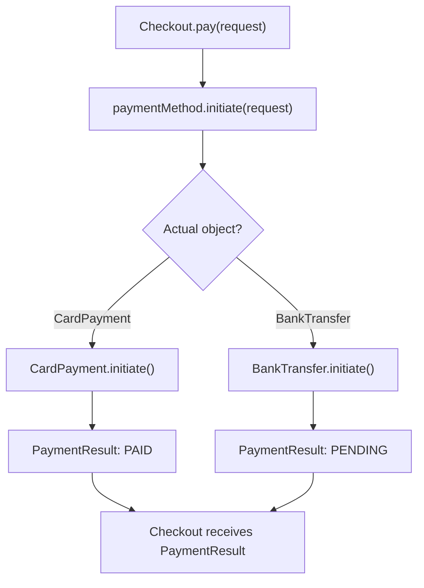
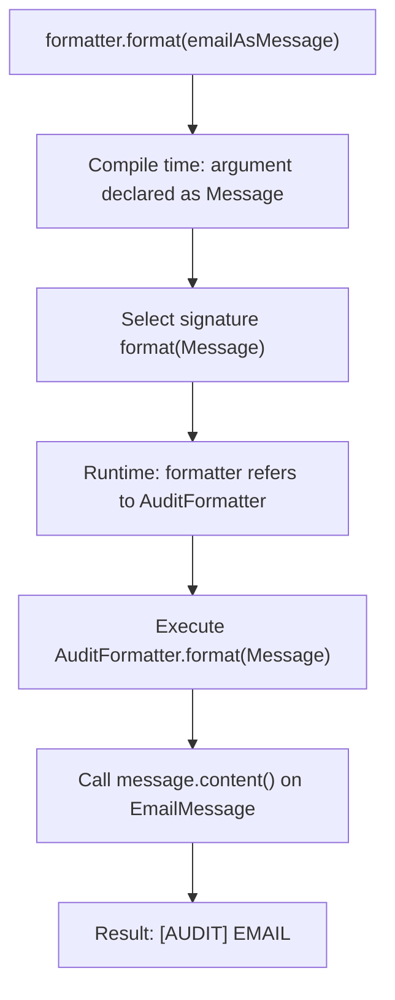
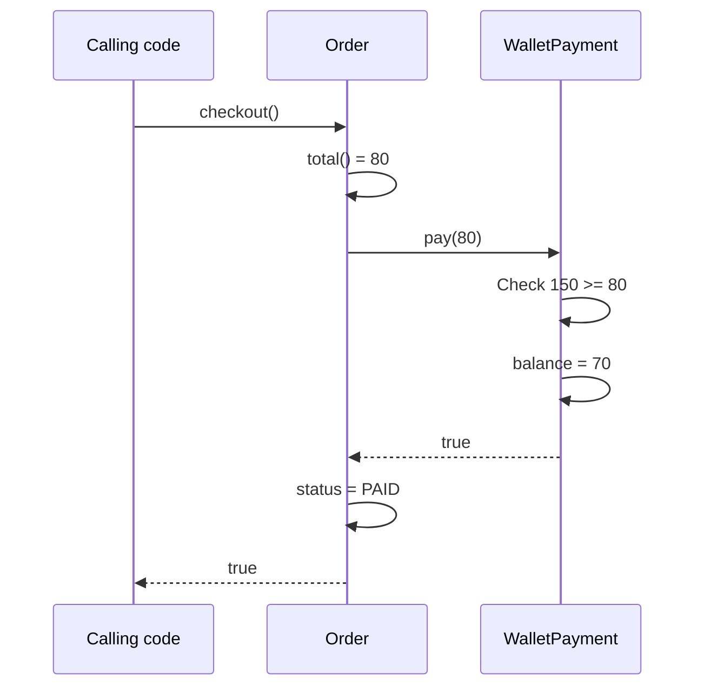
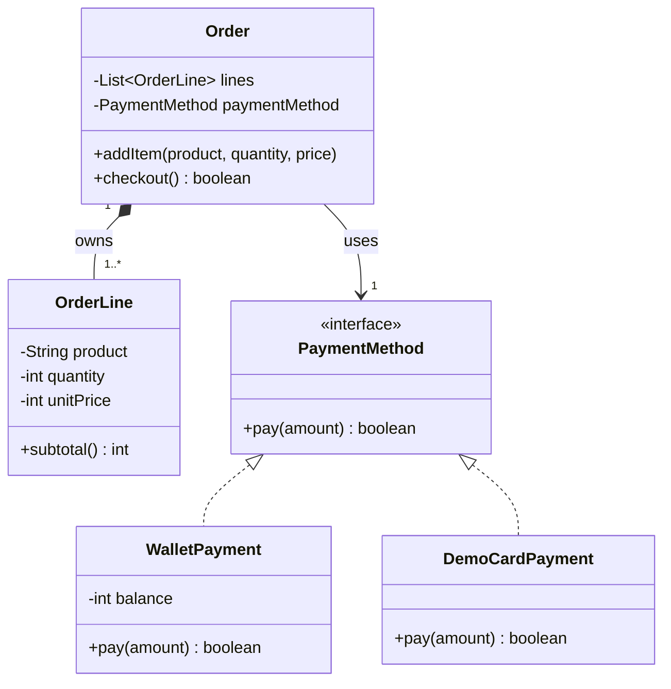
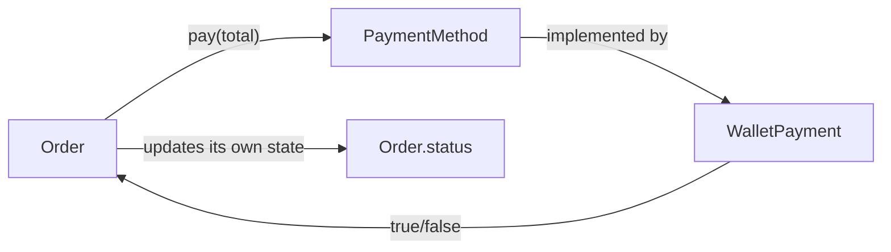

<a id="back-to-top"></a>

# Polymorphism and Relationships Between Objects

## Menu
- [6.1 What Is Polymorphism, and Why Is It Useful?](#oop-6-1)
- [6.2 One Interface, Multiple Implementations: CardPayment and BankTransfer](#oop-6-2)
- [6.3 How Do Overriding, Overloading, and Runtime Behavior Selection Differ?](#oop-6-3)
- [6.4 How Do Objects Collaborate? Association and Composition Through Order–PaymentMethod](#oop-6-4)

## <a id="oop-6-1">6.1 What Is Polymorphism, and Why Is It Useful?</a>

<details>
<summary>Click for details</summary>

**Polymorphism** in object-oriented programming (OOP) is the ability to **use different kinds of objects through a common type or contract while allowing each object to perform a behavior in its own way**.

For example, an online shopping application supports payments by **digital wallet** and **bank card**. When processing an order, we simply want to request: *“Pay this amount.”* Wallet payments check the available balance; card payments follow a different procedure.

We want order-processing code to use the same method call:

```java
payment.pay(70);
```

But when `payment` refers to a wallet object, Java executes the wallet payment logic; when it refers to a card payment object, Java executes the card payment logic.

That is the clearest picture of **polymorphism**: **one call through a common type, with different implementations depending on the actual object**.

> **The key idea:** Polymorphism lets the code **using** a behavior avoid having to implement all the logic that distinguishes each **kind of object performing** that behavior.

### 1. The Problem Without Polymorphism

Suppose checkout receives the payment type as a string:

```java
void checkout(String type, int amount) {
    if (type.equals("WALLET")) {
        // Check the wallet balance and deduct the money.
    } else if (type.equals("CARD")) {
        // Process a card payment.
    } else if (type.equals("TRANSFER")) {
        // Process a bank transfer.
    } else {
        throw new IllegalArgumentException("Unsupported");
    }
}
```

This approach can work in a small program. However, as the application adds QR payments, reward points, gift cards, and more, the `if/else` block may keep growing. Wallet-balance validation, card processing, and bank transfers end up being handled in one place.

Every time a payment method is added, we must return to the checkout code, add another branch, and verify the existing branches.

**Polymorphism lets the payment object itself own the implementation**, while checkout knows only one **common contract**: `pay(amount)`.

| What needs to change | Many branches inside checkout | Polymorphism |
|---|---|---|
| Add a payment method | Usually modify checkout's `if/else` | Add a class implementing the common contract |
| Wallet-balance validation | May be mixed with logic for other methods | Belongs to the wallet payment object |
| What does checkout need to know? | Every type name and how to select its branch | The `PaymentMethod` contract and the returned result |
| Test a payment method independently | Tests may be coupled to shared logic | Each implementation can be tested separately |

Not every `if` statement is bad. What we should avoid is **forcing the consumer to understand and manage the details of many object types when those types already share a meaningful behavior**.

### 2. Understanding Polymorphism Through a Common Contract

First, define a Java `interface`:

```java
interface PaymentMethod {
    boolean pay(int amount);
}
```

The interface says: **An object used as a `PaymentMethod` must provide the `pay(int amount)` behavior**.

Two classes implement this contract:

```java
class WalletPayment implements PaymentMethod {
    @Override
    public boolean pay(int amount) {
        // Handle wallet payments.
        return true;
    }
}

class CardPayment implements PaymentMethod {
    @Override
    public boolean pay(int amount) {
        // Handle card payments.
        return true;
    }
}
```

The important point is not that the classes have similar code. **Their implementations may differ significantly**, as long as they satisfy the commitments that callers expect of `PaymentMethod`.

A variable of type `PaymentMethod` can refer to objects of either implementing class:

```java
PaymentMethod first = new WalletPayment();
PaymentMethod second = new CardPayment();

first.pay(70);  // Calls WalletPayment's implementation
second.pay(70); // Calls CardPayment's implementation
```

Both calls have the same method name and argument structure, but Java executes the method belonging to **the actual object type** behind each reference.

```text
              Common type: PaymentMethod
                         |
                    pay(amount)
                     /       \
                    /         \
                   v           v
             WalletPayment   CardPayment
             checks wallet   processes card
```

This is **polymorphism through an interface**. Polymorphism also occurs when a subclass overrides an instance method of its parent and is used through a parent-typed reference.

### 3. Complete Java Example: Checkout Does Not Need to Know Whether It Uses a Wallet or a Card

We will write a program that can run when saved as `Main.java`.

Requirements:

- The wallet starts with 100 units of money.
- Paying 70 from the wallet must succeed, leaving 30.
- A subsequent attempt to pay 50 from the **same wallet** must be rejected without changing its balance.
- A simulated card payment object reports success using a different implementation.
- `CheckoutService` does not need different code for each payment method.

```java
public class Main {
    public static void main(String[] args) {
        WalletPayment wallet = new WalletPayment(100);
        CheckoutService walletCheckout = new CheckoutService(wallet);

        walletCheckout.checkout(70);
        walletCheckout.checkout(50);

        PaymentMethod card = new DemoCardPayment();
        CheckoutService cardCheckout = new CheckoutService(card);
        cardCheckout.checkout(50);

        System.out.println("Wallet remaining: " + wallet.getBalance());
    }
}

// Common contract: request payment and receive a result.
interface PaymentMethod {
    boolean pay(int amount);
}

// First implementation: validate and deduct the wallet balance.
class WalletPayment implements PaymentMethod {
    private int balance;

    WalletPayment(int openingBalance) {
        if (openingBalance < 0) {
            throw new IllegalArgumentException("Invalid opening balance");
        }
        this.balance = openingBalance;
    }

    @Override
    public boolean pay(int amount) {
        if (amount <= 0) {
            throw new IllegalArgumentException("Amount must be positive");
        }
        if (amount > balance) {
            return false;
        }
        balance -= amount;
        return true;
    }

    int getBalance() {
        return balance;
    }
}

// Second implementation: only simulate card processing.
class DemoCardPayment implements PaymentMethod {
    @Override
    public boolean pay(int amount) {
        if (amount <= 0) {
            throw new IllegalArgumentException("Amount must be positive");
        }
        System.out.println("Simulating card processing: " + amount);
        return true;
    }
}

// Consumer: depends only on PaymentMethod.
class CheckoutService {
    private final PaymentMethod paymentMethod;

    CheckoutService(PaymentMethod paymentMethod) {
        if (paymentMethod == null) {
            throw new IllegalArgumentException("Missing payment method");
        }
        this.paymentMethod = paymentMethod;
    }

    void checkout(int total) {
        if (total <= 0) {
            throw new IllegalArgumentException("Total must be positive");
        }

        boolean success = paymentMethod.pay(total);
        System.out.println(
                success ? "Payment successful" : "Payment declined"
        );
    }
}
```

**Output:**

```text
Payment successful
Payment declined
Simulating card processing: 50
Payment successful
Wallet remaining: 30
```

Let's trace what happens:

1. `walletCheckout` holds a reference to a `WalletPayment` object. Calling `checkout(70)` invokes the wallet's `paymentMethod.pay(70)` implementation. The wallet deducts 70 from 100, leaving 30, and returns `true`.
2. Calling `checkout(50)` on **the same wallet** makes the wallet check that 50 exceeds 30, return `false`, and leave the balance unchanged.
3. `cardCheckout` holds a reference to `DemoCardPayment`. The code still calls `paymentMethod.pay(total)`, but now the card object's implementation runs, prints a simulated processing message, and returns `true`.
4. `CheckoutService.checkout()` **does not contain** `if (paymentMethod instanceof WalletPayment)` or `if (type.equals("CARD"))` to select an implementation.

The example uses `int` for hypothetical monetary units; `DemoCardPayment` is not a real bank transaction. A real system must define exactly when funds are confirmed and handle timeouts, failures, transactions, and concurrency. Here, `boolean` is deliberately simple so that the mechanism of polymorphism is easy to see.

#### Diagram: How Java Chooses Which Method to Call

```mermaid
sequenceDiagram
    participant Main
    participant Checkout as CheckoutService
    participant Payment as PaymentMethod
    participant Wallet as WalletPayment
    participant Card as DemoCardPayment
    Main->>Checkout: checkout(70) with wallet
    Checkout->>Payment: pay(70)
    Note over Payment: Common reference; actual object is WalletPayment
    Payment->>Wallet: pay(70)
    Wallet-->>Checkout: true
    Checkout-->>Main: Print success
    Main->>Checkout: checkout(50) with card
    Checkout->>Payment: pay(50)
    Note over Payment: Common reference; actual object is DemoCardPayment
    Payment->>Card: pay(50)
    Card-->>Checkout: true
    Checkout-->>Main: Print success
```

The diagram emphasizes **the meaning of the common type**. It does not mean Java actually creates an additional intermediate `PaymentMethod` object when `pay()` is called. The interface is a type contract; the actual object is `WalletPayment` or `DemoCardPayment`.

### 4. Why Can a Variable Typed as a Parent or Interface Call a Subclass's Method?

Consider these two lines:

```java
PaymentMethod payment = new WalletPayment(100);
payment.pay(70);
```

Two concepts must be distinguished:

| Component | In the example | Purpose |
|---|---|---|
| **Declared type of the variable** (*reference type*) | `PaymentMethod` | Determines which methods the caller is allowed to use at compile time |
| **Actual object type** (*runtime class*) | `WalletPayment` | Determines which implementation of an instance method runs at execution time |
| **Method contract** | `pay(int amount)` | Lets callers know they can request payment |
| **Method implementation** | `WalletPayment.pay(...)` | The object validates and deducts wallet funds |

The compiler checks that `PaymentMethod` has a `pay(int)` method and that the call has suitable arguments. At runtime, Java uses the implementation belonging to **the actual object**.

For example, `PaymentMethod` does not define `getBalance()`. Therefore, the following **does not compile**:

```java
PaymentMethod payment = new WalletPayment(100);
// payment.getBalance(); // Cannot call through the PaymentMethod type
```

The reason is not that the wallet object lacks `getBalance()`. It is that **the type visible to the caller** only promises the behaviors declared by `PaymentMethod`.

This establishes a useful boundary: checkout only needs the ability to pay; it does not need to know wallet-balance details.

#### Do You Need to Cast to WalletPayment?

Sometimes you could write:

```java
if (payment instanceof WalletPayment wallet) {
    System.out.println(wallet.getBalance());
}
```

But if `CheckoutService` constantly checks `instanceof` to call methods specific to each payment type, we are **losing the benefit of the shared contract**. We should then reconsider whether the caller genuinely only needs `PaymentMethod`, or whether the existing contract is missing a meaningful shared capability.

### 5. How Does Polymorphism Help When Adding a New Payment Method?

Suppose the application later supports **GiftCardPayment**. If this payment method follows the same contract, we can add:

```java
class GiftCardPayment implements PaymentMethod {
    private int remaining = 200;

    @Override
    public boolean pay(int amount) {
        if (amount <= 0) {
            throw new IllegalArgumentException("Amount must be positive");
        }
        if (amount > remaining) {
            return false;
        }
        remaining -= amount;
        return true;
    }
}
```

Then:

```java
PaymentMethod giftCard = new GiftCardPayment();
CheckoutService checkout = new CheckoutService(giftCard);
checkout.checkout(50);
```

**No GiftCardPayment branch is needed in `CheckoutService.checkout()`.** Checkout still invokes `paymentMethod.pay(total)`.

This is a practical benefit: **new implementations can be added with less need to modify their consumers**. However, code responsible for constructing and selecting an implementation at the application boundary (for example, after reading a user's choice) may still need changes. Polymorphism **does not eliminate every condition** or guarantee existing code will never change.

### 6. Are Polymorphism and Inheritance the Same Thing?

Not quite.

**Inheritance** concerns **type relationships**: a subclass is a kind of its parent class and may inherit suitable behavior.

**Polymorphism** concerns **usage through a common type**: calling code can remain unchanged while concrete objects behave differently.

For example, polymorphism also works through class inheritance:

```java
abstract class Animal {
    abstract String makeSound();
}

class Dog extends Animal {
    @Override
    String makeSound() {
        return "Woof woof";
    }
}

class Cat extends Animal {
    @Override
    String makeSound() {
        return "Meow meow";
    }
}
```

Usage:

```java
Animal first = new Dog();
Animal second = new Cat();

System.out.println(first.makeSound());  // Woof woof
System.out.println(second.makeSound()); // Meow meow
```

Here, `Dog` and `Cat` inherit from `Animal` and override `makeSound()`. The caller knows only the `Animal` type, but Java executes the dog or cat object's implementation.

**Inheriting from a concrete parent class is not necessary** to use polymorphism: an interface such as `PaymentMethod` also provides a common type contract.

### 7. Why Does Polymorphism Make Code Easier to Maintain and Test?

#### Reduce Dependencies on Concrete Implementations

If `CheckoutService` depends only on `PaymentMethod`, it does not need to read fields or know the wallet-specific workflow of `WalletPayment`. Changes to wallet behavior can remain in the wallet class, as long as the shared contract is still fulfilled.

#### Let Each Object Own Its Behavior

`WalletPayment` checks its own balance. `DemoCardPayment` handles its simulated card processing. Checkout does not become a container for every payment method's logic.

#### Make Scenarios Easier to Test

We can create an implementation specifically for testing:

```java
class AlwaysRejectPayment implements PaymentMethod {
    @Override
    public boolean pay(int amount) {
        return false;
    }
}
```

Passing it to `CheckoutService` helps test how checkout responds to a declined payment without setting up an external payment system.

#### Reuse the Same Orchestration Code with Interchangeable Behaviors

An application can run the same `CheckoutService` with a wallet, a simulated card, or a gift card. Each has different state, conditions, and processing rules.

| Benefit | Evidence in the code |
|---|---|
| Reduced dependence on a concrete class | `CheckoutService` has a field of type `PaymentMethod` |
| Extensible behavior | Add a new `pay()` implementation |
| Separated responsibilities | `WalletPayment` manages its own `balance` |
| Purposeful tests | Use `AlwaysRejectPayment` to simulate failure |
| Clearer intent | Checkout requests `pay(total)` instead of implementing every type of payment |

### 8. But Polymorphism Does Not Mean “Any Object Is Interchangeable”

An interface is more than a name and method list. It also carries **behavioral expectations**.

For example, suppose `PaymentMethod.pay(amount)` is understood to:

- Accept amounts **greater than 0**.
- Return `true` when a payment succeeds according to the agreed meaning.
- Return `false` when a payment is declined **without recording a successful payment**.

Then every new implementation must respect those expectations. If `CardPayment.pay(100)` always returns `true` while the transaction is still **pending**, checkout may mark the order as paid too early.

This is a matter of **behavioral contracts** and **substitutability**. Successfully compiling against an interface **does not guarantee** its implementations can safely replace each other.

If a real system needs `SUCCESS`, `FAILED`, and `PENDING` states, the `boolean` contract may be insufficient. Updating the interface and its callers is appropriate when the business requirements change. Polymorphism **does not remove the need to design the contract correctly**.

Nor does polymorphism automatically solve performance, thread safety, database transactions, or network errors. Those require corresponding mechanisms and design choices.

### 9. Do Not Confuse Runtime Polymorphism with Method Overloading

Java beginners frequently encounter two related terms:

- **Overriding:** different classes provide implementations of a shared instance method; calls through a parent or interface type execute the implementation corresponding to **the actual object**.
- **Overloading:** methods share a name but have **different parameter lists**; the compiler selects the appropriate method primarily using the available argument and type information at compile time.

For example, overloading:

```java
class Printer {
    void print(String value) {
        System.out.println("String: " + value);
    }

    void print(int value) {
        System.out.println("Number: " + value);
    }
}
```

Both `print("OOP")` and `print(10)` have the name `print`, but Java selects **different method signatures**. Some materials call this “compile-time polymorphism.” However, **the main form of OOP polymorphism in this lesson** is using a common type and getting different behaviors according to the actual object, as with `PaymentMethod` and `Animal`.

Remember also that **static methods are not overridden through instance-method dispatch**, and fields do not behave like virtual methods. Do not assume every member with the same name is dynamically selected according to the object.

### Check Your Understanding

Suppose we have:

```java
PaymentMethod payment = new WalletPayment(100);
payment.pay(30);
payment = new DemoCardPayment();
payment.pay(30);
```

Answer the following:

1. How many calls to `pay(30)` occur? **Two**.
2. Do they use the same implementation? **No**. The first runs `WalletPayment.pay`; the second runs `DemoCardPayment.pay`.
3. Why does the calling code not need to change the method name? Because **both objects satisfy the `PaymentMethod` contract**.
4. Why can't `PaymentMethod payment` call `wallet.getBalance()` directly? Because the `PaymentMethod` type **does not expose** the ability to read a wallet balance.
5. If we add `GiftCardPayment`, must we add an `if` to `CheckoutService`? **No**, provided `GiftCardPayment` follows the same payment contract and the checkout design remains suitable.

**Remember:** **Polymorphism means “one interface for use, multiple ways to implement it.”** It lets calling code concentrate on **what it needs to request**, while each object takes responsibility for **how it responds**. The greatest benefit is not saving a few `if/else` statements, but **reducing coupling between components, clarifying responsibilities, and enabling controlled changes to implementations**.

</details>

- [Back to top](#back-to-top)

---

## <a id="oop-6-2">6.2 One Interface, Multiple Implementations: CardPayment and BankTransfer</a>

<details>
<summary>Click for details</summary>

### 1. One Payment Capability, Two Different Processes

Suppose you are building checkout for an online store. When customers click **Pay**, they can choose:

- **Card (CardPayment):** submit a card payment request; in this example, the processor immediately returns an approved or declined result.
- **Bank transfer (BankTransfer):** generate transfer details for the customer; the order must wait until the system confirms that the money was actually received.

Both methods serve **the same purpose: initiate processing of the order's payment**. However, their underlying business processes differ.

If the program handles every choice with conditional branches:

```java
// An initial design illustration, not a real payment system.
if (paymentType.equals("CARD")) {
    // Process card payment
} else if (paymentType.equals("BANK_TRANSFER")) {
    // Create transfer request
}
```

then adding digital wallets, installments, or other methods may require expanding these conditions further. If similar conditions appear across multiple screens or services, it becomes even easier to overlook a location when making changes.

One OOP design approach is to identify **the common behavior needed by callers** and let each object implement that behavior in its own way.

In Java, an `interface` suits this situation:

```java
interface PaymentMethod {
    PaymentResult initiate(PaymentRequest request);
}
```

This declaration sets a requirement: **an object of type `PaymentMethod` must provide the `initiate(...)` behavior according to the common contract**. `CardPayment` and `BankTransfer` may perform that behavior differently.

This is a classic example of **polymorphism**: calling code uses **one common type**, but at runtime, **the actual object** performs the behavior.

### 2. What Common Ground Does the Interface Describe?

Start from the perspective of a developer writing `Checkout`.

To process an order, `Checkout` needs to send:

- The order ID.
- The amount to pay.

And receive:

- Processing status.
- A reference ID for tracking.
- A message describing the result.

`Checkout` **does not necessarily need to know** how the card payment calls its gateway or how a bank transfer builds its transfer instructions.

We describe this shared point of interaction:

```java
interface PaymentMethod {
    PaymentResult initiate(PaymentRequest request);
}
```

Read this declaration in everyday terms:

> “Any object used as a `PaymentMethod` must know how to accept a payment initiation request and return a result of type `PaymentResult`.”

This allows:

```java
PaymentMethod method = new CardPayment();
PaymentResult result = method.initiate(request);
```

Or:

```java
PaymentMethod method = new BankTransfer();
PaymentResult result = method.initiate(request);
```

**The call stays the same. The implementation changes with the object.**

The name `initiate` is deliberate: it means **start the payment process**, not promise that the money has arrived as soon as the method returns. That is an important difference between card payments and bank transfers.

### 3. Complete Java Example: CardPayment and BankTransfer

The following illustrative program runs independently on **Java 17 or later**. Create a file named `Main.java`, put the entire code example in it, and run `Main.main()`.

The program **simulates** returned statuses; it does not connect to banks, process card details, or transfer real money.

```java
import java.util.Objects;

public class Main {
    public static void main(String[] args) {
        PaymentRequest request =
                new PaymentRequest("ORDER-001", 250_000);

        // Same Checkout, different PaymentMethod object.
        Checkout cardCheckout = new Checkout(new CardPayment());
        PaymentResult cardResult = cardCheckout.pay(request);

        Checkout bankCheckout = new Checkout(new BankTransfer());
        PaymentResult bankResult = bankCheckout.pay(request);

        printResult("CARD", cardResult);
        printResult("BANK", bankResult);
    }

    private static void printResult(
            String methodName, PaymentResult result) {
        System.out.println(methodName + " | "
                + result.status() + " | "
                + result.reference());
    }
}

// Information required for a payment request.
record PaymentRequest(String orderId, long amountVnd) {
    PaymentRequest {
        if (orderId == null || orderId.isBlank()) {
            throw new IllegalArgumentException("Order ID is blank");
        }
        if (amountVnd <= 0) {
            throw new IllegalArgumentException(
                    "Amount must be greater than 0");
        }
    }
}

enum PaymentStatus {
    PAID,       // Payment has been confirmed as successful
    PENDING,    // Awaiting completion or confirmation
    FAILED      // Payment request failed
}

record PaymentResult(
        PaymentStatus status,
        String reference,
        String message) {
}

// Shared contract followed by payment methods.
interface PaymentMethod {
    PaymentResult initiate(PaymentRequest request);
}

// Method 1: Simulate an immediately approved card payment.
final class CardPayment implements PaymentMethod {
    @Override
    public PaymentResult initiate(PaymentRequest request) {
        Objects.requireNonNull(request, "request");

        // Demo: simulate confirmation of success from the card processor.
        return new PaymentResult(
                PaymentStatus.PAID,
                "CARD-" + request.orderId(),
                "Card payment approved (simulated)"
        );
    }
}

// Method 2: Create instructions while waiting for a bank transfer.
final class BankTransfer implements PaymentMethod {
    @Override
    public PaymentResult initiate(PaymentRequest request) {
        Objects.requireNonNull(request, "request");

        // Create an order-based reference; funds are not yet confirmed.
        return new PaymentResult(
                PaymentStatus.PENDING,
                "BANK-" + request.orderId(),
                "Waiting for confirmation of received transfer"
        );
    }
}

// Interface consumer: does not need to know implementation details.
final class Checkout {
    private final PaymentMethod paymentMethod;

    Checkout(PaymentMethod paymentMethod) {
        this.paymentMethod =
                Objects.requireNonNull(paymentMethod, "paymentMethod");
    }

    PaymentResult pay(PaymentRequest request) {
        return paymentMethod.initiate(request);
    }
}
```

Output:

```text
CARD | PAID | CARD-ORDER-001
BANK | PENDING | BANK-ORDER-001
```

Notice that the two results have **different statuses**. This **does not mean** either class violates the interface. The contract allows several meaningful states. In the simulated card scenario, the processor has approved the payment; for the transfer, there is only a request awaiting incoming funds.

In a real application, `PENDING` **must not be treated as successfully paid**. The system must receive and verify confirmation of the transfer before marking the order as paid.

### 4. Examine Each Role to Understand the Design

| Component | Role | What is allowed to differ? |
|---|---|---|
| `PaymentRequest` | Contains consistent input information | Independent of payment type |
| `PaymentResult` | Represents the result and status | Status, reference, and message values |
| `PaymentMethod` | Declares the shared `initiate(...)` behavior | Does not decide the internal algorithm |
| `CardPayment` | Performs the behavior using the card-payment flow | Card processing and returned result |
| `BankTransfer` | Performs the behavior using the bank-transfer flow | Generating the request and awaiting confirmation |
| `Checkout` | Calls a supplied payment method | Needs no separate branch per payment type |

In `CardPayment`, the method:

```java
@Override
public PaymentResult initiate(PaymentRequest request) {
    // Card-specific workflow.
}
```

and in `BankTransfer`:

```java
@Override
public PaymentResult initiate(PaymentRequest request) {
    // Bank-transfer-specific workflow.
}
```

have **the same signature** according to the interface contract: the same name `initiate`, parameter type `PaymentRequest`, and result type `PaymentResult`. But their **method bodies** can differ.

`@Override` asks the compiler to check that a method actually implements or overrides a corresponding method from a parent type or interface. If you accidentally type `initate(...)`, Java reports an error instead of silently treating it as an unrelated new method.

A class that `implements PaymentMethod` must implement the remaining abstract methods of the interface, or itself be declared `abstract`. This is a **structural constraint** enforced by the Java compiler.

### 5. Where Does Polymorphism Occur?

Revisit these two lines:

```java
PaymentMethod method = new CardPayment();
method.initiate(request);
```

Two concepts must be distinguished:

- **Variable type of `method`:** `PaymentMethod`. The compiler uses this type to determine which behaviors may be called.
- **Actual object:** `new CardPayment()`. When a possibly implemented or overridden instance method is invoked, Java selects the implementation belonging to that object.

If we assign:

```java
PaymentMethod method = new BankTransfer();
method.initiate(request);
```

Java executes `BankTransfer.initiate(...)`. The reference type is still `PaymentMethod`; the calling code is still `method.initiate(request)`.

This is **runtime polymorphism** through instance-method implementation selection, commonly called **dynamic dispatch**.



This diagram shows **two alternatives for one call**. A single `initiate()` invocation does not automatically execute both implementations. In the example, each `Checkout` is supplied with **one actual object**.

A subtle point: because `method` is declared as `PaymentMethod`, it exposes only behaviors accessible through the `PaymentMethod` type. If `CardPayment` adds `verifyCardNetwork()` but the interface does not define it, code holding a `PaymentMethod` variable cannot directly call that card-specific method.

This encourages consuming code to work through **the shared contract** instead of tightly coupling itself to one class's details.

### 6. Change the Payment Method Without Changing Checkout

In the program above:

```java
final class Checkout {
    private final PaymentMethod paymentMethod;

    Checkout(PaymentMethod paymentMethod) {
        this.paymentMethod = Objects.requireNonNull(paymentMethod);
    }

    PaymentResult pay(PaymentRequest request) {
        return paymentMethod.initiate(request);
    }
}
```

`Checkout` receives a `PaymentMethod` through its constructor. This is called **constructor dependency injection**: the dependent object is supplied from outside when a `Checkout` is constructed.

We can replace:

```java
Checkout checkout = new Checkout(new CardPayment());
```

with:

```java
Checkout checkout = new Checkout(new BankTransfer());
```

**without changing the body of `Checkout.pay(...)`**.

The relationship can be understood as:

```text
Checkout ──uses────► PaymentMethod
                          ▲
                          │ implements
                   ┌──────┴──────┐
                   │             │
             CardPayment    BankTransfer
```

`Checkout` **has an object implementing `PaymentMethod`** through its field, while the two payment classes **implement the same interface**.

These are two different relationships:

- `CardPayment implements PaymentMethod`: a relationship of **implementing a type contract**.
- `Checkout` holding a `PaymentMethod` field: an **object collaboration/usage relationship**, often represented as composition at the design level.

Combining these relationships makes purchase-flow code less dependent on individual concrete payment methods.

You **do not need a separate interface** for every class. Interfaces are useful when multiple implementations genuinely share a behavior that other code needs to use uniformly.

### 7. One Interface Does Not Mean One Result or One Process

A common misunderstanding is: “If two classes implement the same interface and both call `initiate(...)`, they must behave identically.”

That is incorrect. The common contract here is **accept a request and return payment initiation results as `PaymentResult`**, not “always return `PAID`.”

| Aspect | CardPayment | BankTransfer |
|---|---|---|
| Shared behavior | `initiate(request)` | `initiate(request)` |
| Input | Order ID + amount | Order ID + amount |
| Specific processing | Process/authorize card payments | Generate transfer instructions, wait for funds |
| Possible status | `PAID`, `FAILED`, perhaps `PENDING` | Usually initially `PENDING`, confirmed later |
| When are funds considered received? | After valid confirmation from the processor | After evidence confirms the transfer transaction |
| Result returned to callers | `PaymentResult` | `PaymentResult` |

The possibilities in the table reflect a realistic business design; the Java demo only illustrates an immediately approved card payment and a pending bank transfer.

If we forced both implementations to return only a `boolean success`, we would face a problem: **when a transfer has not arrived yet, should it return `true` or `false`?** Either could be misleading. A clear status such as `PENDING` communicates the meaning more accurately.

Similarly, `initiate` is a more precise name than one suggesting that the entire money-transfer transaction has ended. An interface must reflect **a commitment that all implementations can fulfill**, even when their workflows differ.

### 8. An Interface Promises Behavior, Not Merely a Method Signature

Java can check whether a class has a method with the correct name, parameters, and return type. But it cannot automatically verify its complete **business meaning**.

For example:

```java
final class BrokenBankTransfer implements PaymentMethod {
    @Override
    public PaymentResult initiate(PaymentRequest request) {
        return new PaymentResult(
                PaymentStatus.PAID,
                "BANK-" + request.orderId(),
                "Paid"
        );
    }
}
```

This class can compile. But if the application **has not verified that funds arrived**, returning `PAID` is incorrect. Code using that result might ship an order before receiving payment.

A good contract must therefore clarify important points:

1. **Inputs:** `PaymentRequest` carries an order ID and a positive amount measured in VND.
2. **Outputs:** `PaymentResult` provides a status, reference, and necessary information.
3. **Status meanings:** `PAID` is used only after valid confirmation of success; `PENDING` means waiting; `FAILED` means failed.
4. **Error cases:** payment objects and services must follow consistent policies for invalid input, network errors, or provider failures.
5. **External effects:** initiation may make network calls or persist data; callers must understand when the operation completes and whether it may be safely retried.

These points **go beyond the method signature** and require design, documentation, and testing.

In the Java example, `PaymentRequest` is a `record` with a compact constructor that rejects a blank order ID or nonpositive amount before the request reaches an implementation. Thus the two classes do not need to duplicate that basic validation.

Each implementation also calls `Objects.requireNonNull(request)` to protect against a caller passing `null`; in this example, it causes a `NullPointerException` rather than returning a `PaymentResult`. In a real design, error behavior should be documented consistently so implementations do not surprise their callers.

### 9. Adding a New Payment Method: Which Code Changes?

Suppose the store later adds a digital wallet. You can create a new class:

```java
final class EWalletPayment implements PaymentMethod {
    @Override
    public PaymentResult initiate(PaymentRequest request) {
        Objects.requireNonNull(request, "request");

        return new PaymentResult(
                PaymentStatus.PENDING,
                "WALLET-" + request.orderId(),
                "Waiting for customer confirmation in wallet (simulated)"
        );
    }
}
```

Code using the interface still works:

```java
PaymentMethod method = new EWalletPayment();
Checkout checkout = new Checkout(method);

PaymentResult result = checkout.pay(
        new PaymentRequest("ORDER-002", 120_000)
);

System.out.println(result.status()); // PENDING
```

With this change, `Checkout.pay(...)` does not need a new `if (type == WALLET)` branch.

However, **some part of the program must still choose the implementation** based on the customer's selection, perhaps a factory, dependency injection configuration, or orchestration code at the application boundary. The interface does not automatically know which payment method the user selected.

For example, in the assembly layer:

```java
PaymentMethod chosenMethod = switch (selectedType) {
    case "CARD" -> new CardPayment();
    case "BANK" -> new BankTransfer();
    case "WALLET" -> new EWalletPayment();
    default -> throw new IllegalArgumentException(
            "Unsupported payment type"
    );
};

Checkout checkout = new Checkout(chosenMethod);
```

Here, `selectedType` is assumed to be a string supplied by the UI or selection layer. A real application could use an `enum` instead of strings to reduce typing mistakes.

The purpose of polymorphism **is not to remove every conditional statement from the system**. It moves implementation selection to the appropriate place and allows shared business processing to avoid caring too much about each concrete type.

### 10. Why Not Let Checkout Create CardPayment Directly?

Consider a design tightly bound to a concrete class:

```java
class Checkout {
    private final CardPayment payment = new CardPayment();

    PaymentResult pay(PaymentRequest request) {
        return payment.initiate(request);
    }
}
```

Now every `Checkout` is permanently tied to `CardPayment`. To switch to `BankTransfer`, we must change how the dependency is created and used inside `Checkout`.

In our earlier design:

```java
class Checkout {
    private final PaymentMethod paymentMethod;

    Checkout(PaymentMethod paymentMethod) {
        this.paymentMethod = paymentMethod;
    }

    PaymentResult pay(PaymentRequest request) {
        return paymentMethod.initiate(request);
    }
}
```

`Checkout` receives an object implementing the interface. Shared payment-processing code then uses precisely **the capability it needs**: `initiate(...)`.

That is why Java and Spring projects often use constructor injection with interfaces such as `PaymentMethod`, `NotificationSender`, or `StorageService`. However, **polymorphism through interfaces** is a Java capability; it does not depend on Spring.

### 11. How Is an Interface Different from Using a Common Parent Class?

We could create an abstract class such as `AbstractPayment` and have both payment types inherit it to share code. Why does this example prefer an interface?

`CardPayment` and `BankTransfer` have **the same capability to expose**, but their processing steps are substantially different. We have not established an algorithm or state that must be shared through class inheritance.

| When to use an interface | When to consider an abstract class |
|---|---|
| Define **what an object can do** | Define behavior while also sharing **state/implementation** among subclasses |
| Implementations may differ significantly | Subclasses have a meaningful inheritance relationship |
| A class can implement multiple interfaces | A Java class can directly extend only one class |
| Callers work through a common contract | Subclasses can reuse `protected` code and concrete methods |

There is no need to create an abstract class just to have something with a shared name. An interface is often enough when `Checkout` needs to use independent implementations.

At the same time, an interface does not automatically make a design good. If it requires methods with no shared meaning, such as forcing `BankTransfer` to implement `validateCardNumber()`, the interface mixes implementation-specific responsibilities into the shared contract. Then it should be split or redesigned.

### 12. Testing: How Do We Know Checkout Uses the Contract Correctly?

A clear advantage of depending on an interface is the ability to replace the real implementation with a **controlled fake** during testing.

For example:

```java
final class FakePaymentMethod implements PaymentMethod {
    private PaymentRequest received;

    @Override
    public PaymentResult initiate(PaymentRequest request) {
        received = request;
        return new PaymentResult(
                PaymentStatus.PAID,
                "TEST-001",
                "Simulated successful payment"
        );
    }

    PaymentRequest received() {
        return received;
    }
}
```

A simple test:

```java
FakePaymentMethod fake = new FakePaymentMethod();
Checkout checkout = new Checkout(fake);

PaymentRequest request =
        new PaymentRequest("ORDER-TEST", 100_000);

PaymentResult result = checkout.pay(request);

System.out.println(fake.received() == request); // true
System.out.println(result.status());            // PAID
```

`Checkout` needs no bank connection to verify that it calls the correct dependency and passes the correct request. This is only a very small test; a real system must also test declined transactions, state transitions, retries, and provider confirmations.

Remember that **being able to pass a fake does not automatically make a real implementation correct**. `CardPayment` and `BankTransfer` still need separate verification against the contract, especially for failure scenarios.

### 13. Common Misunderstandings in Practice

#### “Implementing an Interface Means Results Are Always Identical.”

No. An interface standardizes **how a capability is requested and how its result is expressed**, while details can differ. `CardPayment` may return `PAID` while `BankTransfer` returns `PENDING`, and both may correctly fulfill the contract.

#### “An Interface Performs the Payment Itself.”

No. Declaring `PaymentMethod` only creates a **type contract**. Concrete classes provide the processing. Java interfaces can also declare `default` or `static` methods, but the abstract method in this example has no body.

#### “Polymorphism Means We No Longer Need to Distinguish Cards from Transfers.”

No. The system still has to choose the correct `PaymentMethod` for the customer. Polymorphism helps the parts **using the shared behavior** avoid checking concrete types on every call.

#### “A `PAID` Status in `PaymentResult` Is Enough to Prove the Bank Sent Money.”

No. `PAID` must be supported by trustworthy confirmation data. For a transfer, initiation normally only justifies a `PENDING` state. A separate confirmation and reconciliation flow is required before changing it to `PAID`.

#### “The More Interfaces, the Better.”

No. If a problem has only one simple implementation and no substitution need, an interface may add an unnecessary layer. An interface is valuable when it represents **a meaningful shared capability** actually used by multiple consumers or implementations.

### 14. What Else Would Be Needed for Real Payments?

The code example intentionally keeps the implementation short to focus on **one interface with multiple implementations**. A real money-processing system has further requirements beyond this demo:

- **Secure integration:** use authorized provider APIs or SDKs; do not store sensitive card details directly in `CardPayment`.
- **Transaction status:** track pending confirmation, success, failure, and intermediate states where supported by the provider.
- **Reconciliation and authentication:** verify callbacks/webhooks, transaction IDs, amounts, orders, and confirmation sources before recording `PAID`.
- **Idempotency:** prevent duplicate processing when customers click Pay again, APIs retry, or webhooks arrive multiple times.
- **Data consistency:** synchronize payment and order states in the database and handle network failures or ambiguous transaction outcomes.

These requirements may call for additional specialized capabilities in the real interface or separate services for confirmation, refunds, and reconciliation. But the core idea remains useful: **identify contracts that are truly shared**, and allow each payment method to have its own processing steps.

### 15. Trace One Final Scenario

Suppose a customer selects a bank transfer for order `ORDER-001` worth 250,000 VND. The application creates:

```java
PaymentMethod payment = new BankTransfer();
Checkout checkout = new Checkout(payment);
PaymentRequest request =
        new PaymentRequest("ORDER-001", 250_000);
```

When it calls:

```java
PaymentResult result = checkout.pay(request);
```

the program follows these steps:

1. `Checkout.pay(request)` receives the payment information.
2. `Checkout` invokes `paymentMethod.initiate(request)` through the `PaymentMethod` type.
3. Because the actual object is `BankTransfer`, Java executes `BankTransfer.initiate(...)`.
4. In the example, the method creates reference `BANK-ORDER-001` and returns `PENDING`.
5. `Checkout` receives `PaymentResult` and returns it to the caller. **The order is not considered paid** just because initiation finished.

If `new BankTransfer()` is replaced with `new CardPayment()`, step 2 remains identical. Step 3 selects the card implementation, and the demo returns `PAID` to simulate an approved payment.

**The key point:** `PaymentMethod` defines **the shared behavior callers need to know**. `CardPayment` and `BankTransfer` provide **different implementations**. `Checkout` uses **the interface type** to work with both, and Java selects the method belonging to **the actual object** at runtime. That is the power of polymorphism in a concrete business scenario.

</details>

- [Back to top](#back-to-top)

---

## <a id="oop-6-3">6.3 How Do Overriding, Overloading, and Runtime Behavior Selection Differ?</a>

<details>
<summary>Click for details</summary>

You have an `EmailMessage` object, but the variable holding it is declared as `Message`. When a method is called, does Java choose the behavior using **the variable's type** or **the object's actual type**?

The answer is **both matter, but at different steps**:

- **Overloading:** the compiler selects an appropriate **method signature** based on the types known at compile time.
- **Overriding:** if the selected signature belongs to an **overridable instance method**, the JVM selects **the implementation** according to the actual type of the object receiving the call at runtime.

These mechanisms are easy to confuse because both can involve multiple methods **sharing the same name**.

### 1. Differences at a Glance

| Aspect | Overloading | Overriding |
|---|---|---|
| Meaning | Several ways to invoke a method name with **different parameter lists** | A subclass supplies **a new implementation** of an inherited method |
| Class relationship | Methods may be in the same class or include inherited methods | Requires inheritance or interface implementation |
| Parameter signature | **Must differ** in number, types, or order of parameters | **Must correspond** to the parent/interface method |
| Selection time | Select overload at **compile time** | Select overridden implementation at **runtime** |
| Common polymorphism term | Static / compile-time polymorphism | Dynamic / runtime polymorphism |
| `@Override` | Does not indicate overloading | Recommended so the compiler checks overriding |

Note that in Java, **changing only the return type** does not create a valid overload. For example, `int total()` and `long total()` cannot coexist in the same class if their parameter lists are identical.

### 2. Overloading: The Compiler Decides Which Version to Call

Suppose we want to print different kinds of data:

```java
public class OverloadDemo {
    static class Printer {
        void print(Object value) {
            System.out.println("Object: " + value);
        }

        void print(String value) {
            System.out.println("String: " + value);
        }
    }

    public static void main(String[] args) {
        Printer printer = new Printer();

        String text = "Hello";
        Object object = "Hello";

        printer.print(text);   // String: Hello
        printer.print(object); // Object: Hello
        printer.print("Hi");   // String: Hi
    }
}
```

Both `text` and `object` refer to objects of type `String`. Why are the results different?

For `printer.print(text)`, the compiler sees that the argument has **declared type `String`**. Both `print(Object)` and `print(String)` can accept it, but `print(String)` is more specific and is selected.

For `printer.print(object)`, the compiler only knows that the argument's **declared type is `Object`**. It selects `print(Object)`. The fact that the actual object is a `String` **does not cause the JVM to select the `print(String)` overload again** at runtime.

Another way to express it:

```text
String text = "Hello"    --> compiler selects print(String)
Object object = "Hello"  --> compiler selects print(Object)
                            (even though the actual object is also a String)
```

The most important point about overloading is that **selection among different parameter lists does not depend on the argument's runtime type**.

#### What Counts as “Different Parameters”?

These are valid overloads:

```java
void send(String content) { }
void send(String recipient, String content) { }
void send(byte[] content) { }
```

They differ in parameter count or type. When `send(...)` is called, Java considers which overloads are **applicable**, then selects one using the language's rules for matching, specificity, and type conversion.

Thus, in complex cases involving `int`, `long`, reference types, boxing/unboxing, or varargs, do not assume Java always chooses whichever method “looks closest to the data.” Consider **the type of the expression at the call site** and the overload-resolution rules.

### 3. Overriding: The Actual Object Determines the Implementation

Consider a common contract:

```java
interface Message {
    String content();
}

class EmailMessage implements Message {
    @Override
    public String content() {
        return "Email content";
    }
}

class SmsMessage implements Message {
    @Override
    public String content() {
        return "SMS content";
    }
}
```

Both classes implement `content()` according to the `Message` contract, but return different content:

```java
Message message = new EmailMessage();
System.out.println(message.content()); // Email content

message = new SmsMessage();
System.out.println(message.content()); // SMS content
```

In both statements, the variable's declared type remains `Message` and the invoked signature remains `content()`. But the JVM executes the implementation belonging to **`EmailMessage` or `SmsMessage`, depending on the actual object**.

This is **dynamic dispatch**, an important foundation of **runtime polymorphism**.

`@Override` helps the compiler verify that the method really does override or implement an appropriate method. If you accidentally write `contents()` instead of `content()`, the compiler detects the error in this example.

### 4. When Overloading and Overriding Coexist: Java Selects in Two Steps

The following example can be saved directly in `Demo.java` and run. It combines **overloading and overriding**, which is where learners are most likely to confuse the two.

```java
public class Demo {
    interface Message {
        String content();
    }

    static final class EmailMessage implements Message {
        @Override
        public String content() {
            return "EMAIL";
        }
    }

    static final class SmsMessage implements Message {
        @Override
        public String content() {
            return "SMS";
        }
    }

    static class Formatter {
        // Overload 1: accepts any Message
        String format(Message message) {
            return "General: " + message.content();
        }

        // Overload 2: accepts only EmailMessage
        String format(EmailMessage message) {
            return "For email: " + message.content();
        }
    }

    static final class AuditFormatter extends Formatter {
        // Override overload 1, but not overload 2.
        @Override
        String format(Message message) {
            return "[AUDIT] " + message.content();
        }
    }

    public static void main(String[] args) {
        Formatter formatter = new AuditFormatter();

        Message emailAsMessage = new EmailMessage();
        Message smsAsMessage = new SmsMessage();

        System.out.println(formatter.format(emailAsMessage));
        System.out.println(formatter.format(smsAsMessage));
        System.out.println(formatter.format(new EmailMessage()));
    }
}
```

Output:

```text
[AUDIT] EMAIL
[AUDIT] SMS
For email: EMAIL
```

The same variable `formatter` is declared as `Formatter` and refers to an `AuditFormatter` object. Why does the third line not contain `[AUDIT]`?

Trace each call:

| Call | **Step 1: compiler selects overload** | **Step 2: JVM selects implementation** | Result |
|---|---|---|---|
| `formatter.format(emailAsMessage)` | `format(Message)` because the argument is declared `Message` | `AuditFormatter.format(Message)` because the receiver is an `AuditFormatter` object | `[AUDIT] EMAIL` |
| `formatter.format(smsAsMessage)` | `format(Message)` | `AuditFormatter.format(Message)` | `[AUDIT] SMS` |
| `formatter.format(new EmailMessage())` | `format(EmailMessage)` because the argument has type `EmailMessage` | Inherited `Formatter.format(EmailMessage)`; `AuditFormatter` does not override this signature | `For email: EMAIL` |

The selection flow for the first line:



There are **two dynamic calls** here:

1. `formatter.format(...)`: after the compiler selects `format(Message)`, the JVM executes the override from `AuditFormatter`.
2. Inside that method, `message.content()`: the JVM executes the `EmailMessage` or `SmsMessage` version of `content()` according to the actual object.

An especially useful detail: **overriding does not reselect the overload**. `AuditFormatter.format(Message)` overrides only the version whose parameter is `Message`; it does not replace every method named `format`.

### 5. Why Is This Polymorphism in OOP?

Polymorphism lets callers write code against a **common type**, while actual objects respond in their own ways.

For example:

```java
void show(Message message) {
    System.out.println(message.content());
}
```

`show` does not need to know in advance whether its argument is an email or SMS message. One `content()` call can produce different results depending on the object. This makes it possible to add new message types without modifying code that only needs the `Message` contract.

Conversely, overloading helps define **convenient calling forms or processing specialized for a particular parameter type**:

```java
void show(Message message) { /* general processing */ }
void show(EmailMessage email) { /* specialized processing */ }
```

If code holds a reference of type `Message`, the `show(EmailMessage)` overload **is not automatically selected** merely because the runtime object is an `EmailMessage`.

Both mechanisms are useful, but offer different kinds of flexibility:

- If you want objects sharing a contract to **decide their own behavior at runtime**, design with **overriding**.
- If you want to support **multiple parameter forms or API usage patterns** known at the call site, use **overloading**.

### 6. Common Sources of Confusion

#### 6.1. `static` Does Not Override Through Dynamic Dispatch

A `static` method belongs to the class, so a same-signature method in a subclass uses **method hiding**, not overriding.

```java
class Parent {
    static String name() {
        return "Parent";
    }
}

class Child extends Parent {
    static String name() {
        return "Child";
    }
}

Parent ref = new Child();
System.out.println(ref.name()); // Parent
```

This example deliberately invokes a `static` method through a variable to reveal the difference. In ordinary code, prefer the explicit `Parent.name()` or `Child.name()` form. The compiler selects the method based on the declared type of the expression to the left, not dynamic dispatch as with overridden instance methods.

#### 6.2. `private` and `final` Methods

- A `private` method cannot be overridden by a subclass: a subclass may declare a method with the same name and parameters, but it **does not override** the parent's private method.
- A `final` instance method **cannot be overridden**. If `final` and `static` appear together, the method is static and static-method rules still apply.
- **Constructors can be overloaded** with different parameter lists, but **cannot be overridden**.

#### 6.3. Changing Only the Return Type Is Not Enough for Overloading

```java
// Does not compile when both are declared in the same class:
int value() { return 1; }
String value() { return "one"; }
```

With overriding, Java permits **compatible** return types, including *covariant return types* when returning reference types. Parameters must still correspond for overriding; changing parameters may create a new overload instead.

#### 6.4. `null` and Multiple Overloads Can Be Ambiguous

```java
void print(String value) { }
void print(Integer value) { }

// print(null);  // Compilation error: no more-specific overload
```

`null` can be assigned to both `String` and `Integer`; those types do not have a suitable subtype relationship for selecting one as more specific. This is a **compile-time error**; the JVM does not wait until runtime to decide.

#### 6.5. Argument Type and Receiver Object Type Play Different Roles

In the expression:

```java
formatter.format(emailAsMessage);
```

- **The declared type of `emailAsMessage`** affects overload selection.
- **The actual type of `formatter`** affects which override implementation is chosen for the selected signature.
- **The actual type of `emailAsMessage`** also affects overridden calls made on that object, such as `emailAsMessage.content()`.

This distinction is especially useful when reading code with several inherited classes and same-named methods.

### 7. Try Predicting the Output

Consider this independent code snippet:

```java
class Animal {
    String sound() { return "Animal"; }
}

class Dog extends Animal {
    @Override
    String sound() { return "Dog"; }
}

class Reporter {
    String report(Animal animal) { return animal.sound(); }
    String report(Dog dog) { return "Special: " + dog.sound(); }
}

// Inside a running method:
Animal a = new Dog();
Reporter reporter = new Reporter();

System.out.println(reporter.report(a));
System.out.println(reporter.report(new Dog()));
```

**Answer:**

```text
Dog
Special: Dog
```

Explanation:

- `report(a)`: because `a` is declared as `Animal`, the compiler selects `report(Animal)`. Within that method, `animal.sound()` dynamically dispatches to `Dog.sound()` → `Dog`.
- `report(new Dog())`: the argument expression has type `Dog`, so the compiler selects the `report(Dog)` overload → `Special: Dog`.

If you predicted both lines correctly and can explain **which step chooses the overload and which chooses the override**, you understand the essential difference among overloading, overriding, and runtime polymorphism in Java.

</details>

- [Back to top](#back-to-top)

---

## <a id="oop-6-4">6.4 How Do Objects Collaborate? Association and Composition Through Order–PaymentMethod</a>

<details>
<summary>Click for details</summary>

An OOP application rarely has just one object doing everything. For example, when a customer pays for an order, **`Order` manages the order**, while **`PaymentMethod` handles how payment is made**. The two objects need to collaborate, but neither necessarily needs to know or own every detail of the other.

In Java, the most familiar form of collaboration is: **one object holds or receives a reference to another object and calls a method that the other object exposes**.

```java
boolean paid = paymentMethod.pay(order.getTotal());
```

This short statement communicates several things:

- `order` provides the amount to pay.
- `paymentMethod` is responsible for attempting payment.
- The calling code receives a result and decides what to do next.
- An object does not need to directly modify another object's `private` fields.

To design this sensibly, we need to distinguish at least two relationships: **association** (a connection/awareness between objects) and **composition** (a whole–part relationship with lifecycle ownership).

> **Important:** Just because class A has a field of type B does not automatically make that relationship composition. *Association* describes objects linked so they can work together; *composition* is a stronger relationship in which an object is **a part belonging to** a whole and its lifecycle is tied to that whole.

### 1. Imagine the Checkout Process for an Order

Suppose order `ORD-001` contains two books priced at 40 units each, so the total is 80. The customer has a wallet with a balance of 150.

The system needs these responsibilities:

| Object | Main data or behavior | What it should not do itself |
|---|---|---|
| `Order` | Order lines, total, `NEW`/`PAID`/`PAYMENT_FAILED` status | Directly deduct the wallet balance |
| `OrderLine` | Product name, quantity, unit price, line subtotal | Decide whether payment should happen |
| `PaymentMethod` | The `pay(amount)` contract | Manage order status |
| `WalletPayment` | Wallet balance and wallet-payment processing | Directly change `Order`'s status |

`Order` can call `paymentMethod.pay(80)`. The wallet checks that 150 covers 80, reduces its balance to 70, and returns `true`. After receiving the result, `Order` itself transitions to `PAID`.



Notice the **direction of communication**. In this example, `Order` knows a `PaymentMethod` and requests payment. `WalletPayment` does not need to know how many order lines there are, what the order code is, or which state the order will transition to.

This is a clear allocation of responsibilities: **Order decides when payment is needed; PaymentMethod decides how to handle the payment request**.

### 2. What Is Association?

**Association** is a relationship indicating that objects **are linked in the model** and can interact. For example, `Order` holds a reference to `PaymentMethod` to use during checkout.

```java
interface PaymentMethod {
    boolean pay(int amount);
}

class Order {
    private final PaymentMethod paymentMethod;

    Order(PaymentMethod paymentMethod) {
        this.paymentMethod = paymentMethod;
    }

    boolean checkout(int total) {
        return paymentMethod.pay(total);
    }
}
```

This illustrates a navigable association from `Order` to `PaymentMethod`: `Order` can reach the payment object held in its field.

#### Why Is This Association Rather Than Inheritance?

`Order` **is not a kind of payment method**. The following would be wrong in terms of the model's meaning:

```java
// Incorrect meaning: Order should not be modeled as PaymentMethod.
// class Order extends SomePaymentClass { ... }
```

A more accurate relationship is: **Order uses a PaymentMethod** — *has-a/uses-a*, not *is-a*.

The payment object can still exist independently:

```java
WalletPayment wallet = new WalletPayment(150);

Order first  = new Order(wallet);
Order second = new Order(wallet);
```

Here there are **two `Order` objects** but **only one wallet object**. Both orders refer to the same wallet. If the first order deducts funds, the second sees the new balance when it uses that same wallet.

```text
  Order #1 ──────┐
                 ├──────> WalletPayment #1 (balance = 150)
  Order #2 ──────┘
```

This demonstrates that **holding a reference does not automatically imply exclusive ownership or control over the referenced object's lifecycle**.

#### Does Association Have to Be Represented by a Field?

Not every method call requires two objects to hold references to one another throughout their lifetimes. For example, `Order` could receive `PaymentMethod` as a parameter:

```java
boolean checkout(PaymentMethod paymentMethod) {
    return paymentMethod.pay(getTotal());
}
```

In detailed UML modeling, temporarily **using** an object through a parameter may be represented as a **dependency** rather than a persistent association. A field such as `private final PaymentMethod paymentMethod` more clearly illustrates a **link between objects** maintained over time.

At the OOP level, remember that an object should retain references only to collaborators it **actually needs**; it does not need to know every object in the system.

### 3. What Is Composition, and How Does It Differ from Association?

**Composition** describes a **whole–part** relationship with strong lifecycle ownership. In a shopping application, an `OrderLine` is typically **a part of exactly one `Order`**.

- `Order` is responsible for creating and managing its `OrderLine` components.
- An `OrderLine` is meaningful only in the context of its owning order.
- If the order is removed from the model, the order lines belonging only to it no longer exist as independent parts of that model.
- Two orders should not simultaneously own *the same order-line object* when exclusive composition ownership has been established.

In Java code, we can let `Order` create its own `OrderLine` instances and avoid exposing mutable references to them.

```java
class OrderLine {
    private final String product;
    private final int quantity;
    private final int unitPrice;

    OrderLine(String product, int quantity, int unitPrice) {
        this.product = product;
        this.quantity = quantity;
        this.unitPrice = unitPrice;
    }

    int subtotal() {
        return Math.multiplyExact(quantity, unitPrice);
    }
}

class Order {
    private final java.util.List<OrderLine> lines =
            new java.util.ArrayList<>();

    void addItem(String product, int quantity, int unitPrice) {
        // Order creates its own component.
        lines.add(new OrderLine(product, quantity, unitPrice));
    }
}
```

This abbreviated example illustrates ownership only. The complete code below will add validation, status, and payment processing.

#### Comparing Association and Composition

| Question | Association | Composition |
|---|---|---|
| What does the relationship mean? | A knows or is linked to B for interaction | B is a part belonging to A |
| Does A own B's lifecycle? | Not necessarily | **Yes**, at the model level |
| Can the same B object be used by multiple A objects? | Possibly, depending on the model | Cannot simultaneously be an exclusively owned part of multiple wholes |
| Example in this lesson | `Order` uses `PaymentMethod` | `Order` owns its `OrderLine` instances |
| Common implementation | A field or reference to a collaborator | The whole creates and manages its parts |
| When the whole no longer exists | The collaborator may continue to exist and be used elsewhere | Parts belonging only to that whole also end their lifecycle within the model |

In UML, **association** is usually drawn as a connecting line; **composition** uses a filled diamond on the *whole* side. In Mermaid class diagrams, `*--` denotes composition.



The diagram shows:

1. `Order` **composes** its `OrderLine` objects: the lines belong to the order.
2. `Order` has an **association** to `PaymentMethod`: the order uses a payment collaborator.
3. `WalletPayment` and `DemoCardPayment` **implement** the `PaymentMethod` interface, so both can be used through the same contract.

**Terminology note:** In everyday programming discussions, “favor composition over inheritance” is sometimes used broadly to include **combining objects and delegating behavior**. Some people therefore say that `Order` “uses composition with `PaymentMethod`.” But under the **specific UML definition of lifecycle ownership**, a payment wallet supplied externally and shared among several orders demonstrates **association**, not exclusive composition. Those usages should not be treated as identical when discussing diagrams and object lifecycles.

#### Does Java Automatically Destroy Parts When Their Whole Disappears?

Do not interpret composition as Java immediately running a “destroy `OrderLine`” mechanism whenever `Order` is no longer used. Java relies on **garbage collection**, based on whether objects remain reachable; the example has no command that automatically destroys objects according to a UML relationship diagram.

Here, composition is **a design and ownership rule at the model level**: the application controls creating, sharing, and ending the meaningful existence of its parts.

### 4. Complete Java Example: Two Orders Share One Wallet, but Each Owns Its Own Order Lines

To see association, composition, and collaboration together, run the following Java example. Save all the code as `Main.java`.

```java
import java.util.ArrayList;
import java.util.List;

public class Main {
    public static void main(String[] args) {
        WalletPayment wallet = new WalletPayment(150);

        // Two orders share one wallet object (association).
        Order first = new Order("ORD-001", wallet);
        first.addItem("Book", 2, 40); // 2 x 40 = 80

        Order second = new Order("ORD-002", wallet);
        second.addItem("Headphones", 1, 100);

        System.out.println(first.checkout());
        System.out.println("Wallet remaining: " + wallet.getBalance());

        System.out.println(second.checkout());
        System.out.println("Wallet remaining: " + wallet.getBalance());

        // Another order uses a different payment implementation.
        Order third = new Order("ORD-003", new DemoCardPayment());
        third.addItem("Pen", 2, 25);
        System.out.println(third.checkout());
    }
}

// Contract used by Order, independent of a concrete wallet type.
interface PaymentMethod {
    boolean pay(int amount);
}

// A payment implementation that manages its own balance.
class WalletPayment implements PaymentMethod {
    private int balance;

    WalletPayment(int initialBalance) {
        if (initialBalance < 0) {
            throw new IllegalArgumentException("Invalid balance");
        }
        this.balance = initialBalance;
    }

    @Override
    public boolean pay(int amount) {
        if (amount <= 0) {
            throw new IllegalArgumentException("Amount must be positive");
        }
        if (amount > balance) {
            return false;
        }
        balance -= amount;
        return true;
    }

    int getBalance() {
        return balance;
    }
}

// Second implementation: only simulates a card transaction.
class DemoCardPayment implements PaymentMethod {
    @Override
    public boolean pay(int amount) {
        if (amount <= 0) {
            throw new IllegalArgumentException("Amount must be positive");
        }
        System.out.println("Simulating card payment " + amount);
        return true;
    }
}

// Order lines are created and managed only by their Order.
final class OrderLine {
    private final String product;
    private final int quantity;
    private final int unitPrice;

    OrderLine(String product, int quantity, int unitPrice) {
        if (product == null || product.isBlank()
                || quantity <= 0 || unitPrice <= 0) {
            throw new IllegalArgumentException("Invalid order line");
        }
        this.product = product;
        this.quantity = quantity;
        this.unitPrice = unitPrice;
    }

    int subtotal() {
        return Math.multiplyExact(quantity, unitPrice);
    }
}

enum OrderStatus {
    NEW, PAID, PAYMENT_FAILED
}

class Order {
    private final String code;
    private final PaymentMethod paymentMethod;
    private final List<OrderLine> lines = new ArrayList<>();
    private OrderStatus status = OrderStatus.NEW;

    Order(String code, PaymentMethod paymentMethod) {
        if (code == null || code.isBlank() || paymentMethod == null) {
            throw new IllegalArgumentException("Invalid order");
        }
        this.code = code;
        this.paymentMethod = paymentMethod;
    }

    void addItem(String product, int quantity, int unitPrice) {
        ensureNew();
        // Order creates OrderLine: this component belongs to this order.
        lines.add(new OrderLine(product, quantity, unitPrice));
    }

    int total() {
        int sum = 0;
        for (OrderLine line : lines) {
            sum = Math.addExact(sum, line.subtotal());
        }
        return sum;
    }

    String checkout() {
        ensureNew();
        if (lines.isEmpty()) {
            throw new IllegalStateException("Cannot pay for an empty order");
        }

        boolean success = paymentMethod.pay(total());
        status = success ? OrderStatus.PAID : OrderStatus.PAYMENT_FAILED;
        return code + ": " + status;
    }

    private void ensureNew() {
        if (status != OrderStatus.NEW) {
            throw new IllegalStateException("Order already processed");
        }
    }
}
```

**Output:**

```text
ORD-001: PAID
Wallet remaining: 70
ORD-002: PAYMENT_FAILED
Wallet remaining: 70
Simulating card payment 50
ORD-003: PAID
```

This example uses `int` for hypothetical monetary units and simulates card processing. Real transactions also require appropriate money representation, transaction management, result confirmation, network-error handling, and concurrency control. Here, we focus on **boundaries between objects**, not a complete payment system.

### 5. Analyzing the Relationships in the Example Precisely

#### A. `Order` and `WalletPayment`: Association

```java
WalletPayment wallet = new WalletPayment(150);
Order first = new Order("ORD-001", wallet);
Order second = new Order("ORD-002", wallet);
```

Notice that `wallet` is created outside `Order` and **the same reference** is supplied to both orders.

Before order 1 pays:

```text
first  ──> Order #1 ──┐
                      ├──> WalletPayment #1 (balance = 150)
second ──> Order #2 ──┘
```

After `first.checkout()`, the wallet balance falls to 70. `second.checkout()` continues using **that very same wallet object**. It needs to pay 100, so the request is rejected and the balance stays at 70.

This directly demonstrates that the two `Order` objects **collaborate with a shared payment object**, rather than each order necessarily owning a wallet exclusively.

#### B. `Order` and `OrderLine`: Composition

```java
void addItem(String product, int quantity, int unitPrice) {
    ensureNew();
    lines.add(new OrderLine(product, quantity, unitPrice));
}
```

Here, `Order` **creates** its own `OrderLine` instances, manages them inside a `private` list, and does not expose a directly mutable reference to outsiders.

This supports the model that **an order's lines belong to that specific order**. If the design later allows an order to be deleted or canceled and removed from the system, its individual lines are handled according to the order's lifecycle under the application's rules.

The same product string `"Book"` or product ID may appear in multiple orders; that means **the same product is referenced**, not that multiple orders share **one `OrderLine` object**. “The order contains an order line” differs from “the order uses a product from the catalog.”

#### C. `WalletPayment` and `PaymentMethod`: Type Relationship

```java
class WalletPayment implements PaymentMethod
```

This is a relationship in which a class **implements an interface**, not part ownership. Because of that relationship, `Order` needs only a field:

```java
private final PaymentMethod paymentMethod;
```

It does not need to know whether the payment is made by wallet or card.

| Relationship | Accurate wording | Java mechanism |
|---|---|---|
| `Order` → `PaymentMethod` | “The order **uses** a payment method” | Reference in a field; calling `pay()` |
| `Order` → `OrderLine` | “An order line is **a component belonging to** the order” | Order creates and maintains its own lines |
| `WalletPayment` → `PaymentMethod` | “The wallet **is one implementation** of the payment contract” | `implements` |
| `DemoCardPayment` → `PaymentMethod` | “Simulated card payment provides the same contract” | `implements` |

### 6. Why Not Let Order Perform Every Behavior Itself?

We could put everything in `Order`: validate balances, deduct money, send emails, persist to a database, and so on. But such a class quickly becomes difficult to read and change.

If `Order` contains conditions for choosing every payment method:

```java
// A warning sign that Order depends too much on implementations:
if (paymentType.equals("WALLET")) {
    // Deduct wallet balance
} else if (paymentType.equals("CARD")) {
    // Process card transaction
}
```

then adding another payment method may require modifying the order logic.

With a common contract, the example uses:

```java
boolean success = paymentMethod.pay(total());
```

`Order` only needs to know how to **request payment and receive a result**. `WalletPayment` takes care of balance validation. `DemoCardPayment` takes care of simulated card processing. This combines **association** (having a collaborator), **abstraction** (knowing only its contract), and **polymorphism** (objects with different implementations).

**However, using an interface does not mean `Order` will never need to change.** If transactions later have a `PENDING` state (awaiting confirmation), the `boolean` contract may be too simple. As business requirements change, payment results must be redesigned accordingly. OOP helps identify the appropriate place to consider the changes; it does not eliminate every change automatically.

### 7. How Much Should One Object Know About Another?

A sign of good collaboration is that **an object only needs to know the capabilities genuinely necessary for its own responsibility**.

For example, `Order` does not need to read `wallet.balance` and deduct funds itself. Doing so would force `Order` to understand all wallet rules, including insufficient balances and invalid amounts.

Instead, it sends `pay(total)` and handles the result:



The design also permits independent testing. To verify what happens when payment is declined, we can create a fake implementation that always returns `false` and pass it to `Order`. There is no need to set up a real payment gateway merely to test how the order reacts to failure.

That said, **“splitting classes into smaller pieces” is not the ultimate goal**. If a simple feature is divided among too many forwarding objects, the code flow may become harder to follow. Divide responsibilities according to **real responsibilities**.

### 8. Misunderstandings to Avoid

**“If A has a field of type B, the relationship must be composition.”** No. The `PaymentMethod` field in `Order` links to an object that may be shared. Consider **ownership and lifecycle** before drawing UML composition.

**“Composition means using `extends`.”** No. `extends` represents an *is-a* type relationship with a parent class. Composition represents a *whole–part* relationship or object assembly for collaboration, depending on the context in which the term is used.

**“If Order calls PaymentMethod, then PaymentMethod must know Order.”** No. In this example, `PaymentMethod.pay(amount)` receives only the amount; the payment object does not need a reference back to `Order`. An association may be navigable in **one direction** only.

**“If two variables point to one object, that object has been copied.”** No. `first` and `second` hold references to the same `wallet`; passing a variable through a constructor does not automatically create a new wallet.

**“When Order contains OrderLine, does the JVM immediately delete OrderLine when Order is deleted?”** No. Composition is an ownership rule at the model level; when Java collects objects depends on reachability and the garbage collector.

**“Does using multiple objects automatically make transactions safe?”** No. If a real payment succeeds but updating the order status fails, transaction management and recovery mechanisms are still needed. Clearly assigned object responsibilities do not replace those guarantees.

### 9. Reviewing the Entire Example

From the customer's perspective, there is only one feature: **“Pay for an order.”** But the objects cooperate to provide that feature:

1. `Order` owns its individual `OrderLine` objects and calculates the total.
2. `Order` uses an object satisfying the `PaymentMethod` contract.
3. The payment object validates and carries out its payment process.
4. `Order` receives the result and updates its own status.
5. If a wallet is shared among orders, they see the wallet state updated by earlier payments.

**To summarize:**

- **Association:** `Order` **is linked to and collaborates with** `PaymentMethod` to request payment. The collaborator may exist independently and be shared.
- **Composition:** `Order` **owns its `OrderLine` components** and manages their business lifecycle.
- **Polymorphism:** `WalletPayment` and `DemoCardPayment` both satisfy `PaymentMethod`, allowing `Order` to use the same `pay(total)` call without processing each class separately.

Understanding these three relationships helps you decide **which object should be responsible for what**, **which references it should hold**, and **when one object is a part belonging to another**. These are foundations for building OOP applications whose components collaborate clearly instead of placing all logic in one class.

</details>

- [Back to top](#back-to-top)
