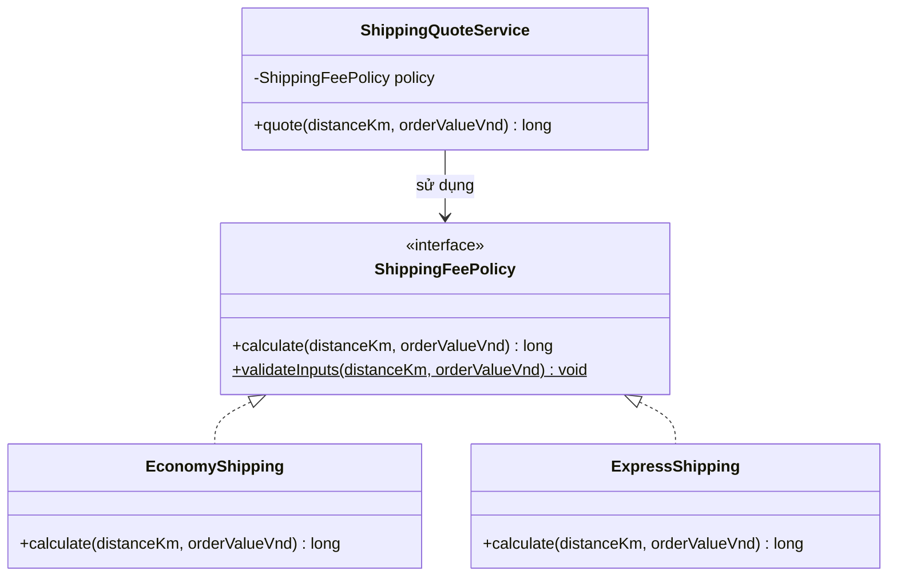
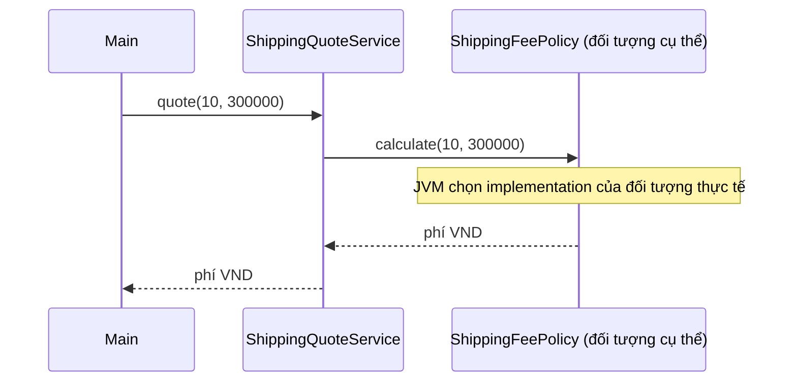
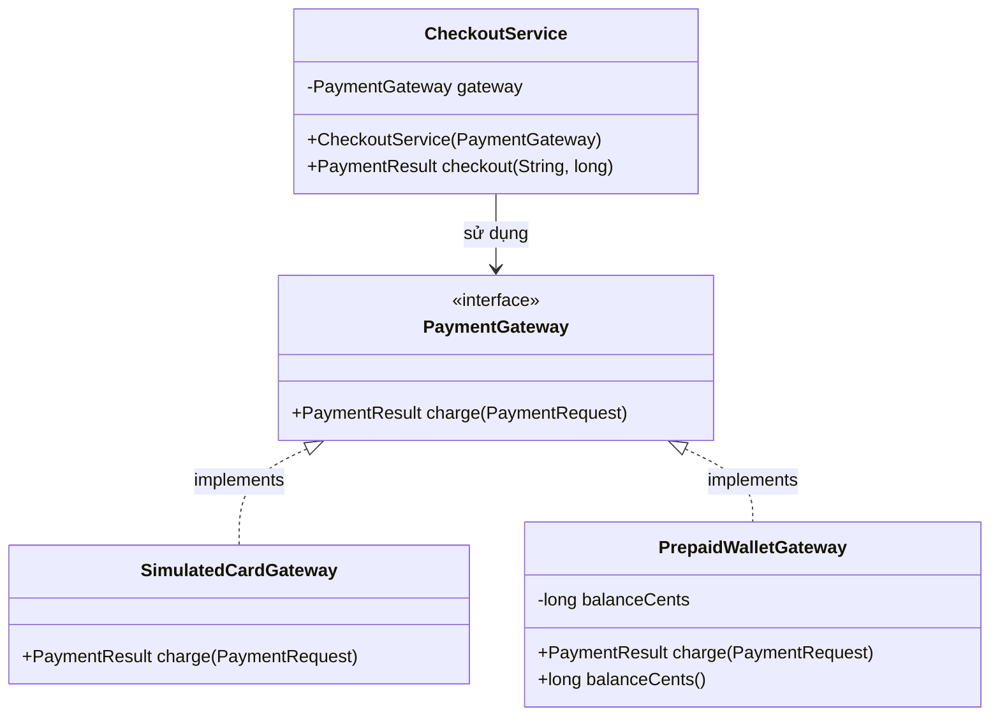
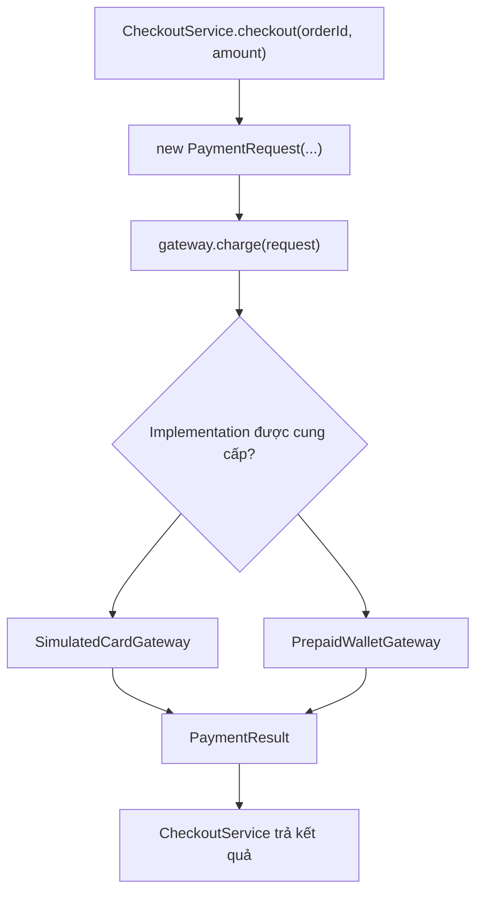
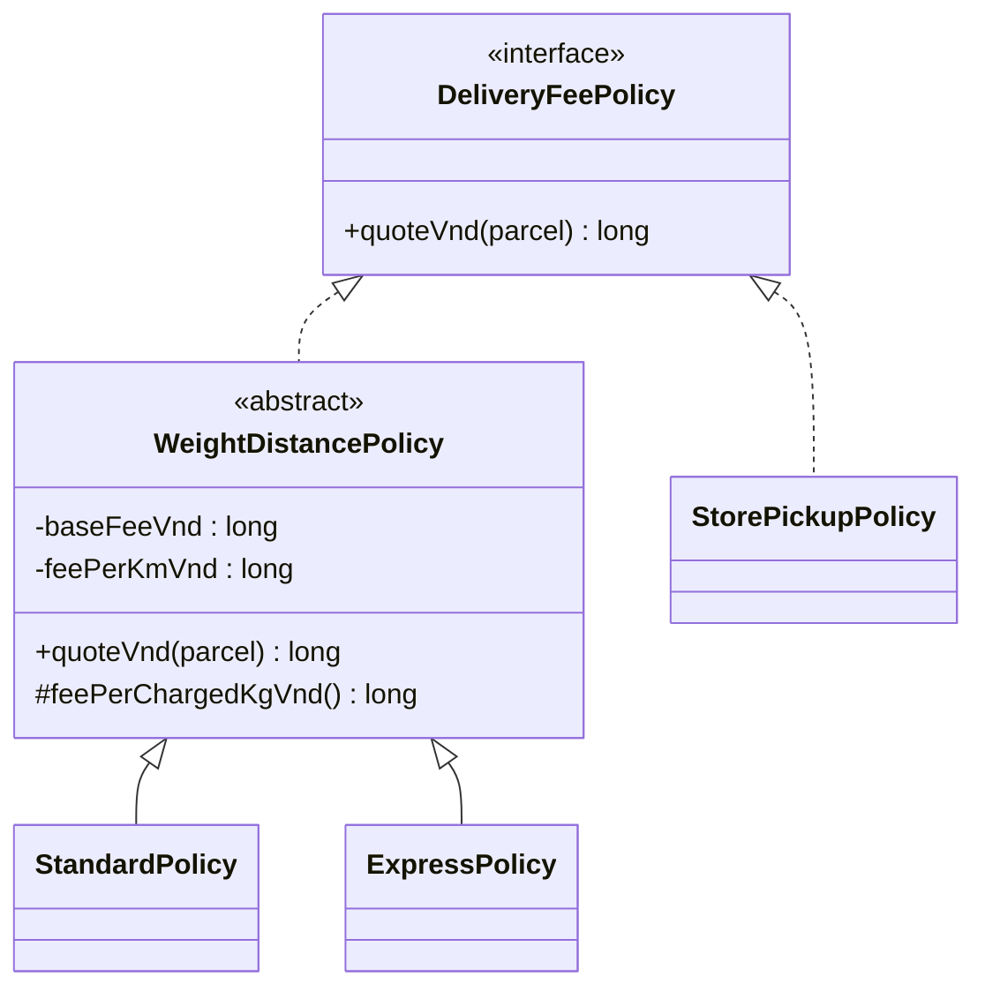
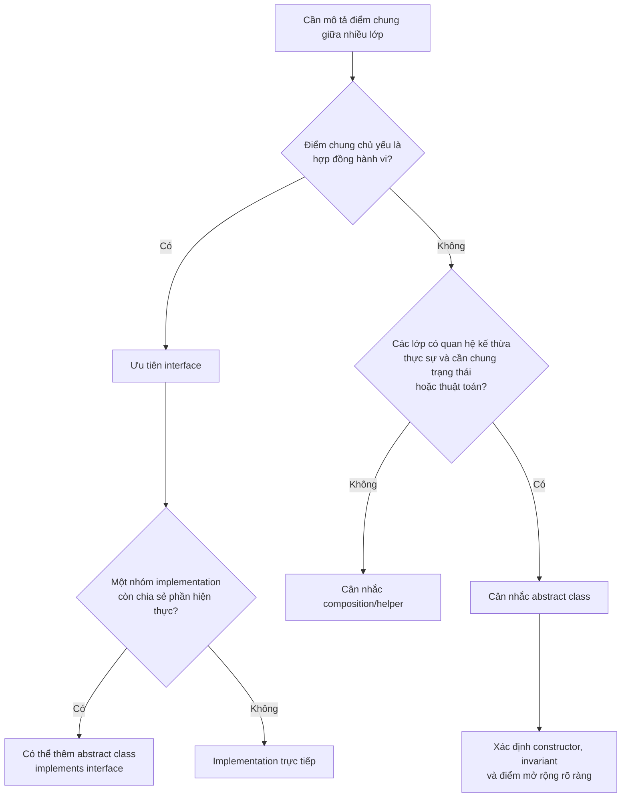
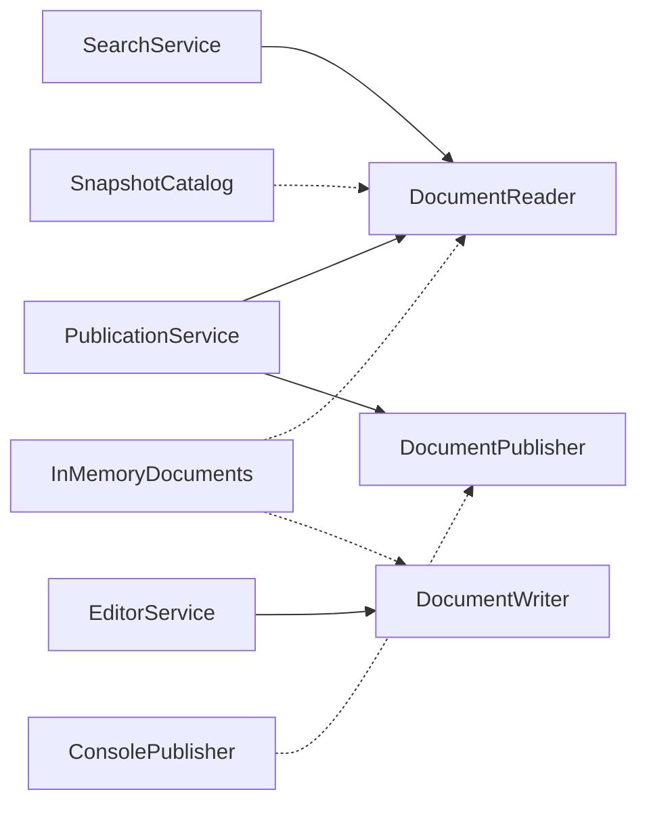
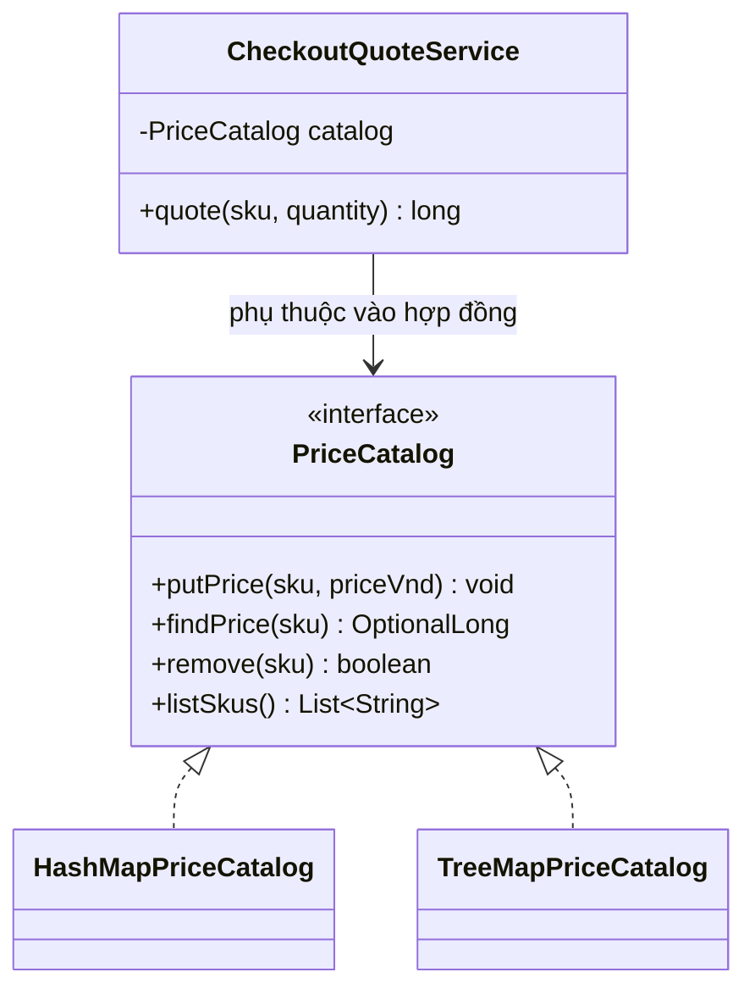
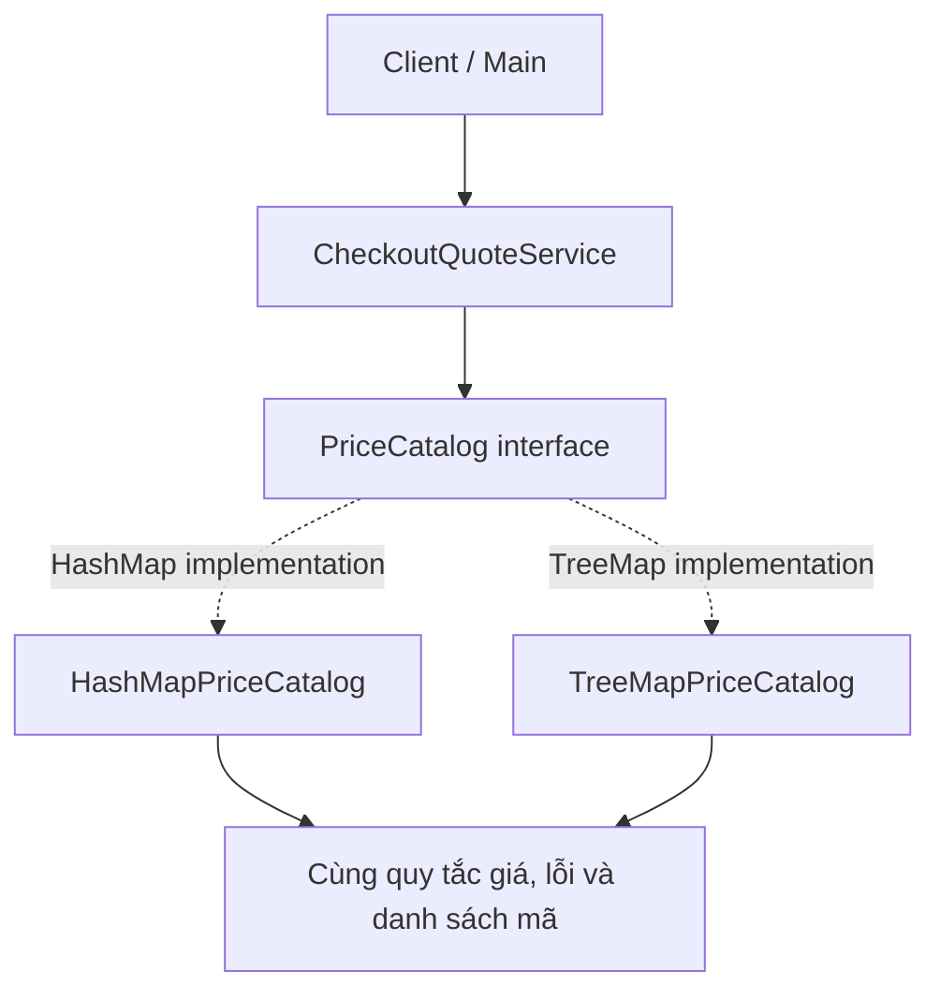
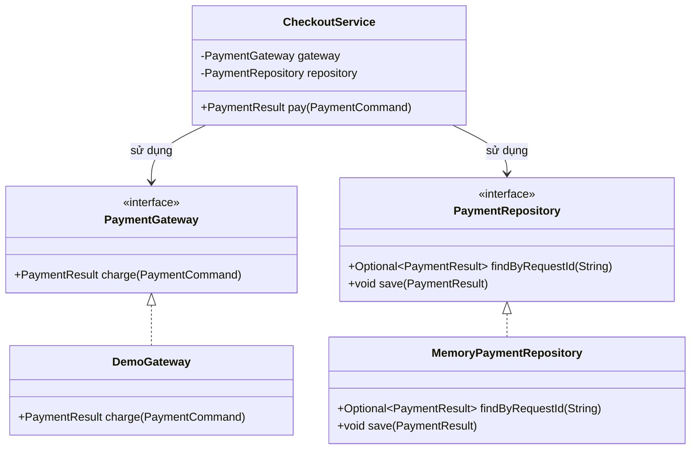

<a id="back-to-top"></a>

# Interfaces

## Menu
- [Interfaces as contracts and roles](#interface-001)
- [Declaring and implementing interfaces](#interface-002)
- [Programming to interfaces](#interface-003)
- [One object implementing multiple interfaces](#interface-004)
- [Choosing an interface or an abstract class](#interface-005)
- [Small interfaces and role segregation](#interface-006)
- [Default members and language-specific limitations](#interface-007)
- [Replacing implementations while preserving contracts](#interface-008)
- [Designing payment or storage interfaces](#interface-009)

## <a id="interface-001">Interfaces as contracts and roles</a>

<details>
<summary>View details</summary>

# Interfaces as contracts and roles in Java

In Java, **an interface (`interface`)** describes **capabilities that an object commits to providing**, allowing client code to invoke those capabilities without knowing the object's concrete class.

Imagine an application that needs to send notifications. Its business logic only cares about **delivering a notification to a recipient**. It should not need to know whether delivery uses email, SMS, an in-app notification, or a test double. We can name this shared capability `DeliveryChannel`.

These two perspectives complement each other:

- **Interface as a contract:** if a class `implements DeliveryChannel`, it must provide the interface's operations and honor its published usage rules.
- **Interface as a role:** an object can be used *in the role of* a notification delivery channel even if it has other capabilities. A class can fulfill multiple roles by implementing multiple interfaces.

Contracts enable reliable collaboration between components. Roles let us discuss **what an object can do** rather than **which class created it**.

## 1. What does an interface define?

A simple example:

~~~java
interface DeliveryChannel {
    DeliveryReceipt deliver(Notice notice);
}
~~~

To the Java compiler, this interface declares an operation named `deliver` that accepts a `Notice` and returns a `DeliveryReceipt`.

Here, the method is implicitly `public abstract` even though neither keyword appears. A concrete class implementing the interface must provide a corresponding `public` implementation unless the class itself is abstract.

However, **a method signature is not the entire contract**. Interface authors and users must also agree on the following:

| Question | Required agreement |
|---|---|
| Who may invoke it? | Code holding a reference of type `DeliveryChannel` |
| What input is valid? | A `Notice` that is not `null`, with a valid recipient and content |
| What does a successful call mean? | In this learning example: completing one **simulated** delivery |
| What does the return value convey? | A `DeliveryReceipt` that is not `null`, identifying the channel and operation details |
| Is the input modified? | No; `Notice` is designed to be immutable |
| What happens on failure? | Report an error as specified; do not arbitrarily return `null` or pretend to succeed |
| Are there side effects? | The real contract must state them; this example only simulates delivery and sends nothing over a network |

An interface provides **a syntactic structure checked by the compiler**. Rules such as “do not return `null`,” “do not silently drop notifications,” and “use the intended recipient” are part of the **behavioral contract**, enforced through design, validation, and tests.

## 2. Complete Java example: one role, multiple implementations

Scenario: a system sends a welcome message through a delivery channel configured externally. We have a shared service, two simulated delivery implementations, and an additional role for checking channel health.

Save everything in **`Demo.java`** and run it with Java 17 or later:

~~~java
import java.util.Objects;

public class Demo {
    public static void main(String[] args) {
        NotificationService byEmail = new NotificationService(
                new EmailChannel()
        );

        DeliveryReceipt emailReceipt = byEmail.sendWelcome("U-01");
        System.out.println(emailReceipt.channel()
                + " -> " + emailReceipt.detail());

        SmsChannel sms = new SmsChannel();

        // Cùng một đối tượng, nhìn qua hai vai trò.
        DeliveryChannel deliveryRole = sms;
        HealthCheck healthRole = sms;

        NotificationService bySms = new NotificationService(deliveryRole);
        DeliveryReceipt smsReceipt = bySms.sendWelcome("U-02");

        System.out.println(smsReceipt.channel()
                + " -> " + smsReceipt.detail());
        System.out.println("SMS sẵn sàng: " + healthRole.isHealthy());
    }
}

// Dữ liệu gửi đi: recipientId là mã người nhận logic,
// không phải địa chỉ email hay số điện thoại thực.
record Notice(String recipientId, String text) {
    Notice {
        Objects.requireNonNull(recipientId, "recipientId");
        Objects.requireNonNull(text, "text");

        if (recipientId.isBlank() || text.isBlank()) {
            throw new IllegalArgumentException(
                    "Người nhận và nội dung không được rỗng");
        }
    }
}

record DeliveryReceipt(String channel, String detail) {
    DeliveryReceipt {
        Objects.requireNonNull(channel, "channel");
        Objects.requireNonNull(detail, "detail");

        if (channel.isBlank()) {
            throw new IllegalArgumentException("Thiếu tên kênh");
        }
    }
}

/**
 * Hợp đồng mô phỏng gửi thông báo:
 * - notice phải khác null;
 * - trả về DeliveryReceipt khác null khi hoàn tất bình thường;
 * - không sửa notice;
 * - không có hoạt động gửi mạng thật trong bài minh họa.
 *
 * @throws NullPointerException nếu notice là null
 */
interface DeliveryChannel {
    DeliveryReceipt deliver(Notice notice);
}

// Cách thực hiện thứ nhất.
final class EmailChannel implements DeliveryChannel {
    @Override
    public DeliveryReceipt deliver(Notice notice) {
        Objects.requireNonNull(notice, "notice");

        return new DeliveryReceipt(
                "EMAIL",
                notice.recipientId() + ": " + notice.text()
        );
    }
}

// Một vai trò độc lập: kiểm tra sức khỏe.
interface HealthCheck {
    boolean isHealthy();
}

// Một lớp có thể đồng thời đảm nhiệm nhiều vai trò.
final class SmsChannel implements DeliveryChannel, HealthCheck {
    @Override
    public DeliveryReceipt deliver(Notice notice) {
        Objects.requireNonNull(notice, "notice");

        return new DeliveryReceipt(
                "SMS",
                notice.recipientId() + ": " + notice.text()
        );
    }

    @Override
    public boolean isHealthy() {
        return true; // Trạng thái giả lập cho mục đích học tập.
    }
}

// Client phụ thuộc vào hợp đồng, không phụ thuộc EmailChannel/SmsChannel.
final class NotificationService {
    private final DeliveryChannel channel;

    NotificationService(DeliveryChannel channel) {
        this.channel = Objects.requireNonNull(channel, "channel");
    }

    DeliveryReceipt sendWelcome(String recipientId) {
        Notice notice = new Notice(recipientId, "Chào mừng bạn!");
        return channel.deliver(notice);
    }
}
~~~

Run:

~~~bash
javac Demo.java
java Demo
~~~

Output:

~~~text
EMAIL -> U-01: Chào mừng bạn!
SMS -> U-02: Chào mừng bạn!
SMS sẵn sàng: true
~~~

The `EmailChannel` and `SmsChannel` classes **do not send real emails or SMS messages**. This example illustrates how to separate an interface from its implementations. In a real system, each adapter must map recipient IDs to actual destinations, handle network failures and timeouts, and ensure that results have the agreed meaning.

### Reading the program from three perspectives

**Client perspective:** `NotificationService` only has a field of type `DeliveryChannel`. It can therefore call `deliver(Notice)` without knowing either channel's internal algorithm or procedure.

**Implementation perspective:** `EmailChannel` and `SmsChannel` declare `implements DeliveryChannel`, provide a public `deliver()` method, validate inputs, and return results according to the shared contract.

**Role perspective:** the `sms` object is both a `DeliveryChannel` and a `HealthCheck`. The `deliveryRole` and `healthRole` variables may reference **the same object**, but each exposes only the operations defined by its declared interface type.

There is no need to create two objects just because one object fulfills two roles.

~~~mermaid
classDiagram
    class DeliveryChannel {
        <<interface>>
        +deliver(Notice) DeliveryReceipt
    }
    class HealthCheck {
        <<interface>>
        +isHealthy() boolean
    }
    class EmailChannel {
        +deliver(Notice) DeliveryReceipt
    }
    class SmsChannel {
        +deliver(Notice) DeliveryReceipt
        +isHealthy() boolean
    }
    class NotificationService {
        -DeliveryChannel channel
        +sendWelcome(String) DeliveryReceipt
    }
    DeliveryChannel <|.. EmailChannel
    DeliveryChannel <|.. SmsChannel
    HealthCheck <|.. SmsChannel
    NotificationService --> DeliveryChannel : phụ thuộc
~~~

## 3. How is “being a role” different from “being a type of entity”?

A **class** typically contains concrete state and implementation details. An **interface** typically specifies a capability that different kinds of objects can fulfill.

For example, an application might define:

~~~java
interface Printable {
    void print();
}

interface Exportable {
    byte[] export();
}
~~~

A report can act as `Printable` when printed and as `Exportable` when exported. An invoice can fulfill those same roles even though reports and invoices need not share a specific business superclass.

The type system makes this idea explicit:

~~~java
void printDocument(Printable document) {
    document.print();
}
~~~

This method fragment belongs inside an appropriate class. Its caller only needs an object that can fulfill the `Printable` role. The method need not accept an `Invoice` or `PdfReport` specifically, or check each concrete type using an `if/else` chain.

In Java, an interface **is also a data type (a reference type)**. It can be used as a variable type, parameter type, return type, generic type argument, or field type. It is more than an architectural description.

Examples from the JDK:

| Interface | Role represented | Possible concrete implementers |
|---|---|---|
| `Runnable` | Provides `run()` behavior | A task submitted to an executor/thread |
| `Comparable<T>` | Defines a natural order for comparison with a compatible type | `String`, `Integer`, and many value objects |
| `Comparator<T>` | Provides a strategy for comparing two values | Comparators by price, date, or name |
| `Iterable<T>` | Supports iteration over elements | A collection or custom type |
| `AutoCloseable` | Supports closing a resource | File streams or custom resources |

An object can implement multiple interfaces without belonging to a single class hierarchy.

## 4. The declared type determines which operations can be called

Consider this fragment from the example:

~~~java
SmsChannel sms = new SmsChannel();

DeliveryChannel channel = sms;
HealthCheck monitor = sms;

channel.deliver(new Notice("U-10", "Xin chào"));
System.out.println(monitor.isHealthy());
~~~

When `channel` has type `DeliveryChannel`, we **cannot** directly call `channel.isHealthy()` even though the actual object is a `SmsChannel`:

~~~java
// channel.isHealthy(); // Lỗi biên dịch: phương thức không thuộc
//                     // kiểu DeliveryChannel.
~~~

This restriction is intentional. A component that only needs delivery capability should not accidentally depend on the monitoring API.

If monitoring is genuinely required, pass a separate `HealthCheck` parameter or design an appropriate dependency. Avoid repeatedly casting to `SmsChannel` to “get access” to methods outside the contract; such casts make the client depend on a specific implementation.

**Polymorphism** occurs at the `channel.deliver(...)` call: Java invokes the `deliver()` implementation belonging to the referenced concrete class, rather than some “default algorithm” selected by the variable name.

## 5. A good contract goes beyond the compiler

Consider another class that declares:

~~~java
final class BrokenChannel implements DeliveryChannel {
    @Override
    public DeliveryReceipt deliver(Notice notice) {
        return null;
    }
}
~~~

This class **compiles**, because returning `null` is valid for a reference type. But it **violates the behavioral contract** requiring a non-null result.

Alternatively, a class could:

- Return a receipt for **a different recipient** from the input.
- Throw `UnsupportedOperationException` for every valid `Notice`.
- Report “delivered” even though it never performed the promised operation.
- Modify input data contrary to its commitment.
- Unexpectedly require callers to pass a secret subtype even though the interface accepts a broader parent type.

The compiler cannot prove these rules on its own.

### Elements of a behavioral contract

| Element | Meaning | Example for `DeliveryChannel` |
|---|---|---|
| **Precondition** | Conditions the caller must satisfy | Pass a valid, non-null `Notice` |
| **Postcondition** | Guarantee after normal completion | Return a non-null `DeliveryReceipt` |
| **Invariant** | Condition an object must maintain | A receipt contains a valid channel name |
| **Failure contract** | When and how failures are reported | `NullPointerException` when the notice is null |
| **Side-effect contract** | Which state or resources may be affected | The simulation does not send anything over a real network |

Avoid making promises in an interface that not every implementation can keep. For example, a promise that “`deliver()` always completes within 1 ms” would be difficult for a real HTTP adapter to honor. A contract should be strong enough for correct client use while allowing multiple valid implementations.

### Substitution principle

A class implementing an interface must be usable in place of other implementations **within the contract's guarantees** without surprising clients in ways that violate shared promises. This is closely related to the **Liskov Substitution Principle (LSP)**.

However, there is no requirement that:

- Two channels use the same algorithm.
- Two receipts contain the same channel name.
- Two providers have identical performance unless the contract specifies it.
- Every implementation is created and managed in the same way.

Implementation details may differ. The stable part is the contract clients rely on.

## 6. Contracts keep clients independent of delivery mechanisms

In the main example, `NotificationService` receives a `DeliveryChannel` through its constructor. The application setup code can pass `new EmailChannel()` or `new SmsChannel()`; the `sendWelcome` method only knows `deliver(Notice)` and needs no changes when switching channels.

~~~java
DeliveryChannel selected = new SmsChannel();
NotificationService service = new NotificationService(selected);
DeliveryReceipt result = service.sendWelcome("U-04");
~~~

Receiving an existing dependency from outside is called **constructor injection**. It isolates the decision about which implementation to use, but does not mean every class needs an additional interface. Define a contract when it reflects **a capability the client actually requires**; the *Programming to interfaces* lesson explores dependency direction, the composition root, and concrete fake tests.

## 7. A role should not promise unavailable capabilities

If `DeliveryChannel` also required every implementation to provide `revoke(messageId)`, a channel unable to retract sent messages would have to implement a meaningless method or always throw an exception. It is better to separate the two roles:

~~~java
interface Sender {
    DeliveryReceipt deliver(Notice notice);
}

interface Revocable {
    void revoke(String messageId);
}
~~~

A class should only `implements Revocable` when it can actually satisfy the revocation contract. A client that only sends messages requires `Sender`; one that needs revocation requires `Revocable`. This reflects the **Interface Segregation Principle (ISP)**: limit dependencies according to client needs, rather than mechanically creating one interface per method. The *Small interfaces and role segregation* lesson shows how to refactor an overly broad contract.

## 8. Roles and class families sharing implementations are separate dimensions

| Question | Interface | Abstract class |
|---|---|---|
| Main purpose | Define the behavioral contract for a role | Share state, constructors, or algorithms within a class family |
| Composition options | A class can `implements` multiple interfaces | A class can directly `extends` at most one superclass |
| Instance state | Cannot declare instance fields | Can hold instance fields and invariants |
| Constructor | None | Supported |

For example, `Invoice` and `AnalyticsReport` can both `implements Exportable` without sharing a business superclass. If a group of exporters truly needs the same buffer and configuration constructor, it can use an abstract base class that **also** implements `Exportable`, while others implement the interface directly. The *Choosing an interface or an abstract class* lesson fully illustrates inheritance versus composition.

## 9. Some Java interface members can include implementations

Although the main member of `DeliveryChannel` is the `public abstract` method `deliver`, Java 17 also allows interfaces to contain:

~~~java
interface Greeter {
    String greet(String name); // Ngầm public abstract

    default String greetEveryone() {
        return greet("mọi người");
    }

    static boolean hasName(String name) {
        return name != null && !name.isBlank();
    }

    private static String normalize(String name) {
        return name.strip();
    }
}
~~~

`default` provides a body shared by implementations; `static` is called through `Greeter.hasName(...)` rather than an instance; `private` is a helper usable only **inside the interface** (the example above does not use `normalize` yet). Interface fields are implicitly `public static final` and **do not** create per-object state. If two unrelated interfaces define default methods with the same signature, a class may need to override the method to resolve the conflict. The *Default members and language-specific limitations* lesson explains modifiers, conflicts, `Object` limitations, and version differences in detail.

## 10. Interfaces as roles passed into callbacks

An interface with **one abstract method** can be declared a *functional interface* and implemented with a lambda.

For example:

~~~java
@FunctionalInterface
interface PriceRule {
    long apply(long originalPriceVnd);
}
~~~

Usage:

~~~java
PriceRule tenPercentOff = original -> original * 90 / 100;

System.out.println(tenPercentOff.apply(200_000)); // 180000
~~~

The `tenPercentOff` variable fulfills the `PriceRule` role even though we did not manually write a named implementation class. Java turns the lambda into an object that can fulfill the functional interface contract.

Here the formula only demonstrates a 10% discount on sufficiently small positive integers to avoid `long` overflow; a real financial contract must specify how to validate negative values, round amounts, and handle overflow.

Interfaces such as `Runnable`, `Comparator<T>`, `Predicate<T>`, and `Function<T,R>` are familiar examples of **roles** that allow behavior to be passed as an argument.

`@FunctionalInterface` instructs the compiler to verify that the interface still has exactly one abstract method under the applicable rules. The annotation is useful but not required for Java to recognize a valid functional interface.

## 11. A clear contract lets us test clients with fakes

We do not need to send real SMS messages to verify that `NotificationService` constructs the correct `Notice`. A test double can record incoming notifications:

~~~java
final class RecordingChannel implements DeliveryChannel {
    Notice last;

    @Override
    public DeliveryReceipt deliver(Notice notice) {
        last = java.util.Objects.requireNonNull(notice);
        return new DeliveryReceipt("FAKE", "Đã nhận");
    }
}

RecordingChannel fake = new RecordingChannel();
NotificationService service = new NotificationService(fake);
service.sendWelcome("U-03");
if (!"U-03".equals(fake.last.recipientId())) {
    throw new AssertionError("Sai người nhận");
}
~~~

This test reuses `Notice`, `DeliveryReceipt`, and `NotificationService` from the main example. It only verifies that **the client invokes the contract correctly**; it does not prove that real email or SMS adapters work. Testing multiple implementations against one contract and detecting semantic violations is the focus of *Replacing implementations while preserving contracts*.

## 12. Evolving an interface changes promises to many parties

When multiple modules use an interface, changing `deliver(Notice)` to `deliver(String)` may prevent implementations and clients from compiling. Adding an abstract method also usually forces concrete implementers to add code; adding a default method reduces some source-level impact but may still introduce conflicts or change behavior.

More dangerously, developers might **keep the signature while changing what the result means**. For example, if `DeliveryReceipt` used to mean *accepted by the provider*, it must not silently change to *read by the recipient* while claiming to preserve the same guarantee. Callers could make wrong decisions even though all code still compiles.

When switching channels, consistently preserve promised input conditions, results, errors, and side effects. If semantics must change, publish a new contract version or a clear migration strategy, and run behavioral tests against each implementation.

## 13. When should we avoid creating another interface?

Interfaces are useful but add maintenance costs. Consider skipping a new interface when:

- There is only one simple class and no dependency boundary that needs stability yet.
- The interface mirrors nearly every public method of a class without defining a clear role.
- Consumers repeatedly cast to a concrete implementation to reach methods omitted from the interface.
- The interface has many methods that only some implementations support.
- The API is changing quickly, so a stable consumer contract is not yet clear.

Conversely, interfaces are especially useful for **external integration adapters, replaceable strategies, plugins, callbacks, cross-module collaboration, and dependency injection**.

A practical test is to describe the interface in one sentence: **“this object can…”**. If that statement is clear, has a specific consumer, and defines verifiable promises, the interface has a good reason to exist.

## 14. Practice scenarios

### Scenario 1 — Designing around roles

A system contains `PdfReport`, `Invoice`, and `EmailMessage`. `PdfReport` can be printed and exported; `Invoice` can be printed; `EmailMessage` can be sent. Should they all be forced to `extends Document` with every `print()`, `export()`, and `send()` method?

**Hint:** not necessarily. Use role-based interfaces such as `Printable`, `Exportable`, and `Sendable`; each class should only `implements` the capabilities it actually provides.

### Scenario 2 — Spotting contract violations

~~~java
class NullChannel implements DeliveryChannel {
    @Override
    public DeliveryReceipt deliver(Notice notice) {
        return null;
    }
}
~~~

**Answer:** the class can compile but violates the `deliver` contract, which requires a non-null receipt on normal completion.

### Scenario 3 — Roles versus runtime types

~~~java
SmsChannel sms = new SmsChannel();
DeliveryChannel sender = sms;
HealthCheck health = sms;
~~~

Question: how many `SmsChannel` objects are created? Can we call `sender.isHealthy()` directly?

**Answer:** one object; `sender.isHealthy()` does not compile because the method is absent from the `DeliveryChannel` interface, although `health.isHealthy()` is valid.

### Scenario 4 — A client depending on an implementation

~~~java
class Job {
    private final EmailChannel channel = new EmailChannel();
}
~~~

Question: to test `Job` using a fake channel, how should the dependency direction change?

**Hint:** let `Job` receive `DeliveryChannel` through its constructor; the code that creates `Job` supplies a real `EmailChannel` or fake `RecordingChannel` according to the environment.

### Scenario 5 — An overly broad interface

If every class implementing `StorageManager` must support `upload()`, `read()`, and `delete()`, but one module is allowed only to read, which design makes access control easier to enforce?

**Hint:** provide a `ReadableStorage` role exposing only `read()` and give write/delete roles only to code with the corresponding permissions. Splitting roles also reduces the API surface that clients might call by mistake.

### Scenario 6 — Expressing an algorithm through an interface

To sort employees by name or salary, must you modify the `Employee` class whenever the criterion changes?

**Hint:** no. Pass different `Comparator<Employee>` implementations to the sort operation. `Comparator` represents **the comparison strategy role**, while `Employee` represents the data entity. When the criterion changes, the client chooses another implementation or lambda.

## Key takeaways for Java OOP design

Choose interfaces by starting with **the consumer**: what should an object be able to do, what inputs are valid, which results can be trusted, and how should failures be handled? Then let classes implement those behaviors using their own details.

A good interface names a **meaningful role**, exposes operations focused enough for independent client use, and specifies a **clear behavioral contract**. An implementing class may change algorithms, data structures, or providers, but must continue honoring the guarantees clients depend on. This makes OOP designs more flexible while keeping them readable, testable, and extensible in a controlled way.


</details>

- [Back to top](#back-to-top)

---

## <a id="interface-002">Declaring and implementing interfaces</a>

<details>
<summary>View details</summary>

# Declaring and implementing interfaces in Java

In object-oriented programming, **an interface** describes the behaviors that an object type promises to provide. A class **implements an interface** (*implements*) by writing code for the methods in that contract.

For example, a sales system may have several ways to calculate shipping fees. The checkout service only needs to ask “what is the delivery fee for this distance and order value?” It does not need to know whether the fee comes from an economy or express shipping policy. An interface separates **what the caller needs** from **how each class calculates it**.

This lesson uses Java 11 or later, with `.java` files that can be compiled directly.

## 1. Basic syntax

Declare an interface:

```java
public interface Greeter {
    String greet(String name);
}
```

Declare an implementing class:

```java
public final class VietnameseGreeter implements Greeter {
    @Override
    public String greet(String name) {
        return "Xin chào, " + name;
    }
}
```

Usage:

```java
Greeter greeter = new VietnameseGreeter();
System.out.println(greeter.greet("Lan")); // Xin chào, Lan
```

Key elements to understand:

| Syntax | Meaning |
| --- | --- |
| `interface Greeter` | Declares an interface type named `Greeter` |
| `String greet(String name);` | Method signature; here it is an abstract method without a body |
| `class VietnameseGreeter implements Greeter` | Declares a class that promises to implement the interface |
| `@Override` | Requests a compiler check that the method actually overrides/implements an inherited method |
| `public String greet(...)` | Provides the method body; `public` is required because the interface contract is public |
| `Greeter greeter = new VietnameseGreeter()` | An interface-typed variable holds a reference to a concrete implementing object |

In an interface, an ordinary instance method without a body, such as `greet` above, **is implicitly `public abstract`**. Therefore:

```java
String greet(String name);
```

is equivalent to:

```java
public abstract String greet(String name);
```

An implementing class must use a `public` method; it cannot reduce access to `protected`, package-private, or `private`.

Key point: **an interface is a data type**, but you cannot instantiate it directly using `new Greeter()`. Instead, create an object from a concrete implementing class (or a suitable anonymous class/expression) and store its reference using the interface type.

## 2. Real-world problem: changing shipping fee calculations

Suppose an order can be quoted under two policies:

- **Economy:** a base fee of 10.000 VND plus 2.500 VND per km; shipping is free when the goods are worth at least 500.000 VND.
- **Express:** a base fee of 20.000 VND plus 5.000 VND per km; no free-shipping threshold based on order value.

Distance is a nonnegative whole number of kilometers, and order value is a nonnegative integer amount in VND. When large values would overflow `long` arithmetic, the example reports an error instead of returning an incorrect fee.

We want checkout logic to avoid an `if (shippingType.equals(...))` chain that decides every formula itself. Instead, the checkout service **depends on an interface**.

### Step 1: define the contract in `ShippingFeePolicy.java`

```java
/**
 * Chính sách tính phí giao hàng.
 *
 * distanceKm >= 0 và orderValueVnd >= 0.
 * Kết quả là số tiền nguyên VND không âm.
 * Với đầu vào âm, ném IllegalArgumentException.
 * Nếu tính phí bị tràn long, có thể ném ArithmeticException.
 */
public interface ShippingFeePolicy {

    long calculate(int distanceKm, long orderValueVnd);

    // Phương thức static dùng chung để kiểm tra đầu vào.
    static void validateInputs(int distanceKm, long orderValueVnd) {
        if (distanceKm < 0 || orderValueVnd < 0) {
            throw new IllegalArgumentException(
                    "Quãng đường và giá trị đơn không được âm");
        }
    }
}
```

Here `calculate(...)` is an **extension point**: each policy supplies its own formula, but all policies must satisfy the stated input and output rules. `validateInputs(...)` is a `static` method on the interface itself; implementing classes can call it directly through `ShippingFeePolicy.validateInputs(...)`.

From a design perspective, shared logic does not always belong in an interface. In this example, validating the two parameters is part of the shared contract, so a short `static` method demonstrates a capability of modern Java interfaces.

### Step 2: implement the economy policy

File `EconomyShipping.java`:

```java
public final class EconomyShipping implements ShippingFeePolicy {

    private static final long FREE_SHIPPING_FROM_VND = 500_000L;
    private static final long BASE_FEE_VND = 10_000L;
    private static final long PER_KM_VND = 2_500L;

    @Override
    public long calculate(int distanceKm, long orderValueVnd) {
        ShippingFeePolicy.validateInputs(distanceKm, orderValueVnd);

        if (orderValueVnd >= FREE_SHIPPING_FROM_VND) {
            return 0L;
        }

        long distanceFee =
                Math.multiplyExact(PER_KM_VND, (long) distanceKm);
        return Math.addExact(BASE_FEE_VND, distanceFee);
    }
}
```

`EconomyShipping` uses `implements ShippingFeePolicy`. The compiler verifies that the class provides `calculate(int, long)` with a compatible return type. The formula and internal constants belong to the concrete class; an interface-typed caller need not know them.

### Step 3: implement the express policy

File `ExpressShipping.java`:

```java
public final class ExpressShipping implements ShippingFeePolicy {

    private static final long BASE_FEE_VND = 20_000L;
    private static final long PER_KM_VND = 5_000L;

    @Override
    public long calculate(int distanceKm, long orderValueVnd) {
        ShippingFeePolicy.validateInputs(distanceKm, orderValueVnd);

        long distanceFee =
                Math.multiplyExact(PER_KM_VND, (long) distanceKm);
        return Math.addExact(BASE_FEE_VND, distanceFee);
    }
}
```

Both classes **satisfy the same signature** but implement different behavior. This enables polymorphism: a `policy.calculate(...)` call executes the method of the concrete class referenced by `policy`.

### Step 4: let the service use the interface instead of a concrete class

File `ShippingQuoteService.java`:

```java
import java.util.Objects;

public final class ShippingQuoteService {
    private final ShippingFeePolicy policy;

    public ShippingQuoteService(ShippingFeePolicy policy) {
        this.policy = Objects.requireNonNull(policy, "policy");
    }

    public long quote(int distanceKm, long orderValueVnd) {
        return policy.calculate(distanceKm, orderValueVnd);
    }
}
```

`ShippingQuoteService` does not construct `new EconomyShipping()` or `new ExpressShipping()` internally. The policy object is passed through its constructor. This is a simple example of **constructor-based dependency injection**: a higher-level component receives a dependency through an abstraction. No framework is required to use this design.

### Step 5: run the complete example

File `Main.java`, in the same directory as the four files above:

```java
public class Main {
    public static void main(String[] args) {
        ShippingFeePolicy economyPolicy = new EconomyShipping();
        ShippingFeePolicy expressPolicy = new ExpressShipping();

        ShippingQuoteService economyQuote =
                new ShippingQuoteService(economyPolicy);
        ShippingQuoteService expressQuote =
                new ShippingQuoteService(expressPolicy);

        System.out.println(economyQuote.quote(10, 300_000));
        System.out.println(economyQuote.quote(10, 600_000));
        System.out.println(expressQuote.quote(10, 300_000));

        try {
            expressQuote.quote(-1, 300_000);
        } catch (IllegalArgumentException ex) {
            System.out.println("Từ chối: " + ex.getMessage());
        }
    }
}
```

Run from a terminal:

```bash
javac ShippingFeePolicy.java EconomyShipping.java ExpressShipping.java ShippingQuoteService.java Main.java
java Main
```

Output:

```text
35000
0
70000
Từ chối: Quãng đường và giá trị đơn không được âm
```

Explaining the output:

| Policy | Distance | Order value | Returned fee |
| --- | ---: | ---: | ---: |
| Economy | 10 km | 300.000 VND | 10.000 + 2.500 × 10 = **35.000 VND** |
| Economy | 10 km | 600.000 VND | **0 VND** (qualifies for free shipping) |
| Express | 10 km | 300.000 VND | 20.000 + 5.000 × 10 = **70.000 VND** |

The service only knows `ShippingFeePolicy`. To add a third policy, create another class implementing the same interface and pass it to the service; no change to the fee calculation inside `ShippingQuoteService` is required.

## 3. Understanding polymorphic dispatch through interfaces



The dashed line with a hollow triangle represents a **realization/implements** relationship. `ShippingQuoteService` collaborates with `ShippingFeePolicy` through a field whose type is the interface.

Execution flow:



In a particular call, `policy` may refer to an `EconomyShipping` or `ExpressShipping` object. At runtime Java selects **the instance method implementation** based on the actual object type. The compiler still uses **the declared reference type** to determine which methods may be called.

For example:

```java
ShippingFeePolicy policy = new EconomyShipping();
long fee = policy.calculate(8, 200_000); // Hợp lệ

// policy.onlyEconomyFeature(); // Không hợp lệ nếu method
// này không được khai báo trong ShippingFeePolicy.
```

If you need behavior available only on a concrete class, consider whether a separate contract would be appropriate. Repeatedly downcasting from an interface to its implementation often indicates that the abstraction does not fit the client.

## 4. Rules for declaring and implementing interfaces

### Abstract methods must be implemented

```java
interface Printer {
    void print(String text);
    int pagesPrinted();
}
```

A **concrete** class declaring `implements Printer` must provide every abstract method that has not already been inherited from another source:

```java
class ConsolePrinter implements Printer {
    private int pages;

    @Override
    public void print(String text) {
        System.out.println(text);
        pages++;
    }

    @Override
    public int pagesPrinted() {
        return pages;
    }
}
```

If `pagesPrinted()` is missing, the concrete class will not compile. An `abstract` class may implement only part of the contract and leave the rest for subclasses:

```java
abstract class BasePrinter implements Printer {
    @Override
    public int pagesPrinted() {
        return 0;
    }
    // Chưa định nghĩa print(String): được phép vì class abstract.
}
```

Note that `pagesPrinted()` in `BasePrinter` returns a fixed `0` solely to illustrate syntax; a real implementation should return the accurate page count required by its contract.

### Access levels cannot be narrowed

```java
interface Task {
    void execute(); // implicit public abstract
}

class MyTask implements Task {
    @Override
    public void execute() { // Bắt buộc public
        System.out.println("Thực hiện");
    }
}
```

Writing `void execute()` without `public` when implementing the method causes a compile error because it attempts to reduce the access level of a `public` method.

### Method signatures must be compatible

An implementation must match the method name and parameter list, and its return type must be compatible, including the **covariant return type** rules for reference types. Declaring an overload with different parameters does not implement the required method.

```java
interface Parser {
    String parse(String input);
}

class TrimParser implements Parser {
    @Override
    public String parse(String input) {
        return input.trim();
    }

    // Đây là overload, không phải cách thay thế parse(String).
    public String parse(int value) {
        return Integer.toString(value);
    }
}
```

`@Override` is very useful: if you mistakenly write `parse(Object)` instead of `parse(String)`, the compiler reports that no matching method exists to override.

## 5. Interfaces may also declare methods with bodies

In the main `ShippingFeePolicy` example, `calculate(int,long)` is an **abstract** method that concrete classes must implement, whereas `static validateInputs(...)` already has a body and is called through the interface name. Modern Java also permits:

~~~java
interface NamedTask {
    String name();                        // public abstract

    default String describe() {           // Java 8+
        return "Task: " + name();
    }

    static boolean isValid(String value) { // Java 8+
        return value != null && !value.isBlank();
    }

    private String normalized() {         // Java 9+
        return name().strip();
    }
}
~~~

`default` provides instance behavior that may be inherited or overridden; `static` cannot be called as an instance method; and `private` is a helper inside the interface (unused in this example). Every field declared directly in an interface is implicitly `public static final`, with no per-instance state. For the **complete** rules on modifiers, fields, default-method conflicts, and language compatibility, see *Default members and language-specific limitations*.

## 6. Using `implements` for multiple interfaces still creates only one object

A class can accept several contracts through a comma-separated list:

~~~java
interface Printable { void print(); }
interface Exportable { String export(); }

class Report implements Printable, Exportable {
    public void print() { System.out.println("In báo cáo"); }
    public String export() { return "report"; }
}

Report report = new Report();
Printable printer = report;
Exportable exporter = report;
~~~

The interface variables `printer` and `exporter` both refer to **the same** `Report` object; they create no additional instances, and each exposes only the API of its corresponding role. An interface may also `extends` multiple interfaces, whereas a Java class may directly `extends` only one class.

When unrelated interfaces declare the same default method, Java has explicit rules for resolving the conflict; it does not choose randomly. The *One object implementing multiple interfaces* lesson traces state changes through multiple references and examines method collisions.

## 7. How interfaces and abstract classes differ in design

| Requirement | Interface | Abstract class |
|---|---|---|
| Expose an API to unrelated class types | Declare a contract through `implements` | Constrain types to an inheritance family |
| Combine multiple roles | Allow a class to `implements` multiple interfaces | A class has only one direct superclass |
| Share constructors, instance fields, or base algorithms | No constructors or instance fields | Supports shared state and implementation |

For example, `ShippingQuoteService` only cares about `ShippingFeePolicy`; it does not need to know whether policies share a superclass. If a family of policies genuinely shares a base formula and configuration state, it may extend an abstract class that `implements ShippingFeePolicy`, while independent policies can still `implements` the interface directly. The *Choosing an interface or an abstract class* lesson provides a complete example of this choice and composition.

## 8. Checking the contract across implementations

Although `EconomyShipping` and `ExpressShipping` both compile, the program may still be wrong if an implementation returns a negative fee or ignores the requirement for nonnegative inputs. The compiler checks **signatures**; business constraints must be upheld through code and testing.

File `ContractCheck.java`:

```java
public class ContractCheck {
    public static void main(String[] args) {
        ShippingFeePolicy[] policies = {
            new EconomyShipping(),
            new ExpressShipping()
        };

        for (ShippingFeePolicy policy : policies) {
            long fee = policy.calculate(10, 300_000);
            if (fee < 0) {
                throw new AssertionError("Phí giao hàng bị âm");
            }

            boolean rejected = false;
            try {
                policy.calculate(-1, 300_000);
            } catch (IllegalArgumentException expected) {
                rejected = true;
            }

            if (!rejected) {
                throw new AssertionError("Không từ chối quãng đường âm");
            }
        }

        require(
                new EconomyShipping().calculate(10, 300_000) == 35_000,
                "Sai phí Economy");
        require(
                new EconomyShipping().calculate(10, 600_000) == 0,
                "Sai điều kiện miễn phí");
        require(
                new ExpressShipping().calculate(10, 300_000) == 70_000,
                "Sai phí Express");

        System.out.println("PASS: Các implementation giữ hợp đồng");
    }

    private static void require(boolean condition, String message) {
        if (!condition) {
            throw new AssertionError(message);
        }
    }
}
```

Run:

```bash
javac ShippingFeePolicy.java EconomyShipping.java ExpressShipping.java ContractCheck.java
java ContractCheck
```

Output:

```text
PASS: Các implementation giữ hợp đồng
```

In real projects, these checks can become JUnit tests run against several implementations. **Using the same behavioral tests** helps detect a new class that implements the correct signature but violates a rule clients depend on.

### Common compilation errors to recognize

| Code or scenario | Problem | Fix |
| --- | --- | --- |
| `new ShippingFeePolicy()` | An interface cannot be instantiated directly | Use `new EconomyShipping()` or another implementation |
| A class implements the interface but omits `calculate` | The concrete class has not fulfilled the contract | Implement the required method or declare the class `abstract` |
| `long calculate(...)` without `public` | Attempts to reduce the access level of an interface method | Add `public` |
| Writing `calculate(long, long)` instead of `calculate(int, long)` | An overload with a different signature does not implement the required method | Match the parameter type list exactly |
| Calling `policy.specialFeature()` when it is not in the interface | The declared variable type does not expose that method | Redesign the contract or use the appropriate type when genuinely necessary |
| Calling `policy.validateInputs(...)` | A static method is not an inherited instance method | Use `ShippingFeePolicy.validateInputs(...)` |
| Two conflicting default methods | No unique implementation can be selected | Override the method and resolve the conflict |
| Using an interface as mutable field storage | Interface fields are always `public static final` constants | Keep state in a suitable class or object |

## 9. Organizing files in real projects

The example places all classes in one directory without package declarations so beginners can compile them with `javac`. Larger applications should use clear package structures. For example:

```text
src/main/java/com/example/shipping/
├── ShippingFeePolicy.java
├── EconomyShipping.java
├── ExpressShipping.java
└── ShippingQuoteService.java
```

Each file would begin with `package com.example.shipping;`. `Main` or a REST controller in another package uses the interface through the corresponding `import`. With Spring, a bean from an implementing class can be injected into the service through a constructor, but **a Java interface itself does not depend on Spring**. If several beans implement the same interface, configuration must specify which implementation is selected; that is the DI mechanism's responsibility, not an automatic decision made by Java interfaces.

A useful design is to make domain/service code depend on **small, purpose-specific interfaces** instead of combining unrelated operations into a “super-interface.” If a client only calculates fees, it should not also need to know about order storage, email delivery, and parcel tracking.

## 10. Practice on your own

**Exercise A — change the formula without changing the service.** Create `SameDayShipping implements ShippingFeePolicy` with a fee of 35.000 VND + 7.000 VND per km and no free shipping. Preserve input validation. Pass it to `ShippingQuoteService` and calculate the fee for 4 km. **Expected result: 63.000 VND**.

**Exercise B — predict the compilation error.**

```java
interface Reader {
    String read();
}

class FileReaderExample implements Reader {
    String read() {
        return "data";
    }
}
```

Where is the error? The method in `Reader` is implicitly `public`, but `FileReaderExample.read()` has no modifier and is therefore package-private. Change it to `public String read()` and consider adding `@Override`.

**Exercise C — an interface with multiple methods.** Define `Resizable` with `void resize(int width, int height)` and `int area()`. Implement `Rectangle` with positive width and height; `area()` should return the area without changing state. Decide explicitly how to handle overflow when multiplying `int` values.

**Exercise D — multiple interfaces.** Write `interface Identifiable { String id(); }` and `interface Printable { void print(); }`; create an `Invoice` class that implements both. Use two interface-typed variables to invoke their respective behaviors on the same object.

**Exercise E — default methods.** Define `interface Named { String name(); default String displayName() { return name().trim(); } }`. Implement one class that uses the default method and another that overrides it. Observe how clients invoke `displayName()` through a `Named` variable.

## Key points when reading or designing interfaces

A good interface answers: **“Which behaviors must an implementing object provide, and what are the valid inputs and expected results?”** When implementing an interface, check method signatures, `public` access, business guarantees, and failure cases. When using one, create an implementing object and interact through **the interface type** to reduce coupling to internal details.

Three essential lines:

```java
interface Action { void run(); }       // Khai báo hợp đồng
class Job implements Action {          // Thực hiện hợp đồng
    @Override public void run() { System.out.println("Run"); }
}
```

And:

```java
Action action = new Job(); // Biến theo interface, đối tượng theo class
action.run();              // Gọi implementation của Job
```

Once you understand that **`interface` declares the contract**, **`implements` supplies the behavior**, and **an interface-typed variable enables polymorphic calls**, you can add new implementations without changing how clients use the application.


</details>

- [Back to top](#back-to-top)

---

## <a id="interface-003">Programming to interfaces</a>

<details>
<summary>View details</summary>

# Programming to interfaces in Java

> **Topic:** OOP → Interfaces. When a component only needs to know **a capability or contract** of another component, make it depend on an `interface` instead of a concrete implementing class. Business logic can then work with multiple implementations, switch underlying technologies, and use fakes in tests without changing its core logic.

## 1. The problem with depending directly on concrete classes

Suppose `CheckoutService` processes payments through a card gateway:

```java
class CardGateway {
    boolean charge(long amountCents) {
        // Ví dụ mô phỏng, không kết nối cổng thanh toán thật.
        return true;
    }
}

class CheckoutService {
    private final CardGateway gateway = new CardGateway();

    boolean checkout(long amountCents) {
        return gateway.charge(amountCents);
    }
}
```

Here `CheckoutService` constructs and depends directly on `CardGateway`. To use a prepaid wallet, simulate payment errors in tests, or change providers, we would usually have to modify `CheckoutService` or add `if` branches to choose a gateway.

**The principle of programming to interfaces:** instead of knowing *who* processes a payment, `CheckoutService` only needs to know *how to request a payment*.

```java
interface PaymentGateway {
    PaymentResult charge(PaymentRequest request);
}
```

The interface specifies **the behavior consumers may rely on**. Different classes can `implements PaymentGateway` and decide how to perform the operation.

## 2. How interface consumers and implementations relate



The arrow from `CheckoutService` to `PaymentGateway` represents **a dependency on an abstraction**. Gateway classes are **implementations** of the contract. `CheckoutService` does not need casts or `instanceof` checks to decide which class receives a request.

Three common roles:

| Role | In this example | Responsibility |
|---|---|---|
| Interface | `PaymentGateway` | Declares the payment operation |
| Consumer | `CheckoutService` | Coordinates checkout using the shared contract |
| Implementing classes | `SimulatedCardGateway`, `PrepaidWalletGateway` | Provide specific payment mechanisms |

The contract is more than **a method signature**. It should explain parameter meaning, return values, failure cases, side effects, and whether an operation may be repeated.

## 3. Complete Java example: switch implementations without modifying CheckoutService

Create `InterfaceProgrammingDemo.java` (Java 17 or later):

```java
import java.util.Objects;

public class InterfaceProgrammingDemo {

    public record PaymentRequest(String orderId, long amountCents) {
        public PaymentRequest {
            if (orderId == null || orderId.isBlank()) {
                throw new IllegalArgumentException("Mã đơn hàng không hợp lệ");
            }
            if (amountCents <= 0) {
                throw new IllegalArgumentException("Số tiền phải dương");
            }
        }
    }

    public record PaymentResult(boolean successful, String description) {
        public PaymentResult {
            Objects.requireNonNull(description, "description");
        }
    }

    public interface PaymentGateway {
        PaymentResult charge(PaymentRequest request);
    }

    // Implementation A: giả lập một cổng thẻ luôn trả thành công.
    public static final class SimulatedCardGateway implements PaymentGateway {
        @Override
        public PaymentResult charge(PaymentRequest request) {
            Objects.requireNonNull(request, "request");
            return new PaymentResult(true, "Thẻ mô phỏng: " + request.orderId());
        }
    }

    // Implementation B: ví trả trước có số dư được quản lý trong bộ nhớ.
    public static final class PrepaidWalletGateway implements PaymentGateway {
        private long balanceCents;

        public PrepaidWalletGateway(long openingBalanceCents) {
            if (openingBalanceCents < 0) {
                throw new IllegalArgumentException("Số dư không thể âm");
            }
            this.balanceCents = openingBalanceCents;
        }

        @Override
        public synchronized PaymentResult charge(PaymentRequest request) {
            Objects.requireNonNull(request, "request");

            if (request.amountCents() > balanceCents) {
                return new PaymentResult(false, "Ví không đủ số dư");
            }

            balanceCents -= request.amountCents();
            return new PaymentResult(true, "Ví đã trừ tiền");
        }

        public synchronized long balanceCents() {
            return balanceCents;
        }
    }

    // Lớp nghiệp vụ chỉ phụ thuộc vào PaymentGateway.
    public static final class CheckoutService {
        private final PaymentGateway gateway;

        public CheckoutService(PaymentGateway gateway) {
            this.gateway = Objects.requireNonNull(gateway, "gateway");
        }

        public PaymentResult checkout(String orderId, long amountCents) {
            PaymentRequest request = new PaymentRequest(orderId, amountCents);
            return gateway.charge(request);
        }
    }

    public static void main(String[] args) {
        CheckoutService cardCheckout =
            new CheckoutService(new SimulatedCardGateway());

        PrepaidWalletGateway wallet = new PrepaidWalletGateway(50_000);
        CheckoutService walletCheckout = new CheckoutService(wallet);

        PaymentResult card = cardCheckout.checkout("ORD-01", 120_000);
        PaymentResult walletOk = walletCheckout.checkout("ORD-02", 30_000);
        PaymentResult walletFail = walletCheckout.checkout("ORD-03", 30_000);

        System.out.println("CARD: " + card.successful());
        System.out.println("WALLET 1: " + walletOk.successful());
        System.out.println("WALLET 2: " + walletFail.successful());
        System.out.println("WALLET BALANCE: " + wallet.balanceCents());
    }
}
```

Compile and run:

```bash
javac InterfaceProgrammingDemo.java
java InterfaceProgrammingDemo
```

Expected output:

```text
CARD: true
WALLET 1: true
WALLET 2: false
WALLET BALANCE: 20000
```

`CheckoutService` has **one** constructor accepting `PaymentGateway` and **one** `checkout` code path. Whether supplied a card or wallet gateway, it calls `gateway.charge(request)`. The actual invocation reaches the implementation belonging to the supplied object.

In this example, `SimulatedCardGateway` always succeeds to illustrate replacing implementations; it is **not** a real card integration. `PrepaidWalletGateway` manages state within one instance and synchronizes debits using `synchronized`. Real payment systems also require authentication, idempotency, transactions, durable storage, and handling of uncertain external results.

### Declared types and runtime objects

```java
PaymentGateway gateway = new SimulatedCardGateway();
PaymentResult result =
    gateway.charge(new PaymentRequest("ORD-04", 10_000));
```

- The **declared** type of `gateway` is `PaymentGateway`: callers can rely only on members exposed by this contract.
- The **actual object** is a `SimulatedCardGateway`: its class supplies the instance-method implementation.
- Replacing it with `new PrepaidWalletGateway(50_000)` is also type-correct because that class `implements PaymentGateway`.
- Java selects the instance-method implementation using **the object's runtime type**, a form of polymorphism.



The step of **supplying an implementing object** determines the behavior. An `interface` does not itself choose which gateway to create, connect to external services, or handle configuration.

## 4. Constructor-based dependency injection

In the example, `CheckoutService` receives a `PaymentGateway` from outside:

```java
public CheckoutService(PaymentGateway gateway) {
    this.gateway = Objects.requireNonNull(gateway, "gateway");
}
```

This is **constructor injection**: the dependency is supplied when creating `CheckoutService`, so the class does not need to write `new SimulatedCardGateway()` internally.

The implementation can be selected in the application bootstrap component (*composition root*):

```java
PaymentGateway selected = new SimulatedCardGateway();
// Hoặc: new PrepaidWalletGateway(50_000);

CheckoutService service = new CheckoutService(selected);
```

You do not need Spring or a DI library for this technique. A DI framework can configure and supply objects, but the **design principle** remains that business code receives a previously created abstraction.

| Design | Consequence |
|---|---|
| Creating `new CardGateway()` inside `CheckoutService` | Ties the business class to one implementation and its construction |
| Constructor accepts a concrete `CardGateway` | Allows injection from outside but still depends on one class |
| Constructor accepts `PaymentGateway` | Accepts any implementation honoring the contract |
| Creating an interface merely to wrap a simple helper with no need for substitution | Adds structure without a clear benefit |

**Dependency Inversion Principle (DIP)** concerns the direction of dependencies between high-level logic and implementation details: both should rely on suitable abstractions. **Dependency Injection (DI)** is a way to *supply* those dependencies. The concepts are related but distinct.

## 5. Testing without a real payment service

A practical benefit of programming to interfaces is that we can replace the gateway with a simple **fake** to verify consumer logic.

Suppose we still use the `PaymentGateway`, `PaymentRequest`, `PaymentResult`, and `CheckoutService` types defined inside `InterfaceProgrammingDemo`. We can write a separate test class named `CheckoutContractCheck.java` in the same directory:

```java
public class CheckoutContractCheck {
    static final class RecordingGateway
            implements InterfaceProgrammingDemo.PaymentGateway {

        InterfaceProgrammingDemo.PaymentRequest lastRequest;
        int calls;

        @Override
        public InterfaceProgrammingDemo.PaymentResult charge(
                InterfaceProgrammingDemo.PaymentRequest request) {
            calls++;
            lastRequest = request;
            return new InterfaceProgrammingDemo.PaymentResult(true, "fake-ok");
        }
    }

    public static void main(String[] args) {
        RecordingGateway fake = new RecordingGateway();
        InterfaceProgrammingDemo.CheckoutService checkout =
            new InterfaceProgrammingDemo.CheckoutService(fake);

        InterfaceProgrammingDemo.PaymentResult result =
            checkout.checkout("ORDER-T1", 25_000);

        if (!result.successful()
                || fake.calls != 1
                || !fake.lastRequest.orderId().equals("ORDER-T1")
                || fake.lastRequest.amountCents() != 25_000) {
            throw new AssertionError("Hợp đồng checkout không đúng");
        }

        System.out.println("PASS");
    }
}
```

Run after creating both files:

```bash
javac InterfaceProgrammingDemo.java CheckoutContractCheck.java
java CheckoutContractCheck
```

Result: `PASS`.

Here, the fake lets us observe that `CheckoutService` supplies the correct `orderId` and `amountCents`, calls `charge` only once, and forwards the result to its caller. No network, credentials, or payment account is needed.

**Limitation:** this test proves how `CheckoutService` interacts with the interface; it **does not** prove that the real payment integration is correct. Each real implementation still needs its own tests; a simulation must not conceal transaction errors, timeouts, or uncertain payment states.

## 6. An interface is a behavioral contract, not merely a signature

An interface may compile correctly while implementations behave inconsistently if the contract is unclear.

For `PaymentGateway.charge`, for example, define:

| Aspect | Contract question to answer |
|---|---|
| Input | Must the amount be positive? Is `orderId` required? |
| Result | What does `successful=false` mean? |
| Errors | How are timeouts, invalid parameters, and technical failures reported? |
| Side effects | Does a call debit funds, persist state, or publish an event? |
| Repeated calls | If the same `orderId` is submitted again, could the payment be charged twice? |
| Concurrency | Is the gateway safe to share across multiple threads? |
| Lifecycle | Does an implementation own connections, threads, or resources that must be closed? |

In the example code, the request validates its data, and the `successful` result distinguishes success from failure in a simplified way. This is not a production payment design. A real payment API usually needs transaction identifiers/idempotency keys, a distinction between `DECLINED` and `UNKNOWN`, and care not to treat timeouts as definite failures or retry charges indiscriminately.

**Replacing implementations** is valuable when each implementation preserves **the semantics expected by interface consumers**. If one gateway can charge twice for the same request while another cannot, identical Java signatures do not make them interchangeable in every context. This is the practical side of the Liskov Substitution Principle (LSP).

## 7. Languages support different interface features but do not generate implementations automatically

Java interfaces may contain `public abstract` methods, `default` methods (Java 8+), `static` methods (Java 8+), and `private` helpers (Java 9+). A class can implement multiple interfaces; fields declared in an interface are always `public static final`, not instance state.

The `PaymentGateway` example only needs the abstract `charge` method because each gateway must define its payment workflow. A default `charge` that pretends to succeed would **hide missing implementations** and make the contract more dangerous. Reasonable default methods are usually derived from existing interface behavior rather than fabricating business success.

If two unrelated interfaces have default methods with the same signature, an implementing class may need to override the method to resolve the conflict. The *Default members and language-specific limitations* lesson covers syntax, precedence, and version-specific restrictions; the next lesson explores objects fulfilling multiple roles.

## 8. Programming to interfaces in Java libraries

A familiar example is declaring variables using collection interfaces:

```java
import java.util.ArrayList;
import java.util.LinkedList;
import java.util.List;

List<String> names = new ArrayList<>();
names.add("An");
names.add("Bình");

names = new LinkedList<>(names);
System.out.println(names.size()); // 2
```

`names` has the declared type `List<String>`, so code uses operations from the `List` contract whether the implementation is `ArrayList` or `LinkedList`.

However, **not all implementations have the same performance or additional behavior**: some lists are immutable, while others have different random-access characteristics. Choose implementations according to actual requirements.

API signatures should also express the minimum requirements:

```java
static void printAll(Iterable<String> values) {
    for (String value : values) {
        System.out.println(value);
    }
}
```

If only iteration is needed, `Iterable<String>` may express the requirement better than `ArrayList<String>`. If indexed access and a known size are needed, `List<String>` is more suitable.

However, **do not automatically generalize every type to `Object` or `Iterable`**: an overly broad contract leaves callers and implementers without enough information. Choose an abstraction **focused enough in responsibility and strong enough to capture business semantics**.

## 9. When should you introduce your own interface?

A dedicated interface adds value when:

- Multiple implementations share the same business meaning.
- A dependency forms an infrastructure boundary likely to change, such as notifications, storage, payments, or data synchronization.
- Business code needs independent tests using fakes, stubs, or spies.
- Multiple developers collaborate against a stable contract.
- A high-level module should not import library or connection details from a low-level module.

Conversely, if there is only a small helper with no meaningful substitution contract, creating numerous `IXxx` and `XxxImpl` types only adds files and layers. Interfaces should arise from **what their actual consumers need**, not from a habit of giving every class an interface.

### Common design mistakes

| Mistake | Consequence | Fix |
|---|---|---|
| A service creates `new ConcreteGateway()` internally | Cannot replace the gateway through injection | Accept `PaymentGateway` in the constructor |
| API unnecessarily returns a concrete implementation type | Exposes structural details | Return a suitable interface or domain type |
| Uses `instanceof` to choose a gateway | The service knows and branches on every implementation | Move the varying behavior into interface implementations |
| Overly large interface with unrelated methods | Implementers are forced to support unnecessary operations | Split into clear, focused contracts (ISP) |
| An implementation violates interface semantics | Errors surface only when switching implementations | Document the contract and run contract tests |
| Creates interfaces only to follow a code template | Adds complexity without value | Start from substitution needs or dependency boundaries |
| Treats an interface as a transaction manager | Data may still become inconsistent when implementations change | Design transactions, error handling, and idempotency separately |

## 10. Practice exercises

**Exercise 1 – Sending notifications.** Define `NotificationSender` with `void send(String destination, String message)`. Write `ConsoleSender` and `InMemorySender` implementations, then create `OrderNotifier` that accepts `NotificationSender` through its constructor. Use a fake to verify that a notification with the correct content was sent.

**Exercise 2 – Replacing the gateway.** Add `RejectAllGateway` that returns `PaymentResult(false, "...")` for all requests. Create a new `CheckoutService` instance with that gateway without modifying any code inside `CheckoutService`.

**Exercise 3 – Repeated-call contracts.** Change the payment interface to accept an `idempotencyKey` and design a simulated implementation that stores results by key. Show that two requests with the same key do not charge twice. Describe the risk of keeping the key cache only in RAM.

**Exercise 4 – Choosing an abstraction.** A method only needs to read string elements from a data structure. Should it accept `ArrayList<String>`, `List<String>`, `Collection<String>`, or `Iterable<String>`? Explain which capability it actually requires.

**Exercise 5 – DI versus interfaces.** Can constructor injection use a concrete class? Yes. When is adding an interface beneficial? Answer in terms of implementation substitution and dependency scope.

**Key takeaway:** Programming to interfaces keeps business logic focused on **the contract it needs**, while other classes handle implementation details. The key practice is to choose **the right abstraction, the right owner of dependencies, and the right semantics when substituting implementations** — rather than adding an interface for every class.


</details>

- [Back to top](#back-to-top)

---

## <a id="interface-004">One object implementing multiple interfaces</a>

<details>
<summary>View details</summary>

# One object implementing multiple interfaces in Java

An office device may **print**, **scan documents**, and **report its status**. Someone printing only needs the printing capability; someone scanning only needs scanning. Java lets **one object fulfill multiple behavioral contracts** by allowing its class to `implements` multiple `interface` types.

The key point is that each `interface` describes a **role or capability**, not necessarily a separate object. One instance can be used simultaneously through several reference variables with different interface types, and all operations still affect **the same instance**.

## 1. Core syntax

~~~java
interface Printable {
    void print(String document);
}

interface Scannable {
    String scan(String pageId);
}

class OfficeMachine implements Printable, Scannable {
    @Override
    public void print(String document) {
        System.out.println("In: " + document);
    }

    @Override
    public String scan(String pageId) {
        return "PDF:" + pageId;
    }
}
~~~

~~~java
OfficeMachine machine = new OfficeMachine();

Printable printer = machine;
Scannable scanner = machine;

printer.print("Báo cáo");
System.out.println(scanner.scan("HD-001")); // PDF:HD-001
~~~

Here:

- `OfficeMachine` is **one concrete class** implementing two interfaces.
- `new OfficeMachine()` creates **only one OfficeMachine object**.
- `printer` and `scanner` are **two reference variables**, each viewing the object through a different contract.
- A `Printable` variable exposes only the public behaviors available through the `Printable` contract (and other members callable under the type rules), even if the actual object can also scan.
- At runtime, Java invokes the concrete class's implementation of `print` or `scan`.

Assigning an object to two interface variables does not create two separate “halves” of the object. This is **interface polymorphism**: one instance can be treated as several contract types.

## 2. Complete example: one machine, multiple roles

Create **`MultipleInterfacesDemo.java`**. The example runs on Java 11+ and uses only the Java standard library.

~~~java
import java.util.Objects;

public class MultipleInterfacesDemo {

    interface Printable {
        void print(String document);
    }

    interface Scannable {
        String scan(String pageId);
    }

    interface StatusReadable {
        String status();
    }

    static final class OfficeMachine
            implements Printable, Scannable, StatusReadable {

        private final String machineId;
        private int printedPages;
        private int scannedPages;

        OfficeMachine(String machineId) {
            String checked = Objects.requireNonNull(
                    machineId, "machineId").trim();

            if (checked.isEmpty()) {
                throw new IllegalArgumentException(
                        "Mã máy không được rỗng");
            }
            this.machineId = checked;
        }

        @Override
        public void print(String document) {
            String checked = requireText(document, "document");
            printedPages++;
            System.out.println("[PRINT] " + checked);
        }

        @Override
        public String scan(String pageId) {
            String checked = requireText(pageId, "pageId");
            scannedPages++;
            return "PDF:" + checked;
        }

        @Override
        public String status() {
            return machineId + " | printed=" + printedPages
                    + " | scanned=" + scannedPages;
        }

        private static String requireText(String value, String name) {
            String checked = Objects.requireNonNull(
                    value, name).trim();
            if (checked.isEmpty()) {
                throw new IllegalArgumentException(
                        name + " không được rỗng");
            }
            return checked;
        }
    }

    // Thành phần chỉ yêu cầu năng lực in.
    static final class PrintDesk {
        private final Printable printer;

        PrintDesk(Printable printer) {
            this.printer = Objects.requireNonNull(printer);
        }

        void printReport(String report) {
            printer.print(report);
        }
    }

    // Thành phần chỉ yêu cầu năng lực quét.
    static final class ScanDesk {
        private final Scannable scanner;

        ScanDesk(Scannable scanner) {
            this.scanner = Objects.requireNonNull(scanner);
        }

        String digitize(String pageId) {
            return scanner.scan(pageId);
        }
    }

    public static void main(String[] args) {
        OfficeMachine machine = new OfficeMachine("OFFICE-01");

        Printable printPort = machine;
        Scannable scanPort = machine;
        StatusReadable monitorPort = machine;

        System.out.println("Cùng instance: "
                + ((Object) printPort == (Object) scanPort));

        PrintDesk printDesk = new PrintDesk(printPort);
        ScanDesk scanDesk = new ScanDesk(scanPort);

        printDesk.printReport("Báo cáo tháng");
        String file = scanDesk.digitize("HD-001");

        System.out.println("Kết quả quét: " + file);
        System.out.println("Trạng thái: " + monitorPort.status());
    }
}
~~~

Run:

~~~bash
javac MultipleInterfacesDemo.java
java MultipleInterfacesDemo
~~~

Output:

~~~text
Cùng instance: true
[PRINT] Báo cáo tháng
Kết quả quét: PDF:HD-001
Trạng thái: OFFICE-01 | printed=1 | scanned=1
~~~

**What happens?**

1. `machine` references the newly created `OfficeMachine` object.
2. Assigning `printPort = machine`, `scanPort = machine`, and `monitorPort = machine` **copies reference values**; it does not call `new` again.
3. `PrintDesk` receives that object in the `Printable` role, calls `print`, and increments `printedPages`.
4. `ScanDesk` receives the same object in the `Scannable` role, calls `scan`, and increments `scannedPages`.
5. `monitorPort.status()` observes **both counters on the same object**.

Note: in production, incrementing a counter before printing or scanning succeeds may not reflect completed work. Here the methods only simulate operations using strings and the console; no real device or I/O is involved.

## 3. Class–interface relationships and objects at runtime

A class may `implements` multiple interfaces using commas:

~~~java
class OfficeMachine implements Printable, Scannable, StatusReadable {
    // ...
}
~~~

~~~mermaid
classDiagram
    class Printable {
        <<interface>>
        +print(String) void
    }
    class Scannable {
        <<interface>>
        +scan(String) String
    }
    class StatusReadable {
        <<interface>>
        +status() String
    }
    class OfficeMachine {
        -machineId String
        -printedPages int
        -scannedPages int
        +print(String) void
        +scan(String) String
        +status() String
    }
    Printable <|.. OfficeMachine
    Scannable <|.. OfficeMachine
    StatusReadable <|.. OfficeMachine
~~~

The class diagram shows **one concrete type** implementing **three contracts**. The reference diagram below, however, depicts **one existing instance**:

~~~mermaid
flowchart LR
    P["printPort: Printable"] --> M["OfficeMachine instance\nOFFICE-01\nprinted=1, scanned=1"]
    S["scanPort: Scannable"] --> M
    R["monitorPort: StatusReadable"] --> M
~~~

Do not confuse three **reference types** with three objects. An object implementing multiple interfaces can be passed to APIs requiring different types.

## 4. The declared type controls which operations may be called

Suppose:

~~~java
OfficeMachine machine = new OfficeMachine("OFFICE-02");
Printable printer = machine;
Scannable scanner = machine;
~~~

Valid calls:

~~~java
printer.print("Tài liệu A");
String result = scanner.scan("Trang B");

machine.print("Tài liệu C");
machine.scan("Trang D");
machine.status();
~~~

But:

~~~java
// printer.scan("Trang E"); // LỖI BIÊN DỊCH
// scanner.print("Tài liệu F"); // LỖI BIÊN DỊCH
~~~

The `printer` variable has the **static type** `Printable`; the compiler disallows calling `scan` through that variable because the `Printable` contract does not declare `scan`. That **does not mean** the underlying instance has lost its scanning capability.

If an API really needs both roles, define a contract type that combines the two interfaces:

~~~java
interface MultiFunctionDevice extends Printable, Scannable {
    // Kế thừa hai hợp đồng; chưa cần khai báo thêm phương thức.
}

class FullOfficeMachine implements MultiFunctionDevice {
    @Override
    public void print(String document) {
        System.out.println("In: " + document);
    }

    @Override
    public String scan(String pageId) {
        return "PDF:" + pageId;
    }
}

MultiFunctionDevice device = new FullOfficeMachine();
device.print("Kế hoạch");
System.out.println(device.scan("Trang 01"));
~~~

This is **an interface extending multiple interfaces**, which is legal in Java. It differs from a class extending multiple classes: Java **does not support a class `extends` multiple classes**.

Comparison:

| Declaration | Valid? | Meaning |
| --- | --- | --- |
| `class X implements A, B` | Yes | One class implements multiple interfaces |
| `interface C extends A, B` | Yes | Combines/inherits multiple contracts |
| `class X extends Parent implements A, B` | Yes | One direct superclass and multiple interfaces |
| `class X extends Parent1, Parent2` | No | Java disallows multiple class inheritance |
| `Printable p = new OfficeMachine(...)` | Yes | Uses a concrete instance through an interface reference |
| `new Printable()` | No | Cannot instantiate an interface directly |

## 5. Clients should only see the roles they use

`PrintDesk(Printable printer)` accepts an `OfficeMachine` or a printer-only device. If its constructor required `OfficeMachine` instead, printing would become unnecessarily coupled to that specific model's scanning and monitoring features.

~~~java
class CloudPrinter implements Printable {
    @Override
    public void print(String document) {
        System.out.println("Đưa vào hàng đợi: " + document);
    }
}

// PrintDesk desk = new PrintDesk(new CloudPrinter());
~~~

The lesson is that **one class may fulfill many roles, but each client should require only the role it needs**. Forcing a print-only device to implement `Scannable` and then throw `UnsupportedOperationException` means the contract is too broad. The *Small interfaces and role segregation* lesson explores the Interface Segregation Principle and how to divide interfaces by client needs.

## 6. Interfaces do not share instance fields

| Element | Interface | Class |
|---|---|---|
| Method contract | Yes | Can declare and implement methods |
| Per-instance state fields | No | Yes |
| Constructor | No | Yes |
| Inheriting multiple interfaces | Yes, through `extends` | Can `implements` multiple interfaces |
| Inheriting from a class | No | Can directly `extends` only one class |

That is why `OfficeMachine` stores `printedPages` and `scannedPages` in the **class**, while `Printable` and `Scannable` only expose operations clients can invoke. Abstract interface methods are implicitly `public`; implementing classes cannot reduce their accessibility. Interfaces may also contain `default`/`static`/`private` methods, but these do not create separate instance state.

The *Choosing an interface or an abstract class* lesson compares when to use an abstract class to share constructors, state, and algorithms.

## 7. Method name collisions across interfaces

A class implementing multiple interfaces may encounter methods with the same name. Distinguish between **identical abstract contracts**, **overloads with different parameters**, and **conflicting default implementations**.

### Two interfaces require the same abstract method

~~~java
interface Auditable {
    void log(String message);
}

interface Loggable {
    void log(String message);
}

class AuditConsole implements Auditable, Loggable {
    @Override
    public void log(String message) {
        System.out.println(message);
    }
}
~~~

One implementation of `log(String)` is sufficient because both interfaces require the same signature with compatible return types. The two interfaces **do not create two copies of the method** inside the object.

### Two interfaces declare overloaded methods

~~~java
interface TextWriter {
    void write(String text);
}

interface NumberWriter {
    void write(int number);
}

class Writer implements TextWriter, NumberWriter {
    @Override
    public void write(String text) {
        System.out.println(text);
    }

    @Override
    public void write(int number) {
        System.out.println(number);
    }
}
~~~

The two `write` methods have different parameter lists, so the class implements both as **overloads**.

### Two interfaces declare the same `default` method signature

This case often causes confusion:

~~~java
interface LocalLabel {
    default String label() {
        return "LOCAL";
    }
}

interface RemoteLabel {
    default String label() {
        return "REMOTE";
    }
}

// LỖI nếu bỏ override:
// class Hybrid implements LocalLabel, RemoteLabel { }
~~~

Java does not arbitrarily choose one `default`. The implementing class must resolve the conflict, for example by providing its own implementation:

~~~java
class Hybrid implements LocalLabel, RemoteLabel {
    @Override
    public String label() {
        return LocalLabel.super.label()
                + " + " + RemoteLabel.super.label();
    }
}
~~~

~~~java
Hybrid hybrid = new Hybrid();
System.out.println(hybrid.label()); // LOCAL + REMOTE
~~~

The `Hybrid.label()` method is a single implementation that explicitly combines the two defaults. If business logic requires choosing only one, the class can return one of them or provide an entirely new implementation.

**Important precedence rule:** when a superclass provides a matching instance method, the class method generally takes precedence over an interface default method with the same signature; default conflicts do not always require an override. When two defaults cannot be resolved, however, the compiler requires an explicit solution.

**Changing only the return type cannot overload** two methods with the same name and parameters. If two interfaces require incompatible return types, no valid implementation may exist; the contract design must be revised.

## 8. One object, multiple references, and casts

In the main program:

~~~java
OfficeMachine machine = new OfficeMachine("OFFICE-03");
Printable a = machine;
Scannable b = machine;
StatusReadable c = machine;
~~~

`a`, `b`, and `c` all reference **one** object, but the operations accessible through each variable differ. Assignment creates no copy of the device or its state.

We can inspect the actual type using `instanceof`:

~~~java
if (a instanceof Scannable) {
    Scannable scanner = (Scannable) a;
    System.out.println(scanner.scan("HD-002"));
}
~~~

This is valid because the object referenced by `a` really supports `Scannable`. But not every `Printable` is `Scannable`: `new CloudPrinter()` in the earlier example does not automatically support scanning. An unchecked cast can cause a `ClassCastException`.

If a method **always needs both printing and scanning**, give it a `MultiFunctionDevice` parameter or another suitable abstraction instead of accepting `Printable` and always casting to find extra features. Using `instanceof` for optional capabilities is sometimes reasonable, but overuse weakens the benefits of interface-based design.

Note the comparison in the runnable example:

~~~java
((Object) printPort == (Object) scanPort)
~~~

`==` on references checks **object identity**, not contents or contract equality. Both sides are cast to `Object` here only to make it explicit that we are comparing object identities.

## 9. Roles can provide small default operations

For example, a printing interface could define a print-twice operation **using its existing printing contract**:

~~~java
interface RepeatablePrinter {
    void print(String document);

    default void printTwice(String document) {
        print(document);
        print(document);
    }
}
~~~

A class implementing `RepeatablePrinter` only needs to define `print` to reuse the default `printTwice` behavior; calls still dispatch to the actual object's implementation. However, a default method **does not add instance fields**, and its semantics must work for every implementation (for example, “print two copies” only makes sense when calling `print` twice is valid). For `static`/`private` rules, default conflicts, and interface evolution across Java versions, see *Default members and language-specific limitations*.

## 10. Interfaces are not “multiple inheritance of state”

A Java class directly `extends` only one superclass but may `implements` multiple interfaces:

~~~java
class Device {
    protected final String serial;

    Device(String serial) {
        this.serial = serial;
    }
}

interface Printable {
    void print(String text);
}

interface Scannable {
    String scan(String pageId);
}

class AllInOne extends Device implements Printable, Scannable {
    AllInOne(String serial) {
        super(serial);
    }

    @Override
    public void print(String text) {
        System.out.println(serial + " in: " + text);
    }

    @Override
    public String scan(String pageId) {
        return serial + "/PDF/" + pageId;
    }
}
~~~

`AllInOne` inherits `serial` state from one superclass while fulfilling two contracts. It **does not** receive two sets of instance fields from the interfaces because interfaces do not have instance fields.

When a capability needs a complex independent component (such as a scanner connection or print queue), the class can use **composition**:

~~~java
class PrintEngine {
    void execute(String text) {
        System.out.println("Print engine: " + text);
    }
}

class ScanEngine {
    String execute(String id) {
        return "PDF:" + id;
    }
}

class ComposedOfficeMachine implements Printable, Scannable {
    private final PrintEngine printEngine = new PrintEngine();
    private final ScanEngine scanEngine = new ScanEngine();

    @Override
    public void print(String document) {
        printEngine.execute(document);
    }

    @Override
    public String scan(String pageId) {
        return scanEngine.execute(pageId);
    }
}
~~~

Here, **one `ComposedOfficeMachine` object** still implements both interfaces while delegating work to two component objects. Composition keeps device logic separate without requiring multiple class inheritance.

## 11. When should two roles be required on the same object?

If printing and scanning operate independently, two dependencies of types `Printable` and `Scannable` may come from **two different devices**, which is more flexible than a combined interface. If the business requirement is to print and scan **on the same device**, a `MultiFunctionDevice extends Printable, Scannable` contract expresses that constraint in the type system.

Even if a class `implements` multiple interfaces, its caller must still verify **behavioral contracts**: does `scan(pageId)` return the correct data, does `print(document)` fulfill its promise, and do methods sharing state interact unexpectedly? In this learning example, each simulated operation increments a counter once; real systems must define what constitutes a completed task.

Multiple roles are useful when each interface has independent meaning to its clients, rather than turning a class into a collection of unrelated features.

## 12. Common mistakes and how to recognize them

| Mistake | Why it is wrong | Fix |
| --- | --- | --- |
| Assuming `implements A, B` creates two objects | `implements` declares and fulfills contracts at class level | Count `new` expressions to determine how many instances are created |
| Calling `scan()` through a `Printable` variable | The declared type does not expose that method | Use `Scannable` or a combined contract type |
| Implementing interface methods with default access | Reduces the visibility of a `public abstract` method | Declare the override `public` |
| Forgetting an abstract method | The concrete class does not fulfill the contract | Implement all methods or declare the class `abstract` |
| Leaving conflicting `default` methods unresolved | Java cannot choose an arbitrary implementation | Override to resolve the conflict |
| Casting every `Printable` to `Scannable` | Some implementations can only print | Check the type when needed or design an appropriate abstraction |
| Creating an oversized interface | Classes that support only some features must add meaningless methods | Split by capabilities clients actually use |
| Placing mutable state in interface constants | Interface fields are `static final` and shared at the type level | Keep per-instance state in classes |
| Creating an interface for every class without a clear role | Increases the number of types and complexity | Extract an abstraction when substitution or a shared contract is needed |

## 13. Self-check exercises

**Question 1.** How many objects does the following code create?

~~~java
OfficeMachine m = new OfficeMachine("A1");
Printable p = m;
Scannable s = m;
StatusReadable r = m;
~~~

**Answer:** One `OfficeMachine`. The three following assignments only create reference variables/copy reference values, not new instances.

**Question 2.** Will `Printable p = new OfficeMachine("A2"); p.scan("X");` compile and run?

**Answer:** It does not compile because `Printable` does not declare `scan()`. The instance may be capable of scanning, but the compiler only considers the API available through the static `Printable` type of variable `p`.

**Question 3.** Why does `PrintDesk` accept `Printable` instead of `OfficeMachine`?

**Answer:** It only needs printing. It can therefore use `OfficeMachine`, `CloudPrinter`, or another suitable implementation without depending on a specific class.

**Question 4.** If two interfaces have the same abstract `void reset()` method, must a class implementing both define two `reset()` methods?

**Answer:** No. If signatures and return types are compatible, one public `reset()` implementation satisfies both. If two default `reset()` methods conflict, the class must explicitly resolve them.

**Question 5.** Can one interface extend both `Printable` and `Scannable`? Can a class `extends` two classes?

**Answer:** `interface MultiFunctionDevice extends Printable, Scannable` is valid. A Java class cannot `extends` two direct superclasses.

**Question 6.** Is `final class OfficeMachine implements Printable, Scannable` valid?

**Answer:** Yes. `final` prevents other classes from extending `OfficeMachine`, but does not prevent `OfficeMachine` itself from implementing multiple interfaces. Its objects can still be used as `Printable` or `Scannable`.

**Question 7.** When software needs printing and scanning, should it receive separate `Printable` and `Scannable` dependencies or a combined type?

**Answer:** It depends. If the capabilities may come from **two different devices**, independent parameters offer more flexibility. If business rules require both capabilities to belong to **the same device**, a combined contract such as `MultiFunctionDevice` makes the constraint explicit at the type level.

**Remember:** One object can play multiple roles; interfaces describe **what others may ask the object to do**, while classes determine **how the object does it and manages its state**. A class that `implements` multiple interfaces expands the contracts one instance fulfills; it neither duplicates the instance nor inherits state from multiple classes.


</details>

- [Back to top](#back-to-top)

---

## <a id="interface-005">Choosing an interface or an abstract class</a>

<details>
<summary>View details</summary>

# Choosing an interface or an abstract class in Java

When several objects provide similar behavior, Java can describe what they share using an **`interface`** or an **`abstract class`**. Both support polymorphism (*polymorphism*), but address different design needs:

- **Interfaces** are appropriate when defining **a behavioral contract** that classes can implement even if they do not share an inheritance hierarchy.
- **Abstract classes** are appropriate when subclasses genuinely belong to **a class family** and need to inherit **shared state, constructors, or portions of implemented algorithms**.

These options can **work together**: an abstract class may `implements` an interface and share implementation among some subclasses. Start with responsibilities and business relationships instead of adding architectural layers for their own sake.

## 1. Comparing their nature and language limitations

| Criterion | `interface` | `abstract class` |
|---|---|---|
| Main purpose | Declare the contract/capability an object provides | Define a common foundation for related subclasses |
| Declaration | `interface FeePolicy { ... }` | `abstract class BasePolicy { ... }` |
| Relationship to concrete classes | `implements` | `extends` |
| How many can one class use? | Implement multiple interfaces | Directly extend at most **one** class |
| Constructors | **No constructors** | Has constructors, often used to initialize shared state |
| Instance state | Cannot declare ordinary instance fields | Can have instance fields, including `private final` |
| Directly declared fields | Implicitly `public static final` | Can be instance/static fields with suitable access modifiers |
| Methods with bodies | Supports `default`, `static`, and `private` (depending on Java version) | Supports ordinary methods, `static`, `final`, `private`, and more |
| Abstract methods | Bodyless methods are implicitly `public abstract` (apart from special cases involving `private`/`static`/`default`) | May declare `abstract` methods with suitable accessibility, but not `private` |
| Conceptual relationship | Expresses “**what an object can do**” | Expresses “**a specialized kind of the base class**” and reuses common functionality |
| API evolution | Adding an abstract method may force implementers to update; `default` may ease evolution | Changing inherited state or behavior can directly affect subclasses |

Key points: **interfaces are not limited to abstract methods**, and **abstract classes need not declare abstract methods**. An abstract class can still be marked `abstract` solely to prevent direct instantiation.

Neither an interface nor an abstract class can be instantiated directly with `new`:

```java
interface Exporter {
    void export();
}

abstract class AbstractExporter {
    abstract void export();
}

// new Exporter();         // Lỗi biên dịch
// new AbstractExporter(); // Lỗi biên dịch
```

But an instance of a concrete implementing/extending class can be created, including an anonymous class that supplies all required methods.

## 2. The deciding question: contract or shared state?

Suppose a system needs to calculate **shipping fees**. Every strategy can answer the same question:

> What is the estimated shipping fee in VND for a parcel with a specified weight and distance?

Some fee calculations depend on weight and distance; others may waive fees for store pickup. From the quote consumer's perspective, what matters is **having one consistent operation to call**.

We can define:

```java
interface DeliveryFeePolicy {
    long quoteVnd(Parcel parcel);
}
```

This interface does not require every fee policy to inherit the same algorithm or hold the same state. It only requires each policy to return a fee quote according to the contract.

If **two policies both use base fee + distance + billable kilograms**, however, duplicating that calculation may justify a shared abstract class. A **store pickup** policy can implement the interface directly without inheriting the weight-based fee formula.

This is a case where combining `interface` and `abstract class` serves a clear business need.

## 3. Complete Java example: an interface defines the contract, an abstract class shares the algorithm

File `DeliveryFeeDemo.java` (Java 17+):

```java
import java.util.Objects;

public class DeliveryFeeDemo {

    // Dữ liệu cần thiết cho bài toán báo phí trong ví dụ.
    record Parcel(int weightGrams, int distanceKm) {
        Parcel {
            if (weightGrams <= 0) {
                throw new IllegalArgumentException(
                    "Cân nặng phải lớn hơn 0 gram"
                );
            }
            if (distanceKm < 0) {
                throw new IllegalArgumentException(
                    "Quãng đường không được âm"
                );
            }
        }
    }

    // Hợp đồng chung: không áp đặt cách tính.
    interface DeliveryFeePolicy {
        long quoteVnd(Parcel parcel);
    }

    // Nền tảng chia sẻ thuật toán cho các cách tính theo cân nặng.
    static abstract class WeightDistancePolicy
            implements DeliveryFeePolicy {

        private final long baseFeeVnd;
        private final long feePerKmVnd;

        protected WeightDistancePolicy(
                long baseFeeVnd, long feePerKmVnd) {

            if (baseFeeVnd < 0 || feePerKmVnd < 0) {
                throw new IllegalArgumentException(
                    "Các mức phí không được âm"
                );
            }

            this.baseFeeVnd = baseFeeVnd;
            this.feePerKmVnd = feePerKmVnd;
        }

        @Override
        public final long quoteVnd(Parcel parcel) {
            Objects.requireNonNull(parcel, "parcel");

            // Làm tròn lên kg tính cước, tránh phép cộng int bị tràn.
            long chargedKg = ((long) parcel.weightGrams() + 999L) / 1_000L;

            long rate = feePerChargedKgVnd();
            if (rate < 0) {
                throw new IllegalStateException(
                    "Đơn giá theo kg không hợp lệ"
                );
            }

            long distanceFee =
                Math.multiplyExact(feePerKmVnd, parcel.distanceKm());
            long weightFee = Math.multiplyExact(rate, chargedKg);

            return Math.addExact(
                Math.addExact(baseFeeVnd, distanceFee),
                weightFee
            );
        }

        // Điểm khác biệt được lớp con quyết định.
        protected abstract long feePerChargedKgVnd();
    }

    static final class StandardPolicy extends WeightDistancePolicy {
        StandardPolicy() {
            super(10_000L, 1_000L);
        }

        @Override
        protected long feePerChargedKgVnd() {
            return 2_000L;
        }
    }

    static final class ExpressPolicy extends WeightDistancePolicy {
        ExpressPolicy() {
            super(18_000L, 1_500L);
        }

        @Override
        protected long feePerChargedKgVnd() {
            return 4_000L;
        }
    }

    // Một chính sách khác hẳn: không cần kế thừa thuật toán trên.
    static final class StorePickupPolicy implements DeliveryFeePolicy {
        @Override
        public long quoteVnd(Parcel parcel) {
            Objects.requireNonNull(parcel, "parcel");
            return 0L;
        }
    }

    static void show(
            String name, DeliveryFeePolicy policy, Parcel parcel) {
        System.out.println(name + ": " + policy.quoteVnd(parcel) + " VND");
    }

    public static void main(String[] args) {
        Parcel parcel = new Parcel(1_200, 5);

        show("Tiêu chuẩn", new StandardPolicy(), parcel);
        show("Giao nhanh", new ExpressPolicy(), parcel);
        show("Nhận tại cửa hàng", new StorePickupPolicy(), parcel);
    }
}
```

Run:

```bash
javac DeliveryFeeDemo.java
java DeliveryFeeDemo
```

Output:

```text
Tiêu chuẩn: 19000 VND
Giao nhanh: 33500 VND
Nhận tại cửa hàng: 0 VND
```

Calculations in this example:

- `1_200` grams is rounded up to **2 billable kg**.
- Standard = `10_000 + 5 × 1_000 + 2 × 2_000 = 19_000` VND.
- Express = `18_000 + 5 × 1_500 + 2 × 4_000 = 33_500` VND.
- Store pickup: free under the example's rules.

These illustrative formulas demonstrate OOP design; they do not represent any carrier's actual rates.

### Relationship diagram



The example shows two levels of responsibility:

**`DeliveryFeePolicy` defines the contract.** Fee-quoting code only knows a `DeliveryFeePolicy` variable and calls `quoteVnd(...)`. The calculation may use standard, express, or store pickup. The caller does not need `instanceof` checks to classify a policy and compute its fee.

**`WeightDistancePolicy` shares part of the implementation.** It owns the base rate and per-kilometer rate, validates the constructor, rounds billable weight, checks the result, and exposes a `feePerChargedKgVnd()` extension point. Its subclasses `StandardPolicy` and `ExpressPolicy` only supply the varying parts.

The `quoteVnd` method in the abstract class is marked `final` so subclasses cannot accidentally break the shared validation and fee-calculation flow; subclasses customize only the defined extension point. This is a simple *Template Method* pattern. The abstract `feePerChargedKgVnd()` method is only called while quoting a fee, **not from the constructor** before subclass initialization completes.

`StorePickupPolicy` is not a kind of weight-based fee policy. Forcing it to `extends WeightDistancePolicy` and return 0 from calculation steps would impose an artificial inheritance relationship. Implementing the interface directly models the business domain more accurately.

## 4. Differences that actually affect the decision

### 4.1. Multiple roles do not require a shared superclass

~~~java
interface Printable { void print(); }
interface Archivable { void archive(); }

class Invoice implements Printable, Archivable {
    public void print() { System.out.println("In hóa đơn"); }
    public void archive() { System.out.println("Lưu hóa đơn"); }
}
~~~

`Invoice` can fulfill **two independent capabilities** without being forced into a superclass containing both. If it truly belongs to a `Document` family with shared state, it may still `extends Document implements Printable, Archivable`. Java allows a class to directly `extends` **one** superclass, while interfaces may `extends` multiple interfaces. The *One object implementing multiple interfaces* lesson focuses on reference variables, signature conflicts, and shared-state interactions across roles.

### 4.2. When you need constructors and shared state

An interface has no constructor and cannot hold ordinary instance fields. Consider this declaration:

```java
interface Limits {
    int MAX_RETRIES = 3; // Mặc nhiên public static final
}
```

It does not mean each implementation owns a separate `MAX_RETRIES`. This is a **static constant** associated with the interface.

If subclasses genuinely need shared base state and uniform initialization, an abstract class provides a constructor and controls the fields:

```java
abstract class BaseProcessor {
    private final int maxRetries;

    protected BaseProcessor(int maxRetries) {
        if (maxRetries < 0) {
            throw new IllegalArgumentException("maxRetries âm");
        }
        this.maxRetries = maxRetries;
    }

    protected final int maxRetries() {
        return maxRetries;
    }

    public abstract void process();
}
```

Note: using an abstract class **only to share a few lines of code** can create unnecessary inheritance coupling. A helper class or an injected object composed into the class through **composition** may be better, especially when classes need to reuse an algorithm without belonging to one inheritance family.

### 4.3. `default` methods share behavior, not state

~~~java
interface Named {
    String name();

    default String displayName() {
        return "[" + name() + "]";
    }
}
~~~

A class implementing `Named` can use `displayName()` without rewriting it because the default behavior is derived from the contract's `name()` method. But an interface still **has no instance fields or constructors**. When a shared algorithm needs configuration fields, invariants, and extension points for a class family, consider an abstract class or composition. The *Default members and language-specific limitations* lesson explains modifiers and the rules for combining default methods in detail.

## 5. Conflicting `default` methods can make combining roles more costly

If two **unrelated** interfaces both declare `default String label()`, a class implementing both cannot let Java arbitrarily choose. It must override `label()` to define consistent behavior and may explicitly call `A.super.label()` or `B.super.label()` when legal.

Conversely, when a superclass has a concrete instance method with a compatible signature, the class implementation generally takes precedence over the interface default. This is a limitation of sharing behavior across interfaces, but does not automatically justify replacing them with one abstract class: the decision still depends on the need for **shared state/constructors**. The dedicated *Default members and language-specific limitations* lesson provides runnable Java examples for each resolution rule.

## 6. Choose based on business relationships and sources of change

A decision-making approach suitable for design reviews:



Practical questions to ask:

1. **What does the caller need?** If the caller only needs to call `send()`, `quoteVnd()`, or `save()`, start with a concise behavioral contract, regardless of the implementing object's type.
2. **Is there shared state?** If common constructors must validate configuration, and fields and parts of the algorithm are shared, an abstract class is valuable.
3. **Is there a genuine “is-a” relationship?** A `StandardPolicy` may be a specialization of `WeightDistancePolicy`. A `StorePickupPolicy` is not, even though both return a fee.
4. **Does the class need to extend another superclass?** If so, binding it to a new abstract class may be impossible because Java supports only one superclass. Interfaces combine more flexibly.
5. **Which behaviors actually vary?** Abstractions should reflect current needs or justified expectations of change, rather than adding layers before responsibilities are known.

## 7. When should composition replace an abstract class?

Suppose two very different classes both need an identifier-validation algorithm. They do not belong to the same business family, so forcing both to `extends AbstractValidatorUser` just to reuse validation code is artificial.

An independent helper object can be **composed** into each class:

```java
import java.util.Objects;

final class CodeValidator {
    String requireValid(String code) {
        Objects.requireNonNull(code, "code");
        if (code.isBlank()) {
            throw new IllegalArgumentException("Code không được rỗng");
        }
        return code.strip();
    }
}

final class GiftVoucher {
    private final String code;

    GiftVoucher(String code, CodeValidator validator) {
        this.code = validator.requireValid(code);
    }
}

final class EventTicket {
    private final String code;

    EventTicket(String code, CodeValidator validator) {
        this.code = validator.requireValid(code);
    }
}
```

`GiftVoucher` and `EventTicket` reuse `CodeValidator` without inheriting from each other. When common validation rules apply, composition permits reuse without consuming a class's inheritance relationship.

Depending on problem scale, a `static` utility method or `Code` value object may be simpler than injecting a separate validator. **Not every shared feature requires an interface or abstract class.**

## 8. Common design mistakes

| Problematic design | Why it may be unsuitable | Improvement |
|---|---|---|
| Creating an interface for every class, even with only one implementation and no contract requirement | Adds files and layers without clear benefits | Start with a concrete class; extract an interface when a real need arises |
| Putting every implementation under one large abstract class | Subclasses become coupled to irrelevant data and behaviors | Use small capability-based interfaces; share implementation through composition or an abstract base for the appropriate family |
| Using an interface as a collection of constants | Repurposes a behavioral contract for an unrelated goal | Use a dedicated constants class or enum |
| Creating an `abstract class` with only one abstract method and no shared state/logic | May impose an unnecessary single-inheritance restriction | Consider an interface |
| Adding many `default method` declarations with simulated state through getters | Couples the contract to details and increases conflicts | Move the algorithm to a component or shared base class for a true class family |
| Letting subclasses change every step of the base algorithm freely | May break invariants and produce inconsistent results | Keep stable algorithm steps `final` and expose only necessary extension points |
| Failing to ensure that implementations honor one contract | Callers need concrete type checks, losing polymorphism | Specify input conditions, outputs, failures, and shared rules |

A good interface means more than “methods with the same name.” If `quoteVnd` in policy A returns **VND** but policy B returns **thousands of VND**, they share a signature but still **violate the semantic contract**. To use polymorphism correctly, every implementation must honor the caller's expectations: units, valid ranges, failures, and published rules.

## 9. Check your understanding

**Exercise 1 — Which should you choose?**

An application exports reports to CSV and PDF. The outputs differ, but callers only need `export(report)` without knowing the specific format.

**Hint:** A `ReportExporter` interface naturally expresses the contract. Add an abstract class only if there is genuinely useful common processing to share, such as naming files or validating inputs across a group of exporters.

**Exercise 2 — What happens?**

```java
interface A {
    default String description() {
        return "A";
    }
}

interface B {
    default String description() {
        return "B";
    }
}

class C implements A, B {
    // Chưa override description()
}
```

**Answer:** Class `C` fails to compile due to a conflict between two default methods; it must define `description()` to resolve the conflict.

**Exercise 3 — Why do abstract classes have constructors?**

The `StandardShipping` and `ExpressShipping` classes both require a valid `regionCode` and share an algorithm for handling delivery regions. Design `abstract class RegionShipping` to accept a region code in its constructor, assign it to a `private final` field, implement part of the logic, and leave a `protected abstract` method for subclasses to calculate the surcharge.

**Hint:** An abstract class fits when both classes genuinely belong to the same policy family and share invariants/algorithms. If other policies must also be used through the same service, `RegionShipping implements ShippingPolicy` can define the shared base, while policies without region-based shipping can implement `ShippingPolicy` directly.

**Exercise 4 — Can a class implement multiple interfaces?**

```java
interface Searchable {
    void search();
}

interface Auditable {
    void audit();
}

class CatalogService implements Searchable, Auditable {
    public void search() {
        System.out.println("Searching");
    }

    public void audit() {
        System.out.println("Audit logged");
    }
}
```

**Answer:** Valid. `CatalogService` implements two contracts. Because interface methods are `public`, implementing methods must also be `public`; narrower access is not allowed.

---

**Remember:** Choose an **`interface`** to describe **a contract/capability implemented by multiple kinds of objects**. Choose an **`abstract class`** when there is **a meaningful inheritance family** requiring **shared constructors, state, or algorithms**. The two can be combined; prefer **composition** when you only need to reuse functionality among unrelated classes. The final criteria are a clear API, faithful domain modeling, and ease of change.


</details>

- [Back to top](#back-to-top)

---

## <a id="interface-006">Small interfaces and role segregation</a>

<details>
<summary>View details</summary>

# Small interfaces and role segregation in Java

In OOP design, an `interface` describes **a usage contract**: what external code may ask an object to do. Packing too many unrelated capabilities into one interface forces classes and services to know about or implement methods unrelated to their responsibilities.

**The Interface Segregation Principle (ISP)**, one of the SOLID principles, says in practical terms: **clients should not be forced to depend on methods they do not use**.

In Java, a “client” may be a service class, a module, an object depending on an interface, or a class required to `implements` it. The usual solution is to split a broad contract into **smaller interfaces grouped by role or consumer need**. “Small” refers to *responsibility*, not a rigid rule requiring one method per interface.

## 1. Signs that an interface is too broad

Suppose a document-management application declares:

```java
interface DocumentManager {
    String read(String id);
    void save(String id, String content);
    void delete(String id);
    void publish(String id);
}
```

A search tool only needs `read()`. A published document archive allows reading only, yet implementing `DocumentManager` would also require providing `save()`, `delete()`, and `publish()`:

```java
final class ReadOnlyArchive implements DocumentManager {
    @Override
    public String read(String id) {
        return "Nội dung từ kho lưu trữ";
    }

    @Override
    public void save(String id, String content) {
        throw new UnsupportedOperationException("Chỉ đọc");
    }

    @Override
    public void delete(String id) {
        throw new UnsupportedOperationException("Chỉ đọc");
    }

    @Override
    public void publish(String id) {
        throw new UnsupportedOperationException("Không hỗ trợ");
    }
}
```

This is a **design smell**: the interface exposes capabilities that some conforming objects cannot provide. Callers may assume an operation is valid, only to receive an `UnsupportedOperationException` at runtime.

The problem also affects clients. If `SearchService` receives a `DocumentManager`, changes to publishing, deleting, or writing may affect the search code even though it never uses those operations. Changes to a broad interface also force many implementations and test fakes/mocks to be updated.

## 2. Segregate by capabilities clients actually need

Instead of one all-encompassing contract, define independent roles:

```java
interface DocumentReader {
    Optional<Document> findById(String id);
}

interface DocumentWriter {
    void save(Document document);
}

interface DocumentPublisher {
    void publish(Document document);
}
```

Each service only accepts a type expressing its required capability:

| Client or implementation | Depends on / implements | Reason |
| --- | --- | --- |
| `SearchService` | `DocumentReader` | Only searches documents |
| `EditorService` | `DocumentWriter` | Only saves drafts |
| `PublicationService` | `DocumentReader` and `DocumentPublisher` | Finds documents and then publishes them |
| `InMemoryDocuments` | `DocumentReader`, `DocumentWriter` | Supports both reading and writing |
| `SnapshotCatalog` | `DocumentReader` | Read-only data |
| `ConsolePublisher` | `DocumentPublisher` | Only performs publishing |

A class **may implement multiple small interfaces** when it really provides multiple capabilities. ISP does not require one class per interface.



Solid arrows show client dependencies; dashed arrows show classes realizing contracts. `SearchService` does not need to know whether its data source allows modifications.

## 3. Runnable Java example: reading, writing, and publishing documents

Put all of the following code in **`Main.java`** and compile with **Java 17 or Java 21**.

```java
import java.util.HashMap;
import java.util.List;
import java.util.Map;
import java.util.Objects;
import java.util.Optional;

// Value object đơn giản: các thành phần đều là String bất biến.
record Document(String id, String title, String content) {
    Document {
        if (id == null || id.isBlank()) {
            throw new IllegalArgumentException("ID không hợp lệ");
        }
        if (title == null || title.isBlank()) {
            throw new IllegalArgumentException("Tiêu đề không hợp lệ");
        }
        Objects.requireNonNull(content, "content");
    }
}

// Chỉ mô tả khả năng đọc.
interface DocumentReader {
    Optional<Document> findById(String id);
}

// Chỉ mô tả khả năng ghi.
interface DocumentWriter {
    void save(Document document);
}

// Vai trò công bố tài liệu ra một kênh.
interface DocumentPublisher {
    void publish(Document document);
}

// Một lớp có thể cung cấp cả hai khả năng đọc và ghi.
final class InMemoryDocuments implements DocumentReader, DocumentWriter {
    private final Map<String, Document> documents = new HashMap<>();

    @Override
    public Optional<Document> findById(String id) {
        Objects.requireNonNull(id, "id");
        return Optional.ofNullable(documents.get(id));
    }

    @Override
    public void save(Document document) {
        Objects.requireNonNull(document, "document");
        documents.put(document.id(), document);
    }
}

// Kho dữ liệu chỉ đọc: không có save(), delete() hay publish().
final class SnapshotCatalog implements DocumentReader {
    private final Map<String, Document> snapshot;

    SnapshotCatalog(Map<String, Document> source) {
        this.snapshot = Map.copyOf(
                Objects.requireNonNull(source, "source"));
    }

    @Override
    public Optional<Document> findById(String id) {
        Objects.requireNonNull(id, "id");
        return Optional.ofNullable(snapshot.get(id));
    }
}

// Một triển khai công bố đơn giản phục vụ ví dụ.
final class ConsolePublisher implements DocumentPublisher {
    @Override
    public void publish(Document document) {
        Objects.requireNonNull(document, "document");
        System.out.println("Xuất bản: " + document.title());
    }
}

// Client chỉ phụ thuộc vào khả năng đọc.
final class SearchService {
    private final DocumentReader reader;

    SearchService(DocumentReader reader) {
        this.reader = Objects.requireNonNull(reader, "reader");
    }

    String findTitle(String id) {
        return reader.findById(id)
                .map(Document::title)
                .orElse("Không tìm thấy");
    }
}

// Client chỉ phụ thuộc vào khả năng ghi.
final class EditorService {
    private final DocumentWriter writer;

    EditorService(DocumentWriter writer) {
        this.writer = Objects.requireNonNull(writer, "writer");
    }

    void saveDraft(Document document) {
        writer.save(document);
    }
}

// Client cần hai vai trò, nên khai báo rõ hai phụ thuộc.
final class PublicationService {
    private final DocumentReader reader;
    private final DocumentPublisher publisher;

    PublicationService(DocumentReader reader,
                       DocumentPublisher publisher) {
        this.reader = Objects.requireNonNull(reader, "reader");
        this.publisher = Objects.requireNonNull(publisher, "publisher");
    }

    boolean publishById(String id) {
        Optional<Document> found = reader.findById(id);
        if (found.isEmpty()) {
            return false;
        }
        publisher.publish(found.get());
        return true;
    }
}

public class Main {
    public static void main(String[] args) {
        InMemoryDocuments storage = new InMemoryDocuments();
        EditorService editor = new EditorService(storage);
        SearchService search = new SearchService(storage);

        editor.saveDraft(
                new Document("DOC-1", "Java ISP", "Nội dung bài học"));

        System.out.println(search.findTitle("DOC-1"));

        PublicationService publication =
                new PublicationService(storage, new ConsolePublisher());
        System.out.println(publication.publishById("DOC-1"));

        System.out.println(search.findTitle("UNKNOWN"));

        Map<String, Document> source = new HashMap<>();
        source.put("PUB-1",
                new Document("PUB-1", "Bản đã duyệt", "Nội dung"));
        DocumentReader readOnlyCatalog = new SnapshotCatalog(source);
        source.clear(); // Không thay đổi dữ liệu đã chụp.
        SearchService archiveSearch = new SearchService(readOnlyCatalog);

        System.out.println(archiveSearch.findTitle("PUB-1"));
    }
}
```

Run:

```bash
javac Main.java
java Main
```

Output:

```text
Java ISP
Xuất bản: Java ISP
true
Không tìm thấy
Bản đã duyệt
```

**Design explanation:**

1. `SearchService` knows `DocumentReader`, not `save()` or `publish()`. We can supply `InMemoryDocuments` or `SnapshotCatalog` without changing service code.
2. `EditorService` accepts `DocumentWriter` without needing search or publishing methods.
3. `PublicationService` needs **two capabilities**, so it depends on two interfaces. A client can certainly use multiple interfaces; “segregation” does not prohibit combining them.
4. `SnapshotCatalog` only implements `DocumentReader`, so it does not need to throw `UnsupportedOperationException` for unsupported write/delete operations.
5. `Map.copyOf(source)` protects the snapshot from structural changes to the external map. The `Document` values in this example contain immutable `String` components. If map values are mutable objects, consider deep copies or safer value objects.

Misuse of roles is caught early by the compiler. The example below is **intentionally invalid**:

```java
DocumentReader catalog = new SnapshotCatalog(Map.of());
// new EditorService(catalog); // Lỗi biên dịch:
// EditorService cần DocumentWriter, catalog chỉ có kiểu DocumentReader.
```

If a concrete object truly supports both reading and writing, callers can hold references through the appropriate interfaces. This design constrains access **at the type-level API**, but does not replace authentication and authorization in a real system.

## 4. Does ISP mean “one method per interface”?

An interface may reasonably have several methods when they serve **one cohesive role**.

For example:

```java
interface DocumentReader {
    Optional<Document> findById(String id);
    List<Document> findByTitle(String keyword);
    boolean existsById(String id);
}
```

All three methods support **document lookup**. If data-reading clients regard these as one meaningful set of behaviors, the interface may be well designed. Conversely, if clients only use independent subsets and contract changes force unrelated dependencies, further segregation may help.

Useful criteria for splitting an interface:

- Do the methods address the same **client need or role**?
- Do different client groups require different subsets of methods?
- Must an implementation provide meaningless methods or only throw `UnsupportedOperationException`?
- Does a change in behavior group A force changes in clients/implementations that only use group B?
- Does the interface name express a clear capability (`Reader`, `Writer`, `Publisher`) or just a generic concept (`Manager`, `EverythingService`)?

**Do not count methods mechanically.** Two unrelated methods may form a poor interface; five methods supporting one coherent contract may be perfectly appropriate.

## 5. Combining roles when genuinely necessary

Java lets one interface extend multiple other interfaces:

```java
interface DocumentEditor extends DocumentReader, DocumentWriter {
    // Có thể thêm hành vi thực sự thuộc vai trò biên tập.
}
```

`DocumentEditor` represents a role combining reading and writing. It is useful when a client or implementation group **truly requires both** as one contract.

However, two points matter:

- A class declaring `InMemoryDocuments implements DocumentReader, DocumentWriter` **does not automatically become a `DocumentEditor`**. To use the combined type, the class must declare `implements DocumentEditor` (or a subclass/adapter must correctly implement that interface).
- A read-only client should still accept `DocumentReader`. Do not change every parameter to `DocumentEditor` just because a combined interface exists.

Not every possible combination of capabilities necessarily exists. For example, a read-only store may support `DocumentReader` without `DocumentWriter`; a publisher may accept a `Document` without being able to search for data.

## 6. ISP and related OOP principles

| Principle | Core question | Relationship to small interfaces |
| --- | --- | --- |
| **ISP** — Interface Segregation Principle | Does a client depend on unused methods? | Split contracts according to actual consumer needs |
| **SRP** — Single Responsibility Principle | Does a module/class have one main reason to change? | Often supports similar divisions but applies to module/class responsibilities |
| **DIP** — Dependency Inversion Principle | Does business logic depend on stable contracts or implementation details? | Role-based interfaces provide suitable abstractions for dependency injection |
| **LSP** — Liskov Substitution Principle | Does an implementation honor promised contract behavior? | Avoid forcing implementations to offer meaningless operations and then throw unspecified errors |

One way to think about it: **SRP separates responsibilities**, **ISP shapes contract surfaces for clients**, **DIP directs clients toward contracts**, and **LSP requires implementations to honor contract semantics**.

For example, `ReadOnlyArchive` implements a `DocumentManager` exposing `save()` but always throws `UnsupportedOperationException`. That directly indicates poor ISP adherence and may violate substitutability if the `save()` contract promises that every implementation can save.

## 7. Segregating interfaces without splitting implementation classes

It is a misconception that splitting interfaces means splitting one class into many classes or services.

In fact, `InMemoryDocuments` in the example remains **one class** providing two roles. Interface segregation mainly improves **client dependency relationships**:

```java
final class SearchService {
    private final DocumentReader reader;
    // ...
}
```

If the search code is written as follows, it depends on more capabilities than it needs:

```java
// Mẫu phụ thuộc rộng không cần thiết:
final class SearchServiceTooBroad {
    private final InMemoryDocuments storage;

    SearchServiceTooBroad(InMemoryDocuments storage) {
        this.storage = storage;
    }
}
```

Now only an `InMemoryDocuments` or its subclass can be passed (and this class is `final`, so it has no subclasses); another read-only data source is hard to substitute. Using `DocumentReader` expresses the requirement and permits independent implementations.

However, **creating an interface is not always necessary**. In a small application, if a concrete type is a stable contract without distinct roles, depending directly on a class may be simpler. ISP guides organization *when interfaces already exist*; it does not require “one interface per class.”

## 8. Smaller roles make testing easier

A service depending only on `DocumentReader` can be tested with a tiny fake; there is no need to initialize a repository, connect to a database, or simulate write/delete/publish methods.

The following snippet assumes `Document`, `DocumentReader`, and `SearchService` are defined as in the main example; put it inside a method or test:

```java
DocumentReader fake = id -> {
    if ("DOC-1".equals(id)) {
        return Optional.of(new Document("DOC-1", "Bản mẫu", ""));
    }
    return Optional.empty();
};

SearchService service = new SearchService(fake);

if (!"Bản mẫu".equals(service.findTitle("DOC-1"))) {
    throw new AssertionError("Tìm tiêu đề sai");
}
if (!"Không tìm thấy".equals(service.findTitle("UNKNOWN"))) {
    throw new AssertionError("Xử lý tài liệu vắng mặt sai");
}
```

`DocumentReader` has only one abstract method, so it is a **functional interface** and can be implemented with the lambda above. If multiple abstract methods are added to `DocumentReader` later, that lambda will stop compiling: a practical reason to consider compatibility when expanding a contract.

Testing is not the only reason to split interfaces. The main value is that client code only sees the capabilities it needs; easier fakes are a side benefit.

## 9. Common mistakes when applying ISP

| Mistake | Why is it a problem? | How to address it |
| --- | --- | --- |
| A `SuperService` interface combines reading, writing, exporting reports, and sending email | Clients depend on unused roles | Split according to client needs |
| Unsupported methods only `throw UnsupportedOperationException` | The API promises a capability the implementation cannot provide | Do not implement absent capabilities, or explicitly define optional support |
| Creating a separate interface for every individual getter | Adds types without meaningful boundaries | Group methods by cohesive roles instead of method count |
| A client needs `read` but accepts `DocumentEditor` | The client also depends on write access | Accept `DocumentReader` |
| Using an empty `default` method to conceal unsupported features | The operation appears to succeed but does nothing | Use defaults only when their behavior satisfies the contract |
| One interface changes constantly, forcing many mock updates | The contract may be too broad or unstable | Analyze affected client groups and split when justified |
| Splitting signatures while ignoring semantics | Implementations may violate expectations | Document preconditions, results, errors, ordering, and consistency |
| Treating interfaces as security authorization | Callers may bypass the type boundary using another API | Enforce authorization in business/infrastructure layers as well |
| Generating interfaces mechanically | Makes navigation difficult and adds unnecessary forwarding layers | Split only at boundaries with genuine needs |

**On `default` methods:** default methods are valid Java features, useful for behavior derived from an existing contract. However, adding `default void publish() { }` to a shared interface merely so every implementation “compiles” hides different support capabilities instead of fixing an overly broad contract.

## 10. Refactoring an overly broad interface

Suppose a system uses a large `DocumentManager` in many places:

1. **Identify which methods each client group actually calls.** For example, search services only call `read`, editors only call `save`, and publishers only call `publish`.
2. **Identify stable roles.** Group methods with consistent meanings for consumers; avoid dividing by a mechanical count.
3. **Create small interfaces with clear contracts.** For example, `DocumentReader`, `DocumentWriter`, and `DocumentPublisher` with specified input, result, and failure rules.
4. **Have implementations declare only the capabilities they provide.** Read-only classes need not implement write/delete operations.
5. **Move clients to the narrowest suitable dependency.** The `SearchService` constructor accepts `DocumentReader` instead of `DocumentManager`.
6. **Verify behavior and run tests.** Substitute an implementation and check that clients still satisfy the contract; for public libraries, plan API compatibility before removing the old interface.

An existing interface does not need to be deleted immediately when many clients use it. Migrate clients incrementally, use adapters at boundaries, and retire the broad contract when dependencies are gone and versioning permits.

## 11. Self-check exercises

**Question 1.** A `ReportService` only exports CSV, but its constructor accepts `OfficeSuite` with `exportCsv()`, `sendEmail()`, and `manageUsers()`. What is wrong?

**Answer:** The client depends on unused capabilities. Define a `CsvExporter` role and require only that interface.

**Question 2.** `ReadOnlyArchive` must implement `save()` and then throws `UnsupportedOperationException`. What should be reconsidered?

**Answer:** Separate `Reader` and `Writer` so the read-only store only implements reading. If optional support is explicitly part of the contract, document and handle it separately rather than surprising callers.

**Question 3.** An `interface UserReader` declares `findById`, `findByEmail`, and `existsById`. Does having three methods violate ISP?

**Answer:** You cannot tell from method count alone. Determine whether the methods form one cohesive lookup role matching client needs.

**Question 4.** Can a class `implements DocumentReader, DocumentWriter` and still satisfy ISP?

**Answer:** Yes. Clients still receive only the interface required for their role. Segregation does not prevent a class from providing multiple roles.

**Question 5.** If `SearchService` only receives `DocumentReader`, has the system completely prevented data modification?

**Answer:** No. The Java reference type only limits the capabilities exposed through that reference. Real authorization, updates in other modules, and security boundaries still need to be enforced properly.

**Remember:** Design interfaces around **consumer roles**, keep related capabilities together in one contract, and make each client depend only on the methods it needs. Sensible segregation reduces coupling, avoids “unsupported” methods, and makes implementations easier to substitute and test — while keeping APIs clear and avoiding excessive, meaningless interfaces.


</details>

- [Back to top](#back-to-top)

---

## <a id="interface-007">Default members and language-specific limitations</a>

<details>
<summary>View details</summary>

# Default members and language-specific interface limitations

In OOP, **an interface** describes a capability or contract that different classes can implement. However, languages differ in which members interfaces may contain. Even within Java, interface features have evolved: besides abstract methods, modern Java supports **default methods (`default`)**, `static` methods, and `private` helper methods.

To understand the topic, distinguish two meanings of *default*:

- **Implicitly assigned modifiers:** for example, a regular signature-only method in a Java interface is implicitly `public abstract`; an interface field is implicitly `public static final`.
- **`default` methods:** methods with **an existing implementation body** in the interface, declared with the `default` keyword. Implementing classes may inherit or override that implementation under Java's rules.

Do not confuse **`default` on an interface method** with **package-private access**, often called “default access” in Java. They are entirely different concepts.

This lesson uses Java 17 to explain the rules, compile-ready examples, common errors, and differences when applying the concept in other languages.

## 1. Which members are permitted in Java interfaces?

| Member type | Supported in Java 17? | Meaning and limitations |
|---|---|---|
| `public abstract` method | Yes | Declares behavior that implementations must provide |
| `default` method | Yes (since Java 8) | Has a method body; implementations may reuse or override it |
| `public static` method | Yes (since Java 8) | Utility tied to the interface itself; called as `TenInterface.method()` |
| `private`, `private static` methods | Yes (since Java 9) | Internal helpers for interface methods with bodies |
| Field/constant | Yes | Every field is implicitly `public static final` and needs an initializer |
| Mutable instance field | No | A Java interface cannot directly store instance state |
| Constructor | No | Cannot directly instantiate an interface |
| Instance initializer block | No | There is no interface instance to initialize |
| `protected` / package-private methods | No | Interface methods follow valid `public` or `private` access rules |
| Nested interfaces | Yes | Can declare types nested in an interface, with their applicable modifier rules |
| Multiple interface inheritance | Yes | An interface can `extends` multiple interfaces |
| One class implementing multiple interfaces | Yes | Must resolve method conflicts according to Java rules |

Some syntax rules to remember:

~~~java
interface Auditable {
    String auditId();               // Ngầm là public abstract.
    int MAX_EVENTS = 100;           // Ngầm là public static final.

    default boolean canAudit() {    // Public default method.
        return !auditId().isBlank();
    }

    static boolean validId(String id) {
        return id != null && !id.isBlank();
    }

    private String normalizedId() {
        return auditId().strip();
    }
}
~~~

`normalizedId()` is a valid private helper here, although this small example does not call it. Non-`private` methods in an interface are generally public; fields cannot become per-object private variables.

### Why does `default` matter?

Before Java 8, adding an abstract method to an interface with many implementations usually required changes to those classes. A `default` method lets the interface provide **a valid common implementation**, allowing existing classes to adopt new behavior in many cases.

However, `default` does not guarantee compatibility for every change: method name collisions, inheritance, business semantics, and previously compiled code can still cause problems. Add a default method only when it provides behavior that is genuinely valid for every implementation to which it applies.

## 2. Complete Java example: abstract, default, static, and private

Imagine an application with different entities, such as users and invoices, whose names must be displayed. The `Named` interface declares the ability to provide a name and a common rule for constructing display labels.

An invoice plays both the `Named` and `Loggable` roles; each interface also provides `default label()`. The invoice class must resolve this conflict.

Save everything as **`Demo.java`** and use Java 17 or later:

~~~java
public class Demo {
    public static void main(String[] args) {
        User user = new User("  Lan  ");
        Invoice invoice = new Invoice("INV-07");

        System.out.println(user.label());
        System.out.println(user.shortLabel());
        System.out.println(invoice.label());
        System.out.println(Named.isValidName("  Mai  "));
        System.out.println(Named.MAX_NAME_LENGTH);
    }
}

// Hợp đồng: mọi đối tượng Named có thể trả về tên của nó.
interface Named {
    // Field của interface ngầm là public static final.
    int MAX_NAME_LENGTH = 40;

    // Phương thức trừu tượng ngầm là public abstract.
    String name();

    // Phương thức mặc định: có implementation chung.
    default String label() {
        return "Tên: " + normalize(name());
    }

    // Một default method có thể gọi abstract method và helper private.
    default String shortLabel() {
        String text = normalize(name());
        return text.length() <= 12
                ? text
                : text.substring(0, 12) + "...";
    }

    // Public static method: thuộc interface, không gắn với instance.
    static boolean isValidName(String candidate) {
        return candidate != null
                && !candidate.isBlank()
                && withinLimit(candidate.strip());
    }

    // Private instance method: helper cho default methods.
    private String normalize(String raw) {
        return raw.strip();
    }

    // Private static method: helper cho static method.
    private static boolean withinLimit(String text) {
        return text.length() <= MAX_NAME_LENGTH;
    }
}

// Một vai trò độc lập, tình cờ cũng có method label().
interface Loggable {
    default String label() {
        return "[log]";
    }
}

// Chỉ cần hiện thực abstract method name().
final class User implements Named {
    private final String displayName;

    User(String displayName) {
        if (!Named.isValidName(displayName)) {
            throw new IllegalArgumentException("Tên không hợp lệ");
        }
        this.displayName = displayName.strip();
    }

    @Override
    public String name() {
        return displayName;
    }
}

// Triển khai hai interface cùng có default label().
final class Invoice implements Named, Loggable {
    private final String number;

    Invoice(String number) {
        if (!Named.isValidName(number)) {
            throw new IllegalArgumentException("Mã không hợp lệ");
        }
        this.number = number;
    }

    @Override
    public String name() {
        return number;
    }

    // Bắt buộc giải quyết xung đột default label().
    @Override
    public String label() {
        return Named.super.label() + " | " + Loggable.super.label();
    }
}
~~~

Run:

~~~bash
javac Demo.java
java Demo
~~~

Output:

~~~text
Tên: Lan
Lan
Tên: INV-07 | [log]
true
40
~~~

**Explanation of notable points:**

1. `Named.name()` has no body: `User` and `Invoice` must implement it.
2. `Named.label()` and `Named.shortLabel()` have bodies: `User` inherits their default implementations without rewriting them.
3. `Named.isValidName(...)` is called by both class constructors. It is static, so it is called through **the interface name**.
4. `normalize()` and `withinLimit()` are private helpers inside `Named`. They are not exposed in the API callable by clients or implementing classes.
5. `MAX_NAME_LENGTH` is a shared constant; `User` and `Invoice` do not each get their own field copy.
6. `Invoice` cannot ambiguously inherit both `label()` defaults. It overrides the method and chooses the result, optionally invoking `Named.super.label()` or `Loggable.super.label()` to reuse both existing implementations.

This example shows **default behavior reuse without inheriting a stateful superclass**.

## 3. How default-method conflicts are resolved

Java allows classes to implement multiple interfaces, but does not arbitrarily select one implementation when methods have conflicting signatures.

Three practical rules:

| Situation | Rule |
|---|---|
| A superclass provides a matching instance method | The class method generally takes precedence over an interface default method (*class wins*) |
| A more specific subinterface overrides its parent interface's default | The more specific interface method is selected |
| Two unrelated default methods have the same signature | The implementing class must override the method to resolve the conflict |

### Case 1: class methods take precedence over interface defaults

~~~java
interface HasLabel {
    default String label() {
        return "interface";
    }
}

class Base {
    public String label() {
        return "class";
    }
}

class Derived extends Base implements HasLabel {}

class Test {
    public static void main(String[] args) {
        System.out.println(new Derived().label()); // class
    }
}
~~~

`Derived` inherits `label()` from `Base`. Java does not use the default `HasLabel.label()` to override the superclass method.

### Case 2: a more specific interface takes precedence

~~~java
interface ParentRole {
    default String role() { return "parent"; }
}

interface ChildRole extends ParentRole {
    @Override
    default String role() { return "child"; }
}

class Agent implements ParentRole, ChildRole {}

class Test {
    public static void main(String[] args) {
        System.out.println(new Agent().role()); // child
    }
}
~~~

Here `ChildRole` extends `ParentRole` and defines more specific behavior; that is the inherited implementation.

### Case 3: two unrelated defaults

~~~java
interface A {
    default String message() { return "A"; }
}

interface B {
    default String message() { return "B"; }
}

// class C implements A, B {} // Lỗi biên dịch: xung đột default.
class C implements A, B {
    @Override
    public String message() {
        return A.super.message() + B.super.message();
    }
}
~~~

When overriding, a class may write entirely new logic or use `InterfaceName.super.method()` to invoke a valid interface default method. This syntax has restrictions involving directly inherited interfaces and callable methods; it is not an arbitrary way to invoke defaults from any ancestor in the hierarchy.

High-level decision diagram:

~~~mermaid
flowchart TD
    A["Lời gọi instance method"] --> B{"Superclass có method phù hợp?"}
    B -->|Có| C["Ưu tiên implementation từ class"]
    B -->|Không| D{"Có default từ interface chuyên biệt hơn?"}
    D -->|Có| E["Chọn implementation chuyên biệt"]
    D -->|Không| F{"Có hai default độc lập xung đột?"}
    F -->|Có| G["Class phải override và giải quyết"]
    F -->|Không| H["Dùng default method hợp lệ"]
~~~

This diagram helps identify common situations; it does not replace the full method resolution rules in the Java Language Specification.

## 4. Modifier rules that are easy to misunderstand

### 4.1. Signature-only methods are `public abstract`

The following two declarations are equivalent:

~~~java
interface Vehicle {
    void move();
    public abstract int speed();
}
~~~

A non-abstract implementing class must declare its method `public`:

~~~java
class Bicycle implements Vehicle {
    @Override
    public void move() {
        System.out.println("Đang di chuyển");
    }

    @Override
    public int speed() {
        return 12;
    }
}
~~~

The following is invalid:

~~~java
// class BrokenBicycle implements Vehicle {
//     void move() {}   // Lỗi: đang giảm quyền truy cập public.
//     public int speed() { return 12; }
// }
~~~

An interface method cannot be made `protected` or package-private simply because its implementing class does not want it public.

### 4.2. `default` denotes a method with a body

~~~java
interface Greeting {
    default String greet() {
        return "Xin chào";
    }
}
~~~

Here, `default` **does not** mean package-private. Clients can publicly invoke the method through an interface reference. You cannot freely combine `default` with `abstract`, `static`, or `private` on the same method: each modifier has its own validity rules.

An implementation may override it:

~~~java
class FormalGreeting implements Greeting {
    @Override
    public String greet() {
        return "Kính chào quý khách";
    }
}
~~~

When overriding, preserve the required access level and honor the behavioral contract.

### 4.3. `static` methods must be called through the interface name

~~~java
interface TextTools {
    static boolean isBlank(String text) {
        return text == null || text.isBlank();
    }
}

System.out.println(TextTools.isBlank("  ")); // true
~~~

The `System.out.println` call belongs inside an appropriate Java method. Do not write `new TextTools()` because an interface has no constructor. An interface static method **is not inherited as an instance method** by its implementing class:

~~~java
class TextService implements TextTools {}

// TextService.isBlank("x"); // Không hợp lệ với static interface method.
// new TextService().isBlank("x"); // Cũng không hợp lệ.
~~~

Unlike instance default methods, `static` methods do not participate in polymorphic overriding based on an object's type. If a class declares a static method with the same name/signature, it is a separate declaration, not an override of the interface's static method.

### 4.4. `private` methods are internal implementation details

~~~java
interface GreetingFactory {
    default String greetUser(String name) {
        return wrap("Xin chào " + normalize(name));
    }

    static String greetGuest() {
        return wrapStatic("Xin chào khách");
    }

    private String normalize(String name) {
        return name == null ? "bạn" : name.strip();
    }

    private String wrap(String value) {
        return "[" + value + "]";
    }

    private static String wrapStatic(String value) {
        return "[" + value + "]";
    }
}
~~~

Private interface methods have bodies and are callable only from appropriate code **inside the interface itself**. Clients cannot call them, implementing classes cannot override them as part of the contract, and they cannot be abstract. Java 17 supports both private instance and private static interface methods.

A `private static` helper can be called from other interface methods, whereas a private instance method requires an interface instance context. The forms serve different purposes.

## 5. Interface fields are always public static final

This is especially important:

~~~java
interface Limits {
    int MAX_ITEMS = 100;
}
~~~

Java interprets the declaration above as equivalent to:

~~~java
interface Limits {
    public static final int MAX_ITEMS = 100;
}
~~~

`MAX_ITEMS` is **a constant associated with the interface**, not an item count for each instance.

You cannot write:

~~~java
// interface Wrong {
//     private int count = 0;  // Lỗi: field không thể private.
//     int count;              // Lỗi: field cần initializer.
// }
~~~

Even with `final`, a reference constant may still point to a **mutable** object:

~~~java
import java.util.ArrayList;
import java.util.List;

interface Settings {
    List<String> CODES = new ArrayList<>();
}

// Settings.CODES = new ArrayList<>(); // Lỗi: không gán lại field final.
// Settings.CODES.add("A1");          // Vẫn có thể sửa nội dung List!
~~~

This field is implicitly `public static final`, which **does not mean its list is immutable**. Exposing a mutable object as a constant is risky because callers can modify shared state without control.

Prefer an appropriate immutable representation, for example:

~~~java
interface SupportedCodes {
    List<String> VALUES = List.of("A1", "B2");
}
~~~

In real projects, if constants only concern one group of features, consider a `final` class or clearly named configuration instead of using an interface as a “constant repository” (*constant interface anti-pattern*).

Also, **interface fields must be initialized**, but not every initializer is necessarily a compile-time constant under JLS terminology. For example, `new Object()` is allowed, although shared state and lifecycle implications require care.

## 6. Interfaces have no instance state, constructor, or separate lifecycle

An interface cannot directly declare a mutable field that belongs independently to each implementing object:

~~~java
// interface Session {
//     int requestCount = 0; // Đây vẫn là static final, không phải instance.
//     Session() {}          // Không có constructor interface.
// }
~~~

If each session needs its own request counter, the implementing class stores the field:

~~~java
interface SessionCounter {
    int getRequestCount();
    void recordRequest();
}

final class UserSession implements SessionCounter {
    private int requestCount;

    @Override
    public int getRequestCount() {
        return requestCount;
    }

    @Override
    public void recordRequest() {
        requestCount++;
    }
}
~~~

Interfaces declare what a session can do; classes store state and implement behavior. Default methods may call getters/abstract methods to use an implementing object's state, but the interface itself **does not allocate separate instance fields**.

An interface cannot be instantiated using `new SessionCounter()`. You can instantiate an implementing class, or use an anonymous class/lambda when the interface type permits it.

## 7. Special restrictions involving `Object` methods

Every Java object has public methods such as `toString()`, `equals(Object)`, and `hashCode()` from `Object`. An interface may declare corresponding abstract signatures to describe a contract, but may not provide default implementations for methods matching public non-static methods of `Object`.

Invalid example:

~~~java
// interface Described {
//     default String toString() { // Lỗi biên dịch.
//         return "Đối tượng";
//     }
// }
~~~

To customize `toString()`, override it in a concrete **class**:

~~~java
interface Described {
    String description();
}

final class Note implements Described {
    private final String text;

    Note(String text) {
        this.text = text;
    }

    @Override
    public String description() {
        return text;
    }

    @Override
    public String toString() {
        return "Note[" + text + "]";
    }
}
~~~

The reason is that rules governing interactions between `Object` methods and interface methods differ from providing a default for an ordinary business operation. This is a Java-specific restriction; do not assume every language with interfaces applies precisely the same rule.

## 8. Interfaces may extend interfaces, but not classes

A Java interface can extend multiple interfaces:

~~~java
interface Readable {
    String read();
}

interface Writable {
    void write(String text);
}

interface ReadWrite extends Readable, Writable {
    default boolean canEdit() {
        return true;
    }
}
~~~

A class implementing `ReadWrite` must fulfill `read()` and `write()` unless it is abstract or valid implementations are already inherited from a superclass.

An `interface` cannot `extends` a class:

~~~java
// class Base {}
// interface Wrong extends Base {} // Lỗi.
~~~

A **class** may directly `extends` only one class but may `implements` multiple interfaces:

~~~java
class BasicDocument {}

class EditableDocument extends BasicDocument
        implements Readable, Writable {
    @Override
    public String read() {
        return "Nội dung";
    }

    @Override
    public void write(String text) {
        // Implementation minh họa.
    }
}
~~~

This enables **multiple roles** without forcing every class into a complex implementation inheritance tree.

### Default methods do not provide state inheritance

Multiple interfaces with default implementations do not turn Java into a language allowing a class to inherit several superclasses with instance fields, constructors, and initialization logic. Java still distinguishes **inheriting implementation from one class** from **implementing multiple interface contracts**.

## 9. Interfaces versus abstract classes: how do default methods differ from ordinary methods?

An interface default method and an abstract class's concrete method both have bodies, but play different design roles.

| Criterion | Interface with default methods | Abstract class with concrete methods |
|---|---|---|
| Instance fields | No | Yes |
| Constructors | No | Yes |
| How many can a class inherit from? | Can implement multiple interfaces | Can directly extend at most one class |
| Best suited for | Shared behavior derived from a capability/contract | Shared behavior and state of a class family |
| Method collision handling | Default-conflict rules apply; overrides may be necessary | Class method inheritance follows the class hierarchy |
| Can instance methods be `protected`? | No | Yes |
| Can have `private` helpers? | Yes | Yes |

For example, an abstract class can store shared state:

~~~java
abstract class BaseWorker {
    protected int completedJobs;

    protected BaseWorker() {
        completedJobs = 0;
    }

    public void markCompleted() {
        completedJobs++;
    }

    public abstract void perform();
}
~~~

An interface can simply specify:

~~~java
interface Worker {
    void perform();
    default boolean isAvailable() {
        return true;
    }
}
~~~

If a group of classes needs a common constructor, fields, and invariants, an abstract class or **composition** may be more suitable. If unrelated class types only need a shared capability, an interface is more appropriate. There is no rule that “default methods are always better than abstract classes.”

## 10. How does Java differ from other languages?

The idea of “an interface as a contract” is broadly applicable, but syntactic restrictions and implementation capabilities **depend on the language and version**.

| Language | Can an interface provide an implementation? | State and distinctive capabilities |
|---|---|---|
| **Java 17** | Yes, through `default`; also `static` and `private` methods | No interface instance fields/constructors; fields are implicitly `public static final` |
| **Modern C#** | Can provide default interface implementations | Its member, property, and implementation rules differ from Java; do not copy Java rules directly |
| **Kotlin** | Interface methods may have bodies | Interfaces may declare properties with accessors but no separate backing fields |
| **TypeScript** | Interfaces specify static types without runtime method implementations | Uses structural typing; interfaces are erased when compiling to JavaScript |

A roughly equivalent example in TypeScript:

~~~typescript
interface Greeter {
  greet(name: string): string;
}

class FriendlyGreeter implements Greeter {
  greet(name: string): string {
    return "Hello " + name;
  }
}
~~~

TypeScript interfaces do not directly contain executable code like Java `default method` implementations. To reuse implementations, TypeScript commonly uses classes, functions, mixins, or composition as appropriate.

In Kotlin, an interface can declare a property with an accessor but cannot store that property's backing field inside the interface as a regular class can. In C#, interface features and attached implementations depend on language/runtime versions. The presence of a feature similar to Java `default` does not mean that conflict, inheritance, and dispatch rules are identical.

In particular, **“interface” does not always mean “a construct containing only empty method signatures”** across languages and versions. When moving projects among Java, Kotlin, C#, and TypeScript, consult the relevant syntax, state-modeling, and execution rules for the technologies in use.

## 11. How Java interfaces have evolved

| Era | Notable capabilities |
|---|---|
| Before Java 8 | Interfaces mainly held abstract methods and constants, without modern default/static interface methods |
| Java 8 | Added `default` and `static` methods to interfaces |
| Java 9 | Added private instance/static helper methods to interfaces |
| Java 17 | Supports all of the above; Java also supports sealed classes/interfaces to restrict which types may extend them |

A sealed interface example (Java 17):

~~~java
sealed interface PaymentResult permits Approved, Declined {}

record Approved(String transactionId) implements PaymentResult {}
record Declined(String reason) implements PaymentResult {}
~~~

This is **a restriction on the set of classes permitted to implement the interface**, rather than a kind of default method. `permits` lists allowed direct subclasses; those classes follow applicable rules such as `final`, `sealed`, or `non-sealed` according to context.

Since the exercises use Java 17, the interface `private` method and sealed-interface examples will not compile unchanged on much older Java versions.

## 12. Using default methods responsibly

Default methods should not hide complex business logic or global state. A good default method usually:

- **Builds on existing contract methods**, as `label()` does by calling `name()`.
- Has a sensible implementation for **every implementation** that inherits the default.
- Does not assume the implementing class has particular fields, constructors, or internal structures.
- Preserves business meaning and clearly defines exceptions and side effects.
- Is tested when multiple inherited or implemented interfaces interact.

For example, `label()` derived from `name()` is natural. But a default `saveToDatabase()` that assumes every class has a connection, transaction, and table would be an unreliable abstraction unless the contract actually provides the required capabilities and rules.

### What are the risks of interface evolution?

Suppose a public interface has already been implemented by several plugins. Adding a new default method may mean:

1. Existing implementations **may** use it without adding a method.
2. If a class already declares a method with the same name/signature but incompatible access, source compatibility errors may occur.
3. If a plugin also implements another interface with the same default method signature, conflicts may arise.
4. If the default method introduces a new precondition or changes side effects, clients may encounter unexpected behavior.
5. Source, binary, and behavioral compatibility are distinct; verify each for the library's distributed version.

Thus `default` **reduces one kind of required change** when expanding interfaces; it does not give us permission to modify public APIs without testing.

## 13. Common compilation errors and misconceptions

| Mistake | Why it is wrong | Fix |
|---|---|---|
| Assuming all interface methods are abstract | Java 8+ permits `default`/`static`; Java 9+ permits `private` | Distinguish methods by modifier |
| Using `default` to mean package-private access | `default` on an interface method provides a public default implementation | Distinguish the `default` keyword from omitting access modifiers on a class |
| Calling a static method through an implementing object | Static interface methods are not inherited as instance methods | Use `InterfaceName.method()` |
| Declaring `private int count` in an interface | Fields are implicitly `public static final` | Put per-instance state in the implementing class |
| Assuming the contents of a `final List` field are immutable | Final prevents reassigning the reference only | Use immutable data/collections and manage state |
| Implementing two interfaces with the same default method without overriding | There is no automatic selection between unrelated defaults | Override to resolve it |
| Implementing an interface method with package-private access | Abstract interface methods are implicitly public | Override as `public` |
| Declaring `default toString()` in an interface | Cannot provide a default overriding a public non-static `Object` method | Override `toString()` in the class |
| Treating private interface helpers as APIs for implementations | Private helpers are not inherited contract members | Expose a suitable capability or keep helpers internal |
| Using interfaces merely to replace every class | Adds unnecessary abstractions while lacking shared state | Choose interfaces, classes, abstract classes, or composition by need |
| Copying syntax from another language | Interface rules differ between languages | Verify features by language and version |

## 14. Knowledge check

**Question 1.** An interface declares `int LIMIT = 10;`. Is `LIMIT` a separate field in every instance?

**Answer:** No. In a Java interface, fields are implicitly `public static final`; they belong to the interface and are initialized according to class/interface rules.

**Question 2.** A class implements an interface with `default greet()` but does not override it. Can code call `greet()` on a class instance?

**Answer:** Yes, provided there is no conflict or another rule that overrides the behavior. The class may inherit a valid default implementation.

**Question 3.** Two unrelated interfaces both declare `default String message()`. Can a class implementing both leave its body empty?

**Answer:** No. The class must override `message()` and select or combine suitable behavior.

**Question 4.** Can `User.isValidName("Lan")` replace `Named.isValidName("Lan")` when `User implements Named`?

**Answer:** No. Interface static methods are not inherited by `User`; they must be invoked through the declaring interface name.

**Question 5.** Can an interface in Java 17 declare a `private String normalize(...)` method with a body?

**Answer:** Yes. It is a private interface helper, not a method that implementing classes can override or clients can invoke.

**Question 6.** Should `default` implement an operation that directly modifies a `balance` field provided by only a few implementations?

**Answer:** Not when the interface lacks a shared contract and capabilities for that operation. Put the behavior in an appropriate class or define a narrower interface for classes that genuinely support it.

**Question 7.** Must Java and TypeScript interfaces have identical runtime behavior?

**Answer:** No. Java interfaces may provide executable default methods; TypeScript interfaces primarily enforce types at compile time and do not generate corresponding runtime implementations.

## Guidelines for applying these rules

When designing or reading a Java interface, identify **which methods implementers must supply**, **which methods already have shared implementations**, **which members belong to the interface itself**, and **which state belongs in implementing classes**.

Use `default` for genuinely meaningful shared behavior, `static` for contract-related utilities, and `private` for internal code reuse without expanding the public API. When combining interfaces, check default-method conflicts and inheritance rules. More broadly, consult the actual limits of each language and version instead of assuming “interface” follows Java's rules everywhere.


</details>

- [Back to top](#back-to-top)

---

## <a id="interface-008">Replacing implementations while preserving contracts</a>

<details>
<summary>View details</summary>

# Replacing implementations while preserving contracts in Java OOP

An interface lets client code depend on **promised behavior** instead of directly depending on internal algorithms or data structures. This allows us to switch implementations (*implementation*) while the rest of the program continues to work correctly.

Safe substitution requires more than “two classes both `implements` the same interface.” They must preserve **the behavioral contract**: the meaning of operations, input rules, results, state, errors, and published observable guarantees.

Running example: a retail system needs to look up product prices by SKU. The first version stores prices in a `HashMap`; another uses a `TreeMap`. The checkout quotation service should not need to know which structure is being used.

## 1. What does “replacing an implementation” mean?

Suppose the program has this dependency:

```java
HashMapPriceCatalog catalog = new HashMapPriceCatalog();
CheckoutQuoteService checkout = new CheckoutQuoteService(catalog);
```

The client currently knows the concrete `HashMapPriceCatalog` class. A more flexible design declares the dependency using an interface:

```java
PriceCatalog catalog = new HashMapPriceCatalog();
CheckoutQuoteService checkout = new CheckoutQuoteService(catalog);
```

When a different storage mechanism is needed:

```java
PriceCatalog catalog = new TreeMapPriceCatalog();
CheckoutQuoteService checkout = new CheckoutQuoteService(catalog);
```

The actual object changes, but **the constructor and logic of `CheckoutQuoteService` require no changes**. This is *polymorphism* and *programming to interfaces* in practice.



Substitution must preserve what the client is entitled to expect:

| Contract aspect | Requirement to preserve |
| --- | --- |
| Signature | `findPrice(String)` returns `OptionalLong` |
| Valid input | An SKU contains 3–12 uppercase letters/digits |
| Data semantics | Prices may be 0, but must never be negative |
| Result | A missing SKU returns `OptionalLong.empty()` |
| Updates | `putPrice` overwrites the previous price for the same SKU |
| Ordering | `listSkus()` returns codes in ascending lexicographic order |
| Mutability | The returned list is an unmodifiable snapshot |
| Errors | Invalid SKUs or negative prices are rejected according to the promised rules |

These requirements are **not fully enforced by the compiler** merely because a class uses `implements`. They require clear documentation and tests for each implementation.

## 2. Define the contract before choosing a data structure

Create **`PriceCatalog.java`**:

```java
import java.util.List;
import java.util.OptionalLong;

/**
 * Bảng giá theo SKU, chạy trong bộ nhớ trong ví dụ này.
 *
 * Hợp đồng:
 * - SKU hợp lệ: 3..12 ký tự A-Z hoặc 0-9, giữ nguyên chữ hoa.
 * - Giá là số nguyên VND không âm; giá 0 là hợp lệ.
 * - Không có SKU trùng: putPrice ghi đè giá cũ.
 * - Không có SKU: findPrice trả OptionalLong.empty().
 * - listSkus trả snapshot không sửa được, sắp xếp tăng dần.
 * - Tham số không hợp lệ: IllegalArgumentException.
 * - Không cam kết an toàn khi nhiều luồng truy cập đồng thời.
 */
public interface PriceCatalog {

    void putPrice(String sku, long priceVnd);

    OptionalLong findPrice(String sku);

    /** true nếu thực sự xóa một SKU đã tồn tại. */
    boolean remove(String sku);

    List<String> listSkus();

    static void requireSku(String sku) {
        if (sku == null || !sku.matches("[A-Z0-9]{3,12}")) {
            throw new IllegalArgumentException(
                    "SKU phải gồm 3-12 ký tự A-Z hoặc 0-9");
        }
    }

    static void requirePrice(long priceVnd) {
        if (priceVnd < 0) {
            throw new IllegalArgumentException(
                    "Giá VND không được âm");
        }
    }
}
```

The two `static` methods in the interface only share example input-validation logic. They are invoked through `PriceCatalog` and **are not instance methods that implementations override**.

We deliberately make the contract precise enough for different storage strategies to behave identically from the client's perspective. For example, a `HashMap` should not return arbitrary order while a `TreeMap` returns sorted order, since that would change printed price lists solely because the implementation changed.

## 3. Implementation A: storing prices with HashMap

Create **`HashMapPriceCatalog.java`**:

```java
import java.util.ArrayList;
import java.util.Collections;
import java.util.HashMap;
import java.util.List;
import java.util.Map;
import java.util.OptionalLong;

public final class HashMapPriceCatalog implements PriceCatalog {
    private final Map<String, Long> prices = new HashMap<>();

    @Override
    public void putPrice(String sku, long priceVnd) {
        PriceCatalog.requireSku(sku);
        PriceCatalog.requirePrice(priceVnd);
        prices.put(sku, priceVnd);
    }

    @Override
    public OptionalLong findPrice(String sku) {
        PriceCatalog.requireSku(sku);
        Long value = prices.get(sku);
        return value == null
                ? OptionalLong.empty()
                : OptionalLong.of(value);
    }

    @Override
    public boolean remove(String sku) {
        PriceCatalog.requireSku(sku);
        return prices.remove(sku) != null;
    }

    @Override
    public List<String> listSkus() {
        List<String> result = new ArrayList<>(prices.keySet());
        Collections.sort(result);
        return List.copyOf(result);
    }
}
```

`HashMap` does not guarantee key iteration order. Because the contract requires sorted codes, this implementation must **sort them itself** before returning the list.

`List.copyOf` creates an unmodifiable snapshot; modifying the catalog afterward does not change the returned list. Here its elements are immutable `String` values, so mutable element objects cannot leak through it.

An important detail: when a price is 0, `prices.get(sku)` returns `Long.valueOf(0)`, not `null`. Therefore `OptionalLong.of(0)` still indicates **an existing SKU with a price of 0 VND**. Do not test `value == 0` to infer that an SKU is missing.

## 4. Implementation B: storing prices with TreeMap

Create **`TreeMapPriceCatalog.java`**:

```java
import java.util.ArrayList;
import java.util.List;
import java.util.NavigableMap;
import java.util.OptionalLong;
import java.util.TreeMap;

public final class TreeMapPriceCatalog implements PriceCatalog {
    private final NavigableMap<String, Long> prices = new TreeMap<>();

    @Override
    public void putPrice(String sku, long priceVnd) {
        PriceCatalog.requireSku(sku);
        PriceCatalog.requirePrice(priceVnd);
        prices.put(sku, priceVnd);
    }

    @Override
    public OptionalLong findPrice(String sku) {
        PriceCatalog.requireSku(sku);
        Long value = prices.get(sku);
        return value == null
                ? OptionalLong.empty()
                : OptionalLong.of(value);
    }

    @Override
    public boolean remove(String sku) {
        PriceCatalog.requireSku(sku);
        return prices.remove(sku) != null;
    }

    @Override
    public List<String> listSkus() {
        return List.copyOf(new ArrayList<>(prices.navigableKeySet()));
    }
}
```

`TreeMap` maintains keys in their natural `String` order. Because SKUs use only uppercase letters and digits, this matches the ascending-order requirement in the example.

The classes differ in **how they organize data**:

| Detail | `HashMapPriceCatalog` | `TreeMapPriceCatalog` |
| --- | --- | --- |
| Internal structure | Hash table | Ordered search tree |
| Typical lookup/insertion/deletion | Close to `O(1)` on average (not an absolute guarantee) | `O(log n)` |
| Traversing codes in order | Must sort before returning | Keys are already maintained in order |
| `listSkus()` | `O(n log n)` due to sorting in the general case | `O(n)` to create the snapshot |
| Type seen by clients | `PriceCatalog` | `PriceCatalog` |

These complexities are general algorithmic characteristics; real timing also depends on data, the VM, and the runtime environment. **Performance may differ**, but promised outputs and rules must remain unchanged.

## 5. The service depends only on the interface

Create **`CheckoutQuoteService.java`**:

```java
import java.util.NoSuchElementException;
import java.util.Objects;

public final class CheckoutQuoteService {
    private final PriceCatalog catalog;

    public CheckoutQuoteService(PriceCatalog catalog) {
        this.catalog = Objects.requireNonNull(catalog, "catalog");
    }

    public long quote(String sku, int quantity) {
        if (quantity <= 0) {
            throw new IllegalArgumentException(
                    "Số lượng mua phải lớn hơn 0");
        }

        long priceVnd = catalog.findPrice(sku)
                .orElseThrow(() -> new NoSuchElementException(
                        "Không tìm thấy SKU: " + sku));

        return Math.multiplyExact(priceVnd, (long) quantity);
    }
}
```

The service knows **the `PriceCatalog` abstraction** and its promised behavior; it does not manipulate `HashMap`, `TreeMap`, or concrete implementation names directly. Its constructor receives the dependency from outside, a simple form of *constructor injection* that needs no framework.

`Math.multiplyExact` throws `ArithmeticException` if multiplying a price by its quantity exceeds the `long` range, preventing silent overflow and incorrect quotations.

The service can rely on these contractual outcomes:

- A price of 0 remains valid, so a free order has a total of 0.
- A missing SKU produces `OptionalLong.empty()`, and the service explicitly throws `NoSuchElementException`.
- The catalog rejects malformed SKUs with `IllegalArgumentException`.
- No implementation-specific branches are required.

### Run two implementations without changing the service

Create **`Main.java`**:

```java
public class Main {
    public static void main(String[] args) {
        // java Main       -> HashMap
        // java Main tree  -> TreeMap
        PriceCatalog catalog =
                args.length > 0 && args[0].equals("tree")
                ? new TreeMapPriceCatalog()
                : new HashMapPriceCatalog();

        catalog.putPrice("MS02", 250_000);
        catalog.putPrice("KB01", 150_000);

        CheckoutQuoteService checkout =
                new CheckoutQuoteService(catalog);

        System.out.println(catalog.listSkus());
        System.out.println(checkout.quote("KB01", 3));

        catalog.putPrice("KB01", 175_000);
        System.out.println(checkout.quote("KB01", 3));

        System.out.println(catalog.remove("MS02"));
        System.out.println(catalog.listSkus());
    }
}
```

Compile:

```bash
javac PriceCatalog.java HashMapPriceCatalog.java TreeMapPriceCatalog.java CheckoutQuoteService.java Main.java
```

Run each version:

```bash
java Main
java Main tree
```

**Both runs produce the same output:**

```text
[KB01, MS02]
450000
525000
true
[KB01]
```

Switching storage mechanisms changes only **the configuration/object-creation point**; `CheckoutQuoteService` continues to behave as before.



This is the practical meaning of **replacing an implementation while preserving its contract**. Storage changes, but clients still interact with the same business capability.

## 6. Testing the contract against multiple implementations

Checking compilation alone is insufficient. Java verifies that a class provides compatible method signatures; it **does not prove** that `listSkus()` sorts correctly, `putPrice()` overwrites prices, or `findPrice()` distinguishes “missing” from “priced at 0”.

One approach is to run **the same test suite** against different implementations. Create **`PriceCatalogContractTest.java`**:

```java
import java.util.List;
import java.util.OptionalLong;

public class PriceCatalogContractTest {
    public static void main(String[] args) {
        verify(new HashMapPriceCatalog());
        verify(new TreeMapPriceCatalog());
        System.out.println("PASS: cả hai cách thực hiện giữ hợp đồng");
    }

    static void verify(PriceCatalog catalog) {
        check(catalog.listSkus().isEmpty(),
                "Catalog mới phải rỗng");

        check(catalog.findPrice("KB01").equals(OptionalLong.empty()),
                "SKU không có phải trả OptionalLong.empty()");

        // Thêm ngược thứ tự để phát hiện thứ tự liệt kê sai.
        catalog.putPrice("MS02", 200_000);
        catalog.putPrice("KB01", 100_000);
        catalog.putPrice("FR03", 0);

        check(catalog.listSkus()
                        .equals(List.of("FR03", "KB01", "MS02")),
                "SKU phải được sắp xếp tăng dần");

        check(catalog.findPrice("FR03").getAsLong() == 0,
                "Giá 0 vẫn là SKU tồn tại");

        // Snapshot giữ nguyên sau khi catalog bị thay đổi.
        List<String> before = catalog.listSkus();
        catalog.remove("MS02");
        check(before.equals(List.of("FR03", "KB01", "MS02")),
                "Snapshot không được đổi");

        expect(UnsupportedOperationException.class,
                () -> before.add("NEW1"));

        // Cập nhật SKU cũ không tạo bản ghi trùng.
        catalog.putPrice("KB01", 125_000);
        check(catalog.findPrice("KB01").getAsLong() == 125_000,
                "putPrice phải ghi đè giá cũ");
        check(catalog.listSkus().equals(List.of("FR03", "KB01")),
                "Không được sinh mã trùng");

        check(!catalog.remove("MS02"),
                "Xóa mã đã vắng mặt phải trả false");
        check(catalog.remove("FR03"),
                "Xóa mã tồn tại phải trả true");

        // Hai implementation phải từ chối cùng đầu vào sai.
        expect(IllegalArgumentException.class,
                () -> catalog.putPrice("bad", 10));
        expect(IllegalArgumentException.class,
                () -> catalog.putPrice("AA01", -1));
        expect(IllegalArgumentException.class,
                () -> catalog.findPrice(null));
        expect(IllegalArgumentException.class,
                () -> catalog.remove("!"));

        check(catalog.listSkus().equals(List.of("KB01")),
                "Lỗi input không được phá dữ liệu đã có");
    }

    static void expect(Class<? extends RuntimeException> type,
                       Runnable action) {
        try {
            action.run();
        } catch (RuntimeException ex) {
            if (type.isInstance(ex)) {
                return;
            }
            throw new AssertionError(
                    "Sai loại ngoại lệ: " + ex.getClass().getName(), ex);
        }
        throw new AssertionError("Thiếu ngoại lệ " + type.getName());
    }

    static void check(boolean passed, String message) {
        if (!passed) {
            throw new AssertionError(message);
        }
    }
}
```

Run:

```bash
javac PriceCatalog.java HashMapPriceCatalog.java TreeMapPriceCatalog.java PriceCatalogContractTest.java
java PriceCatalogContractTest
```

Expected output:

```text
PASS: cả hai cách thực hiện giữ hợp đồng
```

The tests cover several contract requirements: initial state, ordering, snapshots, price 0, overwrites, deletion, and validation. They do not mathematically prove correctness in every case; a larger system can use JUnit parameterized tests and add edge cases.

**Key point:** the test accepts a `PriceCatalog` parameter. To test a new implementation, create another object and invoke `verify(...)`. Avoid copying near-identical tests for each class, since they can diverge into inconsistent definitions of the contract.

## 7. When does a class compile while still violating its contract?

Consider this class:

```java
import java.util.List;
import java.util.OptionalLong;

public final class BrokenCatalog implements PriceCatalog {
    @Override
    public void putPrice(String sku, long priceVnd) {
        // Không lưu gì: vi phạm ý nghĩa của putPrice.
    }

    @Override
    public OptionalLong findPrice(String sku) {
        return OptionalLong.of(0); // Mọi SKU đều được báo có giá 0.
    }

    @Override
    public boolean remove(String sku) {
        return true; // Ngay cả khi SKU không tồn tại.
    }

    @Override
    public List<String> listSkus() {
        return List.of();
    }
}
```

This class **may compile** because it provides the methods required by `PriceCatalog`. But it violates the behavioral contract: after `putPrice("KB01", 100_000)`, the price should be retrievable as 100.000; a missing SKU must return `OptionalLong.empty()`; and `remove` should return true only when an entry was actually removed.

There are therefore two separate layers of verification:

| Verification layer | Supporting tool | Example |
| --- | --- | --- |
| **Type compatibility** | Java compiler | Required methods, parameters, return types, and access levels |
| **Behavioral compatibility** | Specification, tests, reasoning, and runtime observation | Correct overwrites, errors, and sorted results |

An implementation or subclass can pass the first layer and fail the second.

## 8. Connection to the Liskov Substitution Principle (LSP)

**The Liskov Substitution Principle**, in practical terms, says that when client code follows the contract of an abstract type, replacing its current object with a valid subtype or implementation must not undermine the correctness that the client relies on.

Applied to `PriceCatalog`:

- **Do not strengthen preconditions:** if the interface accepts SKU `"KB01"`, an implementation cannot arbitrarily require at least 8 characters and then reject `"KB01"`.
- **Do not weaken postconditions:** when `putPrice("KB01", 100_000)` completes, the new price must be retrievable; an implementation cannot delay the update for several seconds if the current contract guarantees immediate effect.
- **Preserve invariants:** stored amounts are `long >= 0` and there is only one current price for each SKU.
- **Preserve documented error and side-effect guarantees:** do not silently delete the entire catalog because a request was rejected.
- **Preserve observable properties:** the code list is sorted, unmodifiable, and a snapshot.

These requirements go beyond matching method names. If the rules genuinely differ, **define another interface or a separate business policy** rather than claiming the same contract and surprising clients.

### What *may* differ?

Between implementations, details **not fixed by the contract** may vary:

- Data structures, algorithms, and caching strategies.
- Memory usage, lookup costs, and internal organization.
- Technical logs outside the public API.
- How validation is implemented, provided the observable inputs and errors still match the contract.

Conversely, if an API promises thread safety, durable storage, or atomic operations, a replacement must preserve those guarantees too. They **are no longer optional implementation details**.

## 9. Keep the substitution point outside business logic

If an implementation is constructed directly inside `CheckoutQuoteService`:

```java
// Thiết kế gắn chặt, khó đổi:
public CheckoutQuoteService() {
    this.catalog = new HashMapPriceCatalog();
}
```

then the service must change when switching to `TreeMapPriceCatalog`. Depending on an interface in a field is insufficient if the constructor still chooses the concrete class.

A better approach:

```java
public CheckoutQuoteService(PriceCatalog catalog) {
    this.catalog = java.util.Objects.requireNonNull(catalog);
}
```

The application setup code (*composition root*) selects the implementation and **injects the dependency** into the service. A real application using a dependency injection framework can choose the bean through configuration, but the Java design principle is the same.

Distinguish between:

- **Switching implementations at the next startup:** change configuration/object creation and inject the new object into the service; the quoting algorithm does not change.
- **Switching implementations dynamically while running:** decide how references, old state, data migration, and concurrency are handled. Changing a configuration variable alone does not make already constructed objects adopt a new implementation.

In this example, both catalogs start empty. Moving from an existing populated catalog to another requires **migrating existing data** in a way that preserves the contract. Simply replacing `new HashMapPriceCatalog()` with `new TreeMapPriceCatalog()` does not transfer prices stored in the old object.

## 10. Replacing storage with a database, HTTP service, or cache

Replacing a `HashMap` with a database-backed repository may sound like a simple storage change. But latency, transactions, network failures, and concurrency can **change observable contract behavior**.

For example:

| Implementation change | Contract question to resolve |
| --- | --- |
| Database | Does `putPrice` return after the write is committed or merely after the command is sent? |
| Cache | Can `findPrice` return stale values after an update? For how long? |
| HTTP | How are network failures represented as exceptions? Are requests retried? |
| Distributed storage | Are your own writes immediately visible, or is consistency eventually achieved? |
| Multiple threads | Are concurrent updates serialized, or how are conflicts handled? |
| Immutable copy | At which moment is the snapshot taken? Does it update when the source changes? |

If an API promises “after `putPrice` completes, `findPrice` returns the new price,” an implementation with stale caching or asynchronous writes **cannot claim equivalent substitutability** unless it provides a mechanism meeting that requirement.

When product requirements change, you may need to **revise the contract explicitly** (for example, adopt `CompletionStage`, declare I/O errors, or introduce version control). Do not conceal meaningful differences behind an unchanged interface signature and call the implementations compatible.

## 11. Checklist for evaluating a new implementation

Before replacing a running implementation, check these questions:

1. **Same signature:** are names, parameters, return types, and access levels compatible?
2. **Same input domain:** are previously valid inputs still accepted?
3. **Same result semantics:** do return values, state, and observed order meet the same guarantees?
4. **Same failure behavior:** do exceptions, rollback/state preservation, and null/empty values match the documentation?
5. **Same invariants:** do state-changing methods leave the object in a valid state?
6. **Same published guarantees:** have thread safety, atomicity, durability, or consistency weakened?
7. **State migration:** does replacing an implementation containing existing data require migration?
8. **Testing:** does the same contract-test suite pass for every implementation?

### Practice exercises

**Exercise 1.** Create `LinkedHashMapPriceCatalog implements PriceCatalog`. Use `LinkedHashMap` to preserve insertion order, but `listSkus()` must still **sort codes in ascending order** to honor the contract. Run `PriceCatalogContractTest.verify(...)` against the new class.

**Exercise 2.** Modify `TreeMapPriceCatalog` to return its keys in descending order. Does the code still compile? Yes. Is it behaviorally compatible? **No**, because it violates the ordering guarantee of `listSkus()`.

**Exercise 3.** Suppose a valid SKU can have a price of 0. If an implementation writes `if (value == 0) return OptionalLong.empty();`, how could that break quotation logic? Write a test proving that a price of 0 and a “missing code” are different states.

**Exercise 4.** If you want to use `CheckoutQuoteService` with a database-backed catalog, specify at least four additional guarantees concerning data-access errors, consistency after updates, commit timing, and concurrency before deciding whether the existing interface can be reused.

**Key takeaway:** an interface provides **a substitution point**, but consistent behavioral contracts make substitution safe. Clients should depend on abstractions, implementations should fulfill their promises, and a shared test suite should verify those promises.


</details>

- [Back to top](#back-to-top)

---

## <a id="interface-009">Designing payment or storage interfaces</a>

<details>
<summary>View details</summary>

# Designing payment or storage interfaces in Java

**Topic:** OOP → Interfaces → Designing payment or storage interfaces.

When implementing payments, business code usually needs to **submit charge requests** and **store transaction results**. These are two distinct capabilities. They can be described by two focused interfaces: `PaymentGateway` for processing payments and `PaymentRepository` for retrieving/storing data. Clients know only **the contracts**; external API calls and database writes belong to implementing classes.

This lesson uses Java 17 and a **simulated** payment processor that runs without external accounts or services.

## 1. Start with responsibilities, not library names

A design tied directly to implementation details might look like this:

```java
class CheckoutService {
    // Mã nghiệp vụ tự quyết định cách thanh toán và nơi lưu dữ liệu.
    private final VendorCardClient cardClient = new VendorCardClient();
    private final SqlPaymentDao dao = new SqlPaymentDao();

    void checkout(/* ... */) {
        // ... gọi cardClient rồi ghi dao
    }
}
```

`VendorCardClient` and `SqlPaymentDao` are **illustrative names**, not classes built into the JDK. This design makes it difficult to switch providers, move storage, or test failure scenarios because `CheckoutService` is directly tied to concrete implementations.

Before writing code, identify the contracts:

| Component | Question to answer | What the contract should express |
|---|---|---|
| Payments | How do we submit a charge request and receive its result? | `PaymentGateway.charge(...)` |
| Storage | How do we find a result by request ID and save a new one? | `PaymentRepository.findByRequestId(...)`, `save(...)` |
| Business logic | Who validates requests, coordinates operations, and determines the result? | `CheckoutService.pay(...)` |
| Application composition | Who constructs the actual gateway and repository? | Application bootstrap code / dependency injection |

Both interfaces support **separating dependencies**, but should not be combined into one huge `PaymentManager`: changing storage does not necessarily require changing payment processing.



Arrows from `CheckoutService` to interfaces show **the source-code dependency direction**. The current implementations can be replaced with gateway or database adapters without changing `CheckoutService` method signatures.

## 2. Design data crossing interface boundaries

A good interface is more than a method name. Inputs and outputs should express business requirements and limit invalid states.

For example:

```java
public enum PaymentStatus {
    APPROVED, DECLINED
}

public record PaymentCommand(
        String requestId,
        String orderId,
        long amountCents
) {
    public PaymentCommand {
        if (requestId == null || requestId.isBlank()) {
            throw new IllegalArgumentException("Thiếu mã yêu cầu");
        }
        if (orderId == null || orderId.isBlank()) {
            throw new IllegalArgumentException("Thiếu mã đơn hàng");
        }
        if (amountCents <= 0) {
            throw new IllegalArgumentException("Số tiền phải dương");
        }
    }
}

public record PaymentResult(
        String requestId,
        String orderId,
        long amountCents,
        PaymentStatus status,
        String providerReference
) {}
```

Specifically:

- `requestId` identifies **one logical payment request**; the system needs a policy for duplicate submissions.
- `orderId` identifies the order the request belongs to.
- `amountCents` is an integer amount in an **assumed minor currency unit** to avoid floating-point errors in this example. Real monetary systems need explicit currency, scale, and rounding rules.
- `PaymentStatus` uses an enum rather than an arbitrary string such as `"SUCCESSS"`.
- `providerReference` is a reference identifier from the transaction processor; the simulation generates its own value.

`record` has been a stable Java feature since Java 16, and works well for modeling shallowly immutable data containing primitive/`String`/`enum` components. It also generates `equals`, `hashCode`, `toString`, and accessors.

Real payment boundaries may need additional statuses such as `PENDING`, `UNKNOWN`, and `REFUNDED`, plus error codes. The two statuses here suffice for teaching interface design; they **do not cover every real payment system**.

## 3. Complete example you can compile and run

Save the following as **`PaymentInterfacesDemo.java`**. All types are nested inside one outer class so the example runs independently.

```java
import java.util.Map;
import java.util.Objects;
import java.util.Optional;
import java.util.concurrent.ConcurrentHashMap;

public class PaymentInterfacesDemo {

    enum PaymentStatus {
        APPROVED, DECLINED
    }

    record PaymentCommand(
            String requestId, String orderId, long amountCents) {

        PaymentCommand {
            if (requestId == null || requestId.isBlank()) {
                throw new IllegalArgumentException("requestId không hợp lệ");
            }
            if (orderId == null || orderId.isBlank()) {
                throw new IllegalArgumentException("orderId không hợp lệ");
            }
            if (amountCents <= 0) {
                throw new IllegalArgumentException("Số tiền phải dương");
            }
        }
    }

    record PaymentResult(
            String requestId,
            String orderId,
            long amountCents,
            PaymentStatus status,
            String providerReference) {

        PaymentResult {
            Objects.requireNonNull(requestId);
            Objects.requireNonNull(orderId);
            Objects.requireNonNull(status);
            Objects.requireNonNull(providerReference);
        }
    }

    // Giao diện #1: thực hiện thanh toán.
    interface PaymentGateway {
        PaymentResult charge(PaymentCommand command);
    }

    // Giao diện #2: lưu và tìm kết quả thanh toán.
    interface PaymentRepository {
        Optional<PaymentResult> findByRequestId(String requestId);
        void save(PaymentResult result);
    }

    // Mô phỏng: duyệt giao dịch <= 100.000 cents.
    static final class DemoGateway implements PaymentGateway {
        private int chargeCalls;

        @Override
        public PaymentResult charge(PaymentCommand command) {
            Objects.requireNonNull(command, "command");
            chargeCalls++;

            PaymentStatus status = command.amountCents() <= 100_000
                    ? PaymentStatus.APPROVED
                    : PaymentStatus.DECLINED;

            String reference = status == PaymentStatus.APPROVED
                    ? "DEMO-" + command.requestId()
                    : "DECLINED";

            return new PaymentResult(
                    command.requestId(),
                    command.orderId(),
                    command.amountCents(),
                    status,
                    reference
            );
        }

        int chargeCalls() {
            return chargeCalls;
        }
    }

    // Bộ lưu trữ trong bộ nhớ; mất dữ liệu khi ứng dụng kết thúc.
    static final class MemoryPaymentRepository implements PaymentRepository {
        private final Map<String, PaymentResult> records =
                new ConcurrentHashMap<>();

        @Override
        public Optional<PaymentResult> findByRequestId(String requestId) {
            Objects.requireNonNull(requestId, "requestId");
            return Optional.ofNullable(records.get(requestId));
        }

        @Override
        public void save(PaymentResult result) {
            Objects.requireNonNull(result, "result");

            PaymentResult existing =
                    records.putIfAbsent(result.requestId(), result);

            if (existing != null && !existing.equals(result)) {
                throw new IllegalStateException(
                        "requestId đã có kết quả khác"
                );
            }
        }
    }

    // Mã nghiệp vụ chỉ phụ thuộc vào hai interface.
    static final class CheckoutService {
        private final PaymentGateway gateway;
        private final PaymentRepository repository;

        CheckoutService(
                PaymentGateway gateway,
                PaymentRepository repository) {
            this.gateway = Objects.requireNonNull(gateway, "gateway");
            this.repository = Objects.requireNonNull(
                    repository, "repository"
            );
        }

        // synchronized chỉ khóa trên CHÍNH instance service này.
        synchronized PaymentResult pay(PaymentCommand command) {
            Objects.requireNonNull(command, "command");

            Optional<PaymentResult> previous =
                    repository.findByRequestId(command.requestId());

            if (previous.isPresent()) {
                PaymentResult saved = previous.get();

                // Không cho dùng lại requestId với nội dung khác.
                if (!saved.orderId().equals(command.orderId())
                        || saved.amountCents() != command.amountCents()) {
                    throw new IllegalArgumentException(
                            "requestId đã dùng cho yêu cầu khác"
                    );
                }
                return saved;
            }

            PaymentResult result = gateway.charge(command);

            if (!result.requestId().equals(command.requestId())
                    || !result.orderId().equals(command.orderId())
                    || result.amountCents() != command.amountCents()) {
                throw new IllegalStateException(
                        "Gateway trả kết quả không khớp yêu cầu"
                );
            }

            repository.save(result);
            return result;
        }
    }

    public static void main(String[] args) {
        DemoGateway gateway = new DemoGateway();
        PaymentRepository repository = new MemoryPaymentRepository();

        CheckoutService checkout =
                new CheckoutService(gateway, repository);

        PaymentCommand request1 =
                new PaymentCommand("REQ-01", "ORDER-01", 50_000);

        PaymentResult first = checkout.pay(request1);
        PaymentResult repeated = checkout.pay(request1);

        PaymentResult rejected = checkout.pay(
                new PaymentCommand("REQ-02", "ORDER-02", 150_000)
        );

        System.out.println("REQ-01: " + first.status());
        System.out.println("REQ-01 lặp: " + repeated.status());
        System.out.println("REQ-02: " + rejected.status());
        System.out.println("Số lần gọi gateway: " + gateway.chargeCalls());
        System.out.println(
                "Có lưu REQ-01: " +
                repository.findByRequestId("REQ-01").isPresent()
        );
    }
}
```

Run:

```bash
javac PaymentInterfacesDemo.java
java PaymentInterfacesDemo
```

Output:

```text
REQ-01: APPROVED
REQ-01 lặp: APPROVED
REQ-02: DECLINED
Số lần gọi gateway: 2
Có lưu REQ-01: true
```

**Explanation:** `checkout.pay(...)` is called three times, but the second call reuses `REQ-01` and retrieves the result from the repository. Within **the same running `CheckoutService` instance and the same in-memory data**, the gateway receives only two new requests.

Real payment systems must not treat this code as a production safeguard against duplicate charges: if the process crashes after the gateway charges a payment but before `repository.save`, a retry may submit another charge. Proper protection requires gateway-enforced idempotency, durable state, and recovery mechanisms.

## 4. What each interface represents

### `PaymentGateway`: the external-system boundary

```java
interface PaymentGateway {
    PaymentResult charge(PaymentCommand command);
}
```

This interface deliberately says nothing about URLs, JSON, HTTP libraries, tokens, or provider names. Those details belong in concrete adapters.

A future real implementation might look like this:

```java
final class ExternalPaymentGateway implements PaymentGateway {
    private final ExternalPaymentClient client;

    ExternalPaymentGateway(ExternalPaymentClient client) {
        this.client = client;
    }

    @Override
    public PaymentResult charge(PaymentCommand command) {
        // 1. Ánh xạ PaymentCommand sang request của nhà cung cấp.
        // 2. Gửi request với idempotency key.
        // 3. Ánh xạ response và lỗi về hợp đồng ứng dụng.
        // Đây là phác thảo adapter; chưa có ExternalPaymentClient thật.
        throw new UnsupportedOperationException("Chưa tích hợp");
    }
}
```

The code above is **a design sketch**, not part of the standalone runnable example. A real implementation must define behavior for timeouts, connection failures, declines, unknown outcomes, asynchronous payments, and retries. Never assume every exception means “no money was charged.”

### `PaymentRepository`: the persistence boundary

```java
interface PaymentRepository {
    Optional<PaymentResult> findByRequestId(String requestId);
    void save(PaymentResult result);
}
```

Business logic only needs to **find by ID** and **save results**. It does not depend on JDBC, JPA, MongoDB, or a specific table structure.

| Implementation | Storage mechanism | Appropriate use |
|---|---|---|
| `MemoryPaymentRepository` | `ConcurrentHashMap` in RAM | Demos and simple tests |
| `JdbcPaymentRepository` | SQL and JDBC | Applications requiring durable data |
| `JpaPaymentRepository` | ORM/JPA | Projects already using JPA, entities, and transactions |
| `RemotePaymentRepository` | Storage API in another service | A separate-service architecture when justified |

The last three implementation names describe possible designs; they are **not implemented in this example**. Moving from RAM to a database requires maintaining `findByRequestId`/`save` semantics and handling uniqueness, transactions, and race conditions.

A critical principle: `Optional.empty()` means “not found”; it **must not mask a database connection failure** by returning `Optional.empty()`. Infrastructure errors should be reported accurately so callers can distinguish “no data” from “unable to query.”

## 5. Constructor injection: supplying implementations externally

```java
CheckoutService checkout =
        new CheckoutService(
                new DemoGateway(),
                new MemoryPaymentRepository()
        );
```

`CheckoutService` receives its dependencies through the constructor. It neither knows nor needs to know how those objects are created.

This is **Dependency Injection (DI)** performed manually. Spring is not required. With a DI framework, application configuration chooses the beans rather than explicitly calling `new`; the contracts stay the same.

Keep these distinctions in mind:

- **Interfaces** define behaviors an implementation must support.
- **Dependency Injection** is a mechanism for supplying dependencies to components that need them.
- **The Dependency Inversion Principle (DIP)** directs high-level logic to depend on suitable abstractions instead of implementation details.

Constructors can inject concrete classes too, so **DI does not automatically imply using interfaces**. Interfaces are useful when a boundary has multiple implementations or when tests need isolated dependencies.

## 6. Testing CheckoutService with a fake gateway

To test coordination logic, we can implement a tiny `PaymentGateway` fake and reuse `MemoryPaymentRepository`. Put the following code in **`CheckoutServiceCheck.java`** alongside `PaymentInterfacesDemo.java`:

```java
public class CheckoutServiceCheck {

    static final class FakeGateway
            implements PaymentInterfacesDemo.PaymentGateway {
        int calls;

        @Override
        public PaymentInterfacesDemo.PaymentResult charge(
                PaymentInterfacesDemo.PaymentCommand command) {
            calls++;
            return new PaymentInterfacesDemo.PaymentResult(
                    command.requestId(),
                    command.orderId(),
                    command.amountCents(),
                    PaymentInterfacesDemo.PaymentStatus.APPROVED,
                    "FAKE-" + command.requestId()
            );
        }
    }

    public static void main(String[] args) {
        FakeGateway fake = new FakeGateway();
        var repository =
                new PaymentInterfacesDemo.MemoryPaymentRepository();
        var checkout =
                new PaymentInterfacesDemo.CheckoutService(fake, repository);

        var request = new PaymentInterfacesDemo.PaymentCommand(
                "REQ-TEST", "ORDER-TEST", 25_000
        );

        var first = checkout.pay(request);
        var second = checkout.pay(request);

        if (first.status() !=
                    PaymentInterfacesDemo.PaymentStatus.APPROVED
                || !first.equals(second)
                || fake.calls != 1
                || repository.findByRequestId("REQ-TEST").isEmpty()) {
            throw new AssertionError("CheckoutService sai hợp đồng");
        }

        try {
            checkout.pay(new PaymentInterfacesDemo.PaymentCommand(
                    "REQ-TEST", "ORDER-KHAC", 25_000
            ));
            throw new AssertionError(
                    "Phải từ chối requestId trùng nội dung khác"
            );
        } catch (IllegalArgumentException expected) {
            // Hành vi đúng.
        }

        if (fake.calls != 1) {
            throw new AssertionError("Gateway bị gọi lại ngoài ý muốn");
        }

        System.out.println("PASS");
    }
}
```

Run:

```bash
javac PaymentInterfacesDemo.java CheckoutServiceCheck.java
java CheckoutServiceCheck
```

Expected output:

```text
PASS
```

The fake records how often it is called so we can verify that checkout skips the gateway when a request already has a stored result. This test checks **business logic with a fake**, not the correctness of an external payment system.

Other tests can cover a gateway returning a different `orderId` from the request, repository save failures, or reusing a `requestId` with a different amount.

## 7. What a payment contract must specify

The signature `PaymentResult charge(PaymentCommand)` only defines data types. A real system needs additional rules:

| Aspect | Question to answer |
|---|---|
| Input | Which amount unit and currency are used, and what is the scope of `requestId`? |
| Success | When is money considered successfully charged? |
| Decline | Does `DECLINED` mean no money was collected or merely that payment has not been confirmed? |
| Timeout | If no response arrives, might the funds already have been debited? |
| Idempotency | Does resubmitting the same `requestId` create another charge? |
| Retry | Which failures may be retried automatically? |
| Persistence | Which results must be stored durably before reporting success? |
| Concurrency | Can multiple instances process the same request concurrently? |
| Security | Who is authorized to initiate payment for an order? |

**In particular:** `synchronized` on `CheckoutService.pay` only serializes calls on **one specific service object**. It does not lock other instances, processes, or databases. `ConcurrentHashMap` makes individual map operations safer under concurrency, but **does not turn the “look up → charge → save” sequence into an atomic transaction**.

A possible production approach is:

1. Enforce a unique `requestId` constraint in durable storage, or maintain a request record with an explicit state.
2. Send an **idempotency key** to the payment provider according to its contract.
3. Persist transaction states/receipts, distinguishing definitive outcomes from pending or unknown results.
4. Design recovery for process crashes or network failures between steps, with controlled retries and reconciliation when necessary.
5. Avoid naively holding long-running database locks across slow network calls; choose a suitable transaction/state-machine strategy.

These requirements belong to business and infrastructure design; declaring an `interface` does not solve them automatically.

## 8. Avoid interfaces that are too broad or tied to technology

The following interface exposes SQL details to all business code:

```java
interface BadPaymentStore {
    java.sql.ResultSet runSql(String rawSql) throws java.sql.SQLException;
}
```

It forces every caller to know the table structure, queries, and `ResultSet` lifecycle. This is too low-level an abstraction if the goal is simply to find and save payments.

An interface closer to the business requirements:

```java
interface PaymentRepository {
    Optional<PaymentResult> findByRequestId(String requestId);
    void save(PaymentResult result);
}
```

The implementation can then use SQL internally without forcing callers to manage connections or know the database.

Likewise, avoid bundling too many unrelated behaviors together:

```java
interface EverythingPayment {
    void charge();
    void saveToDatabase();
    void sendEmail();
    void printReceipt();
    void exportCsv();
}
```

A class that only stores transactions would be forced to know about email, printing, and CSV exports. Split contracts by **actual responsibilities** as advised by the Interface Segregation Principle (ISP). However, one interface per method is unnecessary when related behaviors serve the same cohesive responsibility.

### Guidelines for choosing interfaces or abstract classes

| Requirement | Usually appropriate |
|---|---|
| Different payment adapters need the same charging contract | `interface PaymentGateway` |
| Different storage solutions provide the same data operations | `interface PaymentRepository` |
| A family of implementations shares state, constructors, and a common workflow | Consider an `abstract class` |
| One small algorithm with no need for substitution or a meaningful boundary | A simple class may be enough without an interface |

Base the choice on **what clients actually use**. Do not create interfaces merely because a class name has the suffix `Impl` or a design template demands an interface for every class.

## 9. Practice exercises

**Exercise 1 — change storage.** Write `FilePaymentRepository implements PaymentRepository` or sketch `JdbcPaymentRepository`. Change only the setup in `main` and keep `CheckoutService` unchanged. Specify how to persist idempotency keys and prevent duplicate writes.

**Exercise 2 — add a gateway.** Implement `RejectAllGateway implements PaymentGateway` that always returns `DECLINED`. Confirm checkout still works without editing business logic.

**Exercise 3 — test an abnormal result.** Write a fake gateway that returns a `PaymentResult` with a different `orderId` from the request. Predict the exception thrown by `CheckoutService` and verify that the repository did not save that result.

**Exercise 4 — failure between steps.** Simulate a gateway returning APPROVED while the repository throws an error during `save`. Was the payment already charged? Is calling `charge` again safe? Propose an idempotency and durable-state strategy.

**Exercise 5 — select the smallest contract.** A screen only needs to read payment status and must not initiate charges. Should it receive `PaymentGateway`, `PaymentRepository`, or a read-only query interface? Explain using least-privilege and single-responsibility principles.

**Remember:** Design payment and storage interfaces around **stable business contracts and clear responsibility boundaries**. `PaymentGateway` abstracts provider communication; `PaymentRepository` abstracts storage; `CheckoutService` coordinates through these abstractions. This makes substitutions and testing easier, but real payment correctness still depends on idempotency, error handling, transactions, and durable storage.


</details>

- [Back to top](#back-to-top)
