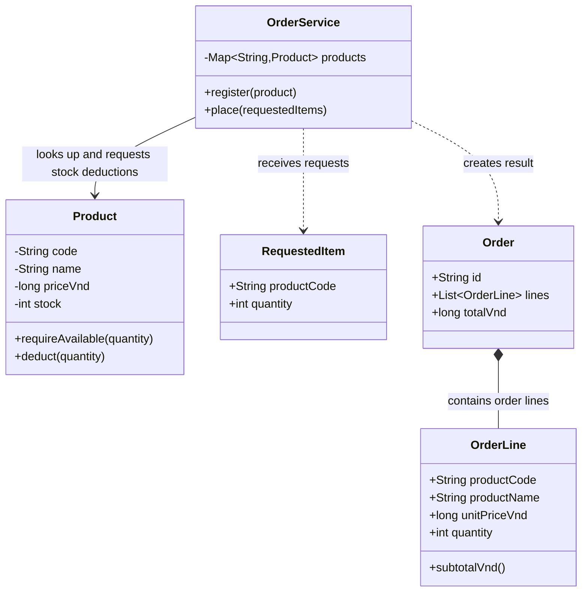
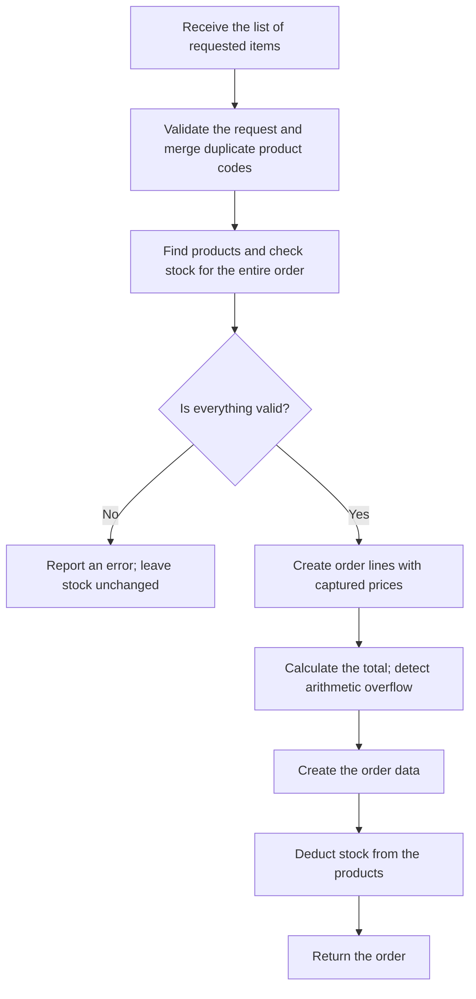
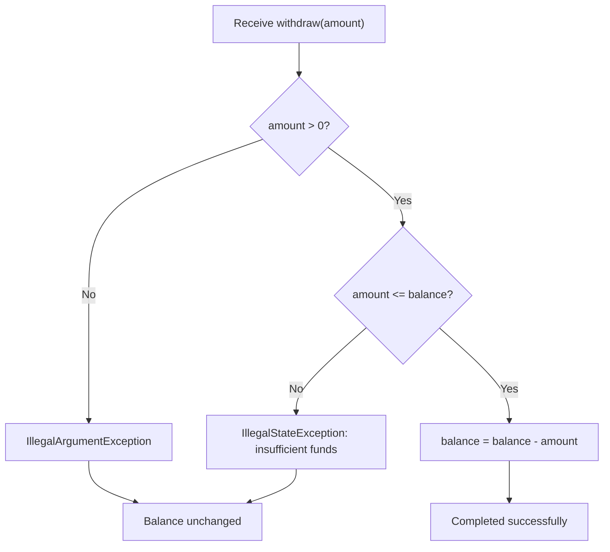
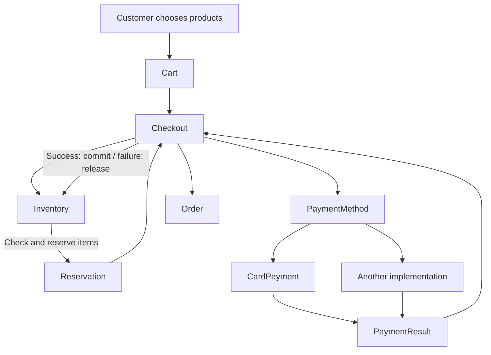
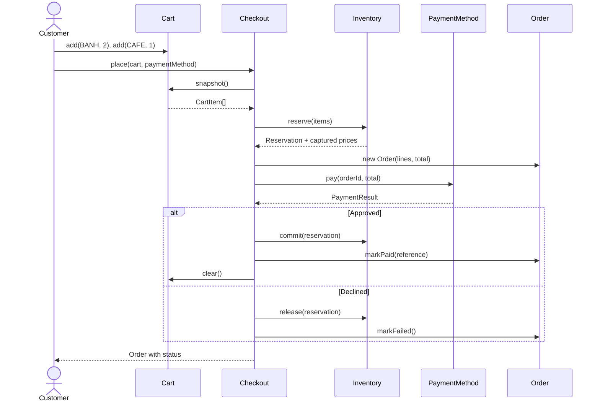
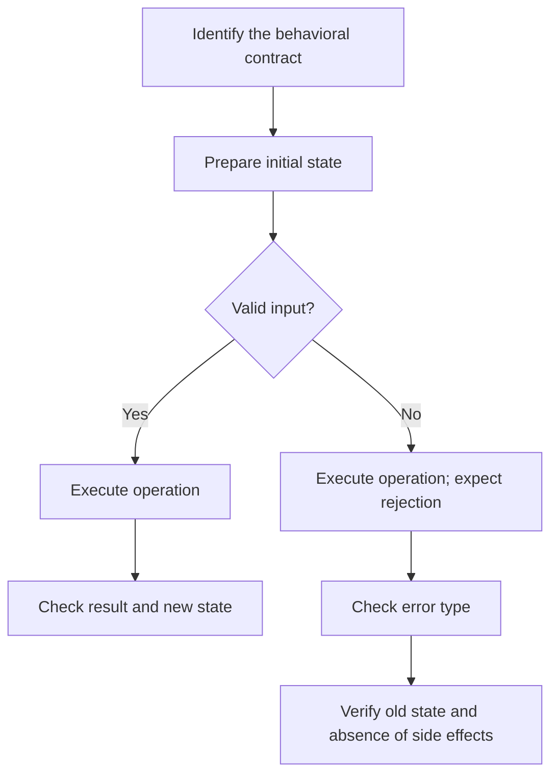
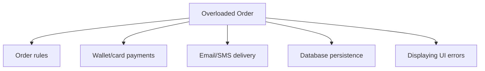
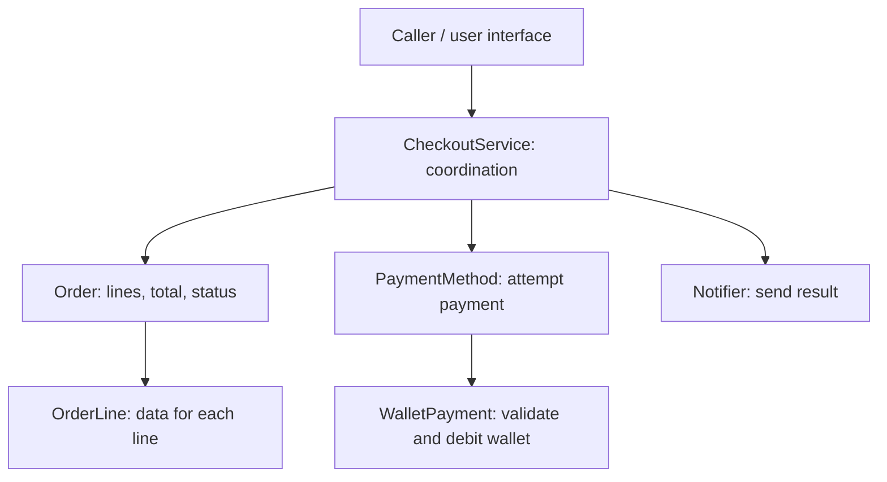

<a id="back-to-top"></a>

# Designing a Complete OOP Program Yourself

## Menu
- [7.1 From Business Requirements to Objects and Responsibilities](#oop-7-1)
- [7.2 Designing Account: Withdrawals, Error Validation, and Valid State](#oop-7-2)
- [7.3 Designing Checkout: Collaboration Between Order, Cart, Inventory, and PaymentMethod](#oop-7-3)
- [7.4 Writing Tests for Behavior and Failure Scenarios](#oop-7-4)
- [7.5 Recognizing Weak OOP Designs: Overloaded Classes, Misused Inheritance, and Excessive Getters/Setters](#oop-7-5)

## <a id="oop-7-1">7.1 From Business Requirements to Objects and Responsibilities</a>

<details>
<summary>Click for details</summary>

### 1. Start with the problem, not with classes

Suppose you are asked to build a small feature for a **takeaway bakery**. The owner describes the requirement as follows:

> "Customers choose the types and quantities of baked goods they want. Every product has a price and a remaining quantity in stock. If all items are available, the system creates an order, calculates the total, and deducts stock. If even one item is unavailable, the system rejects the order without deducting any item."

Someone who has just started learning OOP might immediately create `Customer`, `Bakery`, `Product`, `Cart`, `Order`, `Inventory`, and `Payment` classes simply because those nouns appear in the description.

But designing objects **does not mean turning every noun into a class**. First, determine:

1. **What must the system actually do?**
2. **Which data must be retained, and who is allowed to change it?**
3. **Which business rules must always hold?**
4. **Which objects must collaborate to fulfill a request?**

This example does not yet require payments, customer accounts, email, or database persistence. For now, it only requires **placing orders and updating stock quantities in a simple program**.

Once the scope is clear, we can choose a set of objects that is small enough to understand and clear enough to extend.

### 2. Turn the business description into testable requirements

Reread the bakery owner's description and identify the operations it requires.

| Business statement | Concrete interpretation |
|---|---|
| "Customers select products and quantities" | A request contains one or more lines, each with a product code and quantity |
| "Every product has a price" | Every product has a unit price, expressed in VND |
| "Every product has stock remaining" | We must know the product's current stock |
| "If all items are available" | Check every order line before accepting the order |
| "Create an order and calculate the total" | The order contains order lines, and the total is calculated from quantity × unit price |
| "Deduct stock" | Reduce remaining quantities only after the order is valid |
| "If any item is insufficient, reject the order without deducting anything" | A failed request must not partially update inventory |

These requirements imply **invariants** that the program needs to protect:

- The requested purchase quantity must be greater than zero.
- Prices and stock quantities must not be negative.
- Stock must never be deducted beyond the available quantity.
- The order total must equal the sum of its line subtotals, without silently overflowing integer arithmetic.
- If an order is rejected due to invalid input or insufficient stock, inventory must remain unchanged.

There is an important detail: a customer may select the **same product twice** in one request, such as "2 loaves of bread" and "4 loaves of bread." Inventory validation must check the **combined quantity of 6 loaves**. If each line is checked separately against a stock of 5, both lines might pass even though the complete order cannot be fulfilled.

Spotting cases like this **before writing classes** makes the objects' responsibilities much more precise.

### 3. From nouns to candidate objects

The story mentions several nouns: customer, bread, product, order, price, inventory, quantity, shop, and order request.

Consider whether each concept actually requires a separate object.

| Concept | Create a separate class now? | Reason |
|---|---|---|
| **Product** | Yes: `Product` | It has a code, name, price, stock, and rules for stock deductions |
| **Requested item** | Yes: `RequestedItem` | It groups the product code and the customer's requested quantity |
| **Confirmed order line** | Yes: `OrderLine` | It captures the product information, unit price, and quantity at order time |
| **Order** | Yes: `Order` | It represents the result of a successfully placed order |
| **Order placement process** | Yes: `OrderService` | It coordinates product lookup, whole-order validation, pricing, and stock updates |
| **Money** | No `Money` class yet | The example only uses whole-number VND amounts and has no currency conversion |
| **Customer** | No `Customer` yet | There is no requirement for customer identity, address, or purchase history |
| **Shopping cart** | No `Cart` yet | Customers submit orders directly; no saved/editable cart is required |
| **Payment** | No `Payment` yet | The problem does not require charging or reconciling payments |
| **Database** | No repository yet | The demo runs entirely in memory; durable storage is not required |

We therefore choose **five data types/classes** that serve the current feature.

More important than the number of classes is that **every class has a reason to exist and a responsibility that you can express in a sentence**.

For example, `Product` does not exist merely because "product" is a noun. Its purpose is specific: the system needs an object that **manages a product's stock and ensures deductions never exceed the available quantity**.

Likewise, `OrderService` is not just a bucket for miscellaneous utility methods. It is responsible for coordinating the **placement of a complete order**, which involves multiple products and does not belong to any single product.

### 4. Assign responsibilities: who knows, who acts, and what should they not do?

This is the most important step when turning requirements into an OOP design.

An object typically has:

- **State:** information it holds.
- **Behavior:** actions it can perform.
- **Responsibility:** rules or outcomes it must guarantee.

Let's build a responsibility table:

| Object | What does it know? | What does it do? | What should it not need to know? |
|---|---|---|---|
| `Product` | Code, name, selling price, stock | Checks availability and performs valid stock deductions | How many product types the entire order contains |
| `RequestedItem` | Selected product code, requested quantity | Carries a request that has passed basic validation | Current selling price or inventory |
| `OrderLine` | Confirmed code, name, unit price, quantity | Calculates its own subtotal | How much stock remains |
| `Order` | Order ID, lines, total | Preserves the successfully created order result | How to find products or update inventory |
| `OrderService` | Registered products | Coordinates ordering: merges duplicate lines, validates, calculates, deducts stock, and creates an order | Reimplementing each product's own deduction rules |

Notice one decision: **the unit price is saved in `OrderLine` when the order is placed**.

Why not let the order line reference `Product` and always read the current price? If bread costs VND 18,000 today and rises to VND 20,000 tomorrow, today's order **should not change its total automatically** tomorrow. Therefore, `OrderLine` stores a **snapshot of the sales information that matters** at order time.

This illustrates the distinction between an **entity that continues to change** (`Product`, with mutable stock) and **recorded transaction values** (`OrderLine`, which holds the agreed unit price).

### 5. Relationships between the objects

Before writing code, describe the relationships at a level that makes it clear who calls whom.



You do not need to understand every UML symbol yet. Read the diagram this way:

- `OrderService` **uses** `Product` objects to process an order.
- `OrderService` **receives** `RequestedItem` objects from the caller.
- On success, it **creates** an `Order` containing `OrderLine` objects.
- Each `OrderLine` preserves confirmed information without directly changing stock.

There is **no inheritance relationship** here. Not every OOP problem requires `extends`, `abstract`, or `interface`. Objects can work together effectively by **containing data and invoking one another's behaviors**.

### 6. Design the order placement flow before writing Java

We need to establish the processing order. If we choose the wrong sequence, the program might deduct stock for the first item and only then discover that the second item is sold out.

For a sequential, in-memory implementation, a sensible flow is:



There are three important decisions hidden in this flow.

**First, validate the entire request before changing anything.** If one line cannot be fulfilled, the order fails before stock is reduced.

**Second, merge quantities when a product appears more than once.** Checking individual lines in isolation is not enough to determine whether the whole order is available.

**Third, do not calculate the total after deducting stock.** Price calculations can fail, for example due to integer overflow. We want to catch that failure before updating product state.

However, this flow protects only the **sequential, in-memory scenario**. If multiple customers order concurrently or several servers modify inventory, we also need appropriate transactions and concurrency controls. The current demo does not solve those infrastructure problems.

### 7. Complete Java example: turn the design into collaborating objects

The following is a **single-file `Main.java`** program using Java 17 or later. It simulates orders without a database or real payment processing.

```java
import java.util.ArrayList;
import java.util.LinkedHashMap;
import java.util.List;
import java.util.Map;
import java.util.Objects;

public class Main {
    public static void main(String[] args) {
        Product bread = new Product("BANH", "Bread", 18_000, 5);
        Product coffee = new Product("CAFE", "Coffee", 25_000, 10);

        OrderService service = new OrderService();
        service.register(bread);
        service.register(coffee);

        Order order = service.place(List.of(
                new RequestedItem("BANH", 2),
                new RequestedItem("CAFE", 1)
        ));

        System.out.println("Order: " + order.id());
        System.out.println("Total: " + order.totalVnd());
        System.out.println("Bread remaining: " + bread.stock());
        System.out.println("Coffee remaining: " + coffee.stock());

        try {
            service.place(List.of(
                    new RequestedItem("BANH", 4),
                    new RequestedItem("CAFE", 2)
            ));
        } catch (IllegalStateException e) {
            System.out.println("Rejected: " + e.getMessage());
        }

        System.out.println("Bread after failure: " + bread.stock());
        System.out.println("Coffee after failure: " + coffee.stock());
    }
}

// An object that owns the state and stock rules of one product.
final class Product {
    private final String code;
    private final String name;
    private final long priceVnd;
    private int stock;

    Product(String code, String name, long priceVnd, int stock) {
        if (code == null || code.isBlank()
                || name == null || name.isBlank()
                || priceVnd < 0 || stock < 0) {
            throw new IllegalArgumentException("Invalid product");
        }
        this.code = code;
        this.name = name;
        this.priceVnd = priceVnd;
        this.stock = stock;
    }

    String code() {
        return code;
    }

    String name() {
        return name;
    }

    long priceVnd() {
        return priceVnd;
    }

    int stock() {
        return stock;
    }

    void requireAvailable(int quantity) {
        if (quantity <= 0) {
            throw new IllegalArgumentException("Quantity must be positive");
        }
        if (quantity > stock) {
            throw new IllegalStateException(
                    "Insufficient stock for " + code);
        }
    }

    void deduct(int quantity) {
        requireAvailable(quantity);
        stock -= quantity;
    }
}

// A customer-requested line, not yet associated with a price or stock.
record RequestedItem(String productCode, int quantity) {
    RequestedItem {
        if (productCode == null || productCode.isBlank()
                || quantity <= 0) {
            throw new IllegalArgumentException(
                    "Invalid requested item");
        }
    }
}

// Captured information for one confirmed order line.
record OrderLine(
        String productCode,
        String productName,
        long unitPriceVnd,
        int quantity) {

    long subtotalVnd() {
        return Math.multiplyExact(unitPriceVnd, quantity);
    }
}

// The result of a successfully created order.
record Order(String id, List<OrderLine> lines, long totalVnd) {
    Order {
        lines = List.copyOf(lines);
    }
}

// Coordinates an order request that includes multiple product types.
final class OrderService {
    private final Map<String, Product> products =
            new LinkedHashMap<>();
    private long nextOrderNumber = 1;

    void register(Product product) {
        Objects.requireNonNull(product, "product");
        if (products.putIfAbsent(product.code(), product) != null) {
            throw new IllegalArgumentException("Duplicate product code");
        }
    }

    Order place(List<RequestedItem> requests) {
        if (requests == null || requests.isEmpty()) {
            throw new IllegalArgumentException("Empty order");
        }

        // Step 1: merge lines with the same code to validate stock correctly.
        Map<String, Integer> quantities = new LinkedHashMap<>();
        for (RequestedItem item : requests) {
            Objects.requireNonNull(item, "Null requested item");
            quantities.merge(
                    item.productCode(),
                    item.quantity(),
                    Math::addExact
            );
        }

        // Step 2: validate everything and calculate BEFORE deducting stock.
        List<OrderLine> lines = new ArrayList<>();
        long total = 0;

        for (Map.Entry<String, Integer> entry
                : quantities.entrySet()) {

            Product product = products.get(entry.getKey());
            if (product == null) {
                throw new IllegalArgumentException(
                        "Product not found: " + entry.getKey());
            }

            product.requireAvailable(entry.getValue());

            OrderLine line = new OrderLine(
                    product.code(),
                    product.name(),
                    product.priceVnd(),
                    entry.getValue()
            );

            total = Math.addExact(total, line.subtotalVnd());
            lines.add(line);
        }

        // Create order data before updating inventory state.
        Order order = new Order(
                "ORDER-" + nextOrderNumber, lines, total);

        // Step 3: only now, after full validation, deduct each product.
        for (Map.Entry<String, Integer> entry
                : quantities.entrySet()) {
            products.get(entry.getKey()).deduct(entry.getValue());
        }

        nextOrderNumber++;
        return order;
    }
}
```

The code contains the five main data types from our design. It also illustrates a Java distinction:

- `Product` and `OrderService` are **classes with state and behavior**. `Product.stock` changes whenever an order is accepted.
- `RequestedItem`, `OrderLine`, and `Order` are **records**, a convenient way to express data passed between processing stages. A record is still a kind of class in Java. It can have constructors and methods, perform validation, and do more than merely list fields.

`Order` uses `List.copyOf(lines)` to keep a list that cannot be modified through the returned reference. Because `OrderLine` consists of values that do not change in this example, external code cannot alter captured prices by replacing elements of that list.

**Conditions under which the demo runs:** operations execute sequentially in one JVM, and stock changes only through the service and the objects used here. Correct transactions under concurrent requests in multiple threads or processes are an additional requirement of real systems.

### 8. Follow the output to understand object collaboration

Initial data:

| Product | Code | Price | Stock |
|---|---|---:|---:|
| Bread | `BANH` | 18,000 VND | 5 |
| Coffee | `CAFE` | 25,000 VND | 10 |

The customer requests:

```java
List.of(
    new RequestedItem("BANH", 2),
    new RequestedItem("CAFE", 1)
)
```

The process unfolds as follows:

1. `OrderService` receives a request with two lines.
2. It finds the corresponding `Product` objects among the registered products.
3. It asks each `Product` to verify the quantity using `requireAvailable(...)`.
4. It creates `OrderLine` objects from the validated prices and quantities.
5. It calculates the total: `2 × 18,000 + 1 × 25,000 = 61,000` VND.
6. After every condition passes, it asks both `Product` objects to reduce stock.
7. It returns an `Order` with ID `ORDER-1`.

Printed output:

```text
Order: ORDER-1
Total: 61000
Bread remaining: 3
Coffee remaining: 9
Rejected: Insufficient stock for BANH
Bread after failure: 3
Coffee after failure: 9
```

The second order requests **4 loaves of bread** when only **3** remain, so `Product` rejects it. `OrderService` has not started the stock deduction step, so coffee remains at 9 even though the customer requested two additional cups.

This is concrete evidence of the business rule "**if one item is insufficient, deduct nothing**" in the context of this demo.

Someone new to OOP might notice that `OrderService` still uses loops and coordinates quite a few steps. That is completely normal: it **owns the process spanning multiple objects**, while the stock rules of each individual product still belong to `Product`.

### 9. Why does Product deduct its own stock while OrderService validates the entire order?

Both deal with inventory, but their **responsibilities operate at different levels**.

`Product` is responsible for: "I will not let **my own** stock quantity fall below zero."

`OrderService` is responsible for: "An order with multiple products is accepted only when **every** product satisfies the requirements."

If `OrderService` directly modified:

```java
// This is not the design being used.
product.stock -= quantity;
```

then other users of the product might bypass checks and corrupt its state. That is why `Product.stock` is `private`, and its `deduct(...)` method protects the rule.

But if every `Product` had to know about the entire order, it would need to manage other products, calculate the order total, and enforce rules between products. That would expand the responsibility of one product unreasonably.

We can express the division in two sentences:

> An **object that owns state** protects rules belonging to that state.

> A **coordinating object** ensures a request involving several objects follows the correct sequence and shared conditions.

These responsibilities **complement each other**; they are not pointless duplication.

### 10. When should you introduce more objects, and when should the design remain small?

A good OOP design can evolve as requirements change while keeping the processing path understandable.

If the bakery owner requests **payment processing**, that is when we ask who should initiate and confirm a transaction. We might need `PaymentMethod`, `PaymentService`, or `PaymentResult`. Without that requirement, adding classes solely to demonstrate the "four OOP pillars" serves no purpose.

If the owner requests **multiple branches with independent stock**, keeping `stock` in `Product` may no longer fit. Product identity and price are one concern; stock at each branch is another. We might separate them:

```text
Product
 ├─ code
 ├─ name
 └─ price

InventoryItem
 ├─ productCode
 ├─ branchId
 └─ availableQuantity
```

If the owner wants **order history to survive application restarts**, an in-memory `Map` is insufficient. Now we need persistence, perhaps with an `OrderRepository` for storing and finding orders.

If the owner wants **two customers to order simultaneously**, a check-then-deduct operation in memory is not safe under parallel execution. With a database, appropriate transactions and inventory consistency controls are needed, such as conditional updates or locking. Simply adding more classes does not prevent overselling.

These situations show that **the object list is not an immutable diagram drawn once for the entire project**. We adjust it to the real rules and responsibilities as they emerge.

### 11. Common mistakes when turning requirements into objects

| Approach | Why it causes problems | A better question or approach |
|---|---|---|
| Create a class for every noun in the requirement | Many classes have no clear behavior or responsibility | Ask **which rule each class must uphold** |
| Put all processing into one enormous `Main` or `OrderService` | State rules become scattered, and one change affects many places | Let `Product` protect its stock while `OrderService` coordinates |
| Make all fields `public` | Any part of the program can violate a rule | Expose only the behaviors callers need |
| Make `Order` always reference a product's latest mutable price | Old orders may change their totals unexpectedly | Capture the agreed unit price in `OrderLine` |
| Deduct stock immediately after validating each item | A later item may be unavailable after earlier stock was already deducted | Validate the whole order before updating anything |
| Fail to merge duplicate product lines | A product might be oversold across several lines | Sum quantities by product code before validating |
| Use inheritance merely to reuse a few lines of code | The parent–child relationship has no business meaning | Prefer well-defined responsibilities and collaboration; use inheritance when it truly fits |
| Create an interface for every class from day one | Extra indirection appears before any useful substitution exists | Introduce interfaces when a valuable shared contract is needed |

A practical design rule is: **if you cannot explain why an object exists in a clear one-sentence responsibility, reconsider creating it.**

Likewise, if an object repeatedly inspects another object's internals so it can make decisions on that object's behalf, responsibility may have been assigned to the wrong place.

### 12. Turning requirements into objects is an iterative process

When receiving a requirement, you can follow this line of thinking:

```text
BUSINESS REQUIREMENTS
        │
        ▼
Clarify inputs, outputs, and failure cases
        │
        ▼
Identify rules that must always hold
        │
        ▼
Identify data to retain and behaviors to perform
        │
        ▼
Choose objects with real responsibilities
        │
        ▼
Determine who calls whom and who may change state
        │
        ▼
Implement a concrete flow and check its results
        │
        ▼
Adjust the design when something does not fit
```

Do not expect the first diagram to be perfect. In the bakery example, if prices later vary by time of day, we must clarify **whether a price is fixed when an item is selected or when the order is confirmed**. That business answer determines whether pricing belongs in `Product`, a `PricingPolicy`, or another component.

Always start with **rules and responsibilities**, then move to Java keywords such as `class`, `record`, `interface`, `private`, and `extends`.

In the chosen problem, the final object list consists of `Product` for each item, `RequestedItem` for purchase requests, `OrderLine` for captured sales information, `Order` for the resulting order, and `OrderService` for coordinating the process. Together they take a request from "**the customer wants to buy these items**" to "**the order has been created and stock has been reduced according to the rules**."

That is how a business description becomes an object model you can implement and test: **every object exists for a specific responsibility, and the objects collaborate according to the problem's rules**.

</details>

- [Back to top](#back-to-top)

---

## <a id="oop-7-2">7.2 Designing Account: Withdrawals, Error Validation, and Valid State</a>

<details>
<summary>Click for details</summary>

Suppose you are building a banking application. An account has 100 units of money, and its owner wants to withdraw 30. If the transaction is valid, the balance must become 70. If the owner tries to withdraw 120, the balance **must remain 100** instead of becoming -20.

This sounds simple, but it is a classic OOP design problem: **who is allowed to change the balance, where does validation belong, and what happens to the object's state when a request fails?**

We will design an `Account` object that protects its own balance rules rather than allowing every screen or service to calculate and assign balances arbitrarily.

> **Main idea:** `Account` is more than a "data bag" holding `balance`. It is an object **responsible** for valid actions involving its balance. External code requests `withdraw(amount)`; `Account` itself determines whether the withdrawal is allowed.

### 1. Turn business requirements into Account rules

We can express the problem through these scenarios:

| Scenario | Balance before | Request | Result | Balance after |
|---|---:|---:|---|---:|
| Valid withdrawal | 100 | Withdraw 30 | Success | 70 |
| Withdraw the entire balance | 100 | Withdraw 100 | Success | 0 |
| Withdraw more than the balance | 100 | Withdraw 120 | Rejected | 100 |
| Withdraw zero | 100 | Withdraw 0 | Rejected | 100 |
| Withdraw a negative amount | 100 | Withdraw -5 | Rejected | 100 |
| Negative opening balance | Object not yet created | Create account with -10 | Construction rejected | No valid account exists |

**Every row is an independent scenario** starting with a balance of 100. If several calls run consecutively in a program, the next call must use the state actually left by the previous call.

From the table, we derive five rules:

1. At construction time, the opening balance must be **nonnegative**.
2. The withdrawal amount must be **greater than zero**.
3. The withdrawal amount must **not exceed the current balance**.
4. After a successful withdrawal, the new balance equals the old balance minus the withdrawn amount.
5. On a failed withdrawal, **the balance must not change**.

These rules belong to `Account` because this object manages its balance. If every check were moved to a controller or UI, another part of the application could forget it and produce invalid state.

### 2. Invariant: what must always be true?

An object **invariant** is a condition on its state that the object must maintain at valid observation points, such as after successful construction and after a public operation completes.

For this simple account, we choose:

```text
balance >= 0
```

In words: **the Account balance must never be negative**.

Starting with `balance = 100`, withdrawing 30 leaves 70, which is still valid. Directly subtracting 120 would produce -20 and violate the invariant.

Compare two implementations.

**An error-prone approach:**

```java
class Account {
    public long balance = 100;

    // Any external code could do this:
    // account.balance -= 120;  // balance = -20
}
```

**An approach with a protective boundary:**

```java
class Account {
    private long balance;

    void withdraw(long amount) {
        if (amount <= 0) {
            throw new IllegalArgumentException("Withdrawal amount must be positive");
        }
        if (amount > balance) {
            throw new IllegalStateException("Insufficient balance");
        }
        balance -= amount;
    }
}
```

The second version performs validation and updates **inside the same behavior**. External code cannot assign `balance` directly; it asks the account to withdraw money.

Here, `private` restricts direct access. But **`private` alone is not enough**: exposing `setBalance(-20)` would still violate the invariant. We therefore avoid an unrestricted balance setter and expose meaningful business operations instead.

### 3. Decide what data and behavior the object needs

A minimal `Account` might contain:

| Component | Role | Why is it needed? |
|---|---|---|
| `accountId` | Account identifier | Distinguishes accounts in the business domain |
| `balanceInCents` | Current balance in the smallest currency unit | Avoids binary floating-point calculations for the example's money |
| Constructor | Initializes ID and opening balance | Prevents invalid initial state |
| `withdraw(amountInCents)` | Attempts a withdrawal | Validates first, then updates state |
| `getBalanceInCents()` | Exposes the balance for reading | Allows inspection without giving callers arbitrary write access |
| `getAccountId()` | Returns the account ID | Lets other components know which account they are using |

Why use `long` and `balanceInCents` instead of `double balance`?

To stay focused on OOP, the example stores money as **integer counts of the smallest unit**: 10,000 cents represent 100.00 units of currency. Direct decimal comparisons and subtraction with `double` can introduce rounding inaccuracies because many decimal fractions cannot be represented exactly in binary.

In the code below:

- `10_000` represents 100.00.
- `3_000` represents 30.00.
- `7_000` represents 70.00.

**This is still a simulation.** Real financial systems need a more rigorous money-and-currency model, often with integer minor units or `BigDecimal`, explicit rounding and currency rules, numeric limits, and appropriate transactions.

### 4. Complete Java example: Account validates withdrawals and maintains valid state

Save the entire following program in `Main.java`. It runs with ordinary Java; Spring and a database are unnecessary.

```java
public class Main {
    public static void main(String[] args) {
        Account account = new Account("ACC-001", 10_000);

        System.out.println("Account: " + account.getAccountId());

        attemptWithdraw(account, 3_000);  // Withdraw 30.00: valid
        attemptWithdraw(account, 12_000); // Withdraw 120.00: exceeds balance
        attemptWithdraw(account, 0);      // Invalid
        attemptWithdraw(account, -500);   // Invalid
        attemptWithdraw(account, 7_000);  // Withdraw all remaining funds
        attemptWithdraw(account, 1);      // No balance left
    }

    private static void attemptWithdraw(Account account, long amount) {
        long before = account.getBalanceInCents();

        try {
            account.withdraw(amount);
            System.out.println("Withdraw " + amount + ": SUCCESS");
        } catch (IllegalArgumentException | IllegalStateException ex) {
            System.out.println(
                    "Withdraw " + amount + ": FAILED - " + ex.getMessage()
            );
        }

        System.out.println("Balance: " + before + " -> "
                + account.getBalanceInCents());
    }
}

class Account {
    private final String accountId;
    private long balanceInCents;

    public Account(String accountId, long openingBalanceInCents) {
        if (accountId == null || accountId.isBlank()) {
            throw new IllegalArgumentException("Invalid account ID");
        }
        if (openingBalanceInCents < 0) {
            throw new IllegalArgumentException("Opening balance cannot be negative");
        }

        this.accountId = accountId;
        this.balanceInCents = openingBalanceInCents;
    }

    public String getAccountId() {
        return accountId;
    }

    public long getBalanceInCents() {
        return balanceInCents;
    }

    public void withdraw(long amountInCents) {
        if (amountInCents <= 0) {
            throw new IllegalArgumentException(
                    "Withdrawal amount must be positive"
            );
        }

        if (amountInCents > balanceInCents) {
            throw new IllegalStateException("Insufficient balance");
        }

        // Update only after all conditions pass validation.
        balanceInCents -= amountInCents;
    }
}
```

Output:

```text
Account: ACC-001
Withdraw 3000: SUCCESS
Balance: 10000 -> 7000
Withdraw 12000: FAILED - Insufficient balance
Balance: 7000 -> 7000
Withdraw 0: FAILED - Withdrawal amount must be positive
Balance: 7000 -> 7000
Withdraw -500: FAILED - Withdrawal amount must be positive
Balance: 7000 -> 7000
Withdraw 7000: SUCCESS
Balance: 7000 -> 0
Withdraw 1: FAILED - Insufficient balance
Balance: 0 -> 0
```

Notice that **before and after balances are identical on failure**. This is not accidental: it follows directly from validating all conditions before updating state inside `withdraw()`.

#### Analyze a successful withdrawal

With an opening balance of `10_000`, call:

```java
account.withdraw(3_000);
```

`Account` proceeds as follows:

1. Is `3_000 <= 0`? No.
2. Is `3_000 > 10_000`? No.
3. Execute `balanceInCents -= 3_000`.
4. The balance becomes `7_000`.

The caller only requests `withdraw(3_000)`; it does not need to know which field stores the balance. This illustrates **how an OOP behavior protects the data it manages**.

#### Analyze a failed withdrawal

After the successful withdrawal, the balance is `7_000`. Next, call:

```java
account.withdraw(12_000);
```

`Account` proceeds as follows:

1. Is `12_000 <= 0`? No.
2. Is `12_000 > 7_000`? Yes.
3. Throw an exception **before** subtraction.
4. The balance remains `7_000`.

This differs from subtracting the money first and validating afterward:

```java
// INCORRECT example — do not use.
balanceInCents -= amountInCents;

if (balanceInCents < 0) {
    throw new IllegalStateException("Insufficient balance");
}
```

In the incorrect version, an exception **does not automatically undo** the preceding in-memory subtraction. The object may have a negative balance when the caller catches the exception and continues using it.

Therefore, for a simple in-memory withdrawal: **validate every condition first, and only then change state**.

### 5. The flow of a withdrawal request



The diagram shows a crucial boundary: **there is no path from a failure branch to the `balance` update**.

We can write down the mathematical conditions to understand why the invariant holds:

```text
Before the transaction: balance >= 0

Conditions for withdrawal:
  amount > 0
  amount <= balance

After the transaction:
  newBalance = balance - amount

Because amount <= balance, newBalance >= 0.
```

If the conditions do not hold, no subtraction occurs. The object therefore retains its previously valid state.

This provides a simple proof of the `withdraw()` design: **every successful path preserves `balance >= 0`, and rejected paths do not change state**.

### 6. Distinguish invalid input from an operation forbidden by the current state

Our example uses two kinds of exception with different meanings:

| Scenario | Example | Exception | Meaning |
|---|---|---|---|
| Invalid input | `withdraw(0)`, `withdraw(-500)` | `IllegalArgumentException` | The caller supplied an invalid amount |
| Unable to complete because of the current balance | Balance 7,000; withdraw 12,000 | `IllegalStateException` | The amount is positive, but the account state does not permit it |
| Invalid construction | `new Account("A", -100)` | `IllegalArgumentException` | An account with invalid initial state is not created |

**Why doesn't `Account` print the error itself?** Because `Account` should govern account rules, not decide how an error is displayed. A console application can print a message, a REST API can translate the error into an appropriate HTTP response, and a desktop application can display a popup.

The code using `Account` catches exceptions at an appropriate boundary and translates them into user-facing feedback.

In a larger system, a dedicated business exception such as `InsufficientFundsException` or a result type such as `WithdrawalResult` might be more expressive than `IllegalStateException`. The essential point is that **failures must be distinguishable and must not accidentally alter state**.

#### Should we return a boolean instead of throwing an exception?

We could design:

```java
boolean withdrawn = account.tryWithdraw(amount);
```

and return `false` when funds are insufficient. That can make sense when insufficient funds are a frequent, expected outcome. However, a boolean cannot fully explain the failure if we must distinguish a negative amount, a locked account, a transaction limit, and other cases.

No single error-reporting method is right for every system. In this lesson, we use **exceptions** so the two categories of error and each scenario's final state are easy to observe.

### 7. Why doesn't Account expose `setBalance()`?

You might ask: "Why not make the field `private` and generate a getter and setter automatically?"

Consider a setter:

```java
public void setBalanceInCents(long value) {
    this.balanceInCents = value;
}
```

External code could call:

```java
account.setBalanceInCents(-1);
```

That violates the invariant. Even if the setter rejects negative values, external code could still call `setBalanceInCents(999_999_999)` to arbitrarily increase the balance without any business operation.

That is why, when modeling a business object, **encapsulation does not mean merely changing a field from `public` to `private` and generating setters for every field**.

| Design | What intention does the caller express? | Assessment |
|---|---|---|
| `account.balanceInCents -= 3_000` | Directly alters account data | Easy to bypass rules |
| `account.setBalanceInCents(7_000)` | Forces the balance to an arbitrary value | Does not explain why the balance changed |
| `account.withdraw(3_000)` | Requests a withdrawal | The object can validate all withdrawal conditions |

This also illustrates why OOP emphasizes **keeping related data and behavior together in an object**. The object is responsible for valid state throughout its published operations.

### 8. As the application grows, where should validation live?

Suppose three clients use the account: an ATM interface, a mobile app, and an employee-facing API. If each performs its own validation:

```text
ATM      → check the balance, then deduct it directly
Mobile   → check the balance, then deduct it directly
API      → check the balance, then deduct it directly
```

one of them could easily forget a rule. A clearer organization is:

```text
ATM ─────┐
Mobile ──┼──> account.withdraw(amount)
API ─────┘         |
                    +--> Account validates and updates the balance
```

Each client can validate early for a better user experience, such as rejecting negative input in the UI. But **the system must never depend solely on UI validation**.

`Account` still needs to protect itself because many different callers, including unchecked code, can invoke it.

In a database-backed design, we must also enforce necessary conditions at the **persistence and transaction boundaries**, in addition to the domain object's own rules. These are complementary concerns: one protects the consistency of the object model; the other protects durable data and consistency across concurrent operations.

### 9. Limits of the sample Account

This example models a single in-memory `Account`. It makes OOP principles visible, but **it is not sufficient for a production banking system**.

#### Concurrent withdrawals by multiple threads

If two threads both see a balance of 100 and each tries to withdraw 80, each could observe sufficient funds before either updates the balance. In the current code, check-then-subtract is **not guaranteed to be atomic under concurrency**.

Depending on the system, possible solutions include synchronizing access to the object, using database transactions and locks, or applying suitable concurrency controls when several services process the same account.

**Expressing an invariant in code does not automatically guarantee thread safety** when updates can interleave.

#### Databases and multiple services

In real applications, the balance may live in a database, while multiple service instances process transactions. A single Java object in one JVM cannot ensure correctness by itself.

For example, reading the balance from a database and checking it in Java might still allow overdrawing if two transactions update the same row without appropriate coordination. Transaction design, optimistic or pessimistic locking, or conditional updates with checked results may be necessary.

#### More complex business rules

Real accounts may include daily withdrawal limits, locked/open states, fees, currencies, transaction histories, authentication, idempotency, and more.

As we introduce those requirements, we must decide **which responsibilities still belong to `Account` and which should be assigned to other components**. Network calls, UI rendering, and every aspect of transaction processing should not be crammed into `Account` simply because its name matches the business entity.

### 10. Verify the design with observable scenarios

A useful way to review an object is to inspect **input → result → final state**:

| Starting balance | Method call | Does state change? | Expected outcome |
|---|---|---|---|
| 10,000 | `withdraw(3_000)` | Yes | 7,000 |
| 7,000 | `withdraw(12_000)` | No | Still 7,000 |
| 7,000 | `withdraw(0)` | No | Still 7,000 |
| 7,000 | `withdraw(-500)` | No | Still 7,000 |
| 7,000 | `withdraw(7_000)` | Yes | 0 |
| 0 | `withdraw(1)` | No | Still 0 |

Three important ideas emerge from this table:

- **The prior state** determines whether the next operation is permitted.
- **Every failure path** preserves the balance.
- **Every success path** preserves a nonnegative balance.

If a change to `withdraw()` makes one table row incorrect, the state-protection rule has probably been violated.

### Conclusion

An OOP-oriented `Account` design goes beyond declaring fields and getters. We need to identify:

- **State:** the account holds `balanceInCents` and an identifier.
- **Responsibility:** the account protects the valid-balance rule.
- **Behavior:** callers request `withdraw(amount)` instead of directly editing the balance.
- **Validation:** reject amounts that are not positive or exceed the balance.
- **Failure behavior:** leave state unchanged if withdrawal cannot happen.
- **Invariant:** after construction and valid operations, `balanceInCents >= 0`.

**Remember:** When an object owns important data, place rules for changing that data inside the object's meaningful business behaviors. For `Account`, a strong design **validates first, updates only when permitted, and never lets a failed request corrupt state**.

</details>

- [Back to top](#back-to-top)

---

## <a id="oop-7-3">7.3 Designing Checkout: Collaboration Between Order, Cart, Inventory, and PaymentMethod</a>

<details>
<summary>Click for details</summary>

### 1. What does clicking "Place Order" actually require?

Imagine a shop that sells bread and coffee. A customer adds **2 loaves of bread** and **1 coffee** to a cart, then clicks **Checkout**.

To the customer, this looks like a single action. Within the program, several responsibilities must work together:

1. Read the products and quantities the customer selected.
2. Determine the products, unit prices, and total amount.
3. Check that enough stock is available for every product.
4. Reserve the required items so another order cannot consume the same available stock during payment.
5. Request payment through the customer's selected method.
6. On success, finalize the order and keep reserved items out of sellable stock; on failure, return the reserved quantities.
7. Return an **order status** with a clear meaning.

If all this is packed into a long controller method, maintenance becomes difficult: the cart might need to know how to call a bank, payment logic could modify inventory, and code that displays an order might recalculate prices. OOP helps divide **who owns data, who protects rules, and who coordinates the whole workflow**.

This lesson focuses on **`Cart`, `Inventory`, `PaymentMethod`, and `Order`**. A `Checkout` class coordinates them.

We assume a Java 17 demo with in-memory data and sequential operations. Payment is simulated: no real money moves and no bank is contacted.

### 2. Write the rules before creating objects

Class names alone do not define a design. We must know which guarantees the system needs to preserve:

| Situation | Required result |
|---|---|
| Cart contains 2 breads and 1 coffee; all are available | Calculate the correct price and create a `PAID` order when payment succeeds |
| An item does not exist or is out of stock | Reject before requesting payment; do not reduce sellable stock |
| Payment is declined | Order has a failure status; release reserved inventory |
| Payment succeeds | Do not return reserved stock to sellable quantities; clear the cart |
| Customer adds the same product code several times | Combine quantities before validating total demand |
| Product prices change later | Captured unit prices and the total in `Order` do not change automatically |
| Customer requests zero or a negative quantity | Reject the invalid request |

The rule "if one item is unavailable, deduct nothing" means **validate the whole cart** before reserving anything. The rule "release items after payment failure" leads to a **reservation**, a quantity held for a payment attempt.

This is how we design from business requirements: each object exists to protect specific rules.

### 3. What responsibility does each object own?

| Object | Owned data/responsibility | Main behavior | What it should not do |
|---|---|---|---|
| **`Cart`** | Product codes and quantities currently selected by the customer | Add items, provide a snapshot, clear the cart | Deduct stock, call a bank, or decide payment success |
| **`Inventory`** | Products, current prices, and sellable quantities | Check stock, reserve items, commit or release reservations | Decide whether payment is approved |
| **`PaymentMethod`** | The contract for processing payment | Receive order ID and amount; return a payment result | Modify cart and inventory directly |
| **`Order`** | ID, captured order lines, total, and status | Represent transaction outcomes and valid status transitions | Find products or send payment requests |
| **`Checkout`** | Components that must work together | Coordinate the sequence from cart to order | Reimplement inventory rules or each payment provider's internal logic |

We also need some **small data objects**:

- `CartItem`: one product code and quantity in the cart.
- `Product`: product details and price.
- `OrderLine`: captured item name, unit price, and quantity.
- `PaymentResult`: the result of calling a payment method.
- `Reservation`: a batch of reserved items that can be finalized or returned.

Each supporting object has a clear meaning, allowing methods to exchange meaningful data rather than many unrelated arguments.

### 4. See the relationships between the components



The diagram illustrates **roles and directions of collaboration**, not simultaneous calls by all the objects. One checkout uses only **one actual implementation** of `PaymentMethod`.

Four relationships matter:

**`Checkout` uses `Cart`.** It reads the cart; the cart need not know a Checkout exists.

**`Checkout` uses `Inventory`.** Inventory has the final responsibility for sellable quantities; Checkout does not change quantity fields directly.

**`Checkout` depends on `PaymentMethod`.** It knows the `pay(...)` contract; the concrete class supplies the implementation.

**`Checkout` creates `Order`.** The order stores confirmed data independently of subsequent cart changes.

This is **composition and collaboration** among objects. OOP does not always require a complicated inheritance hierarchy.

### 5. Processing order matters as much as class names

Suppose stock contains 5 breads and 10 coffees. The customer orders 2 breads and 1 coffee.



Here, `reserve()` **moves available stock into a held state**. If payment does not succeed, `release()` returns the items. If payment succeeds, `commit()` finalizes the hold: those units remain unavailable to other orders.

Because order outcomes differ, `Checkout.place()` returns an `Order`. The UI examines `order.status()` instead of assuming that the absence of an exception necessarily means payment succeeded.

**Business note:** In an asynchronous bank-transfer integration, "initiating payment" can return `PENDING` rather than `PAID`. That requires a separate confirmation flow and reservation expiration. The demo intentionally models just **immediate approval or decline** to focus on object collaboration.

### 6. Standalone Java: one file with both successful and failed flows

Save the following full code as `Main.java` and run it with **Java 17+**. It is an in-memory demo without payment APIs or database transactions.

```java
import java.util.ArrayList;
import java.util.LinkedHashMap;
import java.util.List;
import java.util.Map;
import java.util.Objects;

public class Main {
    public static void main(String[] args) {
        Inventory inventory = new Inventory();
        inventory.register(new Product("BANH", "Bread", 18_000), 5);
        inventory.register(new Product("CAFE", "Coffee", 25_000), 10);

        Checkout checkout = new Checkout(inventory);
        Cart cart = new Cart();
        cart.add("BANH", 2);
        cart.add("CAFE", 1);

        Order paid = checkout.place(cart, new DemoCardPayment(true));

        System.out.println(paid.id() + " | " + paid.status());
        System.out.println("Total: " + paid.totalVnd());
        System.out.println("BANH available: " + inventory.available("BANH"));
        System.out.println("Items in cart: " + cart.snapshot().size());

        cart.add("BANH", 1);
        Order declined =
                checkout.place(cart, new DemoCardPayment(false));

        System.out.println(declined.id() + " | " + declined.status());
        System.out.println("BANH available: " + inventory.available("BANH"));
        System.out.println("Items in cart: " + cart.snapshot().size());
    }
}

// Information about one catalog product.
record Product(String sku, String name, long unitPriceVnd) {
    Product {
        if (sku == null || sku.isBlank()
                || name == null || name.isBlank()
                || unitPriceVnd < 0) {
            throw new IllegalArgumentException("Invalid Product");
        }
    }
}

// Cart only stores selected product codes and quantities.
record CartItem(String sku, int quantity) {
    CartItem {
        if (sku == null || sku.isBlank() || quantity <= 0) {
            throw new IllegalArgumentException("Invalid CartItem");
        }
    }
}

final class Cart {
    private final Map<String, Integer> quantities =
            new LinkedHashMap<>();

    void add(String sku, int quantity) {
        CartItem item = new CartItem(sku, quantity);
        quantities.merge(
                item.sku(), item.quantity(), Math::addExact);
    }

    List<CartItem> snapshot() {
        List<CartItem> result = new ArrayList<>();
        for (var entry : quantities.entrySet()) {
            result.add(new CartItem(entry.getKey(), entry.getValue()));
        }
        return List.copyOf(result);
    }

    void clear() {
        quantities.clear();
    }
}

// An order line captures name, price, and quantity at purchase time.
record OrderLine(
        String sku, String productName,
        long unitPriceVnd, int quantity) {

    long subtotalVnd() {
        return Math.multiplyExact(unitPriceVnd, quantity);
    }
}

enum OrderStatus {
    CREATED, PAID, PAYMENT_FAILED
}

// Order maintains its own status independently of the cart.
final class Order {
    private final String id;
    private final List<OrderLine> lines;
    private final long totalVnd;

    private OrderStatus status = OrderStatus.CREATED;
    private String paymentReference;

    Order(String id, List<OrderLine> lines, long totalVnd) {
        this.id = id;
        this.lines = List.copyOf(lines);
        this.totalVnd = totalVnd;
    }

    String id() { return id; }
    long totalVnd() { return totalVnd; }
    List<OrderLine> lines() { return lines; }
    OrderStatus status() { return status; }

    void markPaid(String reference) {
        requireCreated();
        paymentReference = Objects.requireNonNull(reference);
        status = OrderStatus.PAID;
    }

    void markFailed() {
        requireCreated();
        status = OrderStatus.PAYMENT_FAILED;
    }

    private void requireCreated() {
        if (status != OrderStatus.CREATED) {
            throw new IllegalStateException(
                    "Order status cannot be changed again");
        }
    }
}

// A stock reservation that Inventory can commit or release.
final class Reservation {
    private final List<OrderLine> lines;
    private final long totalVnd;
    private boolean active = true;

    Reservation(List<OrderLine> lines, long totalVnd) {
        this.lines = List.copyOf(lines);
        this.totalVnd = totalVnd;
    }

    List<OrderLine> lines() { return lines; }
    long totalVnd() { return totalVnd; }
    boolean active() { return active; }
    void finish() { active = false; }
}

// Inventory owns sellable stock and reservation rules.
final class Inventory {
    private static final class Stock {
        final Product product;
        int available;

        Stock(Product product, int available) {
            this.product = product;
            this.available = available;
        }
    }

    private final Map<String, Stock> stocks =
            new LinkedHashMap<>();

    synchronized void register(Product product, int quantity) {
        Objects.requireNonNull(product);
        if (quantity < 0) {
            throw new IllegalArgumentException("Inventory cannot be negative");
        }
        if (stocks.putIfAbsent(
                product.sku(), new Stock(product, quantity)) != null) {
            throw new IllegalArgumentException("Duplicate product code");
        }
    }

    synchronized int available(String sku) {
        Stock stock = stocks.get(sku);
        if (stock == null) {
            throw new IllegalArgumentException("Unknown SKU: " + sku);
        }
        return stock.available;
    }

    synchronized Reservation reserve(List<CartItem> items) {
        if (items == null || items.isEmpty()) {
            throw new IllegalArgumentException("Empty cart");
        }

        // Validate all items and calculate the total before changing stock.
        List<OrderLine> lines = new ArrayList<>();
        long total = 0;

        for (CartItem item : items) {
            Objects.requireNonNull(item, "Null CartItem");
            Stock stock = stocks.get(item.sku());

            if (stock == null) {
                throw new IllegalArgumentException(
                        "Unknown SKU: " + item.sku());
            }
            if (stock.available < item.quantity()) {
                throw new IllegalStateException(
                        "Insufficient stock: " + item.sku());
            }

            OrderLine line = new OrderLine(
                    stock.product.sku(),
                    stock.product.name(),
                    stock.product.unitPriceVnd(),
                    item.quantity()
            );
            total = Math.addExact(total, line.subtotalVnd());
            lines.add(line);
        }

        Reservation reservation = new Reservation(lines, total);

        for (CartItem item : items) {
            stocks.get(item.sku()).available -= item.quantity();
        }
        return reservation;
    }

    synchronized void commit(Reservation reservation) {
        requireActive(reservation);
        reservation.finish();
        // Reserved items were deducted from available during reserve().
    }

    synchronized void release(Reservation reservation) {
        requireActive(reservation);
        for (OrderLine line : reservation.lines()) {
            stocks.get(line.sku()).available += line.quantity();
        }
        reservation.finish();
    }

    private void requireActive(Reservation reservation) {
        Objects.requireNonNull(reservation);
        if (!reservation.active()) {
            throw new IllegalStateException(
                    "Reservation has already been processed");
        }
    }
}

enum PaymentOutcome { APPROVED, DECLINED }

record PaymentResult(PaymentOutcome outcome, String reference) {
    PaymentResult {
        Objects.requireNonNull(outcome);
        Objects.requireNonNull(reference);
    }
}

interface PaymentMethod {
    PaymentResult pay(String orderId, long amountVnd);
}

// Mock card payment; approved is configured at construction.
final class DemoCardPayment implements PaymentMethod {
    private final boolean approved;

    DemoCardPayment(boolean approved) {
        this.approved = approved;
    }

    @Override
    public PaymentResult pay(String orderId, long amountVnd) {
        if (amountVnd < 0) {
            throw new IllegalArgumentException("Negative amount");
        }
        return approved
                ? new PaymentResult(
                        PaymentOutcome.APPROVED, "CARD-" + orderId)
                : new PaymentResult(
                        PaymentOutcome.DECLINED, "REJECTED-" + orderId);
    }
}

// Coordinator; it does not reimplement inventory or payment rules.
final class Checkout {
    private final Inventory inventory;
    private long nextOrderNumber = 1;

    Checkout(Inventory inventory) {
        this.inventory = Objects.requireNonNull(inventory);
    }

    Order place(Cart cart, PaymentMethod paymentMethod) {
        Objects.requireNonNull(cart);
        Objects.requireNonNull(paymentMethod);

        Reservation reservation = inventory.reserve(cart.snapshot());
        Order order = new Order(
                "ORDER-" + nextOrderNumber++,
                reservation.lines(),
                reservation.totalVnd()
        );

        PaymentResult result;
        try {
            result = Objects.requireNonNull(
                    paymentMethod.pay(order.id(), order.totalVnd()));
        } catch (RuntimeException ex) {
            inventory.release(reservation);
            order.markFailed();
            throw ex;
        }

        if (result.outcome() == PaymentOutcome.APPROVED) {
            inventory.commit(reservation);
            order.markPaid(result.reference());
            cart.clear();
        } else {
            inventory.release(reservation);
            order.markFailed();
        }

        return order;
    }
}
```

Program output:

```text
ORDER-1 | PAID
Total: 61000
BANH available: 3
Items in cart: 0
ORDER-2 | PAYMENT_FAILED
BANH available: 3
Items in cart: 1
```

The first checkout totals `2 × 18,000 + 1 × 25,000 = 61,000` VND. `Inventory` reserves the items, `DemoCardPayment(true)` returns `APPROVED`, and `Checkout` commits the reservation and transitions the order to `PAID`. The cart is cleared after success.

On the second checkout, the customer adds one bread. `DemoCardPayment(false)` returns `DECLINED`; `Checkout` calls `release()`, leaving 3 breads in stock. The cart remains intact so the customer can retry or use another payment method.

### 7. Read code by responsibilities instead of following one long story from top to bottom

The following four points explain this division of objects.

#### Cart only knows what the customer wants to buy

```java
Cart cart = new Cart();
cart.add("BANH", 2);
cart.add("CAFE", 1);

List<CartItem> request = cart.snapshot();
```

The cart does not need to store list prices or payment status. Because prices can change, `Inventory` is where current prices are looked up when preparing an order. `OrderLine` then captures **the agreed transaction price**.

Having `snapshot()` return a new list gives Checkout a defined set of inputs for one run. Nevertheless, the demo `Cart` remains mutable and **is not designed for concurrent modifications by multiple threads**.

#### Inventory protects stock

```java
Reservation reservation = inventory.reserve(cart.snapshot());
```

External code does not directly perform `stock.available -= 2`. Instead, it asks `Inventory` to reserve items. Inside `reserve()`, Inventory validates every line and calculates the whole amount before changing stock.

In the demo, `Cart` has already merged repeated additions of the same SKU, so a given product code appears once in `snapshot()`. If another data source does not provide this guarantee, `Inventory.reserve()` must merge duplicate SKUs before checking them. Never assume every external list has been normalized.

The inventory operations in the example use `synchronized` so validation and updates within one `Inventory` object do not interleave at the method level. This **does not replace database transactions**, synchronization across several servers, or compensation for real payments.

#### PaymentMethod answers payment questions, not inventory questions

```java
interface PaymentMethod {
    PaymentResult pay(String orderId, long amountVnd);
}
```

`Checkout` may use `DemoCardPayment` or any other implementation of `PaymentMethod`. At runtime Java invokes the method belonging to **the concrete payment object**.

For example, we could create a `FakePaymentMethod` that always declines for testing. `Checkout` would not need extra `if ("CARD")` or `if ("WALLET")` branches in its shared workflow.

However, it is the implementation's responsibility to interpret its provider's response correctly. Without verified confirmation of payment, it must not arbitrarily report `APPROVED`.

#### Order retains the transaction result

```java
Order order = new Order(
        "ORDER-1",
        reservation.lines(),
        reservation.totalVnd()
);
```

`Order` contains a snapshot of the confirmed lines and total. It does not read `cart.snapshot()` again to display an already-created order. Later changes to the cart cannot change the captured order information.

`Order.status()` also cannot be assigned arbitrarily by external code. In the example, `markPaid(...)` and `markFailed()` only accept a transition from `CREATED`. That helps the code represent a meaningful part of the order lifecycle.

### 8. Why should Checkout coordinate the workflow?

A common design mistake is assigning too many unrelated tasks to one object.

If `Cart` had `payAndUpdateInventory()`, it would have to know both the payment provider and inventory rules. Every new payment option might force a change to the cart class.

If `PaymentMethod` directly modified stock quantities, it would need product and order details. Switching providers could then affect inventory logic.

If `Order` selected a payment method, looked up stock, and made network calls itself, it would need to know too much beyond its responsibility of recording the order result.

`Checkout` plays the role of an **application service / use-case coordinator**:

```text
Cart tells us what the customer chose
            │
            ▼
Checkout asks Inventory to reserve items
            │
            ▼
Checkout creates Order with captured prices
            │
            ▼
Checkout asks PaymentMethod to process payment
            │
            ▼
Checkout commits or releases stock and updates Order
```

A coordinating method may call many objects. That **does not mean** it has taken over every responsibility. The boundary is sound when each object remains the authority for its own rules.

### 9. Where does an out-of-stock request fail?

Suppose 3 breads remain after the first order and another customer wants 4.

```java
Cart cart = new Cart();
cart.add("BANH", 4);

checkout.place(cart, new DemoCardPayment(true));
```

`Inventory.reserve(...)` detects that the requested quantity is greater than the quantity for sale and throws `IllegalStateException`.

Because the check happens **before creating a reservation and before calling `PaymentMethod`**, no payment attempt occurs. No order is returned; the UI can display an out-of-stock message.

This is different from **sufficient stock followed by declined payment**. In that case, an `Order` is created and returned with status `PAYMENT_FAILED`, while the reserved stock is released. The failures have different business meanings, so the program handles them differently.

In a real web API, the out-of-stock error could become a structured response such as `OUT_OF_STOCK` rather than exposing raw Java exception text to the browser.

### 10. Why use Reservation instead of immediately deducting stock permanently?

If the program simply wrote:

```java
inventory.deduct(items);
PaymentResult result = paymentMethod.pay(...);
```

and payment later failed, stock would already have been reduced; without compensation, the information would be wrong.

Conversely, if we **processed payment first and only then checked inventory**:

```java
PaymentResult result = paymentMethod.pay(...);
inventory.deduct(items);
```

we could collect money before discovering that the item is out of stock.

A reservation expresses an intermediate state: **"I am holding this quantity for a payment attempt; the order has not completed yet."** In the demo, reserving reduces `available`, but a decision remains: commit or release.

| Moment | Sellable stock | Reservation | Order status |
|---|---:|---|---|
| Initially | 5 breads | None | Not created |
| After reserving 2 breads | 3 breads | Active, holding 2 | `CREATED` |
| Payment succeeds | 3 breads | Committed | `PAID` |
| Or payment fails | Back to 5 breads | Released | `PAYMENT_FAILED` |

A reservation enforces a rule of **finishing only once**, because releasing twice would incorrectly increase stock. That is why the demo has an `active` flag and rejects subsequent `commit` or `release` calls.

In production, a reservation should have an identifier, owner, deadline, and durable status. Each step must be designed to support retries and recovery from failures.

### 11. What this example does not guarantee in production

The code deliberately illustrates **division of OOP responsibilities**. It is not a production payment system.

**Consistency across external service calls.** A payment may be approved while the connection drops before the application receives the response. If we merely catch the exception and release stock as in this demo, the system might assume failure even though real money moved. When an outcome is **unknown**, store and reconcile its status instead of claiming that it was declined.

**Database and provider transactions.** Saving an order, reserving stock, and contacting a payment gateway normally cannot occur in a single database transaction. Real systems need idempotency keys, explicit transaction statuses, retries, timeouts, and compensation or reconciliation.

**Asynchronous bank transfers.** If `PaymentMethod` returns `PENDING`, `Checkout` must retain the reservation, persist a `PENDING_PAYMENT` state, and await a verified webhook or confirmation step. On cancellation or expiry it must release items according to business rules. Never interpret `PENDING` as `PAID`.

**Inventory concurrency.** An `Inventory` using `synchronized` protects operations on **one Java instance in one JVM**. Several application instances sharing a database need concurrency-controlled updates, such as transactions with conditional update statements, optimistic locking, or pessimistic locking according to the scenario.

**Order identifiers.** The `nextOrderNumber` counter in `Checkout` exists only for the demo. Multiple threads or servers require a suitable unique ID mechanism. Two requests may also modify one cart simultaneously, requiring a defined checkout snapshot strategy.

These issues matter in production, but they do not change the main idea: **each object needs a clear responsibility and contract, and a use case coordinates those objects in an order that protects business rules**.

### 12. Review your Checkout design

When reviewing a class diagram or similar code, ask concrete questions:

| Review question | Sign of a clear boundary |
|---|---|
| Who determines what quantities the customer wants? | `Cart` |
| Who ensures that reserved quantities never exceed sellable stock? | `Inventory` |
| Who knows how to call the payment provider? | The concrete `PaymentMethod` implementation |
| Who decides when the order becomes `PAID`? | `Checkout`, using a trustworthy payment result and the status behaviors of `Order` |
| Who keeps captured prices and order lines when the cart changes? | `Order` and `OrderLine` |
| Who restores reserved stock after a declined payment? | `Checkout` calls `Inventory.release()` |
| Does changing card payment to another method require changing `Cart`/`Inventory`? | No, provided the new implementation satisfies the shared contract |
| Can a payment request be sent when there is insufficient stock? | No; inventory validates before payment |

If every answer to "who is responsible?" is "the controller knows everything," or several classes can freely modify one another's state, the OOP boundaries are unclear.

From this example, **`Cart` expresses what the customer intends to buy, `Inventory` manages fulfillment capacity, `PaymentMethod` processes payment, `Order` records the outcome, and `Checkout` coordinates all four**. An OOP learner should understand the interaction sequence: which object receives each request, which object changes state, and which business promise each step protects.

</details>

- [Back to top](#back-to-top)

---

## <a id="oop-7-4">7.4 Writing Tests for Behavior and Failure Scenarios</a>

<details>
<summary>Click for details</summary>

Suppose you have just designed an `Account` class. You have a `withdraw(30)` method and have manually verified that the balance falls from `100` to `70`. But what happens if someone withdraws `120`, withdraws `0`, provides a negative amount, or withdraws the entire balance?

An OOP program with many objects and methods does not automatically become reliable just because it compiles. **Testing** verifies that objects deliver **the behaviors they promise**, including when they receive invalid requests or an operation fails.

In this lesson, we write automated tests using **Java and JUnit 5**. We begin with one simple object, then examine how to test an object that collaborates with others.

### 1. What does testing behavior actually mean?

A method can contain many implementation details: `if` branches, loops, temporary variables, and helper methods. When testing, start with what an object's user **can observe**:

- **Return values:** Does the method return the correct value?
- **State after the operation:** Is the balance, order status, or stock quantity correct?
- **Clear failure reporting:** Does invalid input produce the expected kind of exception?
- **No unintended side effects:** Does failure preserve prior state and avoid incorrect notifications or payments?
- **Collaboration with other objects:** Is the necessary collaborator called on success and not called when the request must be rejected?

For example, the "withdraw money" requirement for `Account` can be stated as a behavioral contract:

| Scenario | Input/starting state | Outcome to verify |
|---|---|---|
| Valid withdrawal | Have `100`, withdraw `30` | Balance becomes `70` |
| Withdraw exactly the balance | Have `100`, withdraw `100` | Balance becomes `0` |
| Withdraw too much | Have `100`, withdraw `120` | Exception; **still `100`** |
| Withdraw a nonpositive amount | Have `100`, withdraw `0` or `-5` | Exception; **still `100`** |
| Construct with a negative balance | Initial balance `-1` | No valid object can be created |

A test that checks an exception but **forgets the state after the failure** may miss a dangerous bug: the method deducted money before throwing the error.

### 2. Prepare the class under test

The example uses a `long` amount in an agreed smallest monetary unit, so we can focus on object design. Real financial applications must define units, precision, and concurrency behavior explicitly.

File `src/main/java/example/oop/Account.java`:

```java
package example.oop;

public final class Account {
    private long balance;

    public Account(long initialBalance) {
        if (initialBalance < 0) {
            throw new IllegalArgumentException(
                    "Opening balance cannot be negative");
        }
        this.balance = initialBalance;
    }

    public long getBalance() {
        return balance;
    }

    public void withdraw(long amount) {
        if (amount <= 0) {
            throw new IllegalArgumentException(
                    "Withdrawal amount must be positive");
        }

        if (amount > balance) {
            throw new IllegalStateException("Insufficient balance");
        }

        balance -= amount;
    }

    public void deposit(long amount) {
        if (amount <= 0) {
            throw new IllegalArgumentException(
                    "Deposit amount must be positive");
        }

        // If long addition overflows, the assignment does not occur.
        balance = Math.addExact(balance, amount);
    }
}
```

The `Account` contract is:

1. After successful construction, `balance >= 0`.
2. A valid withdrawal reduces the balance by exactly the requested amount.
3. A valid deposit increases the balance by exactly the deposited amount.
4. Invalid requests throw an exception **before changing the balance**.
5. Callers read the balance using `getBalance()` and cannot assign `balance` directly.

This connects **encapsulation** with **testing**: the object protects its state, and tests verify that behavior through its public API.

### 3. Write the first unit tests with JUnit 5

A **unit test** checks a small unit of behavior in a program. Here, each test creates its own `Account` object and directly calls its public methods.

File `src/test/java/example/oop/AccountTest.java`:

```java
package example.oop;

import org.junit.jupiter.api.Test;
import org.junit.jupiter.params.ParameterizedTest;
import org.junit.jupiter.params.provider.ValueSource;

import static org.junit.jupiter.api.Assertions.*;

class AccountTest {

    @Test
    void withdrawValidAmount_shouldDecreaseBalance() {
        // Arrange: prepare the object and initial data.
        Account account = new Account(100);

        // Act: execute the behavior under test.
        account.withdraw(30);

        // Assert: compare the actual and expected results.
        assertEquals(70, account.getBalance());
    }

    @Test
    void withdrawEntireBalance_shouldLeaveZero() {
        Account account = new Account(100);

        account.withdraw(100);

        assertEquals(0, account.getBalance());
    }

    @Test
    void withdrawMoreThanBalance_shouldRejectAndKeepBalance() {
        Account account = new Account(100);

        IllegalStateException error = assertThrows(
                IllegalStateException.class,
                () -> account.withdraw(120)
        );

        assertEquals("Insufficient balance", error.getMessage());
        assertEquals(100, account.getBalance());
    }

    @ParameterizedTest
    @ValueSource(longs = {0, -1, -50})
    void withdrawNonPositiveAmount_shouldRejectAndKeepBalance(long amount) {
        Account account = new Account(100);

        assertThrows(
                IllegalArgumentException.class,
                () -> account.withdraw(amount)
        );

        assertEquals(100, account.getBalance());
    }

    @Test
    void negativeInitialBalance_shouldRejectConstruction() {
        assertThrows(
                IllegalArgumentException.class,
                () -> new Account(-1)
        );
    }

    @Test
    void depositThenWithdraw_shouldProduceExpectedBalance() {
        Account account = new Account(100);

        account.deposit(50);
        account.withdraw(80);

        assertEquals(70, account.getBalance());
    }

    @Test
    void depositOverflow_shouldRejectAndKeepBalance() {
        Account account = new Account(Long.MAX_VALUE);

        assertThrows(
                ArithmeticException.class,
                () -> account.deposit(1)
        );

        assertEquals(Long.MAX_VALUE, account.getBalance());
    }
}
```

Every test has a clear purpose. For example:

- `withdrawValidAmount_shouldDecreaseBalance` tests the **success path**.
- `withdrawMoreThanBalance_shouldRejectAndKeepBalance` tests a **failure path** with two requirements: an error is thrown and the balance stays unchanged.
- `withdrawNonPositiveAmount_shouldRejectAndKeepBalance` uses `@ParameterizedTest` to check the same contract with multiple inputs.
- `depositOverflow_shouldRejectAndKeepBalance` tests the boundary of `long`. `Math.addExact` detects overflow before the assignment occurs.

#### Arrange – Act – Assert (AAA)

An easy-to-read test structure is:

```text
Arrange  → Create the object, data, and initial conditions
Act      → Invoke the behavior under test
Assert   → Check the result, error, or side effects
```

For a failure test, **Act** often appears inside `assertThrows(...)`. The assertion about state after the failure should still be part of **Assert**.

`assertThrows` succeeds **when the code actually throws the expected exception type or an appropriate subtype**. If no exception is thrown or its type does not match, the test fails.

### 4. Tell a meaningful test from a weak test

Consider this test:

```java
@Test
void weakTest() {
    Account account = new Account(100);

    assertThrows(IllegalStateException.class,
            () -> account.withdraw(120));
}
```

It verifies **error reporting**, but does not guarantee that `Account` still has a balance of `100`. The following incorrect implementation could pass it:

```java
// Intentionally incorrect example: do not use in an application!
void withdraw(long amount) {
    balance -= amount;  // balance could become -20
    if (balance < 0) {
        throw new IllegalStateException("Insufficient balance");
    }
}
```

Calling `withdraw(120)` with a starting balance of `100` still throws `IllegalStateException`; the weak test would **PASS** even though `balance >= 0` had been violated.

A better test therefore verifies the **complete promised behavior**, particularly after failure:

```java
@Test
void rejectedWithdrawalMustNotChangeState() {
    Account account = new Account(100);

    assertThrows(IllegalStateException.class,
            () -> account.withdraw(120));

    assertEquals(100, account.getBalance());
}
```

Another sign of a weak test is asserting irrelevant implementation details, such as "helper A must be called twice," when the user of the object does not care. Such tests break easily when implementation details are refactored even though **external behavior remains correct**.

### 5. Choose test cases at behavioral boundaries

With a balance of `100`, interesting withdrawal amounts are not limited to `30` or `50`:

```text
Withdrawal amount         Outcome
-1                        Reject: nonpositive
 0                        Reject: nonpositive
 1                        Accept: remaining 99
99                        Accept: remaining 1
100                       Accept: remaining 0
101                       Reject: exceeds balance; keep 100
```

The pairs `0`/`1` and `100`/`101` lie on either side of a **decision boundary**. This makes **boundary-value testing** particularly effective: it checks where the business rule changes from "allowed" to "rejected."

The same reasoning applies to other objects:

| Object | Successful case | Boundary/failure to test |
|---|---|---|
| `Inventory` | Deduct within available stock | Sold out, negative quantity, request exceeding stock |
| `Order` | Transition from `NEW` to `PAID` | Try to pay after `CANCELLED`, repeated payment |
| `Booking` | Reserve an available seat | Insufficient seats, invalid booking time |
| `UserAccount` | Change password with valid input | Wrong old password, unacceptable new password |
| `Account` | Withdraw within balance | Overdraw, nonpositive amount, deposit overflow |

Each row reflects a **business contract** to clarify before implementation. You do not need to test every possible value; choose distinct behavioral cases and important boundaries.

### 6. Testing when objects collaborate

In a complete OOP application, one object often calls another. Suppose `RegistrationService` sends a notification after accepting a registration. We want to guarantee that invalid input **never sends a notification**.

Define a contract for the notification component:

```java
interface Notifier {
    void sendWelcome(String username);
}

final class RegistrationService {
    private final Notifier notifier;

    RegistrationService(Notifier notifier) {
        this.notifier = java.util.Objects.requireNonNull(notifier);
    }

    void register(String username) {
        if (username == null || username.isBlank()) {
            throw new IllegalArgumentException("Username is blank");
        }

        notifier.sendWelcome(username);
    }
}
```

The test does not need to send real email or SMS. We use a **simple fake** to record calls:

```java
import org.junit.jupiter.api.Test;

import static org.junit.jupiter.api.Assertions.*;

class RegistrationServiceTest {

    static final class RecordingNotifier implements Notifier {
        int sendCount = 0;
        String lastUsername;

        @Override
        public void sendWelcome(String username) {
            sendCount++;
            lastUsername = username;
        }
    }

    @Test
    void validUsername_shouldSendOneWelcomeMessage() {
        RecordingNotifier notifier = new RecordingNotifier();
        RegistrationService service = new RegistrationService(notifier);

        service.register("alice");

        assertEquals(1, notifier.sendCount);
        assertEquals("alice", notifier.lastUsername);
    }

    @Test
    void blankUsername_shouldRejectWithoutSendingMessage() {
        RecordingNotifier notifier = new RecordingNotifier();
        RegistrationService service = new RegistrationService(notifier);

        assertThrows(IllegalArgumentException.class,
                () -> service.register("   "));

        assertEquals(0, notifier.sendCount);
    }
}
```

If you add this example to the same project as `Account`, define `Notifier` and `RegistrationService` as top-level types in the `example.oop` package, and add `package example.oop;` to the file containing `RegistrationServiceTest`. The two production types can live in one `RegistrationService.java` file with package-private access as shown.

#### Why use a fake?

`RegistrationService` depends on the **`Notifier` contract**, so the test supplies an implementation that records calls. It can verify important behaviors: valid registration sends exactly one welcome message; invalid registration **sends nothing**.

Larger projects may use a mocking framework such as Mockito. When learning OOP, though, writing a small fake often makes **dependency injection, interfaces, and object collaboration** easier to understand without complicated tooling.

### 7. How do unit tests differ from integration tests?

Suppose a real `Account` is persisted through JPA and a service performs withdrawals:

- A **unit test** checks the `Account` rules using an in-memory object. It runs quickly and helps isolate logic errors.
- An **integration test** checks actual collaboration among the service, repository, database, transactions, and any necessary adapters.
- An **end-to-end test** follows a journey from the system input to an externally observable result, such as invoking the withdrawal API and reading the new balance.

| Question to verify | Suitable test |
|---|---|
| Does `withdraw(120)` fail while keeping the balance unchanged? | Unit test |
| Can the repository correctly write and read back the balance? | Integration test |
| Do two simultaneous withdrawals avoid overdrawing? | Integration/concurrency test using actual transaction/locking mechanisms |
| Does the API return the correct status and error for insufficient funds? | API/integration test |
| Does the transaction work from UI through database? | End-to-end test |

The unit tests above **do not prove concurrency safety**. Two requests could read the same balance before either writes if the system does not protect the read–check–update operation. Test transaction handling and locking at the corresponding deployment layers.

Nor should every check become an end-to-end test: those tests are typically slower, harder to diagnose, and more expensive to set up than unit tests.

### 8. Running tests in a Gradle project

For a basic Java Gradle project, you can use the following Groovy DSL in `build.gradle` (this example uses JUnit Jupiter 5.11.4):

```groovy
plugins {
    id 'java'
}

repositories {
    mavenCentral()
}

dependencies {
    testImplementation 'org.junit.jupiter:junit-jupiter:5.11.4'
    testRuntimeOnly 'org.junit.platform:junit-platform-launcher'
}

test {
    useJUnitPlatform()
}
```

The corresponding file structure:

```text
src/
├── main/
│   └── java/example/oop/Account.java
└── test/
    └── java/example/oop/AccountTest.java
```

Run the tests:

```bash
./gradlew test
```

On Windows PowerShell, run:

```powershell
.\gradlew.bat test
```

When a test fails, read the test name, failed assertion, and **expected/actual** values. Gradle normally produces an HTML report at `build/reports/tests/test/index.html`. In IntelliJ IDEA, you can also run a test class or individual test method through the Run icon beside it.

If your application already has Spring Boot and working JUnit configuration, use its existing test dependencies and tooling rather than adding redundant libraries.

### 9. A practical test workflow for each OOP behavior

When introducing a new behavior, ask these questions in order:

1. **What behavior is promised?** Write a testable statement: "Withdrawing more than the balance must report an error without changing the balance."
2. **What does success look like?** Choose valid input and the expected result.
3. **What does failure look like?** Choose rejected input and define the promised exception, return value, or error status.
4. **What must the object preserve on failure?** Check unchanged state and the absence of incorrect side effects.
5. **Are any boundaries important?** Test just below, at, and just above the threshold.
6. **When another object is involved, which calls must or must not happen?** Use a fake or integration test as needed.
7. **Intentionally break one condition, then rerun the tests.** If removing the check `amount > balance` still leaves all tests green, the tests are missing a critical assertion.

A simple thought process for designing behavioral tests:



Good tests do not have to know every detail inside an object. They need sufficient evidence that **the caller receives the promised behavior**, even if you later refactor `Account`, switch notification mechanisms, or introduce new types of objects.

**Practice exercise:** Add a method `transferTo(Account target, long amount)`. Before coding, write tests for a successful transfer, insufficient funds, a nonpositive amount, a transfer to the same account, and an invalid target account. In particular, decide **what must happen to both balances if the transfer fails**. This moves the exercise from testing one object to verifying correctness across collaborating objects.

</details>

- [Back to top](#back-to-top)

---

## <a id="oop-7-5">7.5 Recognizing Weak OOP Designs: Overloaded Classes, Misused Inheritance, and Excessive Getters/Setters</a>

<details>
<summary>Click for details</summary>

A program is not necessarily well designed just because it contains many `class` declarations, makes every field `private`, and uses `extends`. **Design quality depends on whether each object has an appropriate responsibility, whether objects collaborate correctly, and whether important state is protected from arbitrary changes.**

Three common warning signs are:

1. **One class does too much:** it calculates prices, processes payments, sends emails, accesses databases, and decides every rule.
2. **Inheritance is misused:** a class `extends` another merely to reuse a few lines, without a meaningful *is-a* relationship.
3. **Getters and setters are generated indiscriminately:** fields are `private`, yet almost any caller can change important state through `set...()`, bypassing business rules.

We will recognize each issue through the same example: **an ordering application**, then compare a difficult-to-maintain design with one whose responsibilities are clearer.

> **A principle for spotting problems:** Do not ask only, "Does this code run?" Also ask: **"When requirements change or data becomes invalid, who is responsible? How many places must I modify? Does the object protect its own rules?"**

### 1. An example: Order does far too much

Suppose the application starts very small: a customer chooses products and pays. Its developer creates an `Order` class that does almost everything:

```java
class EmailSender {
    void sendEmail(String message) {
        System.out.println("EMAIL: " + message);
    }
}

// PROBLEMATIC example, not a model to follow.
class Order extends EmailSender {
    private int total;
    private String status = "NEW";

    int getTotal() {
        return total;
    }

    void setTotal(int total) {
        this.total = total;  // Could assign -100 or one million arbitrarily
    }

    String getStatus() {
        return status;
    }

    void setStatus(String status) {
        this.status = status; // Could assign PAID before payment
    }

    void checkout(String paymentType) {
        if ("WALLET".equals(paymentType)) {
            System.out.println("Simulating wallet charge");
        } else if ("CARD".equals(paymentType)) {
            System.out.println("Simulating card payment");
        }

        status = "PAID";       // Does not depend on payment outcome
        sendEmail("Order paid");
    }
}
```

This intentionally demonstrates a weak design, not real payment processing. Three warning signs are immediately visible:

| Warning sign in the code | Underlying problem | Consequence |
|---|---|---|
| `Order.checkout()` chooses a payment type and sends email | `Order` owns independent responsibilities | Changing email delivery also requires reviewing order code |
| `Order extends EmailSender` | An order is not a kind of email sender | Incorrect type relationship exists solely to reuse `sendEmail()` |
| Public `setTotal(...)` and `setStatus(...)` | Outside code can bypass order rules | An order might be `PAID` before payment |
| Always setting `PAID` regardless of payment | No verification of business outcome | Status no longer reflects reality |
| `paymentType` string with branches | Order processing knows concrete implementation details | Adding a payment option may require changes to `Order` |

**The alarming part is that the program can still run and print "Order paid."** Design defects do not always appear as compiler errors. Many emerge only as the business grows, new features arrive, or failures occur.

### 2. First warning sign: one class does too much

A class becomes suspicious when it must **change for several different reasons that are not closely related to its main responsibility**.

For `Order`, consider:

- Change how the order total is calculated → modify `Order`: reasonable, because the total belongs to the order.
- Switch notifications from email to SMS → still modify `Order`: suspicious, because the delivery channel is not intrinsic to an order.
- Add bank transfer payments → modify `Order` again: suspicious if a specialized payment component should handle this.
- Change the database connection strategy → modify `Order` as well: reconsider the boundary between the domain model and persistence.

This is commonly called a **God Class / God Object**, a class that "knows everything and does everything."

#### Why does it become hard to maintain?

When responsibilities are mixed, a payment change may affect notifications, status transitions, or total calculation. Developers must understand many details that should not be related.



The solution is **not to turn every method into its own class**. Instead, ask which responsibilities belong inherently to an order and which can be performed by specialized collaborators.

| Responsibility | More appropriate place | Reason |
|---|---|---|
| Manage items, total, and order status | `Order` | Those are order state and rules |
| Execute a particular payment approach | `PaymentMethod`, e.g. `WalletPayment` | Payment has its own behavior |
| Notify the customer of the outcome | `Notifier` | Delivery details can change independently |
| Decide the order in which objects are called | `CheckoutService` | Checkout coordinates several objects |
| Read and write database records | Repository / persistence layer | Infrastructure details should not permeate every domain operation |

A `CheckoutService` that coordinates many objects **is not automatically a God Class**. If it only sequences calls, interprets results, and delegates responsibilities appropriately, that role is reasonable. It becomes problematic when it also contains the internal business rules of all its collaborators.

#### Warning signs when reading code

Ask yourself:

- Does the class constructor have too many dependencies from unrelated areas?
- Does every new feature require revisiting this class?
- Does one method validate business rules, make HTTP calls, build email content, and save to the database?
- Must you initialize SMTP, a payment gateway, and a database just to test a simple calculation?
- Are there groups of methods in the same class that barely relate to each other or share state?

There is no absolute rule such as "more than 10 methods is wrong." A large class may be justified. The problem is **the absence of a coherent responsibility**, not merely the line count.

### 3. Second warning sign: inheritance is misused

Java expresses **inheritance** with `extends`. When we write:

```java
class Child extends Parent {
}
```

we are not simply "borrowing code." We declare that **`Child` is a kind of `Parent`**, with the corresponding type relationships and inherited behavioral expectations.

That makes this highly suspicious:

```java
class Order extends EmailSender {
}
```

An order **is not a kind of email-sending service**. It only **needs to use** a notification component.

A more suitable relationship looks like this:

```java
interface Notifier {
    void send(String message);
}

class OrderNotificationService {
    private final Notifier notifier;

    OrderNotificationService(Notifier notifier) {
        this.notifier = notifier;
    }

    void notifyPaid(String orderId) {
        notifier.send("Order " + orderId + " has been paid");
    }
}
```

Here, `OrderNotificationService` **holds/uses** a `Notifier`; it does not inherit the class implementing email delivery. This is **object composition** in common design language. In precise UML terms, dependence/association and ownership of an object's lifecycle should be distinguished separately.

#### The *is-a* test: can the child replace its parent?

A good inheritance relationship must make sense both in **meaning** and in **behavior**.

For instance, this example has a design problem:

```java
class Bird {
    void fly() {
        System.out.println("Flying");
    }
}

class Penguin extends Bird {
    @Override
    void fly() {
        throw new UnsupportedOperationException("Cannot fly");
    }
}
```

Biologically, penguins are birds. But `Bird` implicitly promises that *every Bird can fly*. A method that accepts `Bird` and calls `fly()` will fail when passed a `Penguin`.

The problem here is **the parent type's contract**, not an inherent defect in `extends`.

We can move the ability to fly into a contract implemented only by objects that can actually fly:

```java
class Bird {
    // Truly shared behavior suitable for all birds.
}

interface Flyable {
    void fly();
}

class Sparrow extends Bird implements Flyable {
    @Override
    public void fly() {
        System.out.println("Sparrow flying");
    }
}

class Penguin extends Bird {
    // Not required to implement fly().
}
```

The lesson is: **do not force a child class to throw "unsupported" for an essential parent behavior** just to reuse fields or methods. It is a sign that *substitutability* needs review.

#### When should you use inheritance, and when should objects collaborate?

| Situation | Suggestion |
|---|---|
| "`EmailNotification` is a kind of `Notification`" and satisfies the shared contract | Inheriting a class or implementing an interface can fit |
| "`Order` uses `PaymentMethod` to process payment" | Use a reference/collaboration, not `Order extends PaymentMethod` |
| "Two classes both format dates" | Shared logic alone is insufficient reason to introduce inheritance |
| "I want to replace one processing strategy with another implementation" | Inject an object implementing an interface through a constructor or method |
| "The child must disable or throw errors from many parent methods" | Reconsider the inheritance hierarchy |

**Favor composition over inheritance** is useful design guidance, **not a ban on `extends`**. Inheritance remains useful when there is a meaningful type relationship, a stable parent contract, and genuine substitutability.

### 4. Third warning sign: indiscriminate getters and setters

Many OOP beginners are told to make every field `private` and then generate all the `getX()` and `setX()` methods. This restricts direct field access but **does not automatically provide meaningful encapsulation**.

Consider:

```java
class Order {
    private int total;
    private String status;

    public int getTotal() {
        return total;
    }

    public void setTotal(int total) {
        this.total = total;
    }

    public String getStatus() {
        return status;
    }

    public void setStatus(String status) {
        this.status = status;
    }
}
```

External code could call:

```java
order.setTotal(-500);
order.setStatus("PAID");
```

The object can still enter an absurd state. `private` only blocks direct field access; **a public setter that does not control business intent may reopen the same vulnerability**.

#### Ask "what action?" instead of only "what value should be assigned?"

For an order, what we really need might be:

```java
order.addItem("Book", 2, 40);
order.markPaid();
```

- `addItem(...)` can validate quantity and unit price and allow additions only while the order is new.
- `markPaid()` can reject status transitions when an order is canceled or has already been processed.
- `getTotal()` can calculate the total from order lines instead of allowing other code to assign a number that does not match the order.

| Public API | What is the caller asking for? | Problem or benefit |
|---|---|---|
| `setTotal(999)` | "Force the total to be 999" | Does not say why the total changed |
| `addItem("Book", 2, 40)` | "Add 2 books at unit price 40" | Meaningful behavior with a place for validation |
| `setStatus("PAID")` | "Force the order to paid" | May bypass payment rules |
| `markPaid()` | "Confirm that the order was paid" | The object can inspect its current state |
| `getTotal()` | "Tell me the current total" | Exposes a value without granting write access |

Not *every* setter is bad. In `UserPreferences`, `setDarkMode(boolean)` might make perfect sense if the setting is genuinely allowed to change directly. The important point is that **the freedom to mutate must fit the object's responsibility**.

#### Getters can also expose internal state

Another trap is a getter that returns a mutable collection directly:

```java
class Order {
    private final java.util.List<String> items =
            new java.util.ArrayList<>();

    public java.util.List<String> getItems() {
        return items; // Directly returns a mutable list
    }
}
```

Then:

```java
order.getItems().clear();
```

External code can clear the list without using any of `Order`'s validating operations.

A simpler design for exposing a list only for reading is:

```java
public java.util.List<String> getItems() {
    return java.util.List.copyOf(items);
}
```

`List.copyOf(...)` returns a list that callers cannot modify through the returned collection. If list elements themselves are mutable objects, additional protection may still be needed. When the design uses immutable `OrderLine` objects, a copied list is safer.

#### Are getter/setter-only classes ever appropriate?

Yes. A **DTO (Data Transfer Object)** that carries data between layers may mostly contain fields and accessors. Frameworks can also require particular construction or access patterns.

But do not confuse a DTO with a **business object** that must protect domain rules. If callers everywhere can invoke `setBalance(...)` and `setStatus(...)` on a domain object without enforcing transitions, its responsibilities remain scattered despite accessor methods wrapping the fields.

### 5. Redesigning the same Order problem around responsibilities

Here is a sufficiently small refactoring to make the differences visible to a beginner:



We **do not** create `Order extends WalletPayment` or `Order extends ConsoleNotifier`. `CheckoutService` holds references to collaborators and calls each according to its responsibility.

#### Runnable Java example

Put the complete following code into `Main.java`:

```java
import java.util.ArrayList;
import java.util.List;

public class Main {
    public static void main(String[] args) {
        WalletPayment wallet = new WalletPayment(100);
        CheckoutService checkout =
                new CheckoutService(new ConsoleNotifier());

        Order first = new Order("ORD-001");
        first.addItem("Book", 2, 40); // Total = 80
        checkout.checkout(first, wallet);
        System.out.println(first.getStatus()); // PAID
        System.out.println(wallet.getBalance()); // 20

        Order second = new Order("ORD-002");
        second.addItem("Pen", 3, 10); // Total = 30
        checkout.checkout(second, wallet);
        System.out.println(second.getStatus()); // PAYMENT_FAILED
        System.out.println(wallet.getBalance()); // Still 20

        try {
            first.addItem("Notebook", 1, 5);
        } catch (IllegalStateException ex) {
            System.out.println(ex.getMessage());
        }
    }
}

// Each order line is responsible for its own subtotal.
final class OrderLine {
    private final String product;
    private final int quantity;
    private final int price;

    OrderLine(String product, int quantity, int price) {
        if (product == null || product.isBlank()
                || quantity <= 0 || price <= 0) {
            throw new IllegalArgumentException("Invalid order line");
        }
        this.product = product;
        this.quantity = quantity;
        this.price = price;
    }

    int subtotal() {
        return Math.multiplyExact(quantity, price);
    }
}

enum OrderStatus {
    NEW, PAID, PAYMENT_FAILED
}

// Order only manages order rules.
class Order {
    private final String id;
    private final List<OrderLine> lines = new ArrayList<>();
    private OrderStatus status = OrderStatus.NEW;

    Order(String id) {
        if (id == null || id.isBlank()) {
            throw new IllegalArgumentException("Invalid order ID");
        }
        this.id = id;
    }

    void addItem(String product, int quantity, int price) {
        ensureNew();
        lines.add(new OrderLine(product, quantity, price));
    }

    int getTotal() {
        int sum = 0;
        for (OrderLine line : lines) {
            sum = Math.addExact(sum, line.subtotal());
        }
        return sum;
    }

    void markPaid() {
        ensureNew();
        status = OrderStatus.PAID;
    }

    void markPaymentFailed() {
        ensureNew();
        status = OrderStatus.PAYMENT_FAILED;
    }

    String getId() {
        return id;
    }

    OrderStatus getStatus() {
        return status;
    }

    private void ensureNew() {
        if (status != OrderStatus.NEW) {
            throw new IllegalStateException(
                    "Cannot modify a processed order"
            );
        }
    }
}

// Payment has its own contract and is not coupled to Order.
interface PaymentMethod {
    boolean pay(int amount);
}

class WalletPayment implements PaymentMethod {
    private int balance;

    WalletPayment(int balance) {
        if (balance < 0) {
            throw new IllegalArgumentException("Invalid balance");
        }
        this.balance = balance;
    }

    @Override
    public boolean pay(int amount) {
        if (amount <= 0) {
            throw new IllegalArgumentException("Amount must be positive");
        }
        if (amount > balance) {
            return false;
        }
        balance -= amount;
        return true;
    }

    int getBalance() {
        return balance;
    }
}

// Notification delivery is a separate responsibility.
interface Notifier {
    void send(String message);
}

class ConsoleNotifier implements Notifier {
    @Override
    public void send(String message) {
        System.out.println("NOTIFICATION: " + message);
    }
}

// Only coordinates steps; it does not debit wallets or alter Order fields.
class CheckoutService {
    private final Notifier notifier;

    CheckoutService(Notifier notifier) {
        if (notifier == null) {
            throw new IllegalArgumentException("Notifier is required");
        }
        this.notifier = notifier;
    }

    void checkout(Order order, PaymentMethod payment) {
        if (order == null || payment == null) {
            throw new IllegalArgumentException("Required object is missing");
        }
        if (order.getStatus() != OrderStatus.NEW) {
            throw new IllegalStateException("Order already processed");
        }

        int total = order.getTotal();
        if (total <= 0) {
            throw new IllegalStateException("Empty order");
        }

        if (payment.pay(total)) {
            order.markPaid();
            notifier.send(order.getId() + " payment succeeded");
        } else {
            order.markPaymentFailed();
            notifier.send(order.getId() + " payment failed");
        }
    }
}
```

**Expected output:**

```text
NOTIFICATION: ORD-001 payment succeeded
PAID
20
NOTIFICATION: ORD-002 payment failed
PAYMENT_FAILED
20
Cannot modify a processed order
```

The example uses `int` for an imaginary monetary unit and prints notifications to the console. It has no real payment integration. Production applications also need transactions, correct payment outcomes, error handling for notification delivery, idempotency, and concurrency control. For example, a failed email must not make the program "forget" that money was already charged.

#### How does the new design address the three problems?

**Class doing too much:** `Order` only manages order rules; `WalletPayment` processes wallet payments; `Notifier` owns notification delivery; `CheckoutService` coordinates. Changing the delivery mechanism does not require putting email code inside `Order`.

**Misused inheritance:** `Order` does not inherit `WalletPayment` or `ConsoleNotifier`. It is neither a wallet nor a notifier. Objects **collaborate through interfaces and references**.

**Indiscriminate getters/setters:** `Order` has no `setStatus(String)` or `setTotal(int)`. The total is calculated from its order lines; the status changes only through meaningful business operations. After payment, `addItem(...)` refuses further changes.

#### Observe one success and one failure

| Order | Total | Wallet balance before | `pay()` | Final order status | Wallet balance after |
|---|---:|---:|---|---|---:|
| `ORD-001` | 80 | 100 | `true` | `PAID` | 20 |
| `ORD-002` | 30 | 20 | `false` | `PAYMENT_FAILED` | 20 |

`WalletPayment` decides whether funds are sufficient and protects its nonnegative balance. `Order` controls its own status transitions. `CheckoutService` uses the result to invoke the appropriate behavior instead of directly assigning `order.status = "PAID"`.

**Limitations to understand:** the example does not model retries, `PENDING` status, refunds, or transactions. In a real system, a successful payment followed by a failed order update needs proper consistency handling. Separating responsibilities does not replace operational correctness.

### 6. How can we improve a design without making everything complicated?

Spotting weak code does not mean rewriting the entire program. We can improve **one responsibility boundary at a time**:

```text
Initial design
   Order: calculate total + pay + send email + setStatus/setTotal
            |
            v
Step 1: keep order data and rules in Order
            |
            v
Step 2: move payment logic to PaymentMethod
            |
            v
Step 3: move notification delivery to Notifier
            |
            v
Step 4: let CheckoutService coordinate the steps
            |
            v
Step 5: recheck success and failure flows
```

When splitting code, preserve the parts of behavior that are already correct. Avoid refactoring solely to increase the number of classes and accidentally changing how the program operates.

A useful review technique is to **compare the effects of a hypothetical requirement change**:

| Change | With a good design | With a tangled design |
|---|---|---|
| Add SMS notifications | Add a `Notifier` implementation | Modify many parts of `Order` |
| Add card payment | Add a `PaymentMethod` implementation | Add payment branches in several methods |
| Forbid changing an order after payment | Centralize the rule in `Order` | Remember the check in several controllers/services |
| Change how total is calculated | Update `Order`/`OrderLine` | Several places independently assign different `total` values |
| Test a wallet with insufficient funds | Use the payment object and observe failure | Need to simulate email and database flow just to check a balance |

However, **a class without an interface is not automatically poorly designed**. For an application with a single simple behavior, adding many abstraction layers may make it harder to understand. Choose the smallest solution **that respects the responsibilities the current system actually has**.

### 7. A quick reference for reviewing OOP code

| What you see in code | Why is it suspicious? | Question to ask |
|---|---|---|
| `Order` has `sendEmail()`, `chargeCard()`, `saveToDatabase()` | Several independent reasons to change the class | Should collaborators own these operations? |
| `Order extends EmailSender` | The `is-a` relationship is semantically wrong | Is an Order actually a kind of EmailSender? |
| `Child` overrides a method merely to throw `UnsupportedOperationException` | May violate the parent type's contract | Can Child legitimately substitute for Parent? |
| External calls to `setBalance(-100)` or `setStatus("PAID")` | Break or bypass state rules | Does the object expose more meaningful business behavior? |
| `getItems().clear()` changes internal data | A getter leaks a mutable reference | Should it return a copy/read-only view or offer a dedicated behavior? |
| Every caller writes `if (paymentType...)` | Callers depend on individual implementation details | Would a shared `PaymentMethod` contract make sense? |
| Every class contains a one-line call to the next class | The design may be fragmented without need | Does each intermediate layer have a real responsibility? |
| Testing the order total requires a payment gateway and SMTP | Responsibilities are mixed, preventing isolated tests | Can total calculation be isolated? |

**Do not treat this table as a set of prohibitions.** For example, `getStatus()` is often entirely reasonable for reading a status, and a setter for a UI preference may be appropriate. Judge **business meaning and actual consequences**, not just method names.

### 8. Three questions that reveal the root problem

**Question 1: "If requirements change, which class must change?"**

If switching from email to SMS forces changes to `Order`, that class may know too many details outside its responsibility.

**Question 2: "Is the child truly a kind of its parent, and can it substitute for the parent?"**

If `Order extends EmailSender` only to reuse `sendEmail()`, you probably chose inheritance for code convenience rather than a correct type relationship.

**Question 3: "Can external code put the object in a nonsensical state?"**

If `order.setStatus("PAID")` works before payment or `order.getItems().clear()` corrupts the order, the object has not adequately controlled its state-changing boundary.

These three questions are stronger than merely checking whether a class uses `private`, `extends`, or a certain number of methods.

### Conclusion

**Weak OOP designs often reveal themselves through unclear responsibilities, type relationships that do not make sense, or object state that external code can change arbitrarily.**

In an ordering application:

- **An overloaded class:** move payment and notification responsibilities to appropriate objects so `Order` can focus on order rules.
- **Misused inheritance:** use `extends` when the *is-a* relationship and behavioral contract genuinely hold; use object collaboration when you merely need functionality.
- **Excessive getters/setters:** do not habitually expose setters for every field; provide meaningful behaviors like `addItem()` and `markPaid()`, and keep invariants within the object.

A good design does not need many classes or interfaces. It should let a reader answer easily: **"Who is responsible? Who may change the state? What must remain true after failure? And which components will a new capability affect?"**

</details>

- [Back to top](#back-to-top)
