<a id="back-to-top"></a>

# Inheritance

## Menu
- [Superclasses, subclasses, and inheritance relationships](#inheritance-001)
- [Inheriting state and behavior](#inheritance-002)
- [Extending superclass behavior](#inheritance-003)
- [Overriding methods and invoking superclass behavior](#inheritance-004)
- [Accessibility of inherited members](#inheritance-005)
- [Subclass initialization and the superclass constructor chain](#inheritance-006)
- [Non-overridable members and non-extendable classes](#inheritance-007)
- [Single inheritance, multiple inheritance, and behavior conflicts](#inheritance-008)
- [Mixins, traits, and language-specific behavior reuse](#inheritance-009)
- [Limitations and costs of deep inheritance hierarchies](#inheritance-010)

## <a id="inheritance-001">Superclasses, subclasses, and inheritance relationships</a>

<details>
<summary>View details</summary>

# Superclasses, Subclasses, and Inheritance in Java OOP

**Inheritance** allows a new class to **extend or specialize** an existing class. The inherited-from class is the **superclass** (*superclass/parent class*), while the inheriting class is the **subclass** (*subclass/child class*). Java uses `extends` to declare inheritance between two classes.

Inheritance is useful when objects of different concrete types share a **common nature** and follow the same behavioral contract. For example, salaried and hourly employees are both **employees** with IDs, names, and payable wages, but their pay calculations differ.

The decisive benefit is not merely reducing repeated code. Inheritance establishes an **is-a** relationship: a subclass object should be usable wherever a superclass object is expected without violating the superclass contract.

## 1. Identifying Superclasses and Subclasses

A short example:

~~~java
class Vehicle {
    void start() {
        System.out.println("Khởi động phương tiện");
    }
}

class Car extends Vehicle {
    void openTrunk() {
        System.out.println("Mở cốp xe");
    }
}
~~~

~~~java
Car car = new Car();
car.start();     // Phương thức kế thừa từ Vehicle
car.openTrunk(); // Phương thức riêng của Car

Vehicle vehicle = car; // Hợp lệ: Car là một Vehicle
vehicle.start();       // Hợp lệ
// vehicle.openTrunk(); // Không biên dịch: Vehicle không khai báo phương thức này
~~~

Here:

- `Vehicle` is the **superclass** of `Car`.
- `Car` is the **subclass** of `Vehicle`.
- `Car extends Vehicle` means that “`Car` is a kind of `Vehicle`.”
- `Car` can reuse inherited behavior while adding behavior of its own.
- A `Vehicle` reference can point to a `Car` instance. The compiler determines **which methods can be called** from the variable's declared type; for overridden instance methods, runtime dispatch chooses **which implementation executes** according to the object's actual type.

Diagram of the type relationship:

~~~mermaid
classDiagram
    class Vehicle {
        +start() void
    }
    class Car {
        +openTrunk() void
    }
    Vehicle <|-- Car
~~~

The hollow triangular arrow points from the **subclass to the superclass**. It represents inheritance between *types*, not the existence of two separate objects every time `new Car()` is evaluated.

## 2. Practical Example: Calculating Pay for Two Employee Types

Requirements:

- Every employee has an identifier and full name.
- A **salaried** employee receives a fixed monthly salary.
- An **hourly** employee has an hourly rate and number of hours worked.
- The system prints pay slips without repeatedly checking employee types with `if` statements.

Design:

~~~mermaid
classDiagram
    class Employee {
        <<abstract>>
        -id String
        -fullName String
        +getId() String
        +getFullName() String
        +role() String
        +monthlyPay() BigDecimal*
        +printPayslip() void
    }
    class SalariedEmployee {
        -fixedSalary BigDecimal
        +role() String
        +monthlyPay() BigDecimal
    }
    class HourlyEmployee {
        -hourlyRate BigDecimal
        -hoursWorked int
        +role() String
        +monthlyPay() BigDecimal
    }
    Employee <|-- SalariedEmployee
    Employee <|-- HourlyEmployee
~~~

Here, `Employee` is an **abstract superclass** because a generic employee has no concrete pay formula. The two subclasses provide their own implementations.

### Standalone Runnable Java Example

Save all the following code as `InheritanceDemo.java` (Java 11+):

~~~java
import java.math.BigDecimal;
import java.util.List;
import java.util.Objects;

public class InheritanceDemo {

    static abstract class Employee {
        private final String id;
        private final String fullName;

        protected Employee(String id, String fullName) {
            this.id = requireText(id, "id");
            this.fullName = requireText(fullName, "fullName");
        }

        public final String getId() {
            return id;
        }

        public final String getFullName() {
            return fullName;
        }

        public String role() {
            return "Nhân viên";
        }

        // Mỗi loại nhân viên có công thức lương riêng.
        public abstract BigDecimal monthlyPay();

        // Quy trình chung không thay đổi giữa các lớp con.
        public final void printPayslip() {
            System.out.println(role() + " | " + id + " | "
                    + fullName + " | "
                    + monthlyPay().toPlainString());
        }

        private static String requireText(String text, String field) {
            String result = Objects.requireNonNull(
                    text, field).trim();
            if (result.isEmpty()) {
                throw new IllegalArgumentException(
                        field + " không được rỗng");
            }
            return result;
        }
    }

    static final class SalariedEmployee extends Employee {
        private final BigDecimal fixedSalary;

        SalariedEmployee(String id, String name,
                         BigDecimal fixedSalary) {
            super(id, name); // Khởi tạo phần Employee trước.
            Objects.requireNonNull(fixedSalary, "fixedSalary");
            if (fixedSalary.signum() < 0) {
                throw new IllegalArgumentException(
                        "Lương cố định không được âm");
            }
            this.fixedSalary = fixedSalary;
        }

        @Override
        public String role() {
            return "Toàn thời gian";
        }

        @Override
        public BigDecimal monthlyPay() {
            return fixedSalary;
        }
    }

    static final class HourlyEmployee extends Employee {
        private final BigDecimal hourlyRate;
        private final int hoursWorked;

        HourlyEmployee(String id, String name,
                       BigDecimal hourlyRate, int hoursWorked) {
            super(id, name);
            Objects.requireNonNull(hourlyRate, "hourlyRate");
            if (hourlyRate.signum() < 0 || hoursWorked < 0) {
                throw new IllegalArgumentException(
                        "Đơn giá và số giờ không được âm");
            }
            this.hourlyRate = hourlyRate;
            this.hoursWorked = hoursWorked;
        }

        @Override
        public String role() {
            return "Theo giờ";
        }

        @Override
        public BigDecimal monthlyPay() {
            return hourlyRate.multiply(
                    BigDecimal.valueOf(hoursWorked));
        }
    }

    public static void main(String[] args) {
        Employee a = new SalariedEmployee(
                "E001", "An", new BigDecimal("15000000"));
        Employee b = new HourlyEmployee(
                "E002", "Bình", new BigDecimal("75000"), 80);

        List<Employee> staff = List.of(a, b);

        for (Employee employee : staff) {
            employee.printPayslip();
        }

        System.out.println("Tổng lương: "
                + staff.stream()
                        .map(Employee::monthlyPay)
                        .reduce(BigDecimal.ZERO, BigDecimal::add)
                        .toPlainString());
    }
}
~~~

Compile and run:

~~~bash
javac InheritanceDemo.java
java InheritanceDemo
~~~

Output:

~~~text
Toàn thời gian | E001 | An | 15000000
Theo giờ | E002 | Bình | 6000000
Tổng lương: 21000000
~~~

To focus on inheritance, this example calculates only basic pay, excluding tax, insurance, overtime, pay periods, and multiple currencies. Real systems must model and validate those rules according to domain requirements.

### Responsibility Breakdown

| Component | What belongs here? | Why? |
| --- | --- | --- |
| `Employee` | `id`, `fullName`, shared validation, `printPayslip()` | All employees need this data and behavior |
| `Employee.monthlyPay()` | Abstract method declaration | Every employee must have a way to calculate pay, but no single formula applies |
| `SalariedEmployee` | `fixedSalary`, fixed-pay calculation | Relevant only to salaried employees |
| `HourlyEmployee` | `hourlyRate`, `hoursWorked`, multiplication | Relevant only to hourly employees |
| `List<Employee>` | Instances of multiple subclasses | Reuses the superclass API through polymorphism |

There is no `new Employee()` call: since `Employee` is declared `abstract`, it **cannot be instantiated directly**. A superclass that provides complete behavior without being `abstract` can be concrete and still have subclasses.

## 3. What Does a Subclass Object Inherit?

An `HourlyEmployee` instance contains state declared throughout **both its superclass and subclass hierarchy**:

- The `Employee` portion: `id`, `fullName`.
- The `HourlyEmployee` portion: `hourlyRate`, `hoursWorked`.
- Inherited/exposed methods such as `getId()`, `getFullName()`, and `printPayslip()`.
- Overridden methods such as `role()` and `monthlyPay()`.

~~~mermaid
flowchart TB
    R["Một instance HourlyEmployee"]
    R --> A["Phần trạng thái Employee\nid, fullName"]
    R --> B["Phần trạng thái HourlyEmployee\nhourlyRate, hoursWorked"]
    R --> C["Hành vi được chọn\nmonthlyPay() của HourlyEmployee"]
~~~

This is a **conceptual** diagram, not a JVM memory-layout map. Creating a subclass object does not create two independent objects (an `Employee` and an `HourlyEmployee`).

The superclass's `private` fields **still exist in the instance's state**, but subclass code cannot access them directly by field name. Instead of `this.id` in `HourlyEmployee`, use the superclass getter `getId()`.

### Why Is `private` Still Useful with Inheritance?

If subclasses could freely assign `id`, they could violate employee-ID rules. `Employee` owns the invariant and shared validation. Declaring `id` as `private final` and exposing only a getter lets the superclass retain control.

Common access levels:

| Access level of a superclass member | From a subclass |
| --- | --- |
| `public` | Accessible according to public access rules |
| `protected` | Accessible to subclasses; outside the package, qualifier expressions have additional restrictions |
| No modifier (package-private) | Directly accessible only from the same package |
| `private` | Not directly accessible from subclass code |

`protected` does not mean “public to all subclass code under every circumstance.” Java applies specific access rules, particularly across packages. Prefer keeping fields `private` and exposing intentional operations over sharing all state with the hierarchy.

## 4. Subclass Constructors Initialize Superclass State

Constructors are not inherited methods. When creating `HourlyEmployee`, `super(id, name)` selects an `Employee` constructor to initialize shared data; then the subclass constructor validates `hourlyRate` and `hoursWorked`:

~~~java
HourlyEmployee(String id, String name,
               BigDecimal hourlyRate, int hoursWorked) {
    super(id, name); // Gọi constructor Employee(String, String).
    // Kiểm tra, sau đó gán các trường riêng của HourlyEmployee.
}
~~~

In Java 11, an explicit `super(...)`/`this(...)` invocation must appear first in a constructor. Without `super(...)`, the compiler attempts `super()`, which is valid only if an accessible no-argument superclass constructor exists. `new HourlyEmployee(...)` still creates **one object**, not a separate `Employee` instance.

Avoid calling overridable methods from superclass constructors: dynamic dispatch may reach subclass methods while subclass fields still hold their default values. Static initializers, field initializers, instance blocks, and constructor order are examined in **Subclass initialization and the superclass constructor chain**.

## 5. Method Overriding (`@Override`) Changes Behavior

Inheritance does not mean “subclasses must keep every superclass behavior unchanged.” A subclass can **override** an overridable instance method to provide specialized behavior.

In the payroll example:

~~~java
@Override
public BigDecimal monthlyPay() {
    return hourlyRate.multiply(
            BigDecimal.valueOf(hoursWorked));
}
~~~

The two subclasses have the same **method signature** and compatible return types for the `Employee.monthlyPay()` contract, but use different algorithms.

When writing:

~~~java
Employee employee = new HourlyEmployee(
        "E003", "Hà", new BigDecimal("100000"), 20);

System.out.println(employee.monthlyPay()); // 2000000
~~~

Although `employee` is declared as `Employee`, Java invokes `HourlyEmployee.monthlyPay()` because the object's **actual runtime type** is `HourlyEmployee`. This is **runtime polymorphism** for overridden instance methods.

A subclass can also invoke its superclass implementation through `super.method()` when the superclass provides one:

~~~java
class Person {
    String describe() {
        return "Một người";
    }
}

class Student extends Person {
    @Override
    String describe() {
        return super.describe() + " đang học";
    }
}
~~~

~~~java
Person p = new Student();
System.out.println(p.describe()); // Một người đang học
~~~

Here, `super.describe()` directly invokes the superclass method implementation from subclass code; it differs from `super(...)`, which invokes a superclass constructor.

### `@Override` Helps Detect Mistakes

~~~java
class Base {
    void calculate() {}
}

class Derived extends Base {
    @Override
    void calcuate() {} // LỖI: sai tên, không thực sự override
}
~~~

The `@Override` annotation makes the compiler report misspellings instead of silently defining a new method. Use it whenever overriding is intended.

Basic overriding rules:

- The name and parameter list must match an overridable method.
- The return type must be compatible (possibly covariant for reference types).
- Access visibility cannot be reduced; for example, a `public` method cannot be overridden as `protected`.
- Checked exception declarations cannot be arbitrarily broadened relative to the superclass method.
- A `final` method cannot be overridden.
- A superclass `private` method cannot be overridden by a subclass because it is not inherited in that sense; a same-signature `static` method is **hidden**, not polymorphically overridden.

## 6. Inheritance and Polymorphism: One API, Many Implementations

In this loop:

~~~java
for (Employee employee : staff) {
    employee.printPayslip();
}
~~~

The code never checks whether an employee is a `SalariedEmployee` or `HourlyEmployee`, yet produces the correct result for each type.

The call sequence is shown in this sequence diagram:

~~~mermaid
sequenceDiagram
    actor App as Main
    participant E as Employee (API)
    participant H as HourlyEmployee

    App->>E: printPayslip()
    Note over E,H: Một instance HourlyEmployee<br/>đang được tham chiếu qua Employee
    E->>H: role()
    H-->>E: "Theo giờ"
    E->>H: monthlyPay()
    H-->>E: 6000000
    E-->>App: đã in phiếu
~~~

In the diagram, `Employee (API)` represents only the **role of inherited code**; no separate `Employee` object is created alongside `HourlyEmployee`. When `printPayslip()` invokes `role()` and `monthlyPay()`, Java dispatches to the concrete instance's overrides.

Benefit: adding a `ContractEmployee` with a new pay calculation need not change the payroll loop as long as the new class honors the `Employee` contract. This is a practical example of extensibility through polymorphism.

## 7. Using Superclass References Without Arbitrary Casts

**Upcasting** means using a superclass-typed variable for a subclass object; Java performs it implicitly:

~~~java
Employee employee = new HourlyEmployee(
        "E004", "Lan", new BigDecimal("90000"), 100);
System.out.println(employee.monthlyPay()); // 9000000
~~~

Calling `monthlyPay()` is valid because it belongs to the `Employee` API, and Java then selects the `HourlyEmployee` implementation. Conversely, calling a method **available only on the subclass** requires checking the runtime type before downcasting. Casting a `SalariedEmployee` to `HourlyEmployee` throws `ClassCastException`.

~~~java
if (employee instanceof HourlyEmployee) {
    HourlyEmployee hourly = (HourlyEmployee) employee;
    System.out.println(hourly.monthlyPay());
}
~~~

Prefer polymorphism through `Employee` instead of repeated `instanceof` checks when the business operation needs only the common contract. Note that `List<HourlyEmployee>` is not a subtype of `List<Employee>`: Java's generic `List<T>` is **invariant**. To read subtype elements through a supertype-oriented API, `List<? extends Employee>` may be used with appropriate write restrictions.

## 8. The “is-a” Relationship Versus “has-a”

Two classes should not be connected with `extends` merely because they share data or use each other.

**Is-a (inheritance):** an `ElectricCar` is a `Vehicle`. Code accepting `Vehicle` may accept `ElectricCar` if the electric car satisfies every promise in the `Vehicle` contract.

**Has-a (composition):** a `Car` has an `Engine`. A car **is not** an engine, so `class Car extends Engine` is the wrong relationship even if the goal is to reuse `start()`.

~~~java
class Engine {
    void start() {
        System.out.println("Động cơ chạy");
    }
}

class Car {
    private final Engine engine;

    Car(Engine engine) {
        this.engine = engine;
    }

    void drive() {
        engine.start();
        System.out.println("Xe bắt đầu chạy");
    }
}
~~~

~~~java
Car car = new Car(new Engine());
car.drive();
~~~

This is **composition**: `Car` holds a reference to `Engine` and delegates some work. Switching to another engine type later may be more flexible than placing every variation in an inheritance hierarchy.

| Relationship | Question to ask | Typical Java approach |
| --- | --- | --- |
| **Is-a** | “Is X a kind of Y, and can X safely substitute for Y?” | `class X extends Y` or `implements` an appropriate type contract |
| **Has-a** | “Does X have/use Y to perform work?” | Reference field, constructor injection, composition |
| **Uses-a** | “Does X use Y only for one operation?” | Method parameter or short-lived dependency |

A linguistic statement that “X is Y” may sound plausible yet be insufficient. The **behavioral contract** is decisive: does every valid requirement imposed on Y still hold when X is substituted?

## 9. Java Inheritance Rules to Remember

| Rule | Example | Result |
| --- | --- | --- |
| A class can directly `extends` at most one class | `class C extends A, B` | Invalid |
| A class can `implements` multiple interfaces | `class C extends A implements X, Y` | Valid |
| An ordinary class without explicit `extends` inherits from `Object` | `class X {}` | Applicable `Object` methods are available |
| A `final` class cannot be subclassed | `final class Token {}` followed by `extends Token` | Compilation error |
| A `final` method cannot be overridden | `final void run() {}` | Subclasses cannot replace its implementation |
| An abstract class cannot be instantiated directly | `new Employee()` in the example | Compilation error |
| A concrete subclass must implement remaining abstract methods | `class X extends Employee` without `monthlyPay()` | Compilation error |
| Constructors are not inherited | `super(id, name)` | Invokes a superclass constructor for initialization |
| Inheritance is transitive | `C extends B` and `B extends A` | C is also a subtype of A |

Java also supports **interfaces** for contract-based polymorphism; `implements` is not the same as multiple class inheritance. A class has only one direct superclass, avoiding many problems of inheriting state and implementations from multiple classes.

### Inheritance Does Not Make Every Member Accessible

`private` members remain access-restricted. Constructors are not inherited. Static methods do not participate in dynamic dispatch like overridden instance methods. A same-named subclass field can **hide** a superclass field; field access is bound by the reference type, unlike overriding of instance methods. Avoid designs that depend on superclass/subclass field-name collisions.

An example contrasting fields and methods:

~~~java
class Animal {
    String name = "Animal";

    String speak() {
        return "Âm thanh chung";
    }
}

class Dog extends Animal {
    String name = "Dog"; // Che khuất field cha.

    @Override
    String speak() {
        return "Gâu";
    }
}

Animal a = new Dog();

System.out.println(a.name);    // Animal (field theo kiểu tham chiếu)
System.out.println(a.speak()); // Gâu (method theo instance thực)
~~~

Here, both `name` fields exist as members declared at different hierarchy levels. Field hiding makes access confusing, so avoid it in ordinary designs.

## 10. Avoid Overusing Inheritance and Preserve Superclass Contracts

A subclass must honor the valid expectations of its superclass. This relates to the **Liskov Substitution Principle (LSP)**: code using the superclass should not encounter surprises because a subclass breaks important superclass guarantees.

An example of poor design:

~~~java
class Bird {
    void fly() {
        System.out.println("Đang bay");
    }
}

class Penguin extends Bird {
    @Override
    void fly() {
        throw new UnsupportedOperationException("Không thể bay");
    }
}
~~~

A penguin is biologically a bird, but **it cannot satisfy the contract that every Bird can fly** imposed by `Bird.fly()`. Code accepting `Bird` and assuming `fly()` always works will fail with a `Penguin`.

A better model separates capabilities:

~~~java
interface Flyable {
    void fly();
}

abstract class Bird {
    abstract void move();
}

class Sparrow extends Bird implements Flyable {
    @Override
    void move() {
        System.out.println("Chim sẻ di chuyển");
    }

    @Override
    public void fly() {
        System.out.println("Chim sẻ bay");
    }
}

class Penguin extends Bird {
    @Override
    void move() {
        System.out.println("Chim cánh cụt đi hoặc bơi");
    }
}
~~~

Here, `Bird` promises only behavior common to all birds, while `Flyable` represents a separate capability. Good inheritance depends on **a consistent contract**, not only similar nouns or a few reused lines.

Before choosing a design, ask:

1. Is the **is-a** relationship correct in behavior, not merely similar data?
2. Can subclasses preserve the superclass's preconditions, postconditions, and invariants?
3. Is shared behavior truly stable, or must each subclass repeatedly override it to work around the superclass?
4. Would composition or an interface satisfy the need with fewer constraints?
5. Could extending a superclass unintentionally change existing subclasses' behavior?

**Inheritance is a tight relationship:** subclasses depend on superclass contracts and structure. If the is-a relationship is unclear or the only goal is to reuse a utility, composition is often simpler and more maintainable.

## 11. Common Learning Mistakes

| Mistake | Cause | Fix |
| --- | --- | --- |
| Assuming `extends` creates independent parent and child objects | Confusing classes with instances | One `new Subclass()` creates one instance containing inherited state |
| Calling `new Employee()` in the example | `Employee` is abstract | Instantiate a concrete subclass |
| Omitting `super(...)` when the superclass has no no-arg constructor | Compiler cannot invoke a suitable constructor | Invoke the superclass constructor explicitly |
| Incorrect override signature | Creates an overload or fails to implement the method | Use `@Override` for compiler checking |
| Direct access to a superclass `private` field | The field is inaccessible by name in subclass code | Use an appropriate `public`/`protected` API |
| Casting every `Employee` to `HourlyEmployee` | The runtime object may be another subtype | Avoid downcasts; use polymorphism or type checks |
| Using setters/overrides to break superclass invariants | Subclass violates the contract | Keep shared rules in the superclass and extend only at permitted points |
| Inheriting just to invoke a helper | No valid is-a relationship | Use composition/delegation |
| Confusing field hiding with method overriding | Java treats fields and methods differently | Avoid duplicate field names; understand dynamic dispatch |

## 12. Self-Check Exercises

**Exercise 1.** Is `Vehicle v = new Car();` valid? Does `v.openTrunk()` compile?

**Answer:** The assignment is valid because `Car` extends `Vehicle`. But `v.openTrunk()` does not compile unless `Vehicle` declares that method; permissible calls depend on the variable's **static type**.

**Exercise 2.** If an `HourlyEmployee` has `hourlyRate=100000` and `hoursWorked=15`, what does `monthlyPay()` return through an `Employee` reference?

**Answer:** `1500000`. Java invokes the `HourlyEmployee` override based on the runtime instance, even though the variable is declared as `Employee`.

**Exercise 3.** Why can't `HourlyEmployee` directly access `this.id` when `id` is `private` in `Employee`?

**Answer:** `private` limits direct field access to the declaring class (apart from the special nestmate access rules defined by Java). The subclass uses the superclass's exposed API, such as `getId()`.

**Exercise 4.** Do `SalariedEmployee` and `HourlyEmployee` both become objects when only `new HourlyEmployee(...)` is called?

**Answer:** No. Only one `HourlyEmployee` instance is created, including the state and behavior inherited from `Employee`.

**Exercise 5.** May a subclass inherit an ordinary superclass method without overriding it?

**Answer:** Yes. If there is no remaining obligation to implement abstract methods, the subclass may inherit all applicable implementations. Override only when permitted behavior needs specialization.

**Exercise 6.** With `Car` and `Engine`, should you use `Car extends Engine` or have `Car` hold an `Engine`?

**Answer:** A `Car` **has** an engine; it **is not** an engine. Composition (`Car` holds an `Engine` reference) is more appropriate.

**Exercise 7.** What is the risk of adding `Penguin extends Bird` if `Bird` promises that `fly()` always works?

**Answer:** It violates the `Bird` substitutability contract if `Penguin.fly()` throws an unexpected error. Model shared behavior to suit every subclass and separate flying ability into `Flyable` when appropriate.

**Exercise 8.** If `ContractEmployee` is later added, must the `List<Employee>` payroll loop include `if (e instanceof ContractEmployee)`?

**Answer:** Usually not, if the new class correctly implements `monthlyPay()`. Polymorphism lets the loop use the common API while each subclass determines its pay formula.

### Remember

The **superclass** describes shared characteristics and a contract for a family of objects; the **subclass** represents a more specific kind, inherits common behavior, and may add or override permitted behavior. `extends` expresses an is-a commitment, not simply a way to copy code.

When reading inheritance code, identify the superclass, subclass, invoked superclass constructor, inherited/overridden methods, runtime object type, and whether the subclass honors the superclass contract.


</details>

- [Back to top](#back-to-top)

---

## <a id="inheritance-002">Inheriting state and behavior</a>

<details>
<summary>View details</summary>

# Inheriting State and Behavior in Java OOP

**Inheritance** lets a subclass (*subclass*) extend a superclass (*superclass*), use its accessible members, and define additional state or behavior. Java declares this relationship with `extends`.

When people say “a subclass inherits state and behavior,” distinguish these two aspects:

- **State:** object data represented by fields. A subclass object contains state declared by its superclass plus fields declared by the subclass itself.
- **Behavior:** methods provided by the superclass. A subclass can use inherited methods, add new ones, or **override** (*override*) an overridable instance method.

Inheritance does not create separate “parent” and “child” objects and link them together. `new Child(...)` creates **one object** whose runtime type is `Child`; its superclass and subclass portions are initialized through the constructor chain.

## 1. Syntax and the Is-a Relationship

```java
class Vehicle {
    private final String registration;

    Vehicle(String registration) {
        this.registration = registration;
    }

    public String registration() {
        return registration;
    }

    public String description() {
        return "Phương tiện " + registration;
    }
}

class ElectricCar extends Vehicle {
    private final int batteryPercent;

    ElectricCar(String registration, int batteryPercent) {
        super(registration); // Khởi tạo phần lớp cha
        this.batteryPercent = batteryPercent;
    }

    public int batteryPercent() {
        return batteryPercent;
    }
}
```

An `ElectricCar` **is a kind of** `Vehicle`: `ElectricCar extends Vehicle` expresses the *is-a* relationship. An `ElectricCar` object has registration data managed by `Vehicle` and its own battery level. It can also use the `description()` and `registration()` methods from `Vehicle`.

```java
ElectricCar car = new ElectricCar("EV-001", 87);

System.out.println(car.registration());   // EV-001
System.out.println(car.description());    // Phương tiện EV-001
System.out.println(car.batteryPercent()); // 87
```

Class diagram:

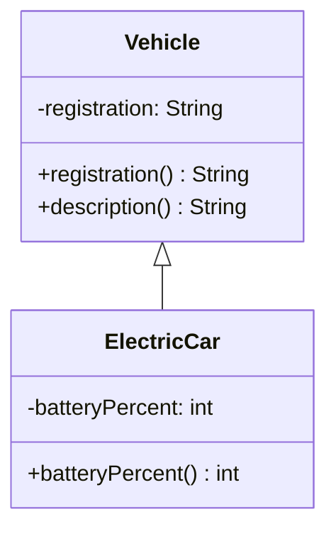

The arrow from `ElectricCar` to `Vehicle` denotes **inheritance**; it does not imply that an independent `Vehicle` object exists alongside the `ElectricCar` object.

Java permits a class to directly extend **at most one superclass**. An ordinary class without `extends` implicitly has `Object` as its superclass (except `Object` itself). A class can still implement multiple interfaces using `implements`, but that is not multiple inheritance of state from several superclasses.

## 2. Inherited State: Superclass Fields Reside in the Subclass Object

A common misconception: the subclass contains superclass-declared state, but **not every superclass field is directly accessible from subclass code**.

For a `private` field:

```java
class Account {
    private long balance;

    Account(long openingBalance) {
        if (openingBalance < 0) {
            throw new IllegalArgumentException("Số dư ban đầu âm");
        }
        this.balance = openingBalance;
    }

    public final long balance() {
        return balance;
    }

    protected final void credit(long amount) {
        if (amount <= 0) {
            throw new IllegalArgumentException("Số tiền phải dương");
        }
        balance = Math.addExact(balance, amount);
    }
}

class RewardAccount extends Account {
    RewardAccount(long openingBalance) {
        super(openingBalance);
    }

    public void receiveReward(long rewardVnd) {
        credit(rewardVnd); // Dùng hành vi có kiểm tra của lớp cha
    }

    // Không thể viết: balance += rewardVnd;
    // Vì Account.balance là private.
}
```

`Account.balance` remains part of a `RewardAccount` object's state even though subclass code **cannot directly access** the field named `balance`. The superclass controls balance changes through `credit(...)`, preventing the subclass from duplicating validation rules.

An example of usage:

```java
RewardAccount account = new RewardAccount(100_000);
account.receiveReward(20_000);

System.out.println(account.balance()); // 120000
```

**Do not change all superclass fields to `protected` merely to make them available to subclasses.** Direct subclass writes may prevent the superclass from preserving invariants. Prefer `private` fields with meaningful, validating `protected` or `public` methods.

### How Do Access Levels Affect Inheritance?

| Superclass declaration | Can subclass code use it? | Notes |
|---|---|---|
| `public` instance method/field | Yes, where the superclass is accessible | Beware of public mutable fields |
| `protected` instance method/field | Yes, under Java's `protected` access rules | Across packages, qualifier expressions have additional restrictions |
| Package-private (no modifier) | Only within the same package | Unsuitable for direct cross-package subclass access |
| `private` field/method | Not directly from subclass code | Private superclass state remains in the subclass object and can be accessed through valid APIs |
| `public final` instance method | Usable but **not overridable** | The superclass fixes this implementation |
| Constructor | **Not inherited** | The subclass declares its own constructor and invokes the superclass constructor via `super(...)` |

In Java language terms, **private members are not inherited as directly usable subclass members**. Do not interpret that to mean “private superclass fields are absent from subclass objects.”

## 3. Inherited Behavior: Reuse, Addition, and Override

Suppose a sales employee earns base pay plus commission. All employees have identifiers and a shared pay-slip format, but their earnings formulas may differ.

This **standalone runnable Java example** demonstrates three kinds of behavior:

1. **Inherit unchanged** `id()`.
2. **Override** `monthlyPayVnd()`.
3. **Add** `commissionVnd()`.

File `InheritanceDemo.java`:

```java
public class InheritanceDemo {

    static class Employee {
        private final String id;
        private final long basePayVnd;

        Employee(String id, long basePayVnd) {
            if (id == null || id.isBlank()) {
                throw new IllegalArgumentException("Mã nhân viên rỗng");
            }
            if (basePayVnd < 0) {
                throw new IllegalArgumentException("Lương cơ bản âm");
            }

            this.id = id.strip();
            this.basePayVnd = basePayVnd;
        }

        // Phương thức kế thừa được, nhưng không cho override.
        public final String id() {
            return id;
        }

        // Lớp con có thể định nghĩa cách tính riêng.
        public long monthlyPayVnd() {
            return basePayVnd;
        }

        // Hành vi chung: gọi phương thức có thể override.
        public String paySlip() {
            return id() + ": " + monthlyPayVnd() + " VND";
        }
    }

    static final class SalesEmployee extends Employee {
        private final long commissionVnd;

        SalesEmployee(
                String id, long basePayVnd, long commissionVnd) {
            super(id, basePayVnd);

            if (commissionVnd < 0) {
                throw new IllegalArgumentException("Hoa hồng âm");
            }
            this.commissionVnd = commissionVnd;
        }

        @Override
        public long monthlyPayVnd() {
            return Math.addExact(
                super.monthlyPayVnd(), commissionVnd
            );
        }

        public long commissionVnd() {
            return commissionVnd;
        }
    }

    public static void main(String[] args) {
        Employee regular = new Employee("E01", 12_000_000L);
        SalesEmployee sales =
            new SalesEmployee("S01", 10_000_000L, 3_000_000L);

        System.out.println(regular.paySlip());
        System.out.println(sales.paySlip());

        Employee asParent = sales;
        System.out.println(asParent.monthlyPayVnd());
        System.out.println(asParent.id());
    }
}
```

Run with JDK 11+:

```bash
javac InheritanceDemo.java
java InheritanceDemo
```

Output:

```text
E01: 12000000 VND
S01: 13000000 VND
13000000
S01
```

Analysis:

- `SalesEmployee` **does not redeclare** `id()` or `paySlip()`; these are reused from `Employee`.
- `SalesEmployee.monthlyPayVnd()` overrides the superclass method. `@Override` asks the compiler to check that the signature actually overrides a method.
- `super.monthlyPayVnd()` calls the `Employee` calculation and adds commission. `super` does not name a separate superclass object.
- `Math.addExact` throws `ArithmeticException` if the sum overflows `long`, preventing a silent incorrect result.
- `commissionVnd()` is specific to `SalesEmployee`; a reference with **declared type `Employee`** cannot directly call this method.

This example illustrates a simple earnings model, not the full payroll, tax, or commission rules of a real business.

## 4. Polymorphism: Method Behavior Depends on the Runtime Object Type

Consider these two lines:

```java
Employee asParent =
    new SalesEmployee("S02", 8_000_000L, 1_500_000L);

System.out.println(asParent.monthlyPayVnd()); // 9500000
```

The variable `asParent` has the **declared type** `Employee`, but the actual object comes from `new SalesEmployee(...)`. For an overridden instance method, Java uses **dynamic dispatch** to invoke the version corresponding to runtime type `SalesEmployee`.

That is why `Employee.paySlip()` can call `monthlyPayVnd()` without knowing the concrete subclass: when invoked on a `SalesEmployee`, it still selects the override.

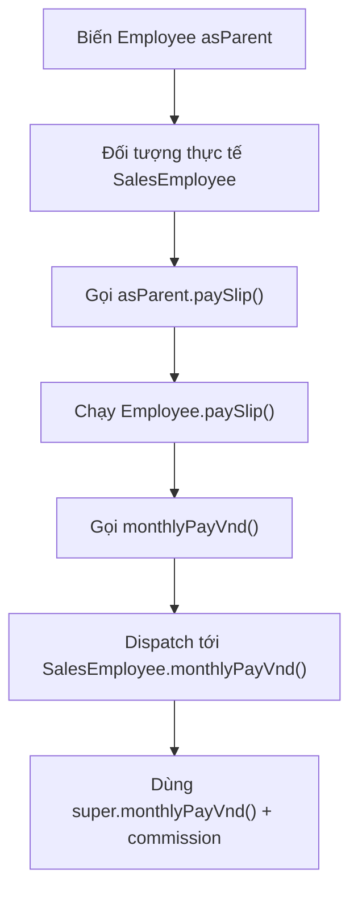

However, **the declared type still limits which methods are callable at compile time**:

```java
Employee employee =
    new SalesEmployee("S03", 5_000_000L, 2_000_000L);

employee.monthlyPayVnd();   // Hợp lệ
// employee.commissionVnd(); // Lỗi biên dịch
```

If subclass-specific behavior is truly needed, reconsider the variable type or API. Downcast only for a clear design reason when the runtime type is known; avoid replacing polymorphism everywhere with chains of `instanceof` checks and casts.

## 5. Superclass State Is Initialized Before Subclass-Specific State

A subclass constructor must invoke a superclass constructor, but **constructors are not inherited** as methods. For example:

~~~java
class Parent {
    Parent(String code) {
        System.out.println("Parent: " + code);
    }
}
class Child extends Parent {
    Child() {
        super("A01");
        System.out.println("Child");
    }
}
~~~

`new Child()` prints `Parent: A01` followed by `Child`. If the superclass has only parameterized constructors, you cannot omit `super("A01")` and expect the compiler to call a nonexistent `Parent()`.

Subclass field initializers and instance blocks run **after** the superclass constructor's portion. Therefore, a superclass constructor should not invoke overridable methods: dispatch may reach subclass code while its fields are still `null` or `0`. The details of `this(...)`, static initialization, initializer order, and constructor failure are demonstrated through a separate tracing program in the constructor-chain lesson.

## 6. Fields Are State; They Are Not Dynamically Dispatched Like Methods

**Overriding** replaces an instance method implementation according to the runtime type. **Overloading** uses the same name with different parameter lists and is primarily resolved at compile time. **Field hiding** occurs when a subclass declares a field with the same name; field access depends on the expression's type, not runtime object dispatch.

~~~java
class Parent {
    String label = "parent";
    String label() { return "parent-method"; }
}
class Child extends Parent {
    String label = "child"; // Field hiding.
    @Override String label() { return "child-method"; }
}

Parent value = new Child();
System.out.println(value.label);   // parent
System.out.println(value.label()); // child-method
~~~

Both `label` fields coexist in one `Child` object, making it easy to confuse which data is being read. In real designs, keeping fields `private` and exposing suitable APIs is usually safer. Similarly, a same-signature `static` method is *hidden*, not an overridden instance method; invoke static methods through class names to avoid confusing them with dynamic dispatch.

## 7. Rules That Method Overrides Must Respect

Valid overriding involves more than “writing a method with the same name.”

| Rule | What to remember |
|---|---|
| Method must be overridable | You cannot override `private`, `final`, or `static` methods as instance-method overrides |
| Parameter list | Requires the appropriate matching signature; a different parameter list creates an **overload** |
| Return type | A **covariant** return type is permitted when applicable; arbitrary changes are not |
| Visibility | An override cannot reduce its inherited method's access level |
| Checked exceptions | An override cannot declare new or broader checked exceptions beyond what the superclass method permits |
| Behavioral contract | Must preserve expectations clients rely on through the superclass type |

For example, when a superclass exposes a method:

```java
class Parent {
    public Number amount() {
        return 1;
    }
}

class Child extends Parent {
    @Override
    public Integer amount() {
        return 2;
    }
}
```

`Integer` is a subtype of `Number`, so the return type here is **validly covariant**.

In contrast:

```java
class WrongChild extends Parent {
    // @Override
    // protected Integer amount() { return 3; }
    // Sai vì giảm quyền truy cập public xuống protected.
}
```

More important than syntax is **substitutability**: if a caller works correctly with `Parent`, supplying a `Child` should not unexpectedly violate guarantees made by `Parent`. For example, if `Employee.monthlyPayVnd()` promises nonnegative earnings, a subclass should not arbitrarily return a negative number to signal an error.

## 8. Inheriting State Can Create Tight Coupling

When subclasses depend on superclass internals, superclass changes may break subclasses even when the public API looks unchanged. This is a form of the **fragile base class** problem.

A risky design example:

```java
class MutableBalance {
    protected long balance; // Mọi subclass được phép sửa trực tiếp

    void deposit(long amount) {
        balance += amount; // Chưa kiểm tra dữ liệu hoặc tràn số
    }
}

class SpecialBalance extends MutableBalance {
    void applyBonus(long bonus) {
        balance += bonus; // Đi vòng qua mọi quy tắc mà cha có thể đặt ra
    }
}
```

The subclass directly depends on the `balance` field. If the superclass later adds balance limits, audit logging, or business validation, `SpecialBalance` may continue bypassing those rules.

A better design:

- Keep fields `private`.
- Offer a meaningful `protected final` method, such as `creditValidated(...)`, when subclasses genuinely need an extension point.
- Define **permitted customization points** with protected methods or interfaces that have clear contracts.
- Avoid invoking overridden methods during construction.
- Do not let subclasses rely on field layouts or internal call order unless explicitly guaranteed.

This does not mean every `protected` field is wrong, but consider the coupling costs it imposes on the hierarchy.

## 9. Shared State Belongs in a Superclass Only for a Genuine Is-a Relationship

`SalesEmployee extends Employee` is a sensible business specialization if sales employees honor the shared employee contract. By contrast, an `OrderService` **uses** a `PaymentGateway`; it is not a kind of gateway. To process payments, keep a `PaymentGateway` collaborator:

~~~java
interface PaymentGateway {
    void charge(long amountVnd);
}
final class OrderService {
    private final PaymentGateway gateway;
    OrderService(PaymentGateway gateway) {
        this.gateway = java.util.Objects.requireNonNull(gateway);
    }
    void pay(long amountVnd) {
        if (amountVnd <= 0) {
            throw new IllegalArgumentException("Số tiền phải dương");
        }
        gateway.charge(amountVnd);
    }
}
~~~

**Composition** makes it easier to replace gateways or combine components without inventing a superclass relationship. Inheritance directly couples subclasses to superclass contracts and extension points; composition connects collaborators through fields/interfaces. Decide based on semantic substitutability, not just the number of lines reused.

## 10. Inheritance Design Review Checklist

Before making one class `extends` another, check:

1. **Is there a genuine is-a relationship?** Can a subclass replace its superclass without violating the contract?
2. **Which state belongs to the superclass?** Are common fields initialized and controlled there?
3. **Which methods should be inherited unchanged?** Avoid overriding when the superclass behavior is already correct.
4. **Which methods require overrides?** Is there a clear business reason and an `@Override` annotation?
5. **Are extension points safe?** Are suitable `final` or `protected` methods used to preserve invariants?
6. **Is the constructor chain correct?** Does `super(...)` receive valid data without exposing a partially initialized object?
7. **Would composition be simpler?** Avoid excessive inheritance merely to reuse a few functions.
8. **Do tests verify behavior through superclass references?** Check dynamic dispatch and substitutability.

## 11. Self-Check Exercises

### Exercise 1 — Predict the Result

```java
class Animal {
    String sound() {
        return "unknown";
    }

    String describe() {
        return "Sound: " + sound();
    }
}

class Cat extends Animal {
    @Override
    String sound() {
        return "meow";
    }
}

Animal a = new Cat();
System.out.println(a.describe());
```

**Answer:** `Sound: meow`. The `describe()` method is inherited from `Animal`, but its call to `sound()` dispatches to `Cat.sound()`.

### Exercise 2 — Can a Subclass See Every Field?

```java
class Base {
    private int secret = 7;

    public int secret() {
        return secret;
    }
}

class Derived extends Base {
    int read() {
        // return secret; // Lỗi biên dịch
        return secret();
    }
}
```

**Answer:** `return secret()` is valid because it invokes the superclass's public method. `return secret` is invalid because `secret` is a private field of `Base`.

### Exercise 3 — Find the Non-Override

```java
class Base {
    void print(int value) {
        System.out.println("Base " + value);
    }
}

class Derived extends Base {
    void print(String value) {
        System.out.println("Derived " + value);
    }
}
```

**Answer:** `Derived.print(String)` is an **overload**, not an override of `Base.print(int)`. The subclass can invoke both methods with their respective argument types.

### Exercise 4 — Design a Validated Subclass

Create `StudentAccount extends Account` with the following requirements:

- `Account` holds a `private long balance` that cannot become negative.
- `Account` provides `public final long balance()` and a protected method for valid credit operations.
- `StudentAccount` has a `private final String universityCode` validated in its constructor.
- `receiveScholarship(long amount)` credits money through the superclass API, not by modifying a field directly.
- Write a test: create `StudentAccount`, receive a scholarship, check the balance, and attempt an invalid amount.

As you solve it, ensure **the superclass still protects shared state**, while the subclass adds only specialized information and behavior.

---

**Remember:** Inheritance lets a subclass **contain state declared in its superclass** and **reuse or override behavior** under Java's access, constructor, and overriding rules. A subclass instance remains **one object**. Encapsulate shared data, distinguish method overriding from field hiding, honor superclass contracts, and inherit only when the *is-a* relationship truly applies.


</details>

- [Back to top](#back-to-top)

---

## <a id="inheritance-003">Extending superclass behavior</a>

<details>
<summary>View details</summary>

# Extending Superclass Behavior in Java

When a subclass inherits from a superclass using `extends`, it can **reuse existing behavior** and add specialized behavior. One important technique is **method overriding**: the subclass provides a new implementation of an overridable instance method declared by its superclass.

For example, a shipping system has a base fee calculation. Priority shipping still uses that calculation but adds a surcharge. Rather than copy the entire formula into the subclass, call `super.calculate(...)` to reuse the superclass behavior and then add the specialized part.

This lesson focuses on **extending superclass behavior**, what `super` means, which methods can be overridden, how to protect shared rules, and when composition may be preferable to inheritance.

## 1. Inheritance, Overriding, and Behavior Extension

A subclass declares:

```java
class Parent {
    void greet() {
        System.out.println("Xin chào");
    }
}

class Child extends Parent {
    @Override
    void greet() {
        super.greet();
        System.out.println("Rất vui được gặp bạn");
    }
}
```

When executed:

```java
new Child().greet();
```

Output:

```text
Xin chào
Rất vui được gặp bạn
```

How it works:

1. `Child extends Parent`: `Child` is a subclass of `Parent`.
2. `@Override` confirms that `Child.greet()` overrides an overridable superclass method. The compiler reports incompatible signatures.
3. `super.greet()` invokes **the superclass implementation** of that method.
4. The subclass performs its additional step after calling `super.greet()`.

If a subclass **does not override**, it may call the inherited method directly (subject to access rules). If it overrides but **does not call `super`**, it replaces that method's entire behavior and must independently uphold the superclass contract.

| Situation | Result |
| --- | --- |
| No override of `greet()` | `Child` uses the behavior inherited from `Parent` |
| Override and call `super.greet()` | Run the superclass behavior, then the additional behavior |
| Override without calling `super.greet()` | Execute only the subclass implementation |
| Declare `greet(String name)` instead of `greet()` | Usually **overloading** (another method with different parameters), not overriding `greet()` |
| Use `super.greet()` outside an appropriate instance method/constructor | Invalid; `super` requires a subclass context |

**Important:** “Extension” does not always mean adding statements after `super`. It may require actions **before**, **after**, or **around** superclass behavior (validation, timing, logging, enriching results). The appropriate order follows the actual contract.

## 2. Complete Java Example: Priority Shipping

Save all the following code in **`Main.java`** and run it with Java 17 or Java 21.

```java
import java.util.List;

class ShippingFee {
    private final long baseFeeVnd;

    ShippingFee(long baseFeeVnd) {
        if (baseFeeVnd < 0) {
            throw new IllegalArgumentException("Phí cơ bản không được âm");
        }
        this.baseFeeVnd = baseFeeVnd;
    }

    public long calculate(int distanceKm) {
        if (distanceKm <= 0) {
            throw new IllegalArgumentException("Quãng đường phải dương");
        }

        long distanceFee = Math.multiplyExact(2_000L, distanceKm);
        return Math.addExact(baseFeeVnd, distanceFee);
    }

    public String label() {
        return "Giao tiêu chuẩn";
    }
}

final class ExpressShippingFee extends ShippingFee {
    private final long priorityFeeVnd;

    ExpressShippingFee(long baseFeeVnd, long priorityFeeVnd) {
        super(baseFeeVnd);

        if (priorityFeeVnd < 0) {
            throw new IllegalArgumentException("Phụ phí không được âm");
        }
        this.priorityFeeVnd = priorityFeeVnd;
    }

    @Override
    public long calculate(int distanceKm) {
        // Giữ kiểm tra và công thức chuẩn của lớp cha.
        long standardFee = super.calculate(distanceKm);

        // Phần mở rộng dành riêng cho giao ưu tiên.
        return Math.addExact(standardFee, priorityFeeVnd);
    }

    @Override
    public String label() {
        return super.label() + " + ưu tiên";
    }
}

public class Main {
    public static void main(String[] args) {
        ShippingFee normal = new ShippingFee(10_000);
        ShippingFee express = new ExpressShippingFee(10_000, 15_000);

        List<ShippingFee> options = List.of(normal, express);
        for (ShippingFee option : options) {
            System.out.println(
                option.label() + ": " + option.calculate(3) + " VND"
            );
        }

        try {
            express.calculate(0);
        } catch (IllegalArgumentException ex) {
            System.out.println("Lỗi: " + ex.getMessage());
        }
    }
}
```

Compile and run:

```bash
javac Main.java
java Main
```

Output:

```text
Giao tiêu chuẩn: 16000 VND
Giao tiêu chuẩn + ưu tiên: 31000 VND
Lỗi: Quãng đường phải dương
```

For a distance of 3 km:

- Standard fee: `10_000 + 2_000 × 3 = 16_000` VND.
- Priority fee: `16_000 + 15_000 = 31_000` VND.
- The subclass does not duplicate validation of `distanceKm > 0`. When `ExpressShippingFee.calculate(0)` calls `super.calculate(0)`, the superclass exception still applies.

`Math.addExact` and `Math.multiplyExact` detect `long` overflow (by throwing `ArithmeticException`) instead of silently producing an incorrect fee. The example uses them to demonstrate integer safety while keeping the formula simple.

### Which Responsibilities Belong to the Superclass and Subclass?

| Component | `ShippingFee` | `ExpressShippingFee` |
| --- | --- | --- |
| Base fee | `private baseFeeVnd` field | Inherits behavior using the field but cannot directly access the `private` field |
| Base fee calculation | `calculate(distanceKm)` | Uses `super.calculate(distanceKm)` |
| Priority surcharge | None | `private priorityFeeVnd` field |
| Total fee calculation | Returns standard fee | Overrides `calculate()` to add the surcharge |
| Display name | `label()` | Overrides and appends a description |
| Initialization | `ShippingFee(long)` | `ExpressShippingFee(long, long)` calls `super(...)` |

The subclass extends both **existing behavior** and **its own state**; it does not duplicate every superclass field as a separate field.

## 3. Polymorphism: A Superclass Reference Can Invoke Subclass Methods

Both variables in the example have declared type `ShippingFee`:

```java
ShippingFee normal = new ShippingFee(10_000);
ShippingFee express = new ExpressShippingFee(10_000, 15_000);
```

But calling `express.calculate(3)` executes the **`ExpressShippingFee` override**, because the runtime object is an `ExpressShippingFee`.

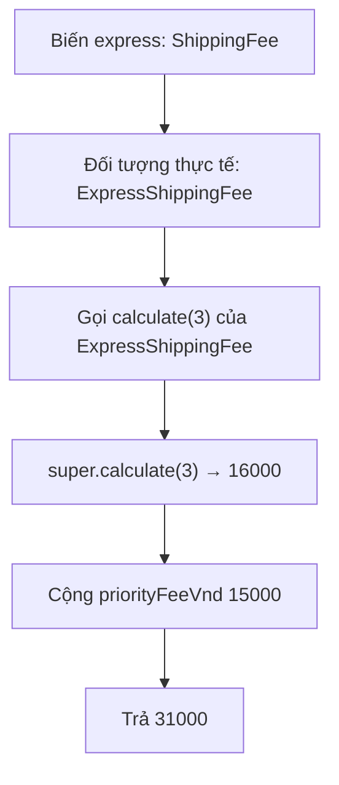

Choosing an **overridden instance method** based on the runtime object is called *dynamic dispatch*. It lets the same `option.calculate(distance)` call work with multiple subclasses of `ShippingFee`.

Remember that a variable's declared type still determines **which methods are callable at compile time**. If `ExpressShippingFee` has a method absent from `ShippingFee`, a `ShippingFee express` reference cannot directly call it without a valid cast. Polymorphism does not add subclass-specific APIs to the superclass type.

## 4. Two Uses of `super` Serve Different Purposes

In the example, `super(baseFeeVnd)` **initializes the superclass portion** when creating `ExpressShippingFee`, whereas `super.calculate(distanceKm)` executes **the superclass method implementation** on the current object:

~~~java
ExpressShippingFee(long base, long priority) {
    super(base); // Chọn constructor cha.
    if (priority < 0) throw new IllegalArgumentException();
    this.priorityFeeVnd = priority;
}

@Override
public long calculate(int km) {
    return Math.addExact(super.calculate(km), priorityFeeVnd);
}
~~~

Constructors cannot be overridden. In Java 17/21, an explicit `super(...)` or `this(...)` invocation must be the first constructor statement, and the compiler inserts `super()` when neither is written. Constructor chaining and field-initializer order are covered separately in the subclass initialization lesson.

**Subtle point:** `super.calculate()` selects the superclass method body at that call site; if that body invokes an overridable instance hook, the hook still dispatches to the subclass implementation. Do not treat `super` as bypassing every subclass behavior.

## 5. Do Not Confuse Override, Overload, and Static Hiding

| Mechanism | How to identify it | How implementation is chosen |
| --- | --- | --- |
| **Overriding** | Compatible instance-method signature in the subclass, usually marked `@Override` | Runtime type |
| **Overloading** | Same method name, different parameter lists | Signature selected at compile time |
| **Static method hiding** | Subclass declares a static method with the same valid signature | Class/expression type, not the runtime instance |
| **Field hiding** | Subclass declares a field with the same name | Static type/access context |

~~~java
class Base {
    String sound() { return "base"; }
}
class Child extends Base {
    @Override String sound() { return "child"; }
    String sound(int volume) { return "volume=" + volume; } // Overload.
}

Base value = new Child();
System.out.println(value.sound()); // child
// value.sound(2); // Không biên dịch: Base không có sound(int).
~~~

In particular, **static methods are not overridden**. Do not mark a same-named static method with `@Override`; for runtime polymorphism, use instance methods with an appropriate contract.

## 6. Requirements for Valid Method Overriding

- The superclass method must be an overridable instance method; `private`, `final`, and `static` do not participate in instance overriding.
- Names and parameter lists must match the overridden signature. Changing `int` to `long` creates an overload, which `@Override` helps catch.
- Return types must be compatible; Java permits **covariant returns** for suitable reference subtypes.
- Access cannot be reduced; if a superclass method is `public`, the subclass method must also be `public`.
- Checked exceptions cannot be broadened beyond the superclass method contract; unchecked exceptions are not restricted the same way syntactically but must still honor behavioral expectations.

A syntactically valid override can still violate business rules by skipping input validation, changing invariants, or surprising callers using the superclass type. When subclasses must not replace an entire workflow, make the coordinating method `final` and expose appropriate hooks, as in the **Template Method** example below.

## 7. When Should You Call `super`, and When Should You Not?

Java **does not require** an overriding method to invoke `super.method()`. The decision depends on the *behavioral contract*.

### When `super` Is Appropriate

When the subclass adds one rule while preserving the superclass's basic implementation. In the shipping example, the priority surcharge is added after `super.calculate(distanceKm)`.

### When `super` Is Not Required

When the contract permits replacing the entire algorithm. For example, a superclass may define basic drawing behavior while a subclass provides a completely different drawing implementation that still satisfies the same contract.

### What to Consider Before Calling It

- Calling `super` twice may duplicate side effects if the superclass method modifies state or invokes an external API.
- Calling `super` before or after extra operations changes the order of side effects, validation, and errors.
- Omitting `super` may accidentally bypass validation, audit history, or maintenance of superclass invariants.
- If `super.method()` throws, later statements will not execute unless the code explicitly catches or handles the error.
- `super` selects the parent implementation at that point; it does not “freeze” all subsequent dynamic calls. If the superclass implementation invokes another overridable method, that call may still dispatch to the subclass.

Do not impose a rule that “every override must call `super`.” Read the superclass's published contract and design extension points accordingly.

## 8. Safe Extensions with Template Method

Overriding an entire business operation can let subclasses accidentally skip essential steps, such as input validation. **Template Method** puts the main workflow in a `final` method; subclasses extend only the specified step through a `protected` hook.

A standalone example saved as **`TemplateDemo.java`**:

```java
import java.util.Locale;
import java.util.Objects;

abstract class TextJob {
    // Trình tự chung do lớp cha kiểm soát; lớp con không override.
    public final String execute(String input) {
        Objects.requireNonNull(input, "input");

        String normalized = input.trim();
        if (normalized.isEmpty()) {
            throw new IllegalArgumentException("Nội dung không được trống");
        }

        String transformed = transform(normalized);
        return "Đã xử lý: " + transformed;
    }

    // Điểm mở rộng mà lớp con phải cung cấp.
    protected abstract String transform(String normalized);
}

final class UppercaseJob extends TextJob {
    @Override
    protected String transform(String normalized) {
        return normalized.toUpperCase(Locale.ROOT);
    }
}

public class TemplateDemo {
    public static void main(String[] args) {
        TextJob job = new UppercaseJob();
        System.out.println(job.execute("  java oop  "));
    }
}
```

Run `javac TemplateDemo.java` and `java TemplateDemo`:

```text
Đã xử lý: JAVA OOP
```

In this design:

1. `execute()` enforces the workflow: check `null`, normalize input, reject empty data, and produce the result.
2. `final` prevents subclasses from overriding `execute()` and accidentally bypassing shared steps.
3. `transform()` is the explicit extension point; subclasses change the transformation algorithm without altering the input contract of `execute()`.

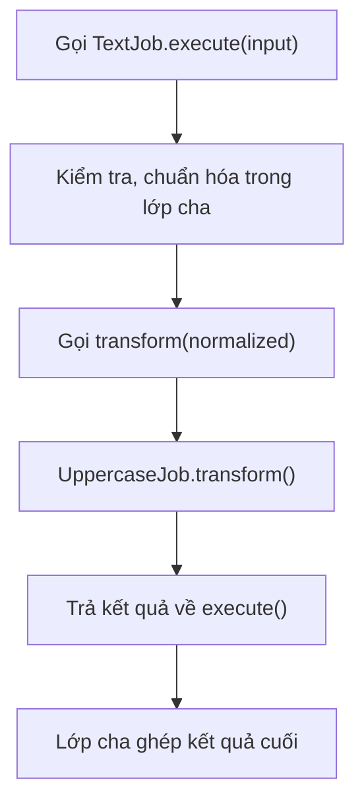

Template Method fits subclasses that share an **invariant processing order** but vary a few steps. Avoid applying it for a single simple statement or when the variations do not form a sound inheritance relationship.

## 9. Extend Behavior After Construction Completes

While `super(...)` is running, subclass-specific fields may still hold default values. If a superclass constructor invokes an overridable method, Java still dispatches to the subclass override:

~~~java
class Parent {
    Parent() { show(); }
    void show() { System.out.println("parent"); }
}
class Child extends Parent {
    String label = "Sẵn sàng";
    @Override void show() { System.out.println(label); }
}
// new Child() in null, vì initializer label chưa chạy.
~~~

This follows from **initialization order**, not a random bug or race condition. Subclass hooks should be invoked only after the object is fully initialized. The constructor-chain lesson traces this order alongside static blocks, instance blocks, and constructor exceptions.

## 10. When Inheritance Is Not a Good Fit

Inheritance makes sense when a subclass really is **a specialized kind of its superclass** and preserves its contract. If you only need to add an optional feature (logging, metrics, retries, caching, or a surcharge), **composition/decorators** may be more flexible:

```java
interface PriceCalculator {
    long calculate(int quantity);
}

final class SurchargeCalculator implements PriceCalculator {
    private final PriceCalculator delegate;
    private final long surcharge;

    SurchargeCalculator(PriceCalculator delegate, long surcharge) {
        this.delegate = java.util.Objects.requireNonNull(delegate);
        if (surcharge < 0) {
            throw new IllegalArgumentException("Phụ phí âm");
        }
        this.surcharge = surcharge;
    }

    @Override
    public long calculate(int quantity) {
        return Math.addExact(delegate.calculate(quantity), surcharge);
    }
}
```

This illustrates **composable components**: `SurchargeCalculator` holds another `PriceCalculator` and adds a fee. When combining variations, you do not necessarily need a hierarchy such as `ExpressInternationalDiscountedShipping`.

Comparison:

| Criterion | `extends` / override | Composition / delegate |
| --- | --- | --- |
| Relationship | `is-a`: a subclass is a kind of superclass | `has-a`: an object contains/references another component |
| Reusing behavior | Invoke an inherited method or `super.method()` | Invoke `delegate.method()` |
| Extension points | Designed by the superclass; may be constrained by `protected` / `final` | Determined by interfaces and delegate objects |
| Combining features | May require many subclasses and complex combinations | Multiple wrappers are often easier to combine |
| Primary risk | Tight coupling to superclass contracts and details | Additional objects/delegation and the need for appropriate lifecycle management |

Composition is not always superior: when a genuine hierarchy exists, variations share many fixed rules, and the superclass exposes clear hooks, inheritance is entirely reasonable. Choose based on domain relationships and contract stability.

## 11. Common Mistakes and Fixes

| Mistake | What happens | Fix |
| --- | --- | --- |
| Calling `calculate(...)` instead of `super.calculate(...)` inside an override | May recurse indefinitely (`StackOverflowError`) | Call `super.calculate(...)` when the superclass implementation is needed |
| Omitting `@Override` while changing parameter types | Creates an overload instead of an override | Add `@Override` for compiler checks |
| Subclass skips validation guaranteed by the superclass | Object may violate the contract | Retain validation or put the shared workflow into a `final` method |
| Overriding a `final` or `private` method | Not permitted under Java override rules | Use the superclass's designated extension point |
| Confusing `static` hiding with overriding | Dispatch depends on class/reference type, not runtime instance polymorphism | Use instance methods for dynamic dispatch |
| Superclass invokes an overridden hook from its constructor | Subclass executes before initialization completes | Do not call overridable methods from constructors |
| Subclass directly modifies mutable `protected` superclass fields | Superclass invariants can break | Keep fields `private` and provide controlled methods/hooks |
| Using `extends` to reuse only a few lines | Feature composition becomes difficult; weak `is-a` relationship | Consider composition/delegation |

## 12. Self-Check

**Question 1.** In `ExpressShippingFee.calculate()`, why call `super.calculate(distanceKm)` instead of `calculate(distanceKm)`?

**Answer:** `super` selects the superclass implementation. Calling `calculate(...)` without `super` inside the override typically invokes the same subclass method again and causes recursion.

**Question 2.** After `ShippingFee shipping = new ExpressShippingFee(10000, 15000);`, which method runs when `shipping.calculate(3)` is called?

**Answer:** `ExpressShippingFee.calculate()`, because this is an overridden instance method dispatched according to the object's actual runtime type.

**Question 3.** Can a subclass override a constructor?

**Answer:** No. Constructors are not inherited. A subclass invokes a superclass constructor through `super(...)` during initialization.

**Question 4.** How do `protected abstract String transform(...)` and `public final String execute(...)` divide responsibilities in Template Method?

**Answer:** `execute()` preserves the fixed workflow and invariants; `transform()` lets subclasses implement controlled variations.

**Question 5.** Should the superclass declare `protected List<Order> orders` so subclasses can modify it freely?

**Answer:** Not if the superclass must protect data consistency. Keeping the field `private` and exposing clearly contracted operations/hooks is usually safer.

**Question 6.** Is inheritance always the easiest way to combine logging, caching, and retry behavior in many combinations?

**Answer:** No. Composition/decorators can combine capabilities more flexibly and reduce the number of subclasses.

**Remember:** To extend superclass behavior, use `extends` when the `is-a` relationship and inheritance contract are valid, `@Override` to replace or augment implementations, `super.method()` to reuse superclass behavior, and `super(...)` to initialize the superclass portion. To protect a workflow against subclass bypass, design a `final` template method with an explicit `protected` extension point.


</details>

- [Back to top](#back-to-top)

---

## <a id="inheritance-004">Overriding methods and invoking superclass behavior</a>

<details>
<summary>View details</summary>

# Method Overriding and Invoking Superclass Behavior in Java

**Method overriding** allows a subclass to provide its own implementation of an **inheritable instance method** declared by a superclass, while callers still interact through the superclass contract. When a subclass wants to **preserve part of the superclass's processing and then add behavior**, Java offers `super.method(...)`.

Distinguish two questions:

- **Overriding:** “Which method runs when the actual object is a subclass instance?”
- **Calling `super`:** “Inside a subclass method, how can we invoke the appropriate inherited superclass version instead of recursively calling our own override?”

This lesson uses Java 11 or later and illustrates shipping-fee calculations for standard and express delivery. The example is contained in **one Java file** so it can be compiled, executed, and checked immediately.

## 1. Recognizing Overriding with a Minimal Example

```java
class Notification {
    public void send() {
        System.out.println("Gửi thông báo thông thường");
    }
}

class EmailNotification extends Notification {
    @Override
    public void send() {
        System.out.println("Gửi qua email");
    }
}
```

When called:

```java
Notification message = new EmailNotification();
message.send(); // Gửi qua email
```

The variable `message` has the **declared type** `Notification`, but the actual object is created by `new EmailNotification()`. Because `send()` is an overridden instance method, Java selects the version belonging to the object's **actual runtime class**. This is **dynamic method dispatch**, a form of polymorphism.

`@Override` is not what makes the JVM dispatch an override; it is an annotation that **asks the compiler to verify the overriding intent**. A wrong name or signature is caught early.

### Overriding Versus Declaring Another Method

Two methods with the same name are not necessarily overrides. To override, a subclass method must match the inherited method's signature under Java's rules: name and parameter types must correspond, and the return type must also be compatible.

```java
class Parent {
    public void process(String text) {
        System.out.println("Parent: " + text);
    }
}

class Child extends Parent {
    @Override
    public void process(String text) {
        System.out.println("Child: " + text);
    }

    public void process(int count) {
        System.out.println("Count: " + count);
    }
}
```

Here, `process(String)` is an **override**, while `process(int)` is an **overload** (same name, different parameters). You cannot use `@Override` on `process(int)` in this example because the superclass has no matching method to override.

## 2. Complete Example: Extending Superclass Behavior with `super`

Requirements:

- **Standard delivery:** a base fee of 12.000 VND plus 3.000 VND per km.
- **Express delivery:** preserve the standard calculation and add a priority surcharge of 20.000 VND.
- Distance must be a nonnegative integer; if a `long` fee calculation overflows, throw `ArithmeticException` rather than returning a wrong value.
- A superclass `printQuote` method should use the result of the subclass-overridden `fee` method.

File **`OverrideAndSuperDemo.java`**:

```java
public class OverrideAndSuperDemo {

    static class DeliveryPlan {
        private static final long BASE_VND = 12_000L;
        private static final long PER_KM_VND = 3_000L;

        public String label() {
            return "Giao thường";
        }

        public long fee(int distanceKm) {
            if (distanceKm < 0) {
                throw new IllegalArgumentException(
                        "Quãng đường không được âm");
            }
            long distanceFee =
                    Math.multiplyExact(PER_KM_VND, (long) distanceKm);
            return Math.addExact(BASE_VND, distanceFee);
        }

        // Không override ở lớp con, nhưng gọi các method có thể override.
        public void printQuote(int distanceKm) {
            System.out.println(
                    label() + " (" + distanceKm + " km): "
                    + fee(distanceKm) + " VND");
        }
    }

    static final class ExpressPlan extends DeliveryPlan {
        private static final long PRIORITY_VND = 20_000L;

        @Override
        public String label() {
            return "Giao nhanh (nền: " + super.label() + ")";
        }

        @Override
        public long fee(int distanceKm) {
            // Gọi lại toàn bộ logic kiểm tra và tính phí của lớp cha.
            long standardFee = super.fee(distanceKm);
            return Math.addExact(standardFee, PRIORITY_VND);
        }
    }

    public static void main(String[] args) {
        DeliveryPlan standard = new DeliveryPlan();
        DeliveryPlan express = new ExpressPlan();

        standard.printQuote(5);
        express.printQuote(5);

        System.out.println(standard.fee(5)); // 27000
        System.out.println(express.fee(5));  // 47000

        try {
            express.fee(-1);
        } catch (IllegalArgumentException ex) {
            System.out.println("Từ chối: " + ex.getMessage());
        }
    }
}
```

Compile and run:

```bash
javac OverrideAndSuperDemo.java
java OverrideAndSuperDemo
```

Expected output:

```text
Giao thường (5 km): 27000 VND
Giao nhanh (nền: Giao thường) (5 km): 47000 VND
27000
47000
Từ chối: Quãng đường không được âm
```

At 5 km, the standard fee is 12.000 + 3.000 × 5 = **27.000 VND**. Express delivery reuses the superclass calculation and adds 20.000, producing **47.000 VND**.

### Why Is `super.fee(distanceKm)` Important?

Inside `ExpressPlan.fee`:

```java
@Override
public long fee(int distanceKm) {
    long standardFee = super.fee(distanceKm);
    return Math.addExact(standardFee, PRIORITY_VND);
}
```

`super.fee(distanceKm)` selects the `fee` implementation in superclass `DeliveryPlan`, performing both **distance validation** and **base fee calculation** before the subclass adds its surcharge. If you write:

```java
@Override
public long fee(int distanceKm) {
    return Math.addExact(fee(distanceKm), PRIORITY_VND); // SAI
}
```

then `fee(distanceKm)` without `super` invokes `ExpressPlan.fee` again on the same object, recursively invoking itself and causing **recursion without a terminating condition**, usually ending in `StackOverflowError`. Not every same-named method call is an error; this specific call recurses without a base case.

Note that `super.fee` **does not create another superclass object**. It operates on the current `ExpressPlan` object, but selects the superclass implementation at that call site.

## 3. Polymorphism Still Occurs Inside Superclass Methods

Interestingly, `printQuote` **is not overridden** in this example. Nevertheless, its body calls:

```java
public void printQuote(int distanceKm) {
    System.out.println(
            label() + " (" + distanceKm + " km): "
            + fee(distanceKm) + " VND");
}
```

When `express.printQuote(5)` runs on an actual `ExpressPlan` object:

1. `printQuote` in `DeliveryPlan` runs because the subclass does not override it.
2. The `label()` call inside `printQuote` dynamically dispatches to `ExpressPlan.label()`.
3. The `fee(5)` call dynamically dispatches to `ExpressPlan.fee(5)`.
4. Within `ExpressPlan.fee(5)`, `super.fee(5)` runs `DeliveryPlan` logic before the subclass adds its surcharge.

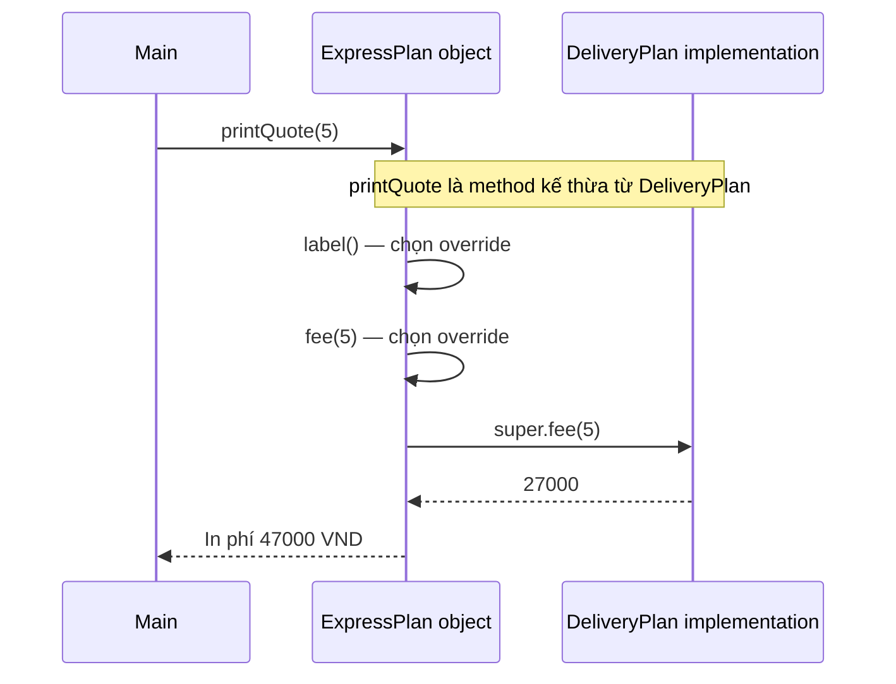

The diagram represents the call flow; it **does not** imply that a separate `DeliveryPlan` object is created.

This illustrates the power of overriding: a superclass can define a common workflow that invokes overridable “extension points,” letting subclasses change them without rewriting the whole process. However, invoking overridable methods from a **superclass constructor** is dangerous because subclass field initializers may not have run yet.

## 4. `super.method()` Versus `super(...)`

Both use the `super` keyword but serve different purposes:

| Syntax | Purpose | Where is it used? |
| --- | --- | --- |
| `super.method(args)` | Invokes an accessible instance method implementation from the superclass | In a subclass instance context where access is allowed |
| `super(args)` | Invokes the superclass constructor in the object-construction chain | In a subclass constructor |
| `this.method(args)` or `method(args)` | Invokes a method on the current object, possibly dynamically dispatched | In an instance context |
| `this(args)` | Invokes another constructor of the same class | In a constructor under constructor-invocation rules |
| `super.field` | Accesses an accessible superclass field when necessary to disambiguate names | In an instance context |

In Java 11, an explicit `super(args)` or `this(args)` must be the first constructor statement. `super.method(args)` is an ordinary method call and **has no such first-statement requirement**.

Constructor example:

```java
class Vehicle {
    private final String code;

    Vehicle(String code) {
        this.code = code;
    }

    public String code() {
        return code;
    }
}

class Car extends Vehicle {
    Car(String code) {
        super(code); // Constructor của Vehicle
    }

    @Override
    public String code() {
        return "CAR-" + super.code(); // Method của Vehicle
    }
}
```

The result of `new Car("42").code()` is `"CAR-42"`.

A superclass method invoked via `super` may itself call another method using polymorphism. `super` selects **the version at the initial call site**; it does not force every nested call to use only superclass implementations.

## 5. Rules for Valid Overriding

### Matching Names and Parameters; Compatible Return Types

```java
class Document {
    public Document copy() {
        return new Document();
    }
}

class PdfDocument extends Document {
    @Override
    public PdfDocument copy() {
        return new PdfDocument();
    }
}
```

This demonstrates a **covariant return type**: the subclass method may return a more specific reference type because `PdfDocument` is a subtype of `Document`.

If the superclass returns `int`, the subclass cannot change that to `long` when overriding the same signature: primitive return types must obey Java's compatibility rules. An overload also cannot be distinguished solely by a different return type.

### Access Visibility Cannot Be Reduced

```java
class BaseService {
    protected void execute() {
        System.out.println("Base");
    }
}

class PublicService extends BaseService {
    @Override
    public void execute() { // protected -> public: hợp lệ
        System.out.println("Child");
    }
}
```

If the superclass declares `public void execute()`, the subclass cannot override it with `protected void execute()` or package-private access. If the superclass method is `protected`, the subclass may retain `protected` or widen access to `public`.

### Checked Exceptions Cannot Be Arbitrarily Broadened

```java
import java.io.IOException;
import java.io.FileNotFoundException;

class FileSource {
    public String read() throws IOException {
        return "data";
    }
}

class LocalFileSource extends FileSource {
    @Override
    public String read() throws FileNotFoundException {
        return "local";
    }
}
```

`FileNotFoundException` is a subtype of `IOException`, so the subclass declaration is valid. If the superclass declares no checked exception, its override cannot introduce a new incompatible checked exception. For **unchecked exceptions** such as `IllegalArgumentException`, Java does not impose the same `throws` declaration restrictions, although the subclass should still honor the superclass's behavioral contract.

### `@Override` Detects Signature Mistakes

```java
class BaseReport {
    public void export(String format) {}
}

class CsvReport extends BaseReport {
    // Ví dụ SAI nếu dùng @Override:
    // @Override
    // public void export(Object format) {}
}
```

`export(Object)` is an overload with different parameters; it does not replace `export(String)`. `@Override` makes the compiler report the mismatch instead of letting a programmer mistakenly believe overriding succeeded.

## 6. Which Methods Cannot Be Overridden Normally?

| Method type/characteristic | Actual behavior |
| --- | --- |
| Inheritable non-`final` instance method | Can be overridden when signature, access, return type, and exception rules are met |
| `final` instance method | **Cannot be overridden**; used to lock down behavior at that level |
| `static` method | Not overridden; a same-named/signature subclass declaration is **method hiding** |
| `private` method | Not inherited and therefore cannot be overridden; a same-named subclass method is separate |
| Constructor | Not an inherited method, so cannot be overridden |
| Abstract method | A concrete subclass must implement it if no suitable inherited implementation exists |
| Interface default method | Implementing classes may override it; an appropriate default can be invoked using `InterfaceName.super.method()` |

### `static`: Method Hiding Versus Overriding

```java
class Animal {
    static String category() {
        return "Động vật";
    }

    String sound() {
        return "Âm thanh chung";
    }
}

class Dog extends Animal {
    static String category() {
        return "Chó";
    }

    @Override
    String sound() {
        return "Gâu";
    }
}

Animal a = new Dog();

System.out.println(Animal.category()); // Động vật
System.out.println(Dog.category());    // Chó
System.out.println(a.sound());         // Gâu
```

`category()` is static; invoking it through the class name makes method hiding clear. It does not use dynamic dispatch like `sound()`. The `@Override` annotation cannot be applied to `Dog.category()`.

### `private`: No Inherited Method to Override

```java
class Parent {
    private void audit() {
        System.out.println("Audit nội bộ Parent");
    }

    public void run() {
        audit(); // Luôn là logic private của Parent
    }
}

class Child extends Parent {
    public void audit() {
        System.out.println("Audit của Child");
    }
}
```

`new Child().run()` prints `"Audit nội bộ Parent"`. `Child.audit()` is a new method, not an override of `Parent.audit()`, because the superclass's `private` method is not inherited. Same-named methods do not make the call inside `Parent.run()` dynamically dispatch to the subclass method.

### `final`: Prohibiting Overriding

```java
class Transaction {
    public final void validateId() {
        System.out.println("Kiểm tra ID cố định");
    }
}

class Payment extends Transaction {
    // Không hợp lệ:
    // @Override public void validateId() {}
}
```

Marking a method `final` prevents subclasses from replacing its implementation. This can preserve a mandatory workflow step. However, `final` is not a substitute for a well-designed behavioral contract.

## 7. `super`, Field Hiding, and Dynamic Dispatch

Fields do not behave like overridden methods. If a superclass and subclass declare fields with identical names, field access is determined by the **compile-time type** and access context.

```java
class Parent {
    public String name = "Parent";

    public String getName() {
        return name;
    }
}

class Child extends Parent {
    public String name = "Child";

    @Override
    public String getName() {
        return name;
    }

    public String parentField() {
        return super.name;
    }
}

Parent value = new Child();

System.out.println(value.name);               // Parent
System.out.println(value.getName());          // Child
System.out.println(((Child) value).parentField()); // Parent
```

This is **field hiding**, not field polymorphism. Same-named fields are two separate state slots within one object, often causing confusion. In production code, prefer `private` fields and a suitable API over intentionally repeating field names to change behavior.

`super.name` selects an accessible field declared in the superclass; it is not syntax for “calling a getter.”

## 8. Reuse Superclass Behavior or Replace It Entirely?

There are two common overriding strategies:

**Option A — replace the behavior completely**

```java
class TextFormatter {
    public String format(String text) {
        return text.trim();
    }
}

class UppercaseFormatter extends TextFormatter {
    @Override
    public String format(String text) {
        return text.strip().toUpperCase(java.util.Locale.ROOT);
    }
}
```

Here, the subclass defines entirely new behavior without invoking `super.format(...)`. Note that `trim` and `strip` treat some Unicode whitespace characters differently, so a contract requiring precise normalization needs a consistent rule. This demonstrates that **syntactically valid overriding may not preserve the behavioral contract**.

**Option B — preserve the superclass step and add behavior**

```java
class CheckedFormatter extends TextFormatter {
    @Override
    public String format(String text) {
        if (text == null) {
            throw new IllegalArgumentException("text không được null");
        }
        String base = super.format(text);
        return "[" + base + "]";
    }
}
```

The subclass reuses superclass normalization and adds brackets. The supertype contract must permit this new formatting. If clients require the **original trimmed string**, adding brackets could violate the contract even though the code runs.

Before overriding, ask: **Which extension points does the superclass permit?** If a change violates published input conditions, outputs, or invariants, use a different interface or strategy rather than a subclass that breaks the contract.

### Connection to the Liskov Substitution Principle

If `Parent` accepts `process(1)` and promises a valid result, `Child` must not unexpectedly reject `1` just to impose stricter rules. Under the Liskov Substitution Principle (LSP), a subclass should not:

- **Strengthen preconditions** for calls valid under the superclass.
- **Weaken postconditions** promised by the superclass.
- **Violate invariants** or add side effects inconsistent with observable guarantees.
- **Change error semantics** when they are part of the published contract.

An overridden method may call `super.method(...)` yet violate LSP if added logic corrupts its result. Conversely, an entirely replaced method can be valid if the contract remains intact.

## 9. When `super` Is Not the Best Choice

Calling `super.method()` is valuable when a subclass genuinely **extends** superclass behavior. Avoid using `super` solely to save code duplication when the business inheritance relationship is wrong.

For example, an `AuditEmailSender extends EmailSender` class written only to reuse email-sending code and add logging can become fragile when the superclass changes. When the requirement is to wrap behavior, **composition/decorators** often express it better: `AuditedSender` holds a `Sender` and invokes `delegate.send(...)` while logging according to its contract.

```java
interface Sender {
    void send(String message);
}

class AuditedSender implements Sender {
    private final Sender delegate;

    AuditedSender(Sender delegate) {
        this.delegate = java.util.Objects.requireNonNull(delegate);
    }

    @Override
    public void send(String message) {
        delegate.send(message);
        System.out.println("Đã yêu cầu gửi");
    }
}
```

Here, `delegate.send(...)` **delegates to another object**, whereas `super.send(...)` invokes an implementation in the inheritance chain of **the same current object**. The two approaches differ in both structure and purpose.

With a hierarchy `A <- B <- C`, `C.foo()` invokes `super.foo()` to find the appropriate superclass implementation starting at `B`. Ordinary Java has no `super.super.foo()` syntax for skipping a level directly. If `B.foo()` needs `A` behavior, `B` itself decides whether to invoke `super.foo()`.

## 10. Beware of Overridable Calls from Superclass Constructors

The following example compiles but is error-prone:

```java
public class ConstructorTrap {
    static class Parent {
        Parent() {
            show(); // Gọi phương thức có thể override
        }

        void show() {
            System.out.println("Parent.show");
        }
    }

    static class Child extends Parent {
        private String value = "Đã sẵn sàng";

        Child() {
            System.out.println("Child constructor");
        }

        @Override
        void show() {
            System.out.println("Child.show: " + value);
        }
    }

    public static void main(String[] args) {
        new Child();
    }
}
```

Output:

```text
Child.show: null
Child constructor
```

Why it happens:

1. When creating `Child`, Java allocates an object and gives fields their default values.
2. The `Parent` constructor executes **before** `Child` instance/field initializers.
3. A call to `show()` from `Parent` still uses **dynamic dispatch** to `Child.show()`.
4. At this point, `Child.value` is `null`; the assignment `"Đã sẵn sàng"` has not occurred.

If `Child.show()` calls `value.length()`, it may throw `NullPointerException`. Therefore, **avoid invoking overridable methods from constructors** when they depend on unfinished subclass state. Superclass constructors should use only safely controlled data and behavior; run operations requiring a complete object after initialization.

## 11. Verify Overriding with a Small Program

The following **`OverrideCheck.java`** demonstrates declared and runtime types and can compile independently:

```java
public class OverrideCheck {
    static class Base {
        int compute(int x) {
            return x * 2;
        }

        String type() {
            return "Base";
        }
    }

    static final class Derived extends Base {
        @Override
        int compute(int x) {
            return super.compute(x) + 5;
        }

        @Override
        String type() {
            return "Derived";
        }
    }

    public static void main(String[] args) {
        Base base = new Base();
        Base childAsBase = new Derived();

        require(base.compute(3) == 6, "Base.compute sai");
        require(childAsBase.compute(3) == 11,
                "Override hoặc super.compute sai");

        require("Base".equals(base.type()), "Sai Base.type");
        require("Derived".equals(childAsBase.type()),
                "Không có dynamic dispatch");

        System.out.println("PASS: overriding và super hoạt động");
    }

    static void require(boolean condition, String error) {
        if (!condition) {
            throw new AssertionError(error);
        }
    }
}
```

Run:

```bash
javac OverrideCheck.java
java OverrideCheck
```

Output:

```text
PASS: overriding và super hoạt động
```

This is a conceptual check. In larger projects, use JUnit to test **behavior and contracts**, not merely whether a superclass method was called. Subclass code can compile and log expected messages yet violate business rules at edge cases.

## 12. Common Mistakes

| Code or claim | Problem | Fix |
| --- | --- | --- |
| Treating `super.method()` as a separate superclass object | Incorrect: it is still the same subclass object | Understand `super` as selecting inherited implementation |
| Calling `method()` from an override to reach the superclass version | May recursively call the same override | Use `super.method()` to select the superclass version |
| Placing `@Override` on an overload with different parameters | Does not override the superclass method | Match the signature or omit the annotation when overloading intentionally |
| Reducing `public` to `protected` | Compilation error | Preserve or widen access |
| Overriding a `final` method | Compilation error | Use a different permitted extension point |
| Assuming `static` methods are polymorphic | Static methods are hidden, not dynamically dispatched | Call static methods through class names |
| Assuming superclass `private` methods can be overridden | Private methods are not inherited | Use `protected`/`public` APIs if extension is truly needed |
| Calling `super.foo()` when `foo` is only abstract with no suitable body | No implementation exists for such a call | Implement it in the subclass or redesign the inheritance chain |
| Overriding to reject inputs permitted by the superclass | May violate LSP | Preserve the valid domain or define a separate contract |
| Calling overridable methods from constructors | Subclass fields may be uninitialized | Defer calls until after construction |
| Assuming same-named fields override one another | Field hiding depends on static types | Avoid name collisions; use methods for polymorphism |

## 13. Practice Exercises

**Exercise 1 — predict the output**

```java
class A {
    String name() { return "A"; }
}
class B extends A {
    @Override
    String name() { return super.name() + "B"; }
}
class C extends B {
    @Override
    String name() { return super.name() + "C"; }
}

A ref = new C();
System.out.println(ref.name()); // ?
```

**Answer:** `ABC`. The first call dispatches to `C.name()`, then `C` calls `B.name()`, `B` calls `A.name()`, and their strings are combined in order.

**Exercise 2 — distinguish overriding and overloading**

```java
class Printer {
    void print(String s) { System.out.println("P:" + s); }
}
class ColoredPrinter extends Printer {
    void print(Object s) { System.out.println("C:" + s); }
}

Printer p = new ColoredPrinter();
p.print("hello"); // ?
```

**Answer:** `P:hello`. The subclass `print(Object)` is an overload; it does not override the superclass `print(String)`. The compiler selects the signature from the **static type** of the expression and argument types; runtime dispatch applies to the selected instance method only when a valid override exists.

**Exercise 3 — extend the delivery plan**

Add `DiscountedExpressPlan` through suitable inheritance or composition, subtracting 5.000 VND from the express fee (never below 0). If inheriting, note that `ExpressPlan` is currently `final`, so you must deliberately redesign extension points or use composition. Justify your choice by **contract semantics**, not lines of reused code.

**Exercise 4 — protect the superclass rule**

Given a superclass `calculatePrice` method that rejects negative prices, the subclass must add a surcharge without bypassing validation. Override using `super.calculatePrice(...)` and add the surcharge with overflow checks. Test negative inputs, ordinary prices, and prices near the `long` limit.

### Remember

- **Overriding** changes an inherited instance method's implementation while clients may still use the superclass type.
- **Dynamic dispatch** selects the override according to the actual object type.
- **`super.method(...)`** invokes a superclass implementation from the subclass to reuse and extend behavior; **`super(...)`** is a constructor invocation with distinct syntax and meaning.
- Correct signatures are only **syntactic correctness**. A sound design also preserves behavioral contracts, valid state, and client expectations.


</details>

- [Back to top](#back-to-top)

---

## <a id="inheritance-005">Accessibility of inherited members</a>

<details>
<summary>View details</summary>

# Accessibility of Inherited Members in Java

When a class **inherits** another class via `extends`, the subclass can use fields and methods exposed by its superclass. However, **superclass members do not all have the same accessibility from subclass code**. Access depends on modifiers (`public`, `protected`, no modifier, or `private`), package location, and sometimes the type of the expression used to access a member.

This is crucial in OOP inheritance: **an is-a relationship does not give a subclass unrestricted visibility into superclass internals**.

For example, `PremiumAccount extends Account` means a premium account is a type of account, but it does not let `PremiumAccount` directly read a `private` PIN inside `Account`.

This lesson uses **Java 17**. Cross-package examples are placed in separate files with compilation commands for verification.

## 1. Access Rules at a Glance

| Superclass member modifier | Declaring class | Other class in same package | Subclass in another package | Unrelated code in another package |
|---|---|---|---|---|
| `public` | Yes | Yes | Yes | Yes, if the type/API is accessible |
| `protected` | Yes | Yes | Yes, **subject to subclass access restrictions** | No |
| *Package-private* (no modifier) | Yes | Yes | No | No |
| `private` | Yes | No\* | No\* | No\* |

`*` Modern Java permits some `private` access between classes **in the same nest** (for example, nested classes and their enclosing class), but this is a *nestmate*-based exception, **not an inheritance privilege**. Ordinary top-level classes in the examples below cannot access one another's private members.

Read the following conditions alongside the table:

- **Same package** means the same `package` name, not just similar folder names or a shared prefix (`demo.core` and `demo.core.sub` are **different packages**).
- A `protected` member of a superclass **in another package** does not become public through arbitrary reference expressions. Java also checks the type of the receiving expression, as explained in Section 3.
- The table primarily describes **instance fields and instance methods**. Constructors, static fields, and some override rules differ.
- Member access does not make an **inaccessible containing class accessible**. For example, a package-private top-level class cannot be used from another package merely because one of its methods is public.
- With Java modules (JPMS), whether a package is `exports`-ed to the consuming module also affects cross-module public API accessibility.

## 2. Four Access Levels in the Context of Inheritance

### `public`: Exposed API

~~~java
package demo.core;

public class Document {
    public String getId() {
        return "DOC-01";
    }
}
~~~

Subclasses in other packages and unrelated code can call `getId()` as long as they can access `Document`.

`public` means the method is part of the class's published interface, so removing or changing its behavior may affect many clients. You do not need public fields merely to support subclasses; prefer intentional behavioral methods and appropriate getters.

### `protected`: Package Access and Subclass Support

~~~java
package demo.core;

public class Account {
    protected long balance;

    protected void markUpdated() {
        System.out.println("Cập nhật");
    }
}
~~~

Code **inside the same `demo.core` package** can access `balance` and `markUpdated()` even without being a subclass.

A subclass in another package may use these members where `protected` rules permit, such as `this.balance` and `super.markUpdated()`. However, outside the package, a subclass **cannot access protected members through every superclass-typed object**; the next section provides a complete example.

### No Access Modifier: *Package-private*

~~~java
package demo.core;

public class Account {
    int retryCount;
    void resetRetryCount() {
        retryCount = 0;
    }
}
~~~

`retryCount` and `resetRetryCount()` are accessible only to code in package `demo.core`. A subclass in `demo.feature` does not gain direct access merely through `extends Account`.

Do not call this access level `protected` or a “default method”: **package-private** is the access level resulting from an omitted access modifier, whereas an interface `default` method supplies an implementation.

### `private`: Implementation Details of the Declaring Class

~~~java
package demo.core;

public class Account {
    private String pin = "****";

    public boolean verifyPin(String candidate) {
        return pin.equals(candidate);
    }
}
~~~

A subclass cannot read `pin` directly, but can still **use public/protected superclass behavior** such as `verifyPin()`. Encapsulation lets the superclass change PIN storage without making subclasses depend on that representation.

Do not expose a public getter for every private field merely so “subclasses can see it.” Expose the capabilities the object actually needs to provide.

## 3. Runnable Example: Cross-Package `protected` Access

This is the lesson's most important example. The superclass and an inspector are in `demo.core`, a subclass is in `demo.feature`, and the application entry point is in `demo.app`.

File structure:

~~~text
src/
└── demo/
    ├── core/
    │   ├── Document.java
    │   └── CoreInspector.java
    ├── feature/
    │   └── ManagedDocument.java
    └── app/
        └── Main.java
~~~

**File `src/demo/core/Document.java`:**

~~~java
package demo.core;

import java.util.Objects;

public class Document {
    public final String id;
    protected String status;
    String internalNote;          // package-private
    private String accessToken;   // private

    public Document(String id) {
        this.id = Objects.requireNonNull(id, "id");
        this.status = "DRAFT";
        this.internalNote = "from core";
        this.accessToken = "secret-value";
    }

    protected void markReviewed() {
        status = "REVIEWED";
    }

    public String getStatus() {
        return status;
    }

    public String getMaskedToken() {
        return accessToken == null ? "" : "***";
    }
}
~~~

**File `src/demo/core/CoreInspector.java`:**

~~~java
package demo.core;

public final class CoreInspector {
    public static void inspect(Document doc) {
        System.out.println(
                "core sees: " + doc.id
                + ", " + doc.status
                + ", " + doc.internalNote
        );

        // System.out.println(doc.accessToken);
        // Không hợp lệ: accessToken là private của Document.
    }
}
~~~

`CoreInspector` **does not inherit** from `Document`, yet it can read `protected status` and package-private `internalNote` because it is in the same package.

**File `src/demo/feature/ManagedDocument.java`:**

~~~java
package demo.feature;

import demo.core.Document;

public final class ManagedDocument extends Document {
    public ManagedDocument(String id) {
        super(id); // Gọi constructor public của lớp cha.
    }

    public void review() {
        markReviewed(); // Hợp lệ: protected method được kế thừa.
        System.out.println("this.status: " + this.status);
        System.out.println("super.status: " + super.status);

        // System.out.println(internalNote);
        // Không hợp lệ: package-private ở package khác.

        // System.out.println(accessToken);
        // Không hợp lệ: private của lớp cha.
    }

    public void compare(ManagedDocument peer, Document base) {
        System.out.println("peer.status: " + peer.status);
        // Hợp lệ: peer có kiểu ManagedDocument.

        // System.out.println(base.status);
        // Lỗi biên dịch: protected member của lớp cha
        // không thể truy cập qua biểu thức kiểu Document
        // từ subclass ở package khác.
    }
}
~~~

**File `src/demo/app/Main.java`:**

~~~java
package demo.app;

import demo.core.CoreInspector;
import demo.core.Document;
import demo.feature.ManagedDocument;

public class Main {
    public static void main(String[] args) {
        Document base = new Document("DOC-01");
        ManagedDocument child = new ManagedDocument("DOC-02");

        child.review();
        child.compare(new ManagedDocument("DOC-03"), base);
        CoreInspector.inspect(base);

        System.out.println("id: " + child.id);
        System.out.println("status: " + child.getStatus());
        System.out.println("token: " + child.getMaskedToken());

        // System.out.println(child.status);
        // Lỗi: Main không cùng package, không phải subclass.

        // System.out.println(child.internalNote);
        // Lỗi: internalNote chỉ thuộc phạm vi package demo.core.
    }
}
~~~

Compile and run from the directory containing `src`:

~~~bash
javac -d out src/demo/core/Document.java src/demo/core/CoreInspector.java src/demo/feature/ManagedDocument.java src/demo/app/Main.java
java -cp out demo.app.Main
~~~

Output:

~~~text
this.status: REVIEWED
super.status: REVIEWED
peer.status: DRAFT
core sees: DOC-01, DRAFT, from core
id: DOC-02
status: REVIEWED
token: ***
~~~

Here, the same `status` field is accessed in three different ways:

- `ManagedDocument.review()` may use `this.status` and `super.status` because the subclass has protected access.
- `ManagedDocument.compare(...)` may use `peer.status` because expression `peer` has type `ManagedDocument`. It cannot use `base.status` because `base` has type `Document` (the superclass) in a different-package context.
- `Main` in an unrelated package cannot read `child.status`, even when the runtime object is a `ManagedDocument`. It can call public `child.getStatus()`.

### Why Does `protected` Restrict the Qualifier Type?

Java protects superclass encapsulation. A subclass in a different package may access protected state **through its own subclass role and appropriately typed subclass objects**, but cannot “borrow” subclass privileges to modify every unrelated superclass instance in the system.

In simplified terms for this example: inside `ManagedDocument`, when accessing a protected **instance** member declared in `Document` through `qualifier.member`, the qualifier's compile-time type must be `ManagedDocument` or its subtype. `this`, `super`, and `peer` are valid in the shown contexts; `Document base` is not. The full rules also distinguish `super` access forms and instance members, static members, and constructors.

~~~mermaid
flowchart TD
    A["Member protected trong Document"] --> B{"Code truy cập ở demo.core?"}
    B -->|Có| C["Cho phép theo quyền cùng package"]
    B -->|Không| D{"Code nằm trong subclass ManagedDocument?"}
    D -->|Không| E["Không cho truy cập protected trực tiếp"]
    D -->|Có| F{"Truy cập instance qua this/super hoặc qualifier hợp lệ?"}
    F -->|Có| G["Cho phép"]
    F -->|Không| H["Lỗi biên dịch"]
~~~

Do not treat protected as “public for all subclass objects.” It is a context-dependent inheritance privilege checked by the compiler.

## 4. Inheritance and Accessibility Are Different Questions

Two commonly conflated questions are:

1. **Does the member belong to the subclass's inherited member set?**
2. **May a particular code location access that member?**

A private superclass field still **exists in the state of a subclass instance** under Java's object model (the superclass has its own portion of the data), but Java does not let subclass code directly access it. Saying that “private fields are deleted from subclass objects” is incorrect.

Under Java's member-inheritance rules, private superclass members **are not inherited** as members directly usable by subclasses. Those private parts still operate through superclass methods on subclass instances.

For example:

~~~java
class Parent {
    private int counter;

    public void increase() {
        counter++;
    }

    public int value() {
        return counter;
    }
}

class Child extends Parent {}

class Demo {
    public static void main(String[] args) {
        Child child = new Child();
        child.increase();
        System.out.println(child.value()); // 1

        // System.out.println(child.counter); // Không hợp lệ.
    }
}
~~~

`Child` cannot directly access `counter`, but can invoke inherited public behavior `increase()` and `value()`. Code in `Parent` still manages the private field on a `Child` instance.

For a superclass in another package, package-private members are not accessible/inherited as directly named subclass members across packages as public/protected ones may be. Do not confuse runtime calls to a superclass implementation with the subclass's right to name an inaccessible member in source code.

## 5. Subclasses May Widen Access When Overriding but Cannot Narrow It

When overriding an instance method, Java requires the subclass implementation not to **reduce visibility** relative to the method it overrides.

Valid example:

~~~java
class Parent {
    protected String label() {
        return "parent";
    }
}

class Child extends Parent {
    @Override
    public String label() { // Mở rộng protected thành public.
        return "child";
    }
}
~~~

Invalid example:

~~~java
class Parent {
    public void process() {}
}

class Child extends Parent {
    // @Override
    // protected void process() {} // Lỗi: giảm quyền public xuống protected.
}
~~~

The supertype's callers were promised they could invoke a public method. If a subclass could turn it into protected, code receiving that subclass instance would lose access, violating substitutability.

**Additional notes:**

- A `protected` method may be overridden as `public`, but not the reverse.
- A public method must remain public in an override.
- A `final` method cannot be overridden, regardless of accessibility.
- Instance methods follow Java's overriding rules. Fields **are not overridden**; a subclass field may *hide* a same-named superclass field.
- A superclass `private` method cannot be overridden. A subclass may independently declare a same-named method with the same signature without using `@Override` on that private method.
- Package-private methods across package boundaries require actual inheritance/overriding analysis; a same-named method in an out-of-package subclass is not automatically an override of a non-public superclass method.

### Example: Field Hiding Versus Method Overriding

~~~java
class Parent {
    public String name = "Parent";

    public String who() {
        return "Parent";
    }
}

class Child extends Parent {
    public String name = "Child"; // Hides field Parent.name.

    @Override
    public String who() {
        return "Child";
    }
}

Parent value = new Child();

System.out.println(value.name);  // Parent
System.out.println(value.who()); // Child
~~~

For fields, Java selects by the reference's **compile-time type**. For overridden instance methods, Java selects the implementation by the **actual runtime object type** (dynamic dispatch). Do not use field hiding as a substitute for method polymorphism.

## 6. Subclass Creation Calls Superclass Constructors, but Does Not Inherit Them

Although subclasses can use many superclass members, **constructors are not inherited**.

~~~java
class Device {
    private final String serial;

    protected Device(String serial) {
        this.serial = java.util.Objects.requireNonNull(serial);
    }

    public String getSerial() {
        return serial;
    }
}

class Printer extends Device {
    public Printer(String serial) {
        super(serial); // Gọi constructor lớp cha, không kế thừa.
    }
}
~~~

A caller outside the package can create `new Printer("P-001")` if `Printer` and its constructor are accessible, but cannot automatically invoke `Device`'s protected constructor directly from unrelated external code.

Within a subclass, `super(...)` must follow Java constructor-chaining rules. If the relevant superclass constructor is `private` and the subclass lacks access, the compiler cannot construct the subclass through it.

Do not add a `public` superclass constructor solely to enable subclass construction if it also permits unwanted direct superclass instances. A `protected` constructor often suits an abstract superclass or a superclass intended to be used only through subclasses.

## 7. `super` Does Not Bypass Every Access Restriction

`super.method()` lets a subclass invoke an accessible/inherited superclass implementation and is useful when extending behavior:

~~~java
class Logger {
    protected void log(String message) {
        System.out.println("LOG: " + message);
    }
}

class TimestampLogger extends Logger {
    @Override
    protected void log(String message) {
        super.log("[EVENT] " + message);
    }
}
~~~

A subclass may use `super.log()` because the protected method is accessible. But writing `super.privateField` does not grant access merely because of `super`, nor can `super` bypass cross-package package-private restrictions.

Where possible, subclasses should **avoid depending on mutable protected fields** by using protected helper methods or public/protected APIs that enforce invariants. Protected fields let subclasses directly mutate data and make it harder for superclasses to change their internal representation.

## 8. Static Members, Fields, and Nested Types Follow Different Rules from Dynamic Methods

Inheritance is not limited to instance methods. Some superclass `static` members may be accessed through the subclass name under Java rules, but static methods **are not overridden through runtime polymorphism**; they may be *hidden*.

~~~java
class Parent {
    protected static String category() {
        return "BASE";
    }
}

class Child extends Parent {
    public static String category() {
        return "CHILD";
    }
}
~~~

These two methods are valid in the same-package (or otherwise accessible) context, but neither uses `@Override` because this is static method hiding. Java resolves static calls by the expression/class at compile time, unlike dynamic dispatch of instance methods.

Some nested classes and interface members can also be inherited or referenced by appropriate names, but accessibility of the nested type and its enclosing class must still be satisfied.

### Interface Access Rules Differ from Class Access Rules

In Java:

~~~java
interface Exportable {
    void export();
}

class PdfExport implements Exportable {
    @Override
    public void export() {
        System.out.println("Export PDF");
    }
}
~~~

An ordinary interface method declaring only a signature is implicitly **`public abstract`**. Its implementation must be `public`; package-private or protected access cannot hide a method promised by the interface.

Interfaces have no instance fields; their fields are implicitly `public static final`. Do not apply superclass `protected`/`private` field reasoning directly to interfaces.

## 9. Avoid Overusing `protected`: Design Intentional Extension Points

A protected field is convenient for subclasses but also makes them depend on superclass data structures:

~~~java
class Account {
    protected long balance;
}
~~~

Suppose the superclass later wants to change from `long` to a `Money` value object. Every subclass that reads or writes `balance` directly may need changes.

A more controlled approach is to keep the field private and expose validated behavior:

~~~java
class Account {
    private long balance;

    protected final long currentBalance() {
        return balance;
    }

    protected final void credit(long amount) {
        if (amount <= 0) {
            throw new IllegalArgumentException("Số tiền phải dương");
        }
        balance = Math.addExact(balance, amount);
    }
}

class RewardAccount extends Account {
    public void receiveReward(long points) {
        credit(points);
    }

    public long availableBalance() {
        return currentBalance();
    }
}
~~~

Since `balance` is private, a subclass cannot arbitrarily assign a negative value. The two protected methods define operations the superclass permits subclasses to perform while enforcing invariants.

**However**, `protected final credit(...)` also becomes part of the API promised to subclasses. Do not add excessive protected hooks without a real extension need; they create future compatibility obligations.

If subclasses routinely need deep access to many internals, consider **composition**: move variable behavior to collaborators or strategies to reduce coupling across class generations.

## 10. Package and Module Implications for Library Distribution

Packages form important access boundaries when organizing source code:

~~~text
com.example.core            // package A
com.example.core.internal   // package B khác A
com.example.plugin          // package C
~~~

Despite sharing the prefix `com.example.core`, package `com.example.core.internal` **cannot** access package-private members of `com.example.core`.

With the Java Platform Module System (JPMS), libraries can also hide packages from other modules:

~~~java
module com.example.library {
    exports com.example.api;
}
~~~

Another module can use public APIs in an `exports`-ed package when module-access requirements are met. A public class in a package **that is not exported** does not automatically become usable public API for external modules.

This differs from member-level `protected`: member access applies only after the containing class/package is accessible in the program's context.

Do not assume reflection or `setAccessible(true)` automatically bypasses `private` restrictions. Reflection is subject to access checks and strong module encapsulation; relying on non-public details also makes code fragile.

## 11. Common Errors with Inherited Members

| Error | Cause | Correct approach |
|---|---|---|
| A cross-package subclass accesses a superclass package-private field directly | Package-private applies only within one package | Expose a necessary `protected`/`public` API or redesign |
| A cross-package subclass reads `base.protectedField` through `Base base` | Protected access also restricts qualifier types | Use `this`, `super`, suitably typed subclass references, or a public API |
| Unrelated code in another package invokes `child.protectedMethod()` | Not a subclass and not in the same package | Expose genuinely needed public behavior |
| Invoking `super.privateMethod()` | Superclass private members are not inherited/accessed this way | Use behavior the superclass deliberately exposes through public/protected APIs |
| Overriding a `public` method as `protected` | Reduces visibility relative to the superclass method | Keep it public or design another API |
| Adding `@Override` to a method named like a superclass private method | Private methods are not overridden | Treat it as a separate subclass declaration |
| Assuming superclass constructors are inherited | Constructors are not inherited members | Use `super(...)` to initialize the superclass portion |
| Letting subclasses freely modify protected fields | Easy to violate invariants | Prefer protected validating methods or composition |
| Assuming a `subpackage` is the same package | Java packages use complete qualified names | Respect package/module boundaries |
| Assuming `public` bypasses every JPMS boundary | Package/class must also be accessible to the consuming module | Design exported public APIs with suitable `exports` |

## 12. Practice

### Exercise 1: Predict the Result

~~~java
class Parent {
    private int value = 7;

    public int getValue() {
        return value;
    }
}

class Child extends Parent {}

Child child = new Child();
System.out.println(child.getValue());
~~~

**Answer:** Prints `7`. The `value` field is private, but the public `getValue()` method is inherited, and `Parent` code can read its own private field on a `Child` instance.

### Exercise 2: Two Packages

~~~java
// package alpha;
public class A {
    protected int number = 9;
}

// package beta;
public class B extends A {
    void print(A a, B b) {
        System.out.println(this.number);
        System.out.println(b.number);
        // System.out.println(a.number);
    }
}
~~~

Assume the classes are in valid files and packages. Which line in `print` fails compilation if uncommented?

**Answer:** `a.number`. Inside `B` in a different package, a protected instance member cannot be accessed through an expression statically typed as `A`. Both `this.number` and `b.number` are valid.

### Exercise 3: May an Override Widen Access?

~~~java
class A {
    protected void run() {}
}

class B extends A {
    @Override
    public void run() {}
}
~~~

**Answer:** Valid. `B.run()` widens visibility from protected to public. The opposite change—from public in the superclass to protected in the subclass—is invalid.

### Exercise 4: Constructors

~~~java
class Parent {
    protected Parent(int n) {}
}

class Child extends Parent {
    Child() {
        super(10);
    }
}
~~~

**Answer:** Subclass `Child` can invoke a protected superclass constructor through `super(10)` under constructor-invocation rules. It **does not inherit** `Parent(int)` as a constructor named `Child(int)`.

### Exercise 5: Preserving Invariants

A superclass has `protected int stock`; a subclass can assign `stock = -50`. How should the design change?

**Hint:** Make the field private and provide intentional `protected` or public methods, such as `receive(quantity)`, `reserve(quantity)`, and `ship(quantity)`, with validation. Subclasses should use permitted behavior rather than break invariants.

### Exercise 6: Field Hiding

~~~java
class P {
    public int number = 1;
}

class C extends P {
    public int number = 2;
}

P ref = new C();
System.out.println(ref.number);
~~~

**Answer:** Prints `1`. Java selects the field according to compile-time type `P` of `ref`. Field hiding should not serve as a polymorphism mechanism.

## 13. A Checklist for Determining Whether Access Is Legal

When reading expressions such as `obj.someMember` or `super.someMethod()`, ask in order:

1. **Where is the member declared?** Identify the superclass, member, modifier, and possible hiding/overriding.
2. **Which class and package contain the current code?** Being in one package permits package-private and protected access; cross-package subclasses follow additional rules.
3. **What is the receiver expression's compile-time type?** Particularly important for protected instance members declared in a different-package superclass.
4. **Is the member a field, instance method, static method, or constructor?** Overriding and dispatch rules depend on member kind.
5. **Is the type/module accessible?** With JPMS or package-private top-level classes, a `public` member alone may not be accessible.
6. **Is the access sound design?** Compilation success does not mean subclasses should directly mutate fields.

**Remember:** Inheritance lets subclasses reuse and extend superclass behavior, but `public`, `protected`, package-private, and `private` establish access boundaries. In Java, `protected` has special rules for subclasses outside the package; `private` is not inherited as an accessible API; constructors are not inherited. Design superclass methods with clear meaning and only the access needed to keep hierarchies usable without excessive dependency on internals.


</details>

- [Back to top](#back-to-top)

---

## <a id="inheritance-006">Subclass initialization and the superclass constructor chain</a>

<details>
<summary>View details</summary>

# Subclass Initialization and the Superclass Constructor Chain in Java

> **OOP → Inheritance.** Creating a subclass object requires Java to initialize its inherited superclass state before completing subclass state. Understanding **constructor chaining**, `super(...)`, `this(...)`, and initializer execution order explains why a program may print output in an order that seems opposite to the location of `new Child()`.

## 1. Start with the Call `new Child()`

Suppose we have this inheritance relationship:

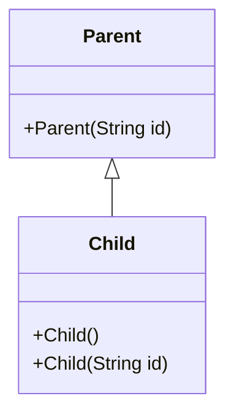

A `Child` object **also contains state defined by `Parent`**. Before the `Child` constructor completes, the `Parent` constructor must execute as part of the initialization chain.

A simple example:

```java
public class ConstructorChainDemo {
    static class Parent {
        Parent(String id) {
            System.out.println("Parent: " + id);
        }
    }

    static final class Child extends Parent {
        Child() {
            this("DEFAULT");
            System.out.println("Child()");
        }

        Child(String id) {
            super(id);
            System.out.println("Child(String): " + id);
        }
    }

    public static void main(String[] args) {
        new Child();
    }
}
```

Save as `ConstructorChainDemo.java` and run:

```bash
javac ConstructorChainDemo.java
java ConstructorChainDemo
```

Output:

```text
Parent: DEFAULT
Child(String): DEFAULT
Child()
```

Although execution begins with `new Child()`, it passes through `Child()` to delegate to `Child(String)` and then calls `Parent(String)`. The **constructor bodies** execute from the superclass downward before returning to the delegating constructor through `this(...)`.

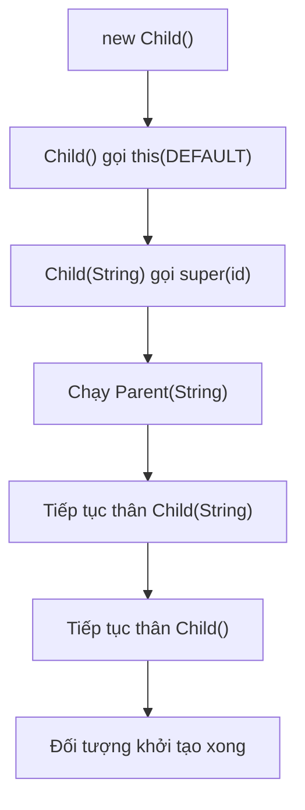

Important distinction: Java does not create three separate objects for `Child()`, `Child(String)`, and `Parent(String)`. This constructor chain initializes **one Child object**.

## 2. What Do `super(...)` and `this(...)` Do?

| Syntax | Purpose | Example |
|---|---|---|
| `super(args)` | Selects and invokes a constructor of the **direct superclass** | `super(id)` |
| `this(args)` | Delegates to another constructor in the **same class** | `this("DEFAULT")` |
| No explicit invocation | Compiler implicitly adds `super()` when valid | Constructor without `super(...)` |
| `super.someMethod()` | Invokes a superclass method implementation | Not a constructor invocation |
| `this.someMethod()` | Invokes a method on the current object | Not a constructor invocation |

In **Java 17**, an explicit `this(...)` or `super(...)` constructor invocation must be the **first statement**. You cannot invoke both directly in one constructor because each constructor has only one valid initialization delegation path.

```java
class Base {
    Base(int code) {
        System.out.println("Base " + code);
    }
}

class Derived extends Base {
    Derived() {
        this(10);             // Chuyển sang constructor khác của Derived
    }

    Derived(int code) {
        super(code);          // Gọi constructor của Base
        System.out.println("Derived " + code);
    }
}
```

`Derived()` delegates through `this(10)`; `Derived(int)` invokes `super(code)`. That chain reaches the superclass constructor. If `this(...)` invocations form a cycle, Java reports a recursive-constructor-invocation compilation error.

**Constructors are not ordinary methods:** they have no return type, are not inherited, and cannot be overridden. A subclass may declare a constructor with the same parameter list as a superclass constructor, but they are independent constructors.

### Common Error: No No-Argument Superclass Constructor

```java
class Parent {
    Parent(String id) {}
}

class Child extends Parent {
    Child() {
        // Trình biên dịch ngầm thử super(), nhưng Parent() không tồn tại.
    }
}
```

The example above **does not compile**. Once `Parent(String)` is declared, Java does not automatically add `Parent()`. Fix this by selecting the existing constructor:

```java
class Child extends Parent {
    Child() {
        super("C-001");
    }
}
```

Alternatively, add `Parent()` if it genuinely fits the superclass's initialization contract.

The superclass constructor must be **accessible** to the subclass. A normal subclass cannot directly invoke a `private` superclass constructor. `protected` is often appropriate when a class is designed for inheritance and subclasses need to invoke its constructor.

## 3. Full Initialization Order: Static, Instance Fields, Blocks, and Constructors

This is the most easily misunderstood part. Consider three inheritance levels: `Parent → Middle → Child`.

Save the **complete** example as `InitializationOrderDemo.java` (Java 17+):

```java
public class InitializationOrderDemo {
    private static void log(String text) {
        System.out.println(text);
    }

    private static int init(String label, int value) {
        log(label);
        return value;
    }

    static class Parent {
        static {
            log("Parent: static block");
        }

        private final int parentValue =
                init("Parent: instance field", 10);

        {
            log("Parent: instance block");
        }

        Parent(String source) {
            log("Parent: constructor, value=" + parentValue
                    + ", source=" + source);
        }
    }

    static class Middle extends Parent {
        static {
            log("Middle: static block");
        }

        private final int middleValue =
                init("Middle: instance field", 20);

        {
            log("Middle: instance block");
        }

        Middle() {
            super("Middle");
            log("Middle: constructor, value=" + middleValue);
        }
    }

    static final class Child extends Middle {
        static {
            log("Child: static block");
        }

        private final int childValue =
                init("Child: instance field", 30);

        {
            log("Child: instance block");
        }

        Child() {
            super();
            log("Child: constructor, value=" + childValue);
        }
    }

    public static void main(String[] args) {
        log("main: before new");
        new Child();
        log("main: after new");
    }
}
```

Compile and run:

```bash
javac InitializationOrderDemo.java
java InitializationOrderDemo
```

Exact output for this run:

```text
main: before new
Parent: static block
Middle: static block
Child: static block
Parent: instance field
Parent: instance block
Parent: constructor, value=10, source=Middle
Middle: instance field
Middle: instance block
Middle: constructor, value=20
Child: instance field
Child: instance block
Child: constructor, value=30
main: after new
```

### Why Does This Order Occur?

There are **two distinct processes**:

**A. Class initialization (`static`) on first active use**

Before creating `Child`, the JVM must ensure the classes in its superclass chain are initialized. If they have not been initialized previously, static initializers execute from superclass to subclass:

```text
Parent static → Middle static → Child static
```

Within **the same class**, static field initializers and static initialization blocks run in declaration order. Class initialization normally occurs **once per class initialization in the relevant class loader**, not each time `new` is used.

**B. Per-instance initialization**

After allocation and default-value assignment to instance fields, the constructor chain delegates from subclass toward superclass. As each class's initialization executes, the observable order is:

```text
Parent instance fields/blocks → Parent constructor body
→ Middle instance fields/blocks → Middle constructor body
→ Child instance fields/blocks → Child constructor body
```

Within **each class**, instance field initializers and instance initialization blocks run interleaved in **source declaration order**, after the superclass constructor completes and before that class's constructor body.

Do not assume that *all* field initializers across every class run before *all* initialization blocks. Their order interleaves according to declarations within each class.

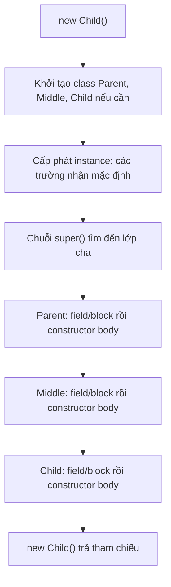

The diagram describes observable behavior for learning Java. The JVM may optimize physical allocation, but must preserve Java's required initialization semantics.

## 4. Default Values Exist Before Field Initializers

Java allocates an object and initializes instance fields to defaults before running initialization logic:

| Instance field type | Default value before initialization |
|---|---|
| `byte`, `short`, `int`, `long` | `0` (of the appropriate type) |
| `float`, `double` | `0.0` |
| `boolean` | `false` |
| `char` | Character `'\\u0000'` |
| Reference types (`String`, `List`, objects...) | `null` |

For example:

```java
class Counter {
    int count;              // Mặc định 0
    String label = "Ready"; // Field initializer thay null bằng "Ready"

    Counter() {
        count = 1;          // Constructor body thay 0 bằng 1
    }
}
```

After `new Counter()`, `count == 1` and `label.equals("Ready")` hold.

**Do not infer that local variables also receive readable defaults:** local variables in methods must be assigned before being read, or compilation fails.

Subclass fields also receive default values before the superclass constructor executes. This matters particularly when a superclass constructor invokes a method overridden by the subclass.

## 5. Risk: Superclass Constructors Calling Overridable Methods

This is an important technical hazard. When a superclass constructor invokes an instance method overridden by a subclass, **dynamic dispatch still occurs**: subclass code may run before subclass fields receive their explicit initializer values.

A standalone example saved as `ConstructorOverrideTrap.java`:

```java
public class ConstructorOverrideTrap {
    static class Parent {
        Parent() {
            System.out.println("Parent sees: " + description());
        }

        String description() {
            return "Parent";
        }
    }

    static final class Child extends Parent {
        private String name = "Ready";

        @Override
        String description() {
            return name;
        }
    }

    public static void main(String[] args) {
        Child child = new Child();
        System.out.println("After construction: " + child.description());
    }
}
```

Output:

```text
Parent sees: null
After construction: Ready
```

Reason:

1. `new Child()` starts the constructor chain.
2. `Parent()` executes **before** the `name = "Ready"` field initializer of `Child`.
3. `Parent()` invokes `description()`, but Java dispatches to `Child.description()`.
4. At that point, `name` still holds its default `null`; only when `Child` initialization resumes does the field receive `"Ready"`.

If `description()` called `name.length()` then, it could throw `NullPointerException`.

**Design rule:** avoid invoking overridable methods from constructors. Constructors should establish state owned by their own class; invoke extension hooks after full object initialization, or design appropriate non-overridable initialization helpers.

## 6. Does `this(...)` Rerun Subclass Field Initializers?

**No.** When one constructor delegates to another **in the same class** using `this(...)`, that class's instance initializers **do not run again**. They execute once for the object being created.

Example:

```java
public class SameClassChainDemo {
    static class Item {
        int quantity = initialize();

        private int initialize() {
            System.out.println("field initializer");
            return 1;
        }

        Item() {
            this(5);
            System.out.println("Item()");
        }

        Item(int amount) {
            // super() ngầm định ở đây
            quantity = amount;
            System.out.println("Item(int)");
        }
    }

    public static void main(String[] args) {
        Item item = new Item();
        System.out.println(item.quantity);
    }
}
```

Output:

```text
field initializer
Item(int)
Item()
5
```

`this(5)` does not create another object; it delegates to a constructor that shares the initialization path. If every constructor delegation reran field initializers, the result would contradict Java semantics.

Note: `this(...)` can execute multiple **constructor bodies** within a class as delegation returns, but it does not allocate an object multiple times.

## 7. Exceptions During the Constructor Chain

A constructor can reject input or fail during initialization.

```java
class Parent {
    Parent(int initial) {
        if (initial < 0) {
            throw new IllegalArgumentException("initial phải không âm");
        }
    }
}

class Child extends Parent {
    private final String name = createName();

    static String createName() {
        System.out.println("Child field initialized");
        return "OK";
    }

    Child(int initial) {
        super(initial);
        System.out.println("Child constructor body");
    }
}
```

If `new Child(-1)` is called, `Parent(-1)` throws `IllegalArgumentException`, so the `name = createName()` field initializer and `Child` constructor body **do not execute**.

This leads to a practical rule: if construction opens a resource (file, socket, connection) and a later step can fail, explicitly design cleanup along the failure path. Java **does not automatically call `close()` on a partially constructed object**.

A failed static initializer is a **class initialization** error, different from an instance-constructor error. The JVM marks class initialization failures according to specific rules, and subsequent uses may throw `NoClassDefFoundError`. Avoid excessive I/O or hard-to-reverse side effects inside static initializers.

## 8. Constructor Chaining Versus Method Overriding

| Mechanism | How is it selected? | When does it matter? |
|---|---|---|
| `this(...)` | Constructor overload in the same class, resolved from argument types at compile time | During object creation |
| `super(...)` | Direct superclass constructor, selected by parameters and accessibility | During superclass initialization |
| Method overriding | Instance implementation selected by the object's runtime type | During method invocation |
| `super.method()` | Invokes the corresponding superclass implementation | During method execution |
| Static initializer | JVM activates it when the class initializes according to Java semantics | Usually before the first instance creation |

Constructors cannot be overridden. A constructor has the class's name because of object-initialization syntax, not because it uses polymorphic dispatch like an instance method.

Nor must every constructor explicitly write `super()`: if it begins with neither `this(...)` nor `super(...)`, Java 17 implicitly adds `super()` **only when** an accessible no-argument superclass constructor exists.

## 9. Practical Guidelines for Safe Inheritance Hierarchies

1. **Make superclass constructors responsible for superclass state.** If a superclass requires `id`, pass and validate `id` through `super(id)`. The subclass then validates its own fields.
2. **Avoid overridable calls from constructors.** Do not make superclass constructors depend on uninitialized subclass data.
3. **Keep constructors simple.** Establish clear invariants; limit I/O, event emission, or premature publication of `this`.
4. **Use `this(...)` to reduce duplicate initialization logic.** Centralize validation in a primary constructor instead of repeating it across overloads.
5. **Do not assume a superclass has a default constructor.** Read constructor signatures and access levels before writing `extends`.
6. **Keep shared behavior in the superclass with proper ownership.** Do not inherit just to reuse a few lines when the is-a relationship is wrong.
7. **Test failure paths as well.** A failed superclass constructor prevents subclass initialization; do not leave earlier-opened resources unreleased.

## 10. Self-Check Exercises

**Exercise 1 — predict the output:**

```java
class A {
    A() { System.out.print("A "); }
}

class B extends A {
    B() { System.out.print("B "); }
}

class C extends B {
    C() { System.out.print("C "); }
}

// new C(); sẽ in gì?
```

**Answer:** `A B C ` because superclass constructors must complete before the subclass constructor body.

**Exercise 2 — fix the compilation error.** Write `Person` with only a `Person(String name)` constructor. Write `Student extends Person`, initially omitting `super(name)` to observe the failure. Then fix the `Student(String name, int grade)` constructor and validate `grade`.

**Exercise 3 — order of fields and initializer blocks.** Create `Base` and `Derived`, each with a field initializer, instance block, and constructor printing its step. Predict the six lines when `new Derived()` runs, then verify.

**Exercise 4 — early overriding hazard.** Modify `ConstructorOverrideTrap` so `Parent` does not invoke `description()` in its constructor. Move the call to `main` after construction and compare the output.

**Exercise 5 — `this(...)` cycle.** Try two constructors, `Example()` and `Example(int)`, each delegating to the other. Explain the compilation error and fix the chain to end in a constructor that invokes `super(...)`.

**Exercise 6 — failure case.** In the `Parent/Child` example in Section 7, predict whether `Child field initialized` appears for `new Child(-1)`. Explain from the constructor chain.

**Remember:** With `new Child()`, Java initializes the superclass and completes its instance initialization before the subclass instance initialization. `super(...)` invokes a superclass constructor, `this(...)` chains constructors within one class, and **each class's field initializers/instance blocks execute in declaration order before its constructor body**. In particular, superclass constructors should not invoke methods overridable by subclasses because subclass fields may not be ready.


</details>

- [Back to top](#back-to-top)

---

## <a id="inheritance-007">Non-overridable members and non-extendable classes</a>

<details>
<summary>View details</summary>

# Non-Overridable Members and Non-Extendable Classes in Java

In Java, the `final` keyword can **lock down parts of an inheritance design**:

- Apply `final` to a **method** so subclasses cannot override (*override*) it.
- Apply `final` to a **class** so no other class can `extends` it.
- Apply `final` to a **variable or field** to prevent reassignment after valid initialization.

These three meanings all promote stability, but **they are not interchangeable**. In particular, a `final class` does not automatically make internal data immutable; a `final method` may still mutate state; and a `final field` does not make the referenced object immutable.

The goal is to understand exactly **what the compiler prohibits**, what remains possible, and how `final` protects rules that subclasses must not violate.

## 1. `final` Methods: Inheritable but Not Overridable

A `final` instance method can still be **called and inherited** by subclasses, but they **cannot provide a new overriding implementation with the same signature**.

~~~java
class Account {
    private String owner;

    Account(String owner) {
        this.owner = owner;
    }

    public final String getOwner() {
        return owner;
    }
}

class SavingsAccount extends Account {
    SavingsAccount(String owner) {
        super(owner);
    }

    // Không hợp lệ:
    // @Override
    // public String getOwner() {
    //     return "Người khác";
    // }
}
~~~

~~~java
SavingsAccount account = new SavingsAccount("An");
System.out.println(account.getOwner()); // An
~~~

Although `SavingsAccount` cannot **override** `getOwner()`, it can still use the inherited method. `final` prevents replacing the method implementation; it **does not** remove the method from the subclass API.

Comparison table:

| Action involving a superclass `final` method | Allowed? |
| --- | --- |
| Call it on a subclass object | Yes, when access permits |
| Inherit the implementation in a subclass | Yes, under Java inheritance rules |
| Override the same signature in a subclass | No |
| Add a different-parameter **overload** in the subclass | Yes |
| Let the `final` method mutate a field or call another method | Yes |
| Let the `final` method call an overridable hook | Yes, but design carefully |

**Overriding (override)** and **overloading (overload)** differ:

~~~java
class Parent {
    public final void send(String text) {
        System.out.println("Gửi: " + text);
    }
}

class Child extends Parent {
    // Overload: tham số khác, hoàn toàn hợp lệ.
    public void send(String text, int times) {
        for (int i = 0; i < times; i++) {
            send(text); // Gọi phương thức final kế thừa từ Parent.
        }
    }

    // LỖI nếu viết:
    // @Override
    // public void send(String text) { }
}
~~~

`send(String, int)` is another method with a different signature; it does not replace the `send(String)` implementation.

## 2. `final` Classes Cannot Be Superclasses

Given this declaration:

~~~java
final class Receipt {
    private final String code;

    Receipt(String code) {
        this.code = code;
    }

    String getCode() {
        return code;
    }
}
~~~

You can still instantiate it:

~~~java
Receipt receipt = new Receipt("RC-001");
System.out.println(receipt.getCode()); // RC-001
~~~

But cannot declare a subclass:

~~~java
// LỖI BIÊN DỊCH:
// class SpecialReceipt extends Receipt {
// }
~~~

A `final` class can itself `extends` a superclass and `implements` interfaces:

~~~java
interface Printable {
    void print();
}

class Document {
    String category() {
        return "Tài liệu";
    }
}

final class Invoice extends Document implements Printable {
    @Override
    public void print() {
        System.out.println(category() + ": hóa đơn");
    }
}
~~~

`Invoice` **inherits** from `Document` but **cannot be extended further**. So the claim that “final classes cannot participate in inheritance” is wrong: they may appear **at the end of a branch**.

Diagram:

~~~mermaid
classDiagram
    class Document {
        +category() String
    }
    class Printable {
        <<interface>>
        +print() void
    }
    class Invoice {
        <<final>>
        +print() void
    }
    Document <|-- Invoice
    Printable <|.. Invoice
~~~

`Invoice` remains usable through a `Document` or `Printable` reference. Marking it `final` does not remove polymorphism through its superclass or implemented interfaces.

## 3. Runnable Java Example: Locking Down a Workflow While Exposing Extension Points

Scenario: an application has multiple payment channels. Every request must validate the amount before processing through a specific channel and return transaction information in a consistent structure.

Design:

- `PaymentChannel` defines the caller-facing contract.
- `PaymentProcessor` is an **abstract** superclass with a **final** `process()` method to preserve the shared workflow.
- `charge()` is a `protected abstract` extension point implemented by subclasses for payment processing.
- `CardProcessor` is **final**: it implements card payments and prohibits further subclassing.
- `BankTransferProcessor` is another concrete class illustrating how several implementations share the workflow.

Save everything as `FinalInheritanceDemo.java` and run with **Java 11+**.

~~~java
import java.math.BigDecimal;
import java.util.List;
import java.util.Objects;

public class FinalInheritanceDemo {

    interface PaymentChannel {
        Receipt process(BigDecimal amount);
    }

    static final class Receipt {
        private final String provider;
        private final BigDecimal amount;
        private final String transactionId;

        Receipt(String provider, BigDecimal amount, String transactionId) {
            this.provider = Objects.requireNonNull(provider);
            this.amount = Objects.requireNonNull(amount);
            this.transactionId = Objects.requireNonNull(transactionId);
        }

        String getProvider() {
            return provider;
        }

        BigDecimal getAmount() {
            return amount;
        }

        String getTransactionId() {
            return transactionId;
        }
    }

    static abstract class PaymentProcessor implements PaymentChannel {
        private final String provider;

        protected PaymentProcessor(String provider) {
            String checked = Objects.requireNonNull(provider).trim();
            if (checked.isEmpty()) {
                throw new IllegalArgumentException("Tên kênh không hợp lệ");
            }
            this.provider = checked;
        }

        // Template Method: lớp con không được bỏ qua quy trình kiểm tra.
        @Override
        public final Receipt process(BigDecimal amount) {
            Objects.requireNonNull(amount, "amount");

            if (amount.signum() <= 0) {
                throw new IllegalArgumentException(
                        "Số tiền phải lớn hơn 0");
            }

            String transactionId = Objects.requireNonNull(
                    charge(amount), "transactionId");
            if (transactionId.isBlank()) {
                throw new IllegalStateException("Thiếu mã giao dịch");
            }

            return new Receipt(provider, amount, transactionId);
        }

        // Mỗi lớp con phải định nghĩa cách xử lý riêng.
        protected abstract String charge(BigDecimal amount);
    }

    // Vừa kế thừa một lớp cha, vừa không cho kế thừa tiếp.
    static final class CardProcessor extends PaymentProcessor {
        CardProcessor() {
            super("CARD");
        }

        @Override
        protected String charge(BigDecimal amount) {
            System.out.println("Xử lý thẻ: " + amount.toPlainString());
            return "CARD-TX-001";
        }

        // Không hợp lệ nếu bỏ comment:
        // @Override
        // public Receipt process(BigDecimal amount) {
        //     return null;
        // }
    }

    static class BankTransferProcessor extends PaymentProcessor {
        BankTransferProcessor() {
            super("BANK");
        }

        @Override
        protected String charge(BigDecimal amount) {
            System.out.println("Chuyển khoản: " + amount.toPlainString());
            return "BANK-TX-002";
        }
    }

    public static void main(String[] args) {
        List<PaymentChannel> channels = List.of(
                new CardProcessor(), new BankTransferProcessor());

        for (PaymentChannel channel : channels) {
            Receipt receipt = channel.process(
                    new BigDecimal("150000"));

            System.out.println(
                    receipt.getProvider() + " -> "
                    + receipt.getTransactionId());
        }

        try {
            channels.get(0).process(BigDecimal.ZERO);
        } catch (IllegalArgumentException ex) {
            System.out.println("Từ chối: " + ex.getMessage());
        }
    }
}
~~~

Run:

~~~bash
javac FinalInheritanceDemo.java
java FinalInheritanceDemo
~~~

Output:

~~~text
Xử lý thẻ: 150000
CARD -> CARD-TX-001
Chuyển khoản: 150000
BANK -> BANK-TX-002
Từ chối: Số tiền phải lớn hơn 0
~~~

This example simulates payments using fixed strings and console output; it neither connects to a bank nor guarantees real transactions. It demonstrates inheritance rules and code protected by `final`.

### What Is Fixed, and What Can Be Extended?

| Component | Responsibility | Can subclasses override? |
| --- | --- | --- |
| `PaymentProcessor.process()` | Validates amount, calls `charge`, normalizes Receipt | **No**, because it is `final` |
| `PaymentProcessor.charge()` | Contract implemented by each payment channel | **Yes**, and concrete subclasses must implement it |
| `CardProcessor` | A concrete payment processor | No subclasses because the class is `final` |
| `BankTransferProcessor` | Another concrete processor | Can be subclassed because it is not `final` |
| `Receipt` | Transaction information produced after processing | Cannot be subclassed because the class is `final` |

**Important technical detail:** `process()` cannot be overridden, but its internal call to `charge(amount)` **still dispatches** to the runtime instance's implementation. Thus `final` locks down only `process`'s body, not all polymorphism in the class.

~~~mermaid
sequenceDiagram
    actor App
    participant P as PaymentProcessor.process() final
    participant C as CardProcessor.charge()
    App->>P: process(150000)
    P->>P: kiểm tra amount > 0
    P->>C: charge(150000)
    C-->>P: "CARD-TX-001"
    P->>P: new Receipt(...)
    P-->>App: Receipt
~~~

The diagram shows **the roles in one call on the same CardProcessor instance**: `PaymentProcessor.process()` is inherited code executing, while `CardProcessor.charge()` is dynamically dispatched code. No separate `PaymentProcessor` instance is created.

## 4. Why Mark a Method `final`?

Use `final` when a method embodies **a fixed superclass rule**, such as mandatory validation steps or an identifier representation that must not change.

Potential design benefits:

1. Prevent subclasses from skipping essential logic by overriding a method.
2. Signal that this API has a stable implementation across the inheritance hierarchy.
3. Preserve a shared workflow while permitting specialization through dedicated hooks.
4. Reduce the ways a subclass can violate part of the superclass contract.

However, `final` **is not an absolute security mechanism**. A subclass can still cause incorrect behavior if the superclass exposes other state-changing methods or overridable hooks with dangerous behavior. In the example, `charge()` might return a syntactically valid response without actually collecting money. Every extension point still needs a well-designed and verified contract.

Do not habitually make every method `final` and inadvertently prevent legitimate variations. Before locking down a method, identify a specific **business reason or design constraint**.

## 5. Why Make a Class `final`?

Use `final class` when the design should **prohibit further specialization through inheritance**:

- A value type with strict invariants, where subclassing could change expectations.
- A complete implementation that exposes no extension contract for subclasses.
- A utility or component intended to be **used or delegated to** rather than inherited.
- A type whose identity, equality, or internal rules are difficult to preserve if subclasses can freely change behavior.

The `Receipt` class above has no setters and uses immutable `String`/`BigDecimal` values in its fields. Together with constructor validation, this produces an **observably immutable state** in the example.

But distinguish the underlying reasons:

~~~java
final class Counter {
    private int value;

    void increment() {
        value++;
    }

    int getValue() {
        return value;
    }
}
~~~

~~~java
Counter counter = new Counter();
counter.increment();
System.out.println(counter.getValue()); // 1
~~~

`Counter` is a `final` class **yet its instances are mutable**. Class-level `final` only prevents `extends Counter`; it does not prohibit updating `value`.

Similarly, a non-`final` class can still be designed to be immutable if all state is properly protected. Data immutability and inheritance restrictions are **separate design decisions**.

## 6. Three Commonly Confused Uses of `final`

| Location | Example | What is prohibited | What remains possible |
| --- | --- | --- | --- |
| Class | `final class Receipt` | Another class using `extends Receipt` | Creating instances, calling methods, changing state if permitted |
| Method | `public final void process()` | A subclass overriding the same signature | Calling it from subclasses, overloading with different parameters |
| Variable/field | `final List<String> items` | Reassigning `items` after assignment | `items.add(...)` if the list is mutable |

Example of `final` on a reference variable:

~~~java
import java.util.ArrayList;
import java.util.List;

final List<String> tags = new ArrayList<>();
tags.add("Java");       // Hợp lệ: cập nhật đối tượng List.
// tags = new ArrayList<>(); // Lỗi: không được gán lại biến final.
~~~

For primitive types:

~~~java
final int maxAttempts = 3;
// maxAttempts = 5; // Lỗi biên dịch.
~~~

For method parameters:

~~~java
void render(final String message) {
    // message = "Khác"; // Lỗi: gán lại tham số final.
    System.out.println(message);
}
~~~

For a field without a declaration initializer:

~~~java
class User {
    private final String id;

    User(String id) {
        this.id = id; // Gán một lần trong constructor.
    }
}
~~~

A `blank final field` must be assigned according to Java's initialization rules on every normally completing initialization path; it cannot be reassigned afterward. A `final` field referencing a mutable object does not freeze that object's internal state.

## 7. Which Members Cannot Be Overridden Even Without `final`?

Not every superclass member is a valid override point.

| Member | Truly overridable? | Explanation |
| --- | --- | --- |
| Instance method `public/protected`, neither final nor static | Usually yes | If access and signature rules are satisfied |
| Instance method `final` | No | Compiler prohibits overriding |
| Method `private` | No | Not inherited in a way that permits overriding |
| Method `static` | No | May be **hidden** by a subclass static method, subject to restrictions such as final |
| Constructor | No | Constructors are not inherited methods |
| Field, including `final field` | No | Fields can only be **hidden** by name, not dynamically overridden |

### `private` and `static` Do Not Mean Overriding

~~~java
class Parent {
    private void internal() {
        System.out.println("Parent internal");
    }

    static void info() {
        System.out.println("Parent info");
    }
}

class Child extends Parent {
    // Đây là phương thức MỚI, không override private method ở Parent.
    public void internal() {
        System.out.println("Child internal");
    }

    // Đây là static method hiding, không phải instance override.
    static void info() {
        System.out.println("Child info");
    }
}
~~~

~~~java
Parent p = new Child();
p.info();     // Parent info (static ràng buộc theo kiểu khai báo)
// p.internal(); // Không biên dịch: Parent.internal() là private.

Child c = new Child();
c.internal(); // Child internal
~~~

Invoke static methods through class names (`Parent.info()`, `Child.info()`) to avoid confusing them with dynamic polymorphism.

If the superclass declares `static final void info()`, the subclass cannot declare a same-signature static method to hide it. With `private final void internal()`, a subclass may still declare a separate same-named/same-signature method under access rules because that is **not overriding** the superclass private method.

### `abstract` and `final` Cannot Be Combined on the Same Class or Method

These keywords impose opposite requirements:

- An `abstract method` requires a subclass to supply an implementation.
- A `final method` prevents a subclass from supplying an implementation through overriding.
- An `abstract class` may require or allow subclasses to complete its behavior.
- A `final class` prevents any subclass from being declared.

Thus the following declarations are **invalid**:

~~~java
// abstract final class Impossible { }

// abstract class Base {
//     abstract final void execute();
// }
~~~

By contrast, an **abstract class may contain an implemented final method**—as shown by `PaymentProcessor.process()` in the runnable example.

## 8. What If Some Methods Must Be Fixed While Others Remain Extensible?

This is a common situation. Use a **non-final** superclass or an `abstract class`, then mark only the steps that must not be overridden:

~~~java
abstract class ImportJob {
    // Giữ nguyên quy trình.
    public final void run() {
        validate();
        parse();
        save();
    }

    private void validate() {
        System.out.println("Kiểm tra đầu vào chung");
    }

    protected abstract void parse();
    protected abstract void save();
}
~~~

~~~java
class CsvImportJob extends ImportJob {
    @Override
    protected void parse() {
        System.out.println("Đọc CSV");
    }

    @Override
    protected void save() {
        System.out.println("Lưu dữ liệu CSV");
    }
}
~~~

`ImportJob.run()` fixes the step sequence; subclasses specialize `parse()` and `save()`. This is a variation of the **Template Method** pattern.

Importantly, if `parse()` or `save()` throws or mutates invalid state, `final run()` **does not automatically undo** the changes. `final` controls **overriding permissions**; it does not replace error handling, transactions, or synchronization.

## 9. Design Alternatives to Marking a Class `final`

A `final` class enforces **no subclassing**, but sometimes you want **only selected subtypes** rather than unlimited extension.

Since **Java 17**, Java supports `sealed class`:

~~~java
// Ví dụ riêng cho Java 17+, không thuộc bản demo Java 11.
sealed class PaymentMethod permits Cash, Card {
}

final class Cash extends PaymentMethod {
}

final class Card extends PaymentMethod {
}
~~~

Comparison:

| Design | Who may inherit? |
| --- | --- |
| `class Base` (neither final nor sealed) | Classes satisfying accessibility and language rules |
| `final class Base` | No subclass |
| `sealed class Base permits A, B` | Only directly permitted classes; subclasses must declare `final`, `sealed`, or `non-sealed` as required |
| `abstract class Base` | May be subclassed, but the type itself cannot be instantiated directly with `new` |

Do not choose `sealed` merely to replace a keyword. It is useful for an intentionally **finite, well-defined set of variants**. The main runnable example in Section 3 requires only Java 11; this `sealed` example requires Java 17 or later.

For interchangeable behavior, **composition + interface** is worth considering: inject a strategy through a constructor instead of subclassing a `final` class. `final` does not prevent a class from **using** another object.

## 10. Common Compilation Errors and Incorrect Assumptions

| Scenario | Correct conclusion |
| --- | --- |
| `class B extends FinalA` when `FinalA` is a `final class` | Compilation error: cannot inherit |
| Overriding `public final void f()` in a subclass | Compilation error: cannot override |
| Constructing `new FinalA()` when the constructor is accessible | Valid |
| A `final` class implements an interface | Valid |
| An abstract class declares a `final` method | Valid |
| A method marked both `abstract` and `final` | Invalid |
| Overloading a `final method` with different parameters | Valid |
| Declaring `final List<T>` and invoking `add()` | May be valid when the list is mutable |
| Superclass `private` method and a same-named subclass method | Not an override |
| A same-named/signature subclass `static` method | Hiding if legal, not overriding |
| Using `final` to guarantee thread safety | Insufficient; access and mutation must be considered |
| “A final class is always immutable” | False: `Counter` is a counterexample |

### Useful Compilation Failures to Recognize

~~~java
final class Locked {
    void work() {}
}

// class CannotExtend extends Locked {} // ERROR

class Base {
    public final void execute() {}
}

class Derived extends Base {
    // @Override
    // public void execute() {} // ERROR

    // Overload vẫn được phép:
    public void execute(int count) {
        for (int i = 0; i < count; i++) {
            execute();
        }
    }
}
~~~

The failures arise from **compile-time type rules**, not because the JVM discovers incorrect subclass behavior at runtime. Adding `@Override` to intended legal overrides is good practice because the compiler verifies the signature.

## 11. When Should You Avoid `final`?

`final` should express a **design decision**. If an application needs third-party extensions of an API to support valid variations, locking down classes or methods too early can make that API awkward or force convoluted workarounds.

Warning signs include:

- Behavior genuinely needs to be overridden, but the superclass marks it `final` without offering hooks or another abstraction.
- New features frequently require interchangeable implementations through interfaces/strategies, yet dependencies are tied to concrete classes.
- Inheritance is used only to reuse a few utility lines even though the is-a relationship is invalid.
- You assume that marking something `final` automatically solves concurrency, security, immutability, or transaction problems.

A practical rule: **lock down what must remain stable; extend at points with clear contracts**. In domains needing flexible variation, prefer interfaces/composition or controlled hooks over freely overriding a whole workflow.

## 12. Self-Check

**Question 1.** Can a subclass invoke a `final` method?

**Answer:** Yes, when access permits. A subclass cannot **override** its implementation, but may **inherit and use** it.

**Question 2.** Is `final class Printer implements Printable` valid?

**Answer:** Yes. `final` prevents another class from using `extends Printer`, while `implements Printable` states that `Printer` fulfills the interface contract.

**Question 3.** In the payment example, why is `process()` `final` while `CardProcessor.charge()` is still invoked?

**Answer:** `process()` is inherited shared code and cannot be overridden. It invokes the `charge()` hook implemented by subclasses; Java dispatches that hook according to the object's runtime type.

**Question 4.** Does `final List<String> names = new ArrayList<>(); names.add("An");` compile?

**Answer:** Yes. There is no **reassignment** of `names`; calling `add` mutates the referenced list.

**Question 5.** Can a subclass override the superclass method `private void save()`?

**Answer:** No. Where permitted, a subclass may declare a separate same-named/signature method, but it does not override the superclass `private` method.

**Question 6.** Can a `final` class also be `abstract`?

**Answer:** No. `final` prevents subclassing, whereas `abstract` describes a type that cannot be directly instantiated and is designed for subclasses to complete or use.

**Question 7.** If the superclass must preserve `validate → execute → audit` while each subclass implements `execute` differently, where should `final` go?

**Answer:** Put `final` on the coordinating method and expose a `protected abstract` method or suitable hook for `execute`. Handle exceptions and state changes separately because `final` does not imply atomicity.

**Question 8.** To allow exactly three concrete subclasses to extend a class directly, what should you consider in Java 17+?

**Answer:** Consider `sealed class` with `permits`. Unlike `final class`, `sealed class` permits a specified set of subclasses under Java's rules.

**Remember:** A `final method` **prevents method overriding**, a `final class` **prevents subclassing**, and a `final field/variable` **prevents reassignment**. Using each at the right level preserves essential behavior while allowing deliberately designed extension points.


</details>

- [Back to top](#back-to-top)

---

## <a id="inheritance-008">Single inheritance, multiple inheritance, and behavior conflicts</a>

<details>
<summary>View details</summary>

# Single Inheritance, Multiple Inheritance, and Behavior Conflicts in Java

In OOP, an object sometimes needs several capabilities: an invoice may **export PDF**, **export CSV**, and **log actions**; a device may **print** and **scan**. This raises questions about how many classes Java can inherit, how many interfaces it can combine, and which method executes when multiple branches define the same behavior.

**Key conclusion:** A Java class has **one direct superclass** (single inheritance with `extends`), but may **implement multiple interfaces**. An interface may `extends` several other interfaces. Since Java 8, interfaces may contain `default method` implementations, so combining interfaces can introduce **behavior conflicts** resolved by Java's rules or an explicit class override.

## 1. Single Inheritance: At Most One Direct Superclass

A simple example:

```java
class Document {
    private final String id;

    Document(String id) {
        this.id = id;
    }

    public String id() {
        return id;
    }

    public String summary() {
        return "Document " + id;
    }
}

class Invoice extends Document {
    private final long amountVnd;

    Invoice(String id, long amountVnd) {
        super(id);  // Gọi constructor của Document
        if (amountVnd < 0) {
            throw new IllegalArgumentException("Số tiền âm");
        }
        this.amountVnd = amountVnd;
    }

    public long amountVnd() {
        return amountVnd;
    }
}
```

`Invoice extends Document` means an invoice is modeled as a kind of document. An `Invoice` instance contains state managed by `Document` and state declared by `Invoice`; it also uses inherited `id()` and `summary()`.

```java
Invoice invoice = new Invoice("INV-01", 100_000L);

System.out.println(invoice.id());         // INV-01
System.out.println(invoice.summary());    // Document INV-01
System.out.println(invoice.amountVnd());  // 100000
```

**Java does not allow a class to directly extend two classes:**

```java
class Printer {}
class Scanner {}

// Sai cú pháp Java:
// class MultiFunction extends Printer, Scanner {}
```

Java allows only one superclass name after `extends` in a class declaration. An inheritance chain may still have several levels, such as `Object -> Document -> Invoice`. “Single inheritance” does not mean the whole hierarchy contains only two classes.

### Why Doesn't Java Support Multiple Class Inheritance?

Suppose both `Printer` and `Scanner` declare a `status` field, constructors requiring input, and a `reset()` method. If one class inherited directly from both, it would need answers to these questions:

- Which state should be stored, and which portion should be initialized first?
- If both superclasses define `reset()`, which implementation should execute?
- If both ancestry branches inherit the same root class, should its state exist once or multiple times?

These issues are associated with the **diamond problem** (*diamond problem*) in languages permitting multiple inheritance of implementation/state from classes. Java avoids this kind of multiple class inheritance and offers interfaces for combining behavioral contracts.

## 2. A Class Can Implement Multiple Interfaces

Interfaces represent **capabilities and contracts** rather than requiring inheritance of instance state from a superclass.

```java
interface Printable {
    void print();
}

interface Scannable {
    String scan();
}

class OfficeMachine implements Printable, Scannable {
    @Override
    public void print() {
        System.out.println("Printing");
    }

    @Override
    public String scan() {
        return "Scanned document";
    }
}
```

`OfficeMachine` implements both contracts. Interfaces have no constructors or ordinary instance fields; interface fields are implicitly `public static final`, meaning interface constants rather than per-instance data.

A class can also **extend a superclass and implement multiple interfaces**:

```java
class Asset {
    private final String assetCode;

    Asset(String assetCode) {
        this.assetCode = assetCode;
    }

    public String assetCode() {
        return assetCode;
    }
}

class NetworkPrinter extends Asset implements Printable, AutoCloseable {
    NetworkPrinter(String assetCode) {
        super(assetCode);
    }

    @Override
    public void print() {
        System.out.println("Printing from " + assetCode());
    }

    @Override
    public void close() {
        System.out.println("Release printer resource");
    }
}
```

`NetworkPrinter` inherits only class `Asset` but provides the `Printable` and `AutoCloseable` capabilities. This is **multiple inheritance of types/contracts**, not multiple class inheritance.

An interface may itself inherit **multiple interfaces**:

```java
interface Searchable {
    void search(String keyword);
}

interface Auditable {
    void audit(String action);
}

interface SearchableAndAuditable extends Searchable, Auditable {
    // Kết hợp hai hợp đồng.
}
```

A concrete class implementing `SearchableAndAuditable` must supply all required abstract methods unless it inherits suitable implementations.

## 3. When Do Multiple Interfaces Conflict?

With abstract-only interfaces, multiple contracts requesting a compatible signature can often be satisfied with **one implementation**:

```java
interface Notifier {
    void send(String message);
}

interface Dispatcher {
    void send(String message);
}

class EmailWorker implements Notifier, Dispatcher {
    @Override
    public void send(String message) {
        System.out.println("Email: " + message);
    }
}
```

Both interfaces request `send(String)` returning `void`; neither provides competing implementation code. `EmailWorker` needs only one method to satisfy both.

If two interfaces instead impose **incompatible requirements**, such as the same signature with incompatible return types, no valid Java class can implement both:

```java
interface StringReader {
    String read();
}

interface IntegerReader {
    Integer read();
}

// Sai: Không thể cung cấp một phương thức read() không tham số
// có kiểu trả về vừa là String vừa là Integer:
// class BrokenReader implements StringReader, IntegerReader {}
```

Java **method signatures** are not distinguished solely by return type. You cannot declare two argument-free `read()` methods differing only in return type.

The more obvious behavior conflicts occur with **`default method`** implementations.

## 4. Default Methods: Built-In Interface Behavior

Since Java 8, an interface can provide a default implementation:

```java
interface PdfExportable {
    default String render() {
        return "Nội dung PDF";
    }
}

interface CsvExportable {
    default String render() {
        return "Nội dung CSV";
    }
}
```

A class implementing both of these interfaces faces a question: which `render()` implementation should a call use?

```java
// Không biên dịch: hai default method độc lập cùng chữ ký.
// class Report implements PdfExportable, CsvExportable {}
```

Java does not choose one at random. The class must provide an explicit implementation:

```java
class Report implements PdfExportable, CsvExportable {
    @Override
    public String render() {
        return PdfExportable.super.render()
            + "\n---\n"
            + CsvExportable.super.render();
    }
}
```

`InterfaceName.super.method()` invokes the `default` implementation of an **appropriate direct superinterface** in the implementing class. In this example, `Report` combines both results. In real systems, concatenating PDF and CSV is just an illustration of **conflict resolution**; exports are often better modeled as separately named operations or strategies.

The central point is that **a class must define the intended business behavior when default implementations disagree**.

## 5. Three Rules for Choosing Methods

### Rule A — A Concrete Class Instance Method Takes Precedence

If a superclass has a concrete instance method with the same signature as an interface default method, **the class method** is selected.

```java
class BaseLabel {
    public String label() {
        return "Từ superclass";
    }
}

interface Labeled {
    default String label() {
        return "Từ interface";
    }
}

class LabeledDocument extends BaseLabel implements Labeled {
    // Không cần override label()
}

LabeledDocument doc = new LabeledDocument();
System.out.println(doc.label()); // Từ superclass
```

This is often called **class wins**: a method inherited from a class takes precedence over a competing interface default method. This reduces surprises when default methods are added to interfaces that existing classes already implement.

Do not overgeneralize it into “every superclass method wins” regardless of abstract/concrete status and access. If the superclass declares a corresponding **abstract** method, a concrete subclass may still need to provide an implementation.

### Rule B — The More Specific Interface Takes Precedence

When one interface extends another and overrides its default method, the **more specific subinterface** implementation is selected.

```java
interface Named {
    default String name() {
        return "Named";
    }
}

interface DetailedNamed extends Named {
    @Override
    default String name() {
        return "DetailedNamed";
    }
}

class DetailedReport implements Named, DetailedNamed {
    // Không cần override: DetailedNamed cụ thể hơn.
}

System.out.println(new DetailedReport().name()); // DetailedNamed
```

These are not two equally ranked default methods: `DetailedNamed` is a subtype of `Named`, so the more specific implementation determines the result.

### Rule C — Unrelated Peer Default Methods Require Conflict Resolution

When a class inherits two same-signature default methods from unrelated interfaces with no precedence relationship, the compiler requires an explicit resolution:

```java
interface A {
    default String status() {
        return "A";
    }
}

interface B {
    default String status() {
        return "B";
    }
}

class C implements A, B {
    @Override
    public String status() {
        return A.super.status() + " + " + B.super.status();
    }
}

System.out.println(new C().status()); // A + B
```

A class may instead provide a wholly new implementation without calling either default:

```java
@Override
public String status() {
    return "C tự định nghĩa trạng thái";
}
```

The correct choice depends on the business contract. **The point of overriding is not merely to make code compile**, but to deliberately define behavior.

## 6. Complete Java Example: Multiple Interfaces and Three Behavior-Selection Scenarios

Save as `InheritanceConflictDemo.java`:

```java
public class InheritanceConflictDemo {

    static class Document {
        private final String id;

        Document(String id) {
            if (id == null || id.isBlank()) {
                throw new IllegalArgumentException("id không hợp lệ");
            }
            this.id = id;
        }

        public String label() {
            return "Document: " + id;
        }
    }

    interface PdfPrintable {
        default String render() {
            return "PDF";
        }
    }

    interface CsvExportable {
        default String render() {
            return "CSV";
        }
    }

    interface Auditable {
        void audit(String event);
    }

    // Hai default method cùng chữ ký, phải override.
    static final class Invoice extends Document
            implements PdfPrintable, CsvExportable, Auditable {

        Invoice(String id) {
            super(id);
        }

        @Override
        public String render() {
            return PdfPrintable.super.render()
                + " | "
                + CsvExportable.super.render();
        }

        @Override
        public void audit(String event) {
            System.out.println("Audit " + label() + ": " + event);
        }
    }

    // Phương thức lớp thắng default method của interface.
    static class BaseTitle {
        public String title() {
            return "Từ class";
        }
    }

    interface TitleProvider {
        default String title() {
            return "Từ interface";
        }
    }

    static final class TitleDocument
            extends BaseTitle implements TitleProvider {
    }

    // Subinterface cụ thể hơn có ưu tiên.
    interface RootTag {
        default String tag() {
            return "Root";
        }
    }

    interface SpecificTag extends RootTag {
        @Override
        default String tag() {
            return "Specific";
        }
    }

    static final class TaggedDocument
            implements RootTag, SpecificTag {
    }

    // Hai đường kế thừa cùng MỘT default method gốc.
    interface PingRoot {
        default String ping() {
            return "PONG";
        }
    }

    interface PingLeft extends PingRoot {}
    interface PingRight extends PingRoot {}

    static final class DiamondDocument
            implements PingLeft, PingRight {
        // Không có hai implementation độc lập.
    }

    public static void main(String[] args) {
        Invoice invoice = new Invoice("INV-01");

        System.out.println(invoice.label());
        System.out.println(invoice.render());
        invoice.audit("created");

        System.out.println(new TitleDocument().title());
        System.out.println(new TaggedDocument().tag());
        System.out.println(new DiamondDocument().ping());
    }
}
```

Run with JDK 11+:

```bash
javac InheritanceConflictDemo.java
java InheritanceConflictDemo
```

Output:

```text
Document: INV-01
PDF | CSV
Audit Document: INV-01: created
Từ class
Specific
PONG
```

Explanation:

| Output line | Reason |
|---|---|
| `Document: INV-01` | `Invoice` inherits the concrete superclass method `label()` |
| `PDF | CSV` | `Invoice` explicitly overrides `render()` to resolve independent default implementations |
| `Audit ...` | `Invoice` implements the abstract method from `Auditable` |
| `Từ class` | The concrete `BaseTitle` method takes precedence over `TitleProvider.default title()` |
| `Specific` | `SpecificTag` is more specific than `RootTag` |
| `PONG` | Both `PingLeft` and `PingRight` inherit **one** original default method from `PingRoot`, not two separate implementations |

### Subtle Point: A Diamond Does Not Always Create a Conflict

Diagram:

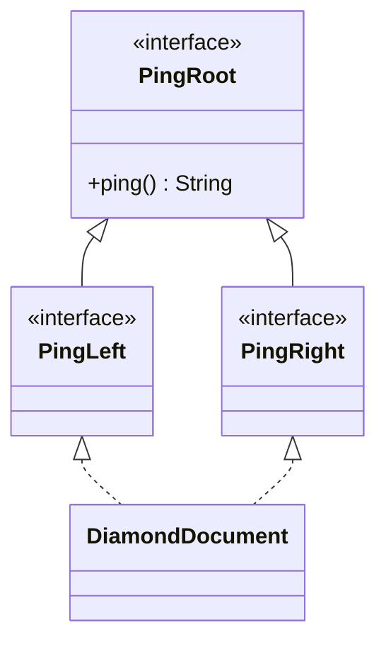

Neither `PingLeft` nor `PingRight` **overrides `ping()` independently**; both inherit the same declaration from `PingRoot`, so `DiamondDocument` has no conflict to resolve.

If `PingLeft` and `PingRight` **each declared a distinct default override of `ping()`**, `DiamondDocument` would inherit two equally ranked implementations and must override explicitly.

A diamond only describes the type relationship; **whether a conflict exists depends on the methods actually inherited and precedence rules**.

## 7. Conflicts Also Arise from Names and Contracts, Not Just Default Methods

### 7.1. Colliding Constant Names

Interface fields are `public static final`. If two interfaces define constants with the same name, a class implementing both must qualify the reference to disambiguate:

```java
interface PdfConfig {
    String FORMAT = "pdf";
}

interface CsvConfig {
    String FORMAT = "csv";
}

class ExportJob implements PdfConfig, CsvConfig {
    public String formats() {
        // return FORMAT; // Mơ hồ
        return PdfConfig.FORMAT + "," + CsvConfig.FORMAT;
    }
}
```

Constants and fields do not participate in runtime polymorphism. **Field hiding/name ambiguity** differs from overriding instance methods.

### 7.2. Interface Static Methods

Static methods are invoked through **interface names**; implementing classes do not inherit interface static methods as instance-callable methods:

```java
interface Formats {
    static String normalize(String format) {
        return format.strip().toLowerCase();
    }
}

String result = Formats.normalize(" PDF "); // pdf
```

Two same-named static methods on different interfaces do not create a dynamic-dispatch conflict because each is invoked through its own interface name.

### 7.3. Matching Signatures with Different Semantic Contracts

Suppose one `MetersProvider` interface defines `double distance()` in **meters** while another `KilometersProvider` declares `double distance()` in **kilometers**. Their signatures are syntactically compatible, but one method implementation cannot safely fulfill conflicting unit contracts.

Even when Java permits one method to implement both signatures, this **does not guarantee compatible business contracts**.

Instead, use distinct names such as `distanceMeters()` / `distanceKilometers()`, explicit unit types, or an adapter rather than forcing one override to mean two things.

## 8. A Decision Process for Behavior Conflicts

A flowchart can guide the analysis:

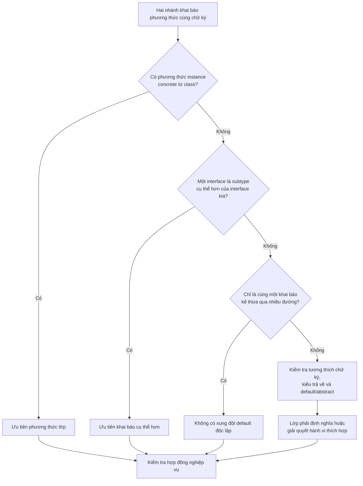

This is a **design-reading and review process** for common situations, not a substitute for every Java compile-time rule (including generics, erasure, override-equivalence, abstract methods, and covariant return types).

One useful practice is to **add `@Override` whenever you intentionally implement or override behavior**; the compiler will catch many signature mistakes.

## 9. When to Use Interfaces, Class Inheritance, or Composition

The ability to combine multiple interfaces does not mean this is always the best design.

| Requirement | Often suitable choice | Why? |
|---|---|---|
| Subclass really is a more specific kind of superclass | `extends` one class | Specializes state and behavior under the *is-a* relationship |
| A type needs multiple independent capabilities | `implements` multiple interfaces | Combines contracts without multiple inheritance of instance state |
| Several implementations share an API but no state | Interface | Callers interact through consistent behavior |
| A family of classes shares state, constructors, and algorithms | Consider an abstract superclass | Shares controlled implementation |
| Strategies need to be combined/swapped at runtime | Composition/delegation | Avoids forcing the current class to inherit an implementation |
| Two interfaces use the same operation name for different meanings | Separate contracts or an adapter | Avoids forcing one method to serve contradictory responsibilities |

### Example: Composition Instead of Attempting Multiple Class Inheritance

An invoice must export PDF and CSV. Rather than attempting `Invoice extends PdfWriter, CsvWriter` (invalid), let the invoice **use** export strategies:

```java
interface Exporter {
    String export(String content);
}

final class PdfExporter implements Exporter {
    @Override
    public String export(String content) {
        return "PDF: " + content;
    }
}

final class CsvExporter implements Exporter {
    @Override
    public String export(String content) {
        return "CSV: " + content;
    }
}

final class InvoiceService {
    public String exportInvoice(
            String invoiceText, Exporter exporter) {
        return exporter.export(invoiceText);
    }
}
```

Here, `InvoiceService` is not a subtype of `PdfExporter` or `CsvExporter`. It **delegates work** to the appropriate object. A small behavioral interface can support many implementations, and adding another format need not alter the inheritance hierarchy of `InvoiceService`.

For real PDF/CSV exports, implementations should return byte streams, files, or other properly contracted results rather than the example's prefixed strings.

Composition is especially useful when behavior providers have **their own state and constructors**, which Java cannot inherit from multiple classes at once.

## 10. Common Misconceptions

| Claim | True/False | Explanation |
|---|---|---|
| Java permits a class to extend two classes | **False** | Only one direct superclass |
| Java permits a class to implement multiple interfaces | **True** | Combines multiple contracts |
| An interface can extend multiple interfaces | **True** | Multiple interface inheritance |
| Every interface only has abstract methods | **False** | May have default, static, or private methods depending on Java version |
| Two interfaces declaring compatible abstract methods always conflict | **False** | One implementation may satisfy both |
| Two independent default methods with matching signatures are chosen randomly | **False** | Resolution rules apply; an override is often required |
| Two paths to one shared default method always create a diamond error | **False** | There are not two independent implementations in that case |
| A concrete superclass method usually outranks an interface default | **True** | Class precedence rule |
| A subinterface's overriding default usually outranks the superinterface's default | **True** | More specific type takes precedence |
| Implementing multiple interfaces also inherits multiple instance states | **False** | Interfaces have no instance fields/constructors |
| `InterfaceName.super.method()` can invoke every interface method | **False** | Only appropriate default implementations in valid contexts; not arbitrary abstract/static methods |

## 11. Practice Exercises

### Exercise 1 — Does the Program Compile?

```java
interface Left {
    default String run() {
        return "L";
    }
}

interface Right {
    default String run() {
        return "R";
    }
}

class Combined implements Left, Right {
}
```

**Answer:** **No.** `Combined` must override `run()` to resolve two independent same-signature default methods. One implementation can be selected:

```java
@Override
public String run() {
    return Left.super.run();
}
```

### Exercise 2 — Class or Interface?

```java
class Parent {
    public String code() {
        return "P";
    }
}

interface Code {
    default String code() {
        return "I";
    }
}

class Child extends Parent implements Code {
}

System.out.println(new Child().code());
```

**Answer:** `P`, because `Parent` has a concrete instance method that takes precedence over the `Code` default.

### Exercise 3 — Is There a Diamond Conflict?

```java
interface Root {
    default int value() {
        return 1;
    }
}

interface A extends Root {}
interface B extends Root {}
class C implements A, B {}

System.out.println(new C().value());
```

**Answer:** It compiles and prints `1`. `A` and `B` do not define competing implementations; both inherit the same one from `Root`.

### Exercise 4 — Choose a Design

A `SmartDevice` needs to **charge its battery**, **provide GPS positioning**, and **play music**. Three classes already exist: `BatteryManager`, `GpsEngine`, and `MusicPlayer`, each with its own state and constructor.

**Question:** Should you declare `SmartDevice extends BatteryManager, GpsEngine, MusicPlayer`?

**Hint:** Java does not allow that. Consider capability interfaces (`Chargeable`, `Locatable`, `Playable`), while `SmartDevice` **contains** instances of `BatteryManager`, `GpsEngine`, and `MusicPlayer` and delegates operations. This combines behaviors without multiple inheritance of state.

---

**Remember:** Java uses **single inheritance for classes**, but permits **multiple interface implementations** and **interfaces extending multiple interfaces**. Interface default methods share behavior but introduce conflict rules: **concrete class methods take precedence; more specific interfaces take precedence; independent competing defaults need explicit resolution**. Do not just make the code compile: verify compatible business semantics and use **composition** to coordinate multiple stateful components.


</details>

- [Back to top](#back-to-top)

---

## <a id="inheritance-009">Mixins, traits, and language-specific behavior reuse</a>

<details>
<summary>View details</summary>

# Mixins, Traits, and Language-Specific Behavior Reuse

In object-oriented programming, a common need is for **classes from unrelated inheritance branches to share behavior**. For example, both `Article` and `SupportTicket` may need to add several tags, even though they do not share a business superclass.

**Mixins** and **traits** organize such shared capabilities. However, these terms are not identical language keywords with universal syntax:

- A **mixin** usually denotes a unit of behavior that can be “mixed into” another class without forcing all participants into one inheritance tree.
- A **trait** usually represents a language construct describing a set of capabilities/methods, sometimes with default implementations; composition, state, and conflict rules depend on the language.
- **Java** has no dedicated `mixin` or `trait` keyword. Java uses **interfaces with `default method`** implementations (since Java 8) to share some behavior and **composition/delegation** to reuse state and more complex algorithms.

The key lesson is **reusing behavior without inventing an artificial `is-a` relationship**, while understanding the limitations of each mechanism rather than calling every inheritance technique a mixin.

## 1. Why Isn't Inheriting a Superclass Enough?

Java lets a class directly `extends` **one superclass**, but it may `implements` **multiple interfaces**:

```java
class BaseEntity {}

interface Searchable {}
interface Exportable {}

class Article extends BaseEntity implements Searchable, Exportable {}
```

Suppose the application also has `SupportTicket extends TicketBase`. Both `Article` and `SupportTicket` need `addTags(...)`, but forcing them to inherit `TaggableBase` could violate the single-superclass limit and create a hierarchy unrelated to the domain.

One solution is to define a **small capability** in an interface and let each class implement it with its own state. A `default method` can offer a shared workflow using the interface's abstract operations.

## 2. Java: Reusing Behavior Through Interface Default Methods

For example, `Taggable` declares a basic `addTag(String)` operation and adds shared `addTags(List<String>)` behavior:

```java
interface Taggable {
    void addTag(String tag);

    default void addTags(List<String> tags) {
        for (String tag : tags) {
            addTag(tag);
        }
    }
}
```

`addTags()` is a reusable implementation. Implementing classes need only define how to add **one tag** under their own rules. The default method invokes `addTag()` through ordinary dispatch, thereby using the runtime object's implementation.

This resembles a **behavior-providing mixin**: the interface need not know whether tags are stored in an `ArrayList`, a `Set`, or another data source.

However, a Java interface **cannot hold per-instance fields** that give each object its own `List`. Interface fields are implicitly interface-level constants/variables (`public static final`), not independent mutable state in each instance.

## 3. Complete Example: Shared Behavior Across Unrelated Domain Classes

Save the following code as **`Main.java`** and run with Java 17 or Java 21.

```java
import java.util.ArrayList;
import java.util.LinkedHashSet;
import java.util.List;
import java.util.Objects;
import java.util.Set;

// Một khả năng dùng chung; không sở hữu trạng thái instance.
interface Taggable {
    void addTag(String tag);

    default void addTags(List<String> tags) {
        Objects.requireNonNull(tags, "tags");
        for (String tag : tags) {
            addTag(tag); // Gọi implementation của đối tượng hiện tại.
        }
    }
}

// Cung cấp dữ liệu tối thiểu để hành vi khác sử dụng.
interface Identified {
    String id();
}

// Một cách thực hiện mặc định dựa trên hợp đồng Identified.
interface AuditText extends Identified {
    default String auditMessage(String action) {
        if (action == null || action.isBlank()) {
            throw new IllegalArgumentException("Hành động không hợp lệ");
        }
        return "[" + id() + "] " + action;
    }
}

final class Article implements Taggable, AuditText {
    private final String id;
    private final Set<String> tags = new LinkedHashSet<>();

    Article(String id) {
        if (id == null || id.isBlank()) {
            throw new IllegalArgumentException("ID bài viết không hợp lệ");
        }
        this.id = id;
    }

    @Override
    public String id() {
        return id;
    }

    @Override
    public void addTag(String tag) {
        if (tag == null || tag.isBlank()) {
            throw new IllegalArgumentException("Thẻ không được trống");
        }
        tags.add(tag); // Set loại bỏ thẻ trùng.
    }

    List<String> tagsSnapshot() {
        return List.copyOf(tags);
    }
}

final class SupportTicket implements Taggable {
    private final List<String> tags = new ArrayList<>();

    @Override
    public void addTag(String tag) {
        if (tag == null || tag.isBlank()) {
            throw new IllegalArgumentException("Thẻ không được trống");
        }
        tags.add(tag); // Ticket cho phép ghi nhận thẻ lặp lại.
    }

    List<String> tagsSnapshot() {
        return List.copyOf(tags);
    }
}

public class Main {
    public static void main(String[] args) {
        Article article = new Article("ART-7");
        article.addTags(List.of("java", "oop", "java"));

        SupportTicket ticket = new SupportTicket();
        ticket.addTags(List.of("urgent", "support", "urgent"));

        System.out.println(article.tagsSnapshot());
        System.out.println(ticket.tagsSnapshot());
        System.out.println(article.auditMessage("đã xuất bản"));
    }
}
```

Compile and run:

```bash
javac Main.java
java Main
```

Output:

```text
[java, oop]
[urgent, support, urgent]
[ART-7] đã xuất bản
```

**Analysis:**

1. Both `Article` and `SupportTicket` inherit `addTags()` from `Taggable` without duplicating the loop in two classes.
2. `Article.addTag()` uses `LinkedHashSet` to remove duplicate tags while preserving insertion order. `SupportTicket.addTag()` uses `ArrayList` and permits duplicates.
3. Each class owns and protects its state through `private` fields; `Taggable` does not know their storage structures.
4. `Article` also implements `AuditText`. Its `auditMessage()` uses `id()` supplied by `Article`; `SupportTicket` has no obligation to support auditing.
5. `List.copyOf(...)` prevents callers from mutating the structure of returned lists. With immutable `String` elements, there is also no in-place element mutation.

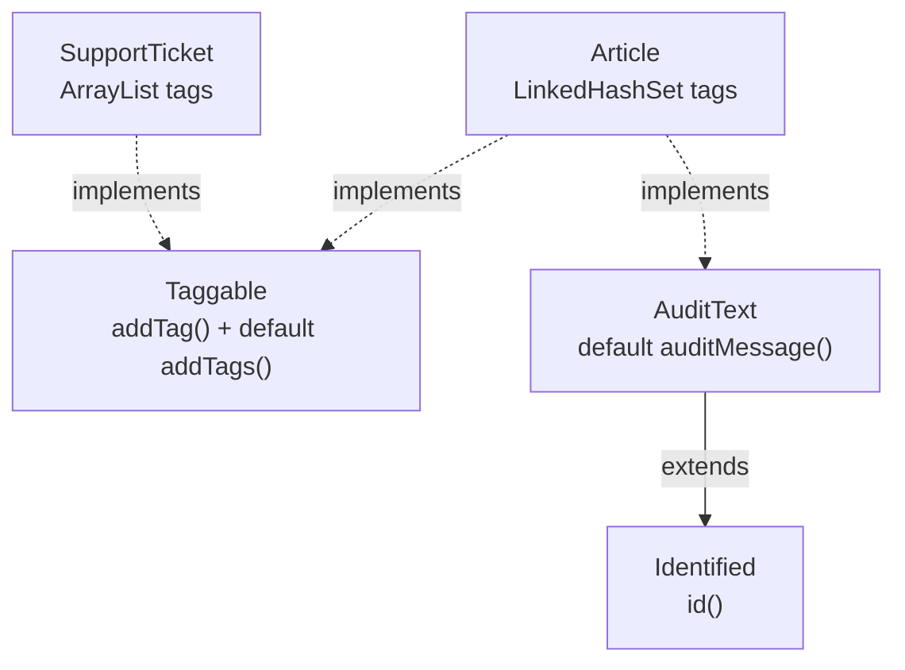

### An Immediate Limitation

`Taggable.addTags()` invokes `addTag()` repeatedly; **it does not guarantee atomicity**. If three tags are requested and the third is invalid, the first two may already have been added. To achieve “all or nothing,” the implementing class must redesign validation and updates or override `addTags()` to fulfill that contract.

That is why a `default method` can share implementation code while **not automatically guaranteeing all business semantics** for every implementing class.

## 4. Default-Method Mixins Must Handle Conflicts

If two **independent** interfaces both provide `default String greet()`, a class implementing both must explicitly define the result:

~~~java
interface ShortGreeting {
    default String greet() { return "Xin chào"; }
}
interface FriendlyGreeting {
    default String greet() { return "Chào bạn!"; }
}
final class Greeter implements ShortGreeting, FriendlyGreeting {
    @Override
    public String greet() {
        return ShortGreeting.super.greet()
                + " / " + FriendlyGreeting.super.greet();
    }
}
~~~

`new Greeter().greet()` returns `"Xin chào / Chào bạn!"`. Omitting the override causes a default-method conflict at compile time. `InterfaceName.super.method()` invokes a valid default implementation within the interface-inheritance context; it cannot invoke arbitrary abstract or static methods.

Java also prefers concrete instance methods from a **class** over interface defaults and prefers a **more specific** interface when there is a subtype relationship. Two paths to **the same** inherited default method generally do not create independent conflicts. **Single inheritance, multiple inheritance, and behavior conflicts** contains a complete table and runnable verification; here, the important point is that mixin-style defaults share behavior while adding obligations to maintain compatible contracts.

## 5. `default` Does Not Give Java Multiple Class Inheritance

A Java interface can contain:

- Abstract methods, such as `void addTag(String tag)`.
- `default` methods with bodies that provide implementations.
- `static` methods, invoked through the interface name.
- `private` helper methods that reuse code **within the same interface** (since Java 9).
- Constant fields implicitly declared `public static final` (even if the modifiers are omitted).

But Java interfaces **cannot define separate per-instance fields**. They also have no constructors like ordinary classes, and Java does not permit one class to `extends` two superclasses directly.

Moreover, interfaces cannot provide `default` methods overriding `Object` methods such as `equals(Object)`, `hashCode()`, and `toString()`. These are core object contracts; implement any alternate behavior in an appropriate class.

Default methods therefore offer **contract-based behavior sharing**, especially when shared behavior can be expressed through abstract operations or other public interface methods. They are not a place to hide application-wide mutable state.

## 6. Traits and Mixins Across Languages

These terms have different origins and rules. The following table gives a design-level comparison without treating one language as universal.

| Language/mechanism | How behavior is reused | State and conflict resolution |
| --- | --- | --- |
| **Java** — interface `default` | Classes implement multiple interfaces and inherit default methods | No interface instance fields; Java defines precedence and requires overrides for conflicts |
| **Scala** — `trait` | Classes combine multiple traits, which may include implementations and state | Linearization and method-resolution rules; traits can declare fields, and composition order matters |
| **Rust** — `trait` | Defines shared behavior implemented for types (`impl Trait for Type`), possibly with default methods | Traits do not inject instance fields into structs; Rust has method resolution, associated types, and coherence rules |
| **Kotlin** — `interface` | Interfaces can have methods with bodies; classes can implement multiple interfaces | No backing fields for interface properties; implementation conflicts require explicit resolution |
| **Python** — mixins via multiple inheritance | A mixin class provides methods for reuse and combination through inheritance | Uses method resolution order (MRO), often with cooperative `super()` in multiple inheritance |
| **Ruby** — modules | `include`/`prepend` adds modules to the method lookup chain | Ancestor-chain lookup; modules can work with instance state |
| **C++** — multiple inheritance / CRTP | Mixin classes/templates can add behavior | Inheritance, name lookup, and diamond rules differ from Java; ownership and ambiguity need careful design |

For example, a **Rust trait** commonly defines required methods and can provide defaults, while a struct's own definition specifies its fields. A **Scala trait** may contain state and combine implementations through linearization. Claims such as “traits never have state” or “mixins always copy methods into classes” are too broad across languages.

When reading documentation for a particular language, ask: *Does this mechanism contain instance state, support multiple superclasses, decide method precedence in a particular way, and what does `super` mean?*

## 7. When Should Java Use Default Methods, Abstract Classes, or Composition?

All three can enable code reuse, but they model different relationships.

| Technique | Prefer it when | Limits and risks |
| --- | --- | --- |
| Interface + `default` | Unrelated classes share a **capability** whose common behavior uses a small contract | No instance state; potential default-method conflicts or unsuitable default behavior |
| Abstract class | Genuine `is-a` relationship, shared rules, and instance fields managed by the superclass | Java has one direct superclass; subclasses are coupled to the hierarchy |
| Composition/delegation | Reuse an algorithm or stateful collaborator that may be replaced/combined at runtime | Requires managing delegate instances and forwarding calls |
| Utility `static` | Pure algorithm with no object contract | Does not express replaceable capability via interface dispatch |

Example of delegation for auditing:

```java
interface AuditSink {
    void record(String message);
}

final class ConsoleAuditSink implements AuditSink {
    @Override
    public void record(String message) {
        System.out.println(message);
    }
}

final class ArticleService {
    private final AuditSink auditSink;

    ArticleService(AuditSink auditSink) {
        this.auditSink = java.util.Objects.requireNonNull(auditSink);
    }

    void publish(String articleId) {
        // Thực hiện quy trình xuất bản ...
        auditSink.record("Đã xuất bản " + articleId);
    }
}
```

Here, `ArticleService` **contains an `AuditSink`** rather than inheriting from `AuditableBase` or putting I/O inside a default method. `ConsoleAuditSink` can be replaced with an adapter that logs to files, databases, or an event system without changing `ArticleService`.

If shared logic **needs resources, transactions, configured dependencies, or lifecycle-aware state**, composition is usually clearer than a Java mixin with shared `static` fields.

## 8. Designing Useful Default-Method Contracts

Two mistaken assumptions are common.

**Mistake A: All behavior belongs in interface defaults.**

```java
interface PaymentAction {
    default void charge(long amount) {
        // Không nên đặt logic tài chính giả định ở đây chỉ để
        // mọi triển khai khỏi phải viết một phương thức bắt buộc.
    }
}
```

An empty method can mislead callers into thinking a payment succeeded. When implementations have different calculations or safety guarantees, leave `charge()` abstract and require each class to meet the contract.

**Mistake B: A default implementation is automatically safe.**

```java
interface MutableAccess {
    List<String> internalTags();

    default void append(String tag) {
        internalTags().add(tag);
    }
}
```

This design forces implementations to expose a mutable collection through `internalTags()`. Callers can bypass `append()` and mutate `internalTags()` directly. The main example's `Taggable` contract offers better encapsulation: it requires only the **behavior** `addTag()` and lets each class keep its data `private`.

When designing a default method:

1. Describe the method's **semantics**, including valid parameters, results, and errors.
2. Implement only behavior that is correct for **every** compliant implementation.
3. Call primitive operations supplied by the implementing class instead of requiring getters that expose mutable state.
4. Define partial-completion behavior: a default method may offer no transaction or atomicity guarantee.
5. Do not assume default methods automatically provide synchronization or thread safety.
6. When adding defaults to an existing interface, check for **signature conflicts** with other implemented interfaces or classes.

Adding a `default method` can evolve an API without forcing every existing implementation to supply a new method in ordinary cases, but **compatibility is not guaranteed**: another default or an existing contract may cause compilation errors or behavioral changes.

## 9. Mistakes to Avoid

| Mistake | Consequence | Appropriate fix |
| --- | --- | --- |
| Treating a Java interface as a class with instance state | Trying to declare a field such as `private List<String> tags` in an interface | Put state in implementing classes or a delegate |
| Two interfaces define the same-signature default | Class fails to compile without resolving the conflict | Override explicitly, optionally invoking `Interface.super.method()` |
| Overriding a default but forgetting business rules | Implementations produce inconsistent results | Define contracts and shared tests |
| Calling `this.addTags(...)` inside the `addTags()` override | May recursively invoke itself | Use `Taggable.super.addTags(...)` when valid and intentionally preserving the default behavior |
| Storing mutable state in an interface field | It is actually a shared `public static final` reference | Use a `private` instance field on the implementing class |
| Replacing every composition use case with interface defaults | Pulls I/O, databases, and stateful services into contracts | Delegate to lifecycle-aware components |
| Assuming Scala traits, Rust traits, and Java defaults are identical | Misunderstands state, linearization, and method resolution | Learn each language's specific rules |
| Sharing side-effecting defaults with no defined operation order | Partial success becomes hard to predict | Define transaction and error semantics precisely |

## 10. Self-Check

**Question 1.** Why can `Article` and `SupportTicket` share `Taggable.addTags()` without sharing a business superclass?

**Answer:** Both classes implement `Taggable`; the default method invokes `addTag()` supplied by each class and does not depend on storage details or a shared state-owning superclass.

**Question 2.** If `ShortGreeting` and `FriendlyGreeting` both define `default String greet()`, does a class implementing both automatically use `ShortGreeting`?

**Answer:** No. Without a suitable precedence relationship, two conflicting defaults require the class to override `greet()` and explicitly define behavior.

**Question 3.** Can `private int count;` be declared as an instance field in a Java interface?

**Answer:** No. Interface fields always have `public static final` semantics; interfaces do not declare individual instance fields.

**Question 4.** Default `addTags()` invokes `addTag()` three times, and the third invocation throws. Are the first two tags guaranteed to be rolled back?

**Answer:** No. The sample default method implements no rollback. Atomicity requires additional contracts and an appropriate implementation.

**Question 5.** Should a file-writing, connection-owning `AuditSink` be moved into an interface default solely to reuse code?

**Answer:** Usually not. A component with its own state, resource lifetime, and ownership fits composition/delegation better, such as injecting an `AuditSink` into the consuming object.

**Question 6.** Can we assume that Rust traits and Scala traits have identical state and method-resolution behavior?

**Answer:** No. The shared term “trait” hides different language rules: Rust defines behavior and implementations for types; Scala supports mixins/linearization and allows traits to carry state.

**Remember:** Reuse only behavior that is **genuinely shared by contract**; do not force unrelated classes into a superclass just to reduce code. In Java, interface `default` methods suit shared behavior without per-instance state; use composition for resource-owning or stateful dependencies. When working with mixins or traits in other languages, always check each language's composition and conflict-resolution rules.


</details>

- [Back to top](#back-to-top)

---

## <a id="inheritance-010">Limitations and costs of deep inheritance hierarchies</a>

<details>
<summary>View details</summary>

# Limitations and Costs of Deep Inheritance Hierarchies in Java

> **OOP → Inheritance.** Inheritance (`extends`) lets a subclass reuse and specialize superclass behavior. But when a class sits beneath many levels—`A → B → C → D → E`—understanding and modifying it becomes increasingly costly: behavior is scattered, superclass changes affect many subclasses, and tests must cover interactions across levels. This lesson separates **design/maintenance costs** from **runtime costs** and explains when composition is appropriate.

## 1. What Is a “Deep Inheritance Hierarchy”?

Consider a shipping-fee calculation system:

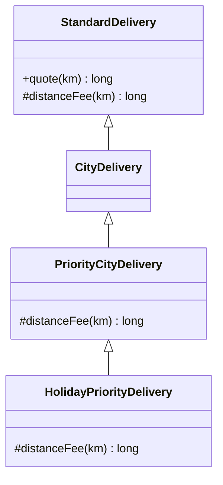

`HolidayPriorityDelivery` has three direct and indirect ancestors. To determine the result of `quote(3)`, a reader must trace methods across several classes:

- `StandardDelivery.quote` determines the overall calculation.
- `StandardDelivery.distanceFee` calculates the default distance charge.
- `PriorityCityDelivery.distanceFee` invokes `super.distanceFee` and adds a priority fee.
- `HolidayPriorityDelivery.distanceFee` again invokes `super.distanceFee` and adds a holiday surcharge.

More levels of **overrides and calls back to superclass implementations** make it harder to infer behavior from a single file.

**Depth** is the number of levels on a path from a class to an ancestor, not the number of sibling subclasses. A hierarchy with one parent and ten immediate children remains **shallow**; a chain `A → B → C → D → E` is deep.

## 2. Runnable Java Example: The Comprehension Cost of Multiple Override Levels

Save the following code as `DepthCostDemo.java` (Java 17+):

```java
import java.util.List;
import java.util.Objects;

public class DepthCostDemo {

    // Tầng 1: quy tắc tính tổng và phí khoảng cách mặc định.
    static class StandardDelivery {
        private final long baseFeeVnd;

        StandardDelivery(long baseFeeVnd) {
            if (baseFeeVnd < 0) {
                throw new IllegalArgumentException("Phí cơ bản không thể âm");
            }
            this.baseFeeVnd = baseFeeVnd;
        }

        public final long quote(int distanceKm) {
            if (distanceKm <= 0) {
                throw new IllegalArgumentException("Khoảng cách phải dương");
            }
            long extra = distanceFee(distanceKm);
            if (extra < 0) {
                throw new IllegalStateException("Phụ phí không thể âm");
            }
            return Math.addExact(baseFeeVnd, extra);
        }

        protected long distanceFee(int km) {
            return Math.multiplyExact(2_000L, km);
        }
    }

    // Tầng 2: dùng cùng phí cơ bản của giao hàng nội thành.
    static class CityDelivery extends StandardDelivery {
        CityDelivery() {
            super(10_000L);
        }
    }

    // Tầng 3: thêm phí ưu tiên.
    static class PriorityCityDelivery extends CityDelivery {
        @Override
        protected long distanceFee(int km) {
            return Math.addExact(super.distanceFee(km), 5_000L);
        }
    }

    // Tầng 4: thêm phí ngày lễ.
    static final class HolidayPriorityDelivery extends PriorityCityDelivery {
        @Override
        protected long distanceFee(int km) {
            return Math.addExact(super.distanceFee(km), 3_000L);
        }
    }

    // Phương án composition: mỗi thành phần phí là một quy tắc riêng.
    @FunctionalInterface
    interface FeeRule {
        long calculate(int distanceKm);
    }

    static final class QuoteService {
        private final long baseFeeVnd;
        private final List<FeeRule> rules;

        QuoteService(long baseFeeVnd, List<FeeRule> rules) {
            if (baseFeeVnd < 0) {
                throw new IllegalArgumentException("Phí cơ bản không thể âm");
            }
            this.baseFeeVnd = baseFeeVnd;
            this.rules = List.copyOf(
                Objects.requireNonNull(rules, "rules")
            );
        }

        long quote(int distanceKm) {
            if (distanceKm <= 0) {
                throw new IllegalArgumentException("Khoảng cách phải dương");
            }
            long total = baseFeeVnd;
            for (FeeRule rule : rules) {
                long fee = rule.calculate(distanceKm);
                if (fee < 0) {
                    throw new IllegalStateException("Phụ phí không thể âm");
                }
                total = Math.addExact(total, fee);
            }
            return total;
        }
    }

    public static void main(String[] args) {
        StandardDelivery deep = new HolidayPriorityDelivery();

        QuoteService composed = new QuoteService(
            10_000L,
            List.of(
                km -> Math.multiplyExact(2_000L, km),
                km -> 5_000L,
                km -> 3_000L
            )
        );

        System.out.println("Inheritance: " + deep.quote(3));
        System.out.println("Composition: " + composed.quote(3));
    }
}
```

Run:

```bash
javac DepthCostDemo.java
java DepthCostDemo
```

Output:

```text
Inheritance: 24000
Composition: 24000
```

For 3 km, both designs calculate **10.000 base fee + 6.000 distance fee + 5.000 priority fee + 3.000 holiday surcharge = 24.000 VND**.

The difference is **where rules live** and **how extensions work**:

| Goal | Deep inheritance hierarchy | Composition |
|---|---|---|
| Find the priority-fee calculation | Trace to `PriorityCityDelivery` | Find the priority-fee rule in the configuration list |
| Add a holiday surcharge | Introduce a subclass, override, and invoke `super` | Add one `FeeRule` |
| Combine priority and holiday fees in another order | May need further subclass variants | Reorder or recombine rules |
| Share input validation | Superclass `quote` | `QuoteService.quote` |
| Test fee categories independently | May require the whole class chain | Test each `FeeRule` independently |
| Risk from relying on `super` | Higher with numerous override levels | Lower because rules are separate |

**Composition is not automatically better in every case**: if a class family genuinely has an is-a relationship, shared state, and few variants, shallow inheritance may be simpler. The goal is to reduce unnecessary dependencies, not to eliminate every `extends`.

## 3. Cost One: Implicit Dependencies and the Fragile Base Class

Subclasses are written against current superclass behavior. If a superclass changes when it invokes an overridable `protected` method, subclass behavior can change without editing any subclass source.

For example:

```java
class BaseFormatter {
    String format(String value) {
        return decorate(value);
    }

    protected String decorate(String value) {
        return "[" + value + "]";
    }
}

class UpperFormatter extends BaseFormatter {
    @Override
    protected String decorate(String value) {
        return super.decorate(value.toUpperCase());
    }
}
```

If `BaseFormatter.format` later invokes `decorate` twice, `UpperFormatter` is affected as well. The subclass depends on an **implicit convention about when, how often, and in what order** the superclass invokes that hook.

Across multiple levels, these dependencies can form a chain:

```text
HolidayPriorityDelivery
  → PriorityCityDelivery.distanceFee
    → StandardDelivery.distanceFee
```

Changing the formula in `StandardDelivery` affects subclasses relying on `super.distanceFee`. That may be desirable, but subclasses assuming the previous formula may fail unexpectedly.

This is often called the **fragile base class problem**: changing a base class can break derived classes even when API signatures remain unchanged.

Ways to reduce risk:

- Document which methods are **extension points** intended for subclass overriding.
- Define hook contracts: input conditions, return values, number and order of invocations, side effects, and exceptions.
- Mark essential workflow-coordinating methods `final` if subclasses must not replace the whole algorithm.
- Keep internal fields `private` where possible; use intentionally designed `protected` APIs rather than allowing direct modification.
- Test affected implementations whenever a base class changes.

## 4. Cost Two: Constructors Depending on Leaf-Class Behavior

In a deep hierarchy, an ancestor constructor may invoke a method overridden by a leaf class before that leaf's field initializers have run. For example:

~~~java
class Base {
    Base() { System.out.println("Base sees: " + display()); }
    String display() { return "base"; }
}
class Middle extends Base {
    @Override String display() { return "middle"; }
}
class Leaf extends Middle {
    String label = "READY";
    @Override String display() { return label; }
}
// new Leaf() in "Base sees: null".
~~~

Java dynamically dispatches to `Leaf.display()` from `Base()` even while `Leaf.label` holds its default `null`. More intermediate classes make it harder to trace the call site and selected implementation; an override invoking `label.toUpperCase()` would throw `NullPointerException`.

Constructors should establish state belonging to their declaring class, without calling overridable hooks or exposing `this` prematurely. The lesson **Subclass initialization and the superclass constructor chain** explains static/instance initializers and constructor chaining; this section emphasizes **how the impact expands with depth**.

## 5. Cost Three: Class Explosion from Combining Variants

Suppose a shipping service supports independent dimensions:

- Region: local or intercity.
- Speed: standard or express.
- Timing: regular days or holidays.
- Customer: regular or member.

If every combination becomes a subclass, the theoretical number of variants is:

\[
2 \times 2 \times 2 \times 2 = 16
\]

Adding one property with 3 variants increases the possible combinations to:

\[
16 \times 3 = 48
\]

Not every theoretical combination must be implemented, but the number can grow rapidly. Class names like `HolidayExpressMemberIntercityDelivery` suggest the design is mixing **many independent dimensions of change** into one hierarchy.

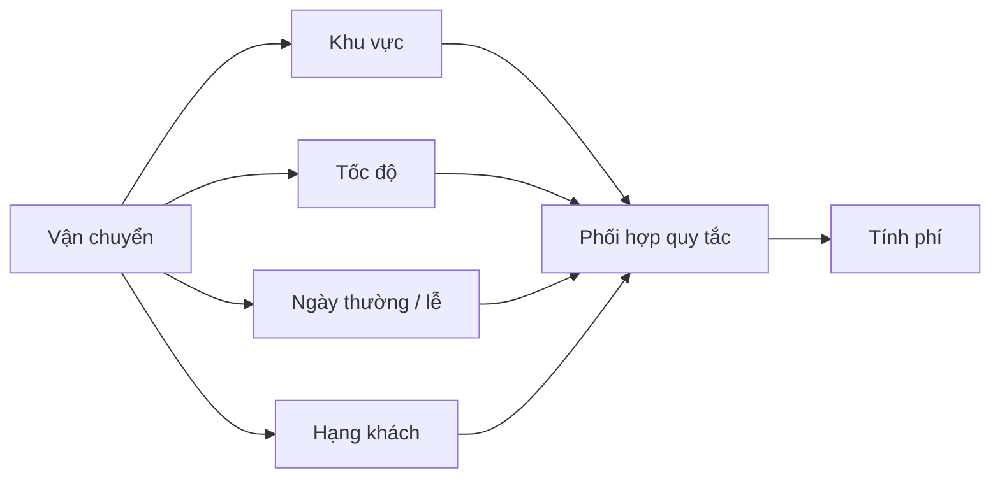

Here, composition is usually reasonable: separate `DistanceFeePolicy`, `SpeedSurcharge`, `HolidaySurcharge`, and `MembershipDiscount` into clear strategies/rules, then combine them in a service.

**Note:** application order may matter, such as applying a 10% discount before or after a surcharge. Composition does not resolve that automatically; the service must define ordering, rounding, error handling, and contract checks.

## 6. Cost Four: Harder Testing and Impact Prediction

A small superclass change can affect all descendants, including branches the developer did not realize were involved.

| Change type | What needs review? |
|---|---|
| Add input validation in the superclass | Do subclasses pass valid data and handle new exceptions? |
| Change the invocation of a `protected` hook | Do overrides in every branch still preserve semantics? |
| Modify superclass state representation | Do subclasses depend on old fields or logic? |
| Add an overload or change visibility | Could it make calls ambiguous or break subclass APIs? |
| Change a superclass constructor | Are `super(...)` chains and subclass invariants still valid? |

Each path through multiple class levels adds a testing context. This does not require testing impossible combinations; it means **the regression scope may be much wider than the edited file**.

Use **contract tests** for base behavior and key implementations:

```java
static void assertQuote(DepthCostDemo.StandardDelivery plan,
                        int distanceKm,
                        long expected) {
    long actual = plan.quote(distanceKm);
    if (actual != expected) {
        throw new AssertionError(
            "Expected " + expected + " but was " + actual
        );
    }
}

// Gọi trong cùng package với DepthCostDemo:
assertQuote(new DepthCostDemo.HolidayPriorityDelivery(), 3, 24_000);
```

This snippet uses nested package-private types from `DepthCostDemo` and illustrates a check in the same package; `assertQuote` must be inside a class to compile. Real projects can use JUnit parameterized tests across implementations.

With composition, you can test each rule separately (distance fees, holiday surcharges) and add coordination tests for `QuoteService`. Isolation often makes faults easier to pinpoint than tracing the entire hierarchy.

## 7. Runtime Cost: Does Deeper Always Mean Slower?

**Do not assume deeper inheritance automatically slows a program down.** Separate the following cost categories:

| Cost category | What may increase? | Does it always occur? |
|---|---|---|
| Understanding/maintenance | Tracing many overrides, constructors, state slots, and inheritance branches | Often increases with multi-level dependencies |
| Testing/regression | More descendants affected by superclass changes | Depends on design and branch count |
| Class/object initialization | More constructors, initializers, and instance fields to process | Depends on classes and executed code |
| Object memory | Inherited and newly declared instance fields occupy the object | Depends on field layout; not one separate object per level |
| Method calls | Multiple chained `super.method()` calls may execute | Depends on code; the JIT can inline and optimize |
| Class metadata | More classes may need loading and management | Yes, but measure the magnitude |

Java uses **dynamic dispatch** for overridable instance methods. Modern JVM/JIT compilers can inline calls with predictable targets even in inheritance hierarchies and optimize from runtime profiles. There is no rule that “adding one level of `extends` increases every call by X milliseconds.”

On the other hand, if an override invokes `super` through many levels and each adds computation or I/O, the total executed work **does increase**. That is the cost of **executed logic**, not an unconditional penalty for the `extends` keyword.

When evaluating performance:

1. Identify the actual hot path to optimize.
2. Use a profiler or a properly warmed-up benchmark (such as JMH for Java microbenchmarks).
3. Compare latency, throughput, allocations, and GC before and after changes.
4. Prefer maintainability unless evidence identifies the inheritance hierarchy as a performance bottleneck.

Avoid timing a bare microbenchmark loop and inferring performance directly: the JVM can eliminate work with no observable effect.

## 8. When Is Inheritance Still Reasonable?

A hierarchy is usually appropriate when:

- A stable **is-a** relationship genuinely exists: every `Circle` is a `Shape`.
- Subclasses honor superclass contracts and are substitutable at call sites (**Liskov Substitution Principle — LSP**).
- Shared behavior or state is clear, rather than just a few utility lines.
- Extension points are documented and tested, without excessive dependence on ancestor internals.
- The hierarchy is shallow, with superclass changes seldom forcing descendants to reinterpret their contracts.

For example, `abstract class Shape` with `abstract double area()` and immediate subclasses `Circle` and `Rectangle` can be easy to understand. There is no need to replace a simple, semantically correct hierarchy with numerous strategies and factories merely to avoid inheritance.

### Signs That an Existing Hierarchy Needs Review

- Each new feature tends to require a subclass with an ever-longer name.
- Most overrides merely invoke `super.method()` and add or subtract a little logic.
- Base-class changes break unrelated branches.
- Many subclasses override methods with empty implementations or throw `UnsupportedOperationException`.
- Tests for leaf classes require extensive ancestor-state setup.
- Subclasses read or mutate numerous `protected` fields that the superclass should protect.
- The code repeatedly uses `instanceof` checks or casts to identify subclass types and handle each separately.

These are **signals worth investigating**, not conclusive evidence. Some fixed classification hierarchies still suit inheritance.

## 9. Reducing Depth While Preserving Behavior

The safest starting point is the **observable contract**, not immediately removing `extends`.

1. **List existing supported cases:** shipping types, input parameters, outputs, exceptions, and side effects.
2. **Capture current behavior in tests:** especially important leaf classes and edge cases.
3. **Separate independent dimensions of change:** for example, distance, holiday, and priority fees into `FeeRule` or dedicated interfaces.
4. **Move coordination into a service/composer:** centralize input validation, rule order, and overflow handling.
5. **Migrate call sites incrementally at boundaries:** retain adapters for legacy APIs when needed, rather than replacing everything at once.
6. **Compare old and new results on domain cases:** only then remove intermediate classes that add no value.

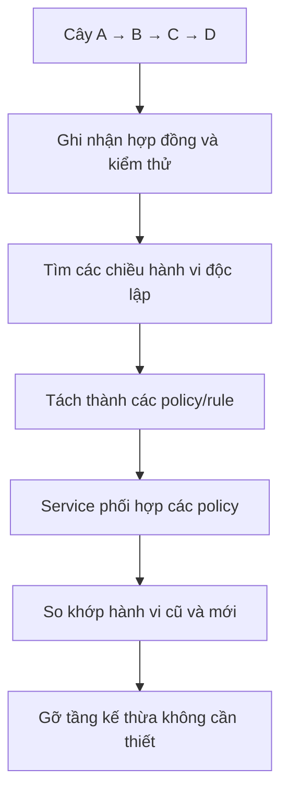

You can use **composition + interface** for configurable behavior while retaining a **shallow abstract class** when a shared algorithm structure is genuinely needed. These techniques are not mutually exclusive.

## 10. Using `final` and `sealed` to Control Inheritance

When arbitrary subclassing is undesirable, extension can be restricted:

```java
final class FixedPolicy {
    // Không class nào được extends FixedPolicy.
}
```

Since Java 17, `sealed` allows a class or interface to specify its permitted direct subtypes:

```java
sealed interface DeliveryMode
        permits Economy, Express {
}

record Economy() implements DeliveryMode {
}

record Express() implements DeliveryMode {
}
```

`Economy` and `Express` are records and therefore implicitly `final`; they can implement the sealed interface under Java's rules. The example assumes suitable types in the same file/package. Direct subclasses of sealed classes/interfaces must use `final`, `sealed`, or `non-sealed` as applicable.

`sealed` is useful when the variant set is genuinely bounded. It identifies valid subtypes but **does not shorten an already-deep hierarchy**; use it to control extension intentionally. `final` suits classes not designed to serve as superclasses.

## 11. Practice Exercises

**Exercise 1 — trace the calls.** For `DepthCostDemo`, draw the method sequence executed by `new HolidayPriorityDelivery().quote(4)`. Calculate the result and identify potential overflow points.

**Exercise 2 — change the rule.** Change the priority surcharge to 7.000 VND. Compare which code must change in inheritance and composition designs; explain why line count alone does not determine design quality.

**Exercise 3 — add a variant.** A shipping type requires a peak-hour surcharge but no holiday surcharge. Design a composition version combining distance, peak-hour, and priority fees without extending a long subclass chain.

**Exercise 4 — constructor pitfall.** Move the `Base → Middle → Leaf` example from Section 4 into a `main` class and explain why it prints `Base sees: null`; then fix it to invoke `display()` only after construction finishes.

**Exercise 5 — review a real hierarchy.** Choose an inheritance hierarchy in your Java project: is the is-a relationship valid, how many levels and overrides invoke `super`, which descendants would a superclass change affect, and should any independent dimensions be extracted?

**Remember:** The greatest limitation of deep inheritance is **interclass coupling and the cost of reasoning about behavior**, not an automatic JVM “speed penalty.” Keep inheritance for clear is-a relationships; when features vary independently or override chains become unmanageable, use **composition, interfaces, and small rules** to reduce dependency.


</details>

- [Back to top](#back-to-top)
