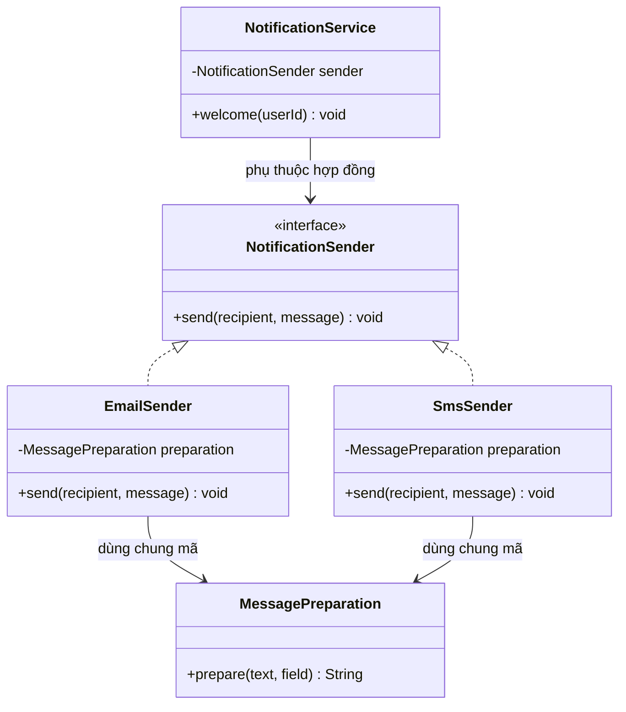
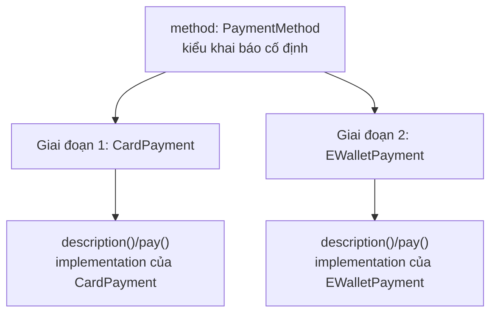
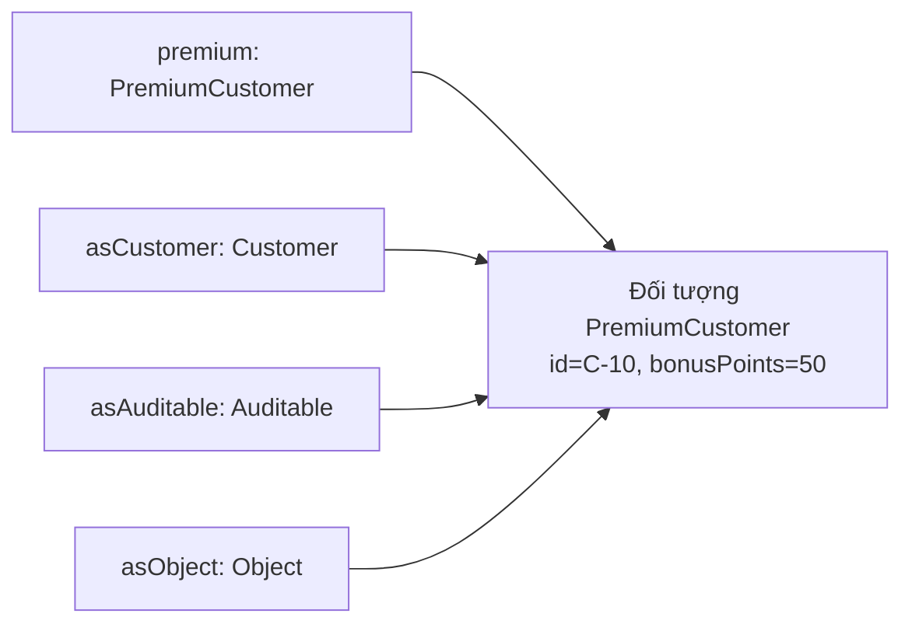
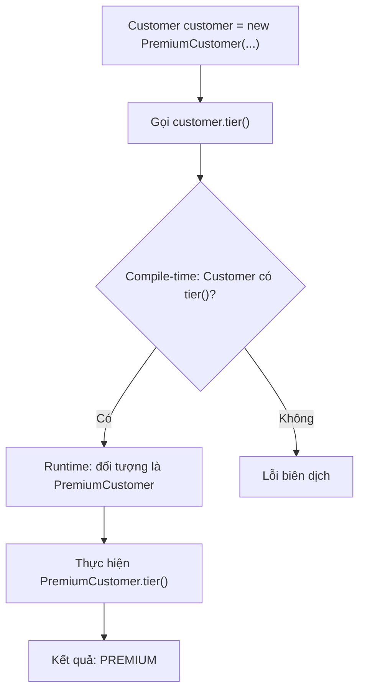
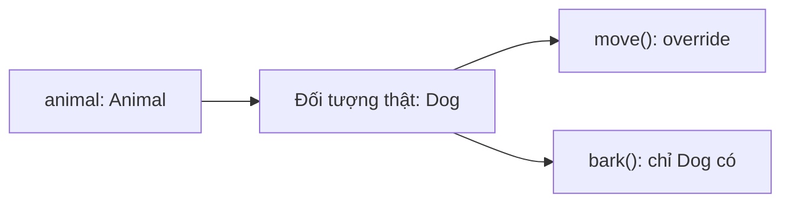
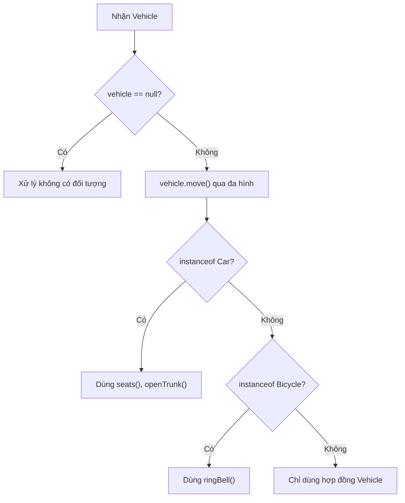
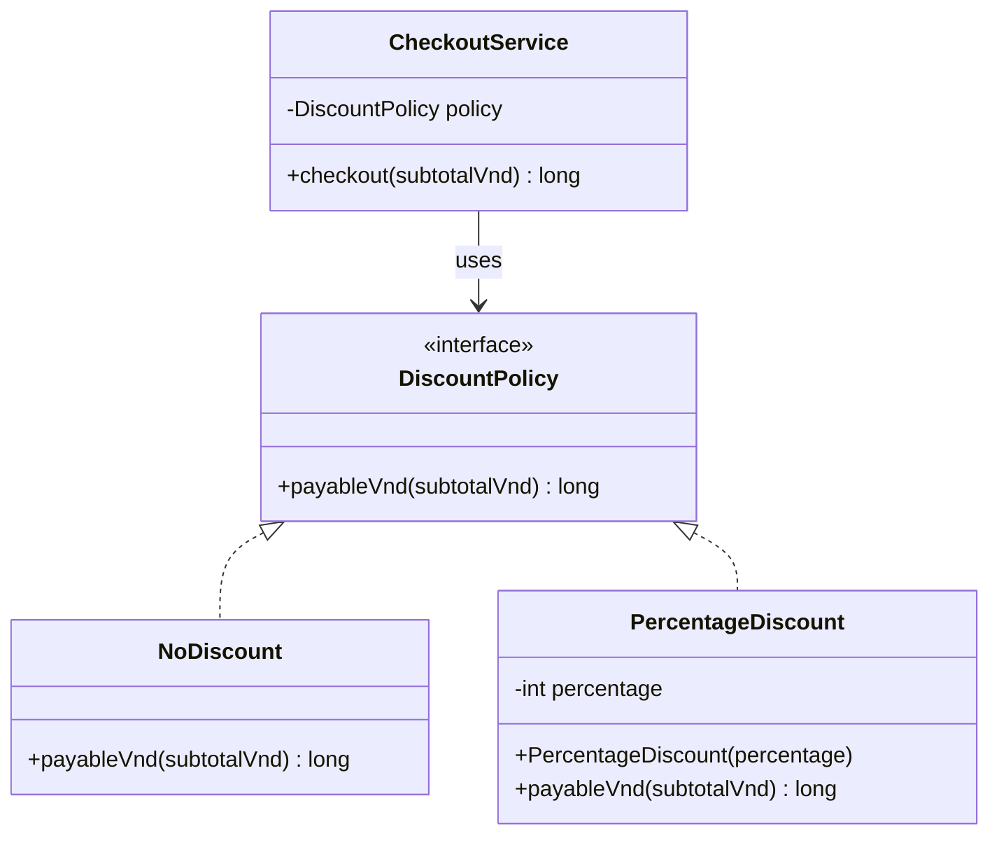
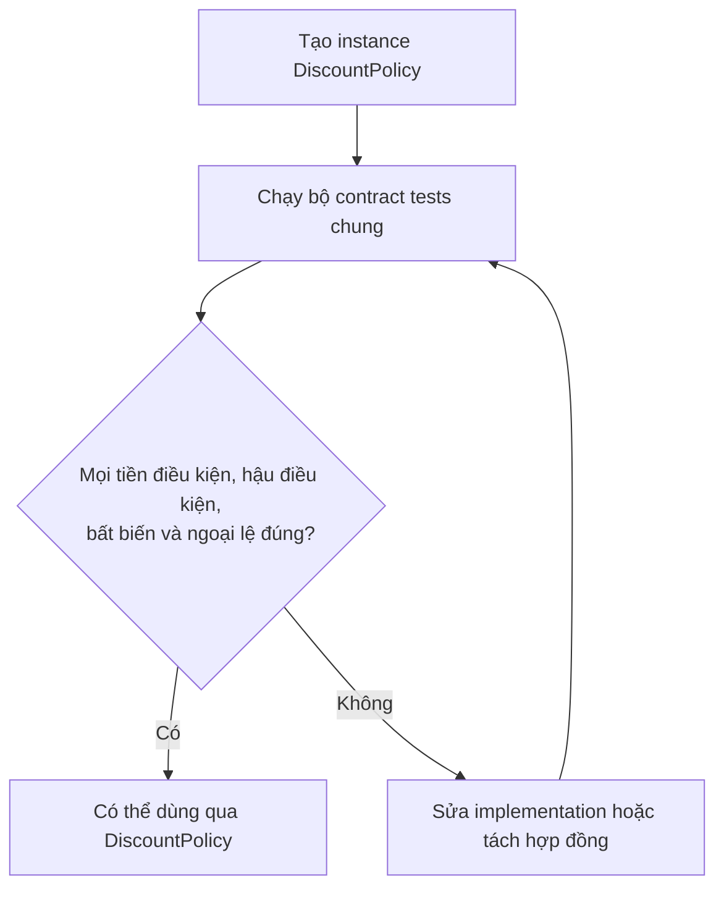

<a id="back-to-top"></a>

# Subtyping

## Menu
- [Distinguishing code inheritance from subtyping](#subtyping-001)
- [The “is-a” relationship and substitutability](#subtyping-002)
- [Nominal and structural type compatibility](#subtyping-003)
- [Declared types and runtime object types](#subtyping-004)
- [Upcasting from a subtype to a supertype](#subtyping-005)
- [Downcasting and type checking](#subtyping-006)
- [Preserving contracts when extending types](#subtyping-007)
- [The rectangle and square counterexample](#subtyping-008)

## <a id="subtyping-001">Distinguishing code inheritance from subtyping</a>

<details>
<summary>View details</summary>

# Distinguishing code inheritance from subtyping in Java

In Java OOP, two ideas are often conflated: **code inheritance (implementation inheritance / code reuse)** and **subtyping**. They often arise together when using `extends`, but address different questions:

- **Code inheritance:** “How can we reuse existing program logic and avoid duplicating algorithms or common processing?”
- **Subtyping:** “Can an object of this type be used in place of another abstraction while still fulfilling its contract?”

This distinction matters because **reusing code does not imply behavioral substitutability**. A subclass may inherit methods and compile correctly while violating expectations that client code places on its superclass.

This lesson focuses on Java mechanisms, illustrated using interfaces, `extends`, `implements`, delegation through composition, and the Liskov Substitution Principle (LSP).

## 1. Two distinct design dimensions

| Perspective | Code inheritance | Subtyping |
| --- | --- | --- |
| Purpose | Reuse common logic or structure | Allow an object to be used under a broader type contract |
| Question | “What code can be reused?” | “Can A be replaced by B while the client remains correct?” |
| Typical mechanism | `extends`, a base class, or **composition/delegation** for reuse without inheritance | `extends` a class, `implements` an interface, `extends` an interface |
| Client concern | Implementation details and maintenance cost | Methods, preconditions/postconditions, invariants, and failure behavior |
| Risk | Tight coupling between subclass and superclass details | Contract violations despite compatible signatures |
| When to prefer it | There is genuinely shared processing to reuse | Types need to be interchangeable under a contract |

**In Java language terms:** when `Child extends Parent`, `Child` is a *nominal subtype* of `Parent` and may inherit applicable members from its parent. You cannot use `extends` to “reuse code without creating any subtype relationship whatsoever.” When the sole goal is algorithm reuse, composition/delegation usually expresses the intent more accurately.

When `Worker implements Runnable`, `Worker` is a subtype of `Runnable` even though the interface primarily specifies behavioral signatures. In principle, subtyping need not originate from inheriting **implementation source code** from a superclass. Modern Java interfaces can also contain `default` methods, so it would be inaccurate to say interfaces never contain code.

Three concepts should therefore be distinguished:

1. **Subtyping in Java's type system:** the compiler allows a `Child` reference to be used as `Parent` or as an implemented interface.
2. **Implementation inheritance:** the subclass inherits applicable code from its superclass (and may override members where permitted).
3. **Behavioral subtyping:** substituting objects does not violate guarantees that clients are entitled to rely on; this is the core of LSP.

The first two are supported by language mechanisms. The third requires **design, explicit contracts, and testing**.

## 2. Subtyping: callers rely on contracts

For example, `NotificationSender` represents the business capability of sending notifications:

```java
// NotificationSender.java
public interface NotificationSender {

    /**
     * Gửi một thông báo tới người nhận.
     * recipient và message phải khác null, không được rỗng/trắng.
     * Đầu vào sai: IllegalArgumentException.
     *
     * Ví dụ học tập dùng thao tác in ra console.
     * Khi hoàn thành bình thường, phát ra đúng một dòng thông báo.
     */
    void send(String recipient, String message);
}
```

A client component knows only `NotificationSender`:

```java
// NotificationService.java
import java.util.Objects;

public final class NotificationService {
    private final NotificationSender sender;

    public NotificationService(NotificationSender sender) {
        this.sender = Objects.requireNonNull(sender, "sender");
    }

    public void welcome(String userId) {
        sender.send(userId, "Chào mừng bạn đến hệ thống!");
    }
}
```

`NotificationService` does not need to know whether the message is delivered by email or SMS. Any object implementing that interface can be passed to its constructor. This is **subtyping used through polymorphism**.

The deciding factor is not whether implementations share code. They must accept the input domain promised by the interface, report failures consistently, and produce the documented effects. If the SMS implementation arbitrarily rejects every string longer than 20 characters while the shared contract imposes no such limit, it can no longer substitute for every valid client.

## 3. Reusing code with composition without inheriting another class

Both notification channels need text normalization and validation. That work can live in a **helper object** instead of forcing email and SMS implementations to inherit from a common superclass merely to reuse processing.

### Shared processing helper

```java
// MessagePreparation.java
public final class MessagePreparation {

    public String prepare(String text, String field) {
        if (text == null || text.isBlank()) {
            throw new IllegalArgumentException(
                    field + " không được trống");
        }
        return text.strip();
    }
}
```

### Two implementations using the same helper

```java
// EmailSender.java
public final class EmailSender implements NotificationSender {
    private final MessagePreparation preparation;

    public EmailSender(MessagePreparation preparation) {
        this.preparation = java.util.Objects.requireNonNull(
                preparation, "preparation");
    }

    @Override
    public void send(String recipient, String message) {
        String to = preparation.prepare(recipient, "recipient");
        String body = preparation.prepare(message, "message");
        System.out.println("[EMAIL] " + to + ": " + body);
    }
}
```

```java
// SmsSender.java
public final class SmsSender implements NotificationSender {
    private final MessagePreparation preparation;

    public SmsSender(MessagePreparation preparation) {
        this.preparation = java.util.Objects.requireNonNull(
                preparation, "preparation");
    }

    @Override
    public void send(String recipient, String message) {
        String to = preparation.prepare(recipient, "recipient");
        String body = preparation.prepare(message, "message");
        System.out.println("[SMS] " + to + ": " + body);
    }
}
```

Try them through the interface:

```java
// Main.java
public class Main {
    public static void main(String[] args) {
        MessagePreparation preparation = new MessagePreparation();

        NotificationService emailService = new NotificationService(
                new EmailSender(preparation));
        NotificationService smsService = new NotificationService(
                new SmsSender(preparation));

        emailService.welcome("an@example.test");
        smsService.welcome("0900000000");
    }
}
```

Compile and run the files from the same directory:

```bash
javac NotificationSender.java NotificationService.java MessagePreparation.java EmailSender.java SmsSender.java Main.java
java Main
```

Output:

```text
[EMAIL] an@example.test: Chào mừng bạn đến hệ thống!
[SMS] 0900000000: Chào mừng bạn đến hệ thống!
```

**Analysis:**

- `EmailSender` and `SmsSender` are both **subtypes of `NotificationSender`** because they declare `implements`.
- Both classes reuse `MessagePreparation.prepare(...)` through **composition/delegation**.
- There is no `EmailSender extends SmsSender` or `EmailSender extends MessagePreparation` relationship. Sharing a helper does not imply that “email is an SMS” or “email is a text normalizer.”
- `NotificationService` depends on an interface type and can therefore accept either implementation. Substitutability comes from the interface contract, not from the fact that both classes use the same helper.
- In the console example, both enforce the same preconditions; their output channel labels differ, but each still satisfies the promise to “emit one line.”

The diagram clearly distinguishes **implements** from **has-a / uses-a**:



If normalization later changes, the sender classes retain their respective relationships. If a new notification channel is added, a new implementation can be created without changing `NotificationService`.

## 4. `extends` often combines code inheritance and subtyping

`extends` can be appropriate when a subclass **truly is a valid specialization** of its superclass and the shared implementation provides a stable foundation.

```java
abstract class AbstractReport {
    public final String render() {
        String title = title();
        String body = body();

        return "=== " + title + " ===\n" + body;
    }

    protected abstract String title();
    protected abstract String body();
}

final class SalesReport extends AbstractReport {
    @Override
    protected String title() {
        return "Báo cáo bán hàng";
    }

    @Override
    protected String body() {
        return "Doanh thu: 1.000.000 VND";
    }
}
```

Usage:

```java
AbstractReport report = new SalesReport();
System.out.println(report.render());
```

Output:

```text
=== Báo cáo bán hàng ===
Doanh thu: 1.000.000 VND
```

Here:

- `SalesReport extends AbstractReport` creates **a subtype relationship**: an `AbstractReport` variable can hold a `SalesReport`.
- `SalesReport` **inherits the `render()` implementation** from `AbstractReport`.
- `render()` is `final` to preserve the shared processing sequence. The subclass fills in the extension points `title()` and `body()`, reducing the risk of accidentally changing the output format.
- This is a simple **Template Method** pattern. If all reports in this family follow the same format, inheritance has a clear rationale.

However, **the fact that `render()` is reusable is not enough to conclude that every printable object should inherit from `AbstractReport`**. An invoice, receipt, or shipping label may require a different contract, even if all can “produce a display string.”

### Why can extends create tight coupling?

A subclass may depend on method call order, fields/protected APIs, validation steps, and internal superclass assumptions. Changes to superclass methods can unintentionally alter subclass behavior. Composition keeps reuse at an object boundary and usually reduces dependence on a large superclass's internals.

This does not mean composition is always better than extends; choose based on **the meaning of the relationship**, the contract to preserve, and the degree of control over extension points.

## 5. Brief counterexample: a nominal subtype that cannot substitute

The mathematical statement “a square is a rectangle” does not suffice to establish that `Square extends Rectangle` is **behaviorally valid**. Suppose `Rectangle` allows `setWidth(w)` and `setHeight(h)` to modify its dimensions **independently**, while `Square` requires equal dimensions. Both sets of promises cannot hold together.

~~~java
// Ý tưởng tối giản: Rectangle có hai setter độc lập.
// Square extends Rectangle và override setWidth/setHeight
// để cập nhật cả hai chiều giữ hình vuông.
// Đây là mô hình CỐ Ý SAI về hợp đồng.
void resize(Rectangle shape) {
    shape.setWidth(5);   // Đúng hợp đồng Rectangle: height không đổi
    shape.setHeight(4);  // Đúng hợp đồng Rectangle: width vẫn là 5
    System.out.println(shape.area()); // Kỳ vọng 20
}
~~~

If the runtime object is a `Square` and each setter updates both dimensions, the final result becomes `4 × 4 = 16`, not the validly expected `5 × 4 = 20`. The `extends` declaration lets the code compile through nominal subtyping; **the compiler does not check setter postconditions automatically**.

| Observation | Conclusion |
| --- | --- |
| `Square` inherits implementation and has compatible signatures | Java provides a subtype and potential code reuse |
| The client relies on two independent setters | `Square` violates the contract |
| Only `area()` and immutable shape data are required | `Rectangle` and `Square` can implement a smaller `Shape` abstraction |

The **rectangle and square counterexample** lesson provides two executable Java programs, detailed comparisons of fixes, postconditions, and contract tests for this scenario. Here, the takeaway is that *code inheritance and syntactic subtyping do not establish business-level substitutability*.

## 6. LSP: the boundary between type compatibility and behavioral compatibility

The Liskov Substitution Principle can be understood practically as follows:

> Code written correctly against the supertype contract must remain correct when given a valid subtype object, without special branches just to avoid problems introduced by the subtype.

A behavioral subtype must preserve guarantees that clients may rely on:

| Aspect | Requirement for a subtype | Violation example |
| --- | --- | --- |
| **Preconditions** | Do not arbitrarily **strengthen** requirements for valid calls | Parent accepts positive integers; child accepts only values of at least 100 |
| **Postconditions** | Do not **weaken** promised results | Parent promises a sorted list; child returns arbitrary order |
| **Invariants** | Do not violate observable state rules | Parent promises a nonnegative balance; child permits negative values |
| **Failures** | Preserve published failure guarantees | Parent promises no mutation on failure; child leaves a partial update |
| **Side effects** | Do not add effects forbidden by the contract | Getter promises read-only access; child deletes a record |
| **Timing/concurrency rules** | Preserve guarantees when they are part of the contract | API promises completion before return; child only schedules an async job |

LSP **does not** require every implementation to return the same specific result in every situation. If `Shape.area()` promises only the accurate area of **the represented shape**, different shapes may return different numbers as long as each implementation honors the meaning and constraints of its contract.

Nor is every behavioral difference in an override a violation: polymorphism exists precisely to support different concrete behaviors **within a shared contract**.

### Contract tests for detecting violations

For an important interface, you can run **the same test suite** against every implementation:

```java
static void verifyShape(Shape shape) {
    long first = shape.area();
    long second = shape.area();

    if (first <= 0 || first != second) {
        throw new AssertionError("Vi phạm hợp đồng Shape bất biến");
    }
}
```

This sample test checks only a few observable conditions; a complete area-formula test would need cases with known dimensions, boundary tests, and the actual contract. With JUnit, the same test can accept factories for different implementations.

If a `Rectangle` test includes “`setWidth` leaves `getHeight` unchanged,” the earlier `Square` implementation will fail. Do not remove the condition from the test just to preserve an existing inheritance hierarchy; reconsider the subtype relationship.

## 7. Can interfaces provide inherited default behavior?

Yes. Since Java 8, interfaces may declare `default method`:

```java
interface Named {
    String name();

    default String displayName() {
        return name().strip();
    }
}

final class Customer implements Named {
    private final String name;

    Customer(String name) {
        this.name = name;
    }

    @Override
    public String name() {
        return name;
    }
}
```

`Customer` is a subtype of `Named` and inherits the default `displayName()` implementation. This demonstrates:

- An interface defines subtyping/contracts, but **can also contribute code**.
- A subtype relationship does not mean “all methods must be written from scratch by the implementing class.”
- Adding a `default` method requires checking compatibility with existing methods and Java's conflict-resolution rules.

Do not equate “code inheritance” exclusively with the `extends` keyword. Java classes can reuse interface default methods, inherit code from abstract superclasses, or reuse logic through delegation **without being a subtype of the delegated object**.

## 8. Why is “is-a” only an initial check?

The question “Is X a Y?” (*is-a*) can help evaluate inheritance, but natural language can be misleading. “A square is a rectangle” is mathematically true yet insufficient to guarantee that **a `Square` object can replace a `Rectangle` with two independent setters**.

Ask more specific questions:

1. Does the subtype support every operation that clients may validly invoke on the supertype?
2. Does the subtype impose stricter preconditions?
3. Do its results, state, and failure behavior satisfy the supertype contract?
4. Must the subtype violate its own invariants to support a supertype operation?
5. Is the goal simply to reuse a few lines of processing, or must clients genuinely view the object as the supertype?

If the goal is logic reuse and the subtype contract is unclear, consider **composition**:

```java
final class CsvExporter {
    private final TextEscaper escaper;

    CsvExporter(TextEscaper escaper) {
        this.escaper = escaper;
    }

    String exportCell(String text) {
        return escaper.escape(text);
    }
}

final class TextEscaper {
    String escape(String text) {
        return "\"" + text.replace("\"", "\"\"") + "\"";
    }
}
```

`CsvExporter` **uses** `TextEscaper`; it is not a kind of `TextEscaper`. This reuses escaping logic without introducing a semantically incorrect subtype relationship.

## 9. Important details of Java's type system

### Subclasses and interfaces both allow reference assignment

```java
class Animal { }
class Cat extends Animal { }

interface RunnableTask {
    void run();
}
class Job implements RunnableTask {
    @Override
    public void run() { }
}

Animal animal = new Cat();          // Hợp lệ
RunnableTask task = new Job();      // Hợp lệ
Object any = new Job();             // Object là kiểu cha của class
```

This assignment illustrates **declared subtyping**. It does not by itself prove that the subclass fulfills every business contract.

### A class can extend another class and implement an interface

```java
interface Auditable {
    void audit();
}

abstract class BaseEntity {
    private final String id;

    protected BaseEntity(String id) {
        this.id = id;
    }

    public final String getId() {
        return id;
    }
}

final class Invoice extends BaseEntity implements Auditable {
    Invoice(String id) {
        super(id);
    }

    @Override
    public void audit() {
        System.out.println("Audit invoice " + getId());
    }
}
```

`Invoice` is a subtype of both `BaseEntity` and `Auditable`. It inherits the superclass's `getId()` code but implements `audit()` itself. A Java class can directly `extends` only **one class**, but it can `implements` multiple interfaces.

### Generic types do not automatically follow element subtyping

```java
List<Cat> cats = new ArrayList<>();
// List<Animal> animals = cats; // Không biên dịch
```

Although `Cat extends Animal`, `List<Cat>` is **not** a subtype of `List<Animal>` because ordinary Java generic type parameters are *invariant*. If an API only needs to read elements as `Animal`, it can use `List<? extends Animal>`, subject to the corresponding restrictions on adding elements.

This shows why you must follow **the specific type-system rules**, rather than infer subtyping by intuition.

## 10. When should each design be chosen?

| Primary need | Potentially suitable design | Reason |
| --- | --- | --- |
| Different service implementations need the same API | Interface with classes that `implements` it | Clear subtyping and substitutability |
| Two classes need the same algorithm but represent different concepts | Composition/delegation | Reuse code without forcing an `is-a` relationship |
| A family of classes truly shares a contract and process | Abstract superclass with controlled extension points | Combines subtyping with reuse of the implementation framework |
| Add functionality around an existing object | Decorator/composition | Wrap behavior without depending on inheritance |
| Many objects need to share simple utility processing | Appropriate helper or utility | No need to create a superclass solely for a few methods |
| Parent contract does not suit the proposed subtype | Extract a smaller shared interface or redesign the abstraction | Avoid violating LSP |

Do not choose inheritance merely to reduce the line count. A design with less duplicated code but the wrong contract often costs more to repair and maintain than a design with properly separated responsibilities.

## 11. Reasoning exercises

**Exercise 1 — subtyping and code reuse.** Given `interface Payable` with `long amountVnd()`, the `Invoice` and `Refund` classes both `implements Payable` but use different algorithms. Are both subtypes of `Payable`? Yes. Must both inherit code from the same superclass? No.

**Exercise 2 — replacing a shared operation.** Both `JsonExporter` and `XmlExporter` need to normalize filenames. Write `FilenameValidator` and inject it into both. Explain why `JsonExporter extends FilenameValidator` does not describe their business relationship correctly.

**Exercise 3 — checking LSP.** `ReadableFile` promises that `read()` returns all contents without modifying the file. A subtype overrides `read()` to delete the file after returning its contents. The method signature is valid, but it violates the promise of **no state changes**. Propose a separate design for “read then delete.”

**Exercise 4 — rectangles.** Refactor `RectanglePitfall` into two immutable classes implementing `Shape`. Write a client that totals the areas of a `List<Shape>` without `instanceof Rectangle` or `instanceof Square`.

**Exercise 5 — choosing inheritance.** `CachedPriceRepository` wants to reuse lookup logic from `DatabasePriceRepository` but needs caching while ensuring a price updated through `updatePrice` is immediately visible. Consider a wrapper implementing the repository interface and cache invalidation before choosing `extends` or composition. Explain what would cause either solution to violate the observable contract.

### Design checklist

Before writing `extends`, ask whether the subclass can replace the superclass in **every valid call**. Do subclass invariants conflict with the superclass API? If the goal is only to reuse processing, could you keep a helper object instead of inheriting? Should the shared element be **a contract** or merely **an algorithm detail**?

**Key message:** in Java, `extends` a class both establishes subtyping and may inherit code, but **behavioral compatibility** is what makes that subtype relationship safe. `implements` declares a contract; composition/delegation lets code be reused without imposing a subtype relationship. Good design follows what clients may legitimately expect, not merely how many lines of code can be shared.


</details>

- [Back to top](#back-to-top)

---

## <a id="subtyping-002">The “is-a” relationship and substitutability</a>

<details>
<summary>View details</summary>

# The “is-a” relationship and substitutability in Java OOP

When we see `Dog extends Animal` or `ExpressShipping implements ShippingPolicy`, we often say the subtype has an **“is-a” relationship (*is-a*)** with the supertype. In programming, this has two levels of meaning:

- **Subtyping:** Java permits a subtype expression wherever a compatible supertype or interface is expected.
- **Behavioral substitutability:** Replacing an object with another implementation still lets code written against the common contract behave correctly according to its promises.

The compiler largely checks the first level. The second requires designers to define and implement **behavioral contracts**: input conditions, output guarantees, invariants, failures, side effects, and promises that clients rely on.

**Core idea:** Using `extends` or `implements` does not by itself ensure a well-designed “is-a” relationship. A subtype must genuinely fulfill the supertype's role.

## 1. Understanding “is-a” in Java

Example:

~~~java
class Animal {
    public String describe() {
        return "Một động vật";
    }
}

class Dog extends Animal {
    @Override
    public String describe() {
        return "Một con chó";
    }

    public void bark() {
        System.out.println("Gâu!");
    }
}
~~~

A `Dog` object can also be used as an `Animal`:

~~~java
Dog dog = new Dog();
Animal animal = dog; // Upcasting: hợp lệ, không cần ép kiểu tường minh.

System.out.println(animal.describe()); // Một con chó
// animal.bark(); // Không biên dịch: Animal không có bark().
~~~

In this code:

1. The **runtime object** is a `Dog`; the assignment `animal = dog` does not create a new `Animal`.
2. The **declared type of the variable** `animal` is `Animal`, so the compiler permits only members accessible through that type.
3. **Overridden instance methods** are dispatched at runtime based on the actual object: `Dog.describe()`.
4. `bark()` is declared only on `Dog` and is not part of the `Animal` contract, so it cannot be called directly through an `Animal` reference.

This is the foundation of **runtime polymorphism**.

~~~mermaid
classDiagram
    class Animal {
        +describe() String
    }
    class Dog {
        +describe() String
        +bark() void
    }
    Animal <|-- Dog
~~~

In Java, `extends` on a class is a mechanism for **class inheritance**. Besides being usable as the supertype, subclasses participate in implementation inheritance, constructor chaining, and Java override rules. A class may directly `extends` only one class, but may `implements` several interfaces.

For example, `Printer implements Printable` means **Printer can fulfill the Printable role**, even if `Printer` does not belong to the same class hierarchy of machines as other implementations.

## 2. Type relationships and behavioral substitutability are not identical

| Question | Java type substitutability | Behavioral substitutability |
|---|---|---|
| Where is it primarily checked? | Compiler and runtime type system | Contract design, testing, and observed behavior |
| Basic requirement | `Dog` is a subtype of `Animal` | `Dog` fulfills the public promises of `Animal` |
| Are different algorithms allowed? | Yes | Yes |
| Must outputs be identical? | No | No, unless the contract requires it |
| Can the compiler miss problems? | Yes, such as invalid casts | Yes, such as strengthened preconditions or semantically incorrect results |
| Evaluation basis | `extends`, `implements`, method signatures, and type rules | Preconditions, postconditions, invariants, exceptions/side effects |

For instance, a `ShippingPolicy` may quote different fees for standard and express services. **Different fees** do not prevent substitutability if the contract allows each policy to use its own pricing. But an implementation that unexpectedly returns a negative fee when the contract requires nonnegative fees violates substitutability.

This is captured by the **Liskov Substitution Principle (LSP)**: subtype objects should be usable wherever supertype objects are expected **without invalidating the program correctness properties promised by the contract**.

## 3. Complete Java example: two policies, one contract

A sales application needs to calculate shipping fees. Its checkout layer only needs a policy that can **quote a valid parcel**; it does not need to know how the fee is calculated.

In this example, the contract specifies:

- The input must be a valid `Parcel`, not `null`.
- `quote(parcel)` returns a `ShippingQuote` other than `null`, with a nonnegative fee in VND.
- The implementation must not modify `Parcel`.
- For `null` input, the implementation throws `NullPointerException`.
- If a calculation exceeds the `long` range, the implementation may throw `ArithmeticException`; it must not silently overflow and report an incorrect fee.

Create **`Demo.java`**; this code runs with Java 17 or later:

~~~java
import java.util.Objects;

public class Demo {
    public static void main(String[] args) {
        Parcel parcel = new Parcel(1_500, 10);

        CheckoutService standard = new CheckoutService(
                new StandardShipping()
        );
        CheckoutService express = new CheckoutService(
                new ExpressShipping()
        );

        print(standard.calculate(parcel));
        print(express.calculate(parcel));
    }

    private static void print(ShippingQuote quote) {
        System.out.println(quote.method() + ": "
                + quote.feeVnd() + " VND");
    }
}

// Giá trị đầu vào hợp lệ ngay sau khi được tạo.
record Parcel(long weightGrams, int distanceKm) {
    Parcel {
        if (weightGrams <= 0) {
            throw new IllegalArgumentException(
                    "Trọng lượng phải dương");
        }
        if (distanceKm < 0) {
            throw new IllegalArgumentException(
                    "Khoảng cách không được âm");
        }
    }
}

record ShippingQuote(String method, long feeVnd) {
    ShippingQuote {
        Objects.requireNonNull(method, "method");
        if (method.isBlank() || feeVnd < 0) {
            throw new IllegalArgumentException(
                    "Báo giá không hợp lệ");
        }
    }
}

/**
 * Hợp đồng chung cho mọi chính sách vận chuyển.
 *
 * Với Parcel hợp lệ và khác null:
 * - Trả ShippingQuote khác null, feeVnd >= 0.
 * - Số tiền có đơn vị VND.
 * - Không sửa Parcel và không thực hiện ghi dữ liệu.
 *
 * @throws NullPointerException nếu parcel == null
 * @throws ArithmeticException nếu phép tính tràn long
 */
interface ShippingPolicy {
    ShippingQuote quote(Parcel parcel);
}

// Mô phỏng chính sách tiêu chuẩn.
final class StandardShipping implements ShippingPolicy {
    @Override
    public ShippingQuote quote(Parcel parcel) {
        Objects.requireNonNull(parcel, "parcel");

        long kilograms = ceilKilograms(parcel.weightGrams());
        long weightFee = Math.multiplyExact(kilograms, 5_000L);
        long distanceFee =
                Math.multiplyExact(parcel.distanceKm(), 2_000L);

        long total = Math.addExact(
                10_000L,
                Math.addExact(weightFee, distanceFee)
        );

        return new ShippingQuote("STANDARD", total);
    }

    private long ceilKilograms(long grams) {
        // grams > 0; tránh overflow của (grams + 999).
        return 1L + (grams - 1L) / 1_000L;
    }
}

// Mô phỏng chính sách hỏa tốc.
final class ExpressShipping implements ShippingPolicy {
    @Override
    public ShippingQuote quote(Parcel parcel) {
        Objects.requireNonNull(parcel, "parcel");

        long kilograms = 1L + (parcel.weightGrams() - 1L) / 1_000L;
        long weightFee = Math.multiplyExact(kilograms, 8_000L);
        long distanceFee =
                Math.multiplyExact(parcel.distanceKm(), 3_000L);

        long total = Math.addExact(
                20_000L,
                Math.addExact(weightFee, distanceFee)
        );

        return new ShippingQuote("EXPRESS", total);
    }
}

// Client chỉ cần khả năng báo giá, không cần biết class cụ thể.
final class CheckoutService {
    private final ShippingPolicy policy;

    CheckoutService(ShippingPolicy policy) {
        this.policy = Objects.requireNonNull(policy, "policy");
    }

    ShippingQuote calculate(Parcel parcel) {
        return policy.quote(parcel);
    }
}
~~~

Run:

~~~bash
javac Demo.java
java Demo
~~~

Output:

~~~text
STANDARD: 40000 VND
EXPRESS: 66000 VND
~~~

Fee calculations for a parcel weighing 1.500 grams and traveling 10 km:

| Policy | Base fee | Weight rounded to 2 kg | Distance of 10 km | Total |
|---|---:|---:|---:|---:|
| Standard | 10.000 | 2 × 5.000 | 10 × 2.000 | **40.000 VND** |
| Express | 20.000 | 2 × 8.000 | 10 × 3.000 | **66.000 VND** |

Different fees are **variations allowed by the contract**. The implementations remain substitutable because `CheckoutService` relies only on one shared operation: accept a valid parcel and return a nonnegative quote in VND.

~~~mermaid
classDiagram
    class ShippingPolicy {
        <<interface>>
        +quote(Parcel) ShippingQuote
    }
    class StandardShipping {
        +quote(Parcel) ShippingQuote
    }
    class ExpressShipping {
        +quote(Parcel) ShippingQuote
    }
    class CheckoutService {
        -ShippingPolicy policy
        +calculate(Parcel) ShippingQuote
    }
    ShippingPolicy <|.. StandardShipping
    ShippingPolicy <|.. ExpressShipping
    CheckoutService --> ShippingPolicy : phụ thuộc
~~~

Here, the subtype represents the **role** `ShippingPolicy`. `StandardShipping` and `ExpressShipping` need not represent the same kind of physical object; they are strategies implementing one capability.

## 4. Upcasting: passing a subtype object where a supertype is expected

In Java, assigning or passing a reference from a subtype to a compatible supertype is a **widening reference conversion**, often simply called *upcasting*:

~~~java
ShippingPolicy policy = new ExpressShipping();
CheckoutService service = new CheckoutService(policy);

ShippingQuote result = service.calculate(new Parcel(800, 4));
~~~

This conversion does not create a new object, copy data, or “slice off” part of the implementation. The object remains an `ExpressShipping`; the `policy` variable only exposes the public operations declared by `ShippingPolicy`.

A Java example to verify this:

~~~java
interface SoundMaker {
    String sound();
}

class Cat implements SoundMaker {
    @Override
    public String sound() {
        return "Meo";
    }

    public void scratch() {
        System.out.println("Cào");
    }
}

Cat cat = new Cat();
SoundMaker maker = cat;

System.out.println(maker.sound()); // Meo
System.out.println(maker == cat);  // true
// maker.scratch(); // Lỗi biên dịch: không thuộc SoundMaker.
~~~

Place the example statements inside a suitable Java method. The reference's declared type determines **which methods can be called**, while the object's runtime type determines **the implementation of an overridden instance method**.

Do not confuse this with static methods and field hiding:

~~~java
class Parent {
    public String kind = "Parent";

    public String describe() {
        return "Parent";
    }
}

class Child extends Parent {
    public String kind = "Child";

    @Override
    public String describe() {
        return "Child";
    }
}

Parent ref = new Child();
System.out.println(ref.kind);       // Parent: field theo kiểu tham chiếu.
System.out.println(ref.describe()); // Child: method theo kiểu runtime.
~~~

The output shows that **fields are not overridden like instance methods**. Polymorphic design should therefore rely on methods and contracts, not public fields that happen to share names.

## 5. Preconditions, postconditions, and invariants in LSP

For an implementation to substitute for a supertype, it must preserve the promises that clients rely on.

### Do not strengthen preconditions

If `ShippingPolicy` promises to handle every valid `Parcel`, a new implementation **cannot arbitrarily** require `distanceKm <= 5` and reject all longer routes unless the shared contract explicitly allows that rejection.

The following implementation is questionable:

~~~java
final class VeryLocalShipping implements ShippingPolicy {
    @Override
    public ShippingQuote quote(Parcel parcel) {
        Objects.requireNonNull(parcel, "parcel");

        if (parcel.distanceKm() > 5) {
            throw new IllegalArgumentException(
                    "Chỉ giao trong bán kính 5 km");
        }
        return new ShippingQuote("LOCAL", 5_000L);
    }
}
~~~

It **compiles**, but violates the example contract, which requires quoting every valid `Parcel` except in arithmetic overflow cases. A client can supply a 10-km parcel—valid under the common contract—but this implementation imposes a new input restriction.

If a shipping business serves only certain destinations, redesign the contract to represent **unsupported routes** as an allowed result or separate route-availability checking into its own capability. Do not hide new limits in a subtype and surprise callers.

### Do not weaken postconditions

If the contract promises nonnegative fees, returning `null` or a negative number is incorrect. For example:

~~~java
final class NullShipping implements ShippingPolicy {
    @Override
    public ShippingQuote quote(Parcel parcel) {
        return null; // Biên dịch nhưng vi phạm hợp đồng non-null.
    }
}
~~~

Clients are entitled to rely on published postconditions:

~~~java
ShippingQuote quote = policy.quote(parcel);
// Nếu hợp đồng được thực hiện đúng, quote != null.
System.out.println(quote.feeVnd());
~~~

In production code, if a provider can reject a request or become unavailable, represent **rejection status** using a result type or exception agreed upon by the contract. Do not disguise an error as a fee of 0 when `0` means “free shipping.”

### Preserve supertype invariants

If an `Account` promises `balance >= 0`, a subclass must not make `balance` negative through its own new methods. Additional public subtype behavior must preserve the valid state promised by the supertype.

Invariants are typically protected by constructors, checks before mutation, and restrictions on subclasses directly modifying fields. An interface does not enforce invariants automatically through the compiler; the implementation must be designed and tested correctly.

### Preserve observable failure behavior and side effects

A subtype should not turn an operation promised to be purely computational into one that silently deletes data. If the contract specifies “no I/O,” a new implementation must not unexpectedly send an HTTP request or write to a database.

Conversely, **not every difference in exceptions or performance violates LSP**. What matters is the actual contract. In the example `ShippingPolicy`, an `ArithmeticException` on arithmetic overflow is already documented.

## 6. A correct domain label does not guarantee a suitable contract

In geometry, a square is a kind of rectangle. But consider a **mutable** `Rectangle` exposing two independent setters:

~~~java
// Hợp đồng Rectangle: setWidth chỉ đổi width;
// setHeight chỉ đổi height.
rectangle.setWidth(5);
rectangle.setHeight(3);
System.out.println(rectangle.area()); // 15
~~~

If `Square extends Rectangle` overrides each setter to preserve `width == height`, after those two calls both sides equal `3` and the area becomes `9`. The subtype has **weakened the postcondition** that “the other dimension remains unchanged.” If it throws instead when the dimensions differ, it **strengthens the precondition**: an input valid for `Rectangle` is rejected by `Square`.

This illustrates the boundary between *is-a by name* and substitutability under an API. A suitable solution is to put `area()` in a shared `Shape` abstraction or separate the resizing capabilities of rectangles and squares into appropriate contracts. The final lesson builds two runnable programs and contract tests to verify each case.

**The focus of this lesson:** evaluate `ShippingPolicy` by the same standard: every implementation must quote valid parcels defined by the contract; different fees are acceptable, but arbitrarily rejecting an allowed route is not.

## 7. “Is-a” and “has-a”: when to prefer composition?

A sound inheritance relationship should make sense both in the business domain and under the behavioral contract.

Useful questions:

1. Is the child object **genuinely a kind of** parent object in the way this system uses it?
2. Are all operations that clients may call on the parent valid and meaningful for the child?
3. Do subclass invariants conflict with the state changes the parent permits?
4. Do we need **substitutability under a contract**, or merely **a little code reuse**?

For example, `Car extends Engine` is semantically wrong: a car **has an engine** (*has-a*); it is not **an engine** (*is-a*). Use composition:

~~~java
final class Engine {
    public void start() {
        System.out.println("Động cơ hoạt động");
    }
}

final class Car {
    private final Engine engine;

    Car(Engine engine) {
        this.engine = java.util.Objects.requireNonNull(engine);
    }

    public void start() {
        engine.start();
    }
}
~~~

Usage:

~~~java
Car car = new Car(new Engine());
car.start();
~~~

`Car` keeps an `Engine` collaborator and delegates behavior to it. Composition is typically appropriate for **has/contains/uses** relationships or when the implementation must change without forcing a class into an invalid subtype relationship.

An `extends` relationship chosen only for code reuse may force a subclass to expose superclass operations it cannot correctly fulfill.

## 8. Java override rules preserve part of the contract

The Java compiler enforces some restrictions to reduce risks when subclasses substitute for superclasses.

| Override rule | Example/meaning |
|---|---|
| Cannot reduce accessibility | A `public` parent method cannot be overridden as `protected` |
| Covariant return types are allowed | A child method may return a compatible subtype of a reference return type |
| Cannot improperly widen checked exceptions | An overriding method cannot declare checked exceptions broader than the parent's rules |
| Cannot override a `final` instance method | `final` prevents overriding |
| Static methods do not override instance methods | Static hiding differs from dynamic dispatch |
| Parent `private` methods are not overridden | A subclass may declare an unrelated method with the same name |
| The compiler checks `@Override` | Helps catch signature mistakes or confusion about overrides |

Example of a covariant return type:

~~~java
class Animal {
    public Animal copy() {
        return new Animal();
    }
}

class Dog extends Animal {
    @Override
    public Dog copy() {
        return new Dog(); // Dog là subtype của Animal.
    }
}
~~~

A client holding an `Animal` reference can still invoke `copy()` and receives an `Animal` according to the declared type. A client holding a `Dog` reference can rely on the method returning `Dog`.

Example with checked exceptions:

~~~java
import java.io.IOException;

class Source {
    public String read() throws IOException {
        return "data";
    }
}

class CachedSource extends Source {
    @Override
    public String read() {
        return "cached"; // Không cần ném checked exception.
    }
}

// Không thể override read() thành:
// public String read() throws Exception { ... }
// vì Exception rộng hơn IOException.
~~~

Java permits overrides to **narrow** checked exceptions here, but not add checked exceptions incompatible with the original method. Language rules help with declared-type substitutability, but are **insufficient** to establish correct business behavior.

Note: a subtype can still throw unchecked exceptions at runtime. Thus, “no compilation error” does not establish that all preconditions/postconditions are preserved.

## 9. Downcasting: why can casting to a subtype reduce flexibility?

Upcasting from a subtype to a supertype is usually automatic:

~~~java
ShippingPolicy policy = new StandardShipping();
~~~

But casting from a supertype to a particular subtype requires checking, since a supertype variable could refer to a different implementation:

~~~java
ShippingPolicy policy = new ExpressShipping();

// StandardShipping standard = (StandardShipping) policy;
// Nếu chạy: ClassCastException.
~~~

Java 17 supports pattern matching with `instanceof` for safe checks:

~~~java
if (policy instanceof StandardShipping standard) {
    System.out.println("Đang dùng gói tiêu chuẩn");
}
~~~

This usage is syntactically valid, but if a client repeatedly writes:

~~~java
if (policy instanceof StandardShipping) {
    // Một nhánh nghiệp vụ riêng.
} else if (policy instanceof ExpressShipping) {
    // Một nhánh khác.
}
~~~

it starts depending on concrete implementations. Adding a new subtype then requires changing the client, undermining polymorphism.

Look for an appropriate shared operation in the interface, or move the choice of implementation into a factory/configuration. `instanceof` still has valid uses when the actual type matters, such as backward-compatible adapters or distinguishing a closed set of types.

**Do not overuse casts** merely to access methods outside the contract. If only some implementations offer a capability, consider a separate role interface so clients can declare precisely which capability they require.

## 10. A subtype relationship between objects does not imply one between collections

A Java generics pitfall:

~~~java
class Animal {}
class Dog extends Animal {}

java.util.List<Dog> dogs = new java.util.ArrayList<>();

// java.util.List<Animal> animals = dogs; // Lỗi biên dịch.
~~~

Although `Dog` is a subtype of `Animal`, `List<Dog>` is **not** a subtype of `List<Animal>`. Java generics are **invariant** by default.

If that assignment were allowed, a `Cat` could be added to an underlying list of `Dog` objects, violating type safety.

To read elements through the parent role:

~~~java
java.util.List<Dog> dogs = java.util.List.of(new Dog());
java.util.List<? extends Animal> animals = dogs;

Animal first = animals.get(0);

// animals.add(new Animal()); // Không hợp lệ về type safety.
~~~

The wildcard `? extends Animal` allows elements to be read as `Animal`, but not arbitrary additions of a specific `Animal`, because the list might actually contain `Dog` or another subtype.

For a consumer that adds `Dog` elements:

~~~java
static void addDogs(java.util.List<? super Dog> destination) {
    destination.add(new Dog());
}
~~~

A common practical guideline is **PECS**: *Producer Extends, Consumer Super*. It is about variance in Java generics and should not be confused with upcasting between **individual objects**.

### Arrays differ from generics

Java arrays are **covariant**:

~~~java
Animal[] animals = new Dog[1];
// animals[0] = new Animal(); // ArrayStoreException lúc chạy.
~~~

Although the array assignment compiles, the JVM must check element types at runtime. Invariant generics prevent many similar errors at compile time.

## 11. Designing contracts that make subtypes usefully substitutable

In the shipping example, `ShippingPolicy` focuses on one small capability. If a new policy serves only short routes, two designs are possible depending on the business:

**Option A — Change the contract to allow unsupported-service results.**

~~~java
sealed interface QuoteResult
        permits QuoteSuccess, UnsupportedRoute {}

record QuoteSuccess(ShippingQuote quote) implements QuoteResult {}
record UnsupportedRoute(String reason) implements QuoteResult {}
~~~

A different contract could define `QuoteResult quote(Parcel parcel)`, with all implementations agreeing when to return `UnsupportedRoute`. Clients must handle that state.

**Option B — Separate capabilities by role.** For example, `RouteSupport` provides only `boolean supports(Parcel)`, while `ShippingPolicy` provides quotes after valid selection. However, conditions/data may change between `supports()` and `quote()`, so the API must define appropriate consistency guarantees.

You cannot force every provider to handle input outside its actual capabilities while preserving the old contract unchanged. Design **result terminology or responsibility boundaries** that reflect the business accurately.

### LSP does not mean “all subtypes must be identical”

A `Comparator<String>` may sort A to Z or Z to A; a `PaymentMethod` may pay by card or wallet; and a `ShippingPolicy` may calculate different fees.

Such differences are valid when clients rely only on shared guarantees. LSP does not require the same algorithm, internal data, or output values regardless of context.

### Can a subtype add methods?

Yes. `Dog` may have `bark()` even though `Animal` does not. An additional capability does not necessarily violate LSP, provided the object still fulfills every `Animal` promise when used as an `Animal`. A client that needs `bark()` must depend on an appropriate type/role rather than assume every `Animal` barks.

## 12. Test substitutability using the same scenarios

A practical approach is to test **a shared contract** against every implementation, followed by tests specific to each algorithm.

For the classes in `Demo.java`, add the following static method to `Demo` to try this:

~~~java
private static void verifyContract(ShippingPolicy policy) {
    Parcel input = new Parcel(1_200, 8);
    ShippingQuote result = policy.quote(input);

    if (result == null || result.feeVnd() < 0) {
        throw new AssertionError("Báo giá không hợp lệ");
    }

    if (input.weightGrams() != 1_200 || input.distanceKm() != 8) {
        throw new AssertionError("Đầu vào bị thay đổi");
    }

    try {
        policy.quote(null);
        throw new AssertionError("Đáng lẽ phải từ chối null");
    } catch (NullPointerException expected) {
        // Hợp đồng yêu cầu lỗi này cho null.
    }
}
~~~

Call it from `main`:

~~~java
verifyContract(new StandardShipping());
verifyContract(new ExpressShipping());
System.out.println("Hai implementation vượt qua kiểm tra cơ bản");
~~~

This is only a minimal set of checks. It **does not prove** that every fee calculation is correct, establish thread safety, or cover all boundary cases. Real systems need tests for weights/distances, arithmetic limits, rounding rules, provider failures, and business compatibility.

The key point is to test **shared promises** with one test suite and verify **implementation-specific behavior** with separate provider tests.

## 13. Warning signs that an “is-a” relationship needs review

| Warning sign | Risk | Improvement |
|---|---|---|
| Subclass throws `UnsupportedOperationException` for many parent methods | Subtype cannot fulfill its promised role | Split into smaller interfaces or change the hierarchy |
| Child class adds unexpected preconditions | Valid clients are rejected | Redesign the contract or separate roles |
| Child class weakens postconditions | Clients receive incorrect results | Restore guarantees and expand the valid result type |
| Subclass frequently checks/casts to a concrete type | Client code depends on implementation | Find a suitable abstraction and inject the required role |
| Inheritance is used only to obtain utility methods | Domain relationship is incorrect | Composition or utility class |
| Parent exposes field changes incompatible with a stricter child invariant | State rules conflict | Reduce setters; favor behaviors or immutable values |
| Client uses `instanceof` for every variant | Adding a subtype requires client changes | Use polymorphism or a factory/strategy where appropriate |
| Parent contract tests pass but child tests fail | Substitutability is violated | Fix the implementation or redefine the abstraction |

A useful design question is: **“If I only know the parent type, can I use the child object without inspecting its actual class name or adding special exceptions?”** If the answer is often “no,” reconsider the subtype relationship.

## 14. Self-assessment exercises

**Exercise 1: same object or two objects?**

~~~java
Dog dog = new Dog();
Animal animal = dog;
~~~

Suppose `Dog extends Animal`. How many objects are created by the code, and what does `animal instanceof Dog` return?

**Answer:** one `Dog` object; `animal instanceof Dog` is `true`. Upcasting does not create a new object.

**Exercise 2: overriding and runtime dispatch**

~~~java
class A {
    String name() { return "A"; }
}
class B extends A {
    @Override String name() { return "B"; }
}
A item = new B();
System.out.println(item.name());
~~~

**Answer:** `B`, because `name()` is an overridden instance method. Variable declarations and output statements must be placed in an appropriate method.

**Exercise 3: a subtype rejects every input above 5 kg even though the parent contract accepts every positive weight. Is that valid?**

**Answer:** This strengthens the subtype's preconditions. If the parent truly promises to handle all positive weights, the subtype violates substitutability. Put the limit into the shared contract or model an unsupported-result state.

**Exercise 4: is `Square extends Rectangle` always wrong?**

**Answer:** The class names alone are insufficient. If mutable `Rectangle` exposes independent `setWidth()` and `setHeight()` methods, `Square` struggles to fulfill both the parent contract and the invariant of equal sides. With a `Shape` that only exposes `area()`, both can implement the contract legitimately.

**Exercise 5: can `List<Dog>` be passed to a method accepting `List<Animal>`?**

**Answer:** Not directly, because Java generics are invariant. For a read-only use case, consider `List<? extends Animal>` or a suitable generic design.

**Exercise 6: when is `implements` preferable to `extends`?**

**Hint:** When describing a **shared role/capability** but implementations have no natural state/implementation inheritance relationship. For example, shipping strategies can each `implements ShippingPolicy` while retaining separate pricing formulas.

**Exercise 7: a subclass retains method signatures but silently modifies input objects. Is it substitutable?**

**Answer:** No, if the supertype promises not to modify input. Compatible signatures alone are insufficient; side effects are observable parts of a contract.

## Applying these ideas when building a type hierarchy

Define **the contract clients will use first**, then examine each subtype:

1. **Business-level is-a:** is the subtype truly a kind of or a role of the supertype, or does it merely “have” a component of the parent type?
2. **Valid calls:** does the subtype accept every input permitted by the supertype contract?
3. **Results and failures:** does the subtype preserve guarantees about types, meaning, invariants, success conditions, and errors?
4. **Polymorphism:** can client code use the supertype without repeatedly depending on implementation names?
5. **Verification:** can the same contract tests run against all implementations?

An `extends`/`implements` relationship is useful when it allows **one object to replace another in the same role while preserving shared promises**. If special cases or subtype-specific client changes keep accumulating, consider a smaller abstraction, composition, or a different type model that more accurately reflects the business.


</details>

- [Back to top](#back-to-top)

---

## <a id="subtyping-003">Nominal and structural type compatibility</a>

<details>
<summary>View details</summary>

# Nominal and structural type compatibility in Java OOP

When a method accepts a parameter of type `MessageSender`, which objects can be passed to it? Is having a method named `send(...)` with the right parameters sufficient, or must the object's class **declare a relationship** with `MessageSender`?

This is the difference between **nominal typing** (compatibility based on type identity and declared relationships) and **structural typing** (compatibility based on structure). Java uses **nominal subtyping** for relationships among classes and interfaces: for one type to be considered a subtype of another interface/class, it must have a declared implementation or inheritance relationship in the type hierarchy. Two classes that happen to offer the same methods are **not automatically** compatible.

## 1. Two ways to determine type compatibility

**Nominal typing:** Java examines **type identity and declared inheritance/implementation relationships**. For example, `EmailSender implements MessageSender`, so `EmailSender` is a subtype of `MessageSender`.

**Structural typing:** in a type system that supports it, a value can be accepted if it provides **the required set of members**, even without explicitly declaring `implements`. Structural checks depend on the language, including parameter types, return types, accessibility, and other rules.

| Criterion | Nominal | Structural |
| --- | --- | --- |
| Based on | Type identity and declared subtype relationships | The shape/members offered by the type |
| Two classes sharing the same methods | Not necessarily compatible | Potentially compatible if the structural contract is met |
| Relationship to contracts | Often explicit via `implements` or `extends` | May be determined implicitly during type checking |
| Language examples | Java class/interface relationships | TypeScript's mostly structural type system; interfaces in Go are implemented implicitly |
| Advantage | Explicit public contracts and intentional type declarations | Flexible use of existing types with suitable structure |
| Trade-off | Requires declarations/type coupling or adapters | Similar structure may hide different semantics |

**Note:** “type compatibility” broadly includes other rules, such as primitive conversions, boxing/unboxing, and generics. This lesson focuses on **subtype compatibility between classes and interfaces**; not every legal Java assignment results from inheritance.

## 2. Java does not accept matching method signatures alone

Consider this Java code:

~~~java
interface MessageSender {
    void send(String receiver, String content);
}

class EmailSender implements MessageSender {
    @Override
    public void send(String receiver, String content) {
        System.out.println("Email đến " + receiver + ": " + content);
    }
}

// Cùng public method, cùng tham số/kiểu trả về, nhưng KHÔNG implements.
class LegacySmsSdk {
    public void send(String receiver, String content) {
        System.out.println("SMS đến " + receiver + ": " + content);
    }
}
~~~

Both `EmailSender` and `LegacySmsSdk` have `public void send(String, String)`, but only `EmailSender` is recognized as **a subtype of `MessageSender`**:

~~~java
MessageSender sender = new EmailSender();  // Hợp lệ.

// LỖI BIÊN DỊCH:
// MessageSender sender2 = new LegacySmsSdk();
~~~

The reason is that `LegacySmsSdk` has no `implements MessageSender` relationship, either directly or inherited from a suitable supertype. Java does not compare the shapes of classes to infer implementation of an interface merely because similar methods exist.

~~~mermaid
classDiagram
    class MessageSender {
        <<interface>>
        +send(String,String) void
    }
    class EmailSender {
        +send(String,String) void
    }
    class LegacySmsSdk {
        +send(String,String) void
    }
    MessageSender <|.. EmailSender
~~~

The dashed line with a triangle represents `EmailSender implements MessageSender`. `LegacySmsSdk` stands alone despite having the same method signature. This visually distinguishes **“similar structure”** from **“an established subtype relationship.”**

## 3. Complete example: an adapter connecting classes from different type hierarchies

In real projects, a third-party SDK may already exist, and we cannot modify it to add `implements MessageSender`. Instead, write an **adapter** that implements the application's interface and delegates to the SDK.

Save the following as `NominalTypingDemo.java` and run it with **Java 11+**:

~~~java
import java.util.List;
import java.util.Objects;

public class NominalTypingDemo {

    interface MessageSender {
        void send(String receiver, String content);
    }

    static final class EmailSender implements MessageSender {
        @Override
        public void send(String receiver, String content) {
            System.out.println("EMAIL -> " + receiver + ": " + content);
        }
    }

    // Giả lập thư viện ngoài có method phù hợp, nhưng không implements.
    static final class LegacySmsSdk {
        public void send(String receiver, String content) {
            System.out.println("SMS -> " + receiver + ": " + content);
        }
    }

    // Cầu nối: công bố hợp đồng của ứng dụng, dùng lại SDK sẵn có.
    static final class SmsSenderAdapter implements MessageSender {
        private final LegacySmsSdk sdk;

        SmsSenderAdapter(LegacySmsSdk sdk) {
            this.sdk = Objects.requireNonNull(sdk, "sdk");
        }

        @Override
        public void send(String receiver, String content) {
            sdk.send(receiver, content);
        }
    }

    static final class NotificationService {
        void notifyCustomer(MessageSender sender,
                            String receiver, String content) {
            Objects.requireNonNull(sender, "sender");
            if (receiver == null || receiver.isBlank()
                    || content == null || content.isBlank()) {
                throw new IllegalArgumentException(
                        "Người nhận/nội dung phải hợp lệ");
            }
            sender.send(receiver, content);
        }
    }

    public static void main(String[] args) {
        MessageSender email = new EmailSender();
        LegacySmsSdk externalSdk = new LegacySmsSdk();
        MessageSender sms = new SmsSenderAdapter(externalSdk);

        NotificationService service = new NotificationService();

        service.notifyCustomer(email, "KH-01", "Đơn đã xác nhận");
        service.notifyCustomer(sms, "KH-02", "Đơn đang giao");

        List<MessageSender> channels = List.of(email, sms);
        for (MessageSender channel : channels) {
            channel.send("KH-03", "Khuyến mãi");
        }

        // KHÔNG BIÊN DỊCH, dù LegacySmsSdk có đúng method send:
        // MessageSender incompatible = externalSdk;
    }
}
~~~

Run:

~~~bash
javac NominalTypingDemo.java
java NominalTypingDemo
~~~

Output:

~~~text
EMAIL -> KH-01: Đơn đã xác nhận
SMS -> KH-02: Đơn đang giao
EMAIL -> KH-03: Khuyến mãi
SMS -> KH-03: Khuyến mãi
~~~

In this example:

1. `NotificationService` requires a **`MessageSender`** parameter, an application-defined contract.
2. `EmailSender` directly implements that contract.
3. `LegacySmsSdk` offers similar functionality but **is not a `MessageSender`** in Java's type system.
4. `SmsSenderAdapter` is an actual subtype of `MessageSender` and invokes `sdk.send(...)` to perform the operation.
5. Although `NotificationService` does not know the concrete receiving class, `send(...)` dispatches to the corresponding runtime implementation (**polymorphism**).

~~~mermaid
classDiagram
    class MessageSender {
        <<interface>>
        +send(String,String) void
    }
    class EmailSender
    class SmsSenderAdapter {
        -sdk LegacySmsSdk
        +send(String,String) void
    }
    class LegacySmsSdk {
        +send(String,String) void
    }
    class NotificationService {
        +notifyCustomer(MessageSender,String,String) void
    }

    MessageSender <|.. EmailSender
    MessageSender <|.. SmsSenderAdapter
    SmsSenderAdapter --> LegacySmsSdk : delegates
    NotificationService --> MessageSender : depends on
~~~

**The adapter does not turn `LegacySmsSdk` into a subtype.** It creates **an adapter object** with a valid subtype relationship and a reference to the SDK object. This avoids modifying an external library and keeps control over the meaning of the `MessageSender` contract at the application boundary.

## 4. How would structural typing treat this situation differently?

For comparison, here is an example in **TypeScript (not Java)**:

~~~typescript
type Sender = {
    send(receiver: string, content: string): void;
};

class LegacySmsSdk {
    send(receiver: string, content: string): void {
        console.log(receiver, content);
    }
}

const sender: Sender = new LegacySmsSdk(); // Hợp lệ theo cấu trúc
sender.send("KH-01", "Xin chào");
~~~

`LegacySmsSdk` does not need to declare `implements Sender` here because its instance type has the shape that TypeScript checks for `Sender`.

The corresponding Java code **would not** compile without a declared subtype relationship. This is a difference in **type-system rules**, not merely the absence of a decorative `implements` keyword.

### Similar structure does not guarantee similar meaning

Two classes can both have `void send(String, String)` while one method sends a notification and the other sends data to an audit system. Matching signatures **do not guarantee** identical semantics, failure contracts, security, parameter order, or side effects.

Nominal typing requires a class to intentionally accept a role through a declared relationship. Structural typing offers flexible integration but **still requires a clear semantic contract**. Neither type system can prove correct business behavior from method names and signatures alone.

## 5. How are Java subtypes determined?

Core cases:

~~~java
class Animal {
    void eat() {}
}

class Dog extends Animal {
    void bark() {}
}

interface RunnableTask {
    void run();
}

class ReportTask implements RunnableTask {
    @Override
    public void run() {}
}
~~~

| Assignment | Result | Reason |
| --- | --- | --- |
| `Animal animal = new Dog();` | Valid | `Dog extends Animal` |
| `RunnableTask task = new ReportTask();` | Valid | `ReportTask implements RunnableTask` |
| `Object obj = new Dog();` | Valid | Java classes inherit directly/indirectly from `Object` |
| `Dog dog = new Animal();` | Invalid | Not every `Animal` is a `Dog` |
| `RunnableTask task = new Dog();` | Invalid | `Dog` is not declared a subtype of `RunnableTask` |
| `Animal a = new ReportTask();` | Invalid | There is no subtype relationship between these classes |

**Subtyping is directional:** given `Dog extends Animal`, a `Dog` can widen to `Animal` (*upcast*) without an explicit cast. The reverse conversion is not automatically valid.

Relationships are transitive across levels:

~~~java
interface Identifiable {
    String id();
}

interface Named extends Identifiable {
    String name();
}

class Customer implements Named {
    @Override
    public String id() { return "C01"; }

    @Override
    public String name() { return "An"; }
}
~~~

~~~java
Named a = new Customer();
Identifiable b = new Customer(); // Hợp lệ qua Named extends Identifiable
~~~

`Customer` need not explicitly write `implements Identifiable` because it already declares `implements Named`, and `Named` extends `Identifiable`. **Nominal compatibility does not mean checking only for the exact text `implements X` in the current class declaration**; Java follows valid subtype relationships along class and interface hierarchies.

An implementation may also be inherited from a superclass when the subclass declares `implements`:

~~~java
interface Greeter {
    String greet();
}

class BaseGreeter {
    public String greet() {
        return "Xin chào";
    }
}

class GreeterAdapter extends BaseGreeter implements Greeter {
    // Không cần viết lại greet() vì đã kế thừa implementation public.
}
~~~

`GreeterAdapter` is a `Greeter` because it **declares `implements`**, even though it does not override `greet()` again.

## 6. Two interfaces with identical methods are still distinct types

~~~java
interface Storable {
    void save(String value);
}

interface Auditable {
    void save(String value);
}

class FileStore implements Storable {
    @Override
    public void save(String value) {
        System.out.println("Lưu: " + value);
    }
}
~~~

~~~java
Storable s = new FileStore(); // Đúng.

// Auditable a = new FileStore(); // Sai: không implements Auditable.
~~~

Although `Storable` and `Auditable` declare the same method, Java still treats them as **two independent type identities**. If a class genuinely fulfills both:

~~~java
class DualStore implements Storable, Auditable {
    @Override
    public void save(String value) {
        System.out.println(value);
    }
}
~~~

A single `save(String)` implementation can satisfy both interfaces because the signatures match, but relationships with **both interfaces are declared explicitly**.

The lesson is: **matching structure does not create a subtype relationship; once subtype relationships exist, one implementation may satisfy contracts with compatible signatures**.

## 7. Does Java have “structural typing” through lambdas and method references?

Java supports **functional interfaces**: interfaces with a single abstract method (SAM). Lambdas and method references can be converted to values of a **target functional interface type** when signatures and other rules match.

~~~java
@FunctionalInterface
interface TextFormatter {
    String format(String raw);
}

class PrefixFormatter {
    String prefix(String raw) {
        return "[INFO] " + raw;
    }
}
~~~

~~~java
PrefixFormatter legacy = new PrefixFormatter();

// LỖI: PrefixFormatter không implements TextFormatter.
// TextFormatter a = legacy;

// Hợp lệ: method reference được chuyển theo target type TextFormatter.
TextFormatter b = legacy::prefix;

System.out.println(b.format("Đã lưu")); // [INFO] Đã lưu
~~~

This resembles “having a method with the required shape,” but it **does not** make `PrefixFormatter` automatically a subtype of `TextFormatter`. Instead, Java creates/represents a value of the **target functional interface** whose behavior invokes the referenced method.

A lambda also requires a **target type**:

~~~java
TextFormatter upper = text -> text.toUpperCase();

System.out.println(upper.format("java")); // JAVA
~~~

A Java lambda does not have an independently assignable concrete class type in the way a `PrefixFormatter` instance does under structural typing. The compiler needs a matching target functional interface, such as when assigning a variable or passing an argument.

**Correct conclusion:** method references and lambdas use **compatible functional signatures** at conversion sites, while ordinary Java class/interface subtyping remains primarily **nominal**.

## 8. Distinguish subtyping from “being castable”

An explicit cast **does not create** a missing subtype relationship.

~~~java
interface MessageSender {
    void send(String receiver, String content);
}

class LegacySmsSdk {
    public void send(String receiver, String content) { }
}
~~~

The next line may be syntactically accepted by the compiler when casting through `Object`, but it fails at runtime:

~~~java
LegacySmsSdk legacy = new LegacySmsSdk();

// Biên dịch được vì ép qua Object, nhưng ném ClassCastException:
MessageSender sender = (MessageSender) (Object) legacy;
~~~

Do not use casts to bypass Java's nominal contract. An **adapter** is the proper solution when an existing class has a similar API that must be exposed through an application interface.

Conversely, a supertype reference actually holding a subclass object can be safely downcast after checking:

~~~java
Animal animal = new Dog();

if (animal instanceof Dog) {
    Dog dog = (Dog) animal;
    dog.bark();
}
~~~

`instanceof` tests **the object's actual type compatibility**, not whether it coincidentally offers a collection of method names.

## 9. Generics: element subtyping does not guarantee collection assignability

If `EmailSender implements MessageSender`, then:

~~~java
EmailSender email = new EmailSender();
MessageSender sender = email; // Đúng.
~~~

But this **does not imply**:

~~~java
List<EmailSender> emails = List.of(new EmailSender());

// LỖI: generic List<T> trong Java bất biến (invariant).
// List<MessageSender> senders = emails;
~~~

If that assignment were allowed, callers might think they can add `SmsSenderAdapter` to a `List<EmailSender>`, breaking type safety.

When a method **only reads a list of elements that are subtypes of `MessageSender`**, use a wildcard:

~~~java
static void announce(
        List<? extends MessageSender> senders, String message) {
    for (MessageSender sender : senders) {
        sender.send("KH-01", message);
    }
}
~~~

~~~java
List<EmailSender> emails = List.of(new EmailSender());
announce(emails, "Thông báo");
~~~

`? extends MessageSender` allows elements to be **read** as `MessageSender` but does not allow adding an arbitrary `MessageSender` (except `null` under Java's rules). This is how variance works in generics, **distinct from** nominal/structural relationships between `EmailSender` and `MessageSender` themselves.

To use `List` in the separate snippets of this section, include `import java.util.List;` and define the sample classes/interfaces in an appropriate scope.

## 10. Identical data shapes do not make two records the same type

In Java **17+**, two `record` declarations with identical component names/types remain **different nominal types**:

~~~java
record Point(int x, int y) {}
record Position(int x, int y) {}

Point point = new Point(3, 5);
Position position = new Position(3, 5);

// LỖI BIÊN DỊCH:
// Position p = point;

System.out.println(point.equals(position)); // false
~~~

`Point` and `Position` are different classes without an applicable subtype relationship. Although their data has the same structure, they may have **different domain meanings**, such as geometric coordinates versus map locations.

You can convert them **explicitly** when appropriate:

~~~java
Position p = new Position(point.x(), point.y());
~~~

That **creates a different object by mapping data**, rather than assigning a reference through subtyping. Make this conversion deliberately instead of automatically equating concepts that share fields.

## 11. Designing APIs around nominal contracts

A Java API is generally clearer when a parameter type expresses **the capability it requires** instead of demanding one concrete class or using reflection to inspect similarly named methods.

For example:

~~~java
interface Exporter {
    void export(String fileName);
}

class ReportService {
    private final Exporter exporter;

    ReportService(Exporter exporter) {
        this.exporter = exporter;
    }

    void createReport() {
        // Tạo dữ liệu báo cáo...
        exporter.export("report.csv");
    }
}
~~~

`ReportService` only needs to know that the supplied object **fulfills the `Exporter` contract**. An implementation may write CSV, export PDF, or call another service, provided its behavior matches. The nominal contract supports dependency injection and polymorphism.

If an external library has a similar method but does not implement `Exporter`, integration options include an **adapter** or a **method reference** (if the contract is a functional interface and the signature matches):

~~~java
// Ví dụ minh họa khi có một object legacy với phương thức
// void save(String fileName):
Exporter exporter = legacy::save;
~~~

`legacy` itself **does not become a subtype of `Exporter`**. The method-reference expression supplies a value implementing the target functional interface.

Avoid overusing reflection to invoke methods solely by their names/arguments where a known Java contract exists. Reflection can be useful for specialized frameworks or plugins, but bypasses many static checks, adds complexity, and increases the risk of runtime failures.

## 12. Common misconceptions

| Statement | True or false? | Explanation |
| --- | --- | --- |
| “Classes with identical public methods are assignable to each other” | **False** in ordinary Java | No nominal subtype relationship |
| “A class must directly declare `implements I` to be a subtype of I” | **False** | The relationship can be inherited through a parent class/interface |
| “A subclass can inherit an implementation that satisfies an interface” | **True** | When it declares/inherits a valid interface relationship and the inherited method qualifies |
| “A class implementing two interfaces with the same method must duplicate the method” | **False** | One compatible implementation can satisfy both |
| “Lambdas make all structurally similar objects into Java subtypes” | **False** | Lambdas/method references are converted to target functional interface types |
| “Casting turns a class without an interface implementation into that interface” | **False** | Runtime type checking still applies and may throw `ClassCastException` |
| “`List<Sub>` is a `List<Super>` when Sub extends Super” | **False** | Java generics are invariant by default |
| “Two records with the same fields are always the same type” | **False** | Records retain distinct nominal type identities |
| “Nominal compatibility merely requires class names with identical spelling” | **False** | It depends on type identity and relationships, not simple string comparisons |

## 13. Practice questions with answers

**Question 1.** What happens?

~~~java
interface Readable {
    String read();
}

class FileSource {
    public String read() {
        return "Dữ liệu";
    }
}

// Readable input = new FileSource();
~~~

**Answer:** The assignment fails to compile. `FileSource` has a method with the same signature but is not declared a subtype of `Readable`. You can use an adapter that `implements Readable` or the method reference `Readable input = new FileSource()::read;`, since `Readable` is a functional interface.

**Question 2.** If `class SecureFileSource extends FileSource implements Readable { }`, must it override `read()`?

**Answer:** No. `SecureFileSource` fulfills the nominal relationship through `implements Readable` and inherits a compatible `public read()` implementation from `FileSource`.

**Question 3.** Why is `MessageSender sender = new SmsSenderAdapter(sdk)` valid even though `sdk` does not implement `MessageSender`?

**Answer:** The **assigned object** is an instance of `SmsSenderAdapter`, whose class does `implements MessageSender`. The adapter holds `sdk` and delegates to it; it does not change `sdk`'s type identity.

**Question 4.** Given `interface A { void go(); }`, `interface B { void go(); }`, and `class X implements A { public void go(){} }`, can you assign `B b = new X();`?

**Answer:** No. The interfaces have identical shapes, but `X` has no subtype relationship to `B`. If `X` implements both, that relationship must be declared directly or through a suitable hierarchy.

**Question 5.** Why can you assign `Base x = new Derived();` but not `List<Base> list = new ArrayList<Derived>();`?

**Answer:** The first statement uses subclass-to-superclass assignability. The second is rejected because `List<Base>` and `List<Derived>` are not related through subtyping under Java's invariant generics. Use a wildcard suited to reading subtype elements.

**Question 6.** In TypeScript, an object with a compatible `send(receiver, content)` can be used as `Sender` without declaring `implements Sender`. What form of compatibility is this?

**Answer:** Structural (*structural*) compatibility, based on the provided members fulfilling a contract. This reasoning does not apply to ordinary Java classes/interfaces.

**Question 7.** If two systems use different `Customer` classes that both contain `id` and `name`, should they be directly cast/assigned for reuse?

**Answer:** No. The types may have different domain meanings and constraints. Map the data explicitly, use an adapter, or define a shared contract at the integration boundary as appropriate.

## Main ideas to remember

In Java, **subtype compatibility** depends on **type identity and valid `extends`/`implements` relationships**, not merely on two classes having the same methods or fields. Structural type systems can accept a value based on its members' shape without an explicit declared relationship; this is a different language design choice.

When encountering an *incompatible types* error, ask: **(1)** What is the expression's declared type? **(2)** Is there a nominal subtype relationship to the target type? **(3)** Is this a special Java conversion or an invariant generic type? **(4)** If the systems lack a common contract, should you create an adapter/conversion instead of casting? These answers often reveal the precise reason for the error and a clearer design.


</details>

- [Back to top](#back-to-top)

---

## <a id="subtyping-004">Declared types and runtime object types</a>

<details>
<summary>View details</summary>

# Declared types and runtime object types in Java

In Java, a reference variable may be declared using **a superclass** or **an interface**, while the referenced object is an instance of **a specific subclass**. This underpins polymorphism and contract-based object substitutability.

For example:

```java
Animal animal = new Dog();
```

Two pieces of information must remain distinct:

- **Declared type** (*declared type*, often the *static type* of the variable expression): `Animal`.
- **Actual type** (*runtime type*, *dynamic type*) of the object referenced: `Dog`.

The types can differ without conflict: `Dog` must be a compatible subtype of `Animal` for this assignment to be legal.

## 1. Two types govern two different things

| Aspect | Declared type | Runtime type |
|---|---|---|
| Determined by | Variable/parameter declaration or expression type at compile time | The class of the object actually created and referenced at runtime |
| Example `Animal a = new Dog();` | `Animal` | `Dog` |
| Which operations can be invoked directly through the variable? | Primarily the type known by the compiler | Does not expose subclass-only methods through the superclass API |
| Which overridden instance-method implementation runs? | Determines which signature can be called | Selects the implementation through runtime dynamic dispatch |
| Can it change when the variable is reassigned? | No; the declaration fixes it | The referenced object may change |
| Does it exist if the variable is `null`? | Yes | No object exists, so no runtime class |

For example:

```java
Animal current = new Dog();
current = new Cat(); // Hợp lệ nếu Cat extends Animal
// current vẫn có kiểu khai báo Animal.
```

Meanwhile, **the runtime type of each object does not transform** from `Dog` into `Cat`. Reassignment merely makes `current` point to **a different object**.

> Remember: a reference variable has a **declared type**; the referenced object has a **runtime class**. The same variable can successively refer to different objects of compatible subtypes.

## 2. Standalone example: one interface, multiple runtime types

We will build payment functionality whose processing code depends only on a common contract: an object can describe the payment method and confirm a payment request.

File `DeclaredRuntimeTypeDemo.java` (Java 17+):

```java
import java.util.Objects;

public class DeclaredRuntimeTypeDemo {

    interface PaymentMethod {
        String description();
        String pay(long amountVnd);
    }

    static final class CardPayment implements PaymentMethod {
        private final String lastFourDigits;

        CardPayment(String lastFourDigits) {
            if (lastFourDigits == null
                    || !lastFourDigits.matches("[0-9]{4}")) {
                throw new IllegalArgumentException(
                    "Phải cung cấp đúng 4 chữ số cuối"
                );
            }
            this.lastFourDigits = lastFourDigits;
        }

        @Override
        public String description() {
            return "Thẻ ****" + lastFourDigits;
        }

        @Override
        public String pay(long amountVnd) {
            requirePositive(amountVnd);
            return "Thanh toán qua thẻ: " + amountVnd + " VND";
        }

        public String lastFourDigits() {
            return lastFourDigits;
        }
    }

    static final class EWalletPayment implements PaymentMethod {
        private final String walletId;

        EWalletPayment(String walletId) {
            this.walletId = Objects.requireNonNull(walletId, "walletId");
            if (walletId.isBlank()) {
                throw new IllegalArgumentException("Mã ví rỗng");
            }
        }

        @Override
        public String description() {
            return "Ví " + walletId;
        }

        @Override
        public String pay(long amountVnd) {
            requirePositive(amountVnd);
            return "Thanh toán qua ví: " + amountVnd + " VND";
        }
    }

    private static void requirePositive(long amountVnd) {
        if (amountVnd <= 0) {
            throw new IllegalArgumentException("Số tiền phải dương");
        }
    }

    static void checkout(PaymentMethod method, long amountVnd) {
        System.out.println(method.description());
        System.out.println(method.pay(amountVnd));
    }

    public static void main(String[] args) {
        PaymentMethod method = new CardPayment("1234");

        System.out.println(method.description());
        System.out.println(method.getClass().getSimpleName());
        checkout(method, 50_000L);

        method = new EWalletPayment("WALLET-7");
        System.out.println(method.description());
        System.out.println(method.getClass().getSimpleName());
        checkout(method, 30_000L);

        if (method instanceof CardPayment card) {
            System.out.println(card.lastFourDigits());
        } else {
            System.out.println("Không phải CardPayment");
        }
    }
}
```

Run:

```bash
javac DeclaredRuntimeTypeDemo.java
java DeclaredRuntimeTypeDemo
```

Output:

```text
Thẻ ****1234
CardPayment
Thẻ ****1234
Thanh toán qua thẻ: 50000 VND
Ví WALLET-7
EWalletPayment
Ví WALLET-7
Thanh toán qua ví: 30000 VND
Không phải CardPayment
```

### Analyzing each stage

**Initially:**

```java
PaymentMethod method = new CardPayment("1234");
```

- `PaymentMethod` is the **declared type** of `method`.
- `CardPayment` is the object's **runtime type**.
- The compiler accepts `method.description()` and `method.pay(...)` because both methods belong to the `PaymentMethod` contract.
- The implementation executed is the `CardPayment` version.

**Later:**

```java
method = new EWalletPayment("WALLET-7");
```

- The declared type of `method` **remains** `PaymentMethod`.
- The object referenced by `method` is now an `EWalletPayment`.
- The same calls to `method.description()` and `method.pay(...)` now dispatch to the `EWalletPayment` implementation.

The `checkout(PaymentMethod, long)` function needs no `if/else` to determine whether the object is a card or wallet. This is **interface-based polymorphism**: the calling pattern stays stable even as runtime types and implementations differ.

This example simulates payment behavior without connecting to real payment systems.

## 3. How declared types, objects, and method calls relate



The diagram shows **two consecutive moments**, not that a variable can point to two objects simultaneously.

Two decisions must be distinguished:

1. **Compile time:** For the expression `method.pay(50000)`, which signature can be called based on the **static type** known by the compiler?
2. **Runtime:** For an overridden/implemented instance method, which method body executes based on the object's **actual type**?

This distinction is especially useful with superclasses, interfaces, dependency injection, and collections whose elements are exposed through a parent type.

## 4. Why can't subclass-specific methods be called?

```java
PaymentMethod payment = new CardPayment("5678");

// System.out.println(payment.lastFourDigits());
// LỖI BIÊN DỊCH: PaymentMethod không khai báo lastFourDigits().
```

Even though **we know from the `new` expression** that the object is a `CardPayment`, the compiler checks `payment.lastFourDigits()` against **the declared type of `payment`**. The `PaymentMethod` interface has no such method.

If the method truly belongs only to `CardPayment`, use a variable of that type:

```java
CardPayment card = new CardPayment("5678");
System.out.println(card.lastFourDigits()); // 5678
```

Or check the runtime type before using the specialized capability:

```java
PaymentMethod payment = new CardPayment("5678");

if (payment instanceof CardPayment card) {
    System.out.println(card.lastFourDigits()); // 5678
}
```

This is **pattern matching for instanceof** (standard since Java 16 and usable in Java 17). The pattern variable `card` can be used only where the compiler knows the test has succeeded.

**Design consideration:** If many callers need to check `instanceof CardPayment` to process payments, consider whether the action belongs in **the shared `PaymentMethod` contract**. Avoid excessive downcasting as a replacement for polymorphism, but do not put card-specific details into an interface if other payment methods have no equivalent meaning.

## 5. Two reference conversions viewed through declared/runtime types

```java
CardPayment card = new CardPayment("1234");
PaymentMethod payment = card;             // Upcast tự động
CardPayment same = (CardPayment) payment; // Downcast thành công
System.out.println(card == same);         // true
```

**Upcasting** allows a broader type through `extends` or `implements` without changing the runtime class or creating a new object. **Downcasting** requires verifying that the actual object belongs to the requested subtype:

```java
PaymentMethod payment = new EWalletPayment("WALLET-7");
if (payment instanceof CardPayment card) {
    System.out.println(card.lastFourDigits());
} else {
    System.out.println("Không phải CardPayment");
}
```

If `(CardPayment) payment` is attempted while the runtime object is an `EWalletPayment`, the JVM throws `ClassCastException`. Casting `null` to a compatible reference type returns `null`, but calling a method afterward still throws `NullPointerException`. The **Upcasting** lesson explains multiple views of one object; the **Downcasting and type checking** lesson covers `instanceof`, pattern variables, `getClass()`, and type erasure. Here, remember only that **declared type limits the API, and runtime type determines overrides**.

## 6. Overriding uses runtime types, while overloading is resolved at compile time

This is particularly easy to confuse in Java: **overriding** and **overloading** both involve method names, but selection rules differ.

File `DispatchRulesDemo.java`:

```java
public class DispatchRulesDemo {

    static class Animal {
        String sound() {
            return "Unknown";
        }
    }

    static class Dog extends Animal {
        @Override
        String sound() {
            return "Woof";
        }
    }

    static void inspect(Animal animal) {
        System.out.println("Overload: Animal");
    }

    static void inspect(Dog dog) {
        System.out.println("Overload: Dog");
    }

    public static void main(String[] args) {
        Animal declaredAsAnimal = new Dog();
        Dog declaredAsDog = new Dog();

        System.out.println(declaredAsAnimal.sound());
        inspect(declaredAsAnimal);
        inspect(declaredAsDog);
        inspect((Dog) declaredAsAnimal);
    }
}
```

Output:

```text
Woof
Overload: Animal
Overload: Dog
Overload: Dog
```

Explanation:

- `declaredAsAnimal.sound()` executes `Dog.sound()`, because `sound()` is an **overridden instance method** and the runtime object is a `Dog`.
- `inspect(declaredAsAnimal)` selects the overload accepting `Animal`, because overload resolution uses the argument's **expression type**, known to the compiler as `Animal`.
- `inspect(declaredAsDog)` selects the overload accepting `Dog`.
- `inspect((Dog) declaredAsAnimal)` selects the overload accepting `Dog`, because the cast expression has **static type `Dog`** and must also pass the appropriate runtime cast check.

Distinguish **overload signature selection** from **overridden implementation selection**. If the selected overload is itself an overridden instance method, Java may still dynamically dispatch the implementation of that signature.

### Quick comparison

| Scenario | Primarily determined by | Example |
|---|---|---|
| Checking which methods a variable may invoke | Static type of the expression | `Animal a` cannot call a method found only in `Dog` |
| Selecting an overload (`foo(Animal)` versus `foo(Dog)`) | Static argument type and overload rules | `foo(a)` with `Animal a = new Dog()` selects the `Animal` overload |
| Selecting an overridden instance-method implementation | Runtime type of the receiver | `a.sound()` invokes `Dog.sound()` |
| Accessing a field | Static type of the receiving expression | Fields are not dynamically dispatched |
| Selecting a static method | Static resolution by declared/expression type | Static methods do not override by runtime type |

## 7. Fields and static methods do not use dynamic dispatch

An overridden instance method is selected by runtime class; **fields** with the same name are selected according to the expression's static type, while **static methods** are resolved by type/class at compile time.

```java
class Base {
    String label = "Base";
    String label() { return "Base method"; }
    static String category() { return "Base static"; }
}
class Derived extends Base {
    String label = "Derived";
    @Override String label() { return "Derived method"; }
    static String category() { return "Derived static"; }
}

Base value = new Derived();
System.out.println(value.label);       // Base
System.out.println(value.label());     // Derived method
System.out.println(Base.category());   // Base static
System.out.println(Derived.category());// Derived static
```

These are **field hiding** and **static method hiding**, not polymorphic overriding. Prefer class names when calling static methods and avoid same-named fields in class hierarchies. The next section uses these differences to explain mistakes in expressions involving overloads and overrides.

## 8. Null has no object runtime type

```java
PaymentMethod method = null;

System.out.println(method instanceof CardPayment); // false

// method.description(); // Ném NullPointerException
// method.getClass();    // Ném NullPointerException
```

The variable `method` still has declared type `PaymentMethod`, but currently **references no object**, so there is no runtime class to inspect.

Do not call `method.getClass()` merely to decide business behavior when polymorphism already provides a shared contract. `getClass()` is useful for debugging or checking exact runtime classes; in some frameworks, the runtime class may be a framework-created proxy/subclass instead of the domain class name you expect.

### Runtime type is not “the type of a primitive value”

Primitive variables also have compile-time types (`int`, `double`, `boolean`), but they do not hold object references like a `PaymentMethod` variable. This discussion of `getClass()` and declared versus actual type primarily concerns **reference variables and objects**.

## 9. Uses in collections, APIs, and dependency injection

### Collections of supertypes

```java
import java.util.ArrayList;
import java.util.List;

List<Animal> animals = new ArrayList<>();
animals.add(new Dog());
animals.add(new Cat());

for (Animal animal : animals) {
    System.out.println(animal.sound());
}
```

Suppose `Cat extends Animal` and overrides `sound()`. The loop behaves as follows:

- The loop variable `animal` always has declared type `Animal`.
- Each element may be a `Dog` or `Cat` object.
- `animal.sound()` dispatches to the corresponding runtime class.

However, `List<Dog>` cannot be assigned to `List<Animal>` merely because `Dog extends Animal`:

```java
List<Dog> dogs = new ArrayList<>();
// List<Animal> all = dogs; // Lỗi biên dịch
```

Java generics are **invariant** by default: allowing the assignment would let you insert a `Cat` into a `List<Dog>`. When only reading subclass objects as supertypes, use `List<? extends Animal>` subject to its write restrictions.

Do not confuse **the runtime type of an element** with **the generic type argument** of a collection. Because of *type erasure*, calling `getClass()` on an `ArrayList<String>` does not reveal `String` as runtime generic parameter metadata of that instance.

### APIs accepting interfaces

A service may declare a dependency:

```java
final class CheckoutService {
    private final PaymentMethod paymentMethod;

    CheckoutService(PaymentMethod paymentMethod) {
        this.paymentMethod =
            java.util.Objects.requireNonNull(paymentMethod);
    }

    String charge(long amountVnd) {
        return paymentMethod.pay(amountVnd);
    }
}
```

In practice, `CheckoutService` may accept `CardPayment`, `EWalletPayment`, or another implementation fulfilling the contract. It **does not need** the actual type to call `pay(...)`. This is the design advantage of declaring dependencies using **a suitable abstract type**.

The same applies to dependency injection in Spring: fields or constructor parameters often use interface types, while the container supplies a concrete implementation. The key is not that “Spring changes the variable's type,” but that **the variable retains its interface type and references a runtime object of the provided implementation**.

## 10. When to cast and when to redesign a contract

A valid downcast is not automatically a good design. Consider:

```java
void process(PaymentMethod method) {
    if (method instanceof CardPayment card) {
        System.out.println(card.lastFourDigits());
    } else if (method instanceof EWalletPayment) {
        System.out.println("Ví điện tử");
    }
}
```

This is reasonable if the feature **actually** needs card-only data, such as displaying the last four digits. But if the intent is simply to show **a payment-method description**, prefer the contract:

```java
void showPayment(PaymentMethod method) {
    System.out.println(method.description());
}
```

Decision guidelines:

| If you need to… | You should generally… |
|---|---|
| Perform a behavior meaningful for every implementation | Declare it on the interface/superclass and invoke it polymorphically |
| Use capabilities specific to one subtype | Check with `instanceof` or use the subtype within the proper scope |
| Repeat a chain of `instanceof` cases to select the same business action | Consider replacing it with a polymorphic method |
| Create an object from different sources with one shared API | Declare variables/parameters using a superclass or interface |
| Use only `CardPayment` and its card-specific API | Declare `CardPayment` directly; do not upcast merely “for OOP” |

**Principle:** a declared type should express **the capabilities the caller needs**, not necessarily the concrete class used to construct the object.

## 11. Common misunderstandings

| Statement | True/false | Explanation |
|---|---|---|
| `Animal a = new Dog()` makes the object become an `Animal` | False | The object remains a runtime `Dog` |
| Every `Dog` method is callable through an `Animal` variable | False | The compiler allows only methods valid for the static type |
| `a.sound()` invokes the `Dog` override when `a` references a `Dog` | True | Dynamic dispatch of an instance method |
| Downcasting changes the object's runtime class | False | It checks and changes the reference expression's type only |
| An invalid cast may throw `ClassCastException` | True | When the runtime type is incompatible |
| Overloads are chosen entirely by the argument's runtime class | False | Overload resolution uses the expression's compile-time type |
| Subclass fields override superclass fields | False | Fields can be hidden, not dynamically dispatched |
| Static methods are overridden like instance methods | False | Static method hiding/lexical resolution |
| A `null` variable loses its declared type | False | It retains its declared type; no runtime object exists |
| `List<Dog>` is a subtype of `List<Animal>` | False | Generic collections are invariant by default |

## 12. Self-assessment exercises

### Exercise 1 — What is printed?

```java
class Shape {
    String draw() { return "Shape"; }
}

class Circle extends Shape {
    @Override
    String draw() { return "Circle"; }

    int radius() { return 5; }
}

Shape shape = new Circle();
System.out.println(shape.draw());
// System.out.println(shape.radius()); // Có biên dịch không?
```

**Answer:** Prints `Circle` because the instance method uses the runtime override. `shape.radius()` **does not compile** because `Shape` has no `radius()` method. You can check `shape instanceof Circle circle` and then invoke `circle.radius()`.

### Exercise 2 — Reassign a reference: which type changes?

```java
Shape current = new Circle();
current = new Shape();
System.out.println(current.draw());
```

**Answer:** Prints `Shape`. The variable `current` always has declared type `Shape`; before reassignment it refers to a `Circle`, and afterward to a new `Shape`.

### Exercise 3 — Overload or override?

```java
class Animal {}
class Dog extends Animal {}

static void show(Animal a) {
    System.out.println("Animal");
}

static void show(Dog d) {
    System.out.println("Dog");
}

Animal animal = new Dog();
show(animal);
```

**Answer:** Prints `Animal`. The two `show(...)` methods are overloads; the compiler chooses using the declared type of expression `animal`, not the `Dog` object behind that reference.

### Exercise 4 — Identify an invalid cast

```java
PaymentMethod payment = new EWalletPayment("WALLET-9");
CardPayment card = (CardPayment) payment;
```

**Answer:** It compiles because the type relationships permit attempting a cast from an interface to an implementation class, but throws `ClassCastException` at runtime because the actual object is an `EWalletPayment`. Check the type first or avoid downcasting if the shared contract suffices.

---

**Remember:** In `Parent p = new Child()`, **`Parent` is the declared type of the variable and `Child` is the object's actual type**. The declared type limits members and overloads available to the compiler; the runtime type determines which overridden instance-method implementation executes. Upcasting does not change the object, downcasting does not create a new one and may fail. APIs based on interfaces/superclasses support polymorphism, while `instanceof` and casts should be used only for genuinely subtype-specific behavior.


</details>

- [Back to top](#back-to-top)

---

## <a id="subtyping-005">Upcasting from a subtype to a supertype</a>

<details>
<summary>View details</summary>

# Upcasting from a subtype to a supertype in Java

In Java, **a subtype** (*subtype*) may be used where a program expects **a supertype** (*supertype*), provided a valid class inheritance or interface implementation relationship exists. Converting a subtype reference to a supertype is called **upcasting**.

```java
class Animal {}
class Dog extends Animal {}

Dog dog = new Dog();
Animal animal = dog;  // Upcasting ngầm định: Dog -> Animal
```

The assignment **does not create an additional `Animal` object** or turn `Dog` into a different object. Both `dog` and `animal` refer to **the same `Dog` object**, but the compiler checks operations permitted on `animal` against its declared type `Animal`.

This is the basis of **polymorphism**: the same code works with a supertype or interface while receiving different implementations from concrete objects.

## 1. When is upcasting allowed?

In Java, subtype/supertype relationships commonly arise through `extends` and `implements`:

```java
class Vehicle {}

class Car extends Vehicle {}

interface Insurable {}

class Taxi extends Car implements Insurable {}
```

A `Taxi` object can be viewed through these types:

```java
Taxi taxi = new Taxi();
Car asCar = taxi;
Vehicle asVehicle = taxi;
Insurable asInsurable = taxi;
Object asObject = taxi;
```

All these assignments are valid. `Taxi` inherits from `Car`, `Car` inherits from `Vehicle`, ordinary class objects ultimately have `Object` in their inheritance tree, and `Taxi` implements `Insurable`.

A single object can have **multiple reference types**. Upcasting normally requires no explicit cast syntax:

```java
Vehicle a = taxi;           // Nên dùng: rõ ràng, ngắn gọn
Vehicle b = (Vehicle) taxi; // Hợp lệ nhưng cast này không cần thiết
```

A valid conversion to a supertype does not erase subclass data. The supertype merely **limits the members visible at compile time through that reference**.

## 2. Practical example: regular and Premium customers

Put all the following code in **`Main.java`** and compile with Java 17 or Java 21.

```java
import java.util.List;
import java.util.Objects;

interface Auditable {
    String auditLabel();
}

class Customer {
    private final String id;

    Customer(String id) {
        if (id == null || id.isBlank()) {
            throw new IllegalArgumentException("Mã khách hàng không hợp lệ");
        }
        this.id = id;
    }

    public String id() {
        return id;
    }

    public String tier() {
        return "STANDARD";
    }

    public String greeting() {
        return "Xin chào " + id;
    }
}

final class PremiumCustomer extends Customer implements Auditable {
    private int bonusPoints;

    PremiumCustomer(String id, int bonusPoints) {
        super(id);
        if (bonusPoints < 0) {
            throw new IllegalArgumentException("Điểm thưởng không được âm");
        }
        this.bonusPoints = bonusPoints;
    }

    @Override
    public String tier() {
        return "PREMIUM";
    }

    @Override
    public String greeting() {
        return "Ưu tiên cho " + id();
    }

    public void addPoints(int points) {
        if (points <= 0) {
            throw new IllegalArgumentException("Điểm cộng phải dương");
        }
        bonusPoints = Math.addExact(bonusPoints, points);
    }

    public int points() {
        return bonusPoints;
    }

    @Override
    public String auditLabel() {
        return id() + ":" + tier();
    }
}

public class Main {
    public static void main(String[] args) {
        PremiumCustomer premium = new PremiumCustomer("C-10", 40);

        // Cùng một đối tượng, nhìn qua ba kiểu tham chiếu.
        Customer asCustomer = premium;
        Auditable asAuditable = premium;
        Object asObject = premium;

        System.out.println(asCustomer.id());
        System.out.println(asCustomer.tier());
        System.out.println(asCustomer.greeting());
        System.out.println(asAuditable.auditLabel());
        System.out.println(asCustomer == premium);
        System.out.println(asObject.getClass().getSimpleName());

        premium.addPoints(10);
        System.out.println(premium.points());

        // Lặp qua các đối tượng khác loại nhưng có chung kiểu cha.
        List<Customer> customers = List.of(
                premium,
                new Customer("C-20")
        );

        for (Customer customer : customers) {
            System.out.println(customer.id() + " -> " + customer.tier());
        }
    }
}
```

Run:

```bash
javac Main.java
java Main
```

Output:

```text
C-10
PREMIUM
Ưu tiên cho C-10
C-10:PREMIUM
true
PremiumCustomer
50
C-10 -> PREMIUM
C-20 -> STANDARD
```

### Why does the output look this way?

**One object, multiple references:**



- `asCustomer == premium` returns `true` because both references point to the same object.
- `asObject.getClass().getSimpleName()` returns `PremiumCustomer` because the runtime object is still a `PremiumCustomer`, not a `Customer` copy.
- `premium.addPoints(10)` updates the same object referenced by `asCustomer`.
- `asCustomer.tier()` returns `PREMIUM` because Java dispatches the **overridden** `tier()` method in the subclass.
- A `List<Customer>` loop can process both `Customer` and `PremiumCustomer` through a shared contract.

Two aspects must be kept separate:

| Concept | In `Customer asCustomer = premium;` |
| --- | --- |
| Declared reference type (*compile-time type*) | `Customer` |
| Actual object type (*runtime class*) | `PremiumCustomer` |
| Members callable at compile time | Members accessible through the `Customer` contract |
| Executed version of an overridden instance method | Determined by actual object: `PremiumCustomer` |
| Is a copy created or subclass data sliced off? | **No** |
| Does the reference share state with the original variable? | **Yes** |

## 3. Upcasting limits the visible API without removing subclass behavior

In the example:

```java
PremiumCustomer premium = new PremiumCustomer("C-10", 40);
Customer customer = premium;
```

Through `customer`, we can call methods exposed by `Customer`:

```java
customer.id();
customer.tier();
customer.greeting();
```

But the following **does not compile**:

```java
// customer.addPoints(10); // Customer không khai báo addPoints()
// customer.points();      // Customer không khai báo points()
```

The object has not lost its `bonusPoints` field; instead, the compiler cannot guarantee that **every `Customer`** has capabilities specific to `PremiumCustomer`.

Similarly:

```java
Auditable auditable = premium;
auditable.auditLabel(); // Hợp lệ

// auditable.tier();     // Không biên dịch: Auditable không khai báo tier()
```

The `Auditable` interface provides **another view** of the same object, exposing only the capability needed for auditing.

The design benefit: a service processing customers generally needs only `Customer`, while an auditing service might need only `Auditable`. Neither depends on Premium-specific methods.

## 4. Dynamic dispatch: overridden methods use the actual object

Suppose:

```java
Customer customer = new PremiumCustomer("C-11", 0);
String tier = customer.tier();
```

Method selection involves two stages:

1. **Compile time:** Java checks whether `Customer` exposes an accessible, valid `tier()` method.
2. **Runtime:** For an overridden instance-method call, Java selects the implementation of the actual `PremiumCustomer` object.



This enables general-purpose functions:

```java
static void printTier(Customer customer) {
    System.out.println(customer.tier());
}
```

`printTier(new Customer("C-1"))` and `printTier(new PremiumCustomer("C-2", 10))` both compile but may print different results. This is polymorphism through a superclass.

**Not every Java member is dispatched by runtime type.** `static` methods, field access, and **overload** resolution follow other rules, as discussed next.

## 5. What upcasting does not change

With `Customer asCustomer = premium`, the object remains a `PremiumCustomer`, and overridden instance methods such as `tier()` still select `PremiumCustomer.tier()`. But not every language construct is resolved according to runtime type:

| Expression | Compiler/runtime choice |
| --- | --- |
| `asCustomer.tier()` | Method exposed by the `Customer` API; overridden implementation dispatched based on the object |
| `asCustomer.someField` | Field selected by the **static type** if accessible; fields are not overridden |
| `Printer.print(asCustomer)` with overloads `print(Customer)` and `print(PremiumCustomer)` | Selects `print(Customer)` by compile-time argument type |
| `SomeType.staticMethod()` | Static methods are not dynamically dispatched by the object |

```java
class Parent {
    String description() { return "Parent"; }
}
class Child extends Parent {
    @Override String description() { return "Child"; }
}
Parent ref = new Child();
System.out.println(ref.description()); // Child
```

To benefit from polymorphism, expose shared behavior through superclass/interface methods; avoid field hiding and too many overloads dependent on concrete types. The **declared/runtime type** lesson explains overload selection and field hiding in depth.

## 6. Upcasting to interfaces is especially useful at module boundaries

Suppose a payment-processing class implements several capabilities:

```java
interface PaymentProcessor {
    boolean pay(long amount);
}

interface RefundProcessor {
    boolean refund(long amount);
}

final class CardGateway implements PaymentProcessor, RefundProcessor {
    @Override
    public boolean pay(long amount) {
        return amount > 0;
    }

    @Override
    public boolean refund(long amount) {
        return amount > 0;
    }
}
```

The same object can be viewed through two interface types:

```java
CardGateway gateway = new CardGateway();
PaymentProcessor payments = gateway;
RefundProcessor refunds = gateway;

System.out.println(payments.pay(100));  // true
System.out.println(refunds.refund(100)); // true
```

A service that only collects payments can accept `PaymentProcessor` instead of depending directly on `CardGateway`. This reduces coupling between modules, makes adapters easier to replace, and avoids giving clients an unnecessarily broad API.

However, **upcasting is not a security authorization mechanism**. It restricts which methods can be invoked through a reference type at compile time; it does not disable other APIs or access provided through other paths. Real payment systems still need authorization, transactions, idempotency, and failure contracts.

## 7. Why does the reverse direction require checking?

```java
Customer base = new PremiumCustomer("C-30", 10);
PremiumCustomer premium = (PremiumCustomer) base; // Hợp lệ
System.out.println(premium.points());             // 10
```

If replaced with `new Customer("C-30")`, casting to `PremiumCustomer` throws `ClassCastException`: **not every Customer is a PremiumCustomer**. Use `instanceof PremiumCustomer p` (Java 16+) before calling `p.points()` when the runtime type is not guaranteed.

This is an important limit of upcasting: viewing an object as its parent does not discard subclass state, but subclass-only APIs require a valid subtype reference. The **Downcasting and type checking** lesson explores checks, `getClass()` versus `instanceof`, `null`, and generic erasure in more depth.

## 8. Upcasting and `null`

A reference conversion does not check that an object exists:

```java
PremiumCustomer premium = null;
Customer customer = premium; // Hợp lệ
System.out.println(customer == null); // true
```

No `PremiumCustomer` is created here. Assigning `null` is valid for a reference type, but calling `customer.tier()` throws `NullPointerException`.

Every `PremiumCustomer` is a `Customer`, but not every `Customer` is a `PremiumCustomer`. Subtyping is directional: converting **up to a supertype** is usually implicit; converting **down to a subtype** requires a runtime type check.

## 9. Upcasting in collections and generics: a common confusion

Assigning a subtype element to a supertype variable is valid:

```java
PremiumCustomer premium = new PremiumCustomer("C-50", 5);
Customer customer = premium;
```

But `List<PremiumCustomer>` is **not** a subtype of `List<Customer>`:

```java
List<PremiumCustomer> premiumList = List.of(premium);

// Không biên dịch:
// List<Customer> customers = premiumList;
```

Java generics are **invariant** in their type arguments by default. If the assignment were allowed, code could insert an ordinary `Customer` into a list whose owner expects only `PremiumCustomer` objects.

For reading through a supertype, use an upper-bounded wildcard:

```java
List<? extends Customer> customers = premiumList;

for (Customer c : customers) {
    System.out.println(c.tier());
}

// customers.add(new Customer("C-60")); // Không biên dịch
```

`? extends Customer` permits reading elements as `Customer`, but forbids adding an arbitrary `Customer` to that list (except `null` under special rules).

If you need a separate list truly typed `List<Customer>`, create one from the elements:

```java
List<Customer> separate = new java.util.ArrayList<>(premiumList);
separate.add(new Customer("C-60")); // Hợp lệ trên list riêng
```

The new list has an **independent structure**, but its `premium` element still refers to the same shared object and is not cloned.

**Distinction:** `PremiumCustomer -> Customer` is a reference-type conversion for **one element**; no equivalent automatic conversion applies to **generic type arguments of the entire collection**.

## 10. When should upcasting be used?

| Requirement | Approach | Benefit |
| --- | --- | --- |
| Function processes many subclasses | `Customer` parameter | Share logic and use polymorphism |
| Service needs a small capability | `PaymentProcessor` parameter | Hide concrete adapters and avoid needless dependencies |
| Collection contains varied objects from one hierarchy | `List<Customer>` holding multiple subtypes | Iterate/process through a common API |
| Change implementation without changing clients | Interface-typed variables, fields, and parameters | Reduce coupling to concrete classes |
| Test with a stub/fake | Pass another implementation of the interface | No dependency on the real implementation required |
| Need subtype-only operations | Reconsider the contract or check before downcasting | Avoid unsafe casts when a better polymorphic design exists |

You do not need supertype variables everywhere. If code truly requires every capability specific to `PremiumCustomer`, declaring a `PremiumCustomer` variable may be clearer. **Upcasting is useful when it reflects the actual responsibility of client code.**

## 11. Common mistakes

| Incorrect assumption | Reality |
| --- | --- |
| `Customer x = premium;` creates a new `Customer` | No; both references point to the same `PremiumCustomer` object |
| Upcasting removes subclass fields and methods | No; the object remains unchanged, only the API visible through the reference differs |
| Every call after upcasting uses the superclass version | Overridden instance methods still dispatch by runtime class |
| Any `Customer` variable can be cast to `PremiumCustomer` | False; downcasting requires an actual object of the target subtype |
| The reference type determines `getClass()` | `getClass()` reflects the object's actual class |
| `List<PremiumCustomer>` works directly as `List<Customer>` | False due to generic invariance; use wildcards where appropriate |
| An interface-typed variable fully blocks access to other APIs | No; it limits method calls through that reference type, not a security boundary |
| Upcasting makes checking subclass contracts unnecessary | Subtypes must still fulfill the semantics promised by supertypes to be substitutable |

## 12. Self-assessment exercises

**Question 1.** How many `Dog` objects does the following code create?

```java
Dog d = new Dog();
Animal a = d;
Object o = a;
```

**Answer:** One `Dog` object; all three variables `d`, `a`, and `o` reference it.

**Question 2.** If `Customer c = new PremiumCustomer("P-1", 0);` calls `c.tier()`, what does it return?

**Answer:** `PREMIUM`, because `tier()` is an overridden instance method in `PremiumCustomer`.

**Question 3.** Why does `c.points()` fail to compile even if the actual object is Premium?

**Answer:** `Customer` does not expose `points()`. The compiler checks the reference type's API; if the specialized capability is truly required, redesign the contract or check and downcast.

**Question 4.** Is `PremiumCustomer p = (PremiumCustomer) new Customer("C-1");` valid?

**Answer:** The cast syntax may compile because the classes are related by inheritance, but runtime execution throws `ClassCastException`: the actual object is only a `Customer`.

**Question 5.** Can `List<PremiumCustomer>` be assigned directly to `List<Customer>`?

**Answer:** No. Java generics are invariant; when only reading through the supertype, use `List<? extends Customer>`.

**Question 6.** In `Base b = new Derived();`, why can `b.describe()` and `b.label` retrieve values from different classes?

**Answer:** Overridden instance methods dispatch based on **the actual object**, while field access is resolved according to **the reference type**.

**Remember:** Upcasting **changes the type through which a reference is viewed**, without transforming or copying the object. Java checks callable methods against the supertype; overridden instance methods still execute according to the actual subtype at runtime. Use upcasting where a shared contract is needed to exploit polymorphism, reduce concrete dependencies, and avoid unnecessary downcasts.


</details>

- [Back to top](#back-to-top)

---

## <a id="subtyping-006">Downcasting and type checking</a>

<details>
<summary>View details</summary>

# Downcasting and type checking in Java

**Topic:** OOP → Subtyping → Downcasting and type checking.

In OOP, a variable can be declared using a superclass or interface while referencing **an actual subtype object**. This supports polymorphism but raises a question: how can a subclass-only method be used without an invalid cast? The answer involves **upcasting**, **downcasting**, the `instanceof` operator, and `ClassCastException`.

## 1. Declared type versus runtime type

```java
class Animal {
    void move() {
        System.out.println("Di chuyển");
    }
}

class Dog extends Animal {
    @Override
    void move() {
        System.out.println("Chạy");
    }

    void bark() {
        System.out.println("Gâu gâu");
    }
}

Animal animal = new Dog();
animal.move();          // Chạy
// animal.bark();       // Lỗi biên dịch: Animal không khai báo bark()
```

| Concept | Example | Effect |
|---|---|---|
| Declared/compile-time type | `Animal` | Determines which members the compiler permits through the variable |
| Actual/runtime type | `Dog` | Determines the implementation of overridden instance methods |
| Subtype relationship | `Dog extends Animal` | Allows a `Dog` where an `Animal` is expected |

**Important:** `animal.move()` invokes `Dog.move()` through polymorphic dispatch even when the variable is declared `Animal`. No downcast is needed for Java to select the correct implementation of a method already in the supertype contract.



A reference variable does not contain a copy of an object. `Animal animal = new Dog()` creates only **one** `Dog` object.

## 2. Upcasting: from a subtype to a supertype

```java
Dog dog = new Dog();
Animal animal = dog;             // Upcasting ngầm định
Animal explicit = (Animal) dog;  // Hợp lệ nhưng không cần thiết
```

Every `Dog` is an `Animal` under inheritance, so the assignment needs no cast. After upcasting:

- The object **is still a Dog**, not transformed into an Animal.
- Methods declared only on `Dog` cannot be called directly through an `Animal` variable.
- Overridden `Animal` methods execute the implementation of the actual object.

Assigning an object to an interface it implements is another conversion to an abstraction:

```java
interface RunnableJob {
    void execute();
}

class EmailJob implements RunnableJob {
    @Override
    public void execute() {
        System.out.println("Sending email");
    }
}

RunnableJob job = new EmailJob();
job.execute(); // Sending email
```

This is commonly used to reduce dependencies on concrete classes.

## 3. Downcasting: from a supertype to a subtype

```java
Animal animal = new Dog();

Dog dog = (Dog) animal; // Thành công vì runtime object là Dog
dog.bark();             // Gâu gâu
```

Downcasting requires the **target type in parentheses**. The compiler allows a cast attempt when the type relationship could permit it, but the JVM still checks the actual object at runtime.

```java
class Cat extends Animal {}

Animal animal = new Cat();
Dog dog = (Dog) animal; // ClassCastException
```

The fact that both `Dog` and `Cat` inherit from `Animal` does not make a `Cat` usable as a `Dog`.

| Scenario | Java behavior |
|---|---|
| `Animal a = new Dog();` | Valid upcast |
| `Dog d = (Dog) a;` when a references Dog | Valid downcast |
| `Dog d = (Dog) a;` when a references Cat | May compile; runtime throws `ClassCastException` |
| `Dog d = (Dog) null;` | Succeeds; d receives `null` |
| `Integer i = (Integer) text;` when `text` is declared `String` | Compilation error because the concrete types are incompatible |

A cast **does not create, copy, or change the runtime type of an object**. It only checks whether the current reference can be viewed as the target type.

## 4. Safe checks with `instanceof`

With traditional syntax:

```java
static void handle(Animal animal) {
    if (animal instanceof Dog) {
        Dog dog = (Dog) animal;
        dog.bark();
    }
}
```

`instanceof` returns `true` when the reference is not `null` and the runtime object is compatible with the target type, **including subclasses of that type**.

Since **Java 16**, pattern matching for `instanceof` is available:

```java
static void handle(Animal animal) {
    if (animal instanceof Dog dog) {
        dog.bark(); // Không cần (Dog) animal nữa
    }
}
```

The pattern variable `dog` is usable only where the compiler knows that the check succeeded. For example, with flow scoping:

```java
static void check(Animal animal) {
    if (!(animal instanceof Dog dog)) {
        return;
    }
    dog.bark(); // Hợp lệ: đi đến đây nghĩa là kiểm tra đã thành công
}
```

You cannot use `dog` arbitrarily after an `if` when a control-flow path exists where `instanceof` was false.

### How does `instanceof` handle null?

```java
Animal a = null;

System.out.println(a instanceof Dog); // false
Dog d = (Dog) a;                       // Hợp lệ: d == null

// d.bark();    // NullPointerException
// a.getClass(); // NullPointerException
```

Casting `null` to a valid reference type does not cause `ClassCastException`. Invoking a method through a `null` reference still causes `NullPointerException`.

## 5. Complete example: vehicles with subtype-specific capabilities

Suppose all vehicles can move, but cars can open a trunk and bicycles can ring a bell. Save the following program as **`SubtypeCheckDemo.java`** and run it with Java 17 or later.

```java
public class SubtypeCheckDemo {
    static abstract class Vehicle {
        private final String code;

        protected Vehicle(String code) {
            if (code == null || code.isBlank()) {
                throw new IllegalArgumentException("Mã không hợp lệ");
            }
            this.code = code;
        }

        String code() {
            return code;
        }

        abstract String move();
    }

    static class Car extends Vehicle {
        private final int seats;

        Car(String code, int seats) {
            super(code);
            if (seats <= 0) {
                throw new IllegalArgumentException("Số chỗ phải dương");
            }
            this.seats = seats;
        }

        int seats() {
            return seats;
        }

        String openTrunk() {
            return "Mở cốp " + code();
        }

        @Override
        String move() {
            return "Ô tô " + code() + " di chuyển";
        }
    }

    static final class ElectricCar extends Car {
        ElectricCar(String code, int seats) {
            super(code, seats);
        }

        @Override
        String move() {
            return "Xe điện " + code() + " di chuyển";
        }
    }

    static final class Bicycle extends Vehicle {
        Bicycle(String code) {
            super(code);
        }

        String ringBell() {
            return "Chuông " + code();
        }

        @Override
        String move() {
            return "Xe đạp " + code() + " di chuyển";
        }
    }

    static void inspect(Vehicle vehicle) {
        if (vehicle == null) {
            System.out.println("Không có phương tiện");
            return;
        }

        // Không cần cast: move() đã thuộc hợp đồng Vehicle.
        System.out.println("MOVE: " + vehicle.move());

        if (vehicle instanceof Car car) {
            System.out.println("SEATS: " + car.seats());
            System.out.println(car.openTrunk());
        } else if (vehicle instanceof Bicycle bicycle) {
            System.out.println(bicycle.ringBell());
        }
    }

    public static void main(String[] args) {
        Vehicle first = new ElectricCar("EV-01", 5);
        Vehicle second = new Bicycle("BK-02");
        Vehicle none = null;

        System.out.println(first instanceof Car);
        System.out.println(first instanceof ElectricCar);
        System.out.println(first instanceof Bicycle);
        System.out.println(none instanceof Car);
        System.out.println(first.getClass() == Car.class);

        inspect(first);
        inspect(second);
        inspect(none);

        try {
            Bicycle wrong = (Bicycle) first;
            System.out.println(wrong.ringBell());
        } catch (ClassCastException ex) {
            System.out.println("Downcast sai: ClassCastException");
        }
    }
}
```

Run:

```bash
javac SubtypeCheckDemo.java
java SubtypeCheckDemo
```

Output:

```text
true
true
false
false
false
MOVE: Xe điện EV-01 di chuyển
SEATS: 5
Mở cốp EV-01
MOVE: Xe đạp BK-02 di chuyển
Chuông BK-02
Không có phương tiện
Downcast sai: ClassCastException
```

Explanation:

1. `first` is declared `Vehicle`, but the actual object is `ElectricCar`.
2. `ElectricCar extends Car`, so `first instanceof Car` is `true`.
3. `first.move()` invokes the override in `ElectricCar` without a cast.
4. `first.getClass() == Car.class` is `false` because the **exact** runtime class is `ElectricCar`.
5. Casting `first` to `Bicycle` is incompatible at runtime, so the JVM throws `ClassCastException`.



The diagram shows that **only subtype-specific behaviors** require type checks. `move()` is common behavior and should be invoked through the abstraction.

## 6. Are `getClass()` and `instanceof` equivalent?

**No.** They answer different questions.

| Expression | Question | For an `ElectricCar` object |
|---|---|---|
| `v instanceof Car` | Is the object a Car or a subtype of Car? | `true` |
| `v instanceof ElectricCar` | Is the object an ElectricCar or a compatible subtype? | `true` |
| `v.getClass() == Car.class` | Is the exact runtime class Car? | `false` |
| `v.getClass() == ElectricCar.class` | Is the exact runtime class ElectricCar? | `true` |
| `v == null` | Is there no object? | `false` |

Use `instanceof` when subtypes should be accepted; use an exact `getClass()` check only when the requirement genuinely demands one runtime class. Unlike `instanceof`, calling `getClass()` on `null` throws `NullPointerException`.

When the target type is stored in a `Class<?>` object, you can use:

```java
Class<?> expected = Car.class;
Object object = new ElectricCar("EV-09", 4);

System.out.println(expected.isInstance(object)); // true
```

`Class.isInstance()` is useful when the target type is determined dynamically; `instanceof` is easier to read when the type is fixed in source code.

## 7. Type checking through interfaces

Downcasting is not limited to classes related through `extends`. An object may implement an additional interface representing an optional capability:

```java
interface Printable {
    void print();
}

interface Downloadable {
    void download();
}

final class Report implements Printable, Downloadable {
    @Override
    public void print() {
        System.out.println("In báo cáo");
    }

    @Override
    public void download() {
        System.out.println("Tải báo cáo");
    }
}

class InterfaceExample {
    static void handle(Printable printable) {
        printable.print();

        if (printable instanceof Downloadable downloadable) {
            downloadable.download();
        }
    }

    public static void main(String[] args) {
        handle(new Report());
    }
}
```

A `Printable` variable does not allow direct calls to `download()`. But when the actual object supports `Downloadable`, pattern matching makes that capability available inside the corresponding branch.

When **every object** passed to a method must support downloading, consider changing the parameter contract rather than checking types everywhere. `instanceof` is most appropriate for optional capabilities supported only by some implementations.

## 8. Compile-time errors versus `ClassCastException`

`ClassCastException` is a `RuntimeException`: the cast can be attempted at compile time, but the object is incompatible at runtime.

```java
Object value = "hello";
Integer number = (Integer) value; // ClassCastException
```

Here `value` is declared `Object`, which is broad enough for the compiler to permit a cast attempt to `Integer`. But the actual object is a `String`.

By contrast:

```java
String value = "hello";
// Integer number = (Integer) value; // Lỗi biên dịch
```

Because `String` and `Integer` are both concrete classes without a suitable subtype relationship, the compiler can determine that the cast cannot succeed.

Do not use `try/catch (ClassCastException)` as a substitute for designing correct type conditions. In ordinary code, `instanceof` or a better abstraction usually conveys intent more clearly.

## 9. An important exception: generics and type erasure

Java does not retain complete generic type arguments for `instanceof` checks at runtime.

```java
import java.util.List;

Object value = List.of("A", "B");

if (value instanceof List<?> elements) {
    System.out.println(elements.size()); // 2
    Object first = elements.get(0);
    System.out.println(first);            // A
}

// Không hợp lệ:
// if (value instanceof List<String> strings) { ... }
```

`List<?>` can test **whether an object is a List**. It does not establish that its elements are `String`, `Integer`, or any other specific type.

A cast such as `(List<String>) value` can produce an **unchecked cast** warning; because of type erasure, the JVM cannot verify every element type at that cast site. A failure may occur later when an element is read and the compiler inserts a cast.

When handling untrusted data, validate the structure and element contents instead of suppressing unchecked-cast warnings without evidence.

## 10. When should downcasting be avoided?

Consider this code:

```java
if (animal instanceof Dog dog) {
    System.out.println(dog.sound());
} else if (animal instanceof Cat cat) {
    System.out.println(cat.sound());
}
```

If every `Animal` should have a `sound()` capability, make it part of the shared contract instead of checking each subtype:

```java
abstract class Animal {
    abstract String sound();
}

final class Dog extends Animal {
    @Override
    String sound() {
        return "Gâu";
    }
}

final class Cat extends Animal {
    @Override
    String sound() {
        return "Meo";
    }
}

class SoundDemo {
    static void play(Animal animal) {
        System.out.println(animal.sound());
    }

    public static void main(String[] args) {
        play(new Dog()); // Gâu
        play(new Cat()); // Meo
    }
}
```

When a new subclass is added, `play` does not need another `else if` branch: dynamic dispatch selects the correct behavior.

| Need | Usually appropriate approach |
|---|---|
| Shared behavior of all subtypes | Method on the superclass/interface with overrides |
| Only some objects have a special capability | A dedicated capability interface or checked `instanceof` |
| Need an API available only on one subtype | Safe downcasting when genuinely required |
| Code has many `instanceof` checks for the same action | Reevaluate the polymorphic model |
| Need the exact runtime class, excluding subtypes | `getClass()` when specifically required |

Downcasting is **a tool**, not a goal. If you must use it repeatedly for common behavior, the abstraction may need redesign.

## 11. Practice exercises

1. Create `Animal animal = new Dog()`. Predict `animal instanceof Animal`, `animal instanceof Dog`, `animal instanceof Cat`, and `animal.getClass() == Animal.class`, then explain.
2. Create a `List<Animal>` containing `Dog` and `Cat`. Write a loop that calls `bark()` only for `Dog`, using `instanceof Dog dog` to avoid `ClassCastException`.
3. Use `if (!(animal instanceof Dog dog)) return;`, explain why `dog` is available after the `if`, and contrast this with a branch without `return`.
4. Design a `Refundable` interface with `refund()`; only some `PaymentMethod` types implement it. Write a method accepting `PaymentMethod` that invokes `refund()` when supported.
5. Refactor code that uses `instanceof` to calculate fees for each `Order` type into polymorphism using `calculateFee()` on a superclass or interface.
6. Explain why `List<?>` can be tested with `instanceof` while `List<String>` cannot be used directly that way, and describe the danger of unchecked casts.

**Remember:** Upcasting lets a subtype object be used through a supertype contract; downcasting is valid only when the **runtime object** is compatible with the target type. Use `instanceof` before accessing subtype-specific APIs, and favor **polymorphism** when behavior belongs to the shared contract.


</details>

- [Back to top](#back-to-top)

---

## <a id="subtyping-007">Preserving contracts when extending types</a>

<details>
<summary>View details</summary>

# Preserving contracts when extending types in Java OOP

## 1. When can a subtype replace its supertype?

Suppose a checkout service accepts a `DiscountPolicy` to calculate how much a customer pays. Initially, the application uses a no-discount policy; later it substitutes a 20% discount. If the service can use both **without changing calls, adding unexpected checks, or getting results that violate its rules**, the design is on the right track.

In OOP, a “subtype” (*subtype*) is not merely about Java permitting `extends` or `implements`. More crucially, **a subtype object must preserve the behavioral promises** that code using the supertype relies on.

This is the spirit of the **Liskov Substitution Principle (LSP)**:

> Wherever a program expects an object of type T, it should be able to use an object of a subtype of T while preserving the correctness properties guaranteed by T.

Specifically, if client code correctly follows the supertype contract, replacing one valid implementation with another must not break those guarantees.

### What does a type's (*contract*) include?

Method signatures alone are insufficient:

| Component | Question to answer |
| --- | --- |
| **Precondition** | What must callers ensure before invoking a method? |
| **Postcondition** | What does the method guarantee if it completes normally? |
| **Invariant** | Which conditions must always hold in the object's observable state? |
| **Exceptions and failure behavior** | Which inputs are rejected and which failures can occur? |
| **Side effects** | What is the call allowed to modify? |
| **Meaning of behavior** | What does “save,” “withdraw,” or “calculate price” actually mean? |

A subclass may **compile successfully** yet violate the contract by changing business semantics or adding an unannounced restriction on callers of the supertype.

## 2. Three most important rules

Suppose `Child` is a subtype of `Parent`, both exposing `operate(x)`.

**(1) Do not increase input requirements.** A subtype must not impose **stronger preconditions** than its parent. If the parent accepts all nonnegative integers, the child cannot arbitrarily reject `0` or values below some threshold.

**(2) Do not reduce output guarantees.** A subtype must not offer **weaker postconditions**. If the parent guarantees a result within a valid range, the child must stay within it. It may offer stronger guarantees as long as the common contract is met.

**(3) Preserve invariants and observable guarantees.** If an object promises nonnegative balances or a method promises not to mutate inputs, the child must not violate that rule. Unexpected exceptions, unwanted state changes, or silently omitted operations may also break the contract.

Summary:

| Aspect | What a subtype should do | Violation example |
| --- | --- | --- |
| Preconditions | Preserve requirements or allow *more* inputs when appropriate | Parent accepts 0; child requires at least 500.000 |
| Postconditions | Preserve guarantees or provide *stronger* ones | Parent returns an amount no greater than original; child charges more |
| Invariants | Preserve all promised invariants | A method makes balance negative despite a prohibition |
| Exceptions | Do not introduce rejections for calls that are valid under the contract | Throws `UnsupportedOperationException` when the method should work |
| Side effects | Respect documented effect boundaries | Pure calculation unexpectedly deletes data |

“Accepting more inputs” does not permit arbitrary changes to how invalid inputs are handled. If the contract specifies an exception type for an invalid case, implementations must also honor it.

## 3. Defining a clear contract: DiscountPolicy

Consider an interface calculating amounts due after discounts. Agree on the following first:

- `payableVnd(subtotalVnd)` accepts **every nonnegative `long`**, including `0`.
- Negative inputs are rejected with `IllegalArgumentException`.
- On normal completion, the result is **nonnegative and no greater than `subtotalVnd`**.
- Results use **integer VND units**; percentage discounts round the discounted amount down to the nearest whole VND.
- The call performs only calculations and does not modify an order, account, or other state.

Two valid implementations may produce **different results**. LSP does not require all subtypes to return identical results; it requires them to honor **published guarantees**.



`CheckoutService` knows only `DiscountPolicy`. It does not need to determine whether the internal object is a `NoDiscount` or `PercentageDiscount` before calling the method.

## 4. Complete runnable Java example

Create **`DiscountDemo.java`** (JDK 11 or later):

```java
import java.util.Objects;

interface DiscountPolicy {
    /**
     * Contract:
     * - subtotalVnd >= 0: trả kết quả trong [0, subtotalVnd].
     * - subtotalVnd < 0: ném IllegalArgumentException.
     * - Không sửa trạng thái bên ngoài.
     */
    long payableVnd(long subtotalVnd);

    static void requireValidSubtotal(long subtotalVnd) {
        if (subtotalVnd < 0) {
            throw new IllegalArgumentException(
                    "Tổng tiền ban đầu không được âm");
        }
    }
}

final class NoDiscount implements DiscountPolicy {
    @Override
    public long payableVnd(long subtotalVnd) {
        DiscountPolicy.requireValidSubtotal(subtotalVnd);
        return subtotalVnd;
    }
}

final class PercentageDiscount implements DiscountPolicy {
    private final int percentage;

    PercentageDiscount(int percentage) {
        if (percentage < 0 || percentage > 100) {
            throw new IllegalArgumentException(
                    "Phần trăm giảm phải từ 0 đến 100");
        }
        this.percentage = percentage;
    }

    @Override
    public long payableVnd(long subtotalVnd) {
        DiscountPolicy.requireValidSubtotal(subtotalVnd);

        // Tính floor(subtotal * percentage / 100)
        // mà không nhân trực tiếp subtotal * percentage,
        // vì phép nhân đó có thể tràn long.
        long discountedVnd =
                (subtotalVnd / 100) * percentage
                + ((subtotalVnd % 100) * percentage) / 100;

        return subtotalVnd - discountedVnd;
    }
}

final class CheckoutService {
    private final DiscountPolicy policy;

    CheckoutService(DiscountPolicy policy) {
        this.policy = Objects.requireNonNull(policy, "policy");
    }

    long checkout(long subtotalVnd) {
        DiscountPolicy.requireValidSubtotal(subtotalVnd);

        long payable = policy.payableVnd(subtotalVnd);

        // Phòng vệ tại biên tích hợp nếu có implementation lỗi.
        if (payable < 0 || payable > subtotalVnd) {
            throw new IllegalStateException(
                    "DiscountPolicy đã vi phạm hợp đồng");
        }
        return payable;
    }
}

public class DiscountDemo {
    private static void verifyContract(DiscountPolicy policy) {
        long[] inputs = {0L, 105L, 1_000L, Long.MAX_VALUE};

        for (long input : inputs) {
            long actual = policy.payableVnd(input);
            if (actual < 0 || actual > input) {
                throw new AssertionError(
                        "Kết quả ngoài hợp đồng: " + actual);
            }
        }

        try {
            policy.payableVnd(-1);
            throw new AssertionError(
                    "Lẽ ra phải từ chối số tiền âm");
        } catch (IllegalArgumentException expected) {
            // Đúng loại ngoại lệ đã cam kết.
        }
    }

    public static void main(String[] args) {
        CheckoutService regular =
                new CheckoutService(new NoDiscount());
        CheckoutService promotion =
                new CheckoutService(new PercentageDiscount(20));

        System.out.println(regular.checkout(1_000));   // 1000
        System.out.println(promotion.checkout(1_000)); // 800
        System.out.println(promotion.checkout(105));   // 84

        verifyContract(new NoDiscount());
        verifyContract(new PercentageDiscount(20));
        verifyContract(new PercentageDiscount(100));

        System.out.println("Contract tests: PASS");
    }
}
```

Run:

```bash
javac DiscountDemo.java
java DiscountDemo
```

Expected output:

```text
1000
800
84
Contract tests: PASS
```

### Why is this valid type extension?

`NoDiscount` and `PercentageDiscount` both `implements DiscountPolicy` and use `@Override` to implement the same public behavior.

When `CheckoutService` receives a `DiscountPolicy`, Java uses **runtime polymorphism (dynamic dispatch)** to invoke `payableVnd` on the actual object. Although calculations differ, both preserve the common preconditions and postconditions.

For example, with 105 VND and a 20% discount:
- Discount amount: round down `105 × 20 / 100 = 21` VND.
- Amount payable: `105 - 21 = 84` VND.

The code formula splits multiplication into quotient and remainder over 100 to avoid overflow when `subtotalVnd` approaches `Long.MAX_VALUE`. For `percentage` from 0 to 100, the discount cannot exceed the original amount, so the final subtraction is valid.

### Constructors have contracts distinct from methods

`new PercentageDiscount(120)` is invalid because the percentage exceeds 100. This **does not** “strengthen the precondition for `payableVnd`.” It is the **construction contract**: a `PercentageDiscount` instance exists in a valid state only if its constructor succeeds.

After successful construction, `payableVnd` must still accept **every nonnegative subtotal** without introducing another threshold.

## 5. Precondition violation: a subtype adds a new restriction

Consider another implementation:

```java
final class WrongMinimumDiscount implements DiscountPolicy {
    @Override
    public long payableVnd(long subtotalVnd) {
        DiscountPolicy.requireValidSubtotal(subtotalVnd);

        if (subtotalVnd < 500_000) {
            throw new IllegalStateException(
                    "Chỉ xử lý đơn từ 500.000 VND");
        }

        return subtotalVnd - 100_000;
    }
}
```

This **compiles** because it correctly implements the signature `long payableVnd(long)`. However, it violates the contract because `DiscountPolicy` promises to accept every subtotal from `0` upward.

`CheckoutService` may legitimately call `checkout(100_000)`. With `NoDiscount` or `PercentageDiscount`, it succeeds. With `WrongMinimumDiscount`, it throws `IllegalStateException` instead. The client needs a subtype-specific condition, breaking substitutability.

**The correct solution depends on business requirements:**

- If a small order does not qualify for a promotion, return **the original subtotal** rather than reject the calculation.
- If a transaction truly requires a minimum of 500.000 VND and must reject smaller orders, model it under **a different contract** instead of claiming it is a `DiscountPolicy` with the broader contract.

Example: return the original amount for orders below the threshold:

```java
final class MinimumOrderPromotion implements DiscountPolicy {
    @Override
    public long payableVnd(long subtotalVnd) {
        DiscountPolicy.requireValidSubtotal(subtotalVnd);

        if (subtotalVnd < 500_000) {
            return subtotalVnd; // Hợp lệ: không giảm, không ném lỗi
        }

        return subtotalVnd - 100_000;
    }
}
```

Both branches return values in `[0, subtotalVnd]`. This kind of policy accepts **the entire input domain** promised by the interface, making it substitutable for other policies.

## 6. Postcondition violation: returning a result that breaks guarantees

An implementation that unexpectedly applies a surcharge in a discount system:

```java
final class WrongSurcharge implements DiscountPolicy {
    @Override
    public long payableVnd(long subtotalVnd) {
        DiscountPolicy.requireValidSubtotal(subtotalVnd);
        return Math.addExact(subtotalVnd, 1_000);
    }
}
```

With `subtotalVnd = 10_000`, the result is `11_000`, greater than the input amount. The method has the right name, parameter type, and return type but **violates the postcondition** of `DiscountPolicy`.

If the application needs both surcharges and discounts, define another contract such as `PriceAdjustment`, with result ranges, fee handling, and overflow behavior clearly specified. Do not force fundamentally different behavior into a “discount” contract.

In `CheckoutService`, checking the returned value can catch some integration bugs. But **defensive checks in the caller do not make a nonconforming implementation a valid behavioral subtype**. If it modifies state before returning, a post-call check cannot automatically undo those changes.

## 7. Invariants and exceptions are also part of the contract

Suppose a base class `BankAccount` promises:
- The balance is nonnegative.
- `withdraw(amount)` accepts every `amount > 0` that does not exceed the balance.
- After a successful withdrawal, the balance decreases by **exactly `amount`**.
- Insufficient funds leave the balance unchanged.

A subclass that silently deducts another fee without updating the contract, or refuses withdrawals below a threshold despite sufficient funds, may break client logic.

Consider a check in a program:

```java
long before = account.getBalanceVnd();
account.withdraw(100_000);

long after = account.getBalanceVnd();
if (after != before - 100_000) {
    throw new AssertionError("Sai hợp đồng rút tiền");
}
```

The check is valid **if** the caller ensured sufficient funds and the supertype promised to deduct exactly the requested amount. If the subtype deducts 101.000 VND because of a fee, the postcondition is violated.

Conversely, if the contract **from the outset** allows withdrawals to incur published fees, its results and validation must follow that broader contract. Differences in outputs do not automatically establish an LSP violation; compare them against **the supertype's actual promises**.

### Checked and unchecked exceptions

Java checks some override constraints at compile time:

- An overriding method may not declare **broader checked exceptions** than the overridden method permits in that inheritance path.
- However, Java still allows throwing a `RuntimeException` such as `UnsupportedOperationException` from a call the supertype promises will succeed.

Thus, **compile-time compatibility alone does not imply behavioral compatibility**. A contract should document when an operation may be rejected, which exceptions represent business failures, and what observable effects occur on failure.

In particular, when an interface explicitly declares an operation **optional**, an implementation that does not support it may still conform. For example, some mutating operations in Java Collections are specified as optional, so an unmodifiable list is not automatically an LSP violation just because it throws `UnsupportedOperationException` on addition. Always read the relevant API contract.

## 8. The extends declaration alone cannot “upgrade” a subtype relationship

A familiar design example:

```java
class Bird {
    void fly() {
        System.out.println("Bay trên trời");
    }
}

class Penguin extends Bird {
    @Override
    void fly() {
        throw new UnsupportedOperationException(
                "Chim cánh cụt không bay được");
    }
}
```

In biological classification, a penguin is a bird. But if `Bird.fly()` promises that **every bird can fly**, then `Penguin` cannot substitute for `Bird` in a client that calls `fly()`. This signals that **the class model defines overly broad shared behavior**.

An alternative design:

```java
interface Bird {
    void eat();
}

interface Flyable {
    void fly();
}

final class Sparrow implements Bird, Flyable {
    @Override
    public void eat() {
        System.out.println("Ăn hạt");
    }

    @Override
    public void fly() {
        System.out.println("Chim sẻ bay");
    }
}

final class Penguin implements Bird {
    @Override
    public void eat() {
        System.out.println("Ăn cá");
    }
}
```

Now clients that only need “birds that can eat” use `Bird`, while clients requiring flight use `Flyable`. `Penguin` makes no promises it cannot fulfill.

Lesson: **an “is-a” relationship in the real world is not sufficient to choose inheritance**. A type should be a subtype of another only if it can preserve the behavior that clients of the supertype may legitimately expect.

Not every method needs its own interface; divide roles based on actual shared capabilities and contracts.

## 9. Why does Java catch certain signature overrides but not all violations?

Java helps check **type compatibility**:

```java
class Parent {
    Number value() {
        return 1;
    }
}

class Child extends Parent {
    @Override
    Integer value() {
        return 2;
    }
}
```

This illustrates **covariant return types**: `Integer` is a subtype of `Number`, so Java permits replacing a `Number` return type with `Integer` in an override.

In contrast, Java **does not** allow overriding a method merely by changing its parameter type:

```java
class Parent {
    void process(Number value) {}
}

class Child extends Parent {
    // Đây là overload, KHÔNG phải override:
    void process(Integer value) {}
}
```

When a variable of declared type `Parent` invokes `process` with a `Number`, adding a `process(Integer)` overload in `Child` does not override `process(Number)`. `@Override` makes the compiler report an error if you intended an override but the signature does not match.

Java also checks details such as visibility (overrides may not narrow accessibility) and checked exceptions. But the compiler **cannot prove** that methods always return valid ranges, avoid silently deleting data, or refrain from strengthening preconditions.

Both are therefore needed:
1. **Valid types and signatures** so Java permits substitution.
2. **Preserved behavioral contracts** so clients continue to behave correctly.

## 10. Testing the shared contract across all implementations

A practical approach is to write tests using **a supertype/interface** and execute the same test suite against **each implementation**.

For example, the earlier `verifyContract(DiscountPolicy policy)` checks:
- `0` is a valid input.
- Both small and typical amounts are handled.
- The extreme value `Long.MAX_VALUE` does not invalidate result bounds.
- Negative input is rejected with the required exception type.
- Results remain within `[0, subtotalVnd]`.

Tests can also verify more specific guarantees such as no side effects or no mutation of external objects, when these are part of the contract. Observable properties beyond return values need matching state checks or mock dependencies.



Additional important boundaries include discount rates of `0%` and `100%`, subtotals not divisible by 100, and values near `Long.MAX_VALUE`. JUnit tests may use abstract base test classes or parameterized tests; either approach aims to **run the same promised behavior against interchangeable objects**.

However, tests exercise only selected scenarios and do not prove correctness for *every* input. Combine them with algorithm reasoning, invariants, and data-range validation.

## 11. Where should a violated subtype contract be fixed?

Do not immediately add `instanceof` chains or `if (policy instanceof ...)` to every caller. That makes clients dependent on concrete types and loses the benefit of polymorphism.

Options include:

| Scenario | Appropriate response |
| --- | --- |
| Subtype adds requirements absent from the contract | Remove the extra restriction from the shared method or define a specialized contract |
| Two behaviors have different meanings | Define interfaces expressing their capabilities: `DiscountPolicy`, `SurchargePolicy`… |
| Supertype promises too many operations that some subtypes cannot support | Narrow or split contracts by actual capabilities |
| Subtype uses a different algorithm but preserves guarantees | Keep the shared interface; use polymorphism or Strategy |
| Behavioral variants depend on state | Describe state rules in the shared contract or coordinate via an appropriate service |
| Many callers need the same special-case checks | Revisit the contract instead of requiring callers to know the concrete implementation |

**Design principle:** model subtypes based on **behaviors they can guarantee**, not merely names or similarities in data.

## 12. Self-assessment exercises

**Exercise 1 — predict:** With the example `DiscountPolicy`, what does `PercentageDiscount(25).payableVnd(1_000)` return? May `payableVnd(0)` be rejected?

*Answer:* Returns `750`; `0` is valid input and the result must be `0`.

**Exercise 2 — find the violation:** Consider this new implementation:

```java
final class WrongPolicy implements DiscountPolicy {
    @Override
    public long payableVnd(long subtotalVnd) {
        if (subtotalVnd <= 0) {
            throw new IllegalArgumentException("Phải > 0");
        }
        return subtotalVnd / 2;
    }
}
```

*Hint:* The supertype accepts `0`, but the new type rejects `0`. Its postcondition might be valid for positive values, but it has strengthened the precondition.

**Exercise 3 — fix the implementation:** Write `FixedPolicy` instead of `WrongPolicy`, accept all `subtotalVnd >= 0`, throw `IllegalArgumentException` for negative inputs, and return a result in `[0, subtotalVnd]`. Run `verifyContract` against it.

**Exercise 4 — design:** An `Account` has `withdraw` and promises that all positive withdrawals not exceeding the balance succeed. The system adds an account whose balance can be viewed but from which funds cannot be withdrawn. Should `ReadOnlyAccount extends Account` override `withdraw` to throw? Why? Try splitting `BalanceReadable` and `Withdrawable` to represent the actual capabilities.

**Exercise 5 — discuss:** If every `DiscountPolicy` implementation may return more than the subtotal to apply surcharges, what must change? Is renaming the method sufficient, or must the contract, tests, and `CheckoutService` usage also change?

## Checklist for designing or reviewing subtypes

- Does the supertype/interface accurately describe valid inputs?
- Does the subtype reject a case the supertype promises to handle?
- Does its result preserve every supertype postcondition?
- Do observable state and exceptions honor the guarantees?
- Must clients inspect concrete classes with `instanceof` to use it safely?
- Can **the same contract tests** run against all implementations?
- Does inheritance reflect **substitutability**, or merely similar names/data?

**Conclusion:** Correct type extension requires more than inheriting members or compiling an `@Override` method. A subtype must **preserve its supertype contract**: add no unexpected requirements for valid inputs, weaken no output guarantees, violate no invariants, and introduce no unpromised effects. Only then can polymorphism extend application behavior without rewriting code that depends on the abstraction.


</details>

- [Back to top](#back-to-top)

---

## <a id="subtyping-008">The rectangle and square counterexample</a>

<details>
<summary>View details</summary>

# The rectangle and square counterexample in Java OOP

In geometry, **a square is a special case of a rectangle**: both have four right angles, while a square also requires all four sides to be equal. However, when translating this mathematical statement into Java:

~~~java
class Square extends Rectangle {
    // ...
}
~~~

we can create a design that **compiles but violates its behavioral contract**.

The issue is not geometric knowledge. It is **the client-facing contract** exposed by `Rectangle`. If a rectangle allows its width and height to be changed **independently**, then a square cannot simultaneously satisfy both requirements:

1. Changing the width must not silently change the height, and vice versa.
2. After every valid operation, width must equal height.

This well-known counterexample illustrates **the “is-a” relationship** and **the Liskov Substitution Principle (LSP)**: *a subclass must be usable wherever clients rely on its superclass contract without violating promised behavior*.

## 1. The real issue is the `Rectangle` contract

Suppose a graphics system has a **resizable** `Rectangle` class. We publish this contract:

| Operation | Input conditions | Guarantee after success |
|---|---|---|
| `new Rectangle(w, h)` | `w > 0`, `h > 0` | Width is `w`, height is `h` |
| `setWidth(w)` | `w > 0` | New width equals `w`; **height stays unchanged** |
| `setHeight(h)` | `h > 0` | New height equals `h`; **width stays unchanged** |
| `getWidth()` | None | Returns current width |
| `getHeight()` | None | Returns current height |
| `area()` | None | Returns width × height |

The superclass invariant:

\[
width > 0 \quad\text{and}\quad height > 0
\]

For any valid `Rectangle` object, the two statements:

~~~java
rectangle.setWidth(5);
rectangle.setHeight(3);
~~~

must produce dimensions **5 × 3** and area **15**.

This is not merely an implementation's “coding style”; it is **what clients are entitled to expect** when the contract specifies independent setters.

## 2. Runnable Java example: inheritance violates the contract

Save the file as **`DemoBad.java`**. The program compiles and runs on Java 17+. It intentionally contains an **inheritance design flaw** to demonstrate the problem.

~~~java
public class DemoBad {
    public static void main(String[] args) {
        Rectangle rectangle = new Rectangle(2, 2);
        Rectangle squareAsRectangle = new Square(2);

        System.out.println(
                "Rectangle: " + resizeAndCalculate(rectangle)
        );
        System.out.println(
                "Square: " + resizeAndCalculate(squareAsRectangle)
        );

        System.out.println(
                "Rectangle giữ hợp đồng: "
                + respectsIndependentSetters(new Rectangle(2, 2))
        );
        System.out.println(
                "Square giữ hợp đồng: "
                + respectsIndependentSetters(new Square(2))
        );
    }

    // Client chỉ biết kiểu Rectangle.
    private static int resizeAndCalculate(Rectangle rectangle) {
        rectangle.setWidth(5);
        rectangle.setHeight(3);
        return rectangle.area();
    }

    // Contract test thu gọn cho hai setter độc lập.
    private static boolean respectsIndependentSetters(Rectangle rectangle) {
        int oldHeight = rectangle.getHeight();
        rectangle.setWidth(5);

        if (rectangle.getWidth() != 5
                || rectangle.getHeight() != oldHeight) {
            return false;
        }

        int oldWidth = rectangle.getWidth();
        rectangle.setHeight(3);

        return rectangle.getHeight() == 3
                && rectangle.getWidth() == oldWidth;
    }
}

class Rectangle {
    private int width;
    private int height;

    Rectangle(int width, int height) {
        // Không gọi setter có thể bị override trong constructor.
        requirePositive(width);
        requirePositive(height);
        this.width = width;
        this.height = height;
    }

    public int getWidth() {
        return width;
    }

    public int getHeight() {
        return height;
    }

    public void setWidth(int width) {
        requirePositive(width);
        this.width = width;
    }

    public void setHeight(int height) {
        requirePositive(height);
        this.height = height;
    }

    public int area() {
        return Math.multiplyExact(width, height);
    }

    private static void requirePositive(int value) {
        if (value <= 0) {
            throw new IllegalArgumentException(
                    "Kích thước phải lớn hơn 0"
            );
        }
    }
}

class Square extends Rectangle {
    Square(int side) {
        super(side, side);
    }

    @Override
    public void setWidth(int side) {
        super.setWidth(side);
        super.setHeight(side); // Giữ hai cạnh bằng nhau.
    }

    @Override
    public void setHeight(int side) {
        super.setHeight(side);
        super.setWidth(side);  // Giữ hai cạnh bằng nhau.
    }
}
~~~

Run:

~~~bash
javac DemoBad.java
java DemoBad
~~~

Output:

~~~text
Rectangle: 15
Square: 9
Rectangle giữ hợp đồng: true
Square giữ hợp đồng: false
~~~

### Why is the result 9 instead of 15?

The `resizeAndCalculate` function receives only a `Rectangle` reference. It does not know whether the caller supplies a regular `Rectangle` or a `Square`.

With `new Rectangle(2, 2)`:

1. `setWidth(5)` → width = 5; height remains 2.
2. `setHeight(3)` → height = 3; width remains 5.
3. `area()` → 5 × 3 = **15**.

With `new Square(2)`, Java invokes **overridden methods of the runtime object**:

1. `setWidth(5)` → `Square.setWidth` changes **both** sides to 5.
2. `setHeight(3)` → `Square.setHeight` changes **both** sides to 3.
3. `area()` → 3 × 3 = **9**.

~~~mermaid
flowchart TD
    A["Client nhận Rectangle"] --> B["setWidth(5)"]
    B --> C["setHeight(3)"]
    C --> D{"Đối tượng thực tế?"}
    D -->|"Rectangle"| E["width=5, height=3<br/>area=15"]
    D -->|"Square"| F["width=3, height=3<br/>area=9"]
    F --> G["Sai hợp đồng<br/>setter độc lập"]
~~~

There are **no Java syntax errors**: `Square` overrides validly, maintains `public` access, and returns the correct `void` type. Nevertheless, **the behavioral contract is violated**.

Note: the class name `Square` does not cause the compiler to prove geometric theorems automatically. The conflict appears when the client's setter calls occur after construction and must be identified through design and testing. The `Rectangle` constructor **validates and assigns fields directly**, avoiding calls to overridable setters before subclass construction completes. Thus, the example isolates the violation of the client-call contract.

## 3. Where is the Liskov Substitution Principle violated?

The **Liskov Substitution Principle** requires that a subtype not make programs using the supertype incorrect, as long as those programs rely only on valid supertype guarantees.

This counterexample conflicts at two levels.

### 3.1. The subclass changes a postcondition

The `Rectangle.setWidth(w)` contract states:

> After a successful call, the width equals `w` and **height remains unchanged**.

But `Square.setWidth(w)` also changes the height. It has **weakened or violated the guarantee after the call** (*postcondition*) of the superclass.

Similarly, `Square.setHeight(h)` also changes width and violates the postcondition of `Rectangle.setHeight(h)`.

This matters more than both methods being named `setWidth` or sharing signatures.

### 3.2. Subtype invariants conflict with supertype capabilities

Invariant of `Square`:

\[
width = height > 0
\]

Invariant of `Rectangle`:

\[
width > 0,\quad height > 0
\]

Considering invariants alone, `Square` has a **stricter** condition that is compatible with valid `Rectangle` values. The problem lies in **the transformations permitted by the supertype**.

`Rectangle` permits dimensions of `5 × 3`. But `Square` cannot represent those dimensions while remaining a square.

To preserve `width == height`, `Square` must change setter semantics. To preserve independent setter semantics, `Square` must stop being square after some operations.

**No implementation can satisfy both contracts simultaneously** if the mutable design with independent setters remains unchanged.

## 4. Could throwing exceptions for unequal sides fix the design?

A common proposal is:

~~~java
@Override
public void setWidth(int width) {
    if (width != getHeight()) {
        throw new IllegalArgumentException(
                "Hình vuông phải có hai cạnh bằng nhau"
        );
    }
    super.setWidth(width);
}
~~~

This preserves the square invariant but **does not solve substitutability**.

For example, on `Rectangle(2, 2)`, `setWidth(5)` is valid because `5 > 0`. But the same call on `Square(2)` throws.

The subtype has **strengthened the precondition** by requiring `width == getHeight()` when the supertype does not.

Under contract design, subtypes must not arbitrarily require **stronger** input conditions or provide **weaker** output guarantees than the parent contract.

| `Square` implementation | Preserves the square invariant? | Preserves the independent-setter contract of `Rectangle`? |
|---|---|---|
| Change both sides in every setter | Yes | **No** |
| Reject a one-sided change that would produce unequal sides | Yes | **No** |
| Change only one side as `Rectangle` does | **No** | Yes for setters, but no longer a `Square` |
| Remove the two setters from the shared contract and design a different abstraction | Possible | **Possible**, under a suitable new contract |

You cannot “fix” an LSP violation by throwing additional `UnsupportedOperationException` errors for operations that the superclass promises to support.

## 5. A mathematical relationship is not automatically a good type relationship

The mathematical statement:

> A square is a rectangle with equal sides.

differs from the OOP statement:

> Every operation offered by a **mutable Rectangle object** works on a **mutable Square object** with the same meaning.

Several cases should be distinguished:

- **Pure geometry:** a square belongs to the set of rectangles when a rectangle is defined by four right angles.
- **Immutable shape objects:** they can share capabilities such as `area()` and `perimeter()`.
- **Mutable objects with independent setters:** a Square cannot preserve the same resizing contract as a Rectangle.
- **Read-only objects:** if the API only offers queries such as `area()`, `width()`, and `height()`, there is no conflict from independent setters. Other query contracts must still be preserved.

**Lesson:** choose `extends` based on **observable behavior and client contracts**, not just class names or the phrase “A is a B in the real world.”

## 6. Better design: an interface exposing only shape-measurement capabilities

If clients only need area calculations, they should not depend on an API for modifying width and height.

Represent the shapes as two independent **immutable value objects** that implement the same `Shape` interface.

Save as **`DemoGood.java`** (Java 17+):

~~~java
public class DemoGood {
    public static void main(String[] args) {
        Shape rectangle = new RectShape(5, 3);
        Shape square = new SquareShape(3);

        show(rectangle);
        show(square);

        RectShape original = new RectShape(5, 3);
        RectShape changed = original.withWidth(7);

        System.out.println(
                "Original: " + original.width() + " x "
                + original.height()
        );
        System.out.println(
                "Changed: " + changed.width() + " x "
                + changed.height()
        );
    }

    private static void show(Shape shape) {
        System.out.println(shape.name()
                + ": area=" + shape.area());
    }
}

interface Shape {
    String name();
    long area();
}

record RectShape(long width, long height) implements Shape {
    RectShape {
        if (width <= 0 || height <= 0) {
            throw new IllegalArgumentException(
                    "Chiều rộng và chiều cao phải dương"
            );
        }
    }

    @Override
    public String name() {
        return "Rectangle";
    }

    @Override
    public long area() {
        return Math.multiplyExact(width, height);
    }

    // Tạo một RectShape mới, không sửa object ban đầu.
    public RectShape withWidth(long newWidth) {
        return new RectShape(newWidth, height);
    }

    public RectShape withHeight(long newHeight) {
        return new RectShape(width, newHeight);
    }
}

record SquareShape(long side) implements Shape {
    SquareShape {
        if (side <= 0) {
            throw new IllegalArgumentException(
                    "Cạnh hình vuông phải dương"
            );
        }
    }

    @Override
    public String name() {
        return "Square";
    }

    @Override
    public long area() {
        return Math.multiplyExact(side, side);
    }

    public SquareShape withSide(long newSide) {
        return new SquareShape(newSide);
    }
}
~~~

Run:

~~~bash
javac DemoGood.java
java DemoGood
~~~

Output:

~~~text
Rectangle: area=15
Square: area=9
Original: 5 x 3
Changed: 7 x 3
~~~

### Why does this design avoid the same flaw?

`Shape` promises only what both shape types can fulfill:

- `name()` returns a meaningful shape name.
- `area()` returns the area for valid dimensions.

It **does not promise** that all shapes have two independent dimensions or allow width/height changes through setters.

`RectShape` and `SquareShape` fulfill the same `Shape` role without inheriting one another's state or implementation.

The records store immutable component values. To “change dimensions,” they return a new object whose constructor validates the new values. `SquareShape` therefore offers only `withSide()`, avoiding the pretense of supporting independent `withWidth()` changes.

`Math.multiplyExact` prevents silent overflow. If an area exceeds the `long` range, it throws `ArithmeticException`. This must be considered if the `area()` contract permits very large dimensions.

~~~mermaid
classDiagram
    class Shape {
        <<interface>>
        +name() String
        +area() long
    }
    class RectShape {
        +width() long
        +height() long
        +withWidth(long) RectShape
        +withHeight(long) RectShape
        +area() long
    }
    class SquareShape {
        +side() long
        +withSide(long) SquareShape
        +area() long
    }
    Shape <|.. RectShape
    Shape <|.. SquareShape
~~~

Using a record is not “the only correct solution.” The main idea is to **narrow the common contract to genuinely shared capabilities** instead of forcing squares to follow an unsuitable setter API.

## 7. What if mutable shapes are still needed?

Real graphics systems may need dragging, resizing, and in-place dimension changes. This counterexample does not require prohibiting mutable objects.

One approach is to separate **the shared contract** from **specialized editing contracts**.

~~~java
interface AreaMeasurable {
    long area();
}

interface RectangleResizer {
    void setWidth(long width);
    void setHeight(long height);
}

interface SquareResizer {
    void setSide(long side);
}
~~~

- A mutable rectangle can implement `AreaMeasurable` and `RectangleResizer`.
- A mutable square can implement `AreaMeasurable` and `SquareResizer`.
- A client that only calculates area depends on `AreaMeasurable`.
- A client that needs to change width **independently** depends on `RectangleResizer`, without requiring squares to do so.

Implement the two classes independently or use **composition** to reuse area calculations/dimension validation. There is no need for `Square extends Rectangle` merely to reuse a few lines of code.

The key is not to make `Square` implement `RectangleResizer` and then either throw an error or silently change height contrary to its promise.

### Can an API for proportional resizing be shared?

Yes, **if the contract is designed accordingly**. For example, an interface offering only:

~~~java
interface Scalable {
    void scaleBy(double factor);
}
~~~

If both shapes support proportional scaling with `factor > 0`, it may be reasonable for both to implement `Scalable`.

However, rounding, dimensions of 0, overflow, and other rules must be explicitly defined. For integer dimensions, noninteger scale factors may lose precision: a real implementation needs a consistent guarantee.

**Substitutability depends on the chosen contract**, not on a slogan about whether a square should inherit from a rectangle.

## 8. When might `Square extends Rectangle` still be acceptable?

Not every model using `Square extends Rectangle` is categorically wrong. Examine **the capabilities** provided by `Rectangle`.

For instance, if `Rectangle` is immutable and only exposes width/height and area queries, then `Square` may be a behavioral subtype without conflicting setter contracts. However:

- Constructors and invariants must ensure that `Square` remains square.
- No inherited method may allow turning a square into a nonsquare shape.
- Other read APIs such as `equals()`, `hashCode()`, `compareTo()`, or `perimeter()` must also be considered if they are part of the parent contract.
- If inheritance makes evolution difficult, separate types implementing the same `Shape` interface may remain simpler and clearer.

**The proper conclusion is not “Square can never be Rectangle,” but “Square cannot substitute for Rectangle when the Rectangle contract permits changing two dimensions independently.”**

## 9. What can Java's type system check, and what can it not?

This counterexample illustrates the compiler's limits:

~~~java
Rectangle value = new Square(2); // Upcasting: hợp lệ.
value.setWidth(5);               // Hợp lệ về mặt chữ ký.
value.setHeight(3);              // Hợp lệ về mặt chữ ký.
~~~

Java knows `Square` is a subtype of `Rectangle` because of `extends`, and that both public methods exist. Java **does not prove** the postcondition that “setting width leaves height unchanged.”

What can be checked?

| Check | Can the Java compiler usually do this? | What else is needed? |
|---|---|---|
| Assign a subtype to a supertype | Yes | Correctly designed subtyping |
| Override method signatures and accessibility | Yes, especially with `@Override` | Tests of actual meaning |
| Ensure `setWidth` leaves `height` unchanged | Not automatically | Contract tests, code review, API design |
| Ensure `Square` always has equal sides | Not automatically | Invariants, validation, tests |
| Prove subtype does not strengthen preconditions | Cannot prove this generally | Contract documentation and tests |
| Prove client code remains correct when using a subtype | Cannot prove this generally | Substitution tests through the supertype |

Thus, a well-designed inheritance hierarchy often includes **contract tests**: the same test suite is applied to every subtype expected to be substitutable.

For example, `respectsIndependentSetters` in `DemoBad.java` is a small contract test. It clearly demonstrates how superclass and subclass behavior differs for the same calls.

## 10. Testing the counterexample systematically

When assessing a subclass, test **what code using the superclass is entitled to expect**, rather than checking only a final value in one case.

For mutable `Rectangle`, useful checks include:

~~~java
static void verifyRectangleContract(Rectangle rectangle) {
    rectangle.setWidth(7);
    int oldHeight = rectangle.getHeight();

    rectangle.setWidth(5);

    if (rectangle.getWidth() != 5) {
        throw new AssertionError("Sai chiều rộng sau setWidth");
    }
    if (rectangle.getHeight() != oldHeight) {
        throw new AssertionError(
                "setWidth đã tự ý thay đổi chiều cao"
        );
    }

    int oldWidth = rectangle.getWidth();
    rectangle.setHeight(4);

    if (rectangle.getHeight() != 4) {
        throw new AssertionError("Sai chiều cao sau setHeight");
    }
    if (rectangle.getWidth() != oldWidth) {
        throw new AssertionError(
                "setHeight đã tự ý thay đổi chiều rộng"
        );
    }
}
~~~

Place this method in `DemoBad` or a test class that can access `Rectangle`, then call:

~~~java
verifyRectangleContract(new Rectangle(2, 2)); // Thành công.
verifyRectangleContract(new Square(2));       // AssertionError.
~~~

The second call fails at `setWidth`, because `Square` changes the height as well.

This is not a test of whether “the square has the correct area.” The value 9 returned by `Square.area()` for a 3×3 square is **mathematically correct**. The error is that an instance presented as a `Rectangle` does not preserve the independent-setter contract.

A practical contract test should also cover boundaries (0, negative numbers, numeric type limits, exceptions) if the published contract includes those rules.

## 11. Should clients detect Square with `instanceof`?

A common workaround:

~~~java
static int resize(Rectangle shape) {
    if (shape instanceof Square) {
        // Xử lý hình vuông riêng.
        shape.setWidth(3);
        return shape.area();
    }

    shape.setWidth(5);
    shape.setHeight(3);
    return shape.area();
}
~~~

This **avoids the error in one place** but introduces design problems:

1. The client must know the concrete `Square` subtype.
2. When `FixedRatioRectangle` or another type appears, the client must add a special branch.
3. Other code accepting `Rectangle` can still violate the contract.
4. The fix is in the client, while **the superclass contract and subtype relationship remain inconsistent**.

`instanceof` is not always bad. It is useful in some deliberate type-classification tasks. But using it **repeatedly to repair behavior that a subtype should provide correctly** signals that the inheritance model needs to change.

## 12. Comparing design alternatives

| Option | Preserves a true square? | Satisfies independent Rectangle setters? | Assessment |
|---|---|---|---|
| `Square extends MutableRectangle` with both setters updating both sides | Yes | No | **LSP counterexample** |
| `Square extends MutableRectangle` rejecting setters that violate its invariant | Yes | No | **Strengthens preconditions** |
| `Square extends MutableRectangle` with one-sided setters | No | Yes | Violates the Square invariant |
| Independent classes implementing `Shape.area()` | Yes | Not required | Suitable shared contract |
| Two immutable classes returning new objects on resizing | Yes | No contradictory setters | Easier invariants and testing |
| Mutable rectangles and squares with separate resizing APIs | Yes | Only rectangles need two independent setters | Clear role separation |
| Immutable `Square` as subtype of read-only immutable `Rectangle` | Possible | Not applicable | Feasible if **every** superclass contract is preserved |

A pragmatic option for graphics applications is:

- Shared types/contracts expose capabilities such as `area()`, `bounds()`, and `render()`.
- Each shape maintains its own invariant and resizing rules.
- Use composition when only computations or rendering components need reuse.
- Avoid inheriting an overly broad mutable API that the subtype cannot fulfill.

## 13. Self-assessment exercises

**Question 1.** In `DemoBad`, why does `Square` return area 9 instead of 15 after `setWidth(5)` and `setHeight(3)`?

**Answer:** The setters are overridden to maintain equal sides. Ultimately both width and height equal 3. Area 9 is correct for a 3×3 square, but wrong under the `Rectangle` contract allowing independent changes to dimensions.

**Question 2.** A `Square` throws an exception if `setWidth(w)` differs from its current height. Does this solve LSP?

**Answer:** No. For `Rectangle`, every `w > 0` is valid; the subtype adds the condition `w == height`. This strengthens its precondition.

**Question 3.** If `Rectangle` only exposes `area()` and has no setter, is substituting `Square` necessarily wrong?

**Answer:** No. If both types fulfill all promises of the read-only abstraction, there is no conflict from independent setters. Examine the actual contract, not just shape names.

**Question 4.** Would `private` fields in `Rectangle` automatically fix the error?

**Answer:** No. `private` protects direct field access, but a public setter overridden with different semantics still violates clients' behavioral expectations. Field encapsulation does not replace sound contract design.

**Question 5.** Should you use `extends` solely to reuse a few lines of area-calculation code?

**Answer:** Not when the behavioral relationship is unsuitable. A shared interface, utility method, collaborator, or composition can reuse logic without adopting the wrong superclass contract.

**Question 6.** Which part of LSP is violated when `Square.setWidth` also changes height?

**Answer:** The postcondition of `Rectangle.setWidth` promises that height remains unchanged after setting width. The subclass does not preserve that promise.

## Conclusion to remember

The **Rectangle–Square** counterexample does not deny the geometric fact that “a square is a rectangle.” It shows that **software type relationships must be evaluated using observable operations and guarantees that clients rely on**.

If `Rectangle` allows width and height to change independently, `Square` cannot both inherit those behaviors correctly and maintain the invariant of equal sides. Review the contract from the client's perspective, use contract tests to detect violations, and design small abstractions that express appropriate roles. **Use a subtype relationship only when the child object can genuinely replace the supertype under its published promises.**


</details>

- [Back to top](#back-to-top)
