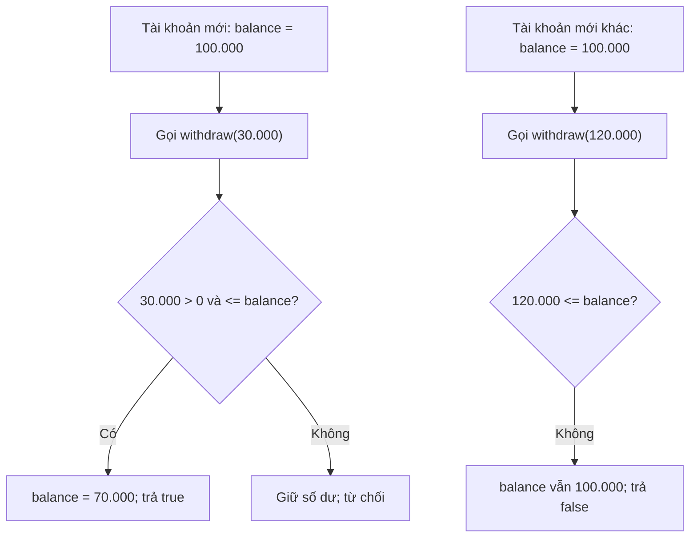
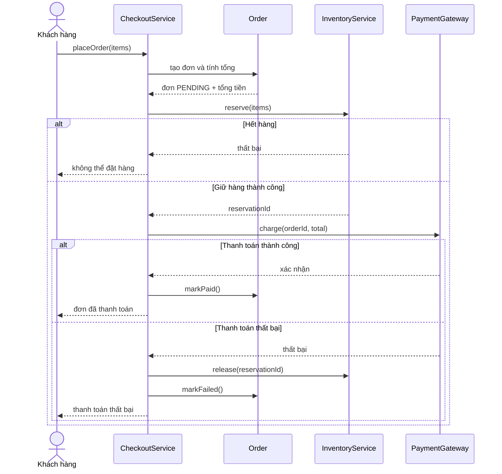
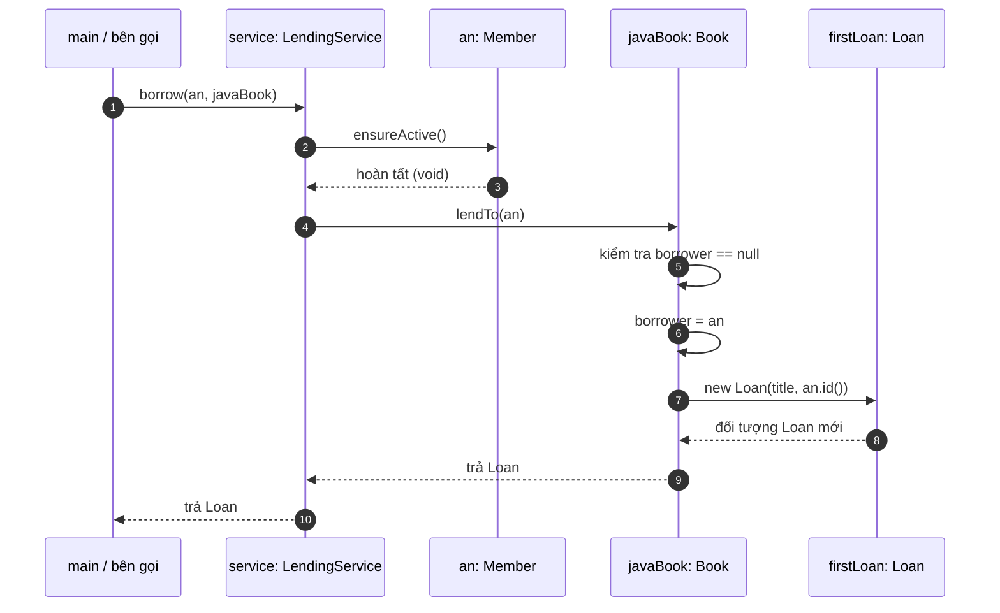
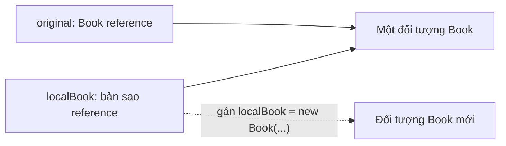
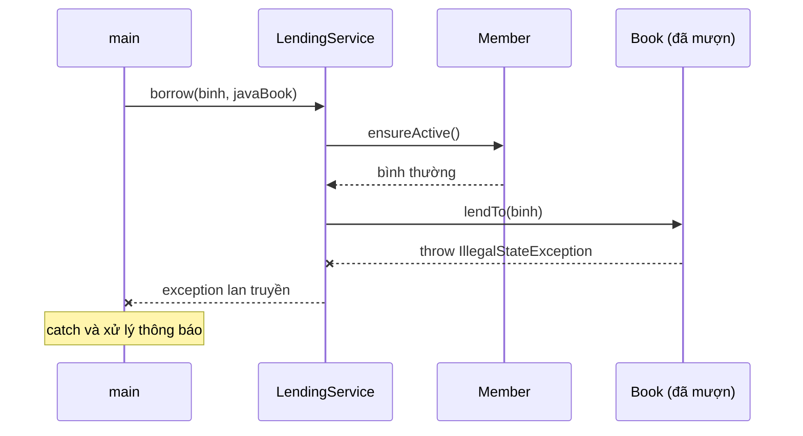
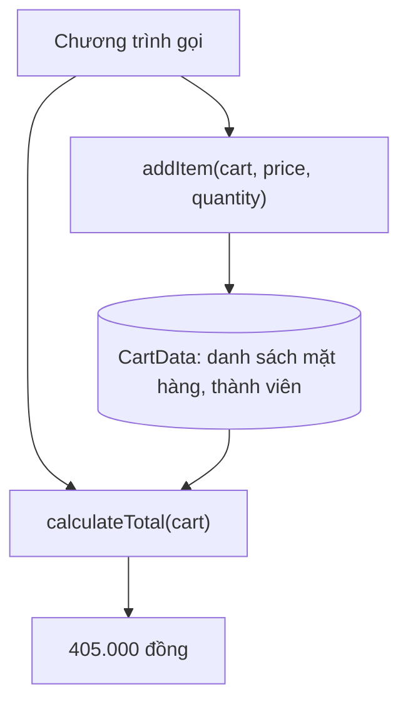
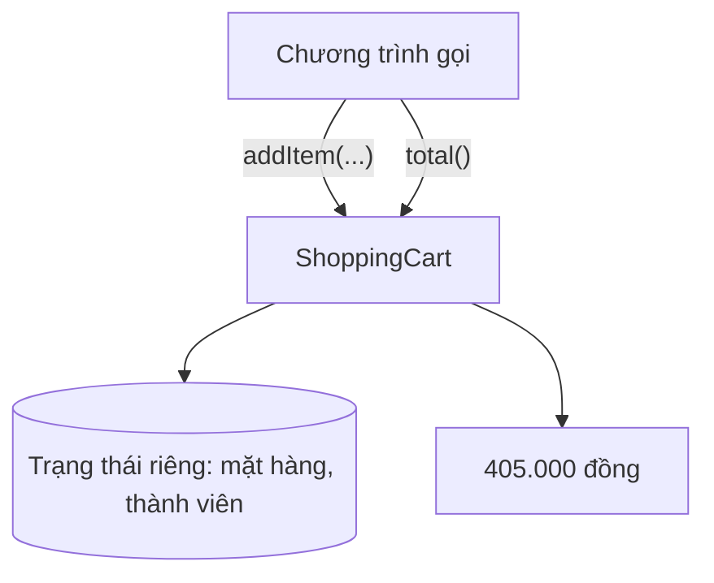
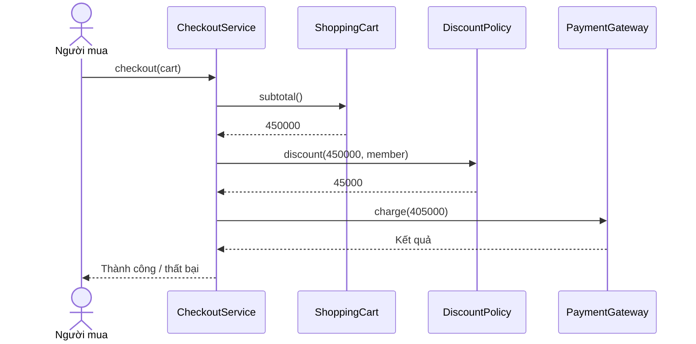
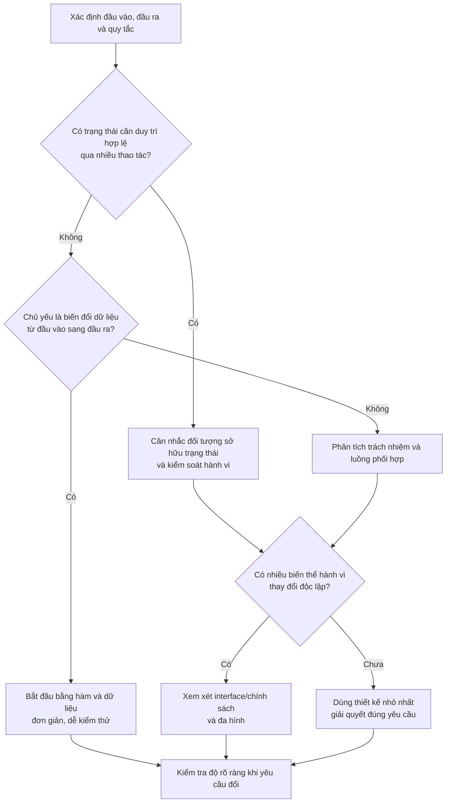

<a id="back-to-top"></a>

# Tư duy OOP

## Menu
- [OOP là gì và bài toán tổ chức chương trình](#oop-basic-001)
- [Đối tượng, trạng thái, hành vi và trách nhiệm](#oop-basic-002)
- [Lớp, kiểu và thể hiện: các khái niệm nền tảng](#oop-basic-003)
- [Tương tác giữa đối tượng và lời gọi phương thức](#oop-basic-004)
- [Đóng gói, trừu tượng, kế thừa và đa hình](#oop-basic-005)
- [OOP và lập trình thủ tục: cách phân chia bài toán](#oop-basic-006)
- [OOP dựa trên lớp và OOP dựa trên nguyên mẫu](#oop-basic-007)
- [Khi nên và không nên sử dụng OOP](#oop-basic-008)

## <a id="oop-basic-001">OOP là gì và bài toán tổ chức chương trình</a>

<details>
<summary>Xem chi tiết</summary>

# OOP là gì và bài toán tổ chức chương trình?

Khi một chương trình chỉ có vài chục dòng, chúng ta thường dễ biết dữ liệu nằm ở đâu, hàm nào xử lý việc gì và phải sửa chỗ nào khi yêu cầu thay đổi. Nhưng hãy tưởng tượng một ứng dụng có tài khoản, đơn hàng, kho hàng, thanh toán, nhiều người cùng phát triển và hàng trăm yêu cầu mới. Câu hỏi khó dần không còn là “viết vòng lặp thế nào?” mà là **“tổ chức chương trình ra sao để dữ liệu, hành vi và quy tắc nghiệp vụ có chỗ đứng rõ ràng?”**

**Lập trình hướng đối tượng (Object-Oriented Programming, OOP)** là một cách tư duy và tổ chức chương trình quanh các **đối tượng**. Mỗi đối tượng đại diện cho một thực thể hoặc khái niệm có trách nhiệm cụ thể; nó có thể giữ trạng thái, thực hiện hành vi và phối hợp với đối tượng khác để hoàn thành công việc.

Bài này tập trung vào hai câu hỏi: **OOP là gì?** Và **vấn đề tổ chức chương trình nào khiến OOP trở nên hữu ích?** Các kỹ thuật như kế thừa, đa hình hay SOLID sẽ được nhắc đến khi cần, chưa phải trọng tâm.

## 1. Vì sao “tổ chức chương trình” lại là một bài toán?

Giả sử bạn viết tính năng rút tiền. Khi mới bắt đầu, bài toán có vẻ đơn giản:

1. Đọc số dư hiện tại.
2. Nhận số tiền muốn rút.
3. Kiểm tra số tiền hợp lệ và số dư đủ.
4. Trừ tiền nếu được phép.
5. Trả kết quả.

Nếu chương trình chỉ xử lý một tài khoản, vài hàm và biến có thể đã đủ. Nhưng hệ thống lớn hơn sẽ xuất hiện thêm yêu cầu: có hàng nghìn tài khoản; cần lịch sử giao dịch; giới hạn rút theo ngày; khóa tài khoản; phân quyền; cảnh báo giao dịch bất thường; nhiều giao dịch đồng thời; cần kiểm thử và thay đổi quy tắc mà không phá tính năng cũ.

Những thách thức đáng chú ý là:

| Vấn đề | Dấu hiệu trong mã nguồn | Hậu quả có thể gặp |
|---|---|---|
| Dữ liệu và thao tác bị tách rời | Nhiều nơi cùng sửa trực tiếp `balance` | Một nơi quên kiểm tra, dữ liệu trở nên không hợp lệ |
| Trách nhiệm phân tán | Quy tắc rút tiền nằm rải rác ở controller, service, utility | Sửa một nghiệp vụ phải tìm và cập nhật nhiều nơi |
| Phụ thuộc chằng chịt | Đổi cách thanh toán kéo theo sửa nhiều phần không liên quan | Khó thay đổi, dễ phát sinh lỗi ngoài ý muốn |
| Khó hiểu luồng xử lý | Không rõ ai được phép làm gì với dữ liệu | Người mới khó đọc, khó bảo trì |
| Khó kiểm thử | Một hàm ôm đọc dữ liệu, tính toán, ghi DB và gửi thông báo | Muốn kiểm thử một quy tắc phải dựng cả hệ thống |

**OOP đưa ra một hướng tổ chức:** xác định những đối tượng mang trách nhiệm trong bài toán, giao cho chúng hành vi thích hợp và để chúng cộng tác thông qua các giao diện/phương thức rõ ràng. OOP **không tự động** giải quyết mọi vấn đề ở bảng trên; thiết kế đối tượng vẫn có thể tệ nếu phân chia trách nhiệm sai.

## 2. “Đối tượng” thực sự là gì?

Hãy xét một tài khoản ngân hàng, ở góc nhìn mô hình phần mềm:

- **Định danh (identity):** đó là tài khoản nào, ví dụ mã nghiệp vụ `ACC-01`.
- **Trạng thái (state):** số dư, trạng thái hoạt động, hạn mức... tại thời điểm hiện tại.
- **Hành vi (behavior):** nạp tiền, rút tiền, khóa tài khoản... đi kèm các điều kiện được phép thực hiện.
- **Trách nhiệm (responsibility):** duy trì những quy tắc thuộc về tài khoản, chẳng hạn không cho số dư âm theo chính sách được chọn.

Ví dụ: tài khoản `ACC-01` có số dư 100.000 đồng. Khi được yêu cầu rút 30.000 đồng, nó kiểm tra yêu cầu và chuyển số dư thành 70.000 đồng. Nếu yêu cầu rút 120.000 đồng ngay từ trạng thái 100.000 đồng, nó từ chối và giữ nguyên 100.000 đồng.

**Đối tượng không chỉ là “một túi dữ liệu”.** Một đối tượng được thiết kế tốt còn định nghĩa những thao tác hợp lệ đối với dữ liệu mà nó chịu trách nhiệm. Đồng thời, không phải đối tượng nào cũng có trạng thái thay đổi: đối tượng giá trị bất biến, ví dụ một `Money` đại diện cho số tiền và đơn vị tiền tệ, cũng hoàn toàn phù hợp với OOP.

### Phân biệt class và object

| Khái niệm | Vai trò | Ví dụ |
|---|---|---|
| `class` (lớp) | Bản mô tả cấu trúc và hành vi chung | `BankAccount` |
| `object` (đối tượng) | Một thể hiện được tạo từ lớp, tồn tại tại thời điểm chạy | Tài khoản A và tài khoản B |
| Thuộc tính / field | Dữ liệu thuộc về thể hiện hoặc lớp tùy cách khai báo | `balance` của một tài khoản |
| Phương thức / method | Hành vi mà đối tượng hoặc lớp cung cấp | `withdraw(amount)` |
| Tham chiếu / reference | Giá trị trong Java dùng để trỏ tới đối tượng | `accountA` |

Hai tài khoản được tạo từ cùng một lớp có thể có **số dư khác nhau**. Mỗi đối tượng có trạng thái riêng nếu trạng thái đó được lưu bằng instance field. “Định danh nghiệp vụ” như `accountNumber` cũng khác với “identity của object” trong Java: hai object có thể mang cùng một mã nếu chương trình cho phép tạo như vậy.

## 3. Cách tiếp cận thủ tục và chỗ dễ phát sinh lỗi tổ chức

Có thể tổ chức chương trình bằng dữ liệu và các hàm tách riêng. Ví dụ minh họa sau cố ý để dữ liệu mở:

```java
class AccountData {
    String accountNumber;
    long balance;
}

class AccountFunctions {
    static boolean withdraw(AccountData account, long amount) {
        if (amount <= 0 || amount > account.balance) {
            return false;
        }
        account.balance -= amount;
        return true;
    }
}

// Trong cùng package:
AccountData account = new AccountData();
account.balance = 100_000;
AccountFunctions.withdraw(account, 30_000); // còn 70_000

account.balance = -999_000; // vẫn sửa được, bỏ qua quy tắc rút tiền
```

Ở đây, `withdraw` có kiểm tra, nhưng biến `balance` vẫn có thể bị sửa trực tiếp từ nơi khác trong cùng package. Khi chương trình lớn, ta khó bảo đảm **mọi nơi sửa số dư đều tuân theo cùng một quy tắc**. Đây là vấn đề của **thiết kế ví dụ này**, không phải chứng minh rằng mọi chương trình lập trình thủ tục đều thiếu an toàn: cách tiếp cận thủ tục vẫn có thể bảo vệ dữ liệu bằng hàm, module, kiểu dữ liệu bất biến và kiểm soát quyền truy cập.

Hướng tổ chức bằng đối tượng là đặt dữ liệu cần bảo vệ và những hành vi duy trì quy tắc của nó vào cùng một nơi chịu trách nhiệm.

## 4. Một ví dụ Java OOP chạy được

Tạo file `Main.java` như sau (Java 11+):

```java
public class Main {
    static final class BankAccount {
        private final String accountNumber;
        private long balance;

        public BankAccount(String accountNumber, long openingBalance) {
            if (accountNumber == null || accountNumber.isBlank()) {
                throw new IllegalArgumentException("Account number is required");
            }
            if (openingBalance < 0) {
                throw new IllegalArgumentException("Opening balance cannot be negative");
            }
            this.accountNumber = accountNumber;
            this.balance = openingBalance;
        }

        public String getAccountNumber() {
            return accountNumber;
        }

        public long getBalance() {
            return balance;
        }

        public void deposit(long amount) {
            requirePositive(amount);
            balance = Math.addExact(balance, amount);
        }

        public boolean withdraw(long amount) {
            requirePositive(amount);
            if (amount > balance) {
                return false;
            }
            balance -= amount;
            return true;
        }

        private void requirePositive(long amount) {
            if (amount <= 0) {
                throw new IllegalArgumentException("Amount must be positive");
            }
        }
    }

    public static void main(String[] args) {
        BankAccount a = new BankAccount("ACC-01", 100_000);
        System.out.println(a.getBalance()); // 100000

        boolean success = a.withdraw(30_000);
        System.out.println(success);         // true
        System.out.println(a.getBalance()); // 70000

        BankAccount b = new BankAccount("ACC-02", 100_000);
        boolean rejected = b.withdraw(120_000);
        System.out.println(rejected);        // false
        System.out.println(b.getBalance()); // 100000

        b.deposit(5_000);
        System.out.println(b.getBalance()); // 105000
    }
}
```

Lệnh chạy:

```bash
javac Main.java
java Main
```

Ở ví dụ này:

- `private long balance`: bên ngoài không thể viết `a.balance = -10` bằng lời gọi Java thông thường; việc thay đổi phải đi qua các phương thức mà lớp cho phép.
- `withdraw`: kiểm tra số tiền trước khi thay đổi số dư. Nếu tiền không đủ, trả `false` và **không sửa trạng thái**.
- `deposit`: kiểm tra số dương; `Math.addExact` báo lỗi khi phép cộng `long` tràn số, tránh tạo số dư sai do overflow.
- `accountNumber`: được gán khi tạo và không có phương thức thay đổi; ở ví dụ này nó là thông tin định danh nghiệp vụ bất biến.
- `a` và `b`: là hai đối tượng riêng; thao tác trên `a` không làm số dư của `b` thay đổi.

### Đọc mã như một chuỗi nguyên nhân → kết quả



**Chú ý:** hai nhánh bắt đầu từ **hai tài khoản mới có số dư 100.000**, nên không được lẫn trạng thái. Nếu thử rút 120.000 *sau khi* đã rút 30.000 trên cùng tài khoản `a`, nó cũng thất bại, nhưng số dư lúc đó giữ nguyên ở **70.000**, không quay về 100.000.

Mô hình này cho thấy giá trị của việc để một đối tượng **chịu trách nhiệm giữ trạng thái hợp lệ**, đồng thời thể hiện giới hạn: `BankAccount` minh họa logic trong bộ nhớ của một tiến trình, **chưa** phải một hệ thống chuyển tiền an toàn. Với nhiều luồng hoặc nhiều máy chủ cùng cập nhật, ta còn cần giao dịch cơ sở dữ liệu, khóa/kiểm soát đồng thời, chống xử lý trùng, bảo mật, kiểm toán... `private` không tự làm mã trở nên thread-safe.

## 5. OOP tổ chức *cả chương trình* như thế nào?

Một lớp `BankAccount` chưa thể hiện hết ý tưởng. Giả sử ứng dụng bán hàng có yêu cầu: khách đặt mua hai sản phẩm, hệ thống phải kiểm tra giá, hàng còn, ghi đơn hàng và yêu cầu thanh toán.

Nếu mọi bước đều nằm trong một hàm khổng lồ như `processEverything()`, hàm đó rất dễ phình ra: truy vấn dữ liệu, tính tổng, kiểm tra kho, gọi cổng thanh toán, ghi log, gửi email... Khi thêm “thanh toán khi nhận hàng” hay “hủy đơn”, ta lại phải chỉnh một hàm có quá nhiều lý do để thay đổi.

Thay vào đó, ta có thể giao việc theo trách nhiệm:

| Thành phần | Trách nhiệm chính | Không nên tự ôm |
|---|---|---|
| `Order` | Quản lý các dòng hàng, trạng thái đơn, các chuyển trạng thái hợp lệ | Gọi HTTP đến cổng thanh toán |
| `OrderItem` | Giữ sản phẩm, số lượng, đơn giá tại thời điểm đặt | Cập nhật toàn bộ tồn kho |
| `InventoryService` | Kiểm tra/đặt giữ hàng theo quy tắc kho | Quyết định trạng thái thanh toán |
| `PaymentGateway` | Hợp đồng gửi yêu cầu thanh toán và nhận kết quả | Sửa trực tiếp số lượng hàng |
| `CheckoutService` | Điều phối những bước tạo đơn, giữ hàng, yêu cầu thanh toán | Chứa toàn bộ quy tắc nội bộ của mọi đối tượng |

Một luồng tương tác có thể được diễn đạt như sau:



Sơ đồ diễn tả **trách nhiệm và thông điệp** giữa các đối tượng; đây là mô hình giảng giải, chưa xử lý chi tiết timeout, lỗi mạng hoặc hoàn tiền. Trong hệ thống thực, bước `charge` có thể thành công nhưng phản hồi thất lạc; do đó cần trạng thái bền vững, idempotency, xử lý lại có kiểm soát và cơ chế đối soát/bù trừ trước khi coi luồng là hoàn chỉnh.

Ở đây, `CheckoutService` **biết phải nhờ ai làm việc gì**. `Order` tự giữ luật của trạng thái đơn; kho chịu trách nhiệm giữ hàng; `PaymentGateway` là một hợp đồng giao tiếp. Mỗi thành phần có một lý do chính để thay đổi, vì vậy người đọc tìm đúng chỗ nhanh hơn.

Cũng cần phân biệt **đối tượng có trách nhiệm** với **việc tạo thật nhiều class**. Nếu một chức năng chỉ là phép cộng đơn giản, tách thành bảy lớp và mười interface sẽ gây khó hiểu hơn là giúp ích.

## 6. “Các đối tượng phối hợp” nghĩa là gì?

Trong Java, đối tượng thường làm việc với nhau thông qua **lời gọi phương thức**. Ví dụ khái niệm:

```java
interface PaymentGateway {
    PaymentResult charge(String orderId, long amount);
}

class CheckoutService {
    private final PaymentGateway paymentGateway;

    CheckoutService(PaymentGateway paymentGateway) {
        this.paymentGateway = paymentGateway;
    }

    PaymentResult requestPayment(String orderId, long amount) {
        if (amount <= 0) {
            throw new IllegalArgumentException("Amount must be positive");
        }
        return paymentGateway.charge(orderId, amount);
    }
}

// PaymentResult là kiểu kết quả do ứng dụng định nghĩa.
// Đoạn này minh họa cách phối hợp, không phải file Java độc lập.
```

`CheckoutService` cần khả năng “thu tiền”, nên nó phụ thuộc vào hợp đồng `PaymentGateway`. Một lớp có thể triển khai cổng thanh toán thật; một lớp khác có thể giả lập kết quả để kiểm thử. Điều này giúp giảm mức phụ thuộc vào chi tiết cụ thể.

Đây là một lợi ích lớn của OOP khi xây dựng hệ thống: **thay đổi một cách thực hiện mà giảm nhu cầu sửa mã đang sử dụng nó**. Nhưng việc chọn interface phải có lý do, ví dụ tồn tại nhiều cách thực hiện, cần thay thế khi kiểm thử hoặc cần giữ ranh giới phụ thuộc; không nhất thiết mỗi class đều phải có interface tương ứng.

## 7. OOP khác lập trình thủ tục ở điểm nào?

So sánh nên tập trung vào **cách phân chia và quản lý trách nhiệm**, thay vì nói một bên “cũ” hay “dở”:

| Câu hỏi | Cách tổ chức theo thủ tục / hàm | Cách tổ chức theo đối tượng |
|---|---|---|
| Tư duy chủ đạo | Những bước/hàm nào biến đầu vào thành kết quả? | Những đối tượng nào chịu trách nhiệm và cần trao đổi gì? |
| Dữ liệu và hành vi | Có thể đặt trong những module/hàm riêng | Thường gom trạng thái và hành vi liên quan vào đối tượng |
| Điểm mạnh tự nhiên | Luồng xử lý tuyến tính, thuật toán, biến đổi dữ liệu | Mô hình có trạng thái và quy tắc, cộng tác giữa thành phần |
| Kiểm soát thay đổi | Qua module, hợp đồng hàm, kiểu dữ liệu | Qua ranh giới đối tượng, phương thức, giao diện |
| Rủi ro khi áp dụng kém | Hàm quá dài, trạng thái dùng chung tùy tiện | Class quá lớn, quan hệ chằng chịt, nhiều tầng không cần thiết |

Hai cách có thể **kết hợp trong cùng ứng dụng**: một đối tượng `Order` dùng một hàm thuần để tính thuế; service gọi phương thức của object; một pipeline xử lý dữ liệu có thể dùng hàm/stream thay vì dựng đối tượng cho từng bước. Java hỗ trợ lập trình hướng đối tượng nhưng bản thân việc viết code Java không bảo đảm thiết kế đã mang tư duy OOP tốt.

### Một tình huống so sánh rất thực tế

Khi có thay đổi “không được rút tiền nếu tài khoản bị khóa”, tư duy OOP gợi ý đặt quy tắc ở `BankAccount.withdraw()` hoặc một thành phần nghiệp vụ chịu trách nhiệm rõ ràng. Giao diện web, ứng dụng di động và tác vụ nền đều gọi vào cùng hành vi; như vậy tránh mỗi phía tự viết một bản kiểm tra khác nhau.

Nếu vì tiện mà ba controller tự truy cập database rồi trừ số dư, việc đã tạo class `BankAccount` không giúp ích bao nhiêu: **quy tắc vẫn phân tán**. Giá trị đến từ thiết kế và kỷ luật sử dụng ranh giới đối tượng, không đến từ tên lớp.

## 8. Làm thế nào để tìm ra đối tượng từ yêu cầu?

Đừng vội nhìn danh từ nào trong câu cũng tạo một class. Hãy bắt đầu bằng hành vi và quy tắc thực tế.

**Ví dụ yêu cầu:** “Khách có thể hủy đơn khi đơn chưa giao cho đơn vị vận chuyển; nếu đã giao thì không thể hủy trực tiếp.”

Ta có thể tự hỏi theo thứ tự:

1. **Thông tin gì cần được giữ?** Một đơn hàng có mã, các món hàng và trạng thái như `CREATED`, `PAID`, `SHIPPED`, `CANCELLED`.
2. **Quy tắc nào phải luôn đúng?** Khi đã `SHIPPED`, lệnh `cancel()` thông thường không được chuyển thẳng sang `CANCELLED`.
3. **Ai nên chịu trách nhiệm bảo vệ quy tắc?** `Order` là ứng viên tự nhiên vì nó nắm trạng thái và quyết định chuyển trạng thái hợp lệ.
4. **Cần hợp tác với ai?** `OrderService` có thể lấy đơn từ kho lưu trữ; một cơ chế vận chuyển hoặc hoàn tiền có quy tắc của riêng nó.
5. **Phần nào phải thay đổi độc lập?** Nếu thay nhà vận chuyển, không nên bắt `Order` viết lại toàn bộ logic HTTP.

Phác thảo rất ngắn:

```java
enum OrderStatus { CREATED, PAID, SHIPPED, CANCELLED }

class Order {
    private OrderStatus status = OrderStatus.CREATED;

    void cancel() {
        if (status == OrderStatus.SHIPPED) {
            throw new IllegalStateException("Shipped order cannot be cancelled here");
        }
        if (status == OrderStatus.CANCELLED) {
            return; // ví dụ chọn hành vi gọi lặp không làm thay đổi trạng thái
        }
        status = OrderStatus.CANCELLED;
    }
}
```

Đây chỉ là mô hình một quy tắc nhỏ. Trong sản phẩm thật, việc hủy có thể bị giới hạn ở những trạng thái cụ thể hơn; hoàn tiền, hoàn kho, lịch sử sự kiện và quyền của người thao tác là các trách nhiệm cần phân tích riêng. Điểm cần nhớ: **quy tắc trạng thái có “nhà” để ở**, người khác gọi `cancel()` thay vì tự sửa `status` tùy ý.

## 9. OOP liên quan đến encapsulation, abstraction, inheritance, polymorphism thế nào?

OOP thường được giới thiệu qua “bốn tính chất”. Chúng là những công cụ để xây dựng và mở rộng thiết kế, nhưng **định nghĩa OOP chỉ bằng cách thuộc tên bốn tính chất là chưa đủ**.

| Ý tưởng | Trả lời câu hỏi nào? | Liên hệ trong bài |
|---|---|---|
| **Encapsulation (đóng gói)** | Ai được quyền thay đổi dữ liệu, qua thao tác gì? | `balance` là `private`; rút tiền qua `withdraw()` |
| **Abstraction (trừu tượng hóa)** | Bên ngoài cần biết điều gì, có thể bỏ qua chi tiết gì? | Người gọi chỉ cần biết `withdraw(amount)` trả thành công hay thất bại |
| **Inheritance (kế thừa)** | Khi nào có quan hệ kiểu cha–con phù hợp để tái sử dụng/mở rộng? | Chưa cần dùng cho ví dụ tài khoản; không phải lúc nào cũng nên kế thừa |
| **Polymorphism (đa hình)** | Làm sao nhiều cách thực hiện dùng chung một hợp đồng? | Các triển khai khác nhau của `PaymentGateway` |

**Đóng gói và trừu tượng hóa không đồng nghĩa.** `private` giúp giới hạn truy cập là một kỹ thuật đóng gói; chọn một giao diện nhỏ gọn, che đi cách thực hiện là quyết định trừu tượng hóa. Bản thân một class có nhiều `private` field nhưng toàn bộ nghiệp vụ lại ở controller cũng chưa thể xem là thiết kế trách nhiệm tốt.

## 10. Khi nào OOP có ích, khi nào không nên cố ép?

OOP đặc biệt có ích khi chương trình có **nhiều thực thể tương tác, trạng thái và quy tắc thay đổi theo thời gian**, nhiều nhóm phát triển cần thống nhất ranh giới; hoặc khi có những hành vi cần triển khai theo nhiều cách.

Ngược lại, một script chuyển đổi CSV, phép tính số học thuần túy, xử lý hàng loạt theo pipeline hoặc chương trình nhỏ đôi khi được diễn đạt rõ ràng hơn bằng hàm và cấu trúc dữ liệu đơn giản. Không có luật nào buộc mọi xử lý phải tạo object mới. Nhiều ứng dụng thực tế dùng phối hợp hướng đối tượng, thủ tục và hàm.

Một số dấu hiệu nên xem lại thiết kế:

- **God object:** một class làm mọi thứ từ nghiệp vụ đến SQL, HTTP, gửi mail.
- **Anemic domain model:** object chủ yếu chỉ có getter/setter, còn quy tắc duy trì trạng thái chạy rải rác ở những nơi khác. Với DTO hoặc dữ liệu truyền tải, object chỉ chứa dữ liệu có thể vẫn hoàn toàn hợp lý.
- **Lạm dụng kế thừa:** cố dùng quan hệ `extends` chỉ để tái sử dụng vài dòng code, làm lớp con phụ thuộc nặng vào lớp cha.
- **Quá nhiều lớp trung gian:** một thao tác đơn giản phải đi qua hàng loạt interface, manager, helper mà không có ranh giới thực sự.
- **Bỏ quên concurrency và persistence:** tưởng rằng giấu field hoặc dùng `synchronized` trong một object sẽ tự bảo vệ dữ liệu giữa nhiều instance ứng dụng.

Trong **Spring Boot**, `@Service`, `@Controller`, `@Repository` là những vai trò thường gặp khi tổ chức ứng dụng. Chúng có thể sử dụng OOP, nhưng việc gắn annotation không tự biến một class thành mô hình nghiệp vụ tốt. Chẳng hạn controller nên tiếp nhận/kiểm tra dữ liệu ở biên và gọi vào các thành phần phụ trách nghiệp vụ; đối tượng miền có thể giữ quy tắc chuyển trạng thái. Với JPA, transaction và optimistic/pessimistic locking cần được cân nhắc riêng cho cập nhật đồng thời.

## 11. Tự kiểm tra cách hiểu

Hãy thử trả lời trước khi xem gợi ý:

**Tình huống A.** Một class `Wallet` có `public long balance` và một phương thức `withdraw()` rất chặt chẽ. Mọi nơi vẫn có thể viết `wallet.balance = -1`. Có vấn đề gì?  
**Gợi ý:** lớp chưa bảo vệ được quy tắc số dư vì còn đường sửa trạng thái bỏ qua hành vi kiểm tra.

**Tình huống B.** Hai đối tượng `BankAccount` cùng có `balance = 100000`. Chúng có nhất thiết là cùng một đối tượng không?  
**Gợi ý:** không. Giá trị trạng thái bằng nhau không đồng nghĩa cùng identity/tham chiếu; cũng không có nghĩa mã tài khoản nghiệp vụ trùng nhau.

**Tình huống C.** Mỗi lần thêm phương thức thanh toán mới, developer phải sửa hàng loạt nhánh `if/else` trong `CheckoutService`. Có hướng thiết kế nào cần xem xét?  
**Gợi ý:** xác định hợp đồng thanh toán chung và phân tách phần triển khai cụ thể nếu hệ thống thực sự cần nhiều phương thức thanh toán.

**Tình huống D.** Một class `Order` vừa tính tổng tiền, gọi ngân hàng qua HTTP, gửi email, thực thi câu lệnh SQL, ghi log, vừa quản lý kho. Có lợi vì “mọi thứ ở cùng một object” không?  
**Gợi ý:** không; đóng gói tốt còn cần **phân chia trách nhiệm đúng**, để thay đổi một phần ít kéo theo những phần khác.

## 12. Nhớ điều gì sau bài này?

OOP là một cách **chia hệ thống thành những đối tượng có trạng thái/hành vi và trách nhiệm rõ ràng, phối hợp với nhau qua hợp đồng**. Nó hữu ích vì khi dự án phát triển, ta cần biết **dữ liệu do ai quản lý, quy tắc ở đâu, ai có thể yêu cầu thao tác nào, và thay đổi chỗ này sẽ ảnh hưởng tới những chỗ nào**.

Để thực hành, hãy lấy một nghiệp vụ quen thuộc như tài khoản hoặc đơn hàng, ghi ra 3 thứ: **trạng thái phải giữ, hành vi hợp lệ, quy tắc không được vi phạm**. Sau đó thử viết một class bảo vệ được các quy tắc đó và kiểm tra trạng thái trước/sau từng lời gọi. Khi thêm đối tượng thứ hai, hãy xác định rõ thông điệp và trách nhiệm của từng bên. Đó là bước đầu chuyển từ “viết code cho chạy” sang **thiết kế một chương trình có thể hiểu, kiểm thử và thay đổi được**.


</details>

- [Quay lại đầu trang](#back-to-top)

---

## <a id="oop-basic-002">Đối tượng, trạng thái, hành vi và trách nhiệm</a>

<details>
<summary>Xem chi tiết</summary>

# Đối tượng, trạng thái, hành vi và trách nhiệm trong OOP

Khi học lập trình hướng đối tượng (Object-Oriented Programming – OOP), ta thường nghe: “Một đối tượng có trạng thái và hành vi”. Câu nói đúng nhưng chưa đủ để thiết kế phần mềm. Cần hiểu thêm **đối tượng chịu trách nhiệm về điều gì**, vì chính trách nhiệm quyết định dữ liệu nào thuộc về nó và hành vi nào nên đặt bên trong nó.

Hãy hình dung một đơn hàng đang được tạo: nó có mã đơn, danh sách sản phẩm, trạng thái nháp; người mua có thể thêm sản phẩm rồi xác nhận. Đơn hàng phải tự bảo vệ quy tắc “đã xác nhận thì không được tùy ý sửa danh sách sản phẩm”. Đó là một ví dụ về sự gắn kết giữa **đối tượng → trạng thái → hành vi → trách nhiệm**.

## 1. Bốn khái niệm liên hệ với nhau như thế nào?

| Khái niệm | Câu hỏi cần trả lời | Ví dụ với đơn hàng |
| --- | --- | --- |
| **Đối tượng (object)** | Ai/điều gì đang tham gia vào hệ thống? | Một đơn hàng cụ thể, có mã `orderId` |
| **Trạng thái (state)** | Đối tượng hiện có dữ liệu và đang ở tình huống nào? | Các dòng sản phẩm; `DRAFT`, `CONFIRMED` hoặc `CANCELLED` |
| **Hành vi (behavior)** | Đối tượng có thể thực hiện thao tác có ý nghĩa gì? | `addLine()`, `confirm()`, `cancel()`, `total()` |
| **Trách nhiệm (responsibility)** | Đối tượng phải biết, quyết định và bảo đảm điều gì? | Giữ danh sách sản phẩm hợp lệ và kiểm soát chuyển trạng thái đơn hàng |

Bốn phần không tồn tại độc lập. Nếu một đối tượng có thao tác `confirm()` thì thao tác ấy phải đọc trạng thái hiện tại, kiểm tra điều kiện và cập nhật trạng thái theo trách nhiệm của chính đối tượng.

Ví dụ, việc xác nhận đơn hàng không nên chỉ là gán `status = CONFIRMED`. Nó phải trả lời: *Đơn đã bị hủy chưa? Có ít nhất một sản phẩm chưa? Có cho xác nhận lại không?* Nếu quy tắc nằm rải rác ở nhiều nơi, phần mềm dễ tạo ra đơn hàng ở trạng thái sai.

## 2. Đối tượng là gì? Phân biệt đối tượng và lớp

**Đối tượng** là một thực thể trong chương trình có dữ liệu và cách xử lý liên quan đến dữ liệu đó. Nó có thể biểu diễn một thứ ngoài đời thực (đơn hàng, khách hàng), một khái niệm nghiệp vụ (giỏ hàng, hạn mức tín dụng), hoặc một thành phần kỹ thuật (bộ đệm, bộ đọc tệp). Không phải mọi đối tượng đều phải tương ứng với một vật thể hữu hình.

**Lớp (class)** thường mô tả cấu trúc và hành vi chung; **đối tượng (instance)** là một thể hiện cụ thể được tạo ra từ lớp.

~~~java
Order firstOrder = new Order(UUID.randomUUID());
Order secondOrder = new Order(UUID.randomUUID());

// Cùng kiểu Order nhưng là hai đối tượng riêng.
// Mỗi đối tượng có id, danh sách hàng và trạng thái của riêng nó.
~~~

Hai đơn hàng có thể cùng ở trạng thái `DRAFT` nhưng vẫn là **hai đối tượng khác nhau**. Ngược lại, một đơn hàng chuyển từ `DRAFT` sang `CONFIRMED` vẫn là *cùng đơn hàng ấy*; chỉ có trạng thái của nó thay đổi.

Cần phân biệt hai góc nhìn về danh tính:

- **Danh tính trong bộ nhớ Java:** `firstOrder == secondOrder` so sánh xem hai biến có trỏ đến cùng một object hay không.
- **Danh tính nghiệp vụ:** `orderId` giúp nhận diện một đơn hàng xuyên qua các lần lưu, tải từ database hoặc truyền qua API. Hai instance Java khác nhau có thể biểu diễn cùng một `orderId`. Việc so sánh chúng bằng `equals()` hay bằng ID phụ thuộc thiết kế cụ thể, không tự động suy ra từ tên lớp.

Điểm cốt lõi: **danh tính trả lời “đây là ai/cái gì?”, trạng thái trả lời “hiện tại nó ra sao?”**.

## 3. Trạng thái: những gì đối tượng đang nắm giữ

Trạng thái là tập hợp giá trị liên quan đến một đối tượng tại một thời điểm. Với đơn hàng, ta có:

- **Không đổi theo vòng đời nghiệp vụ:** mã đơn hàng `id`.
- **Có thể đổi qua hành vi hợp lệ:** các dòng sản phẩm khi đơn còn ở trạng thái nháp; `status` sau khi xác nhận hoặc hủy.
- **Có thể tính từ trạng thái khác:** `total()` được tính từ số lượng và đơn giá của các dòng sản phẩm. Không nhất thiết phải lưu thêm biến `total` rồi lo đồng bộ mỗi khi thêm hàng.

Ví dụ ba thời điểm của cùng một đơn hàng:

| Thời điểm | Danh sách hàng | Trạng thái | Tổng tiền |
| --- | --- | --- | --- |
| Mới tạo | Rỗng | `DRAFT` | 0 |
| Thêm 2 cuốn sách × 125.000 | 1 dòng hàng, số lượng 2 | `DRAFT` | 250.000 |
| Xác nhận thành công | Giữ nguyên | `CONFIRMED` | 250.000 |

Một trạng thái **hợp lệ** phải tuân theo các quy tắc nghiệp vụ (invariant). Trong ví dụ này:

1. Số lượng mỗi dòng hàng phải lớn hơn 0; đơn giá không âm.
2. Đơn đã xác nhận hoặc đã hủy không được thêm dòng hàng bằng `addLine()`.
3. Một đơn chỉ được `confirm()` khi đang `DRAFT` và có ít nhất một dòng hàng.
4. ID không tự thay đổi chỉ vì đơn chuyển trạng thái.

Không phải tất cả trạng thái đều phải có thể thay đổi. Một đối tượng bất biến (immutable object) vẫn có trạng thái, chỉ là trạng thái được cố định sau khi tạo. Và trường `private` không tự bảo đảm dữ liệu hợp lệ: vẫn cần kiểm soát những phương thức có thể thay đổi dữ liệu.

## 4. Hành vi: việc đối tượng biết làm

**Hành vi** là hoạt động mà đối tượng cung cấp cho phần còn lại của chương trình. Trong Java, hành vi thường được thể hiện bằng method. Một hành vi có thể:

- **Thay đổi trạng thái:** `addLine()`, `confirm()`, `cancel()`.
- **Trả về thông tin mà không thay đổi trạng thái:** `total()`, `status()`.
- **Từ chối thao tác không hợp lệ:** `confirm()` khi đơn rỗng sẽ báo lỗi và giữ nguyên `DRAFT`.

Tên phương thức nên diễn đạt ý định của miền bài toán. So sánh:

~~~java
// Khó kiểm soát: mã gọi bên ngoài tự quyết định trạng thái.
order.setStatus(OrderStatus.CONFIRMED);

// Thể hiện ý nghĩa nghiệp vụ: Order tự kiểm tra điều kiện.
order.confirm();
~~~

`confirm()` tốt hơn trong ví dụ này vì người gọi yêu cầu **“hãy xác nhận đơn”**, còn **đối tượng quyết định liệu yêu cầu có hợp lệ hay không**. Không nên hiểu rằng mọi setter đều xấu: các đối tượng truyền dữ liệu (DTO), cấu hình hoặc bean đơn giản có mục đích riêng. Điều cần tránh là bỏ qua quy tắc quan trọng đối với một đối tượng có vòng đời nghiệp vụ.

Hành vi phải có **đầu vào, điều kiện trước, kết quả và điều kiện sau** rõ ràng. Nếu thao tác thất bại, đừng để dữ liệu ở tình trạng thay đổi dở dang ngoài ý muốn.

## 5. Trách nhiệm: đối tượng nên giữ quy tắc nào?

Trách nhiệm là những điều một đối tượng cần biết hoặc bảo đảm để thực hiện đúng vai trò. Đây là nền tảng để quyết định **đặt dữ liệu và phương thức ở đâu**.

| Thành phần | Trách nhiệm phù hợp | Không nên ôm luôn |
| --- | --- | --- |
| **`Order`** | Quản lý dòng hàng, tính tổng, kiểm tra chuyển trạng thái đơn hàng | Gửi HTTP request tới cổng thanh toán, xây SQL, gửi email |
| **`PaymentService`** | Điều phối quy trình thanh toán, gọi hệ thống thanh toán và xử lý kết quả | Tự sửa trực tiếp danh sách hàng bên trong `Order` |
| **`OrderRepository`** | Lưu và tải đơn hàng từ nơi lưu trữ | Quyết định đơn rỗng có được xác nhận hay không |
| **`NotificationService`** | Gửi thông báo liên quan đến đơn hàng | Tự thay đổi `Order.status` |

Cách phân chia này không tuyệt đối cho mọi hệ thống. Điều quan trọng là quy tắc **“đơn hàng có được xác nhận không?”** có một nơi chịu trách nhiệm rõ ràng, thay vì bị lặp ở controller, service và repository với những điều kiện khác nhau.

**Trách nhiệm khác hành vi:** “Bảo đảm đơn hàng chuyển trạng thái hợp lệ” là một *trách nhiệm*; `confirm()` và `cancel()` là các *hành vi* thực hiện trách nhiệm đó. Một đối tượng có thể có nhiều method để phục vụ cùng một trách nhiệm.

Trách nhiệm tốt thường có **tính gắn kết (cohesion)**: dữ liệu và hành vi cùng phục vụ một mục đích. Nếu lớp `Order` vừa quản lý đơn, vừa xác thực JWT, vừa mở kết nối database, vừa gửi email, các lý do khiến lớp phải thay đổi không còn cùng một nhóm.

## 6. Ví dụ Java hoàn chỉnh: một Order bảo vệ trạng thái của nó

Ví dụ sau dùng Java 17 trở lên (có `record`), có thể lưu trong `Main.java` để chạy. Nó minh họa quy tắc trong bộ nhớ, chưa bàn đến việc lưu database hay xử lý nhiều yêu cầu đồng thời.

~~~java
import java.math.BigDecimal;
import java.util.ArrayList;
import java.util.List;
import java.util.Objects;
import java.util.UUID;

enum OrderStatus {
    DRAFT, CONFIRMED, CANCELLED
}

// Một dòng hàng là value object: chứa dữ liệu hợp lệ và bất biến.
record OrderLine(String sku, int quantity, BigDecimal unitPrice) {
    OrderLine {
        Objects.requireNonNull(sku, "sku");
        Objects.requireNonNull(unitPrice, "unitPrice");

        if (sku.isBlank() || quantity <= 0 || unitPrice.signum() < 0) {
            throw new IllegalArgumentException("Invalid order line");
        }
    }

    BigDecimal subtotal() {
        return unitPrice.multiply(BigDecimal.valueOf(quantity));
    }
}

final class Order {
    private final UUID id;
    private final List<OrderLine> lines = new ArrayList<>();
    private OrderStatus status = OrderStatus.DRAFT;

    Order(UUID id) {
        this.id = Objects.requireNonNull(id, "id");
    }

    UUID id() {
        return id;
    }

    OrderStatus status() {
        return status;
    }

    List<OrderLine> lines() {
        return List.copyOf(lines); // Không lộ List mutable bên trong.
    }

    BigDecimal total() {
        return lines.stream()
                .map(OrderLine::subtotal)
                .reduce(BigDecimal.ZERO, BigDecimal::add);
    }

    void addLine(String sku, int quantity, BigDecimal unitPrice) {
        requireDraft();
        lines.add(new OrderLine(sku, quantity, unitPrice));
    }

    void confirm() {
        requireDraft();
        if (lines.isEmpty()) {
            throw new IllegalStateException("Empty order cannot be confirmed");
        }
        status = OrderStatus.CONFIRMED;
    }

    void cancel() {
        requireDraft();
        status = OrderStatus.CANCELLED;
    }

    private void requireDraft() {
        if (status != OrderStatus.DRAFT) {
            throw new IllegalStateException(
                    "Order must be DRAFT, actual: " + status);
        }
    }
}

public class Main {
    public static void main(String[] args) {
        Order order = new Order(UUID.randomUUID());

        System.out.println(order.status()); // DRAFT
        System.out.println(order.total());  // 0

        order.addLine("BOOK-01", 2, new BigDecimal("125000"));
        System.out.println(order.total());  // 250000

        order.confirm();
        System.out.println(order.status()); // CONFIRMED

        try {
            order.addLine("PEN-01", 1, new BigDecimal("5000"));
        } catch (IllegalStateException ex) {
            System.out.println(ex.getMessage()); // Order must be DRAFT...
        }

        System.out.println(order.total()); // Vẫn 250000

        // Nhánh thất bại độc lập, không dùng lại đơn đã xác nhận.
        Order emptyOrder = new Order(UUID.randomUUID());
        try {
            emptyOrder.confirm();
        } catch (IllegalStateException ex) {
            System.out.println(ex.getMessage()); // Empty order...
        }
        System.out.println(emptyOrder.status()); // Vẫn DRAFT

        Order cancelledOrder = new Order(UUID.randomUUID());
        cancelledOrder.cancel();
        System.out.println(cancelledOrder.status()); // CANCELLED
    }
}
~~~

**Đọc ví dụ theo bốn góc nhìn:**

- **Đối tượng:** `order`, `emptyOrder` và `cancelledOrder` là ba instance có ID riêng, dù chúng cùng được tạo từ lớp `Order`.
- **Trạng thái:** `id`, `lines` và `status` tạo thành dữ liệu mà `Order` quản lý. `total()` suy ra kết quả từ `lines`.
- **Hành vi:** `addLine()` thay đổi danh sách; `confirm()` và `cancel()` chuyển trạng thái; `total()` chỉ tính toán.
- **Trách nhiệm:** `Order` bảo đảm mọi thao tác công khai ở ví dụ đều giữ trạng thái theo quy tắc. Nó che danh sách mutable bằng `List.copyOf(...)` và không cung cấp `setStatus()` tự do.

Chạy ví dụ:

~~~bash
javac Main.java
java Main
~~~

**Lưu ý về ví dụ:** Chúng ta chủ động định nghĩa chỉ đơn `DRAFT` được hủy. Dự án thực tế có thể cho hủy đơn đã xác nhận, hoàn tiền hoặc có thêm `PAID`/`SHIPPED`; khi đó phải thay đổi quy tắc và kiểm thử đúng theo nghiệp vụ. `BigDecimal` được dùng để tránh sai số số thực nhị phân trong phép tính thập phân, nhưng hệ thống tiền tệ thực tế còn cần quy định đơn vị tiền, làm tròn và thuế/phí.

## 7. Vòng đời đối tượng: trạng thái thay đổi qua hành vi

~~~mermaid
stateDiagram-v2
    [*] --> DRAFT: tạo Order
    DRAFT --> DRAFT: addLine(...) hợp lệ
    DRAFT --> CONFIRMED: confirm() và có hàng
    DRAFT --> CANCELLED: cancel()
    CONFIRMED --> [*]
    CANCELLED --> [*]
~~~

Sơ đồ mô tả **các chuyển trạng thái thành công** trong ví dụ. Những yêu cầu không hợp lệ (xác nhận đơn rỗng, thêm hàng sau xác nhận, hủy lần nữa) bị từ chối; trạng thái được giữ nguyên.

Theo dõi chính xác một luồng:

| Bước | Lệnh | Trước | Sau | Kết quả quan sát được |
| --- | --- | --- | --- | --- |
| 1 | `new Order(id)` | Chưa tồn tại | `DRAFT`, rỗng | Có một đơn mới |
| 2 | `addLine("BOOK-01", 2, 125000)` | `DRAFT`, rỗng | `DRAFT`, 1 dòng | `total() = 250000` |
| 3 | `confirm()` | `DRAFT`, 1 dòng | `CONFIRMED`, 1 dòng | Xác nhận thành công |
| 4 | `addLine("PEN-01", 1, 5000)` | `CONFIRMED`, 1 dòng | **Giữ nguyên** | Ném `IllegalStateException`; tổng vẫn 250000 |

Để thử lỗi “xác nhận đơn rỗng”, dùng **đơn thứ hai**: `new Order(id2)` → `confirm()` thất bại → trạng thái vẫn `DRAFT`. Hai nhánh kiểm thử riêng giúp không nhầm kết quả của đơn trước với đơn sau.

## 8. Khi nhiều đối tượng phối hợp thì sao?

Một đối tượng có trách nhiệm riêng, nhưng hệ thống thường phải phối hợp nhiều đối tượng.

Ví dụ luồng xác nhận đơn trong ứng dụng Spring Boot:

~~~mermaid
sequenceDiagram
    participant C as OrderController
    participant S as OrderService
    participant R as OrderRepository
    participant O as Order
    C->>S: confirmOrder(orderId)
    S->>R: findById(orderId)
    R-->>S: Order
    S->>O: confirm()
    O-->>S: Thành công hoặc exception
    S->>R: save(Order) khi thành công
    S-->>C: Kết quả
~~~

Trong cách tổ chức này, **OrderController** nhận request, **OrderService** điều phối use case, **OrderRepository** lo truy xuất/lưu trữ, còn **Order** kiểm tra điều kiện và chuyển trạng thái. Phân chia ấy cho phép sửa quy tắc “đơn rỗng có được xác nhận không?” tại `Order.confirm()`, đồng thời cho phép thay đổi cách lưu trữ mà không phải đưa SQL vào `Order`.

Đây là **một thiết kế minh họa**, không phải yêu cầu mọi ứng dụng OOP đều phải có các lớp tên `Service`/`Repository`. Ở ứng dụng đơn giản, số lượng lớp có thể ít hơn. Ở hệ thống có thanh toán, kho hàng và giao dịch, trách nhiệm phối hợp sẽ phức tạp hơn.

Lưu ý: kiểm tra trong `Order` ở bộ nhớ **chưa giải quyết** các tình huống hai request đồng thời, cập nhật thất bại hoặc rollback database. Những vấn đề ấy cần cơ chế transaction, locking/versioning và xử lý lỗi thích hợp trong tầng lưu trữ/quy trình nghiệp vụ.

## 9. Lỗi thiết kế thường gặp

| Cách nghĩ dễ sai | Hệ quả | Cách suy nghĩ tốt hơn |
| --- | --- | --- |
| “Đối tượng chỉ là một nhóm field.” | Lớp chỉ chứa getter/setter; quy tắc rải ngoài lớp. | Hỏi đối tượng phải bảo vệ điều kiện và thực hiện hành vi gì. |
| “Mỗi method đều là một trách nhiệm khác nhau.” | Phân chia lớp tùy tiện, khó theo dõi. | Nhiều method có thể phục vụ cùng một trách nhiệm nhất quán. |
| “`private` nghĩa là trạng thái luôn an toàn.” | Setter vô điều kiện vẫn phá được quy tắc; collection mutable có thể bị lộ. | Kiểm tra quy tắc ở đường thay đổi trạng thái và giới hạn quyền sửa. |
| “Trạng thái là status enum.” | Bỏ qua danh sách hàng, số lượng, giá trị khác trong object. | State là toàn bộ dữ liệu liên quan tại một thời điểm; status chỉ là một phần. |
| “Cứ biến thứ gì thành class là OOP tốt.” | Tăng lớp vô ích; trách nhiệm không rõ. | Tạo đối tượng khi nó có vai trò, dữ liệu hoặc hành vi cần quản lý. |
| “Đối tượng tự làm được mọi thứ.” | Một lớp ôm API, database, thanh toán, email và nghiệp vụ. | Chọn ranh giới trách nhiệm, cộng tác thông qua method phù hợp. |

Một dấu hiệu nên xem lại: ở nhiều nơi xuất hiện mã dạng `if (order.getStatus() == DRAFT) { ... }` trước khi thay đổi đơn. Có thể quy tắc thuộc về `Order` và nên được đưa vào hành vi của nó. Tuy nhiên, những quy tắc liên quan **nhiều đối tượng, nhiều nguồn dữ liệu** vẫn có thể cần service hoặc thành phần điều phối.

## 10. Tự kiểm tra mức hiểu

**Tình huống 1.** Hai đơn đều có `status = DRAFT` và `total = 0`. Chúng có phải cùng một đối tượng? **Không nhất thiết.** Cần xét danh tính; dữ liệu giống nhau không có nghĩa là cùng instance hoặc cùng đơn nghiệp vụ.

**Tình huống 2.** Một đơn được xác nhận, sau đó `status` đổi thành `CONFIRMED`. Đây có phải một đối tượng mới? **Không.** Danh tính vẫn giữ nguyên, trạng thái thay đổi.

**Tình huống 3.** Có nên cho controller gọi `order.setStatus(CONFIRMED)`? **Trong ví dụ này không nên.** Phương thức `confirm()` giúp Order tự kiểm tra điều kiện trước khi chuyển trạng thái.

**Tình huống 4.** `total()` không sửa dữ liệu. Nó có phải hành vi không? **Có.** Hành vi có thể tính toán/trả lời thông tin mà không thay đổi trạng thái.

**Tình huống 5.** Có nên đặt code gửi email trong `Order.confirm()`? **Thông thường không.** Gửi email là trách nhiệm tích hợp/thông báo, có thể do thành phần khác xử lý sau khi nghiệp vụ xác nhận thành công.

Khi tự thiết kế một lớp OOP, hãy hỏi theo thứ tự:

1. **Đối tượng nào** tồn tại trong bài toán? Điều gì nhận diện một đối tượng cụ thể?
2. **Trạng thái nào** đối tượng phải sở hữu? Phần nào được thay đổi, phần nào chỉ tính ra?
3. **Hành vi nào** có ý nghĩa với người dùng hoặc nghiệp vụ? Mỗi hành vi có điều kiện trước/sau gì?
4. **Quy tắc nào** đối tượng phải luôn bảo vệ? Điều gì xảy ra khi thao tác thất bại?
5. **Trách nhiệm nào** thuộc về đối tượng đó, trách nhiệm nào nên giao cho đối tượng khác?

Nếu trả lời được năm câu hỏi này bằng một ví dụ cụ thể, bạn đã nắm được cách tư duy từ dữ liệu thụ động sang **đối tượng có hành vi và trách nhiệm rõ ràng**, thay vì chỉ nhớ định nghĩa OOP.

</details>

- [Quay lại đầu trang](#back-to-top)

---

## <a id="oop-basic-003">Lớp, kiểu và thể hiện: các khái niệm nền tảng</a>

<details>
<summary>Xem chi tiết</summary>

# Lớp, kiểu và thể hiện: các khái niệm nền tảng

Khi đọc câu lệnh Java `CounterView view = new ClickCounter("Nút A", 10);`, người mới dễ gọi cả ba thành phần là “đối tượng”. Thực ra cần tách ba câu hỏi:

- **Lớp (class):** định nghĩa nào mô tả dữ liệu, phương thức, constructor và quy tắc của đối tượng?
- **Kiểu (type):** biến hoặc biểu thức cho phép ta sử dụng những thao tác nào ở thời điểm biên dịch?
- **Thể hiện (instance/object):** đối tượng cụ thể nào được tạo ra và có trạng thái riêng trong lúc chạy?

Thêm một khái niệm quan trọng là **tham chiếu (reference)**: trong Java, biến có kiểu tham chiếu thường chứa giá trị dùng để truy cập đối tượng, chứ bản thân biến không phải đối tượng. Bài học này tập trung vào cách phân biệt những khái niệm đó trên mã và kết quả thực thi.

## 1. Bản đồ bốn khái niệm

| Thuật ngữ | Trả lời câu hỏi | Ví dụ |
| --- | --- | --- |
| Lớp | Đối tượng được định nghĩa ra sao? | `class ClickCounter` có trạng thái `clicks` và hành vi `click()` |
| Kiểu | Thao tác nào hợp lệ qua biến này? | `CounterView` công bố `value()` |
| Thể hiện | Đối tượng cụ thể nào đang tồn tại? | Kết quả của `new ClickCounter("Nút A", 10)` |
| Tham chiếu | Biến đang truy cập đối tượng nào? | `view` giữ tham chiếu tới một `ClickCounter` |

Một **class cũng định nghĩa một kiểu** trong Java, nhưng “class” và “type” không hoàn toàn đồng nghĩa. Ngoài kiểu lớp còn có kiểu interface, kiểu mảng, kiểu nguyên thủy, v.v. Đồng thời, cùng một đối tượng có thể được truy cập qua nhiều **kiểu khai báo tương thích**.

Ví dụ:

~~~java
CounterView view = new ClickCounter("Nút A", 10);
~~~

Bên trái: `CounterView` là kiểu khai báo của biến `view`. Bên phải: `new ClickCounter(...)` tạo một thể hiện của lớp `ClickCounter`. Biến `view` nhận tham chiếu tới thể hiện đó. Một đối tượng được tạo ra, không phải hai đối tượng vì xuất hiện hai tên kiểu.

## 2. Class mô tả cấu trúc và hành vi chung

Lớp là nơi Java khai báo những thành phần và quy tắc cho các đối tượng thuộc lớp:

| Thành phần | Ví dụ | Vai trò |
| --- | --- | --- |
| Field của thể hiện | `private int clicks;` | Lưu số lượt nhấn của **mỗi** bộ đếm |
| Field cố định | `private final String label;` | Tên bộ đếm, được gán lúc khởi tạo rồi không gán lại |
| Constructor | `ClickCounter(String label, int initial)` | Tạo trạng thái ban đầu hợp lệ |
| Instance method | `void click()` | Tác động lên bộ đếm nhận lời gọi |
| Method truy vấn | `int value()` | Trả về số lượt nhấn hiện tại |
| Access modifier | `private`, `public` | Quy định nơi có thể sử dụng thành viên |

Chỉ viết `class ClickCounter { ... }` **chưa tạo ra** một bộ đếm cụ thể. Mỗi lần chạy biểu thức `new ClickCounter(...)`, Java tạo một đối tượng mới và thực hiện constructor phù hợp. Các đối tượng có cùng tập phương thức theo định nghĩa lớp nhưng có thể giữ giá trị field khác nhau.

**Đừng hiểu phép so sánh “class là bản thiết kế” quá máy móc.** Trong Java, lớp còn tham gia quy tắc kiểu, kế thừa, mức truy cập và lựa chọn phương thức. Bản thiết kế là hình ảnh để bắt đầu hiểu, không phải toàn bộ ngữ nghĩa của class.

## 3. Chương trình chạy độc lập: một đối tượng, nhiều góc nhìn kiểu

Ví dụ sử dụng Java 11 trở lên. Lưu toàn bộ vào `Main.java`.

~~~java
interface CounterView {
    int value();
}

final class ClickCounter implements CounterView {
    private final String label;
    private int clicks;

    ClickCounter(String label, int initial) {
        if (label == null || label.isBlank()) {
            throw new IllegalArgumentException("Label must not be blank");
        }
        if (initial < 0) {
            throw new IllegalArgumentException("Initial count must not be negative");
        }
        this.label = label;
        this.clicks = initial;
    }

    @Override
    public int value() {
        return clicks;
    }

    public String label() {
        return label;
    }

    public void click() {
        clicks = Math.addExact(clicks, 1);
    }
}

public class Main {
    public static void main(String[] args) {
        ClickCounter first = new ClickCounter("Nút A", 10);
        CounterView view = first;
        Object general = first;
        ClickCounter second = new ClickCounter("Nút A", 10);

        first.click();

        System.out.println(first.value());                  // 11
        System.out.println(view.value());                   // 11
        System.out.println(second.value());                 // 10
        System.out.println(first == view);                  // true
        System.out.println(view == general);                // true
        System.out.println(first == second);                // false
        System.out.println(view.getClass().getSimpleName()); // ClickCounter
    }
}
~~~

Chạy bằng:

~~~bash
javac Main.java
java Main
~~~

Kết quả:

~~~text
11
11
10
true
true
false
ClickCounter
~~~

### Theo dõi từng lời gọi

1. `new ClickCounter("Nút A", 10)` tạo **thể hiện thứ nhất** có `clicks = 10`. Biến `first` chứa tham chiếu tới nó.
2. `CounterView view = first` **sao chép tham chiếu**. Nó không tạo một `ClickCounter` thứ hai.
3. `Object general = first` cũng trỏ tới thể hiện thứ nhất; một thể hiện giờ có ba biến tham chiếu.
4. `new ClickCounter("Nút A", 10)` tạo **thể hiện thứ hai** được gán cho `second`. Cùng tên và số đếm ban đầu không biến nó thành đối tượng thứ nhất.
5. `first.click()` sửa `clicks` trên thể hiện thứ nhất từ 10 lên 11. `view.value()` nhận 11 vì cùng đối tượng; `second.value()` vẫn 10 vì là một đối tượng khác.
6. Hai biểu thức `first == view` và `view == general` là `true` vì các tham chiếu tương ứng cùng trỏ một đối tượng. `first == second` là `false`.
7. `view.getClass().getSimpleName()` trả `ClickCounter` vì lớp runtime của đối tượng không đổi khi ta xem nó qua kiểu interface.

~~~mermaid
flowchart LR
    F["first: ClickCounter"] --> C1["ClickCounter #1<br/>label=Nút A; clicks=11"]
    V["view: CounterView"] --> C1
    G["general: Object"] --> C1
    S["second: ClickCounter"] --> C2["ClickCounter #2<br/>label=Nút A; clicks=10"]
~~~

Sơ đồ cho thấy **bốn biến tham chiếu** nhưng chỉ có **hai thể hiện**. Biến và đối tượng phải được đếm riêng.

## 4. Type quyết định được phép gọi gì qua biến

Trong ví dụ, cả ba biến `first`, `view`, `general` đều trỏ tới cùng đối tượng. Nhưng ở lúc biên dịch, chúng có **kiểu khai báo khác nhau**.

| Biến | Kiểu khai báo | Gọi trực tiếp được |
| --- | --- | --- |
| `first` | `ClickCounter` | `click()`, `value()`, `label()` và những method phù hợp khác |
| `view` | `CounterView` | `value()` và những method của `Object` được Java cho phép qua interface |
| `general` | `Object` | Những method công bố bởi `Object`, chẳng hạn `getClass()` |

Ví dụ:

~~~java
first.click();      // Hợp lệ: ClickCounter khai báo click().
view.value();       // Hợp lệ: CounterView khai báo value().
general.getClass(); // Hợp lệ: Object khai báo getClass().

// view.click();        // Không biên dịch: CounterView không khai báo click().
// general.value();     // Không biên dịch: Object không khai báo value().
~~~

Đây là các dòng minh họa để đặt **bên trong một phương thức** có sẵn ba biến như ở `main`, không phải file Java độc lập. Đối tượng runtime vẫn có `click()`; lỗi xảy ra vì **kiểu mà trình biên dịch nhìn thấy tại vị trí gọi** không công bố method đó. Nếu cần gọi thêm khả năng riêng, có thể giữ biến kiểu cụ thể hoặc kiểm tra kiểu rồi ép kiểu có chủ đích. Không nên ép kiểu vô điều kiện khi chưa biết lớp runtime.

**Phân biệt hai ý:** kiểu khai báo giới hạn những thao tác có thể gọi hợp lệ; với **phương thức instance được override**, lớp runtime sẽ quyết định cách triển khai được thực thi. Đây là nền tảng cho bài đa hình, nhưng không đồng nghĩa việc gán biến sang kiểu interface đã tạo ra một đối tượng mới.

### Tập hợp các kiểu Java rộng hơn class

- **Class type:** `ClickCounter`, `String`, `Object`.
- **Interface type:** `CounterView`, `Runnable`. Interface định nghĩa hợp đồng và không thể `new CounterView()` trực tiếp.
- **Primitive type:** `int`, `long`, `boolean`; giá trị primitive không phải thể hiện được tạo bằng `new`.
- **Array type:** `int[]`, `String[]`; mảng là đối tượng và có kiểu mảng riêng.
- **Các kiểu trừu tượng:** Một `abstract class` vẫn là một class/type, nhưng không thể tạo instance trực tiếp bằng `new AbstractType()`.

Hai biến có cùng kiểu khai báo có thể trỏ đến hai đối tượng khác nhau; ngược lại, hai biến có kiểu khác nhau vẫn có thể trỏ **cùng một đối tượng** nếu các kiểu tương thích.

## 5. Thể hiện, danh tính và trạng thái khác nhau ra sao?

Một thể hiện là một đối tượng cụ thể ở thời điểm chạy. Ta cần phân biệt ba mặt:

| Mặt | Câu hỏi | Ví dụ |
| --- | --- | --- |
| **Identity** | Đây có phải chính đối tượng trước đó không? | `first == view` là `true` |
| **State** | Đối tượng đang chứa thông tin gì? | `clicks` của `first` đã tăng thành 11 |
| **Behavior** | Có thể thực hiện thao tác nào? | `click()` cập nhật; `value()` truy vấn |

Đối tượng có thể đổi trạng thái mà **vẫn là chính đối tượng ấy**. Ngược lại, hai đối tượng khác nhau có thể lưu dữ liệu giống hệt nhau mà không thành một đối tượng.

~~~java
ClickCounter a = new ClickCounter("Trùng tên", 5);
ClickCounter b = new ClickCounter("Trùng tên", 5);

System.out.println(a == b);      // false
System.out.println(a.equals(b)); // false với lớp mẫu hiện tại
~~~

`a.equals(b)` trả `false` ở lớp này vì `ClickCounter` chưa override `equals`, nên kế thừa so sánh danh tính của `Object`. Nếu một lớp định nghĩa so sánh bằng giá trị, hai instance khác nhau có thể `equals` nhau theo quy tắc đó. Do vậy:

- `==` giữa các tham chiếu kiểm tra **có cùng đối tượng**.
- `equals(...)` phản ánh **quy tắc bằng nhau do lớp cung cấp**.
- Dữ liệu nghiệp vụ trùng nhau (ví dụ cùng mã đơn hàng) không tự động làm các tham chiếu trỏ tới một đối tượng; sự duy nhất của mã nghiệp vụ là một quy tắc khác.

Một lớp có thể mô tả đối tượng **bất biến** (không thay đổi trạng thái quan sát được sau khởi tạo). Việc một đối tượng mutable hay immutable là quyết định thiết kế, không quyết định nó có phải thể hiện của lớp hay không.

## 6. Ba thao tác thường bị nhầm: new, gán tham chiếu, thay đổi trạng thái

~~~java
ClickCounter x = new ClickCounter("X", 3); // Tạo đối tượng thứ nhất.
ClickCounter y = x;                        // Không tạo đối tượng mới.
x = new ClickCounter("Z", 7);              // Tạo đối tượng thứ hai rồi gán lại x.

y.click();
System.out.println(y.value()); // 4
System.out.println(x.value()); // 7
~~~

Đoạn mã này cũng được đặt trong một phương thức, và dùng định nghĩa `ClickCounter` từ ví dụ chính.

Điểm khác biệt:

- `new ClickCounter(...)` tạo một đối tượng mới với trạng thái ban đầu được constructor kiểm tra.
- `ClickCounter y = x` sao chép **giá trị tham chiếu**, không sao chép đối tượng; `x` và `y` cùng trỏ đến đối tượng X cho đến khi một biến được gán lại.
- `x = new ClickCounter("Z", 7)` chỉ thay đổi đối tượng mà **biến x** trỏ tới; không tự thay đổi đối tượng cũ mà `y` đang trỏ.
- `y.click()` thay đổi **nội dung đối tượng X** qua biến `y`; nó không tác động đến đối tượng Z.

Biến tham chiếu cũng có thể chứa `null`:

~~~java
CounterView missing = null;
// missing.value(); // Nếu bỏ chú thích sẽ ném NullPointerException.
~~~

`null` không phải là “một thể hiện rỗng” của `CounterView` hay `ClickCounter`. Một biến cục bộ khai báo nhưng chưa được gán (`CounterView c;`) cũng không được đọc/gọi trước khi được gán giá trị hợp lệ theo kiểm tra definite assignment của Java.

## 7. Instance member và static member là hai chuyện khác

Một **instance field** không có từ khóa `static` được lưu riêng cho từng đối tượng. Trong ví dụ, `first` và `second` có hai giá trị `clicks` độc lập. Nếu thêm một field `static int createdCount` vào lớp và tăng nó trong constructor, đó sẽ là một bộ đếm chung theo lớp được nạp, chứ không phải mỗi thể hiện có một `createdCount` riêng.

~~~java
class Sample {
    static int createdCount;
    int value;

    Sample() {
        createdCount++;
    }
}

Sample a = new Sample();
Sample b = new Sample();
a.value = 9;

System.out.println(a.value);            // 9
System.out.println(b.value);            // 0
System.out.println(Sample.createdCount); // 2
~~~

Đoạn dùng thử phải nằm trong một method; không chèn trần các câu lệnh phía sau khai báo class. Dữ liệu `static` thuộc lớp (trong phạm vi lớp đã được nạp), còn dữ liệu `instance` thuộc đối tượng. Việc có cùng kiểu không khiến mọi field của đối tượng được chia sẻ.

Ngược lại, hai instance field riêng biệt chứa **tham chiếu** vẫn có thể cùng trỏ đến một đối tượng mutable khác. “Mỗi instance có field riêng” không có nghĩa cả đồ thị đối tượng đều tự động được sao chép sâu.

## 8. Tránh các nhầm lẫn thường gặp

| Nhầm lẫn | Cách hiểu đúng |
| --- | --- |
| “Khai báo class là tạo object.” | Khai báo tạo định nghĩa; cần có hành động tạo hoặc nhận đối tượng ở runtime. |
| “`CounterView c;` tạo bộ đếm.” | Nó chỉ khai báo biến; chưa có thể hiện nào được tạo từ dòng đó. |
| “Có hai tên kiểu thì có hai đối tượng.” | Một object có thể dùng qua nhiều kiểu và nhiều biến tham chiếu. |
| “`view` có kiểu interface nên đối tượng không có `click()`.” | Method vẫn thuộc lớp runtime; chỉ không được gọi trực tiếp qua kiểu interface không công bố method đó. |
| “Gán `b = a` sao chép toàn bộ field.” | Chỉ sao chép tham chiếu; thay đổi trạng thái qua một biến được thấy qua biến kia nếu cùng object. |
| “Hai object cùng field có cùng identity.” | Cùng giá trị không đồng nghĩa cùng object. |
| “`null` là một đối tượng mặc định.” | `null` không tham chiếu tới đối tượng nào. |
| “Mọi kiểu Java đều có thể new.” | Primitive, interface và abstract class không được khởi tạo trực tiếp bằng `new`. |
| “Class nào cũng phải chứa mutable state.” | Đối tượng có thể bất biến, không có instance field hoặc chỉ cung cấp hành vi. |
| “Mọi field cùng class đều thuộc mỗi instance.” | Field `static` thuộc lớp, không phải bản riêng cho từng đối tượng. |

Nhận ra class/type/instance còn giúp hiểu lý do code chỉ dùng biến `CounterView` không cần biết đầy đủ chi tiết triển khai của `ClickCounter`. Đây là sự tách biệt giữa **hợp đồng có thể nhìn thấy** và **đối tượng thực tế**, rất hữu ích khi học tiếp interface và đa hình.

## 9. Tự kiểm tra trước khi chạy

**Câu 1.** Cho `ClickCounter a = new ClickCounter("A", 1); ClickCounter b = a;`. Sau `b.click()`, `a.value()` bằng bao nhiêu?

**Đáp án:** `2`. Hai biến trỏ cùng một thể hiện, nên lời gọi qua `b` làm tăng trạng thái mà `a` cũng quan sát được.

**Câu 2.** Thay `ClickCounter b = a;` bằng `ClickCounter b = new ClickCounter("A", 1);`. Sau `b.click()`, `a.value()` bằng bao nhiêu?

**Đáp án:** `1`. Hai lần `new` tạo hai đối tượng; cùng nhãn không làm chúng chia sẻ trạng thái.

**Câu 3.** Với `CounterView view = new ClickCounter("A", 1);`, gọi `view.click()` có biên dịch không? Có thể gọi `view.value()` không?

**Đáp án:** `view.click()` không biên dịch vì kiểu `CounterView` không công bố `click()`. `view.value()` hợp lệ. Đối tượng runtime vẫn thuộc lớp `ClickCounter`.

**Câu 4.** Viết `CounterView view = null;` có tạo instance nào không? Lời gọi `view.value()` dẫn tới gì?

**Đáp án:** Không tạo instance; gọi instance method qua tham chiếu null gây `NullPointerException`.

**Câu 5.** Một instance có kiểu runtime `ClickCounter` có thể được tham chiếu qua `Object` không? Sau phép gán đó, lớp runtime có đổi không?

**Đáp án:** Có thể dùng `Object x = first;`. Phép gán không làm đổi lớp runtime của đối tượng; `x.getClass()` vẫn là `ClickCounter.class`.

**Câu 6.** Vì sao `ClickCounter` là một class và cũng là một type, còn `CounterView` là type nhưng không phải class?

**Đáp án:** Class định nghĩa kiểu lớp và phần triển khai; interface công bố hợp đồng kiểu mà lớp có thể implements. Java có nhiều loại type nên không thể đồng nhất “type” với “class”.

Khi đọc mã OOP, hãy chỉ ra **lớp tạo đối tượng, kiểu khai báo của biến, số lần thực sự tạo thể hiện và các tham chiếu cùng trỏ một thể hiện**. Nếu còn xác định được method nào trình biên dịch cho phép gọi và đối tượng nào thực hiện lời gọi đó, bạn đã có nền tảng vững để học đóng gói, kế thừa và đa hình.


</details>

- [Quay lại đầu trang](#back-to-top)

---

## <a id="oop-basic-004">Tương tác giữa đối tượng và lời gọi phương thức</a>

<details>
<summary>Xem chi tiết</summary>

# Tương tác giữa đối tượng và lời gọi phương thức trong OOP

Giả sử một bạn đọc đến thư viện và nói: “Tôi muốn mượn cuốn sách này”. Ở đời thực, bạn đọc không tự vào hệ thống đổi trạng thái sách thành “đã mượn”. Thủ thư tiếp nhận yêu cầu, kiểm tra tư cách bạn đọc, kiểm tra sách còn sẵn và ghi nhận lần mượn.

Trong chương trình hướng đối tượng cũng vậy: **một đối tượng thường không tự làm tất cả mọi việc**. Nó sử dụng những đối tượng khác bằng cách **gọi phương thức** để yêu cầu chúng thực hiện phần việc thuộc trách nhiệm của chúng.

Ví dụ, `LendingService` nhận yêu cầu mượn sách, hỏi `Member` xem thành viên có được phép mượn không, rồi yêu cầu `Book` ghi nhận người mượn và nhận về `Loan` (phiếu mượn). Đó là một **cuộc tương tác giữa các đối tượng**.

Bài học này giúp bạn đọc một dòng Java như `book.lendTo(member)` và hiểu điều gì đang diễn ra: **ai gọi, ai nhận, truyền thông tin gì, phương thức chạy ở đâu, trả lại điều gì, trạng thái có thể thay đổi ra sao và khi có lỗi thì chuyện gì xảy ra**.

## 1. Tương tác giữa đối tượng là gì?

Trong OOP, **tương tác giữa đối tượng (object interaction)** là việc các đối tượng phối hợp để thực hiện một hành vi hoặc một quy trình. Một đối tượng có thể gọi phương thức của đối tượng khác để hỏi thông tin, yêu cầu kiểm tra, thay đổi trạng thái hoặc thực hiện một tác vụ.

Hãy hình dung:

```text
Người dùng
   |
   | Yêu cầu mượn sách
   v
LendingService
   |                       |
   | ensureActive()        | lendTo(member)
   v                       v
 Member                   Book
                           |
                           | tạo phiếu mượn
                           v
                          Loan
```

Không phải mũi tên nào cũng là một luồng mạng. Với Java thông thường, `member.ensureActive()` là **một lời gọi phương thức trực tiếp trong cùng tiến trình**, thực hiện đồng bộ trên luồng hiện tại. Từ “gửi thông điệp” thường dùng trong mô tả OOP mang tính **khái niệm**: đối tượng A yêu cầu đối tượng B làm việc qua giao diện công khai của B. Nó không nhất thiết có nghĩa là gửi Kafka message, HTTP request hay chạy bất đồng bộ.

### Bốn yếu tố của một lời gọi

Xét:

```java
Loan loan = book.lendTo(member);
```

| Thành phần | Trong ví dụ | Ý nghĩa |
|---|---|---|
| **Bên gọi (caller)** | Đoạn mã đang chạy trong `LendingService` | Nơi phát sinh yêu cầu |
| **Bên nhận (receiver / target object)** | Đối tượng mà biến `book` đang tham chiếu | Đối tượng thực thi hành vi `lendTo` |
| **Phương thức + đối số** | `lendTo(member)` | Hành vi được yêu cầu và dữ liệu đầu vào |
| **Kết quả (result)** | Một đối tượng `Loan` được gán vào `loan` | Giá trị trả lại sau khi chạy thành công |

Nếu phương thức không thể hoàn thành và ném exception thì dòng gán kết quả **không hoàn tất**. Tùy thiết kế, một phương thức cũng có thể thay đổi trạng thái mà không trả về giá trị (kiểu `void`), hoặc chỉ đọc dữ liệu mà không thay đổi gì.

## 2. Một ví dụ Java hoàn chỉnh: hệ thống mượn sách tối giản

Bốn vai trò xuất hiện trong quy trình:

- `Member` biết thông tin và trạng thái hoạt động của thành viên.
- `Book` biết cuốn sách hiện đang được ai mượn.
- `LendingService` điều phối thao tác mượn.
- `Loan` là kết quả ghi nhận thông tin của lần mượn, dùng `record` bất biến trong ví dụ.

Tạo file `Main.java` sau (Java 17 trở lên):

```java
import java.util.Objects;

public class Main {

    static final class Member {
        private final String id;
        private final boolean active;

        Member(String id, boolean active) {
            if (id == null || id.isBlank()) {
                throw new IllegalArgumentException("Member id is required");
            }
            this.id = id;
            this.active = active;
        }

        String id() {
            return id;
        }

        void ensureActive() {
            if (!active) {
                throw new IllegalStateException("Member is inactive");
            }
        }
    }

    static final class Book {
        private final String title;
        private Member borrower; // null nghĩa là chưa có người mượn

        Book(String title) {
            if (title == null || title.isBlank()) {
                throw new IllegalArgumentException("Title is required");
            }
            this.title = title;
        }

        boolean isAvailable() {
            return borrower == null;
        }

        Loan lendTo(Member member) {
            Objects.requireNonNull(member, "member");

            if (borrower != null) {
                throw new IllegalStateException("Book is already borrowed");
            }

            borrower = member;
            return new Loan(title, member.id());
        }
    }

    record Loan(String bookTitle, String memberId) {}

    static final class LendingService {
        Loan borrow(Member member, Book book) {
            Objects.requireNonNull(member, "member");
            Objects.requireNonNull(book, "book");

            member.ensureActive();
            return book.lendTo(member);
        }
    }

    public static void main(String[] args) {
        Member an = new Member("M01", true);
        Member binh = new Member("M02", true);
        LendingService service = new LendingService();
        Book javaBook = new Book("Java căn bản");

        // Lần 1: mượn thành công.
        Loan firstLoan = service.borrow(an, javaBook);
        System.out.println(firstLoan.bookTitle()
                + " -> " + firstLoan.memberId());
        System.out.println(javaBook.isAvailable());

        // Lần 2: thử mượn chính cuốn sách đó.
        try {
            service.borrow(binh, javaBook);
        } catch (IllegalStateException e) {
            System.out.println(e.getMessage());
        }
        System.out.println(javaBook.isAvailable());

        // Trường hợp độc lập: thành viên không hoạt động.
        Member inactive = new Member("M03", false);
        Book otherBook = new Book("Clean Code");
        try {
            service.borrow(inactive, otherBook);
        } catch (IllegalStateException e) {
            System.out.println(e.getMessage());
        }
        System.out.println(otherBook.isAvailable());
    }
}
```

Chạy với:

```bash
javac Main.java
java Main
```

Kết quả dự kiến:

```text
Java căn bản -> M01
false
Book is already borrowed
false
Member is inactive
true
```

Các lời gọi mượn trên cùng `javaBook` **chia sẻ trạng thái của một đối tượng sách**. Sau lần mượn đầu tiên, `javaBook` không còn sẵn; lần mượn thứ hai ném lỗi và người mượn ban đầu được giữ nguyên. Trường hợp thành viên `inactive` sử dụng **một đối tượng `otherBook` mới**, nên sách đó vẫn sẵn sau khi bị từ chối.

Đây là mô hình trong bộ nhớ để học tương tác. Chưa có cơ sở dữ liệu, xử lý trả sách, giao dịch, phân quyền hay đảm bảo an toàn khi nhiều luồng cùng mượn một sách.

## 3. Theo dõi chính xác một lời gọi diễn ra thế nào

Dòng quan trọng nhất ở `main` là:

```java
Loan firstLoan = service.borrow(an, javaBook);
```

Hãy lần theo các bước:

1. `main` đang giữ ba **tham chiếu**: `service` trỏ tới một `LendingService`, `an` trỏ tới một `Member`, `javaBook` trỏ tới một `Book`.
2. Java thực thi lời gọi `borrow(an, javaBook)` trên đối tượng được tham chiếu bởi `service`. Giá trị các đối số được chuyển cho tham số `member` và `book` của phương thức.
3. Trong `borrow`, câu lệnh `member.ensureActive()` gọi phương thức **của chính đối tượng thành viên `an`**. Đối tượng này kiểm tra trạng thái `active` và trở về bình thường vì thành viên đang hoạt động.
4. `book.lendTo(member)` gọi `lendTo` trên **chính đối tượng `javaBook`**. Cuốn sách thấy `borrower == null`, nên gán `borrower = member`.
5. `Book` tạo một `Loan` chứa tên sách và mã thành viên, rồi trả về cho `LendingService`.
6. `LendingService` dùng `return` chuyển tiếp kết quả về `main`; `main` nhận được tham chiếu tới `Loan` và gán vào `firstLoan`.



Sơ đồ này mô tả thứ tự gọi, xử lý và trả kết quả. Mỗi đối tượng **chịu trách nhiệm cho trạng thái của chính nó**, ví dụ thành viên kiểm tra `active`, sách kiểm tra `borrower`.

### Ai đang chạy code tại từng thời điểm?

Khi đang ở thân phương thức `LendingService.borrow`, biến `this` tham chiếu tới đối tượng `service`. Khi nhảy vào `Member.ensureActive`, `this` trở thành đối tượng `an`. Khi vào `Book.lendTo`, `this` là `javaBook`.

```java
// Trong Book:
Loan lendTo(Member member) {
    // "this" là đối tượng Book đang được gọi.
    // "member" là tham chiếu tới đối tượng Member được truyền vào.
    // ...
}
```

Vì thế, `this.borrower` và `member.id()` truy cập **hai đối tượng khác nhau**. `this` không phải là “đối tượng khởi đầu cả quy trình”; nó là đối tượng nhận **lời gọi phương thức hiện tại**.

## 4. Phân biệt biến tham chiếu và đối tượng thực sự

Trong Java, với các kiểu tham chiếu như `Book`, `Member`, `Loan`, biến chứa **tham chiếu**, không chứa nguyên bản toàn bộ đối tượng.

```java
Book first = new Book("Java căn bản");
Book second = first;

System.out.println(first == second); // true
```

`first` và `second` trỏ tới **cùng một đối tượng `Book`**. Nếu một lời gọi hợp lệ qua `first` làm thay đổi đối tượng, thì đọc trạng thái qua `second` cũng thấy sự thay đổi đó.

```java
Book a = new Book("Java căn bản");
Book b = new Book("Java căn bản");

System.out.println(a == b); // false
```

Hai sách có cùng tên vẫn có thể là **hai đối tượng độc lập**. Biểu thức `==` trên tham chiếu kiểm tra chúng có trỏ tới cùng một object hay không. Nó không tự động so sánh nội dung. Nếu muốn so sánh giá trị theo nghiệp vụ, cần quy tắc `equals()` thích hợp; không nên đánh đồng “tên sách giống nhau” với “cùng bản sao sách”.

### Java truyền tham số theo giá trị, kể cả tham chiếu

Đây là điểm dễ nhầm khi thấy lời gọi phương thức làm thay đổi đối tượng.

```java
static void reassign(Book localBook) {
    localBook = new Book("Sách khác");
}

static void borrowThroughReference(Book localBook, Member member) {
    localBook.lendTo(member);
}
```

Với `reassign(original)`, phương thức nhận **bản sao giá trị tham chiếu**, rồi đổi biến cục bộ `localBook` sang đối tượng mới; biến `original` của bên gọi vẫn trỏ tới sách ban đầu. Với `borrowThroughReference(original, member)`, cả `localBook` và `original` cùng trỏ tới một sách, nên `lendTo` làm đổi **trạng thái đối tượng chung**. Điều này vẫn đúng với nguyên tắc **Java luôn truyền tham số theo giá trị (pass-by-value)**.



Sau phép gán ở dòng nét đứt, `localBook` trỏ tới object mới trong phạm vi phương thức, còn `original` vẫn trỏ tới object cũ.

## 5. Đọc cú pháp lời gọi phương thức

Nhìn vài dòng quen thuộc:

```java
book.isAvailable();
book.lendTo(member);
member.ensureActive();
String id = member.id();
Loan loan = service.borrow(member, book);
```

| Cú pháp | Cách đọc | Điều cần quan sát |
|---|---|---|
| `book.isAvailable()` | Hỏi sách còn sẵn không | Trả `boolean`; chỉ đọc trạng thái trong ví dụ |
| `book.lendTo(member)` | Yêu cầu sách ghi nhận thành viên mượn | Trả `Loan`; thay đổi trạng thái sách |
| `member.ensureActive()` | Yêu cầu thành viên tự kiểm tra điều kiện | `void`; có thể ném exception |
| `member.id()` | Lấy mã thành viên | Trả `String`; không đổi trạng thái |
| `service.borrow(member, book)` | Yêu cầu service điều phối mượn | Gọi tiếp các đối tượng khác; trả `Loan` |

Một lời gọi nhìn chung có dạng:

```java
receiver.methodName(argument1, argument2);
```

- **Receiver**: đối tượng bên nhận mà biểu thức bên trái dấu chấm đánh giá ra.
- **Tên phương thức**: hành vi cần thực hiện.
- **Đối số (arguments)**: giá trị được bên gọi cung cấp ở vị trí lời gọi.
- **Tham số (parameters)**: các biến được khai báo tại định nghĩa phương thức để nhận các giá trị đó.
- **Kiểu trả về (return type)**: quy định phương thức có thể trả loại giá trị nào; `void` là không trả giá trị.

Ví dụ phân biệt argument/parameter:

```java
// "member" là parameter trong khai báo:
Loan lendTo(Member member) { /* ... */ }

// "an" là argument ở chỗ gọi:
Loan loan = javaBook.lendTo(an);
```

Tên `an` và `member` không cần giống nhau. Điều cần phù hợp là kiểu đối số và chữ ký phương thức theo quy tắc của Java.

Một lời gọi cũng có thể **không viết tường minh receiver** khi gọi phương thức instance trong cùng class, ví dụ trong `Book` có `isAvailable()`; Java hiểu tương đương `this.isAvailable()` khi không có xung đột tên. Còn lời gọi như `Math.max(4, 7)` là **phương thức static** qua tên lớp: không có đối tượng `Math` cụ thể làm receiver.

## 6. Lời gọi có thể trả kết quả, đổi trạng thái hoặc phát sinh lỗi

### Trường hợp A — chỉ trả về thông tin

```java
boolean available = javaBook.isAvailable();
```

Theo cách chúng ta đã viết, phương thức này **không sửa** trạng thái của sách, chỉ đọc `borrower`. Những phương thức có tính quan sát thường mang tên `get...`, `is...`, `find...`, `calculate...`, nhưng **tên gọi không tự bảo đảm không có side effect**. Phải xem hợp đồng và cách triển khai.

### Trường hợp B — thay đổi trạng thái, có trả kết quả

```java
Loan loan = javaBook.lendTo(an);
```

Nếu sách còn sẵn, `borrower` được gán sang `an` và trả về `Loan`. Có hai điều khác nhau:

- **Side effect:** đối tượng `javaBook` đã đổi trạng thái.
- **Return value:** bên gọi nhận về một đối tượng `Loan` để sử dụng tiếp.

Giá trị `Loan` được trả về **không phải chính đối tượng `Book`**, và nó không tự biến mất khi phương thức `lendTo` kết thúc. Nếu bên gọi còn giữ tham chiếu, đối tượng `Loan` còn có thể được sử dụng sau đó. Dữ liệu trong `record Loan` là thông tin của lần mượn đã tạo; nó không tự động cập nhật theo mọi thay đổi tương lai của cuốn sách.

### Trường hợp C — kiểm tra và trả `void`

```java
an.ensureActive();
```

Khi thành viên hoạt động, phương thức hoàn thành bình thường, không trả một giá trị Java cụ thể. `void` **không có nghĩa** là không làm gì: một `void` method có thể ghi trạng thái, gửi sự kiện, ghi log hoặc ném lỗi.

### Trường hợp D — lời gọi ném exception

```java
service.borrow(binh, javaBook); // sách đã có người mượn
```

`Book.lendTo` kiểm tra `borrower != null` rồi `throw new IllegalStateException(...)`. Vì vậy `lendTo` không chạy tới `return new Loan(...)`, `LendingService.borrow` cũng không có giá trị hợp lệ để trả về. Exception lan ngược tới `main`; khối `catch` bắt lỗi và chương trình tiếp tục.



**Exception không tự hoàn tác mọi side effect đã xảy ra trước đó.** Ví dụ nếu `LendingService` đã gọi hai phương thức sửa hai đối tượng, sau đó lời gọi thứ ba ném lỗi, hai thay đổi đầu vẫn có thể tồn tại. Với dữ liệu lưu trong database, tính nguyên tử phụ thuộc vào transaction và cấu hình thực tế. Đừng hiểu `throw` là “rollback tất cả”.

## 7. Lời gọi nối tiếp, gọi lồng nhau và call stack

Trong `LendingService.borrow`, trước khi tạo được phiếu mượn, chương trình gọi tiếp `Member.ensureActive` rồi `Book.lendTo`. Đó là **gọi lồng nhau (nested calls)**: một phương thức chưa kết thúc đã gọi phương thức khác.

Hình dung call stack khi đang thực thi `Book.lendTo`:

```text
       Đỉnh stack — lời gọi đang chạy
       +-----------------------------+
       | Book.lendTo(member)         |
       +-----------------------------+
       | LendingService.borrow(...)  |
       +-----------------------------+
       | Main.main(args)             |
       +-----------------------------+
       Đáy stack
```

Mỗi lời gọi thông thường tạo một *stack frame* để giữ ngữ cảnh thực thi như biến cục bộ và vị trí trở về (chi tiết do JVM thực hiện). Khi `lendTo` hoàn thành, lời gọi trở về `borrow`; khi `borrow` hoàn thành, nó trở về `main`.

Điều này giải thích vì sao:

- Sau khi `member.ensureActive()` kết thúc, `borrow` tiếp tục ở câu lệnh tiếp theo.
- Sau `return book.lendTo(member)`, kết quả của `lendTo` trở thành kết quả của `borrow`.
- Khi exception không được xử lý ở tầng trong, JVM tháo các frame liên quan và tìm nơi bắt exception phù hợp.

Mỗi phương thức có thể được nhiều nơi gọi; **thứ tự thực thi thực tế được quyết định bởi luồng gọi**, không phải bởi thứ tự các class nằm trong file.

## 8. Phương thức là một hợp đồng giữa các đối tượng

Nếu `LendingService` muốn yêu cầu `Book` cho mượn, nó cần biết **cách gọi và hành vi được cam kết**. Đó là *method contract*.

Với:

```java
Loan lendTo(Member member)
```

Một hợp đồng rõ ràng nên trả lời:

| Thành phần hợp đồng | Nội dung trong ví dụ |
|---|---|
| Điều kiện trước (*precondition*) | `member` không null; sách chưa được mượn |
| Kết quả khi thành công | Trả `Loan` chứa tên sách và mã thành viên |
| Trạng thái sau (*postcondition*) | `Book.borrower` tham chiếu tới thành viên vừa mượn |
| Khi không thể hoàn thành | Ném `NullPointerException` với member null hoặc `IllegalStateException` khi sách đã mượn |
| Điều cần giữ đúng (*invariant*) | Trong mô hình này, một đối tượng `Book` có tối đa một `borrower` tại một thời điểm (theo xử lý tuần tự) |

**Method signature** trong Java chủ yếu liên quan tên phương thức và danh sách kiểu tham số để Java xác định lời gọi; **method contract** rộng hơn, bao gồm ý nghĩa nghiệp vụ, điều kiện hợp lệ, tác động trạng thái, lỗi và hành vi bên ngoài có thể dựa vào. Hai phương thức có chữ ký giống nhau vẫn có thể vi phạm hợp đồng nếu cách thực hiện khác nhau.

Những phương thức có tên rõ ràng như `lendTo(member)`, `ensureActive()`, `isAvailable()` giúp đoạn mã đọc gần với lời nói nghiệp vụ. Ngược lại, một API chỉ phơi ra setter:

```java
book.setBorrower(member);
book.setAvailable(false);
book.setLoanCount(book.getLoanCount() + 1);
```

sẽ buộc **bên gọi biết quá nhiều chi tiết phải cập nhật theo thứ tự nào**. Nếu bỏ sót một dòng, trạng thái có thể lệch nhau. Một phương thức thể hiện trọn hành vi nghiệp vụ giúp tập trung các quy tắc liên quan, miễn là bản thân phương thức đó được thiết kế đúng.

## 9. Quan hệ giữa đối tượng và quyền kiểm soát trạng thái

Tương tác tốt không đồng nghĩa đối tượng A được quyền sửa mọi field của đối tượng B. Với:

```java
private Member borrower;
```

đối tượng khác không thể viết `javaBook.borrower = binh` bằng truy cập Java thông thường. Nó phải sử dụng phương thức mà `Book` cung cấp. Như vậy `Book` có cơ hội kiểm tra quy tắc riêng của nó trước khi đổi trạng thái.

Tuy nhiên, **`private` mới chỉ là kiểm soát truy cập**. Nếu lớp vẫn phơi những phương thức nguy hiểm như `setBorrower` mà không kiểm tra hợp lệ, ta có thể tiếp tục làm hỏng mô hình. Ngược lại, có những loại đối tượng chỉ lưu dữ liệu, như DTO hoặc `record Loan` của ví dụ, mà không cần chứa nhiều hành vi nghiệp vụ.

### Vì sao service và entity không nên làm thay toàn bộ công việc của nhau?

Trong ví dụ:

- `Member` sở hữu điều kiện thành viên có hoạt động không.
- `Book` sở hữu trạng thái đã có người mượn chưa.
- `LendingService` quyết định thứ tự phối hợp để thực hiện yêu cầu mượn.

Một điểm cần thấy ở phiên bản rút gọn: `Book.lendTo` tự kiểm tra sách đã được mượn nhưng **không tự kiểm tra thành viên còn hoạt động**; quy tắc này đang được `LendingService` kiểm tra. Nếu hệ thống để mọi nơi tự gọi `book.lendTo(inactiveMember)`, chúng có thể bỏ qua quy trình ở service. Một thiết kế thực tế phải định nghĩa **đường vào nghiệp vụ được phép** hoặc chuyển các kiểm tra bắt buộc vào một điểm không thể bỏ qua. Phân chia trách nhiệm tốt cần cân bằng giữa việc giữ quy tắc tại “chủ sở hữu” và hạn chế đường đi có thể phá quy tắc.

Đó là lý do phải đặt câu hỏi: **“Đối tượng này được phép yêu cầu gì từ đối tượng kia?”**, chứ không chỉ “hai đối tượng có gọi nhau được không?”.

## 10. Khi cùng một lời gọi có nhiều cách thực hiện

Giả sử thư viện gửi thông báo qua email hoặc qua ứng dụng. Bên điều phối chỉ cần hành vi `send`:

```java
interface Notifier {
    void send(String memberId, String message);
}

class EmailNotifier implements Notifier {
    @Override
    public void send(String memberId, String message) {
        System.out.println("Email to " + memberId + ": " + message);
    }
}

class AppNotifier implements Notifier {
    @Override
    public void send(String memberId, String message) {
        System.out.println("App to " + memberId + ": " + message);
    }
}

class ReminderService {
    private final Notifier notifier;

    ReminderService(Notifier notifier) {
        this.notifier = notifier;
    }

    void remind(String memberId) {
        notifier.send(memberId, "Please return your book");
    }
}
```

Đoạn này minh họa riêng việc phối hợp và có thể thêm vào project cùng file theo cách tổ chức lớp phù hợp. `ReminderService` giữ tham chiếu với **kiểu khai báo `Notifier`**, trong khi đối tượng thực tế có thể là `EmailNotifier` hoặc `AppNotifier`. Khi chạy `notifier.send(...)`, Java chọn phương thức được override theo **kiểu thực tế của đối tượng**. Đây là một ví dụ của **đa hình khi gọi phương thức (runtime polymorphism)**.

Cách tổ chức này hữu ích khi thực sự cần thay đổi cách thông báo. Nếu dự án luôn có đúng một cách gửi và không có nhu cầu thay thế, không bắt buộc tạo interface chỉ để trông “đúng OOP”.

Cần phân biệt:

- **Overloading:** các phương thức cùng tên nhưng danh sách tham số khác nhau; Java quyết định phiên bản phù hợp chủ yếu dựa trên kiểu biểu thức ở thời điểm biên dịch.
- **Overriding:** lớp con hoặc lớp triển khai cung cấp cách thực hiện khác cho phương thức có hợp đồng tương ứng; với phương thức instance được override, đối tượng thực tế quyết định cách thực hiện ở runtime.

Cả hai đều liên quan lời gọi, nhưng không phải cùng một cơ chế.

## 11. Những nhầm lẫn phổ biến khi đọc các lời gọi OOP

| Nhận định | Chính xác hơn |
|---|---|
| “Gọi phương thức đối tượng khác là gửi message qua mạng.” | Thường chỉ là một lời gọi Java trong tiến trình; truyền thông qua mạng là cơ chế riêng. |
| “Nếu phương thức trả `void`, nó không có tác dụng gì.” | `void` chỉ nói rằng không có **giá trị trả về**; phương thức vẫn có thể đổi trạng thái hoặc ném lỗi. |
| “Truyền object vào hàm là truyền trực tiếp object theo tham chiếu.” | Java copy **giá trị tham chiếu**. Có thể thay đổi cùng một object qua bản sao tham chiếu, nhưng gán lại tham số không đổi biến bên gọi. |
| “Hai biến khác tên luôn là hai object khác nhau.” | Hai biến có thể cùng tham chiếu một object. |
| “Phương thức đọc dữ liệu luôn không làm thay đổi gì.” | Phải dựa trên hợp đồng và mã; phương thức có tên `get...` vẫn có thể có side effect nếu được viết như vậy. |
| “Method có exception sẽ hoàn tác mọi thay đổi.” | Exception chỉ làm thay đổi luồng điều khiển; hoàn tác cần thiết kế hoặc cơ chế transaction thích hợp. |
| “Tạo thật nhiều method gọi qua lại là thiết kế OOP tốt.” | Chất lượng nằm ở ranh giới trách nhiệm, tính nhất quán và khả năng hiểu luồng tương tác. |
| “Dùng `private` thì không cần quan tâm concurrency.” | Che giấu field không tạo tính nguyên tử giữa nhiều luồng hoặc nhiều tiến trình. |

### Một lỗi rất thường gặp: receiver là `null`

```java
Book book = null;
book.isAvailable(); // NullPointerException
```

Chương trình chưa có đối tượng `Book` nào để nhận lời gọi. Trước khi gọi, cần bảo đảm receiver tồn tại qua quy tắc khởi tạo, kiểm tra `null` hoặc thiết kế API phù hợp. Với phương thức instance thông thường, không thể gửi hành vi tới một receiver `null`.

### Một lỗi khác: hiểu sai chuỗi lời gọi

```java
service.borrow(member, book).memberId();
```

Biểu thức này làm hai việc theo thứ tự: `service.borrow` chạy **trước**, trả `Loan` nếu thành công, sau đó mới gọi `memberId()` trên `Loan`. Nếu `borrow` ném exception, lời gọi `memberId()` **không bao giờ diễn ra**. Chaining giúp viết gọn nhưng có thể che khuất side effect, nên với những hành vi thay đổi trạng thái, tách dòng thường dễ đọc và gỡ lỗi hơn.

## 12. Tự suy luận trước khi chạy code

**Câu 1.** `Member an` được truyền vào `service.borrow(an, book)`. Ở trong `borrow`, tên tham số là `member`. Đây có phải một thành viên mới được tạo không?

> Không. `member` nhận một bản sao giá trị tham chiếu tới cùng đối tượng mà `an` đang trỏ tới. Chỉ câu lệnh `new Member(...)` (hoặc một cơ chế tạo tương ứng) mới tạo thêm đối tượng.

**Câu 2.** Sau `service.borrow(an, javaBook)` thành công, gọi `javaBook.isAvailable()` trả `false`. Phương thức nào làm trạng thái thay đổi?

> `Book.lendTo` thực hiện `borrower = member`. `LendingService.borrow` chỉ là nơi điều phối lời gọi; `isAvailable` quan sát trạng thái sau đó.

**Câu 3.** Khi sách đã được mượn, `service.borrow(binh, javaBook)` thất bại. Lời gọi `new Loan(...)` ở trong `Book.lendTo` có thực thi không?

> Không. `throw` xảy ra trước câu lệnh tạo `Loan`. Trạng thái `borrower` vẫn là người mượn trước đó trong ví dụ tuần tự này.

**Câu 4.** Đổi `Book other = javaBook` rồi thử mượn `other` có tạo ra sách thứ hai không?

> Không. `other` và `javaBook` cùng tham chiếu cuốn sách đã tồn tại; trạng thái là chung.

**Câu 5.** Bạn thêm tính năng “thành viên bị khóa không được mượn sách”. Nên đặt kiểm tra ở mọi nút bấm giao diện hay trong lớp nghiệp vụ có đường đi dùng chung?

> Kiểm tra giao diện chỉ phục vụ trải nghiệm; quy tắc bắt buộc phải được thực thi ở tầng nghiệp vụ có quyền quyết định giao dịch mượn. Trong mô hình này `Member.ensureActive()` chứa phép kiểm tra và `LendingService.borrow` bắt buộc gọi nó. Khi mở rộng, cần bảo đảm không tồn tại đường mượn khác bỏ qua điều kiện này.

## 13. Bài tập thực hành nhỏ

Dựa trên `Main.java` phía trên, hãy thêm tính năng **trả sách** theo yêu cầu:

- `Book.returnBy(Member member)` chỉ cho phép người đang mượn trả sách; nếu không khớp, từ chối với thông báo rõ ràng.
- Nếu thành công, cập nhật `borrower = null` để `isAvailable()` trả `true`.
- `LendingService.returnBook(member, book)` điều phối lời gọi vào `Book`.
- Trong `main`, kiểm thử ba tình huống tách bạch: mượn xong trả đúng người; người khác trả hộ bị từ chối; trả sách chưa ai mượn bị từ chối.

Trước khi viết, tự trả lời: **“Ai nên giữ quy tắc chỉ người đang mượn mới được trả?”** `Book` là nơi hợp lý trong mô hình này vì nó trực tiếp quản lý `borrower`.

Có thể vẽ chuỗi `main → LendingService → Book → main` cho cả đường thành công lẫn thất bại. Chú ý dùng những đối tượng sách mới giữa các bài kiểm thử độc lập để tránh trạng thái của một trường hợp ảnh hưởng đến trường hợp khác.

## 14. Điều cần ghi nhớ

Khi đọc một lời gọi OOP, hãy lần lượt xác định:

1. **Đối tượng nào là receiver?** Nó có thực sự tồn tại và đang có trạng thái gì?
2. **Ai là caller?** Tại sao caller cần nhờ đối tượng đó thực hiện hành vi?
3. **Thông tin nào được truyền?** Phân biệt argument tại nơi gọi với parameter trong thân phương thức; nhớ quy tắc pass-by-value.
4. **Phương thức bảo đảm điều gì?** Điều kiện hợp lệ, trạng thái trước/sau, side effect, kết quả trả về hoặc exception.
5. **Sau lời gọi thì đi đâu?** Trả về caller để tiếp tục, gọi tiếp đối tượng khác, hay ném exception lên tầng trên?

**Tương tác giữa đối tượng** chính là cách những trách nhiệm riêng lẻ kết hợp thành một nghiệp vụ hoàn chỉnh. Lời gọi phương thức là cơ chế chủ yếu để biểu diễn sự phối hợp đó trong Java. Khi bạn có thể lần theo `caller → receiver → hành vi → thay đổi trạng thái → kết quả`, bạn sẽ đọc và thiết kế các luồng OOP rõ ràng hơn rất nhiều.


</details>

- [Quay lại đầu trang](#back-to-top)

---

## <a id="oop-basic-005">Đóng gói, trừu tượng, kế thừa và đa hình</a>

<details>
<summary>Xem chi tiết</summary>

# Đóng gói, trừu tượng, kế thừa và đa hình trong OOP

Bốn khái niệm **đóng gói (encapsulation), trừu tượng (abstraction), kế thừa (inheritance) và đa hình (polymorphism)** thường được gọi là “bốn tính chất của lập trình hướng đối tượng”. Nhưng nhớ tên và định nghĩa chưa đủ: điều quan trọng là hiểu **chúng giúp thiết kế phần mềm như thế nào, liên quan ra sao và khi nào nên dùng**.

Hãy lấy bài toán một cửa hàng: khách mua giỏ hàng trị giá 500.000 đồng. Cửa hàng có thể áp dụng **giảm 10%** hoặc **giảm cố định 80.000 đồng**. Hệ thống cần giữ cho giỏ hàng hợp lệ, tính đúng tổng tiền và cho phép bổ sung chính sách giảm giá sau này mà ít phải sửa mã thanh toán.

Bài học sẽ dùng bài toán này để giải thích cả bốn khái niệm. Không cần biết Spring Boot trước; phần code Java có thể chạy trực tiếp.

## 1. Bức tranh tổng quan: bốn khái niệm giải quyết bốn câu hỏi khác nhau

| Khái niệm | Câu hỏi nó giải quyết | Ví dụ trong cửa hàng |
| --- | --- | --- |
| **Đóng gói** | Ai được phép xem, sửa trạng thái, và sửa qua con đường nào để dữ liệu luôn hợp lệ? | Giỏ hàng tự kiểm tra số lượng và không cho bên ngoài sửa thẳng danh sách hàng. |
| **Trừu tượng** | Người sử dụng đối tượng cần biết *khả năng gì* và có thể bỏ qua *chi tiết nào*? | Thanh toán chỉ cần yêu cầu “tính số tiền giảm”, không phải biết thuật toán của từng ưu đãi. |
| **Kế thừa** | Kiểu chuyên biệt nào có thể dùng lại và mở rộng một kiểu cha theo quan hệ hợp lý? | Giảm phần trăm và giảm số tiền cố định đều là loại chính sách giảm giá. |
| **Đa hình** | Vì sao cùng một lời gọi có thể tạo ra hành vi khác nhau tùy đối tượng thực tế? | Gọi `discountFor(500000)` trả về 50.000 với chính sách 10%, nhưng 80.000 với chính sách cố định. |

Chúng **không phải bốn bước thực hiện theo thứ tự**, cũng không bắt buộc mọi lớp phải sử dụng cả bốn. Một lớp bất biến có thể thể hiện đóng gói rất tốt mà không hề kế thừa lớp nào. Một ứng dụng có thể dùng trừu tượng và đa hình qua interface mà gần như không cần hệ phân cấp lớp sâu.

## 2. Đóng gói (Encapsulation): đối tượng tự bảo vệ trạng thái

Giả sử viết một giỏ hàng như sau:

~~~java
class Cart {
    public List<String> items = new ArrayList<>();
}
~~~

Mọi nơi giữ tham chiếu đến `Cart` đều có thể sửa `items` trực tiếp. Nếu hệ thống cần quy tắc “không được thêm sản phẩm có số lượng âm”, lớp này không có điểm kiểm soát đáng tin cậy. Người gọi có thể vô tình phá hỏng dữ liệu dù không cố ý.

Thiết kế theo hướng đóng gói là **đặt dữ liệu và hành vi xử lý dữ liệu vào cùng một ranh giới chịu trách nhiệm**, rồi kiểm soát cách truy cập và thay đổi trạng thái.

~~~java
final class Cart {
    private final List<String> items = new ArrayList<>();

    public void addItem(String sku) {
        if (sku == null || sku.isBlank()) {
            throw new IllegalArgumentException("SKU must not be blank");
        }
        items.add(sku);
    }

    public List<String> viewItems() {
        return List.copyOf(items);
    }
}
~~~

Ở đây:

- `items` là chi tiết trạng thái được giữ trong `Cart`; bên ngoài không được tự ý thêm/xóa trực tiếp trên danh sách nội bộ.
- `addItem()` là **con đường thay đổi có kiểm soát**: kiểm tra đầu vào trước khi cập nhật.
- `viewItems()` trả về bản chụp danh sách không thể sửa bằng các thao tác như `add`/`clear`. Nhờ đó, người gọi không làm thay đổi danh sách gốc qua tham chiếu trả về.

**Đóng gói không đồng nghĩa đơn giản với việc thêm `private` rồi tạo getter/setter cho mọi trường.** Nếu viết `setQuantity(-5)` và setter vẫn chấp nhận giá trị sai, quy tắc nghiệp vụ chưa được bảo vệ. Nhiều khi hành vi `addItem()`, `removeItem()` hoặc `confirm()` có ý nghĩa hơn setter chung chung, vì nó diễn đạt một thao tác hợp lệ.

### Bảo vệ điều kiện luôn đúng (invariant)

Một giỏ hàng có thể đặt quy tắc:

- Mã sản phẩm không rỗng.
- Số lượng của mỗi dòng hàng lớn hơn 0.
- Đơn giá không âm.
- Tổng tiền được tính từ các dòng hàng hợp lệ.

Một thao tác tốt sẽ **kiểm tra điều kiện trước khi đổi trạng thái** và từ chối đầu vào sai mà không để giỏ hàng ở trạng thái dở dang.

Để ý `private final List` chỉ ngăn gán lại biến `items`; bản thân `ArrayList` vẫn thay đổi được qua `add()`. Vì vậy **`final` không có nghĩa là nội dung danh sách bất biến**, còn `private` không tự ngăn lỗi trong chính các phương thức của lớp. Muốn đóng gói đúng cần cả quyền truy cập, phương thức thao tác và kiểm tra quy tắc.

**Khi nào hữu ích?** Khi trạng thái có ràng buộc, thay đổi ở nhiều nơi sẽ gây sai lệch, hoặc bạn muốn bảo trì logic mà không sửa tất cả nơi sử dụng.

## 3. Trừu tượng (Abstraction): nói rõ khả năng, giấu phần chi tiết không cần thiết

Với bài toán giảm giá, mã thanh toán chỉ cần biết một chính sách có thể:

> Nhận tổng tiền trước giảm và trả về số tiền được giảm hợp lệ.

Nó không cần biết chính sách tính theo phần trăm, số tiền cố định hay một cách tính phức tạp hơn. Ta có thể mô tả **hợp đồng (contract)** bằng một interface:

~~~java
interface DiscountPolicy {
    BigDecimal discountFor(BigDecimal subtotal);
}
~~~

Hàm thanh toán có thể làm việc với `DiscountPolicy`:

~~~java
BigDecimal amountToPay(BigDecimal subtotal, DiscountPolicy policy) {
    return subtotal.subtract(policy.discountFor(subtotal));
}
~~~

Điểm chính là **tách “cần làm gì” khỏi “được thực hiện như thế nào”**. Người gọi biết tên hành vi, tham số, kiểu kết quả và quy tắc kỳ vọng; người gọi không cần nhìn vào thuật toán bên trong từng chính sách.

Trừu tượng còn xuất hiện khi ta dùng `Cart.addItem()` mà không cần quan tâm lớp này đang lưu dữ liệu bằng `ArrayList`, mảng hay cấu trúc khác. Vì vậy **trừu tượng là cách thiết kế và chọn thông tin cần công khai**, không chỉ là cú pháp `abstract class` hoặc `interface`.

**Đừng nhầm trừu tượng với đóng gói:**

| Góc nhìn | Đóng gói | Trừu tượng |
| --- | --- | --- |
| Trọng tâm | Kiểm soát truy cập và thay đổi trạng thái bên trong. | Chỉ đưa ra những khả năng/chi tiết cần thiết cho người sử dụng. |
| Câu hỏi | “Ai được quyền sửa dữ liệu và theo quy tắc nào?” | “Người gọi cần biết điều gì để dùng đối tượng?” |
| Ví dụ | `Cart` không lộ `items` mutable. | `CheckoutService` chỉ biết `DiscountPolicy.discountFor()`. |
| Công cụ Java thường thấy | `private`, phương thức nghiệp vụ, immutable view, validation. | Interface, abstract class, phương thức công khai có hợp đồng rõ ràng. |

Một đối tượng tốt thường **vừa trừu tượng hóa điều người gọi cần, vừa đóng gói những chi tiết nội bộ phải bảo vệ**. Hai khái niệm bổ trợ nhưng không thay thế nhau.

### Hợp đồng không chỉ có tên method

Với `discountFor(subtotal)`, cần quy định: tổng tiền đầu vào không âm; số tiền giảm đầu ra không âm và không vượt tổng tiền; chính sách không tự ý sửa giỏ hàng. Interface về mặt cú pháp chưa thể tự bảo đảm các điều kiện này. Thiết kế phải thể hiện chúng qua code, kiểm tra, tài liệu hợp đồng và test thích hợp.

## 4. Kế thừa (Inheritance): xây dựng quan hệ cha – con hợp lý

Kế thừa cho phép một lớp con nhận thuộc tính/hành vi có thể truy cập từ lớp cha và bổ sung hoặc thay đổi một phần hành vi phù hợp với hợp đồng. Trong Java, dùng `extends` để kế thừa một lớp.

~~~java
abstract class DiscountPolicy {
    public abstract BigDecimal discountFor(BigDecimal subtotal);
}

final class PercentageDiscount extends DiscountPolicy {
    private final int percent;

    PercentageDiscount(int percent) {
        this.percent = percent;
    }

    @Override
    public BigDecimal discountFor(BigDecimal subtotal) {
        return subtotal.multiply(BigDecimal.valueOf(percent))
                       .divide(BigDecimal.valueOf(100));
    }
}
~~~

`PercentageDiscount` là một dạng `DiscountPolicy`: mọi chỗ cần chính sách giảm giá đều có thể nhận một đối tượng `PercentageDiscount`, miễn nó tuân thủ quy tắc mà `DiscountPolicy` cam kết.

Kế thừa có hai tác dụng thường gặp:

1. **Quan hệ kiểu (subtyping):** `PercentageDiscount` có thể được dùng ở chỗ yêu cầu `DiscountPolicy`.
2. **Dùng chung triển khai:** lớp cha có thể cung cấp xử lý dùng chung, lớp con chỉ triển khai điểm khác biệt.

Không phải cứ thấy hai lớp có đoạn code giống nhau là nên dùng `extends`. Ví dụ `ReportService` và `EmailService` cùng có method `log()` chưa có nghĩa một lớp “là một dạng” của lớp kia. Trường hợp này có thể tách một đối tượng cộng tác để dùng chung chức năng.

### Một số quy tắc Java cần nhớ

| Cú pháp/khái niệm | Ý nghĩa |
| --- | --- |
| `class B extends A` | `B` kế thừa **một** lớp cha `A` (Java không hỗ trợ một lớp trực tiếp extends nhiều lớp). |
| `@Override` | Đánh dấu method của lớp con ghi đè method có thể override từ lớp cha; compiler giúp phát hiện sai chữ ký. |
| `super(...)` | Gọi constructor phù hợp của lớp cha từ constructor lớp con. |
| `super.method()` | Gọi triển khai của lớp cha khi cần, nếu method đó có thể truy cập. |
| `protected` | Cho phép truy cập trong cùng package và từ subclass theo quy tắc Java; dùng có cân nhắc vì mở rộng bề mặt phụ thuộc. |
| `final class` | Không cho phép lớp khác kế thừa lớp này. |
| `final method` | Không cho phép subclass override method đó. |

Java còn có **kế thừa interface**: `interface B extends A`; một class có thể `implements` nhiều interface. Việc **triển khai interface** không giống việc kế thừa phần trạng thái của một superclass, dù nó cũng tạo quan hệ kiểu và hỗ trợ đa hình.

### “Là một loại” chưa đủ: còn phải thay thế được

Một subclass tốt phải giữ được kỳ vọng của code sử dụng kiểu cha. Nếu lớp cha hứa trả tiền giảm trong đoạn từ 0 đến tổng tiền, lớp con không nên tự trả giá trị âm hay lớn hơn tổng tiền. Đây là trực giác của **nguyên tắc thay thế Liskov (LSP)**: không làm hỏng hợp đồng khi thay kiểu cha bằng kiểu con.

Vì vậy, kế thừa nên được cân nhắc khi **quan hệ kiểu thực sự có nghĩa và hành vi của lớp con phù hợp với hợp đồng của lớp cha**. Nếu chỉ muốn ghép chức năng, **composition** (chứa và ủy quyền cho đối tượng khác) thường linh hoạt hơn.

## 5. Đa hình (Polymorphism): cùng lời gọi, cách xử lý khác nhau

Xét hai chính sách cùng nhận tổng tiền 500.000 đồng:

- `PercentageDiscount(10)`: giảm 50.000, khách trả **450.000 đồng**.
- `FixedDiscount(80000)`: giảm 80.000, khách trả **420.000 đồng**.

Đoạn mã thanh toán không cần một chuỗi `if/else` để hỏi “đây là loại giảm giá gì?”. Nó chỉ yêu cầu đối tượng chính sách thực hiện hành vi của mình.

~~~java
DiscountPolicy policy = new PercentageDiscount(10);
BigDecimal first = policy.discountFor(new BigDecimal("500000"));

policy = new FixedDiscount(new BigDecimal("80000"));
BigDecimal second = policy.discountFor(new BigDecimal("500000"));
~~~

Đây là **đa hình lúc chạy (runtime polymorphism)** dựa trên **ghi đè phương thức (overriding)**: cùng một cách gọi qua kiểu `DiscountPolicy` nhưng Java chọn triển khai phù hợp với kiểu đối tượng thực tế.

Trong Java còn có **nạp chồng phương thức (overloading)**: cùng tên method, khác danh sách tham số.

~~~java
void print(String text) { /* ... */ }
void print(int value) { /* ... */ }
~~~

Overloading được chọn chủ yếu theo **kiểu khai báo của biểu thức và chữ ký có thể áp dụng tại lúc biên dịch**; không phải cơ chế chọn override dựa trên đối tượng runtime. Phân biệt hai cơ chế giúp tránh ngộ nhận rằng cứ trùng tên method là ví dụ của cùng một loại đa hình.

**Một giới hạn quan trọng:** phương thức `static` không được override theo cơ chế dynamic dispatch của instance method; nếu subclass khai báo static method cùng tên/chữ ký, đó là *method hiding*. Các `private` method cũng không được subclass override như phương thức instance có thể truy cập.

### Đa hình giúp mở rộng ở đâu?

Khi xuất hiện `SeasonalDiscount` mới, chương trình có thể bổ sung một lớp/triển khai mới mà `CheckoutService` vẫn gọi `discountFor()`. Điều này giúp giảm mã phụ thuộc vào từng loại cụ thể. Tuy nhiên, nếu mỗi lần bổ sung chính sách lại buộc sửa chuỗi if/else trong service, lợi ích này bị hạn chế.

## 6. Ví dụ Java hoàn chỉnh: bốn khái niệm phối hợp

Để thấy đầy đủ, ta dùng một lớp cha trừu tượng `DiscountPolicy` với **phần kiểm tra điều kiện dùng chung**, hai lớp con cung cấp thuật toán riêng, và một `Cart` tự giữ danh sách hàng hợp lệ. Code sau chạy được với **Java 17+** trong một file `Main.java`; chỉ có một public class.

~~~java
import java.math.BigDecimal;
import java.util.ArrayList;
import java.util.List;
import java.util.Objects;

// Một dòng hàng bất biến (record, Java 16+).
record CartLine(String sku, int quantity, BigDecimal unitPrice) {
    CartLine {
        Objects.requireNonNull(sku, "sku");
        Objects.requireNonNull(unitPrice, "unitPrice");

        if (sku.isBlank() || quantity <= 0 || unitPrice.signum() < 0) {
            throw new IllegalArgumentException("Invalid cart line");
        }
    }

    BigDecimal total() {
        return unitPrice.multiply(BigDecimal.valueOf(quantity));
    }
}

// ENCAPSULATION: Cart quản lý cách thay đổi dữ liệu của mình.
final class Cart {
    private final List<CartLine> lines = new ArrayList<>();

    void addItem(String sku, int quantity, BigDecimal unitPrice) {
        // Validation chạy trước khi List bị thay đổi.
        lines.add(new CartLine(sku, quantity, unitPrice));
    }

    List<CartLine> viewItems() {
        return List.copyOf(lines);
    }

    BigDecimal subtotal() {
        return lines.stream()
                .map(CartLine::total)
                .reduce(BigDecimal.ZERO, BigDecimal::add);
    }
}

// ABSTRACTION: một hợp đồng cho mọi chính sách giảm giá.
// INHERITANCE: có thể dùng lại bước validation chung.
abstract class DiscountPolicy {
    // final: mọi subclass đều phải đi qua bước kiểm tra này.
    final BigDecimal discountFor(BigDecimal subtotal) {
        Objects.requireNonNull(subtotal, "subtotal");
        if (subtotal.signum() < 0) {
            throw new IllegalArgumentException("Negative subtotal");
        }

        BigDecimal discount = calculateDiscount(subtotal);

        if (discount == null || discount.signum() < 0
                || discount.compareTo(subtotal) > 0) {
            throw new IllegalStateException("Invalid discount");
        }
        return discount;
    }

    // Phần khác nhau để lớp con triển khai.
    protected abstract BigDecimal calculateDiscount(BigDecimal subtotal);
}

// INHERITANCE: chính sách phần trăm là một DiscountPolicy.
final class PercentageDiscount extends DiscountPolicy {
    private final int percent;

    PercentageDiscount(int percent) {
        if (percent < 0 || percent > 100) {
            throw new IllegalArgumentException("Percent must be 0..100");
        }
        this.percent = percent;
    }

    @Override
    protected BigDecimal calculateDiscount(BigDecimal subtotal) {
        return subtotal.multiply(BigDecimal.valueOf(percent))
                .divide(BigDecimal.valueOf(100));
    }
}

// INHERITANCE: chính sách giảm số tiền cố định.
final class FixedDiscount extends DiscountPolicy {
    private final BigDecimal amount;

    FixedDiscount(BigDecimal amount) {
        Objects.requireNonNull(amount, "amount");
        if (amount.signum() < 0) {
            throw new IllegalArgumentException("Negative discount amount");
        }
        this.amount = amount;
    }

    @Override
    protected BigDecimal calculateDiscount(BigDecimal subtotal) {
        // Không cho phép giảm vượt tổng tiền.
        return amount.min(subtotal);
    }
}

// POLYMORPHISM: service làm việc với kiểu cha thay vì loại cụ thể.
final class CheckoutService {
    BigDecimal amountToPay(Cart cart, DiscountPolicy policy) {
        Objects.requireNonNull(cart, "cart");
        Objects.requireNonNull(policy, "policy");

        BigDecimal subtotal = cart.subtotal();
        return subtotal.subtract(policy.discountFor(subtotal));
    }
}

public class Main {
    public static void main(String[] args) {
        Cart cart = new Cart();
        cart.addItem("BOOK", 2, new BigDecimal("200000"));
        cart.addItem("PEN", 1, new BigDecimal("100000"));
        System.out.println(cart.subtotal()); // 500000

        CheckoutService checkout = new CheckoutService();

        // Cùng lời gọi service, khác đối tượng chính sách thực tế.
        DiscountPolicy policy = new PercentageDiscount(10);
        System.out.println(checkout.amountToPay(cart, policy)); // 450000

        policy = new FixedDiscount(new BigDecimal("80000"));
        System.out.println(checkout.amountToPay(cart, policy)); // 420000

        // Trường hợp dữ liệu sai: từ chối, không thêm hàng.
        try {
            cart.addItem("ERROR", 0, new BigDecimal("1000"));
        } catch (IllegalArgumentException ex) {
            System.out.println("Rejected invalid quantity");
        }
        System.out.println(cart.subtotal()); // Vẫn 500000

        // Danh sách trả về không thể sửa trực tiếp.
        try {
            cart.viewItems().clear();
        } catch (UnsupportedOperationException ex) {
            System.out.println("Cannot modify cart through view");
        }
        System.out.println(cart.subtotal()); // Vẫn 500000

        // Giảm cố định lớn hơn subtotal vẫn cho số phải trả là 0.
        DiscountPolicy huge = new FixedDiscount(new BigDecimal("900000"));
        System.out.println(checkout.amountToPay(cart, huge)); // 0
    }
}
~~~

Chạy trong thư mục chứa `Main.java`:

~~~bash
javac Main.java
java Main
~~~

Kết quả chính, theo thứ tự:

~~~text
500000
450000
420000
Rejected invalid quantity
500000
Cannot modify cart through view
500000
0
~~~

### Đọc chương trình theo bốn khái niệm

| Khái niệm | Đoạn thể hiện trong code | Vì sao |
| --- | --- | --- |
| **Đóng gói** | `Cart.lines` là `private`; `addItem()` kiểm tra qua `CartLine`; `viewItems()` dùng `List.copyOf`. | Mã bên ngoài không trực tiếp thay đổi trạng thái danh sách, dữ liệu không hợp lệ bị từ chối trước khi thêm. |
| **Trừu tượng** | `CheckoutService` nhận tham số kiểu `DiscountPolicy` với hành vi `discountFor()`. | Service chỉ cần hợp đồng tính giảm giá, không biết chi tiết công thức. |
| **Kế thừa** | `PercentageDiscount extends DiscountPolicy` và `FixedDiscount extends DiscountPolicy`. | Hai lớp con thuộc cùng kiểu chính sách, dùng chung bước kiểm tra và tự cài công thức riêng. |
| **Đa hình** | `policy.discountFor(subtotal)` gọi `calculateDiscount()` của lớp con tương ứng. | Cùng luồng checkout nhưng phần tính tiền giảm thay đổi theo đối tượng thực tế. |

### Chính xác chuyện gì xảy ra khi gọi method?

Giả sử biến `policy` được gán `new PercentageDiscount(10)`:

1. `CheckoutService.amountToPay()` tính `subtotal = 500000`.
2. Nó gọi `policy.discountFor(subtotal)`.
3. Java chạy method `discountFor()` dùng chung từ lớp cha `DiscountPolicy` và kiểm tra subtotal không âm.
4. Bên trong method cha, lời gọi `calculateDiscount(subtotal)` được **dispatch động** đến phiên bản ghi đè trong `PercentageDiscount`.
5. Kết quả giảm là `50000`; lớp cha kiểm tra giá trị hợp lệ và trả lại.
6. Service tính `500000 - 50000 = 450000`.

Nếu `policy` tham chiếu đến `new FixedDiscount(80000)` thì các bước chung không thay đổi, chỉ **bước 4** dùng công thức của `FixedDiscount`. Kết quả phải trả là `420000`.

~~~mermaid
sequenceDiagram
    participant Main
    participant C as CheckoutService
    participant P as DiscountPolicy
    participant I as Chính sách thực tế
    Main->>C: amountToPay(cart, policy)
    C->>C: subtotal() = 500000
    C->>P: discountFor(500000)
    P->>P: Kiểm tra subtotal
    P->>I: calculateDiscount(500000)
    Note over I: Runtime chọn PercentageDiscount hoặc FixedDiscount
    I-->>P: 50000 hoặc 80000
    P->>P: Kiểm tra mức giảm hợp lệ
    P-->>C: Mức giảm
    C-->>Main: 450000 hoặc 420000
~~~

Sơ đồ trên biểu diễn luồng logic. `DiscountPolicy` trong code là **lớp cha của chính đối tượng runtime**, không phải một đối tượng thứ hai được tạo ra chỉ để chuyển lời gọi. Dispatch của Java chọn method override ngay trên đối tượng hiện tại.

## 7. Vì sao dùng abstract class trong ví dụ? Khi nào dùng interface?

Ta đã xem ví dụ interface đơn giản trước đó, còn chương trình hoàn chỉnh dùng `abstract class` vì muốn giữ **quy tắc kiểm tra dùng chung**: mọi loại giảm giá phải kiểm tra đầu vào và kết quả. Điều này được thể hiện bằng **Template Method**: method `discountFor()` là `final`, chỉ phần `calculateDiscount()` được override.

| Nhu cầu | Interface thường phù hợp | Abstract class thường phù hợp |
| --- | --- | --- |
| Khai báo năng lực/hợp đồng chung | Rất phù hợp; nhiều class độc lập có thể implement. | Có thể dùng, nhưng buộc lớp con tham gia một hệ phân cấp lớp. |
| Dùng chung trạng thái instance và constructor | Không dành cho instance fields/constructors của lớp triển khai. | Có thể định nghĩa state, constructor và logic chung. |
| Dùng chung code | Có `default`/`static` method khi cần, nhưng giới hạn. | Có method thường, `protected` helper và template. |
| Một class cần nhiều vai trò | Một class có thể implements nhiều interface. | Một class chỉ extends trực tiếp một class. |
| Bảo đảm không subclass nào bỏ qua bước validation | Chỉ khai báo contract thường chưa đủ để ép luồng xử lý chung. | Có thể dùng method `final` gọi hook `protected abstract` như ví dụ. |

**Một lựa chọn khác:** giữ `DiscountPolicy` là interface và dùng **composition** để tách đối tượng kiểm tra quy tắc hoặc phần công thức. Interface không phải lúc nào cũng tốt hơn, abstract class cũng không mặc nhiên là thiết kế “OOP hơn”. Hãy chọn theo hợp đồng, mức độ dùng chung và giới hạn mở rộng thực sự cần có.

## 8. Những nhầm lẫn khiến thiết kế OOP khó hiểu

| Nhầm lẫn | Điều cần hiểu |
| --- | --- |
| “Đóng gói = biến private + đầy đủ getter/setter.” | Đóng gói nhằm bảo vệ quy tắc và giới hạn các con đường làm thay đổi trạng thái; getter/setter vô điều kiện có thể phá mục tiêu này. |
| “Trừu tượng = dùng abstract class.” | Trừu tượng là cách chọn hợp đồng/chi tiết cần cho người dùng; class thường cũng cung cấp một mức trừu tượng. |
| “Kế thừa giúp tái sử dụng, nên cứ thấy code trùng là extends.” | Kế thừa còn là cam kết quan hệ kiểu và khả năng thay thế. Dùng composition khi chỉ muốn ghép chức năng. |
| “Đa hình = bất kỳ hai method có cùng tên.” | Đa hình runtime dựa trên override và kiểu đối tượng thực tế; overload có quy tắc chọn khác. |
| “Có inheritance mới dùng được polymorphism.” | Implement interface cũng có thể tạo đa hình, không cần extends một lớp nghiệp vụ chung. |
| “Con gọi method cha nào cũng tự động override được.” | Không override được `final`/`private`; `static` cùng chữ ký là hiding, không phải override instance. |
| “Một abstract class luôn ẩn toàn bộ cách cài đặt.” | Abstract class có thể chứa nhiều chi tiết dùng chung; mức trừu tượng phụ thuộc hợp đồng mà nó công khai. |
| “Cứ dùng bốn tính chất thì chương trình sẽ tự an toàn.” | Vẫn cần xét transaction, đồng thời, input validation, lỗi mạng và ranh giới dữ liệu trong hệ thống thực tế. |

### Một phản ví dụ về kế thừa vì tiện tay

Giả sử có `Printer` và `InvoiceService` cùng cần ghi log. Thiết kế `InvoiceService extends Printer` chỉ để dùng lại `log()` là không hợp lý: dịch vụ hóa đơn **không phải một loại máy in**. Hợp lý hơn là cho `InvoiceService` **nhận một đối tượng `Logger`** rồi gọi phương thức của nó khi cần.

~~~java
interface Logger {
    void info(String message);
}

final class InvoiceService {
    private final Logger logger;

    InvoiceService(Logger logger) {
        this.logger = logger;
    }

    void createInvoice() {
        logger.info("Invoice created");
    }
}
~~~

Đây là **composition và dependency injection** ở mức cơ bản. Nó cũng sử dụng **trừu tượng** qua `Logger` và cho phép **đa hình** nếu có nhiều cách ghi log, nhưng không cần kế thừa một lớp cha nghiệp vụ.

## 9. Tự kiểm tra bằng tình huống ngắn

**Câu 1.** Một lớp có `private int balance` nhưng `setBalance(-100)` vẫn chạy được. Đã đóng gói tốt chưa?

**Giải thích:** Chưa. Che trường khỏi truy cập trực tiếp chưa đủ; public method vẫn có thể phá invariant “số dư không âm” nếu không kiểm soát thao tác.

**Câu 2.** `CheckoutService` chỉ nhận `DiscountPolicy`, không import `PercentageDiscount`. Đây là biểu hiện của gì?

**Giải thích:** Trừu tượng. Service dựa vào hợp đồng và ít phụ thuộc chi tiết. Khi có nhiều implementation, cách sử dụng ấy cũng tạo điều kiện cho đa hình.

**Câu 3.** `PercentageDiscount` kế thừa `DiscountPolicy` nhưng trả về mức giảm 700.000 cho tổng 500.000. Có vấn đề gì?

**Giải thích:** Nó vi phạm hợp đồng “giảm không vượt tổng”; chương trình hoàn chỉnh đặt kiểm tra ở method `final` của lớp cha để phát hiện.

**Câu 4.** Biến `DiscountPolicy p` lần lượt trỏ đến đối tượng giảm phần trăm và giảm cố định, còn câu lệnh gọi vẫn là `p.discountFor(subtotal)`. Đây là gì?

**Giải thích:** Đa hình. Lời gọi bên ngoài thống nhất; method được ghi đè bên trong sẽ chạy theo loại đối tượng thực tế.

**Câu 5.** Hai lớp có chung method `formatMoney()`. Có bắt buộc tạo base class để kế thừa không?

**Giải thích:** Không. Có thể dùng helper, service hoặc đối tượng cộng tác. Chỉ tạo quan hệ kế thừa khi lớp con thực sự thỏa hợp đồng của lớp cha.

**Câu 6.** Vì sao `viewItems()` của `Cart` trả về `List.copyOf(lines)`?

**Giải thích:** Để không lộ danh sách mutable bên trong qua kết quả trả về. Lưu ý nếu phần tử của danh sách là các object mutable thì vẫn phải đánh giá nguy cơ sửa trạng thái qua từng phần tử; ở đây `CartLine` là record với các thành phần bất biến.

**Câu 7.** Nếu phải thêm một chính sách mới “giảm 15% tối đa 100.000 đồng”, phần nào cần thay đổi?

**Giải thích:** Có thể tạo `CappedPercentageDiscount extends DiscountPolicy`, override `calculateDiscount()` và giữ nguyên `CheckoutService`. Cần tiếp tục bảo đảm mức giảm hợp lệ và kiểm thử đầu vào biên. Trong hệ thống lớn, việc cấp phát/chọn chính sách phù hợp ở nơi cấu hình vẫn có thể cần cập nhật.

## 10. Khi tự thiết kế một đối tượng, hãy hỏi gì?

- **Trạng thái và quy tắc:** dữ liệu nào thuộc quyền quản lý của đối tượng? Làm sao bảo đảm không bị sửa sai? → nghĩ đến **đóng gói**.
- **Hợp đồng:** người dùng đối tượng cần yêu cầu những hành vi gì mà không phải biết thuật toán nội bộ? → nghĩ đến **trừu tượng**.
- **Quan hệ kiểu:** các triển khai có quan hệ “là một dạng” thực sự, tuân thủ cùng một hợp đồng và có phần triển khai dùng chung không? → cân nhắc **kế thừa**.
- **Biến thể hành vi:** nhiều đối tượng cần đáp ứng cùng một lời gọi với cách xử lý khác nhau không? → nghĩ đến **đa hình**.

Trong ví dụ cửa hàng, `Cart` bảo vệ dữ liệu; `DiscountPolicy` xác định khả năng mà checkout cần; các lớp giảm giá chuyên biệt kế thừa quy tắc chung; và checkout gọi cùng một hợp đồng để nhận kết quả khác nhau theo chính sách. Bốn khái niệm trở nên hữu ích khi mỗi khái niệm giải quyết **một vấn đề thiết kế cụ thể**, chứ không phải khi cố đưa đủ bốn tên gọi vào mọi class.

</details>

- [Quay lại đầu trang](#back-to-top)

---

## <a id="oop-basic-006">OOP và lập trình thủ tục: cách phân chia bài toán</a>

<details>
<summary>Xem chi tiết</summary>

# OOP và lập trình thủ tục: cách phân chia bài toán

Giả sử bạn nhận yêu cầu: **“Xây dựng chức năng giỏ hàng, cho phép thêm sản phẩm và tính số tiền phải thanh toán. Thành viên được giảm 10%.”**

Bạn sẽ bắt đầu thiết kế từ đâu?

- Có thể liệt kê **các bước cần thực hiện**: nhận dữ liệu → kiểm tra → thêm mặt hàng → cộng tiền → áp dụng giảm giá → trả kết quả.
- Cũng có thể xác định **những đối tượng chịu trách nhiệm**: giỏ hàng quản lý các mặt hàng của nó, chính sách giá quyết định mức giảm, dịch vụ thanh toán điều phối việc trả tiền.

Đó là hai hướng phân chia bài toán thường gặp trong **lập trình thủ tục (procedural programming)** và **lập trình hướng đối tượng (object-oriented programming, OOP)**. Cả hai đều có thể giải đúng một yêu cầu, dùng vòng lặp, điều kiện, hàm và cấu trúc dữ liệu. Điểm khác biệt đáng học là **ta tổ chức dữ liệu, thao tác và trách nhiệm ở đâu**, từ đó chương trình dễ đọc và dễ thay đổi theo hướng nào.

## 1. “Phân chia bài toán” thực chất là gì?

Một yêu cầu nghiệp vụ thường chứa nhiều việc nhỏ: kiểm tra đầu vào, lưu trạng thái, tính toán, thông báo kết quả, ghi dữ liệu hoặc gọi hệ thống khác. Việc phân chia bài toán là quyết định **mỗi phần của mã nguồn đảm nhận trách nhiệm nào**, các phần giao tiếp ra sao và khi yêu cầu thay đổi thì phải sửa ở đâu.

Chẳng hạn, với giỏ hàng:

1. Giỏ hàng phải giữ danh sách những mặt hàng đã thêm.
2. Số lượng của mỗi mặt hàng phải lớn hơn 0; đơn giá không âm.
3. Thành tiền của mặt hàng bằng đơn giá nhân số lượng.
4. Tổng trước giảm giá là tổng thành tiền của các mặt hàng.
5. Thành viên được giảm 10% trên tổng trước giảm giá.
6. Trả về số tiền cuối cùng, không âm.

Quy tắc tính tiền này **không đổi** giữa hai cách tổ chức. Ta thay đổi cách đặt mã và cách các thành phần phối hợp, từ đó thấy được tác dụng của thiết kế.

| Câu hỏi thiết kế | Hướng thủ tục thường hỏi | Hướng OOP thường hỏi |
| --- | --- | --- |
| Bắt đầu phân rã từ đâu? | “Cần những bước/hàm nào?” | “Có những thực thể nào? Ai chịu trách nhiệm cho việc gì?” |
| Dữ liệu đặt ở đâu? | Trong biến, cấu trúc dữ liệu hoặc bản ghi truyền qua các hàm | Trong trạng thái của đối tượng hoặc giá trị được đối tượng quản lý |
| Hành vi đặt ở đâu? | Trong các hàm/thủ tục hoạt động trên dữ liệu | Trong phương thức và các đối tượng cộng tác |
| Thành phần phối hợp thế nào? | Hàm gọi hàm, truyền và nhận dữ liệu | Đối tượng gửi lời gọi tới các đối tượng khác; một luồng điều phối vẫn có thể gọi nhiều phương thức |
| Đổi quy tắc nghiệp vụ thì sao? | Tìm các hàm xử lý quy tắc | Tìm đối tượng/chính sách sở hữu trách nhiệm tương ứng |

**Đây là xu hướng tổ chức, không phải ranh giới tuyệt đối.** Java dù viết theo hướng thủ tục vẫn dùng `class` để chứa mã; OOP vẫn dùng `if`, `for`, thuật toán và những hàm phục vụ tính toán. Một hệ thống thực tế thường kết hợp nhiều cách tiếp cận.

## 2. Cùng một yêu cầu, hai cách đặt trách nhiệm

### 2.1. Phân chia theo thủ tục: dữ liệu đi qua các bước xử lý

Trong hướng này, ta có thể nghĩ tới:

- `CartData`: chứa dữ liệu giỏ hàng.
- `addItem(cart, price, quantity)`: kiểm tra rồi thêm mặt hàng.
- `calculateTotal(cart)`: đọc dữ liệu giỏ hàng, cộng tiền và áp dụng giảm giá.
- `main`: gọi các bước theo thứ tự cần thiết.

Hình dung luồng:



Hàm nhận dữ liệu cần thiết qua tham số. Các hàm có thể trả kết quả hoặc cập nhật cấu trúc dữ liệu. Điều này thuận tiện khi ta đang giải một **quy trình tuần tự rõ ràng** hay thực hiện phép biến đổi dữ liệu từ đầu vào sang đầu ra.

Điểm cần để ý: nếu nhiều phần chương trình có quyền sửa trực tiếp `CartData`, chúng có thể đi vòng qua bước kiểm tra. Hướng thủ tục **vẫn có thể bảo vệ dữ liệu** bằng phạm vi truy cập, mô-đun, kiểu bất biến hoặc quy tắc chỉ sửa thông qua hàm; việc để dữ liệu công khai chỉ là một lựa chọn thiết kế.

### 2.2. Phân chia theo OOP: giao trách nhiệm cho đối tượng

Với OOP, ta có thể tạo một đối tượng `ShoppingCart` chịu trách nhiệm duy trì trạng thái giỏ hàng hợp lệ:

- `cart.addItem(price, quantity)`: giỏ hàng tự kiểm tra và thêm mặt hàng của chính nó.
- `cart.total()`: giỏ hàng tính số tiền dựa trên các mặt hàng và trạng thái thành viên của nó.
- Bên gọi không cần biết danh sách nội bộ được lưu bằng `ArrayList` hay dạng khác.



Ở đây, đối tượng vừa **quản lý trạng thái**, vừa **cung cấp những thao tác hợp lệ trên trạng thái đó**. Bên ngoài trao đổi qua phương thức của đối tượng, thay vì tự điều khiển mọi chi tiết bên trong.

Đừng hiểu là mỗi hành động phải nằm trong một đối tượng khổng lồ. Nếu tính chiết khấu có nhiều chiến lược, trách nhiệm đó có thể thuộc một `DiscountPolicy` riêng; `ShoppingCart` và chính sách giá sẽ cộng tác. Thiết kế OOP tốt phụ thuộc việc phân đúng trách nhiệm, không phụ thuộc số lượng lớp.

## 3. Ví dụ Java hoàn chỉnh: kết quả giống nhau, cấu trúc khác nhau

Đoạn mã dưới đây chứa **hai phương án độc lập để so sánh**, cùng tính hai mặt hàng: 2 sản phẩm giá 200.000 đồng và 1 sản phẩm giá 50.000 đồng; người mua là thành viên.

- Tổng trước giảm: `2 × 200.000 + 1 × 50.000 = 450.000` đồng.
- Giảm 10%: `45.000` đồng.
- Cần thanh toán: **405.000 đồng**.

Mã cố ý lặp lại cùng quy tắc nghiệp vụ trong hai phương án để bạn nhìn được khác biệt tổ chức. Trong sản phẩm thật, ta sẽ chỉ chọn một hướng thiết kế thích hợp cho phần đó.

```java
// Main.java — chạy với Java 11+
import java.util.ArrayList;
import java.util.List;

public class Main {

    // Chỉ giữ dữ liệu của một dòng sản phẩm.
    static final class ItemData {
        final long unitPrice;
        final int quantity;

        ItemData(long unitPrice, int quantity) {
            this.unitPrice = unitPrice;
            this.quantity = quantity;
        }
    }

    // PHƯƠNG ÁN A — THỦ TỤC
    // Dữ liệu và các thao tác xử lý được đặt ở hai nơi khác nhau.
    static final class CartData {
        final boolean member;
        final List<ItemData> items = new ArrayList<>();

        CartData(boolean member) {
            this.member = member;
        }
    }

    static final class CartProcedures {
        static void addItem(CartData cart, long price, int quantity) {
            if (price < 0 || quantity <= 0) {
                throw new IllegalArgumentException("Invalid item");
            }
            cart.items.add(new ItemData(price, quantity));
        }

        static long calculateTotal(CartData cart) {
            long subtotal = 0;
            for (ItemData item : cart.items) {
                long amount = Math.multiplyExact(
                    item.unitPrice, (long) item.quantity
                );
                subtotal = Math.addExact(subtotal, amount);
            }
            long discount = cart.member ? subtotal / 10 : 0;
            return subtotal - discount;
        }
    }

    // PHƯƠNG ÁN B — OOP
    // Giỏ hàng tự quản lý dữ liệu và những thao tác hợp lệ.
    static final class ShoppingCart {
        private final boolean member;
        private final List<ItemData> items = new ArrayList<>();

        ShoppingCart(boolean member) {
            this.member = member;
        }

        void addItem(long price, int quantity) {
            if (price < 0 || quantity <= 0) {
                throw new IllegalArgumentException("Invalid item");
            }
            items.add(new ItemData(price, quantity));
        }

        long total() {
            long subtotal = 0;
            for (ItemData item : items) {
                long amount = Math.multiplyExact(
                    item.unitPrice, (long) item.quantity
                );
                subtotal = Math.addExact(subtotal, amount);
            }
            long discount = member ? subtotal / 10 : 0;
            return subtotal - discount;
        }
    }

    public static void main(String[] args) {
        // A: truyền dữ liệu vào các hàm xử lý.
        CartData data = new CartData(true);
        CartProcedures.addItem(data, 200_000, 2);
        CartProcedures.addItem(data, 50_000, 1);
        System.out.println(CartProcedures.calculateTotal(data));
        // 405000

        // B: gửi yêu cầu tới chính đối tượng.
        ShoppingCart cart = new ShoppingCart(true);
        cart.addItem(200_000, 2);
        cart.addItem(50_000, 1);
        System.out.println(cart.total());
        // 405000
    }
}
```

Chạy bằng:

```bash
javac Main.java
java Main
```

Kết quả:

```text
405000
405000
```

Lựa chọn `long` giúp ví dụ biểu diễn số tiền nguyên; ứng dụng thực tế còn cần quy ước đơn vị tiền, làm tròn, thuế và những tình huống tràn số. `Math.multiplyExact`, `Math.addExact` được sử dụng để báo lỗi thay vì âm thầm tràn số khi tính toán.

### Đọc mã theo hai hướng suy nghĩ

**Hướng A:**

```java
CartProcedures.addItem(data, 200_000, 2);
long payable = CartProcedures.calculateTotal(data);
```

Câu hỏi chủ đạo là **gọi thủ tục nào, theo thứ tự nào và truyền dữ liệu nào**. `CartProcedures` tập hợp các hàm thao tác lên `CartData`; dữ liệu đi từ bước thêm mặt hàng sang bước tính tiền.

**Hướng B:**

```java
cart.addItem(200_000, 2);
long payable = cart.total();
```

Câu hỏi chủ đạo là **đối tượng nào sở hữu thông tin và có trách nhiệm thực hiện thao tác**. `ShoppingCart` giữ danh sách sản phẩm `private`, kiểm tra đầu vào khi thêm và tự tính tổng khi được yêu cầu.

Điều đáng chú ý là thuật toán cộng tiền **không hề khác**. Hai đoạn đều duyệt các mặt hàng, nhân giá với số lượng, cộng thành tiền và áp dụng mức giảm. Chuyển sang OOP không tự làm phép tính nhanh hơn, chính xác hơn hoặc ít dòng hơn. Lợi ích cần đánh giá nằm ở **ranh giới trách nhiệm**, khả năng giữ trạng thái hợp lệ và mức độ dễ thay đổi sau này.

## 4. Theo dõi khi yêu cầu thay đổi

Một thiết kế trở nên hữu ích khi có yêu cầu mới. Giả sử chủ cửa hàng bổ sung các chức năng:

| Yêu cầu mới | Khi tổ chức thiên về thủ tục | Khi tổ chức thiên về OOP |
| --- | --- | --- |
| Thêm chức năng in hóa đơn | Viết hàm `printReceipt(cart)` đọc dữ liệu | Viết thành phần `ReceiptPrinter` nhận thông tin giỏ hàng hoặc một bản tóm tắt; không nhất thiết đặt vào `ShoppingCart` |
| Thay đổi quy tắc giảm giá | Sửa hoặc bổ sung hàm tính chiết khấu | Có thể tách `DiscountPolicy` và giao việc tính giảm giá cho đối tượng chính sách |
| Thay đổi cách lưu danh sách mặt hàng | Rà soát những hàm trực tiếp truy cập cấu trúc dữ liệu | Nếu chi tiết được đóng gói tốt, thay cách lưu trong `ShoppingCart` mà ít ảnh hưởng mã bên gọi |
| Thêm quy tắc kiểm tra số lượng | Đưa kiểm tra vào các hàm thao tác với dữ liệu; đảm bảo các đường sửa đều tuân thủ | Đặt kiểm tra tại thao tác `addItem` hoặc một đối tượng chịu trách nhiệm xác thực |
| Thêm kiểu giảm giá mới | Có thể thêm hàm và nhánh lựa chọn quy tắc | Nếu có `DiscountPolicy`, có thể thêm một hiện thực chính sách khác |
| Xuất dữ liệu sang CSV | Hàm chuyển đổi nhận dữ liệu/DTO có thể rất tự nhiên | Có thể dùng một đối tượng xuất dữ liệu riêng; không nên nhét mọi thao tác xuất vào đối tượng nghiệp vụ |

Bảng này **không phải lời hứa** rằng OOP lúc nào cũng sửa ít tệp hơn. Nếu thiết kế OOP rải một quy tắc nhỏ qua quá nhiều lớp, thay đổi đơn giản có thể tốn công hơn. Ngược lại, thủ tục có mô-đun rõ ràng và dữ liệu được bảo vệ cũng có thể rất dễ bảo trì.

Vì thế hãy quan sát **kiểu thay đổi xảy ra thường xuyên**:

- Nếu bài toán chủ yếu thêm **các thao tác mới trên một tập dữ liệu ổn định**, tập hợp các hàm độc lập có thể rõ ràng, dễ kiểm tra.
- Nếu bài toán thường thêm **những biến thể đối tượng hoặc quy tắc hành xử khác nhau**, interface và đa hình của OOP có thể giúp giới hạn nơi phải sửa.
- Nếu bài toán có **trạng thái phải luôn hợp lệ**, đặt thao tác kiểm tra và thay đổi trạng thái sau một ranh giới rõ ràng sẽ có lợi; OOP hỗ trợ làm việc này nhưng không phải cách duy nhất.
- Nếu yêu cầu chỉ là **đọc dữ liệu → biến đổi → xuất kết quả**, một chuỗi hàm hoặc các phép biến đổi thuần túy thường đơn giản hơn việc dựng cả hệ thống đối tượng.

## 5. Khi OOP có nhiều đối tượng cộng tác

Ở ví dụ đầu, `ShoppingCart` tự tính giá và giảm giá để dễ đọc. Nhưng trong ứng dụng lớn hơn, giỏ hàng không nhất thiết phải biết mọi loại khuyến mãi. Có thể tách những trách nhiệm rõ ràng:

| Thành phần | Trách nhiệm | Không nên làm thay |
| --- | --- | --- |
| `ShoppingCart` | Duy trì các mặt hàng hợp lệ trong giỏ | Gửi email, trực tiếp truy vấn cổng thanh toán |
| `DiscountPolicy` | Đưa ra số tiền giảm theo các quy tắc hiện hành | Tự ý sửa danh sách mặt hàng |
| `CheckoutService` | Điều phối tính giá, xác nhận và thanh toán | Biến thành nơi chứa toàn bộ quy tắc nội bộ của mọi đối tượng |
| `PaymentGateway` | Giao tiếp với hệ thống thanh toán | Tự tính thành tiền, tự quyết định thành viên được giảm bao nhiêu |

Một luồng hợp lý có thể là:



**Lưu ý:** đây là sơ đồ thiết kế minh họa, chưa phải mã thanh toán hoàn chỉnh. Hệ thống thật phải giải quyết giao dịch, lỗi kết nối, thanh toán lặp, bảo mật và nhiều vấn đề khác.

Sơ đồ cho thấy OOP **không loại bỏ quy trình**. `CheckoutService` vẫn thực hiện những bước theo thứ tự. Khác biệt là các trách nhiệm chuyên biệt được giao cho những thành phần có giao diện rõ ràng, trong khi thành phần điều phối tập trung vào phối hợp.

Đối chiếu cùng ý tưởng ở hướng thủ tục, ta hoàn toàn có thể viết:

```text
subtotal = calculateSubtotal(cartData)
discount = calculateDiscount(subtotal, memberData)
result = chargePayment(subtotal - discount)
```

Hai hướng có thể mô tả **cùng một luồng nghiệp vụ**. Quyết định nằm ở việc dữ liệu và hành vi nào nên được nhóm chung, đâu là ranh giới độc lập và việc nhóm đó có tạo lợi ích thực tế hay không.

## 6. Bốn tiêu chí đánh giá cách phân chia

### 6.1. Tính gắn kết: các phần của một thành phần có cùng mục đích?

Một lớp `ShoppingCart` biết thêm/xóa mặt hàng và tính tổng thường có lý do tồn tại khá rõ. Nhưng nếu nó đồng thời gửi email, ghi log hệ thống, truy vấn database, hiển thị màn hình và gọi cổng thanh toán, trách nhiệm đã lan quá rộng.

Tương tự, một tệp `Utils` chứa 70 hàm không liên quan chỉ là “gom vào một chỗ”, chưa phải phân chia bài toán tốt. Thiết kế theo hàm cũng cần mô-đun có mục đích nhất quán.

### 6.2. Mức phụ thuộc: thay đổi một chỗ ảnh hưởng bao nhiêu chỗ khác?

Nếu mười hàm đọc trực tiếp `cart.items` và giả định nó là `ArrayList`, đổi cách lưu dữ liệu có thể kéo theo sửa nhiều hàm. Một API ổn định như `cart.addItem(...)` hoặc `calculateSubtotal(cart)` giúp giảm mức phụ thuộc nếu bên gọi không cần biết cách lưu bên trong.

**Ranh giới có ích khi nó che giấu những chi tiết có khả năng thay đổi**, không phải khi nó chỉ tăng số lượng lớp hoặc hàm chuyển tiếp.

### 6.3. Bất biến nghiệp vụ: ai đảm bảo trạng thái không sai?

Bất biến là điều kiện phải luôn đúng tại những thời điểm được xác định. Ví dụ đơn giản: số lượng mặt hàng trong giỏ luôn lớn hơn 0; đơn giá không âm.

Trong mô hình OOP, có thể thiết kế `ShoppingCart` sao cho cách sửa danh sách bên ngoài chỉ thông qua phương thức có kiểm tra. Trong thiết kế theo thủ tục, có thể giữ `CartData` chỉ đọc ở ngoài mô-đun và cung cấp các hàm cập nhật có kiểm tra. **Cả hai đều có thể bảo vệ bất biến** nếu quyền sửa dữ liệu được kiểm soát đầy đủ.

### 6.4. Chi phí hiểu và kiểm thử

Một hàm `calculateTotal(cart)` nhận đầu vào rõ ràng và trả về kết quả, không gây tác dụng phụ, thường rất dễ kiểm thử. Với OOP, một phương thức `cart.total()` cũng có thể dễ kiểm thử nếu trạng thái của `cart` được thiết lập rõ ràng.

Mặt khác, các đối tượng có phụ thuộc chằng chịt và trạng thái thay đổi ở nhiều nơi khiến việc tái hiện lỗi khó hơn. Hãy chọn một cấu trúc mà người mới vào dự án có thể lần theo **đầu vào, quy tắc, trạng thái thay đổi và đầu ra** một cách thuận tiện.

## 7. Những so sánh thường gây hiểu lầm

| Nhận định | Đánh giá chính xác hơn |
| --- | --- |
| “Thủ tục là code cũ, OOP là code hiện đại.” | Cả hai cách vẫn được dùng rộng rãi; bài toán và ràng buộc mới là điều cần đánh giá. |
| “Lập trình thủ tục không có cấu trúc hoặc không tái sử dụng được.” | Hàm và mô-đun là công cụ mạnh để tổ chức, tái sử dụng và kiểm thử. |
| “Dùng class là đã áp dụng OOP tốt.” | Việc gom các `static` utility vào class không tự tạo ranh giới trách nhiệm hay bảo vệ trạng thái. |
| “OOP nghĩa là mọi thứ đều phải có state và getter/setter.” | Đối tượng có thể bất biến, chỉ cung cấp hành vi có ý nghĩa; getter/setter tràn lan có thể làm lộ chi tiết nội bộ. |
| “OOP không dùng các bước tuần tự.” | Mọi chương trình thực thi thao tác theo một thứ tự nào đó; OOP vẫn điều phối luồng xử lý. |
| “Đóng gói chỉ OOP mới làm được.” | Mô-đun và phạm vi truy cập của các phong cách khác cũng có thể che giấu dữ liệu. |
| “Thủ tục luôn nhanh hơn OOP” hoặc ngược lại. | Hiệu năng phụ thuộc thuật toán, cấu trúc dữ liệu, cấp phát, JVM, I/O và tải thực tế; không thể kết luận chỉ từ nhãn phong cách. |
| “Chuyển mọi hàm thành method là đã thiết kế OOP.” | Cần xem method có thuộc đúng trách nhiệm đối tượng không, hay chỉ đổi vị trí cú pháp. |

**Một ví dụ gây tranh cãi:** `cart.getItems().add(...)` có thể làm lộ danh sách nội bộ, khiến mã bên ngoài bỏ qua bước kiểm tra. Nếu cần xuất danh sách để hiển thị, trả về bản xem chỉ đọc, bản sao hoặc kiểu dữ liệu phù hợp có thể tốt hơn. Tuy nhiên, không phải mọi getter đều sai; điều cần xét là nó làm lộ điều gì và bên ngoài có được phép thay đổi gì.

## 8. Khi nào nên bắt đầu từ thủ tục, khi nào nên nghĩ đến OOP?

Không cần áp dụng một nguyên tắc cứng cho tất cả dự án. Có thể dùng câu hỏi sau trước khi đặt tên class.

| Tình huống | Hướng thường phù hợp để bắt đầu | Vì sao |
| --- | --- | --- |
| Đọc một file CSV, lọc dữ liệu, tạo báo cáo | Các hàm/mô-đun và luồng biến đổi dữ liệu | Dễ biểu diễn thành những bước độc lập với đầu vào và đầu ra rõ ràng |
| Tính một công thức trên dữ liệu bất biến | Hàm thuần túy | Ít trạng thái phải quản lý, kiểm thử trực tiếp |
| Quản lý giỏ hàng/đơn hàng qua nhiều thao tác thay đổi trạng thái | Đối tượng nghiệp vụ có trách nhiệm rõ ràng | Giữ các quy tắc cập nhật gần dữ liệu chịu tác động |
| Nhiều loại phương thức vận chuyển có cách tính khác nhau | Interface và các hiện thực OOP, hoặc tập hàm chiến lược | Có thể thay biến thể tính toán qua cùng một hợp đồng |
| Một luồng nhiều bước tích hợp hệ thống | Thành phần điều phối cộng với các hàm/đối tượng chuyên trách | Phân biệt trách nhiệm thực hiện từng bước và trách nhiệm điều phối |
| Script nhỏ chạy một lần | Cấu trúc thủ tục đơn giản | Tránh chi phí khởi tạo nhiều kiểu và tầng trừu tượng không cần thiết |

Trong Java/Spring Boot, bạn có thể thấy một `@Service` điều phối tuần tự `validate → calculate → save → publish`, trong khi đối tượng miền nghiệp vụ chịu trách nhiệm duy trì trạng thái hợp lệ. Điều đó vẫn có thể là thiết kế OOP hợp lý. Ngược lại, tạo một class mới cho từng dòng mã thường không đem lại ranh giới đáng kể.

Một cách bắt đầu thiết thực:

1. Viết ra **đầu vào, đầu ra, quy tắc** bằng ngôn ngữ nghiệp vụ.
2. Liệt kê các **trạng thái phải duy trì hợp lệ** và những thao tác có quyền thay đổi chúng.
3. Chỉ ra các **bước xử lý**: kiểm tra, tính toán, lưu, gửi kết quả.
4. Xác định phần nào nên là hàm độc lập, phần nào cần đối tượng chịu trách nhiệm; đừng quên ai là người điều phối.
5. Xem lại yêu cầu nào có khả năng thay đổi. Thiết lập ranh giới ở những nơi thật sự cần cô lập thay đổi.
6. Kiểm tra bằng một tình huống thành công và một tình huống lỗi. Bạn có lần theo đường đi và chỉ ra nơi giữ đúng quy tắc không?

## 9. Tự kiểm tra tư duy thiết kế

**Bài 1 — Xuất báo cáo.** Hệ thống chỉ cần đọc danh sách giao dịch, lọc theo ngày, cộng doanh thu rồi xuất CSV. Bạn sẽ tạo một đối tượng `TransactionReport` có nhiều trạng thái, hay các hàm `filterByDate`, `sumRevenue`, `writeCsv`?

*Gợi ý:* Nếu từng bước là phép biến đổi rõ ràng trên dữ liệu, các hàm độc lập có thể dễ hiểu hơn. Có thể gom chúng thành mô-đun hoặc service nếu thực tế cần; không nhất thiết phải tạo đối tượng giữ trạng thái cho từng phép tính.

**Bài 2 — Bảo vệ giỏ hàng.** Mã bên ngoài có thể viết `cart.items.clear()` hoặc `cart.items.add(new ItemData(-100, -5))`. Nguy cơ là gì, và bạn muốn sửa ở ranh giới nào?

*Gợi ý:* Bên ngoài có thể sửa dữ liệu trái quy tắc. Hãy giới hạn quyền truy cập/ghi và buộc các cập nhật đi qua thao tác có kiểm tra, dù thao tác đó được tổ chức thành method của đối tượng hay hàm trong mô-đun.

**Bài 3 — Thêm khuyến mãi.** Sau này cần ba chính sách giảm giá: thành viên, mã giảm giá, giảm giá theo mùa. Có nên tạo `DiscountPolicy` cho mỗi biến thể?

*Gợi ý:* Nếu các biến thể được thêm và thay thế thường xuyên, cùng một hợp đồng (chẳng hạn `discount(subtotal, context)`) có thể làm việc mở rộng rõ ràng hơn. Nếu chỉ có một quy tắc ổn định, một hàm nhỏ vẫn có thể là lựa chọn tốt.

**Bài 4 — Nhận diện trách nhiệm.** Một `OrderService` vừa giữ danh sách mặt hàng, tính thuế, dựng HTML email, gọi ngân hàng và ghi SQL trực tiếp. Vấn đề nằm ở tên gọi hay cách phân chia?

*Gợi ý:* Đó là dấu hiệu một thành phần đang sở hữu quá nhiều trách nhiệm. Hãy tách các ranh giới có mục đích rõ ràng, còn service có thể giữ vai trò điều phối.

**Bài 5 — Giải thích bằng lời của bạn.** Nếu người khác hỏi “Hai đoạn mã tính ra 405.000 đồng như nhau, vậy OOP khác thủ tục ở điểm nào?”, hãy mô tả **ai sở hữu dữ liệu, ai chịu trách nhiệm áp dụng quy tắc và nơi bên gọi cần tương tác**. Đây là thước đo hiểu bài tốt hơn việc chỉ đếm số class hoặc method.

## Điều cần giữ khi áp dụng vào dự án

Lập trình thủ tục giúp ta nhìn bài toán như **chuỗi thao tác được tổ chức thành những hàm/mô-đun**. OOP giúp ta nhìn bài toán qua **những đối tượng có trách nhiệm, giao diện sử dụng và quan hệ cộng tác**. Không cách nào tự động bảo đảm phần mềm dễ bảo trì: điều quyết định là các trách nhiệm có được đặt đúng nơi, dữ liệu có được bảo vệ và thay đổi có được giới hạn hợp lý hay không.

Khi gặp một bài toán mới, hãy thử phác thảo cả **luồng xử lý** lẫn **các thực thể sở hữu trạng thái/quy tắc** trước khi viết mã. Bạn sẽ thấy phần nào nên được viết thành một hàm đơn giản, phần nào đáng trở thành một đối tượng và các thành phần nên phối hợp thế nào.


</details>

- [Quay lại đầu trang](#back-to-top)

---

## <a id="oop-basic-007">OOP dựa trên lớp và OOP dựa trên nguyên mẫu</a>

<details>
<summary>Xem chi tiết</summary>

# OOP dựa trên lớp và OOP dựa trên nguyên mẫu (Class-based vs. Prototype-based OOP)

Khi nghe “lập trình hướng đối tượng”, nhiều người hình dung trước tiên một **lớp (class)** chứa thuộc tính và phương thức, rồi dùng `new` để tạo **đối tượng (object)**. Đó là mô hình **OOP dựa trên lớp (class-based OOP)** rất quen thuộc với người học Java. Tuy nhiên, tổ chức phần mềm theo đối tượng **không bắt buộc phải dựa vào class**: một mô hình khác cho phép đối tượng sử dụng trực tiếp một đối tượng đã tồn tại làm **nguyên mẫu (prototype)** để tìm và tái sử dụng hành vi.

Sự khác biệt này xuất hiện ngay ở câu hỏi: *Khi một đối tượng được yêu cầu thực hiện một phương thức mà bản thân nó không trực tiếp khai báo, chương trình tìm phương thức ấy ở đâu?*

- Với Java, ta nhìn vào **kiểu lớp** của đối tượng và các phương thức được kế thừa/ghi đè theo quan hệ lớp.
- Với mô hình nguyên mẫu trong JavaScript, ta nhìn vào **đối tượng đó** và đi tiếp theo **chuỗi nguyên mẫu (prototype chain)** cho đến khi tìm thấy thuộc tính/phương thức phù hợp.

Cả hai đều có thể biểu diễn trạng thái, hành vi, cộng tác giữa các đối tượng và cung cấp đa hình. Khác biệt nằm ở **cơ chế tổ chức và tái sử dụng hành vi**, chứ không phải mô hình nào “hướng đối tượng thật” hơn.

## 1. Hai cách hình thành đối tượng: bản thiết kế và đối tượng làm mẫu

**Mô hình dựa trên lớp** xem class là định nghĩa của một loại đối tượng. Class mô tả dữ liệu mà instance có thể chứa, constructor giúp thiết lập trạng thái ban đầu, và phương thức biểu diễn hành vi. Hai instance của cùng một class có trạng thái riêng, còn các hành vi tuân theo định nghĩa lớp và các lớp cha liên quan.

**Mô hình dựa trên nguyên mẫu** cho phép tạo một đối tượng rồi liên kết đối tượng khác với nó. Khi thuộc tính/phương thức không có trên đối tượng hiện tại, chương trình có thể tìm tiếp ở nguyên mẫu. Nguyên mẫu cũng là một **đối tượng đang tồn tại**, không nhất thiết là một “class” hay bản sao bất biến.

| Câu hỏi | Dựa trên lớp: Java | Dựa trên nguyên mẫu: JavaScript |
| --- | --- | --- |
| Nguồn mô tả hành vi | Class và hệ phân cấp kiểu; interface là hợp đồng hành vi. | Thuộc tính/phương thức ở object hiện tại hoặc các object nằm trong prototype chain. |
| Tạo đối tượng phổ biến | `new SomeClass(...)`; cũng có factory. | Object literal `{}`, `Object.create(proto)`, factory, constructor, cú pháp `class`/`new`. |
| Tái sử dụng hành vi | Method của class, kế thừa `extends`, interface và composition. | Ủy quyền tìm kiếm thuộc tính qua prototype chain; cũng có composition. |
| Thay đổi nơi tìm phương thức | Quan hệ superclass đã được định nghĩa trong kiểu lớp; không thay superclass của một Java object đang chạy. | Có thể thay đổi thuộc tính ở object nguyên mẫu, hoặc cấu hình prototype link của object (nên hạn chế sửa link khi đang chạy). |
| Kiểu dữ liệu | Java kiểm tra phần lớn quan hệ kiểu tại thời điểm biên dịch. | JavaScript có kiểu động; lookup theo object và prototype ở runtime. |
| Đa hình | Dynamic dispatch đối với instance method được override; cũng có đa hình qua interface. | Nhiều object cùng đáp ứng lời gọi nhưng tìm ra hàm khác nhau nhờ thuộc tính và prototype chain. |

**Cảnh báo về cách so sánh:** “dựa trên lớp” không đồng nghĩa với “kiểu tĩnh”, còn “dựa trên nguyên mẫu” không đồng nghĩa với “kiểu động”. Đây là hai trục khái niệm khác nhau. Bảng chọn Java và JavaScript vì chúng là ví dụ tiêu biểu, không phải vì ngôn ngữ kiểu động thì bắt buộc phải dùng prototype.

## 2. OOP dựa trên lớp: đọc cấu trúc Java trước khi chạy chương trình

Giả sử ứng dụng giao hàng có hai hình thức:

- **Tiêu chuẩn**: phí gốc 20.000 đồng, thêm 5.000 đồng mỗi kg.
- **Hỏa tốc**: phí gốc 40.000 đồng, thêm 12.000 đồng mỗi kg.

Chúng cùng nhận đầu vào là cân nặng, cùng phải từ chối cân nặng không hợp lệ, nhưng tính phí khác nhau. Trong Java, ta có thể biểu diễn một **class cha trừu tượng** và các **class con**.

### Ví dụ Java có thể chạy độc lập

Lưu thành `Main.java` và chạy bằng Java 17 trở lên (ví dụ chỉ dùng các tính năng cũng có ở nhiều bản Java cũ hơn):

~~~java
import java.util.List;

// Class cha định nghĩa một loại phương thức giao hàng.
abstract class DeliveryMethod {
    private final String name;
    private final long baseFee;

    protected DeliveryMethod(String name, long baseFee) {
        if (name == null || name.isBlank() || baseFee < 0) {
            throw new IllegalArgumentException("Invalid delivery method");
        }
        this.name = name;
        this.baseFee = baseFee;
    }

    public final String name() {
        return name;
    }

    // Template method: phần quy tắc chung không để lớp con bỏ qua.
    public final long quote(int kilograms) {
        if (kilograms <= 0) {
            throw new IllegalArgumentException("Weight must be positive");
        }
        return Math.addExact(baseFee, variableFee(kilograms));
    }

    protected abstract long variableFee(int kilograms);
}

final class StandardDelivery extends DeliveryMethod {
    StandardDelivery() {
        super("Standard", 20_000);
    }

    @Override
    protected long variableFee(int kilograms) {
        return Math.multiplyExact(5_000L, kilograms);
    }
}

final class ExpressDelivery extends DeliveryMethod {
    ExpressDelivery() {
        super("Express", 40_000);
    }

    @Override
    protected long variableFee(int kilograms) {
        return Math.multiplyExact(12_000L, kilograms);
    }
}

public class Main {
    public static void main(String[] args) {
        List<DeliveryMethod> methods = List.of(
            new StandardDelivery(),
            new ExpressDelivery()
        );

        for (DeliveryMethod method : methods) {
            System.out.println(method.name() + ": " + method.quote(2));
        }

        try {
            methods.get(0).quote(0);
        } catch (IllegalArgumentException ex) {
            System.out.println("Rejected invalid weight");
        }
    }
}
~~~

Chạy:

~~~bash
javac Main.java
java Main
~~~

Kết quả:

~~~text
Standard: 30000
Express: 64000
Rejected invalid weight
~~~

### Đối tượng được tạo ra và method được chọn ra sao?

Với câu lệnh `DeliveryMethod method = new ExpressDelivery();`:

1. **`ExpressDelivery` là một class** được định nghĩa với quan hệ `extends DeliveryMethod`.
2. **`new ExpressDelivery()` tạo instance** thuộc lớp `ExpressDelivery`. Instance có những trạng thái riêng, gồm `name = "Express"` và `baseFee = 40000` do constructor lớp cha thiết lập.
3. Biến `method` có **kiểu khai báo** `DeliveryMethod`, còn đối tượng thực tế có **kiểu runtime** `ExpressDelivery`.
4. Khi gọi `method.quote(2)`, Java sử dụng method `quote()` chung ở lớp cha; method này kiểm tra cân nặng.
5. Lời gọi `variableFee(2)` trong `quote()` được **dynamic dispatch** tới phần ghi đè của `ExpressDelivery`: `12000 × 2 = 24000`.
6. Phí cuối cùng là `40000 + 24000 = 64000`.

Với `StandardDelivery`, phần logic chung không thay đổi; Java chọn phần ghi đè tương ứng và trả `20000 + 5000 × 2 = 30000`.

~~~mermaid
classDiagram
    class DeliveryMethod {
      -String name
      -long baseFee
      +name() String
      +quote(int kilograms) long
      #variableFee(int kilograms) long
    }
    class StandardDelivery {
      #variableFee(int kilograms) long
    }
    class ExpressDelivery {
      #variableFee(int kilograms) long
    }
    DeliveryMethod <|-- StandardDelivery
    DeliveryMethod <|-- ExpressDelivery
~~~

Trong sơ đồ, mũi tên hướng về `DeliveryMethod` biểu diễn **kế thừa lớp**. Chúng ta định nghĩa quan hệ giữa các lớp **trong mã nguồn**. Một instance Java có thể đổi các giá trị được thiết kế là mutable, nhưng không thể tự chuyển sang kế thừa một superclass khác khi đang chạy.

Ví dụ này chỉ là *một cách* thiết kế class-based OOP. Hoàn toàn có thể dùng `interface DeliveryMethod` rồi cài đặt riêng hai class; hoặc dùng composition với một đối tượng tính phí. Class-based OOP không bắt buộc phải xây dựng cây kế thừa nhiều tầng.

## 3. OOP dựa trên nguyên mẫu: hành vi được tìm qua đối tượng khác

JavaScript giúp ta quan sát trực tiếp cơ chế nguyên mẫu bằng `Object.create(proto)`. Lệnh này **tạo một đối tượng mới và đặt prototype của nó trỏ tới `proto`**; nó **không sao chép toàn bộ thuộc tính/phương thức của `proto` thành thuộc tính riêng**.

Dùng lại bài toán giao hàng để so sánh với ví dụ Java.

### Ví dụ JavaScript: tạo object từ một prototype đã tồn tại

Lưu thành `delivery.js`, chạy với Node.js hiện đại:

~~~javascript
"use strict";

// Một object chứa hành vi được chia sẻ.
const deliveryBehavior = {
  quote(kilograms) {
    if (!Number.isInteger(kilograms) || kilograms <= 0) {
      throw new Error("Weight must be a positive integer");
    }
    return this.baseFee + this.feePerKg * kilograms;
  }
};

// Standard có các thuộc tính riêng và ủy quyền tìm method cho deliveryBehavior.
const standard = Object.create(deliveryBehavior);
standard.name = "Standard";
standard.baseFee = 20_000;
standard.feePerKg = 5_000;

// Express dùng chính standard làm prototype, nhưng đặt lại giá trị riêng.
const express = Object.create(standard);
express.name = "Express";
express.baseFee = 40_000;
express.feePerKg = 12_000;

console.log(standard.quote(2));  // 30000
console.log(express.quote(2));   // 64000

console.log(Object.hasOwn(express, "quote")); // false
console.log(Object.hasOwn(express, "baseFee")); // true
console.log(Object.getPrototypeOf(express) === standard); // true
console.log(Object.getPrototypeOf(standard) === deliveryBehavior); // true

// Economy nhận name và baseFee riêng nhưng kế thừa feePerKg từ standard.
const economy = Object.create(standard);
economy.name = "Economy";
economy.baseFee = 15_000;

console.log(economy.quote(2)); // 25000

// Sửa thuộc tính trên prototype mà economy đang thừa hưởng.
standard.feePerKg = 6_000;

console.log(economy.quote(2));  // 27000
console.log(express.quote(2));  // 64000: express có feePerKg riêng

// Input không hợp lệ vẫn được từ chối bởi cùng method dùng chung.
try {
  economy.quote(0);
} catch (error) {
  console.log("Rejected invalid weight");
}
~~~

Kết quả:

~~~text
30000
64000
false
true
true
true
25000
27000
64000
Rejected invalid weight
~~~

Mấu chốt ở đây là đối tượng `express` **không có thuộc tính riêng `quote`**. Nhưng `express.quote(2)` vẫn chạy được nhờ JavaScript lần lượt kiểm tra các đối tượng trong prototype chain.

~~~mermaid
flowchart TD
    E["express: own name, baseFee, feePerKg"]
    S["standard: own name, baseFee, feePerKg"]
    B["deliveryBehavior: own quote()"]
    O["Object.prototype"]
    N["null: kết thúc chuỗi"]
    E -->|"[[Prototype]]"| S
    S -->|"[[Prototype]]"| B
    B -->|"[[Prototype]]"| O
    O -->|"[[Prototype]]"| N
~~~

Đọc chuỗi từ `express` lên trên:

1. JavaScript tìm thuộc tính `quote` trên chính `express`: **không có**.
2. Nó theo liên kết prototype đến `standard`: **cũng không có `quote` riêng**.
3. Nó đi tiếp đến `deliveryBehavior`: **có `quote`**, nên sử dụng hàm này.
4. Khi gọi dưới dạng `express.quote(2)`, `this` bên trong method là **`express`**. Vì vậy `this.baseFee` lấy `40000` và `this.feePerKg` lấy `12000` từ chính `express`.

Đây là điểm dễ hiểu sai nhất: **method được tìm thấy trên prototype không có nghĩa `this` trỏ về prototype**. Với cú pháp gọi method thông thường `receiver.method()`, `this` phụ thuộc vào đối tượng làm *receiver* của lời gọi (ngoại trừ các quy tắc riêng của arrow function, binding, v.v.).

### Cùng method, nhưng dữ liệu được tra cứu từ object đang nhận lời gọi

| Biểu thức | Tìm `quote` tại | `this` khi thực thi | Phí 2 kg |
| --- | --- | --- | --- |
| `standard.quote(2)` | `deliveryBehavior` | `standard` | 30.000 |
| `express.quote(2)` | `deliveryBehavior` qua `standard` | `express` | 64.000 |
| `economy.quote(2)` lúc đầu | `deliveryBehavior` qua `standard` | `economy` | 25.000 |
| `economy.quote(2)` sau khi sửa `standard.feePerKg` | Vẫn `deliveryBehavior` | `economy` | 27.000 |

`economy` không có `feePerKg` riêng nên đọc giá trị từ `standard`. Khi `standard.feePerKg` thay đổi từ 5.000 thành 6.000, kết quả của `economy` cũng đổi. Còn `express` có thuộc tính `feePerKg` riêng nên giá trị của `standard` bị **che khuất (shadowing)** đối với `express`.

Đây là sự **ủy quyền (delegation)** rất đặc trưng của mô hình prototype-based: đối tượng có thể tìm đến đối tượng khác để lấy hành vi và dữ liệu mà nó chưa sở hữu.

## 4. “Nguyên mẫu” là đối tượng liên kết, không mặc nhiên là bản sao

Từ *prototype* đôi khi được dịch là “vật mẫu”, dễ khiến người học hiểu rằng đối tượng mới nhận một bản sao tất cả dữ liệu của vật mẫu. Với `Object.create(proto)`, điều đó **không đúng**.

Xem ví dụ ngắn:

~~~javascript
const prototypeUser = { role: "viewer" };
const alice = Object.create(prototypeUser);
const bob = Object.create(prototypeUser);

console.log(alice.role); // "viewer": tìm thấy trên prototype

alice.role = "admin";     // Tạo own property trên alice.
console.log(alice.role); // "admin"
console.log(bob.role);   // "viewer"

prototypeUser.role = "editor";
console.log(bob.role);   // "editor": bob đọc từ prototype.
console.log(alice.role); // "admin": own property che khuất prototype.

delete alice.role;       // Xóa own property.
console.log(alice.role); // "editor": lookup lại tiếp tục đi tới prototype.
~~~

Thực chất:

- `Object.create(prototypeUser)` thiết lập **liên kết nguyên mẫu**, không tạo một bản sao sâu của `prototypeUser`.
- Đọc `alice.role` có thể đến giá trị trên nguyên mẫu nếu `alice` không có own property.
- Gán `alice.role = "admin"` trong tình huống thông thường tạo một **thuộc tính riêng**, không sửa `prototypeUser.role`. Các trường hợp getter/setter, descriptor chỉ đọc hoặc proxy có quy tắc riêng.
- `delete alice.role` chỉ xóa thuộc tính riêng (nếu xóa được), không xóa thuộc tính trên prototype.

Nếu mục tiêu là **sao chép dữ liệu thành một object khác**, cần nghĩ đến `Object.assign`, spread syntax hoặc kỹ thuật sao chép thích hợp. Sao chép nông hay sâu là một quyết định khác, tách biệt với việc đặt prototype.

## 5. Trạng thái riêng và nguy cơ chia sẻ trạng thái qua prototype

Dùng chung method là điều thường mong muốn. Nhưng đặt **mảng hoặc object có thể thay đổi** trên prototype có thể khiến nhiều instance vô tình chia sẻ cùng một dữ liệu.

~~~javascript
const userBehavior = {
  tags: [], // Một mảng nằm trên chính prototype.

  addTag(tag) {
    this.tags.push(tag);
  }
};

const alice = Object.create(userBehavior);
const bob = Object.create(userBehavior);

alice.addTag("vip");
console.log(bob.tags); // ["vip"] — ngoài mong đợi!
~~~

Tại sao? `alice` chưa có `tags` riêng, nên `this.tags` tìm thấy **cùng một mảng** trên `userBehavior`. Phương thức `push()` sửa *nội dung mảng được tham chiếu*, không tạo một own property mới trên `alice`.

Cách sửa là **khởi tạo trạng thái mutable riêng cho từng đối tượng**:

~~~javascript
function createUser() {
  const user = Object.create(userBehavior);
  user.tags = []; // Mỗi user có một mảng riêng.
  return user;
}

const user1 = createUser();
const user2 = createUser();

user1.addTag("vip");
console.log(user1.tags); // ["vip"]
console.log(user2.tags); // []
~~~

Bài học thiết kế: khi dùng prototype, hãy phân biệt **hành vi có thể chia sẻ** (method) và **trạng thái cần sở hữu riêng** (mảng, object mutable, dữ liệu nghiệp vụ). Trong class-based OOP, quy tắc tương tự cũng quan trọng khi phân biệt **instance field** với **static field** hoặc đối tượng tham chiếu dùng chung.

## 6. Ghi đè (override) hoạt động như thế nào ở hai mô hình?

Trong Java, lớp con có thể **override instance method** của lớp cha. Việc chọn implementation thực tế khi gọi thông qua kiểu cha là **dynamic method dispatch**. Ví dụ `ExpressDelivery` override `variableFee()` của `DeliveryMethod`. Một đối tượng Java không thể tự gán một function mới vào `object.variableFee` để thay việc cài đặt method theo từng instance theo cú pháp Java thông thường.

Trong JavaScript, object có thể **che khuất (shadow)** phương thức của prototype bằng một **thuộc tính riêng** cùng tên chứa hàm:

~~~javascript
const formatter = {
  format(value) {
    return String(value);
  }
};

const simple = Object.create(formatter);
const upper = Object.create(formatter);

upper.format = function (value) {
  return String(value).toUpperCase();
};

console.log(simple.format("hello")); // "hello"
console.log(upper.format("hello"));  // "HELLO"
console.log(Object.hasOwn(upper, "format")); // true
~~~

Cả `simple` và `upper` đều dùng chung prototype `formatter`, nhưng `upper` có `format` riêng nên chuỗi tìm kiếm **dừng ngay tại `upper`**.

Cách mô tả **“override method”** là hợp lý ở mức hành vi, nhưng về cơ chế của prototype-based OOP, ta đang **đặt một own property che thuộc tính kế thừa**. Điều này khác với quy tắc override của class Java có kiểm tra chữ ký, khả năng truy cập và quan hệ kiểu.

Đặc biệt, trong JavaScript cần chú ý **arrow function không có `this` riêng**. Nếu viết `upper.format = (value) => this...` với mong muốn `this` là `upper`, kết quả có thể sai vì arrow function lấy `this` từ phạm vi từ vựng. Dùng cú pháp method thông thường hoặc function khi cần `this` là receiver.

## 7. JavaScript có `class` thì còn gọi là prototype-based được không?

**Có.** JavaScript hiện đại hỗ trợ cú pháp `class`/`extends`/`new` để khai báo constructor, methods và quan hệ kế thừa rõ ràng hơn. Tuy nhiên, việc tìm instance method vẫn liên quan đến **prototype chain**.

Ví dụ:

~~~javascript
class StandardDelivery {
  constructor() {
    this.baseFee = 20_000;
    this.feePerKg = 5_000;
  }

  quote(kilograms) {
    return this.baseFee + this.feePerKg * kilograms;
  }
}

const standard = new StandardDelivery();

console.log(standard.quote(2)); // 30000
console.log(
  Object.getPrototypeOf(standard) === StandardDelivery.prototype
); // true
console.log(
  Object.hasOwn(standard, "quote")
); // false
console.log(
  Object.hasOwn(StandardDelivery.prototype, "quote")
); // true
~~~

Method `quote` được định nghĩa trong thân class theo cú pháp trên nằm ở **`StandardDelivery.prototype`**, còn `baseFee` và `feePerKg` được tạo trên từng instance trong constructor. Khi `standard.quote(2)` chạy, JavaScript có thể tìm method thông qua prototype.

Có ba tên dễ nhầm:

| Cú pháp/khái niệm | Vai trò |
| --- | --- |
| `Object.getPrototypeOf(standard)` | Trả về đối tượng là **`[[Prototype]]` nội bộ** của instance `standard`. |
| `StandardDelivery.prototype` | Thuộc tính `prototype` trên hàm/class constructor; thường là object trở thành `[[Prototype]]` của instance tạo bởi `new`. |
| `Object.create(proto)` | Tạo object mới với `[[Prototype]]` được chỉ định trực tiếp là `proto`. |

**`[[Prototype]]` và thuộc tính có tên `prototype` không phải một thứ.** Hầu hết object đều có liên kết nguyên mẫu nội bộ (có thể là `null`), còn không phải object nào cũng có own property tên `prototype`. Phương thức `Object.getPrototypeOf()` thường rõ ràng hơn truy cập `__proto__` cũ.

Một điều tinh tế: nói “`class` chỉ là cú pháp đường” giúp nhớ cơ chế prototype cơ bản, nhưng không nên hiểu **mọi tính năng `class` đều thay thế nguyên xi bằng cú pháp constructor cũ**. Class còn có semantics riêng, như yêu cầu gọi bằng `new`, các quy tắc `super`, private fields `#field`, và những đặc điểm khác.

## 8. Sơ đồ nhìn song song để tránh nhầm hai loại quan hệ

### Java: instance có class; các class có quan hệ kế thừa

~~~mermaid
flowchart TD
    J1["standard : StandardDelivery"] -. "instance of" .-> J2["class StandardDelivery"]
    J3["express : ExpressDelivery"] -. "instance of" .-> J4["class ExpressDelivery"]
    J2 -->|"extends"| J5["abstract class DeliveryMethod"]
    J4 -->|"extends"| J5
~~~

Class xác định những method nào khả dụng; phần override có thể được chọn dựa theo runtime class của đối tượng.

### JavaScript: object tra cứu qua prototype chain

~~~mermaid
flowchart TD
    P1["express (object)"] -->|"[[Prototype]]"| P2["standard (object)"]
    P2 -->|"[[Prototype]]"| P3["deliveryBehavior (object)"]
    P3 -->|"[[Prototype]]"| P4["Object.prototype"]
    P4 -->|"[[Prototype]]"| P5["null"]
~~~

Các node `express`, `standard`, `deliveryBehavior` đều là **object cụ thể**. Với `Object.create`, liên kết giữa chúng có thể được chỉ định mà không cần khai báo một class mới.

Hai sơ đồ minh họa **cơ chế nổi bật của mỗi mô hình**, không có nghĩa Java hoàn toàn không biết ủy quyền cho một object khác hay JavaScript không có cú pháp lớp.

## 9. Cả hai có đa hình, nhưng “cách tìm method” khác nhau

Đa hình cho phép chương trình xử lý nhiều đối tượng qua một cách yêu cầu thống nhất.

Trong Java:

~~~java
DeliveryMethod method = new ExpressDelivery();
long fee = method.quote(2);
~~~

Compiler kiểm tra `quote(int)` khả dụng trên kiểu khai báo `DeliveryMethod`. Khi method được override hoặc gọi vào hook override, runtime chọn triển khai phù hợp với object thực tế.

Trong JavaScript:

~~~javascript
function printFee(method, kilograms) {
  console.log(method.quote(kilograms));
}

printFee(standard, 2);
printFee(express, 2);
~~~

Hàm `printFee` chỉ gọi thuộc tính `quote` của object được nhận. Object có thể có method riêng hoặc tìm method qua prototype chain. JavaScript thường gọi cách sử dụng này là **duck typing** ở cấp độ giao tiếp: nếu object cung cấp hành vi mong đợi thì dùng được. Nếu object không có `quote` là callable function, lời gọi sẽ lỗi lúc chạy.

Do đó, **class-based OOP và prototype-based OOP không khác nhau ở chỗ một bên có đa hình còn bên kia không**. Cả hai đều có thể có đa hình; chúng khác nhau về cách biểu diễn, tìm và kiểm tra hành vi.

## 10. Ưu điểm, giới hạn và khi nên chọn cách tư duy nào

| Khía cạnh | Class-based OOP | Prototype-based OOP |
| --- | --- | --- |
| **Nhìn vào mô hình nghiệp vụ** | Class/interface giúp thể hiện loại, hợp đồng, quan hệ kế thừa rõ ràng. | Có thể bắt đầu từ các object cụ thể và hành vi cần chia sẻ, ít yêu cầu định nghĩa loại upfront. |
| **Kiểm tra trước khi chạy** | Với Java, compiler giúp phát hiện nhiều lỗi kiểu và chữ ký method. | Với JavaScript thuần, nhiều lỗi truy cập property/callable được phát hiện khi chạy; TypeScript có thể bổ sung kiểm tra tĩnh. |
| **Linh hoạt từng object** | Hành vi thường được tổ chức ở cấp class, interface hay đối tượng chiến lược. | Mỗi object có thể có own methods/properties và chuỗi nguyên mẫu riêng. |
| **Khả năng dự đoán** | Quan hệ kiểu tương đối tường minh; quá nhiều lớp/extends vẫn có thể gây phức tạp. | Lookup động linh hoạt nhưng có thể bất ngờ khi prototype có thay đổi hoặc chia sẻ trạng thái mutable. |
| **Tái sử dụng** | Kế thừa, composition và interface. | Delegation qua prototype, composition, function/factory. |
| **Bảo trì** | Cây kế thừa sâu dễ tạo phụ thuộc chặt và hành vi ghi đè khó theo dõi. | Chuỗi prototype quá sâu, thay đổi prototype khi chạy hoặc shadowing nhiều tầng dễ gây khó hiểu. |

**Trong dự án Java/Spring Boot**, bạn thường thiết kế type bằng class và interface, rồi quyết định rõ trách nhiệm của từng loại. Không cần ép mọi sự tái sử dụng qua `extends`: composition, strategy, dependency injection và các interface nhỏ thường phù hợp hơn với hệ thống có nhiều thay đổi.

**Trong dự án JavaScript/Node.js**, prototype luôn là phần nền tảng của hệ đối tượng JavaScript, ngay cả khi bạn dùng cú pháp `class`. Bạn có thể dùng object literal/factory cho object nhỏ, hoặc class khi cần định nghĩa cấu trúc, khởi tạo, private fields và hệ phân cấp dễ đọc. Không có quy tắc “JavaScript thì tuyệt đối tránh class” hay “prototype thuần luôn tốt hơn class”.

Một lựa chọn tốt phụ thuộc vào **độ rõ của mô hình, bất biến cần bảo vệ, khả năng thay đổi và kinh nghiệm nhóm**, thay vì chỉ dựa vào tên paradigm.

## 11. Đừng nhầm prototype-based OOP với Prototype Design Pattern

Từ **Prototype** còn xuất hiện trong nhóm *creational design patterns* của GoF. Hai ý tưởng này có liên hệ về từ vựng nhưng **không phải một khái niệm**:

- **Prototype-based OOP** là một *mô hình đối tượng*: một object có thể ủy quyền việc truy tìm thuộc tính/hành vi qua prototype object khác.
- **Prototype Design Pattern** là một *mẫu thiết kế tạo đối tượng*, thường tạo đối tượng mới bằng cách **sao chép một đối tượng có sẵn**, có thể dùng cả trong Java vốn là ngôn ngữ class-based.

Ví dụ Java:

~~~java
final class ReportConfig {
    private final String format;

    ReportConfig(String format) {
        this.format = format;
    }

    ReportConfig copy() {
        return new ReportConfig(this.format);
    }
}
~~~

`copy()` minh họa việc tạo cấu hình mới từ cấu hình cũ. Nó **không làm Java trở thành ngôn ngữ prototype-based**, vì các instance vẫn thuộc lớp `ReportConfig` và không có cơ chế property lookup qua một object nguyên mẫu như `Object.create` trong JavaScript.

Với object chứa collection hoặc tham chiếu mutable, thiết kế copy còn phải quyết định **sao chép nông hay sâu**, điều hoàn toàn riêng với chuỗi nguyên mẫu.

## 12. Tự kiểm tra bằng các tình huống cụ thể

**Tình huống 1.** Hai Java object `new StandardDelivery()` có phải cùng một instance không?

**Trả lời:** Không. Chúng là hai instance riêng của cùng class. Cấu trúc/hành vi theo class có thể giống nhau, nhưng danh tính object khác nhau.

**Tình huống 2.** Sau `const child = Object.create(parent)`, `child` có tự động sở hữu bản sao toàn bộ thuộc tính của `parent` không?

**Trả lời:** Không. `child` liên kết đến `parent` làm nguyên mẫu. Nó có thể *đọc được* thuộc tính ở `parent` thông qua lookup nhưng không vì thế mà sở hữu các thuộc tính ấy.

**Tình huống 3.** Với `const x = Object.create(proto)` và `proto.say = function() { return this.name; }`, khi gọi `x.say()` thì `this` là gì?

**Trả lời:** `this` là `x` trong lời gọi method thông thường. Nơi method được tìm thấy không quyết định receiver.

**Tình huống 4.** Vì sao `economy.quote(2)` đổi từ 25.000 thành 27.000 khi thay `standard.feePerKg`?

**Trả lời:** Vì `economy` không có `feePerKg` riêng, nên tra cứu lên `standard`. Đây là hiệu ứng **đọc giá trị kế thừa qua prototype**.

**Tình huống 5.** Vì sao `express.quote(2)` vẫn là 64.000 trong cùng tình huống?

**Trả lời:** Vì `express` có own property `feePerKg = 12000`, che thuộc tính tương ứng của `standard`.

**Tình huống 6.** JavaScript có cú pháp `class` và `extends`. Vậy JavaScript không còn dựa trên prototype?

**Trả lời:** Sai. Instance methods khai báo theo cú pháp class thường được đặt trên `Constructor.prototype` và lookup vẫn dựa vào prototype chain.

**Tình huống 7.** Mỗi object cần danh sách `tags` riêng. Đặt `tags: []` trên prototype rồi gọi `this.tags.push(...)` có an toàn không?

**Trả lời:** Không. Các object có thể cùng sửa một mảng được kế thừa. Hãy khởi tạo mảng riêng ở mỗi object hoặc dùng một cấu trúc bất biến thích hợp.

**Tình huống 8.** Java dùng Prototype Design Pattern để tạo bản sao cấu hình; điều đó có giống cơ chế `Object.create(proto)` không?

**Trả lời:** Không. Sao chép object là kỹ thuật tạo object, còn `Object.create(proto)` chủ yếu tạo *liên kết nguyên mẫu*, không tự sao chép tất cả thuộc tính.

## 13. Cách tự giải thích lại mà không học thuộc định nghĩa

Bạn có thể dùng cùng một câu hỏi thực tế: “Tại sao hai đối tượng đều gọi được `quote(2)` nhưng kết quả khác nhau?”

Ở **Java**, hãy lần theo: *instance được tạo từ class nào → class có quan hệ kiểu nào → method chung và phần override nào được chọn ở runtime → trạng thái riêng của instance đóng góp gì vào kết quả?*

Ở **JavaScript**, hãy lần theo: *object hiện tại có own property `quote` không → nếu không, đi qua prototype nào → method được tìm thấy ở đâu → receiver `this` là object nào → các giá trị `baseFee` và `feePerKg` được lookup từ đâu?*

Nếu giải thích được đường đi đó và dự đoán đúng kết quả trước/sau khi thay đổi một thuộc tính trên prototype, bạn đã nắm được **sự khác biệt cốt lõi giữa OOP dựa trên lớp và OOP dựa trên nguyên mẫu**.

</details>

- [Quay lại đầu trang](#back-to-top)

---

## <a id="oop-basic-008">Khi nên và không nên sử dụng OOP</a>

<details>
<summary>Xem chi tiết</summary>

# Khi nên và không nên sử dụng OOP

**Có nên dùng lập trình hướng đối tượng (Object-Oriented Programming — OOP) cho mọi bài toán Java không?** Không. OOP là một cách tổ chức chương trình rất hữu ích khi cần quản lý trạng thái, trách nhiệm và sự cộng tác giữa các thành phần. Nhưng có những công việc chỉ cần vài hàm rõ ràng; dựng thêm nhiều lớp trong trường hợp ấy thường khiến mã khó đọc hơn.

Ví dụ, hai yêu cầu sau đều có thể triển khai bằng Java:

- **Yêu cầu A:** Đọc danh sách doanh thu trong ngày, kiểm tra dữ liệu, cộng tổng và xuất kết quả. Dữ liệu đi qua một phép biến đổi rồi kết thúc.
- **Yêu cầu B:** Quản lý một đơn hàng qua các trạng thái `DRAFT → SUBMITTED → PAID`. Không được sửa mặt hàng sau khi gửi đơn; không được đánh dấu thanh toán khi đơn chưa được gửi; nhiều thao tác khác nhau có thể tác động đến cùng một đơn.

Yêu cầu A có thể bắt đầu rất tốt bằng **các hàm thao tác trên dữ liệu**. Yêu cầu B thường phù hợp với một **đối tượng `Order` tự bảo vệ quy tắc trạng thái**. Cả hai cách có thể cùng tồn tại trong một ứng dụng.

Bài này đưa ra những dấu hiệu thực tế để quyết định **khi OOP đem lại lợi ích, khi OOP tạo thêm chi phí và cách xác định mức OOP vừa đủ**.

## 1. Trước tiên, hiểu “sử dụng OOP” nghĩa là gì

Trong Java, ta gần như luôn gặp `class`: kể cả một chương trình chỉ chứa `public static void main` cũng nằm trong class. Vì thế, **có class trong mã nguồn chưa đủ để kết luận thiết kế đang tận dụng OOP một cách có ý nghĩa**.

Khi nói “thiết kế theo OOP”, ta thường quan tâm ba ý:

1. **Trách nhiệm:** đối tượng nào có đủ thông tin và có lý do phù hợp để thực hiện một hành vi?
2. **Ranh giới:** bên ngoài được yêu cầu đối tượng làm gì, và những chi tiết nào đối tượng cần tự quản lý?
3. **Cộng tác:** các đối tượng tương tác qua hợp đồng nào để hoàn thành nghiệp vụ mà không cần biết toàn bộ chi tiết của nhau?

Một đối tượng tốt không bắt buộc phải thay đổi trạng thái. Ví dụ, đối tượng `Money` bất biến có thể chứa số tiền và đơn vị tiền, đồng thời cung cấp thao tác cộng có kiểm tra tiền tệ. Một interface không bắt buộc phải có nhiều hiện thực ngay ngày đầu. OOP là **cách đặt và bảo vệ trách nhiệm**, không phải cuộc thi tạo số lớp nhiều nhất.

Và **“không dùng OOP cho phần này”** cũng không có nghĩa từ bỏ Java hay mọi lớp. Ta vẫn có thể viết các hàm `static`, record, dữ liệu bất biến, các phép biến đổi `Stream` và những mô-đun đơn giản bên trong dự án dùng OOP ở phần khác.

## 2. Năm câu hỏi giúp quyết định

Trước khi thiết kế class hoặc interface, hãy trả lời theo thứ tự:

| Câu hỏi | Khi câu trả lời nghiêng về OOP | Khi câu trả lời nghiêng về hàm/quy trình đơn giản |
| --- | --- | --- |
| **Có trạng thái sống qua nhiều thao tác không?** | Một đơn hàng tồn tại, chuyển trạng thái, được nhiều chức năng thao tác trong suốt vòng đời | Nhận đầu vào, biến đổi, trả đầu ra, không cần nhớ quá trình trước đó |
| **Có quy tắc phải được bảo vệ ở mọi lần thay đổi không?** | Không được rút quá số dư, không được sửa đơn đã gửi, không được đổi trạng thái tùy ý | Quy tắc chỉ là kiểm tra đầu vào cho một phép tính độc lập |
| **Có những thực thể sở hữu trách nhiệm riêng và cộng tác không?** | `Order`, `Inventory`, `PaymentGateway` có các nghĩa vụ khác nhau | Một phép lọc, tính tổng, chuẩn hóa chuỗi, ánh xạ dữ liệu |
| **Có các biến thể hành vi cần thay thế/mở rộng không?** | Các chính sách giảm giá, thanh toán, vận chuyển thay đổi độc lập và dùng chung hợp đồng | Hai nhánh điều kiện rất ít thay đổi, chưa cần cơ chế mở rộng |
| **Lợi ích quản lý thay đổi có vượt chi phí thiết kế không?** | Code được dùng lâu dài, nhiều chỗ gọi, cần che giấu quyết định nội bộ | Script một lần, bài tính nhỏ, yêu cầu ổn định, tạo abstraction tốn công hơn chính bài toán |

Đây là **các tín hiệu để thảo luận**, không phải công thức “có ba dấu tích thì phải dùng OOP”. Quan trọng nhất là **kiểu thay đổi và rủi ro của chính phần mềm đang xây dựng**.

Một trình tự lựa chọn có thể hình dung như sau:



Sơ đồ là gợi ý tổ chức suy nghĩ. Ví dụ, một nghiệp vụ không có trạng thái vẫn có thể hưởng lợi từ interface nếu cần thay thế nhiều bộ tích hợp bên ngoài; ngược lại, trạng thái đơn giản không tự động đòi hỏi một hệ thống đối tượng phức tạp.

## 3. Khi OOP đặc biệt có ích: trạng thái và vòng đời nghiệp vụ

Xét một đơn hàng: lúc tạo, khách có thể thêm sản phẩm. Khi gửi đơn, danh sách mặt hàng phải đóng lại. Sau khi thanh toán thành công, hệ thống chuyển sang `PAID`.

Nếu mỗi chức năng tự đọc/sửa trường `status` và `items`, rất dễ sinh lỗi: phần cập nhật giỏ hàng có thể vô tình sửa đơn đã thanh toán, hoặc một đoạn mã nào đó trực tiếp gán `PAID` khi đơn còn `DRAFT`.

Ta có thể giao cho `Order` trách nhiệm **giữ các quy tắc đúng tại thời điểm chuyển trạng thái**:

```java
// File: OrderDemo.java — Java 17+
import java.util.ArrayList;
import java.util.List;

public class OrderDemo {
    enum Status { DRAFT, SUBMITTED, PAID }

    record Line(long unitPrice, int quantity) {
        Line {
            if (unitPrice < 0 || quantity <= 0) {
                throw new IllegalArgumentException("Invalid line");
            }
        }

        long amount() {
            return Math.multiplyExact(unitPrice, (long) quantity);
        }
    }

    static final class Order {
        private final String id;
        private final List<Line> lines = new ArrayList<>();
        private Status status = Status.DRAFT;

        Order(String id) {
            if (id == null || id.isBlank()) {
                throw new IllegalArgumentException("Invalid order id");
            }
            this.id = id;
        }

        void addLine(long price, int quantity) {
            require(Status.DRAFT);
            lines.add(new Line(price, quantity));
        }

        long total() {
            long result = 0;
            for (Line line : lines) {
                result = Math.addExact(result, line.amount());
            }
            return result;
        }

        void submit() {
            require(Status.DRAFT);
            if (lines.isEmpty()) {
                throw new IllegalStateException("Empty order");
            }
            status = Status.SUBMITTED;
        }

        // Chỉ gọi khi hệ thống thanh toán đã xác nhận thành công.
        void confirmPaid() {
            require(Status.SUBMITTED);
            status = Status.PAID;
        }

        Status status() {
            return status;
        }

        String id() {
            return id;
        }

        private void require(Status expected) {
            if (status != expected) {
                throw new IllegalStateException(
                    "Expected " + expected + ", actual " + status
                );
            }
        }
    }

    public static void main(String[] args) {
        Order order = new Order("ORD-001");

        order.addLine(100_000, 2);
        order.addLine(50_000, 1);
        System.out.println(order.total()); // 250000

        order.submit();
        System.out.println(order.status()); // SUBMITTED

        try {
            order.addLine(10_000, 1);
        } catch (IllegalStateException ex) {
            System.out.println("Rejected"); // Rejected
        }

        order.confirmPaid();
        System.out.println(order.status()); // PAID
    }
}
```

Chạy bằng `javac OrderDemo.java` rồi `java OrderDemo`.

### Điều gì khiến đối tượng có ích ở đây?

Đối tượng `order` có **danh tính** (`ORD-001`), **trạng thái riêng** (`DRAFT`, `SUBMITTED`, `PAID`) và **hành vi phù hợp với trạng thái**. Các phương thức `addLine`, `submit`, `confirmPaid` kiểm soát các chuyển đổi hợp lệ.

| Tình huống | Kết quả |
| --- | --- |
| Thêm mặt hàng khi đơn còn `DRAFT` | Hợp lệ, danh sách tăng |
| Gửi đơn rỗng | Từ chối |
| Gửi đơn có mặt hàng | Chuyển sang `SUBMITTED` |
| Thêm mặt hàng sau khi gửi | Từ chối |
| Xác nhận trả tiền khi còn `DRAFT` | Từ chối |
| Xác nhận trả tiền sau `SUBMITTED` | Chuyển sang `PAID` |

Nếu các trường `status` và `lines` được công khai để mọi nơi tự sửa, những kiểm tra này có thể bị bỏ qua. Với cách đặt trên, muốn đổi trạng thái phải thông qua các hành vi được cung cấp. **OOP giúp đặt quy tắc ngay cạnh trạng thái mà quy tắc bảo vệ.**

Đây chỉ là mô hình trong bộ nhớ dùng để giải thích trách nhiệm. Trong ứng dụng thực tế, dữ liệu có thể bị cập nhật đồng thời từ nhiều request hoặc nhiều instance dịch vụ. `private` **không giải quyết tranh chấp đồng thời**: có thể cần transaction, optimistic/pessimistic locking, kiểm tra trạng thái ở database và xử lý xác nhận thanh toán an toàn. Ngoài ra, `confirmPaid()` chỉ minh họa ranh giới; lớp `Order` không tự xác minh giao dịch ngân hàng.

Một điểm cũng đáng chú ý: `Line` được viết dưới dạng **record bất biến**. Hướng đối tượng không đồng nghĩa mọi trường đều được phép sửa.

## 4. Khi OOP có ích: nhiều biến thể hành vi chia sẻ một hợp đồng

Giả sử phí giao hàng có hai cách tính:

- Giao hàng tiêu chuẩn: luôn 30.000 đồng.
- Chương trình khuyến mãi: miễn phí nếu tổng hàng từ 200.000 đồng; nếu thấp hơn, phí 30.000 đồng.

Nếu quy tắc thay đổi thường xuyên hoặc nhiều luồng cần dùng, ta có thể đặt một hợp đồng `ShippingPolicy` và các cách tính riêng:

```java
// File: ShippingDemo.java — Java 17+
public class ShippingDemo {

    interface ShippingPolicy {
        long fee(long subtotal);
    }

    static final class FlatShipping implements ShippingPolicy {
        private final long amount;

        FlatShipping(long amount) {
            if (amount < 0) throw new IllegalArgumentException();
            this.amount = amount;
        }

        @Override
        public long fee(long subtotal) {
            if (subtotal < 0) throw new IllegalArgumentException();
            return amount;
        }
    }

    static final class FreeAboveThreshold implements ShippingPolicy {
        private final long threshold;
        private final long regularFee;

        FreeAboveThreshold(long threshold, long regularFee) {
            if (threshold < 0 || regularFee < 0) {
                throw new IllegalArgumentException();
            }
            this.threshold = threshold;
            this.regularFee = regularFee;
        }

        @Override
        public long fee(long subtotal) {
            if (subtotal < 0) throw new IllegalArgumentException();
            return subtotal >= threshold ? 0 : regularFee;
        }
    }

    static long finalAmount(long subtotal, ShippingPolicy policy) {
        return Math.addExact(subtotal, policy.fee(subtotal));
    }

    public static void main(String[] args) {
        ShippingPolicy standard = new FlatShipping(30_000);
        ShippingPolicy promotion =
            new FreeAboveThreshold(200_000, 30_000);

        System.out.println(finalAmount(250_000, standard));  // 280000
        System.out.println(finalAmount(250_000, promotion)); // 250000
        System.out.println(finalAmount(100_000, promotion)); // 130000
    }
}
```

Hàm `finalAmount` chỉ cần biết **hợp đồng `ShippingPolicy`**, không cần biết chính sách cụ thể thuộc lớp nào. Ta có thể cung cấp các cách tính khác nhau qua cùng tham số. Đây là lợi ích của **đa hình** khi phần thay đổi nằm sau một giao diện ổn định.

Tuy vậy, nếu ứng dụng chỉ có đúng một quy tắc phí cố định, viết một hàm `calculateShippingFee(subtotal)` có thể vừa đủ. Interface và các lớp hiện thực chỉ đáng thêm khi chúng làm giảm sự phụ thuộc hoặc đáp ứng nhu cầu mở rộng **có thật**.

Ngay cả khi cần thay một hành vi, Java cũng có thể dùng **functional interface, lambda hoặc truyền hàm** thay vì tạo nhiều class, nhất là khi hành vi chỉ là một phép tính ngắn:

```java
import java.util.function.LongUnaryOperator;

LongUnaryOperator shippingFee =
    subtotal -> subtotal >= 200_000 ? 0 : 30_000;

long amount = Math.addExact(250_000, shippingFee.applyAsLong(250_000));
// amount == 250000
```

Đoạn trên là các câu lệnh dùng trong một phương thức Java (ví dụ `main`). Hai lựa chọn có cùng ý nghĩa tính toán; kiểu giao diện tự thiết kế phù hợp khi cần tên nghiệp vụ, hợp đồng rõ ràng hoặc nhiều phương thức, còn lambda thường gọn cho một hành vi đơn.

## 5. Khi **không nên cố áp dụng OOP**: phép biến đổi dữ liệu ngắn, độc lập

Nhiều bài toán có dạng **đầu vào → kiểm tra → biến đổi → đầu ra**, không có thực thể cần quản lý suốt nhiều giai đoạn. Chẳng hạn: nhận danh sách dòng doanh thu hợp lệ rồi tính tổng.

Một hàm độc lập có thể biểu diễn rất rõ:

```java
// File: RevenueDemo.java — Java 17+
import java.util.List;

public class RevenueDemo {
    record Sale(long unitPrice, int quantity) {
        Sale {
            if (unitPrice < 0 || quantity <= 0) {
                throw new IllegalArgumentException("Invalid sale");
            }
        }
    }

    static long totalRevenue(List<Sale> sales) {
        long total = 0;
        for (Sale sale : sales) {
            long line = Math.multiplyExact(
                sale.unitPrice(), (long) sale.quantity()
            );
            total = Math.addExact(total, line);
        }
        return total;
    }

    public static void main(String[] args) {
        List<Sale> sales = List.of(
            new Sale(100_000, 2),
            new Sale(50_000, 1)
        );
        System.out.println(totalRevenue(sales)); // 250000
    }
}
```

Hàm `totalRevenue` nhận dữ liệu, tính toán và trả về một kết quả. Nó không lưu tổng vào một đối tượng có trạng thái, không làm thay đổi danh sách đầu vào. Vì thế kết quả rất dễ kiểm tra: **cùng dữ liệu đầu vào thì cho cùng đầu ra**, miễn không có lỗi số học.

Có thể viết một class `RevenueCalculator` với phương thức `calculate`, nhưng nếu class chỉ chuyển tiếp một phép cộng và không mang thêm trách nhiệm gì, cần hỏi: **sự trừu tượng ấy đang che giấu điều gì có ích?**

Đừng thiết kế sớm kiểu:

```java
// Ví dụ về sự phức tạp chưa cần thiết:
RevenueCalculatorFactory factory = ...;
RevenueCalculator calculator = factory.create();
RevenueResult result = calculator.execute(request);
```

cho một bài toán vốn được diễn đạt rõ bằng `long total = totalRevenue(sales);`. Đoạn minh họa này là **pseudocode** cho một thiết kế có nhiều lớp không cần thiết, không phải mã hoàn chỉnh để biên dịch.

### Những tình huống thường phù hợp với hàm/quy trình hơn

- Script xử lý file một lần: đọc CSV, bỏ bản ghi lỗi, chuẩn hóa cột, xuất CSV khác.
- Bộ chuyển đổi thuần túy: parse chuỗi, định dạng ngày, tính công thức độc lập.
- Pipeline dữ liệu có các bước được đặt tên rõ ràng: `parse → validate → transform → export`.
- Thuật toán tính toán hoặc xử lý mảng có đầu vào/đầu ra cụ thể.
- Bản thử nghiệm nhỏ để kiểm chứng thuật toán, khi chưa có quy tắc miền nghiệp vụ phức tạp.

Ta vẫn có thể nhóm các hàm trong mô-đun/class để quản lý tên và phạm vi, thậm chí dùng record để đại diện dữ liệu. Câu hỏi không phải “có class hay không”, mà là “**có cần nhiều đối tượng có vòng đời và tương tác không?**”.

## 6. Một số lựa chọn thường gặp trong dự án Java/Spring Boot

| Bài toán | Cách bắt đầu hợp lý | Khi nào cân nhắc thêm OOP |
| --- | --- | --- |
| Validate email theo một quy tắc đơn giản | Hàm kiểm tra hoặc thành phần validate nhỏ | Khi có nhiều quy tắc cấu hình, nhiều chiến lược, nhu cầu gắn hành vi với giá trị |
| Tổng hợp log mỗi đêm thành báo cáo | Pipeline các hàm/step độc lập | Khi nguồn dữ liệu, định dạng báo cáo và các xử lý cần thay thế độc lập |
| Tài khoản ngân hàng có nạp, rút, đóng băng | Đối tượng tài khoản bảo vệ trạng thái, service điều phối | Thường đã có động lực dùng đối tượng từ đầu; phải bổ sung bảo vệ cạnh tranh dữ liệu |
| Đơn hàng đi qua nhiều trạng thái | Đối tượng miền nghiệp vụ với thao tác chuyển trạng thái hợp lệ | Khi quy tắc phức tạp lên, cân nhắc tách chính sách và thành phần cộng tác |
| Gọi một REST API cố định để lấy dữ liệu | Một client hoặc hàm dịch vụ được đặt tên rõ | Khi có nhiều nhà cung cấp, hợp đồng client + các hiện thực có thể hữu ích |
| Gửi thông báo qua email, SMS, push | Một thành phần gửi thông báo có trách nhiệm rõ | Khi nhiều kênh thật sự tồn tại, interface và nhiều hiện thực có thể giảm phụ thuộc |
| Quy tắc tính thuế cố định, một biểu thức | Một hàm tên rõ, dữ liệu đầu vào rõ | Khi có nhiều quốc gia/kịch bản, cần version hoặc thay chính sách độc lập |
| Truy vấn DB bằng Spring Data JPA | Repository theo abstraction của framework | Không cần bọc mỗi phương thức `findById` trong một tầng chỉ chuyển tiếp |

Đặc biệt trong Spring Boot, `@Service`, `@Component` và `@Repository` là những công cụ tổ chức và quản lý thành phần, nhưng **số lượng annotation hoặc số tầng không đo chất lượng OOP**.

Ví dụ, một `OrderService` có thể điều phối việc tải đơn, gọi thao tác nghiệp vụ trên `Order` rồi lưu lại. Nếu toàn bộ quy tắc “đơn ở trạng thái nào mới được sửa” bị sao chép ở năm controller và service, ranh giới nghiệp vụ đang yếu đi. Ngược lại, đừng ép một entity JPA tự gọi HTTP hoặc tự quản lý transaction chỉ vì muốn “mọi hành vi phải nằm trong object”.

## 7. Vì sao lạm dụng OOP có thể phản tác dụng?

### 7.1. Có quá nhiều lớp chỉ để chuyển tiếp lời gọi

Ví dụ:

```text
Controller
  → RequestHandler
    → Manager
      → Facade
        → Coordinator
          → Service
            → Calculator
```

Nếu mỗi tầng chỉ gọi tiếp `return next.calculate(input);` mà không thêm trách nhiệm, ranh giới, xử lý lỗi hay khả năng thay thế nào, việc đọc lỗi sẽ phải đi qua nhiều file. **Abstraction phải giải quyết một vấn đề cụ thể**, không chỉ tạo cảm giác “kiến trúc nhiều lớp”.

### 7.2. Class “chứa dữ liệu” bị tách rời hoàn toàn khỏi quy tắc

Ví dụ `Order` có `getStatus()` và `setStatus(...)` công khai, còn mọi quy tắc nằm rải rác ở service. Bất kỳ nơi nào cũng có thể gán `PAID` trước khi submit. Đây là dấu hiệu mô hình dữ liệu nghèo hành vi (*anemic domain model*) **khi bài toán thực sự cần bảo vệ trạng thái**.

Tuy nhiên, DTO dùng để vận chuyển dữ liệu từ API sang service có thể rất phù hợp khi chỉ chứa giá trị. Không cần ép một DTO trở thành đối tượng nghiệp vụ giàu hành vi.

### 7.3. Tạo interface khi chỉ có một implementation và không có ranh giới có ích

`UserService` và `UserServiceImpl` đôi khi có ý nghĩa nếu interface là hợp đồng được dùng ở nhiều mô-đun hoặc để thay thế nhà cung cấp. Nếu toàn bộ hệ thống chỉ có một hiện thực, không có yêu cầu thay thế hay phụ thuộc cần đảo chiều, interface đó có thể làm phát sinh một file phải mở thêm mà chưa tạo lợi ích.

**Một implementation vẫn có thể xứng đáng với interface** khi hợp đồng là ranh giới kỹ thuật quan trọng; số lượng implementation hiện tại chỉ là một tín hiệu, không phải quy tắc cấm.

### 7.4. Lạm dụng kế thừa

Nếu một hệ thống có chuỗi `BaseService → AbstractBaseService → AbstractConfiguredService → ConcreteService`, mỗi thay đổi phải hiểu nhiều lớp cha và hành vi có thể bị chi phối bởi override khó lần theo.

Chỉ kế thừa khi quan hệ “là một” (*is-a*) đúng về mặt hành vi và hợp đồng. Trong nhiều trường hợp, **composition** — đối tượng giữ một thành phần khác và ủy quyền đúng trách nhiệm — dễ sửa hơn cấu trúc thừa kế sâu.

### 7.5. Dự đoán quá nhiều nhu cầu chưa có

Dựng sẵn mười `Strategy`, ba `Factory`, bộ đăng ký plugin và cấu hình lựa chọn cho một bài toán chỉ có một chính sách khiến chi phí bảo trì xuất hiện ngay hôm nay, trong khi lợi ích có thể không bao giờ đến. Hãy để yêu cầu hiện tại và các thay đổi có cơ sở dẫn dắt thiết kế.

## 8. OOP có làm chương trình chạy chậm hơn không?

Không có đáp án đúng cho mọi chương trình. Một phần thiết kế OOP có thể tạo thêm đối tượng, phân bổ bộ nhớ và thêm lời gọi qua interface. Nhưng JVM có các tối ưu như JIT inlining, escape analysis và tối ưu việc cấp phát trong những tình huống phù hợp. Ngược lại, một vòng lặp viết theo kiểu thủ tục với thuật toán kém có thể chậm hơn hẳn một thiết kế OOP hợp lý.

**Hãy phân biệt ba vấn đề:**

| Vấn đề | Cách đánh giá |
| --- | --- |
| Đúng nghiệp vụ | Xác minh bất biến, kết quả và các trường hợp lỗi |
| Dễ bảo trì | Xem một yêu cầu thay đổi ảnh hưởng bao nhiêu nơi; người đọc có hiểu trách nhiệm không |
| Hiệu năng | Đo với dữ liệu và tải thật; benchmark trước khi tối ưu |

Ví dụ, trong một vòng lặp tính toán hàng triệu phần tử, có thể cần giảm số đối tượng trung gian để tiết kiệm bộ nhớ. Nhưng trong request gọi database mất hàng chục mili giây, chi phí một vài lời gọi phương thức thường không phải nút thắt chính. Đánh giá bằng profiler/benchmark thay vì suy luận từ việc mã dùng OOP.

Với code Java, benchmark vi mô nên dùng cách đo phù hợp (thường là JMH) để tránh các sai lệch do JVM warmup, tối ưu biên dịch và GC.

## 9. OOP có tự giải quyết đồng thời, microservice hoặc thay đổi nghiệp vụ không?

**Không.** Đây là ba vấn đề liên quan đến thiết kế rộng hơn:

- **Đồng thời:** Một đối tượng có trường `private int balance` vẫn có race condition nếu nhiều thread cập nhật mà không có cơ chế đồng bộ phù hợp. Đóng gói giúp kiểm soát điểm cập nhật, nhưng không tự đảm bảo thread safety.
- **Microservice:** Mỗi service có thể viết bằng OOP, nhưng ranh giới mạng, timeout, dữ liệu phân tán, transaction và idempotency vẫn cần được xử lý riêng. Chia thành nhiều class không tương đương với chia microservice.
- **Thay đổi nghiệp vụ:** Interface giúp thay đổi một loại hành vi khi ranh giới được thiết kế tốt, nhưng nếu yêu cầu thay đổi quy tắc nền tảng của toàn hệ thống thì vẫn có thể phải sửa nhiều thành phần.

Chọn OOP phù hợp giải quyết **khả năng tổ chức và bảo vệ trách nhiệm trong mã nguồn**. Nó không thể thay thế các biện pháp đảm bảo tính đúng đắn và vận hành của toàn hệ thống.

## 10. Đánh giá tình huống qua hai hướng triển khai

Giả sử bạn được giao “tính điểm thưởng cho khách hàng”. Hãy so sánh hai phiên bản yêu cầu:

**Phiên bản 1 — tính một lần.** Mỗi giao dịch có `amount`. Điểm thưởng bằng số tiền chia nguyên cho 10.000. Chương trình nhận danh sách giao dịch, cộng điểm rồi xuất kết quả. Quy tắc cố định, không quản lý ví điểm trong thời gian dài.

Có thể bắt đầu bằng:

```java
static long pointsFor(long amount) {
    if (amount < 0) throw new IllegalArgumentException();
    return amount / 10_000;
}
```

Đây là một hàm đơn giản, dễ kiểm thử. Dựng `PointContext`, `PointCalculatorFactory`, `AbstractPointStrategy` từ đầu không chắc tạo thêm giá trị.

**Phiên bản 2 — tài khoản điểm có vòng đời.** Điểm có thể được cộng sau giao dịch, dùng để đổi quà, bị hết hạn, có lịch sử, có giới hạn dùng và không được âm. Nhiều thao tác có thể làm thay đổi cùng một tài khoản điểm.

Lúc này một đối tượng `LoyaltyAccount` với các thao tác `earn(...)`, `redeem(...)` và quy tắc bảo vệ trạng thái có thể là ranh giới tốt. Tuy nhiên giao dịch điểm thật vẫn cần cơ chế nhất quán tại tầng lưu trữ, kiểm soát đồng thời và chống xử lý lặp.

**Bài học:** Tên miền nghiệp vụ giống nhau không quyết định phong cách thiết kế. **Độ phức tạp của trạng thái, số tương tác và kiểu thay đổi** mới làm thay đổi quyết định.

## 11. Checklist trước khi tạo thêm một class hoặc interface

Thay vì hỏi “đã đủ OOP chưa?”, hãy tự trả lời:

1. **Tôi có thể mô tả trách nhiệm của class trong một câu rõ ràng không?** Ví dụ: “`Order` kiểm soát các thao tác hợp lệ theo trạng thái đơn hàng.”
2. **Dữ liệu nào thuộc trách nhiệm ấy?** Ai được phép cập nhật dữ liệu? Quy tắc nào phải luôn đúng?
3. **Bên sử dụng thực sự cần biết gì?** Có thể che giấu cấu trúc nội bộ và cung cấp thao tác có ý nghĩa hơn getter/setter không?
4. **Tại sao cần interface?** Có nhiều cách thực hiện, ranh giới module, hợp đồng tích hợp hoặc yêu cầu thay thế có thật không?
5. **Nếu đổi yêu cầu tuần sau, tôi cần sửa bao nhiêu chỗ?** Class mới có giúp cô lập thay đổi, hay chỉ kéo dài chuỗi lời gọi?
6. **Một hàm thuần túy có giải quyết rõ hơn không?** Nếu có, dùng hàm là một lựa chọn thiết kế hợp lệ ngay cả trong dự án OOP.
7. **Tôi kiểm thử ở đâu?** Có thể tạo trạng thái ban đầu, thực hiện hành vi rồi xác nhận kết quả/điều kiện lỗi mà không cần chạy cả ứng dụng không?

Nếu chưa trả lời được những câu này, hãy bắt đầu từ cấu trúc nhỏ rõ ràng, quan sát các điểm thường thay đổi rồi tách trách nhiệm khi cần. Việc refactor dựa trên bằng chứng thường hiệu quả hơn dựng trước một tầng trừu tượng chưa có người sử dụng.

## 12. Câu hỏi tự kiểm tra

**Câu 1.** Bạn viết một chương trình CLI chỉ đọc file, chuẩn hóa số điện thoại rồi ghi file mới. Có cần class `PhoneNumberNormalizationManagerFactory` và nhiều tầng interface không?

**Gợi ý:** Chưa có nhu cầu rõ ràng. Một hàm chuẩn hóa và một hàm xử lý luồng file thường đủ tốt, miễn có kiểm tra lỗi và test trường hợp biên.

**Câu 2.** Một đối tượng `BankAccount` có `deposit` và `withdraw` nhưng đồng thời công khai `setBalance`. Dùng class ở đây đã đủ bảo vệ nghiệp vụ chưa?

**Gợi ý:** Chưa. `setBalance` có thể bỏ qua các kiểm tra nạp/rút, khiến bất biến bị vi phạm. Thiết kế cần kiểm soát mọi đường cập nhật trạng thái.

**Câu 3.** Mọi báo cáo hiện tại chỉ xuất CSV nhưng đội ngũ chắc chắn sẽ triển khai PDF và Excel trong cùng quý. Có thể cân nhắc interface `ReportExporter` không?

**Gợi ý:** Có cơ sở vì các cách xuất khác nhau dùng chung mục tiêu, nhưng hãy xác định hợp đồng và các khác biệt thực tế trước khi thêm các lớp.

**Câu 4.** Một đồng nghiệp nói “Tách một hàm tính tiền thành bốn class chắc chắn sẽ nâng hiệu năng.” Bạn phản biện thế nào?

**Gợi ý:** Số class không bảo đảm hiệu năng. Phải xem thuật toán, I/O, cấp phát và đo trong điều kiện đại diện. Lợi ích bảo trì và hiệu năng là hai tiêu chí khác nhau.

**Câu 5.** Đơn hàng cần `addItem`, `submit` và `cancel`; quy tắc hủy phụ thuộc trạng thái. Bạn sẽ đặt quy tắc ở controller, trong một loạt hàm rời rạc hay trong ranh giới chịu trách nhiệm về trạng thái đơn? Vì sao?

**Gợi ý:** Ưu tiên tập trung quy tắc ở một ranh giới kiểm soát trạng thái nhất quán; đối tượng `Order` là lựa chọn tự nhiên, còn service có thể điều phối lưu trữ và tích hợp. Các hệ thống khác nhau vẫn có thể có ranh giới phù hợp khác nhau.

---

**Nguyên tắc thực hành:** Hãy chọn cấu trúc đơn giản nhất thể hiện được trách nhiệm, bảo vệ quy tắc và chịu được những thay đổi có cơ sở. **Dùng OOP khi đối tượng và hợp đồng giúp hiểu bài toán rõ hơn; dùng hàm và quy trình khi chúng diễn đạt bài toán trực tiếp hơn.** Trong một ứng dụng Java tốt, hai cách thường hỗ trợ nhau.


</details>

- [Quay lại đầu trang](#back-to-top)
