<a id="back-to-top"></a>

# Đa hình

## Menu
- [Đa hình và nhiều cách thực hiện cùng một thao tác](#polymorphism-001)
- [Đa hình kiểu con qua giao diện hoặc lớp cha](#polymorphism-002)
- [Phân giải phương thức tĩnh và phân giải động](#polymorphism-003)
- [Ghi đè và lựa chọn phương thức khi chạy](#polymorphism-004)
- [Phân biệt ghi đè với nạp chồng](#polymorphism-005)
- [Phân biệt che khuất thành viên với ghi đè](#polymorphism-006)
- [Phạm vi đa hình của phương thức và thuộc tính](#polymorphism-007)
- [Duck typing và đa hình theo khả năng](#polymorphism-008)
- [Đa hình thay cho điều kiện kiểm tra từng loại](#polymorphism-009)
- [Ví dụ nhiều phương thức thanh toán](#polymorphism-010)

## <a id="polymorphism-001">Đa hình và nhiều cách thực hiện cùng một thao tác</a>

<details>
<summary>Xem chi tiết</summary>

# Đa hình và nhiều cách thực hiện cùng một thao tác trong Java

Trong lập trình hướng đối tượng (OOP), **đa hình (polymorphism)** cho phép một đoạn mã gửi **cùng một lời gọi phương thức** tới các đối tượng khác nhau, nhưng mỗi đối tượng thực hiện công việc theo cách phù hợp với loại của nó.

Ví dụ, một hệ thống bán hàng phải tính phí giao hàng. Đối với cùng một kiện hàng, giao tiêu chuẩn, giao hỏa tốc và giao tiết kiệm sẽ có công thức giá và thời gian giao dự kiến khác nhau. Thay vì để màn hình thanh toán tự kiểm tra `if (loaiGiaoHang == ...)` rồi tính từng công thức, ta định nghĩa một hợp đồng `ShippingPolicy.quote(parcel)` và để **mỗi implementation tự chịu trách nhiệm** cho cách tính của mình.

Điểm cần nắm:

- **Thao tác chung**: `quote(Parcel)` — yêu cầu một báo giá giao hàng.
- **Các cách thực hiện khác nhau**: `StandardShipping`, `ExpressShipping`, `EconomyShipping`.
- **Mã sử dụng chung**: chỉ biết `ShippingPolicy`, không cần biết chi tiết công thức.
- **Khi chạy**: Java gọi implementation thích hợp với **kiểu thực tế của đối tượng** mà tham chiếu đang trỏ tới.

## 1. Một hành động, nhiều hành vi

Hợp đồng có thể biểu diễn bằng interface:

~~~java
interface ShippingPolicy {
    ShippingQuote quote(Parcel parcel);
}
~~~

Ba kiểu giao hàng hiện thực hóa cùng một phương thức:

~~~java
class StandardShipping implements ShippingPolicy {
    @Override
    public ShippingQuote quote(Parcel parcel) {
        // Tính phí tiêu chuẩn.
        // ...
        return null; // Chỉ là đoạn khung minh họa, không phải code hoàn chỉnh.
    }
}

class ExpressShipping implements ShippingPolicy {
    @Override
    public ShippingQuote quote(Parcel parcel) {
        // Tính phí hỏa tốc.
        // ...
        return null; // Đoạn khung.
    }
}
~~~

Phần mã dùng chung:

~~~java
ShippingPolicy policy = /* một đối tượng triển khai ShippingPolicy */;
ShippingQuote result = policy.quote(parcel);
~~~

Câu lệnh gọi **không đổi** khi thay `policy` từ một đối tượng `StandardShipping` thành `ExpressShipping`. Điều khác nhau nằm ở **implementation** của phương thức được chọn.

Đa hình dựa trên phương thức instance được override/implement thường được gọi là **đa hình động** (*runtime polymorphism*). Không phải Java nhìn tên biến `policy` để lựa chọn; nó căn cứ vào **đối tượng thực tế** đang được tham chiếu.

## 2. Ví dụ Java hoàn chỉnh: nhiều chiến lược tính phí giao hàng

Giả sử hệ thống hỗ trợ ba gói dịch vụ:

| Gói | Phí cơ bản ở nội thành | Phí cơ bản ở ngoại thành | Phụ phí theo khối lượng | Thời gian dự kiến |
| --- | ---: | ---: | --- | --- |
| Tiết kiệm | 18.000đ | 28.000đ | 2.000đ cho mỗi kg bắt đầu **sau kg đầu tiên** | 4–6 ngày |
| Tiêu chuẩn | 20.000đ | 35.000đ | 5.000đ cho mỗi kg bắt đầu **sau kg đầu tiên** | 2–4 ngày |
| Hỏa tốc | 50.000đ | 70.000đ | 15.000đ cho mỗi 500 g bắt đầu, **kể cả 500 g đầu** | 1 ngày |

Đây là các **con số giả định** để luyện Java, không phải biểu phí của hãng vận chuyển. Mỗi chính sách hỗ trợ cả hai khu vực để các implementation có thể được sử dụng thay thế nhau theo hợp đồng chung.

Lưu đoạn dưới đây thành **`ShippingPolymorphismDemo.java`**. Mã chạy độc lập với **Java 11+**, chỉ cần JDK.

~~~java
import java.math.BigDecimal;
import java.util.List;
import java.util.Objects;

public class ShippingPolymorphismDemo {

    enum Zone {
        INNER_CITY, OUTER_CITY
    }

    // Dữ liệu kiện hàng: không sửa được sau khi tạo.
    static final class Parcel {
        private final String trackingCode;
        private final int weightGrams;
        private final Zone zone;

        Parcel(String trackingCode, int weightGrams, Zone zone) {
            String code = Objects.requireNonNull(
                    trackingCode, "trackingCode").trim();
            if (code.isEmpty()) {
                throw new IllegalArgumentException("Mã kiện hàng bị rỗng");
            }
            if (weightGrams <= 0) {
                throw new IllegalArgumentException(
                        "Khối lượng phải lớn hơn 0");
            }
            this.trackingCode = code;
            this.weightGrams = weightGrams;
            this.zone = Objects.requireNonNull(zone, "zone");
        }

        int getWeightGrams() {
            return weightGrams;
        }

        Zone getZone() {
            return zone;
        }
    }

    // Kết quả dùng chung, bất kể cách tính phí.
    static final class ShippingQuote {
        private final String serviceName;
        private final BigDecimal feeVnd;
        private final int estimatedDays;

        ShippingQuote(String serviceName, BigDecimal feeVnd,
                      int estimatedDays) {
            this.serviceName = Objects.requireNonNull(
                    serviceName, "serviceName");
            this.feeVnd = Objects.requireNonNull(feeVnd, "feeVnd");
            if (feeVnd.signum() < 0 || estimatedDays <= 0) {
                throw new IllegalArgumentException(
                        "Báo giá hoặc thời gian không hợp lệ");
            }
            this.estimatedDays = estimatedDays;
        }

        String getServiceName() {
            return serviceName;
        }

        BigDecimal getFeeVnd() {
            return feeVnd;
        }

        int getEstimatedDays() {
            return estimatedDays;
        }
    }

    // Hợp đồng chung cho MỌI chính sách giao hàng.
    interface ShippingPolicy {
        ShippingQuote quote(Parcel parcel);
    }

    static final class EconomyShipping implements ShippingPolicy {
        @Override
        public ShippingQuote quote(Parcel parcel) {
            Objects.requireNonNull(parcel, "parcel");

            long extraKg = (parcel.getWeightGrams() - 1L) / 1000L;
            long base = parcel.getZone() == Zone.INNER_CITY
                    ? 18_000L : 28_000L;
            long fee = base + extraKg * 2_000L;
            int days = parcel.getZone() == Zone.INNER_CITY ? 4 : 6;

            return new ShippingQuote(
                    "Tiết kiệm", BigDecimal.valueOf(fee), days);
        }
    }

    static final class StandardShipping implements ShippingPolicy {
        @Override
        public ShippingQuote quote(Parcel parcel) {
            Objects.requireNonNull(parcel, "parcel");

            long extraKg = (parcel.getWeightGrams() - 1L) / 1000L;
            long base = parcel.getZone() == Zone.INNER_CITY
                    ? 20_000L : 35_000L;
            long fee = base + extraKg * 5_000L;
            int days = parcel.getZone() == Zone.INNER_CITY ? 2 : 4;

            return new ShippingQuote(
                    "Tiêu chuẩn", BigDecimal.valueOf(fee), days);
        }
    }

    static final class ExpressShipping implements ShippingPolicy {
        @Override
        public ShippingQuote quote(Parcel parcel) {
            Objects.requireNonNull(parcel, "parcel");

            long unitsOf500g =
                    (parcel.getWeightGrams() + 499L) / 500L;
            long base = parcel.getZone() == Zone.INNER_CITY
                    ? 50_000L : 70_000L;
            long fee = base + unitsOf500g * 15_000L;

            return new ShippingQuote(
                    "Hỏa tốc", BigDecimal.valueOf(fee), 1);
        }
    }

    // Mã sử dụng chỉ phụ thuộc vào hợp đồng ShippingPolicy.
    static final class CheckoutService {
        private final ShippingPolicy policy;

        CheckoutService(ShippingPolicy policy) {
            this.policy = Objects.requireNonNull(policy, "policy");
        }

        ShippingQuote estimate(Parcel parcel) {
            return policy.quote(parcel);
        }
    }

    public static void main(String[] args) {
        Parcel parcel = new Parcel(
                "PK-001", 1500, Zone.INNER_CITY);

        List<ShippingPolicy> policies = List.of(
                new EconomyShipping(),
                new StandardShipping(),
                new ExpressShipping());

        for (ShippingPolicy policy : policies) {
            CheckoutService checkout = new CheckoutService(policy);
            ShippingQuote quote = checkout.estimate(parcel);

            System.out.println(
                    quote.getServiceName() + ": "
                    + quote.getFeeVnd().toPlainString() + " VND"
                    + ", dự kiến " + quote.getEstimatedDays() + " ngày");
        }
    }
}
~~~

Chạy:

~~~bash
javac ShippingPolymorphismDemo.java
java ShippingPolymorphismDemo
~~~

Kết quả:

~~~text
Tiết kiệm: 20000 VND, dự kiến 4 ngày
Tiêu chuẩn: 25000 VND, dự kiến 2 ngày
Hỏa tốc: 95000 VND, dự kiến 1 ngày
~~~

### Kiểm tra phép tính

Kiện hàng có khối lượng **1.500 g**, khu vực **nội thành**:

- **Tiết kiệm**: 18.000 + 1 × 2.000 = **20.000 VND**, vì có 1 kg bắt đầu sau kg đầu.
- **Tiêu chuẩn**: 20.000 + 1 × 5.000 = **25.000 VND**.
- **Hỏa tốc**: 50.000 + 3 × 15.000 = **95.000 VND**, vì 1.500 g có ba đơn vị 500 g.

Các phương thức cùng trả `ShippingQuote`, nên phần mã thanh toán có thể nhận và hiển thị báo giá mà **không phải đổi cấu trúc dữ liệu** theo từng gói.

### Tại sao đây là đa hình chứ không chỉ là ba hàm khác nhau?

Điểm chung không đơn thuần là cả ba lớp có tên phương thức `quote`. Cả ba **cùng `implements ShippingPolicy`**, tạo ra một hợp đồng kiểu rõ ràng.

Trong vòng lặp:

~~~java
for (ShippingPolicy policy : policies) {
    ShippingQuote quote = policy.quote(parcel);
}
~~~

Tại mỗi lần lặp:

| Lần | Kiểu khai báo của `policy` | Đối tượng thực tế | Implementation của `quote` được chạy |
| --- | --- | --- | --- |
| 1 | `ShippingPolicy` | `EconomyShipping` | `EconomyShipping.quote` |
| 2 | `ShippingPolicy` | `StandardShipping` | `StandardShipping.quote` |
| 3 | `ShippingPolicy` | `ExpressShipping` | `ExpressShipping.quote` |

**Một lời gọi ở phía sử dụng, nhiều hành vi ở phía triển khai**: đó là biểu hiện rất điển hình của đa hình động.

## 3. Quan hệ kiểu và cách Java lựa chọn hành vi

~~~mermaid
classDiagram
    class ShippingPolicy {
        <<interface>>
        +quote(Parcel) ShippingQuote
    }
    class EconomyShipping {
        +quote(Parcel) ShippingQuote
    }
    class StandardShipping {
        +quote(Parcel) ShippingQuote
    }
    class ExpressShipping {
        +quote(Parcel) ShippingQuote
    }
    class CheckoutService {
        -policy ShippingPolicy
        +estimate(Parcel) ShippingQuote
    }
    ShippingPolicy <|.. EconomyShipping
    ShippingPolicy <|.. StandardShipping
    ShippingPolicy <|.. ExpressShipping
    CheckoutService --> ShippingPolicy : depends on
~~~

Mũi tên tam giác nét đứt biểu diễn quan hệ **implements**. `CheckoutService` giữ một tham chiếu kiểu `ShippingPolicy`; nó không cần giữ riêng ba field cho ba gói.

Khi chạy một lần tính phí:

~~~mermaid
sequenceDiagram
    actor App as Main
    participant Checkout as CheckoutService
    participant Policy as ShippingPolicy
    participant Express as ExpressShipping

    App->>Checkout: estimate(parcel)
    Checkout->>Policy: quote(parcel)
    Note over Policy,Express: Tham chiếu có kiểu ShippingPolicy<br/>nhưng object thực là ExpressShipping
    Policy->>Express: Dispatch tới ExpressShipping.quote()
    Express-->>Policy: ShippingQuote(95000, 1)
    Policy-->>Checkout: ShippingQuote
    Checkout-->>App: ShippingQuote
~~~

Sơ đồ dùng `ShippingPolicy` như một **vai trò hợp đồng**, không ngụ ý rằng Java tạo thêm một instance của interface. Trong lần chạy thực tế, lời gọi được thực hiện trên chính instance `ExpressShipping` mà `CheckoutService.policy` trỏ đến.

### Phân biệt kiểu tĩnh và kiểu runtime

~~~java
ShippingPolicy policy = new ExpressShipping();
~~~

- Kiểu **tĩnh** của biến `policy` là `ShippingPolicy`: compiler cho phép gọi những phương thức được giao diện khai báo, ví dụ `quote`.
- Kiểu **thực tế** của object là `ExpressShipping`: khi gọi `policy.quote(...)`, phần triển khai của `ExpressShipping` được sử dụng.

Nếu lớp cụ thể có phương thức riêng không thuộc interface:

~~~java
class DebugShipping implements ShippingPolicy {
    @Override
    public ShippingQuote quote(Parcel parcel) {
        return new ShippingQuote("Debug", BigDecimal.ZERO, 1);
    }

    public void resetDebugCounters() {
        System.out.println("Đã reset");
    }
}
~~~

~~~java
ShippingPolicy policy = new DebugShipping();
policy.quote(parcel); // Hợp lệ.

// policy.resetDebugCounters(); // Lỗi biên dịch: interface không khai báo.
~~~

Compiler dựa vào **kiểu tham chiếu** để xác định thao tác có thể gọi; khi đã gọi một phương thức instance được implement/override, **kiểu runtime** quyết định cách thực hiện.

## 4. Thay câu hỏi “đây là loại gì?” bằng “hãy thực hiện thao tác”

Nếu phần thanh toán liên tục kiểm tra `"ECONOMY"`, `"STANDARD"`, `"EXPRESS"` để lặp lại cách tính, mỗi chính sách mới làm nhiều nơi phải sửa. Thay vào đó, người sử dụng chỉ yêu cầu:

~~~java
ShippingQuote quote = policy.quote(parcel);
~~~

Còn nơi lựa chọn gói giao hàng **vẫn có thể dùng** `switch`, `Map<String,ShippingPolicy>` hoặc cấu hình:

~~~java
Map<String, ShippingPolicy> options = Map.of(
    "economy", new EconomyShipping(),
    "express", new ExpressShipping()
);
ShippingPolicy selected = options.get("express");
if (selected == null) throw new IllegalArgumentException("Gói không hợp lệ");
ShippingQuote quote = selected.quote(parcel);
~~~

Đoạn mã minh họa này cần `import java.util.Map;` và đặt trong phương thức Java phù hợp. **Nhánh chọn chiến lược ở ranh giới** không đồng nghĩa với việc phải dạy lại công thức trong mọi service. Bài *Đa hình thay cho điều kiện kiểm tra từng loại* phân tích từng bước refactor, test hồi quy và các trường hợp một `if/switch` vẫn là lựa chọn tốt.

## 5. `@Override` xác nhận mối nối giữa hợp đồng và implementation

Mỗi `ShippingPolicy` cụ thể phải cung cấp `public ShippingQuote quote(Parcel)`. Annotation `@Override` cho phép trình biên dịch bắt lỗi gõ nhầm hoặc sai danh sách tham số:

~~~java
class ExampleShipping implements ShippingPolicy {
    @Override
    public ShippingQuote quote(Parcel parcel) {
        return new ShippingQuote("Mẫu", BigDecimal.ZERO, 1);
    }
}
~~~

Ví dụ này đặt lớp `ExampleShipping` **bên trong** `ShippingPolymorphismDemo` để dùng trực tiếp các kiểu lồng từ chương trình chính (và `BigDecimal` đã import); nếu tách ra lớp top-level, cần định danh đúng các kiểu lồng. Nếu đổi `quote(Parcel)` thành `quote(String)`, nó không còn thực hiện chữ ký bắt buộc. Compiler kiểm tra kiểu, phạm vi truy cập, kiểu trả về và checked exception tương thích; **không chứng minh** được quy tắc phí không âm, thời gian hợp lệ, tác dụng phụ hoặc kết quả nghiệp vụ. Bài *Ghi đè và lựa chọn phương thức khi chạy* đi sâu vào điều kiện override, `final` và lời gọi `super`.

## 6. Ghi đè không phải là nạp chồng

~~~java
class Animal {
    String sound() { return "Âm thanh"; }
}
class Dog extends Animal {
    @Override String sound() { return "Gâu"; }
}
Animal a = new Dog();
System.out.println(a.sound()); // Gâu
~~~

Đây là **override**: cùng chữ ký `sound()`, implementation được chọn theo đối tượng `Dog` lúc chạy. Ngược lại, `print(Object)` và `print(String)` là **overload**, tức hai chữ ký khác tham số; compiler quyết định chọn cái nào bằng kiểu tĩnh ở chỗ gọi. Vì vậy `Object text = "Java"; print(text)` sẽ chọn overload `Object` khi cả hai tồn tại, dù object thực là `String`.

Một lời gọi Java có thể cần **hai bước**: chọn overload khi biên dịch, sau đó dispatch tới override của chữ ký đã chọn lúc chạy. Bài *Phân giải phương thức tĩnh và phân giải động* trình bày cơ chế hai bước; bài *Phân biệt ghi đè với nạp chồng* cung cấp các phép thử cụ thể.

## 7. Hợp đồng chung có thể là interface hoặc lớp cha

`ShippingPolicy` biểu thị một khả năng nên phù hợp với `interface` trong ví dụ chính. Nếu nhiều kiểu vận chuyển thật sự chia sẻ constructor, trạng thái và một phần công thức chung, có thể thêm abstract class `implements ShippingPolicy` để chia sẻ thuật toán nền. Khi đó class cụ thể có thể chỉ override một hook được chỉ định.

Không cần tạo abstract superclass chỉ để hai phương thức tình cờ có vài dòng giống nhau: kế thừa kéo theo những cam kết giữa cha và con. Với các chiến lược có thể thay thế độc lập, interface kết hợp composition thường dễ bảo trì hơn. Dù cách nào, các lớp vẫn phải giữ cùng hợp đồng `quote(Parcel)`.

## 8. Chọn implementation ở nơi lắp ghép ứng dụng

~~~java
CheckoutService standard =
    new CheckoutService(new StandardShipping());
CheckoutService express =
    new CheckoutService(new ExpressShipping());
~~~

Hai đối tượng `CheckoutService` khác nhau cùng sử dụng kiểu dependency `ShippingPolicy`. Mỗi lần gọi `estimate(parcel)` chuyển tới phương thức `quote` của policy đã được cung cấp, nên checkout không phải biết công thức hoặc class cụ thể.

Đó là constructor injection đơn giản, có thể thực hiện bằng Java thuần. Nó tạo lợi ích thay thế và kiểm thử khi hợp đồng thực sự rõ ràng; việc thêm một policy mới vẫn có thể đòi hỏi đăng ký ở nơi lựa chọn, cập nhật giao diện và viết test cho công thức mới.

## 9. Những hiểu nhầm cần nhận diện trước khi đi sâu

| Nhận định | Điều đúng trong Java |
|---|---|
| Hai class cùng có `quote(Parcel)` tự dùng được như `ShippingPolicy` | Cần quan hệ `implements`/`extends` hợp lệ hoặc adapter; Java nominal typing |
| Thêm overload `quote(String)` ở class con làm `quote(Parcel)` đổi hành vi | Không; override phải đúng chữ ký |
| Static method hay public field cùng tên cũng đa hình động | Không; static/field có quy tắc hiding và compile-time lookup |
| Dùng `instanceof` khắp nơi mới chọn được class cụ thể | Nếu đã có `ShippingPolicy.quote`, gọi trực tiếp phương thức đó |
| Mọi implementation đều biên dịch thì chắc chắn thay thế an toàn | Còn cần giữ precondition, kết quả, lỗi và tác dụng phụ của hợp đồng |

Bài về *Phân biệt che khuất thành viên với ghi đè* và *Phạm vi đa hình của phương thức và thuộc tính* minh họa riêng các trường hợp field, static, private và getter. Bài này chỉ cần nhớ quy tắc nền: **đa hình động xảy ra với lời gọi instance method thuộc hợp đồng và có implementation thích hợp theo object runtime**.

## 10. Kiểm thử hợp đồng qua nhiều implementation

Khi nhiều lớp cùng thực hiện `ShippingPolicy`, thay vì chỉ kiểm thử riêng từng công thức, hãy kiểm tra **hợp đồng chung**. Ví dụ dưới đây dùng **JUnit 5**, cần dependency JUnit Jupiter và test runner phù hợp.

~~~java
import static org.junit.jupiter.api.Assertions.*;
import java.util.List;
import org.junit.jupiter.api.Test;

class ShippingPolicyContractTest {

    @Test
    void everyPolicyReturnsAValidQuote() {
        ShippingPolymorphismDemo.Parcel parcel =
                new ShippingPolymorphismDemo.Parcel(
                        "PK-TEST", 1500,
                        ShippingPolymorphismDemo.Zone.INNER_CITY);

        List<ShippingPolymorphismDemo.ShippingPolicy> policies =
                List.of(
                        new ShippingPolymorphismDemo.EconomyShipping(),
                        new ShippingPolymorphismDemo.StandardShipping(),
                        new ShippingPolymorphismDemo.ExpressShipping());

        for (ShippingPolymorphismDemo.ShippingPolicy policy : policies) {
            ShippingPolymorphismDemo.ShippingQuote quote =
                    policy.quote(parcel);

            assertNotNull(quote);
            assertTrue(quote.getFeeVnd().signum() >= 0);
            assertTrue(quote.getEstimatedDays() > 0);
        }
    }
}
~~~

Một test bổ sung nên kiểm tra các **trường hợp biên**: 1 g, 500 g, 501 g, 1.000 g, 1.001 g; nội thành/ngoại thành; `null`; và các con số lớn. Ví dụ đã dùng phép toán `long` trong tính phí để giảm nguy cơ overflow khi cộng đơn vị trọng lượng với số cố định.

Để kiểm thử `CheckoutService` độc lập với công thức giá, tạo một implementation giả của `ShippingPolicy` trả một `ShippingQuote` biết trước. Nếu `CheckoutService.estimate` trả đúng giá trị và gọi chính sách đúng cách, phần điều phối đang hoạt động theo hợp đồng, không phụ thuộc vào lớp `ExpressShipping` cụ thể.

## 11. Câu hỏi tự luyện có lời giải

**1.** Nếu `ShippingPolicy p = new ExpressShipping();`, câu lệnh `p.quote(parcel)` sử dụng công thức của lớp nào?

**Đáp án:** `ExpressShipping`, do object runtime là `ExpressShipping`. Kiểu biến `ShippingPolicy` chỉ xác định API có thể gọi.

**2.** Thêm `SameDayShipping implements ShippingPolicy` có buộc sửa `CheckoutService.estimate` không?

**Đáp án:** Thường không nếu implementation mới thực hiện đúng hợp đồng. Cần đăng ký/lựa chọn chiến lược mới ở nơi cấu hình thích hợp; code chỉ gọi `policy.quote(parcel)` vẫn giữ nguyên.

**3.** Một lớp `class LegacyShipping` có `quote(Parcel)` cùng chữ ký, nhưng không `implements ShippingPolicy`. Truyền nó vào constructor `CheckoutService(ShippingPolicy)` được không?

**Đáp án:** Không theo hệ kiểu Java thông thường. Cần cho lớp implements hợp đồng nếu sửa được mã, hoặc dùng adapter phù hợp nếu không sửa được.

**4.** Vì sao đoạn `Printer.print(Object)` và `Printer.print(String)` minh họa overload chứ không phải chọn theo runtime?

**Đáp án:** Compiler chọn chữ ký dựa vào **kiểu tĩnh của đối số** ở nơi gọi. Nó không tự chọn `String` overload chỉ vì biến `Object` đang tham chiếu tới một chuỗi.

**5.** Tại sao việc có cùng tên phương thức `quote` chưa chắc đủ để thay thế nhiều implementation trong hệ thống bán hàng?

**Đáp án:** Phải có quan hệ kiểu hợp lệ và tuân thủ cùng hợp đồng ngữ nghĩa: dữ liệu đầu vào, đơn vị tiền, kết quả, quy tắc lỗi và tác động phụ. Nếu một implementation bất ngờ sửa `Parcel` hay trả giá âm, khả năng thay thế thực tế bị hỏng.

**6.** Với kiện 1.500 g nội thành, tại sao ví dụ cho ra 20.000đ tiết kiệm, 25.000đ tiêu chuẩn, 95.000đ hỏa tốc?

**Đáp án:** Mỗi chính sách dùng biểu phí và đơn vị trọng lượng khác nhau, dù cùng nhận một `Parcel` và cùng trả một `ShippingQuote`.

**7.** Nếu một phương thức của subclass được đánh dấu `static` trùng tên với static method lớp cha, có phải runtime đa hình không?

**Đáp án:** Không. Đây là method hiding; cách gọi tĩnh gắn với tên class/kiểu biểu thức, không phải dynamic dispatch cho method instance.

**8.** Khi muốn chọn chính sách theo lựa chọn trên UI, có được dùng `Map` hoặc `switch` để tạo đúng implementation không?

**Đáp án:** Được. Đó là **bước lựa chọn đối tượng**. Điều nên tránh là lặp lại toàn bộ công thức tính phí cho từng loại ở mọi nơi dùng thay vì ủy quyền cho `quote`.

## Kết luận

Đa hình không làm các đối tượng trở nên giống nhau; nó cho phép **sử dụng chúng thông qua cùng một hợp đồng** trong khi mỗi đối tượng giữ cách thực thi phù hợp với mình.

Với Java, hãy ghi nhớ công thức tư duy:

**Interface hoặc lớp cha định nghĩa “có thể yêu cầu làm gì” → các lớp cụ thể định nghĩa “làm như thế nào” → mã sử dụng chỉ gọi phương thức chung → runtime chọn phần triển khai dựa trên object thực tế.**

Khi đọc code OOP, tìm một tham chiếu kiểu cha/interface, một lời gọi instance method và nhiều lớp override/implement phương thức đó. Đó thường là nơi đa hình đang loại bỏ những nhánh kiểm tra loại và giúp hệ thống mở rộng linh hoạt hơn.


</details>

- [Quay lại đầu trang](#back-to-top)

---

## <a id="polymorphism-002">Đa hình kiểu con qua giao diện hoặc lớp cha</a>

<details>
<summary>Xem chi tiết</summary>

# Đa hình kiểu con qua giao diện hoặc lớp cha trong Java

**Đa hình kiểu con (subtype polymorphism)** là khả năng sử dụng nhiều đối tượng thuộc **các kiểu con khác nhau** thông qua **cùng một kiểu cha hoặc giao diện**, trong khi hành vi thực thi có thể khác nhau tùy đối tượng thực tế.

Ví dụ, một hệ thống gửi thông báo có thể dùng Email, Push Notification hoặc một kênh khác. Nơi điều phối thông báo chỉ cần yêu cầu “gửi nội dung này” theo một hợp đồng chung, không phải tự viết `if/else` để gọi từng lớp cụ thể.

Trong Java, đa hình kiểu con thường dựa trên hai quan hệ:

- **Implement interface**: `EmailSender implements NotificationSender`.
- **Kế thừa lớp cha**: `SalesReport extends Report`.

Điểm quan trọng nhất là phân biệt **kiểu khai báo của biến** với **kiểu thực tế của đối tượng**, từ đó hiểu Java kiểm tra lời gọi nào tại thời điểm biên dịch và lựa chọn implementation nào khi chạy.

## 1. Biến kiểu cha có thể giữ tham chiếu đến đối tượng kiểu con

```java
interface Animal {
    String sound();
}

class Dog implements Animal {
    @Override
    public String sound() {
        return "Gâu";
    }
}

class Cat implements Animal {
    @Override
    public String sound() {
        return "Meo";
    }
}
```

Cùng một kiểu khai báo `Animal` có thể tham chiếu đến hai đối tượng khác nhau:

```java
Animal a = new Dog();
Animal b = new Cat();

System.out.println(a.sound()); // Gâu
System.out.println(b.sound()); // Meo
```

Ở đây:

| Biến | Kiểu khai báo (*compile-time type*) | Kiểu đối tượng thực tế (*runtime class*) | Phương thức được thực thi |
|---|---|---|---|
| `a` | `Animal` | `Dog` | `Dog.sound()` |
| `b` | `Animal` | `Cat` | `Cat.sound()` |

Compiler xác nhận cả hai lời gọi `sound()` hợp lệ vì `Animal` khai báo hành vi này. Khi chạy, Java dùng **dynamic dispatch** cho phương thức instance có thể override để chọn implementation tương ứng với đối tượng thực tế.

Đây không phải việc biến `a` tự biến thành kiểu `Dog`. Biến vẫn mang kiểu khai báo `Animal`; nó chỉ đang giữ tham chiếu tới một đối tượng `Dog`.

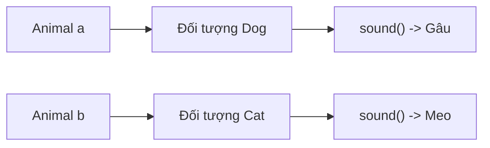

Nếu thay `new Dog()` bằng `new Cat()` thì cùng một lời gọi `a.sound()` sẽ cho kết quả khác, miễn là code điều khiển cho phép gán lại biến.

## 2. Ví dụ thực tế: giao diện để thay thế các kênh gửi thông báo

Giả sử hệ thống cần gửi thông báo tới khách hàng qua Email và Push Notification. Để tập trung vào OOP, ví dụ dưới đây **mô phỏng kết quả gửi**, không thực sự kết nối SMTP hay dịch vụ Push.

Hợp đồng đặt ra:

- Caller cung cấp một `Notification` hợp lệ, chứa mã khách hàng và nội dung.
- Mọi implementation của `NotificationSender` đều hỗ trợ `send(notification)` và trả về `DeliveryResult`.
- Code điều phối không cần biết cách từng kênh hoạt động.

File `NotificationPolymorphismDemo.java` (Java 17+):

```java
import java.util.List;
import java.util.Objects;

public class NotificationPolymorphismDemo {

    record Notification(String customerId, String message) {
        Notification {
            if (customerId == null || customerId.isBlank()) {
                throw new IllegalArgumentException("Thiếu customerId");
            }
            if (message == null || message.isBlank()) {
                throw new IllegalArgumentException("Nội dung rỗng");
            }
        }
    }

    record DeliveryResult(String channel, String status) {}

    // Hợp đồng chung cho mọi kênh gửi.
    interface NotificationSender {
        DeliveryResult send(Notification notification);
    }

    static final class EmailSender implements NotificationSender {
        @Override
        public DeliveryResult send(Notification notification) {
            Objects.requireNonNull(notification, "notification");

            System.out.println(
                "EMAIL -> " + notification.customerId()
            );
            return new DeliveryResult("EMAIL", "SIMULATED");
        }
    }

    static final class PushSender implements NotificationSender {
        @Override
        public DeliveryResult send(Notification notification) {
            Objects.requireNonNull(notification, "notification");

            System.out.println(
                "PUSH -> " + notification.customerId()
            );
            return new DeliveryResult("PUSH", "SIMULATED");
        }
    }

    static final class NotificationDispatcher {
        private final NotificationSender sender;

        NotificationDispatcher(NotificationSender sender) {
            this.sender = Objects.requireNonNull(sender, "sender");
        }

        DeliveryResult dispatch(Notification notification) {
            return sender.send(notification);
        }
    }

    public static void main(String[] args) {
        Notification notification =
            new Notification("CUS-01", "Đơn hàng đã sẵn sàng");

        List<NotificationSender> senders =
            List.of(new EmailSender(), new PushSender());

        for (NotificationSender sender : senders) {
            NotificationDispatcher dispatcher =
                new NotificationDispatcher(sender);

            DeliveryResult result =
                dispatcher.dispatch(notification);

            System.out.println(
                "Result: " + result.channel() + "/"
                    + result.status()
            );
        }
    }
}
```

Chạy:

```bash
javac NotificationPolymorphismDemo.java
java NotificationPolymorphismDemo
```

Kết quả:

```text
EMAIL -> CUS-01
Result: EMAIL/SIMULATED
PUSH -> CUS-01
Result: PUSH/SIMULATED
```

Để ý ba vị trí thể hiện đa hình:

1. `List<NotificationSender>` chứa đối tượng `EmailSender` và `PushSender` khác nhau.
2. `NotificationDispatcher` nhận một `NotificationSender` qua constructor. Nó **phụ thuộc vào hợp đồng**, không phụ thuộc trực tiếp lớp Email hay Push.
3. Khi `sender.send(notification)` chạy, implementation phù hợp được chọn theo đối tượng đang được giữ bởi `sender`.

Nếu thêm `SmsSender implements NotificationSender`, ta có thể truyền nó cho `NotificationDispatcher` mà không cần thay đổi mã nguồn của dispatcher, **nếu** implementation mới thực sự tuân theo hợp đồng `send`.

### Sơ đồ phụ thuộc

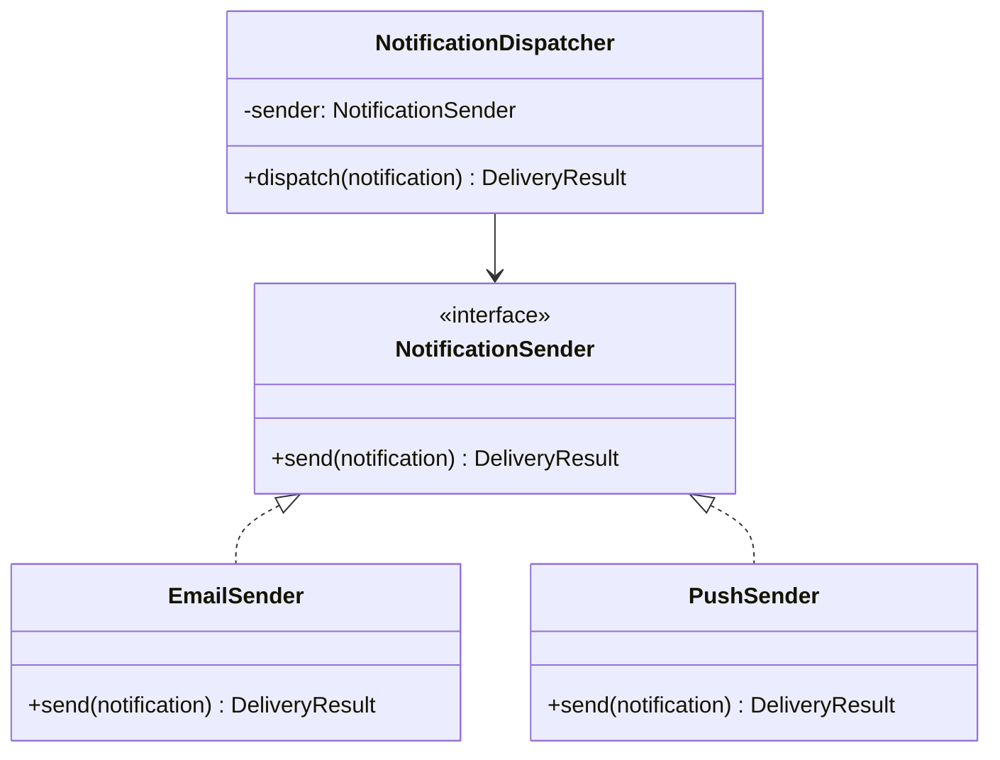

**Lợi ích thiết kế:** logic chọn kênh được đặt ở nơi cấu hình/khởi tạo đối tượng; dispatcher chỉ cần biết hợp đồng gửi. Thay implementation không buộc dispatcher chứa các nhánh `if (sender instanceof EmailSender)`.

Trong hệ thống thực, hợp đồng còn phải quy định rõ hành vi khi lỗi, timeout, retry, trạng thái gửi thành công hay mới được chấp nhận. Các implementation không nên tự ý dùng cùng một từ `SUCCESS` với những ý nghĩa khác nhau.

## 3. Đa hình qua lớp cha: kế thừa hành vi và ghi đè

Interface không phải con đường duy nhất. Một biến kiểu superclass cũng có thể tham chiếu đến các đối tượng subclass.

Ví dụ một hệ thống hiển thị báo cáo. Mọi báo cáo có tiêu đề và cùng cách tạo phần preview, nhưng nội dung preview khác nhau.

File `ReportPolymorphismDemo.java`:

```java
public class ReportPolymorphismDemo {

    static abstract class Report {
        private final String title;

        protected Report(String title) {
            if (title == null || title.isBlank()) {
                throw new IllegalArgumentException("Tiêu đề rỗng");
            }
            this.title = title;
        }

        // Thuật toán chung cố định ở lớp cha.
        public final String preview() {
            return "[" + title + "] " + content();
        }

        // Điểm mở rộng mà lớp con phải triển khai.
        protected abstract String content();
    }

    static final class SalesReport extends Report {
        private final long revenueVnd;

        SalesReport(long revenueVnd) {
            super("Doanh thu");
            if (revenueVnd < 0) {
                throw new IllegalArgumentException("Doanh thu âm");
            }
            this.revenueVnd = revenueVnd;
        }

        @Override
        protected String content() {
            return revenueVnd + " VND";
        }
    }

    static final class AuditReport extends Report {
        private final int eventCount;

        AuditReport(int eventCount) {
            super("Kiểm toán");
            if (eventCount < 0) {
                throw new IllegalArgumentException("Số sự kiện âm");
            }
            this.eventCount = eventCount;
        }

        @Override
        protected String content() {
            return eventCount + " sự kiện";
        }
    }

    static void display(Report report) {
        System.out.println(report.preview());
    }

    public static void main(String[] args) {
        Report sales = new SalesReport(200_000L);
        Report audit = new AuditReport(3);

        display(sales);
        display(audit);
    }
}
```

Kết quả:

```text
[Doanh thu] 200000 VND
[Kiểm toán] 3 sự kiện
```

Trong ví dụ này:

- `Report` là kiểu cha và giữ trạng thái chung `title`.
- `SalesReport` và `AuditReport` là hai kiểu con.
- `Report.preview()` chứa phần xử lý giống nhau, nhưng gọi `content()` là phương thức được override.
- Khi `preview()` đang chạy trên một đối tượng `SalesReport`, lời gọi `content()` sẽ chuyển tới `SalesReport.content()`; tương tự với `AuditReport`.

Điều đó cho thấy **mã được thực thi trong lớp cha vẫn có thể kích hoạt hành vi đặc thù của đối tượng lớp con**.

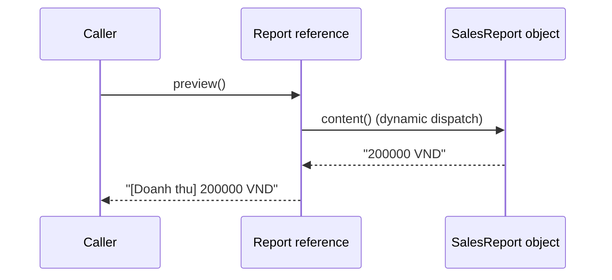

Sơ đồ mô tả thứ tự lời gọi theo góc nhìn logic. `Report` và `SalesReport` trong trường hợp này là **một đối tượng runtime**, không phải hai đối tượng độc lập giao tiếp qua mạng.

### Vì sao không override mọi phương thức?

`preview()` được đánh dấu `final` để các lớp con không thay đổi khung preview; lớp con chỉ tùy biến `content()`. Đây là một lựa chọn thiết kế nhằm bảo vệ quy tắc chung. Không phải mọi phương thức superclass đều cần cho phép override.

Cũng cần tránh gọi phương thức có thể override từ constructor lớp cha, bởi trạng thái của lớp con có thể chưa hoàn tất khởi tạo tại thời điểm ấy.

## 4. Upcasting: từ kiểu con lên kiểu cha

**Upcasting** là nhìn một đối tượng kiểu con thông qua tham chiếu có kiểu cha hoặc một interface mà nó thực hiện. Đây là chuyển đổi kiểu hợp lệ và thường được compiler thực hiện ngầm định.

```java
class Device {}

class Printer extends Device {
    void printPage() {
        System.out.println("Printing...");
    }
}

Printer printer = new Printer();
Device device = printer; // Upcasting ngầm định
```

`device` và `printer` trỏ đến **cùng một đối tượng Printer**, không tạo bản sao đối tượng.

Vì `device` có kiểu khai báo `Device`, nó không thể gọi phương thức chỉ xuất hiện trong `Printer`:

```java
printer.printPage(); // Hợp lệ
// device.printPage(); // Lỗi biên dịch
```

Điều này không mâu thuẫn với đa hình. Java thực hiện **hai công việc khác nhau**:

1. **Kiểm tra lời gọi có hợp lệ không:** dựa vào kiểu khai báo và những thành viên mà kiểu đó cung cấp, cùng những quy tắc truy cập/overload của Java.
2. **Chọn phần thực thi cho lời gọi instance có thể override:** dựa vào kiểu thực tế của đối tượng lúc chạy.

Nếu `Device` khai báo `public void start()` và `Printer` override, thì `device.start()` sẽ chạy phiên bản `Printer`. Nhưng `device.printPage()` không hợp lệ nếu `Device` không có `printPage()`.

## 5. Downcasting và instanceof: chỉ dùng khi thực sự cần

**Downcasting** là ép tham chiếu kiểu cha về một kiểu con cụ thể. Vì không phải mọi `Device` đều là `Printer`, Java yêu cầu ép kiểu tường minh và có kiểm tra runtime.

```java
class Device {}

class Printer extends Device {
    void printPage() {
        System.out.println("Printing...");
    }
}

class Scanner extends Device {}

Device first = new Printer();
Printer printer = (Printer) first; // Hợp lệ lúc chạy
printer.printPage();

// Device second = new Scanner();
// Printer wrong = (Printer) second; // ClassCastException
```

Nếu kiểu runtime không tương thích với kiểu ép, Java ném `ClassCastException`.

Java 16+ hỗ trợ pattern matching với `instanceof`; ví dụ dùng Java 17:

```java
static void tryPrinting(Device device) {
    if (device instanceof Printer printer) {
        printer.printPage();
    } else {
        System.out.println("Thiết bị không hỗ trợ in");
    }
}
```

Mẫu trên hợp lý khi **thao tác thực sự chỉ thuộc một subtype**. Tuy nhiên, nếu logic ứng dụng liên tục có dạng:

```java
if (sender instanceof EmailSender) {
    // Gửi email
} else if (sender instanceof PushSender) {
    // Gửi push
}
```

thì nên xem xét: hành vi chung có nên được đưa vào `NotificationSender` để caller chỉ gọi `send(...)` hay không? Khi có khả năng biểu diễn bằng một hợp đồng chung rõ ràng, **đa hình thường tốt hơn chuỗi kiểm tra kiểu cụ thể**.

## 6. Những thành viên không đi theo dynamic dispatch của subtype

`Animal a = new Dog()` cho phép gọi `a.sound()` đa hình **khi đó là instance method có thể override**. Điều này không tự áp dụng cho mọi thành viên. Xét các đoạn minh họa sau; đặt các câu lệnh gọi trong một phương thức Java như `main`:

~~~java
class Parent {
    String field = "Parent field";
    String who() { return "Parent method"; }
    static String category() { return "Parent static"; }
}
class Child extends Parent {
    String field = "Child field";
    @Override String who() { return "Child method"; }
    static String category() { return "Child static"; }
}
Parent value = new Child();
System.out.println(value.who());       // Child method
System.out.println(value.field);       // Parent field
System.out.println(Parent.category()); // Parent static
~~~

| Thành viên | Quy tắc khi gọi qua kiểu cha |
|---|---|
| Instance method được override | Chọn implementation theo object runtime |
| Field cùng tên ở cha/con | Chọn field theo kiểu tĩnh của biểu thức |
| Static method cùng chữ ký | Hiding, chọn bằng tên lớp/kiểu tĩnh |
| Private/final instance method | Không có override ở class con |
| Nhiều overload cùng tên | Compiler chọn chữ ký theo kiểu tĩnh; nếu có override, runtime chọn phần thân cho chữ ký ấy |

Phân biệt chi tiết **compile-time overload vs runtime override** nằm ở bài *Phân giải phương thức tĩnh và phân giải động*. Ví dụ đi sâu vào field hiding, static hiding và getter nằm ở hai bài *Phân biệt che khuất thành viên với ghi đè* và *Phạm vi đa hình của phương thức và thuộc tính*.

## 7. Đa hình qua interface và qua lớp cha khác nhau ở đâu?

| Tiêu chí | Qua interface | Qua superclass |
|---|---|---|
| Quan hệ kiểu | Lớp `implements` interface | Lớp `extends` superclass |
| Phần mà caller dựa vào | Hợp đồng hành vi do interface công bố | API chung của superclass |
| Trạng thái instance kế thừa từ kiểu chung | Interface không cung cấp instance field | Superclass có thể quản lý field chung |
| Constructor chung | Interface không có constructor | Superclass có thể có constructor cho lớp con gọi |
| Số quan hệ trực tiếp | Class có thể implement nhiều interface | Class chỉ extends trực tiếp một superclass |
| Mức ràng buộc với implementation | Thường phù hợp cho các kiểu không cùng họ kế thừa | Phù hợp khi có quan hệ is-a và muốn dùng lại cấu trúc/hành vi |
| Điểm chung | Đều cho phép tham chiếu kiểu chung giữ đối tượng subtype và gọi phương thức override phù hợp | Cùng cơ chế đa hình qua subtype |

Một lớp có thể **vừa kế thừa superclass vừa implement interface**, nên đây không phải hai lựa chọn loại trừ nhau.

Ví dụ:

```java
interface Identifiable {
    String id();
}

abstract class BaseEntity implements Identifiable {
    private final String id;

    protected BaseEntity(String id) {
        this.id = java.util.Objects.requireNonNull(id);
    }

    @Override
    public final String id() {
        return id;
    }
}

final class Customer extends BaseEntity {
    Customer(String id) {
        super(id);
    }
}

Identifiable a = new Customer("C01");
BaseEntity b = new Customer("C02");

System.out.println(a.id()); // C01
System.out.println(b.id()); // C02
```

`Customer` có quan hệ subtype với cả `BaseEntity` và `Identifiable`. Hai kiểu tham chiếu chung này cho các caller khác nhau biết những phần API khác nhau, tùy nhu cầu.

## 8. Hợp đồng chung phải thực sự thay thế được

Chỉ cùng chữ ký phương thức là chưa đủ để đa hình có ích. Khi caller sử dụng kiểu cha, các subtype phải giữ đúng **kỳ vọng từ hợp đồng kiểu cha** (*substitutability*, thường liên hệ tới nguyên tắc Liskov Substitution).

Ví dụ, nếu `NotificationSender.send(notification)` quy định:

- `notification` không được `null`.
- Kết quả trả về không được `null`.
- `DeliveryResult.status` có ý nghĩa thống nhất.
- Nếu thất bại, sử dụng quy ước báo lỗi mà các caller có thể xử lý.

thì một implementation không nên tự ý trả `null` trong khi các implementation khác luôn trả một đối tượng hợp lệ; cũng không nên dùng `"SIMULATED"` để chỉ vừa gửi yêu cầu ở nơi này nhưng lại chỉ “đã đọc bởi người nhận” ở nơi khác.

### Ví dụ phá vỡ kỳ vọng

```java
interface DiscountPolicy {
    // Hợp đồng: trả phần trăm trong khoảng 0..100.
    int discountPercent();
}

class StandardDiscount implements DiscountPolicy {
    public int discountPercent() {
        return 10;
    }
}

class InvalidDiscount implements DiscountPolicy {
    public int discountPercent() {
        return 250; // Phá vỡ hợp đồng về khoảng giá trị
    }
}
```

Compiler chấp nhận vì `InvalidDiscount` có phương thức đúng chữ ký. Nhưng caller dùng `DiscountPolicy` để tính tiền có thể cho kết quả vô nghĩa.

Do đó phải kiểm tra cả **ý nghĩa đầu vào/đầu ra, ràng buộc trạng thái và hành vi lỗi**, không chỉ nhìn `implements` hay `extends`.

### Đa hình không tự động làm code dễ mở rộng

Thêm interface để thay cho một lớp chỉ có một implementation không phải lúc nào cũng hữu ích. Nên dùng đa hình qua subtype khi có **khả năng thay thế implementation thực tế**, một hợp đồng có ích với nhiều loại đối tượng, hoặc API cho thành phần khác cần tránh phụ thuộc lớp cụ thể.

Ngược lại, một abstract class chia sẻ thuật toán ổn định giữa các subtype có thể phù hợp, nhưng kế thừa gây liên kết với API và quá trình thay đổi của lớp cha. Nếu chỉ muốn kết hợp nhiều chức năng độc lập, **composition** thường ít ràng buộc hơn.

## 9. Bộ sưu tập đa hình và lưu ý về generics

Nhờ một kiểu chung, có thể xử lý các đối tượng khác nhau trong cùng danh sách:

```java
List<NotificationSender> senders = List.of(
    new EmailSender(),
    new PushSender()
);

for (NotificationSender sender : senders) {
    sender.send(notification);
}
```

Trong đoạn này, `EmailSender` và `PushSender` là các class từ ví dụ hoàn chỉnh phía trên. Mỗi vòng lặp giữ một biến `NotificationSender` nhưng dispatch tới implementation tương ứng.

Tuy nhiên, cần lưu ý:

```java
List<EmailSender> emailSenders = new ArrayList<>();

// List<NotificationSender> all = emailSenders; // Không hợp lệ.
```

Java generic **bất biến theo kiểu tham số** (*invariant*): dù `EmailSender` là subtype của `NotificationSender`, `List<EmailSender>` không phải subtype của `List<NotificationSender>`.

Nếu chỉ cần đọc danh sách theo hợp đồng, có thể dùng wildcard:

```java
static void runAll(
        List<? extends NotificationSender> senders,
        Notification notification) {

    for (NotificationSender sender : senders) {
        sender.send(notification);
    }
}
```

`List<? extends NotificationSender>` chấp nhận danh sách phần tử thuộc một subtype nào đó của `NotificationSender`. Đổi lại, không thể tùy tiện thêm `new EmailSender()` vào danh sách này vì không biết kiểu tham số cụ thể của list.

**Subtype polymorphism của đối tượng** và **quy tắc variance của generic collection** là hai khái niệm liên quan nhưng không đồng nhất.

## 10. Những lỗi thiết kế dễ gặp

| Biểu hiện | Nguyên nhân | Hướng xử lý |
|---|---|---|
| Tưởng biến `Animal a = new Dog()` có thể gọi mọi phương thức riêng của `Dog` | Kiểu khai báo giới hạn API nhìn thấy ở compile time | Công khai hợp đồng chung hoặc kiểm tra/cast khi thật cần |
| Viết nhiều `if (obj instanceof X)` để tự gọi hành vi từng subtype | Caller phụ thuộc các class cụ thể | Đưa hành vi chung vào interface/superclass và dùng override |
| Mong field được dispatch như method override | Field hiding và method overriding khác nhau | Giữ field private, biểu diễn hành vi qua method có hợp đồng |
| Nghĩ overload được chọn theo kiểu runtime của tham số | Overload resolution chủ yếu ở compile time | Phân biệt overload với override |
| Ép kiểu con vô điều kiện | Không phải đối tượng cha nào cũng là subtype đó | Tránh ép kiểu hoặc dùng `instanceof` khi có lý do |
| Subtype trả kết quả trái hợp đồng chung | Chỉ đúng chữ ký, sai ngữ nghĩa | Quy định và test contract cho mọi implementation |
| Tưởng `List<Dog>` là `List<Animal>` | Generic invariant | Dùng wildcard phù hợp hoặc tập hợp khai báo bằng kiểu chung |
| Đặt thuật toán tùy biến trong constructor superclass | Dynamic dispatch có thể gọi subclass chưa khởi tạo xong | Tránh gọi method override được trong constructor |

## 11. Bài tập tự kiểm tra

### Bài 1 — Dự đoán kết quả đa hình

```java
interface Shape {
    int area();
}

class Square implements Shape {
    private final int side;

    Square(int side) {
        this.side = side;
    }

    public int area() {
        return side * side;
    }
}

class Rectangle implements Shape {
    public int area() {
        return 12;
    }
}

Shape first = new Square(3);
Shape second = new Rectangle();

System.out.println(first.area());
System.out.println(second.area());
```

**Đáp án:**

```text
9
12
```

Hai biến có cùng kiểu khai báo `Shape`. Lời gọi `area()` chạy implementation của kiểu thực tế. Phần `Rectangle` chỉ trả giá trị cố định để giữ bài tập ngắn, không phải một mô hình hình học hoàn chỉnh.

### Bài 2 — Gọi phương thức chỉ có ở subtype

```java
class Vehicle {
    void move() {
        System.out.println("Moving");
    }
}

class Bike extends Vehicle {
    void ringBell() {
        System.out.println("Ring!");
    }
}

Vehicle v = new Bike();
v.move();
// v.ringBell(); // Có biên dịch không?
```

**Đáp án:** `v.ringBell()` không biên dịch vì `Vehicle` không khai báo `ringBell()`. Khi thật sự cần một chức năng chỉ dành cho `Bike`, có thể dùng `if (v instanceof Bike bike) { bike.ringBell(); }` trong Java 17.

### Bài 3 — Kiểu khai báo hay kiểu runtime?

```java
class Parent {
    String value(Object x) {
        return "Parent/Object";
    }

    String value(String x) {
        return "Parent/String";
    }
}

class Child extends Parent {
    @Override
    String value(Object x) {
        return "Child/Object";
    }
}

Parent p = new Child();
Object item = "hello";

System.out.println(p.value(item));
System.out.println(p.value("hello"));
```

**Đáp án:**

```text
Child/Object
Parent/String
```

Ở lời gọi đầu, overload `value(Object)` được chọn vì `item` khai báo là `Object`, sau đó implementation được dispatch tới `Child.value(Object)`. Ở lời gọi thứ hai, overload `value(String)` được chọn và không bị `Child` override nên thực thi implementation của `Parent`.

### Bài 4 — Tự thiết kế

Một hệ thống thanh toán có `CardPayment` và `BankTransferPayment`. Hãy thiết kế:

1. Interface `PaymentMethod` với `PaymentReceipt pay(long amountVnd)`.
2. Hai class triển khai, cùng từ chối `amountVnd <= 0`, trả kết quả theo một hợp đồng thống nhất.
3. Class `Checkout` nhận `PaymentMethod` trong constructor và gọi `pay` mà không kiểm tra class cụ thể.
4. Tạo hai đối tượng `Checkout` với implementation khác nhau rồi xác nhận cùng lời gọi `checkout(...)` hoạt động.

Để bài giải vững hơn, hãy xác định thế nào là thành công/thất bại, cách phản ánh giao dịch bất đồng bộ và có hay không nghiệp vụ cần idempotency. Đó là **phần hợp đồng** mà đa hình phải giữ nhất quán; chỉ viết chung tên `pay` là chưa đủ.

---

**Ghi nhớ:** Đa hình kiểu con cho phép **một tham chiếu interface hoặc lớp cha làm việc với nhiều kiểu đối tượng con**. Compiler kiểm tra lời gọi qua API của **kiểu khai báo**; với phương thức instance override được, JVM lựa chọn implementation theo **kiểu runtime**. Hãy dùng cơ chế này để caller phụ thuộc hợp đồng thay vì biết từng class cụ thể, đồng thời bảo đảm mỗi subtype thực sự giữ đúng hợp đồng chung.


</details>

- [Quay lại đầu trang](#back-to-top)

---

## <a id="polymorphism-003">Phân giải phương thức tĩnh và phân giải động</a>

<details>
<summary>Xem chi tiết</summary>

# Phân giải phương thức tĩnh và phân giải động trong Java

Một trong những điểm quan trọng nhất để hiểu **đa hình (polymorphism)** của Java là phân biệt **phương thức nào được chọn khi biên dịch** và **cách triển khai nào được gọi khi chạy**.

Trong một biểu thức gọi phương thức, hai câu hỏi này không luôn có cùng đáp án:

1. **Phân giải tĩnh (*compile-time method resolution*):** dựa vào **kiểu mà trình biên dịch biết**, tên phương thức, số lượng/kiểu đối số, phạm vi truy cập… để xác định một chữ ký phương thức hợp lệ. Đây là bước đặc biệt quan trọng với **overloading**.
2. **Phân giải động (*runtime method dispatch*):** sau khi chữ ký đã được chọn, đối với **phương thức thể hiện có thể ghi đè**, JVM chọn cách triển khai (*override*) tương ứng với **lớp thực tế của đối tượng nhận lời gọi**.

Vì vậy, không nên hiểu “Java luôn chọn phương thức khi biên dịch” hoặc “Java luôn chọn phương thức theo đối tượng lúc chạy”. **Một lời gọi có thể trải qua cả hai bước**, tùy loại phương thức.

## 1. Hai khái niệm qua một ví dụ ngắn

```java
class Animal {}

class Dog extends Animal {}

class Handler {
    String process(Animal value) {
        return "Handler/Animal";
    }

    String process(Dog value) {
        return "Handler/Dog";
    }
}

class SpecialHandler extends Handler {
    @Override
    String process(Animal value) {
        return "SpecialHandler/Animal";
    }

    @Override
    String process(Dog value) {
        return "SpecialHandler/Dog";
    }
}
```

Giờ xét:

```java
Handler handler = new SpecialHandler();
Animal animal = new Dog();

System.out.println(handler.process(animal));
```

Kết quả là:

```text
SpecialHandler/Animal
```

**Vì sao không phải `SpecialHandler/Dog`?**

- **Khi biên dịch:** biến `animal` có kiểu khai báo là `Animal`. Trình biên dịch chọn overload **`process(Animal)`** chứ không chọn `process(Dog)`, dù đối tượng thực tế là `Dog`.
- **Khi chạy:** biến `handler` đang trỏ tới đối tượng `SpecialHandler`. JVM gọi bản override **`SpecialHandler.process(Animal)`**.

Đây là điểm mấu chốt:

> **Overloading chọn chữ ký theo thông tin kiểu lúc biên dịch; overriding chọn cách triển khai của chữ ký đó theo đối tượng nhận lời gọi lúc chạy.**

## 2. Ví dụ Java hoàn chỉnh: kết hợp overload và override

Lưu toàn bộ đoạn sau thành **`Main.java`**. Ví dụ chạy được trên Java 17 hoặc Java 21, không cần thư viện ngoài.

```java
class Event {}

class EmailEvent extends Event {}

class SmsEvent extends Event {}

class Dispatcher {
    String dispatch(Event event) {
        return "Dispatcher/Event";
    }

    String dispatch(EmailEvent event) {
        return "Dispatcher/EmailEvent";
    }

    static String source() {
        return "Dispatcher/static";
    }
}

class SmartDispatcher extends Dispatcher {
    @Override
    String dispatch(Event event) {
        return "SmartDispatcher/Event";
    }

    @Override
    String dispatch(EmailEvent event) {
        return "SmartDispatcher/EmailEvent";
    }

    // Overload mới chỉ có trên SmartDispatcher.
    String dispatch(SmsEvent event) {
        return "SmartDispatcher/SmsEvent";
    }

    // Đây là static method hiding, không phải overriding.
    static String source() {
        return "SmartDispatcher/static";
    }
}

public class Main {
    public static void main(String[] args) {
        Dispatcher general = new SmartDispatcher();
        SmartDispatcher specific = new SmartDispatcher();

        Event emailAsEvent = new EmailEvent();
        EmailEvent email = new EmailEvent();
        SmsEvent sms = new SmsEvent();

        System.out.println(general.dispatch(emailAsEvent));
        System.out.println(general.dispatch(email));
        System.out.println(general.dispatch(sms));
        System.out.println(specific.dispatch(sms));
        System.out.println(((Dispatcher) specific).dispatch(sms));

        System.out.println(Dispatcher.source());
        System.out.println(SmartDispatcher.source());
        System.out.println(general.getClass().getSimpleName());
    }
}
```

Biên dịch và chạy:

```bash
javac Main.java
java Main
```

Kết quả chính xác:

```text
SmartDispatcher/Event
SmartDispatcher/EmailEvent
SmartDispatcher/Event
SmartDispatcher/SmsEvent
SmartDispatcher/Event
Dispatcher/static
SmartDispatcher/static
SmartDispatcher
```

### Phân tích từng lời gọi

| Lời gọi | Overload được chọn **khi biên dịch** | Implementation chạy **lúc runtime** |
| --- | --- | --- |
| `general.dispatch(emailAsEvent)` | `dispatch(Event)` | `SmartDispatcher.dispatch(Event)` |
| `general.dispatch(email)` | `dispatch(EmailEvent)` | `SmartDispatcher.dispatch(EmailEvent)` |
| `general.dispatch(sms)` | `dispatch(Event)` vì kiểu `Dispatcher` không công bố overload `SmsEvent` | `SmartDispatcher.dispatch(Event)` |
| `specific.dispatch(sms)` | `dispatch(SmsEvent)` | `SmartDispatcher.dispatch(SmsEvent)` |
| `((Dispatcher) specific).dispatch(sms)` | `dispatch(Event)` vì kiểu biểu thức sau cast là `Dispatcher` | `SmartDispatcher.dispatch(Event)` |

Hãy lưu ý cặp lời gọi này:

```java
specific.dispatch(sms);                 // SmartDispatcher/SmsEvent
((Dispatcher) specific).dispatch(sms); // SmartDispatcher/Event
```

**Vẫn là cùng một đối tượng `specific` và cùng một đối số `sms`**. Điều thay đổi là **kiểu tham chiếu của biểu thức nhận lời gọi lúc biên dịch**, nên trình biên dịch nhìn thấy tập overload khác nhau. Sau đó, ở mỗi chữ ký đã được chọn, cơ chế dispatch động mới chọn phần triển khai theo đối tượng thực tế.

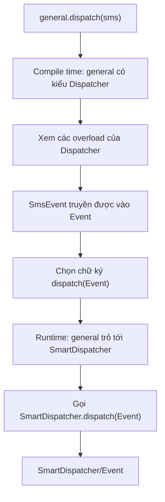

## 3. Phân giải tĩnh: Java chọn overload ra sao?

**Overloading** là nhiều phương thức cùng tên nhưng có **danh sách tham số khác nhau** (khác số lượng hoặc kiểu tham số):

```java
class Formatter {
    String format(Object value) {
        return "Object";
    }

    String format(Number value) {
        return "Number";
    }

    String format(Integer value) {
        return "Integer";
    }
}
```

Với đoạn mã:

```java
Formatter formatter = new Formatter();
Integer integer = 10;
Number number = integer;
Object object = integer;

System.out.println(formatter.format(integer)); // Integer
System.out.println(formatter.format(number));  // Number
System.out.println(formatter.format(object));  // Object
```

Dù cả ba biến có thể cùng tham chiếu đến một đối tượng `Integer`, kiểu khai báo của biểu thức đối số khác nhau. Trình biên dịch dùng các kiểu đó để tìm phương thức **áp dụng được và phù hợp nhất** theo quy tắc của Java.

### Không đơn thuần là “chọn tham số có tên giống nhất”

Java có các quy tắc chi tiết cho phương thức áp dụng được, chuyển đổi kiểu nguyên thủy, boxing/unboxing và varargs. Một ví dụ đáng nhớ:

```java
class Choice {
    void choose(long value) {
        System.out.println("long");
    }

    void choose(Integer value) {
        System.out.println("Integer");
    }

    void choose(int... values) {
        System.out.println("varargs");
    }
}

new Choice().choose(5); // long
```

Với đối số literal `5` kiểu `int`, overload `choose(long)` phù hợp nhờ **widening primitive conversion** ngay ở pha tìm kiếm phương thức không boxing. Java không mặc định chọn `choose(Integer)` hay `choose(int...)` chỉ vì chúng cũng nhận được giá trị sau các phép chuyển đổi khác.

Có thể ghi nhớ thứ tự xét ở mức khái quát: Java ưu tiên tìm overload không cần boxing/varargs, tiếp đến những trường hợp dùng boxing/unboxing, và cuối cùng mới xét lời gọi theo kiểu varargs nếu chưa chọn được phương thức ở các pha trước. Việc chọn phương thức cụ thể vẫn tuân thủ các quy tắc “most specific”; không phải một bảng ưu tiên duy nhất đúng cho mọi cặp kiểu.

### Overload có thể mơ hồ

```java
class Ambiguous {
    void send(String message) {}
    void send(Integer code) {}
}

// new Ambiguous().send(null); // Lỗi biên dịch: ambiguous
```

`null` có thể gán cho cả `String` và `Integer`; không kiểu nào là subtype của kiểu kia, nên compiler không thể chọn một overload duy nhất.

Có thể chỉ rõ ý định:

```java
new Ambiguous().send((String) null);
```

**Lưu ý:** dòng ép kiểu giải quyết vấn đề chọn overload, không có nghĩa phương thức bên trong sẽ xử lý `null` an toàn. Hợp đồng của từng phương thức vẫn phải kiểm tra khi cần.

## 4. Phân giải động: ghi đè phương thức theo kiểu đối tượng

**Overriding** xảy ra khi lớp con cung cấp cách triển khai mới cho một **phương thức thể hiện có thể ghi đè** được kế thừa từ lớp cha hoặc hợp đồng interface.

```java
class Payment {
    String status() {
        return "Payment";
    }
}

class CardPayment extends Payment {
    @Override
    String status() {
        return "CardPayment";
    }
}

Payment p = new CardPayment();
System.out.println(p.status()); // CardPayment
```

Trình biên dịch kiểm tra biến `p` kiểu `Payment` có phương thức `status()`. Đến runtime, JVM biết đối tượng thực tế là `CardPayment` nên chạy `CardPayment.status()`.

Khả năng này cho phép viết logic nhận kiểu cha:

```java
static void printStatus(Payment payment) {
    System.out.println(payment.status());
}
```

Truyền `new Payment()`, `new CardPayment()` hoặc một subtype khác vào `printStatus` mà không cần kiểm tra `instanceof` cho từng loại. Đây chính là **runtime polymorphism**.

### Lời gọi qua interface cũng có thể dispatch động

```java
interface Notifier {
    void notifyUser();
}

class EmailNotifier implements Notifier {
    @Override
    public void notifyUser() {
        System.out.println("Email");
    }
}

class SmsNotifier implements Notifier {
    @Override
    public void notifyUser() {
        System.out.println("SMS");
    }
}

Notifier n = new EmailNotifier();
n.notifyUser(); // Email
n = new SmsNotifier();
n.notifyUser(); // SMS
```

`Notifier` xác định **khả năng cần gọi**. Đối tượng `EmailNotifier` hay `SmsNotifier` xác định **phần triển khai thực sự**. Việc chọn một interface ở mức thiết kế không xóa các bước kiểm tra kiểu lúc biên dịch: `n` vẫn chỉ được gọi những phương thức công bố phù hợp qua `Notifier` và `Object`.

## 5. `static` method: hiding, không phải overriding

Một nguồn nhầm lẫn lớn là phương thức được khai báo bằng `static`. Trong Java, phương thức tĩnh **thuộc lớp**, không được ghi đè bằng cơ chế đa hình instance. Khi lớp con khai báo một static method tương ứng, hiện tượng đó gọi là **method hiding**.

```java
class Parent {
    static String typeName() {
        return "Parent";
    }
}

class Child extends Parent {
    static String typeName() {
        return "Child";
    }
}

Parent ref = new Child();
System.out.println(Parent.typeName()); // Parent
System.out.println(Child.typeName());  // Child

// System.out.println(ref.typeName()); // Nếu viết sẽ trả Parent,
// nhưng nên tránh gọi static qua biến tham chiếu.
```

Nếu gọi `ref.typeName()` (Java cho phép cú pháp này nhưng thường có cảnh báo IDE), phương thức được xác định theo **kiểu biểu thức tham chiếu `Parent`**, không theo lớp thực tế `Child`.

Bởi vậy hãy gọi `Parent.typeName()` hoặc `Child.typeName()` khi cần static method, để người đọc không nhầm với dispatch động.

| Loại phương thức | Có đa hình override theo runtime object? | Ghi chú |
| --- | --- | --- |
| Instance method có thể override | **Có** | Lớp con có thể thay implementation |
| Instance method `final` | **Không thể override** | Phương thức được chọn không có bản override hợp lệ ở lớp con |
| Instance method `private` | **Không thể override** | Không được kế thừa theo cơ chế override thông thường |
| `static` method | **Không** | Có thể bị *hide* bởi static method tương ứng |
| Constructor | **Không** | Không được kế thừa/override |
| Lời gọi `super.method()` | Gọi triển khai được chỉ định từ lớp cha | Không chọn bản override của chính lớp con cho lời gọi này |

**Không nên hiểu rằng “`final` luôn biên dịch thành một loại bytecode gọi tĩnh”.** Ở mức ngôn ngữ, `final` ngăn override; JVM/JIT có thể tối ưu lời gọi phù hợp. Đây là câu chuyện khác với cách Java phân giải overload ở compile time.

## 6. Truy cập trường không giống gọi instance method

Đa hình áp dụng cho phương thức instance được override, **không áp dụng cho trường theo cách tương tự**.

```java
class Base {
    String name = "Base";

    String getName() {
        return name;
    }
}

class Derived extends Base {
    String name = "Derived";

    @Override
    String getName() {
        return name;
    }
}

Base ref = new Derived();

System.out.println(ref.name);      // Base
System.out.println(ref.getName()); // Derived
```

`ref.name` sử dụng cách truy cập trường được chọn theo **kiểu tham chiếu `Base`**, còn `ref.getName()` gọi override của `Derived` theo đối tượng thực tế.

Đây là một lý do nên tránh khai báo lại trường cùng tên giữa cha và con (*field hiding*). Ưu tiên đóng gói trường bằng `private` rồi công bố hành vi/giá trị qua phương thức có hợp đồng rõ ràng.

## 7. Overload được chọn rồi, override vẫn có thể thực thi

Đặt hai giai đoạn cạnh nhau để tránh nhầm:

```java
class Converter {
    String convert(Object x) {
        return "Converter/Object";
    }

    String convert(String x) {
        return "Converter/String";
    }
}

class LoggingConverter extends Converter {
    @Override
    String convert(Object x) {
        return "LoggingConverter/Object";
    }

    @Override
    String convert(String x) {
        return "LoggingConverter/String";
    }
}
```

Với:

```java
Converter converter = new LoggingConverter();
Object textAsObject = "hello";

System.out.println(converter.convert(textAsObject));
// LoggingConverter/Object

System.out.println(converter.convert("hello"));
// LoggingConverter/String
```

**Lời gọi thứ nhất:** tham số có kiểu `Object` nên chọn chữ ký `convert(Object)`; đối tượng nhận lời gọi là `LoggingConverter` nên thực thi override `LoggingConverter.convert(Object)`.

**Lời gọi thứ hai:** literal `"hello"` có kiểu `String` nên chọn chữ ký `convert(String)`; runtime thực thi bản override `LoggingConverter.convert(String)`.

Java chủ yếu sử dụng **single dispatch** cho phương thức instance: dispatch động dựa trên đối tượng nhận lời gọi, **không** tự chọn overload mới theo lớp runtime của từng đối số. Nếu thật sự cần hành vi phụ thuộc đồng thời vào nhiều kiểu runtime, có thể xem xét Visitor/double dispatch, pattern matching hoặc bảng xử lý theo loại dữ liệu tùy bài toán — nhưng đó là quyết định thiết kế khác, không phải cơ chế overload mặc định.

## 8. Mối liên hệ với `this`, `super` và lời gọi từ lớp cha

Khi bên trong một phương thức instance dùng:

```java
this.run();
```

Lời gọi `run()` bình thường vẫn có thể sử dụng dynamic dispatch, vì `this` là đối tượng thực tế đang nhận lời gọi. Nếu đối tượng đó thuộc lớp con có override `run()`, phiên bản lớp con có thể được thực thi.

Ngược lại:

```java
super.run();
```

được dùng trong lớp con để gọi cách thực hiện tương ứng được truy cập từ lớp cha, thay vì gọi lại chính override của lớp con.

Ví dụ:

```java
class Parent {
    void greet() {
        System.out.println("Xin chào");
    }
}

class Child extends Parent {
    @Override
    void greet() {
        super.greet();
        System.out.println("Từ lớp con");
    }
}

Parent value = new Child();
value.greet();
```

Kết quả:

```text
Xin chào
Từ lớp con
```

Cơ chế gồm: lời gọi `value.greet()` được dispatch vào `Child.greet()`; sau đó `super.greet()` gọi phần thực hiện của `Parent` trước khi tiếp tục thân `Child.greet()`.

**Cạm bẫy constructor:** không nên gọi phương thức có thể override từ constructor lớp cha, vì nó có thể dispatch vào lớp con **trước khi các trường của lớp con khởi tạo xong**. Dynamic dispatch vẫn tồn tại khi khởi tạo, và đó có thể là nguyên nhân của lỗi `null` hoặc trạng thái chưa hoàn chỉnh.

## 9. Liên hệ với JVM bytecode (hiểu đúng ở mức vừa đủ)

Java Virtual Machine có các chỉ thị gọi phương thức với ngữ nghĩa khác nhau. Ở mức khái quát:

| Chỉ thị JVM | Nhóm lời gọi thường gặp |
| --- | --- |
| `invokestatic` | Gọi phương thức `static` |
| `invokevirtual` | Gọi phương thức instance thông thường trên đối tượng |
| `invokeinterface` | Gọi phương thức instance qua hợp đồng interface |
| `invokespecial` | Một số lời gọi đặc biệt như constructor, `super.method()` và private method |
| `invokedynamic` | Cơ chế liên kết lời gọi động ở cấp JVM, như một số cách triển khai lambda hoặc string concatenation |

**Cẩn thận với tên gọi:** `invokedynamic` trong bytecode **không đồng nghĩa** với dynamic dispatch OOP của một lời gọi override thông thường. Dynamic dispatch của instance method chủ yếu liên quan các cơ chế như `invokevirtual` hoặc `invokeinterface`; `invokedynamic` phục vụ các điểm liên kết lời gọi có *bootstrap method*.

Phương pháp đơn giản để khám phá sau khi biên dịch ví dụ:

```bash
javac Main.java
javap -c Main
```

Lệnh `javap -c` hiển thị bytecode của lớp được yêu cầu. Nếu muốn xem phương thức trong các lớp khác của ví dụ, có thể chỉ định đúng tên lớp tương ứng. Bytecode giúp quan sát cơ chế, nhưng để học và thiết kế OOP, trước tiên hãy nắm vững **chữ ký được chọn lúc biên dịch** và **implementation được gọi lúc chạy**.

## 10. Những sai lầm phổ biến

| Nhận định/đoạn mã dễ sai | Vì sao sai? | Điều cần nhớ |
| --- | --- | --- |
| “Đối số runtime là `EmailEvent` thì chắc gọi overload `dispatch(EmailEvent)`” | Overload được chọn từ kiểu biểu thức lúc biên dịch | Biến `Event` chọn overload `Event` |
| “Kiểu biến là `Dispatcher` nên luôn chạy code `Dispatcher`” | Override chạy theo lớp đối tượng thực tế | `new SmartDispatcher()` có thể chạy override |
| “Static method ở lớp con override static ở lớp cha” | Đó là method hiding | Gọi static qua tên lớp |
| “Field `name` cũng được dispatch động” | Trường được phân giải theo kiểu tham chiếu | Phân biệt `ref.name` với `ref.getName()` |
| “Một cast receiver không ảnh hưởng overload” | Kiểu biểu thức receiver có thể thay đổi tập overload nhìn thấy | So sánh `specific.dispatch(sms)` với `((Dispatcher)specific).dispatch(sms)` |
| “Dùng `@Override` với phương thức khác tham số vẫn được” | Khác danh sách tham số có thể là overload | Thêm `@Override` để trình biên dịch phát hiện |
| “`send(null)` sẽ tự chọn overload nào cũng được” | Các overload kiểu tham chiếu không liên quan có thể mơ hồ | Cast tường minh khi thật sự cần |
| “`invokedynamic` chính là override” | Đây là hai khái niệm khác ở mức JVM | Đừng suy luận theo tên opcode |
| “Phương thức `final` có thể override nhưng không được gọi” | `final` chặn override, không chặn lời gọi thông thường | Dùng `final` để cố định hành vi khi có lý do |

## 11. Khi nào sự phân biệt này có ích?

- **Thiết kế API:** khi có nhiều overload, hãy làm rõ kiểu tham số để caller không vô tình chọn nhầm hàm chỉ vì khai báo biến là supertype.
- **Debug:** nếu kết quả khác kỳ vọng, xác định trước **chữ ký nào đã được compiler chọn**, sau đó mới kiểm tra **override nào được chạy**.
- **Dependency injection:** biến kiểu interface vẫn gọi đúng cách triển khai ở runtime; đây là nền tảng của đa hình ở tầng service/adapter.
- **Refactor:** thêm một overload mới có thể thay đổi việc chọn phương thức tại chỗ gọi khi biên dịch lại, ngay cả khi các bản override cũ không thay đổi.
- **Kiểm thử:** nên có test cho các tổ hợp kiểu biến, kiểu đối số và lớp thực tế nếu API dùng nhiều overload kết hợp kế thừa.
- **Performance:** JVM có thể inlining, devirtualization và tối ưu lời gọi phù hợp; đừng cho rằng mọi lời gọi đa hình đều chậm theo một mức cố định. Đo bằng profiling/benchmark nếu hiệu năng là yêu cầu thật.

## 12. Tự kiểm tra

**Câu 1.** Kết quả của đoạn sau là gì?

```java
Dispatcher dispatcher = new SmartDispatcher();
Event event = new EmailEvent();
System.out.println(dispatcher.dispatch(event));
```

**Đáp án:** `SmartDispatcher/Event`. Compiler chọn `dispatch(Event)`, runtime chạy override của `SmartDispatcher`.

**Câu 2.** Vì sao `specific.dispatch(sms)` khác `((Dispatcher) specific).dispatch(sms)`?

**Đáp án:** Kiểu tham chiếu lúc biên dịch khác nhau. `SmartDispatcher` nhìn thấy overload `dispatch(SmsEvent)`; `Dispatcher` chỉ thấy `dispatch(Event)` và `dispatch(EmailEvent)`, nên với `SmsEvent` sẽ chọn `Event`.

**Câu 3.** `Parent ref = new Child();` rồi gọi `ref.typeName()` với cả hai lớp khai báo phương thức `static` cùng tên thì phương thức nào được dùng?

**Đáp án:** Phương thức static theo kiểu `Parent`. Tuy nhiên nên viết `Parent.typeName()` để tránh gây hiểu nhầm.

**Câu 4.** Tại sao `format(number)` chọn `format(Number)` khi `number` có kiểu `Number` nhưng đang trỏ tới `Integer`?

**Đáp án:** Overload resolution sử dụng kiểu biểu thức lúc biên dịch, không tự chọn overload theo runtime class của đối số.

**Câu 5.** Nếu lớp con override `greet()`, lời gọi `super.greet()` trong override có gọi lại chính override của lớp con không?

**Đáp án:** Không. Nó gọi cách thực hiện tương ứng từ lớp cha theo ngữ nghĩa của `super`, giúp lớp con tái sử dụng hành vi cha.

**Câu 6.** `List<Payment>` chứa `new CardPayment()`; gọi `payment.status()` trong vòng lặp sẽ chọn bản nào?

**Đáp án:** Với một phần tử là `CardPayment`, nếu `status()` được override, bản `CardPayment.status()` sẽ chạy; kiểu phần tử khai báo `Payment` chỉ quyết định hợp đồng có thể gọi.

**Ghi nhớ:** Để xác định kết quả lời gọi phương thức Java, hãy đặt hai câu hỏi theo thứ tự: **“Compiler chọn chữ ký nào từ các kiểu đang nhìn thấy?”** và **“Đối tượng thực tế có override chữ ký đó không?”**. Overloading nghiêng về phân giải tĩnh, overriding sử dụng phân giải động; phương thức `static`, trường, constructor và lời gọi `super` có quy tắc riêng. Nắm được ranh giới này giúp hiểu đúng đa hình và tránh những lỗi rất khó phát hiện khi dùng kế thừa.


</details>

- [Quay lại đầu trang](#back-to-top)

---

## <a id="polymorphism-004">Ghi đè và lựa chọn phương thức khi chạy</a>

<details>
<summary>Xem chi tiết</summary>

# Ghi đè và lựa chọn phương thức khi chạy trong Java

> **OOP → Đa hình (Polymorphism).** Khi một biến có kiểu lớp cha nhưng đang tham chiếu tới đối tượng lớp con, lời gọi một **phương thức instance có thể ghi đè** sẽ chạy implementation phù hợp với **kiểu thực tế của đối tượng**. Cơ chế này gọi là **dynamic dispatch** (lựa chọn phương thức lúc chạy). Nó là nền tảng để cùng một đoạn mã làm việc với nhiều loại đối tượng mà không phải viết `if/else` để nhận diện từng lớp.

## 1. Hai kiểu cần phân biệt trong một lời gọi

```java
Animal animal = new Dog();
animal.speak();
```

Dòng đầu chứa **hai kiểu khác nhau**:

- **Kiểu khai báo (compile-time type):** `Animal`. Trình biên dịch dùng kiểu này để kiểm tra những phương thức nào được phép gọi và cách chọn lời gọi hợp lệ.
- **Kiểu thực tế (runtime class):** `Dog`. Khi `Dog` ghi đè `speak()`, JVM gọi implementation của `Dog` cho phương thức instance đó.

Ví dụ ngắn:

```java
class Animal {
    void speak() {
        System.out.println("Âm thanh động vật");
    }
}

class Dog extends Animal {
    @Override
    void speak() {
        System.out.println("Gâu gâu");
    }
}

// Đặt trong một phương thức như main():
Animal animal = new Dog();
animal.speak(); // Gâu gâu
```

Tuy biến được khai báo là `Animal`, đối tượng thực vẫn là `Dog`. Phương thức `speak()` ở `Dog` **ghi đè (override)** `speak()` được kế thừa từ `Animal`, nên phiên bản `Dog` được chọn lúc chạy.

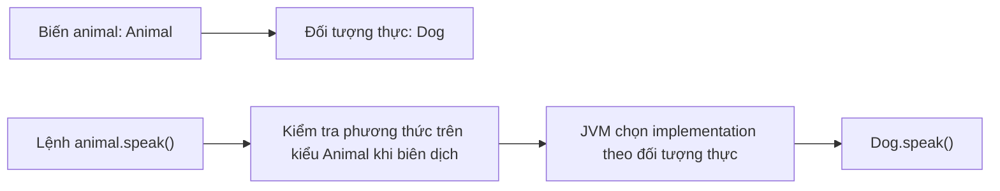

**Điểm cốt lõi:** không phải cứ thấy `new Dog()` là trình biên dịch tự thay mọi lời gọi thành lời gọi của `Dog`. Việc chọn **chữ ký** và kiểm tra **quyền truy cập** vẫn diễn ra từ thông tin kiểu tại thời điểm biên dịch. Chỉ những lời gọi phương thức instance đủ điều kiện dispatch động mới chọn implementation theo đối tượng runtime.

## 2. Ví dụ hoàn chỉnh: nhiều kế hoạch giao hàng, một lời gọi `quote()`

Một hệ thống vận chuyển có hai kế hoạch: thông thường và hỏa tốc. Mỗi kế hoạch đều phải tính tổng phí sau khi kiểm tra khoảng cách, nhưng phần phụ phí khoảng cách có thể khác nhau.

Lưu toàn bộ mã thành `RuntimeDispatchDemo.java` (**Java 17+**):

```java
import java.util.List;

public class RuntimeDispatchDemo {

    static class DeliveryPlan {
        private final long baseFeeVnd;

        protected DeliveryPlan(long baseFeeVnd) {
            if (baseFeeVnd < 0) {
                throw new IllegalArgumentException("Phí cơ bản không thể âm");
            }
            this.baseFeeVnd = baseFeeVnd;
        }

        public String name() {
            return "Gói giao hàng";
        }

        protected long distanceFee(int distanceKm) {
            return Math.multiplyExact(2_000L, distanceKm);
        }

        // Quy trình chung: lớp con không được ghi đè toàn bộ quy trình này.
        public final long quote(int distanceKm) {
            if (distanceKm <= 0) {
                throw new IllegalArgumentException("Khoảng cách phải dương");
            }

            long extra = distanceFee(distanceKm);
            if (extra < 0) {
                throw new IllegalStateException("Phụ phí không thể âm");
            }

            return Math.addExact(baseFeeVnd, extra);
        }
    }

    static final class StandardPlan extends DeliveryPlan {
        StandardPlan() {
            super(10_000L);
        }

        @Override
        public String name() {
            return "Thông thường";
        }
        // Giữ nguyên distanceFee() do lớp cha định nghĩa.
    }

    static final class ExpressPlan extends DeliveryPlan {
        ExpressPlan() {
            super(15_000L);
        }

        @Override
        public String name() {
            return "Hỏa tốc";
        }

        @Override
        protected long distanceFee(int distanceKm) {
            long normalDistanceFee = super.distanceFee(distanceKm);
            return Math.addExact(normalDistanceFee, 5_000L);
        }
    }

    public static void main(String[] args) {
        List<DeliveryPlan> plans = List.of(
            new StandardPlan(),
            new ExpressPlan()
        );

        for (DeliveryPlan plan : plans) {
            System.out.println(plan.name() + ": "
                    + plan.quote(3) + " VND");
        }

        DeliveryPlan selected = new ExpressPlan();
        System.out.println("Đối tượng thực: "
                + selected.getClass().getSimpleName());
    }
}
```

Biên dịch và chạy:

```bash
javac RuntimeDispatchDemo.java
java RuntimeDispatchDemo
```

Kết quả:

```text
Thông thường: 16000 VND
Hỏa tốc: 26000 VND
Đối tượng thực: ExpressPlan
```

Cách tính với 3 km:

| Loại đối tượng thực | Phí cơ bản | Phụ phí | Tổng |
|---|---:|---:|---:|
| `StandardPlan` | 10.000 VND | 3 × 2.000 = 6.000 VND | **16.000 VND** |
| `ExpressPlan` | 15.000 VND | 3 × 2.000 + 5.000 = 11.000 VND | **26.000 VND** |

Cùng lời gọi `plan.name()` hoặc `plan.quote(3)` nhưng hành vi được quyết định bởi đối tượng mà `plan` đang giữ:

- `StandardPlan` **ghi đè `name()`**, không ghi đè `distanceFee()`, nên dùng công thức phụ phí của lớp cha.
- `ExpressPlan` **ghi đè cả `name()` và `distanceFee()`**. Bên trong `distanceFee()`, lời gọi `super.distanceFee(...)` dùng công thức của lớp cha rồi cộng 5.000 VND.
- `quote()` có `final`, vì thế lớp con không thể override nó. Tuy nhiên, bên trong `quote()` có lời gọi **instance method** `distanceFee()`; lời gọi này **vẫn được dispatch động** đến implementation phù hợp.
- `getClass()` phản ánh lớp runtime của đối tượng, không phải kiểu khai báo của biến.

Đoạn `for` không cần biết tên lớp con để tính phí. Điều này cho phép thêm một lớp kế hoạch mới khi cần mà ít sửa mã gọi chung.

### Phân tích đường gọi

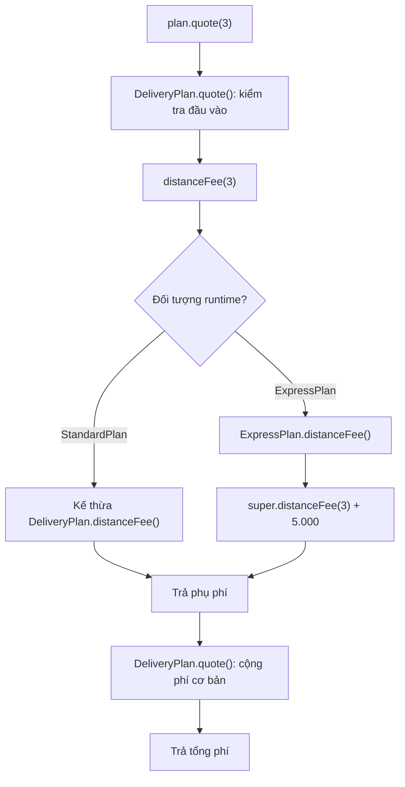

Đây là sự kết hợp giữa **ghi đè**, **đa hình** và **phương thức chung**. Không bắt buộc `DeliveryPlan` phải là lớp `abstract` để overriding hoạt động: một lớp concrete vẫn có thể có các phương thức instance được ghi đè.

## 3. Ghi đè (overriding) cần thỏa điều kiện gì?

Hai phương thức có tên giống nhau **chưa chắc** tạo thành overriding.

```java
class Parent {
    public Number value() {
        return 10;
    }
}

class Child extends Parent {
    @Override
    public Integer value() {
        return 20;
    }
}
```

Đây là ghi đè hợp lệ. `Integer` là kiểu trả về **hiệp biến** so với `Number`: nó là subtype của `Number`. Nếu biến kiểu `Parent` đang giữ `Child`, `value()` vẫn trả về object do implementation `Child` tạo.

Các nguyên tắc chính:

| Khía cạnh | Quy tắc |
|---|---|
| Tên và tham số | Phải là chữ ký phù hợp để override; chỉ đổi tham số thường thành **overload** |
| Kiểu trả về | Giữ tương thích; với reference type có thể dùng kiểu con (covariant return) |
| Phạm vi truy cập | Không được thu hẹp quyền truy cập, ví dụ `public` thành `protected` |
| Checked exceptions | Không được mở rộng loại checked exception vượt quá hợp đồng phương thức cha |
| `final` instance method | Không thể override |
| `private` method | Không được kế thừa theo cách để override |
| `static` method | Có thể bị **ẩn (method hiding)**, không được override động |
| Constructor | Không được kế thừa hoặc override |
| `@Override` | Nên dùng: trình biên dịch xác nhận lời khai báo thật sự ghi đè/triển khai một phương thức hợp lệ |

Ví dụ sai dễ gặp:

```java
class Parent {
    public void execute(String task) {}
}

class Child extends Parent {
    // @Override // Nếu thêm @Override, trình biên dịch sẽ báo lỗi.
    public void execute(int task) {}
}
```

`execute(int)` không override `execute(String)`: danh sách tham số khác nhau nên đây là một phương thức **overload**. Khi người dùng gọi `execute("task")`, phương thức `Parent.execute(String)` vẫn được dùng nếu `Child` không ghi đè chữ ký đó.

Trong thiết kế API, một phương thức abstract hoặc interface method cũng có thể được lớp triển khai override. Không phải chỉ các phương thức cụ thể trong lớp cha mới có thể được ghi đè.

## 4. Runtime chỉ chọn implementation **sau khi** compiler chọn chữ ký

Nếu class cha có `process(Object)`, class con override phương thức đó và bổ sung overload `process(String)`, hai cách gọi sau có thể khác nhau:

~~~java
class Parent {
    String process(Object value) { return "Parent/Object"; }
}
class Child extends Parent {
    @Override String process(Object value) { return "Child/Object"; }
    String process(String value) { return "Child/String"; }
}

Parent parentView = new Child();
Child childView = new Child();

System.out.println(parentView.process("hi")); // Child/Object
System.out.println(childView.process("hi"));  // Child/String
~~~

Trong lời gọi đầu, compiler chỉ thấy `process(Object)` qua kiểu `Parent`, sau đó dispatch tới `Child.process(Object)`. Ở lời gọi sau, compiler thấy overload `process(String)` trên `Child` và chọn chữ ký cụ thể hơn. **Overload dựa vào kiểu tĩnh; override dựa vào receiver runtime**. Cách phân tích chi tiết và các trường hợp `null`/boxing/varargs được đặt ở bài *Phân biệt ghi đè với nạp chồng*.

## 5. `static`, `private`, `final` và field có ranh giới khác override

| Thành viên | Điều cần nhớ |
|---|---|
| Static method | Cùng chữ ký ở lớp con là *hiding*; gọi bằng tên class để rõ ý |
| Field | Không override; truy cập theo kiểu tĩnh của biểu thức |
| Private method | Không được kế thừa để override |
| Final instance method | Không thể override, nhưng **bản thân nó vẫn có thể gọi một hook overridable** |
| Constructor | Có thể overload; không thể override |

Đây là lý do `DeliveryPlan.quote()` được `final` mà `distanceFee()` bên trong vẫn dispatch theo subtype. Nếu cần xem kết quả chính xác của field hiding, static hiding và getter, hãy đọc bài *Phân biệt che khuất thành viên với ghi đè* hoặc *Phạm vi đa hình của phương thức và thuộc tính*.

## 6. `super.method()` có ý nghĩa gì?

Trong lớp con, `super.method()` là cách gọi implementation được kế thừa từ lớp cha theo quy tắc Java, **không phải** cách “đổi object thành lớp cha”.

Ví dụ trong `ExpressPlan.distanceFee()`:

```java
@Override
protected long distanceFee(int distanceKm) {
    long base = super.distanceFee(distanceKm);
    return Math.addExact(base, 5_000L);
}
```

`super.distanceFee(...)` gọi cách tính của `DeliveryPlan`, sau đó lớp con thêm phụ phí. Tham chiếu `this` vẫn là **cùng object `ExpressPlan`**.

Nếu không gọi `super`, lớp con có thể thay thế hoàn toàn hành vi:

```java
@Override
protected long distanceFee(int distanceKm) {
    return Math.multiplyExact(4_000L, distanceKm);
}
```

Chọn mở rộng hay thay thế phải dựa trên hợp đồng lớp cha. Gọi `super` mù quáng có thể lặp tác động phụ; không gọi `super` khi lớp cha đòi duy trì invariant cũng có thể gây lỗi. Vì vậy lớp nền nên nêu rõ hook nào cho phép override và những điều kiện bắt buộc khi override.

## 7. Kiểm soát rủi ro của dynamic dispatch trong constructor

Một bẫy thường gặp: constructor lớp cha gọi một phương thức bị lớp con ghi đè.

```java
public class ConstructorDispatchTrap {
    static class Parent {
        Parent() {
            System.out.println("Trong Parent(): " + describe());
        }

        String describe() {
            return "Parent";
        }
    }

    static final class Child extends Parent {
        private String name = "Sẵn sàng";

        @Override
        String describe() {
            return name;
        }
    }

    public static void main(String[] args) {
        Child child = new Child();
        System.out.println("Sau khi tạo: " + child.describe());
    }
}
```

Kết quả:

```text
Trong Parent(): null
Sau khi tạo: Sẵn sàng
```

Lúc constructor `Parent` chạy, trường instance riêng `name` của `Child` chưa chạy initializer `"Sẵn sàng"`. Dù vậy, Java vẫn dispatch lời gọi `describe()` đến `Child.describe()`. Vì thế phương thức của lớp con quan sát `name == null`.

**Không nên gọi phương thức có thể override từ constructor**, đặc biệt nếu lớp con cần các trường được khởi tạo đầy đủ. Có thể dùng helper `private` hoặc `final` trong constructor nếu phù hợp, hoặc chuyển các hook mở rộng ra sau khi object khởi tạo xong. Rủi ro không nằm ở cú pháp `@Override`, mà ở thời điểm đối tượng còn đang khởi tạo.

## 8. Khi nào ghi đè là một thiết kế tốt?

Lớp con nên giữ đúng **hợp đồng** của lớp cha. Ví dụ tất cả `DeliveryPlan.quote(km)` đều phải trả phí không âm cho khoảng cách dương; một subclass không nên phá quy tắc bằng cách âm thầm trả giá trị âm hoặc thay ý nghĩa của đơn vị `km`.

Gợi ý:

| Tình huống | Lựa chọn |
|---|---|
| Các đối tượng thực sự là những biến thể của cùng một loại | Kế thừa + overriding có thể phù hợp |
| Có quy trình chung bắt buộc, chỉ một bước thay đổi | Lớp nền giữ phương thức `final`, gọi một hook có thể override |
| Các kiểu không cùng quan hệ is-a nhưng có cùng khả năng | Interface + nhiều implementation |
| Cần kết hợp nhiều quy tắc độc lập (phụ phí, giảm giá...) | Composition/strategy thường dễ mở rộng hơn cây kế thừa sâu |
| Lớp con không thể giữ hợp đồng lớp cha | Xem lại quan hệ kế thừa |

Để bảo vệ quy trình chung, `quote()` trong ví dụ được đánh dấu `final`, còn `distanceFee()` là extension point. Thiết kế này giữ bước kiểm tra khoảng cách và xử lý overflow ở lớp nền, cho phép các lớp con thay đổi cách tính phụ phí.

**Một lưu ý hiệu năng:** dynamic dispatch không tự động có nghĩa “mỗi lần gọi đều rất chậm”. JVM/JIT có thể tối ưu và inline nhiều lời gọi ảo khi đủ thông tin. Chi phí thực tế cần đo bằng profiler/benchmark; nên ưu tiên tính đúng đắn và khả năng bảo trì trước khi tối ưu vi mô.

## 9. Những lỗi dễ mắc khi thiết kế hook được override

- **Gõ sai chữ ký** rồi tưởng subclass đã thay hành vi: thêm `@Override` để compiler phát hiện, kiểm tra tên và kiểu tham số.
- **Đặt `static` vào điểm mở rộng** rồi mong đa hình động: dùng instance method với hợp đồng rõ.
- **Mở hook overridable trong constructor** khi subclass chưa hoàn tất khởi tạo: chỉ dùng phương thức không override được trong giai đoạn thiết lập hoặc tách giai đoạn kích hoạt sau construction.
- **Cho subclass phá invariant**: nếu `quote(km)` đòi khoảng cách dương và phí không âm, hook `distanceFee(km)` của lớp con phải tuân thủ yêu cầu ấy.
- **Lạm dụng `super`**: gọi phần triển khai lớp cha chỉ khi hợp đồng cho phép kết hợp, tránh thực hiện trùng side effect.

Với Template Method, nên giữ quy trình bất biến trong method `final` và chỉ công khai hook nhỏ nhất cần thay đổi. Cách này giảm rủi ro so với để mọi subclass ghi đè toàn bộ chuỗi kiểm tra và tính phí.

## 10. Tự kiểm tra

### Bài tập 1: dự đoán đầu ra

```java
class A {
    String message() { return "A"; }
}
class B extends A {
    @Override String message() { return "B"; }
}
class C extends B {
    @Override String message() { return "C"; }
}

// Trong main():
A x = new C();
B y = new C();
System.out.println(x.message());
System.out.println(y.message());
```

**Đáp án:** hai dòng đều là `C`. Kiểu khai báo của biến khác nhau nhưng đối tượng thực cùng thuộc `C`, và phương thức instance có implementation cuối cùng ở `C`.

### Bài tập 2: phân biệt hai giai đoạn

```java
class Base {
    String send(Object value) { return "Base:Object"; }
}
class Derived extends Base {
    @Override
    String send(Object value) { return "Derived:Object"; }

    String send(String value) { return "Derived:String"; }
}

Base base = new Derived();
Derived derived = new Derived();
Object text = "Java";

System.out.println(base.send("Java"));
System.out.println(derived.send("Java"));
System.out.println(derived.send(text));
```

**Đáp án:** `Derived:Object`, `Derived:String`, `Derived:Object`. Hãy chỉ ra chữ ký nào được trình biên dịch chọn trong từng lời gọi và lớp runtime nào cung cấp implementation.

### Bài tập 3: bổ sung loại giao hàng

Từ `RuntimeDispatchDemo`, thêm `SameDayPlan extends DeliveryPlan` với phí cơ bản 20.000 VND, phụ phí 4.000 VND mỗi km. Thêm instance vào `List<DeliveryPlan>`. Kiểm tra rằng vòng lặp trong `main` không cần sửa cấu trúc để gọi `name()` và `quote()`.

### Bài tập 4: kiểm tra ranh giới

Thử thêm một `@Override` trước phương thức `quote(int)` của lớp con. Vì sao trình biên dịch từ chối? Giải thích ý nghĩa của `final` trong thiết kế lớp nền.

### Bài tập 5: phương thức static

Với `StaticHidingDemo`, thay `Parent reference = new Child()` bằng `Child reference = new Child()`. Dự đoán `reference.type()` và `reference.describe()`. Giải thích sự khác biệt giữa method hiding và dynamic dispatch.

---

**Ghi nhớ:** Trong Java, **overloading quyết định chữ ký tại thời điểm biên dịch**, còn **overriding quyết định implementation của phương thức instance theo lớp thực tế của đối tượng khi chạy**. Kiểu khai báo xác định phương thức có thể gọi; kiểu runtime xác định phiên bản ghi đè được thực thi. Nắm rõ ranh giới này giúp đọc đúng mã đa hình và tránh nhầm `static`, field, constructor với phương thức instance.


</details>

- [Quay lại đầu trang](#back-to-top)

---

## <a id="polymorphism-005">Phân biệt ghi đè với nạp chồng</a>

<details>
<summary>Xem chi tiết</summary>

# Phân biệt ghi đè (overriding) với nạp chồng (overloading) trong Java

**Ghi đè phương thức (method overriding)** và **nạp chồng phương thức (method overloading)** đều cho phép xuất hiện nhiều phương thức cùng tên, nhưng chúng là **hai cơ chế khác nhau**. Phân biệt đúng hai cơ chế là nền tảng để hiểu đa hình trong Java: *trình biên dịch chọn phương thức nào*, *JVM thực thi phần thân nào*, và *kiểu của biến tham chiếu ảnh hưởng ra sao*.

Một quy tắc ghi nhớ hữu ích:

- **Overloading:** *Cùng tên, khác danh sách tham số*. Trình biên dịch chọn một chữ ký thích hợp dựa trên **kiểu đối số tại điểm gọi**.
- **Overriding:** *Lớp con định nghĩa lại một phương thức instance được kế thừa, có chữ ký phù hợp*. Khi gọi, JVM chọn **phần triển khai của đối tượng thực tế**.

Hai cơ chế có thể xuất hiện **đồng thời trong một lời gọi**, nên việc “nhìn tên phương thức” không đủ để dự đoán kết quả.

## 1. So sánh nhanh

| Đặc điểm | Overloading — nạp chồng | Overriding — ghi đè |
| --- | --- | --- |
| Mục đích | Cung cấp nhiều cách gọi cùng tên, với dữ liệu vào khác nhau | Cho phép lớp con thay đổi cách triển khai một hành vi được kế thừa |
| Quan hệ kế thừa | Không bắt buộc; có thể ngay trong một lớp | Liên quan đến kế thừa hoặc thực hiện hợp đồng phương thức của supertype |
| Tên phương thức | Giống nhau | Giống nhau |
| Danh sách tham số | **Phải khác** về số lượng hoặc kiểu/thứ tự kiểu | Phải có chữ ký phù hợp để override |
| Kiểu trả về | Không thể là yếu tố duy nhất tạo overload | Phải tương thích; có thể trả kiểu tham chiếu cụ thể hơn (*covariant return*) |
| Thời điểm quyết định chủ yếu | **Biên dịch**: chọn chữ ký overload | **Runtime**: chọn implementation của phương thức instance đã được chọn |
| Vai trò của kiểu biến | Rất quan trọng khi chọn overload | Kiểu tĩnh quyết định method có thể gọi; kiểu runtime quyết định bản override |
| `@Override` | Không dùng để đánh dấu một overload thuần túy | Nên dùng để trình biên dịch xác minh |
| `static` | Có thể có các overload static | Static method **không override**; cùng chữ ký ở con là hiding |
| `private` | Có thể overload trong phạm vi truy cập | Private method không được kế thừa để override |
| `final` | Có thể overload một tên phương thức đã có final method với tham số khác | Final instance method không được override |

**Điểm chính:** Java không thực hiện “chọn overload theo kiểu runtime của đối số”. Nếu biến được khai báo là `Animal` nhưng đang giữ `Dog`, tại lời gọi overload thông thường, compiler vẫn nhìn thấy biểu thức có kiểu `Animal`.

## 2. Overloading: cùng tên, khác tham số

Ví dụ một lớp cung cấp hai thao tác tính tổng:

```java
public class Calculator {
    public int add(int a, int b) {
        return Math.addExact(a, b);
    }

    public double add(double a, double b) {
        return a + b;
    }

    public int add(int a, int b, int c) {
        return Math.addExact(Math.addExact(a, b), c);
    }
}
```

Dùng lớp:

```java
Calculator calculator = new Calculator();

System.out.println(calculator.add(2, 3));       // 5
System.out.println(calculator.add(1.5, 2.25));  // 3.75
System.out.println(calculator.add(2, 3, 4));    // 9
```

Các phương thức tên `add` được phân biệt bởi **danh sách tham số**:

- `add(int, int)`
- `add(double, double)`
- `add(int, int, int)`

Trong Java, *method signature* chủ yếu gồm tên và kiểu tham số, không gồm kiểu trả về. Vì vậy ví dụ sau **không hợp lệ**:

```java
class InvalidCalculator {
    int calculate(int a) {
        return a;
    }

    // LỖI biên dịch: chỉ đổi kiểu trả về không tạo overload.
    // double calculate(int a) {
    //     return a;
    // }
}
```

Tên biến tham số cũng không làm thay đổi chữ ký: `sum(int left)` và `sum(int right)` vẫn trùng chữ ký.

### Compiler chọn overload như thế nào?

Trình biên dịch dựa vào những lời gọi **có thể áp dụng** theo kiểu tại điểm gọi, các quy tắc chuyển kiểu (`widening`, boxing/unboxing, varargs...) và quy tắc chọn phương thức **cụ thể nhất** trong những ứng viên hợp lệ.

Ví dụ:

```java
class Printer {
    void print(int value) {
        System.out.println("int: " + value);
    }

    void print(long value) {
        System.out.println("long: " + value);
    }
}

Printer printer = new Printer();
printer.print(5);   // int: 5
printer.print(5L);  // long: 5
```

Lời gọi `print(5)` khớp chính xác với `print(int)`, còn `print(5L)` có kiểu `long`. Nếu chỉ còn `print(long)`, Java có thể mở rộng `int` sang `long` để gọi được.

Không nên học thuộc duy nhất một thứ tự ưu tiên đơn giản cho tất cả trường hợp: độ cụ thể, generic, boxing, varargs và kiểu tham số có thể tạo ra các trường hợp phức tạp hoặc **mơ hồ**.

## 3. Overriding: lớp con thay đổi implementation của lớp cha

Giả sử có lớp định nghĩa hành vi in thông báo:

```java
class MessageSender {
    public String send(String message) {
        return "Mặc định: " + message;
    }
}

class EmailSender extends MessageSender {
    @Override
    public String send(String message) {
        return "Email: " + message;
    }
}
```

Khi gọi:

```java
MessageSender sender = new EmailSender();
System.out.println(sender.send("Xin chào")); // Email: Xin chào
```

Tham chiếu `sender` có **kiểu khai báo** là `MessageSender` nhưng chứa đối tượng `EmailSender`. Phương thức `send(String)` được chọn vì kiểu tham chiếu cho phép gọi nó; sau đó JVM sử dụng bản override của `EmailSender`. Đây là **đa hình khi chạy (runtime polymorphism)**.

`@Override` rất có ích khi viết:

```java
@Override
public String send(String message) {
    return "Email: " + message;
}
```

Nếu vô tình đổi tham số thành `Object` hoặc gõ sai tên, annotation khiến trình biên dịch báo rằng method đó **không thực sự override** method mong muốn. Nó không thay đổi thuật toán dispatch lúc runtime.

### Điều kiện để override đúng

Một số quy tắc cơ bản:

1. Phương thức phải override được một phương thức instance kế thừa hoặc thực hiện một phương thức tương ứng từ supertype; không thể override constructor.
2. Chữ ký phải tương thích theo quy tắc Java; không chỉ khác tên tham số.
3. Không được thu hẹp mức truy cập, ví dụ method cha `public` thì method con cũng phải `public`.
4. Kiểu trả về phải tương thích. Với kiểu tham chiếu có thể **covariant**, như cha trả `Animal` và con trả `Dog`; với kiểu nguyên thủy không thể đổi tùy ý từ `int` sang `long`.
5. Checked exception được khai báo ở method con không được mở rộng trái quy tắc so với method cha.
6. Phương thức `final` không thể bị override; `static` và `private` không tham gia overriding thông thường.

Việc một class *extends* class khác không tự động đảm bảo mọi method trùng tên đều là override.

## 4. Ví dụ quan trọng nhất: overloading và overriding cùng xuất hiện

Tạo một tệp duy nhất **`DispatchDemo.java`**:

```java
public class DispatchDemo {

    static class Animal {
    }

    static class Dog extends Animal {
    }

    static class Formatter {
        public String format(Animal value) {
            return "Formatter: Animal";
        }

        public String format(Dog value) {
            return "Formatter: Dog";
        }
    }

    static class SpecialFormatter extends Formatter {
        @Override
        public String format(Animal value) {
            return "SpecialFormatter: Animal";
        }

        // Không override format(Dog), nên vẫn kế thừa bản cha.
    }

    public static void main(String[] args) {
        Dog dog = new Dog();
        Animal animalReference = dog;
        Formatter formatter = new SpecialFormatter();

        System.out.println(formatter.format(animalReference));
        System.out.println(formatter.format(dog));
        System.out.println(formatter.format((Animal) dog));
        System.out.println(formatter.format(new Animal()));

        Formatter base = new Formatter();
        System.out.println(base.format(dog));
    }
}
```

Biên dịch/chạy với JDK 11+:

```bash
javac DispatchDemo.java
java DispatchDemo
```

Kết quả **chính xác**:

```text
SpecialFormatter: Animal
Formatter: Dog
SpecialFormatter: Animal
SpecialFormatter: Animal
Formatter: Dog
```

### Phân tích từng lời gọi

| Lời gọi | Kiểu tĩnh của đối số | Overload được compiler chọn | Implementation chạy |
| --- | --- | --- | --- |
| `formatter.format(animalReference)` | `Animal` | `format(Animal)` | `SpecialFormatter.format(Animal)` |
| `formatter.format(dog)` | `Dog` | `format(Dog)` | `Formatter.format(Dog)` (được kế thừa) |
| `formatter.format((Animal) dog)` | `Animal` sau ép kiểu | `format(Animal)` | `SpecialFormatter.format(Animal)` |
| `formatter.format(new Animal())` | `Animal` | `format(Animal)` | `SpecialFormatter.format(Animal)` |
| `base.format(dog)` | `Dog` | `format(Dog)` | `Formatter.format(Dog)` |

Có hai bước liên tiếp:

1. **Chọn overload:** tên `format` cùng **kiểu tĩnh** của đối số (và tập method nhìn thấy từ kiểu tĩnh của receiver) giúp trình biên dịch chọn một chữ ký, ví dụ `format(Animal)`.
2. **Chọn override:** tại runtime, với chữ ký đã chọn, JVM xét **kiểu thực tế của đối tượng nhận lời gọi** `formatter`. Vì nó là `SpecialFormatter`, `format(Animal)` chạy bản override của lớp con. Nếu chữ ký được chọn là `format(Dog)` thì lớp con không override, nên sử dụng bản kế thừa từ `Formatter`.

Chính vì thế:

```java
Dog dog = new Dog();
Animal reference = dog;
```

Hai biến có thể tham chiếu **cùng một đối tượng Dog** nhưng `format(dog)` và `format(reference)` chọn **overload khác nhau**. Kiểu runtime của đối số `reference` không khiến compiler tự chuyển qua `format(Dog)`.

### Sơ đồ phân giải lời gọi

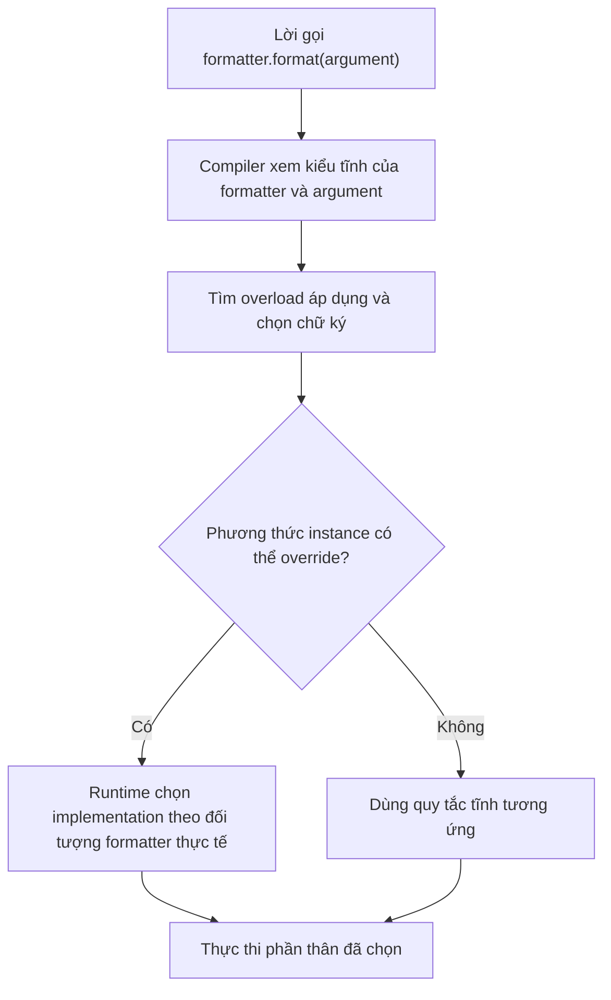

Sơ đồ này tóm tắt trường hợp gọi method thông thường; với `super.method()`, constructor invocation hay method static có các quy tắc riêng.

## 5. Kiểu của receiver và kiểu của đối số đều có vai trò

Không chỉ kiểu đối số, **kiểu tham chiếu của đối tượng nhận lời gọi** cũng ảnh hưởng đến những overload có thể nhìn thấy ở thời điểm biên dịch.

```java
class BaseHandler {
    void handle(Object value) {
        System.out.println("Base: Object");
    }
}

class ChildHandler extends BaseHandler {
    void handle(String value) {
        System.out.println("Child: String");
    }
}
```

Xét:

```java
BaseHandler baseRef = new ChildHandler();
ChildHandler childRef = new ChildHandler();

baseRef.handle("hi");   // Base: Object
childRef.handle("hi");  // Child: String
```

Với `baseRef`, trình biên dịch chỉ thấy `handle(Object)` theo API của `BaseHandler`; nó không tự phát hiện một overload mới `handle(String)` chỉ có trong `ChildHandler`. `ChildHandler` cũng **không override** `handle(Object)`, vì nó chỉ khai báo `handle(String)`.

Nếu một class con muốn biến đổi cách xử lý các lời gọi đã tồn tại qua `BaseHandler`, nó phải override đúng `handle(Object)`:

```java
class AnotherHandler extends BaseHandler {
    @Override
    void handle(Object value) {
        System.out.println("Another: Object");
    }
}
```

Đây là lý do overloading **không phải** một cách thay thế overriding khi cần đa hình qua lớp cha hoặc interface.

## 6. Overload resolution và trường hợp `null`

Một tình huống có thể gây nhầm lẫn:

```java
class NullExample {
    void show(Object value) {
        System.out.println("Object");
    }

    void show(String value) {
        System.out.println("String");
    }
}

new NullExample().show(null); // String
```

Cả `Object` lẫn `String` đều có thể nhận `null`, nhưng `String` là kiểu cụ thể hơn `Object`, nên overload `show(String)` được chọn.

Ngược lại:

```java
class AmbiguousExample {
    void show(String value) {
    }

    void show(Integer value) {
    }
}

// new AmbiguousExample().show(null); // LỖI: ambiguous
```

`String` và `Integer` không có quan hệ subtype với nhau, nên chỉ dùng `null` ở đây không đủ để xác định overload nào cụ thể hơn. Có thể ép kiểu để chỉ rõ ý định:

```java
new AmbiguousExample().show((String) null);
```

**Cẩn thận:** Java cho phép compiler chọn overload nhận `null`, nhưng phần thân method có thể ném `NullPointerException` nếu cố truy cập đối tượng. Lựa chọn overload và an toàn dữ liệu đầu vào là hai vấn đề khác nhau.

## 7. Overloading: widening, boxing và varargs

Ví dụ minh họa mức ưu tiên khi biên dịch:

```java
class NumberExample {
    void show(long value) {
        System.out.println("long");
    }

    void show(Integer value) {
        System.out.println("Integer");
    }

    void show(int... values) {
        System.out.println("varargs");
    }
}

NumberExample numbers = new NumberExample();
numbers.show(10);   // long
numbers.show(10L);  // long
```

Với `10` có kiểu `int`, phương thức `show(long)` khả dụng bằng **primitive widening**; compiler ưu tiên lựa chọn ở pha không cần boxing so với `show(Integer)`. `varargs` là một cơ chế khác có thể được xem xét khi các phương thức thích hợp ở pha trước không có.

Điều cần nhớ không phải là “`long` luôn thắng `Integer`” trong mọi chương trình, mà là:

- Overload được chọn theo **quy tắc tại thời điểm biên dịch**.
- Các phép chuyển kiểu hợp lệ ảnh hưởng đến ứng viên.
- Một nhóm overload thiết kế quá nhiều tham số na ná nhau dễ trở nên khó đọc hoặc mơ hồ.

**Gợi ý thiết kế:** nếu hai phương thức thực hiện các hành vi khác ý nghĩa, đặt tên khác nhau rõ ràng thường tốt hơn việc tạo overload chỉ để giảm số lượng tên API.

## 8. `static`, `private`, `final`: đừng nhầm với override

### Static method hiding không phải overriding

```java
class Base {
    static String category() {
        return "Base";
    }
}

class Child extends Base {
    static String category() {
        return "Child";
    }
}

Base value = new Child();
System.out.println(Base.category());  // Base
System.out.println(Child.category()); // Child
```

`static` method thuộc lớp; khai báo cùng chữ ký ở lớp con là **method hiding**, không phải dynamic dispatch. Nên gọi chúng qua **tên lớp** để tránh hiểu lầm. Không được gắn `@Override` lên `static` method với mục đích ghi đè.

### Private method không được kế thừa để override

```java
class Base {
    private String internal() {
        return "base internal";
    }

    public String run() {
        return internal();
    }
}

class Child extends Base {
    public String internal() {
        return "child internal";
    }
}

System.out.println(new Child().run()); // base internal
```

`Child.internal()` là method riêng của lớp con, không override `Base.internal()` do phương thức cha là `private`. Lời gọi trong `Base.run()` vẫn đến `Base.internal()`.

### Final method không thể bị ghi đè

```java
class Base {
    public final void validate() {
        System.out.println("Kiểm tra chung");
    }
}

class Child extends Base {
    // @Override
    // public void validate() { } // LỖI: final
}
```

Tuy nhiên, lớp con vẫn có thể khai báo một overload `validate(String context)`, vì đó là **chữ ký khác**, không thay đổi bản `validate()` final của cha.

### Constructor có thể overload nhưng không override

```java
class Account {
    Account() {
        this("DEFAULT");
    }

    Account(String id) {
        System.out.println(id);
    }
}
```

`Account()` và `Account(String)` là hai **constructor overload**. Constructor không được kế thừa như phương thức bình thường, vì vậy không có “override constructor” trong Java. `this(...)` chọn một constructor khác của cùng lớp; `super(...)` gọi constructor cha, không phải override.

## 9. `@Override` và các quy tắc tương thích

Gắn `@Override` khi **thực sự triển khai/ghi đè hợp đồng**:

```java
interface Describable {
    String describe();
}

class Product implements Describable {
    @Override
    public String describe() {
        return "Sản phẩm";
    }

    public String describe(String language) {
        return "vi".equals(language)
                ? "Sản phẩm"
                : "Product";
    }
}
```

`describe()` triển khai method interface; `describe(String)` là overload trong cùng lớp. Cả hai đều hợp lệ và có thể tồn tại đồng thời.

### Kiểu trả về covariant trong overriding

```java
class Animal {
}

class Cat extends Animal {
}

class Shelter {
    Animal adopt() {
        return new Animal();
    }
}

class CatShelter extends Shelter {
    @Override
    Cat adopt() {
        return new Cat();
    }
}
```

Method con `adopt()` trả kiểu `Cat` là subtype của `Animal`, nên hợp lệ. Trong khi đó, **chỉ khác kiểu trả về** không bao giờ là đủ để tạo overload mới trong cùng phạm vi chữ ký.

### Quy tắc exception và truy cập

- Nếu method lớp cha là `public`, override ở con không thể thành `protected` hoặc package-private.
- Nếu method cha khai báo checked exception `IOException`, override có thể khai báo `FileNotFoundException` (một subtype của `IOException`), hoặc không khai báo checked exception; nó không được tự ý mở rộng thành checked exception không phù hợp.
- Unchecked exceptions có quy tắc khai báo khác, nhưng subtype vẫn cần giữ hợp đồng hành vi mà caller đã dựa vào.
- Method trả về `void` không thể override bằng method trả về `String` dù tên và tham số giống nhau.

Trình biên dịch kiểm tra tương thích cú pháp/kiểu; hợp đồng nghiệp vụ vẫn cần kiểm thử riêng.

## 10. Overriding và nguyên lý thay thế Liskov

Ghi đè thường được sử dụng khi mã client giữ tham chiếu kiểu cha:

```java
AnimalHandler handler = new DogHandler();
handler.handle();
```

Nếu hai kiểu có quan hệ subtype, việc override cần giữ những cam kết của API cha: không siết chặt tiền điều kiện hợp lệ, không làm yếu hậu điều kiện, không phá bất biến và không thêm side effect trái hợp đồng.

Ví dụ, nếu interface `PaymentCalculator` hứa phí không âm cho số tiền hợp lệ, lớp con override `calculate` trả phí âm là vi phạm hành vi dù chữ ký biên dịch được.

Nạp chồng lại là quyết định **cung cấp thêm cách gọi**, không tự tạo bảo đảm đa hình. Nếu client chỉ biết method `calculate(int)` của lớp cha, việc con thêm `calculate(String)` không khiến lời gọi `calculate(int)` đột nhiên sử dụng phần thân mới.

Do đó khi cần thực sự thay đổi hành vi qua một trừu tượng, hãy ưu tiên override đúng method đã được công bố. Nếu muốn hỗ trợ thêm dạng tham số, overload có thể thích hợp, nhưng cần định nghĩa hành vi từng overload sao cho người dùng không gặp kết quả khó đoán.

## 11. Kiểm thử thực tế: phân biệt hai pha phân giải

Tạo thêm tệp độc lập **`DispatchContractCheck.java`**:

```java
public class DispatchContractCheck {
    static class Parent {
        String call(Object value) {
            return "Parent:Object";
        }

        String call(String value) {
            return "Parent:String";
        }
    }

    static class Child extends Parent {
        @Override
        String call(Object value) {
            return "Child:Object";
        }
    }

    public static void main(String[] args) {
        Parent receiver = new Child();

        Object stringAsObject = "Java";
        String stringAsString = "Java";

        check("Child:Object".equals(receiver.call(stringAsObject)));
        check("Parent:String".equals(receiver.call(stringAsString)));
        check("Child:Object".equals(receiver.call((Object) stringAsString)));

        System.out.println("PASS: overload và override được phân biệt");
    }

    static void check(boolean ok) {
        if (!ok) {
            throw new AssertionError("Sai quy tắc phân giải method");
        }
    }
}
```

Biên dịch/chạy:

```bash
javac DispatchContractCheck.java
java DispatchContractCheck
```

Kết quả:

```text
PASS: overload và override được phân biệt
```

**Lý do:**

- `stringAsObject` có kiểu tĩnh `Object` nên compiler chọn `call(Object)`; đối tượng receiver thật là `Child` nên chạy `Child.call(Object)`.
- `stringAsString` có kiểu tĩnh `String` nên compiler chọn `call(String)`; `Child` không override phương thức này, vì vậy chạy bản kế thừa từ `Parent`.
- Ép `(Object) stringAsString` thay đổi kiểu biểu thức tại điểm gọi, nên chọn lại overload `call(Object)`, dù đối tượng chuỗi thực tế không đổi.

Đây là phép kiểm tra dễ nhớ nhất cho quy tắc “**overload trước, override sau**”.

## 12. Bài tập tự luyện

**Bài tập 1 — đoán kết quả**

```java
class Parent {
    String test(Number n) { return "Parent-Number"; }
    String test(Integer n) { return "Parent-Integer"; }
}
class Child extends Parent {
    @Override
    String test(Number n) { return "Child-Number"; }
}

Parent p = new Child();
Number n = Integer.valueOf(7);
Integer i = Integer.valueOf(7);

System.out.println(p.test(n)); // ?
System.out.println(p.test(i)); // ?
```

**Đáp án:** `Child-Number` và `Parent-Integer`. Overload chọn theo kiểu tĩnh của `n`/`i`; runtime dispatch tới override nếu chữ ký đó đã được override.

**Bài tập 2 — chỉ đổi kiểu trả về**

Hai method `int calculate(int x)` và `double calculate(int x)` đặt cùng một lớp có hợp lệ không? **Không.** Chúng có cùng chữ ký; kiểu trả về không phân biệt overload.

**Bài tập 3 — giải thích một lỗi `@Override`**

```java
class Base {
    void process(String s) { }
}

class Sub extends Base {
    // @Override
    void process(Object o) { }
}
```

Vì sao không dùng được `@Override`? `process(Object)` là overload mới, không phải override `process(String)`. Muốn override phải khai báo `void process(String s)`.

**Bài tập 4 — static và instance**

Viết hai class cha/con có cùng `static String type()` và một phương thức instance `String describe()` được override. Dùng biến kiểu cha giữ đối tượng con. Dự đoán kết quả của gọi static bằng **tên lớp** và gọi instance qua biến.

**Bài tập 5 — thiết kế API**

Bạn có `NotificationSender.send(String text)` và muốn hỗ trợ gửi đến nhiều người nhận:

- Nếu thêm `send(String text, String recipient)`, đó là **overload** — mở thêm một chữ ký.
- Nếu `EmailSender` thay đổi phần gửi của `send(String text)` đã được lớp cha định nghĩa, đó là **override** — thay cách thực hiện hành vi chung.

Hãy thử lập bảng cho mỗi phương án: kiểu client nhìn thấy, chữ ký được chọn, phần thân được chạy và kỳ vọng hành vi cần giữ.

## Những lỗi hay gặp

| Nhầm lẫn | Cách hiểu đúng |
| --- | --- |
| “Overloading chỉ xuất hiện giữa các class kế thừa” | Overload có thể xuất hiện trong cùng một class |
| “Overriding chỉ cần cùng tên” | Phải có chữ ký và các điều kiện override tương thích |
| “Khác kiểu trả về là overload” | Sai; không thể chỉ đổi kiểu trả về |
| “Java tự chọn overload theo lớp runtime của argument” | Sai; chọn theo kiểu tĩnh và quy tắc overload resolution |
| “Compiler chọn luôn phần thân override cuối cùng” | Compiler chọn chữ ký; dispatch method instance xảy ra lúc chạy |
| “Method static của con override static cha” | Đó là method hiding |
| “Private method của cha có thể bị override” | Private method không được kế thừa để override |
| “`@Override` bắt buộc để JVM dispatch” | Không; annotation hỗ trợ kiểm tra lỗi biên dịch |
| “Thêm overload ở lớp con làm mọi lời gọi qua biến cha chọn overload mới” | Không; kiểu tĩnh receiver xác định API nhìn thấy |
| “Constructor override được” | Constructor có thể overload, không override |

**Kết luận:** Để giải một lời gọi Java có nhiều phương thức cùng tên, trước hết hãy hỏi **compiler nhìn thấy những overload nào và chọn chữ ký nào dựa vào kiểu tĩnh**. Sau đó, nếu là phương thức instance có khả năng override, hãy hỏi **đối tượng receiver thực sự thuộc lớp nào** để xác định phần thân chạy. Làm theo hai bước này sẽ tránh được phần lớn nhầm lẫn về đa hình giữa **overloading** và **overriding**.


</details>

- [Quay lại đầu trang](#back-to-top)

---

## <a id="polymorphism-006">Phân biệt che khuất thành viên với ghi đè</a>

<details>
<summary>Xem chi tiết</summary>

# Phân biệt che khuất thành viên với ghi đè trong Java

Khi một lớp con khai báo thành viên có **cùng tên** với lớp cha, Java không phải lúc nào cũng thực hiện **ghi đè (overriding)**. Tùy thành viên là **field**, **phương thức `static`** hay **phương thức instance**, Java dùng những quy tắc khác nhau:

- **Che khuất field (*field hiding*):** Field ở lớp con có cùng tên với field lớp cha. Truy cập `ref.field` chủ yếu được chọn theo **kiểu của biểu thức tham chiếu tại lúc biên dịch**, không theo lớp thực tế của đối tượng.
- **Che khuất phương thức tĩnh (*static method hiding*):** Lớp con khai báo một static method có chữ ký tương ứng với static method của lớp cha. Lời gọi được phân giải theo **kiểu được dùng tại compile time**, không có đa hình động như instance method.
- **Ghi đè phương thức (*method overriding*):** Lớp con cung cấp implementation mới cho một **instance method** được phép override từ lớp cha. Với một lời gọi có receiver object, Java chọn implementation tại **runtime** dựa vào kiểu thực tế của object.

Sự khác biệt này rất quan trọng khi đọc:

~~~java
Parent ref = new Child();
~~~

Biến `ref` có kiểu khai báo `Parent`, nhưng nó đang tham chiếu tới một đối tượng `Child`. Field, static method và instance method **không nhất thiết được chọn theo cùng một kiểu**.

## 1. Bảng đối chiếu nhanh

| Đặc điểm | Field hiding | Static method hiding | Instance method overriding |
|---|---|---|---|
| Điều kiện điển hình | Lớp con khai báo field trùng tên | Lớp con khai báo static method cùng chữ ký hợp lệ | Lớp con khai báo instance method override hợp lệ |
| Chọn thành viên theo | Kiểu biểu thức tham chiếu lúc biên dịch | Kiểu dùng để gọi/lựa chọn method lúc biên dịch | Kiểu thực tế của receiver object lúc chạy |
| Có đa hình động? | **Không** | **Không** | **Có** |
| Dùng `@Override`? | Không | Không, sẽ báo lỗi | Nên dùng |
| `super` có ích? | `super.field` đọc field lớp cha | `super.method()` với static có quy tắc riêng, nhưng nên gọi `Parent.method()` | `super.method()` gọi implementation superclass |
| Hai thành viên tồn tại riêng? | Có thể có hai field cùng tên ở phần dữ liệu các lớp | Có hai phương thức static được khai báo ở hai lớp | Có các implementation khác nhau của cùng hợp đồng method |
| Khuyến nghị | Tránh che khuất field để khỏi gây nhầm | Gọi static method bằng **tên lớp** | Dùng cho hành vi đa hình có hợp đồng rõ ràng |

**Cách nhớ:** *field và static method phụ thuộc vào kiểu tham chiếu/kiểu dùng tại compile time; instance method được override phụ thuộc vào object ở runtime.*

Đây là quy tắc cốt lõi, nhưng cách compiler phân giải lời gọi còn chịu ảnh hưởng của overload, khả năng truy cập và kiểu của từng đối số. Ta sẽ tách những cơ chế ấy trong các phần tiếp theo.

## 2. Ví dụ Java đầy đủ: một object, ba cách phân giải thành viên

Lưu toàn bộ vào **`Demo.java`**, biên dịch/chạy bằng Java 17 trở lên:

~~~java
public class Demo {
    public static void main(String[] args) {
        Parent parentView = new Child();
        Child childView = (Child) parentView;

        System.out.println("=== Field ===");
        System.out.println(parentView.label);
        System.out.println(childView.label);
        System.out.println(((Parent) childView).label);

        System.out.println("=== Static method ===");
        System.out.println(Parent.kind());
        System.out.println(Child.kind());

        // Hợp lệ về cú pháp, nhưng không nên gọi static qua instance:
        System.out.println(parentView.kind());
        System.out.println(childView.kind());

        System.out.println("=== Instance method ===");
        System.out.println(parentView.describe());
        System.out.println(childView.describe());

        System.out.println("=== Kết hợp với super ===");
        childView.inspect();
        System.out.println(parentView.report());
    }
}

class Parent {
    public String label = "Field của Parent";

    public static String kind() {
        return "Static của Parent";
    }

    public String describe() {
        return "Method của Parent";
    }

    public String report() {
        // describe() là instance method: dispatch theo object.
        return "Report: " + describe();
    }
}

class Child extends Parent {
    public String label = "Field của Child"; // Field hiding.

    public static String kind() {            // Static method hiding.
        return "Static của Child";
    }

    @Override
    public String describe() {               // Method overriding.
        return "Method của Child";
    }

    public void inspect() {
        System.out.println(this.label);
        System.out.println(super.label);
        System.out.println(this.describe());
        System.out.println(super.describe());
    }
}
~~~

Chạy:

~~~bash
javac Demo.java
java Demo
~~~

Kết quả:

~~~text
=== Field ===
Field của Parent
Field của Child
Field của Parent
=== Static method ===
Static của Parent
Static của Child
Static của Parent
Static của Child
=== Instance method ===
Method của Child
Method của Child
=== Kết hợp với super ===
Field của Child
Field của Parent
Method của Child
Method của Parent
Report: Method của Child
~~~

### Phân tích theo từng cơ chế

**Field hiding:**

~~~java
Parent parentView = new Child();

System.out.println(parentView.label);          // Field của Parent
System.out.println(((Child) parentView).label); // Field của Child
~~~

Cả hai biểu thức cùng trỏ tới **một object `Child`**, nhưng field được chọn theo **kiểu tham chiếu** của biểu thức:

- `parentView` được khai báo là `Parent` → đọc `Parent.label`.
- `(Child) parentView` có kiểu `Child` → đọc `Child.label`.

Phép cast trong trường hợp này **không tạo object khác và không di chuyển giá trị field**; nó làm thay đổi cách compiler nhìn nhận biểu thức.

**Static method hiding:**

~~~java
System.out.println(parentView.kind()); // Static của Parent
System.out.println(childView.kind());  // Static của Child
~~~

Hai lời gọi này được phép nhưng gây hiểu nhầm rằng static method sử dụng đa hình. **Nên viết `Parent.kind()` và `Child.kind()`** để thể hiện rõ static method gắn với lớp.

**Instance method overriding:**

~~~java
System.out.println(parentView.describe()); // Method của Child
~~~

Compiler xác nhận `Parent` có `describe()`, còn JVM chọn implementation `Child.describe()` của đối tượng thực tế.

Điểm thú vị là `Parent.report()` cũng gọi được `Child.describe()` khi chạy trên object `Child`: phương thức của lớp cha gọi một **instance method có thể override**, và dispatch vẫn diễn ra ở runtime.

## 3. Field hiding: cùng tên nhưng không phải cùng field

Khi subclass khai báo lại field cùng tên, có thể hình dung một object lớp con có các phần trạng thái tương ứng với cả superclass lẫn subclass:

~~~mermaid
flowchart TD
    R["parentView: Parent"] --> O["Object thực tế: Child"]
    S["childView: Child"] --> O
    O --> P["Phần Parent: label = Field của Parent"]
    O --> C["Phần Child: label = Field của Child"]
    R -.->|"parentView.label"| P
    S -.->|"childView.label"| C
~~~

Đây là sơ đồ **logic**, không cam kết vị trí bộ nhớ vật lý hoặc cách JVM tối ưu hóa field.

Một ví dụ chỉnh sửa cho thấy **hai field độc lập**:

~~~java
class CounterBase {
    public int count = 1;
}

class CounterChild extends CounterBase {
    public int count = 10;
}

CounterChild obj = new CounterChild();
obj.count = 20;
((CounterBase) obj).count = 2;

System.out.println(obj.count);               // 20
System.out.println(((CounterBase) obj).count); // 2
~~~

Phần sử dụng ở cuối cần đặt trong một phương thức Java thích hợp. Gán `obj.count = 20` **không thay đổi** `CounterBase.count`; gán qua cast về `CounterBase` cũng không sửa `CounterChild.count`.

Điều này dễ gây lỗi khi lớp cha có một invariant dựa vào field của nó, còn lớp con lại khai báo field trùng tên và vô tình làm code đọc dữ liệu không nhất quán.

### Đừng dùng field công khai để tạo đa hình

Thiết kế dễ gây nhầm:

~~~java
class Configuration {
    public String environment = "default";
}

class ProductionConfiguration extends Configuration {
    public String environment = "production";
}
~~~

Code sử dụng:

~~~java
Configuration config = new ProductionConfiguration();
System.out.println(config.environment); // default
~~~

Nếu muốn kết quả tùy thuộc object thực tế, hãy dùng **phương thức instance**:

~~~java
class Configuration {
    public String environment() {
        return "default";
    }
}

class ProductionConfiguration extends Configuration {
    @Override
    public String environment() {
        return "production";
    }
}

Configuration config = new ProductionConfiguration();
System.out.println(config.environment()); // production
~~~

Với dữ liệu quan trọng, thường nên giữ field `private` và cung cấp getter hoặc hành vi thể hiện ý định. Nếu getter được override thì client nhận đa hình đúng theo hợp đồng; đồng thời class vẫn có thể kiểm soát invariant.

## 4. Static method hiding: cùng chữ ký, không có dispatch động

Trong Java, static method thuộc về **lớp**, không thuộc trạng thái riêng của một instance. Một subclass có thể khai báo static method cùng chữ ký để **hide** static method của superclass, trong những điều kiện hợp lệ.

~~~java
class Formatter {
    public static String format() {
        return "BASE";
    }
}

class JsonFormatter extends Formatter {
    public static String format() {
        return "JSON";
    }
}
~~~

Sử dụng:

~~~java
Formatter base = new JsonFormatter();

System.out.println(Formatter.format());      // BASE
System.out.println(JsonFormatter.format());  // JSON
System.out.println(base.format());           // BASE
~~~

Dòng cuối **được phép** nhưng không nên sử dụng: `base.format()` trông như gọi phương thức của object, nhưng compiler xác định là static method của `Formatter` theo kiểu biểu thức.

**`@Override` không hợp lệ trên phương thức `JsonFormatter.format()`**, vì static method chỉ hide, không override.

### Không thể “đổi” một static method thành instance override

Ví dụ bị Java từ chối:

~~~java
class Parent {
    public static void process() {}
}

class Child extends Parent {
    // public void process() {} // Lỗi biên dịch:
    // instance method không thể override/hide static method tương ứng.
}
~~~

Chiều ngược lại cũng không hợp lệ:

~~~java
class Parent {
    public void process() {}
}

class Child extends Parent {
    // public static void process() {} // Lỗi biên dịch:
    // static method không thể hide instance method tương ứng.
}
~~~

Hai phương thức trùng chữ ký trong quan hệ kế thừa không thể hoán đổi giữa static và instance tùy ý.

### Static method của interface có khác biệt

Java interface cho phép static method:

~~~java
interface TextRules {
    static boolean hasText(String value) {
        return value != null && !value.isBlank();
    }
}

class TextService implements TextRules {}

System.out.println(TextRules.hasText("Java")); // true

// TextService.hasText("Java");  // Không hợp lệ.
// new TextService().hasText("Java"); // Không hợp lệ.
~~~

Static method khai báo trong interface **không được kế thừa sang class implements** như instance/default method. Vì thế, không nên áp dụng máy móc quy tắc class static hiding cho static method của interface.

## 5. Ghi đè phương thức tạo sự khác biệt với hiding

~~~java
class Notification {
    String send() { return "Gửi thông báo"; }
}
class EmailNotification extends Notification {
    @Override String send() { return "Gửi email"; }
}
Notification item = new EmailNotification();
System.out.println(item.send()); // Gửi email
~~~

`send()` là **instance method có thể override** nên Java dispatch theo object `EmailNotification`, khác hẳn truy cập `item.field` hoặc gọi một static method bị hide. `@Override` giúp compiler kiểm tra chữ ký; một override hợp lệ còn phải giữ kiểu trả về tương thích, không giảm khả năng truy cập, không mở rộng checked exception sai quy tắc và giữ hợp đồng hành vi.

Với cú pháp ghi đè, covariant return, `final`, `super` và tác động của hook trong constructor, bài *Ghi đè và lựa chọn phương thức khi chạy* là nơi hướng dẫn chính.

## 6. Phương thức private có phải là overridden không?

Không. Private instance method của superclass **không được kế thừa để override** bởi subclass.

~~~java
class SecureBase {
    private String secretLabel() {
        return "Base private";
    }

    public String audit() {
        return secretLabel();
    }
}

class SecureChild extends SecureBase {
    // Phương thức riêng, không phải override private method của Base.
    public String secretLabel() {
        return "Child public";
    }
}
~~~

Sử dụng:

~~~java
SecureBase ref = new SecureChild();
System.out.println(ref.audit()); // Base private

SecureChild child = new SecureChild();
System.out.println(child.secretLabel()); // Child public
~~~

`SecureBase.audit()` gọi phương thức `private secretLabel()` của chính `SecureBase`; phương thức cùng tên do `SecureChild` khai báo không thay thế nó.

Đây là một điểm rất khác so với `public`/`protected` instance method có thể override.

Lưu ý: class lồng nhau (*nestmates*) có thể có quyền truy cập private đặc biệt theo quy tắc Java, nhưng điều đó không biến private method của superclass thành phương thức được override.

### Lớp con không thể truy cập field private qua `super`

~~~java
class Parent {
    private int balance = 100;

    public int getBalance() {
        return balance;
    }
}

class Child extends Parent {
    public int readBalance() {
        // return super.balance; // Lỗi: private không được truy cập.
        return getBalance();     // Hợp lệ: gọi public method.
    }
}
~~~

Từ khóa `super` không cho phép vượt qua mức truy cập `private`; nó chỉ chỉ rõ ngữ cảnh superclass cho những thành viên được phép sử dụng.

## 7. Che khuất field và override có thể cùng xuất hiện, dẫn tới trạng thái bất nhất

Xét:

~~~java
class Profile {
    protected String displayName = "Base";

    public String summary() {
        return "Tên: " + displayName;
    }
}

class PremiumProfile extends Profile {
    protected String displayName = "Premium";

    @Override
    public String summary() {
        return "Tên cao cấp: " + displayName;
    }
}
~~~

~~~java
Profile profile = new PremiumProfile();
System.out.println(profile.displayName); // Base
System.out.println(profile.summary());   // Tên cao cấp: Premium
~~~

Dù cùng tham chiếu tới một object, việc đọc field và gọi method cho kết quả dựa vào **hai quy tắc khác nhau**.

Đó là lý do **không nên để code ngoài phụ thuộc vào protected/public field trùng tên** giữa các lớp trong cây kế thừa. Khi thật sự cần hành vi khác nhau, ưu tiên method override. Nếu cần trạng thái chung, lớp cha nên giữ một field private và cung cấp các thao tác có kiểm tra.

## 8. Overload là một câu hỏi khác: chọn chữ ký nào?

~~~java
class Printer {
    void print(Object value) { System.out.println("Object"); }
    void print(String value) { System.out.println("String"); }
}
Object text = "hello";
Printer printer = new Printer();
printer.print(text);      // Object
printer.print("hello");   // String
~~~

`print(Object)` và `print(String)` là **hai overload**; compiler chọn dựa trên kiểu tĩnh của đối số, không dựa trên object runtime của `text`. Sau khi chọn chữ ký, nếu lời gọi instance có override thì runtime mới chọn implementation tương ứng.

| Cơ chế | Chọn bằng |
|---|---|
| Field hiding | Kiểu tĩnh của biểu thức |
| Static hiding | Kiểu tĩnh/tên lớp |
| Overload | Kiểu tĩnh của receiver, đối số và quy tắc overload resolution |
| Instance override | Runtime class của receiver sau khi chữ ký đã xác định |

Các ví dụ kết hợp overload/override, `null`, boxing và varargs được dạy riêng ở bài *Phân biệt ghi đè với nạp chồng*.

## 9. Cách `super` ảnh hưởng đến các trường hợp

`super` được dùng trong instance context để chỉ rõ thao tác với lớp cha, giúp tránh mơ hồ khi cả hai lớp có thành viên cùng tên.

~~~java
class Vehicle {
    protected String label = "Vehicle";

    public String move() {
        return "Vehicle moves";
    }
}

class Car extends Vehicle {
    protected String label = "Car";

    @Override
    public String move() {
        return "Car moves; " + super.move();
    }

    public void inspect() {
        System.out.println(this.label);  // Car
        System.out.println(super.label); // Vehicle
        System.out.println(this.move()); // Car moves; Vehicle moves
    }
}
~~~

- `super.label` chọn field `label` được khai báo ở superclass.
- `super.move()` gọi implementation của superclass (không dùng dynamic dispatch để quay lại `Car.move()` tại đúng lời gọi `super` đó).
- `this.move()` là lời gọi instance method thông thường trên object hiện tại, nên dùng override của `Car`.

`super` không phải một object khác: vẫn đang làm việc trên phần superclass của **cùng đối tượng `Car`**.

Nếu phương thức lớp cha tự gọi một instance method có thể override, lời gọi bên trong nó vẫn có thể dispatch tới class con. Vì thế, có thể có đường đi như `super.doWork()` → phương thức cha → `this.hook()` → implementation hook của subclass.

### Cẩn trọng khi constructor gọi phương thức có thể override

Một lỗi thiết kế liên quan đa hình:

~~~java
class Base {
    Base() {
        initialize(); // Có thể gọi implementation trong subclass.
    }

    void initialize() {}
}

class Derived extends Base {
    private String configuration = "ready";

    @Override
    void initialize() {
        System.out.println(configuration);
    }
}
~~~

~~~java
new Derived();
~~~

Có thể in `null`, vì khi `Base` constructor gọi `initialize()`, quá trình khởi tạo field của `Derived` theo thứ tự thông thường **chưa hoàn tất**. Đây không phải lỗi field hiding; nó là hệ quả của **dynamic dispatch trong lúc xây dựng object**. Đừng gọi những phương thức có thể override từ constructor nếu implementation subclass có thể phụ thuộc vào trạng thái chưa sẵn sàng.

## 10. Cùng tên thành viên trong interface có thể gây mơ hồ

Ngoài cây class, Java cho phép triển khai nhiều interface:

~~~java
interface Left {
    int VERSION = 1;
}

interface Right {
    int VERSION = 2;
}

class Combined implements Left, Right {
    void printVersions() {
        // System.out.println(VERSION); // Mơ hồ, không biên dịch.
        System.out.println(Left.VERSION);
        System.out.println(Right.VERSION);
    }
}
~~~

Các field trong interface ngầm là `public static final`. Nếu hai interface khai báo cùng tên field, phải định danh nguồn thích hợp, chẳng hạn `Left.VERSION`.

Với hai interface có **default instance method** trùng chữ ký, class triển khai có thể phải override để giải quyết xung đột:

~~~java
interface LeftAction {
    default String action() {
        return "left";
    }
}

interface RightAction {
    default String action() {
        return "right";
    }
}

class CombinedAction implements LeftAction, RightAction {
    @Override
    public String action() {
        return LeftAction.super.action()
                + " + " + RightAction.super.action();
    }
}
~~~

Ở đây có hai default method được cung cấp qua interface, không phải static hiding. Quy tắc giải quyết xung đột default method thuộc cơ chế kế thừa interface và lựa chọn implementation instance method của Java; cần phân biệt với việc field được chọn theo tên/kiểu ở compile time.

## 11. Trường hợp `final` và mức truy cập

### `final` trên method chặn override/hiding phù hợp

~~~java
class Service {
    public final void start() {
        System.out.println("Started");
    }
}

class SpecialService extends Service {
    // public void start() {} // Lỗi: final method không thể override.
}
~~~

Một static method khai báo `final` cũng không thể bị một static method của subclass che khuất với chữ ký tương ứng trong ngữ cảnh kế thừa hợp lệ.

### `final` trên field không ngăn field hiding

~~~java
class Parent {
    public final int code = 100;
}

class Child extends Parent {
    public final int code = 200;
}
~~~

Cú pháp này hợp lệ: `final` ngăn **gán lại chính field**, chứ không cấm subclass khai báo một field **khác** cùng tên.

~~~java
Parent view = new Child();
System.out.println(view.code);          // 100
System.out.println(((Child) view).code); // 200
~~~

Trường hợp này càng dễ gây nhầm nếu field được dùng như một dấu hiệu nhận dạng loại object. Tránh thiết kế đa hình dựa vào các field cùng tên.

### Override không được giảm quyền truy cập

~~~java
class Parent {
    public String describe() {
        return "Parent";
    }
}

class Child extends Parent {
    @Override
    public String describe() {
        return "Child";
    }
}
~~~

Nếu đổi `Child.describe()` thành `protected`, Java sẽ báo lỗi vì phương thức override không được thu hẹp quyền truy cập mà caller đã có trên `Parent`.

Với phương thức `protected` của superclass, subclass có thể override bằng `public`, tức **mở rộng** quyền truy cập khi phù hợp.

## 12. Khi nào nên dùng và khi nào nên tránh?

| Nhu cầu | Nên làm | Tránh |
|---|---|---|
| Hành vi khác nhau theo object thực tế | Instance method + `@Override` | Dùng field cùng tên để “override” |
| Tiện ích không phụ thuộc instance | `static` method gọi bằng tên class | Gọi static qua object khiến người đọc tưởng có dispatch |
| Dữ liệu trạng thái riêng cho mỗi instance | `private` field và hành vi kiểm soát | Field công khai trùng tên ở nhiều cấp kế thừa |
| Mở rộng hành vi của lớp cha | Override và `super.method()` khi cần | Gọi `super` như cơ chế vượt quyền truy cập |
| Nhiều cách xử lý đầu vào khác kiểu | Overload với hợp đồng rõ ràng | Nhầm overload với runtime override |
| Cần hỗ trợ subtype mới mà client không đổi | Thiết kế abstraction qua instance method/interface | Chuỗi `if` theo class hoặc đọc field type/name để chọn thuật toán |

Lý do thực tế để **tránh field hiding** là khả năng bảo trì: chỉ cần đổi kiểu khai báo của một biến, hoặc thêm một cast, kết quả đọc field có thể thay đổi dù runtime object không thay đổi. Hành vi đa hình qua method được thiết kế để cung cấp một lựa chọn implementation theo object thực tế, phù hợp hơn với nhu cầu OOP.

## 13. Những sai lầm khi suy luận theo tên thành viên

- **“Trùng tên luôn là override.”** Field trùng tên là field hiding; static method cùng chữ ký là static hiding; method khác tham số thường là overload.
- **“`new Child()` nghĩa là mọi truy cập đều dùng Child.”** Với `Parent ref = new Child()`, chỉ instance method đủ điều kiện override có dynamic dispatch; field và static method có quy tắc khác.
- **“`@Override` dùng được cho static method hoặc chỉ đổi return type.”** Không. Static method không override, còn chỉ khác return type không tạo overload.
- **“Một method getter giống field.”** Getter là lời gọi instance method và có thể override; field lookup không dispatch.
- **“`super` gọi object cha riêng hay vượt qua `private`.”** Không. `super` chọn thành viên superclass hợp lệ trên cùng object.
- **“Đặt method cùng tên private của cha là ghi đè.”** Không. Private method của superclass không phải hook được kế thừa để override.

Khi debug, xác định trước **member thuộc loại nào** rồi mới hỏi compiler chọn gì và runtime dispatch tới đâu. Bài tập sau cho phép tự kiểm chứng các kết quả khác biệt.

## 14. Bài tập kiểm tra

### Bài 1 — Đoán kết quả field và method

~~~java
class A {
    int value = 1;
    String who() { return "A"; }
}

class B extends A {
    int value = 2;
    @Override String who() { return "B"; }
}

A obj = new B();
System.out.println(obj.value);
System.out.println(obj.who());
~~~

**Đáp án:** `1`, sau đó `B`. Field theo kiểu `A`; instance method override theo object `B`.

### Bài 2 — Đoán kết quả static method

~~~java
class A {
    static String id() { return "A"; }
}

class B extends A {
    static String id() { return "B"; }
}

A x = new B();
System.out.println(x.id());
~~~

**Đáp án:** `A`. Tuy cú pháp hợp lệ, lời gọi static qua `x` không nên dùng; thay bằng `A.id()` để diễn đạt chính xác.

### Bài 3 — Override hay overload?

~~~java
class A {
    void draw(Object value) {}
}

class B extends A {
    void draw(String value) {}
}
~~~

**Đáp án:** `B.draw(String)` **overload**, không override `A.draw(Object)`, vì tham số khác nhau. `@Override` trên `B.draw(String)` sẽ báo lỗi.

### Bài 4 — Có thể override private method không?

~~~java
class A {
    private void save() {}
}

class B extends A {
    public void save() {}
}
~~~

**Đáp án:** Không phải override. `B.save()` là phương thức riêng, không thay implementation private `A.save()`.

### Bài 5 — `super` sẽ chọn implementation nào?

~~~java
class A {
    String message() { return "A"; }
}

class B extends A {
    @Override String message() {
        return super.message() + "B";
    }
}
~~~

**Đáp án:** `new B().message()` trả `"AB"`. `super.message()` gọi implementation của `A`, sau đó `B` nối thêm `"B"`.

### Bài 6 — Tại sao `report()` của Parent có thể gọi `describe()` của Child?

**Đáp án:** Vì `Parent.report()` đang chạy trên một receiver là object `Child`. Lời gọi instance `describe()` trong `report()` vẫn sử dụng dynamic dispatch, nên implementation `Child.describe()` được chọn.

### Bài 7 — Chỉnh thiết kế

Một hệ thống dùng:

~~~java
class Payment {
    public String type = "generic";
}
class CardPayment extends Payment {
    public String type = "card";
}
~~~

Nhưng code `Payment p = new CardPayment();` lại in `p.type == "generic"`. Bạn sẽ sửa như thế nào?

**Gợi ý:** Chuyển `type` thành hành vi truy vấn:

~~~java
class Payment {
    public String type() { return "generic"; }
}
class CardPayment extends Payment {
    @Override public String type() { return "card"; }
}
~~~

Bây giờ `Payment p = new CardPayment(); p.type()` trả `"card"` nhờ overriding.

## 15. Quy trình đọc một lời gọi trong cây kế thừa

Khi thấy `ref.member`, hãy kiểm tra lần lượt:

1. **`member` là field hay method?** Nếu là field, không áp dụng dynamic overriding.
2. **Nếu là method, nó có phải static không?** Static method không sử dụng runtime dispatch.
3. **Nếu là instance method, compiler chọn chữ ký nào?** Có overload dựa vào kiểu đối số hay không?
4. **Chữ ký ấy có được override hợp lệ bởi kiểu object thực tế không?** Nếu có, runtime dùng implementation tương ứng.
5. **Có modifier chặn override không?** `private`, `final`, static hoặc quyền truy cập có thể làm quan hệ khác bạn tưởng.
6. **Có `super` hoặc cast rõ ràng không?** Chúng có thể ảnh hưởng cách chọn field, phương thức lớp cha hoặc kiểu biểu thức.
7. **Hành vi có đúng hợp đồng không?** Dù Java chọn đúng implementation về ngôn ngữ, phương thức override vẫn phải giữ điều kiện sử dụng của supertype.

~~~mermaid
flowchart TD
    A["Gặp ref.member"] --> B{"Member là field?"}
    B -->|Có| C["Chọn field theo kiểu biểu thức<br/>Field hiding, không dynamic dispatch"]
    B -->|Không| D{"Method là static?"}
    D -->|Có| E["Chọn static method theo compile-time type<br/>Static hiding"]
    D -->|Không| F["Compiler chọn chữ ký overload phù hợp"]
    F --> G["Runtime chọn override theo object thực tế"]
~~~

**Kết luận:** Trong Java, **che khuất thành viên** và **ghi đè** khác nhau cả về ý nghĩa OOP lẫn cách Java phân giải lời gọi. Field hiding và static method hiding được quyết định chủ yếu tại compile time; instance method overriding mới đem lại **đa hình động**. Muốn thay đổi hành vi theo loại object, hãy thiết kế một instance method với hợp đồng rõ ràng, ưu tiên `@Override`, giữ state được đóng gói và tránh sử dụng field trùng tên trong cây kế thừa.


</details>

- [Quay lại đầu trang](#back-to-top)

---

## <a id="polymorphism-007">Phạm vi đa hình của phương thức và thuộc tính</a>

<details>
<summary>Xem chi tiết</summary>

# Phạm vi đa hình của phương thức và thuộc tính trong Java

Khi viết:

```java
Parent value = new Child();
```

biến `value` có **kiểu khai báo** `Parent` nhưng đang tham chiếu một đối tượng có **kiểu thực tế** `Child`. Nếu lớp `Child` ghi đè (*override*) một phương thức instance hợp lệ, lời gọi qua `value` có thể chạy implementation của `Child`. Đây là **đa hình động (runtime polymorphism)**.

Tuy nhiên, không phải mọi thành viên của Java đều hoạt động như vậy. **Field (thuộc tính dữ liệu) không được override; static method có thể bị che khuất (*hiding*) nhưng không được dispatch động; overload được lựa chọn theo kiểu tại thời điểm biên dịch.**

Bài này xác định chính xác **đa hình tác động đến thành viên nào**, cách trình biên dịch/JVM chọn hành vi và các bẫy thường gặp khi làm việc với superclass, subclass và interface.

## 1. Hai thời điểm, hai quyết định

Xem ví dụ:

```java
Animal animal = new Dog();
animal.speak();
```

Java cần xử lý hai vấn đề khác nhau:

1. **Tại thời điểm biên dịch:** Với kiểu của biểu thức `animal` là `Animal`, phương thức `speak()` có được phép gọi không? Nếu có nhiều overload, chữ ký nào phù hợp?
2. **Tại thời điểm chạy:** Với một phương thức instance có khả năng override, đối tượng thực tế là `Dog` nên implementation được chọn có thể là `Dog.speak()`.

Nói cách khác: **kiểu khai báo giới hạn những thành viên được phép sử dụng; kiểu thực tế quyết định implementation của phương thức instance được dispatch động.**

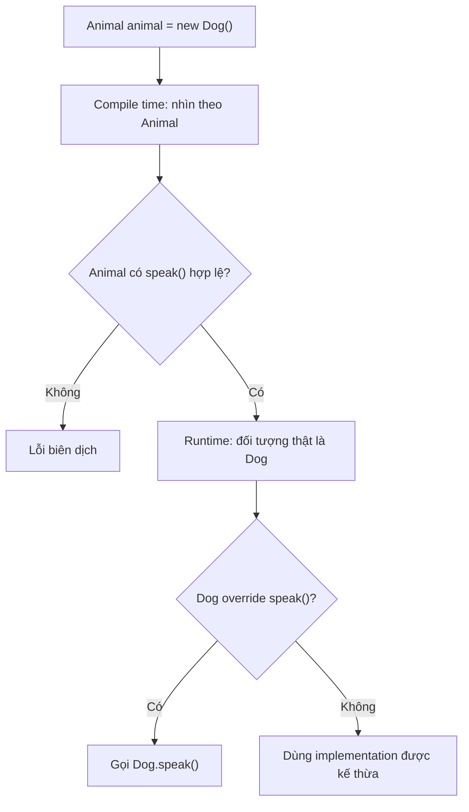

Sơ đồ áp dụng cho **phương thức instance có thể ghi đè**, không phải quy tắc chung cho mọi field hoặc static method.

## 2. Ví dụ Java hoàn chỉnh: cùng đối tượng, kết quả khác nhau

File `PolymorphismScopeDemo.java`:

```java
public class PolymorphismScopeDemo {

    static class Ticket {
        // Field: thuộc tính dữ liệu, không hỗ trợ override.
        public String label = "Ticket-field";

        // Instance method: có thể được subclass override.
        public String display() {
            return "Ticket-method";
        }

        // final instance method: subclass không thể override.
        public final String code() {
            return "T-001";
        }

        // Static method: có thể bị hiding, không dynamic dispatch.
        public static String category() {
            return "Ticket-static";
        }

        // Private method: không được override ở subclass.
        private String internalNote() {
            return "Ticket-private";
        }

        public String showInternalNote() {
            return internalNote();
        }

        // Đọc field thuộc lớp khai báo phương thức này.
        public String showField() {
            return "Ticket.showField: " + label;
        }
    }

    static final class VipTicket extends Ticket {
        // Field khác, che khuất Ticket.label.
        public String label = "VIP-field";

        @Override
        public String display() {
            return "VIP-method";
        }

        // Đây là static method hiding, không phải override.
        public static String category() {
            return "VIP-static";
        }

        // Cùng tên nhưng không override private method của cha.
        private String internalNote() {
            return "VIP-private";
        }

        public String vipOnly() {
            return "Chức năng riêng của VIP";
        }

        public String bothFields() {
            return super.label + " / " + this.label;
        }
    }

    public static void main(String[] args) {
        Ticket ticket = new VipTicket();

        System.out.println(ticket.display());
        System.out.println(ticket.label);
        System.out.println(((VipTicket) ticket).label);
        System.out.println(ticket.code());

        System.out.println(Ticket.category());
        System.out.println(VipTicket.category());

        // Tránh viết ticket.category() trong code thực tế:
        // Cú pháp được Java cho phép nhưng dễ gây hiểu nhầm.
        System.out.println(ticket.category());

        System.out.println(ticket.showInternalNote());
        System.out.println(ticket.showField());

        VipTicket vip = (VipTicket) ticket;
        System.out.println(vip.bothFields());
        System.out.println(vip.vipOnly());
    }
}
```

Chạy:

```bash
javac PolymorphismScopeDemo.java
java PolymorphismScopeDemo
```

Kết quả:

```text
VIP-method
Ticket-field
VIP-field
T-001
Ticket-static
VIP-static
Ticket-static
Ticket-private
Ticket.showField: Ticket-field
Ticket-field / VIP-field
Chức năng riêng của VIP
```

Cùng một đối tượng `VipTicket`, tại sao kết quả khác nhau?

| Biểu thức | Kết quả | Cơ chế |
|---|---|---|
| `ticket.display()` | `VIP-method` | **Override + dynamic dispatch** |
| `ticket.label` | `Ticket-field` | Field resolution theo kiểu tĩnh `Ticket` |
| `((VipTicket) ticket).label` | `VIP-field` | Kiểu tĩnh của biểu thức ép kiểu là `VipTicket` |
| `ticket.code()` | `T-001` | Phương thức instance `final`, không được override |
| `Ticket.category()` | `Ticket-static` | Gọi static method của lớp được chỉ rõ |
| `VipTicket.category()` | `VIP-static` | Gọi static method khác, che khuất phương thức cha |
| `ticket.category()` | `Ticket-static` | Static method được chọn theo kiểu tĩnh của biểu thức `ticket` |
| `ticket.showInternalNote()` | `Ticket-private` | Phương thức của `Ticket` gọi private method của chính `Ticket` |
| `ticket.showField()` | `Ticket.showField: Ticket-field` | Implementation `Ticket` truy cập `Ticket.label` |
| `vip.bothFields()` | `Ticket-field / VIP-field` | `super.label` và `this.label` chỉ hai field riêng |
| `vip.vipOnly()` | Chức năng riêng | Biểu thức kiểu `VipTicket` gọi được phương thức chỉ có ở lớp con |

**Quan sát quan trọng:** `Ticket.label` và `VipTicket.label` là **hai field riêng biệt cùng tồn tại trên một đối tượng lớp con**. Việc lớp con đặt field trùng tên không thay đổi cách truy cập field trong mã của lớp cha và không tạo đa hình cho field.

Trong thiết kế thực tế, tránh khai báo các field công khai hoặc field trùng tên như ví dụ. Chúng được cố tình dùng ở đây để phơi bày quy tắc ngôn ngữ.

## 3. Field không override: thay kiểu tham chiếu có thể thay kết quả đọc

~~~java
class Base {
    String value = "base";
}
class Derived extends Base {
    String value = "derived";
}
Base ref = new Derived();
System.out.println(ref.value);             // base
System.out.println(((Derived) ref).value); // derived
~~~

Một instance `Derived` có **hai field khác nhau**, một thuộc phần `Base`, một thuộc phần `Derived`. Cast hợp lệ chỉ đổi kiểu tĩnh của biểu thức; nó không đổi đối tượng hoặc sao chép giá trị. Vì field không có runtime dispatch, thay `Base` bằng `Derived` ở kiểu biến có thể làm đổi member được chọn dù instance thật vẫn như cũ.

Đây là lý do quan trọng để hạn chế public/protected field trùng tên và ưu tiên đóng gói trạng thái. Bài *Phân biệt che khuất thành viên với ghi đè* đi sâu vào field hiding, `super.field`, static hiding và quy tắc truy cập; bài này sẽ tập trung tiếp vào **getter như API đa hình**.

## 4. Getter là phương thức: có thể đa hình dù dữ liệu không đa hình

Trong Java, “thuộc tính” đôi khi được gọi theo nghĩa dữ liệu (field), nhưng nhiều framework hoặc thư viện dùng **JavaBean property** thông qua các phương thức `getXxx()`/`setXxx()`. Cần phân biệt:

- `obj.value`: truy cập **field** — không có dynamic dispatch.
- `obj.getValue()`: gọi **phương thức** — có thể được override và dispatch động.

Ví dụ:

```java
class Person {
    private final String name;

    Person(String name) {
        this.name = name;
    }

    public String getDisplayName() {
        return name;
    }
}

class Employee extends Person {
    private final String department;

    Employee(String name, String department) {
        super(name);
        this.department = department;
    }

    @Override
    public String getDisplayName() {
        return super.getDisplayName() + " (" + department + ")";
    }
}

Person person = new Employee("An", "Backend");

System.out.println(person.getDisplayName()); // An (Backend)
```

Biến `person` chỉ biết hợp đồng `Person`, nhưng `getDisplayName()` trả kết quả theo implementation của `Employee`.

Điều này **không có nghĩa field `name` bị override**: `name` vẫn là dữ liệu private do `Person` quản lý. Hành vi getter được ghi đè, không phải field.

### Nên chọn thiết kế nào?

Nếu trạng thái phải tuân thủ invariant, ưu tiên field `private` và expose **hành vi có ý nghĩa** hoặc phương thức truy cập được kiểm soát. Nếu subclass cần thay đổi cách trình bày, override một phương thức như `getDisplayName()` thường rõ ràng hơn việc khai báo thêm field `name` cùng tên ở subclass.

Tuy vậy, nếu một phương thức getter được đánh dấu `final`, subclass không thể override nó. Đa hình không yêu cầu mọi getter đều phải cho phép override.

## 5. Phạm vi đa hình của các loại phương thức

| Loại thành viên | Có dispatch động theo runtime object không? | Diễn giải |
|---|---|---|
| Phương thức instance có thể override | **Có** | Implementation subclass được chọn khi override đúng hợp đồng |
| Phương thức `abstract` được implement trong subclass | **Có** | Lời gọi qua kiểu trừu tượng thực thi implementation cụ thể |
| Phương thức interface được lớp implement | **Có** | Lời gọi qua biến interface chọn implementation phù hợp |
| Interface `default method` | **Có thể** | Có thể kế thừa, override; phải xử lý xung đột đúng quy tắc |
| Phương thức instance `final` | Không thể bị subclass override | Không có biến thể implementation do override ở subclass |
| Phương thức `private` | Không override | Cùng tên ở subclass là phương thức khác |
| Phương thức `static` | **Không** | Có thể bị hiding; lời gọi được phân giải theo kiểu tĩnh/tên lớp |
| Constructor | **Không** | Không được kế thừa hay override |
| Phương thức overload | Chọn overload tại compile time | Sau khi chọn chữ ký, nếu đó là instance method thì implementation vẫn có thể dispatch động |
| Field instance | **Không** | Field hiding/phân giải theo kiểu tĩnh |
| Field `static` | **Không** | Là trạng thái của lớp; không có field polymorphism |

Lưu ý: `final`, `private` và `static` không phải là “không có hành vi”. Chúng vẫn có thể thực thi mã bình thường. Điểm khác biệt là **chúng không tạo ra lựa chọn runtime giữa nhiều implementation do instance overriding**.

## 6. Đa hình có phạm vi theo **chữ ký phương thức đã chọn**

~~~java
class Speaker {
    String speak(Object value) { return "Speaker/Object"; }
}
class DogSpeaker extends Speaker {
    @Override String speak(Object value) { return "DogSpeaker/Object"; }
    String speak(String value) { return "DogSpeaker/String"; }
}
Speaker caller = new DogSpeaker();
System.out.println(caller.speak("Gâu")); // DogSpeaker/Object
~~~

Compiler chỉ nhìn thấy overload `speak(Object)` từ kiểu `Speaker`; sau khi chữ ký được chọn, JVM dispatch đến override `DogSpeaker.speak(Object)`. Overload `speak(String)` chỉ xuất hiện ở class con và không trở thành một phương thức mới trong API tĩnh của biến `caller`.

Bài này cần ghi nhớ phạm vi: **kiểu của receiver xác định những lời gọi hợp lệ; object thực tế chỉ chọn phần triển khai cho lời gọi instance thích hợp**. Phân tích chi tiết overload/override, `null`, boxing và varargs đã có ở hai bài chuyên biệt trước.

## 7. Static và private không cho một điểm mở rộng runtime tương tự

`Base ref = new Derived()` không khiến `ref.staticMethod()` chọn một phương thức static của `Derived`: static method thuộc **class**, nên gọi bằng `Base.staticMethod()` hoặc `Derived.staticMethod()` sẽ rõ nghĩa hơn. Một static method cùng chữ ký ở subclass là **method hiding**.

Tương tự, private method của superclass không được kế thừa để override; phương thức trùng tên của subclass không thay implementation mà mã của superclass đang gọi riêng. Hai quy tắc này đã được minh họa bằng chương trình chạy được trong bài về *Che khuất thành viên với ghi đè*. Chúng giới hạn phạm vi đa hình ở **những instance method thực sự có khả năng override**.

## 8. final method, abstract method và interface

### 8.1. final instance method

```java
class BasePolicy {
    public final boolean isEnabled() {
        return true;
    }
}

class SpecialPolicy extends BasePolicy {
    // public boolean isEnabled() { return false; }
    // Lỗi biên dịch vì isEnabled() là final.
}
```

Một biến `BasePolicy p = new SpecialPolicy();` vẫn gọi được `p.isEnabled()`. Nhưng vì lớp con không thể override, không có implementation chuyên biệt được chọn theo lớp con cho phương thức này. `final` hữu ích khi muốn bảo vệ một quy tắc hoặc bước thuật toán không được thay đổi.

### 8.2. abstract method và interface đều hỗ trợ dispatch động

```java
abstract class Shape {
    abstract double area();
}

final class Circle extends Shape {
    private final double radius;

    Circle(double radius) {
        if (radius <= 0) {
            throw new IllegalArgumentException("Bán kính phải dương");
        }
        this.radius = radius;
    }

    @Override
    double area() {
        return Math.PI * radius * radius;
    }
}

Shape shape = new Circle(2);
System.out.println(shape.area()); // Khoảng 12.56637
```

`Shape.area()` không có implementation ở lớp trừu tượng, nhưng biến kiểu `Shape` vẫn gọi được phương thức đó. Runtime sẽ dùng `Circle.area()`.

Tương tự, khi một class implement phương thức của interface, lời gọi qua biến interface dùng implementation phù hợp:

```java
interface Formatter {
    String format(String text);
}

final class UpperFormatter implements Formatter {
    @Override
    public String format(String text) {
        return text.toUpperCase(java.util.Locale.ROOT);
    }
}

Formatter formatter = new UpperFormatter();
System.out.println(formatter.format("java")); // JAVA
```

### 8.3. Interface default method có thể tham gia đa hình

```java
interface Greeter {
    default String hello() {
        return "Hello";
    }
}

class FriendlyGreeter implements Greeter {
    @Override
    public String hello() {
        return "Xin chào";
    }
}

Greeter greeter = new FriendlyGreeter();
System.out.println(greeter.hello()); // Xin chào
```

`default` cung cấp implementation dùng được nếu lớp không cung cấp phiên bản phù hợp. Khi class override, lời gọi qua kiểu interface vẫn chạy implementation class. Với nhiều default method xung đột, Java có quy tắc ưu tiên phương thức từ class, interface cụ thể hơn, và một số trường hợp yêu cầu override để giải quyết mơ hồ.

Ngược lại, **static method của interface không được kế thừa thành phương thức instance** và được gọi bằng tên interface:

```java
interface Normalizer {
    static String normalize(String value) {
        return value.strip();
    }
}

System.out.println(Normalizer.normalize(" A ")); // A
```

## 9. `super` không làm xuất hiện một object khác

Nếu `MonthlyReport extends Report`, lời gọi `super.header()` trong subclass yêu cầu implementation của superclass phù hợp, còn `this.header()` là một lời gọi instance thông thường có thể dispatch tới override.

~~~java
class Report {
    String header() { return "Báo cáo"; }
    String render() { return "[" + header() + "]"; }
}
class MonthlyReport extends Report {
    @Override String header() { return "Báo cáo tháng"; }
    String parentHeader() { return super.header(); }
}
Report report = new MonthlyReport();
System.out.println(report.render()); // [Báo cáo tháng]
~~~

Ngay cả khi `render()` chạy trong mã lớp cha, nó đang làm việc trên một instance `MonthlyReport`, nên lời gọi `header()` có thể dispatch động. `super` chỉ thay cách chọn implementation ở lời gọi cụ thể, không tạo `Report` riêng. Trong constructor cha, một lời gọi tới method overridable có thể chạm trạng thái subclass chưa khởi tạo xong, nên tránh thiết kế như vậy.

## 10. Ép kiểu và instanceof có biến field thành đa hình không?

Không. Ép kiểu ảnh hưởng **kiểu tĩnh của biểu thức** và khả năng compiler cho phép truy cập thành viên, chứ không sửa lớp runtime của đối tượng.

```java
class Base {
    public String code = "BASE";
    public String code() {
        return "Base-method";
    }
}

class Child extends Base {
    public String code = "CHILD";

    @Override
    public String code() {
        return "Child-method";
    }

    public String childOnly() {
        return "extra";
    }
}

Base ref = new Child();

System.out.println(ref.code);          // BASE
System.out.println(ref.code());        // Child-method
System.out.println(((Child) ref).code); // CHILD
```

Bản thân đối tượng không thay đổi; chỉ cách **truy cập field** thay đổi do kiểu tĩnh của biểu thức ép kiểu.

Với một biến có thể tham chiếu nhiều subclass, có thể kiểm tra trước:

```java
if (ref instanceof Child child) {
    System.out.println(child.childOnly()); // extra
}
```

Đây là pattern matching for `instanceof` (Java 16+, chạy ở Java 17). Nếu cast không hợp lệ, ép kiểu xuống thông thường có thể ném `ClassCastException`. Đặc biệt, biến `Parent` trỏ vào `Child` **không khiến mọi phương thức riêng của `Child` xuất hiện trong API của kiểu `Parent`**.

## 11. Đa hình trong code thực tế: ưu tiên hành vi hơn field

Một ví dụ thiết kế chưa tốt:

```java
class Discount {
    public double percent;
}

class VipDiscount extends Discount {
    public double percent; // Field hiding gây nhầm lẫn
}
```

Nếu nơi gọi viết `Discount d = new VipDiscount();` rồi đọc `d.percent`, nó nhận field của `Discount` — không phải “tỷ lệ VIP” một cách tự động.

Cách thiết kế rõ hơn là mô tả khả năng tính giá bằng hành vi:

```java
interface DiscountPolicy {
    long apply(long originalPriceVnd);
}

final class NoDiscount implements DiscountPolicy {
    @Override
    public long apply(long originalPriceVnd) {
        if (originalPriceVnd < 0) {
            throw new IllegalArgumentException("Giá không được âm");
        }
        return originalPriceVnd;
    }
}

final class TenPercentDiscount implements DiscountPolicy {
    @Override
    public long apply(long originalPriceVnd) {
        if (originalPriceVnd < 0) {
            throw new IllegalArgumentException("Giá không được âm");
        }
        // Quy tắc ví dụ: giảm 10%, làm tròn xuống VND nguyên.
        return originalPriceVnd - originalPriceVnd / 10;
    }
}
```

Nơi gọi không cần đọc một field `percent` có thể bị hiding:

```java
DiscountPolicy policy = new TenPercentDiscount();
System.out.println(policy.apply(100_000)); // 90000

policy = new NoDiscount();
System.out.println(policy.apply(100_000)); // 100000
```

Mỗi implementation kiểm soát quy tắc áp dụng của mình, trong khi caller phụ thuộc vào hợp đồng chung `DiscountPolicy.apply(...)`. Đây là cách sử dụng đa hình thường dễ mở rộng và an toàn hơn việc phụ thuộc vào public field.

## 12. Những hiểu lầm thường gặp

| Nhận định | Đánh giá | Giải thích |
|---|---|---|
| `Parent p = new Child()` rồi `p.method()` luôn chạy phương thức cha | Sai | Với instance method được override, có thể chạy implementation của `Child` |
| `Parent p = new Child()` rồi `p.field` tự đọc field ở `Child` | Sai | Field được phân giải theo kiểu tĩnh |
| Khai báo field cùng tên trong subclass là override | Sai | Đó là **field hiding** |
| Getter có thể override nên nội dung trả về đa hình | Đúng, nếu getter là overridable instance method | Field bên trong vẫn không tự đa hình |
| Static method được chọn theo kiểu runtime | Sai | Static method hiding, phân giải tĩnh |
| Private method có thể override | Sai | Phương thức cùng tên ở subclass là thành viên riêng |
| Final method bị override nếu ép biến sang subclass | Sai | `final` ngăn override |
| Chọn overload dựa vào runtime class của đối số | Sai | Overload resolution xét kiểu compile-time và quy tắc chuyển đổi |
| Interface method có thể dispatch tới implementation của class | Đúng | Đây là đa hình qua interface |
| `super.method()` là gọi trên một đối tượng cha tách biệt | Sai | Vẫn là cùng đối tượng, nhưng chọn implementation của superclass phù hợp |
| Cast biến khiến kiểu runtime của object thay đổi | Sai | Chỉ thay kiểu tĩnh của biểu thức và có thể kiểm tra runtime type |

## 13. Bài tập tự kiểm tra

### Bài 1 — Dự đoán ba kết quả

```java
class A {
    int number = 1;
    String name() {
        return "A";
    }
    static String type() {
        return "A-static";
    }
}

class B extends A {
    int number = 2;
    @Override
    String name() {
        return "B";
    }
    static String type() {
        return "B-static";
    }
}

A value = new B();

System.out.println(value.number);
System.out.println(value.name());
System.out.println(value.type());
```

**Đáp án:** `1`, `B`, `A-static`. Field và static method theo kiểu tĩnh `A`; phương thức instance `name()` dispatch tới override của `B`. Trong code thực tế, nên dùng `A.type()` thay vì gọi static method qua biến.

### Bài 2 — Overload có đi theo runtime object không?

```java
class Animal {}
class Dog extends Animal {}

void examine(Animal a) {
    System.out.println("Animal");
}
void examine(Dog d) {
    System.out.println("Dog");
}

Animal argument = new Dog();
examine(argument);
```

**Đáp án:** `Animal`. Lựa chọn overload dựa trên kiểu tĩnh của biến `argument`. Nếu ép kiểu `examine((Dog) argument)`, compiler sẽ chọn overload `Dog` (giả sử cast tương thích tại runtime).

### Bài 3 — Getter hay field?

```java
class Parent {
    String title = "Parent-field";
    String getTitle() {
        return "Parent-method";
    }
}

class Child extends Parent {
    String title = "Child-field";
    @Override
    String getTitle() {
        return "Child-method";
    }
}

Parent obj = new Child();
```

**Câu hỏi:** `obj.title` và `obj.getTitle()` có kết quả gì?

**Đáp án:** `Parent-field` và `Child-method`. Field không override; getter được override.

### Bài 4 — Thiết kế lại API

Một thư viện dùng `class Notification` có field `public String messageType`. Các subclass `EmailNotification` và `SmsNotification` cùng khai báo lại `messageType`, khiến code dùng kiểu `Notification` đọc sai loại thông báo.

Hãy thử refactor:

1. Giữ trạng thái cần thiết ở field `private`.
2. Khai báo `String channel()` trên lớp cha hoặc một interface `Notification`.
3. Mỗi implementation cung cấp hành vi `channel()` phù hợp.
4. Viết `List<Notification>` chứa nhiều subtype và gọi `channel()` mà không truy cập field trực tiếp.
5. Giải thích vì sao phép gọi phương thức giữ được đa hình, còn field cùng tên không làm được.

---

**Ghi nhớ:** **Đa hình động của Java chủ yếu áp dụng cho phương thức instance có thể override** — kể cả method từ abstract class và interface. **Field, static method và lựa chọn overload không được phân giải theo runtime object theo cách đó**. Phân biệt **field hiding**, **static method hiding**, **overriding** và **overloading** giúp dự đoán chính xác kết quả và thiết kế API dùng hành vi thay vì truy cập trực tiếp trạng thái.


</details>

- [Quay lại đầu trang](#back-to-top)

---

## <a id="polymorphism-008">Duck typing và đa hình theo khả năng</a>

<details>
<summary>Xem chi tiết</summary>

# Duck typing và đa hình theo khả năng trong Java OOP

> **Ý tưởng cốt lõi:** Thay vì hỏi “đối tượng này thuộc họ lớp nào?”, nhiều bài toán thực tế chỉ cần hỏi “đối tượng này **làm được việc gì**?”. Một con vịt thật, một con vịt robot hay món đồ chơi phát tiếng vịt có thể khác nhau hoàn toàn về cấu tạo, nhưng đều có khả năng **phát tiếng kêu**. Ta muốn viết một thao tác dùng chung để yêu cầu chúng phát tiếng mà không phải kiểm tra từng loại cụ thể.

Tư duy này liên quan đến **duck typing** và **đa hình theo khả năng** (*capability-based polymorphism*). Hai khái niệm gần nhau về cách nhìn hành vi, nhưng cơ chế kiểu của ngôn ngữ **không giống nhau**: Python có thể gọi phương thức phù hợp ngay trên object tại runtime; Java thường cần một **interface hoặc kiểu cha được khai báo rõ**, hay một adapter chuyển đổi đối tượng sang hợp đồng cần dùng.

Bài này giải thích ranh giới đó, dùng mã Java chạy được để thực hành và chỉ ra khi nào nên lựa chọn interface, kiểm tra khả năng, hoặc adapter.

## 1. Duck typing là gì?

Cụm từ phổ biến để gợi nhớ duck typing là: *“Nếu một thứ đi như vịt và kêu như vịt, hãy đối xử với nó như một con vịt.”*

Trong lập trình, ý nghĩa không nằm ở việc một đối tượng **có tên lớp `Duck`**, mà nằm ở việc nó **cung cấp hành vi được yêu cầu**.

Ví dụ ý tưởng bằng Python:

~~~python
class RealDuck:
    def quack(self):
        print("Cạp cạp")

class ToyDuck:
    def quack(self):
        print("Chíp chíp")

def make_sound(thing):
    thing.quack()

make_sound(RealDuck())
make_sound(ToyDuck())
~~~

`make_sound` không cần biết lớp của `thing` có kế thừa một lớp `Duck` hay không. Khi chạy, Python tìm phương thức `quack` trên đối tượng. Nếu phương thức không tồn tại, hoặc lời gọi không phù hợp, lỗi có thể xuất hiện **tại runtime** (chẳng hạn `AttributeError`).

Đây là dạng thường gặp của **duck typing động**: sử dụng đối tượng dựa trên khả năng nó cung cấp trong ngữ cảnh hiện tại, không bắt buộc khai báo quan hệ kế thừa trước.

**Không nên đồng nhất duck typing với structural typing:** hệ thống kiểu **theo cấu trúc** có thể kiểm tra hình dạng thành viên ngay ở thời điểm biên dịch, còn duck typing động thường để hành vi được thử khi chạy. Cả hai có thể quan tâm đến “đối tượng cung cấp những gì”, nhưng khác nhau ở thời điểm và cách kiểm tra.

## 2. Java không tự coi hai lớp cùng có `quack()` là tương thích

Trong Java, quan hệ kiểu con thông thường giữa các lớp/interface là **nominal**: phải được thiết lập qua `extends`, `implements`, hoặc quan hệ subtype hợp lệ đã có trong hệ phân cấp.

Xét hai lớp:

~~~java
class RealDuck {
    public void quack() {
        System.out.println("Cạp cạp");
    }
}

class ToyDuck {
    public void quack() {
        System.out.println("Chíp chíp");
    }
}
~~~

Dù hai class đều có `public void quack()`, ta **không thể** viết một hàm Java nhận kiểu `RealDuck` rồi truyền `ToyDuck` vào chỉ vì chúng có cùng phương thức:

~~~java
static void makeSound(RealDuck duck) {
    duck.quack();
}

// makeSound(new ToyDuck()); // LỖI BIÊN DỊCH
~~~

Và chỉ khai báo một interface giống chữ ký vẫn chưa đủ:

~~~java
interface Quackable {
    void quack();
}

// Quackable q = new ToyDuck(); // Vẫn lỗi nếu ToyDuck không implements.
~~~

Vì vậy, nói “Java có duck typing giống Python” là **không chính xác**. Java hỗ trợ thiết kế dựa trên **khả năng** rất tốt, nhưng cách thông thường là **biểu đạt khả năng thành interface** và để các lớp chủ động hiện thực hợp đồng đó.

| Câu hỏi | Duck typing động, như ví dụ Python | Java qua interface |
| --- | --- | --- |
| Đối tượng phải có tên lớp cụ thể? | Không | Không |
| Cần khai báo `implements` một hợp đồng? | Không trong ví dụ | Có, trực tiếp hoặc qua quan hệ subtype hợp lệ |
| Chỉ cần cùng tên/chữ ký phương thức? | Có thể dùng khi runtime cung cấp hành vi phù hợp | **Chưa đủ** để thành subtype của interface |
| Phát hiện thiếu phương thức | Thường khi thực thi lời gọi | Thường khi biên dịch mã dùng kiểu interface |
| Tách được mã sử dụng khỏi class cụ thể? | Có | Có |
| Ai chịu trách nhiệm tuân thủ ý nghĩa hành vi? | Người viết/lựa chọn object | Người viết implementation và kiểm thử hợp đồng |

**Ghi nhớ:** *Java có thể đạt cùng mục đích thiết kế “hãy yêu cầu một khả năng” mà không vận hành theo cùng cơ chế duck typing động.*

## 3. Đa hình theo khả năng: mỗi interface là một vai trò

Ta không cần ép mọi đối tượng vào một cây kế thừa kiểu `Duck`. Thay vào đó, mô hình hóa những khả năng độc lập:

~~~java
interface Quackable {
    void quack();
}

interface Swimmable {
    void swim(int meters);
}

interface Rechargeable {
    void recharge(int units);
}
~~~

Một **vịt thật** có thể vừa kêu vừa bơi; một **vịt robot** có thể kêu và sạc pin; một **đồ chơi bóp tay** có thể kêu nhưng không bơi hay sạc.

Tương ứng:

- `WildDuck implements Quackable, Swimmable`
- `RobotDuck implements Quackable, Rechargeable`
- Một `SqueakyToy` độc lập có phương thức `quack()`; nếu không implements `Quackable`, cần thích nghi nó với hợp đồng Java.

Chương trình ghi tiếng kêu chỉ cần `Quackable`. Bể bơi chỉ cần `Swimmable`. Trạm sạc chỉ cần `Rechargeable`. Không thành phần nào buộc phải biết “loại vịt” đầy đủ của đối tượng.

~~~mermaid
classDiagram
    class Quackable {
        <<interface>>
        +quack() void
    }
    class Swimmable {
        <<interface>>
        +swim(int) void
    }
    class Rechargeable {
        <<interface>>
        +recharge(int) void
    }
    class WildDuck {
        -distanceMeters int
        +quack() void
        +swim(int) void
    }
    class RobotDuck {
        -battery int
        +quack() void
        +recharge(int) void
    }
    Quackable <|.. WildDuck
    Swimmable <|.. WildDuck
    Quackable <|.. RobotDuck
    Rechargeable <|.. RobotDuck
~~~

Sơ đồ là **quan hệ kiểu**, không phải sơ đồ hai “nửa đối tượng”. Một instance `WildDuck` có thể được xem qua cả hai interface mà vẫn là **một đối tượng duy nhất**, chia sẻ cùng trạng thái nội bộ.

## 4. Ví dụ Java hoàn chỉnh: yêu cầu đúng năng lực

Lưu vào file **`DuckTypingCapabilitiesDemo.java`**. Chạy với Java 11 trở lên, không cần thư viện ngoài.

~~~java
import java.util.List;

public class DuckTypingCapabilitiesDemo {

    interface Quackable {
        void quack();
    }

    interface Swimmable {
        void swim(int meters);
    }

    interface Rechargeable {
        void recharge(int units);
    }

    static final class WildDuck implements Quackable, Swimmable {
        private int totalDistanceMeters;

        @Override
        public void quack() {
            System.out.println("Vịt thật: cạp cạp");
        }

        @Override
        public void swim(int meters) {
            if (meters <= 0) {
                throw new IllegalArgumentException(
                        "Quãng đường phải dương");
            }
            totalDistanceMeters = Math.addExact(
                    totalDistanceMeters, meters);
            System.out.println(
                    "Vịt thật bơi thêm " + meters
                    + " m (tổng " + totalDistanceMeters + " m)");
        }
    }

    static final class RobotDuck implements Quackable, Rechargeable {
        private int battery = 1;

        @Override
        public void quack() {
            if (battery == 0) {
                throw new IllegalStateException("Robot hết pin");
            }
            battery--;
            System.out.println(
                    "Vịt robot: quack điện tử (pin " + battery + ")");
        }

        @Override
        public void recharge(int units) {
            if (units <= 0) {
                throw new IllegalArgumentException(
                        "Năng lượng sạc phải dương");
            }
            battery = Math.addExact(battery, units);
            System.out.println(
                    "Vịt robot sạc thêm " + units
                    + " (pin " + battery + ")");
        }
    }

    // Một lớp có phương thức quack nhưng KHÔNG implements Quackable.
    static final class SqueakyToy {
        public void quack() {
            System.out.println("Đồ chơi: chíp chíp");
        }
    }

    // Chỉ yêu cầu khả năng phát tiếng.
    static void askToQuack(Quackable participant) {
        participant.quack();
    }

    // Tình huống này chọn sử dụng các khả năng tùy chọn.
    static void runActivity(Quackable participant) {
        askToQuack(participant);

        if (participant instanceof Swimmable) {
            Swimmable swimmer = (Swimmable) participant;
            swimmer.swim(10);
        }

        if (participant instanceof Rechargeable) {
            Rechargeable robot = (Rechargeable) participant;
            robot.recharge(2);
        }
    }

    public static void main(String[] args) {
        WildDuck wildDuck = new WildDuck();
        RobotDuck robotDuck = new RobotDuck();
        SqueakyToy toy = new SqueakyToy();

        // Method reference cung cấp một Quackable adapter.
        Quackable toyAsQuackable = toy::quack;

        List<Quackable> participants = List.of(
                wildDuck, robotDuck, toyAsQuackable);

        for (Quackable participant : participants) {
            runActivity(participant);
        }

        // Không hợp lệ:
        // Quackable directToy = toy;
    }
}
~~~

Biên dịch và chạy:

~~~bash
javac DuckTypingCapabilitiesDemo.java
java DuckTypingCapabilitiesDemo
~~~

Kết quả:

~~~text
Vịt thật: cạp cạp
Vịt thật bơi thêm 10 m (tổng 10 m)
Vịt robot: quack điện tử (pin 0)
Vịt robot sạc thêm 2 (pin 2)
Đồ chơi: chíp chíp
~~~

### Vì sao kết quả như vậy?

| Phần tử trong `participants` | Đối tượng hoặc adapter thực tế | `quack()` | Khả năng bổ sung được nhận diện |
| --- | --- | --- | --- |
| Phần tử 1 | `WildDuck` | “Cạp cạp” | `Swimmable` → bơi 10 m |
| Phần tử 2 | `RobotDuck` | “Quack điện tử” | `Rechargeable` → sạc 2 đơn vị |
| Phần tử 3 | Adapter từ `toy::quack` | “Chíp chíp” | Không yêu cầu có `Swimmable`/`Rechargeable` |

Khi gọi `runActivity(participant)`, biến `participant` có **kiểu tĩnh** là `Quackable`. Nó luôn gọi được `quack()`. Với `WildDuck` và `RobotDuck`, lời gọi đa hình chọn implementation riêng. Ở phần tử thứ ba, implementation của `Quackable` là một **đối tượng chức năng được tạo/biểu diễn từ method reference**, chuyển lời gọi tới `SqueakyToy.quack()`.

Do đó **không phải** `SqueakyToy` bỗng trở thành subtype của `Quackable`. Ta đã tạo một **giá trị khác** phù hợp với interface để gọi hành vi mà đồ chơi vốn có.

Các bộ đếm `totalDistanceMeters` và `battery` cho thấy mỗi implementation được tự quản lý trạng thái của mình. Chia sẻ interface **không có nghĩa** chúng cùng cấu trúc field hoặc cùng thuật toán.

## 5. Phân biệt “hỏi loại” với “yêu cầu khả năng”

Hai cách tổ chức code dẫn tới khả năng mở rộng khác nhau.

### Cách dễ phụ thuộc lớp cụ thể

~~~java
// Ví dụ minh họa, KHÔNG phải API khuyến nghị:
void makeNoise(Object value) {
    if (value instanceof WildDuck) {
        ((WildDuck) value).quack();
    } else if (value instanceof RobotDuck) {
        ((RobotDuck) value).quack();
    }
}
~~~

Mỗi khi có một lớp mới biết phát tiếng, hàm trên lại phải thêm nhánh, và còn bỏ sót đồ chơi.

### Cách theo hợp đồng khả năng

~~~java
void makeNoise(Quackable value) {
    value.quack();
}
~~~

Hàm này không phải chỉnh sửa khi có implementation mới, miễn đối tượng được truyền vào có một giá trị tham chiếu hợp lệ của `Quackable`.

Đây là lợi ích của đa hình: **bên gọi yêu cầu hành vi thông qua hợp đồng; bên nhận chọn cách thực hiện**.

Không cần dùng `instanceof` ở mọi chỗ chỉ để thay thế các phương thức đa hình đã có. Khi hành vi chính là `quack()`, **gọi thẳng `participant.quack()`** thay vì hỏi nó có phải `WildDuck` hay `RobotDuck`.

Nhưng `instanceof` ở ví dụ `runActivity` có lý do riêng: chương trình đang khám phá **những vai trò tùy chọn** (`Swimmable` hoặc `Rechargeable`) ngoài hợp đồng tối thiểu `Quackable`. Đây là một cách sử dụng hợp lý khi tình huống thực sự tùy chọn, nhưng không nhất thiết là cách tốt nhất cho mọi API.

## 6. Khi nào nên dùng tham số từng interface thay vì kiểm tra `instanceof`?

Nếu một hành động **bắt buộc** đối tượng có khả năng bơi, khai báo ngay kiểu tham số:

~~~java
static void swimmingLesson(Swimmable swimmer) {
    swimmer.swim(100);
}
~~~

Lúc này compiler hỗ trợ phát hiện nơi gọi sai:

~~~java
WildDuck wild = new WildDuck();
swimmingLesson(wild); // Hợp lệ.

// swimmingLesson(new RobotDuck()); // Lỗi: không có Swimmable.
~~~

Tương tự:

~~~java
static void chargingStation(Rechargeable device) {
    device.recharge(5);
}
~~~

Cách này thường tốt hơn API nhận `Object`, rồi tìm hiểu bằng một chuỗi `instanceof` kéo dài.

Nếu một thao tác **bắt buộc đồng thời** phải có hai năng lực, có thể định nghĩa một interface tổ hợp:

~~~java
interface AmphibiousVoice extends Quackable, Swimmable {
}
~~~

Một class khai báo `implements AmphibiousVoice` sẽ cam kết cả hai khả năng. **Chú ý:** Java nominal typing không tự coi `WildDuck implements Quackable, Swimmable` là subtype của `AmphibiousVoice` chỉ vì nó đã có đủ phương thức. Nếu thực sự cần một kiểu hợp đồng gộp, lớp phải triển khai kiểu gộp (trực tiếp/gián tiếp), hoặc dùng adapter.

So sánh lựa chọn:

| Nhu cầu | Thiết kế thường phù hợp |
| --- | --- |
| Mọi đối tượng được truyền đều phải kêu | Tham số `Quackable` |
| Mọi đối tượng được truyền đều phải bơi | Tham số `Swimmable` |
| Chức năng bơi chỉ là một bổ sung tùy chọn | Kiểm tra `instanceof Swimmable` ở ranh giới thích hợp |
| Một đối tượng phải cam kết nhiều năng lực cùng lúc | Interface tổ hợp hoặc abstraction có hợp đồng rõ |
| Thư viện cũ có phương thức giống hợp đồng nhưng không implements | Adapter hoặc method reference/lambda nếu phù hợp |
| Chỉ có dữ liệu/chức năng liên quan trong cùng use case | Có thể dùng composition thay vì ép thành cây kế thừa |

**Tư duy thiết kế:** hãy để kiểu tham số biểu đạt **khả năng thật sự cần thiết**, không nhất thiết biểu đạt tất cả chi tiết của đối tượng.

## 7. Method reference: một cây cầu nhỏ, không phải duck typing tự động

Điểm thú vị ở Java là có thể thích nghi một phương thức tương thích với **functional interface**.

~~~java
@FunctionalInterface
interface Quackable {
    void quack();
}

class SqueakyToy {
    public void quack() {
        System.out.println("Chíp chíp");
    }
}
~~~

~~~java
SqueakyToy toy = new SqueakyToy();

// Sai: SqueakyToy không khai báo implements Quackable.
// Quackable a = toy;

// Đúng: biểu thức method reference có target type Quackable.
Quackable b = toy::quack;
b.quack();
~~~

`Quackable` là **functional interface** vì có một phương thức trừu tượng chức năng duy nhất. Compiler kiểm tra `toy::quack` có thể dùng làm implementation cho phương thức chức năng `void quack()` hay không.

Một lambda tương đương về hành vi:

~~~java
Quackable c = () -> toy.quack();
~~~

Với yêu cầu nhiều phương thức, method reference đơn lẻ không đủ để “tự implements cả interface”. Khi đó có thể viết **adapter class**:

~~~java
interface SoundEmitter {
    void emit();
    String category();
}

final class ToySoundAdapter implements SoundEmitter {
    private final SqueakyToy toy;

    ToySoundAdapter(SqueakyToy toy) {
        this.toy = java.util.Objects.requireNonNull(toy);
    }

    @Override
    public void emit() {
        toy.quack();
    }

    @Override
    public String category() {
        return "TOY";
    }
}
~~~

Ưu điểm của adapter: có thể kết nối API khác tên phương thức, biến đổi dữ liệu, xác thực đầu vào và diễn giải lại lỗi. Nhược điểm là cần thêm một đối tượng/lớp liên kết. Hãy chọn cách đơn giản nhất đáp ứng đúng hợp đồng.

**Không nhầm:** Method reference không biến **class của đối tượng nguồn** thành subtype của interface. Nó tạo ra **một đối tượng chức năng mới** được định kiểu theo interface đích.

## 8. Có thể “duck type” bằng reflection trong Java không?

Có thể dùng reflection để **tìm và gọi phương thức khi chạy**, kể cả khi đối tượng không thực hiện một interface chung:

~~~java
import java.lang.reflect.Method;

static void invokeQuackDynamically(Object target)
        throws ReflectiveOperationException {
    Method method = target.getClass().getMethod("quack");
    method.invoke(target);
}
~~~

Ví dụ:

~~~java
invokeQuackDynamically(new SqueakyToy());
~~~

Điều này mô phỏng phần nào ý tưởng “hãy thử gọi phương thức có tên phù hợp”, nhưng cần nhận thức các giới hạn:

- `getMethod("quack")` tìm phương thức **public** tương ứng (ở đây không có đối số); quy tắc truy cập còn phụ thuộc vào kiểu khai báo và module của Java.
- Nếu không có phương thức, có thể xảy ra `NoSuchMethodException` tại runtime.
- Nếu phương thức bên trong ném ngoại lệ, reflection thường bọc ngoại lệ vào `InvocationTargetException`.
- Sai kiểu tham số, quyền truy cập, hiệu năng và khả năng bảo trì phức tạp hơn lời gọi trực tiếp.
- Compiler không kiểm tra lời gọi này theo hợp đồng `Quackable` như khi dùng interface.

Reflection **không chuyển toàn bộ hệ thống kiểu Java thành structural typing**. Nó là công cụ runtime phù hợp trong một số framework, cơ chế serialization, plugin hoặc tích hợp đặc thù. Trong code ứng dụng bình thường đã biết hợp đồng, interface/adapter rõ ràng hơn và an toàn hơn.

## 9. Tư duy “khả năng” khác cây kế thừa danh từ

Ví dụ nếu tạo:

~~~java
abstract class Duck {
    abstract void quack();
    abstract void swim(int meters);
}
~~~

rồi yêu cầu `RobotDuck extends Duck`, ta đã bắt mọi thứ mang tên Duck phải biết bơi. Nhưng một robot đồ chơi chỉ phát tiếng kêu có thể **không** biết bơi. Nếu nó override `swim` bằng `throw new UnsupportedOperationException(...)`, ta khiến code nhận `Duck` bất ngờ thất bại khi làm điều mà hợp đồng `Duck` hàm ý.

Tách vai trò:

~~~java
interface Quackable {
    void quack();
}

interface Swimmable {
    void swim(int meters);
}
~~~

cho phép lựa chọn đúng tập năng lực:

- `WildDuck` thực hiện cả hai.
- `RobotDuck` chỉ thực hiện `Quackable` (và có thể thêm `Rechargeable`).
- Một `SwimmingRobot` không cần có tên Duck vẫn có thể thực hiện `Swimmable`.

Đây là ứng dụng của **Interface Segregation Principle**: đừng bắt các lớp/client phụ thuộc vào những hành vi chúng không hỗ trợ hoặc không cần dùng.

Tuy nhiên, không nên chia nhỏ interface một cách máy móc: một hợp đồng cần đủ gắn kết và có ý nghĩa với các client thực tế. Nếu hai hành vi luôn phải đi cùng nhau theo nghiệp vụ, gộp chúng có thể hợp lý hơn.

## 10. “Có method đúng tên” chưa bảo đảm “đúng hợp đồng”

Hãy tưởng tượng hai đối tượng cùng có:

~~~java
void send(String target, String message)
~~~

Một đối tượng gửi email, đối tượng kia có thể ghi dữ liệu vào một bộ phận kiểm toán. Chữ ký giống nhau chưa đảm bảo:

- Ý nghĩa của `target` giống nhau.
- Có cùng quy tắc kiểm tra đầu vào.
- Có cùng cách xử lý lỗi hoặc timeout.
- Có cùng tác động phụ, tính idempotent hay mức độ an toàn.
- Có thể sử dụng thay thế trong cùng tình huống nghiệp vụ.

Dù dùng duck typing hay interface Java, **ngữ nghĩa hợp đồng** vẫn phải được định nghĩa và kiểm thử.

Trong ví dụ tiếng kêu, `Quackable.quack()` ngầm có nghĩa phát âm thanh theo một cách hợp lệ. Nếu `RobotDuck.quack()` bí mật xóa dữ liệu hoặc luôn từ chối thao tác trong trạng thái được xem là hợp lệ theo hợp đồng, việc thay thế có thể trở nên không an toàn. Đó là mối quan tâm của **Liskov Substitution Principle (LSP)** và thiết kế API hướng hành vi.

## 11. Kiểm thử các implementation theo cùng khả năng

Một lợi thế của interface là ta có thể viết **cùng một bộ kiểm tra hợp đồng** dành cho nhiều implementation.

Ví dụ kiểm thử **JUnit 5** (cần JUnit Jupiter và test runner phù hợp; chương trình chính ở phần 4 chỉ dùng JDK):

~~~java
import static org.junit.jupiter.api.Assertions.*;
import java.util.List;
import org.junit.jupiter.api.Test;

class QuackableContractTest {

    @Test
    void implementationsCanPerformCommonOperation() {
        List<DuckTypingCapabilitiesDemo.Quackable> actors =
                List.of(
                        new DuckTypingCapabilitiesDemo.WildDuck(),
                        new DuckTypingCapabilitiesDemo.RobotDuck());

        for (DuckTypingCapabilitiesDemo.Quackable actor : actors) {
            assertDoesNotThrow(actor::quack);
        }
    }

    @Test
    void invalidSwimDistanceIsRejected() {
        DuckTypingCapabilitiesDemo.Swimmable swimmer =
                new DuckTypingCapabilitiesDemo.WildDuck();

        assertThrows(IllegalArgumentException.class,
                () -> swimmer.swim(0));
    }

    @Test
    void adapterCallsAnExistingMethod() {
        DuckTypingCapabilitiesDemo.SqueakyToy toy =
                new DuckTypingCapabilitiesDemo.SqueakyToy();
        DuckTypingCapabilitiesDemo.Quackable adapter = toy::quack;

        assertDoesNotThrow(adapter::quack);
    }
}
~~~

Thử nghiệm thứ nhất xác minh tối thiểu rằng các instance thực hiện hợp đồng `Quackable` được gọi thành công trong trạng thái khởi tạo của bài. Trong hệ thống thật, các bài test hợp đồng còn cần kiểm tra **kết quả, trạng thái, lỗi, và điều kiện tiên quyết/hậu điều kiện**, không chỉ kiểm tra “không ném exception”.

Ngoài unit test, các ca đáng kiểm tra gồm: robot hết pin, quãng bơi bằng 0 hoặc âm, giá trị lớn gây overflow, adapter tới phương thức khác chữ ký và object không cung cấp khả năng tùy chọn.

## 12. Những hiểu nhầm thường gặp

| Nhận định | Đánh giá | Giải thích |
| --- | --- | --- |
| “Java tự nhận mọi class có `quack()` là `Quackable`” | **Sai** | Quan hệ interface cần được khai báo hoặc thích nghi qua giá trị adapter |
| “Duck typing bắt buộc object phải là class `Duck`” | **Sai** | Trọng tâm là khả năng được dùng, không phải tên lớp |
| “Hai object cùng implements interface phải có cùng field” | **Sai** | Mỗi implementation có cấu trúc và thuật toán riêng |
| “Một object có thể đảm nhận nhiều interface” | **Đúng** | Một class có thể implements nhiều hợp đồng |
| “`instanceof` phát hiện một method chỉ vì trùng tên” | **Sai** | `instanceof` kiểm tra tương thích kiểu runtime, không dò chữ ký động |
| “Method reference làm class nguồn tự động implements interface” | **Sai** | Nó cung cấp một giá trị/đối tượng chức năng theo target type |
| “Reflection giống hệt duck typing của Python” | **Không** | Chỉ có thể mô phỏng vài cách gọi động, với nhiều ràng buộc khác |
| “Chỉ có interface, không cần kiểm thử nghĩa nghiệp vụ” | **Sai** | Compiler kiểm tra kiểu chứ không bảo đảm hợp đồng nghiệp vụ |
| “Cứ có khả năng tùy chọn là phải dùng `instanceof` ở mọi nơi” | **Sai** | Có thể thiết kế client nhận interface đúng nhu cầu hoặc dùng composition |

## 13. Luyện tập nhanh

**Câu 1.** Lớp `ToyDuck` chỉ khai báo `public void quack()` nhưng không `implements Quackable`. Có gán `Quackable q = new ToyDuck();` được không?

**Đáp án:** Không trong Java, dù chữ ký trùng. Phải khai báo quan hệ interface hoặc dùng adapter/method reference phù hợp.

**Câu 2.** `WildDuck` và `RobotDuck` không có cùng lớp cha tự định nghĩa, tại sao vẫn gọi chung qua `Quackable` được?

**Đáp án:** Cả hai đều công bố `implements Quackable`, nên mỗi instance đều là subtype của hợp đồng `Quackable`. Hàm nhận `Quackable` không cần biết tên lớp cụ thể.

**Câu 3.** Trong code chính, tại sao `runActivity` có thể gọi `participant.quack()` mà không cần `instanceof Quackable`?

**Đáp án:** Tham số đã được khai báo là `Quackable`, compiler bảo đảm lời gọi tồn tại. `instanceof` chỉ cần khi truy cập một **khả năng khác** có thể không được hỗ trợ.

**Câu 4.** Một hàm luôn cần đối tượng biết bơi. Nên khai báo `void exercise(Object obj)` rồi cast, hay `void exercise(Swimmable swimmer)`?

**Đáp án:** Ưu tiên `Swimmable` vì biểu đạt ngay năng lực bắt buộc và để compiler kiểm tra nơi gọi.

**Câu 5.** `WildDuck implements Quackable, Swimmable` có tự trở thành subtype của `interface AmphibiousVoice extends Quackable, Swimmable` không?

**Đáp án:** Không. Java dùng quan hệ kiểu được khai báo; đáp ứng cấu trúc hai interface không tự tạo một quan hệ nominal mới với interface hợp nhất.

**Câu 6.** Điều gì khác biệt giữa `Quackable q = toy::quack;` và `Quackable q = toy;`?

**Đáp án:** Câu đầu là chuyển đổi method reference theo functional interface, tạo giá trị có hành vi gọi tới `toy.quack()`; câu sau yêu cầu chính đối tượng `toy` đã là subtype của `Quackable`, điều không đúng nếu class không implements.

**Câu 7.** Khi nào không nên dùng mô hình “mọi Duck đều bơi được”?

**Đáp án:** Khi có những đối tượng có thể phát tiếng vịt nhưng không bơi được. Ép chúng override `swim` rồi ném lỗi phá kỳ vọng của bên dùng. Hãy tách `Quackable` và `Swimmable` theo khả năng thực sự.

## Ghi nhớ

**Duck typing** nhấn mạnh “đối tượng **có thể làm gì**” thay vì “đối tượng **mang tên kiểu gì**”. Java không tự gán subtype dựa trên hình dạng phương thức như duck typing động; để xây dựng **đa hình theo khả năng** trong Java, hãy mô hình hóa năng lực bằng interface, để các lớp hiện thực đúng những interface chúng hỗ trợ, và dùng adapter/method reference khi tích hợp đối tượng đã có.

Khi thiết kế API, hãy đặt câu hỏi: **“Đối tượng cần cung cấp năng lực tối thiểu nào để tác vụ này thực hiện đúng?”** Khai báo kiểu tham số theo năng lực đó thường mang lại code rõ hợp đồng, dễ mở rộng và ít phải phân nhánh theo tên lớp.


</details>

- [Quay lại đầu trang](#back-to-top)

---

## <a id="polymorphism-009">Đa hình thay cho điều kiện kiểm tra từng loại</a>

<details>
<summary>Xem chi tiết</summary>

# Đa hình thay cho điều kiện kiểm tra từng loại trong Java

Khi một chương trình hỗ trợ nhiều loại đối tượng, cách viết dễ nghĩ đến đầu tiên là liên tục hỏi: **“Đây là loại nào?”**, rồi dùng `if/else`, `switch` hoặc `instanceof` để chọn hành vi.

```java
if (shippingType.equals("STANDARD")) {
    // Tính phí giao tiêu chuẩn
} else if (shippingType.equals("EXPRESS")) {
    // Tính phí giao nhanh
} else if (shippingType.equals("ECO")) {
    // Tính phí giao tiết kiệm
}
```

Một vài nhánh ở ranh giới nhận dữ liệu là bình thường. Vấn đề xuất hiện khi **cùng một chuỗi kiểm tra loại** bị lặp lại trong nhiều phần của hệ thống: tính phí, mô tả dịch vụ, tính thời gian dự kiến, xuất hóa đơn... Mỗi khi xuất hiện loại mới, nhiều nơi phải sửa; rất dễ quên một nhánh hoặc tạo ra hành vi không nhất quán.

**Đa hình (polymorphism)** đưa hành vi thay đổi theo loại vào chính các lớp cung cấp hành vi đó. Thay vì hỏi *“đối tượng thuộc loại gì?”*, mã sử dụng gọi *“hãy thực hiện việc này theo hợp đồng chung”*.

> Mục tiêu không phải xóa sạch mọi câu lệnh `if` và `switch`. Mục tiêu là tránh dùng **kiểm tra loại đối tượng để điều khiển cùng một nhóm hành vi nghiệp vụ ở nhiều nơi** khi hành vi ấy có thể được biểu diễn tự nhiên bằng phương thức đa hình.

## 1. Dấu hiệu một chuỗi điều kiện đang thay thế đa hình

Giả sử có ba phương án vận chuyển: `STANDARD`, `EXPRESS`, `ECO`. Cách triển khai ban đầu:

```java
final class ShippingCalculator {
    static long calculate(String type, long baseFee, long distanceFee) {
        if ("STANDARD".equals(type)) {
            return baseFee + distanceFee;
        } else if ("EXPRESS".equals(type)) {
            return baseFee + distanceFee + 25_000;
        } else if ("ECO".equals(type)) {
            return baseFee + distanceFee - 3_000;
        }
        throw new IllegalArgumentException("Loại giao hàng không hợp lệ");
    }
}
```

Đoạn mã có thể phù hợp khi bài toán thật sự nhỏ và số lựa chọn cố định. Nhưng hãy để ý những thay đổi trong tương lai:

- Thêm dịch vụ `SAME_DAY`: sửa `calculate` và mọi `if/switch` tương tự.
- Loại `EXPRESS` có công thức theo trọng lượng riêng: nhánh dài thêm.
- Một module khác muốn hiển thị tên phương án: lại kiểm tra `type`.
- Gõ nhầm `"EXPREES"`: lỗi chỉ xuất hiện khi chạy.
- Nếu nhánh mặc định trả `0` thay vì báo lỗi, phần mềm có thể âm thầm tính sai phí.

Nếu hành vi theo từng loại **có thể thay đổi độc lập**, đây là dấu hiệu cần cân nhắc một hợp đồng chung và các implementation chuyên trách.

## 2. Ý tưởng: gọi hành vi chung, để đối tượng quyết định cách thực hiện

Ta chuyển từ:

```java
long fee;

if (type == STANDARD) {
    fee = calculateStandard(parcel);
} else if (type == EXPRESS) {
    fee = calculateExpress(parcel);
} else {
    fee = calculateEco(parcel);
}
```

sang:

```java
ShippingPolicy policy = ...; // Một implementation phù hợp
long fee = policy.quote(parcel);
```

Trong đó:

```java
interface ShippingPolicy {
    String label();
    long quote(Parcel parcel);
}
```

Mỗi loại giao hàng triển khai `quote()` theo quy tắc của nó. Mã gọi chỉ phụ thuộc vào **`ShippingPolicy`**, không cần chuỗi điều kiện phân biệt lớp cụ thể.

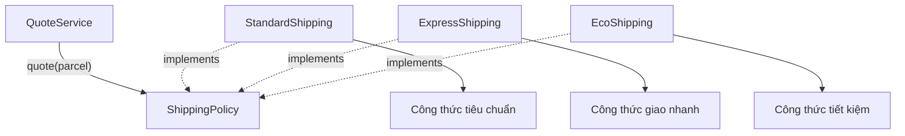

Đa hình nằm ở việc `policy.quote(parcel)` có **cùng chữ ký phương thức** nhưng thực thi **cách cài đặt khác nhau**, tùy đối tượng mà `policy` đang tham chiếu.

## 3. Ví dụ Java hoàn chỉnh: chuyển từ phân nhánh sang đa hình

Đặt toàn bộ đoạn mã sau trong file **`Main.java`**. Ví dụ chạy bằng Java 17 hoặc Java 21, không cần thư viện bên ngoài.

```java
import java.util.List;
import java.util.Objects;

record Parcel(int weightGrams, int distanceKm) {
    Parcel {
        if (weightGrams <= 0) {
            throw new IllegalArgumentException(
                    "Khối lượng phải lớn hơn 0");
        }
        if (distanceKm <= 0) {
            throw new IllegalArgumentException(
                    "Khoảng cách phải lớn hơn 0");
        }
    }

    // Tính mỗi 1.000 gram bắt đầu là một kilogram tính cước.
    long billedKilograms() {
        return ((long) weightGrams + 999) / 1_000;
    }
}

interface ShippingPolicy {
    String label();
    long quote(Parcel parcel);
}

final class StandardShipping implements ShippingPolicy {
    @Override
    public String label() {
        return "STANDARD";
    }

    @Override
    public long quote(Parcel parcel) {
        Objects.requireNonNull(parcel, "parcel");
        long fee = 10_000;
        fee = Math.addExact(fee,
                Math.multiplyExact(2_000L, parcel.distanceKm()));
        fee = Math.addExact(fee,
                Math.multiplyExact(1_000L, parcel.billedKilograms()));
        return fee;
    }
}

final class ExpressShipping implements ShippingPolicy {
    @Override
    public String label() {
        return "EXPRESS";
    }

    @Override
    public long quote(Parcel parcel) {
        Objects.requireNonNull(parcel, "parcel");
        long fee = 25_000;
        fee = Math.addExact(fee,
                Math.multiplyExact(4_000L, parcel.distanceKm()));
        fee = Math.addExact(fee,
                Math.multiplyExact(2_000L, parcel.billedKilograms()));
        return fee;
    }
}

final class EcoShipping implements ShippingPolicy {
    @Override
    public String label() {
        return "ECO";
    }

    @Override
    public long quote(Parcel parcel) {
        Objects.requireNonNull(parcel, "parcel");
        long fee = 7_000;
        fee = Math.addExact(fee,
                Math.multiplyExact(1_500L, parcel.distanceKm()));
        fee = Math.addExact(fee,
                Math.multiplyExact(500L, parcel.billedKilograms()));
        return fee;
    }
}

// Service chỉ biết hợp đồng; không biết ba lớp cụ thể.
final class QuoteService {
    private final ShippingPolicy policy;

    QuoteService(ShippingPolicy policy) {
        this.policy = Objects.requireNonNull(policy, "policy");
    }

    long calculate(Parcel parcel) {
        return policy.quote(parcel);
    }
}

public class Main {
    public static void main(String[] args) {
        Parcel parcel = new Parcel(1_500, 3);

        List<ShippingPolicy> policies = List.of(
                new StandardShipping(),
                new ExpressShipping(),
                new EcoShipping()
        );

        for (ShippingPolicy policy : policies) {
            long fee = new QuoteService(policy).calculate(parcel);
            System.out.println(policy.label() + ": " + fee + " VND");
        }

        ShippingPolicy selected = new ExpressShipping();
        QuoteService service = new QuoteService(selected);
        System.out.println("Đã chọn: " + service.calculate(parcel) + " VND");
    }
}
```

Biên dịch và chạy:

```bash
javac Main.java
java Main
```

Kết quả:

```text
STANDARD: 18000 VND
EXPRESS: 41000 VND
ECO: 12500 VND
Đã chọn: 41000 VND
```

### Giải thích kết quả

Kiện hàng có trọng lượng 1.500 gram, được tính cước **2 kg**, quãng đường **3 km**:

| Policy | Phí cố định | Theo quãng đường | Theo kg tính cước | Tổng |
| --- | ---: | ---: | ---: | ---: |
| `STANDARD` | 10.000 | 2.000 × 3 = 6.000 | 1.000 × 2 = 2.000 | **18.000 VND** |
| `EXPRESS` | 25.000 | 4.000 × 3 = 12.000 | 2.000 × 2 = 4.000 | **41.000 VND** |
| `ECO` | 7.000 | 1.500 × 3 = 4.500 | 500 × 2 = 1.000 | **12.500 VND** |

Điểm quan trọng không nằm ở công thức mà nằm ở **mối quan hệ phụ thuộc**:

- `QuoteService` chỉ khai báo trường `ShippingPolicy`.
- `Main` có thể cung cấp bất kỳ đối tượng nào thực hiện interface ấy.
- Khi gọi `policy.quote(parcel)`, phương thức tương ứng của `StandardShipping`, `ExpressShipping` hay `EcoShipping` được thực thi.
- Thêm một loại vận chuyển không nhất thiết yêu cầu sửa `QuoteService`; ta tạo implementation mới và đăng ký nó ở nơi lựa chọn policy.
- `Parcel` bảo vệ điều kiện đầu vào chung. `Math.addExact`/`Math.multiplyExact` giúp báo tràn số thay vì âm thầm tạo kết quả không đúng.

**Đây là ví dụ công thức minh họa, không phải bảng giá của nhà vận chuyển thực tế.**

## 4. Vì sao đây là đa hình ở thời điểm chạy?

Xét:

```java
ShippingPolicy policy = new ExpressShipping();
long fee = policy.quote(new Parcel(1_500, 3));
```

Có hai góc nhìn về cùng biến:

| Thành phần | Giá trị |
| --- | --- |
| **Kiểu khai báo** của biến `policy` | `ShippingPolicy` |
| **Đối tượng thực tế** | `ExpressShipping` |
| Phương thức mà trình biên dịch cho phép gọi | `quote(Parcel)` thuộc hợp đồng `ShippingPolicy` |
| Cách thực hiện được chọn lúc chạy | `ExpressShipping.quote(Parcel)` |

Trong Java, một lời gọi phương thức **instance** được ghi đè qua interface hoặc lớp cha thường được dispatch theo đối tượng thực tế. Đó là cơ sở để `QuoteService` dùng một phương thức chung mà không phải kiểm tra `instanceof ExpressShipping`.

Điều này khác với overload:

```java
void print(Object value) {}
void print(String value) {}
```

Việc chọn `print(Object)` hay `print(String)` chủ yếu dựa vào **kiểu đối số được trình biên dịch nhìn thấy**, không tự kiểm tra runtime class để chọn overload. Bài toán loại bỏ `if/else` ở đây dựa vào **overriding / dynamic dispatch**, không phải chỉ tạo thêm nhiều phương thức overload.

## 5. Vấn đề rõ nhất: `instanceof` lặp đi lặp lại

Giả sử code cũ nhận một đối tượng:

```java
static long fee(Object strategy, Parcel parcel) {
    if (strategy instanceof StandardShipping) {
        // Công thức Standard
    } else if (strategy instanceof ExpressShipping) {
        // Công thức Express
    } else if (strategy instanceof EcoShipping) {
        // Công thức Eco
    }
    throw new IllegalArgumentException("Loại không hỗ trợ");
}
```

Ví dụ trên chỉ minh họa khung điều kiện, không phải một phương thức hoàn chỉnh có thể biên dịch, vì các nhánh chưa có lệnh `return`.

Nếu thay bằng:

```java
static long fee(ShippingPolicy strategy, Parcel parcel) {
    return strategy.quote(parcel);
}
```

ta nhận được những cải thiện sau:

| Khi dùng kiểm tra từng loại | Khi dùng đa hình |
| --- | --- |
| Mã gọi phải biết `StandardShipping`, `ExpressShipping`, `EcoShipping` | Mã gọi chỉ cần biết `ShippingPolicy` |
| Loại mới thường phải thêm nhánh tại mọi nơi xử lý loại | Loại mới bổ sung implementation có cùng hợp đồng |
| Rủi ro bỏ sót nhánh hoặc `else` mặc định nguy hiểm | Trình biên dịch bắt implementation cụ thể phải có phương thức bắt buộc |
| Công thức của các loại nằm xen kẽ trong một khối dài | Mỗi implementation giữ quy tắc riêng |
| Mock/fake khó nếu logic gắn chặt với kiểm tra lớp cụ thể | Có thể đưa vào một implementation dùng riêng trong kiểm thử |

Tuy nhiên, **interface không bảo đảm mọi implementation đều đúng nghiệp vụ**. Ví dụ một implementation `quote()` trả phí âm vẫn biên dịch. Cần định nghĩa hợp đồng rõ và có kiểm thử để các implementation tuân thủ cùng ngữ nghĩa.

## 6. Vậy việc chọn loại ban đầu vẫn cần `switch` thì sao?

Đa hình không làm biến mất nhu cầu chọn phương án từ dữ liệu ngoài: người dùng có thể gửi chuỗi `"express"`, cấu hình có thể ghi mã `"eco"`, hoặc ứng dụng có danh sách tùy chọn.

Một nhánh ở **ranh giới tạo đối tượng** vẫn hoàn toàn hợp lý:

```java
static ShippingPolicy selectPolicy(String code) {
    if (code == null) {
        throw new IllegalArgumentException("Thiếu mã dịch vụ");
    }

    return switch (code.toLowerCase(java.util.Locale.ROOT)) {
        case "standard" -> new StandardShipping();
        case "express" -> new ExpressShipping();
        case "eco" -> new EcoShipping();
        default -> throw new IllegalArgumentException(
                "Không hỗ trợ dịch vụ: " + code);
    };
}
```

Đoạn trên có thể đặt làm phương thức `static` trong `Main` của ví dụ. Với Java 17, cú pháp **switch expression** này hợp lệ.

Sự khác biệt là **điều kiện chỉ tập trung ở bước lựa chọn**; sau đó mọi luồng xử lý qua `ShippingPolicy`. Khi thêm loại mới, có thể phải cập nhật factory/registry này, nhưng không phải sửa tất cả service gọi `quote()`.

Nếu số implementation lớn hoặc được nạp qua dependency injection/plugin, một **registry** như `Map<String, ShippingPolicy>` có thể thay factory có `switch`. Tuy nhiên, registry không phải lúc nào cũng tốt hơn: nếu có đúng hai lựa chọn ổn định, một `switch` rõ ràng có thể đơn giản và dễ bảo trì.

## 7. Thêm loại mới mà không sửa service

Giả sử xuất hiện `SameDayShipping`, tính phí cố định 40.000 VND cộng 6.000 VND mỗi km. Ta chỉ cần triển khai cùng hợp đồng:

```java
final class SameDayShipping implements ShippingPolicy {
    @Override
    public String label() {
        return "SAME_DAY";
    }

    @Override
    public long quote(Parcel parcel) {
        java.util.Objects.requireNonNull(parcel, "parcel");
        return Math.addExact(
                40_000L,
                Math.multiplyExact(6_000L, parcel.distanceKm())
        );
    }
}
```

Đặt lớp này cùng các lớp trong ví dụ chính, sau đó:

```java
QuoteService service = new QuoteService(new SameDayShipping());
System.out.println(service.calculate(new Parcel(1_500, 3)));
// 58000
```

**`QuoteService` không thay đổi.** Điều có thể cần sửa là màn hình hoặc thành phần chọn lựa để hiển thị `SAME_DAY`, cùng kiểm thử và cấu hình liên quan. Đây là ý nghĩa thực tế của việc “mở rộng mà hạn chế sửa code đang dùng”, không phải cam kết rằng việc thêm tính năng sẽ không cần sửa bất kỳ dòng nào trong toàn hệ thống.

## 8. Quy tắc chung phải thuộc về đâu?

Một rủi ro khi đưa hành vi vào từng lớp là **lặp lại hoặc làm lệch quy tắc chung**.

Trong ví dụ:

- `Parcel` kiểm tra `weightGrams > 0` và `distanceKm > 0`.
- Mỗi `ShippingPolicy` chọn **công thức riêng**.
- `QuoteService` chỉ phối hợp lời gọi và không hiểu công thức.
- Phần chọn policy chịu trách nhiệm chuyển mã dịch vụ thành implementation.

Nếu mọi policy phải có kết quả không âm, có thể diễn đạt trong hợp đồng và kiểm tra tại ranh giới trả kết quả:

```java
static long validatedQuote(ShippingPolicy policy, Parcel parcel) {
    long fee = policy.quote(parcel);
    if (fee < 0) {
        throw new IllegalStateException("Phí vận chuyển không hợp lệ");
    }
    return fee;
}
```

Điều này không có nghĩa mọi service phải lặp lại kiểm tra. Tùy yêu cầu hệ thống, ta có thể dùng một decorator, một giá trị `Money` bất biến, hoặc một service điều phối chung để đảm bảo invariant.

**Cẩn trọng với kế thừa lớp cha dùng Template Method:** nó cũng có thể gom kiểm tra chung và để lớp con override công thức, nhưng sẽ tạo một cây kế thừa mà Java chỉ cho một lớp cha. Khi chỉ cần một khả năng có thể thay thế, interface + composition thường linh hoạt hơn.

## 9. Khi nào nên — và không nên — thay điều kiện bằng đa hình?

| Tình huống | Cách tiếp cận thường hợp lý |
| --- | --- |
| Nhiều loại đối tượng có cùng khả năng nhưng thuật toán khác nhau | Interface/abstract class với override |
| Nhiều service đều có `if (x instanceof TypeA)` / `TypeB` để quyết định cùng một nhóm hành vi | Xem xét chuyển hành vi vào kiểu hoặc strategy |
| Loại dịch vụ được chọn từ request/config | Factory, `switch`, registry hoặc DI ở ranh giới |
| Một điều kiện nghiệp vụ đơn giản, không phụ thuộc kiểu đối tượng | `if` trực tiếp thường rõ ràng hơn |
| Trạng thái đơn giản như `active`, `expired` | Dùng điều kiện khi nó phản ánh trạng thái, không cần tạo lớp con cho mỗi trạng thái |
| Một tập biến thể nhỏ, cố định và cần xử lý đầy đủ theo từng loại | `enum` hoặc `sealed` hierarchy cùng pattern matching có thể phù hợp |
| Cần thêm hành vi mà loại không nên tự biết (ví dụ serialize sang rất nhiều định dạng bên ngoài) | Cân nhắc Visitor/adapter/service riêng thay vì nhồi tất cả vào domain object |
| Hành vi cần phụ thuộc nhiều yếu tố độc lập (phương thức thanh toán, quốc gia, khuyến mãi…) | Composition/Strategy có thể tránh bùng nổ số lớp con theo tổ hợp |

### Ví dụ `instanceof` không phải lúc nào cũng sai

Một `instanceof` duy nhất khi nhận dữ liệu chưa được phân loại hoặc khi tích hợp thư viện có sẵn **không nhất thiết là thiết kế kém**. Trên Java 17, pattern matching giúp viết rõ hơn:

```java
static String describe(Object value) {
    if (value instanceof String text) {
        return "Chuỗi có độ dài " + text.length();
    }
    if (value instanceof Integer number) {
        return "Số nguyên " + number;
    }
    return "Loại khác";
}
```

Đoạn mã này có thể thích hợp ở một ranh giới xử lý dữ liệu hỗn hợp. Nhưng nếu nghiệp vụ liên tục phân loại các lớp `ShippingPolicy` bằng `instanceof` để tính phí, dù tất cả có thể cung cấp `quote()`, đa hình là thiết kế đáng cân nhắc hơn.

Cũng cần ghi nhớ: trong Java 21, `switch` có pattern matching cho kiểu đối tượng; nó giúp biểu đạt nhánh rõ ràng, nhưng **không tự giải quyết vấn đề phụ thuộc vào danh sách loại cụ thể**. Nếu bài toán vốn là duyệt đầy đủ một tập loại đóng (*closed set*), `sealed` class/interface và `switch` exhaustive có thể là chủ ý hợp lý.

## 10. Đa hình và nguyên lý thiết kế

### Open/Closed Principle (OCP)

Một module nên có khả năng **mở rộng hành vi mới** mà hạn chế thay đổi phần logic ổn định đang sử dụng. `QuoteService` đáp ứng điều này ở phạm vi thiết kế của nó: nhận `ShippingPolicy` và gọi `quote()` mà không liệt kê từng loại.

### Dependency Inversion Principle (DIP)

`QuoteService` phụ thuộc vào hợp đồng `ShippingPolicy`, không phụ thuộc trực tiếp vào `StandardShipping` hay `ExpressShipping`. Một thành phần bên ngoài cung cấp implementation cụ thể khi tạo service — đó là **dependency injection qua constructor**.

### Liskov Substitution Principle (LSP)

Mọi implementation phải tuân thủ hợp đồng: dữ liệu hợp lệ được nhận, kết quả có ý nghĩa đúng, ngoại lệ có chính sách nhất quán. Nếu một implementation tự ý đổi đơn vị từ VND sang USD hoặc trả phí âm không được định nghĩa, việc thay thế có thể gây lỗi dù interface giống hệt.

### Single Responsibility Principle (SRP)

Mỗi policy tập trung vào công thức riêng; `QuoteService` tập trung vào điều phối; factory tập trung vào chọn implementation. Việc chia trách nhiệm này giảm các khối điều kiện dài và phân tán.

Các nguyên lý trên hỗ trợ việc dùng đa hình, nhưng **không có nghĩa luôn phải tạo nhiều interface/lớp**. Mức trừu tượng nên tương xứng với nhu cầu thay đổi của hệ thống.

## 11. Cách refactor chuỗi `if/else` đang có

Với hệ thống thực tế, nên chuyển từng bước để tránh thay đổi kết quả ngoài ý muốn:

1. **Đánh dấu những nhánh thay đổi theo loại.** Xác định đúng nhóm hành vi đang bị phân tán, ví dụ tính phí, tính khuyến mãi, kiểm tra điều kiện.
2. **Viết kiểm thử hiện trạng.** Đầu vào hợp lệ, không hợp lệ, trường hợp biên, loại chưa biết và công thức từng loại phải có expected result.
3. **Thiết kế hợp đồng chung.** Ví dụ `ShippingPolicy.quote(Parcel)` với quy tắc về đơn vị tiền, phí không âm và ngoại lệ.
4. **Chuyển từng nhánh sang implementation.** Giữ nguyên công thức và so sánh kết quả trước/sau refactor.
5. **Tập trung việc chọn implementation.** Factory hoặc registry tạo/trả đối tượng phù hợp từ mã cấu hình, thay vì để mỗi service tự chọn.
6. **Thay điều kiện ở client bằng một lời gọi đa hình.** Client dùng `ShippingPolicy`; xóa nhánh cũ khi xác nhận tương đương.
7. **Bổ sung test hợp đồng cho mọi implementation.** Các lớp mới có thể khác công thức nhưng vẫn phải đáp ứng các điều kiện chung.

Tránh refactor “đại trà” toàn hệ thống trong một lần khi có logic tài chính hoặc giao dịch: giữ các phép tính, chính sách làm tròn, lỗi và thứ tự tác động được kiểm chứng trước khi thay cấu trúc.

## 12. Kiểm thử hành vi chung và hành vi đặc thù

Có thể kiểm tra kết quả của từng policy theo dạng bảng:

| Input `Parcel(1500, 3)` | Expected `quote()` |
| --- | ---: |
| `new StandardShipping()` | `18000` |
| `new ExpressShipping()` | `41000` |
| `new EcoShipping()` | `12500` |

Một phép kiểm thử đơn giản không cần framework, đặt trong một phương thức của lớp `Main` khi các lớp trên đã tồn tại:

```java
static void assertFee(ShippingPolicy policy, Parcel parcel, long expected) {
    long actual = policy.quote(parcel);
    if (actual != expected) {
        throw new AssertionError(
                policy.label() + ": expected=" + expected
                        + ", actual=" + actual);
    }
}
```

Gọi:

```java
Parcel input = new Parcel(1_500, 3);
assertFee(new StandardShipping(), input, 18_000);
assertFee(new ExpressShipping(), input, 41_000);
assertFee(new EcoShipping(), input, 12_500);
```

Trong dự án, dùng JUnit có thể tổ chức bài test dạng tham số và test riêng các trường hợp lỗi. Việc các implementation cùng tuân thủ một hợp đồng giúp tạo **bộ kiểm thử chung**; tuy nhiên mỗi chính sách có thêm quy tắc đặc thù cũng cần test riêng.

## 13. Lỗi thường gặp khi áp dụng đa hình

| Sai lầm | Hệ quả | Cách sửa |
| --- | --- | --- |
| Thay `if/else` bằng interface nhưng service vẫn dùng `instanceof` | Vẫn phụ thuộc lớp cụ thể, mất lợi ích đa hình | Đặt hành vi biến thiên vào phương thức hợp đồng |
| Mỗi lựa chọn đều tạo một lớp dù logic chỉ là điều kiện nhỏ ổn định | Nhiều file/lớp không mang lại giá trị | Giữ `if` hoặc `enum` nếu đơn giản hơn |
| Interface quá lớn, mọi lớp phải implement phương thức không hỗ trợ | Nhiều `UnsupportedOperationException` | Phân tách interface theo vai trò |
| Mỗi implementation tự đặt đơn vị đo và lỗi khác nhau | Vi phạm hợp đồng thay thế | Ghi rõ invariant và test chung |
| Tạo factory `switch` rồi sao chép cùng switch vào các service | Các điểm sửa vẫn phân tán | Tập trung lựa chọn tại ranh giới; xử lý qua interface |
| Dùng kế thừa nhiều tầng chỉ để tái sử dụng vài dòng | Cây lớp phức tạp, dễ ảnh hưởng lẫn nhau | Cân nhắc composition/delegation |
| Bỏ hết kiểm tra đầu vào vì nghĩ đa hình tự bảo vệ dữ liệu | Runtime có thể cho kết quả không hợp lệ | Kiểm tra ở value object/service và từng policy theo hợp đồng |
| Dùng đối tượng có trạng thái chung giữa nhiều luồng mà không đồng bộ | Race condition dù có interface | Quản lý tính đồng thời riêng; đa hình không phải cơ chế khóa |

## 14. Bài tập tự kiểm tra

**Câu 1.** Tại sao `QuoteService` vẫn tính được phí `SameDayShipping` mà không cần biết tên lớp ấy?

**Đáp án:** `SameDayShipping` thực hiện `ShippingPolicy`. `QuoteService` chỉ gọi `policy.quote(parcel)`; dynamic dispatch chọn phần triển khai của đối tượng cụ thể.

**Câu 2.** Có phải đoạn `switch (serviceCode)` ở factory là dấu hiệu vi phạm đa hình?

**Đáp án:** Không. Factory cần đổi mã đầu vào thành một implementation. Vấn đề là lặp `switch` theo từng loại trong nhiều nơi xử lý hành vi mà mỗi implementation có thể tự cung cấp.

**Câu 3.** Một lớp `ExpressShipping` implements `ShippingPolicy` nhưng luôn trả `-100`. Nó có tuân thủ hợp đồng không?

**Đáp án:** Không nếu hợp đồng quy định phí không âm. `implements` chỉ bảo đảm tương thích chữ ký, không tự bảo đảm đúng nghiệp vụ.

**Câu 4.** Nếu một yêu cầu chỉ có trạng thái `isGift = true/false` và một dòng điều kiện nhỏ, có cần hai lớp `GiftOrder` và `RegularOrder` không?

**Đáp án:** Không nhất thiết. Một điều kiện trực tiếp có thể đơn giản hơn. Chỉ tách chiến lược khi thực sự có **hành vi biến thiên có ý nghĩa** và nhu cầu mở rộng/kiểm thử độc lập.

**Câu 5.** Dùng `instanceof` để phân biệt đối tượng dữ liệu hỗn hợp khi parse đầu vào có luôn sai không?

**Đáp án:** Không. Đây có thể là lựa chọn hợp lý tại ranh giới xử lý dữ liệu. Nên xem liệu hành vi đang được phân nhánh có thể và nên chuyển về chính kiểu đối tượng hay không.

**Câu 6.** Vì sao phải test tất cả implementation sau khi thay chuỗi `if/else`?

**Đáp án:** Refactor cấu trúc không được làm thay đổi các kết quả vốn được yêu cầu. Hợp đồng chung vẫn cần được bảo đảm; từng loại còn có công thức và điều kiện biên riêng.

**Ghi nhớ:** Khi cùng một loại đối tượng bị kiểm tra lặp đi lặp lại để lựa chọn *cách thực hiện một hành vi*, hãy cân nhắc **đưa hành vi đó vào hợp đồng chung và để các implementation trả lời bằng đa hình**. Câu lệnh điều kiện vẫn có chỗ đứng ở ranh giới lựa chọn, kiểm tra trạng thái và các tập loại đóng; mục tiêu là giảm phụ thuộc vào danh sách lớp cụ thể ở mã nghiệp vụ.


</details>

- [Quay lại đầu trang](#back-to-top)

---

## <a id="polymorphism-010">Ví dụ nhiều phương thức thanh toán</a>

<details>
<summary>Xem chi tiết</summary>

# Ví dụ nhiều phương thức thanh toán bằng đa hình trong Java

> **Chủ đề:** OOP → Đa hình (Polymorphism) → Ví dụ nhiều phương thức thanh toán.
>
> Một hệ thống bán hàng có thể cho khách chọn **thẻ**, **ví điện tử** hoặc **chuyển khoản**. Mỗi phương thức có cách xử lý riêng, nhưng phần thanh toán của ứng dụng nên gọi chúng qua **một hợp đồng chung**. Đây là ứng dụng điển hình của đa hình: **cùng lời gọi, các đối tượng khác loại thực hiện hành vi khác nhau**.

## 1. Vấn đề nếu kiểm tra từng loại bằng `if/else`

Giả sử mã thanh toán được viết như sau:

```java
// Minh họa cách thiết kế khó mở rộng, không phải API hoàn chỉnh.
if ("CARD".equals(method)) {
    // Xử lý thẻ
} else if ("WALLET".equals(method)) {
    // Xử lý ví
} else if ("BANK".equals(method)) {
    // Xử lý chuyển khoản
} else {
    throw new IllegalArgumentException("Phương thức không hỗ trợ");
}
```

Khi thêm một phương thức mới, bạn phải sửa chuỗi điều kiện trong mã điều phối. Nếu logic này nằm rải rác ở nhiều service, càng dễ xuất hiện những nơi bị bỏ quên. Bên cạnh đó, thanh toán thẻ, trừ tiền ví và chờ chuyển khoản có vòng đời rất khác nhau; dồn hết vào một phương thức lớn khiến việc kiểm thử và sửa lỗi khó hơn.

Giải pháp OOP là thống nhất **đầu vào và đầu ra**, nhưng để từng lớp tự định nghĩa **cách thực hiện**.

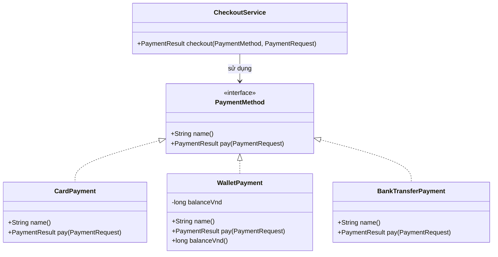

Trong sơ đồ, `CheckoutService` chỉ phụ thuộc vào `PaymentMethod`, còn ba lớp cụ thể **implements** giao diện đó.

## 2. Hợp đồng chung gồm những gì?

Một hợp đồng gọn cho ví dụ:

```java
interface PaymentMethod {
    String name();
    PaymentResult pay(PaymentRequest request);
}
```

Ở đây:

- `name()`: tên hiển thị của phương thức thanh toán.
- `pay(request)`: nhận yêu cầu thanh toán và trả một kết quả có cấu trúc.
- Mỗi lớp triển khai phải cung cấp hai phương thức trên theo đúng chữ ký và hợp đồng.
- Người sử dụng interface không cần biết lớp triển khai dùng thẻ, ví hay chuyển khoản.

Ta định nghĩa ba trạng thái kết quả:

| Trạng thái | Ý nghĩa trong ví dụ | Có thể coi đơn hàng đã thanh toán? |
|---|---|---|
| `PAID` | Phương thức mô phỏng đã xác nhận thành công | Có, **trong phạm vi mô phỏng** |
| `DECLINED` | Yêu cầu bị từ chối | Không |
| `PENDING` | Đã tạo hướng dẫn hoặc yêu cầu, đang đợi xác nhận | **Không** |

**Quan trọng:** `PENDING` không phải `PAID`. Ví dụ chuyển khoản chỉ trả hướng dẫn chuyển tiền, không được tự ghi nhận rằng ngân hàng đã nhận được tiền.

## 3. Mã Java hoàn chỉnh: ba phương thức, một CheckoutService

Lưu toàn bộ mã dưới đây thành **`MultiPaymentDemo.java`**. Ví dụ chạy bằng **Java 17+**, không cần thư viện bên ngoài, không xử lý tiền thật và không lưu thông tin thẻ nhạy cảm.

```java
import java.util.List;
import java.util.Objects;

public class MultiPaymentDemo {

    enum PaymentStatus {
        PAID, DECLINED, PENDING
    }

    record PaymentRequest(String orderId, long amountVnd) {
        PaymentRequest {
            if (orderId == null || orderId.isBlank()) {
                throw new IllegalArgumentException("Mã đơn hàng không hợp lệ");
            }
            if (amountVnd <= 0) {
                throw new IllegalArgumentException("Số tiền phải dương");
            }
        }
    }

    record PaymentResult(PaymentStatus status, String message) {
        PaymentResult {
            Objects.requireNonNull(status, "status");
            Objects.requireNonNull(message, "message");
        }
    }

    interface PaymentMethod {
        String name();
        PaymentResult pay(PaymentRequest request);
    }

    // 1. Thẻ: mô phỏng việc duyệt hoặc từ chối theo hạn mức.
    static final class CardPayment implements PaymentMethod {
        private final String lastFourDigits;

        CardPayment(String lastFourDigits) {
            if (lastFourDigits == null
                    || !lastFourDigits.matches("[0-9]{4}")) {
                throw new IllegalArgumentException(
                    "Chỉ nhập 4 chữ số cuối để minh họa"
                );
            }
            this.lastFourDigits = lastFourDigits;
        }

        @Override
        public String name() {
            return "Thẻ **** " + lastFourDigits;
        }

        @Override
        public PaymentResult pay(PaymentRequest request) {
            Objects.requireNonNull(request, "request");

            // Quy tắc mô phỏng, KHÔNG phải hạn mức thẻ thực tế.
            if (request.amountVnd() > 200_000) {
                return new PaymentResult(
                    PaymentStatus.DECLINED,
                    "Vượt hạn mức mô phỏng của thẻ"
                );
            }
            return new PaymentResult(
                PaymentStatus.PAID,
                "Thẻ mô phỏng đã được duyệt"
            );
        }
    }

    // 2. Ví: giữ số dư của instance, chỉ trừ khi đủ tiền.
    static final class WalletPayment implements PaymentMethod {
        private long balanceVnd;

        WalletPayment(long openingBalanceVnd) {
            if (openingBalanceVnd < 0) {
                throw new IllegalArgumentException("Số dư không thể âm");
            }
            this.balanceVnd = openingBalanceVnd;
        }

        @Override
        public String name() {
            return "Ví điện tử";
        }

        @Override
        public synchronized PaymentResult pay(PaymentRequest request) {
            Objects.requireNonNull(request, "request");

            if (request.amountVnd() > balanceVnd) {
                return new PaymentResult(
                    PaymentStatus.DECLINED,
                    "Ví không đủ số dư"
                );
            }

            balanceVnd -= request.amountVnd();
            return new PaymentResult(
                PaymentStatus.PAID,
                "Đã trừ " + request.amountVnd() + " VND từ ví mô phỏng"
            );
        }

        synchronized long balanceVnd() {
            return balanceVnd;
        }
    }

    // 3. Chuyển khoản: chỉ tạo thông tin, chờ ngân hàng xác nhận.
    static final class BankTransferPayment implements PaymentMethod {
        private final String bankAccount;

        BankTransferPayment(String bankAccount) {
            if (bankAccount == null || bankAccount.isBlank()) {
                throw new IllegalArgumentException("Tài khoản không hợp lệ");
            }
            this.bankAccount = bankAccount;
        }

        @Override
        public String name() {
            return "Chuyển khoản";
        }

        @Override
        public PaymentResult pay(PaymentRequest request) {
            Objects.requireNonNull(request, "request");

            return new PaymentResult(
                PaymentStatus.PENDING,
                "Chờ chuyển " + request.amountVnd()
                    + " VND tới " + bankAccount
                    + ", nội dung " + request.orderId()
            );
        }
    }

    // Service chỉ gọi hợp đồng chung, không kiểm tra instanceof.
    static final class CheckoutService {
        PaymentResult checkout(
                PaymentMethod method,
                PaymentRequest request) {

            Objects.requireNonNull(method, "method");
            Objects.requireNonNull(request, "request");

            return Objects.requireNonNull(
                method.pay(request),
                "Phương thức thanh toán không được trả null"
            );
        }
    }

    public static void main(String[] args) {
        WalletPayment wallet = new WalletPayment(150_000);

        List<PaymentMethod> methods = List.of(
            new CardPayment("4242"),
            wallet,
            new BankTransferPayment("DEMO-ACCOUNT")
        );

        CheckoutService checkout = new CheckoutService();

        // Mỗi lần là một đơn hàng KHÁC NHAU để minh họa từng lựa chọn.
        for (int i = 0; i < methods.size(); i++) {
            PaymentMethod method = methods.get(i);
            PaymentRequest request =
                new PaymentRequest("ORD-" + (i + 1), 120_000);

            PaymentResult result = checkout.checkout(method, request);

            System.out.println(method.name() + " -> "
                    + result.status());
            System.out.println("  " + result.message());
        }

        System.out.println("Số dư ví còn: " + wallet.balanceVnd());

        PaymentResult notEnough = checkout.checkout(
            wallet,
            new PaymentRequest("ORD-4", 40_000)
        );
        System.out.println("Ví thanh toán lần nữa -> "
                + notEnough.status());
        System.out.println("Số dư ví cuối: " + wallet.balanceVnd());
    }
}
```

Biên dịch và chạy trong thư mục chứa tệp:

```bash
javac MultiPaymentDemo.java
java MultiPaymentDemo
```

Kết quả mong đợi:

```text
Thẻ **** 4242 -> PAID
  Thẻ mô phỏng đã được duyệt
Ví điện tử -> PAID
  Đã trừ 120000 VND từ ví mô phỏng
Chuyển khoản -> PENDING
  Chờ chuyển 120000 VND tới DEMO-ACCOUNT, nội dung ORD-3
Số dư ví còn: 30000
Ví thanh toán lần nữa -> DECLINED
Số dư ví cuối: 30000
```

Ba lần lặp ban đầu tương ứng **ba đơn hàng khác nhau** (`ORD-1`, `ORD-2`, `ORD-3`) để thể hiện ba implementation. Trong quy trình mua hàng thật, **khách chọn một phương thức cho một lần thanh toán**; không được tự động gọi tất cả phương thức để thu tiền cùng một đơn.

## 4. Đa hình diễn ra ở dòng nào?

Trọng tâm là:

```java
PaymentMethod method = methods.get(i);
PaymentResult result = checkout.checkout(method, request);
```

Và trong `CheckoutService`:

```java
return method.pay(request);
```

Mã nguồn của service chỉ có một lời gọi `pay`. Tuy nhiên, kết quả khác nhau theo đối tượng được cung cấp:

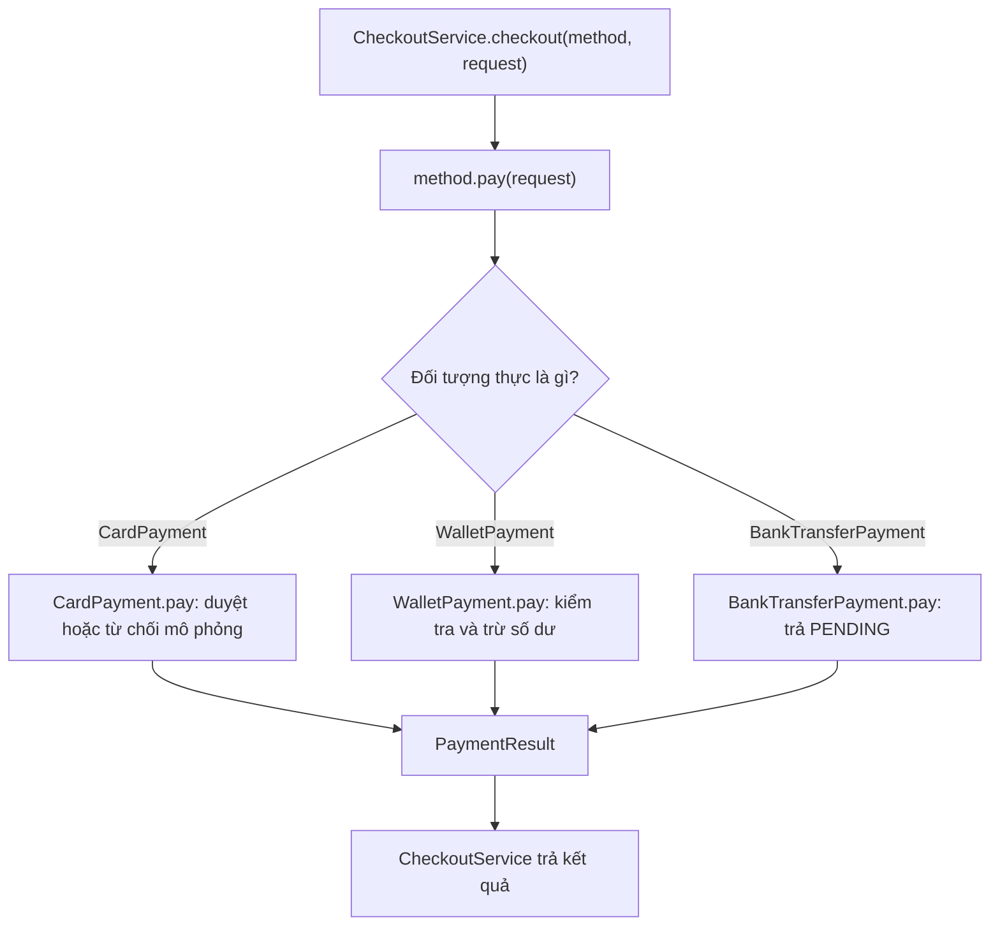

Đó là **runtime polymorphism** hay đa hình lúc chạy.

| Đặc điểm | Ở mã sử dụng | Ở đối tượng thực |
|---|---|---|
| Kiểu biến `method` | `PaymentMethod` | Có thể là bất kỳ lớp implements hợp đồng |
| Phương thức được phép gọi | `name()`, `pay(...)` từ interface | Implementation có thể có thêm API riêng |
| Chữ ký `pay` | Được kiểm tra khi biên dịch | Phải được lớp triển khai tuân thủ |
| Thân `pay` chạy | Không cố định trong service | Chọn theo lớp runtime |
| Kết quả | Cùng kiểu `PaymentResult` | Có thể là PAID, DECLINED hoặc PENDING |

**Đối tượng runtime quyết định implementation**, không phải chuỗi trả về từ `name()`, không phải tên biến và cũng không phải một phép ép kiểu trong `CheckoutService`.

Lưu ý: `PaymentMethod` là interface, không thể viết `new PaymentMethod()`. Có thể khai báo **biến có kiểu interface** và gán một instance của lớp triển khai:

```java
PaymentMethod selected = new WalletPayment(100_000);
PaymentResult result = selected.pay(
    new PaymentRequest("ORD-5", 60_000)
);
System.out.println(result.status()); // PAID
```

## 5. `@Override`, chữ ký và giới hạn của interface

Khi một class `implements PaymentMethod`, các phương thức instance được khai báo trong interface phải được triển khai với phạm vi truy cập phù hợp:

```java
@Override
public PaymentResult pay(PaymentRequest request) {
    // ...
}
```

Vì `pay` trong interface là `public`, triển khai không được thu hẹp thành `protected`, package-private hoặc `private`.

Một lỗi dễ mắc:

```java
class IncorrectPayment implements PaymentMethod {
    @Override
    public PaymentResult pay(long amount) {
        // Sai: pay(long) không phải pay(PaymentRequest).
        return null;
    }

    @Override
    public String name() {
        return "Sai chữ ký";
    }
}
```

Lớp trên không biên dịch: `pay(long)` có tham số khác, không triển khai `pay(PaymentRequest)`; `@Override` giúp phát hiện ngay.

**Đừng nhầm overriding với overloading:**

- `pay(PaymentRequest)` trong các lớp triển khai là **override** một hợp đồng có cùng chữ ký; implementation được chọn động.
- Nếu thêm `pay(String orderId, long amount)` bên cạnh `pay(PaymentRequest)`, đó là **overload** (cùng tên, khác tham số). Chữ ký overload được chọn dựa trên kiểu tại thời điểm biên dịch; bản thân nó không phải ví dụ về chọn lớp thanh toán theo runtime.

`static` method cũng không được dispatch động giống instance method; không nên đặt xử lý nhiều phương thức thanh toán dưới dạng các phương thức static cùng tên và kỳ vọng JVM chọn theo object.

## 6. Thêm cách thanh toán mới mà không sửa CheckoutService

Giả sử bổ sung **thanh toán khi nhận hàng (COD)**. Ta tạo thêm một lớp `implements PaymentMethod`:

```java
// Thêm vào bên trong MultiPaymentDemo nếu muốn chạy cùng ví dụ:
static final class CashOnDeliveryPayment implements PaymentMethod {
    @Override
    public String name() {
        return "Thanh toán khi nhận hàng";
    }

    @Override
    public PaymentResult pay(PaymentRequest request) {
        Objects.requireNonNull(request, "request");
        return new PaymentResult(
            PaymentStatus.PENDING,
            "Chỉ thu tiền khi giao đơn " + request.orderId()
        );
    }
}
```

Sau đó dùng trực tiếp với service đã có:

```java
PaymentMethod cod = new CashOnDeliveryPayment();
PaymentResult result = new CheckoutService().checkout(
    cod,
    new PaymentRequest("ORD-COD", 80_000)
);
System.out.println(result.status()); // PENDING
```

`CheckoutService` không phải thêm nhánh `if ("COD")` hay `instanceof CashOnDeliveryPayment`. Đây là lợi ích rõ ràng của tính mở rộng dựa trên hợp đồng.

Tuy nhiên, có thể vẫn cần cập nhật phần **giao diện người dùng hoặc cấu hình đăng ký phương thức** để cho phép chọn COD. “Không sửa `CheckoutService`” không có nghĩa không sửa bất kỳ mã nào trong toàn hệ thống.

## 7. Kết quả trả về có ý nghĩa hơn một `boolean`

Nếu `pay` chỉ trả `boolean`, ta khó phân biệt:

- Thanh toán bị từ chối.
- Khách chưa hoàn tất chuyển khoản.
- Nhà cung cấp phản hồi chậm.
- Đã thu tiền thành công.

Một kiểu trả về như `PaymentResult` với `PaymentStatus` làm các trạng thái rõ ràng hơn. Ví dụ phần nghiệp vụ sau thanh toán có thể phân nhánh **trên kết quả nghiệp vụ**, thay vì phân nhánh **trên lớp implementation**:

```java
PaymentResult result = checkout.checkout(selected, request);

switch (result.status()) {
    case PAID -> System.out.println("Có thể ghi nhận đã thanh toán");
    case DECLINED -> System.out.println("Báo khách chọn cách thanh toán khác");
    case PENDING -> System.out.println("Chờ xác nhận trước khi hoàn tất");
}
```

Đây là sự phân nhánh **hợp lý**: trạng thái thanh toán là thông tin mà mọi implementation công khai qua hợp đồng. Điều nên tránh là hỏi `selected instanceof CardPayment` rồi sao chép lại logic riêng của thẻ vào service.

Trong ứng dụng thật, nên có thêm trạng thái hoặc dữ liệu cho tình huống **không biết thanh toán đã thành công hay chưa**. Không được coi timeout mạng đồng nghĩa chắc chắn chưa bị trừ tiền. Mô hình ba trạng thái của bài chỉ nhằm minh họa đa hình, chưa đầy đủ cho một payment system thực tế.

## 8. Kiểm thử đa hình bằng một phương thức thanh toán giả

Có thể kiểm tra rằng `CheckoutService` thực sự gọi `PaymentMethod.pay` và chuyển kết quả cho người gọi mà không kết nối dịch vụ thanh toán.

Bổ sung lớp sau **bên trong** `MultiPaymentDemo`:

```java
static final class RecordingPayment implements PaymentMethod {
    int calls;
    PaymentRequest lastRequest;

    @Override
    public String name() {
        return "Fake cho kiểm thử";
    }

    @Override
    public PaymentResult pay(PaymentRequest request) {
        calls++;
        lastRequest = request;
        return new PaymentResult(PaymentStatus.PAID, "fake-ok");
    }
}
```

Một đoạn kiểm tra có thể đặt trong `main`:

```java
RecordingPayment fake = new RecordingPayment();
CheckoutService service = new CheckoutService();
PaymentRequest testRequest = new PaymentRequest("TEST-1", 10_000);

PaymentResult actual = service.checkout(fake, testRequest);

if (fake.calls != 1
        || fake.lastRequest != testRequest
        || actual.status() != PaymentStatus.PAID) {
    throw new AssertionError("CheckoutService gọi sai PaymentMethod");
}
System.out.println("PASS");
```

Fake cho phép xác định **đúng implementation được gọi** và **đúng request được truyền**, không phụ thuộc ngân hàng hoặc ví điện tử. Kiểm thử này không chứng minh một cổng thanh toán thật an toàn: mỗi adapter tích hợp thật vẫn phải được kiểm thử theo hợp đồng tương ứng.

## 9. Lợi ích và giới hạn của cách thiết kế

| Lợi ích | Biểu hiện trong ví dụ |
|---|---|
| Đa hình | Một lời gọi `pay` chạy ba implementation khác nhau |
| Mở rộng | Thêm `CashOnDeliveryPayment` không phải đổi mã checkout |
| Tách trách nhiệm | Mỗi class chỉ quản lý cách thanh toán của mình |
| Dễ kiểm thử | Dùng `RecordingPayment` thay dịch vụ thật |
| Giảm phụ thuộc | `CheckoutService` chỉ biết `PaymentMethod` |
| Bảo trì thuận tiện | Chỉnh quy tắc ví không cần chỉnh quy tắc thẻ |

Nhưng đa hình **không tự giải quyết** các vấn đề vận hành của thanh toán thật:

1. **Gọi lặp/idempotency:** nếu khách gửi lại cùng yêu cầu do mạng lỗi, không được thu tiền hai lần. Cần ID giao dịch và hợp đồng chống trùng ở hệ thống thực hiện thanh toán.
2. **Dữ liệu bền vững:** ví trong ví dụ chỉ lưu số dư ở RAM. Khởi động lại chương trình là mất dữ liệu; hệ thống thật phải có lưu trữ và transaction thích hợp.
3. **Đồng thời:** `synchronized` trong `WalletPayment` bảo vệ một instance trong một JVM, không điều phối được nhiều instance hay nhiều máy cùng truy cập một tài khoản.
4. **Bảo mật:** không lưu số thẻ đầy đủ, CVV hoặc khóa bí mật trong mã ví dụ/log; tích hợp thật phải tuân thủ yêu cầu của nhà cung cấp và quy định liên quan.
5. **Xử lý lỗi:** kết quả `PENDING` phải có luồng xác nhận riêng (webhook, truy vấn trạng thái, đối soát...) trước khi coi giao dịch hoàn tất.

Những vấn đề này là trách nhiệm của kiến trúc thanh toán và hợp đồng tích hợp, **không phải tính năng tự sinh ra khi dùng interface**.

## 10. Bài tập thực hành

**Bài 1 — Dự đoán kết quả.** Dùng `PaymentMethod method = new BankTransferPayment("DEMO-02")` rồi gọi `method.pay(new PaymentRequest("ORD-7", 90_000))`. Kết quả là `PAID` hay `PENDING`? Tại sao Java không cần xét tên lớp trong `CheckoutService`?

**Bài 2 — Thêm phương thức.** Triển khai `CashOnDeliveryPayment` từ mục 6, thêm instance vào danh sách lựa chọn và kiểm tra chương trình vẫn dùng `method.pay(...)` qua interface.

**Bài 3 — Kiểm thử từ chối.** Tạo `WalletPayment(20_000)`, yêu cầu trả `30_000` VND và khẳng định kết quả `DECLINED` cùng số dư còn `20_000`. Sau đó thử yêu cầu `10_000` và kiểm tra số dư mới.

**Bài 4 — Phân biệt trạng thái.** Giải thích tại sao với chuyển khoản và COD, `PENDING` đúng hơn `PAID` khi chưa nhận được xác nhận tiền đã được thu.

**Bài 5 — Xác định mức trừu tượng.** Nếu mỗi phương thức thanh toán có cách hiển thị hướng dẫn khác nhau, bạn nên mở rộng hợp đồng `PaymentResult`, bổ sung interface cho phần hiển thị, hay để UI tự quyết định? Hãy nêu những dữ liệu mà tầng nghiệp vụ thật sự cần và tránh để UI phụ thuộc vào `instanceof` của từng lớp thanh toán.

**Ghi nhớ:** Đa hình cho phép `CardPayment`, `WalletPayment` và `BankTransferPayment` **cùng tuân theo `PaymentMethod` nhưng xử lý `pay()` khác nhau**. Khi service phụ thuộc vào giao diện chung, Java chọn implementation theo **đối tượng thực tại runtime**, còn mã điều phối vẫn gọn, dễ mở rộng và dễ kiểm thử.


</details>

- [Quay lại đầu trang](#back-to-top)
