<a id="back-to-top"></a>

# Kết hợp

## Menu
- [Ghép đối tượng để xây dựng hành vi](#composition-001)
- [Quan hệ “có một” và quan hệ “là một”](#composition-002)
- [Ủy quyền công việc cho đối tượng khác](#composition-003)
- [Tái sử dụng bằng kết hợp và bằng kế thừa](#composition-004)
- [Thay đổi đối tượng cộng tác khi chạy](#composition-005)
- [Tiêm phụ thuộc qua hàm khởi tạo hoặc phương thức](#composition-006)
- [Quyền sở hữu và vòng đời đối tượng được chứa](#composition-007)
- [Chuyển thiết kế kế thừa sang kết hợp](#composition-008)

## <a id="composition-001">Ghép đối tượng để xây dựng hành vi</a>

<details>
<summary>Xem chi tiết</summary>

# Ghép đối tượng để xây dựng hành vi trong Java OOP

Một đối tượng không nhất thiết phải tự viết mọi chức năng mà nó cung cấp. Trong OOP, ta có thể **ghép nhiều đối tượng nhỏ, mỗi đối tượng có trách nhiệm riêng**, để tạo thành một hành vi lớn hơn. Cách tổ chức này thường gọi là **object composition** (kết hợp/ghép đối tượng), và khi đối tượng A chuyển một phần công việc cho đối tượng B thì đó là **delegation** (ủy quyền).

Ví dụ, chức năng “thông báo đơn hàng đã thanh toán” có thể hình thành từ ba phần:

1. Một đối tượng **định dạng nội dung** thông báo.
2. Một đối tượng **gửi** thông báo qua kênh được chọn.
3. Một đối tượng **điều phối** hai bước trên theo đúng thứ tự.

Mỗi phần làm một việc rõ ràng. Khi muốn đổi từ email sang SMS, hoặc đổi nội dung dài thành nội dung ngắn, ta **thay đối tượng thành phần** thay vì sửa toàn bộ lớp điều phối.

> Mục tiêu của bài: hiểu cách tạo hành vi bằng quan hệ “**có/sử dụng một đối tượng khác**” (*has-a / uses-a*), cách giao tiếp qua interface, cách chuyển trách nhiệm giữa các đối tượng và khi nào composition tốt hơn kế thừa (*inheritance*).

## 1. Một lớp làm hết mọi việc có vấn đề gì?

Xét thiết kế ban đầu:

```java
class OrderNotification {
    void notifyCustomer(
            String channel,
            String recipient,
            String orderId,
            long totalVnd) {

        String content = "Đơn " + orderId
                + " đã thanh toán: " + totalVnd + " VND";

        if ("email".equals(channel)) {
            System.out.println("[EMAIL] " + recipient + ": " + content);
        } else if ("sms".equals(channel)) {
            System.out.println("[SMS] " + recipient + ": " + content);
        } else {
            throw new IllegalArgumentException("Kênh không hỗ trợ");
        }
    }
}
```

Với ví dụ vài dòng, mã vẫn hoạt động. Nhưng nếu cần thêm Push Notification, đổi định dạng theo kênh, ghi nhật ký hay thử lại khi gửi thất bại, lớp này sẽ dần nhận quá nhiều trách nhiệm. Một thay đổi trong phần gửi email cũng có thể ảnh hưởng đến logic tạo nội dung SMS.

Thay vì một phương thức biết hết mọi chi tiết, ta tách thành các vai trò:

| Vai trò | Trách nhiệm | Không cần biết |
| --- | --- | --- |
| `MessageFormatter` | Biến dữ liệu đơn hàng thành chuỗi nội dung | Gửi qua kênh nào |
| `Transport` | Nhận người nhận và nội dung để thực hiện thao tác gửi | Nội dung được tạo từ quy tắc đơn hàng nào |
| `OrderNotifier` | Kiểm tra yêu cầu, gọi formatter rồi chuyển kết quả cho transport | Chi tiết định dạng và kỹ thuật gửi |
| `AuditedTransport` (tùy chọn) | Bọc một transport để thêm bước log sau khi gửi | Cách transport thực hiện gửi |

Như vậy, hành vi hoàn chỉnh không nằm trong một lớp khổng lồ mà hình thành từ **sự phối hợp có chủ đích giữa các đối tượng**.

## 2. Thiết kế quan hệ giữa các đối tượng

Ta bắt đầu từ hai interface nhỏ:

```java
interface MessageFormatter {
    String format(String orderId, long totalVnd);
}

interface Transport {
    void send(String recipient, String content);
}
```

Sau đó, `OrderNotifier` có hai field:

```java
private final MessageFormatter formatter;
private final Transport transport;
```

Đây là ví dụ điển hình của **“has-a”**: một `OrderNotifier` **có** (giữ tham chiếu tới) formatter và transport để nhờ chúng làm việc. Nó không cần `extends EmailTransport` hoặc `extends PlainFormatter`.

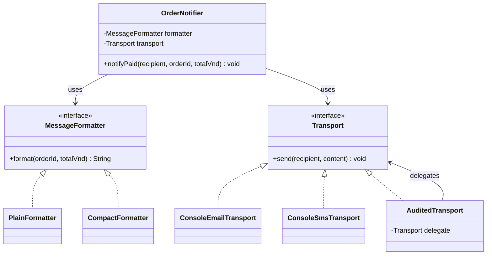

**Đọc sơ đồ:** mũi tên realization nét đứt từ một lớp về interface biểu thị `implements`; quan hệ `uses` biểu thị một đối tượng giữ và dùng tham chiếu tới đối tượng khác.

Trong UML, hình thoi đen (composition theo nghĩa quan hệ *whole–part* sở hữu vòng đời) còn mang ý nghĩa sở hữu mạnh hơn. Ví dụ bên dưới nhận dependency từ nơi tạo ứng dụng, nên ta dùng quan hệ tham chiếu/ủy quyền thay vì khẳng định `OrderNotifier` độc quyền sở hữu vòng đời của các thành phần. Trong thực tế lập trình, “composition over inheritance” thường nói rộng hơn về kỹ thuật **ghép hành vi qua đối tượng** như thiết kế này.

## 3. Ví dụ Java hoàn chỉnh: tạo một hành vi từ nhiều đối tượng

Tạo tệp **`CompositionDemo.java`**. Ví dụ không dùng framework và tương thích Java 11+.

```java
import java.util.Objects;

public class CompositionDemo {

    // 1) Hợp đồng định dạng.
    interface MessageFormatter {
        String format(String orderId, long totalVnd);
    }

    // 2) Hợp đồng gửi.
    interface Transport {
        void send(String recipient, String content);
    }

    // 3) Hai cách định dạng có thể thay thế.
    static final class PlainFormatter implements MessageFormatter {
        @Override
        public String format(String orderId, long totalVnd) {
            return "Đơn " + orderId
                    + " đã thanh toán: " + totalVnd + " VND";
        }
    }

    static final class CompactFormatter implements MessageFormatter {
        @Override
        public String format(String orderId, long totalVnd) {
            return orderId + " | PAID | " + totalVnd + " VND";
        }
    }

    // 4) Hai cách gửi có cùng interface.
    // Chỉ mô phỏng gửi bằng console, không gửi email/SMS thật.
    static final class ConsoleEmailTransport implements Transport {
        @Override
        public void send(String recipient, String content) {
            System.out.println(
                    "[EMAIL -> " + recipient + "] " + content);
        }
    }

    static final class ConsoleSmsTransport implements Transport {
        @Override
        public void send(String recipient, String content) {
            System.out.println(
                    "[SMS -> " + recipient + "] " + content);
        }
    }

    // 5) Một transport "bọc" transport khác để thêm hành vi.
    static final class AuditedTransport implements Transport {
        private final Transport delegate;

        AuditedTransport(Transport delegate) {
            this.delegate = Objects.requireNonNull(
                    delegate, "delegate");
        }

        @Override
        public void send(String recipient, String content) {
            delegate.send(recipient, content);
            System.out.println(
                    "[AUDIT] Đã thực hiện thao tác gửi tới " + recipient);
        }
    }

    // 6) Đối tượng cấp cao chỉ điều phối.
    static final class OrderNotifier {
        private final MessageFormatter formatter;
        private final Transport transport;

        OrderNotifier(MessageFormatter formatter, Transport transport) {
            this.formatter = Objects.requireNonNull(
                    formatter, "formatter");
            this.transport = Objects.requireNonNull(
                    transport, "transport");
        }

        void notifyPaid(
                String recipient,
                String orderId,
                long totalVnd) {

            requireText(recipient, "recipient");
            requireText(orderId, "orderId");

            if (totalVnd < 0) {
                throw new IllegalArgumentException(
                        "Tổng tiền không được âm");
            }

            String content = formatter.format(orderId, totalVnd);
            transport.send(recipient, content);
        }

        private static void requireText(String value, String field) {
            if (value == null || value.isBlank()) {
                throw new IllegalArgumentException(
                        field + " không được rỗng");
            }
        }
    }

    public static void main(String[] args) {
        // Tổ hợp A: nội dung đầy đủ, email và audit.
        OrderNotifier emailNotifier = new OrderNotifier(
                new PlainFormatter(),
                new AuditedTransport(new ConsoleEmailTransport())
        );

        // Tổ hợp B: nội dung ngắn, SMS và không audit.
        OrderNotifier smsNotifier = new OrderNotifier(
                new CompactFormatter(),
                new ConsoleSmsTransport()
        );

        emailNotifier.notifyPaid(
                "an@example.test", "ORD100", 150_000);

        smsNotifier.notifyPaid(
                "0900000000", "ORD101", 200_000);

        try {
            smsNotifier.notifyPaid("0900000000", "ORD102", -1);
        } catch (IllegalArgumentException ex) {
            System.out.println("Từ chối: " + ex.getMessage());
        }
    }
}
```

Chạy:

```bash
javac CompositionDemo.java
java CompositionDemo
```

Kết quả:

```text
[EMAIL -> an@example.test] Đơn ORD100 đã thanh toán: 150000 VND
[AUDIT] Đã thực hiện thao tác gửi tới an@example.test
[SMS -> 0900000000] ORD101 | PAID | 200000 VND
Từ chối: Tổng tiền không được âm
```

Từ một `OrderNotifier` duy nhất, ta tạo hai tổ hợp hành vi:

| Cấu hình | Formatter | Transport | Hành vi quan sát |
| --- | --- | --- | --- |
| Email có ghi log | `PlainFormatter` | `AuditedTransport(ConsoleEmailTransport)` | Tạo nội dung dài, “gửi” qua console email rồi in log |
| SMS ngắn | `CompactFormatter` | `ConsoleSmsTransport` | Tạo nội dung ngắn rồi “gửi” qua console SMS |
| Lời gọi tổng tiền âm | Bất kỳ | Bất kỳ | Bị từ chối trước khi gọi formatter và transport |

**Không cần sửa `OrderNotifier`** khi muốn đổi từ tổ hợp A sang B. Khác biệt nằm ở **các đối tượng thành phần được đưa vào constructor**.

Đây là tính linh hoạt cốt lõi của composition: từ vài đối tượng nhỏ, ta có thể tổ hợp thành nhiều hành vi tùy nhu cầu.

## 4. Ủy quyền (delegation): ai thực sự làm công việc?

Xem phương thức điều phối:

```java
void notifyPaid(String recipient, String orderId, long totalVnd) {
    requireText(recipient, "recipient");
    requireText(orderId, "orderId");

    if (totalVnd < 0) {
        throw new IllegalArgumentException(
                "Tổng tiền không được âm");
    }

    String content = formatter.format(orderId, totalVnd);
    transport.send(recipient, content);
}
```

`OrderNotifier` chịu trách nhiệm **điều phối**, nhưng:

- Nó **ủy quyền** phần tạo chuỗi cho `formatter`.
- Nó **ủy quyền** phần gửi cho `transport`.
- Nó chỉ tự kiểm tra những điều kiện đầu vào cơ bản thuộc lời gọi nghiệp vụ.
- Nó không cần biết formatter kết hợp chuỗi ra sao hoặc transport gửi bằng giao thức nào.

Luồng gọi:

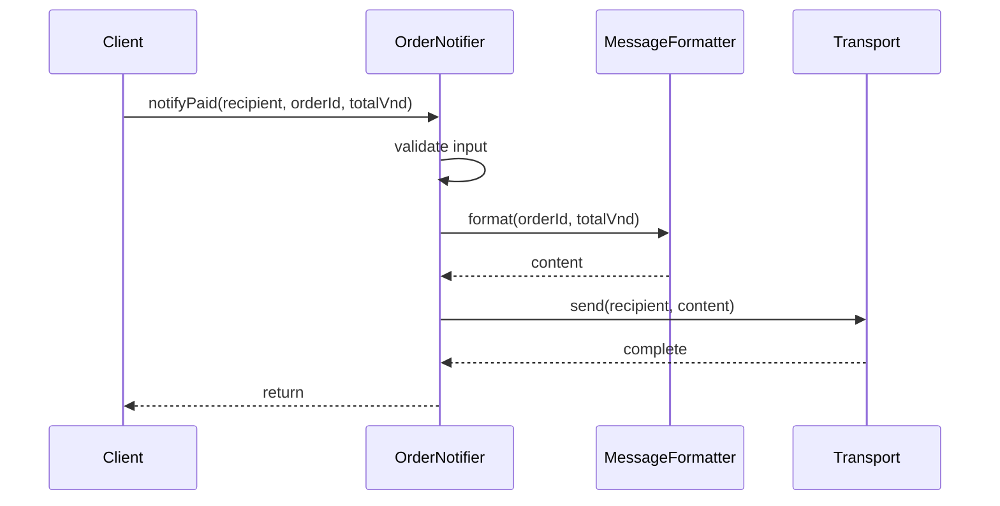

Điều phối và ủy quyền giúp **phân chia trách nhiệm**, không có nghĩa chương trình đột nhiên trở thành bất đồng bộ. Các lời gọi trong ví dụ là đồng bộ và chạy lần lượt trên cùng luồng.

Trong ứng dụng thực, `Transport.send` có thể gây lỗi mạng, timeout hoặc có kết quả xử lý bất đồng bộ. Khi đó cần quy định hợp đồng cụ thể: liệu method chỉ nhận yêu cầu hay đã giao thành công, lỗi được báo thế nào, có retry/idempotency hay không. Ví dụ console chỉ mô phỏng hành vi gửi để tập trung vào thiết kế OOP.

## 5. Constructor injection: ghép ở nơi tạo đối tượng

Tại sao `OrderNotifier` nhận hai dependency trong constructor thay vì tự viết:

```java
// Cách gắn chặt vào chi tiết implementation:
private final Transport transport = new ConsoleEmailTransport();
```

Nếu làm vậy, mỗi đối tượng `OrderNotifier` tự chọn một loại vận chuyển cụ thể. Thay kênh gửi có thể đòi sửa class điều phối, hoặc tạo thêm nhánh điều kiện ở bên trong.

Constructor injection:

```java
OrderNotifier(MessageFormatter formatter, Transport transport) {
    this.formatter = Objects.requireNonNull(formatter);
    this.transport = Objects.requireNonNull(transport);
}
```

giúp:

1. **Tách việc lắp ráp khỏi việc thực thi:** `main` hoặc composition root quyết định dùng thành phần nào; `OrderNotifier` chỉ sử dụng.
2. **Tạo đối tượng ở trạng thái hợp lệ:** constructor từ chối dependency `null` ngay lúc tạo.
3. **Dễ thay thế khi kiểm thử:** truyền một transport giả (fake) để quan sát lời gọi, không cần gửi thật.
4. **Giảm phụ thuộc:** `OrderNotifier` chỉ biết hai interface nhỏ.
5. **Làm rõ nhu cầu bắt buộc:** một notifier không thể chạy đúng nếu thiếu formatter hay transport.

`final` trên các field nghĩa là không gán lại tham chiếu sau constructor. Nó **không làm các đối tượng được tham chiếu trở nên bất biến**. Đối với các dependency có trạng thái mutable hoặc được chia sẻ nhiều nơi, cần xem thêm ràng buộc về sở hữu và đồng thời.

Không cần Spring hay bất kỳ DI framework nào để viết constructor injection. Framework chỉ có thể tự động hóa việc tạo và nối các đối tượng.

## 6. Thay thành phần để mở rộng hành vi

Giả sử hệ thống có thêm yêu cầu **thêm mã chiến dịch** vào nội dung. Ta có thể tạo formatter mới thực hiện cùng hợp đồng:

```java
final class CampaignFormatter
        implements CompositionDemo.MessageFormatter {

    private final CompositionDemo.MessageFormatter base;
    private final String campaign;

    CampaignFormatter(
            CompositionDemo.MessageFormatter base,
            String campaign) {

        this.base = java.util.Objects.requireNonNull(base);
        this.campaign = java.util.Objects.requireNonNull(campaign);
    }

    @Override
    public String format(String orderId, long totalVnd) {
        return base.format(orderId, totalVnd)
                + " | Campaign: " + campaign;
    }
}
```

Ở đây một formatter **giữ formatter khác** để bổ sung chức năng. Đây cũng là composition; nó gần với mẫu **Decorator** vì đối tượng bọc vẫn triển khai cùng interface với đối tượng bên trong.

Ví dụ sử dụng trong cùng package:

```java
CompositionDemo.MessageFormatter format =
        new CampaignFormatter(
                new CompositionDemo.PlainFormatter(), "SALE");

CompositionDemo.OrderNotifier notifier =
        new CompositionDemo.OrderNotifier(
                format, new CompositionDemo.ConsoleEmailTransport());

notifier.notifyPaid("an@example.test", "ORD103", 300_000);
```

Kết quả:

```text
[EMAIL -> an@example.test] Đơn ORD103 đã thanh toán: 300000 VND | Campaign: SALE
```

Trong trường hợp thêm nhiều lớp bọc, nên cân nhắc thứ tự áp dụng chúng. Chẳng hạn “chuẩn hóa đầu vào trước khi định dạng” khác với “định dạng rồi lọc nội dung”. Composition tạo sự linh hoạt, nhưng vẫn phải **thiết kế hợp đồng và thứ tự phối hợp** một cách rõ ràng.

> Đoạn `CampaignFormatter` là phần mở rộng minh họa, đặt cạnh các lớp của ví dụ chính trong cùng package. Ví dụ thực tế có thể tổ chức mỗi lớp vào một tệp riêng và công bố mức truy cập phù hợp.

## 7. Strategy và Decorator: hai cách ghép hành vi quen thuộc

Hai cấu hình trong chương trình chính thể hiện hai ý tưởng rất phổ biến:

**Strategy:** `MessageFormatter` có nhiều implementation như `PlainFormatter` và `CompactFormatter`. `OrderNotifier` chọn hành vi qua đối tượng được cung cấp; không phải tự chứa `if/else` cho mọi cách định dạng.

**Decorator:** `AuditedTransport` cũng `implements Transport` và chứa một `Transport` khác. Nó làm thêm việc trước hoặc sau khi ủy quyền, trong khi bên dùng vẫn coi nó là `Transport`.

```java
Transport transport =
        new AuditedTransport(new ConsoleEmailTransport());
```

Ý nghĩa:

- `ConsoleEmailTransport` thực hiện thao tác nền.
- `AuditedTransport` bọc hành vi nền và ghi log sau khi lời gọi `delegate.send(...)` hoàn tất bình thường.
- `OrderNotifier` không biết transport hiện tại có được bọc hay không.

Cần tránh suy luận quá mức: câu log `[AUDIT]` trong ví dụ chỉ cho biết lời gọi console không báo lỗi. Nó **không phải nhật ký giao dịch được lưu bền vững** và không chứng minh email/SMS đã đến thiết bị của người nhận. Một audit thật cần quy định lưu trữ, bảo đảm chống mất/đúp, và xử lý thất bại của bản ghi.

Không phải mọi thiết kế composition đều phải biến thành “mẫu thiết kế” phức tạp. Nếu chỉ cần một helper rõ nghĩa, một field và một lời gọi ủy quyền có thể đã đủ.

## 8. Composition khác inheritance thế nào?

Có thể đặt cạnh hai hướng thiết kế:

**Hướng kế thừa:**

```java
class EmailSender {
    void sendEmail(String recipient, String content) {
        System.out.println(recipient + ": " + content);
    }
}

// Không nên kế thừa chỉ để mượn method sendEmail.
class OrderNotifierByInheritance extends EmailSender {
    void notifyPaid(String recipient, String content) {
        sendEmail(recipient, content);
    }
}
```

`OrderNotifierByInheritance extends EmailSender` làm chương trình hình thành quan hệ “notifier **là một loại** email sender”. Về mặt nghiệp vụ, điều đó thường không đúng: notifier **sử dụng** sender chứ không **là** sender.

**Hướng composition:**

```java
class OrderNotifierByComposition {
    private final EmailSender sender;

    OrderNotifierByComposition(EmailSender sender) {
        this.sender = sender;
    }

    void notifyPaid(String recipient, String content) {
        sender.sendEmail(recipient, content);
    }
}
```

Hướng thứ hai thể hiện đúng “notifier **có/sử dụng** sender”. Nếu tiếp tục thay field bằng interface `Transport`, ta còn có thể chuyển từ email sang SMS mà không làm đổi lớp notifier.

| Tiêu chí | Kế thừa (inheritance) | Ghép đối tượng (composition) |
| --- | --- | --- |
| Quan hệ chính | `is-a`: kiểu con là một trường hợp của kiểu cha | `has-a / uses-a`: đối tượng giữ và dùng đối tượng khác |
| Tái sử dụng | Kế thừa implementation và/hoặc hợp đồng của superclass | Gọi/ủy quyền qua đối tượng thành phần |
| Liên kết với chi tiết | Lớp con có thể phụ thuộc vào protected API, trình tự và bất biến cha | Có thể che giấu chi tiết qua interface nhỏ |
| Thay hành vi | Override trong những điểm mở rộng được phép | Thay dependency hoặc tổ hợp decorator/strategy |
| Thay khi runtime | Kiểu thực tế của object đã tạo không tự đổi | Có thể tạo tổ hợp mới hoặc có cơ chế cập nhật dependency được thiết kế rõ |
| Rủi ro | Kế thừa chỉ để mượn code, phá quan hệ kiểu con | Quá nhiều lớp trung gian, cấu hình phức tạp |
| Phù hợp khi | Có quan hệ subtype thực sự và hợp đồng của cha được giữ | Cần cộng tác hoặc tái sử dụng mà không muốn ràng buộc vào superclass |

Câu “**favor composition over inheritance**” là một **nguyên tắc cân nhắc**, không phải lệnh cấm `extends`. Nếu `ElectricCar` thật sự là một kiểu `Vehicle` với hợp đồng phù hợp, kế thừa vẫn có thể hợp lý. Nếu một đối tượng chỉ “cần dùng chức năng” của đối tượng khác thì composition thường mô tả rõ hơn.

## 9. Ghép đối tượng không đồng nghĩa độc quyền sở hữu

Đây là một khác biệt tinh tế nhưng quan trọng.

```java
Transport shared = new ConsoleEmailTransport();

OrderNotifier first =
        new OrderNotifier(new PlainFormatter(), shared);
OrderNotifier second =
        new OrderNotifier(new CompactFormatter(), shared);
```

`first` và `second` **cùng giữ tham chiếu** tới `shared`. Cả hai có thể dùng nó. Java không tự nhân bản transport, không tự đóng transport khi một notifier hết sử dụng và không đảm bảo mỗi notifier sở hữu độc quyền dependency.

Khi thành phần chứa trạng thái như cache, kết nối I/O hay hàng đợi:

- Xác định **ai tạo, ai đóng, ai được sửa** dependency.
- Quy định có cho phép dùng chung instance không.
- Nếu dùng chung giữa nhiều luồng, xem xét thread-safety.
- Nếu cần snapshot độc lập của dữ liệu mutable, dùng sao chép phòng vệ hoặc value object phù hợp.

Không phải cứ có `private final Transport transport` là một quan hệ composition sở hữu mạnh trong UML, cũng không có nghĩa dependency bất biến. **Field `final` chỉ giữ nguyên tham chiếu**; trạng thái bên trong đối tượng đích vẫn có thể thay đổi.

Khi một thành phần sở hữu vòng đời mạnh của đối tượng con, nên thể hiện rõ trong API và quy tắc đóng tài nguyên. Ví dụ một service tự tạo một bộ đệm nội bộ, không trao đối tượng đó ra ngoài, và chủ động giải phóng khi service đóng. Trong trường hợp như vậy, mô hình “whole–part” chặt hơn có thể phù hợp.

## 10. Kiểm thử tổ hợp mà không gửi thông báo thật

Một lợi ích thực tế của composition là thay đối tượng gửi thật bằng **test double** để quan sát hành vi của lớp điều phối.

Tạo tệp **`CompositionTest.java`** cùng thư mục với `CompositionDemo.java`:

```java
public class CompositionTest {

    static final class RecordingTransport
            implements CompositionDemo.Transport {

        int calls;
        String lastRecipient;
        String lastContent;

        @Override
        public void send(String recipient, String content) {
            calls++;
            lastRecipient = recipient;
            lastContent = content;
        }
    }

    public static void main(String[] args) {
        RecordingTransport transport = new RecordingTransport();

        CompositionDemo.OrderNotifier notifier =
                new CompositionDemo.OrderNotifier(
                        new CompositionDemo.PlainFormatter(),
                        transport);

        notifier.notifyPaid("lan@example.test", "ORD200", 75_000);

        check(transport.calls == 1,
                "Phải gọi transport đúng một lần");
        check("lan@example.test".equals(transport.lastRecipient),
                "Sai người nhận");
        check("Đơn ORD200 đã thanh toán: 75000 VND"
                .equals(transport.lastContent),
                "Sai nội dung đã định dạng");

        try {
            notifier.notifyPaid("lan@example.test", "ORD201", -5);
            throw new AssertionError("Phải từ chối tổng tiền âm");
        } catch (IllegalArgumentException expected) {
            // Đúng: không gọi Transport cho yêu cầu sai.
        }

        check(transport.calls == 1,
                "Lỗi validation không được tạo thêm lời gọi gửi");

        System.out.println("PASS: composition và delegation");
    }

    static void check(boolean condition, String message) {
        if (!condition) {
            throw new AssertionError(message);
        }
    }
}
```

Chạy:

```bash
javac CompositionDemo.java CompositionTest.java
java CompositionTest
```

Kết quả dự kiến:

```text
PASS: composition và delegation
```

Bài kiểm tra này không phụ thuộc email/SMS thật. Nó chứng minh:

1. `OrderNotifier` gọi đúng dependency đã tiêm vào.
2. Kết quả formatter được chuyển nguyên văn cho transport.
3. Input sai được chặn trước khi gây hiệu ứng gửi.
4. Ta có thể kiểm thử **hành vi của một đối tượng** mà không phải khởi động toàn bộ hạ tầng ngoài.

Trong ứng dụng có JUnit, `RecordingTransport` có thể được giữ làm fake hoặc thay bằng mock tùy mục tiêu. Không phải phép kiểm thử nào cũng cần mock framework.

### Kiểm tra trường hợp dependency thất bại

Giả sử `Transport.send(...)` ném ngoại lệ trong lúc gửi. Với hiện thực `OrderNotifier` đang dùng, ngoại lệ được truyền ra cho caller; không có xử lý retry, rollback hay đảm bảo giao dịch nào được ngầm tạo ra.

Nếu hệ thống cần “gửi chính xác một lần” hay “ít nhất một lần”, phải thiết kế thêm cơ chế xử lý idempotency, hàng đợi, lưu trạng thái yêu cầu và lỗi hạ tầng. **Ghép đối tượng chỉ tổ chức trách nhiệm**, không tự bảo đảm tính tin cậy phân tán.

## 11. Những sai lầm dễ gặp

| Sai lầm | Vì sao có vấn đề? | Hướng sửa |
| --- | --- | --- |
| Kế thừa `EmailSender` chỉ để mượn hàm gửi | Tạo quan hệ `is-a` sai nghĩa | Chứa một `Transport` và ủy quyền |
| Một `OrderNotifier` dùng `if`/`switch` cho mọi kênh và định dạng | Mỗi biến thể mới buộc sửa class điều phối | Tách implementation sau interface phù hợp |
| Dùng `new ConsoleEmailTransport()` bên trong service | Khó thay kênh và kiểm thử | Lắp dependency ở constructor/composition root |
| Trả tham chiếu mutable nội bộ một cách vô ý | Caller có thể thay đổi trạng thái ngoài kiểm soát | Xác định ownership, copy hoặc API giới hạn |
| Cho rằng `final` làm dependency bất biến | `final` chỉ cấm gán lại field | Kiểm tra mutability của đối tượng được tham chiếu |
| Chia ra hàng chục interface cho vài dòng logic | Khó đọc và khó bảo trì | Chỉ tách khi có trách nhiệm hoặc khả năng thay thế rõ |
| Decorator thay đổi ngữ nghĩa lỗi mà client không biết | Làm hợp đồng trở nên khó dự đoán | Ghi rõ và giữ hành vi lỗi đã công bố |
| Xem log console là audit giao dịch thực | Không có lưu bền vững hay đối soát | Thiết kế audit riêng khi nghiệp vụ đòi hỏi |
| Giả định mọi đối tượng ghép đều có vòng đời chung | Dependency có thể được dùng chung hoặc sở hữu bên ngoài | Quy định ai tạo, ai giữ và ai giải phóng |

## 12. Bài tập áp dụng

**Bài tập A — đổi cách định dạng mà không sửa notifier.** Viết `UppercaseFormatter implements MessageFormatter`, dùng một formatter khác ở bên trong rồi chuyển kết quả sang chữ hoa bằng `toUpperCase(Locale.ROOT)`. Hãy dùng nó với `ConsoleSmsTransport` và giải thích đây là cách bổ sung hành vi bằng composition/decorator.

**Bài tập B — thay kênh gửi.** Viết `ConsolePushTransport implements Transport` sao cho in `[PUSH -> recipient] content`. Ghép nó với `PlainFormatter`. Trong `OrderNotifier` có cần sửa dòng nào không? **Không**, miễn transport giữ đúng hợp đồng `send`.

**Bài tập C — thứ tự hành vi.** Viết một `PrefixFormatter` và một `SuffixFormatter` đều bọc `MessageFormatter`. So sánh kết quả của hai tổ hợp `Prefix(Suffix(base))` và `Suffix(Prefix(base))`, rồi phân tích khi nào thứ tự decorator có tác động.

**Bài tập D — kiểm tra lỗi.** Tạo `FailingTransport` luôn ném `IllegalStateException`. Dùng `RecordingTransport` hoặc test khác để xác minh lớp notifier **không che giấu ngoại lệ** trong ví dụ, và thảo luận hợp đồng retry nếu muốn tự khôi phục.

**Bài tập E — thiết kế cửa hàng.** Phác thảo `CheckoutService` gồm `DiscountPolicy`, `ShippingFeePolicy` và `PaymentGateway`. Xác định dữ liệu vào, kết quả, thứ tự gọi và bất biến tiền tệ. Thảo luận vì sao không nên xây chuỗi kế thừa như `CheckoutService extends PaymentGateway` chỉ để dùng lại phương thức thanh toán.

## Kết luận

**Ghép đối tượng để xây dựng hành vi** là cách để một đối tượng cấp cao làm việc thông qua các đối tượng thành phần có trách nhiệm rõ ràng. Các thành phần có thể được nối qua constructor, trao đổi qua interface và ủy quyền cho nhau, từ đó hình thành nhiều tổ hợp hành vi mà không cần đặt tất cả logic vào một lớp hoặc lạm dụng kế thừa.

Khi thiết kế, hãy xác định **mỗi thành phần làm gì**, **hợp đồng nào kết nối chúng**, **thứ tự phối hợp ra sao**, và **ai sở hữu vòng đời/trạng thái**. Một cấu trúc composition tốt không chỉ giảm phụ thuộc mà còn giúp thay thế và kiểm thử hành vi ở từng ranh giới.


</details>

- [Quay lại đầu trang](#back-to-top)

---

## <a id="composition-002">Quan hệ “có một” và quan hệ “là một”</a>

<details>
<summary>Xem chi tiết</summary>

# Quan hệ “có một” (has-a) và quan hệ “là một” (is-a) trong Java OOP

Khi thiết kế các lớp, một trong những quyết định quan trọng nhất là **nối chúng với nhau bằng quan hệ nào**. Hai quan hệ dễ gặp là:

- **Is-a — “là một”:** một đối tượng thuộc một kiểu tổng quát hơn. Ví dụ: *ô tô là một loại phương tiện*. Trong Java, quan hệ kiểu con thường được biểu diễn bằng `extends` hoặc `implements`.
- **Has-a — “có một”:** một đối tượng giữ hoặc sử dụng một đối tượng khác như một phần cấu trúc hay khả năng của nó. Ví dụ: *ô tô có một hệ thống truyền động*. Trong Java, điều này thường được thể hiện bằng **field tham chiếu**, kết hợp đối tượng (*composition*) hoặc các hình thức association/aggregation phù hợp.

Hai quan hệ không loại trừ nhau: **`Car` có thể `extends Vehicle` và đồng thời chứa một `PowerSource`**.

Điều quan trọng không phải chọn cú pháp nào ngắn hơn, mà là biểu diễn đúng **ý nghĩa nghiệp vụ, quyền sở hữu trạng thái, khả năng thay thế và vòng đời**.

## 1. So sánh trực tiếp is-a và has-a

| Câu hỏi | Is-a — “là một” | Has-a — “có một” |
|---|---|---|
| Bản chất | Phân loại, chuyên biệt hóa hoặc thực hiện hợp đồng kiểu | Liên kết, chứa hoặc sử dụng thành phần |
| Cách diễn đạt | “Mỗi `Car` đều là một `Vehicle`” | “Mỗi `Car` có/được cấp một `PowerSource`” |
| Cơ chế Java phổ biến | `extends`, `implements` | Field, constructor injection, tạo thành phần nội bộ |
| Mục tiêu | Sử dụng đối tượng lớp con ở vị trí yêu cầu kiểu cha/hợp đồng | Tạo hành vi từ việc phối hợp các đối tượng có trách nhiệm riêng |
| Đối tượng runtime | Một instance của lớp con có phần trạng thái lớp cha | Các thành phần là những đối tượng riêng có tham chiếu liên kết |
| Tái sử dụng | Kế thừa hành vi hợp lệ hoặc cung cấp cùng API | Ủy quyền (*delegation*) cho thành phần |
| Mức gắn kết | Lớp con phụ thuộc chặt hơn vào hợp đồng lớp cha | Có thể thay thế thành phần qua interface |
| Sai lầm thường gặp | Kế thừa chỉ để “mượn” một hàm tiện ích | Hiểu rằng cứ có field tham chiếu là sở hữu độc quyền thành phần |

**Quy tắc kiểm tra nhanh:**

- Nếu câu **“X là một loại Y”** đúng trong ngữ nghĩa nghiệp vụ **và X có thể được sử dụng thay Y mà không vi phạm hợp đồng**, cân nhắc is-a.
- Nếu câu **“X sử dụng/giữ một Y để làm công việc của X”** đúng, cân nhắc has-a.
- Nếu chỉ thấy hai lớp có vài dòng code giống nhau, điều đó **chưa đủ** để kết luận chúng cần quan hệ is-a.

## 2. Ví dụ Java hoàn chỉnh: ô tô vừa “là một” vừa “có một”

Chúng ta xây dựng một mô hình nhỏ:

- Mọi phương tiện đều có mã định danh và hành vi `move()`.
- `Car` và `Bicycle` là các loại `Vehicle`.
- `Car` có một thành phần `PowerSource`; loại nguồn động lực được truyền vào khi tạo ô tô.
- `Bicycle` không cần `PowerSource` trong mô hình này.

File `RelationsDemo.java` (Java 11+):

```java
import java.util.List;
import java.util.Objects;

public class RelationsDemo {

    // Hợp đồng cho thành phần cung cấp động lực.
    interface PowerSource {
        String activate();
    }

    static final class ElectricMotor implements PowerSource {
        @Override
        public String activate() {
            return "mô-tơ điện đã sẵn sàng";
        }
    }

    static final class PetrolEngine implements PowerSource {
        @Override
        public String activate() {
            return "động cơ xăng đã khởi động";
        }
    }

    // Lớp tổng quát: thể hiện quan hệ is-a của các phương tiện.
    static abstract class Vehicle {
        private final String id;

        protected Vehicle(String id) {
            if (id == null || id.isBlank()) {
                throw new IllegalArgumentException("Mã phương tiện rỗng");
            }
            this.id = id.strip();
        }

        public final String id() {
            return id;
        }

        public abstract String move();
    }

    static final class Car extends Vehicle {
        // Has-a: Car giữ một tham chiếu PowerSource.
        private final PowerSource powerSource;

        public Car(String id, PowerSource powerSource) {
            super(id);
            this.powerSource =
                    Objects.requireNonNull(powerSource, "powerSource");
        }

        @Override
        public String move() {
            // Car ủy quyền một phần công việc cho thành phần.
            return "Car " + id() + ": " + powerSource.activate()
                    + " -> di chuyển";
        }
    }

    static final class Bicycle extends Vehicle {
        public Bicycle(String id) {
            super(id);
        }

        @Override
        public String move() {
            return "Bicycle " + id() + ": đạp bằng sức người";
        }
    }

    public static void main(String[] args) {
        Vehicle electricCar =
                new Car("CAR-01", new ElectricMotor());

        Vehicle petrolCar =
                new Car("CAR-02", new PetrolEngine());

        Vehicle bicycle = new Bicycle("BIKE-01");

        List<Vehicle> fleet = List.of(
                electricCar, petrolCar, bicycle
        );

        for (Vehicle vehicle : fleet) {
            System.out.println(vehicle.move());
        }
    }
}
```

Chạy:

```bash
javac RelationsDemo.java
java RelationsDemo
```

Kết quả:

```text
Car CAR-01: mô-tơ điện đã sẵn sàng -> di chuyển
Car CAR-02: động cơ xăng đã khởi động -> di chuyển
Bicycle BIKE-01: đạp bằng sức người
```

### Chỉ ra hai quan hệ trong cùng chương trình

**Is-a:**

```java
static final class Car extends Vehicle { ... }
static final class Bicycle extends Vehicle { ... }
```

Một biến khai báo kiểu `Vehicle` có thể tham chiếu đến `Car` hoặc `Bicycle`:

```java
Vehicle vehicle = new Car("CAR-03", new ElectricMotor());
System.out.println(vehicle.move());
```

`Vehicle` quy định rằng phương tiện có hành vi `move()`. Java chọn implementation `Car.move()` theo kiểu thực tế của đối tượng. Đây là **đa hình** dựa trên quan hệ is-a.

**Has-a:**

```java
private final PowerSource powerSource;
```

`Car` **giữ một thành phần** đáp ứng hợp đồng `PowerSource`. Khi di chuyển, `Car` gọi `powerSource.activate()`, tức **ủy quyền** công việc cho một đối tượng khác.

Thay `ElectricMotor` bằng `PetrolEngine` không yêu cầu `Car` thay superclass hoặc sao chép thuật toán khởi động của từng loại động cơ. `Car` cũng không phải một `PowerSource`: ô tô **sử dụng** nguồn động lực, chứ bản thân nó không phải một loại động cơ trong mô hình này.

### Sơ đồ quan hệ

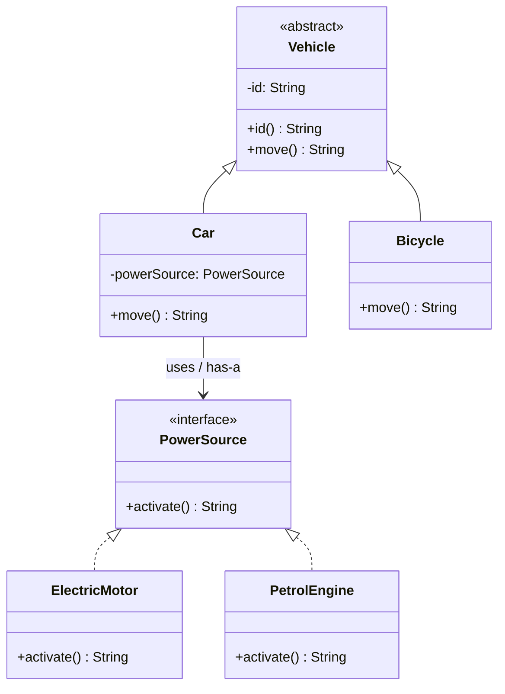

Trong sơ đồ:

- Mũi tên kế thừa `Vehicle <|-- Car` cho thấy **Car là một Vehicle**.
- Đường `Car --> PowerSource` cho thấy **Car giữ và sử dụng PowerSource**.
- Các đường từ `ElectricMotor`, `PetrolEngine` đến `PowerSource` cho thấy **mỗi loại động cơ thực hiện hợp đồng PowerSource**.

Sơ đồ cố ý dùng một **association có hướng** giữa `Car` và `PowerSource`, chưa khẳng định Car sở hữu độc quyền toàn bộ vòng đời nguồn động lực. Chúng ta sẽ phân biệt điều đó ở phần sau.

## 3. Is-a phải đúng cả về hợp đồng, không chỉ đúng tên gọi

Viết `extends` khiến Java chấp nhận quan hệ kiểu con về mặt cú pháp (nếu lớp cha có thể được kế thừa), nhưng **không tự chứng minh mô hình nghiệp vụ đúng**.

Ví dụ thiết kế sai:

```java
class Engine {
    void ignite() {
        System.out.println("Ignite");
    }
}

// Không nên:
// class Car extends Engine { ... }
```

Ô tô cần động cơ không có nghĩa **ô tô là một động cơ**. Nếu kế thừa như vậy chỉ để gọi `ignite()`, `Car` sẽ thừa hưởng API của `Engine` như thể người dùng có thể thay một động cơ bằng cả ô tô. Đó là một quan hệ phân loại sai.

Tương tự:

```java
// Các quan hệ thường không phản ánh đúng nghiệp vụ:
// class Order extends Customer { ... }
// class Library extends Book { ... }
// class House extends Door { ... }
```

Trong các ví dụ đó, có thể diễn đạt hợp lý hơn bằng field:

```java
class Order {
    private final Customer customer;

    Order(Customer customer) {
        this.customer =
            java.util.Objects.requireNonNull(customer, "customer");
    }
}
```

Một đơn hàng **thuộc về/có liên kết tới một khách hàng**; nó không **là một khách hàng**.

### Kiểm tra bằng khả năng thay thế

Giả sử code xử lý bất kỳ `Vehicle` nào:

```java
static void startTrip(Vehicle vehicle) {
    System.out.println(vehicle.move());
}
```

Cả `Car` và `Bicycle` đều thực hiện `move()` theo hợp đồng đã xác định, nên thay thế được ở đây:

```java
startTrip(new Car("CAR-04", new ElectricMotor()));
startTrip(new Bicycle("BIKE-02"));
```

Đó là ý tưởng của **Liskov Substitution Principle**: nơi cần kiểu cha có thể làm việc với kiểu con mà không bị phá các kỳ vọng quan trọng về đầu vào, đầu ra và bất biến.

Ví dụ nếu `Vehicle.move()` cam kết trả chuỗi mô tả không rỗng cho phương tiện sẵn sàng, subclass không nên bất ngờ trả `null` chỉ vì thuật toán bên trong khác. Việc **đúng cú pháp kế thừa** chưa đủ; quan hệ kiểu con còn phải tôn trọng hợp đồng hành vi.

## 4. Has-a không chỉ có một hình thức

Trong giao tiếp hằng ngày, has-a mô tả chung việc một đối tượng **có hoặc sử dụng** một đối tượng khác. Trong UML/OOP, thường phân biệt thêm:

| Quan hệ | Ý nghĩa thiết kế | Ví dụ | Cách biểu diễn |
|---|---|---|---|
| **Association** (liên kết) | Một đối tượng biết hoặc tương tác với đối tượng khác | `Order` liên kết `Customer` | Field/tham số hoặc quan hệ qua ID, tùy mô hình |
| **Aggregation** (kết tập, quan hệ toàn thể–bộ phận lỏng) | Thành phần có thể tồn tại độc lập hoặc được chia sẻ | `Team` có nhiều `Player` | Thường lưu tham chiếu/collection, UML hình thoi rỗng khi dùng |
| **Composition** (hợp thành, sở hữu mạnh) | Thành phần được mô hình coi là thuộc toàn thể và phụ thuộc vòng đời/sở hữu của toàn thể | `Order` sở hữu các `OrderLine` trong một thiết kế cụ thể | API ngăn chia sẻ tùy tiện; UML hình thoi đặc khi cam kết sở hữu |
| **Dependency** (phụ thuộc sử dụng) | Chỉ cần thành phần để thực hiện một công việc, không nhất thiết lưu lâu | Phương thức nhận `Formatter` làm tham số | Tham số, biến cục bộ; UML đường phụ thuộc |

Không phải mọi field tham chiếu đều là **composition theo nghĩa sở hữu mạnh**. Ví dụ `Car` nhận một `PowerSource` từ bên ngoài: thành phần này có thể được một phần khác của chương trình giữ tham chiếu và quản lý. Vậy nên không thể suy ra “Car độc quyền sở hữu motor” chỉ từ:

```java
private final PowerSource powerSource;
```

Từ khóa `final` chỉ ngăn gán lại **field tham chiếu** sau khi hoàn tất khởi tạo hợp lệ; nó không ngăn bên ngoài giữ cùng đối tượng, không làm đối tượng thành phần bất biến, và không tự động quy định quyền sở hữu.

### Association so với composition: ví dụ đơn hàng

Một thiết kế có thể quyết định rằng **đơn hàng sở hữu các dòng hàng được chốt tại thời điểm đặt**. Khi đó, các dòng hàng là snapshot dữ liệu được quản lý bởi đơn hàng; không có API cho phép caller thay đổi chúng độc lập.

File `OrderCompositionDemo.java` (Java 17+):

```java
import java.util.List;
import java.util.Objects;

public class OrderCompositionDemo {
    record OrderLine(String sku, int quantity, long unitPriceVnd) {
        OrderLine {
            if (sku == null || sku.isBlank()) {
                throw new IllegalArgumentException("sku rỗng");
            }
            if (quantity <= 0) {
                throw new IllegalArgumentException("quantity phải dương");
            }
            if (unitPriceVnd < 0) {
                throw new IllegalArgumentException("Giá không được âm");
            }
            sku = sku.strip();
        }

        long subtotalVnd() {
            return Math.multiplyExact(unitPriceVnd, quantity);
        }
    }

    static final class Order {
        private final String id;
        private final List<OrderLine> lines;

        Order(String id, List<OrderLine> lines) {
            if (id == null || id.isBlank()) {
                throw new IllegalArgumentException("id rỗng");
            }

            this.id = id.strip();
            this.lines =
                List.copyOf(Objects.requireNonNull(lines, "lines"));

            if (this.lines.isEmpty()) {
                throw new IllegalArgumentException("Đơn hàng phải có hàng");
            }
        }

        long totalVnd() {
            long total = 0;
            for (OrderLine line : lines) {
                total = Math.addExact(total, line.subtotalVnd());
            }
            return total;
        }

        int lineCount() {
            return lines.size();
        }
    }

    public static void main(String[] args) {
        Order order = new Order("O-001", List.of(
            new OrderLine("BOOK-01", 2, 70_000L),
            new OrderLine("PEN-01", 3, 10_000L)
        ));

        System.out.println(order.lineCount()); // 2
        System.out.println(order.totalVnd());  // 170000
    }
}
```

Trong mô hình này:

- `Order` **có nhiều** `OrderLine`, không phải “Order là một OrderLine”.
- `List.copyOf(...)` tạo hoặc tái sử dụng danh sách không thể sửa qua API `List`, và từ chối các phần tử `null`.
- `OrderLine` là `record` chỉ chứa `String` và primitive; dữ liệu của nó bất biến theo thiết kế ví dụ. Vì vậy chia sẻ tham chiếu tới từng record không làm caller sửa được nội dung dòng hàng.
- `Order` không trả ra collection có thể sửa và không có setter cho danh sách dòng hàng.

Đây là **cách thiết kế diễn đạt quyền kiểm soát dữ liệu của Order**, phù hợp ý tưởng composition ở tầng domain. Dù vậy, bản thân Java không có cơ chế “xóa ngay mọi `OrderLine` khi Order bị giải phóng”, và các record bất biến có thể được chia sẻ an toàn. **Quan hệ sở hữu trong mô hình không đồng nghĩa vòng đời bộ nhớ phải được quản lý như C++**.

Nếu `OrderLine` là class mutable, chỉ `List.copyOf` **không đủ** để cô lập trạng thái từng phần tử: cần defensive copy sâu hơn, một immutable value object khác hoặc API giới hạn thay đổi.

## 5. Vòng đời đối tượng và quyền sở hữu: đừng suy luận từ garbage collector

Xét:

```java
Engine engine = new Engine();
Car car = new Car(engine);
```

Với các lớp `Engine` và `Car` tương thích, cả biến `engine` lẫn field `car.engine` có thể tham chiếu **cùng một đối tượng**.

Nếu biến `car` không còn được sử dụng, không thể kết luận `engine` biến mất ngay. Đối tượng thành phần vẫn còn tham chiếu riêng và việc thu hồi bộ nhớ do garbage collector quyết định.

Ở chiều ngược lại, nếu đối tượng thành phần đại diện tài nguyên như socket, file handle hoặc database connection, ta phải có **hợp đồng đóng tài nguyên** rõ ràng; không nên mặc định chỉ cần “cha mất thì con tự được đóng”.

Một lớp sở hữu tài nguyên có thể triển khai `AutoCloseable` và đóng thành phần theo hợp đồng riêng:

```java
interface Connection extends AutoCloseable {
    void send(String text);

    @Override
    void close();
}

final class Client implements AutoCloseable {
    private final Connection connection;

    Client(Connection connection) {
        this.connection =
            java.util.Objects.requireNonNull(connection);
    }

    void send(String message) {
        connection.send(message);
    }

    @Override
    public void close() {
        connection.close();
    }
}
```

**Lưu ý quan trọng:** `Client.close()` như trên ngụ ý `Client` **được quyền sở hữu và đóng** connection. Nếu connection được chia sẻ hoặc caller tự quản lý, tự động đóng trong `Client.close()` có thể gây lỗi. Cần quyết định và ghi rõ ai có trách nhiệm đóng; quyền sở hữu không tự suy ra từ việc có field tham chiếu.

## 6. Composition và delegation: tái sử dụng mà không cần extends

Kế thừa cho phép subclass dùng và override phương thức được kế thừa. Composition cho phép đối tượng **gọi một thành phần khác thực hiện một phần công việc**.

Ví dụ `Car.move()` đã gọi `powerSource.activate()`. Đây là delegation:

```java
final class Car extends Vehicle {
    private final PowerSource powerSource;

    // Constructor nhận PowerSource...

    @Override
    public String move() {
        return powerSource.activate() + " -> xe di chuyển";
    }
}
```

Sự phối hợp này đem lại các lợi ích:

- **Thay implementation độc lập:** `ElectricMotor` hoặc `PetrolEngine` có thể thỏa mãn cùng hợp đồng `PowerSource`.
- **Kiểm thử dễ hơn:** có thể cung cấp implementation giả để kiểm tra `Car` gọi đúng thành phần.
- **Trách nhiệm gọn hơn:** `Car` mô tả cách xe di chuyển, còn `PowerSource` mô tả cách kích hoạt nguồn động lực.
- **Không chiếm superclass:** `Car` vẫn có thể `extends Vehicle` trong khi dùng nhiều thành phần khác.

Ví dụ một test double đơn giản:

```java
PowerSource fake = () -> "nguồn giả lập sẵn sàng";
Vehicle testCar = new Car("TEST-01", fake);

System.out.println(testCar.move());
// Car TEST-01: nguồn giả lập sẵn sàng -> di chuyển
```

`PowerSource` là functional interface trong ví dụ, vì chỉ có một abstract method `activate()`. Cách truyền lambda này kiểm tra sự **hợp tác giữa các đối tượng**, không cần tạo superclass riêng chỉ phục vụ test.

### “Ưu tiên composition hơn inheritance” có nghĩa gì?

Đây là một lời khuyên **theo ngữ cảnh**, không phải quy tắc cấm kế thừa. Khi mục tiêu chủ yếu là tái sử dụng hành vi hoặc lựa chọn thuật toán, composition thường giảm ràng buộc hơn. Khi có quan hệ is-a đúng nghĩa và cần tính thay thế qua superclass hoặc interface, kế thừa/quan hệ kiểu con vẫn phù hợp.

Không nên chuyển mọi quan hệ is-a thành field “để không dùng extends”, cũng không nên biến mọi has-a thành extends chỉ để được gọi phương thức.

## 7. Interface có phải quan hệ “là một” không?

Về hệ thống kiểu của Java, nếu:

```java
interface Payable {
    long amountDueVnd();
}

class Invoice implements Payable {
    @Override
    public long amountDueVnd() {
        return 150_000L;
    }
}
```

thì một đối tượng `Invoice` có thể dùng ở nơi cần `Payable`:

```java
Payable item = new Invoice();
System.out.println(item.amountDueVnd()); // 150000
```

`Invoice` là **subtype của `Payable`** về mặt kiểu và hợp đồng. Nhưng khi diễn đạt tự nhiên, nên nói “Invoice **có khả năng được thanh toán**” hoặc “Invoice **thực hiện hợp đồng Payable**”, thay vì ép một phát biểu phân loại thế giới thực như “hóa đơn là một vật thanh toán” nếu cách nói đó không có ý nghĩa.

Vì vậy cần phân biệt:

- **Is-a trong phân loại domain**: `Car extends Vehicle`.
- **Subtyping theo khả năng/hợp đồng**: `Invoice implements Payable`.

Cả hai cho phép đa hình về kiểu, nhưng ngữ nghĩa thiết kế khác nhau. Khi nhiều loại đối tượng khác họ chia sẻ một khả năng, interface thường diễn đạt tốt hơn một superclass chứa trạng thái chung gượng ép.

## 8. Khi nào một đối tượng nên “có nhiều” thành phần?

Một tổ chức có thể có nhiều nhân viên, một đơn hàng có nhiều dòng hàng, một playlist có nhiều bài hát. Has-a không giới hạn ở đúng một đối tượng:

```java
class Playlist {
    private final java.util.List<Song> songs;

    Playlist(java.util.List<Song> songs) {
        this.songs = java.util.List.copyOf(songs);
    }
}
```

Quan hệ “có nhiều” được thể hiện bằng collection. Nhưng **collection không đủ xác định ý nghĩa sở hữu**:

- Playlist có thể chỉ **liên kết** tới những bài hát tồn tại độc lập.
- Order có thể **sở hữu snapshot** các dòng hàng theo thời điểm đặt đơn.
- Team có thể giữ danh sách người chơi nhưng người chơi vẫn có thể chuyển đội.
- Một đối tượng có thể dùng một service chung được inject và không sở hữu service đó.

Khi cần tài liệu hóa quan hệ, nên ghi thêm:

1. **Multiplicity:** một hay nhiều? Có bắt buộc phải có ít nhất một phần tử không?
2. **Ownership:** ai tạo, ai cập nhật, ai giải phóng tài nguyên?
3. **Mutability:** thành phần có thể đổi trạng thái và được chia sẻ không?
4. **Lifecycle:** thành phần có tồn tại độc lập với đối tượng chứa không?
5. **Direction:** bên nào cần biết bên nào? Có thực sự cần liên kết hai chiều không?

## 9. Sai lầm phổ biến khi chọn quan hệ

| Thiết kế | Vấn đề | Cách suy nghĩ lại |
|---|---|---|
| `Car extends Engine` | Ô tô không phải là động cơ | `Car` có/sử dụng `Engine` |
| `Order extends Customer` | Đơn hàng không phải một khách hàng | `Order` liên kết `Customer` |
| `PaymentService extends DatabaseClient` chỉ để gọi `save()` | Lẫn trách nhiệm nghiệp vụ với hạ tầng | Service chứa hoặc được inject repository |
| Mọi class dùng chung utility đều `extends BaseUtil` | Dùng kế thừa thay vì tái sử dụng chức năng | Utility, composition hoặc interface phù hợp |
| `Team` giữ `List<Player>` rồi kết luận sở hữu độc quyền `Player` | Field tham chiếu không chứng minh ownership | Xác định quy tắc chia sẻ và vòng đời |
| Field `private final Engine` nên nghĩ Engine bất biến | `final` chỉ cố định tham chiếu field | Xem tính mutable của Engine và đường truy cập ngoài |
| Kết luận component bị hủy ngay khi container không còn tham chiếu | Java không có destructor sở hữu bộ nhớ như vậy | Phân biệt domain lifecycle, GC và quản lý tài nguyên |
| Subclass vi phạm hợp đồng superclass | Có cú pháp is-a nhưng không thay thế an toàn | Thiết kế lại hierarchy hoặc dùng composition |
| Cứ có hai lớp liên hệ là phải dùng extends | Quan hệ liên kết không nhất thiết là phân loại | Hỏi “là một” hay “có/sử dụng một” |

### Một bài kiểm tra “is-a” bằng hành vi

Nếu hệ thống yêu cầu:

```java
void moveAnyVehicle(Vehicle vehicle) {
    System.out.println(vehicle.move());
}
```

liệu một đối tượng `Car` có thể được truyền vào mà vẫn đáp ứng cam kết của `Vehicle.move()`? Nếu có, quan hệ is-a đang có ý nghĩa.

Ngược lại, nếu hệ thống yêu cầu:

```java
void activateSource(PowerSource source) {
    System.out.println(source.activate());
}
```

truyền một `Car` vào không hợp lý trừ khi `Car` **thật sự tự cung cấp hợp đồng `PowerSource`**, điều khác với việc nó **giữ một `PowerSource`** trong field. Việc sử dụng một thành phần **không tự làm lớp chứa trở thành subtype của thành phần**.

## 10. Cách lựa chọn trong thiết kế thực tế

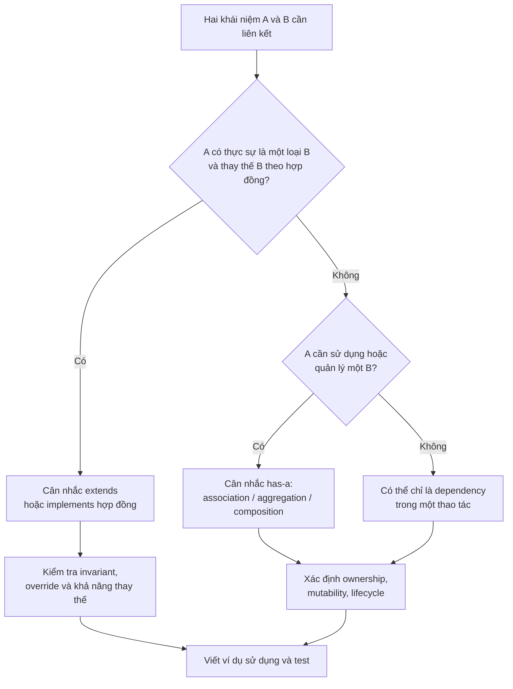

Một bộ câu hỏi ngắn khi review code:

- **Nếu bỏ quan hệ `extends`, đối tượng có mất ý nghĩa phân loại cần thiết không?** Nếu không, có thể kế thừa chỉ để dùng lại code.
- **Lớp A cần thay thành phần B bằng implementation khác không?** Nếu có, field kiểu interface và constructor injection có thể có ích.
- **Ai bảo đảm component hợp lệ?** Constructor lớp chứa nên kiểm tra tham chiếu bắt buộc; component tự bảo vệ invariant của mình.
- **Nếu component được chia sẻ, việc thay đổi nó ảnh hưởng những đối tượng nào?** Xác định chính sách chia sẻ, defensive copy hay bất biến.
- **Nếu component nắm tài nguyên, ai đóng?** Nêu hợp đồng sở hữu; cân nhắc `AutoCloseable` khi thích hợp.
- **Nếu lớp con thay thế lớp cha, có hành vi nào bất ngờ sai không?** Kiểm tra contract/LSP thay vì chỉ dựa vào cú pháp `extends`.

## 11. Bài tập kiểm tra

### Bài 1 — Chọn is-a hay has-a

Hãy phân loại các quan hệ sau:

| Quan hệ | Gợi ý đáp án |
|---|---|
| `Dog` và `Animal` | Is-a, nếu `Dog` đáp ứng hợp đồng `Animal` |
| `Library` và `Book` | Has-a (thư viện có sách); sách không phải một thư viện |
| `Invoice` và `Customer` | Has-a/association (hóa đơn liên quan khách hàng) |
| `Teacher` và `Employee` | Có thể is-a, tùy mô hình nghiệp vụ |
| `MusicPlayer` và `AudioDecoder` | Has-a/uses-a: trình phát dùng bộ giải mã |
| `CreditCardPayment` và `PaymentMethod` | Kiểu con qua `implements` nếu `PaymentMethod` là interface hợp đồng |

Không có đáp án chỉ từ tên lớp cho mọi hệ thống: hãy nêu giả định nghiệp vụ và trách nhiệm tương ứng.

### Bài 2 — Có biên dịch không?

```java
interface Engine {
    void start();
}

class PetrolEngine implements Engine {
    @Override
    public void start() {}
}

class Car {
    private final Engine engine;

    Car(Engine engine) {
        this.engine = engine;
    }
}

Car car = new Car(new PetrolEngine());
// Engine engine = car; // Có hợp lệ không?
```

**Đáp án:** Không. `Car` **có một** `Engine` nhưng không phải subtype của `Engine`. Muốn dùng động cơ, `Car` phải cung cấp hành vi ủy quyền phù hợp hoặc caller sử dụng engine trực tiếp theo thiết kế đã định.

### Bài 3 — Một hay hai đối tượng?

```java
Vehicle vehicle = new Car("CAR-05", new ElectricMotor());
```

Theo ví dụ `RelationsDemo`, đoạn này có những object nào?

**Đáp án:** Có một đối tượng runtime `Car`, và một đối tượng `ElectricMotor` riêng được truyền vào. Phần trạng thái `Vehicle` thuộc **chính đối tượng Car**, không phải một instance `Vehicle` thứ hai được tạo riêng. Biến `vehicle` chỉ chứa tham chiếu có kiểu khai báo `Vehicle`.

### Bài 4 — Refactor thiết kế sai

Ban đầu có:

```java
class DatabaseClient {
    void save(String data) {}
}

class UserService extends DatabaseClient {
    void register(String userName) {
        save(userName);
    }
}
```

Hãy sửa theo has-a:

```java
import java.util.Objects;

class UserService {
    private final DatabaseClient db;

    UserService(DatabaseClient db) {
        this.db = Objects.requireNonNull(db);
    }

    void register(String userName) {
        if (userName == null || userName.isBlank()) {
            throw new IllegalArgumentException("Tên người dùng rỗng");
        }
        db.save(userName);
    }
}
```

Bản sửa phản ánh `UserService` **sử dụng** `DatabaseClient` thay vì **là một loại database client**. Nếu nhiều cách lưu trữ cần hoán đổi hoặc giả lập để test, có thể thay `DatabaseClient` bằng một interface như `UserRepository`. Chỉ thêm interface khi nó đem lại giá trị thiết kế thật sự.

---

## Ghi nhớ

- **Is-a:** đối tượng thuộc kiểu con và có thể dùng thay kiểu cha/hợp đồng theo quy tắc substitutability; trong Java thường dùng `extends` hoặc `implements`.
- **Has-a:** một đối tượng **giữ, sở hữu hoặc sử dụng** thành phần khác; thường biểu diễn qua field và delegation.
- Một đối tượng có thể **đồng thời is-a với một kiểu và has-a với những thành phần khác**.
- **Has-a không tự chứng minh sở hữu độc quyền hoặc vòng đời phụ thuộc**; cần xem association, aggregation, composition, khả năng chia sẻ và quản lý tài nguyên.
- Dùng kế thừa vì **quan hệ phân loại hợp lệ**, dùng composition vì **nhu cầu kết hợp hành vi/trạng thái**. Đừng dùng `extends` chỉ để tránh viết field.


</details>

- [Quay lại đầu trang](#back-to-top)

---

## <a id="composition-003">Ủy quyền công việc cho đối tượng khác</a>

<details>
<summary>Xem chi tiết</summary>

# Ủy quyền công việc cho đối tượng khác trong Java OOP

Khi một đối tượng nhận một yêu cầu, nó có thể **giữ trách nhiệm với quy trình**, nhưng nhờ đối tượng khác thực hiện những bước chuyên môn. Đó là **delegation (ủy quyền)**. Java không có từ khóa riêng cho delegation: kỹ thuật này được thể hiện bằng **lời gọi phương thức tới collaborator**.

Ví dụ, một bộ điều phối yêu cầu hỗ trợ kỹ thuật nhận phiếu từ khách hàng. Nó không nhất thiết phải tự phân loại mức độ và tự lưu phiếu vào hàng chờ:

- `TicketRouter` kiểm tra đầu vào, quyết định **thứ tự xử lý** và trả kết quả cuối.
- `TicketClassifier` phân loại phiếu theo một bộ quy tắc.
- `AssignmentPort` ghi nhận phiếu vào hàng đợi đã chọn.
- Client chỉ cần gọi `router.route(ticket)` và nhận một `Assignment`.

Bài này đi sâu vào **ai giao việc cho ai, dữ liệu đi qua những ranh giới nào, ai chịu trách nhiệm về thành công/thất bại**, để tách delegation khỏi khái niệm ghép đối tượng nói chung.

## 1. Đọc đúng một luồng ủy quyền

~~~mermaid
sequenceDiagram
    actor Caller
    participant R as TicketRouter
    participant C as TicketClassifier
    participant P as AssignmentPort
    Caller->>R: route(ticket)
    R->>R: validate ticket
    R->>C: classify(ticket)
    C-->>R: Queue
    R->>P: assign(ticket.id, queue)
    P-->>R: Assignment
    R-->>Caller: Assignment
~~~

Trong sơ đồ, `TicketRouter` là **delegator** vì nó nhận trách nhiệm điều phối từ caller. `TicketClassifier` và `AssignmentPort` là **delegates** đối với các bước được giao. Một collaborator có thể tiếp tục ủy quyền cho đối tượng khác ở bên trong; “delegator/delegate” là **vai trò theo lời gọi**, không phải một loại class trong Java.

Ba ranh giới cần nhận diện:

| Bước | Ai chịu trách nhiệm? | Điều phải giữ rõ |
| --- | --- | --- |
| Nhận yêu cầu | `TicketRouter` | Input hợp lệ và trình tự xử lý |
| Xác định hàng đợi | `TicketClassifier` | Quy tắc phân loại và mã `Queue` |
| Ghi nhận phân công | `AssignmentPort` | Kết quả phân công, lỗi, ý nghĩa “đã nhận” |
| Trả kết quả cho client | `TicketRouter` | Không tự bịa kết quả nếu delegate thất bại |

**Ủy quyền không đồng nghĩa từ bỏ trách nhiệm.** Router vẫn chịu trách nhiệm gọi đúng bước, xử lý hoặc lan truyền lỗi phù hợp và không phát ra kết quả giả. Nó chỉ không ôm thuật toán phân loại hay cơ chế lưu hàng chờ.

## 2. Chương trình độc lập: thay delegate nhưng giữ router

Lưu thành `TicketDelegationDemo.java` (Java 17 trở lên). Đây là mô hình hàng chờ **trong bộ nhớ**; không sử dụng cơ sở dữ liệu hay dịch vụ từ xa.

~~~java
import java.util.ArrayList;
import java.util.List;
import java.util.Locale;
import java.util.Objects;

public class TicketDelegationDemo {
    enum Queue { STANDARD, URGENT, BILLING }

    record Ticket(String id, String summary, int severity) {
        Ticket {
            if (id == null || id.isBlank()
                    || summary == null || summary.isBlank()) {
                throw new IllegalArgumentException("Thiếu thông tin phiếu");
            }
            if (severity < 1 || severity > 5) {
                throw new IllegalArgumentException("Severity phải từ 1 đến 5");
            }
        }
    }

    record Assignment(String ticketId, Queue queue) {
        Assignment {
            if (ticketId == null || ticketId.isBlank()) {
                throw new IllegalArgumentException("Thiếu mã phiếu");
            }
            Objects.requireNonNull(queue, "queue");
        }
    }

    interface TicketClassifier {
        Queue classify(Ticket ticket);
    }

    interface AssignmentPort {
        // Chỉ mô tả hành vi "ghi nhận"; chưa cam kết lưu bền vững.
        Assignment assign(String ticketId, Queue queue);
    }

    static final class SeverityClassifier implements TicketClassifier {
        @Override
        public Queue classify(Ticket ticket) {
            Objects.requireNonNull(ticket, "ticket");
            return ticket.severity() >= 4 ? Queue.URGENT : Queue.STANDARD;
        }
    }

    static final class BillingKeywordClassifier
            implements TicketClassifier {
        @Override
        public Queue classify(Ticket ticket) {
            Objects.requireNonNull(ticket, "ticket");
            return ticket.summary()
                    .toLowerCase(Locale.ROOT)
                    .contains("thanh toán")
                    ? Queue.BILLING : Queue.STANDARD;
        }
    }

    static final class MemoryAssignmentPort implements AssignmentPort {
        private final List<Assignment> history = new ArrayList<>();

        @Override
        public Assignment assign(String ticketId, Queue queue) {
            Assignment result = new Assignment(ticketId, queue);
            history.add(result);
            return result;
        }

        List<Assignment> history() {
            return List.copyOf(history);
        }
    }

    static final class TicketRouter {
        private final TicketClassifier classifier;
        private final AssignmentPort assignments;

        TicketRouter(TicketClassifier classifier,
                     AssignmentPort assignments) {
            this.classifier =
                    Objects.requireNonNull(classifier, "classifier");
            this.assignments =
                    Objects.requireNonNull(assignments, "assignments");
        }

        Assignment route(Ticket ticket) {
            Objects.requireNonNull(ticket, "ticket");

            Queue queue = Objects.requireNonNull(
                    classifier.classify(ticket),
                    "Classifier không được trả null"
            );

            return Objects.requireNonNull(
                    assignments.assign(ticket.id(), queue),
                    "AssignmentPort không được trả null"
            );
        }
    }

    public static void main(String[] args) {
        MemoryAssignmentPort sharedPort = new MemoryAssignmentPort();

        TicketRouter bySeverity = new TicketRouter(
                new SeverityClassifier(), sharedPort
        );
        TicketRouter byTopic = new TicketRouter(
                new BillingKeywordClassifier(), sharedPort
        );

        Assignment first = bySeverity.route(
                new Ticket("T-17", "Không đăng nhập", 2)
        );
        Assignment second = byTopic.route(
                new Ticket("T-18", "Thanh toán lỗi", 5)
        );

        System.out.println(first);
        System.out.println(second);
        System.out.println("Số phân công: " + sharedPort.history().size());
    }
}
~~~

Chạy:

~~~bash
javac TicketDelegationDemo.java
java TicketDelegationDemo
~~~

Kết quả:

~~~text
Assignment[ticketId=T-17, queue=STANDARD]
Assignment[ticketId=T-18, queue=BILLING]
Số phân công: 2
~~~

**Diễn biến cụ thể:**

1. `bySeverity` nhận phiếu `T-17` mức 2. Nó **giao việc phân loại** cho `SeverityClassifier`; kết quả `STANDARD` được đưa vào `MemoryAssignmentPort`.
2. `byTopic` nhận phiếu `T-18` mức 5, nhưng dùng một bộ phân loại **theo chủ đề**. Chuỗi “Thanh toán lỗi” khớp từ khóa, nên trả `BILLING`. Đây không phải lỗi: hợp đồng cho phép các chiến lược phân loại có chính sách riêng.
3. Hai router cùng sử dụng **một instance** `sharedPort` do nơi tạo ứng dụng cung cấp. Vì thế lịch sử trong bộ nhớ có đúng hai bản ghi.
4. Không có đối tượng nào gửi email hoặc tạo ticket thật. `Assignment` chỉ xác nhận **adapter bộ nhớ trong ví dụ đã ghi nhận yêu cầu**, không đại diện một SLA xử lý hỗ trợ thực tế.

Lưu ý: `BillingKeywordClassifier` cố ý không xem `severity`. Nếu yêu cầu thực tế nói “mọi phiếu mức 5 bắt buộc vào URGENT”, đây sẽ là một **quy tắc chung cần công bố trong hợp đồng** và mọi implementation phải tuân thủ hoặc cần thêm tầng ưu tiên. Không được suy ra quy tắc ấy từ tên trường mà chưa có đặc tả.

## 3. Đối tượng được ghép và lời gọi được ủy quyền là hai câu hỏi khác nhau

~~~java
private final TicketClassifier classifier;
private final AssignmentPort assignments;
~~~

Hai field cho thấy router **giữ tham chiếu** tới hai collaborator. Đó là cấu trúc liên kết/ghép đối tượng (*has-a / uses-a*). Delegation thực sự chỉ diễn ra khi router gọi:

~~~java
Queue queue = classifier.classify(ticket);
Assignment result = assignments.assign(ticket.id(), queue);
~~~

| Khái niệm | Câu hỏi chính | Quan sát trong ví dụ |
| --- | --- | --- |
| Composition / association | Router sử dụng những object nào? | Hai field nhận từ constructor |
| Delegation | Phần nào chuyển cho object khác? | Phân loại và phân công |
| Polymorphism | Cùng lời gọi chạy cách thực hiện nào? | Classifier theo mức hay từ khóa |
| Dependency injection | Ai cung cấp collaborator? | `main` tạo và truyền qua constructor |
| Encapsulation | Ai được sửa lịch sử phân công? | `MemoryAssignmentPort` giữ danh sách private |

Một trường tham chiếu có thể chỉ phục vụ tra cứu hoặc quan sát mà không ủy quyền công việc thuộc API công khai; không nên gọi mọi field là một “pattern delegation”. Ngược lại, phương thức cũng có thể **nhận delegate như một tham số tại lúc gọi**, không cần lưu thành field.

~~~java
static Queue classifyOnce(
        Ticket ticket, TicketClassifier temporaryClassifier) {
    Objects.requireNonNull(temporaryClassifier, "temporaryClassifier");
    return temporaryClassifier.classify(
            Objects.requireNonNull(ticket, "ticket"));
}
~~~

Đoạn này là method bổ sung minh họa: đặt trong `TicketDelegationDemo` sẽ dùng được các kiểu của ví dụ. Nó cho thấy ủy quyền **không bắt buộc constructor injection**, dù constructor injection phù hợp khi router cần hai collaborator trong suốt vòng đời.

## 4. Hợp đồng delegate là điều router dựa vào

Java chỉ kiểm tra chữ ký `classify(Ticket)` và `assign(String, Queue)`; không tự xác nhận hành vi của từng implementation.

| Hợp đồng cần ghi rõ | Ý nghĩa với router |
| --- | --- |
| `TicketClassifier` trả `Queue` không null với ticket hợp lệ | Có thể chuyển kết quả sang adapter |
| Phương thức phân loại không tự ghi/chỉnh ticket | Dễ test, không tạo side effect ngầm |
| `AssignmentPort` trả `Assignment` có ticketId/queue đúng hoặc báo lỗi | Caller biết phiếu được xử lý bởi adapter nào |
| Lỗi không được đổi thành “đã phân công” giả | Giữ đúng kết quả nghiệp vụ |
| Độ bền/timeout/thread safety | Phải xác định theo implementation và nhu cầu thực |

Ví dụ `TicketClassifier` bị lỗi:

~~~java
static final class BrokenClassifier implements TicketClassifier {
    @Override
    public Queue classify(Ticket ticket) {
        return null;
    }
}
~~~

Lớp này **biên dịch** nhưng vi phạm cam kết non-null. `TicketRouter` từ chối kết quả ấy với `NullPointerException` có thông điệp rõ. Tuy nhiên, kiểm tra ở router không thay thế được contract tests cho mọi classifier.

**Điều kiện lỗi theo thứ tự:** nếu constructor `Ticket` từ chối input thì chưa có lời gọi tới router. Nếu classifier ném lỗi, adapter chưa được gọi. Nếu adapter lỗi **sau khi ghi một phần**, router không tự rollback bộ nhớ, file hay giao dịch bên ngoài. Hợp đồng cần nói rõ failure semantics của adapter thật.

## 5. Delegation và forwarding: khi nào một tầng trung gian có giá trị?

Xét kiểu chuyển tiếp thuần túy:

~~~java
class BareRouter {
    private final AssignmentPort port;

    BareRouter(AssignmentPort port) {
        this.port = port;
    }

    Assignment assign(String id, Queue queue) {
        return port.assign(id, queue);
    }
}
~~~

Nếu `BareRouter` không thêm hợp đồng, validation, kiểm soát quyền hoặc cách ly phụ thuộc, lớp này có thể chỉ làm luồng code dài thêm. Không phải cứ gọi phương thức đối tượng khác là phải tạo một lớp mới.

`TicketRouter` chính trong bài có lý do tồn tại: nó **điều phối hai khả năng chuyên biệt**, buộc thứ tự “phân loại trước → ghi nhận sau” và công bố một API `route(Ticket)` mà caller không phải tự gọi từng thành phần.

Một tầng ủy quyền thường hữu ích khi nó:

- Định nghĩa **trách nhiệm nghiệp vụ** rõ ràng với caller.
- Gom validation hoặc orchestration ở đúng ranh giới.
- Giấu chi tiết hạ tầng mà caller không cần hiểu.
- Cho phép **thay implementation** mà không sửa logic điều phối.
- Giúp kiểm thử riêng một ranh giới thay vì khởi động cả hệ thống.

Ngược lại, nhiều lớp mỗi lớp chỉ gọi tiếp một method y hệt có thể trở thành **pass-through layers** không cần thiết. Hãy kiểm tra giá trị của từng tầng trước khi thêm.

## 6. Đổi delegate không nhất thiết phải dùng inheritance

Nếu router tự kế thừa bộ phân loại chỉ để dùng thuật toán của nó:

~~~java
// Thiết kế sai ý nghĩa trách nhiệm:
// class TicketRouter extends SeverityClassifier { ... }
~~~

ta đang nói “router là một loại bộ phân loại”. Nhưng router **sử dụng một bộ phân loại**, còn trách nhiệm của router là điều phối. Quan hệ này hợp với **has-a / uses-a**.

Trong ví dụ thực, `SeverityClassifier` được đánh dấu `final` nên không thể kế thừa ngay cả ở mức cú pháp. Dòng trên cố ý được comment để chỉ ra mô hình sai, không phải mã hợp lệ của demo.

~~~mermaid
classDiagram
    class TicketRouter {
        -TicketClassifier classifier
        -AssignmentPort assignments
        +route(Ticket) Assignment
    }
    class TicketClassifier {
        <<interface>>
        +classify(Ticket) Queue
    }
    class AssignmentPort {
        <<interface>>
        +assign(String, Queue) Assignment
    }
    class SeverityClassifier
    class BillingKeywordClassifier
    class MemoryAssignmentPort
    TicketRouter --> TicketClassifier : classify
    TicketRouter --> AssignmentPort : assign
    TicketClassifier <|.. SeverityClassifier
    TicketClassifier <|.. BillingKeywordClassifier
    AssignmentPort <|.. MemoryAssignmentPort
~~~

**Kế thừa vẫn phù hợp** khi lớp con thật sự là một subtype của lớp cha và giữ đúng hợp đồng. Delegation chỉ là một kỹ thuật thay thế khi ta cần dùng **khả năng** mà không có quan hệ is-a thật. Bài so sánh tái sử dụng giữa kế thừa và kết hợp có thể phân tích sâu thêm trường hợp nhiều chiều biến thiên độc lập.

## 7. Phân biệt delegation với những pattern liên quan

Delegation là cơ chế nền của nhiều mẫu thiết kế, nhưng mục đích của từng mẫu khác nhau:

| Kỹ thuật/mẫu | Mục đích chính | Cách áp dụng trong miền ticket |
| --- | --- | --- |
| **Strategy** | Chọn thuật toán có thể thay thế | `SeverityClassifier` hoặc `BillingKeywordClassifier` |
| **Adapter** | Chuyển hợp đồng ứng dụng sang API công nghệ khác | `AssignmentPort` → một SDK quản lý công việc |
| **Decorator** | Bọc object cùng interface để thêm hành vi | Ghi log trước/sau `assign` |
| **Proxy** | Kiểm soát truy cập, lazy loading, remote invocation | Chặn phân công nếu caller thiếu quyền |
| **Facade** | Cho client một API gọn cho nhiều thành phần | `TicketRouter.route` điều phối các bước |

Ví dụ decorator, đặt thành lớp lồng trong `TicketDelegationDemo`:

~~~java
static final class LoggingAssignmentPort implements AssignmentPort {
    private final AssignmentPort delegate;

    LoggingAssignmentPort(AssignmentPort delegate) {
        this.delegate = Objects.requireNonNull(delegate, "delegate");
    }

    @Override
    public Assignment assign(String ticketId, Queue queue) {
        System.out.println("Gọi phân công: " + ticketId);
        Assignment result = delegate.assign(ticketId, queue);
        System.out.println("Adapter đã trả kết quả");
        return result;
    }
}
~~~

Decorator này **không hứa** rằng dữ liệu đã tồn tại bền vững chỉ vì delegate trả về. Nó cũng không tự quản lý transaction. Tránh tự động dùng tên pattern khi chỉ cần một field và một lời gọi đơn giản.

## 8. Kiểm thử đúng sự cộng tác và đường lỗi

Có thể thêm một fake ghi nhận lời gọi làm lớp lồng trong demo:

~~~java
static final class RecordingAssignments implements AssignmentPort {
    int calls;
    String lastTicketId;
    Queue lastQueue;

    @Override
    public Assignment assign(String id, Queue queue) {
        calls++;
        lastTicketId = id;
        lastQueue = queue;
        return new Assignment(id, queue);
    }
}
~~~

Rồi thêm đoạn sau vào `main` của demo:

~~~java
RecordingAssignments recorder = new RecordingAssignments();
TicketRouter router = new TicketRouter(new SeverityClassifier(), recorder);
Assignment result = router.route(new Ticket("T-99", "Lỗi đăng nhập", 5));

if (recorder.calls != 1 || recorder.lastQueue != Queue.URGENT
        || !"T-99".equals(recorder.lastTicketId)
        || result.queue() != Queue.URGENT) {
    throw new AssertionError("Ủy quyền không đúng");
}
~~~

Test này xác nhận router chuyển đúng mã và hàng đợi, gọi adapter **một lần**, trả lại kết quả từ adapter. Bên cạnh test delegator, cần:

- **Test classifier:** kiểm tra từng chiến lược với mức độ/từ khóa đầu vào xác định.
- **Contract test:** xác minh mọi implementation trả non-null và đúng kết quả được phép, không tự sửa ticket.
- **Integration test:** adapter HTTP/database thật có ghi đúng, báo lỗi chính xác, đóng tài nguyên đúng không.
- **Failure test:** classifier lỗi thì adapter không được gọi; adapter lỗi thì router không được trả thành công giả.

Không cần mock framework cho những thử nghiệm ngắn này. Fake hỗ trợ cô lập ranh giới, nhưng không chứng minh hệ thống bên ngoài thực sự vận hành đúng.

## 9. Vòng đời, đồng thời và kết quả giao việc

Cả hai router trong `main` đều giữ `sharedPort`. Việc cùng giữ tham chiếu không trao **quyền sở hữu độc quyền** cho router nào. Nếu port có socket/database client, bên tạo nó thường cần quản lý vòng đời, hoặc phải có hợp đồng chuyển giao quyền sở hữu rõ.

`MemoryAssignmentPort` sử dụng `ArrayList` và **không thread-safe**. Hai request song song gọi `assign` trên cùng port có thể gây race condition. Field `final` trong router chỉ cố định tham chiếu, không làm danh sách mutable của port trở nên an toàn.

Đối với adapter thực, cũng cần tách:

1. **Đã chấp nhận yêu cầu** hay **đã ghi bền vững**?
2. Đã gọi xong API hay **đã phân công thực tế** cho người phụ trách?
3. Khi thất bại và retry, có nguy cơ **phân công trùng** không?
4. Khi classifier và port đọc dữ liệu khác thời điểm, có cần **phiên bản quy tắc** hay transaction?
5. Khi thay delegate, request cũ còn sử dụng port/classifier cũ hay đã được chuyển sang mới?

Nếu hệ thống yêu cầu idempotency, auditing hoặc transaction, chúng phải được thiết kế và kiểm thử riêng. Delegation **chỉ tổ chức trách nhiệm và đường gọi**; nó không tự tạo những bảo đảm vận hành này.

## 10. Bài tập tự kiểm tra

**1. Ai là delegator?** Trong `TicketRouter.route`, thành phần nào thực hiện phân loại, thành phần nào ghi nhận?

**Đáp án:** Router là delegator. `TicketClassifier` phân loại; `AssignmentPort` ghi nhận. Router vẫn kiểm soát thứ tự và trả kết quả.

**2. Hai router dùng chung một `MemoryAssignmentPort` có hai lịch sử hay một?**

**Đáp án:** Một lịch sử trong cùng instance. Cấp hai port khác nhau nếu cần tách trạng thái, hoặc định nghĩa cơ chế chia sẻ an toàn nếu muốn dùng chung đồng thời.

**3. Nếu classifier trả `null`, router có được tiếp tục gọi `assign` không?**

**Đáp án:** Không theo chương trình minh họa. `Objects.requireNonNull` dừng trước bước gửi, nên không có phân công mới.

**4. Nếu thay `SeverityClassifier` bằng `BillingKeywordClassifier`, vì sao không cần sửa `TicketRouter`?**

**Đáp án:** Router chỉ phụ thuộc vào `TicketClassifier.classify`. Đây là đa hình theo hợp đồng, được cấp qua constructor.

**5. Có thể ủy quyền mà không có field tham chiếu không?**

**Đáp án:** Có. Nhận một classifier bằng tham số của phương thức rồi gọi nó cũng là delegation nếu đang chuyển phần việc chuyên môn.

**6. Nếu `AssignmentPort.assign` lưu dữ liệu một phần rồi ném lỗi, router có tự rollback không?**

**Đáp án:** Không. Lỗi và side effect phải được thiết kế ở adapter hoặc ranh giới transaction; tránh trả kết quả thành công giả.

**7. Delegation luôn làm thiết kế tốt hơn?**

**Đáp án:** Không. Một tầng wrapper không thêm ranh giới, kiểm tra hay trách nhiệm có thể chỉ làm code khó đọc. Tạo delegate khi có sự phân công vai trò thật.

**Ghi nhớ:** Ủy quyền là quyết định **chuyển đúng một phần công việc tới đối tượng biết làm công việc đó**. Đối tượng điều phối giữ trách nhiệm đối với luồng và kết quả, collaborator thực hiện bước chuyên môn. Thiết kế tốt cần hợp đồng rõ, kết quả có nghĩa, đường lỗi và vòng đời được kiểm soát; không chỉ đơn giản gọi thêm một method trên field.


</details>

- [Quay lại đầu trang](#back-to-top)

---

## <a id="composition-004">Tái sử dụng bằng kết hợp và bằng kế thừa</a>

<details>
<summary>Xem chi tiết</summary>

# Tái sử dụng bằng kết hợp và bằng kế thừa trong Java OOP

Trong một ứng dụng Java, nhiều chức năng có thể dùng chung mã nguồn: cùng định dạng báo cáo, gửi thông báo, kiểm tra dữ liệu, ghi log hoặc lưu kết quả. Có hai hướng OOP thường gặp để tái sử dụng:

- **Kế thừa (inheritance):** tạo một *lớp con* dựa trên *lớp cha*, dùng lại phần hành vi/trạng thái được kế thừa và có thể ghi đè những điểm được phép mở rộng. Quan hệ cần có ý nghĩa **is-a**: “đối tượng con là một loại đối tượng cha”.
- **Kết hợp (composition):** một đối tượng **có hoặc sử dụng** các đối tượng khác để làm việc và **ủy quyền (delegation)** một phần hành vi cho chúng. Quan hệ thường được diễn đạt **has-a / uses-a**. Tái sử dụng đến từ việc lắp ghép những thành phần có trách nhiệm rõ ràng, không bắt buộc các thành phần cùng cây kế thừa.

Câu hỏi quan trọng không phải “cách nào ít dòng code hơn”, mà là: **quan hệ giữa các đối tượng có đúng về mặt nghiệp vụ không, phần nào cần thay đổi độc lập, và code sử dụng sẽ chịu ảnh hưởng gì khi yêu cầu phát triển?**

## 1. Nhìn từ ví dụ đời thường: is-a và has-a

Một `ElectricCar` là một loại `Car`. Nếu tất cả những hành vi mà `Car` cam kết đều có nghĩa với `ElectricCar`, quan hệ kế thừa có thể phù hợp:

~~~java
class Car {
    void drive() {
        System.out.println("Xe đang chạy");
    }
}

class ElectricCar extends Car {
    void charge() {
        System.out.println("Đang sạc");
    }
}
~~~

Nhưng một chiếc xe **có pin**; xe **không phải là pin**. Viết `class ElectricCar extends Battery` chỉ để dùng phương thức `charge` là sai về mô hình.

Cách kết hợp đúng hơn:

~~~java
class Battery {
    void charge() {
        System.out.println("Pin đang sạc");
    }
}

class ElectricCar {
    private final Battery battery;

    ElectricCar(Battery battery) {
        this.battery = battery;
    }

    void chargeCar() {
        battery.charge(); // Ủy quyền cho thành phần.
    }
}
~~~

Ở đây `ElectricCar` có một `Battery`. Việc dùng `battery.charge()` là **delegation**, một kỹ thuật rất phổ biến khi tái sử dụng bằng kết hợp.

| Câu hỏi | Kế thừa | Kết hợp |
| --- | --- | --- |
| Quan hệ cốt lõi | “A **là một loại** B” | “A **có/dùng** B” |
| Java thường viết | `class A extends B` | Field tham chiếu `B b`, gọi `b.doWork()` |
| Nguồn hành vi được dùng lại | Phương thức/trạng thái được kế thừa | Phương thức của đối tượng cộng tác |
| Có cần chung superclass? | Có quan hệ lớp cha–lớp con | Không |
| Thay đổi hành vi | Override các điểm mở rộng đã thiết kế | Thay đối tượng cộng tác hoặc cấu hình |
| Mức độ ràng buộc | Lớp con gắn với hợp đồng và một phần chi tiết lớp cha | Bên sử dụng có thể chỉ phụ thuộc interface của thành phần |
| Rủi ro điển hình | Quan hệ is-a giả tạo, lớp cha dễ ảnh hưởng lớp con | Quá nhiều đối tượng trung gian hoặc ủy quyền vô nghĩa |

**Lưu ý thuật ngữ:** trong lập trình, “ưu tiên composition” đôi khi được dùng rộng để chỉ *thiết kế ghép các đối tượng qua field và delegation*. Trong UML chặt chẽ, **composition** với hình thoi đặc còn thể hiện quan hệ sở hữu vòng đời mạnh (*whole–part*). Một dependency được **truyền từ ngoài vào constructor** có thể là association/aggregation thay vì composition sở hữu vòng đời theo nghĩa UML. Bài này sử dụng “kết hợp” theo nghĩa thiết kế OOP rộng, và sẽ không gán hình thoi đặc cho mọi tham chiếu đối tượng.

## 2. Tình huống: xuất và phân phối báo cáo

Giả sử hệ thống cần:

1. Tạo nội dung báo cáo doanh thu.
2. Định dạng báo cáo thành **văn bản thuần** hoặc **Markdown**.
3. Xuất báo cáo ra **console** hoặc **kho lưu trữ trong bộ nhớ**.

Có hai cách tái sử dụng hợp lý nhưng giải quyết các mức độ thay đổi khác nhau.

### Cách A: kế thừa để chia sẻ khung tạo báo cáo

Một `AbstractReport` chứa tiêu đề và khung `render()`. Từng lớp báo cáo cụ thể chỉ viết phần thân:

~~~java
abstract class AbstractReport {
    private final String title;

    protected AbstractReport(String title) {
        this.title = title;
    }

    public final String render() {
        return title + "\n" + buildBody();
    }

    protected abstract String buildBody();
}

class SalesReport extends AbstractReport {
    SalesReport(String title) {
        super(title);
    }

    @Override
    protected String buildBody() {
        return "Tổng doanh thu: 1500000 VND";
    }
}
~~~

`SalesReport extends AbstractReport` hợp lý vì **báo cáo bán hàng là một loại báo cáo**. Phần khung kết xuất được tái sử dụng. `render()` là `final` để lớp con không tự bỏ qua khung chung; điểm mở rộng có chủ đích là `buildBody()`.

Hạn chế xuất hiện nếu mỗi lớp con lại phải quyết định **cả loại nội dung, cách định dạng và kênh xuất**. Một cây lớp `SalesMarkdownConsoleReport`, `SalesPlainTextConsoleReport`, `SalesMarkdownArchiveReport`... dễ phình to khi những lựa chọn này thay đổi độc lập.

### Cách B: kết hợp để lắp ghép những trách nhiệm độc lập

Tách ba vai trò:

- `ReportData`: dữ liệu báo cáo cần trình bày.
- `Formatter`: biến báo cáo thành chuỗi hiển thị.
- `Destination`: nhận chuỗi và đưa tới nơi cần xuất.
- `ReportPublisher`: **sở hữu quy trình phối hợp**, gọi các thành phần đúng thứ tự.

~~~mermaid
flowchart LR
    R["ReportData"] --> P["ReportPublisher"]
    F["Formatter\nPlainText hoặc Markdown"] --> P
    P --> D["Destination\nConsole hoặc Archive"]
~~~

`ReportPublisher` không phải **một loại** formatter, cũng không phải **một loại** destination. Nó **sử dụng** cả hai để hoàn thành mục tiêu. Đây là ví dụ tự nhiên của kết hợp.

## 3. Mã Java hoàn chỉnh: so sánh hai cách trong cùng chương trình

Lưu thành **`ReuseComparisonDemo.java`**, chạy với Java **11 trở lên**, không cần thư viện bên ngoài.

~~~java
import java.math.BigDecimal;
import java.util.ArrayList;
import java.util.List;
import java.util.Objects;

public class ReuseComparisonDemo {

    private static String requireText(String value, String field) {
        String checked = Objects.requireNonNull(value, field).trim();
        if (checked.isEmpty()) {
            throw new IllegalArgumentException(field + " không được rỗng");
        }
        return checked;
    }

    // ----- PHẦN 1: TÁI SỬ DỤNG BẰNG KẾ THỪA -----

    static abstract class AbstractReport {
        private final String title;

        protected AbstractReport(String title) {
            this.title = requireText(title, "title");
        }

        public final String render() {
            return title + "\n" + buildBody();
        }

        // Điểm mở rộng: lớp con cung cấp phần thân báo cáo.
        protected abstract String buildBody();
    }

    static final class SalesReport extends AbstractReport {
        private final BigDecimal revenue;

        SalesReport(String title, BigDecimal revenue) {
            super(title);
            this.revenue = Objects.requireNonNull(revenue, "revenue");
            if (revenue.signum() < 0) {
                throw new IllegalArgumentException(
                        "Doanh thu không được âm");
            }
        }

        @Override
        protected String buildBody() {
            return "Tổng doanh thu: "
                    + revenue.toPlainString() + " VND";
        }
    }

    // ----- PHẦN 2: TÁI SỬ DỤNG BẰNG KẾT HỢP -----

    static final class ReportData {
        private final String title;
        private final String body;

        ReportData(String title, String body) {
            this.title = requireText(title, "title");
            this.body = requireText(body, "body");
        }

        String getTitle() {
            return title;
        }

        String getBody() {
            return body;
        }
    }

    interface Formatter {
        String format(ReportData report);
    }

    static final class PlainTextFormatter implements Formatter {
        @Override
        public String format(ReportData report) {
            Objects.requireNonNull(report, "report");
            return report.getTitle() + "\n" + report.getBody();
        }
    }

    static final class MarkdownFormatter implements Formatter {
        @Override
        public String format(ReportData report) {
            Objects.requireNonNull(report, "report");
            return "# " + report.getTitle() + "\n\n"
                    + report.getBody();
        }
    }

    interface Destination {
        void deliver(String formattedReport);
    }

    static final class ConsoleDestination implements Destination {
        @Override
        public void deliver(String formattedReport) {
            System.out.println(formattedReport);
        }
    }

    static final class MemoryArchive implements Destination {
        private final List<String> stored = new ArrayList<>();

        @Override
        public void deliver(String formattedReport) {
            stored.add(Objects.requireNonNull(
                    formattedReport, "formattedReport"));
        }

        List<String> readAll() {
            return List.copyOf(stored);
        }
    }

    // Quy trình chung chỉ biết các vai trò, không biết lớp cụ thể.
    static final class ReportPublisher {
        private final Formatter formatter;
        private final Destination destination;

        ReportPublisher(Formatter formatter, Destination destination) {
            this.formatter = Objects.requireNonNull(
                    formatter, "formatter");
            this.destination = Objects.requireNonNull(
                    destination, "destination");
        }

        void publish(ReportData report) {
            Objects.requireNonNull(report, "report");
            String rendered = Objects.requireNonNull(
                    formatter.format(report), "rendered");
            destination.deliver(rendered);
        }
    }

    public static void main(String[] args) {
        // Kế thừa: dùng một lớp con thay cho lớp cha trừu tượng.
        AbstractReport inherited = new SalesReport(
                "Doanh thu tháng", new BigDecimal("1500000"));

        System.out.println("KẾ THỪA:");
        System.out.println(inherited.render());

        // Kết hợp: lắp Formatter và Destination khác nhau.
        ReportData report = new ReportData(
                "Doanh thu tháng",
                "Tổng doanh thu: 1500000 VND");

        ReportPublisher consolePublisher = new ReportPublisher(
                new MarkdownFormatter(), new ConsoleDestination());

        System.out.println("KẾT HỢP:");
        consolePublisher.publish(report);

        MemoryArchive archive = new MemoryArchive();
        ReportPublisher archivePublisher = new ReportPublisher(
                new PlainTextFormatter(), archive);

        archivePublisher.publish(report);
        System.out.println("Đã lưu: " + archive.readAll().size()
                + " báo cáo");
        System.out.println("Nội dung lưu:");
        System.out.println(archive.readAll().get(0));
    }
}
~~~

Chạy:

~~~bash
javac ReuseComparisonDemo.java
java ReuseComparisonDemo
~~~

Kết quả:

~~~text
KẾ THỪA:
Doanh thu tháng
Tổng doanh thu: 1500000 VND
KẾT HỢP:
# Doanh thu tháng

Tổng doanh thu: 1500000 VND
Đã lưu: 1 báo cáo
Nội dung lưu:
Doanh thu tháng
Tổng doanh thu: 1500000 VND
~~~

Trong ví dụ này, `MemoryArchive` **chỉ lưu trong RAM**; không phải lưu trữ bền vững. `ConsoleDestination` chỉ in ra console; chưa gửi mạng hay tạo file. Chúng đủ để làm rõ **phần mã nào được dùng lại** mà không đưa vào các phụ thuộc ngoài bài học.

### Chính xác thì mã được tái sử dụng ở đâu?

**Phương án kế thừa:**

~~~java
AbstractReport report = new SalesReport(...);
String output = report.render();
~~~

`SalesReport` **kế thừa** implementation `render()` từ `AbstractReport`. Nó chỉ override `buildBody()`, và lời gọi từ `render()` được dispatch tới subclass đang chạy.

**Phương án kết hợp:**

~~~java
ReportPublisher publisher =
        new ReportPublisher(new MarkdownFormatter(),
                            new ConsoleDestination());
publisher.publish(reportData);
~~~

`ReportPublisher` **không kế thừa** `MarkdownFormatter` hoặc `ConsoleDestination`. Nó giữ **tham chiếu** tới các đối tượng cộng tác. Code trong `publish()` được tái sử dụng cho mọi cặp formatter/destination tuân thủ hai interface.

Đổi mục tiêu sử dụng mà không sửa `ReportPublisher`:

~~~java
new ReportPublisher(
        new PlainTextFormatter(), new ConsoleDestination());

new ReportPublisher(
        new MarkdownFormatter(), new MemoryArchive());
~~~

`ReportPublisher` chạy cùng thuật toán “định dạng rồi xuất”, còn những phần phụ trách chi tiết có thể được thay độc lập.

## 4. Sơ đồ UML: nhìn rõ loại quan hệ

### Kế thừa: quan hệ giữa các kiểu

~~~mermaid
classDiagram
    class AbstractReport {
        <<abstract>>
        -title String
        +render() String
        #buildBody() String
    }
    class SalesReport {
        -revenue BigDecimal
        #buildBody() String
    }
    AbstractReport <|-- SalesReport
~~~

Tam giác rỗng hướng tới lớp cha biểu thị **`extends`**. Lớp con trở thành một kiểu con của lớp cha; `AbstractReport report = new SalesReport(...)` là phép gán an toàn.

### Kết hợp: quan hệ sử dụng các đối tượng cộng tác

~~~mermaid
classDiagram
    class ReportPublisher {
        -formatter Formatter
        -destination Destination
        +publish(ReportData) void
    }
    class Formatter {
        <<interface>>
        +format(ReportData) String
    }
    class Destination {
        <<interface>>
        +deliver(String) void
    }
    class PlainTextFormatter
    class MarkdownFormatter
    class ConsoleDestination
    class MemoryArchive
    ReportPublisher --> Formatter : uses
    ReportPublisher --> Destination : uses
    Formatter <|.. PlainTextFormatter
    Formatter <|.. MarkdownFormatter
    Destination <|.. ConsoleDestination
    Destination <|.. MemoryArchive
~~~

`ReportPublisher` không phải subtype của `Formatter` hoặc `Destination`. Vì các đối tượng được **truyền vào từ bên ngoài** và có thể được chia sẻ, sơ đồ dùng quan hệ tham chiếu/dependency, **không tự giả định** vòng đời thành phần hoàn toàn thuộc về `ReportPublisher`.

Nếu `ReportPublisher` thật sự tạo và sở hữu một thành phần riêng, quản lý vòng đời của nó theo quy tắc “whole–part”, có thể cân nhắc dùng quan hệ composition mạnh hơn ở mức mô hình UML. Việc một class có field tham chiếu **chưa đủ** để kết luận quan hệ vòng đời đó.

## 5. Khác biệt quan trọng: dùng lại implementation hay lắp ghép hành vi

**Kế thừa để dùng lại implementation** có lợi khi các loại đối tượng thực sự cùng bản chất và chia sẻ được một cách triển khai ổn định.

Trong ví dụ, mọi `AbstractReport` đều có tiêu đề và hành vi `render()`. Nếu cần thêm kiểm tra chung ở `render()`, lớp cha có thể thay đổi một chỗ cho các subclass.

Nhưng sự phụ thuộc cũng sâu hơn:

- Subclass phải tuân theo cấu trúc và hợp đồng của superclass.
- Khi lớp cha thay đổi protected API hoặc giả định nội bộ, các lớp con có thể bị ảnh hưởng.
- Java không cho một class `extends` nhiều class trực tiếp, nên không thể kế thừa độc lập nhiều “nhánh chức năng” qua nhiều superclass.
- Việc subclass override một hook có thể phá invariant hoặc tiền/hậu điều kiện mà superclass kỳ vọng.

**Kết hợp để dùng lại hành vi** phù hợp khi các khả năng có thể thay độc lập.

Ví dụ, phần định dạng và nơi lưu trữ **không phải cùng một loại** và thay đổi ở hai chiều khác nhau:

| | ConsoleDestination | MemoryArchive |
| --- | --- | --- |
| PlainTextFormatter | Văn bản thuần ra console | Văn bản thuần vào archive |
| MarkdownFormatter | Markdown ra console | Markdown vào archive |

Ta chỉ cần **hai formatter, hai destination và một publisher** để lắp bốn kết hợp. Nếu ép “format + destination” vào mỗi subclass cụ thể, số biến thể lớp có thể tăng nhanh khi bổ sung lựa chọn mới.

Tuy nhiên, **không phải cứ kết hợp là ít lớp hơn**. Nó có thể tạo nhiều interface/adapter và các lời gọi ủy quyền. Lợi ích là tách đúng **những chiều thay đổi độc lập** để tránh gắn chúng vào một cây kế thừa cứng nhắc.

## 6. “Composition over inheritance” có phải lúc nào cũng đúng?

Câu “**ưu tiên kết hợp hơn kế thừa**” là một **nguyên tắc định hướng thiết kế**, không phải lệnh cấm `extends`.

Nên cân nhắc **kế thừa** khi:

- Quan hệ *is-a* thực sự đúng: `SalesReport` là một `AbstractReport`.
- Lớp cha cung cấp một hợp đồng nhất quán và các điểm mở rộng được thiết kế rõ.
- Có phần hành vi/trạng thái chung **ổn định** và được chuyên biệt hóa hợp lệ.
- Một object lớp con có thể **thay thế** object lớp cha trong mọi tình huống phù hợp mà không gây ngạc nhiên về hành vi.

Nên cân nhắc **kết hợp** khi:

- Các khả năng cần phối hợp nhưng không phải “một loại của nhau”.
- Có nhiều chiều thay đổi độc lập: định dạng, nguồn dữ liệu, nơi xuất, cách retry.
- Cần dễ thay thành phần, dễ test bằng fake, dễ inject phụ thuộc.
- Muốn tránh subclass phải biết quá nhiều chi tiết protected/internal của superclass.
- Một nhu cầu chỉ là **dùng chức năng** từ đối tượng khác, không có quan hệ is-a hợp lý.

Một câu tự kiểm tra rất hiệu quả:

> **“Nếu xóa mọi dòng code trùng nhau, liệu A vẫn thực sự là một loại B không?”**

Nếu câu trả lời là không, chỉ có ý định tái sử dụng vài phương thức, **kết hợp/ủy quyền** thường phù hợp hơn kế thừa.

## 7. Quan hệ is-a và nguyên tắc thay thế Liskov

Một lớp con không được phép chỉ “trông giống” lớp cha về mặt cú pháp. Nó phải giữ những cam kết mà phần mã sử dụng lớp cha dựa vào.

Ví dụ thiết kế có vấn đề:

~~~java
class Bird {
    void fly() {
        System.out.println("Bay");
    }
}

class Penguin extends Bird {
    @Override
    void fly() {
        throw new UnsupportedOperationException("Không biết bay");
    }
}
~~~

Một hàm nhận `Bird` và tin rằng `fly()` thực hiện được sẽ gặp lỗi với `Penguin`. Quan hệ danh từ “chim cánh cụt là chim” đúng, nhưng **hợp đồng lớp Bird ở đây sai với các loại chim không bay**.

Thiết kế tốt hơn:

~~~java
interface Flyable {
    void fly();
}

abstract class Bird {
    abstract void move();
}

class Sparrow extends Bird implements Flyable {
    @Override
    void move() {
        System.out.println("Chim sẻ di chuyển");
    }

    @Override
    public void fly() {
        System.out.println("Chim sẻ bay");
    }
}

class Penguin extends Bird {
    @Override
    void move() {
        System.out.println("Chim cánh cụt đi hoặc bơi");
    }
}
~~~

Tách **bản chất chung** và **năng lực tùy chọn** giúp tránh biến một phương thức thành lỗi runtime trong subtype. Đây là tinh thần của **Liskov Substitution Principle (LSP)**: code dùng lớp cha không bị phá vỡ kỳ vọng hợp lệ khi nhận đối tượng lớp con.

Đối với thiết kế kết hợp, LSP cũng có ý nghĩa: một `Destination` thay thế khác phải đáp ứng hợp đồng `deliver(...)` đã được client kỳ vọng, chẳng hạn không tự ý sửa báo cáo hay nói thành công khi chưa thực hiện nếu hợp đồng cấm.

## 8. Đổi hành vi tại lúc chạy bằng kết hợp

Ví dụ ban đầu dùng **constructor injection**: `ReportPublisher` nhận phụ thuộc từ bên ngoài:

~~~java
ReportPublisher publisher =
        new ReportPublisher(formatter, destination);
~~~

Việc khởi tạo các instance khác nhau giúp chọn tổ hợp tại runtime:

~~~java
Formatter formatter =
        useMarkdown ? new MarkdownFormatter() : new PlainTextFormatter();

Destination destination =
        keepArchive ? new MemoryArchive() : new ConsoleDestination();

ReportPublisher publisher =
        new ReportPublisher(formatter, destination);
~~~

Ở đây các biến `useMarkdown` và `keepArchive` chỉ là cấu hình lựa chọn. Thuật toán **`ReportPublisher.publish` không thay đổi**.

Một cách khác là dùng setter để thay strategy của một publisher đang tồn tại, nhưng phải cân nhắc đồng thời, vòng đời và invariant. Với ví dụ, field `final` và constructor injection giúp mỗi `ReportPublisher` có bộ phụ thuộc rõ ràng, **không bị thay tham chiếu sau khởi tạo**.

**Quan trọng:** `final Formatter formatter` chỉ ngăn gán lại field, không bảo đảm object formatter tự bất biến hoặc thread-safe. Nếu các thành phần giữ trạng thái mutable và được chia sẻ giữa nhiều thread, cần thiết kế đồng bộ/thực thi phù hợp.

### Kết hợp và dependency inversion

`ReportPublisher` phụ thuộc vào **`Formatter` và `Destination` là abstraction**, chứ không phụ thuộc trực tiếp `MarkdownFormatter` hoặc `MemoryArchive`. Đây là một cách áp dụng Dependency Inversion: logic cấp cao không gắn với một cách triển khai cụ thể.

Tuy nhiên, **composition không bắt buộc phải có interface**. Nếu một thành phần chỉ có một cách dùng và không cần thay thế, field kiểu class cụ thể cũng có thể là thiết kế hợp lý. Không nên sinh hàng loạt interface khi chúng chưa giải quyết một yêu cầu rõ ràng.

## 9. Tái sử dụng qua kết hợp và Strategy/Decorator

Hai mô hình hay gặp khi kết hợp đối tượng:

### Strategy: thay thuật toán

Ví dụ `Formatter` ở trên là một **hợp đồng chiến lược**. `PlainTextFormatter` và `MarkdownFormatter` là các thuật toán định dạng khác nhau. `ReportPublisher` có thể sử dụng bất kỳ implementation phù hợp nào.

~~~java
Formatter formatter = new MarkdownFormatter();
String content = formatter.format(reportData);
~~~

### Decorator: bọc thêm hành vi

Giả sử mọi destination đều cần ghi log trước khi xuất. Thay vì kế thừa từng destination, có thể **bọc** một destination:

~~~java
class LoggingDestination implements Destination {
    private final Destination target;

    LoggingDestination(Destination target) {
        this.target = java.util.Objects.requireNonNull(target);
    }

    @Override
    public void deliver(String formattedReport) {
        System.out.println("[LOG] Đang xuất báo cáo");
        target.deliver(formattedReport);
    }
}
~~~

~~~java
Destination wrapped =
        new LoggingDestination(new ConsoleDestination());

new ReportPublisher(new MarkdownFormatter(), wrapped).publish(reportData);
~~~

`LoggingDestination` **implements cùng interface** nhưng tái sử dụng hành vi bằng cách **ủy quyền** cho `target`. Nó có thể được lắp quanh một destination khác, không cần các lớp con kiểu `LoggedConsoleDestination`, `LoggedMemoryArchive`, v.v.

**Lưu ý:** đoạn bọc log chạy trước bước `deliver`, nhưng không chứng minh bước xuất chắc chắn thành công. Đối với yêu cầu audit thực tế, phải xác định rõ thời điểm log, lỗi và nghĩa vụ lưu vết.

## 10. Kiểm thử khi tái sử dụng bằng kết hợp

Một điểm mạnh của kết hợp là **có thể thay đối tượng phụ thuộc bằng fake**. Ta kiểm tra riêng `ReportPublisher` mà không ghi file hay gọi hệ thống ngoài.

Ví dụ JUnit 5 (cần dependency JUnit Jupiter; file demo chính không cần JUnit):

~~~java
import static org.junit.jupiter.api.Assertions.*;
import org.junit.jupiter.api.Test;

class ReportPublisherTest {

    @Test
    void publisherFormatsBeforeDelivering() {
        final String[] delivered = new String[1];

        ReuseComparisonDemo.Formatter formatter =
                report -> "[" + report.getTitle() + "]";

        ReuseComparisonDemo.Destination fakeDestination =
                text -> delivered[0] = text;

        ReuseComparisonDemo.ReportPublisher publisher =
                new ReuseComparisonDemo.ReportPublisher(
                        formatter, fakeDestination);

        publisher.publish(new ReuseComparisonDemo.ReportData(
                "Doanh thu", "Nội dung"));

        assertEquals("[Doanh thu]", delivered[0]);
    }

    @Test
    void archiveDoesNotExposeMutableList() {
        ReuseComparisonDemo.MemoryArchive archive =
                new ReuseComparisonDemo.MemoryArchive();
        archive.deliver("Một báo cáo");

        assertThrows(UnsupportedOperationException.class,
                () -> archive.readAll().clear());

        assertEquals(1, archive.readAll().size());
    }
}
~~~

`Formatter` và `Destination` đều là **functional interface** (một phương thức trừu tượng), nên có thể dùng lambda làm fake; đây là lợi ích của cách phụ thuộc vào abstraction.

Khi dùng kế thừa, vẫn hoàn toàn có thể test được subclass, nhưng nhiều hành vi kiểm thử có thể phụ thuộc vào quy trình được kế thừa hoặc các protected hook. Nếu lớp cha có trạng thái phức tạp, việc dựng fixture và kiểm chứng hiệu ứng phụ đôi khi khó hơn so với lắp ráp những thành phần nhỏ độc lập.

## 11. Chú ý về vòng đời, trạng thái và ngoại lệ

Tái sử dụng mã nguồn **không tự bảo đảm** cập nhật trạng thái đúng hoặc xử lý lỗi đúng.

### Thành phần mutable có thể được chia sẻ

~~~java
MemoryArchive shared = new MemoryArchive();

ReportPublisher a = new ReportPublisher(
        new MarkdownFormatter(), shared);

ReportPublisher b = new ReportPublisher(
        new PlainTextFormatter(), shared);
~~~

Hai publisher **cùng tham chiếu một `MemoryArchive`**. Khi mỗi bên `publish`, cả hai báo cáo đi vào **cùng danh sách `stored`** của archive. Nếu muốn kho riêng, hãy truyền hai instance `MemoryArchive` khác nhau.

### Ngoại lệ không tự hoàn tác

Trong `ReportPublisher.publish`, formatter chạy trước destination:

~~~java
String text = formatter.format(report);
destination.deliver(text);
~~~

Nếu formatter ném ngoại lệ, destination không được gọi. Nếu destination ghi một phần rồi ném ngoại lệ, không có gì trong composition tự động rollback thao tác đã ghi. Với file, database, queue hay mạng cần quy tắc transaction/retry/idempotency phù hợp.

### An toàn luồng không đến từ `final` hoặc `private`

`MemoryArchive` sử dụng `ArrayList`, **không thread-safe** khi bị nhiều thread cập nhật đồng thời. `ReportPublisher` giữ hai field `final` nhưng điều đó không làm các thành phần mutable mà chúng tham chiếu tự an toàn luồng. Hệ thống đa luồng cần đồng bộ hoặc chuyển sang cấu trúc/kiến trúc phù hợp.

Những vấn đề này có thể xuất hiện cả với kế thừa lẫn kết hợp; đừng nhầm quyết định tái sử dụng code với bảo đảm về vòng đời, dữ liệu và concurrency.

## 12. Khi kế thừa vẫn tốt hơn nhiều lớp ủy quyền

Dùng kết hợp “mọi nơi, mọi lúc” có thể tạo một hệ thống quá phức tạp: mỗi thao tác phải đi qua vài lớp wrapper không thêm ý nghĩa, mỗi hợp đồng chỉ có một implementation và không có chiều thay đổi độc lập.

Trong ví dụ kế thừa, `SalesReport` thực sự là một báo cáo và chia sẻ khung `render()` ổn định với các report khác. Nếu yêu cầu chỉ có **chuyên biệt hóa phần thân báo cáo**, không có formatter/destination thay đổi độc lập, `AbstractReport` là một abstraction có thể rất hợp lý.

Ngược lại, nếu ngày mai cần xuất nội dung **của mọi loại báo cáo** qua PDF, email, console hoặc lưu kho, gắn logic xuất vào từng subclass khiến sự mở rộng khó hơn. Tách `Formatter` và `Destination` là hợp lý khi chúng thành các chiều biến thể riêng.

Có thể **kết hợp cả hai cách**: một `SalesReport extends AbstractReport` để sinh nội dung, rồi đưa nội dung đó tới một `ReportPublisher` được lắp ghép formatter và destination. “Ưu tiên composition” không phải chọn một và vứt bỏ hoàn toàn cách còn lại.

## 13. Quy trình lựa chọn trong dự án

~~~mermaid
flowchart TD
    A["Muốn tái sử dụng chức năng"] --> B{"Có quan hệ is-a đúng<br/>và hợp đồng cha ổn định?"}
    B -->|Không| C["Ưu tiên kết hợp/delegation"]
    B -->|Có| D{"Subclass chỉ thay vài<br/>điểm mở rộng được thiết kế?"}
    D -->|Có| E["Cân nhắc kế thừa"]
    D -->|Không| F["Tách các chiều thay đổi<br/>thành thành phần"]
    F --> C
    E --> G["Kiểm tra LSP, invariant,<br/>quyền truy cập, coupling"]
    C --> H["Định nghĩa interface khi hữu ích,<br/>inject và test thành phần"]
~~~

Các câu hỏi thực hành:

1. **Is-a hay has-a?** “Bộ xuất báo cáo có một formatter” tự nhiên hơn “bộ xuất báo cáo là một formatter”.
2. **Phần nào có lý do thay đổi riêng?** Formatter có thể thay độc lập với destination.
3. **Code sử dụng cần biết bao nhiêu?** `ReportPublisher` chỉ cần `Formatter` và `Destination`.
4. **Có ràng buộc vòng đời không?** Thành phần được tạo sở hữu riêng hay truyền vào để có thể chia sẻ?
5. **Có cần thay thế hoặc fake khi test?** Đưa hành vi thay đổi vào interface khi việc này đem lại giá trị.
6. **Có phá hợp đồng của lớp cha không?** Subclass có phải override rồi ném `UnsupportedOperationException` cho thao tác lẽ ra hợp lệ?
7. **Chi phí cấu trúc có đáng không?** Một lớp đơn giản không cần bị phân rã thành mười interface nếu không có nhu cầu thật.

## 14. Lỗi phổ biến

| Lỗi | Biểu hiện | Hướng xử lý |
| --- | --- | --- |
| Kế thừa chỉ để lấy lại vài phương thức | `Car extends Engine` | Đặt `Engine` làm thành phần rồi delegation |
| Subclass phá cam kết của superclass | Override thao tác bằng lỗi “không hỗ trợ” | Xem lại quan hệ is-a, tách năng lực thành interface |
| Dùng subclass cho từng cặp lựa chọn | `CsvEmail`, `CsvFile`, `PdfEmail`... | Tách `Formatter` và `Destination` |
| Kết hợp nhưng phụ thuộc quá cứng | `new EmailClient()` nằm sâu trong `ReportPublisher` | Cân nhắc constructor injection theo vai trò |
| Mọi lớp đều được bọc qua interface không cần thiết | Nhiều wrapper không thêm hành vi/khả năng thay thế | Giữ thiết kế tối giản có cơ sở |
| Nhầm có field với sở hữu vòng đời UML | Tự vẽ hình thoi đặc cho dependency được inject | Phân biệt association/aggregation với composition chặt |
| Đổi component rồi nghĩ toàn bộ trạng thái độc lập | Hai publisher dùng chung một archive | Xác định rõ chia sẻ hay sở hữu instance |
| Nghĩ composition tự bảo đảm atomic/thread-safe | List mutable bị ghi song song | Thiết kế transaction/đồng bộ riêng |
| Nhầm hợp đồng kiểu với hợp đồng nghiệp vụ | Hai strategy cùng interface nhưng một bên trả kết quả sai | Viết contract test và điều kiện hậu hợp lệ |

## 15. Bài tập tự kiểm tra

**Câu 1.** `class PaymentService extends EmailClient` chỉ để gọi `sendMail()` có hợp lý không?

**Đáp án:** Thường không. `PaymentService` **sử dụng** chức năng gửi email, không phải **một loại EmailClient**. Nên nhận một đối tượng phụ thuộc qua constructor hoặc composition thích hợp.

**Câu 2.** Một `ReportPublisher` đang dùng `MarkdownFormatter`. Làm sao đổi sang `PlainTextFormatter` mà không sửa nội dung `publish`?

**Đáp án:** Tạo/cấu hình `ReportPublisher` với `new PlainTextFormatter()` qua constructor. `publish` vẫn gọi `formatter.format(report)` theo interface.

**Câu 3.** `SalesReport extends AbstractReport` có lợi gì?

**Đáp án:** `SalesReport` dùng lại việc kiểm tra tiêu đề và khung `render()` của lớp cha; nó chỉ cung cấp `buildBody()`. Điều kiện là quan hệ loại báo cáo và hợp đồng của lớp cha có ý nghĩa.

**Câu 4.** Nếu hai publisher nhận cùng `MemoryArchive`, có bao nhiêu kho lưu trữ được tạo?

**Đáp án:** Một `MemoryArchive` được tạo từ lệnh `new` tương ứng rồi được chia sẻ qua hai field tham chiếu; kết hợp không tự sao chép đối tượng. Mỗi publisher có đối tượng riêng nhưng cùng dùng chung archive.

**Câu 5.** Vì sao không nên tạo `SalesMarkdownConsoleReport`, `SalesPlainTextArchiveReport` cho mọi tổ hợp?

**Đáp án:** Nội dung báo cáo, định dạng và nơi xuất là các chiều thay đổi độc lập. Kế thừa cho mọi tổ hợp tạo nhiều lớp phụ thuộc lẫn nhau; lắp ghép formatter/destination giúp tái sử dụng độc lập.

**Câu 6.** `ReportPublisher` giữ field `final Destination destination`. `MemoryArchive` có thread-safe hoặc immutable ngay không?

**Đáp án:** Không. `final` ngăn gán lại tham chiếu của field, không khóa trạng thái bên trong đối tượng `Destination`. Phải thiết kế synchronization/immutable/concurrency riêng khi cần.

**Câu 7.** Có nên dùng interface cho một lớp duy nhất không bao giờ thay đổi?

**Đáp án:** Không bắt buộc. Interface hữu ích khi làm rõ hợp đồng độc lập, dễ fake/test hoặc muốn thay implementation. Nếu không có những nhu cầu đó, kiểu class cụ thể có thể đơn giản hơn.

**Câu 8.** Một lớp con được tạo ra để kế thừa mã tiện ích nhưng hoàn toàn không đáp ứng được các kỳ vọng về hành vi của lớp cha. Điều gì sai?

**Đáp án:** Quan hệ *is-a* và nguyên tắc thay thế có thể bị vi phạm. Cần xem lại mô hình; thường phù hợp hơn khi sử dụng một đối tượng helper/collaborator bằng kết hợp.

## Kết luận

**Kế thừa** tái sử dụng theo quan hệ “một loại của”: subclass nhận phần chung của superclass và chỉ chuyên biệt hóa những điểm hợp lệ. **Kết hợp** tái sử dụng theo quan hệ “có hoặc dùng”: đối tượng phối hợp những thành phần có trách nhiệm riêng rồi ủy quyền công việc cho chúng.

Không có công thức “mọi nơi dùng composition” hoặc “mọi nơi dùng inheritance”. Chọn **kế thừa khi quan hệ is-a và hợp đồng cha thật sự vững**, chọn **kết hợp khi các khả năng cần lắp ghép hoặc thay đổi độc lập**. Một thiết kế Java tốt thường sử dụng cả hai đúng vị trí để tránh cây kế thừa gượng ép và giữ code dễ kiểm thử, dễ phát triển.


</details>

- [Quay lại đầu trang](#back-to-top)

---

## <a id="composition-005">Thay đổi đối tượng cộng tác khi chạy</a>

<details>
<summary>Xem chi tiết</summary>

# Thay đổi đối tượng cộng tác khi chạy trong Java

Trong **kết hợp (composition)**, một đối tượng thực hiện công việc bằng cách giữ tham chiếu đến những đối tượng khác — gọi là **đối tượng cộng tác** (*collaborator/dependency*) — rồi ủy quyền một phần hành vi cho chúng.

Ví dụ, một dịch vụ tính tiền có thể dùng một đối tượng `DiscountPolicy` để quyết định mức giảm giá. Nếu hợp đồng được thiết kế tốt, ta có thể **thay chính sách giảm giá trong khi chương trình đang chạy**, mà không phải tạo lại dịch vụ tính tiền hoặc viết lại logic của dịch vụ.

```java
checkout.setDiscountPolicy(new PercentageDiscount("VIP10", 10));
```

Đây là một lợi ích quan trọng của composition: thay đổi **cách một đối tượng được hỗ trợ thực hiện công việc** bằng cách thay collaborator, thay vì cố định mọi biến thể trong một cây lớp kế thừa.

> “Thay đổi khi chạy” ở bài này là thay **tham chiếu đến một đối tượng có cùng hợp đồng**, không phải sửa mã nguồn Java hoặc tự động nạp plugin mới. Những vấn đề về đa luồng, tài nguyên và quyền sở hữu cần được xử lý riêng nếu có.

## 1. Đối tượng cộng tác là gì?

Xét một dịch vụ nhận chính sách tính phí:

```java
interface FeePolicy {
    long calculate(long subtotal);
}

final class OrderService {
    private FeePolicy feePolicy;

    OrderService(FeePolicy feePolicy) {
        this.feePolicy = feePolicy;
    }

    long total(long subtotal) {
        return feePolicy.calculate(subtotal);
    }
}
```

Ở đây:

- `OrderService` là **đối tượng chủ**, chịu trách nhiệm điều phối tính tiền.
- `FeePolicy` là **hợp đồng của collaborator**.
- Một đối tượng triển khai `FeePolicy` thực hiện phép tính cụ thể.
- Trường `feePolicy` lưu **tham chiếu** đến collaborator, không cần biết lớp cụ thể.

Nếu tham chiếu này được phép thay đổi qua một API có kiểm soát, hành vi của `OrderService` ở các lần gọi về sau cũng có thể thay đổi.

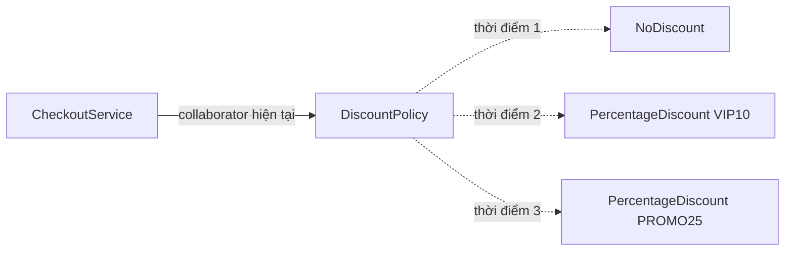

Sơ đồ thể hiện **cùng một `CheckoutService`** lần lượt giữ tham chiếu đến các đối tượng chính sách khác nhau. Không phải ba chính sách cùng thực hiện một đơn hàng; mỗi lần xử lý sẽ chọn collaborator hiện hành theo thiết kế.

## 2. Ví dụ Java hoàn chỉnh: đổi chính sách giảm giá lúc chạy

Mục tiêu nghiệp vụ:

1. Ban đầu thanh toán không giảm giá.
2. Khi bật chương trình VIP, dịch vụ sử dụng mức giảm 10%.
3. Khi chuyển sang khuyến mãi, dịch vụ sử dụng mức giảm 25%.
4. Có thể quay về chính sách không giảm giá.
5. Dịch vụ thanh toán **vẫn là một đối tượng**, chỉ collaborator được thay.

Lưu toàn bộ mã sau trong **`Main.java`** và chạy bằng Java 17 hoặc Java 21.

```java
import java.util.Objects;

record Order(long subtotalVnd) {
    Order {
        if (subtotalVnd < 0) {
            throw new IllegalArgumentException("Tiền hàng không được âm");
        }
    }
}

record Receipt(String policyCode, long subtotalVnd,
               long discountVnd, long totalVnd) {
}

// Hợp đồng mà CheckoutService cần từ collaborator.
interface DiscountPolicy {
    String code();

    // Phải trả giá trị trong khoảng [0, subtotalVnd].
    long discount(long subtotalVnd);
}

final class NoDiscount implements DiscountPolicy {
    @Override
    public String code() {
        return "NONE";
    }

    @Override
    public long discount(long subtotalVnd) {
        if (subtotalVnd < 0) {
            throw new IllegalArgumentException("Tiền hàng không hợp lệ");
        }
        return 0;
    }
}

final class PercentageDiscount implements DiscountPolicy {
    private final String code;
    private final int percent;

    PercentageDiscount(String code, int percent) {
        if (code == null || code.isBlank()) {
            throw new IllegalArgumentException("Mã chính sách không hợp lệ");
        }
        if (percent < 0 || percent > 100) {
            throw new IllegalArgumentException("Phần trăm phải từ 0 đến 100");
        }
        this.code = code;
        this.percent = percent;
    }

    @Override
    public String code() {
        return code;
    }

    @Override
    public long discount(long subtotalVnd) {
        if (subtotalVnd < 0) {
            throw new IllegalArgumentException("Tiền hàng không hợp lệ");
        }
        // Ví dụ tính trên VND nguyên, làm tròn xuống.
        return Math.multiplyExact(subtotalVnd, percent) / 100;
    }
}

final class CheckoutService {
    // Không final vì thiết kế này chủ ý cho phép thay collaborator.
    private DiscountPolicy discountPolicy;

    CheckoutService(DiscountPolicy initialPolicy) {
        this.discountPolicy =
                Objects.requireNonNull(initialPolicy, "initialPolicy");
    }

    // Điểm thay thế collaborator, có kiểm tra null.
    void setDiscountPolicy(DiscountPolicy nextPolicy) {
        this.discountPolicy =
                Objects.requireNonNull(nextPolicy, "nextPolicy");
    }

    Receipt checkout(Order order) {
        Objects.requireNonNull(order, "order");

        // Lấy một tham chiếu cho toàn bộ lần thanh toán.
        DiscountPolicy selected = discountPolicy;
        long subtotal = order.subtotalVnd();
        long reduction = selected.discount(subtotal);

        // Không tin mù quáng mọi implementation.
        if (reduction < 0 || reduction > subtotal) {
            throw new IllegalStateException(
                    "Chính sách trả giá trị giảm giá không hợp lệ");
        }

        return new Receipt(
                selected.code(),
                subtotal,
                reduction,
                subtotal - reduction
        );
    }
}

public class Main {
    private static void printReceipt(Receipt receipt) {
        System.out.printf("%s: %d VND%n",
                receipt.policyCode(), receipt.totalVnd());
    }

    public static void main(String[] args) {
        Order order = new Order(100_000);

        CheckoutService checkout = new CheckoutService(new NoDiscount());

        printReceipt(checkout.checkout(order));

        checkout.setDiscountPolicy(
                new PercentageDiscount("VIP10", 10));
        Receipt vipReceipt = checkout.checkout(order);
        printReceipt(vipReceipt);

        checkout.setDiscountPolicy(
                new PercentageDiscount("PROMO25", 25));
        printReceipt(checkout.checkout(order));

        checkout.setDiscountPolicy(new NoDiscount());
        printReceipt(checkout.checkout(order));

        // Biên lai cũ là dữ liệu riêng; đổi policy không sửa quá khứ.
        System.out.println("Biên lai VIP cũ: "
                + vipReceipt.totalVnd() + " VND");
    }
}
```

Biên dịch và chạy:

```bash
javac Main.java
java Main
```

Kết quả:

```text
NONE: 100000 VND
VIP10: 90000 VND
PROMO25: 75000 VND
NONE: 100000 VND
Biên lai VIP cũ: 90000 VND
```

**Phân tích kết quả:**

- `CheckoutService` chỉ được tạo **một lần**.
- `setDiscountPolicy(...)` thay đối tượng được lưu trong trường `discountPolicy`, không thay `Order` hoặc chính `CheckoutService`.
- Mỗi `DiscountPolicy` có cùng phương thức `discount(long)` nhưng quy tắc khác nhau. Lời gọi `selected.discount(subtotal)` sử dụng **đa hình** để chạy implementation của đối tượng hiện tại.
- `vipReceipt` lưu kết quả đã tính. Chuyển policy sang `PROMO25` không tính lại hoặc sửa biên lai cũ.
- `selected` là biến cục bộ giữ collaborator đã chọn trong một lần gọi. Điều này giúp `code()` và `discount()` sử dụng **cùng một đối tượng chính sách**, thay vì đọc lại trường nhiều lần.
- Hai implementation mẫu không giữ trạng thái thay đổi khi tính tiền, nên có thể tái sử dụng chúng mà không cần quản lý bộ đếm hay session riêng.

Đây là ví dụ tiền tệ dùng số nguyên VND để dễ quan sát. Hệ thống tài chính thực cần thống nhất đơn vị tiền, làm tròn, thuế và giới hạn số học; `Math.multiplyExact` sẽ báo lỗi nếu phép nhân bị tràn `long`.

## 3. Vì sao composition cho phép thay collaborator?

Điểm then chốt là trường giữ kiểu **hợp đồng chung**, không cố định một lớp cụ thể:

```java
private DiscountPolicy discountPolicy;
```

Nếu viết:

```java
private PercentageDiscount discountPolicy;
```

ta sẽ không thể gán `new NoDiscount()` vào trường đó, vì `NoDiscount` không phải subtype của `PercentageDiscount`.

Nếu viết:

```java
// Mã giả về hướng kế thừa trong một thiết kế khác:
// class VipCheckoutService extends BaseCheckoutService { ... }
```

Đây là **mô tả ý tưởng**, không phải đoạn có thể chạy riêng. Trong ví dụ chính, `CheckoutService` được khai báo `final`, nên Java **không cho phép extends CheckoutService**.

để biểu thị mọi biến thể chính sách bằng một lớp con của dịch vụ, việc chuyển chính sách có thể buộc tạo **dịch vụ mới** hoặc thêm nhánh trong mỗi subclass. Ví dụ trên không sử dụng kế thừa để chọn giảm giá; `CheckoutService` **có một** `DiscountPolicy`, thay vì `CheckoutService` **là một** loại chính sách.

| Cách thiết kế | Chỗ biểu diễn biến thể | Thay chính sách khi chạy |
| --- | --- | --- |
| `if/else` bên trong `CheckoutService` | Các nhánh điều kiện và mã loại | Phải đổi mã/trạng thái rồi phân nhánh |
| Các lớp con `VipCheckoutService`, `PromoCheckoutService` | Quan hệ kế thừa dịch vụ | Thường phải đổi đối tượng dịch vụ hoặc thiết kế thêm |
| Composition với `DiscountPolicy` | Các object thực hiện interface | Thay tham chiếu collaborator có kiểm soát |
| Composition với field `final DiscountPolicy` | Các object thực hiện interface | Chọn một lần khi tạo; không đổi bằng setter |
| Composition + registry/factory | Chọn implementation theo cấu hình | Có thể chọn policy mới qua một ranh giới lựa chọn |

**Composition không tự động mang nghĩa “thay được mọi lúc”.** Điều đó phụ thuộc vào việc trường tham chiếu có thể thay đổi hay không và lớp có cung cấp thao tác thay thế đúng hợp đồng hay không.

## 4. Có ba lựa chọn thường gặp về vòng đời collaborator

### 4.1. Chọn khi khởi tạo, giữ cố định

```java
final class FixedCheckoutService {
    private final DiscountPolicy policy;

    FixedCheckoutService(DiscountPolicy policy) {
        this.policy = Objects.requireNonNull(policy);
    }

    Receipt checkout(Order order) {
        long reduction = policy.discount(order.subtotalVnd());
        // Xây Receipt và kiểm tra hợp đồng tương tự ví dụ chính.
        return new Receipt(
                policy.code(),
                order.subtotalVnd(),
                reduction,
                order.subtotalVnd() - reduction);
    }
}
```

Đây là cách thường dùng với **constructor injection**. Nó đơn giản, trường không bị gán lại và phụ thuộc của service ổn định. Trong ví dụ rút gọn, `FixedCheckoutService` chưa kiểm tra khoảng `reduction`; nếu dùng thực tế phải bổ sung validation như `CheckoutService`.

### 4.2. Thay bằng setter hoặc phương thức nghiệp vụ

```java
checkout.setDiscountPolicy(new PercentageDiscount("VIP10", 10));
```

Có ích khi đối tượng chủ là một thành phần sống lâu, trong khi khả năng cộng tác cần đổi theo phiên làm việc, trạng thái vận hành hoặc cấu hình.

Nhược điểm: số lượng trạng thái có thể thay đổi của service tăng lên; người sử dụng phải hiểu **ai có quyền thay và thay vào lúc nào**. Nếu việc thay collaborator không thực sự cần thiết, giữ phụ thuộc `final` thường dễ hiểu hơn.

### 4.3. Chọn collaborator riêng cho từng lời gọi

Nếu chính sách khác nhau theo **mỗi đơn hàng**, không nhất thiết giữ policy trong một trường thay đổi của singleton service. Có thể truyền trực tiếp:

```java
final class PerRequestCheckout {
    Receipt checkout(Order order, DiscountPolicy policy) {
        Objects.requireNonNull(order, "order");
        Objects.requireNonNull(policy, "policy");

        long subtotal = order.subtotalVnd();
        long reduction = policy.discount(subtotal);
        if (reduction < 0 || reduction > subtotal) {
            throw new IllegalStateException("Giảm giá ngoài giới hạn");
        }

        return new Receipt(
                policy.code(), subtotal, reduction, subtotal - reduction);
    }
}
```

Như vậy không có trường policy mutable chia sẻ giữa các request. Cách chọn per-request thường đặc biệt hợp lý trong ứng dụng web, nơi nhiều người dùng có thể cần chính sách khác nhau **đồng thời**.

| Yêu cầu | Cách tổ chức phù hợp |
| --- | --- |
| Policy chỉ chọn khi tạo service | Constructor injection + trường `final` |
| Policy thay theo thao tác quản trị, ảnh hưởng đến các lần gọi mới | API `set/replacePolicy` có kiểm soát |
| Mỗi request có policy riêng | Truyền policy qua tham số, hoặc resolve bằng thành phần request-scoped |
| Policy chọn theo mã cấu hình | Factory/registry ánh xạ mã sang implementation |
| Policy có tài nguyên cần đóng | Quản lý quyền sở hữu và vòng đời rõ ràng trước khi thay |

## 5. Thay đối tượng khác với sửa trạng thái đối tượng hiện tại

Hai câu lệnh dưới đây có ý nghĩa khác nhau:

```java
DiscountPolicy selected = new PercentageDiscount("VIP10", 10);
checkout.setDiscountPolicy(selected);
```

Ở đây `CheckoutService` giữ **tham chiếu mới**.

Ngược lại, nếu collaborator là một đối tượng mutable:

```java
// Ví dụ khái niệm:
// mutablePolicy.setPercent(10);
```

thì ta vẫn có **cùng một collaborator**, chỉ nội dung bên trong nó đổi. Mọi đối tượng khác đang giữ tham chiếu tới `mutablePolicy` cũng có thể quan sát thay đổi đó.

Sự khác biệt quan trọng trong hệ thống nhiều thành phần:

- **Thay tham chiếu:** service chuyển từ policy A sang policy B; các thành phần khác còn giữ A không tự động chuyển sang B.
- **Sửa trạng thái policy A:** mọi người dùng chung A có thể bị ảnh hưởng.
- **Thay service:** một `new CheckoutService(...)` mới tạo thêm đối tượng chủ, khác với hai trường hợp trên.

Một policy bất biến như `PercentageDiscount` trong ví dụ có lợi thế: sau khi tạo, `percent` và `code` không thay đổi. Đổi chính sách bằng cách **tạo object mới rồi thay tham chiếu** thường dễ suy luận hơn là sửa nhiều thuộc tính của một collaborator đang được chia sẻ.

## 6. Thay collaborator khi chương trình đang chạy: yếu tố đa luồng

Ví dụ `CheckoutService` đầu bài chủ yếu minh họa cách dùng tuần tự. Trong ứng dụng chạy đồng thời, một luồng có thể gọi `checkout()` trong khi luồng khác gọi `setDiscountPolicy()`.

Trường mutable thông thường:

```java
private DiscountPolicy discountPolicy;
```

**không tự tạo ra sự bảo đảm về khả năng nhìn thấy thay đổi giữa các luồng (visibility)**. Để công bố collaborator mới đúng cách, có thể dùng `volatile`, `synchronized` hoặc `AtomicReference` tùy nhu cầu.

### Một cách an toàn cho thao tác thay tham chiếu: `AtomicReference`

Ví dụ độc lập dưới đây chỉ tập trung vào cơ chế chọn policy hiện tại; các kiểu `Order`, `Receipt`, `DiscountPolicy`, `NoDiscount` và `PercentageDiscount` được dùng lại từ ví dụ chính:

```java
import java.util.Objects;
import java.util.concurrent.atomic.AtomicReference;

final class ConcurrentCheckoutService {
    private final AtomicReference<DiscountPolicy> current;

    ConcurrentCheckoutService(DiscountPolicy initial) {
        this.current = new AtomicReference<>(
                Objects.requireNonNull(initial, "initial"));
    }

    void replacePolicy(DiscountPolicy next) {
        current.set(Objects.requireNonNull(next, "next"));
    }

    Receipt checkout(Order order) {
        Objects.requireNonNull(order, "order");

        // Một snapshot tham chiếu tại đầu lời gọi.
        DiscountPolicy selected = current.get();

        long subtotal = order.subtotalVnd();
        long reduction = selected.discount(subtotal);

        if (reduction < 0 || reduction > subtotal) {
            throw new IllegalStateException("Policy không hợp lệ");
        }

        return new Receipt(
                selected.code(), subtotal, reduction, subtotal - reduction);
    }
}
```

Điều được bảo đảm ở đây:

1. `current.set(next)` cập nhật **tham chiếu** một cách nguyên tử và có ngữ nghĩa visibility của `AtomicReference`.
2. `current.get()` lấy **một** collaborator cụ thể cho toàn bộ lần tính tiền.
3. Một lời gọi bắt đầu ngay trước hoặc đang trùng với thao tác thay có thể tiếp tục dùng **policy cũ** mà nó đã lấy. Những lời gọi bắt đầu sau khi `replacePolicy()` hoàn tất sẽ đọc policy mới nếu không có cập nhật khác.
4. `AtomicReference` **không tự làm trạng thái bên trong collaborator thread-safe**. Nếu policy tự sửa collection/counter trong `discount()`, phần đó cần cơ chế đồng bộ riêng.
5. `AtomicReference` cũng không làm nhiều tác động nghiệp vụ (tính phí, ghi database, phát sự kiện) trở thành một giao dịch nguyên tử.

Một lựa chọn ngắn hơn trong trường hợp chỉ cần đọc/ghi toàn bộ tham chiếu là:

```java
private volatile DiscountPolicy currentPolicy;
```

`volatile` có thể đủ cho visibility và tính nguyên tử của phép đọc/ghi một tham chiếu. `AtomicReference` hữu ích thêm khi cần `compareAndSet`, `getAndSet` hoặc một số thao tác thay đổi có điều kiện.

**Phạm vi nhất quán cần được nói rõ:** “thay cấu hình xong thì mọi request đang chạy phải lập tức dùng chính sách mới” là yêu cầu **khác** với “request mới dùng chính sách mới, request đang chạy hoàn tất với snapshot cũ”. Mẫu `AtomicReference` ở trên hỗ trợ mô hình snapshot per-call, không hủy các request đã bắt đầu.

## 7. Quyền sở hữu và vòng đời của collaborator

Không phải collaborator nào cũng là đối tượng bất biến không tài nguyên. Một số collaborator nắm giữ:

- Socket hoặc connection.
- Executor, worker thread hoặc bộ nhớ ngoài heap.
- Session hoặc client cần đóng sau khi dùng.
- Bộ nhớ cache phải làm ấm trước khi chuyển.
- Trạng thái cần đồng bộ hoặc flush.

Ví dụ, nếu một `Gateway` có `close()`, việc thay:

```java
gateway = newGateway;
oldGateway.close();
```

**có thể nguy hiểm** khi một request cũ vẫn đang dùng `oldGateway`. Việc thay tham chiếu không có nghĩa tất cả cuộc gọi đang diễn ra đã kết thúc.

Để thay một cộng tác viên có tài nguyên, cần xác định:

1. **Ai sở hữu?** Service, DI container hay thành phần ngoài? Thành phần không sở hữu thường không được tự ý đóng.
2. **Khi nào sẵn sàng?** Có cần khởi tạo và kiểm tra kết nối mới trước khi công bố không?
3. **Khi nào được đóng đối tượng cũ?** Có cần đếm request đang dùng, cơ chế drain, timeout hoặc một giai đoạn chuyển tiếp không?
4. **Nếu khởi tạo mới thất bại?** Có giữ policy/adapter cũ tiếp tục phục vụ không?
5. **Nếu đổi thất bại giữa chừng?** Có cách rollback và báo cáo lỗi rõ ràng không?

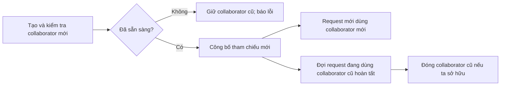

Sơ đồ này thể hiện **quy trình quản trị vòng đời cần thiết**, không phải tất cả các bước đã được triển khai bởi setter hoặc `AtomicReference.set()`. Với một `DiscountPolicy` thuần tính toán, không có tài nguyên, việc thay thường đơn giản hơn nhiều.

## 8. Một policy mới phải tuân thủ hợp đồng cũ

Khi collaborator có thể thay thế, mọi implementation cần thực hiện cùng **ngữ nghĩa hợp đồng**, không chỉ cùng chữ ký.

Trong ví dụ, `DiscountPolicy.discount(subtotalVnd)` phải:

- Nhận tiền hàng theo **VND nguyên**.
- Trả mức giảm trong khoảng từ `0` đến `subtotalVnd`.
- Không tùy ý đổi đơn vị sang phần trăm hoặc một loại tiền khác.
- Có chính sách rõ ràng với dữ liệu không hợp lệ.
- Nếu được dùng đồng thời, triển khai phải tương thích với cơ chế đồng thời đã công bố.

Một implementation như:

```java
final class BrokenDiscount implements DiscountPolicy {
    @Override
    public String code() {
        return "BROKEN";
    }

    @Override
    public long discount(long subtotalVnd) {
        return -100;
    }
}
```

**vẫn biên dịch**, nhưng `CheckoutService` sẽ ném `IllegalStateException` vì kết quả vi phạm hợp đồng. Interface giúp thay thế ở mức **kiểu dữ liệu**, còn **Liskov Substitution Principle** nhắc rằng triển khai mới phải giữ hành vi người dùng dựa vào.

Điều này càng quan trọng trong hot swap: một triển khai không tương thích có thể khiến các request sau chuyển đổi thất bại dù thay tham chiếu thành công.

## 9. Chọn collaborator từ factory hoặc registry

Trong hệ thống thật, người quản trị hoặc request thường gửi mã chính sách dưới dạng `String`, ví dụ `"VIP10"`. Một ranh giới lựa chọn có thể sử dụng registry:

```java
import java.util.Map;

final class DiscountCatalog {
    private final Map<String, DiscountPolicy> policies = Map.of(
            "NONE", new NoDiscount(),
            "VIP10", new PercentageDiscount("VIP10", 10),
            "PROMO25", new PercentageDiscount("PROMO25", 25)
    );

    DiscountPolicy findRequired(String code) {
        DiscountPolicy policy = policies.get(code);
        if (policy == null) {
            throw new IllegalArgumentException(
                    "Mã chính sách không hỗ trợ: " + code);
        }
        return policy;
    }
}
```

Sau đó:

```java
DiscountCatalog catalog = new DiscountCatalog();
checkout.setDiscountPolicy(catalog.findRequired("PROMO25"));
```

Đoạn trên giả định `checkout` là đối tượng `CheckoutService` đã tạo trong ví dụ. Registry tách **việc tìm đúng loại** khỏi **việc dùng collaborator**. `CheckoutService` không cần biết `"VIP10"` đại diện cho lớp nào.

Có thể thay `Map` bằng `switch`, dependency injection hoặc factory khác tùy quy mô. Nếu một policy là đối tượng stateful thuộc riêng từng request, registry có thể lưu **factory tạo mới** thay vì dùng chung một đối tượng policy.

**Không cho phép đầu vào không tin cậy lựa chọn tùy ý một class theo tên rồi tạo bằng reflection** nếu không có cơ chế giới hạn và xác thực rõ. Registry tường minh chỉ cho phép các implementation đã được phê duyệt.

## 10. Khi nào thay collaborator tốt hơn kế thừa hoặc điều kiện?

| Nhu cầu | Giải pháp cân nhắc | Lý do |
| --- | --- | --- |
| Đổi công thức giảm giá mà giữ dịch vụ tính tiền | Composition + `DiscountPolicy` | Hành vi có thể thay độc lập |
| Một quy trình cố định với vài bước con được mở rộng | Template Method / kế thừa có kiểm soát | Hợp đồng kế thừa có thể phù hợp |
| Hai trường hợp cố định khác nhau đúng một điều kiện nhỏ | `if` hoặc `switch` rõ ràng | Tránh tạo hệ thống class không cần thiết |
| Nhiều request cần nhiều policy cùng lúc | Chọn collaborator theo mỗi lời gọi | Tránh trạng thái chia sẻ có thể xung đột |
| Cấu hình chung đổi tại runtime | Setter/replace API với `volatile` hoặc `AtomicReference` khi đa luồng | Công bố phiên bản mới cho các lời gọi tiếp theo |
| Collaborator có state và tài nguyên riêng | Composition + quản lý lifecycle rõ | Tránh đóng đối tượng khi còn được dùng |
| Muốn ghép nhiều hành vi phụ trợ như retry, cache, logging | Decorator/delegation | Kết hợp linh hoạt các lớp wrapper |

Thay collaborator ở runtime thường là một biến thể của **Strategy Pattern**: thuật toán được đóng gói trong một interface, các chiến lược có thể thay thế nhau. Composition là cấu trúc giúp đối tượng chủ giữ một collaborator; Strategy mô tả cách dùng cấu trúc đó để thay **thuật toán/hành vi**.

Không phải mọi collaborator đều là Strategy. Một repository, clock, event publisher hoặc HTTP client cũng có thể được thay theo nhu cầu kiểm thử hay cấu hình, dù chức năng của nó không được gọi là “chiến lược”.

## 11. Kiểm thử chuyển đổi collaborator

Cần kiểm tra cả **hành vi trước/sau khi đổi** và việc các đối tượng cũ không bị sửa ngoài dự kiến.

Ví dụ phép kiểm thử thuần Java, đặt trong một phương thức khi các lớp ở ví dụ chính đã tồn tại:

```java
CheckoutService service = new CheckoutService(new NoDiscount());
Order order = new Order(100_000);

Receipt before = service.checkout(order);

service.setDiscountPolicy(new PercentageDiscount("VIP10", 10));
Receipt after = service.checkout(order);

if (before.totalVnd() != 100_000) {
    throw new AssertionError("Chính sách ban đầu sai");
}
if (after.totalVnd() != 90_000) {
    throw new AssertionError("Chính sách mới chưa có hiệu lực");
}
if (!"NONE".equals(before.policyCode())) {
    throw new AssertionError("Biên lai cũ bị thay đổi");
}
```

Một số ca khác đáng kiểm thử:

- `setDiscountPolicy(null)` phải từ chối để tránh trạng thái service không có policy.
- Policy mới trả giảm giá âm hoặc lớn hơn subtotal phải bị phát hiện.
- Đổi chính sách từ A sang B rồi về A phải cho kết quả đúng theo từng lần gọi.
- Trong hệ thống đa luồng, mỗi request phải quan sát một collaborator nhất quán theo hợp đồng snapshot đã chọn.
- Khi collaborator có tài nguyên, việc đổi không được đóng tài nguyên đang còn request sử dụng.
- Nếu policy mới khởi tạo thất bại, không được công bố một đối tượng chưa sẵn sàng.

Với JUnit, các test có thể viết bằng `assertEquals`, `assertThrows` và fake implementations của `DiscountPolicy`. Những test quan trọng nhất không phải chỉ kiểm tra setter được gọi, mà là **hành vi nghiệp vụ sau khi chọn collaborator mới**.

## 12. Lỗi thường gặp

| Sai lầm | Hệ quả | Cách khắc phục |
| --- | --- | --- |
| Trường collaborator có kiểu lớp cụ thể thay vì interface cần thiết | Không thay được implementation không cùng nhánh | Dùng hợp đồng có ý nghĩa |
| Setter cho phép `null` | Request tiếp theo có thể ném `NullPointerException` | `Objects.requireNonNull` hoặc chính sách vắng mặt rõ ràng |
| Cứ mỗi request lại đổi một field của singleton chung | Request người này có thể dùng policy người khác | Truyền policy per-request |
| Đọc collaborator nhiều lần trong một thao tác | Giữa chừng policy thay, kết quả có thể dùng nhiều phiên bản | Chụp một tham chiếu cục bộ cho mỗi thao tác |
| Nghĩ thay tham chiếu thường là thread-safe hoàn toàn | Không bảo đảm visibility hoặc trạng thái bên trong | Dùng đúng đồng bộ/atomic publication và policy an toàn |
| Đóng collaborator cũ ngay khi thay | Request đang chạy dùng tài nguyên đã đóng | Quản lý in-flight operations và ownership |
| Một implementation mới đổi đơn vị hoặc trả giá trị sai | Phá hợp đồng thay thế | Contract test và validation |
| Mọi collaborator đều được tạo thành Strategy dù không cần đổi | Tăng lớp/độ phức tạp vô ích | Dùng trường `final` nếu phụ thuộc cố định |
| Dùng reflection theo tên lớp do client gửi | Rủi ro cấu hình và bảo mật | Danh mục implementation được phép |
| Cho rằng setter cập nhật cả kết quả đã tạo trước đó | Nhầm ranh giới giữa trạng thái hiện tại và lịch sử | Lưu kết quả/phiên bản phù hợp trong biên lai |

## 13. Câu hỏi tự kiểm tra

**Câu 1.** Sau khi gọi `checkout.setDiscountPolicy(new NoDiscount())`, đối tượng `CheckoutService` có được tạo lại không?

**Trả lời:** Không. Chỉ tham chiếu collaborator bên trong service thay đổi. Đối tượng chủ vẫn là cùng một object.

**Câu 2.** Vì sao biến `DiscountPolicy selected = discountPolicy;` được đặt ở đầu `checkout()`?

**Trả lời:** Để `discount()` và `code()` cùng sử dụng **một** policy đã chọn. Việc thay field ở thời điểm khác không khiến chính lần gọi ấy vô tình dùng hai collaborator khác nhau.

**Câu 3.** Khi một singleton `CheckoutService` phục vụ nhiều người dùng với mức giảm riêng, có nên gọi `setDiscountPolicy(...)` cho từng request không?

**Trả lời:** Thường không nên; các request có thể ghi đè policy của nhau. Chọn policy theo tham số request hoặc dùng phạm vi dữ liệu phù hợp.

**Câu 4.** `AtomicReference<DiscountPolicy>` có khiến mọi phương thức trong `DiscountPolicy` trở thành thread-safe không?

**Trả lời:** Không. Nó bảo đảm thao tác trên **tham chiếu** theo hợp đồng atomic/visibility; logic và trạng thái của đối tượng policy vẫn phải được thiết kế an toàn riêng.

**Câu 5.** Nếu một HTTP client cũ đang xử lý request, có nên gọi `close()` cho nó ngay sau khi chuyển field sang client mới?

**Trả lời:** Không thể mặc định như vậy. Cần biết ai sở hữu client và khi nào các request đang dùng nó kết thúc. Có thể cần cơ chế drain hoặc quản lý vòng đời riêng.

**Câu 6.** Có phải composition luôn phải hỗ trợ thay collaborator runtime?

**Trả lời:** Không. Composition với collaborator `final` cố định suốt vòng đời vẫn là thiết kế hợp lệ, thường đơn giản hơn khi không có nhu cầu chuyển đổi.

**Ghi nhớ:** Composition cho phép đối tượng chủ **ủy quyền** cho collaborator qua một hợp đồng rõ ràng. Nếu nghiệp vụ cần, đối tượng chủ có thể **thay collaborator lúc chạy** để thay hành vi mà không phải thay chính nó. Thiết kế tốt còn phải xác định rõ *phạm vi áp dụng của lần thay*, *tính nhất quán giữa các luồng*, *hợp đồng của các implementation* và *vòng đời tài nguyên* — không chỉ thêm một setter.


</details>

- [Quay lại đầu trang](#back-to-top)

---

## <a id="composition-006">Tiêm phụ thuộc qua hàm khởi tạo hoặc phương thức</a>

<details>
<summary>Xem chi tiết</summary>

# Tiêm phụ thuộc qua hàm khởi tạo hoặc phương thức trong Java

> **OOP → Kết hợp (Composition).** Một đối tượng thường cần sử dụng đối tượng khác để hoàn thành công việc: dịch vụ đặt hàng cần bộ gửi thông báo; bộ xuất báo cáo cần trình định dạng; mã nghiệp vụ cần nơi lưu dữ liệu. **Dependency Injection (DI) — tiêm phụ thuộc** là cách *cung cấp* những đối tượng cộng tác từ bên ngoài, thay vì để lớp sử dụng tự tạo cứng chúng. Hai cách thực hiện trực tiếp trong Java là **constructor injection** (truyền qua hàm khởi tạo) và **method injection** (truyền qua tham số phương thức).

## 1. Vì sao cần tiêm phụ thuộc?

Giả sử một lớp thông báo đơn hàng tự tạo bộ gửi email:

```java
class OrderNotifier {
    private final EmailSender sender = new EmailSender();

    void notifyPaid(String recipient) {
        sender.send(recipient, "Đơn hàng đã thanh toán");
    }
}
```

`EmailSender` ở đây là tên một lớp giả định. Cách viết này khiến `OrderNotifier` phải biết **chính xác implementation** và cách khởi tạo nó. Nếu muốn gửi SMS, thay nhà cung cấp email, hoặc kiểm thử mà không gửi thông báo thật, ta phải sửa hoặc tìm cách thay phần phụ thuộc bên trong.

Tách hợp đồng gửi thông báo:

```java
interface NotificationSender {
    DeliveryResult send(String recipient, String message);
}
```

Rồi cho lớp thông báo **nhận** một `NotificationSender`:

```java
class OrderNotifier {
    private final NotificationSender sender;

    OrderNotifier(NotificationSender sender) {
        this.sender = java.util.Objects.requireNonNull(sender);
    }
}
```

Đối tượng `OrderNotifier` **có một** bộ gửi thông báo (*has-a*), nhưng không tự quyết định phải dùng bộ gửi email hay SMS. Đây là kết hợp (composition) thông qua một hợp đồng và là ví dụ đơn giản của DI.

| Không tiêm phụ thuộc | Có tiêm phụ thuộc |
|---|---|
| Lớp tự `new EmailSender()` trong logic của mình | Mã bên ngoài tạo sender rồi chuyển vào lớp |
| Logic nghiệp vụ gắn với một implementation cụ thể | Logic nghiệp vụ phụ thuộc vào hợp đồng `NotificationSender` |
| Khó thay sender trong test | Có thể truyền `RecordingSender` giả lập |
| Thay công nghệ có thể buộc sửa lớp nghiệp vụ | Có thể thay implementation tại điểm khởi tạo ứng dụng |

**Lưu ý:** DI không đồng nghĩa bắt buộc có Spring hay một DI container. Constructor và tham số phương thức của Java thuần đã đủ để thực hiện DI.

## 2. Constructor injection: phụ thuộc cần trong cả vòng đời đối tượng

**Constructor injection** phù hợp khi một dependency là **bắt buộc** và sẽ được nhiều phương thức của một đối tượng sử dụng.

```java
final class OrderNotifier {
    private final NotificationSender sender;

    OrderNotifier(NotificationSender sender) {
        this.sender = Objects.requireNonNull(sender, "sender");
    }

    DeliveryResult notifyPaid(String recipient, String orderId) {
        return sender.send(
            recipient,
            "Đơn hàng " + orderId + " đã thanh toán"
        );
    }
}
```

Tại nơi khởi tạo:

```java
NotificationSender sender = new ConsoleEmailSender();
OrderNotifier notifier = new OrderNotifier(sender);
```

Điều đáng chú ý:

1. `sender` được yêu cầu **ngay lúc tạo** `OrderNotifier`. Nếu truyền `null`, constructor từ chối trước khi trả một object hợp lệ.
2. Trường `private final` ngăn gán lại tham chiếu sender sau khi tạo. Nó **không làm đối tượng sender bên trong trở thành bất biến hoặc thread-safe**.
3. Các phương thức nghiệp vụ chỉ gọi hợp đồng `NotificationSender`; chúng không cần biết lớp thực tế.
4. Bên ngoài quyết định **cấu hình và vòng đời** dependency. Không nên tự ý đóng một dependency do caller sở hữu khi hợp đồng không cho phép.

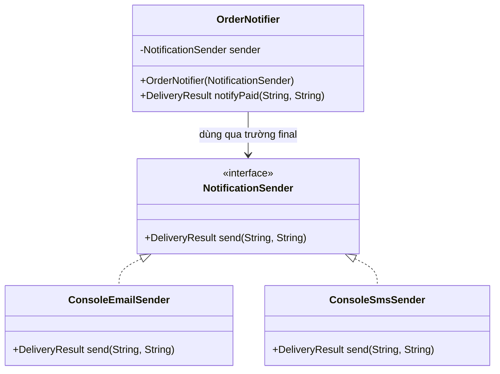

Mũi tên `OrderNotifier → NotificationSender` cho thấy **phụ thuộc ở mã nguồn trỏ tới abstraction**. Hai lớp sender triển khai chi tiết và có thể thay cho nhau miễn là chúng tuân thủ cùng hợp đồng.

## 3. Method injection: phụ thuộc được chọn theo từng lời gọi

**Method injection qua tham số** phù hợp khi hành vi phụ thuộc vào **ngữ cảnh của lần gọi** và không cần được giữ lâu trong một trường.

Ví dụ, một tác vụ gửi cảnh báo có thể chọn kênh gửi khác nhau theo từng yêu cầu:

```java
final class AlertService {
    DeliveryResult sendAlert(
            String recipient,
            String message,
            NotificationSender sender) {

        Objects.requireNonNull(sender, "sender");
        return sender.send(recipient, message);
    }
}
```

Cách sử dụng:

```java
AlertService alerts = new AlertService();

alerts.sendAlert(
    "an@example.test",
    "Đơn hàng cần xác nhận",
    new ConsoleEmailSender()
);

alerts.sendAlert(
    "0900000000",
    "Mã xác nhận 123456",
    new ConsoleSmsSender()
);
```

Trong cách này, `AlertService` không cần trường `NotificationSender`. Mỗi lời gọi truyền dependency được chọn lúc đó. Đây là **tiêm dependency bằng tham số phương thức**; nó không đồng nghĩa với cơ chế `@Lookup` method injection chuyên biệt của Spring.

**Khác biệt về vòng đời:**

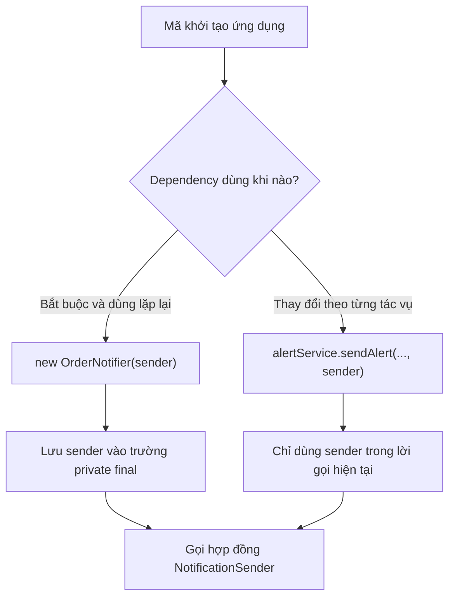

Nếu lần nào cũng truyền cùng một sender qua hàng chục phương thức chỉ để có thể gọi nó, constructor injection thường gọn hơn. Ngược lại, nếu một dịch vụ gửi được nhiều kênh độc lập theo yêu cầu, lưu cố định một sender có thể làm API kém linh hoạt.

## 4. Ví dụ Java hoàn chỉnh: dùng cả hai cách injection

Đoạn sau chạy độc lập với **Java 17+**, không cần Spring hay dịch vụ email/SMS thật. Các sender chỉ in ra console để minh họa đa hình và đường truyền dependency.

Lưu thành `DependencyInjectionDemo.java`:

```java
import java.util.Objects;

public class DependencyInjectionDemo {

    record DeliveryResult(String channel, boolean accepted) {
        DeliveryResult {
            Objects.requireNonNull(channel, "channel");
        }
    }

    interface NotificationSender {
        DeliveryResult send(String recipient, String message);
    }

    static String requireText(String value, String field) {
        if (value == null || value.isBlank()) {
            throw new IllegalArgumentException(field + " không hợp lệ");
        }
        return value;
    }

    // Implementation A: chỉ mô phỏng email bằng log console.
    static final class ConsoleEmailSender implements NotificationSender {
        @Override
        public DeliveryResult send(String recipient, String message) {
            requireText(recipient, "recipient");
            requireText(message, "message");
            System.out.println("[EMAIL] " + recipient + " <- " + message);
            return new DeliveryResult("EMAIL", true);
        }
    }

    // Implementation B: chỉ mô phỏng SMS bằng log console.
    static final class ConsoleSmsSender implements NotificationSender {
        @Override
        public DeliveryResult send(String recipient, String message) {
            requireText(recipient, "recipient");
            requireText(message, "message");
            System.out.println("[SMS] " + recipient + " <- " + message);
            return new DeliveryResult("SMS", true);
        }
    }

    // Constructor injection: dùng sender cố định trong vòng đời notifier.
    static final class OrderNotifier {
        private final NotificationSender sender;

        OrderNotifier(NotificationSender sender) {
            this.sender = Objects.requireNonNull(sender, "sender");
        }

        DeliveryResult notifyPaid(String recipient, String orderId) {
            requireText(recipient, "recipient");
            requireText(orderId, "orderId");
            return sender.send(
                recipient,
                "Đơn hàng " + orderId + " đã thanh toán"
            );
        }
    }

    // Method injection: sender có thể thay đổi theo từng lần gọi.
    static final class AlertService {
        DeliveryResult sendAlert(
                String recipient,
                String message,
                NotificationSender sender) {
            requireText(recipient, "recipient");
            requireText(message, "message");
            Objects.requireNonNull(sender, "sender");
            return sender.send(recipient, message);
        }
    }

    // Fake dùng để kiểm thử, không gửi email hoặc SMS thật.
    static final class RecordingSender implements NotificationSender {
        private int calls;
        private String lastRecipient;
        private String lastMessage;

        @Override
        public DeliveryResult send(String recipient, String message) {
            calls++;
            lastRecipient = recipient;
            lastMessage = message;
            return new DeliveryResult("FAKE", true);
        }

        int calls() {
            return calls;
        }

        String lastRecipient() {
            return lastRecipient;
        }

        String lastMessage() {
            return lastMessage;
        }
    }

    public static void main(String[] args) {
        // Tiêm qua constructor.
        OrderNotifier notifier =
            new OrderNotifier(new ConsoleEmailSender());

        DeliveryResult email = notifier.notifyPaid(
            "an@example.test",
            "ORD-101"
        );
        System.out.println("Email accepted: " + email.accepted());

        // Tiêm qua tham số của phương thức.
        AlertService alerts = new AlertService();
        DeliveryResult sms = alerts.sendAlert(
            "0900000000",
            "Mã xác nhận 123456",
            new ConsoleSmsSender()
        );
        System.out.println("SMS accepted: " + sms.accepted());

        // Thay dependency bằng fake mà không sửa OrderNotifier.
        RecordingSender fake = new RecordingSender();
        OrderNotifier testNotifier = new OrderNotifier(fake);
        testNotifier.notifyPaid("test@example.test", "ORD-TEST");

        if (fake.calls() != 1
                || !fake.lastRecipient().equals("test@example.test")
                || !fake.lastMessage().contains("ORD-TEST")) {
            throw new AssertionError("OrderNotifier dùng sai dependency");
        }
        System.out.println("Fake calls: " + fake.calls());
    }
}
```

Chạy:

```bash
javac DependencyInjectionDemo.java
java DependencyInjectionDemo
```

Đầu ra mong đợi:

```text
[EMAIL] an@example.test <- Đơn hàng ORD-101 đã thanh toán
Email accepted: true
[SMS] 0900000000 <- Mã xác nhận 123456
SMS accepted: true
Fake calls: 1
```

Đây là **mô phỏng tại console**. `accepted=true` trong ví dụ chỉ có nghĩa implementation mô phỏng đã chấp nhận lời gọi; không chứng minh email/SMS thật đã được gửi hay người nhận đã đọc. Với dịch vụ thực, hợp đồng cần phân biệt đã gửi, đang chờ, bị từ chối và lỗi kết nối nếu những trạng thái đó quan trọng.

### Theo dõi một lần gọi

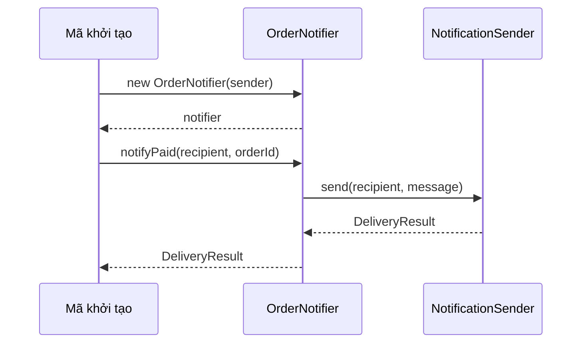

`OrderNotifier` không khởi tạo `ConsoleEmailSender`; điều đó được làm ở phía `main`. Do vậy, có thể truyền `RecordingSender` để kiểm thử mà không phải thay code của `OrderNotifier`.

## 5. So sánh constructor, method và setter injection

Đôi khi tài liệu sử dụng từ **method injection** để chỉ **setter injection** (tiêm qua phương thức setter), nhưng cũng có tài liệu nói riêng về **method parameter injection** (truyền dependency trực tiếp cho một thao tác). Nên nêu rõ đang dùng dạng nào.

| Tiêu chí | Constructor injection | Method parameter injection | Setter injection |
|---|---|---|---|
| Ví dụ | `new Service(repo)` | `service.run(repo)` | `service.setRepo(repo)` |
| Dependency được nhận khi nào? | Khi khởi tạo đối tượng | Mỗi lần gọi một phương thức | Khi setter được gọi |
| Lưu thành field? | Thường có, có thể `final` | Thường không cần | Thường có, thường không `final` |
| Phù hợp với | Dependency bắt buộc, ổn định | Dependency tùy từng yêu cầu/tác vụ | Cấu hình tùy chọn hoặc có khả năng thay đổi |
| Nguy cơ | Constructor có quá nhiều tham số | Lặp tham số ở nhiều lời gọi | Đối tượng có thể chưa cấu hình hoặc bị đổi giữa chừng |
| Dễ làm giả trong test | Có | Có | Có, nhưng phải kiểm soát thứ tự cấu hình |

Setter injection có thể viết như sau:

```java
final class ConfigurableNotifier {
    private NotificationSender sender;

    void setSender(NotificationSender sender) {
        this.sender = Objects.requireNonNull(sender, "sender");
    }

    DeliveryResult notify(String recipient, String message) {
        if (sender == null) {
            throw new IllegalStateException("Chưa cấu hình sender");
        }
        return sender.send(recipient, message);
    }
}
```

Mẫu này có rủi ro: nếu gọi `notify()` trước `setSender()`, object chưa sẵn sàng. Nếu nhiều thread cùng gọi setter và notify, còn phải xem xét đồng bộ và quy tắc thay đổi cấu hình. Vì vậy, **ưu tiên constructor injection cho dependency bắt buộc**; dùng setter khi việc thay đổi hoặc không cấu hình dependency là một yêu cầu thực sự.

## 6. Composition khác với kế thừa như thế nào ở đây?

Trong ví dụ, quan hệ giữa notifier và sender là:

```text
OrderNotifier có một NotificationSender.
```

Không phải:

```text
OrderNotifier là một loại NotificationSender.
```

`OrderNotifier` **sử dụng** sender để hoàn thành trách nhiệm riêng; nó không cần `extends ConsoleEmailSender` hay `extends ConsoleSmsSender`. Đây là composition: phối hợp các đối tượng có trách nhiệm độc lập.

```java
// Đúng hướng: sử dụng một thành phần thông qua hợp đồng.
class OrderNotifier {
    private final NotificationSender sender;
    OrderNotifier(NotificationSender sender) {
        this.sender = sender;
    }
}

// Không nên kế thừa chỉ để tái sử dụng hàm send:
// class OrderNotifier extends ConsoleEmailSender { ... }
```

Composition giúp thay đổi cách gửi thông báo mà không cần làm biến dạng cây kế thừa. Nó cũng thuận tiện khi mỗi đối tượng có vòng đời riêng: notifier có thể sống dài, sender có thể được chia sẻ hoặc có cơ chế đóng kết nối theo API.

**Quan trọng:** chỉ truyền dependency vào không tự làm cho chương trình có tính đúng đắn về concurrency hoặc vòng đời tài nguyên. Nếu sender dùng kết nối hoặc thread pool, cần quyết định ai tạo, ai sở hữu và ai đóng chúng.

## 7. Truyền interface thay vì gắn với implementation cụ thể

Hai constructor sau đều là một dạng nhận dependency từ bên ngoài:

```java
OrderNotifier(ConsoleEmailSender sender) { /* ... */ }
OrderNotifier(NotificationSender sender) { /* ... */ }
```

Nhưng cách thứ hai mềm dẻo hơn vì nhận bất kỳ implementation nào tuân thủ `NotificationSender`.

Khi lớp nghiệp vụ chỉ cần hành vi `send`, nó không nên yêu cầu những phương thức riêng của một nhà cung cấp cụ thể. Hợp đồng càng dựa vào nhu cầu thực của caller, mức kết dính càng thấp.

Tuy nhiên, **không bắt buộc mỗi class đều cần một interface**. Nếu một thành phần chỉ có một cách triển khai ổn định và không có ranh giới thay thế hữu ích, tiêm một concrete class vẫn có thể hợp lý. Điều quan trọng là ai quyết định cách tạo dependency và dependency có bị gắn cứng trong logic nghiệp vụ không.

### Dependency Injection, Dependency Inversion và IoC

Ba khái niệm liên quan nhưng không đồng nghĩa:

- **Dependency Injection (DI):** cách cung cấp dependency từ bên ngoài qua constructor, phương thức hoặc setter.
- **Dependency Inversion Principle (DIP):** nguyên tắc cho mã cấp cao và mã triển khai cùng phụ thuộc vào abstraction phù hợp, thay vì mã cấp cao lệ thuộc trực tiếp vào chi tiết cấp thấp.
- **Inversion of Control (IoC):** ý tưởng đảo quyền điều khiển việc tạo/cấp phát hoặc tổ chức luồng điều khiển cho một thành phần bên ngoài; DI là một kỹ thuật thường dùng để áp dụng IoC.

Không cần một container DI để có DI. Trong `main` của ví dụ, mã khởi tạo ứng dụng đang đóng vai trò **composition root** — nơi chọn và lắp ráp các implementation.

## 8. Chọn cách injection theo yêu cầu thực tế

Một số tình huống minh họa:

| Tình huống | Cách thường thích hợp | Lý do |
|---|---|---|
| `OrderService` luôn cần `OrderRepository` để xử lý | Constructor injection | Bắt buộc, ổn định trong vòng đời service |
| `CheckoutService` luôn dùng một `PaymentGateway` được cấu hình | Constructor injection | Thiếu gateway là không thể làm việc đúng |
| Xuất một báo cáo với `Formatter` khác nhau từng lần | Method parameter injection | Formatter là chiến lược riêng của tác vụ |
| Công cụ chạy thử cho chọn kênh gửi thông báo mỗi lần | Method parameter injection | Dependency thay theo đầu vào của lần gọi |
| Một tính năng phụ có thể được cấu hình sau | Setter injection có kiểm soát | Không phải dependency bắt buộc từ lúc tạo |
| Tập trung tạo và kết nối mọi service trong ứng dụng | Composition root hoặc DI container | Một nơi quản lý lắp ghép và vòng đời |

**Nguyên tắc quyết định nhanh:** nếu thiếu dependency khiến object **không hợp lệ hoặc không dùng được**, đưa nó vào constructor. Nếu dependency **chỉ cần cho một hành động cụ thể và thay theo hành động**, cân nhắc tham số phương thức. Nếu dependency thật sự **tùy chọn hoặc được cấu hình lại**, setter có thể phù hợp nhưng phải định nghĩa trạng thái trước/sau cấu hình.

## 9. Lỗi phổ biến

### Lỗi 1 — Cung cấp dependency rồi lại tự tạo mới bên trong

```java
class BadNotifier {
    private final NotificationSender sender;

    BadNotifier(NotificationSender sender) {
        this.sender = sender;
    }

    void notifyUser(String recipient, String message) {
        // Sai ý đồ injection: bỏ qua this.sender.
        new ConsoleEmailSender().send(recipient, message);
    }
}
```

Mặc dù constructor có tham số, class vẫn gắn cứng với email. Sửa bằng `this.sender.send(...)`.

### Lỗi 2 — Để dependency bắt buộc có thể null

```java
class BadService {
    private NotificationSender sender;
    // Không có constructor/setter bảo đảm sender được gán.
}
```

Khi gọi phương thức sử dụng sender, dễ gặp `NullPointerException`. Nên dùng constructor với `Objects.requireNonNull` hoặc một thiết kế trạng thái có kiểm soát nếu dependency thực sự tùy chọn.

### Lỗi 3 — Constructor có quá nhiều dependency

```java
// Ví dụ minh họa dấu hiệu cần xem lại trách nhiệm:
Service(A a, B b, C c, D d, E e, F f, G g) { /* ... */ }
```

Không có một ngưỡng số tham số áp dụng cho mọi dự án. Nhưng nếu constructor có quá nhiều phụ thuộc không liên quan, có thể lớp đang làm quá nhiều việc. Hãy xem lại trách nhiệm, tách dịch vụ hợp lý thay vì tự động đóng tất cả vào một đối tượng `Dependencies` khó kiểm soát.

### Lỗi 4 — Method injection khiến API truyền lan dependency

Nếu nhiều tầng gọi nhau đều nhận `NotificationSender` mà tầng trung gian không sử dụng nó ngoài việc truyền tiếp, có thể dependency đã được đặt sai phạm vi. Cân nhắc cho thành phần thật sự sử dụng nhận dependency qua constructor.

### Lỗi 5 — Không phân biệt trách nhiệm sở hữu resource

Một dependency được tiêm có thể sở hữu kết nối mạng, executor hoặc stream. Mã nhận dependency **không được tự ý đóng** tài nguyên do nơi khác quản lý nếu hợp đồng không quy định; nếu một thành phần được giao quyền sở hữu thì phải đóng tài nguyên vào đúng cuối vòng đời. DI không tự động thay thế chính sách quản lý tài nguyên.

### Lỗi 6 — Nghĩ constructor injection tự tạo an toàn đa luồng

`private final NotificationSender sender` không làm cho `sender.send(...)` tự thread-safe. Nếu nhiều thread chia sẻ một sender có trạng thái mutable, implementation vẫn cần bảo đảm an toàn đa luồng hoặc được sử dụng trong phạm vi phù hợp.

## 10. Bài tập thực hành

**Bài 1 — Đổi implementation.** Thêm `ConsolePushSender implements NotificationSender` in `[PUSH]`. Tiêm nó vào `OrderNotifier` thay cho `ConsoleEmailSender` mà không sửa `OrderNotifier`. Quan sát đầu ra.

**Bài 2 — Chọn injection.** Một `ReportService` cần `DocumentRepository` trong mọi lời gọi và cần một `ReportFormatter` thay đổi theo từng báo cáo. Thiết kế constructor nhận repository, còn phương thức `export(formatter)` nhận formatter. Giải thích vì sao chọn hai phạm vi khác nhau.

**Bài 3 — Kiểm thử bằng fake.** Dùng `RecordingSender` để kiểm tra `OrderNotifier.notifyPaid` truyền đúng người nhận, mã đơn hàng và chỉ gọi `send` một lần. Sau đó truyền `RecordingSender` cho `AlertService.sendAlert` để kiểm tra method injection.

**Bài 4 — Trạng thái chưa cấu hình.** Thử gọi `notify` của `ConfigurableNotifier` trước khi `setSender`. Giải thích vì sao việc tiêm qua setter có thể tạo ra trạng thái chưa hợp lệ; viết test cho tình huống này.

**Bài 5 — Sở hữu dependency.** Một `SmtpSender` có kết nối cần đóng. Khi `OrderNotifier` nhận sender từ composition root, ai nên đóng kết nối? Hãy đề xuất hợp đồng sở hữu rõ ràng thay vì tự đóng từ mọi class đang dùng sender.

**Ghi nhớ:** Với composition, một đối tượng **nhận và sử dụng** các đối tượng cộng tác thay vì tự tạo cứng chúng. **Constructor injection** phù hợp nhất cho dependency bắt buộc, ổn định; **method parameter injection** phù hợp với dependency thay đổi theo tác vụ; còn **setter injection** chỉ nên dùng khi cần thay đổi hoặc cấu hình sau và đã kiểm soát trạng thái chưa sẵn sàng. Điểm chung là mã nghiệp vụ chỉ biết hợp đồng cần dùng, nhờ đó dễ thay implementation và kiểm thử.


</details>

- [Quay lại đầu trang](#back-to-top)

---

## <a id="composition-007">Quyền sở hữu và vòng đời đối tượng được chứa</a>

<details>
<summary>Xem chi tiết</summary>

# Quyền sở hữu và vòng đời đối tượng được chứa trong Composition (Java)

> **Bối cảnh:** OOP → Kết hợp (Composition). Khi một đối tượng chứa các đối tượng khác, câu hỏi thiết kế quan trọng không chỉ là “có trường dữ liệu nào?”, mà còn là **ai kiểm soát việc tạo, sửa, chia sẻ và kết thúc sử dụng thành phần đó?**

## 1. Mục tiêu học tập

Sau bài này, bạn có thể:

- Phân biệt **quyền sở hữu ở mức thiết kế đối tượng**, **khả năng truy cập qua tham chiếu Java** và **quyền quản lý tài nguyên hệ thống**.
- Xác định thành phần có được dùng chung giữa nhiều đối tượng hay phải nằm dưới sự quản lý của một đối tượng cha.
- Thiết kế API giữ vững bất biến (invariant) khi đối tượng được chứa thay đổi.
- Dùng `AutoCloseable` và `try-with-resources` để điều khiển vòng đời tài nguyên khi đối tượng cha sở hữu tài nguyên đó.
- Tránh nhầm cơ chế garbage collection với việc đóng file, kết nối hoặc luồng công việc.

## 2. Quyền sở hữu nghĩa là gì?

Trong **composition**, một đối tượng tổng thể (*whole/owner*) quản lý các thành phần (*parts*) để thực hiện chức năng và bảo vệ trạng thái hợp lệ của tổng thể.

Ví dụ: `DonHang` quản lý các `DongHang`. Đơn hàng quyết định khi nào thêm dòng hàng, dòng nào được xóa, số lượng/đơn giá nào hợp lệ và cách tính tổng tiền. Người dùng `DonHang` không được tự ý sửa danh sách nội bộ để bỏ qua các quy tắc đó.

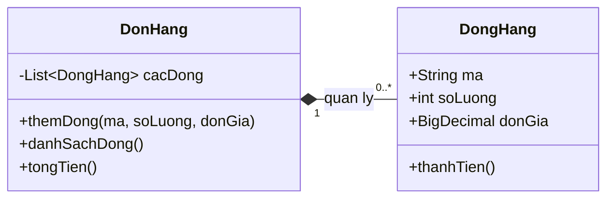

Ký hiệu hình thoi tô đặc (`*--`) trong UML thể hiện **composition**: thành phần nằm trong ranh giới vòng đời và quyền quản lý của tổng thể, theo **mô hình nghiệp vụ**.

Tuy nhiên, Java **không có từ khóa ownership**. Một trường `private DongHang dongHang;` chỉ lưu **tham chiếu**, chưa tự động đảm bảo cha là chủ sở hữu duy nhất. Quyền sở hữu phải được bảo vệ bằng cách thiết kế constructor, phương thức, phạm vi truy cập và quy ước sử dụng.

### Ba khái niệm dễ bị lẫn

| Khái niệm | Câu hỏi chính | Trong Java |
|---|---|---|
| Sở hữu theo mô hình nghiệp vụ | Ai quyết định tạo, thay đổi, loại bỏ thành phần? | API, invariant, đóng gói; không được JVM áp đặt |
| Tham chiếu đến đối tượng | Ai đang giữ đường truy cập đến cùng một đối tượng? | Nhiều biến có thể trỏ đến cùng instance; `private` và `final` không tự ngăn alias |
| Sở hữu tài nguyên | Ai phải đóng file/socket/stream và khi nào? | Hợp đồng API, `AutoCloseable`, `try-with-resources` |

Một đối tượng con có thể ngừng thuộc đơn hàng nhưng vẫn còn tham chiếu trong chương trình. Điều này **không** có nghĩa Java xóa ngay đối tượng khỏi bộ nhớ.

## 3. Quyết định quyền sở hữu trước khi viết code

Với mỗi trường chứa một đối tượng khác, hãy trả lời:

1. **Ai tạo?** Cha tạo nội bộ, nhận dữ liệu để sao chép, hay nhận một instance từ bên ngoài?
2. **Ai có thể sửa?** Mọi thay đổi đi qua API cha hay các lớp khác có thể sửa trực tiếp?
3. **Có được chia sẻ?** Một thành phần có thể đồng thời phục vụ nhiều tổng thể không?
4. **Khi nào kết thúc?** Khi cha bị loại bỏ khỏi nghiệp vụ, khi cha gọi `close()`, hay khi toàn ứng dụng dừng?
5. **Ai dọn dẹp?** Chỉ rõ trách nhiệm với tài nguyên có giới hạn như kết nối, file và thread.

| Tình huống | Thiết kế thường phù hợp | Lưu ý |
|---|---|---|
| `DonHang` và danh sách `DongHang` | Composition; cha kiểm soát thêm/xóa dòng | Chặn sửa danh sách qua getter |
| `HoaDon` và giá trị `Money` bất biến | Có thể chia sẻ value object an toàn | Không bắt buộc tạo bản sao nếu thực sự bất biến |
| `NhanVien` và `PhongBan` | Quan hệ liên kết/aggregation thường hợp lý hơn | Phòng ban vẫn tồn tại khi nhân viên rời đi |
| `ExportJob` tự mở `BufferedWriter` | Job sở hữu writer và phải đóng | Đóng theo `try-with-resources` |
| Service được container dependency injection cấp | Thường container quản lý vòng đời | Consumer không tự đóng dependency dùng chung |

**Quy tắc thực dụng:** quyền sở hữu càng mạnh thì thành phần càng nên được tạo/quản lý qua API của cha, thay vì cho bên ngoài thay thế hoặc sửa tùy ý.

## 4. Ví dụ hoàn chỉnh: đơn hàng quản lý dòng hàng

Lưu thành `CompositionDemo.java`, chạy với **Java 17+**:

```java
import java.math.BigDecimal;
import java.util.ArrayList;
import java.util.List;
import java.util.Objects;

public class CompositionDemo {
    public static void main(String[] args) {
        Order order = new Order("DH-001");

        order.addLine("BOOK", 2, new BigDecimal("125000"));
        List<Order.Line> snapshot = order.lines();

        order.addLine("PEN", 3, new BigDecimal("10000"));

        System.out.println(snapshot.size());       // 1
        System.out.println(order.lines().size());   // 2
        System.out.println(order.total());          // 280000

        try {
            snapshot.clear();
        } catch (UnsupportedOperationException expected) {
            System.out.println("Khong the sua danh sach tu ben ngoai");
        }
    }

    static final class Order {
        private final String id;
        private final List<Line> lines = new ArrayList<>();

        Order(String id) {
            if (id == null || id.isBlank()) {
                throw new IllegalArgumentException("Ma don hang khong hop le");
            }
            this.id = id;
        }

        public void addLine(String sku, int quantity, BigDecimal unitPrice) {
            // Cha tao va kiem soat thanh phan con.
            lines.add(new Line(sku, quantity, unitPrice));
        }

        public List<Line> lines() {
            // Ban chup khong sua duoc; khong lo danh sach noi bo.
            return List.copyOf(lines);
        }

        public BigDecimal total() {
            return lines.stream()
                    .map(Line::amount)
                    .reduce(BigDecimal.ZERO, BigDecimal::add);
        }

        // Gia tri bat bien: String va BigDecimal cung bat bien.
        record Line(String sku, int quantity, BigDecimal unitPrice) {
            Line {
                if (sku == null || sku.isBlank()) {
                    throw new IllegalArgumentException("SKU khong hop le");
                }
                if (quantity <= 0) {
                    throw new IllegalArgumentException("So luong phai > 0");
                }
                Objects.requireNonNull(unitPrice, "unitPrice");
                if (unitPrice.signum() < 0) {
                    throw new IllegalArgumentException("Don gia am");
                }
            }

            BigDecimal amount() {
                return unitPrice.multiply(BigDecimal.valueOf(quantity));
            }
        }
    }
}
```

Chạy:

```bash
javac CompositionDemo.java
java CompositionDemo
```

Kết quả:

```text
1
2
280000
Khong the sua danh sach tu ben ngoai
```

**Vì sao ví dụ này thực sự quản lý thành phần?**

- `Order` tạo từng `Line` sau khi kiểm tra dữ liệu. Mọi thao tác thêm dòng hàng đều đi qua `addLine(...)`.
- Danh sách `lines` là `private`; `lines()` trả về một **snapshot bất biến ở mức danh sách**, nên gọi `clear()`, `add()` từ bên ngoài đều bị từ chối.
- `Line` là `record` chứa các giá trị bất biến trong ví dụ. Vì vậy việc trả các `Line` trong snapshot không làm lộ trạng thái có thể thay đổi của đơn hàng.
- `total()` luôn được tính từ dữ liệu mà `Order` đang kiểm soát.

**Giới hạn cần hiểu:** `List.copyOf(...)` chỉ tạo bản sao *nông* của cấu trúc danh sách. Nếu phần tử là `MutableLine` có setter, người nhận snapshot vẫn có thể sửa phần tử đó. Lúc ấy phải dùng bản sao sâu phù hợp, DTO bất biến, hoặc chỉ cung cấp thao tác đọc cần thiết.

Ngoài ra, `final List<Line>` chỉ ngăn **gán lại biến trường**, không ngăn `lines.add(...)`. Để bất biến được bảo vệ, phải thiết kế cả cấu trúc và các đường truy cập.

## 5. Vòng đời đối tượng con diễn ra thế nào?

Có thể phân biệt vòng đời **nghiệp vụ** và vòng đời **bộ nhớ** như sau:

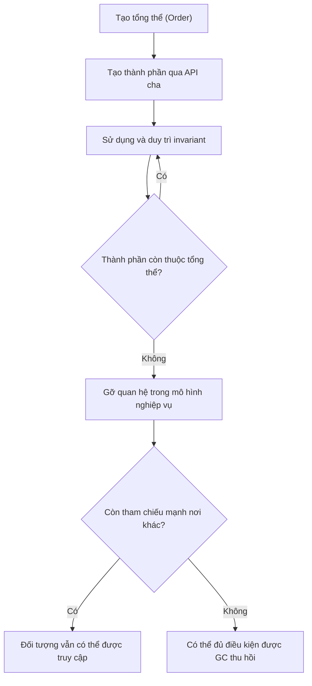

Đối với đối tượng Java thông thường:

- **Tạo:** khi gọi constructor hoặc factory, đối tượng được cấp phát và được liên kết vào tổng thể theo API.
- **Sử dụng:** tổng thể quản lý quyền thay đổi; cần tránh alias đưa cho bên ngoài khả năng sửa trái phép.
- **Ngừng thuộc tổng thể:** khi dòng hàng được xóa hoặc đơn hàng kết thúc nghiệp vụ, quan hệ composition chấm dứt theo quy tắc domain.
- **Thu hồi bộ nhớ:** JVM có thể thu hồi đối tượng khi không còn reachable từ các GC root. **Không thể dự đoán thời điểm thu hồi**, và bản thân việc bỏ tham chiếu không gọi `close()`.

Nếu ai đó vẫn giữ một `Line` đã lấy ra từ snapshot, `Line` ấy vẫn tồn tại và có thể đọc được; nhưng nó không còn là thành phần hiện hành của `Order` nếu `Order` đã bỏ dòng đó. Đây là điểm khác biệt giữa **vòng đời trong mô hình** và **vòng đời của instance trên heap**.

## 6. Vòng đời tài nguyên: cha tạo thì cha đóng

Một trường hợp sở hữu mạnh khác là đối tượng tự tạo tài nguyên hệ điều hành, ví dụ export CSV. Bộ nhớ Java có garbage collector, nhưng **file handle cần được đóng rõ ràng**.

Lưu thành `ExportDemo.java` (Java 17+):

```java
import java.io.BufferedWriter;
import java.io.IOException;
import java.nio.charset.StandardCharsets;
import java.nio.file.Files;
import java.nio.file.Path;

public class ExportDemo {
    public static void main(String[] args) throws IOException {
        Path output = Path.of("orders.csv");

        try (CsvExporter exporter = new CsvExporter(output)) {
            exporter.writeRow("DH-001", "280000");
            exporter.writeRow("DH-002", "50000");
        } // close() tu dong duoc goi, ke ca khi trong khoi co loi.

        System.out.println(Files.readString(output));
    }

    static final class CsvExporter implements AutoCloseable {
        private final BufferedWriter writer;
        private boolean closed;

        CsvExporter(Path output) throws IOException {
            // Exporter tu mo writer => exporter chiu trach nhiem dong.
            writer = Files.newBufferedWriter(output, StandardCharsets.UTF_8);
        }

        void writeRow(String id, String total) throws IOException {
            if (closed) {
                throw new IllegalStateException("Exporter da dong");
            }
            writer.write(id + "," + total);
            writer.newLine();
        }

        @Override
        public void close() throws IOException {
            if (!closed) {
                closed = true;
                writer.close();
            }
        }
    }
}
```

`CsvExporter` sở hữu `BufferedWriter` vì nó **tự mở** writer. Từ khi được tạo thành công đến khi `close()` hoàn tất, exporter chịu trách nhiệm dọn dẹp. Cờ `closed` giúp tránh đóng lặp trong ví dụ tuần tự này; nó **không** biến lớp thành thread-safe. Với code đa luồng, cần một hợp đồng đồng bộ hóa riêng.

Nếu exporter **nhận `Writer` từ bên ngoài**, không nên tự đóng writer trừ khi API nói rõ quyền sở hữu đã được chuyển giao:

```java
void renderPreview(java.io.Writer borrowedWriter) throws java.io.IOException {
    borrowedWriter.write("preview");
    borrowedWriter.flush();
    // Ben goi so huu borrowedWriter; phuong thuc nay khong close().
}
```

Điểm mấu chốt: **có tham chiếu đến tài nguyên không đồng nghĩa có quyền đóng nó**. Nếu hai đối tượng cùng đóng một kết nối hoặc stream dùng chung, một bên có thể làm hỏng hoạt động của bên kia.

> Với ứng dụng Spring, bean do container quản lý thường có vòng đời do container điều phối (ví dụ callback `@PreDestroy`). Thành phần nhận bean qua dependency injection cần tuân theo hợp đồng vòng đời của container; quan hệ tham chiếu field không tự trao quyền đóng bean đó.

## 7. Ba lỗi thường gặp và cách sửa

### Lỗi 1 — Rò rỉ khả năng sửa trạng thái của cha

```java
// Nguy hiem: nguoi goi co the them/xoa phan tu khong qua kiem tra.
public List<Line> getLines() {
    return lines;
}
```

Nếu cấu trúc cần đọc mà không sửa, có thể trả `List.copyOf(lines)`. Nếu con là mutable, cần thêm chiến lược sao chép hoặc view DTO bất biến; bản sao nông chưa đủ.

### Lỗi 2 — Giữ alias mutable do caller cung cấp

```java
// Nguy hiem: caller van giu danh sach va co the sua truc tiep.
this.lines = incomingLines;
```

Cách sửa phụ thuộc hợp đồng:

```java
// Khi Line la value object bat bien:
this.lines = List.copyOf(incomingLines);
```

Nếu muốn cấu trúc nội bộ thay đổi được, có thể dùng `new ArrayList<>(incomingLines)` nhưng vẫn phải xem xét khả năng thay đổi của từng phần tử. Sao chép không thay thế việc xác thực dữ liệu.

### Lỗi 3 — Đồng nhất hết vòng đời với garbage collection

```java
writer = Files.newBufferedWriter(path);
// Bo tham chieu va mong GC tu dong dong file: sai hop dong quan ly tai nguyen.
writer = null;
```

Cách sửa: dùng `try-with-resources` tại phạm vi sở hữu tài nguyên. Không dựa vào `finalize()` (cơ chế lỗi thời, không bảo đảm thời điểm thực thi) để đóng file/socket/connection.

## 8. Checklist khi review thiết kế composition

| Câu hỏi kiểm tra | Dấu hiệu thiết kế tốt |
|---|---|
| Thành phần do ai tạo hoặc nhận? | Constructor/factory nói rõ ownership và điều kiện hợp lệ |
| Getter có làm lộ nội bộ? | Không trao quyền sửa ngoài chủ đích |
| Có alias mutable từ ngoài? | Sao chép, dùng immutable type hoặc định nghĩa chuyển giao quyền sở hữu |
| Thành phần có chia sẻ với owner khác? | Chỉ chia sẻ khi vòng đời/hợp đồng cho phép |
| Xóa component có làm sai invariant? | Thao tác qua phương thức domain và cập nhật trạng thái nhất quán |
| Chứa `Closeable`/stream/socket? | Có đúng một trách nhiệm close rõ ràng; lỗi vẫn được dọn dẹp |
| Có giả định GC sẽ gọi cleanup? | Không; GC chỉ liên quan đến quản lý bộ nhớ |
| Có yêu cầu đa luồng? | Quy định thread confinement hoặc đồng bộ hóa riêng |

## 9. Tự luyện tập

**Bài 1 — Thiết kế giỏ hàng:** xây dựng `ShoppingCart` chứa nhiều `CartItem`. Chỉ cho thêm qua `addItem(productId, quantity, price)`; không cho số lượng âm/0; cung cấp `items()` cho đọc và `total()` cho tính tiền. Hãy giải thích tại sao `CartItem` bất biến giúp bảo vệ quyền sở hữu.

**Bài 2 — Phát hiện bug:** constructor nhận `List<MutableItem>`, lưu trực tiếp vào field, getter trả chính field đó. Chỉ ra **hai đường** bên ngoài có thể phá invariant. Đề xuất sửa cả cấu trúc danh sách lẫn phần tử.

**Bài 3 — Quyền đóng tài nguyên:** thiết kế hai constructor hoặc factory: `openOwned(Path)` tự tạo writer và `useBorrowed(Writer)` dùng writer do caller cung cấp. Hợp đồng của `close()` khác nhau thế nào? Trình bày rõ trường hợp chuyển giao ownership nếu muốn exporter đóng writer được truyền vào.

### Kiến thức cần nhớ

- **Composition là quyết định thiết kế về ranh giới và vòng đời nghiệp vụ.** Java không tự buộc đối tượng con chỉ có một tham chiếu hay tự hủy khi cha không còn dùng.
- **Encapsulation bảo vệ ownership:** quản lý thay đổi qua owner, tránh lộ danh sách mutable và alias không kiểm soát.
- **GC không thay thế cleanup:** tài nguyên do đối tượng sở hữu phải có chính sách đóng tường minh; `try-with-resources` là công cụ tiêu chuẩn khi dùng `AutoCloseable`.


</details>

- [Quay lại đầu trang](#back-to-top)

---

## <a id="composition-008">Chuyển thiết kế kế thừa sang kết hợp</a>

<details>
<summary>Xem chi tiết</summary>

# Chuyển thiết kế kế thừa sang kết hợp trong Java

> **Mục tiêu:** Nhận biết khi `extends` đang được dùng chỉ để tái sử dụng mã, chuyển quan hệ kế thừa đó thành các đối tượng cộng tác qua trường dữ liệu và lời gọi phương thức (composition + delegation), đồng thời giữ đúng hành vi và kiểm soát ảnh hưởng tới mã đang sử dụng.

## 1. Vì sao cần chuyển?

**Kế thừa** nói rằng lớp con là một dạng hợp lệ của lớp cha (*is-a*). Với Java, `class Child extends Parent` nhận phương thức, trạng thái có thể truy cập và hợp đồng hành vi của `Parent`; các đối tượng `Child` cũng có thể được sử dụng ở vị trí cần `Parent`.

**Kết hợp** nói rằng một đối tượng **sử dụng** đối tượng khác để hoàn thành công việc (*has-a / uses-a*). Thay vì `extends`, lớp nghiệp vụ giữ một tham chiếu đến thành phần cộng tác và **ủy quyền** cho thành phần đó xử lý phần việc phù hợp.

Ví dụ: `OrderService` **không phải là** một kho lưu đơn hàng; nó **sử dụng** `OrderRepository` để lưu đơn hàng. Cho `OrderService extends OrderStore` chỉ vì muốn dùng lại `save()` là dấu hiệu lệch mô hình.

Dấu hiệu nên xem xét chuyển đổi:

- Lớp con gọi vài phương thức của lớp cha nhưng không thực sự mang ý nghĩa *is-a*.
- Lớp con vô tình công khai các thao tác của lớp cha, như `deleteAll()` hay `resetConnection()`.
- Một thay đổi trong lớp cha làm hỏng nhiều lớp con, dù các lớp con chỉ cần một phần chức năng.
- Việc giả lập phụ thuộc khi kiểm thử buộc phải kế thừa, ghi đè hoặc tạo đối tượng hạ tầng thật.
- Muốn thay thuật toán / cách lưu trữ / dịch vụ gửi thông báo tại thời điểm chạy nhưng phải tạo thêm nhiều lớp con.
- Có nhu cầu ghi đè những phương thức với tiền điều kiện hoặc hậu điều kiện không còn phù hợp với hợp đồng lớp cha (rủi ro vi phạm **Liskov Substitution Principle – LSP**).

**Không có quy tắc “mọi kế thừa đều xấu”.** Giữ kế thừa khi mối quan hệ phân loại thật sự đúng và lớp con duy trì đầy đủ hợp đồng của lớp cha. Chuyển đổi khi việc kế thừa chủ yếu nhằm vay mượn triển khai hoặc dẫn đến liên kết quá chặt.

## 2. Trước khi chuyển: nghiệp vụ kế thừa lớp lưu trữ

Ví dụ sau dùng Java 17+, lưu trong bộ nhớ để tập trung vào thiết kế. Trên hệ thống thực, `OrderStore` có thể là một lớp truy cập JDBC, JPA hoặc API từ xa.

~~~java
import java.util.HashMap;
import java.util.Map;

record Order(long id, long totalCents) {}

class OrderStore {
    private final Map<Long, Order> data = new HashMap<>();

    public void save(Order order) {
        data.put(order.id(), order);
    }

    public Order find(long id) {
        return data.get(id);
    }

    public void deleteAll() {
        data.clear();
    }
}

// Thiết kế cũ: quan hệ "OrderService is-a OrderStore" không đúng.
class OrderService extends OrderStore {
    public void place(Order order) {
        if (order == null || order.totalCents() <= 0) {
            throw new IllegalArgumentException("Invalid order");
        }
        save(order); // Kế thừa để tái sử dụng phương thức lưu
    }
}
~~~

Vấn đề không nằm ở cú pháp Java mà ở **hợp đồng công khai**: mọi nơi có `OrderService` đều gọi được `deleteAll()`, `find()` và `save()` dù đó là thao tác ở tầng lưu trữ. Thay đổi `OrderStore` có thể tác động trực tiếp đến `OrderService`. Nếu có nhiều `OrderService` với kiểu lưu trữ khác nhau, số lớp kế thừa tiếp tục tăng.

Cần phân biệt hai loại tương thích khi chuyển:

1. **Hành vi nghiệp vụ:** gọi `place()` vẫn kiểm tra đơn hàng hợp lệ và lưu đúng một lần; dữ liệu đơn hàng vẫn được tìm thấy.
2. **API và kiểu tĩnh:** mã cũ có thể đang truyền `OrderService` vào tham số kiểu `OrderStore` hoặc gọi trực tiếp `deleteAll()`. Bỏ `extends` làm các chỗ đó không còn biên dịch. Đây có thể là thay đổi mong muốn về thiết kế nhưng cần kiểm tra người gọi và chuẩn bị lộ trình chuyển đổi.

## 3. Sau khi chuyển: phụ thuộc vào hợp đồng nhỏ

Tách thành bốn vai trò độc lập: mô hình dữ liệu, cổng lưu trữ (`OrderRepository`), triển khai lưu trữ và dịch vụ nghiệp vụ.

**Order.java**

~~~java
public record Order(long id, long totalCents) {}
~~~

**OrderRepository.java**

~~~java
import java.util.Optional;

public interface OrderRepository {
    void save(Order order);
    Optional<Order> findById(long id);
}
~~~

**InMemoryOrderRepository.java**

~~~java
import java.util.Map;
import java.util.Optional;
import java.util.concurrent.ConcurrentHashMap;

public final class InMemoryOrderRepository implements OrderRepository {
    private final Map<Long, Order> data = new ConcurrentHashMap<>();

    @Override
    public void save(Order order) {
        data.put(order.id(), order);
    }

    @Override
    public Optional<Order> findById(long id) {
        return Optional.ofNullable(data.get(id));
    }
}
~~~

**OrderService.java**

~~~java
import java.util.Objects;
import java.util.Optional;

public final class OrderService {
    private final OrderRepository repository;

    // Constructor injection: phụ thuộc được cấp từ ngoài.
    public OrderService(OrderRepository repository) {
        this.repository = Objects.requireNonNull(repository, "repository");
    }

    public void place(Order order) {
        if (order == null || order.totalCents() <= 0) {
            throw new IllegalArgumentException("Invalid order");
        }
        repository.save(order); // Ủy quyền đúng trách nhiệm
    }

    public Optional<Order> find(long id) {
        return repository.findById(id);
    }
}
~~~

**Main.java**

~~~java
public class Main {
    public static void main(String[] args) {
        OrderRepository repository = new InMemoryOrderRepository();
        OrderService service = new OrderService(repository);

        service.place(new Order(101L, 125_000L));
        System.out.println(service.find(101L));
        // Optional[Order[id=101, totalCents=125000]]
    }
}
~~~

Tạo năm tệp trên cùng thư mục rồi chạy Java 17+: `javac Order.java OrderRepository.java InMemoryOrderRepository.java OrderService.java Main.java` rồi `java Main` (với terminal có Java SDK). Ví dụ sử dụng `totalCents` dạng số nguyên để tránh sai số tiền tệ do `double`.

**Kết quả thay đổi:** `OrderService` chỉ bộc lộ các thao tác nghiệp vụ cần thiết; lưu trữ thực tế có thể đổi sang JDBC/JPA bằng cách thay đối tượng triển khai `OrderRepository` mà không sửa thuật toán `place()`. `OrderService` là một lớp cộng tác với repository thay vì là lớp con của repository.

~~~mermaid
classDiagram
    class OrderService {
        -OrderRepository repository
        +place(Order)
        +find(long)
    }
    class OrderRepository {
        <<interface>>
        +save(Order)
        +findById(long)
    }
    class InMemoryOrderRepository {
        -Map data
        +save(Order)
        +findById(long)
    }
    OrderService --> OrderRepository : ủy quyền
    InMemoryOrderRepository ..|> OrderRepository : triển khai
~~~

Trong sơ đồ, mũi tên từ `OrderService` sang `OrderRepository` biểu diễn phụ thuộc/ủy quyền. Với **constructor injection**, vòng đời repository có thể do bên ngoài quản lý và có thể được chia sẻ; không nhất thiết dùng hình thoi đen (*strong ownership composition* trong UML). Ý tưởng thiết kế ở đây là **kết hợp các đối tượng**, không phải khẳng định dịch vụ sở hữu độc quyền vòng đời của repository.

## 4. So sánh trực tiếp

| Tiêu chí | `OrderService extends OrderStore` | `OrderService` chứa `OrderRepository` |
|---|---|---|
| Quan hệ mô hình | Ngầm tuyên bố dịch vụ **là** kho lưu trữ | Dịch vụ **dùng** kho lưu trữ |
| Tái sử dụng chức năng | Qua phương thức kế thừa | Qua lời gọi `repository.save(...)` |
| API công khai | Có thể thừa hưởng cả thao tác kỹ thuật | Chỉ công khai thao tác dịch vụ tự định nghĩa |
| Thay triển khai lưu trữ | Dễ phụ thuộc vào cấu trúc lớp cha | Thay đối tượng triển khai giao diện |
| Kiểm thử đơn vị | Dễ phụ thuộc lớp cha và trạng thái hạ tầng | Tiêm fake/stub/spy vào constructor |
| Liên kết | Chặt với triển khai và quan hệ kiểu `extends` | Chặt với hợp đồng `OrderRepository` nhỏ |
| Chi phí | Ít trường và lời gọi ủy quyền | Thêm một lớp trừu tượng và wiring phụ thuộc |

**Lưu ý:** `implements OrderRepository` ở lớp lưu trữ vẫn là đa hình qua giao diện Java. Nguyên tắc “ưu tiên kết hợp hơn kế thừa” chủ yếu nhắm tới **kế thừa triển khai không phù hợp**; không cấm dùng interface.

## 5. Quy trình refactor an toàn trên mã đang chạy

1. **Khoanh vùng quan hệ kế thừa:** xác định lớp con muốn đổi, các phương thức `super.method()`, phương thức `protected`, trường lớp cha, constructor và nơi dùng biến kiểu cha. Không suy luận chỉ từ tên lớp.
2. **Chốt hợp đồng hành vi:** liệt kê đầu vào hợp lệ/không hợp lệ, ngoại lệ, thứ tự gọi, thao tác dữ liệu, giao dịch và kết quả. Chụp lại các ca kiểm thử có giá trị trước khi đổi cấu trúc.
3. **Tách trách nhiệm:** chọn thành phần thực sự làm việc (repository, formatter, sender, policy…), tạo interface nhỏ khi cần thay thế triển khai hoặc dựng test double. Nếu chỉ có một cộng tác viên ổn định và không cần abstraction, giữ lớp cụ thể cũng hợp lý.
4. **Tiêm thành phần:** thêm trường `private final`, cấp qua constructor; ưu tiên dependency injection hơn việc `new ConcreteRepository()` ngay trong dịch vụ.
5. **Chuyển từng lời gọi:** đổi `save(order)` hoặc `super.save(order)` thành `repository.save(order)`; chỉ thêm phương thức ủy quyền trong dịch vụ khi thực sự là một phần API nghiệp vụ.
6. **Di chuyển người gọi:** sửa nơi trước đây dựa vào việc dịch vụ có kiểu của repository hoặc sử dụng các phương thức kế thừa. Nếu API được người khác sử dụng, xác định chiến lược tương thích và phiên bản phát hành.
7. **Bỏ `extends`:** sau khi không còn truy cập trạng thái/phương thức cha và đã xử lý các vị trí nhận kiểu cha, xóa quan hệ kế thừa cùng các override chỉ phục vụ cơ chế cũ.
8. **Kiểm thử và rà soát:** chạy test đơn vị, tích hợp và kiểm tra các trường hợp dữ liệu thật; xem lại vòng đời, luồng song song, transaction, logging và chi phí tạo đối tượng.

~~~mermaid
flowchart TD
    A[Nhận diện extends sai trách nhiệm] --> B[Liệt kê hợp đồng và caller]
    B --> C[Tách thành phần và interface khi cần]
    C --> D[Tiêm phụ thuộc qua constructor]
    D --> E[Thay lời gọi kế thừa bằng ủy quyền]
    E --> F[Di chuyển caller và gỡ extends]
    F --> G{Test hành vi và API đạt?}
    G -->|Có| H[Hoàn tất refactor]
    G -->|Chưa| I[Sửa chênh lệch rồi kiểm thử lại]
    I --> G
~~~

Ở dự án lớn, hai bước **di chuyển người gọi** và **gỡ kế thừa** có thể nằm ở nhiều commit hoặc nhiều phiên bản triển khai. Đừng tuyên bố thay đổi tương thích nếu chữ ký hoặc khả năng gán kiểu đã bị thay đổi.

## 6. Kiểm thử đúng phần cần bảo toàn

Với composition, có thể dùng một đối tượng ghi nhận lời gọi thay cho cơ sở dữ liệu. Ví dụ dưới đây giả định các tệp `Order.java`, `OrderRepository.java`, `OrderService.java` đã tồn tại, sử dụng JUnit Jupiter 5.

**OrderServiceTest.java**

~~~java
import static org.junit.jupiter.api.Assertions.*;
import org.junit.jupiter.api.Test;
import java.util.Optional;

class OrderServiceTest {
    static final class RecordingRepository implements OrderRepository {
        Order saved;
        int saveCount;

        @Override
        public void save(Order order) {
            saved = order;
            saveCount++;
        }

        @Override
        public Optional<Order> findById(long id) {
            return Optional.ofNullable(saved)
                    .filter(order -> order.id() == id);
        }
    }

    @Test
    void validOrderIsSavedOnce() {
        RecordingRepository repository = new RecordingRepository();
        OrderService service = new OrderService(repository);
        Order order = new Order(7L, 50_000L);

        service.place(order);

        assertSame(order, repository.saved);
        assertEquals(1, repository.saveCount);
        assertEquals(Optional.of(order), service.find(7L));
    }

    @Test
    void invalidOrderDoesNotReachRepository() {
        RecordingRepository repository = new RecordingRepository();
        OrderService service = new OrderService(repository);

        assertThrows(IllegalArgumentException.class,
                () -> service.place(new Order(7L, 0L)));
        assertThrows(IllegalArgumentException.class,
                () -> service.place(null));
        assertEquals(0, repository.saveCount);
    }

    @Test
    void nullDependencyIsRejectedImmediately() {
        assertThrows(NullPointerException.class,
                () -> new OrderService(null));
    }
}
~~~

Các test kiểm tra **kết quả nghiệp vụ và tương tác ở ranh giới**: đơn hợp lệ được lưu đúng một lần, đơn không hợp lệ không tác động repository, phụ thuộc bắt buộc được kiểm tra. Không cần viết test xác nhận rằng lớp có trường tên `repository` hoặc rằng mã nguồn chứa dòng `repository.save(...)`: đó là chi tiết triển khai.

Bên cạnh các test trên, nên giữ một **integration test** dùng repository thật nếu thay đổi liên quan đến database: kiểm tra persistence, rollback, transaction boundary và việc đọc lại dữ liệu, bởi fake không chứng minh được các hành vi này.

## 7. Những rủi ro dễ bị bỏ sót

| Tình huống | Rủi ro khi bỏ `extends` | Cách xử lý |
|---|---|---|
| Caller gán `OrderService` cho `OrderStore` | Lỗi biên dịch do mất quan hệ subtype | Chuyển caller sang `OrderRepository` hoặc API nghiệp vụ phù hợp |
| Caller gọi phương thức kế thừa | Thay đổi API công khai | Kiểm kê usages; quyết định chuyển, giữ façade có chủ đích hoặc thay đổi phiên bản |
| Override `protected` hook / dùng `super` | Mất điểm mở rộng và thứ tự thực thi | Đưa hành vi thành policy/strategy hay callback có tên rõ |
| Lớp cha giữ trạng thái `protected` | Trạng thái không còn ở cùng đối tượng | Xác định chủ sở hữu trạng thái và quy tắc đồng bộ; không nhân bản dữ liệu vô thức |
| `new` repository ở từng lần gọi | Mất kiểm soát vòng đời, tốn tài nguyên | Tiêm một phụ thuộc đúng scope; đóng tài nguyên ở chủ sở hữu vòng đời |
| Các lớp con được framework xử lý đặc biệt | Metadata/proxy/ORM mapping có thể đổi | Kiểm tra JPA inheritance, Spring AOP, serialize và lifecycle dự án cụ thể |
| Dịch vụ bọc quanh thành phần nhưng công khai lại tất cả phương thức | Thiết kế vẫn rò rỉ API hạ tầng | Chỉ ủy quyền các thao tác phục vụ trách nhiệm của dịch vụ |
| Repository dùng chung và có trạng thái thay đổi | Race condition nếu các luồng gọi đồng thời | Đảm bảo thread safety phù hợp; ví dụ trên dùng `ConcurrentHashMap` cho bộ nhớ |
| Interface quá rộng hoặc một interface cho mọi lớp | Phát sinh boilerplate, abstraction giả | Đặt interface theo nhu cầu của client; chỉ tách khi đem lại khả năng thay thế hoặc ranh giới rõ |

Với mã giao dịch, cần đặc biệt kiểm tra chỗ đặt `@Transactional`: chuyển phương thức giữa các bean có thể thay đổi cách proxy của Spring bắt lời gọi. Với entity JPA, `extends` có thể đang mang ý nghĩa ánh xạ inheritance thật; không thay nó một cách máy móc khi chưa xác nhận schema và migration.

## 8. Khi nào kết hợp không phải lựa chọn tốt nhất?

- **Quan hệ phân loại đúng và ổn định:** `Circle extends Shape` có thể phù hợp nếu `Shape` định nghĩa một hợp đồng hình học thực sự và mọi `Circle` tuân thủ hợp đồng đó.
- **Framework yêu cầu lớp cơ sở:** một số adapter hay framework sử dụng template method và các hook cụ thể; trước khi bỏ kế thừa cần hiểu điểm mở rộng được hỗ trợ.
- **Đối tượng chỉ bọc một hành vi nhỏ, không cần đa triển khai:** có thể dùng trực tiếp một dependency cụ thể; không cần ép tạo interface cho mọi lớp.
- **Hành vi có thể biểu diễn tốt hơn bằng tham số/hàm:** với biến thể rất nhỏ, truyền `Function`/`Predicate` đôi khi gọn hơn cả tạo hierarchy hoặc Strategy riêng.

Câu hỏi quyết định: **“Mỗi đối tượng lớp con có thể thay thế một đối tượng lớp cha mà vẫn đúng mọi lời hứa của lớp cha không?”** Nếu không, và mục tiêu thật sự chỉ là sử dụng một chức năng, hãy ưu tiên kết hợp.

## 9. Bài tập áp dụng

Một `ReportService extends CsvFormatter` đang gọi `format(report)` vì cần xuất CSV. Nay có thêm JSON và XML.

Hãy phác thảo cách chuyển sang `ReportService` chứa `ReportFormatter`, trong đó `ReportFormatter` có `String format(Report report)`. Triển khai `CsvReportFormatter` và `JsonReportFormatter` theo interface; cấp implementation qua constructor. Kiểm tra rằng `ReportService` không còn thừa hưởng bất kỳ phương thức cấu hình CSV nào, và test có thể tiêm formatter giả để kiểm tra nội dung trả về.

**Điểm cần tự đánh giá:** Bạn đã loại bỏ mối quan hệ *is-a* giả chưa? Hợp đồng nghiệp vụ có còn rõ không? Có thể thay formatter mà không sửa `ReportService` không? Các caller trước đó phụ thuộc vào `CsvFormatter` đã được xử lý chưa?

---

**Ghi nhớ:** Chuyển từ kế thừa sang kết hợp không chỉ là thay `extends` bằng một trường đối tượng. Phải **đặt đúng trách nhiệm, tách hợp đồng, ủy quyền minh bạch, xử lý caller và bảo toàn hành vi có kiểm chứng**.

</details>

- [Quay lại đầu trang](#back-to-top)
