<a id="back-to-top"></a>

# Quan hệ

## Menu
- [Liên kết giữa các đối tượng](#relationships-001)
- [Sự phụ thuộc tạm thời và liên kết lâu dài](#relationships-002)
- [Tập hợp và hợp thành](#relationships-003)
- [Số lượng: một-một, một-nhiều và nhiều-nhiều](#relationships-004)
- [Hướng liên kết và khả năng điều hướng](#relationships-005)
- [Quan hệ hai chiều và giữ dữ liệu nhất quán](#relationships-006)
- [Vòng phụ thuộc và cách phá vòng](#relationships-007)
- [Đọc ký hiệu quan hệ trong sơ đồ lớp](#relationships-008)

## <a id="relationships-001">Liên kết giữa các đối tượng</a>

<details>
<summary>Xem chi tiết</summary>

# Liên kết giữa các đối tượng trong OOP (Association)

## 1. Liên kết giữa các đối tượng là gì?

Trong lập trình hướng đối tượng, một **liên kết (link)** là mối quan hệ cụ thể giữa **những đối tượng đang tồn tại** trong chương trình. Ở mức thiết kế lớp, kiểu quan hệ này thường được gọi là **association** (quan hệ liên kết).

Ví dụ trong hệ thống hỗ trợ khách hàng:

- Một `Ticket` có thể được giao cho một `Agent` (nhân viên hỗ trợ).
- Một `Agent` có thể được giao nhiều `Ticket`.
- Ticket vẫn có thể tồn tại khi chưa được giao cho ai; nhân viên cũng tồn tại mà không cần có ticket.

Nếu ticket `SUP-42` đang được giao cho nhân viên Lan, đó là một **liên kết cụ thể tại thời điểm chạy**. Khi chuyển ticket cho Minh, liên kết thay đổi mà không cần tạo lại lớp hay các đối tượng.

Phân biệt hai cấp độ:

| Cấp độ | Câu hỏi | Ví dụ |
|---|---|---|
| **Quan hệ giữa các lớp** | Các đối tượng của hai lớp *có thể* liên hệ thế nào? | `Ticket` có thể tham chiếu đến `Agent`. |
| **Liên kết giữa các đối tượng** | Hiện tại *đối tượng nào* đang liên hệ với đối tượng nào? | Ticket `SUP-42` đang được giao cho đối tượng Lan. |

Java thường biểu diễn liên kết bằng **tham chiếu đối tượng** nằm trong trường (field), phần tử của `List`/`Set`, hoặc cấu trúc quản lý quan hệ. Hai biến cùng trỏ đến một object **không tạo ra hai object**.

## 2. Đọc một quan hệ: chiều truy cập và số lượng

Một **association** trả lời “ai liên hệ với ai?”; hai thuộc tính cần xác định thêm là **hướng truy cập** (*navigability*) và **bội số** (*multiplicity*).

- **Một chiều:** `Ticket` giữ `Agent assignee`, nhưng `Agent` không giữ danh sách ticket. Muốn tìm các ticket của Lan có thể hỏi repository.
- **Hai chiều:** ngoài `Ticket.assignee`, `Agent` giữ `Set<Ticket>`. Cả hai đường đi cần được đồng bộ khi phân công/chuyển/gỡ.

| Bội số | Ý nghĩa trong mô hình hỗ trợ |
|---|---|
| `0..1` gần `Agent` | Một ticket có thể chưa phân công hoặc có một agent |
| `0..*` gần `Ticket` | Một agent có thể phụ trách 0 hoặc nhiều ticket |

Bội số **đặt sát đầu nào thì đếm số đối tượng ở đầu đó ứng với một đối tượng phía bên kia**. Các ràng buộc khác như `1`, `1..*`, `m..n` và cách hiện thực 1–1/1–N/N–N là trọng tâm của bài **Số lượng: một-một, một-nhiều và nhiều-nhiều**.

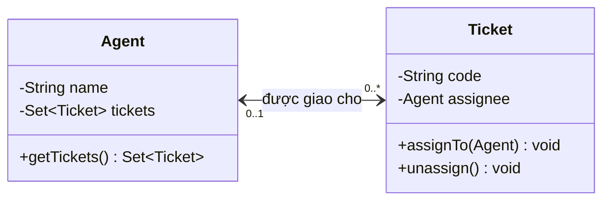

Sơ đồ và ví dụ hai chiều dưới đây thống nhất: `Ticket` tìm người phụ trách, còn `Agent` tìm các ticket đang được giao. **Hai chiều không đồng nghĩa sở hữu vòng đời**: gỡ ticket khỏi Lan không làm đối tượng Lan biến mất.

## 3. Ví dụ Java chạy được: liên kết hai chiều có thể thay đổi

Tạo một tệp tên `AssociationDemo.java`:

```java
import java.util.Collections;
import java.util.LinkedHashSet;
import java.util.Objects;
import java.util.Set;

public class AssociationDemo {

    static final class Agent {
        private final String name;
        private final Set<Ticket> tickets = new LinkedHashSet<>();

        Agent(String name) {
            this.name = Objects.requireNonNull(name, "name");
            if (name.isBlank()) {
                throw new IllegalArgumentException("name must not be blank");
            }
        }

        String getName() {
            return name;
        }

        // Trả về bản sao chỉ đọc để bên ngoài không phá quan hệ.
        Set<Ticket> getTickets() {
            return Collections.unmodifiableSet(
                    new LinkedHashSet<>(tickets));
        }
    }

    static final class Ticket {
        private final String code;
        private Agent assignee; // null: chưa có người phụ trách

        Ticket(String code) {
            this.code = Objects.requireNonNull(code, "code");
            if (code.isBlank()) {
                throw new IllegalArgumentException("code must not be blank");
            }
        }

        String getCode() {
            return code;
        }

        Agent getAssignee() {
            return assignee;
        }

        void assignTo(Agent next) {
            changeAssignee(Objects.requireNonNull(next, "next"));
        }

        void unassign() {
            changeAssignee(null);
        }

        private void changeAssignee(Agent next) {
            if (assignee == next) {
                return; // Giao lại cùng người: không làm gì.
            }

            Agent previous = assignee;
            if (previous != null) {
                previous.tickets.remove(this);
            }

            assignee = next;

            if (next != null) {
                next.tickets.add(this);
            }
        }
    }

    public static void main(String[] args) {
        Agent lan = new Agent("Lan");
        Agent minh = new Agent("Minh");
        Ticket ticket = new Ticket("SUP-42");

        ticket.assignTo(lan);
        System.out.println(ticket.getAssignee().getName()); // Lan
        System.out.println(lan.getTickets().contains(ticket)); // true

        ticket.assignTo(minh);
        System.out.println(lan.getTickets().contains(ticket)); // false
        System.out.println(minh.getTickets().contains(ticket)); // true

        ticket.unassign();
        System.out.println(ticket.getAssignee() == null); // true
        System.out.println(minh.getTickets().isEmpty()); // true
    }
}
```

Chạy bằng JDK 11 trở lên:

```bash
javac AssociationDemo.java
java AssociationDemo
```

Kết quả:

```text
Lan
true
false
true
true
true
```

Điểm cốt lõi nằm ở `changeAssignee()`: khi thay người phụ trách, ta **gỡ ticket khỏi tập hợp của agent cũ**, cập nhật tham chiếu, rồi **thêm vào tập hợp của agent mới**. Việc này bảo toàn quy tắc:

```text
agent.getTickets().contains(ticket)
    == (ticket.getAssignee() == agent)
```

Ví dụ đặt hai lớp bên trong `AssociationDemo` để code có thể nằm trong một tệp và giữ các collection ở chế độ `private`. Trong dự án thực, có thể tách ra các tệp riêng và tổ chức thao tác cập nhật quan hệ qua API nội bộ hoặc domain service. Không nên cho bên ngoài gọi `getTickets().add(...)` để thay đổi chỉ một phía.

**Lưu ý về danh tính:** ví dụ giữ `Ticket` trong `Set` theo danh tính đối tượng vì `Ticket` không ghi đè `equals()/hashCode()`. Nếu cần định nghĩa bằng mã ticket, mã phải ổn định và quy tắc equality/hash nhất quán; đổi thuộc tính tham gia hash khi object đã ở trong `HashSet`/`LinkedHashSet` có thể làm hỏng thao tác tìm/xóa.

## 4. Liên kết một chiều: khi nào chỉ cần một tham chiếu?

Nếu yêu cầu chỉ là “xem ai đang phụ trách ticket”, ta có thể loại bỏ `Set<Ticket>` trong `Agent`. Lúc đó:

```java
final class Agent {
    private final String name;
    Agent(String name) { this.name = name; }
    String getName() { return name; }
}

final class Ticket {
    private Agent assignee;

    void assignTo(Agent agent) {
        assignee = Objects.requireNonNull(agent);
    }

    Agent getAssignee() {
        return assignee;
    }
}
```

Phiên bản này đơn giản hơn, nhưng không thể trực tiếp hỏi `agent.getTickets()`. Muốn tìm tất cả ticket của Lan, ứng dụng phải duyệt tập ticket, truy vấn repository hoặc cơ sở dữ liệu.

Chọn **một chiều** khi không cần điều hướng ngược; chọn **hai chiều** khi nghiệp vụ truy cập cả hai hướng và có nơi chịu trách nhiệm đồng bộ. “Có quan hệ về mặt nghiệp vụ” không đồng nghĩa “cả hai lớp bắt buộc phải chứa field tham chiếu đến nhau”.

## 5. Khi liên kết có nhiều đối tượng hoặc có thông tin riêng

- **Một–một:** một `Employee` có tối đa một `AccessCard` và ngược lại, nếu chính sách yêu cầu.
- **Một–nhiều:** một `Agent` có thể phụ trách nhiều `Ticket`, nhưng mỗi ticket có tối đa một người phụ trách.
- **Nhiều–nhiều:** một `Student` học nhiều `Course`; một `Course` có nhiều sinh viên.

Khi **chính liên kết** có ngày đăng ký, trạng thái, điểm hoặc quyền, nên cân nhắc một đối tượng trung gian `Enrollment(student, course, enrolledAt, status)` thay vì hai `Set` tách rời. Một `Enrollment` kết nối đúng một `Student` và một `Course`, đồng thời sở hữu dữ liệu của lần đăng ký.

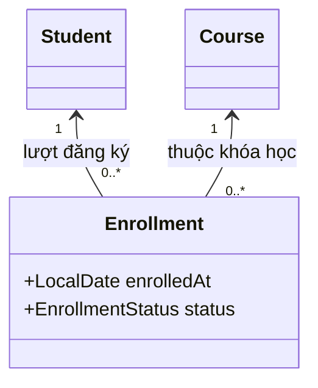

Đừng suy ra bội số chỉ từ việc có `List` hay `Set`: phải xác định **cả hai phía** và cưỡng chế giới hạn bằng API/DB nếu cần. Bài về multiplicity xây một registry chạy được và kiểm tra đăng ký trùng.

## 6. Phân biệt với các quan hệ thường dễ nhầm

| Khái niệm | Câu hỏi để nhận biết | Ví dụ |
|---|---|---|
| **Association (liên kết)** | Object A biết hoặc có quan hệ thường trực với object B? | Ticket được giao cho Agent. |
| **Dependency (phụ thuộc)** | A chỉ dùng B tạm thời, chẳng hạn trong tham số phương thức? | `ReportService.export(Formatter formatter)`. |
| **Aggregation (kết tập)** | Một object nhóm các object khác, thành viên vẫn có thể tồn tại độc lập? | Đội hỗ trợ gồm các nhân viên. |
| **Composition (hợp thành)** | Thành phần thuộc độc quyền vào toàn thể, vòng đời gắn chặt? | Đơn hàng sở hữu các dòng đơn hàng theo mô hình nghiệp vụ. |
| **Inheritance (kế thừa)** | B có thực sự là một loại A (`is-a`)? | `EmailTicket extends Ticket`. |

Aggregation và composition là các cách mô hình hóa quan hệ toàn thể–thành phần; **một field tham chiếu hay collection tự nó không chứng minh được quy tắc sở hữu và vòng đời**. Đây là quy tắc nghiệp vụ phải được thiết kế, thực thi và kiểm thử.

Không dùng kế thừa chỉ để object này “có” object kia: `Ticket extends Agent` là sai bản chất, vì ticket **được giao cho** nhân viên chứ không **phải là** nhân viên.

## 7. Những lỗi thiết kế liên kết hay gặp

**Chỉ cập nhật một phía.** Nếu đổi `ticket.assignee` mà không sửa `agent.tickets`, hai hướng trả về kết quả khác nhau. Nên có một đầu mối cập nhật quan hệ.

**Trả về collection có thể sửa trực tiếp.** `getTickets()` trả `Set` nội bộ cho bên ngoài gọi `clear()` sẽ phá bất biến. Dùng bản sao chỉ đọc, API thêm/xóa có kiểm soát hoặc chỉ lưu một chiều.

**Không định nghĩa rõ `null` và bội số.** `0..1` cho phép không có người phụ trách; `1` cần từ chối giá trị trống hoặc có cơ chế buộc gán trước khi đối tượng trở thành hợp lệ.

**Giữ cả hai chiều khi không cần.** Nó làm tăng bộ nhớ, mức liên kết giữa lớp và số chỗ phải cập nhật. Hãy xuất phát từ những truy vấn/thao tác thực tế.

**Nhầm object trong RAM với hàng trong database.** Tham chiếu Java là mối quan hệ trong bộ nhớ; khóa ngoại là cách biểu diễn quan hệ trong cơ sở dữ liệu. ORM (chẳng hạn JPA) có quy tắc tải dữ liệu, owning side, cascade và transaction riêng. Không suy ra rằng “có cả hai field Java” thì hai phía ở database tự đồng bộ.

**Quên vấn đề đồng thời.** Ví dụ trên minh họa bất biến trong một luồng. Nếu nhiều luồng cùng phân công một ticket, cần thiết kế đồng bộ/transaction phù hợp; các bước `remove → assign → add` không tự động nguyên tử trong môi trường đa luồng.

## 8. Tự kiểm tra hiểu biết

1. Nếu `Ticket` chỉ có `assignee`, còn `Agent` không có `tickets`, liệu quan hệ “ticket được giao cho nhân viên” có tồn tại không? **Có**: đó là liên kết một chiều.
2. Chuyển ticket từ Lan sang Minh phải thay đổi những dữ liệu nào trong ví dụ hai chiều? **Gỡ khỏi danh sách của Lan, đổi `assignee`, thêm vào danh sách của Minh.**
3. Một ticket chưa có nhân viên phụ trách có trái quy tắc `0..1` không? **Không**: số 0 được chấp nhận.
4. Khi nào nên tạo `Enrollment` thay vì hai tập `Set`? **Khi lần đăng ký có thuộc tính/hành vi/quy tắc riêng** như ngày, trạng thái hay điểm.
5. Việc viết `private Agent assignee;` có tự chứng minh rằng `Agent` sở hữu vòng đời `Ticket` không? **Không**: đó chỉ là tham chiếu; sở hữu vòng đời là một quyết định mô hình hóa khác.

**Ghi nhớ:** association mô tả *ai liên hệ với ai*; multiplicity quy định *bao nhiêu*; navigability quy định *đi từ đâu sang đâu*. Trong Java, hãy đóng gói thao tác tạo, đổi và hủy liên kết để những quy tắc này luôn đúng.


</details>

- [Quay lại đầu trang](#back-to-top)

---

## <a id="relationships-002">Sự phụ thuộc tạm thời và liên kết lâu dài</a>

<details>
<summary>Xem chi tiết</summary>

# Sự phụ thuộc tạm thời và liên kết lâu dài trong OOP

## 1. Một đối tượng “dùng” đối tượng khác theo hai cách khác nhau

Giả sử một hệ thống quản lý yêu cầu hỗ trợ (support ticket):

- Ticket **được phân công cho** một nhân viên. Hệ thống cần biết người phụ trách để truy vấn, chuyển giao, hiển thị trạng thái ở những lần thao tác sau.
- Khi gửi thông báo phân công, hệ thống **sử dụng** một bộ gửi tin nhắn trong đúng thao tác gửi. Sau khi gửi xong, đối tượng xử lý không nhất thiết phải giữ bộ gửi đó.

Cả hai đều liên quan đến việc đối tượng này sử dụng đối tượng khác, nhưng **ý nghĩa thiết kế khác nhau**:

- **Sự phụ thuộc tạm thời** (dependency, trong ví dụ là *method-level dependency*) xuất hiện khi một lớp cần lớp khác để thực hiện một thao tác. Ví dụ nhận một tham số, tạo biến cục bộ hoặc gọi hàm tĩnh. Đối tượng sử dụng không nhất thiết giữ tham chiếu đó làm trạng thái lâu dài.
- **Liên kết lâu dài** (association) là mối quan hệ được mô hình hóa giữa các đối tượng, thường được thể hiện bằng tham chiếu hoặc collection được lưu trong field. Liên kết có thể được truy cập ở nhiều thời điểm trong vòng đời của object, cho đến khi bị thay đổi hoặc gỡ bỏ.

**“Tạm thời” và “lâu dài” ở đây nói về cách một đối tượng sử dụng/lưu mối quan hệ, không có nghĩa rằng đối tượng được sử dụng phải được tạo mới hoặc bị hủy khi phương thức kết thúc.** Một bộ gửi tin nhắn dùng qua tham số có thể là singleton tồn tại suốt ứng dụng; một liên kết trong field cũng có thể bị thay đổi chỉ sau một giây.

## 2. Nhận biết qua UML và mã Java

| Tiêu chí | Phụ thuộc tạm thời (dependency) | Liên kết lâu dài (association) |
|---|---|---|
| Câu hỏi chính | “Lớp A cần B để **làm việc gì**?” | “Đối tượng A **đang liên hệ với** đối tượng B nào?” |
| Dấu hiệu phổ biến trong Java | Tham số phương thức, biến cục bộ, lời gọi phương thức tĩnh | Field tham chiếu, collection các đối tượng, cấu trúc quản lý liên kết |
| Thời điểm cần tham chiếu | Khi chạy thao tác liên quan | Giữa nhiều thao tác, khi trạng thái quan hệ còn hiệu lực |
| UML | Mũi tên **nét đứt** từ lớp dùng đến lớp được dùng | **Đường liền**; có thể thêm bội số và chiều truy cập |
| Ví dụ | `TicketService` gọi `MessageSender.send(...)` | `Ticket` giữ `Agent assignee` |
| Hệ quả thường gặp | Thay tham số/implementation có thể thay hành vi xử lý | Thay liên kết làm thay đổi trạng thái nghiệp vụ |
| Điều cần thiết kế | Đầu vào, hợp đồng API, lỗi khi gọi | Bội số, thay thế/gỡ liên kết, tính nhất quán, vòng đời nghiệp vụ |

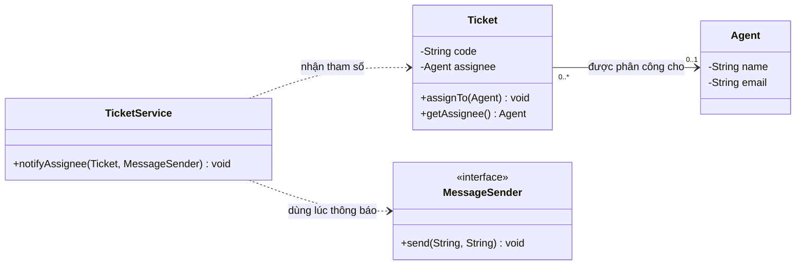

Đọc sơ đồ:

1. **Đường liền** từ `Ticket` đến `Agent`: ticket có thể giữ tham chiếu đến nhân viên phụ trách; mỗi ticket có `0..1` agent, mỗi agent có thể phụ trách `0..*` ticket.
2. **Đường nét đứt** từ `TicketService` đến `MessageSender`: service cần biết *cách gọi* sender khi thực hiện `notifyAssignee(...)`, nhưng không cần giữ sender trong field.
3. `TicketService` cũng phụ thuộc `Ticket` trong chữ ký của phương thức. Có dependency không nhất thiết phải hình thành một association được lưu lâu dài.

## 3. Ví dụ Java chạy được

Tạo file `RelationshipDemo.java` với nội dung sau (Java 11+):

```java
import java.util.Objects;

public class RelationshipDemo {

    // Đối tượng nghiệp vụ độc lập: một nhân viên có thể phụ trách nhiều ticket.
    static final class Agent {
        private final String name;
        private final String email;

        Agent(String name, String email) {
            this.name = Objects.requireNonNull(name, "name");
            this.email = Objects.requireNonNull(email, "email");
        }

        String getName() {
            return name;
        }

        String getEmail() {
            return email;
        }
    }

    static final class Ticket {
        private final String code;
        private Agent assignee; // Association: giữ tham chiếu sau khi assignTo() kết thúc.

        Ticket(String code) {
            this.code = Objects.requireNonNull(code, "code");
        }

        String getCode() {
            return code;
        }

        Agent getAssignee() {
            return assignee;
        }

        void assignTo(Agent agent) {
            assignee = Objects.requireNonNull(agent, "agent");
        }

        void unassign() {
            assignee = null;
        }
    }

    interface MessageSender {
        void send(String destination, String message);
    }

    static final class ConsoleSender implements MessageSender {
        @Override
        public void send(String destination, String message) {
            System.out.println("To: " + destination + " | " + message);
        }
    }

    static final class TicketService {
        void notifyAssignee(Ticket ticket, MessageSender sender) {
            Objects.requireNonNull(ticket, "ticket");
            Objects.requireNonNull(sender, "sender");

            Agent assignee = ticket.getAssignee();
            if (assignee == null) {
                throw new IllegalStateException("Ticket has no assignee");
            }

            // Dependency tạm thời: chỉ dùng sender trong lời gọi hiện tại.
            sender.send(
                    assignee.getEmail(),
                    "Bạn được giao ticket " + ticket.getCode()
            );
            // Service không lưu sender hoặc ticket vào field.
        }
    }

    public static void main(String[] args) {
        Agent lan = new Agent("Lan", "lan@example.test");
        Agent minh = new Agent("Minh", "minh@example.test");
        Ticket ticket = new Ticket("SUP-42");
        TicketService service = new TicketService();

        ticket.assignTo(lan);
        service.notifyAssignee(ticket, new ConsoleSender());

        // Liên kết Ticket -> Agent vẫn còn sau lần gửi thông báo.
        System.out.println("Phụ trách: " + ticket.getAssignee().getName());

        // Đổi liên kết nghiệp vụ; không thay code gửi thông báo.
        ticket.assignTo(minh);
        service.notifyAssignee(ticket, new ConsoleSender());

        ticket.unassign();
        System.out.println("Chưa phân công: " + (ticket.getAssignee() == null));
    }
}
```

Biên dịch/chạy:

```bash
javac RelationshipDemo.java
java RelationshipDemo
```

Kết quả:

```text
To: lan@example.test | Bạn được giao ticket SUP-42
Phụ trách: Lan
To: minh@example.test | Bạn được giao ticket SUP-42
Chưa phân công: true
```

### Phân tích từng thời điểm

| Thời điểm | Trạng thái `ticket.assignee` | `sender` trong `notifyAssignee` |
|---|---|---|
| Trước `assignTo(lan)` | `null` | Chưa gọi |
| Sau `assignTo(lan)` | Trỏ đến đối tượng Lan | Chưa gọi |
| Trong lần `notifyAssignee(...)` đầu | Vẫn trỏ đến Lan | Có tham chiếu tham số tới `ConsoleSender` |
| Sau lần gọi đầu | Vẫn trỏ đến Lan | `TicketService` không giữ tham chiếu sender |
| Sau `assignTo(minh)` | Trỏ đến Minh | Không ảnh hưởng đến kiểu dependency |
| Sau `unassign()` | `null` | Không ảnh hưởng đến sender |

Lưu ý: việc kết thúc phương thức **không bảo đảm** đối tượng `ConsoleSender` bị thu gom bộ nhớ ngay lập tức. Một object có thể còn được nơi khác tham chiếu. Điểm đáng chú ý là **`TicketService` không lưu nó để dùng ở lần gọi sau**.

## 4. Ba biến thể cho thấy sự khác nhau

### A. Phụ thuộc qua tham số phương thức

```java
void sendReceipt(Receipt receipt, MailGateway gateway) {
    gateway.send(receipt.email(), receipt.body());
}
```

`MailGateway` được gọi trong một thao tác. Bên sử dụng không cần có field `gateway`. Đây là ví dụ rõ ràng về dependency ở mức phương thức. (Đoạn minh họa giả định `Receipt` và `MailGateway` đã được khai báo.)

### B. Liên kết được lưu thành trạng thái

```java
final class ProjectTask {
    private final String code;
    private Agent owner;

    ProjectTask(String code) {
        this.code = code;
    }

    void assign(Agent newOwner) {
        owner = Objects.requireNonNull(newOwner);
    }

    Agent getOwner() {
        return owner;
    }
}
```

`ProjectTask` giữ tham chiếu `owner` sau khi `assign(...)` trả về. Ta có thể truy cập owner sau nhiều thao tác khác nhau. Đó là association một chiều ở cấp đối tượng.

### C. Dependency injection qua constructor: phụ thuộc về thiết kế nhưng có field

```java
final class NotificationService {
    private final MessageSender sender;

    NotificationService(MessageSender sender) {
        this.sender = Objects.requireNonNull(sender);
    }

    void notify(String email) {
        sender.send(email, "Có thông báo mới");
    }
}
```

Ở đây `NotificationService` **phụ thuộc vào hợp đồng** `MessageSender` và lưu tham chiếu được tiêm qua constructor. Vì có field, quan hệ tham chiếu tồn tại giữa các lần gọi phương thức. Trong UML, tùy mức chi tiết của sơ đồ, ta có thể biểu diễn association đến interface hoặc dependency đến abstraction.

Vì thế, **không nên áp dụng máy móc “cứ có dependency thì chỉ sống trong một phương thức” hay “cứ có field thì không phải dependency”**. Dependency là khái niệm rộng: thay đổi định nghĩa của một lớp/interface có thể ảnh hưởng lớp dùng nó. Association mô tả một quan hệ cấu trúc giữa các đối tượng, thường cụ thể hơn.

## 5. Chọn cách biểu diễn nào trong thiết kế thực tế?

Hãy tự hỏi:

1. **Có cần truy vấn quan hệ sau khi thao tác hiện tại kết thúc không?** Nếu cần nhớ “ticket đang thuộc về ai”, hãy mô hình hóa một association bằng trạng thái của object hoặc trong kho dữ liệu.
2. **Đây là dữ liệu nghiệp vụ hay công cụ để làm việc?** Người phụ trách ticket là quan hệ nghiệp vụ; formatter, exporter, sender thường là cộng tác viên phục vụ thao tác.
3. **Nếu thay đối tượng được dùng, ý nghĩa thay đổi là gì?** Đổi `Agent` làm đổi trách nhiệm xử lý ticket; đổi `MessageSender` từ email sang SMS chủ yếu đổi kênh gửi thông báo.
4. **Ai chịu trách nhiệm duy trì liên kết?** Một association hai chiều hoặc quan hệ có ràng buộc bội số cần nơi cập nhật thống nhất. Dependency qua tham số không cần đồng bộ hai phía chỉ vì phương thức dùng đến đối tượng đó.
5. **Số lần gọi và chi phí truyền tham số ra sao?** Nếu hầu hết phương thức trong service đều cần một cộng tác viên ổn định, constructor injection có thể phù hợp hơn việc truyền đi truyền lại tham số. Đây là lựa chọn API/DI, không nhất thiết là mối quan hệ nghiệp vụ lâu dài.

Không có quy tắc “liên kết lâu dài luôn tốt hơn” hay “dependency ngắn hạn luôn ít coupling hơn”. Chọn theo dữ liệu cần giữ, trách nhiệm của lớp, luồng truy cập và khả năng kiểm thử.

## 6. Bội số, khả năng gỡ liên kết và vòng đời

Với `Ticket -> Agent` của ví dụ:

- `0..1` phía `Agent`: một ticket chưa có hoặc có đúng một người phụ trách.
- `0..*` phía `Ticket`: một agent có thể được nhiều ticket trỏ đến.
- `assignTo(...)` đổi người phụ trách; `unassign()` hủy liên kết. **Object Agent không bị xóa** khi ticket bỏ liên kết.
- Java field chỉ lưu **tham chiếu đến object**, không lưu “bản sao” object và không tự tạo ràng buộc cơ sở dữ liệu.

Nếu chỉ lưu field ở phía `Ticket`, ta có association **một chiều**. Muốn từ `Agent` lấy danh sách ticket, phải truy vấn một nguồn dữ liệu khác hoặc thiết kế thêm chiều ngược. Nếu lưu cả hai phía, cần đồng bộ mỗi lần gán/chuyển/gỡ để tránh:

```text
ticket.getAssignee() == lan
nhưng !lan.getTickets().contains(ticket)
```

Association không đồng nghĩa với **composition**: việc ticket giữ agent không khiến ticket sở hữu vòng đời agent. Với thành phần có vòng đời thuộc một “toàn thể”, ta phải thể hiện rõ quy tắc sở hữu đó trong mô hình và code.

## 7. Vì sao phân biệt này hữu ích khi kiểm thử và bảo trì?

**Kiểm thử dependency theo từng thao tác:** triển khai interface giả (fake/stub) và truyền vào phương thức để xác nhận thông báo được gửi đúng đích mà không gọi dịch vụ thật. Ví dụ:

```java
// Minh họa bên trong phương thức kiểm thử cùng phạm vi các lớp demo.
class CapturingSender implements MessageSender {
    String destination;
    String message;

    @Override
    public void send(String destination, String message) {
        this.destination = destination;
        this.message = message;
    }
}

Ticket ticket = new Ticket("SUP-42");
ticket.assignTo(new Agent("Lan", "lan@example.test"));
CapturingSender sender = new CapturingSender();

new TicketService().notifyAssignee(ticket, sender);

if (!"lan@example.test".equals(sender.destination)) {
    throw new AssertionError("Wrong notification destination");
}
if (!sender.message.contains("SUP-42")) {
    throw new AssertionError("Missing ticket code");
}
```

**Kiểm thử association sau nhiều thao tác:** tạo ticket, phân công cho A, đổi sang B, rồi gỡ. Kiểm tra `getAssignee()` sau *mỗi* bước; việc giữ/gỡ link là trạng thái nghiệp vụ cần xác nhận độc lập với thành công của gửi thông báo.

**Ảnh hưởng khi thay đổi thiết kế:** đổi API `MessageSender` có thể khiến `TicketService` phải sửa vì phụ thuộc ở cấp mã nguồn. Đổi bội số hay quy tắc người phụ trách ảnh hưởng mô hình `Ticket`, API gán người, lưu trữ và các tình huống nghiệp vụ. Hai loại thay đổi đòi hỏi phạm vi kiểm thử khác nhau.

## 8. Lỗi thường gặp

| Lỗi | Hậu quả | Hướng xử lý |
|---|---|---|
| Lưu mọi đối tượng sử dụng vào field | State dư thừa, khó theo dõi quan hệ và vòng đời | Dùng tham số/local cho cộng tác viên chỉ cần tại chỗ |
| Chỉ truyền đối tượng nghiệp vụ qua tham số dù phải nhớ qua nhiều thao tác | Mất trạng thái liên kết khi xử lý lần sau | Lưu liên kết ở aggregate/domain model hoặc repository |
| Cho rằng kết thúc phương thức sẽ hủy object tham số | Hiểu sai Java GC và tham chiếu chia sẻ | Phân biệt phạm vi biến tham chiếu với vòng đời object |
| Nhầm field của DI với quan hệ “sở hữu” nghiệp vụ | Áp quy tắc composition/cascade không phù hợp | Tách phụ thuộc dịch vụ và association miền nghiệp vụ |
| Lưu association hai chiều mà chỉ cập nhật một phía | Hai chiều truy cập cho kết quả khác nhau | Đóng gói thao tác gán, chuyển và gỡ quan hệ |
| Đồng nhất dependency với quan hệ UML một chiều | Vẽ sơ đồ mơ hồ, thiếu bội số và trạng thái | Dùng nét đứt cho quan hệ sử dụng; nét liền khi mô hình hóa association |

### Bài tập tự luyện

Thiết kế chức năng xuất hóa đơn gồm `Invoice`, `Customer`, `PdfExporter`.

1. Mỗi hóa đơn thuộc một khách hàng và cần tra lại khách hàng trong các lần xem sau. Quan hệ nào? **Association** giữa `Invoice` và `Customer`.
2. Khi bấm nút xuất PDF, phương thức nhận `PdfExporter` để dựng file, không giữ exporter. Quan hệ nào? **Dependency ở mức phương thức**.
3. Nếu `InvoiceService` nhận `PdfExporter` trong constructor và giữ field để dùng nhiều lần thì sao? Service **phụ thuộc vào abstraction của exporter** và đồng thời giữ **tham chiếu cấu trúc dài hơn một lời gọi**.
4. Việc đổi PDF exporter có khiến khách hàng của hóa đơn thay đổi không? **Không**: đây là hai quan hệ phục vụ hai trách nhiệm khác nhau.
5. Xóa liên kết invoice–customer có đồng nghĩa xóa object customer không? **Không**: association không tự quyết định quyền sở hữu hay vòng đời.

**Cốt lõi:** dependency trả lời “**cần ai để thực hiện thao tác?**”, association trả lời “**đang liên hệ với ai như một phần trạng thái/mô hình?**”. Trong Java, hãy xem kỹ nơi lưu tham chiếu, mục đích nghiệp vụ và thời gian cần truy cập quan hệ; đừng kết luận chỉ dựa vào tuổi thọ của object hoặc sự xuất hiện của một kiểu trong source code.


</details>

- [Quay lại đầu trang](#back-to-top)

---

## <a id="relationships-003">Tập hợp và hợp thành</a>

<details>
<summary>Xem chi tiết</summary>

# Tập hợp (Aggregation) và hợp thành (Composition) trong OOP Java

**Chủ đề:** Hai cách biểu diễn quan hệ toàn thể – bộ phận (*whole–part relationship*) giữa các đối tượng: **tập hợp (aggregation)** và **hợp thành (composition)**. Bài học tập trung vào cách chọn đúng quan hệ, nhận biết quyền sở hữu (*ownership*), thiết kế vòng đời đối tượng và thể hiện quan hệ bằng Java/UML.

> **Phân biệt thuật ngữ:** “Tập hợp” ở đây là **aggregation trong mô hình đối tượng/UML**, không đồng nghĩa với kiểu `Collection`, `List` hay `Set` của Java Collections Framework. Một trường kiểu `List<T>` tự nó chưa nói lên quan hệ đang là aggregation hay composition.

## 1. Nền tảng: quan hệ “có/chứa” chưa đủ để kết luận

Giả sử một `Team` có nhiều `Employee`, một `Order` có nhiều `OrderLine`. Cả hai đều có thể biểu diễn bằng trường tham chiếu hay danh sách Java:

~~~java
class Team {
    private java.util.List<Employee> employees;
}

class Order {
    private java.util.List<OrderLine> lines;
}
~~~

Cú pháp trên **không chứng minh** bất kỳ quan hệ nào là hợp thành. Muốn chọn mô hình, cần hỏi:

1. **Bộ phận có danh tính và ý nghĩa riêng ngoài toàn thể không?** Nhân viên vẫn là nhân viên khi rời đội; một dòng đơn hàng thường chỉ có ý nghĩa trong chính đơn hàng đó.
2. **Ai sở hữu và quyết định việc tạo, gắn, gỡ và hủy bộ phận?** Đơn hàng thường quản lý các dòng của mình; đội chỉ tập hợp nhân viên đang tham gia.
3. **Một bộ phận có thể thuộc nhiều toàn thể cùng lúc không?** Một nhân viên có thể tham gia hai đội nếu nghiệp vụ cho phép; một dòng đơn hàng cụ thể không nên đồng thời thuộc hai đơn hàng.
4. **Nếu xóa toàn thể, điều gì xảy ra theo quy tắc nghiệp vụ?** Giải tán đội không có nghĩa nhân viên bị xóa khỏi hệ thống; xóa một đơn nháp có thể xóa các dòng của đơn đó.

Đó là các quy tắc nghiệp vụ, không phải đặc điểm tự động của `List`, `new`, `final` hay cơ chế thu gom rác.

## 2. Ba quan hệ dễ nhầm lẫn

| Quan hệ UML | Ý nghĩa cơ bản | Ví dụ | Ký hiệu đầu toàn thể |
|---|---|---|---|
| **Association** (liên kết) | Các đối tượng biết hoặc tương tác với nhau; không mặc định quan hệ toàn thể–bộ phận | `Doctor` khám `Patient` | Đường nối thường |
| **Aggregation** (tập hợp/chia sẻ) | Một đối tượng nhóm/có các đối tượng khác; phần tử có thể tồn tại độc lập | `Team` gồm các `Employee` | Hình thoi **rỗng** |
| **Composition** (hợp thành) | Quan hệ toàn thể–bộ phận với **quyền sở hữu mạnh**, bộ phận thuộc tối đa một toàn thể tại một thời điểm | `Order` sở hữu `OrderLine` | Hình thoi **đặc** |

**Điểm cần chính xác:** UML định nghĩa *shared aggregation* (hình thoi rỗng) khá lỏng, không gán sẵn một quy tắc vòng đời cụ thể. Vì thế trong tài liệu thiết kế nghiêm túc, nếu chỉ cần “đội có tham chiếu tới nhân viên”, một **association** thông thường cũng có thể rõ ràng hơn hình thoi rỗng. **Composition** có ngữ nghĩa mạnh hơn: phần tử nằm dưới quyền sở hữu của một composite tại một thời điểm; khi toàn thể bị hủy trong mô hình, các phần thuộc nó cũng bị hủy theo quy tắc sở hữu.

~~~mermaid
classDiagram
    class Team
    class Employee
    class PurchaseOrder
    class OrderLine
    Team "1" o-- "0..*" Employee : tập hợp / tham gia
    PurchaseOrder "1" *-- "0..*" OrderLine : sở hữu
~~~

Trong class diagram, **hình thoi luôn đặt ở phía đối tượng toàn thể**: phía `Team` hay `PurchaseOrder`, không đặt tại phía đối tượng bộ phận. Bội số `0..*` là lựa chọn theo ví dụ: đội có thể chưa có thành viên, đơn nháp có thể chưa có dòng. Nếu quy tắc yêu cầu một đơn đã xác nhận phải có ít nhất một dòng, hãy biểu diễn và kiểm tra ràng buộc đó ở trạng thái phù hợp.

## 3. Aggregation: đội tập hợp nhân viên độc lập

Giả sử nhân viên có thể tham gia nhiều nhóm công việc. `Team` giữ các tham chiếu đến `Employee`, nhưng `Employee` được tạo và quản lý độc lập. Khi bỏ nhân viên khỏi nhóm, đối tượng nhân viên vẫn tồn tại để tham gia nhóm khác.

**Tệp `AggregationDemo.java` — Java 17+:**

~~~java
import java.util.LinkedHashSet;
import java.util.Objects;
import java.util.Set;

record Employee(String id, String name) {
    Employee {
        Objects.requireNonNull(id, "id");
        Objects.requireNonNull(name, "name");
        if (id.isBlank() || name.isBlank()) {
            throw new IllegalArgumentException("Employee id/name must not be blank");
        }
    }
}

final class Team {
    private final String name;
    private final Set<Employee> members = new LinkedHashSet<>();

    Team(String name) {
        this.name = Objects.requireNonNull(name, "name");
    }

    void addMember(Employee employee) {
        members.add(Objects.requireNonNull(employee, "employee"));
    }

    boolean removeMember(Employee employee) {
        return members.remove(employee);
    }

    Set<Employee> members() {
        return Set.copyOf(members); // Trả về bản xem không sửa được.
    }

    String name() {
        return name;
    }
}

public class AggregationDemo {
    public static void main(String[] args) {
        Employee lan = new Employee("E01", "Lan"); // Tồn tại độc lập
        Team backend = new Team("Backend");
        Team mentoring = new Team("Mentoring");

        backend.addMember(lan);
        mentoring.addMember(lan); // Cùng một Employee ở hai Team

        backend.removeMember(lan);

        System.out.println(backend.members().contains(lan));  // false
        System.out.println(mentoring.members().contains(lan)); // true
        System.out.println(lan.name());                        // Lan
    }
}
~~~

Biên dịch và chạy: `javac AggregationDemo.java`, sau đó `java AggregationDemo`.

**Điểm thiết kế quan trọng:**

- `Employee` được tạo **trước và độc lập với** `Team`. Việc rời một nhóm không làm mất thực thể nhân viên.
- Theo nghiệp vụ giả định, cùng một nhân viên được phép tham gia nhiều nhóm. Nếu hệ thống quy định mỗi nhân viên chỉ có một nhóm, phải thêm ràng buộc cho miền nghiệp vụ; UML aggregation không tự áp đặt hay kiểm tra ràng buộc đó.
- `Set.copyOf(members)` tạo một tập hợp không thể sửa qua tham chiếu trả về, tránh người gọi `team.members().clear()` để làm hỏng trạng thái bên trong. Trong ví dụ, `Employee` là `record` bất biến; nếu phần tử có thể đổi trạng thái thì chỉ trả về `Set.copyOf` **không** làm các phần tử trở thành bất biến.
- `Set` nhận biết phần tử trùng bằng `equals()/hashCode()`. Với `record Employee`, cả `id` và `name` tham gia so sánh; ở hệ thống thực tế có thể muốn quản lý duy nhất theo mã nhân viên thay vì hai trường này.

**Không diễn giải sai vòng đời:** Xóa một biến `Team` hoặc gọi `removeMember` không kích hoạt thao tác “xóa đối tượng Employee” trong JVM. Java không có phép `delete object` thủ công kiểu C++; một đối tượng chỉ đủ điều kiện được GC khi không còn đường tham chiếu mạnh giữ nó sống, và thời điểm GC không được bảo đảm.

## 4. Composition: đơn hàng sở hữu các dòng hàng

Một `OrderLine` mô tả số lượng và đơn giá của một mặt hàng **trong một đơn hàng cụ thể**. Trong mô hình này, dòng hàng được sinh ra qua `Order`, không được chia sẻ giữa hai đơn và không được quản lý như một thực thể độc lập.

Ví dụ dùng **đối tượng con riêng tư** và API hành vi thay vì công khai `List<OrderLine>`. Đây là cách thể hiện ownership tốt hơn việc chỉ viết `private final List<...>`.

**Tệp `CompositionDemo.java` — Java 17+:**

~~~java
import java.math.BigDecimal;
import java.util.ArrayList;
import java.util.List;
import java.util.Objects;

final class Order {
    private final String orderId;
    private final List<LineItem> lines = new ArrayList<>();
    private boolean submitted;

    // Chỉ Order có thể tạo và truy cập kiểu nội bộ này.
    private static final class LineItem {
        private final String sku;
        private final int quantity;
        private final BigDecimal unitPrice;

        private LineItem(String sku, int quantity, BigDecimal unitPrice) {
            this.sku = sku;
            this.quantity = quantity;
            this.unitPrice = unitPrice;
        }

        private BigDecimal subtotal() {
            return unitPrice.multiply(BigDecimal.valueOf(quantity));
        }
    }

    Order(String orderId) {
        this.orderId = Objects.requireNonNull(orderId, "orderId");
        if (orderId.isBlank()) {
            throw new IllegalArgumentException("Order id must not be blank");
        }
    }

    void addLine(String sku, int quantity, BigDecimal unitPrice) {
        if (submitted) {
            throw new IllegalStateException("Submitted order is locked");
        }
        Objects.requireNonNull(sku, "sku");
        Objects.requireNonNull(unitPrice, "unitPrice");
        if (sku.isBlank() || quantity <= 0 || unitPrice.signum() < 0) {
            throw new IllegalArgumentException("Invalid order line");
        }

        // LineItem được tạo và giữ hoàn toàn bên trong Order.
        lines.add(new LineItem(sku, quantity, unitPrice));
    }

    BigDecimal total() {
        return lines.stream()
                .map(LineItem::subtotal)
                .reduce(BigDecimal.ZERO, BigDecimal::add);
    }

    int lineCount() {
        return lines.size();
    }

    void submit() {
        if (submitted) {
            throw new IllegalStateException("Already submitted");
        }
        if (lines.isEmpty()) {
            throw new IllegalStateException("Cannot submit an empty order");
        }
        submitted = true;
    }

    String id() {
        return orderId;
    }
}

public class CompositionDemo {
    public static void main(String[] args) {
        Order first = new Order("ORD-100");
        Order second = new Order("ORD-101");

        first.addLine("JAVA-BOOK", 2, new BigDecimal("125000"));
        second.addLine("JAVA-BOOK", 1, new BigDecimal("125000"));

        first.submit();
        System.out.println(first.total());     // 250000
        System.out.println(second.total());    // 125000
        System.out.println(first.lineCount()); // 1
        System.out.println(second.lineCount());// 1
    }
}
~~~

Biên dịch và chạy: `javac CompositionDemo.java`, sau đó `java CompositionDemo`.

Hai đơn có thể cùng tham chiếu **mã sản phẩm** `"JAVA-BOOK"`, nhưng mỗi đơn sở hữu một đối tượng `LineItem` riêng. Đây là khác biệt giữa **chia sẻ thông tin về sản phẩm** và **chia sẻ chính phần tử cấu thành đơn hàng**. Sản phẩm trong catalog có vòng đời riêng; còn `LineItem` biểu diễn giá/số lượng tại một đơn hàng.

Trong ví dụ, `LineItem` là lớp lồng `private`, được tạo bằng `Order.addLine()` và không thoát ra qua API. `BigDecimal` là bất biến; danh sách nội bộ không bị lộ. Điều đó hỗ trợ bất biến nghiệp vụ rằng không thể lấy một dòng từ đơn A rồi gắn trực tiếp sang đơn B. `final` trên tham chiếu danh sách chỉ cấm gán lại biến `lines`; chính việc **đóng gói và kiểm soát API** mới bảo vệ nội dung danh sách.

**Vòng đời ở hai tầng cần phân biệt:**

- **Tầng domain/UML:** nếu đơn bị hủy khỏi mô hình, các dòng thuộc đơn cũng bị hủy theo quyết định nghiệp vụ, không được giữ lại như dòng của một đơn khác.
- **Tầng runtime Java:** JVM không tự xóa đệ quy các đối tượng vào đúng thời điểm bạn “hủy đơn”. GC dựa trên khả năng tiếp cận của tham chiếu; các quan hệ composition cần được thể hiện bằng API và quy tắc domain. Nếu các phần tử đã bị rò rỉ ra ngoài qua tham chiếu khác, chúng vẫn có thể tồn tại trong bộ nhớ.
- **Tầng database:** xóa hàng `orders` không mặc nhiên xóa hàng `order_lines`; cần cơ chế phù hợp, ví dụ transaction, foreign key `ON DELETE CASCADE`, hoặc ánh xạ ORM với cascade/orphan removal đúng trường hợp.

## 5. Cách nhận ra quan hệ từ yêu cầu nghiệp vụ

| Câu hỏi | Nghiêng về aggregation / association | Nghiêng về composition |
|---|---|---|
| Phần tử có ý nghĩa độc lập không? | Có: nhân viên, bác sĩ, tài khoản | Không, hoặc bị ràng buộc chặt với toàn thể: dòng đơn hàng |
| Có thể đồng thời là bộ phận của nhiều toàn thể không? | Có thể, tùy mô hình | **Không** theo ngữ nghĩa UML của composition |
| Ai quản lý việc tạo và xóa phần tử? | Thực thể/dịch vụ độc lập | Toàn thể thường kiểm soát |
| Xóa toàn thể có xóa phần tử trong mô hình không? | Thường không | Có, theo hợp đồng sở hữu |
| Chia sẻ tham chiếu cùng phần tử giữa hai toàn thể? | Có thể hợp lệ | Vi phạm exclusivity khi hai toàn thể cùng sở hữu |
| Cài đặt Java thường gặp | Tham chiếu/collection tới đối tượng bên ngoài | Tạo con qua phương thức của chủ, che giấu API thay đổi hoặc áp ràng buộc owner |

**Cảnh giác với ví dụ kinh điển:** `Car` – `Engine` hay `House` – `Room` không thể được chốt quan hệ chỉ nhờ từ ngữ. Nếu động cơ được tháo và chuyển sang xe khác, hoặc phòng được mô hình hóa độc lập trong hệ thống quản lý bất động sản, yêu cầu nghiệp vụ đã thay đổi. Với composition, có thể chuyển một part từ composite A sang B, nhưng phải **gỡ quyền sở hữu cũ trước khi gắn quyền sở hữu mới**, không được thuộc cả hai cùng thời điểm.

## 6. UML: ký hiệu, hướng, multiplicity, navigability

~~~mermaid
classDiagram
    direction LR
    class Organization {
        +name: String
    }
    class Department {
        +name: String
    }
    class Employee {
        +id: String
    }
    class PurchaseOrder {
        +id: String
        +addLine(...)
        +submit()
    }
    class OrderLine {
        +sku: String
        +quantity: int
    }

    Organization "1" o-- "0..*" Department : nhóm các phòng ban
    Department "0..*" -- "0..*" Employee : phân công
    PurchaseOrder "1" *-- "0..*" OrderLine : các dòng riêng
~~~

- **Hình thoi rỗng (`o--`)** biểu thị shared aggregation; **hình thoi đặc (`*--`)** biểu thị composition. Ký hiệu nằm tại đầu **whole**.
- **Multiplicity** cho biết số lượng liên kết hợp lệ tại mỗi đầu. Ví dụ `PurchaseOrder "1" *-- "0..*" OrderLine`: mỗi `OrderLine` của mô hình gắn đúng một `PurchaseOrder`, còn một đơn nháp có thể có nhiều dòng. Khi hệ thống hỗ trợ xóa/di chuyển dòng, cần định nghĩa các trạng thái chuyển tiếp hợp lệ.
- **Navigability** cho biết từ đối tượng nào có thể điều hướng tới đối tượng khác; không đồng nhất với ownership. Một composition có thể có hoặc không cho phép phần tử đi ngược về đối tượng chủ qua tham chiếu `order`.
- **Aggregation không tự làm rõ chia sẻ hoặc tồn tại lâu dài:** đừng suy luận mọi shared aggregation đều *bắt buộc* cho phép đồng sở hữu. Ràng buộc đó do nghiệp vụ xác định. Nếu không cần ngữ nghĩa toàn thể–bộ phận rõ, dùng association thường đủ.
- Một composition **không yêu cầu mọi trường hợp phải có đối tượng con tại thời điểm khởi tạo**. Đơn nháp chưa có dòng là hợp lệ nếu trạng thái “đã gửi” yêu cầu `lineCount >= 1` và được kiểm tra khi `submit()`.

## 7. Quy tắc triển khai thực tế trong Java

**Để biểu diễn aggregation đúng ý định:**

1. Truyền phần tử được tạo từ ngoài vào constructor hoặc `addMember()` của đối tượng nhóm.
2. Khi gỡ khỏi nhóm, chỉ thay đổi **quan hệ thành viên**, không vô tình xóa phần tử gốc.
3. Trả về collection không cho phép caller sửa trạng thái nội bộ; cân nhắc snapshot/danh sách bất biến tùy nhu cầu.
4. Xác định rõ phần tử được phép chia sẻ giữa nhiều nhóm hay chỉ được tham gia một nhóm; đây là luật domain, không phải tính năng của hình thoi.

**Để biểu diễn composition rõ ràng:**

1. Xác định ai là chủ (*owner*) và part có được tồn tại độc lập không.
2. Cho owner tạo/thêm/sửa/xóa part qua các phương thức có tên theo hành vi nghiệp vụ; ngăn gắn một part vào nhiều owner cùng lúc.
3. Không trả ra collection có thể sửa trực tiếp hoặc một part có thể bị tái gán owner tùy tiện. Nếu phải trả ra part, dùng giá trị bất biến, DTO/snapshot, hoặc kiểm tra owner.
4. Kiểm tra invariants ở ranh giới của aggregate: số lượng dương, giá không âm, đơn đã khóa thì không thể sửa, đơn đã gửi phải có dòng.
5. Quyết định rõ chính sách lưu trữ: khi xóa owner thì xử lý part nào, trong cùng transaction nào; việc đó **không phát sinh tự động** từ quan hệ Java.

Một dạng composition khác thường gặp là constructor khởi tạo part một lần:

~~~java
final class Computer {
    private final Motherboard motherboard;

    Computer() {
        this.motherboard = new Motherboard();
    }
}
~~~

Ví dụ này gợi ý quyền sở hữu, nhưng **chưa chứng minh** mô hình composition nếu `Computer` còn công khai reference part cho bên ngoài thay chủ sở hữu hoặc cho phép chia sẻ. Ngữ nghĩa đến từ luật domain và API được thiết kế, không đến từ vị trí đặt từ khóa `new`.

## 8. Khi làm việc với Spring/JPA

Java object graph, UML và lưu trữ quan hệ là ba lớp khác nhau. Một liên kết `@OneToMany` **không đủ** để bảo đảm composition. Ví dụ có chủ đích `PurchaseOrderEntity` quản lý `OrderLineEntity` có thể dùng:

~~~java
// Minh họa trường ánh xạ trong PurchaseOrderEntity (không phải lớp đầy đủ)
@OneToMany(mappedBy = "order",
           cascade = CascadeType.ALL,
           orphanRemoval = true)
private List<OrderLineEntity> lines = new ArrayList<>();
~~~

Cần thêm trường `@ManyToOne` và `@JoinColumn` phù hợp ở phía `OrderLineEntity`, đồng bộ **cả hai phía** liên kết qua phương thức `addLine/removeLine`, và đặt transaction đúng chỗ. Khi orphan removal bật, loại một dòng khỏi quan hệ được quản lý có thể dẫn tới xóa dòng tại thời điểm flush; hãy chắc chắn đây đúng là nghiệp vụ mong muốn. `CascadeType.ALL` bao gồm cả REMOVE nên nguy hiểm nếu bộ phận thực sự là entity chia sẻ, chẳng hạn `Employee` được nhiều nhóm tham chiếu.

Đối với aggregation `Team` – `Employee`, thường không nên cấu hình cascade REMOVE từ Team sang Employee. Xóa nhóm chỉ cần xóa membership (ví dụ hàng ở bảng liên kết) nếu nhân viên vẫn tồn tại độc lập. Lựa chọn `@ManyToMany`, một entity `Membership`, hoặc bảng join có ràng buộc riêng còn phụ thuộc việc cần lưu ngày gia nhập, vai trò hay lịch sử thay đổi.

## 9. Kiểm thử hành vi thay vì kiểm tra hình dạng mã

Với ví dụ `AggregationDemo`, những trường hợp có giá trị:

- Một `Employee` tham gia hai `Team` theo đúng chính sách đã đặt.
- Xóa khỏi team A không làm mất bản ghi nhân viên và không ảnh hưởng membership ở team B.
- Caller không thể sửa nội bộ `members` qua collection trả về.
- Giá trị rỗng/null bị chặn đúng hợp đồng.

Với `CompositionDemo`:

- Hai `Order` thêm cùng `sku` vẫn giữ **dòng riêng** và tính tổng độc lập.
- Thêm dòng có số lượng bằng 0 hoặc đơn giá âm bị từ chối.
- `submit()` từ chối đơn rỗng và khóa thao tác sửa sau khi thành công.
- API ngoài không thể lấy đối tượng `LineItem` từ đơn A rồi gắn trực tiếp vào đơn B.
- Integration test xác nhận các dòng của một đơn bị xóa theo giao dịch khi xóa đơn thật trong database, nếu đó là policy hệ thống.

Không cần kiểm thử bằng reflection chỉ để chắc chắn có trường `List<LineItem>` hay constructor gọi `new LineItem()`; điều cần bảo vệ là **quy tắc sở hữu và hành vi quan sát được**.

## 10. Sai lầm thường gặp

| Nhầm lẫn | Vì sao sai | Cách sửa |
|---|---|---|
| “Có `List` thì chắc chắn aggregation” | Collection chỉ là cấu trúc lưu tham chiếu | Dựa vào ý nghĩa domain và vòng đời |
| “Có `new` trong constructor thì chắc chắn composition” | Đối tượng con vẫn có thể bị chia sẻ hoặc đổi chủ | Bảo vệ quyền sở hữu bằng API/invariant |
| “Composition có nghĩa Java xóa con ngay khi xóa cha” | GC không phải cơ chế cascade domain | Tách quy tắc domain, tham chiếu và persistence |
| “Aggregation luôn cho phép chia sẻ giữa nhiều whole” | Shared aggregation trong UML không áp luật chia sẻ cố định | Ghi rõ ràng buộc business cụ thể |
| “Hình thoi rỗng có định nghĩa chặt như hình thoi đặc” | UML để nhiều chi tiết shared aggregation cho người mô hình hóa | Dùng association nếu không cần ownership |
| “`final List` không thể bị sửa” | `final` chỉ giữ nguyên tham chiếu | Đóng gói danh sách; trả snapshot/read-only view |
| “`CascadeType.ALL` dùng được cho mọi quan hệ has-a” | REMOVE có thể xóa dữ liệu chia sẻ | Chọn cascade theo ownership thực tế |

## 11. Bài tập vận dụng

**Bối cảnh:** Nền tảng học tập có `Course`, `Student`, `Enrollment`, `Quiz`, `Question`.

Hãy quyết định đâu là association, aggregation hoặc composition dựa trên yêu cầu sau:

1. Một `Student` được ghi danh nhiều `Course`; xóa khóa học không được xóa sinh viên.
2. `Enrollment` lưu sinh viên, khóa học, ngày ghi danh và trạng thái; chỉ tồn tại khi một lượt đăng ký hợp lệ tồn tại, nhưng có yêu cầu lưu lịch sử dù khóa học đã đóng.
3. Mỗi bản `Quiz` có các `Question` riêng; khi hủy bản nháp quiz thì hủy câu hỏi của bản nháp. Ngân hàng câu hỏi gốc (nếu có) vẫn độc lập và có thể được dùng để tạo bản sao cho quiz khác.

**Gợi ý thiết kế:** `Course` – `Student` là quan hệ qua `Enrollment` thay vì trực tiếp dùng composition; `Enrollment` có vòng đời riêng theo quy tắc lưu lịch sử; `Quiz` – các bản `Question` sở hữu riêng có thể là composition, còn `QuestionBankEntry` là thực thể độc lập được tham chiếu hoặc sao chép dữ liệu. Sơ đồ chỉ đúng khi gắn với các ràng buộc vừa nêu.

**Tự kiểm tra:** Bạn có chỉ ra được ai có quyền tạo/xóa part, khi toàn thể bị xóa thì dữ liệu nào cần giữ, và một part có thể thuộc bao nhiêu whole tại một thời điểm không?

---

**Ghi nhớ:** *Aggregation* thể hiện một quan hệ toàn thể–bộ phận lỏng, với bộ phận có thể tồn tại độc lập; *composition* biểu diễn **quyền sở hữu mạnh và độc quyền tại một thời điểm**. Sự khác biệt nằm ở **hợp đồng miền nghiệp vụ** và cách bảo vệ hợp đồng đó, không ở việc Java dùng trường, collection hay dấu `new`.

</details>

- [Quay lại đầu trang](#back-to-top)

---

## <a id="relationships-004">Số lượng: một-một, một-nhiều và nhiều-nhiều</a>

<details>
<summary>Xem chi tiết</summary>

# Số lượng trong quan hệ OOP: một–một, một–nhiều và nhiều–nhiều

**Phạm vi:** Quan hệ giữa các đối tượng trong lập trình hướng đối tượng (OOP), cách mô tả số lượng bằng UML (*multiplicity/cardinality*) và cách cài đặt, duy trì quy tắc nghiệp vụ bằng Java.

Một quan hệ như “sinh viên học môn học” vẫn chưa đủ để thiết kế class. Cần hỏi thêm: **mỗi sinh viên được học bao nhiêu môn, và mỗi môn có bao nhiêu sinh viên?** Số lượng ở hai phía quyết định cấu trúc dữ liệu, API cập nhật, cách bảo vệ tính nhất quán và đôi khi cả thiết kế lưu trữ.

## 1. Đọc đúng số lượng quan hệ

Trong UML, số lượng được đặt **ở đầu gần lớp mà nó đếm**. Ví dụ `Department "1" -- "0..*" Employee` có nghĩa:

- Một `Department` có thể liên kết với **0 hoặc nhiều** `Employee`.
- Mỗi `Employee` liên kết với **đúng 1** `Department` theo mô hình này.

| Ký hiệu UML | Ý nghĩa | Ví dụ |
| --- | --- | --- |
| `1` | Chính xác một | Mỗi phiếu bảo hành thuộc đúng một sản phẩm trong hệ thống đã chọn |
| `0..1` | Không có hoặc có một | Người dùng có thể chưa tạo hồ sơ mở rộng |
| `0..*` (hoặc `*`) | Không hoặc nhiều | Dự án mới chưa có công việc |
| `1..*` | Ít nhất một | Nhóm được yêu cầu có ít nhất một thành viên |
| `2..5` | Từ hai đến năm | Một bàn đăng ký từ 2–5 người, theo quy tắc đặt bàn của ứng dụng |

`1`, `0..1`, `0..*` là **ràng buộc số lượng** trong mô hình, không phải kiểu dữ liệu Java. Một trường đơn (`User owner`) hay tập hợp (`List<Task>`) chỉ là cách cài đặt; chúng không tự bảo đảm quy tắc đó.

### Ba kiểu quan hệ quen thuộc

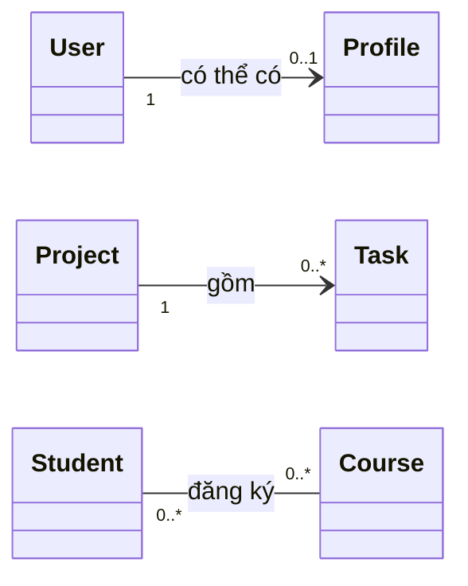

| Kiểu | Nhìn từ A | Nhìn từ B | Ví dụ thực tế |
| --- | --- | --- | --- |
| Một–một (1–1) | Mỗi A có tối đa/đúng một B tùy ràng buộc | Mỗi B có tối đa/đúng một A | Một tài khoản có một hồ sơ do hệ thống cấp |
| Một–nhiều (1–N) | Một A có nhiều B | Mỗi B thuộc một A trong phạm vi mô hình | Một dự án có nhiều công việc |
| Nhiều–nhiều (N–N) | Một A liên kết nhiều B | Một B liên kết nhiều A | Sinh viên đăng ký nhiều khóa học, mỗi khóa có nhiều sinh viên |

**Chú ý:** 1–1 không có nghĩa luôn là `1` ở cả hai đầu. `1`–`0..1` vẫn thường được gọi là quan hệ một–một *tùy chọn* ở một phía. Tương tự, 1–N có thể là `1`–`0..*` hoặc `1`–`1..*`, tùy nghiệp vụ.

## 2. Quan hệ một–một: đúng một hay tối đa một?

Ví dụ: mỗi `User` luôn có một `Profile` được khởi tạo cùng lúc. Quan hệ được thiết kế là `User (1) -> Profile (1)`. Một biến tham chiếu thể hiện thuận tiện một đầu quan hệ:

```java
final class User {
    private final Profile profile;

    User(String displayName) {
        this.profile = new Profile(displayName);
    }

    Profile profile() {
        return profile;
    }
}

record Profile(String displayName) { }
```

Ở đây, constructor `User` luôn tạo `Profile`; sau khi tạo thành công, `profile` không thể bị gán lại. Nếu constructor nhận `Profile` từ ngoài, cần kiểm tra `null` và xác định một `Profile` có được chia sẻ hay không.

Một biến tham chiếu `Profile profile` **không tự bảo đảm tính duy nhất trên toàn hệ thống**. Ví dụ:

```java
Profile shared = new Profile("An");
// Hai object khác nhau vẫn có thể trỏ tới cùng shared
// nếu API cho phép truyền shared vào constructor.
```

Nếu quy tắc yêu cầu “mỗi hồ sơ chỉ thuộc một người”, phải bảo đảm bằng API/domain service, registry hoặc ràng buộc duy nhất tại tầng lưu trữ. `private` và `final` chỉ hạn chế truy cập/gán lại ở một vị trí, không tạo luật một–một toàn cục.

**Biến thể tùy chọn `0..1`:** tài khoản có thể chưa hoàn thiện hồ sơ. Có thể dùng `Profile profile` là `null` với hợp đồng rõ ràng, hoặc `Optional<Profile>` làm kiểu **trả về** của getter. Không nên nhầm `Optional` với lời bảo đảm về tính duy nhất giữa mọi `User`.

## 3. Quan hệ một–nhiều: đối tượng cha và tập hợp con

Một `Project` có nhiều `Task`; một `Task` thuộc đúng một dự án (theo quy tắc ví dụ).

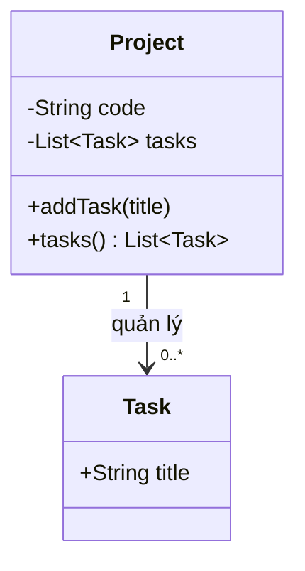

Biểu diễn thường thấy ở phía một:

```java
private final List<Task> tasks = new ArrayList<>();
```

Với quan hệ một–nhiều, bạn cần giải quyết **hai nhóm quy tắc**:

1. **Số lượng:** một dự án có thể có 0 task hay phải có ít nhất 1 task? Số lượng tối đa có giới hạn không?
2. **Tính toàn vẹn:** task có thể chuyển dự án không, ai được thêm/xóa, task trùng nội dung có được xem là hai công việc không?

Nếu `getTasks()` trả trực tiếp danh sách có thể sửa, caller có thể `clear()` hay `add()` để bỏ qua điều kiện nghiệp vụ. Thường nên để đối tượng quản lý cung cấp các hành vi rõ ràng: `addTask`, `removeTask`, `moveTask`, và chỉ trả danh sách đọc/snapshot.

| Cấu trúc | Phù hợp khi | Cần chú ý |
| --- | --- | --- |
| `List<Task>` | Có thứ tự, có thể có các phần tử trùng theo `equals` | Kiểm tra trùng theo ID nếu nghiệp vụ cần |
| `Set<Task>` | Muốn loại trùng theo `equals/hashCode` | Phải định nghĩa equality ổn định |
| `Map<TaskId, Task>` | Tra cứu nhanh và duy nhất theo ID | Phải giữ khóa trùng khớp ID của đối tượng |

**Quan hệ hai chiều:** nếu `Task` cũng có `Project project`, mỗi lần chuyển task phải cập nhật **cả** `oldProject.tasks`, `newProject.tasks` và `task.project` trong một thao tác hợp lệ. Tránh cho mọi caller tùy ý gọi setter ở một phía vì dễ tạo trạng thái “task trỏ về A nhưng chỉ xuất hiện trong danh sách B”.

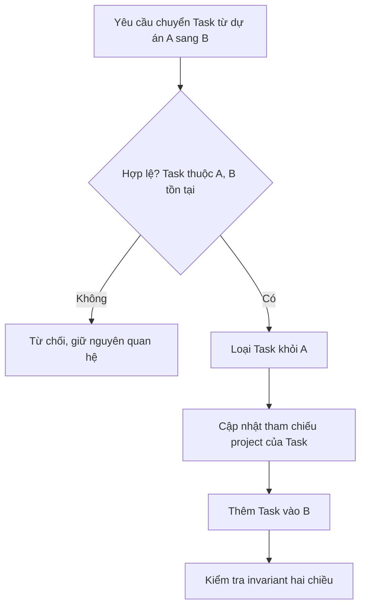

Trong ứng dụng có giao dịch/cơ sở dữ liệu, toàn bộ cập nhật cần được bao trong transaction thích hợp để tránh trạng thái dở dang khi lỗi.

## 4. Quan hệ nhiều–nhiều: chọn cách biểu diễn có chủ ý

Ví dụ một `Student` có thể học nhiều `Course`, và một `Course` có thể có nhiều `Student`.

Cách trực tiếp trong bộ nhớ là hai tập hợp:

```java
class Student {
    Set<Course> courses = new HashSet<>();
}
class Course {
    Set<Student> students = new HashSet<>();
}
```

Nhưng đoạn phác thảo này chưa an toàn: ai có quyền cập nhật? Nếu chỉ thêm vào `student.courses` mà quên `course.students` thì hai phía mâu thuẫn; nếu dùng `HashSet`, `equals/hashCode` cũng phải ổn định. Các trường trên còn đang có quyền truy cập mặc định và không có kiểm tra nghiệp vụ.

### Dùng đối tượng trung gian khi quan hệ có thông tin riêng

Đăng ký môn học thường có `enrolledOn`, `status`, `grade`… Đây là **thuộc tính của lần đăng ký**, không phải thuộc tính riêng của sinh viên hoặc môn học. Tạo `Enrollment` làm quan hệ có danh tính/quy tắc rõ ràng:

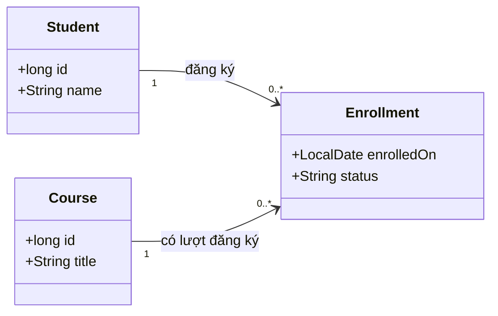

Mỗi `Enrollment` gắn với đúng một `Student` và đúng một `Course`. Nhờ vậy quan hệ N–N ban đầu được biểu diễn bằng **hai quan hệ 1–N** đối với đối tượng trung gian.

Ưu điểm: có thể cấm đăng ký trùng theo cặp `(studentId, courseId)`, lưu thời điểm đăng ký, trạng thái chờ/xác nhận, điểm số, lịch sử nghiệp vụ hoặc những điều kiện riêng của từng khóa học.

Nếu lưu vào cơ sở dữ liệu quan hệ, bảng `enrollment` thường có khóa ngoại `student_id`, `course_id`, cùng ràng buộc unique trên cặp này nếu quy tắc cấm đăng ký trùng. Với JPA/Hibernate, bạn có thể dùng `@ManyToMany` cho quan hệ thuần liên kết, nhưng khi liên kết có dữ liệu riêng, entity `Enrollment` thường rõ ràng và dễ mở rộng hơn. Các annotation không thay thế việc xác định quy tắc cập nhật hai phía hoặc uniqueness.

## 5. Ví dụ Java đầy đủ cho cả ba kiểu

Đặt đoạn dưới vào `MultiplicityDemo.java` (Java 17 trở lên). Ví dụ cố ý quản lý quan hệ nhiều–nhiều ở một registry duy nhất; lớp `Student` và `Course` không cần tự giữ hai danh sách có thể lệch nhau.

```java
import java.time.LocalDate;
import java.util.ArrayList;
import java.util.LinkedHashMap;
import java.util.List;
import java.util.Map;
import java.util.Objects;

public class MultiplicityDemo {

    // 1–1 bắt buộc: mỗi User tạo đúng một Profile.
    static final class User {
        private final String email;
        private final Profile profile;

        User(String email, String displayName) {
            this.email = nonBlank(email, "email");
            this.profile = new Profile(nonBlank(displayName, "displayName"));
        }

        Profile profile() {
            return profile;
        }
    }

    record Profile(String displayName) { }

    // 1–N: mỗi Project quản lý từ 0 đến nhiều Task.
    static final class Project {
        private final String code;
        private final List<Task> tasks = new ArrayList<>();

        Project(String code) {
            this.code = nonBlank(code, "code");
        }

        void addTask(String title) {
            tasks.add(new Task(nonBlank(title, "title")));
        }

        List<Task> tasks() {
            return List.copyOf(tasks); // snapshot không thể chỉnh danh sách
        }
    }

    record Task(String title) { }

    record Student(long id, String name) {
        Student {
            if (id <= 0) throw new IllegalArgumentException("student id");
            name = nonBlank(name, "student name");
        }
    }

    record Course(long id, String title) {
        Course {
            if (id <= 0) throw new IllegalArgumentException("course id");
            title = nonBlank(title, "course title");
        }
    }

    // Khóa liên kết: cùng sinh viên + cùng khóa học => cùng một đăng ký.
    record EnrollmentKey(long studentId, long courseId) { }

    record Enrollment(Student student, Course course, LocalDate enrolledOn) {
        Enrollment {
            Objects.requireNonNull(student, "student");
            Objects.requireNonNull(course, "course");
            Objects.requireNonNull(enrolledOn, "enrolledOn");
        }
    }

    static final class EnrollmentRegistry {
        private final Map<EnrollmentKey, Enrollment> byPair =
                new LinkedHashMap<>();

        boolean enroll(Student student, Course course, LocalDate day) {
            Objects.requireNonNull(student, "student");
            Objects.requireNonNull(course, "course");
            Objects.requireNonNull(day, "day");

            EnrollmentKey key = new EnrollmentKey(student.id(), course.id());
            if (byPair.containsKey(key)) return false;

            byPair.put(key, new Enrollment(student, course, day));
            return true;
        }

        List<Enrollment> forStudent(Student student) {
            Objects.requireNonNull(student, "student");
            return byPair.values().stream()
                    .filter(e -> e.student().id() == student.id())
                    .toList();
        }

        int count() {
            return byPair.size();
        }
    }

    private static String nonBlank(String text, String field) {
        if (text == null || text.isBlank()) {
            throw new IllegalArgumentException(field + " must not be blank");
        }
        return text;
    }

    public static void main(String[] args) {
        User user = new User("an@example.com", "An");
        System.out.println(user.profile().displayName());

        Project project = new Project("P-01");
        project.addTask("Phan tich");
        project.addTask("Kiem thu");
        System.out.println(project.tasks().size());

        Student an = new Student(1, "An");
        Student binh = new Student(2, "Binh");
        Course java = new Course(10, "Java OOP");
        Course sql = new Course(11, "SQL");

        EnrollmentRegistry registry = new EnrollmentRegistry();
        System.out.println(registry.enroll(an, java, LocalDate.of(2026, 10, 1)));
        System.out.println(registry.enroll(an, java, LocalDate.of(2026, 10, 2)));
        registry.enroll(an, sql, LocalDate.of(2026, 10, 3));
        registry.enroll(binh, java, LocalDate.of(2026, 10, 3));

        System.out.println(registry.forStudent(an).size());
        System.out.println(registry.count());
    }
}
```

Chạy:

```bash
javac MultiplicityDemo.java
java MultiplicityDemo
```

Kết quả dự kiến:

```text
An
2
true
false
2
3
```

Giải thích:

- `User` tạo một `Profile` trong constructor. Đây là cách thiết kế 1–1 bắt buộc trong phạm vi instance ở ví dụ.
- `Project` có hai `Task`; `List.copyOf` ngăn caller sửa danh sách qua getter. Vì `Task` là record với thành phần `String` bất biến, caller cũng không thể sửa trực tiếp các phần tử.
- `EnrollmentRegistry` lưu một liên kết cho mỗi cặp ID. Đăng ký lặp `(1, 10)` trả `false` và không tạo bản ghi mới.
- Một sinh viên có 2 đăng ký; tổng registry có 3 đăng ký. Một course `java` được hai sinh viên cùng học, thể hiện N–N.

**Giới hạn của demo:** `EnrollmentRegistry` chạy trong bộ nhớ, giả định mã định danh sinh viên/khóa học là duy nhất, không xác thực chúng đã tồn tại trong kho dữ liệu và **chưa thread-safe**. Trong hệ thống nhiều request chạy đồng thời, cần kiểm soát giao dịch và ràng buộc unique ở database; thao tác kiểm tra `containsKey` rồi `put` không tự là thao tác nguyên tử.

## 6. Số lượng quan hệ không đồng nghĩa với ownership

Phân biệt hai câu hỏi độc lập:

- **Multiplicity:** có thể có **bao nhiêu** đối tượng ở mỗi đầu?
- **Loại quan hệ/vòng đời:** đối tượng này **tham chiếu, chia sẻ, quản lý hay sở hữu** đối tượng kia theo quy tắc nào?

Ví dụ, `Project 1 -- 0..* Task` có thể được mô hình hóa thành association với task còn tồn tại sau khi chuyển dự án, hoặc thành composition nếu task chỉ có ý nghĩa trong vòng đời dự án. Cùng là 1–N nhưng hành vi xóa/chuyển và quyền sở hữu khác nhau.

**Hướng điều hướng (*navigability*)** cũng độc lập với multiplicity: `Project` có thể biết danh sách `Task`, `Task` có thể biết `Project`, cả hai bên cùng biết hoặc dùng registry/query service để tra cứu. Việc có hai trường tham chiếu không biến 1–N thành N–N.

## 7. Bất biến cần giữ theo từng kiểu

| Kiểu | Bất biến quan trọng | Chỗ nên cưỡng chế |
| --- | --- | --- |
| 1–1 bắt buộc | A có đúng một B, B không thuộc hai A nếu quy tắc yêu cầu | Constructor/factory; kiểm tra domain; unique ở lưu trữ |
| 1–1 tùy chọn | A có tối đa một B; có thể chưa có | Phương thức gán/gỡ, ràng buộc unique và khả năng null rõ ràng |
| 1–N | Child thuộc đúng một owner, không xuất hiện ở hai tập hợp trái quy tắc | Thao tác thêm/chuyển/xóa tập trung |
| N–N | Cặp A–B hợp lệ, không bị trùng nếu ứng dụng yêu cầu | Association object/registry; unique composite key |
| Mọi kiểu | Không có liên kết mồ côi, sai trạng thái, hoặc sửa được bằng đường tắt | Encapsulation, validation, transaction, test |

Một số sai lầm phổ biến:

1. **Nghĩ `List` nghĩa là nhiều–nhiều.** `List` chỉ là tập hợp ở một đầu; muốn biết 1–N hay N–N phải xét cả số lượng ở đầu còn lại.
2. **Nghĩ `@OneToOne` hoặc một field là đủ.** Quy tắc duy nhất/không-null còn phụ thuộc mô hình, API và cấu hình lưu trữ.
3. **Quên đối tượng trung gian khi quan hệ có thuộc tính.** `Enrollment.grade` không phải điểm chung của mọi khóa học hay điểm chung của mọi sinh viên.
4. **Cập nhật quan hệ hai chiều một nửa.** Chỉ thêm vào một collection làm dữ liệu bộ nhớ không nhất quán.
5. **Trả về collection mutable nội bộ.** Caller có thể phá vỡ min/max, quy tắc trùng hoặc liên kết ngược.
6. **Dùng `Set` nhưng `equals/hashCode` phụ thuộc field mutable.** Thay đổi field khi object đang trong hash collection có thể làm tra cứu/xóa sai.
7. **Bỏ qua tranh chấp đồng thời.** Hai request cùng kiểm tra “chưa có liên kết” vẫn có thể cùng ghi; cần unique constraint/giao dịch phù hợp.

## 8. Luyện tập áp dụng

**Bài A — Nhận diện multiplicity.** Vẽ UML cho các yêu cầu:

- Một khách hàng có thể có từ 0 đến nhiều địa chỉ giao hàng; mỗi địa chỉ trong mô hình gắn với đúng một khách hàng.
- Một nhân viên có thể được cấp 0 hoặc 1 thẻ ra vào, mỗi thẻ gắn đúng một nhân viên.
- Một tác giả viết nhiều cuốn sách, một cuốn có thể có nhiều tác giả.

**Bài B — Cài đặt 1–N có giới hạn.** `Team` có **1 đến 5** thành viên; cấm thành viên trùng ID. Thiết kế `addMember`/`removeMember`. Khi tạo team phải có ít nhất một thành viên; khi xóa thành viên cuối cùng phải từ chối hoặc hủy team theo nghiệp vụ.

**Bài C — Mở rộng N–N.** Thêm `status` (`PENDING`, `ACTIVE`, `CANCELLED`) và `grade` vào `Enrollment`. Quyết định việc đăng ký lại một khóa đã hủy là *cập nhật bản ghi cũ* hay *tạo lần đăng ký mới*, từ đó chọn key/unique constraint hợp lý. Phương án đúng phụ thuộc quy tắc lưu lịch sử.

**Bài D — Review code.** Cho `Course` chứa `List<Student>` nhưng `Student` không giữ danh sách course. Hãy giải thích vì sao vẫn **có thể** là N–N; đề xuất cách truy vấn “những khóa của sinh viên X” qua repository/registry mà không cần cập nhật hai collection.

### Tự kiểm tra trước khi kết thúc thiết kế

Với mỗi quan hệ, hãy phát biểu thành hai câu: “**một A có bao nhiêu B?**” và “**một B có bao nhiêu A?**”. Ghi rõ `0` có hợp lệ không, yêu cầu tính duy nhất, cách tạo/gỡ/chuyển liên kết và nơi duy trì bất biến. Chỉ sau đó mới chọn field đơn, `List`, `Set`, `Map` hoặc class liên kết.


</details>

- [Quay lại đầu trang](#back-to-top)

---

## <a id="relationships-005">Hướng liên kết và khả năng điều hướng</a>

<details>
<summary>Xem chi tiết</summary>

# Hướng liên kết và khả năng điều hướng trong OOP

## 1. Hướng liên kết là gì?

Trong mô hình hướng đối tượng, **association** mô tả quan hệ giữa các đối tượng. **Khả năng điều hướng (navigability)** cho biết một đối tượng có thể **đi theo quan hệ để tìm đối tượng ở đầu bên kia** hay không.

Ví dụ một hệ thống quản lý bán hàng:

- Từ một đơn hàng, ta cần tìm được khách hàng đặt đơn để hiển thị tên và địa chỉ giao hàng.
- Từ một khách hàng, ta *có thể* cần liệt kê tất cả đơn hàng của khách đó.
- Hai yêu cầu truy cập này **khác nhau**: triển khai chiều `Order → Customer` không tự tạo chiều `Customer → Order`.

Hãy phân biệt ba khái niệm:

| Khái niệm | Câu hỏi thiết kế | Ví dụ |
|---|---|---|
| **Association** | Hai loại đối tượng có quan hệ nghiệp vụ gì? | Đơn hàng thuộc về khách hàng. |
| **Navigability** | Đứng tại object A, ta truy cập trực tiếp được object B qua quan hệ không? | `order.getCustomer()`. |
| **Multiplicity** | Một object được liên kết với bao nhiêu object của phía kia? | Một đơn hàng có đúng một khách; một khách có nhiều đơn. |

**Hướng liên kết không phải hướng luồng dữ liệu, luồng điều khiển, hay chiều tạo object.** Một khách hàng có thể được tạo trước đơn hàng, trong khi quan hệ vẫn chỉ cho phép điều hướng từ `Order` sang `Customer`.

## 2. Cách đọc ký hiệu UML

### Liên kết một chiều

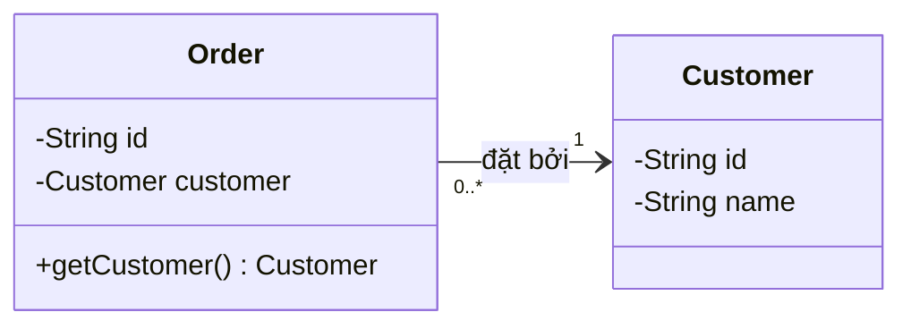

Đọc sơ đồ như sau:

- Đường **liền có mũi tên `Order → Customer`**: từ object đơn hàng có thể truy cập object khách hàng.
- Số `1` gần `Customer`: **mỗi đơn hàng gắn với đúng một khách hàng**.
- Số `0..*` gần `Order`: **mỗi khách hàng có thể có từ 0 đến nhiều đơn hàng**.
- Không có field `orders` trong `Customer`: điều hướng ngược không khả dụng trực tiếp bằng cách gọi trên object `Customer`. Tuy nhiên có thể truy vấn qua repository hoặc các cấu trúc khác.

**Quy tắc đọc bội số:** ký hiệu đặt cạnh *đầu nào* thì cho biết số đối tượng ở đầu đó mà *một đối tượng phía đối diện* có thể liên kết tới.

### Liên kết hai chiều

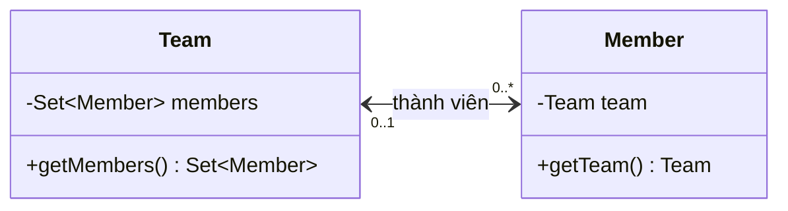

Đọc sơ đồ:

- `Team` cho phép tìm các `Member` hiện thuộc nhóm.
- `Member` cho phép tìm `Team` hiện phụ trách mình.
- `0..1` cạnh `Team`: một thành viên thuộc tối đa một nhóm tại một thời điểm.
- `0..*` cạnh `Member`: một nhóm có thể có nhiều thành viên.

Trong UML, **một đường association không có mũi tên không đủ để kết luận nó hai chiều**: tùy ký pháp và quy ước sơ đồ, việc không ghi mũi tên có thể chỉ là **chưa chỉ rõ navigability**. Nếu cần làm rõ hai chiều, hãy chỉ định rõ cả hai hướng trong mô hình hoặc chú thích bằng lời.

## 3. Quan hệ một chiều trong Java: chỉ lưu đường cần đi

Tạo tệp `UnidirectionalDemo.java`:

```java
import java.util.Objects;

public class UnidirectionalDemo {

    static final class Customer {
        private final String id;
        private final String name;

        Customer(String id, String name) {
            this.id = Objects.requireNonNull(id);
            this.name = Objects.requireNonNull(name);
        }

        String getId() {
            return id;
        }

        String getName() {
            return name;
        }
    }

    static final class Order {
        private final String id;
        private final Customer customer;

        Order(String id, Customer customer) {
            this.id = Objects.requireNonNull(id);
            this.customer = Objects.requireNonNull(customer);
        }

        Customer getCustomer() {
            return customer;
        }

        String getId() {
            return id;
        }
    }

    public static void main(String[] args) {
        Customer lan = new Customer("C01", "Lan");
        Order order = new Order("O100", lan);

        // Điều hướng hợp lệ: từ Order đến Customer.
        System.out.println(order.getCustomer().getName()); // Lan
        System.out.println(order.getId());                 // O100

        // Không có lan.getOrders(): Customer không lưu chiều ngược.
    }
}
```

Chạy:

```bash
javac UnidirectionalDemo.java
java UnidirectionalDemo
```

Kết quả:

```text
Lan
O100
```

Điều gì xảy ra ở bộ nhớ?

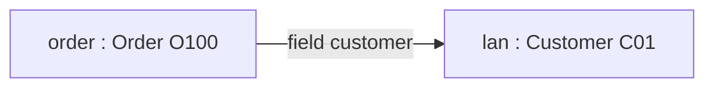

`order` giữ **tham chiếu** tới `lan`, không chứa một bản sao `Customer`. Trong Java, việc `Customer` không có field `orders` chỉ nói rằng nó **không nắm sẵn cách điều hướng ngược theo thiết kế này**. Ta vẫn có thể tìm các `Order` theo customer bằng kho dữ liệu hoặc bằng cách duyệt tập hợp các đơn hàng.

**Khi phù hợp:** ứng dụng thường cần từ đơn hàng xem khách; trang lịch sử mua hàng có thể dùng repository để truy vấn, không cần tải/giữ tất cả đơn hàng trong mỗi `Customer`.

## 4. Nếu thực sự cần hai hướng: đồng bộ đúng một liên kết

Với `Team ↔ Member`, mỗi `Member` thuộc tối đa một `Team`. Nếu `Member.team == t`, tập `t.members` phải chứa đúng member đó; khi chuyển nhóm, phải **gỡ nhóm cũ → đổi tham chiếu → thêm nhóm mới**.

Ví dụ Java 11+ dưới đây dùng một cổng cập nhật và giữ hai tham chiếu trong cùng một đối tượng đồ thị. Lưu là `BidirectionalNavigationDemo.java`:

```java
import java.util.LinkedHashSet;
import java.util.Set;

public class BidirectionalNavigationDemo {
    static final class Team {
        private final Set<Member> members = new LinkedHashSet<>();

        Set<Member> members() {
            return Set.copyOf(members);
        }
    }

    static final class Member {
        private Team team;

        Team team() {
            return team;
        }

        void moveTo(Team next) {
            if (team == next) return;
            if (team != null) team.members.remove(this);
            team = next;
            if (next != null) next.members.add(this);
        }
    }

    public static void main(String[] args) {
        Team first = new Team();
        Team second = new Team();
        Member member = new Member();

        member.moveTo(first);
        member.moveTo(second);

        System.out.println(first.members().isEmpty());       // true
        System.out.println(second.members().contains(member)); // true
        System.out.println(member.team() == second);          // true
    }
}
```

```bash
javac BidirectionalNavigationDemo.java
java BidirectionalNavigationDemo
```

Kết quả: ba dòng `true`. Hai kiểu lồng nhau dùng cùng enclosing class nên được phép truy cập các trường `private` của nhau theo quy tắc Java. `Member` là nơi cập nhật duy nhất; `Team.members()` trả snapshot, không cho caller phá liên kết bằng `add/remove` ở ngoài.

Đây mới là demo đơn luồng tối giản, **chưa có validation sức chứa, xử lý lỗi giữa chừng hay khóa đồng thời**. Bài **Quan hệ hai chiều và giữ dữ liệu nhất quán** phát triển cùng ý tưởng thành một chuyển phòng ban có kiểm tra trước khi sửa, ca phòng đầy, invariant tests và ví dụ JPA. Đừng thêm hướng ngược chỉ để “sơ đồ đầy đủ” nếu ứng dụng không cần truy vấn ngược.

## 5. Lựa chọn 1 chiều hay 2 chiều: dựa trên truy vấn thực tế

| Tình huống | Hướng nên cân nhắc | Lý do |
|---|---|---|
| Hiển thị khách hàng của một đơn hàng | `Order → Customer` | Đơn hàng cần khách hàng, ít phải quản lý thêm trạng thái |
| Hiển thị đơn hàng đã mua của khách hàng | Truy vấn repository, hoặc chiều `Customer → Order` khi phù hợp | Không nhất thiết phải giữ mọi đơn trong RAM của customer |
| Mỗi thành viên phải biết nhóm; nhóm cần danh sách thành viên để phân công | Hai chiều `Team ↔ Member` | Nghiệp vụ thường xuyên tra cả hai hướng |
| Kiểm tra quyền của một tài liệu thông qua chủ sở hữu | `Document → Owner` | Đối tượng tài liệu đủ thông tin kiểm tra |
| Nhiều-nhiều giữa học viên và khóa học, đăng ký có ngày/trạng thái riêng | `Enrollment` làm đối tượng trung gian | Liên kết có dữ liệu và quy tắc riêng |

Có thể dùng association hai chiều khi miền nghiệp vụ thực sự cần. Tuy nhiên **không cần xây cả hai chiều chỉ vì quan hệ về mặt logic là đối xứng**. Việc thêm field ngược có chi phí: phải đồng bộ, dễ gặp vòng tham chiếu và thường khiến các lớp gắn chặt hơn.

### Ví dụ: nhiều-nhiều và lớp liên kết

Nếu một sinh viên đăng ký nhiều khóa học và một khóa học có nhiều sinh viên, việc biểu diễn mỗi phía bằng `Set` có thể đủ khi quan hệ chỉ là một cặp. Nhưng nếu “đăng ký học” có `registeredAt`, `status`, `finalGrade`, hãy tạo `Enrollment`:

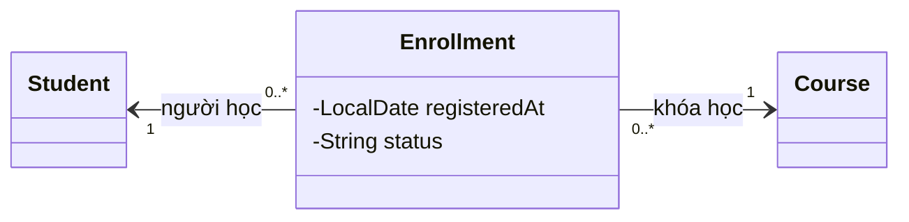

Lớp `Enrollment` nắm thông tin của **chính mối liên kết**. Từ Student hoặc Course có điều hướng ngược đến Enrollment hay không vẫn là quyết định độc lập, tùy cách thiết kế field và truy vấn.

## 6. Hai cách thể hiện hướng trong thiết kế

**Hướng cấu trúc trong object graph:** object A có field tham chiếu đến object B. Ví dụ `member.getTeam()` hoạt động nhờ `Member.team`.

**Hướng truy vấn qua repository:** A không giữ field/collection B nhưng application vẫn tìm được B bằng một truy vấn. Ví dụ:

```java
interface OrderRepository {
    // Chỉ là contract minh họa, triển khai qua JDBC/JPA/...
    java.util.List<Order> findByCustomerId(String customerId);
}

// Ở service:
java.util.List<Order> orders = repository.findByCustomerId(customer.getId());
```

Đoạn trên **không tự làm `Customer` trở thành association hai chiều trong object graph**; nó chỉ chứng minh nghiệp vụ có thể lấy dữ liệu chiều ngược thông qua một thành phần khác. Trong thực tế, việc ánh xạ SQL/JPA, lazy loading và cache ảnh hưởng đến hiệu năng, nhưng không thay đổi ý nghĩa của chiều trong sơ đồ đối tượng.

## 7. Hướng điều hướng và quan hệ phụ thuộc có phải cùng một thứ?

Không. UML có các loại quan hệ khác nhau:

- **Association** (đường liền): thể hiện liên kết giữa các instance; navigability mô tả có thể truy cập một đầu từ đầu kia.
- **Dependency** (đường nét đứt với mũi tên): một thành phần sử dụng hoặc phụ thuộc định nghĩa của thành phần kia, ví dụ service nhận interface làm tham số.
- **Inheritance/generalization** (đường liền, tam giác rỗng hướng về lớp cha): quan hệ “là một loại”, không phải chỉ đường điều hướng giữa hai object.

Ví dụ:

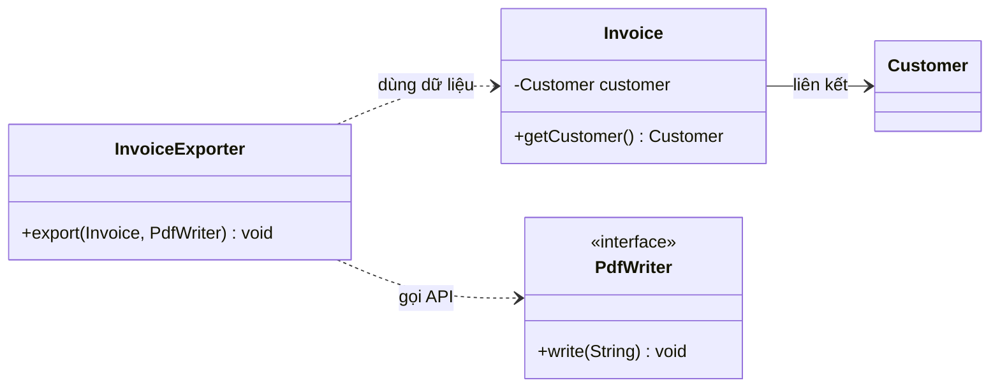

`InvoiceExporter` có thể sử dụng `Invoice` và `PdfWriter` trong một lời gọi mà không giữ chúng thành trạng thái. Mũi tên dependency không nói rằng có một liên kết object lâu dài hoặc rằng `PdfWriter` biết ngược trở lại exporter.

## 8. Những lỗi quyết định khả năng điều hướng

| Lỗi thiết kế | Hệ quả | Cách cải thiện |
|---|---|---|
| Thêm field chiều ngược mà không có yêu cầu truy vấn | Tăng trạng thái phải đồng bộ và khả năng vòng tham chiếu | Dùng một chiều + repository nếu đủ |
| `getMembers()` trả collection nội bộ sửa được | Caller có thể bỏ qua cổng cập nhật | Trả snapshot hoặc immutable view đúng nhu cầu |
| Thay một phía nhưng quên phía còn lại | `member.team` và `team.members` trả hai “sự thật” khác nhau | Một phương thức điều phối liên kết |
| Hai setter gọi qua lại vô điều kiện | Đệ quy vô hạn, có thể `StackOverflowError` | Một đầu điều phối; helper nội bộ không gọi ngược |
| Serialize `Team → Member → Team` trực tiếp | Vòng object graph có thể gây JSON lặp sâu | DTO chỉ chứa thông tin cần trả |
| Dùng mũi tên UML để suy ra quyền sở hữu | Tưởng đổi liên kết sẽ xóa object bên kia | Tách navigability khỏi lifecycle và cascade |
| Coi JPA `mappedBy` là tự sửa hai phía Java | Hai phía vẫn sai trước khi reload | Đồng bộ object graph, hiểu owning side và transaction |

**Lưu ý:** chu trình tham chiếu giữa hai object không tự gây rò rỉ trong JVM; GC dựa trên khả năng tiếp cận từ GC roots. Nhưng việc giữ collection lớn và cập nhật hai chiều đồng thời vẫn cần giải pháp lưu trữ, khóa hoặc transaction phù hợp. Bài kế tiếp trình bày cụ thể kỹ thuật để bảo vệ invariant trong một thao tác có thể thất bại.

## 9. Bài tập kiểm tra thiết kế

**Bài 1.** Mỗi phiếu bảo hành thuộc về một sản phẩm. Hệ thống chỉ mở phiếu rồi xem sản phẩm, còn màn hình danh sách phiếu tra qua cơ sở dữ liệu. Nên điều hướng thế nào?

**Gợi ý:** association `Warranty → Product` là đủ trong object graph; danh sách phiếu sử dụng truy vấn repository theo mã sản phẩm.

**Bài 2.** Một thư viện có nhiều cuốn sách và ứng dụng thường xuyên cần hỏi “sách này hiện ở thư viện nào?” và “thư viện này đang quản lý các sách nào?”. Hãy chọn hướng và bội số nếu sách có thể chưa được xếp thư viện.

**Gợi ý:** `Library ↔ Book`, gần `Library` là `0..1`, gần `Book` là `0..*`. Khi chuyển sách từ A sang B phải gỡ khỏi A, đổi tham chiếu của sách và thêm vào B.

**Bài 3.** Phát hiện lỗi:

```java
// Giả sử Team có tập members, Member có field team.
member.setTeam(teamA);
teamB.getMembers().add(member);
```

**Gợi ý:** dữ liệu hai phía không thống nhất; API cho phép sửa tự do càng làm lỗi dễ xảy ra. Thay bằng một thao tác quản lý liên kết cập nhật đúng cả hai phía.

**Bài 4.** Vì sao có thể gọi truy vấn `findOrdersByCustomerId(id)` mà vẫn khẳng định mô hình object `Order → Customer` là một chiều?

**Gợi ý:** truy vấn nằm ở repository, không phát sinh field `Customer.orders`. Đường truy cập dữ liệu của ứng dụng rộng hơn đường tham chiếu trực tiếp của object.

**Bài 5.** UML association không có mũi tên có chắc chắn là hai chiều không?

**Gợi ý:** không. Nếu sơ đồ cần thể hiện navigability một cách nghiêm ngặt, phải ghi tường minh hoặc thống nhất quy ước trước khi đọc.

---

**Điểm cần nắm:** *Association* trả lời “ai liên kết với ai?”, *multiplicity* trả lời “một bên có bao nhiêu đối tượng bên kia?”, còn *navigability* trả lời “đứng tại object này có thể đi trực tiếp sang object kia không?”. Hãy triển khai đúng những chiều thật sự cần, và nếu giữ cả hai phía thì bảo vệ tính nhất quán bằng một API cập nhật có kiểm soát.


</details>

- [Quay lại đầu trang](#back-to-top)

---

## <a id="relationships-006">Quan hệ hai chiều và giữ dữ liệu nhất quán</a>

<details>
<summary>Xem chi tiết</summary>

# Quan hệ hai chiều và giữ dữ liệu nhất quán trong OOP (Java)

Trong lập trình hướng đối tượng, **quan hệ hai chiều (bidirectional association)** xuất hiện khi hai đối tượng đều biết cách truy cập đối tượng ở đầu bên kia. Ví dụ, một nhân viên biết mình thuộc phòng ban nào, còn phòng ban biết danh sách nhân viên của mình.

Điểm khó không nằm ở việc thêm hai trường tham chiếu. Điểm khó là **giữ hai trường đó mô tả cùng một sự thật** sau mọi thao tác thêm, gỡ, chuyển liên kết, xử lý lỗi và ghi xuống cơ sở dữ liệu.

Bài này tập trung vào các quy tắc triển khai trong Java, với ví dụ chạy độc lập và lưu ý thực tế khi dùng JPA/Hibernate.

## 1. Quan hệ một chiều và hai chiều

Giả sử mỗi `Employee` thuộc tối đa một `Department`, mỗi `Department` có thể có nhiều `Employee`.

**Một chiều:** chỉ nhân viên giữ tham chiếu `department`; muốn tìm các nhân viên thuộc phòng ban có thể truy vấn repository. Không nhất thiết phải đặt collection bên trong `Department`.

**Hai chiều:** `Employee` giữ `department`, đồng thời `Department` giữ collection `employees`.

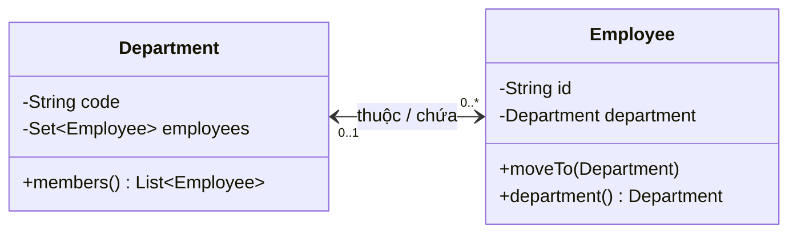

Ở ví dụ, nhân viên có thể chưa được phân phòng (`0..1`) và phòng ban có thể chưa có nhân viên (`0..*`). **Số lượng quan hệ (multiplicity)** và **hướng điều hướng (navigability)** là hai quyết định riêng: 1–N không bắt buộc phải có tham chiếu hai chiều.

| Thiết kế | Thông tin lưu trong đối tượng | Thuận lợi | Chi phí |
| --- | --- | --- | --- |
| Một chiều `Employee -> Department` | Mỗi `Employee` biết một `Department` | Ít trạng thái trùng lặp; đơn giản hơn | Tìm nhân viên theo phòng cần nguồn truy vấn hoặc duyệt |
| Một chiều `Department -> Employee` | Phòng lưu collection nhân viên | Duyệt thành viên dễ | Không thể hỏi trực tiếp phòng của nhân viên qua field |
| Hai chiều | Cả hai phía đều lưu tham chiếu | Điều hướng hai phía nhanh trong object graph | Mọi thay đổi phải đồng bộ hai phía |
| Chỉ lưu ID và truy vấn qua service | Không nhất thiết giữ object reference | Giảm phụ thuộc, thuận tiện ở ranh giới hệ thống | Phải truy vấn/caching và duy trì luật ở tầng dữ liệu |

**Không tự động chọn hai chiều chỉ vì có thể:** thêm một hướng điều hướng cũng làm tăng trạng thái phải giữ nhất quán.

## 2. Định nghĩa invariant trước khi viết code

Với mọi `Employee e` và `Department d` nằm trong cùng phạm vi quản lý:

```text
e.department == d   <=>   d.employees chứa đúng đối tượng e
```

Đây là **bất biến hai chiều** (*bidirectional invariant*). Từ đó suy ra:

1. Nếu `e.department == null`, `e` không được xuất hiện trong danh sách nhân viên của bất kỳ phòng nào.
2. Nếu phòng `A` chứa `e`, `e.department` phải trỏ về `A`.
3. Nếu một nhân viên chỉ được thuộc một phòng, không phòng khác nào được đồng thời chứa nhân viên ấy.
4. Mọi giới hạn bổ sung (sức chứa, nhân viên đang hoạt động, ID không trùng trong phòng...) cũng phải đúng sau một thao tác thành công.

Lỗi phổ biến khi thay đổi một phía:

```java
// Giả sử employee đang thuộc phòng A:
employee.setDepartment(departmentB);

// Nếu A.employees vẫn chứa employee và B.employees chưa thêm,
// ba tham chiếu cùng mô tả ba trạng thái khác nhau.
```

Tương tự, `departmentB.getEmployees().add(employee)` chỉ sửa collection B, chưa sửa `employee.department`. Hai setter độc lập có thể làm người gọi quên cập nhật nửa còn lại.

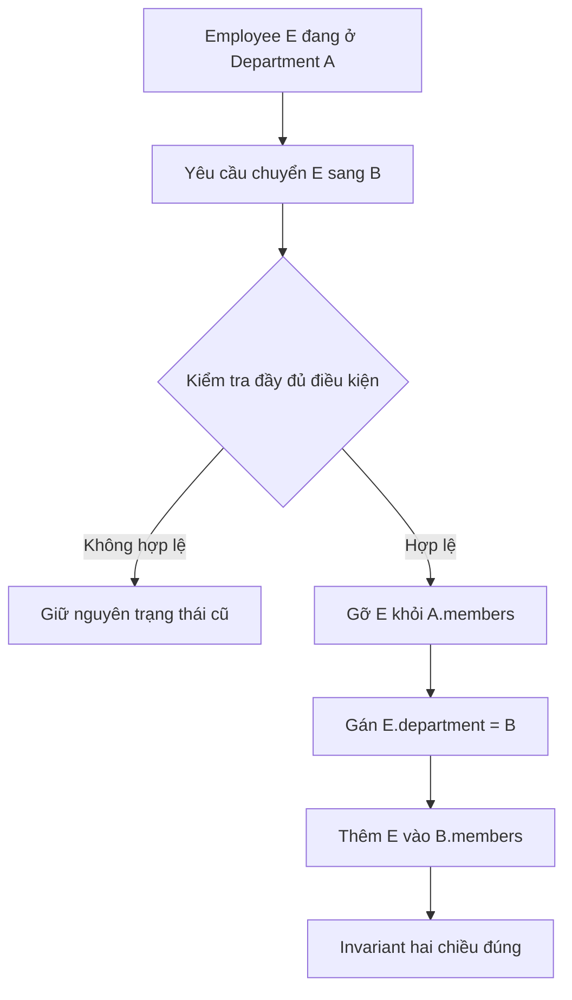

Sơ đồ mô tả thứ tự logic trong **một thao tác được kiểm soát**. Khi thao tác có thể thất bại giữa chừng hoặc chạy đồng thời, cần bảo vệ phạm vi cập nhật bằng giao dịch, khóa hoặc cơ chế khôi phục thích hợp.

## 3. Ba nguyên tắc thiết kế API

**Một cửa cập nhật liên kết.** Cho phép `employee.moveTo(newDepartment)`, hoặc `department.assign(employee)`, hoặc một domain service có quyền cập nhật cả hai. Không công khai nhiều setter độc lập để các caller tự “nhớ” đồng bộ.

**Đóng gói collection.** `getEmployees()` không trả về collection mutable nội bộ. Trả snapshot chỉ đọc/DTO để caller không thể `add/remove` ở ngoài cổng kiểm tra. Nếu phần tử bên trong mutable, snapshot của collection không tự làm các phần tử bất biến.

**Xác thực trước, sửa sau.** Kiểm tra phòng mới tồn tại, sức chứa, quyền chuyển và trạng thái hai chiều hiện tại trước khi thay đổi. Nếu không hợp lệ, kết quả phải là **không có thay đổi nào**.

| Hành vi | Cập nhật cần thiết | Điều cần bảo vệ |
| --- | --- | --- |
| Gán nhân viên chưa có phòng vào A | Thêm vào A; `employee.department = A` | Không trùng; A còn chỗ |
| Chuyển từ A sang B | Gỡ A; gán B; thêm B | Không để E đồng thời thuộc A và B |
| Hủy phân phòng | Gỡ khỏi phòng cũ; gán `null` | Không còn liên kết ngược sót lại |
| Gán lại đúng phòng đang thuộc | Không làm gì (*idempotent*) | Không thêm trùng hoặc phát sự kiện trùng |
| Gán thất bại vì B hết chỗ | Giữ nguyên liên kết với A | Không gỡ E khỏi A trước khi kiểm tra B |

## 4. Ví dụ Java 17 hoàn chỉnh: chuyển phòng ban nhất quán

Ví dụ dưới đây có thể biên dịch độc lập, không cần Spring hoặc database. Cả hai phía được thay đổi qua **một phương thức `Employee.moveTo(...)`**; collection nhân viên không lộ ra ngoài để chỉnh trực tiếp.

Tạo file `BidirectionalAssociationDemo.java`:

```java
import java.util.LinkedHashSet;
import java.util.List;
import java.util.Objects;
import java.util.Set;

public class BidirectionalAssociationDemo {

    static final class Department {
        private final String code;
        private final int capacity;
        private final Set<Employee> employees = new LinkedHashSet<>();

        Department(String code, int capacity) {
            if (code == null || code.isBlank()) {
                throw new IllegalArgumentException("Department code is blank");
            }
            if (capacity < 1) {
                throw new IllegalArgumentException("Capacity must be positive");
            }
            this.code = code;
            this.capacity = capacity;
        }

        String code() {
            return code;
        }

        List<Employee> members() {
            // Snapshot: không trao cho caller quyền add/remove collection gốc.
            return List.copyOf(employees);
        }

        private void validateIncoming(Employee person) {
            Objects.requireNonNull(person, "person");

            if (employees.contains(person)) {
                throw new IllegalStateException("Already in target collection");
            }
            if (employees.size() >= capacity) {
                throw new IllegalStateException("Department is full: " + code);
            }

            // Đây là ví dụ domain rule: ID nhân viên không trùng trong phòng.
            for (Employee existing : employees) {
                if (existing.id().equals(person.id())) {
                    throw new IllegalArgumentException(
                            "Duplicate employee id in " + code);
                }
            }
        }
    }

    static final class Employee {
        private final String id;
        private Department department; // null = chưa thuộc phòng nào

        Employee(String id) {
            if (id == null || id.isBlank()) {
                throw new IllegalArgumentException("Employee id is blank");
            }
            this.id = id;
        }

        String id() {
            return id;
        }

        Department department() {
            return department;
        }

        void moveTo(Department destination) {
            Department source = department;

            // Lời gọi lặp lại phải vô hại.
            if (source == destination) {
                return;
            }

            // Precondition: trạng thái hiện tại phải đã đồng bộ.
            if (source != null && !source.employees.contains(this)) {
                throw new IllegalStateException(
                        "Source department is inconsistent");
            }

            // Kiểm tra trước khi thay đổi: nếu đích không hợp lệ,
            // employee vẫn còn nguyên trong source.
            if (destination != null) {
                destination.validateIncoming(this);
            }

            // Chỉ sau khi toàn bộ kiểm tra thành công mới sửa quan hệ.
            if (source != null) {
                source.employees.remove(this);
            }
            department = destination;
            if (destination != null) {
                destination.employees.add(this);
            }
        }
    }

    private static void verify(
            Department first, Department second, Employee... employees) {
        for (Employee e : employees) {
            boolean inFirst = first.employees.contains(e);
            boolean inSecond = second.employees.contains(e);
            if (inFirst && inSecond) {
                throw new AssertionError("Employee in both departments");
            }
            if (inFirst != (e.department() == first)
                    || inSecond != (e.department() == second)) {
                throw new AssertionError("Broken bidirectional invariant");
            }
        }
    }

    public static void main(String[] args) {
        Department engineering = new Department("ENG", 2);
        Department sales = new Department("SAL", 1);

        Employee an = new Employee("E-01");
        Employee binh = new Employee("E-02");
        Employee chi = new Employee("E-03");

        an.moveTo(engineering);
        binh.moveTo(engineering);

        // ENG đầy: thất bại không được làm thay đổi bên nào.
        try {
            chi.moveTo(engineering);
        } catch (IllegalStateException expected) {
            System.out.println(expected.getMessage());
        }

        an.moveTo(sales);       // gỡ khỏi ENG, thêm vào SAL
        chi.moveTo(engineering);
        an.moveTo(sales);       // gọi lặp, không nhân đôi quan hệ

        verify(engineering, sales, an, binh, chi);
        System.out.println("ENG = " + engineering.members().size());
        System.out.println("SAL = " + sales.members().size());
        System.out.println("An o " + an.department().code());

        an.moveTo(null);        // hủy phân phòng
        verify(engineering, sales, an, binh, chi);
        System.out.println("SAL sau go = " + sales.members().size());
    }
}
```

Chạy:

```bash
javac BidirectionalAssociationDemo.java
java BidirectionalAssociationDemo
```

Kết quả dự kiến:

```text
Department is full: ENG
ENG = 2
SAL = 1
An o SAL
SAL sau go = 0
```

### Vì sao đoạn code giữ được bất biến?

- `Employee.department` và `Department.employees` đều là `private`; caller chỉ cập nhật qua `moveTo`.
- `moveTo` trả về ngay nếu đích đã là phòng hiện tại.
- Kiểm tra trạng thái cũ và sức chứa phòng mới xảy ra **trước** ba bước sửa dữ liệu. Nếu kiểm tra ném exception, trạng thái ban đầu không đổi.
- Khi thành công, phương thức xóa liên kết ngược cũ, cập nhật tham chiếu tiến và tạo liên kết ngược mới.
- `members()` trả snapshot collection, nên thao tác ngoài như `members().clear()` không thể sửa collection thật. Các `Employee` trong snapshot vẫn là object tham chiếu, nhưng người dùng không có setter tùy tiện để phá hỏng quan hệ.
- `verify` kiểm tra tính nhất quán từ cả hai phía cho các nhân viên được đưa vào test.

**Giới hạn có chủ đích của ví dụ:** đây là mô hình **đơn luồng trong bộ nhớ**. Hai request đồng thời có thể cùng vượt qua kiểm tra sức chứa rồi cùng thêm thành viên. Mọi đối tượng tham gia phải được quản lý trong cùng phạm vi và thao tác không được ngắt giữa chừng. Khi yêu cầu chạy đa luồng, phải chọn đồng bộ hóa phù hợp cho toàn bộ thao tác hoặc chuyển invariant sang một tầng giao dịch khác.

Ví dụ cũng dùng **object identity** làm phép so sánh thành viên vì `Employee` không override `equals/hashCode`. Kiểm tra ID trùng trong một phòng là luật nghiệp vụ bổ sung; hệ thống thực tế thường cần quản lý ID duy nhất toàn cục tại repository hoặc database.

## 5. Khi có quan hệ hai chiều nhiều–nhiều

Với `Student` và `Course`, một sinh viên học nhiều khóa và một khóa có nhiều sinh viên. Nếu cả hai class giữ `Set` của nhau thì thao tác đăng ký phải thay đổi **cả hai tập**.

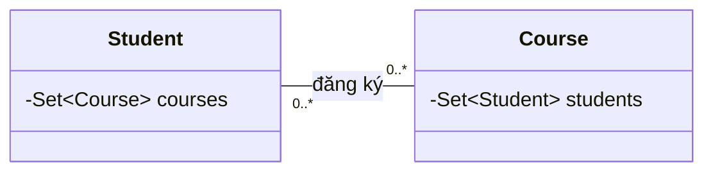

Ý tưởng của phương thức **trung tâm** (minh họa khi hai tập được quản lý nội bộ và có quy tắc định danh ổn định):

```java
// Đoạn minh họa; studentCourses và courseStudents là các tập
// nội bộ được domain service sở hữu, không phải getter mutable.
void enroll(Student student, Course course) {
    validateEnrollment(student, course); // quyền, trùng, sĩ số...
    studentCourses(student).add(course);
    courseStudents(course).add(student);
}

void unenroll(Student student, Course course) {
    // Cũng phải kiểm tra và sửa hai phía trong cùng một thao tác.
    studentCourses(student).remove(course);
    courseStudents(course).remove(student);
}
```

Đừng nhân bản phương thức update theo hai hướng rồi gọi qua lại không kiểm soát: `student.addCourse(course)` gọi `course.addStudent(student)` rồi ngược lại có thể tạo **đệ quy vô hạn**. Một giải pháp là một phía điều phối, phía kia có phương thức nội bộ chỉ sửa tập cục bộ (*internal helper*). Các thao tác cập nhật phải xét sự nhất quán trước khi sửa nếu phát hiện dữ liệu đã lỗi.

Nếu liên kết có thêm `enrolledAt`, `status`, `grade` hoặc lịch sử đăng ký, một class `Enrollment` liên kết đúng một `Student` với đúng một `Course` thường dễ bảo vệ invariant hơn. Nó làm rõ trạng thái của **bản thân quan hệ**, tránh nhét thuộc tính liên kết vào sai thực thể.

## 6. Bidirectional association với JPA/Hibernate

Trong ORM, phải phân biệt **hai ý nghĩa khác nhau của “owner”**:

- **Đầu sở hữu quan hệ trong JPA (*owning side*):** phía mà Hibernate/JPA dùng để ghi khóa ngoại hoặc bảng liên kết xuống database. `mappedBy` khai báo phía nghịch (*inverse side*).
- **Chủ sở hữu nghiệp vụ (*domain owner*):** nơi giữ quy tắc thêm/xóa/chuyển liên kết. Hai khái niệm không nhất thiết trùng nhau.

Với `Department` 1–N `Employee`, thiết kế thường gặp:

```java
// Trong class Employee có @Entity:
@ManyToOne(fetch = FetchType.LAZY)
@JoinColumn(name = "department_id")
private Department department;

// Trong class Department có @Entity:
@OneToMany(mappedBy = "department")
private Set<Employee> employees = new HashSet<>();
```

`Employee.department` là **owning side** của khóa ngoại `department_id`; `Department.employees` là collection nghịch dùng để điều hướng. Nếu code chỉ thêm một `Employee` vào `department.employees` nhưng không cập nhật `employee.department`, in-memory graph lệch nhau và khóa ngoại có thể không được ghi như kỳ vọng.

Do đó cần một helper đồng bộ hai phía:

```java
// Pseudo-implementation minh họa trong Department entity.
// Thực tế thêm validate, kiểm soát orphan và locking theo nghiệp vụ.
public void addEmployee(Employee e) {
    Objects.requireNonNull(e);
    if (e.getDepartment() == this) return;

    Department old = e.getDepartment();
    if (old != null) old.employees.remove(e);

    this.employees.add(e);
    e.assignDepartmentInternally(this);
}
```

Trong ví dụ helper này, `assignDepartmentInternally` có phạm vi truy cập đủ hẹp và không được gọi tùy tiện từ application service. Nếu public setter tồn tại và vẫn được dùng ở nơi khác, invariant chưa được bảo vệ. Phần `old.employees.remove` và `this.employees.add` cũng cần được quản lý trong một transaction khi các entity là persistent.

### Những điều JPA không tự giải quyết

| Thành phần | Nó giúp gì? | Không tự bảo đảm điều gì? |
| --- | --- | --- |
| `@OneToMany(mappedBy = "...")` | Biết phía nghịch và cách điều hướng | Không tự đồng bộ hai collection/field trong mọi thao tác Java |
| `@ManyToOne` và FK | Ánh xạ liên kết lưu trên bảng child | Không ngăn caller sửa object graph sai trước flush |
| `@Transactional` | Gom các ghi DB trong một giao dịch | Không tự sửa logic cập nhật thiếu một phía |
| `@Version` | Phát hiện xung đột optimistic locking khi version được kiểm tra/cập nhật | Không thay thế unique constraint, và không chắc bắt được mọi thay đổi chỉ ở collection nghịch |
| Unique/FK/check constraint | Chặn dữ liệu DB vi phạm quy tắc cụ thể | Không tự làm hai tham chiếu đã nạp trong heap đồng bộ ngay |

**Lưu ý về `cascade` và `orphanRemoval`:** đây là chính sách vòng đời/persistence riêng. Không nên đặt `CascadeType.REMOVE` tùy tiện cho quan hệ được chia sẻ; xóa một phía có thể làm xóa luôn đối tượng vẫn được nơi khác sử dụng. `orphanRemoval = true` chỉ hợp lý khi child thật sự phụ thuộc vòng đời của owner theo nghiệp vụ.

### Khi chuyển phòng trong một giao dịch

Một application service có thể thực hiện:

```java
@Transactional
public void transferEmployee(Long employeeId, Long targetDepartmentId) {
    Employee e = employeeRepository.findById(employeeId)
            .orElseThrow();
    Department target = departmentRepository.findById(targetDepartmentId)
            .orElseThrow();

    // Helper domain cập nhật cả e.department và collection hai phía,
    // đồng thời áp dụng chính sách sức chứa/đủ điều kiện.
    e.moveTo(target);
}
```

Đây là **đoạn tích hợp giả định** `Employee` entity có helper và hai repository phù hợp; không phải một file Java độc lập như demo trên.

Nếu quy tắc yêu cầu “phòng tối đa N người”, hai transaction đồng thời có thể đều thấy phòng còn chỗ. Phải chọn biện pháp nhất quán như **pessimistic locking trên bản ghi phòng**, thiết kế optimistic locking có chạm đúng version cần bảo vệ, hoặc ràng buộc/database strategy phù hợp. Chỉ thêm `@Transactional` thường **không đủ** để bảo vệ giới hạn tổng số thành viên dưới cạnh tranh.

## 7. Lỗi thường gặp và cách phát hiện

### 7.1 Getter lộ collection có thể thay đổi

```java
// Sai: bỏ qua add/remove được kiểm soát
public Set<Employee> employees() {
    return employees;
}
```

Dùng snapshot đọc, immutable DTO hoặc immutable view phù hợp. `Collections.unmodifiableSet(employees)` là **view live** (thấy cập nhật bên trong); `Set.copyOf(employees)` là **snapshot** về thành viên ở thời điểm gọi. Cả hai chỉ ngăn chỉnh **collection qua tham chiếu trả về**, không làm các phần tử mutable trở thành immutable.

### 7.2 Chỉ cập nhật phía nghịch của JPA

```java
department.getEmployees().add(employee);
// employee.department vẫn null hoặc trỏ về phòng cũ!
```

Cần đổi owning side và cập nhật object graph phía nghịch để truy vấn trong transaction nhất quán.

### 7.3 Xóa quan hệ nhưng quên liên kết ngược

```java
employee.department = null;
// Phòng cũ vẫn chứa employee: còn dữ liệu "ma".
```

Phải xóa khỏi tập nhân viên của phòng cũ trong cùng một thao tác.

### 7.4 `equals/hashCode` dựa vào trường có thể thay đổi

Nếu một entity nằm trong `HashSet` và `hashCode()` phụ thuộc `department` hoặc tên có thể đổi, sau khi thay đổi nó có thể không được tìm/xóa đúng trong set. Dùng định danh bất biến hoặc chiến lược equality phù hợp với lifecycle của entity và ORM; không tùy tiện đưa association mutable vào `equals/hashCode`.

### 7.5 Đệ quy vô hạn do cập nhật đối xứng

```text
A.addB(B) -> B.addA(A) -> A.addB(B) -> ...
```

Cho **một phía điều phối**, phía kia cung cấp phương thức nội bộ chỉ cập nhật dữ liệu, hoặc thêm điều kiện kiểm tra trước thao tác. Không dựa vào thứ tự gọi tình cờ.

### 7.6 Serialize vòng tham chiếu

```text
Department -> employees -> Employee.department -> Department -> ...
```

Khi trả entity trực tiếp qua JSON, vòng tham chiếu có thể gây lỗi serialize, dữ liệu dư thừa hoặc lazy-loading ngoài transaction. Thiết kế **DTO** theo hợp đồng API (chẳng hạn `DepartmentResponse(code, employeeIds)`) thay vì xuất toàn bộ object graph. Các annotation JSON có thể hỗ trợ nhưng không thay thế thiết kế dữ liệu trả về.

## 8. Chiến lược kiểm thử tính nhất quán

Test phải kiểm tra **cả hai đầu quan hệ** sau mỗi thao tác, bao gồm tình huống thất bại.

| Kịch bản | Kiểm tra kỳ vọng |
| --- | --- |
| Thêm nhân viên chưa được gán vào A | `e.department == A` và `A.members` chứa e |
| Chuyển e từ A sang B | A không chứa e; B chứa e; `e.department == B` |
| Chuyển e sang chính B | Không đổi; không nhân đôi; không phát side effect thừa |
| Gỡ e khỏi B | `e.department == null`, B không chứa e |
| B đủ giới hạn sức chứa | Từ chối; A/B/e giữ đúng trạng thái trước lời gọi |
| Caller cố sửa danh sách trả về | Không thể thay đổi tập nội bộ |
| Hai request đồng thời chuyển/thêm | Tổng số thành viên và hai đầu vẫn hợp lệ sau khi hoàn tất |
| Save/flush/clear/reload entity JPA | Liên kết sau khi nạp lại khớp dữ liệu DB |

Ví dụ assertion có tính chất dễ hiểu:

```java
// Giả sử employee đã chuyển từ oldDepartment sang newDepartment:
assert employee.department() == newDepartment;
assert !oldDepartment.members().contains(employee);
assert newDepartment.members().contains(employee);
```

Ở kiểm thử JPA, nên gọi `flush()`, `clear()` rồi load lại trước khi khẳng định DB đã được cập nhật: object graph đúng trong persistence context chưa chứng minh dữ liệu lưu trữ đúng.

Đối với cạnh tranh đồng thời, kiểm thử nhiều luồng hoặc integration test dùng database thật hữu ích hơn việc chỉ gọi liên tục trên một thread. Một unit test tuần tự không chứng minh được cấu trúc thread-safe.

## 9. Bài tập thực hành

**Bài 1 — Trường học:** một `Classroom` có nhiều `Student`; mỗi `Student` thuộc một lớp tại một thời điểm. Cài đặt `transferTo(Classroom)` để đồng bộ hai phía, có giới hạn 40 học sinh và không cho ID trùng. Test chuyển từ lớp đầy sang lớp khác và chuyển **vào lớp đầy** phải giữ trạng thái cũ.

**Bài 2 — Nhiều–nhiều:** `Developer` có nhiều `Project` và mỗi `Project` có nhiều `Developer`. Đặt một service kiểm soát `joinProject`/`leaveProject`; viết kiểm thử xác nhận cả hai tập luôn đồng bộ sau đăng ký, rời dự án và đăng ký lặp.

**Bài 3 — JPA:** một `Order` chứa nhiều `OrderLine`; mỗi `OrderLine` tham chiếu `Order`. Chọn owning side, viết helper `addLine`/`removeLine`, quyết định khi nào `orphanRemoval` phù hợp và kiểm thử lại từ DB sau `flush/clear`.

**Bài 4 — Review một bug:** hệ thống chuyển nhân viên từ A sang B bằng cách gọi `B.getEmployees().add(e)`, rồi `e.setDepartment(B)`, nhưng không xóa khỏi A. Hãy xác định invariant bị vi phạm, sửa API và bổ sung test cho trường hợp B từ chối nhân viên.

## 10. Checklist khi thiết kế quan hệ hai chiều

- Quan hệ có **thực sự cần điều hướng hai chiều** hay một hướng và truy vấn là đủ?
- Đã xác định multiplicity, nullability, tính duy nhất và vòng đời của liên kết chưa?
- **Ai là cổng cập nhật duy nhất**, và có setter/getter mutable nào vượt qua cổng đó?
- Mọi thao tác thêm/gỡ/chuyển đều **xác thực trước và sửa đủ hai phía** chứ?
- Khi chuyển thất bại, có giữ nguyên trạng thái cũ không?
- Collection/equality có ổn định khi field của entity thay đổi không?
- Dùng ORM thì owning side, `mappedBy`, `cascade`, `orphanRemoval` đã đúng ý nghĩa nghiệp vụ chưa?
- Dữ liệu nhiều request có cần transaction, locking, unique/FK constraint và test đồng thời không?
- Có kiểm chứng lại hai hướng **sau khi đọc lại từ DB**, không chỉ sau thao tác trên object trong bộ nhớ?

**Điểm cốt lõi:** quan hệ hai chiều chỉ đúng khi hai hướng cùng thể hiện **một trạng thái nghiệp vụ duy nhất**. Hãy quản lý thay đổi qua API tập trung, bảo vệ invariant và kiểm tra cả hai phía; khi có persistence hoặc xử lý đồng thời, cần bổ sung cơ chế đảm bảo tính nhất quán tại đúng ranh giới giao dịch.


</details>

- [Quay lại đầu trang](#back-to-top)

---

## <a id="relationships-007">Vòng phụ thuộc và cách phá vòng</a>

<details>
<summary>Xem chi tiết</summary>

# Vòng phụ thuộc và cách phá vòng trong thiết kế OOP Java

> **Mục tiêu:** Nhận diện chu trình phụ thuộc (*circular dependency*) giữa các lớp, đối tượng, package, module hoặc bean; hiểu tác hại thực tế; và refactor thành luồng cộng tác một chiều mà vẫn giữ được hành vi nghiệp vụ.

## 1. Vòng phụ thuộc là gì?

Giả sử lớp `OrderService` cần `ShippingService` để giao hàng, nhưng `ShippingService` lại gọi ngược `OrderService` để cập nhật trạng thái đơn hàng.

~~~mermaid
flowchart LR
    O[OrderService] -->|cần để giao hàng| S[ShippingService]
    S -->|gọi để đổi trạng thái| O
~~~

Đây là **chu trình có hướng** trong đồ thị phụ thuộc: từ `OrderService` đi theo các cạnh phụ thuộc rồi quay lại chính nó. Khi một hệ thống có thêm lớp, chu trình có thể dài hơn: `A → B → C → A`.

Một số khái niệm cần tách biệt:

- **Phụ thuộc ở mức thiết kế:** `A` cần API, hành vi hay cấu trúc của `B` để thực hiện trách nhiệm của mình. Hai lớp hoặc hai module phụ thuộc ngược nhau làm việc sửa và kiểm thử khó phân tách.
- **Chu trình khởi tạo đối tượng:** muốn tạo `A` phải có `B`, nhưng muốn tạo `B` lại phải có `A`. Nếu cả hai yêu cầu qua constructor thì không tạo được cặp đối tượng hoàn chỉnh theo cách thông thường.
- **Chu trình gọi lúc chạy:** `A.method()` gọi `B.method()` và `B.method()` lại gọi `A.method()` không có điều kiện dừng. Vấn đề này có thể gây `StackOverflowError`, dù chương trình vẫn biên dịch và đối tượng đã được khởi tạo.
- **Vòng tham chiếu trong object graph:** đối tượng `Parent` chứa `Child` và `Child` giữ tham chiếu `parent` để điều hướng. Đây **không nhất thiết** là lỗi thiết kế hoặc lỗi bộ nhớ trong Java; tính hợp lý phụ thuộc mô hình, API và cách quản lý vòng đời.
- **Chu trình module/build:** module `orders` phụ thuộc `shipping`, trong khi `shipping` phụ thuộc `orders`. Công cụ build có thể từ chối chu trình project/module, trong khi hai lớp trong cùng compilation unit hoặc source set có thể tham chiếu lẫn nhau.

Vì thế câu hỏi chính không phải “có hai mũi tên ngược chiều không?”, mà là: **hai trách nhiệm có đang buộc phải biết chi tiết triển khai của nhau, gây khó khởi tạo, kiểm thử, thay thế hoặc phát triển không?**

## 2. Ví dụ thiết kế gây vòng

Mã sau biểu diễn hai service yêu cầu lẫn nhau qua constructor:

~~~java
final class OrderService {
    private final ShippingService shippingService;

    OrderService(ShippingService shippingService) {
        this.shippingService = shippingService;
    }

    void confirm(String orderId) {
        shippingService.schedule(orderId);
    }

    void markShipped(String orderId) {
        System.out.println("Order shipped: " + orderId);
    }
}

final class ShippingService {
    private final OrderService orderService;

    ShippingService(OrderService orderService) {
        this.orderService = orderService;
    }

    void schedule(String orderId) {
        // Giả lập thao tác giao hàng
        orderService.markShipped(orderId);
    }
}
~~~

Hai định nghĩa lớp có thể biên dịch khi cùng được biên dịch với nhau, nhưng việc lắp ghép đối tượng trở thành bài toán vòng tròn:

~~~java
// Không thể có đối tượng hoàn chỉnh để truyền vào ngay từ đầu.
// OrderService order = new OrderService(shipping);  // shipping chưa tồn tại
// ShippingService shipping = new ShippingService(order); // order chưa tồn tại
~~~

Truyền `null`, dùng setter để “vá” vòng, hoặc tạo một đối tượng bán khởi tạo làm giảm tính an toàn của thiết kế; đối tượng có thể bị gọi khi phụ thuộc chưa sẵn sàng. Nếu có DI container, container cũng phải đối mặt với chu trình khởi tạo.

**Nguyên nhân thiết kế:** `OrderService` vừa chịu trách nhiệm xác nhận đơn, vừa điều khiển vận chuyển; `ShippingService` vừa xử lý vận chuyển, vừa biết cách cập nhật nghiệp vụ đơn. Hai trách nhiệm bị kết dính qua lời gọi hai chiều.

## 3. Phá vòng bằng một lớp điều phối rõ trách nhiệm

Hướng refactor hợp lý là có một **use case coordinator** chịu trách nhiệm cho luồng “đặt đơn và yêu cầu giao hàng”, còn các thành phần bên dưới thực hiện từng nhiệm vụ độc lập.

~~~mermaid
flowchart TD
    C[CheckoutCoordinator] --> R[OrderRepository]
    C --> G[ShippingGateway]
    R --> D[(Order data)]
    G --> E[Hệ thống vận chuyển]
~~~

Trong thiết kế này, `OrderRepository` không gọi ngược `CheckoutCoordinator`, và `ShippingGateway` cũng không phụ thuộc ngược vào coordinator. Bản thân các thành phần cùng được dùng bởi coordinator không cần biết nhau.

**Ví dụ Java 17+ hoàn chỉnh, chạy độc lập trong một tệp `OrderFlowDemo.java`:**

~~~java
import java.util.Map;
import java.util.Objects;
import java.util.concurrent.ConcurrentHashMap;

record Order(String id, long totalCents) {
    Order {
        Objects.requireNonNull(id, "id");
        if (id.isBlank() || totalCents <= 0) {
            throw new IllegalArgumentException("Invalid order");
        }
    }
}

interface OrderRepository {
    void save(Order order);
    Order findById(String id);
}

final class InMemoryOrderRepository implements OrderRepository {
    private final Map<String, Order> data = new ConcurrentHashMap<>();

    @Override
    public void save(Order order) {
        data.put(order.id(), order);
    }

    @Override
    public Order findById(String id) {
        return data.get(id);
    }
}

interface ShippingGateway {
    void requestShipment(Order order);
}

final class ConsoleShippingGateway implements ShippingGateway {
    @Override
    public void requestShipment(Order order) {
        System.out.println("Request shipment for " + order.id());
    }
}

final class CheckoutCoordinator {
    private final OrderRepository orders;
    private final ShippingGateway shipping;

    CheckoutCoordinator(OrderRepository orders, ShippingGateway shipping) {
        this.orders = Objects.requireNonNull(orders, "orders");
        this.shipping = Objects.requireNonNull(shipping, "shipping");
    }

    void checkout(Order order) {
        Objects.requireNonNull(order, "order");
        orders.save(order);
        shipping.requestShipment(order);
    }
}

public class OrderFlowDemo {
    public static void main(String[] args) {
        OrderRepository repository = new InMemoryOrderRepository();
        ShippingGateway shipping = new ConsoleShippingGateway();
        CheckoutCoordinator checkout = new CheckoutCoordinator(repository, shipping);

        Order order = new Order("ORD-42", 250_000);
        checkout.checkout(order);

        System.out.println(repository.findById("ORD-42"));
    }
}
~~~

Chạy bằng `javac OrderFlowDemo.java` rồi `java OrderFlowDemo` với JDK 17 trở lên. Kết quả dự kiến:

~~~text
Request shipment for ORD-42
Order[id=ORD-42, totalCents=250000]
~~~

Mã này có những điểm quan trọng:

1. **Đồ thị phụ thuộc là một chiều:** `CheckoutCoordinator` biết hai cổng (`OrderRepository`, `ShippingGateway`); không cổng nào cần tham chiếu về coordinator.
2. **Constructor injection:** hai cộng tác viên được cung cấp ngay lúc xây dựng đối tượng, và `Objects.requireNonNull` bảo đảm chúng có mặt.
3. **Cổng là giao diện nhỏ:** repository quản lý lưu trữ, gateway quản lý yêu cầu vận chuyển. Triển khai thực tế có thể đổi mà không sửa luồng nghiệp vụ.
4. **Các trách nhiệm có biên rõ:** flow orchestration nằm ở coordinator, không dàn trải giữa hai service gọi ngược nhau.
5. **Không đánh tráo lỗi giao dịch:** đoạn trên chỉ minh họa cấu trúc phụ thuộc; nếu lưu đơn thành công mà gọi hệ thống giao hàng thất bại thì có thể để lại trạng thái chưa nhất quán. Trong hệ thống thật cần transaction phù hợp, retry/idempotency, hoặc *transactional outbox* khi giao tiếp giữa DB và hệ thống ngoài.

**Lưu ý:** Thêm interface **không tự phá vòng**. Nếu `OrderService → ShippingPort → ShippingService → OrderService`, chu trình vẫn tồn tại ở **đồ thị bean/triển khai**, dù một cạnh đã đi qua abstraction. Phải thay đổi hướng tương tác hoặc phân tách trách nhiệm thật sự.

## 4. Những cách phá vòng và khi nào áp dụng

| Cách xử lý | Ý tưởng | Phù hợp khi | Điều cần tránh |
|---|---|---|---|
| **Trích xuất trách nhiệm chung** | Di chuyển logic dùng chung sang `Policy`, `Calculator` hoặc domain service độc lập | Hai bên gọi nhau chỉ để dùng cùng một quy tắc | Tạo `Utils` khổng lồ, làm mất ranh giới miền nghiệp vụ |
| **Điều phối tại tầng trên** | Một coordinator/use case gọi các thành phần theo thứ tự | Hai service gọi ngược để hoàn thành một workflow | Coordinator ôm toàn bộ logic, biến thành “god object” |
| **Dependency Inversion** | Định nghĩa cổng nhỏ ở tầng phù hợp, tầng thấp triển khai cổng | Tầng nghiệp vụ phụ thuộc trực tiếp vào hạ tầng | Chỉ đổi tên hoặc chèn interface, để đồ thị runtime vẫn có vòng |
| **Domain event / message** | Bên phát thông báo sự kiện, bên xử lý đăng ký lắng nghe | Phản ứng sau thay đổi trạng thái, giảm gọi trực tiếp | Sự kiện đồng bộ vẫn có thể gây gọi lồng/đệ quy; bất đồng bộ cần idempotency/quan sát lỗi |
| **Tách module hợp đồng** | Đưa DTO/interface dùng chung sang module độc lập | Hai project/module import ngược nhau để lấy kiểu chung | Đưa toàn bộ nghiệp vụ vào “common” |
| **Gộp các lớp thật sự cùng trách nhiệm** | Một thành phần mới sở hữu cùng invariant và vòng đời | Ranh giới ban đầu bị chia tách nhân tạo | Gộp chỉ để qua kiểm tra build, tạo lớp quá lớn |
| **Xóa phụ thuộc không cần thiết** | Truyền dữ liệu tối thiểu như ID/value thay vì cả service | Chỉ gọi để lấy một vài trường hoặc trạng thái | Chuyển toàn bộ trạng thái qua DTO dư thừa gây coupling khác |

Chọn cách theo **nguồn gốc chu trình**. Nếu hai lớp chỉ dùng cùng một hàm tính phí, trích xuất tính phí thường gọn nhất. Nếu hai lớp điều phối tiến trình, đặt workflow vào coordinator. Nếu hai package import nhau do vài kiểu dữ liệu, tách contract module là ứng viên tốt. Không cần đưa event bus vào một luồng đồng bộ đơn giản chỉ để vẽ các mũi tên đẹp hơn.

## 5. Trích xuất phụ thuộc chung: từ A ↔ B thành A → C ← B

Giả sử `InvoiceService` cần `DiscountService` để tính tiền, nhưng `DiscountService` gọi ngược `InvoiceService` chỉ để biết mức trần chiết khấu. Cách thiết kế này khiến quy tắc “mức trần” bị đặt sai lớp.

**Trước:**

~~~mermaid
flowchart LR
    I[InvoiceService] --> D[DiscountService]
    D --> I
~~~

**Sau:** tách quy tắc giảm giá thành một policy độc lập.

~~~mermaid
flowchart TD
    I[InvoiceService] --> P[DiscountPolicy]
    D[DiscountService] --> P
~~~

Ví dụ các lớp Java (đặt trong một tệp hoặc các tệp tương ứng):

~~~java
final class DiscountPolicy {
    // Dùng long vì đơn vị là cents; không dùng double cho tiền.
    long apply(long originalCents, int percent) {
        if (originalCents < 0 || percent < 0 || percent > 30) {
            throw new IllegalArgumentException("Invalid discount");
        }
        long discount = Math.multiplyExact(originalCents, percent) / 100;
        return originalCents - discount;
    }
}

final class InvoiceService {
    private final DiscountPolicy policy;

    InvoiceService(DiscountPolicy policy) {
        this.policy = policy;
    }

    long amountAfterDiscount(long cents, int percent) {
        return policy.apply(cents, percent);
    }
}

final class DiscountService {
    private final DiscountPolicy policy;

    DiscountService(DiscountPolicy policy) {
        this.policy = policy;
    }

    long quote(long cents, int percent) {
        return policy.apply(cents, percent);
    }
}
~~~

`InvoiceService` và `DiscountService` đều biết `DiscountPolicy` nhưng không cần biết nhau. `Math.multiplyExact` báo lỗi nếu phép nhân số nguyên tràn phạm vi `long`; dùng `long` cho đơn vị cents cũng cần quy tắc làm tròn của nghiệp vụ, ví dụ này dùng phép chia nguyên.

Một đối tượng `DiscountPolicy` là thành phần độc lập, không duy trì trạng thái giữa hai lần gọi; việc chia sẻ một instance hay tạo riêng tùy vòng đời và cấu hình ứng dụng.

## 6. Dependency Inversion: điều gì thật sự đổi hướng?

Ở thiết kế phân tầng, domain thường không nên import hạ tầng trực tiếp.

**Thiết kế phụ thuộc vào triển khai:**

~~~mermaid
flowchart LR
    S[ApplicationService] --> J[JdbcOrderRepository]
~~~

**Thiết kế hướng vào contract do tầng nghiệp vụ sở hữu:**

~~~mermaid
flowchart LR
    S[ApplicationService] --> P[OrderRepository interface]
    J[JdbcOrderRepository] -. implements .-> P
~~~

Cổng `OrderRepository` được đặt trong module ứng dụng/domain thích hợp, adapter `JdbcOrderRepository` thực hiện nó. Package/module của adapter có thể phụ thuộc vào contract, còn application service không cần phụ thuộc trực tiếp vào adapter. Đây là **đảo chiều phụ thuộc mã nguồn**, dù tại runtime vẫn có object adapter thật được tiêm vào service.

Đừng chỉ kiểm tra import trong một file. Khi runtime wiring là:

~~~text
A -> PortB -> ImplementationB -> A
~~~

thì **vòng phụ thuộc đối tượng vẫn còn**. Hãy kiểm tra **đồ thị lớp** và **đồ thị thành phần được khởi tạo**; hai đồ thị không phải lúc nào cũng giống nhau.

## 7. Domain event có thể phá lời gọi trực tiếp, nhưng cần ranh giới rõ

Thay vì `OrderService` gọi `EmailService` rồi `EmailService` gọi ngược `OrderService` để tìm đơn, domain có thể phát `OrderPlaced(orderId, customerId)`. Một handler riêng đọc dữ liệu cần thiết và gửi email:

~~~mermaid
flowchart LR
    O[PlaceOrderUseCase] --> R[(OrderRepository)]
    O --> E[OrderPlaced event]
    E --> H[SendEmailHandler]
    H --> M[EmailGateway]
~~~

Chỉ dùng event khi “đơn đã được đặt” là một **sự kiện có ý nghĩa miền nghiệp vụ**. Nếu handler phải truy vấn dữ liệu mới, ranh giới contract nên ổn định (ID hoặc snapshot tối thiểu), tránh đưa nguyên entity có trạng thái ORM/lazy-loading sang message.

Phân biệt ba trường hợp:

- **Event đồng bộ trong cùng process:** giảm phụ thuộc trực tiếp nhưng handler vẫn chạy trên call stack của bên phát. Nếu handler lại kích hoạt event ban đầu, có thể tạo vòng gọi vô hạn.
- **Event bất đồng bộ:** người phát không chờ handler chạy trong cùng stack, nhưng xuất hiện bài toán giao hàng ít nhất một lần, retry, trùng thông điệp, sắp xếp thứ tự và xử lý nhất quán cuối cùng.
- **Transactional outbox:** ghi thay đổi dữ liệu và bản ghi outbox trong cùng transaction DB, một worker chuyển outbox thành message. Cần xử lý publish trùng và idempotency ở consumer; outbox không tự đảm bảo exactly-once end-to-end.

Nếu việc gửi email không ảnh hưởng tới khả năng tạo đơn, event là lựa chọn có thể hợp lý. Nếu quy tắc yêu cầu kiểm tra tồn kho **trước** khi xác nhận đơn, một lời gọi đồng bộ có contract rõ có thể dễ kiểm soát hơn.

## 8. Chu trình bean trong Spring và cách xử lý

Ví dụ sau minh họa vòng phụ thuộc qua **constructor injection**:

~~~java
import org.springframework.stereotype.Service;

@Service
class OrderApplicationService {
    OrderApplicationService(ShippingApplicationService shipping) {
    }
}

@Service
class ShippingApplicationService {
    ShippingApplicationService(OrderApplicationService orders) {
    }
}
~~~

Khi context cần tạo cả hai singleton bean, không bean nào có thể được tạo đầy đủ trước để cấp cho bean kia. Spring thường báo lỗi khởi tạo liên quan đến vòng phụ thuộc, chẳng hạn `BeanCurrentlyInCreationException` hoặc phân tích cycle tùy phiên bản và cách wiring.

**Cách sửa theo thiết kế:** tái cấu trúc thành `CheckoutCoordinator` với các cổng độc lập như ở mục 3. Spring nhận các implementation qua constructor; sơ đồ runtime còn một chiều. Nếu dùng annotation Spring, các class coordinator/adapter có thể được đánh dấu `@Service`/`@Repository` hoặc cấu hình qua `@Bean`; kiến trúc phải đúng trước, sau đó mới wiring.

Các cách né lỗi có giới hạn:

- `@Lazy` trên một cạnh có thể hoãn việc lấy bean, nhưng **không biến** vòng logic thành đồ thị lành mạnh. Nếu thao tác thực tế cứ gọi ngược nhau, vấn đề vẫn còn.
- `ObjectProvider<T>` hoặc `Provider<T>` cho phép lấy phụ thuộc muộn, hữu ích khi cần scope/lifecycle động, nhưng không phải giải pháp mặc định cho vòng kiến trúc.
- Setter/field injection có thể làm một số vòng singleton khởi tạo được ở cấu hình thích hợp, nhưng đối tượng dễ ở trạng thái chưa đủ phụ thuộc; vòng gọi phương thức vẫn tồn tại.
- Cấu hình cho phép circular references (nếu phiên bản framework hỗ trợ) là **biện pháp tương thích tạm thời**, không thay cho xử lý trách nhiệm.

**Một lỗi khác:** `@Transactional`, `@Async`, proxy AOP và các callback khởi tạo có thể làm thời điểm truy cập bean khác dự tính. Khi refactor, kiểm tra boundary giao dịch, lời gọi qua proxy, exception, rollback và việc phát event; tránh đổi kiến trúc rồi vô tình đổi semantics của transaction.

## 9. Phụ thuộc vòng ở package và module

Giả sử project Java có cấu trúc:

~~~text
orders/
    OrderService.java      -> import shipping.ShippingService
shipping/
    ShippingService.java   -> import orders.OrderService
~~~

Hai package trong cùng module vẫn có thể biên dịch, nhưng cấu trúc dễ tạo chu trình kiến trúc. Với project/module riêng biệt, nếu `orders` phụ thuộc `shipping` và `shipping` phụ thuộc `orders`, hệ thống build có thể không sắp xếp thứ tự build hợp lệ. Với Java Platform Module System (JPMS), đồ thị `requires` giữa named modules không được tạo chu trình.

Một cách tổ chức:

~~~text
order-contract/
    OrderId.java
    ShippingRequest.java
orders/
    OrderService.java      -> order-contract
shipping/
    ShippingAdapter.java   -> order-contract
application/
    CheckoutCoordinator.java -> orders, shipping, order-contract
~~~

`order-contract` chỉ chứa những contract thực sự dùng chung và ổn định; không nên trở thành “sọt rác” chứa mọi model và utility. Hướng phụ thuộc từ application vào cả hai adapter có thể phù hợp ở **composition root** nếu dự án khởi tạo các thành phần ở đó, nhưng code nghiệp vụ application nên ưu tiên interface và không import adapter cụ thể.

Đối với module hệ thống, hãy kiểm tra **cạnh build-time** (project dependency), **cạnh compile-time** (import/type reference), và **cạnh runtime** (bean/provider wiring). Phá được một vòng trong import chưa bảo đảm vòng runtime biến mất.

## 10. Cách chẩn đoán và refactor có kiểm soát

Một quy trình thực tế:

1. **Vẽ các cạnh thật:** ghi rõ lớp/module nào phụ thuộc lớp/module nào, dùng làm gì, và qua constructor, field, static call hay callback. Đừng suy luận quan hệ từ tên.
2. **Xác định mức độ:** vòng nằm ở import/project module, bean constructor, lời gọi runtime hay object graph thông thường? Vòng ở một mức không nhất thiết tồn tại ở mức khác.
3. **Lần theo nhu cầu mỗi cạnh:** bên gọi cần toàn bộ service, hay chỉ một giá trị, quy tắc, hoặc thông báo sự kiện? Từ đó xác định trách nhiệm đặt sai.
4. **Chọn điểm cắt có ý nghĩa:** bỏ lời gọi không cần thiết, trích xuất policy, đưa điều phối lên use case, dùng port đúng tầng, hoặc đưa contract dùng chung vào module độc lập.
5. **Di chuyển từng caller:** cập nhật constructor, phương thức và dependency injection configuration. Tránh giữ alias cũ vô thời hạn nếu nó kéo lại đường phụ thuộc vòng.
6. **Kiểm thử hành vi:** giữ thứ tự thao tác quan trọng, kết quả, exception, transaction và trạng thái. Với API công khai, kiểm tra ảnh hưởng tương thích nhị phân/nguồn.
7. **Kiểm tra đồ thị lại:** cả kiến trúc tĩnh và runtime wiring; thử khởi động ứng dụng từ một context sạch.
8. **Theo dõi giới hạn hoạt động:** nếu chuyển sang event, quan sát retry/duplicate và trạng thái chưa đồng bộ; nếu dùng coordinator, tránh cho nó trở thành lớp xử lý mọi việc.

Ví dụ các lệnh hỗ trợ kiểm tra (tùy build tool):

~~~bash
# Maven: xem quan hệ dependency giữa các artifact
mvn dependency:tree

# Gradle: xem project dependencies ở cấu hình phù hợp
./gradlew dependencies

# JDK: phân tích phụ thuộc class/package của mã đã biên dịch
jdeps -verbose:class -filter:none -cp target/classes target/classes
~~~

Đọc kết quả theo phạm vi: `mvn dependency:tree` và `gradlew dependencies` cho biết quan hệ artifact/project, **không đủ** để tìm vòng gọi giữa mọi class. `jdeps` giúp phân tích phụ thuộc tĩnh bytecode, nhưng không thấy đầy đủ reflection, callback động hay runtime bean wiring. Với Gradle Windows, có thể dùng `gradlew.bat dependencies`; đường dẫn `target/classes` là ví dụ thường gặp ở Maven và cần điều chỉnh theo dự án. Các kiến trúc phức tạp có thể dùng quy tắc kiểm soát dependency giữa package/module trong test kiến trúc.

## 11. Đảm bảo test phát hiện lỗi chứ không chỉ “tạo được bean”

Từ ví dụ `CheckoutCoordinator`, ta có thể kiểm tra **thứ tự** “save trước rồi request shipment”, dữ liệu được truyền đúng và phụ thuộc không gọi ngược coordinator. Dưới đây là test JUnit Jupiter 5 dùng fake, không cần framework mocking:

**`CheckoutCoordinatorTest.java`** (đặt cạnh các class từ `OrderFlowDemo.java` trong cùng package):

~~~java
import static org.junit.jupiter.api.Assertions.*;
import org.junit.jupiter.api.Test;
import java.util.ArrayList;
import java.util.List;

class CheckoutCoordinatorTest {
    @Test
    void savesThenRequestsShipment() {
        List<String> calls = new ArrayList<>();

        OrderRepository repository = new OrderRepository() {
            @Override
            public void save(Order order) {
                calls.add("save:" + order.id());
            }

            @Override
            public Order findById(String id) {
                return null;
            }
        };

        ShippingGateway gateway = order ->
                calls.add("ship:" + order.id());

        CheckoutCoordinator checkout =
                new CheckoutCoordinator(repository, gateway);

        checkout.checkout(new Order("ORD-42", 250_000));

        assertEquals(List.of("save:ORD-42", "ship:ORD-42"), calls);
    }

    @Test
    void missingDependenciesAreRejectedAtConstruction() {
        OrderRepository repository = new InMemoryOrderRepository();
        ShippingGateway shipping = new ConsoleShippingGateway();

        assertThrows(NullPointerException.class,
                () -> new CheckoutCoordinator(null, shipping));
        assertThrows(NullPointerException.class,
                () -> new CheckoutCoordinator(repository, null));
    }
}
~~~

Đây là test về contract và tương tác cần giữ. Một test chỉ dùng reflection để xác nhận lớp có trường `private final ShippingGateway` hoặc chỉ kiểm tra source không chứa chuỗi `extends` là quá lệ thuộc triển khai. Đối với ứng dụng Spring, bổ sung **integration test khởi tạo application context** nhằm phát hiện vòng bean; nếu kết nối DB/messaging, kiểm tra transaction và retry theo môi trường test riêng.

**Điểm cần cẩn trọng về lỗi giao hàng:** test trên đảm bảo thứ tự phương thức, không chứng minh tính nguyên tử của cập nhật DB và tác vụ hệ thống ngoài. Một bài test tích hợp cần kiểm tra kịch bản gọi gateway thất bại, liệu đơn được giữ ở trạng thái nào và luồng phục hồi ra sao.

## 12. Những hiểu lầm thường gặp

| Nhận định | Đánh giá chính xác |
|---|---|
| “Mọi đối tượng tham chiếu vòng đều sai” | Không. Quan hệ cha–con hai chiều có thể hữu ích; Java GC có thể thu hồi cả nhóm không còn reachable từ GC roots |
| “Chèn interface là đã phá vòng” | Chỉ đúng nếu **đồ thị phụ thuộc thực sự** đổi hướng, không còn đường quay về |
| “`@Lazy` xử lý triệt để circular dependency” | Thường chỉ hoãn khởi tạo; không sửa trách nhiệm hoặc vòng gọi runtime |
| “Event bus luôn giải quyết mọi vòng” | Có thể chuyển coupling sang schema/event và tạo vòng phản ứng; thêm độ phức tạp lỗi/nhất quán |
| “Lỗi Spring context là bằng chứng duy nhất có vòng” | Compiler, tests, runtime recursion, kiến trúc package/module cũng cần được kiểm tra |
| “Hai chiều sẽ gây memory leak trong Java” | Reference cycles tự chúng không ngăn GC thu hồi; leak xảy ra nếu còn đường tham chiếu từ các GC roots |
| “Coordinator càng nhiều dependency càng tốt” | Coordinator nên điều phối use case; quy tắc nghiệp vụ có trách nhiệm riêng cần đặt ở thành phần phù hợp |

## 13. Bài tập áp dụng: refactor notification cho đăng ký khóa học

**Thiết kế ban đầu:** `EnrollmentService` gọi `NotificationService` sau khi ghi danh, nhưng `NotificationService` gọi lại `EnrollmentService` để lấy email và tên khóa học. Hai service được constructor-inject lẫn nhau.

Hãy viết lại theo một trong hai phương án:

- **Đồng bộ:** `EnrollStudentUseCase` lấy thông tin bằng `EnrollmentRepository`/`StudentDirectory`, lưu ghi danh, rồi gọi `NotificationGateway.sendConfirmation(recipient, courseName)`. Gateway không gọi lại use case.
- **Bất đồng bộ:** Sau khi ghi danh thành công, phát `StudentEnrolled(enrollmentId)` và xử lý thông báo qua handler độc lập. Nếu có DB + message broker, hãy mô tả cách outbox/retry/idempotency bảo vệ luồng.

Tiêu chí tự kiểm tra: Có thể vẽ đồ thị dependency **không còn đường quay lại** use case không? Có thể constructor-inject mọi thành phần từ một composition root không? Dữ liệu có đủ ở ranh giới gọi hay event không? Khi gửi thông báo thất bại, trạng thái ghi danh có được xác định rõ không?

---

**Ghi nhớ:** Để phá vòng phụ thuộc, hãy tìm **trách nhiệm đang đi sai chiều**, đặt nó vào đúng thành phần hoặc lớp điều phối, rồi xác minh lại cả **đồ thị phụ thuộc** lẫn **hành vi thực tế**. Việc làm chương trình khởi tạo được là cần thiết, nhưng thiết kế còn phải dễ hiểu, kiểm thử được và đủ an toàn trước lỗi vận hành.

</details>

- [Quay lại đầu trang](#back-to-top)

---

## <a id="relationships-008">Đọc ký hiệu quan hệ trong sơ đồ lớp</a>

<details>
<summary>Xem chi tiết</summary>

# Đọc ký hiệu quan hệ trong sơ đồ lớp UML

## 1. Đọc một sơ đồ lớp: bắt đầu từ đâu?

Sơ đồ lớp (*UML class diagram*) thể hiện các **kiểu đối tượng**, thành phần của chúng và **những quan hệ giữa các kiểu**. Khi nhìn thấy hai hộp được nối bằng một đường, đừng vội kết luận “hai lớp gọi nhau”. Cần đọc đủ:

1. **Loại nét và đầu đường:** liền hay đứt; mũi tên thường, tam giác rỗng, hình thoi rỗng hay hình thoi đặc?
2. **Đầu nào là đầu nguồn/đầu đích:** lớp nào phụ thuộc, lớp nào là loại tổng quát, lớp nào là *toàn thể*?
3. **Bội số ở hai đầu:** một đối tượng bên này liên hệ với bao nhiêu đối tượng bên kia?
4. **Tên quan hệ/tên vai trò:** “quản lý”, “đặt bởi”, “thành viên”, “sở hữu” có bổ sung ngữ nghĩa gì?
5. **Đối chiếu với mã Java:** đó là field, collection, tham số phương thức, `extends` hay `implements`?

Ví dụ:

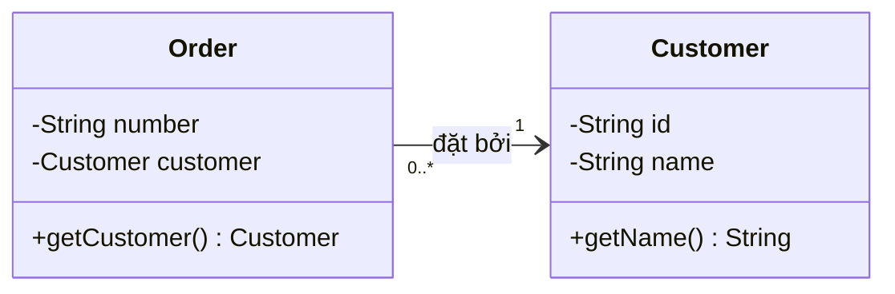

Đọc đầy đủ: **mỗi `Order` gắn với đúng một `Customer`**, **mỗi `Customer` có thể gắn với 0 hoặc nhiều `Order`**, và mũi tên chỉ khả năng điều hướng từ `Order` sang `Customer` trong mô hình này. Từ mã Java, ta có thể nghĩ đến field `private Customer customer;` trong `Order`. Không có nghĩa mỗi khách hàng tự động giữ một danh sách đơn hàng trong bộ nhớ.

## 2. Bảng tra nhanh sáu quan hệ quan trọng

| Quan hệ | Dấu hiệu khi đọc | Ý nghĩa | Gợi ý hiện thực Java |
|---|---|---|---|
| **Association – liên kết** | Đường **liền**; có thể có mũi tên chỉ chiều điều hướng | Các instance có quan hệ với nhau | Field tham chiếu, `List`/`Set` hoặc cơ chế liên kết |
| **Dependency – phụ thuộc** | Đường **đứt**, mũi tên mở hướng đến thành phần được dùng | Thành phần A cần B để làm việc | Tham số, biến cục bộ, lời gọi API hoặc kiểu trong chữ ký |
| **Aggregation – kết tập** | Đường liền, **hình thoi rỗng** ở phía toàn thể | Quan hệ toàn thể–thành phần với thành phần có thể tồn tại độc lập | Một nhóm giữ tham chiếu đến các phần tử |
| **Composition – hợp thành** | Đường liền, **hình thoi đặc** ở phía toàn thể | Sở hữu thành phần mạnh; thành phần gắn vòng đời với một toàn thể trong mô hình | Toàn thể tạo/quản lý thành phần và ràng buộc vòng đời |
| **Generalization – khái quát hóa/kế thừa** | Đường liền, **tam giác rỗng** trỏ về kiểu tổng quát | Lớp con *là một loại* lớp cha | `extends` |
| **Realization – hiện thực hóa** | Đường đứt, **tam giác rỗng** trỏ về đặc tả/interface | Lớp hiện thực hợp đồng của interface | `implements` |

Các dấu hiệu này có thể cùng xuất hiện trong một hệ thống. Ví dụ `CheckoutService` phụ thuộc `PaymentGateway`, `StripeGateway` hiện thực `PaymentGateway`, trong khi `Order` hợp thành các `OrderLine` và liên kết đến `Customer`.

## 3. Association: đọc đầu mũi tên, tên vai trò và bội số

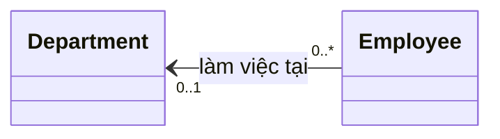

Hãy đọc **bội số đặt gần một đầu là số lượng ở đầu đó cho một đối tượng ở đầu đối diện**:

- `0..1` cạnh `Department`: mỗi `Employee` làm việc ở **0 hoặc 1 phòng ban**.
- `0..*` cạnh `Employee`: mỗi `Department` có **0 hoặc nhiều nhân viên**.
- Mũi tên `Employee → Department`: từ nhân viên có thể tìm phòng ban. Nó **không** tự chứng minh rằng `Department` có collection `employees`.
- Chú thích “làm việc tại” là **tên quan hệ**, không phải phép gán giá trị hay tên một phương thức bắt buộc.

### Bội số thường gặp

| Bội số UML | Cách đọc chính xác | Ví dụ |
|---|---|---|
| `1` | Đúng một | Mỗi đơn hàng hợp lệ có đúng một khách hàng |
| `0..1` | Không có hoặc có một | Nhân viên có thể chưa được phân phòng ban |
| `*` hoặc `0..*` | Không hoặc nhiều | Phòng ban có thể chưa có nhân viên |
| `1..*` | Ít nhất một | Một phiếu bàn giao hoàn tất cần tối thiểu một mục |
| `2..5` | Từ hai đến năm | Nhóm trực có từ hai đến năm người |
| `3` | Đúng ba | Một bộ sản phẩm bắt buộc có ba thành phần |

Lưu ý: bội số là **ràng buộc của mô hình**, không phải thứ Java tự kiểm soát chỉ vì đã khai báo `List<Employee>`. Muốn đảm bảo “ít nhất một”, “không quá năm”, hay “đúng một”, code hoặc tầng lưu trữ phải kiểm tra quy tắc.

### Về chiều điều hướng

- Đường liền có mũi tên mở về B thường biểu diễn **có thể điều hướng từ A đến B**.
- Mũi tên chỉ điều hướng **không** phải ký hiệu “B là cha của A”.
- Association **không có mũi tên** cần được đọc theo quy ước của sơ đồ: có trường hợp hướng không được chỉ định; không nên mặc định chắc chắn hai chiều.
- Nếu cần thể hiện rõ hai chiều, hãy vẽ/ghi chú rõ cả hai chiều hoặc chỉ rõ các thuộc tính ở hai lớp.

Ví dụ mã Java tương ứng với chiều `Employee → Department`:

```java
final class Department {
    private final String name;
    Department(String name) { this.name = name; }
    String getName() { return name; }
}

final class Employee {
    private Department department; // có thể null: 0..1

    void moveTo(Department next) {
        this.department = next;
    }

    Department getDepartment() {
        return department;
    }
}
```

Không có `Department.getEmployees()` vì ví dụ chỉ hiện thực chiều từ nhân viên sang phòng ban. Nếu ứng dụng cần danh sách nhân viên, có thể tra bằng repository; không nhất thiết phải bổ sung liên kết hai chiều trong mỗi object.

## 4. Hai hình thoi: aggregation và composition

Hai hình thoi nằm ở **phía toàn thể**, không nằm ở phía thành phần. Đây là quy tắc quan trọng khi đọc chiều.

### Aggregation – hình thoi rỗng

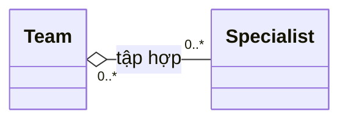

Hình thoi **rỗng gần `Team`** chỉ `Team` là phía toàn thể. Một `Specialist` có thể tồn tại ngoài Team và có thể tham gia nhiều team nếu quy tắc nghiệp vụ cho phép. Trong ví dụ, `0..*` ở cả hai đầu diễn đạt một specialist có thể tham gia nhiều nhóm và một nhóm có thể có nhiều specialist.

```java
import java.util.ArrayList;
import java.util.List;

class Specialist {
    final String name;
    Specialist(String name) { this.name = name; }
}

class Team {
    private final List<Specialist> members = new ArrayList<>();

    void add(Specialist member) {
        members.add(member);
    }
}
```

Nếu xóa Team khỏi danh mục quản lý, điều đó không đương nhiên đồng nghĩa phải xóa nhân sự Specialist. Aggregation mô tả ngữ nghĩa gom nhóm; nó **không tự tạo quy tắc xóa/GC** cho Java.

### Composition – hình thoi đặc

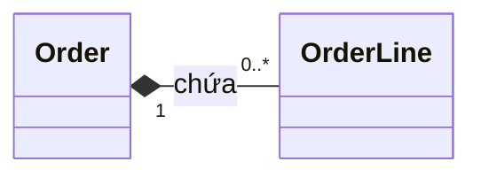

Hình thoi **đặc gần `Order`** chỉ `Order` là **toàn thể sở hữu** các `OrderLine`. Mỗi dòng đơn hàng thuộc về đúng một đơn hàng trong mô hình; một đơn hàng có thể chứa nhiều dòng. Trong composition của UML, một *part* thuộc tối đa một *composite* tại cùng thời điểm; vòng đời của part phụ thuộc vào toàn thể theo quy tắc miền nghiệp vụ.

Triển khai nên tạo và thay đổi dòng đơn hàng thông qua đơn hàng:

```java
import java.util.ArrayList;
import java.util.List;
import java.util.Objects;

final class OrderLine {
    final String sku;
    final int quantity;

    OrderLine(String sku, int quantity) {
        this.sku = Objects.requireNonNull(sku);
        if (quantity <= 0) throw new IllegalArgumentException("quantity");
        this.quantity = quantity;
    }
}

final class Order {
    private final List<OrderLine> lines = new ArrayList<>();

    void addLine(String sku, int quantity) {
        lines.add(new OrderLine(sku, quantity));
    }

    int lineCount() {
        return lines.size();
    }
}
```

Chú ý **`OrderLine` trong Java vẫn là một object bình thường**. Hình thoi đặc không khiến JVM tự xóa nó khi `Order` hết được tham chiếu, cũng không cấm mã khác giữ tham chiếu đến nó. Thiết kế API, ràng buộc lưu trữ và quy tắc nghiệp vụ mới thực thi ý nghĩa sở hữu. Trong ví dụ, `Order` kiểm soát việc tạo dòng; nếu cần bảo vệ tuyệt đối quyền sở hữu, hãy tiếp tục hạn chế việc công khai/chuyển dòng giữa các order.

**Không suy diễn chỉ từ field:** `private Customer customer;` không đủ để khẳng định composition. Thông thường một khách hàng tồn tại độc lập với từng đơn hàng của mình.

## 5. Tam giác rỗng: phân biệt extends và implements

Tam giác rỗng luôn hướng về **kiểu tổng quát hoặc hợp đồng**. **Nét liền hay nét đứt** quyết định quan hệ cần đọc.

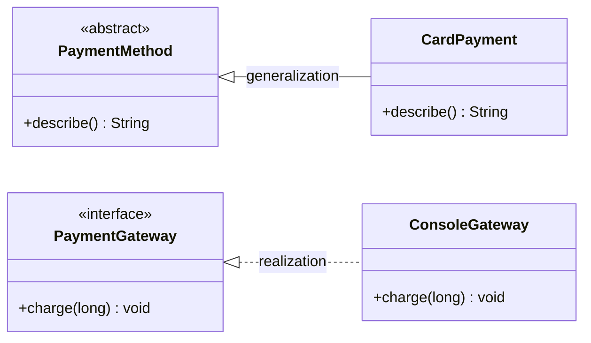

- `PaymentMethod <|-- CardPayment`: tam giác gần `PaymentMethod` với nét liền → `CardPayment` **kế thừa** `PaymentMethod`.
- `PaymentGateway <|.. ConsoleGateway`: tam giác gần `PaymentGateway` với nét đứt → `ConsoleGateway` **hiện thực** hợp đồng `PaymentGateway`.

Ánh xạ Java:

```java
abstract class PaymentMethod {
    abstract String describe();
}

final class CardPayment extends PaymentMethod {
    @Override
    String describe() {
        return "Thanh toán bằng thẻ";
    }
}

interface PaymentGateway {
    void charge(long cents);
}

final class ConsoleGateway implements PaymentGateway {
    @Override
    public void charge(long cents) {
        System.out.println("Charged: " + cents);
    }
}
```

Đừng nhầm *tam giác rỗng* với *mũi tên điều hướng*. Hai quan hệ này trả lời hai câu hỏi khác nhau:

- Generalization/realization: “lớp này **là kiểu con/hiện thực hợp đồng nào**?”
- Association: “object này **liên kết và đi đến object nào**?”

## 6. Đường đứt có mũi tên mở: dependency

```mermaid
classDiagram
    direction LR
    class ReportExporter {
        +export(Report, Formatter) String
    }
    class Report
    class Formatter {
        <<interface>>
        +format(Report) String
    }
    ReportExporter ..> Formatter : sử dụng
    ReportExporter ..> Report : đọc dữ liệu
```

Ở đây `ReportExporter` *phụ thuộc* `Formatter` và `Report` để thực hiện thao tác. Dấu `..>` biểu diễn mũi tên phụ thuộc hướng **từ nơi dùng tới nơi được dùng**.

```java
interface Formatter {
    String format(Report report);
}

final class Report {
    final String title;
    Report(String title) { this.title = title; }
}

final class ReportExporter {
    String export(Report report, Formatter formatter) {
        return formatter.format(report);
    }
}
```

Không có field `formatter` hay `report` trong exporter. Điều đó phù hợp với ví dụ sử dụng đối tượng qua tham số, nhưng **dependency rộng hơn phạm vi tham số**: lớp A vẫn có dependency vào interface B khi lưu B trong field hoặc gọi B ở nơi khác. Dependency UML mô tả quan hệ phụ thuộc thiết kế; nó không khẳng định đối tượng B có tuổi thọ ngắn.

## 7. Ví dụ tổng hợp chạy được: cùng một nghiệp vụ có nhiều ký hiệu

Hãy xây mô hình thanh toán đơn hàng có:

- `Order → Customer`: association một chiều.
- `Order ◆— OrderLine`: composition; mỗi dòng thuộc đơn hàng.
- `CheckoutService ⋯▷ PaymentGateway`: dependency; service dùng cổng thanh toán trong một lần checkout.
- `ConsoleGateway ⋯▷ PaymentGateway` với tam giác rỗng: realization; implementation của interface.

```mermaid
classDiagram
    direction LR
    class Customer {
        -String name
        +getName() String
    }
    class Order {
        -String id
        -Customer customer
        -List~OrderLine~ lines
        +addLine(String, int, long) void
        +totalCents() long
    }
    class OrderLine {
        -String sku
        -int quantity
        -long unitPriceCents
        +subtotalCents() long
    }
    class CheckoutService {
        +checkout(Order, PaymentGateway) void
    }
    class PaymentGateway {
        <<interface>>
        +charge(String, long) void
    }
    class ConsoleGateway {
        +charge(String, long) void
    }
    Order "0..*" --> "1" Customer : thuộc về
    Order "1" *-- "0..*" OrderLine : chứa
    CheckoutService ..> Order : xử lý
    CheckoutService ..> PaymentGateway : sử dụng
    PaymentGateway <|.. ConsoleGateway : hiện thực
```

Tạo một tệp `RelationSymbolsDemo.java` (JDK 11+):

```java
import java.util.ArrayList;
import java.util.List;
import java.util.Objects;

public class RelationSymbolsDemo {

    static final class Customer {
        private final String name;

        Customer(String name) {
            this.name = Objects.requireNonNull(name);
        }

        String getName() {
            return name;
        }
    }

    static final class OrderLine {
        private final String sku;
        private final int quantity;
        private final long unitPriceCents;

        // Chỉ Order tạo dòng thông qua addLine trong thiết kế ví dụ.
        private OrderLine(String sku, int quantity, long unitPriceCents) {
            this.sku = Objects.requireNonNull(sku);
            if (quantity <= 0 || unitPriceCents < 0) {
                throw new IllegalArgumentException("Invalid order line");
            }
            this.quantity = quantity;
            this.unitPriceCents = unitPriceCents;
        }

        long subtotalCents() {
            return Math.multiplyExact(quantity, unitPriceCents);
        }
    }

    static final class Order {
        private final String id;
        private final Customer customer; // Association: Order -> Customer
        private final List<OrderLine> lines = new ArrayList<>();

        Order(String id, Customer customer) {
            this.id = Objects.requireNonNull(id);
            this.customer = Objects.requireNonNull(customer);
        }

        void addLine(String sku, int quantity, long unitPriceCents) {
            // Composition: Order chịu trách nhiệm tạo/quản lý các dòng.
            lines.add(new OrderLine(sku, quantity, unitPriceCents));
        }

        String getId() {
            return id;
        }

        Customer getCustomer() {
            return customer;
        }

        long totalCents() {
            long result = 0L;
            for (OrderLine line : lines) {
                result = Math.addExact(result, line.subtotalCents());
            }
            return result;
        }
    }

    interface PaymentGateway {
        void charge(String orderId, long amountCents);
    }

    static final class ConsoleGateway implements PaymentGateway {
        @Override
        public void charge(String orderId, long amountCents) {
            System.out.println(
                    "Charge " + orderId + ": " + amountCents + " cents");
        }
    }

    static final class CheckoutService {
        void checkout(Order order, PaymentGateway gateway) {
            Objects.requireNonNull(order);
            Objects.requireNonNull(gateway);

            // Dependency: sử dụng gateway được truyền vào phương thức.
            gateway.charge(order.getId(), order.totalCents());
            System.out.println("Customer: " + order.getCustomer().getName());
        }
    }

    public static void main(String[] args) {
        Customer lan = new Customer("Lan");
        Order order = new Order("ORD-100", lan);
        order.addLine("BOOK-1", 2, 120_000L);
        order.addLine("PEN-5", 3, 10_000L);

        PaymentGateway gateway = new ConsoleGateway();
        new CheckoutService().checkout(order, gateway);
    }
}
```

Chạy:

```bash
javac RelationSymbolsDemo.java
java RelationSymbolsDemo
```

Kết quả:

```text
Charge ORD-100: 270000 cents
Customer: Lan
```

Từ một sơ đồ duy nhất, ta đã biết lớp nào nên có **tham chiếu**, lớp nào nên **kiểm soát thành phần**, lớp nào chỉ cần **API cộng tác**, và lớp nào phải khai báo `implements`. Sơ đồ định hướng cấu trúc; để bảo toàn các ràng buộc, vẫn cần triển khai và kiểm thử các hành vi cụ thể.

## 8. Các ký hiệu nằm trong hộp lớp

Để đọc quan hệ đúng, cũng cần hiểu thông tin bên trong hộp:

```mermaid
classDiagram
    class Account {
        -String id
        #boolean active
        ~int retryCount
        +getId() String
        +disable() void
    }
```

| Ký hiệu | Ý nghĩa trong UML | Java tương ứng thường gặp |
|---|---|---|
| `+` | Public | `public` |
| `-` | Private | `private` |
| `#` | Protected | `protected` |
| `~` | Package visibility | Không ghi modifier |
| Tên được gạch dưới trong UML | Thành viên **static** | `static` |
| Tên in nghiêng trong UML | Thành phần **abstract** | `abstract` |
| `operation(arg: Type): Result` | Phương thức với tham số và kiểu trả về | `Result operation(Type arg)` |

Những ký hiệu này mô tả **phạm vi truy cập và thành viên**, còn đường nối giữa các hộp mô tả **quan hệ giữa các lớp**. Dấu `-` trước field **không phải** nét đứt dependency; nó là ký hiệu `private`.

## 9. Tên vai trò, ràng buộc và vài điểm nâng cao

Ngoài tên association, sơ đồ có thể ghi **role name** ở gần một đầu, ví dụ `orders` cạnh `Order` hoặc `customer` cạnh `Customer`. Role name diễn đạt **vai trò của đối tượng ở đầu đó khi nhìn từ đầu đối diện**; đôi khi tương ứng với tên field trong code.

Một số ràng buộc có thể xuất hiện cạnh association hoặc thuộc tính:

- `{ordered}`: thứ tự các đối tượng liên kết có ý nghĩa.
- `{unique}`: tập các giá trị/đối tượng liên kết không lặp theo quy tắc.
- `{readOnly}`: đầu liên kết/thuộc tính không cho phép gán lại trong ngữ cảnh được mô tả.

Không đồng nhất máy móc UML `{ordered}` với `ArrayList` hay `{unique}` với `HashSet`: đó là **ràng buộc cần thể hiện trong hành vi**, lựa chọn collection chỉ là một phần hiện thực.

Khi **mối liên kết có thông tin riêng** (ví dụ học viên đăng ký khóa học có thời gian, trạng thái, điểm số), có thể dùng **association class** trong UML hoặc tạo lớp miền trung gian như `Enrollment` trong Java:

```mermaid
classDiagram
    direction LR
    class Student
    class Enrollment {
        +LocalDate enrolledAt
        +String status
    }
    class Course
    Student "1" <-- "0..*" Enrollment : người học
    Enrollment "0..*" --> "1" Course : khóa học
```

Đây là cách biểu diễn bằng **lớp trung gian bình thường** trong Mermaid để dễ đọc; UML association class chuẩn có ký pháp riêng (lớp nối với đường association bằng nét đứt). Đừng nhầm ký pháp lớp trung gian với dependency.

## 10. Các lỗi đọc sơ đồ phổ biến

| Cách hiểu sai | Cách đọc đúng |
|---|---|
| “Số `1` ở gần Customer tức mỗi Customer có một Order.” | `1` ở phía Customer tức **mỗi Order có một Customer**; nhìn phía Order để biết mỗi Customer có bao nhiêu Order. |
| “Mọi mũi tên đều là kế thừa.” | Kế thừa có **tam giác rỗng và nét liền**; association dùng đường liền với mũi tên điều hướng; dependency có nét đứt và mũi tên mở. |
| “Hình thoi đặc đặt ở lớp con.” | Hình thoi đặt ở **phía toàn thể** của quan hệ whole–part. |
| “Chỉ cần có `List<Child>` là composition.” | Collection chưa nói được quyền sở hữu hay vòng đời; cần đọc và thực thi quy tắc miền nghiệp vụ. |
| “Đường association không có mũi tên chắc chắn hai chiều.” | Có thể **chưa xác định navigability**; cần xem ghi chú/quy ước sơ đồ. |
| “Có đường dependency tức mỗi object đều có field tham chiếu.” | Dependency có thể đến từ tham số, biến cục bộ, lời gọi API; không bắt buộc field. |
| “`extends` và `implements` dùng cùng loại nét UML.” | Generalization dùng **nét liền**, realization dùng **nét đứt**, cả hai có tam giác rỗng hướng về kiểu tổng quát/hợp đồng. |
| “UML bắt JVM tự xóa part khi xóa whole.” | UML mô tả quy tắc thiết kế; Java GC dựa trên khả năng còn được tham chiếu, không đọc sơ đồ. |

## 11. Bài tập tự kiểm tra

**Bài 1.** Sơ đồ `Library "1" *-- "0..*" BookCopy` có hình thoi đặc gần `Library`. Hãy đọc vai trò, bội số, vòng đời.

**Gợi ý:** Library là toàn thể; mỗi BookCopy thuộc một Library trong mô hình; một Library có thể có nhiều BookCopy. Quy tắc sở hữu/vòng đời phải được thực thi bằng logic nghiệp vụ.

**Bài 2.** `ReportGenerator ..> PdfWriter` vẽ bằng đường đứt, mũi tên mở. Có bắt buộc `ReportGenerator` chứa `PdfWriter writer;` không?

**Đáp án:** Không. Có thể sử dụng `PdfWriter` qua tham số của một phương thức.

**Bài 3.** Trong UML, `Gateway <|.. StripeGateway` khác `Gateway <|-- StripeGateway` thế nào?

**Đáp án:** Nét đứt + tam giác rỗng là realization (thường `implements` interface); nét liền + tam giác rỗng là generalization (thường `extends`).

**Bài 4.** Mỗi nhân viên có thể tham gia tối đa ba dự án; mỗi dự án có tối thiểu một nhân viên. Hãy điền bội số cho `Employee -- Project`.

**Đáp án:** Gần `Project` ghi `0..3`; gần `Employee` ghi `1..*`. Đây là số lượng đối tượng của đầu đó gắn với **một** đối tượng phía đối diện.

**Bài 5.** Cho `Course "0..*" -- "0..*" Student` và mỗi lần đăng ký có ngày, trạng thái, điểm. Chọn cấu trúc phù hợp trong Java.

**Gợi ý:** Dùng một lớp `Enrollment` chứa tham chiếu đến `Student`, `Course` và thông tin của lần đăng ký. Thiết kế ràng buộc duy nhất cho cặp sinh viên–khóa học nếu nghiệp vụ yêu cầu.

---

**Ghi nhớ khi đọc sơ đồ:** **nét đường** nhận diện loại quan hệ; **đầu mũi tên/tam giác/hình thoi** xác định chiều và vai trò; **bội số** quy định số lượng object ở mỗi đầu; **field, collection, extends, implements hoặc tham số Java** giúp kiểm tra cách hiện thực. Đọc đồng thời các thành phần này trước khi chuyển UML thành mã.


</details>

- [Quay lại đầu trang](#back-to-top)
