<a id="back-to-top"></a>

# Thiết kế lớp

## Menu
- [Xác định trách nhiệm của từng lớp](#class-design-001)
- [Tính gắn kết bên trong lớp](#class-design-002)
- [Mức phụ thuộc giữa các lớp](#class-design-003)
- [Tách dữ liệu, nghiệp vụ và tương tác bên ngoài](#class-design-004)
- [Đặt tên lớp, thuộc tính và phương thức](#class-design-005)
- [Đối tượng thực thể, đối tượng giá trị và dịch vụ](#class-design-006)
- [Mô hình giàu hành vi và mô hình chỉ chứa dữ liệu](#class-design-007)
- [Tách truy vấn khỏi thao tác thay đổi trạng thái](#class-design-008)
- [Giới hạn việc truy cập sâu vào chuỗi đối tượng](#class-design-009)

## <a id="class-design-001">Xác định trách nhiệm của từng lớp</a>

<details>
<summary>Xem chi tiết</summary>

# Xác định trách nhiệm của từng lớp trong thiết kế OOP (Java)

Một hệ thống có nhiều class chưa chắc đã được thiết kế tốt. Điều quan trọng là **mỗi class chịu trách nhiệm về phần nào của bài toán, sở hữu những quy tắc nào và cần cộng tác với class nào**. Nếu phân chia sai, một class sẽ biết quá nhiều, nhiều class cùng sửa một quy tắc, và mỗi thay đổi nhỏ kéo theo sửa hàng loạt nơi.

Bài này hướng dẫn cách đi từ yêu cầu nghiệp vụ đến trách nhiệm của từng lớp, phân biệt trách nhiệm với thao tác kỹ thuật, áp dụng **Single Responsibility Principle (SRP)**, **high cohesion/low coupling**, và tự kiểm chứng thiết kế bằng một chương trình Java chạy độc lập.

## 1. “Trách nhiệm của lớp” nghĩa là gì?

**Trách nhiệm (responsibility)** là điều một class phải **biết** hoặc **thực hiện** để mô hình hoạt động đúng.

- **Trách nhiệm về thông tin (*knowing*)**: biết mã bản sách, trạng thái đơn hàng, hạn trả, các dòng sản phẩm...
- **Trách nhiệm về hành vi (*doing*)**: tính tổng tiền, xác thực một thao tác, chuyển trạng thái, điều phối quy trình, lưu/truy xuất dữ liệu...

Trong một thiết kế tốt, dữ liệu và hành vi **liên quan chặt chẽ** thường cùng nằm trong một class. Nếu class chứa trạng thái nhưng mọi hành vi quan trọng lại nằm trong “tiện ích” ngoài class, quy tắc rất dễ bị nhân bản hoặc bỏ qua.

Ví dụ:

| Yêu cầu nghiệp vụ | Trách nhiệm cần có | Nơi có thể đặt |
| --- | --- | --- |
| Không được mượn bản sách đang có người mượn | Tra cứu tình trạng mượn hiện hành | Repository/đối tượng quản lý giao dịch |
| Một độc giả được mượn tối đa 2 bản cùng lúc | Áp dụng giới hạn mượn | `LoanPolicy` |
| Hạn trả là 14 ngày kể từ ngày mượn | Tính hạn trả | `LoanPolicy` |
| Một lần mượn có người mượn, bản sách, ngày mượn/hạn trả hợp lệ | Bảo vệ dữ liệu của lần mượn | `Loan` |
| Mượn sách cần kiểm tra rồi ghi nhận kết quả | Điều phối quy trình mượn | `LoanService` |
| Cần lưu và tìm các lần mượn | Truy cập nơi lưu trữ | `LoanRepository` |

Các tên lớp chỉ là một **phương án hợp lý cho bối cảnh cụ thể**. Không có quy tắc cứng rằng cứ một dòng yêu cầu là phải tạo một class.

## 2. Trách nhiệm khác với danh sách phương thức

Đặt tên hành vi là cách cụ thể hóa trách nhiệm, nhưng **một class có nhiều method vẫn có thể chỉ mang một trách nhiệm**.

Ví dụ `Money` có thể gồm `add`, `subtract`, `multiply`, `compareTo`; tất cả cùng phục vụ trách nhiệm biểu diễn và tính toán giá trị tiền tệ. Ngược lại, một class chỉ có hai method `calculateSalary()` và `sendMarketingEmail()` vẫn có hai lý do nghiệp vụ khác nhau để thay đổi.

Một cách đặt câu hỏi tốt:

> **Khi một quy tắc thay đổi, class nào sẽ phải thay đổi vì quy tắc ấy?**

Nếu `LoanService` phải sửa khi đổi giao thức gửi email, đổi cấu trúc SQL, đổi chính sách hạn trả và đổi cấu trúc phản hồi HTTP, đó là dấu hiệu nó đang ôm các trách nhiệm thuộc nhiều mối quan tâm khác nhau.

### SRP: Một lý do thay đổi

**Single Responsibility Principle** thường được diễn đạt là “một class chỉ nên có một lý do để thay đổi”. “Một lý do” nên hiểu là **một nhóm trách nhiệm phục vụ một chủ thể/quy tắc có liên quan**, không phải “chỉ có một phương thức”.

Ví dụ:

- Chính sách mượn sách thay đổi → cân nhắc sửa `LoanPolicy`.
- Cách ghi dữ liệu từ bộ nhớ sang database thay đổi → sửa implementation của `LoanRepository`.
- Quy trình mượn cần bước phê duyệt mới → sửa hoặc mở rộng orchestration trong `LoanService`.
- Cấu trúc HTTP request/response thay đổi → sửa controller/DTO ở ranh giới HTTP.

Không thể chứng minh SRP chỉ bằng cách đếm số dòng hoặc số method. Một class 200 dòng có thể gắn kết tốt; một class 20 dòng vẫn có thể pha trộn trách nhiệm sai.

## 3. Các bước xác định trách nhiệm từ yêu cầu

### Bước 1 — Viết tình huống sử dụng thay vì đoán class

Ví dụ: “Độc giả chọn một **bản sách có mã riêng**. Hệ thống từ chối nếu bản đó đang được mượn, từ chối nếu độc giả đã mượn đủ giới hạn, rồi tạo phiếu mượn với hạn trả theo chính sách hiện hành”.

Tách thành những sự kiện/quy tắc:

1. Ai đang thực hiện? Độc giả (`borrowerId`).
2. Đối tượng liên quan? **Bản sách cụ thể** (`BookCopy`), không chỉ đầu sách chung (`BookTitle`).
3. Trạng thái cần kiểm tra? Bản sách đã có lượt mượn đang hoạt động hay chưa?
4. Quy tắc? Giới hạn lượt mượn, số ngày được mượn.
5. Kết quả? Một `Loan` mới được ghi nhận.
6. Ràng buộc hệ thống? Mọi bước kiểm tra và ghi phải nhất quán, nhất là khi nhiều người mượn cùng lúc.

### Bước 2 — Liệt kê trách nhiệm trước khi gán lớp

| Trách nhiệm | Dữ liệu/rule cần biết | Loại hành vi |
| --- | --- | --- |
| Nhận dạng bản sách | `copyId`, `title` | Domain data |
| Mô tả lần mượn | `borrowerId`, bản sách, ngày mượn, hạn trả | Domain entity/value |
| Áp dụng thời hạn và giới hạn | `loanDays`, `maxActiveLoans` | Domain policy |
| Truy vấn tình trạng và ghi phiếu | Tập lượt mượn | Persistence abstraction |
| Điều phối một yêu cầu mượn | Repository + policy + ngày hiện tại | Application service |
| Hiển thị hoặc nhận HTTP | Input/output cụ thể của giao diện | Adapter/controller |

### Bước 3 — Chọn nơi có đủ thông tin để quyết định

Đây là tư duy **Information Expert**: ưu tiên đặt hành vi ở đối tượng biết dữ liệu mà hành vi đó cần, miễn là không vi phạm ranh giới phụ thuộc.

Ví dụ:

- `Loan` tự bảo vệ tính hợp lệ nội tại: ngày trả sau ngày mượn.
- `LoanPolicy` biết công thức hạn trả và ngưỡng mượn, nên không buộc `LoanService` lặp hằng số `14` ở nhiều nơi.
- `LoanRepository` biết dữ liệu các lượt mượn hiện hành, nên service hỏi repository thay vì tự duy trì một bản sao danh sách.
- `LoanService` biết **thứ tự** các thao tác nhưng không cần biết chi tiết dùng `HashMap`, SQL hay REST API để lưu.

### Bước 4 — Vẽ cộng tác, kiểm tra hướng phụ thuộc

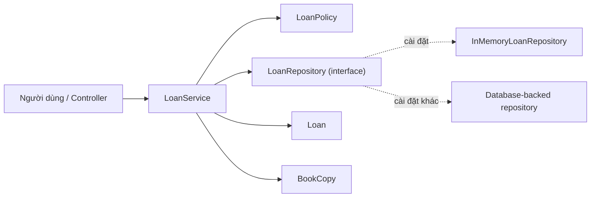

`LoanService` phụ thuộc **hợp đồng repository**, nên chính sách nghiệp vụ không phải thay đổi chỉ vì đổi bộ nhớ sang SQL. Luồng điều khiển là service gọi repository; lưu đồ không có nghĩa entity hoặc policy được tùy ý truy cập HTTP, database, logger và email.

### Bước 5 — Chọn API phù hợp với trách nhiệm

Một class tốt không chỉ có đúng method; nó còn **không mở những cách sửa trạng thái phá quy tắc**. Constructor và public method phải có precondition/postcondition rõ ràng. Khi không cần cho sửa collection nội bộ, trả về snapshot/read-only view.

## 4. CRC Card: kiểm tra class có nhận quá nhiều việc không

CRC = **Class – Responsibilities – Collaborators**. Một thẻ ngắn cho từng class giúp nhóm thảo luận trước khi code:

| Class | Responsibilities | Collaborators |
| --- | --- | --- |
| `BookCopy` | Giữ danh tính và tiêu đề của bản sách | Không cần |
| `Loan` | Giữ sự kiện mượn hợp lệ | `BookCopy` |
| `LoanPolicy` | Quyết định giới hạn và ngày trả | Không cần repository |
| `LoanRepository` | Tìm lượt mượn đang hoạt động, ghi dữ liệu | `Loan` |
| `LoanService` | Kiểm tra điều kiện và điều phối mượn | Policy, repository, `Clock` |

Nếu một thẻ phải liệt kê quá nhiều trách nhiệm không liên quan, đó là tín hiệu để xem lại. Nếu hai thẻ có cùng quy tắc, cần xác định **nguồn chân lý duy nhất** để tránh kết quả khác nhau.

## 5. Ví dụ Java 17 hoàn chỉnh: mượn sách theo trách nhiệm

Ví dụ sau minh họa cách chia lớp nhỏ theo **sự thay đổi của quy tắc**, vẫn đủ đơn giản để chạy trong một file. Một lượt mượn sau khi lưu được coi là đang hoạt động; thao tác **trả sách** chưa nằm trong phạm vi demo.

Tạo `ClassResponsibilityDemo.java`:

```java
import java.time.Clock;
import java.time.Instant;
import java.time.LocalDate;
import java.time.ZoneOffset;
import java.util.LinkedHashMap;
import java.util.Map;
import java.util.Objects;

public class ClassResponsibilityDemo {

    // 1. BookCopy: danh tính một bản sách vật lý cụ thể.
    record BookCopy(String copyId, String title) {
        BookCopy {
            copyId = notBlank(copyId, "copyId");
            title = notBlank(title, "title");
        }
    }

    // 2. Loan: dữ liệu và bất biến của một lần mượn.
    record Loan(String borrowerId, BookCopy copy,
                LocalDate borrowedOn, LocalDate dueOn) {
        Loan {
            borrowerId = notBlank(borrowerId, "borrowerId");
            Objects.requireNonNull(copy, "copy");
            Objects.requireNonNull(borrowedOn, "borrowedOn");
            Objects.requireNonNull(dueOn, "dueOn");
            if (!dueOn.isAfter(borrowedOn)) {
                throw new IllegalArgumentException(
                        "Due date must be after borrowed date");
            }
        }
    }

    // 3. LoanPolicy: quyết định giới hạn mượn và thời hạn.
    record LoanPolicy(int maxActiveLoans, int loanDays) {
        LoanPolicy {
            if (maxActiveLoans <= 0 || loanDays <= 0) {
                throw new IllegalArgumentException(
                        "Policy values must be positive");
            }
        }

        void ensureCanBorrow(long activeLoans) {
            if (activeLoans >= maxActiveLoans) {
                throw new IllegalStateException("Borrowing limit reached");
            }
        }

        LocalDate dueDate(LocalDate borrowedOn) {
            return borrowedOn.plusDays(loanDays);
        }
    }

    // 4. LoanRepository: hợp đồng lưu/truy vấn, không đặt luật 14 ngày.
    interface LoanRepository {
        boolean hasActiveLoanForCopy(String copyId);
        long activeLoanCount(String borrowerId);
        void save(Loan loan);
    }

    // Cài đặt bộ nhớ dùng cho demo và unit test.
    static final class InMemoryLoanRepository implements LoanRepository {
        // Các Loan lưu trong ví dụ đều được xem là đang hoạt động.
        private final Map<String, Loan> activeByCopy = new LinkedHashMap<>();

        @Override
        public boolean hasActiveLoanForCopy(String copyId) {
            return activeByCopy.containsKey(copyId);
        }

        @Override
        public long activeLoanCount(String borrowerId) {
            return activeByCopy.values().stream()
                    .filter(loan -> loan.borrowerId().equals(borrowerId))
                    .count();
        }

        @Override
        public void save(Loan loan) {
            Objects.requireNonNull(loan, "loan");
            Loan existing = activeByCopy.putIfAbsent(
                    loan.copy().copyId(), loan);
            if (existing != null) {
                throw new IllegalStateException("Copy already borrowed");
            }
        }
    }

    // 5. LoanService: phối hợp quy trình, không tự tính ngày trả
    // hay quyết định nơi cất dữ liệu.
    static final class LoanService {
        private final LoanRepository repository;
        private final LoanPolicy policy;
        private final Clock clock;

        LoanService(LoanRepository repository, LoanPolicy policy, Clock clock) {
            this.repository = Objects.requireNonNull(repository);
            this.policy = Objects.requireNonNull(policy);
            this.clock = Objects.requireNonNull(clock);
        }

        Loan borrow(String borrowerId, BookCopy copy) {
            borrowerId = notBlank(borrowerId, "borrowerId");
            Objects.requireNonNull(copy, "copy");

            if (repository.hasActiveLoanForCopy(copy.copyId())) {
                throw new IllegalStateException("Copy already borrowed");
            }

            policy.ensureCanBorrow(
                    repository.activeLoanCount(borrowerId));

            LocalDate today = LocalDate.now(clock);
            Loan loan = new Loan(
                    borrowerId, copy, today, policy.dueDate(today));
            repository.save(loan);
            return loan;
        }
    }

    private static String notBlank(String value, String name) {
        if (value == null || value.isBlank()) {
            throw new IllegalArgumentException(name + " is blank");
        }
        return value;
    }

    public static void main(String[] args) {
        LoanRepository repository = new InMemoryLoanRepository();
        LoanPolicy policy = new LoanPolicy(2, 14);
        Clock clock = Clock.fixed(
                Instant.parse("2026-10-15T00:00:00Z"), ZoneOffset.UTC);
        LoanService service = new LoanService(repository, policy, clock);

        BookCopy copy1 = new BookCopy("COPY-01", "Effective Java");
        BookCopy copy2 = new BookCopy("COPY-02", "Clean Code");
        BookCopy copy3 = new BookCopy("COPY-03", "Java Concurrency");

        Loan first = service.borrow("MEM-01", copy1);
        System.out.println("Due: " + first.dueOn());

        try {
            service.borrow("MEM-02", copy1);
        } catch (IllegalStateException ex) {
            System.out.println(ex.getMessage());
        }

        service.borrow("MEM-01", copy2);
        try {
            service.borrow("MEM-01", copy3);
        } catch (IllegalStateException ex) {
            System.out.println(ex.getMessage());
        }

        System.out.println(
                "Active loans: " + repository.activeLoanCount("MEM-01"));
    }
}
```

Chạy:

```bash
javac ClassResponsibilityDemo.java
java ClassResponsibilityDemo
```

Kết quả:

```text
Due: 2026-10-29
Copy already borrowed
Borrowing limit reached
Active loans: 2
```

### Chỉ ra từng trách nhiệm bằng hành vi cụ thể

| Khi thay đổi... | Thành phần chịu ảnh hưởng trực tiếp | Vì sao? |
| --- | --- | --- |
| Thời hạn từ 14 thành 21 ngày | Dữ liệu cấu hình tạo `LoanPolicy`, không sửa `LoanService.borrow` | Service chỉ sử dụng chính sách |
| Công thức hạn trả đổi sang ngày làm việc | `LoanPolicy` và dependency lịch nếu cần | Quy tắc tính ngày thuộc policy |
| Thêm kiểm tra ngày trả hợp lệ | `Loan` | Bất biến dữ liệu của chính lần mượn |
| Chuyển lưu bộ nhớ sang SQL | Implementation của `LoanRepository` và cấu hình nối | Service chỉ biết interface |
| Thêm bước ghi audit sau khi mượn | Quy trình ở `LoanService` hoặc cộng tác viên audit mới | Đây là hành vi điều phối |
| Đổi định dạng JSON trả cho mobile | Controller/response DTO ngoài ví dụ | JSON không phải trách nhiệm của entity/domain policy |

**Lưu ý quan trọng về concurrency:** demo chạy tuần tự trong bộ nhớ. Cặp thao tác “đếm số phiếu mượn → kiểm tra ngưỡng → lưu” **không nguyên tử** khi nhiều yêu cầu chạy đồng thời. Trong ứng dụng production, phải đặt kiểm tra và ghi dưới giao dịch/khóa hoặc một cơ chế cấp phát bảo đảm giới hạn, đồng thời ràng buộc không cho một bản sách có hai phiếu đang hoạt động trong DB. Việc tách trách nhiệm đúng **không tự động** đảm bảo tính nhất quán đa luồng.

Nếu mở rộng bài toán trả sách, repository phải nhận biết trạng thái active/returned; lúc đó có thể đưa hành vi đổi trạng thái vào `Loan` hoặc một aggregate phù hợp và để application service điều phối. Đây là thay đổi nghiệp vụ, không nên giả định code hiện tại đã xử lý.

## 6. Phát hiện class đang gánh sai trách nhiệm

Ví dụ mô tả một `LibraryManager` xử lý mọi thứ:

```java
class LibraryManager {
    void borrow(String userId, String copyId) {
        // SQL query lay ban sach
        // Kiem tra gioi han muon
        // Tinh ngay tra
        // Ghi SQL
        // Gui email
        // Format JSON response
    }
}
```

Đây thường là **God Class** hoặc Service có quá nhiều lý do thay đổi. Một thay đổi schema DB, chính sách thư viện, email template hay HTTP JSON đều có thể buộc sửa cùng class.

Hướng cải thiện là đặt trách nhiệm ở đúng ranh giới:

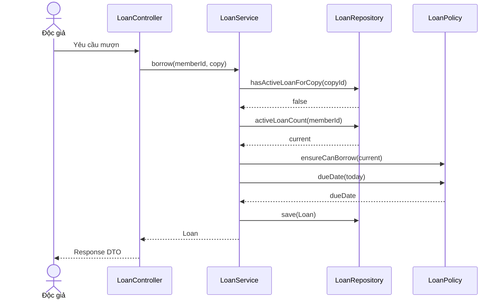

Đối tượng `Loan` biết nó có dữ liệu hợp lệ; `LoanPolicy` biết giới hạn; `LoanRepository` biết cách truy cập dữ liệu; `LoanService` biết thứ tự hành vi. Controller chỉ chuyển đổi request/response và xử lý các trách nhiệm giao tiếp phù hợp.

Không nhất thiết phải tách `EmailSender`, `LoanFactory`, `DateCalculator`, `LoanValidator` thành class riêng ngay ngày đầu. Chỉ tạo abstraction khi có một **trách nhiệm độc lập đáng quản lý**, một quy tắc rõ hoặc nhu cầu thay thế/test thực tế.

## 7. High Cohesion và Low Coupling

- **Cohesion (tính gắn kết):** các field và method trong cùng class phục vụ một mục đích gần nhau đến mức nào?
- **Coupling (mức phụ thuộc):** class cần biết bao nhiêu chi tiết triển khai của class khác, và thay đổi ở đó tác động thế nào?

| Dấu hiệu | Hướng thiết kế tốt | Dấu hiệu cần xem lại |
| --- | --- | --- |
| Cohesion | Các method cùng bảo vệ các dữ liệu/quy tắc liên quan | Cả gửi email, SQL và công thức nghiệp vụ trong cùng class |
| Coupling | Service dựa vào interface repository | Service tạo thẳng `new SqlLoanRepository(...)` trong phương thức nghiệp vụ |
| Encapsulation | Trạng thái được cập nhật qua hành vi hợp lệ | Public setter cho phép bỏ qua validation |
| Knowledge | Class chỉ biết thông tin cần thực hiện trách nhiệm | Method đi qua chuỗi `a.getB().getC().getD()` rồi sửa trạng thái sâu |
| Testability | Policy có thể test độc lập; ngày hiện tại được truyền qua `Clock` | Hàm tự gọi thời gian thực, DB thật và email thật để tính quy tắc |

Tối ưu một chỉ số không phải mục tiêu duy nhất. Ví dụ tách thành hàng chục class “chỉ có một method” có thể tạo thêm nhiều phụ thuộc khó hiểu hơn class ban đầu. Hãy cân bằng độ rõ nghĩa, chi phí thay đổi, tính dễ kiểm thử và nhu cầu thực tế.

### “Dữ liệu thuộc ai, hành vi thuộc ai?”

Có những hành vi tính toán trên nhiều đối tượng và cần thông tin không một entity nào sở hữu đầy đủ. Không nên ép mọi hành vi vào entity.

- **Entity/value object** giữ bất biến liên quan đến chính trạng thái của nó.
- **Domain service/policy** chịu quy tắc nghiệp vụ kết hợp nhiều đối tượng hoặc cần mô hình chính sách độc lập.
- **Application service** điều phối một use case, quyền truy cập, transaction, repository và các cổng tích hợp.
- **Infrastructure adapter** giao tiếp DB, file, queue, API ngoài.
- **Presentation adapter** nhận và trả dữ liệu phù hợp HTTP/CLI/UI.

Đây là cách phân chia hay gặp, **không phải luật bắt buộc**. Hệ thống nhỏ có thể ít lớp hơn. Ranh giới nên được quyết định bởi nơi có trách nhiệm thực và sự thay đổi được mong đợi.

## 8. Khi nào nên tách lớp, khi nào nên giữ nguyên?

### Nên cân nhắc tách khi

1. Một class có những hành vi thay đổi vì **các nhóm yêu cầu độc lập** (ví dụ tính tiền và gửi hóa đơn qua email).
2. Logic cùng một quy tắc bị sao chép ở nhiều nơi.
3. Test một phép tính đơn giản lại bắt buộc khởi động DB, HTTP hoặc dịch vụ bên ngoài.
4. Có nhiều nhánh `if/switch` vì một chiến lược/chính sách có thể thay đổi theo loại giao dịch.
5. Thay đổi nhỏ phá nhiều chức năng không liên quan, cho thấy mức phụ thuộc quá rộng.

### Chưa cần tách chỉ vì

1. Class có hơn một method.
2. Class dài hơn ngưỡng dòng tùy ý.
3. Một helper có thể được đặt tên riêng nhưng không có quy tắc độc lập.
4. Muốn có interface cho **mọi** class dù chưa có ranh giới cần thay thế.
5. Dự đoán quá nhiều tình huống tương lai không có yêu cầu rõ.

Ví dụ `LoanPolicy` là một record nhỏ và có thể để các quy tắc liên quan ở cùng một chỗ. Không cần tự động tách `MaxLoanPolicy` và `DueDatePolicy` chỉ vì chúng là hai method. Nếu giới hạn theo nhóm khách hàng do bộ phận A quản lý và hạn trả do bộ phận B quản lý, hoặc mỗi quy tắc có những biến thể khác nhau, việc tách mới có căn cứ.

## 9. Quy trình refactor từ lớp lớn sang các lớp có trách nhiệm rõ

Giả sử `LoanController` đang truy vấn SQL, tính hạn trả và trả JSON trong cùng một method. Có thể refactor từng bước:

1. **Ghi nhận hành vi hiện tại:** các đầu vào, kết quả, lỗi khi sách đang mượn/hết hạn mức. Dùng test cho các quy tắc quan trọng.
2. **Định nghĩa invariant:** một bản sách chỉ có một lượt mượn active; người mượn không vượt giới hạn.
3. **Trích xuất quy tắc thuần:** đưa tính hạn trả và ngưỡng vào `LoanPolicy` (không lệ thuộc IO).
4. **Trích xuất persistence:** đưa SQL qua `LoanRepository`; giữ hợp đồng rõ và test với adapter.
5. **Đặt workflow trong service:** lấy dữ liệu, gọi policy, lưu Loan, trả kết quả.
6. **Thu gọn controller:** ánh xạ request, xử lý lỗi/response DTO, gọi service.
7. **Xác nhận lại:** chạy test tình huống thành công/thất bại, kiểm tra transaction, dữ liệu lưu, logging và các ảnh hưởng ngoài ý muốn.

Thực hiện từng thay đổi nhỏ và kiểm tra hành vi thường an toàn hơn việc viết lại toàn bộ trong một lần. Đừng dùng “phân chia trách nhiệm” làm lý do để xóa những kiểm tra dữ liệu hoặc giao dịch hiện có.

## 10. Cách kiểm thử trách nhiệm thay vì kiểm thử riêng từng getter

| Đơn vị kiểm thử | Tình huống then chốt | Bằng chứng |
| --- | --- | --- |
| `BookCopy` | Mã rỗng hoặc tên rỗng | Constructor từ chối |
| `Loan` | Hạn trả bằng hoặc trước ngày mượn | Bất biến được bảo vệ |
| `LoanPolicy` | Đã đạt giới hạn; tính hạn trả | Kết quả độc lập DB, clock thực |
| `LoanService` | Bản sách đang mượn; người mượn quá hạn mức | Không gọi `save` khi bị từ chối |
| `LoanService` | Đủ điều kiện | Gọi repository lưu Loan với ngày đúng |
| Repository adapter | Lưu/truy vấn và khóa duy nhất | Hợp đồng với nơi lưu dữ liệu đúng |
| Use case tích hợp | Hai yêu cầu cùng mượn một bản sách | Không tạo hai lượt mượn active |

Một cách kiểm thử service là dùng **fake repository** in-memory hoặc mock repository và kiểm tra hành vi theo tình huống, thay vì mock mọi method nội bộ. Test policy bằng dữ liệu đầu vào/đầu ra thực tế. Trong chương trình lớn, integration test riêng cho transaction/unique constraint là cần thiết vì unit test không thể chứng minh tính nhất quán database.

## 11. Bài tập tự thiết kế

**Bài A — Chia trách nhiệm hệ thống đặt hàng.** Yêu cầu: người mua thêm sản phẩm, hệ thống tính tổng, áp mã giảm giá, kiểm tra tồn kho, ghi đơn và gửi email xác nhận. Hãy liệt kê trách nhiệm và đề xuất class/collaborator phù hợp. Giải thích vì sao định dạng email không nên đặt trong `Order`.

**Bài B — Đánh giá class nhiều method.** `BankAccount` có `deposit`, `withdraw`, `balance`, `transferTo` và `exportMonthlyCsv`. Method nào phù hợp trách nhiệm quản lý số dư, method nào có dấu hiệu thuộc tầng báo cáo? `transferTo` cần phối hợp hai account/transaction như thế nào?

**Bài C — Mở rộng ví dụ mượn sách.** Thêm `returnBook(copyId)`, trạng thái `ACTIVE/RETURNED` và quy tắc không trả cùng một phiếu hai lần. Quyết định entity nào giữ chuyển trạng thái, repository tra cứu nào cần thiết và service điều phối ra sao. Kiểm tra không còn lượt active sau khi trả.

**Bài D — Review dấu hiệu thiết kế.** Một class `ReportService` có 15 phương thức đều chuyển đổi cùng một cấu trúc báo cáo thành các phép đo liên quan; class khác `UserHelper` chỉ có 3 phương thức xử lý password, SQL và email. Class nào đáng xem lại trước? Giải thích dựa trên **lý do thay đổi và tính gắn kết**, không dựa trên số method.

## 12. Checklist tự đánh giá thiết kế lớp

- Có thể mô tả **trách nhiệm chính của mỗi lớp bằng một câu rõ ràng** không?
- Mỗi invariant/rule có một nơi đủ thẩm quyền quyết định, tránh nhiều phiên bản mâu thuẫn không?
- Các field/method của lớp có cùng phục vụ trách nhiệm đó không?
- Lớp cần biết bao nhiêu chi tiết bên ngoài? Có thể phụ thuộc interface ở ranh giới biến động không?
- Service chỉ điều phối hay đang tự thực hiện toàn bộ chính sách, SQL, định dạng giao diện?
- Getter, setter, constructor có để lộ cách phá vỡ invariant không?
- Các thay đổi thường gặp ảnh hưởng đến ít lớp và đúng vùng trách nhiệm không?
- Có thể kiểm thử phần logic thuần mà không phụ thuộc DB/network/thời gian thực không?
- Khi nhiều yêu cầu chạy đồng thời, transaction và khóa bảo vệ những invariant liên lớp ở đâu?
- Nếu tách/gộp lớp, tác dụng thực tế có rõ hơn chi phí thêm abstraction không?

**Điểm cốt lõi:** hãy chia lớp theo **trách nhiệm và ranh giới thay đổi**, đồng thời đặt hành vi ở nơi có đủ thông tin để bảo vệ quy tắc. Một thiết kế OOP tốt khiến người đọc biết *khi yêu cầu X đổi thì cần nhìn vào lớp nào*, và khiến các lớp khác ít phải sửa theo.


</details>

- [Quay lại đầu trang](#back-to-top)

---

## <a id="class-design-002">Tính gắn kết bên trong lớp</a>

<details>
<summary>Xem chi tiết</summary>

# Tính gắn kết bên trong lớp (Cohesion) trong OOP Java

> **Mục tiêu:** Hiểu tính gắn kết là gì; đánh giá liệu dữ liệu và hành vi trong một lớp có phục vụ cùng một trách nhiệm hay không; nhận biết lớp “ôm đồm”; và biết refactor thành các lớp có ranh giới rõ ràng mà không chia nhỏ quá mức.

## 1. Cohesion là gì?

**Tính gắn kết bên trong lớp (class cohesion)** mô tả mức độ các thuộc tính, phương thức và quy tắc trong **cùng một lớp** cùng phục vụ một mục tiêu có ý nghĩa. Một lớp có **cohesion cao** khi các phần tử của nó tạo thành một khái niệm nhất quán và thường thay đổi vì cùng một nhóm lý do nghiệp vụ.

Ví dụ:

- `Cart` giữ các dòng hàng, kiểm tra số lượng và tính tổng tiền hàng: các hành vi xoay quanh trạng thái giỏ hàng → cohesion thường **cao**.
- `CartManager` vừa tính giá, lưu database, gửi email, ghi log đăng nhập, xuất báo cáo CSV và kiểm tra quyền truy cập: các hành vi chịu những lý do thay đổi khác nhau → cohesion thường **thấp**.

Có thể tự hỏi: **“Nếu phải mô tả lớp này bằng một câu rõ ràng không dùng từ ‘và’, mình sẽ nói gì?”** Đây chỉ là mẹo đánh giá, không phải tiêu chuẩn máy móc. Một lớp điều phối use case có thể kết hợp nhiều bước để hoàn thành **một** nghiệp vụ, vẫn cohesive nếu không chứa chi tiết triển khai của từng bước.

**Cohesion không đồng nghĩa “có ít phương thức” hoặc “mọi phương thức đều đọc cùng một field”.** Một lớp chỉ có 2 phương thức nhưng làm hai việc không liên quan vẫn ít gắn kết. Một lớp có nhiều thao tác quanh cùng một domain concept vẫn có thể gắn kết tốt.

## 2. Phân biệt cohesion và coupling

| Tiêu chí | Cohesion – gắn kết nội bộ | Coupling – phụ thuộc giữa các thành phần |
|---|---|---|
| Câu hỏi chính | Các phần **trong cùng lớp** có liên quan chặt chẽ đến một trách nhiệm không? | Lớp này cần biết/giả định bao nhiêu về lớp khác? |
| Phạm vi quan sát | Fields, methods, invariants, lý do thay đổi | Constructor dependency, API, kiểu dữ liệu, gọi phương thức, chia sẻ trạng thái |
| Mục tiêu thiết kế thường gặp | **Cao**: trách nhiệm nhất quán | **Thấp vừa đủ**: phụ thuộc tối thiểu, giao diện ổn định |
| Dấu hiệu xấu | Một lớp xử lý việc không liên quan | Sửa một lớp bắt buộc sửa hàng loạt lớp khác |
| Cách cải thiện điển hình | Extract Class, di chuyển hành vi về đúng owner | Dependency Inversion, interface/port, giới hạn API |

Hai tính chất **khác nhau** nhưng có liên hệ. Tách một lớp thành nhiều lớp nhỏ có thể tăng cohesion cục bộ nhưng cũng làm tăng số phụ thuộc; thiết kế tốt phải cân bằng cả hai.

~~~mermaid
flowchart LR
    subgraph Low["Lớp đa trách nhiệm"]
        direction TB
        X[AccountManager]
        X1[Login]
        X2[Export CSV]
        X3[Send email]
        X4[Compute billing]
    end
    subgraph High["Các trách nhiệm rõ ràng"]
        direction TB
        A[AuthenticationService]
        B[CsvReportExporter]
        C[NotificationGateway]
        D[BillingCalculator]
    end
    Low -. tách trách nhiệm .-> High
~~~

Sơ đồ diễn đạt mục tiêu **gom các hành vi cùng thay đổi về đúng chủ thể**, không phải quy tắc “mỗi phương thức là một lớp”.

## 3. Dấu hiệu một lớp có cohesion thấp

1. **Tên quá chung:** `Manager`, `Helper`, `Processor`, `Util` mà trách nhiệm thực tế trải nhiều miền nghiệp vụ.
2. **Các nhóm method dùng các nhóm field độc lập:** phương thức `sendEmail()` chỉ dùng SMTP config, `calculateTax()` chỉ dùng taxRate và `saveOrder()` chỉ dùng JDBC connection.
3. **Có nhiều lý do thay đổi độc lập:** chính sách chiết khấu thay đổi, nhà cung cấp email đổi, schema database đổi đều bắt phải sửa cùng một file/lớp.
4. **Có nhiều dạng lỗi khác nhau trong cùng lớp:** exception mạng, xác thực đầu vào, quy tắc giá, serialization bị trộn trong một hàm lớn.
5. **Test khó độc lập:** muốn kiểm tra phép tính thuần nhưng phải khởi động database, HTTP client hoặc SMTP.
6. **Constructor chứa quá nhiều phụ thuộc không cùng phục vụ một nhiệm vụ:** đây là tín hiệu cần xem xét, không phải kết luận tuyệt đối.
7. **Các feature sửa cùng lớp nhưng ít dùng chung ngữ cảnh:** làm tăng xung đột merge và gây lan truyền thay đổi.

Đặc biệt, **đừng kết luận cohesion thấp chỉ vì một hàm dài**. Hàm dài có thể là vấn đề về độ phức tạp hoặc khả năng đọc, trong khi toàn lớp vẫn đúng một trách nhiệm. Ngược lại, tách hàm lớn thành mười hàm nhỏ bên trong một lớp vẫn không giải quyết sự trộn lẫn trách nhiệm.

## 4. Ví dụ trước refactor: một lớp làm quá nhiều việc

Ví dụ đơn giản sau có thể biên dịch trong dự án Java 17 khi tách vào `LegacyCheckoutService.java`. Nó minh họa rõ ba nhóm việc: **tính tiền**, **lưu trữ**, và **gửi thông báo**.

~~~java
import java.math.BigDecimal;
import java.util.HashMap;
import java.util.List;
import java.util.Map;

record Line(String sku, int quantity, BigDecimal unitPrice) {}

// Ví dụ để phân tích thiết kế; chưa có kiểm tra dữ liệu đầu vào.
final class LegacyCheckoutService {
    private final Map<String, BigDecimal> database = new HashMap<>();

    BigDecimal calculateTotal(List<Line> lines) {
        BigDecimal total = BigDecimal.ZERO;
        for (Line line : lines) {
            total = total.add(
                    line.unitPrice().multiply(
                            BigDecimal.valueOf(line.quantity())));
        }
        return total;
    }

    void saveOrder(String orderId, BigDecimal amount) {
        database.put(orderId, amount);
    }

    void sendReceipt(String email, String orderId) {
        System.out.println("Send receipt to " + email + " for " + orderId);
    }

    void checkout(String orderId, String email, List<Line> lines) {
        BigDecimal total = calculateTotal(lines);
        saveOrder(orderId, total);
        sendReceipt(email, orderId);
    }
}
~~~

Ở ví dụ này, `database` chỉ liên quan việc lưu; thuật toán tính tiền không cần nó; gửi email cũng không dùng nó. Mỗi nhóm có nguyên nhân thay đổi độc lập:

| Nhóm hành vi | Khi nào cần sửa? | Chủ thể thích hợp |
|---|---|---|
| `calculateTotal()` | Quy tắc tính tiền, cách làm tròn, giảm giá | `Cart` hoặc thành phần pricing đúng miền nghiệp vụ |
| `saveOrder()` | Đổi storage/database/schema | `OrderRepository` |
| `sendReceipt()` | Đổi nhà cung cấp email/template | `ReceiptSender` |
| `checkout()` | Đổi thứ tự và quy tắc xử lý checkout | `CheckoutService` điều phối use case |

Một lớp duy nhất bị buộc phải quan tâm cả bốn thay đổi. Đó là vấn đề cohesion, **không chỉ là số dòng mã**.

## 5. Sau refactor: mỗi lớp có trách nhiệm mạch lạc

Ở thiết kế mới:

- `Cart` bảo vệ **danh sách mặt hàng và quy tắc tính tổng tiền từ các dòng hiện có**.
- `OrderRepository` có hợp đồng **lưu và tra cứu đơn**; implementation quyết định lưu ở đâu.
- `ReceiptSender` có hợp đồng **gửi biên nhận**; implementation quyết định kênh gửi.
- `CheckoutService` **điều phối một use case checkout** và ủy quyền các chi tiết.

~~~mermaid
classDiagram
    direction LR
    class Cart {
        -List~CartLine~ lines
        +addLine(sku, quantity, unitPrice)
        +total() BigDecimal
        +snapshot() List
    }
    class CheckoutService {
        -OrderRepository repository
        -ReceiptSender sender
        +checkout(orderId, email, cart)
    }
    class OrderRepository {
        <<interface>>
        +save(Order)
        +findById(id) Optional
    }
    class ReceiptSender {
        <<interface>>
        +sendReceipt(Order, email)
    }
    class InMemoryOrderRepository
    class ConsoleReceiptSender
    CheckoutService --> Cart : dùng giá trị
    CheckoutService --> OrderRepository : lưu đơn
    CheckoutService --> ReceiptSender : thông báo
    InMemoryOrderRepository ..|> OrderRepository
    ConsoleReceiptSender ..|> ReceiptSender
~~~

**Mã Java 17+ hoàn chỉnh trong một tệp `CohesionDemo.java`:**

~~~java
import java.math.BigDecimal;
import java.util.ArrayList;
import java.util.List;
import java.util.Map;
import java.util.Objects;
import java.util.Optional;
import java.util.concurrent.ConcurrentHashMap;

// 1) Value object: một dòng hàng hợp lệ.
record CartLine(String sku, int quantity, BigDecimal unitPrice) {
    CartLine {
        Objects.requireNonNull(sku, "sku");
        Objects.requireNonNull(unitPrice, "unitPrice");
        if (sku.isBlank() || quantity <= 0 || unitPrice.signum() < 0) {
            throw new IllegalArgumentException("Invalid cart line");
        }
    }

    BigDecimal subtotal() {
        return unitPrice.multiply(BigDecimal.valueOf(quantity));
    }
}

// 2) Domain object: quản lý trạng thái và invariant của giỏ hàng.
final class Cart {
    private final List<CartLine> lines = new ArrayList<>();

    void addLine(String sku, int quantity, BigDecimal unitPrice) {
        lines.add(new CartLine(sku, quantity, unitPrice));
    }

    List<CartLine> snapshot() {
        return List.copyOf(lines);
    }

    BigDecimal total() {
        return lines.stream()
                .map(CartLine::subtotal)
                .reduce(BigDecimal.ZERO, BigDecimal::add);
    }

    boolean isEmpty() {
        return lines.isEmpty();
    }
}

// 3) Dữ liệu đơn hàng đã đặt, bất biến.
record Order(String id, List<CartLine> lines, BigDecimal total) {
    Order {
        Objects.requireNonNull(id, "id");
        Objects.requireNonNull(lines, "lines");
        Objects.requireNonNull(total, "total");
        if (id.isBlank() || lines.isEmpty()) {
            throw new IllegalArgumentException("Invalid order");
        }
        lines = List.copyOf(lines);
    }
}

// 4) Hợp đồng hạ tầng lưu trữ.
interface OrderRepository {
    void save(Order order);
    Optional<Order> findById(String id);
}

final class InMemoryOrderRepository implements OrderRepository {
    private final Map<String, Order> orders = new ConcurrentHashMap<>();

    @Override
    public void save(Order order) {
        orders.put(order.id(), order);
    }

    @Override
    public Optional<Order> findById(String id) {
        return Optional.ofNullable(orders.get(id));
    }
}

// 5) Hợp đồng thông báo.
interface ReceiptSender {
    void sendReceipt(Order order, String email);
}

final class ConsoleReceiptSender implements ReceiptSender {
    @Override
    public void sendReceipt(Order order, String email) {
        System.out.printf("Receipt %s: %s -> %s%n",
                order.id(), order.total(), email);
    }
}

// 6) Application service: điều phối use case checkout.
final class CheckoutService {
    private final OrderRepository repository;
    private final ReceiptSender receiptSender;

    CheckoutService(OrderRepository repository, ReceiptSender receiptSender) {
        this.repository = Objects.requireNonNull(repository, "repository");
        this.receiptSender = Objects.requireNonNull(receiptSender, "receiptSender");
    }

    Order checkout(String id, String email, Cart cart) {
        Objects.requireNonNull(id, "id");
        Objects.requireNonNull(email, "email");
        Objects.requireNonNull(cart, "cart");

        if (id.isBlank() || email.isBlank() || cart.isEmpty()) {
            throw new IllegalArgumentException("Invalid checkout");
        }

        Order order = new Order(id, cart.snapshot(), cart.total());
        repository.save(order);
        receiptSender.sendReceipt(order, email);
        return order;
    }
}

public class CohesionDemo {
    public static void main(String[] args) {
        Cart cart = new Cart();
        cart.addLine("JAVA-BOOK", 2, new BigDecimal("125000"));
        cart.addLine("NOTEBOOK", 1, new BigDecimal("30000"));

        OrderRepository repository = new InMemoryOrderRepository();
        ReceiptSender sender = new ConsoleReceiptSender();
        CheckoutService service = new CheckoutService(repository, sender);

        Order order = service.checkout(
                "ORD-42", "user@example.com", cart);

        System.out.println(order.total());                 // 280000
        System.out.println(repository.findById("ORD-42").isPresent()); // true
    }
}
~~~

Chạy:

~~~bash
javac CohesionDemo.java
java CohesionDemo
~~~

Kết quả minh họa:

~~~text
Receipt ORD-42: 280000 -> user@example.com
280000
true
~~~

**Vì sao cohesion tốt hơn?** Phương thức của `Cart` tập trung vào trạng thái giỏ hàng; `OrderRepository` xử lý persistence; `ReceiptSender` xử lý thông báo. `CheckoutService` vẫn dùng cả lưu trữ lẫn gửi thông báo, nhưng **một mục tiêu** của nó là thực hiện luồng checkout theo thứ tự: tạo dữ liệu đơn → lưu → yêu cầu gửi biên nhận. Sự phối hợp nhiều bước không đồng nghĩa cohesion thấp.

**Giới hạn của ví dụ:** `ConsoleReceiptSender` chỉ in ra console, không gửi email thật. Mã tập trung vào thiết kế lớp, chưa xử lý tính nguyên tử giữa database và hạ tầng thông báo. Hệ thống thực cần xác định rõ hành vi khi gửi email lỗi sau khi lưu đơn, cân nhắc transaction, retry/idempotency hoặc outbox. Nếu giỏ hàng có thể được sửa đồng thời giữa lúc lấy `snapshot()` và `total()`, hai giá trị có thể lệch nhau; cần snapshot nhất quán hoặc chỉ cho phép một luồng chỉnh sửa theo vòng đời của giỏ hàng.

## 6. Cohesion liên quan thế nào tới SRP?

**Single Responsibility Principle (SRP)** thường được giải thích là “một lớp chỉ có một lý do để thay đổi”, hiểu sát hơn là **một nhóm tác nhân/nhu cầu thay đổi nghiệp vụ chủ đạo**. Cohesion là đặc điểm của sự nhất quán nội bộ; SRP là nguyên tắc về **ranh giới trách nhiệm và lý do thay đổi**.

Chúng liên quan nhưng không đồng nhất:

- `Cart` có `addLine()`, `isEmpty()`, `total()`: nhiều thao tác nhưng cùng bảo vệ quy tắc giỏ hàng.
- `CheckoutService` gọi repository và receipt sender: nó điều phối **một** use case, không tự triển khai SQL và SMTP.
- Nếu yêu cầu tính thuế quá phức tạp, nhiều vùng lãnh thổ, nhiều bản chính sách, cần xem xét trích xuất `TaxPolicy`/`PricingService`. Nhưng nếu chỉ cộng subtotal của các dòng hiện có, để `Cart.total()` là hợp lý.
- Cần tách lớp theo **lý do thay đổi thực tế**, không theo công thức một class/method.

Một câu hỏi hữu ích khi review: **“Nếu đội quản lý giá thay đổi quy tắc thuế, có cần sửa lớp gửi biên nhận hay kho lưu đơn không?”** Nếu thường xuyên có, ranh giới trách nhiệm đang bị trộn.

## 7. Các mức gắn kết trong thiết kế – cách dùng để suy nghĩ

Một số tài liệu phân loại cohesion trong thiết kế chương trình từ yếu đến mạnh. Các nhãn này vốn thường được dạy ở mức **module hoặc chức năng**; khi áp dụng vào **lớp OOP**, hãy dùng làm công cụ phân tích định tính, không coi như thang điểm chuẩn tuyệt đối.

| Loại gắn kết | Ý nghĩa | Ví dụ trong Java | Đánh giá |
|---|---|---|---|
| **Coincidental** – ngẫu nhiên | Gom việc không liên quan | `MiscUtils` chứa `sendEmail()`, `hashPassword()` và `formatMoney()` | Thường rất yếu |
| **Logical** – theo nhóm kỹ thuật | Các thao tác cùng dạng nhưng xử lý nhiều mục đích qua cờ điều khiển | `Handler.process(type)` dùng switch cho email/SMS/export CSV | Thường nên cân nhắc tách |
| **Temporal** – theo thời điểm | Các việc cùng chạy ở lúc startup/shutdown | `StartupTasks` mở cache, chạy migration, in banner | Có thể hợp lý tại điểm orchestration |
| **Procedural** – theo thứ tự | Các bước đi cùng nhau vì thứ tự gọi | `Workflow` chạy validate → save → notify | Có thể cohesive nếu cùng use case |
| **Communicational** – cùng dữ liệu | Các phương thức cùng thao tác trên một dữ liệu miền nghiệp vụ | `Cart` thêm dòng, lấy tổng, kiểm tra rỗng | Thường tốt nếu đúng domain |
| **Sequential** – đầu ra bước trước là đầu vào bước sau | Pipeline parse → normalize → validate | `ImportPipeline` xử lý một bản ghi | Có thể phù hợp hoặc cần tách chiến lược |
| **Functional** – cùng một chức năng rõ ràng | Thành phần chỉ chuyên tính thuế theo policy nhất quán | `TaxCalculator` | Thường rất mạnh |

**Không chấm điểm lớp dựa duy nhất vào tên loại:** Một `ApplicationBootstrap` cố ý thực hiện những việc cùng thời điểm khởi động là hợp lý ở *composition root*. Một `CheckoutService` cố ý gọi ba bước theo trình tự cũng hợp lý khi nó điều phối một use case. Vấn đề nảy sinh nếu coordinator vừa quản lý quy trình vừa nhồi chi tiết thuật toán của những trách nhiệm khác.

## 8. Cách tự đánh giá cohesion của một lớp

Hãy dùng một bảng **method × field** (ví dụ có 6 phương thức và 4 trường) để tìm các cụm trách nhiệm. Đây không phải công thức duy nhất: các phương thức thuần không dùng field vẫn có thể phục vụ đúng một khái niệm.

Ví dụ một lớp có bốn trường độc lập: `orders`, `smtpClient`, `taxRate`, `csvFormat`.

| Phương thức | orders | smtpClient | taxRate | csvFormat |
|---|:---:|:---:|:---:|:---:|
| `saveOrder()` | ✓ | | | |
| `findOrder()` | ✓ | | | |
| `sendReceipt()` | | ✓ | | |
| `calculateTax()` | | | ✓ | |
| `exportCsv()` | | | | ✓ |

Ma trận có các **cụm rời rạc**: hai phương thức liên quan lưu đơn, một phương thức email, một phương thức thuế, một phương thức xuất file. Đây là tín hiệu mạnh rằng lớp có nhiều trách nhiệm độc lập.

Ngược lại, với `Cart`:

| Phương thức | lines / CartLine | Quy tắc giỏ hàng |
|---|:---:|:---:|
| `addLine()` | ✓ | kiểm tra dữ liệu |
| `isEmpty()` | ✓ | ngăn checkout giỏ rỗng |
| `total()` | ✓ | tính tổng các dòng |
| `snapshot()` | ✓ | tránh lộ trạng thái mutable |

Các thao tác cùng bảo vệ một đối tượng miền nghiệp vụ.

**Nhận diện cohesion dựa vào ý nghĩa**, không chỉ mức trùng lặp trường. Chẳng hạn, `validateEmail()` không đọc field nào nhưng có thể hợp lý trong một value object `EmailAddress` vì nó bảo vệ invariant của giá trị này.

### LCOM và các metric khác

`LCOM` (*Lack of Cohesion of Methods*) là họ chỉ số đo **sự thiếu gắn kết** giữa các phương thức. Có nhiều định nghĩa như LCOM1, LCOM2, LCOM3, LCOM4 và chúng **không cho cùng một giá trị** trên cùng một lớp. Một số biến thể dựa trên việc hai phương thức có cùng sử dụng field không; một số dựa trên đồ thị liên thông giữa phương thức.

Điểm cần nắm:

- **Tên metric thôi là chưa đủ**: khi báo cáo “LCOM = 3”, phải nêu biến thể/công cụ và cách tính.
- Theo một số biến thể, LCOM cao gợi ý lớp thiếu gắn kết; không suy diễn được một ngưỡng phổ quát áp dụng cho mọi dự án.
- Static utility, immutable value object, lớp kế thừa, lớp dùng delegation, DTO, framework adapter có thể khiến chỉ số lệch so với ý nghĩa nghiệp vụ.
- Phương thức truy cập field gián tiếp qua getter/helper có thể bị các phương pháp đo tĩnh diễn giải khác nhau.
- Metric hỗ trợ **tìm lớp đáng review**, không thay thế việc hiểu trách nhiệm và lý do thay đổi.

Có thể kết hợp dấu hiệu định lượng như số lượng public methods, số trường/phụ thuộc, thay đổi theo lịch sử Git, độ phức tạp phương thức và thời gian kiểm thử. Nhưng đừng chia một lớp chỉ để làm số liệu đẹp hơn.

## 9. Quy trình refactor từ cohesion thấp thành cao

~~~mermaid
flowchart TD
    A[Chọn lớp thường xuyên thay đổi] --> B[Liệt kê method, field, caller, thay đổi]
    B --> C[Nhóm theo mục tiêu và invariant]
    C --> D{Có nhóm trách nhiệm tách biệt?}
    D -->|Không| E[Giữ lớp, cải thiện tên hoặc method nếu cần]
    D -->|Có| F[Chọn owner mới: domain/service/adapter]
    F --> G[Extract Class hoặc Move Method]
    G --> H[Cập nhật caller và DI]
    H --> I[Chạy test và kiểm tra hành vi]
    I --> J{Ổn định API và invariant?}
    J -->|Chưa| F
    J -->|Có| K[Đánh giá lại cohesion và coupling]
~~~

**Thực hiện an toàn theo từng bước:**

1. **Đọc hợp đồng hiện có:** các public method, ngoại lệ, tác dụng phụ, thread safety, transaction, thứ tự xử lý và cách caller dùng lớp.
2. **Lập bản đồ trách nhiệm:** thay vì nhìn số dòng, hãy gom các phương thức/field theo use case và “ai yêu cầu thay đổi chức năng này?”.
3. **Nhận diện invariant:** dữ liệu nào phải đổi cùng nhau để luôn hợp lệ? Đặt dữ liệu và hành vi bảo vệ invariant gần nhau. Không tùy tiện tách `Cart.lines` khỏi `Cart.addLine()` rồi để caller sửa danh sách.
4. **Tạo lớp mới có tên nói đúng nhiệm vụ:** ví dụ `ReceiptSender`, `OrderRepository`, `PricePolicy`; ưu tiên API nhỏ, ổn định.
5. **Di chuyển logic trước khi xóa đường cũ:** dùng `Extract Class`/`Move Method`; trong chuyển tiếp có thể giữ adapter/delegation tương thích có kiểm soát nếu nhiều caller phụ thuộc API cũ.
6. **Tiêm phụ thuộc qua constructor:** giúp việc kiểm thử độc lập và thể hiện rõ collaborator bắt buộc. Nhưng **đừng tạo interface cho mọi lớp** nếu không có nhu cầu thay thế implementation hay biên kiến trúc.
7. **Chạy test nghiệp vụ và integration test thích hợp:** xem xét lỗi database/email, rollback, kết quả tính tiền, thời gian/độ trễ và tương thích API.
8. **Review tác động hệ thống:** refactor có làm nhiều lớp phụ thuộc chằng chịt hơn hoặc khiến quy tắc nghiệp vụ bị phân tán không? Nếu có, điều chỉnh lại ranh giới.

Một refactor thất bại điển hình là chuyển mỗi method sang một service, sau đó mọi thao tác đơn giản phải chuyền qua 8 service. Cohesion của từng lớp có vẻ “cao”, nhưng coupling và độ khó hiểu của luồng nghiệp vụ tăng. Nên gom theo **khái niệm và invariant**, không theo kích thước file.

## 10. Kiểm thử cho thiết kế mới

Kiểm thử nên khẳng định **hành vi và ranh giới tương tác**. Với ví dụ `CohesionDemo.java`, dùng JUnit Jupiter 5.

**`CohesionDemoTest.java`** (đặt cùng package để gọi các class package-private):

~~~java
import static org.junit.jupiter.api.Assertions.*;
import org.junit.jupiter.api.Test;
import java.math.BigDecimal;
import java.util.ArrayList;
import java.util.List;
import java.util.Optional;

class CohesionDemoTest {
    @Test
    void cartOwnsItsPricingInvariant() {
        Cart cart = new Cart();

        cart.addLine("JAVA-BOOK", 2, new BigDecimal("125000"));
        cart.addLine("NOTEBOOK", 1, new BigDecimal("30000"));

        assertEquals(0, new BigDecimal("280000").compareTo(cart.total()));
        assertEquals(2, cart.snapshot().size());
        assertThrows(IllegalArgumentException.class,
                () -> cart.addLine("BAD", 0, BigDecimal.ONE));
        assertThrows(UnsupportedOperationException.class,
                () -> cart.snapshot().clear());
    }

    @Test
    void checkoutSavesThenSendsReceiptOnce() {
        List<String> calls = new ArrayList<>();

        OrderRepository repository = new OrderRepository() {
            @Override
            public void save(Order order) {
                calls.add("save:" + order.id());
            }

            @Override
            public Optional<Order> findById(String id) {
                return Optional.empty();
            }
        };

        ReceiptSender sender = (order, email) ->
                calls.add("send:" + order.id() + ":" + email);

        CheckoutService service = new CheckoutService(repository, sender);
        Cart cart = new Cart();
        cart.addLine("BOOK", 1, new BigDecimal("50000"));

        Order order = service.checkout("O-1", "a@example.com", cart);

        assertEquals(0, new BigDecimal("50000").compareTo(order.total()));
        assertEquals(List.of("save:O-1", "send:O-1:a@example.com"), calls);
    }

    @Test
    void invalidCheckoutDoesNotCallCollaborators() {
        List<String> calls = new ArrayList<>();
        OrderRepository repository = new OrderRepository() {
            public void save(Order order) { calls.add("saved"); }
            public Optional<Order> findById(String id) {
                return Optional.empty();
            }
        };
        ReceiptSender sender = (order, email) -> calls.add("sent");
        CheckoutService service = new CheckoutService(repository, sender);

        assertThrows(IllegalArgumentException.class,
                () -> service.checkout("O-2", "a@example.com", new Cart()));
        assertTrue(calls.isEmpty());
    }
}
~~~

**Test này chứng minh được gì?**

- `Cart` bảo vệ số lượng dương, không để caller thay đổi danh sách qua snapshot và tính tổng đúng.
- `CheckoutService` điều phối đúng thứ tự, chỉ gọi các cộng tác viên qua hợp đồng đã tiêm, và không gọi chúng khi đầu vào sai.
- Không cần khởi động database hay hệ thống gửi email để kiểm tra phép tính.

**Test chưa chứng minh điều gì?** Nó chưa chứng minh có transaction đúng, dữ liệu được lưu bền vững, hay email ngoài đời được giao thành công. Cần integration test với repository/gateway thật hoặc môi trường test tương ứng. Một test chỉ kiểm tra “class có 3 field” hay “method có tên calculateTotal” không xác nhận cohesion; đó là chi tiết triển khai.

## 11. Những trường hợp không nên tách lớp máy móc

| Tình huống | Vì sao vẫn có thể cohesion tốt | Điều nên xem |
|---|---|---|
| **Aggregate/domain entity** có nhiều hành vi | Các hành vi bảo vệ cùng trạng thái và invariant | Đừng biến domain thành anemic model |
| **Application service / coordinator** gọi nhiều phụ thuộc | Các phụ thuộc phục vụ **một use case** | Có đang chứa thuật toán hạ tầng quá sâu không? |
| **Value object** có factory, parse, validate, normalize | Cùng khái niệm và dữ liệu bất biến | Tránh “utils” trộn nhiều loại giá trị |
| **Controller** có nhiều endpoint gần nhau | Cùng một resource hoặc bounded context | Tránh trộn nghiệp vụ và HTTP mapping |
| **Adapter** bao nhiều thao tác của cùng một API | Cùng một ranh giới tích hợp | Tránh lộ trực tiếp implementation vào domain |
| **Startup/composition root** tạo nhiều đối tượng | Mục đích chính là lắp ghép ứng dụng | Giữ wiring; không nhồi business rules |

Ví dụ `Money` có các phép cộng, trừ, nhân, quy đổi/định dạng cơ bản; không vì nhiều phương thức mà kết luận cần nhiều lớp. Tuy nhiên quy đổi tiền tệ phụ thuộc tỷ giá thời gian thực thường nên do một cộng tác viên có trách nhiệm riêng cung cấp, thay vì làm một value object bất biến phải gọi HTTP.

## 12. Cohesion và hiệu năng, thread safety, dữ liệu

Cohesion cao thường giúp cô lập thay đổi, nhưng **không tự bảo đảm** tốc độ chạy, an toàn luồng hoặc tránh mất dữ liệu:

- `Cart` ví dụ dùng `ArrayList` mutable và không thread-safe. Với cart trong session chỉ do một luồng chỉnh sửa tại mỗi thời điểm, có thể chấp nhận. Nếu nhiều request đồng thời thay đổi cùng cart, cần cơ chế đồng bộ hoặc thiết kế bất biến.
- Tách repository vào lớp riêng không làm giao dịch DB tự động nguyên tử. Transaction boundary nằm ở use case hoặc tầng phù hợp theo framework và nghiệp vụ.
- Nếu tính total nhiều lần trên danh sách lớn, có thể cần cache kết quả kèm invalidation khi `addLine()`. Nhưng tối ưu hóa phải dựa trên đo đạc, không phá invariant chỉ để giảm số dòng.
- `BigDecimal` được dùng cho tiền để tránh lỗi nhị phân của `double`; ứng dụng thật còn cần thống nhất currency, scale và rounding policy.

**Thiết kế lớp tốt là sự cân bằng:** cohesion cao, coupling được quản lý, invariants được bảo vệ, API dễ đọc và mức phức tạp phù hợp phạm vi bài toán.

## 13. Bài tập: cải thiện cohesion của UserManager

Cho lớp giả định có API:

~~~java
class UserManager {
    void register(String email, String password) { /* ... */ }
    boolean verifyPassword(String email, String password) { /* ... */ }
    void exportAllUsersToCsv(String path) { /* ... */ }
    void emailMonthlyNewsletter() { /* ... */ }
    long calculateRevenueForMonth(int year, int month) { /* ... */ }
}
~~~

**Yêu cầu:** Hãy phân nhóm method theo chủ thể thay đổi; đề xuất các lớp như `RegistrationService`, `PasswordVerifier`, `UserReportExporter`, `NewsletterService` và `RevenueReportService` **chỉ khi** ranh giới đó thực sự đúng trong domain. Phác thảo sơ đồ phụ thuộc; không để mọi lớp quay lại tham chiếu `UserManager` như một “god service” trá hình.

Viết tối thiểu các test sau:

1. Đăng ký hợp lệ và xác thực mật khẩu đúng quy tắc.
2. Xuất CSV không phụ thuộc SMTP; gửi newsletter không yêu cầu mở file CSV.
3. Quy tắc doanh thu thay đổi không làm thay đổi logic đăng ký và xác thực.
4. Use case điều phối vẫn có thể chạy từ một composition root rõ ràng mà không xuất hiện vòng phụ thuộc.

**Tự đánh giá:** Bạn có thể nói một câu ngắn giải thích trách nhiệm của từng lớp mới không? Phương thức và trạng thái cần bảo vệ một invariant có ở cùng chủ thể không? Đường đi từ một use case tới các cộng tác viên có dễ lần theo không?

---

**Ghi nhớ:** *Cohesion cao* là các phần bên trong lớp **cùng phục vụ một trách nhiệm có ý nghĩa**, vì vậy thay đổi nghiệp vụ dễ khoanh vùng và kiểm thử độc lập. Đánh giá cohesion phải dựa vào **ngữ nghĩa, invariant và lý do thay đổi**, không chỉ tên lớp, số method, số field hay điểm LCOM.

</details>

- [Quay lại đầu trang](#back-to-top)

---

## <a id="class-design-003">Mức phụ thuộc giữa các lớp</a>

<details>
<summary>Xem chi tiết</summary>

# Mức phụ thuộc giữa các lớp (Coupling) trong thiết kế OOP

## 1. Vì sao cần quan tâm mức phụ thuộc?

Giả sử ứng dụng bán hàng có lớp `CheckoutService` xử lý thanh toán. Ban đầu hệ thống chỉ dùng một cổng thanh toán và gửi biên nhận qua email. Sau này cần chuyển nhà cung cấp thanh toán, thêm SMS, kiểm thử mà không trừ tiền thật, hoặc chạy demo ngoại tuyến.

Nếu `CheckoutService` tự tạo một đối tượng cổng thanh toán cụ thể, tự gọi HTTP, tự cấu hình email và biết cấu trúc bảng database, chỉ một thay đổi nhỏ bên ngoài có thể buộc sửa hàng loạt dòng trong `CheckoutService`.

Đó là vấn đề **coupling**: mức độ một lớp/phần mềm **bị ràng buộc bởi lớp/phần mềm khác**. Phụ thuộc càng chặt vào chi tiết dễ thay đổi, việc sửa, kiểm thử, thay thế và sử dụng lại thường càng khó.

**Coupling không chỉ là số lượng lớp được import.** Hai lớp có thể cần trao đổi với nhau nhưng không bị gắn chặt vào cấu trúc nội bộ của nhau. Ngược lại, chỉ một mối phụ thuộc cũng có thể rất chặt nếu bên dùng dựa vào nhiều giả định ngầm về thứ tự gọi, trạng thái và ngoại lệ của bên được dùng.

Mục tiêu thực tế là **giảm những phụ thuộc không cần thiết và hướng phụ thuộc vào hợp đồng ổn định**, chứ không phải cố đưa số mối phụ thuộc về 0.

## 2. Nhìn ở ba mức: mã nguồn, đối tượng và thay đổi

| Góc nhìn | Cần quan sát | Câu hỏi hữu ích |
|---|---|---|
| **Phụ thuộc ở mã nguồn** | Import, chữ ký phương thức, kiểu field, `extends`, `implements`, lời gọi API | Nếu API/kiểu B đổi, lớp A có cần sửa hoặc biên dịch lại không? |
| **Phụ thuộc ở thời điểm chạy** | A giữ/cần đối tượng B; cấu hình, mạng, transaction, dữ liệu chia sẻ | Nếu B lỗi hoặc chậm, A có bị ảnh hưởng thế nào? |
| **Phụ thuộc khi thay đổi** | Giả định về dữ liệu, trình tự gọi, định dạng, chính sách nghiệp vụ | Đổi một quy tắc có kéo theo việc sửa nhiều lớp không? |

Hai lớp có thể liên kết tại runtime mà vẫn tương đối dễ thay thế nhờ một interface nhỏ và hợp đồng rõ ràng. Ngược lại, giao tiếp bằng chuỗi dữ liệu “ma thuật” có thể làm chúng bị ràng buộc ngầm dù mã nguồn gần như không import nhau.

Một cách hình dung đơn giản:

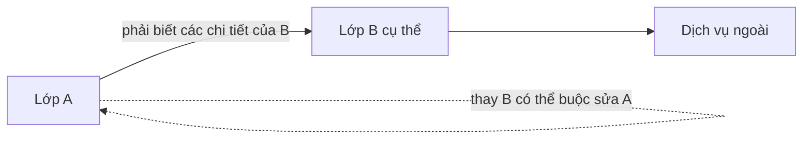

Khi B đổi phương thức, kiểu trả về, định dạng lỗi hoặc quy tắc bắt buộc phải gọi trước/sau, A có thể phải thay đổi theo. Độ lan truyền này là tín hiệu thực dụng của coupling.

## 3. Hai phong cách thiết kế: phụ thuộc chặt và phụ thuộc lỏng

### 3.1. Ví dụ phụ thuộc chặt (tight coupling)

```java
// Minh họa một thiết kế khó thay đổi, không phải chương trình đầy đủ.
final class CheckoutService {
    void checkout(Order order) {
        CardProcessor processor = new CardProcessor(
                "https://payment-provider.example/api", "merchant-001");
        String paymentId = processor.charge(
                order.getId(), order.getTotalCents());

        SmtpMailer mailer = new SmtpMailer("smtp.example", 587);
        mailer.sendReceipt(order.getCustomerEmail(), paymentId);
    }
}
```

Giả định `CardProcessor`, `SmtpMailer` và `Order` là các lớp đã được định nghĩa. Những vấn đề lộ ra:

- `CheckoutService` biết rõ **lớp cụ thể** của bên thanh toán và gửi thư.
- Service **tự tạo dependency**, khiến kiểm thử khó thay bằng fake khi không gọi dịch vụ thật.
- Địa chỉ máy chủ và thông tin cấu hình nằm trong lớp nghiệp vụ.
- Việc đổi nhà cung cấp hoặc kênh gửi biên nhận kéo theo sửa service.
- Hai tác dụng phụ là “trừ tiền” và “gửi thư” bị gắn vào một luồng; cần thiết kế xử lý lỗi phù hợp.

Không phải cứ dùng `new` là sai: `new Money(...)` hoặc tạo DTO/value object riêng bên trong service thường hoàn toàn hợp lý. Vấn đề ở đây là **tự tạo và phụ thuộc trực tiếp vào những cộng tác viên có chi tiết bên ngoài dễ thay đổi**.

### 3.2. Hướng phụ thuộc vào hợp đồng

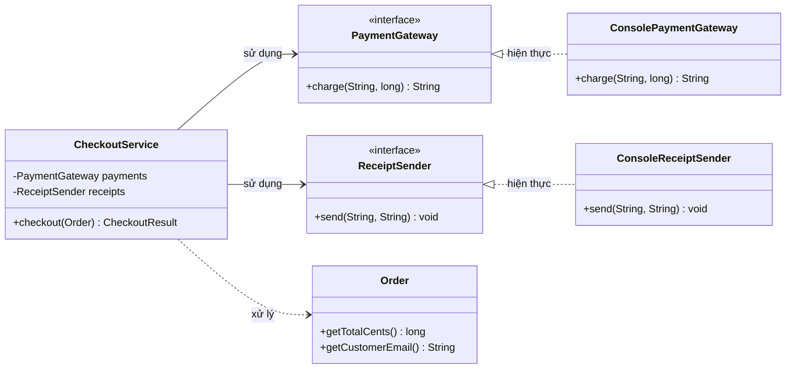

Giờ `CheckoutService` cần hai **hợp đồng có ý nghĩa nghiệp vụ**: `PaymentGateway` và `ReceiptSender`. Các implementation được cung cấp từ bên ngoài, thường qua constructor injection.

Nhờ đó, service không phải biết cổng thanh toán dùng HTTP, mock, queue hay adapter của nhà cung cấp nào. Nó vẫn có dependency vào *hành vi thanh toán*, nhưng được cách ly khỏi phần lớn chi tiết triển khai.

## 4. Ví dụ Java 11+ hoàn chỉnh, chạy được và tự kiểm tra

Lưu toàn bộ ví dụ sau vào tệp `CouplingDemo.java`:

```java
import java.util.Objects;

public class CouplingDemo {

    static final class Order {
        private final String id;
        private final String customerEmail;
        private final int quantity;
        private final long unitPriceCents;

        Order(String id, String customerEmail,
              int quantity, long unitPriceCents) {
            this.id = Objects.requireNonNull(id, "id");
            this.customerEmail = Objects.requireNonNull(
                    customerEmail, "customerEmail");
            if (quantity <= 0 || unitPriceCents < 0) {
                throw new IllegalArgumentException(
                        "Invalid quantity or unit price");
            }
            this.quantity = quantity;
            this.unitPriceCents = unitPriceCents;
        }

        String getId() {
            return id;
        }

        String getCustomerEmail() {
            return customerEmail;
        }

        long getTotalCents() {
            return Math.multiplyExact(quantity, unitPriceCents);
        }
    }

    // Hai hợp đồng nhỏ, được đặt theo nhu cầu của checkout.
    interface PaymentGateway {
        String charge(String orderId, long amountCents);
    }

    interface ReceiptSender {
        void send(String email, String paymentId);
    }

    static final class CheckoutResult {
        private final String paymentId;
        private final long totalCents;

        CheckoutResult(String paymentId, long totalCents) {
            this.paymentId = paymentId;
            this.totalCents = totalCents;
        }

        String getPaymentId() {
            return paymentId;
        }

        long getTotalCents() {
            return totalCents;
        }
    }

    static final class CheckoutService {
        private final PaymentGateway payments;
        private final ReceiptSender receipts;

        CheckoutService(PaymentGateway payments, ReceiptSender receipts) {
            this.payments = Objects.requireNonNull(
                    payments, "payments");
            this.receipts = Objects.requireNonNull(
                    receipts, "receipts");
        }

        CheckoutResult checkout(Order order) {
            Objects.requireNonNull(order, "order");
            long total = order.getTotalCents();

            String paymentId = payments.charge(order.getId(), total);
            receipts.send(order.getCustomerEmail(), paymentId);

            return new CheckoutResult(paymentId, total);
        }
    }

    // Adapter dùng cho demo.
    static final class ConsolePaymentGateway
            implements PaymentGateway {
        @Override
        public String charge(String orderId, long amountCents) {
            System.out.println("Paid " + orderId + ": "
                    + amountCents + " cents");
            return "tx-" + orderId;
        }
    }

    static final class ConsoleReceiptSender
            implements ReceiptSender {
        @Override
        public void send(String email, String paymentId) {
            System.out.println("Receipt for " + email
                    + ": " + paymentId);
        }
    }

    // Fake để kiểm thử không cần gọi HTTP/thanh toán thật.
    static final class FakePaymentGateway
            implements PaymentGateway {
        String receivedOrderId;
        long receivedAmountCents;

        @Override
        public String charge(String orderId, long amountCents) {
            receivedOrderId = orderId;
            receivedAmountCents = amountCents;
            return "fake-transaction";
        }
    }

    static final class RecordingReceiptSender
            implements ReceiptSender {
        String receivedEmail;
        String receivedPaymentId;

        @Override
        public void send(String email, String paymentId) {
            receivedEmail = email;
            receivedPaymentId = paymentId;
        }
    }

    public static void main(String[] args) {
        Order order = new Order("ORD-7", "buyer@example.test",
                2, 140_000L);

        CheckoutService actual = new CheckoutService(
                new ConsolePaymentGateway(),
                new ConsoleReceiptSender());

        CheckoutResult result = actual.checkout(order);
        System.out.println("RESULT " + result.getPaymentId());

        FakePaymentGateway fakePayment = new FakePaymentGateway();
        RecordingReceiptSender fakeReceipt =
                new RecordingReceiptSender();

        CheckoutService underTest = new CheckoutService(
                fakePayment, fakeReceipt);
        CheckoutResult tested = underTest.checkout(order);

        if (!"ORD-7".equals(fakePayment.receivedOrderId)
                || fakePayment.receivedAmountCents != 280_000L
                || !"buyer@example.test".equals(
                        fakeReceipt.receivedEmail)
                || !"fake-transaction".equals(
                        fakeReceipt.receivedPaymentId)
                || tested.getTotalCents() != 280_000L) {
            throw new AssertionError("Checkout behavior incorrect");
        }

        System.out.println("Fake checks passed");
    }
}
```

Chạy trên JDK 11 trở lên:

```bash
javac CouplingDemo.java
java CouplingDemo
```

Kết quả dự kiến:

```text
Paid ORD-7: 280000 cents
Receipt for buyer@example.test: tx-ORD-7
RESULT tx-ORD-7
Fake checks passed
```

Ở bản thiết kế này:

1. **`CheckoutService` có trách nhiệm điều phối checkout**; việc tính tổng thuộc `Order`, thao tác thu tiền thuộc `PaymentGateway`, việc gửi biên nhận thuộc `ReceiptSender`.
2. **Lớp nghiệp vụ dùng interface** nên thay `ConsolePaymentGateway` bằng adapter khác không đòi sửa nội dung `CheckoutService` nếu hợp đồng và hành vi cam kết không đổi.
3. **Constructor injection** cho phép truyền các fake khi kiểm thử. Test xác nhận mã đơn, số tiền và người nhận thay vì chỉ so khớp cấu trúc code.
4. **Sự phụ thuộc chưa biến mất:** checkout vẫn cần một dịch vụ có khả năng thu tiền và một dịch vụ gửi biên nhận. Ta chỉ giảm việc dính chặt vào chi tiết của các dịch vụ đó.

Đây là ví dụ về **thiết kế phụ thuộc**, không phải quy trình thanh toán production đầy đủ. Nếu thu tiền thành công nhưng gửi biên nhận lỗi, lệnh thu tiền không thể tự “undo”. Hệ thống thực cần trạng thái giao dịch rõ ràng, idempotency, retry/outbox, hoặc cơ chế phù hợp để không trừ tiền lặp lại. Việc giảm coupling giúp cô lập chính sách tích hợp nhưng **không tự giải quyết các bài toán phân tán**.

## 5. Các dạng coupling thường được nhắc tới

Một số tài liệu OOP và structured design phân biệt những kiểu phụ thuộc sau. Đây là **phân loại để suy nghĩ**, không phải bảng xếp hạng tuyệt đối dùng cho mọi kiến trúc Java hiện đại.

| Dạng | Dấu hiệu | Ví dụ/bất lợi | Cách cải thiện khi cần |
|---|---|---|---|
| **Content coupling** | A can thiệp hoặc phụ thuộc trực tiếp vào chi tiết thực thi/nội bộ B | A sửa trực tiếp cấu trúc riêng tư của B thông qua reflection | Đóng gói trạng thái; cung cấp API theo hành vi |
| **Common coupling** | Nhiều thành phần phụ thuộc cùng trạng thái dùng chung | Biến `static` mutable/global cache bị sửa ở nhiều nơi | Giới hạn nơi sở hữu và quyền thay đổi trạng thái |
| **External coupling** | Nhiều thành phần phụ thuộc một giao thức/định dạng bên ngoài | Mỗi lớp tự diễn giải response JSON của nhà cung cấp | Adapter/anti-corruption layer, hợp đồng và versioning |
| **Control coupling** | A truyền cờ/mã để điều khiển chi tiết các nhánh của B | `process(order, true, 3)` với các cờ khó hiểu | Tách thao tác có tên hoặc dùng policy/strategy |
| **Stamp coupling** | A đưa cho B cả cấu trúc phức tạp dù B chỉ cần một phần | Truyền toàn bộ `UserProfile` để chỉ lấy email | Truyền dữ liệu hoặc contract nhỏ thực sự cần |
| **Data coupling** | Các thành phần trao đổi dữ liệu xác định rõ | `charge(orderId, amountCents)` | Thường có thể chấp nhận và dễ hiểu |
| **Message coupling** | Giao tiếp bằng lời gọi/hợp đồng thông điệp, hạn chế hiểu nội bộ | `gateway.charge(request)` qua interface nhỏ | Chú trọng hợp đồng, lỗi, versioning; không tự coi là không phụ thuộc |

Cần đọc bối cảnh: truyền `UserProfile` không nhất thiết sai nếu bên được gọi có trách nhiệm nghiệp vụ với **cả profile**. Truyền quá nhiều tham số nguyên thủy cũng có thể dẫn đến *primitive obsession*; một value object như `Money` hay `PaymentRequest` giúp diễn đạt hợp đồng tốt hơn.

### Một ví dụ về control coupling

```java
// Mã khó đọc: caller phải biết giá trị mode/flag mang ý nghĩa gì.
void publish(Document doc, int mode, boolean urgent) {
    // mode=1: email; mode=2: archive; ...
}
```

Có thể thay bằng thao tác phản ánh mục đích hoặc policy rõ nghĩa:

```java
interface DocumentPublisher {
    void publish(Document document);
}

final class EmailPublisher implements DocumentPublisher {
    @Override
    public void publish(Document document) {
        // Gửi email theo hợp đồng của adapter.
    }
}
```

`Document` và chi tiết triển khai ở đây được giả định tồn tại. Chỉ nên thêm nhiều lớp triển khai khi thực sự có các hành vi thay thế độc lập; nếu chỉ hai nhánh đơn giản và ổn định, một enum và `switch` rõ ràng cũng có thể đủ.

## 6. Nguyên tắc giảm coupling và ranh giới áp dụng

### A. Information hiding – giấu chi tiết triển khai

Đừng để các lớp bên ngoài biết cấu trúc lưu trữ nội bộ của một object chỉ để thay đổi nghiệp vụ:

```java
// Tránh:
// order.lines.add(new OrderLine(...));
// order.status = "PAID";

// Tốt hơn nếu thuộc trách nhiệm của Order:
order.addLine(productId, quantity);
order.markPaid(paymentId);
```

Lớp gọi biết **hành vi mà Order cam kết**, không cần biết phải sửa bao nhiêu field. Khi cấu trúc nội bộ đổi từ List sang Map, API bên ngoài có thể giữ nguyên.

### B. Dependency Inversion Principle (DIP)

Module nghiệp vụ có vai trò chính không nên phải gắn vào chi tiết hạ tầng dễ thay đổi; cả hai có thể phụ thuộc một abstraction phù hợp. Trong ví dụ, `CheckoutService` và adapter thanh toán cùng biết interface `PaymentGateway`.

**DIP không đồng nhất với dependency injection (DI).** DIP là nguyên tắc tổ chức phụ thuộc; DI là một kỹ thuật cung cấp cộng tác viên từ ngoài vào. Có thể dùng constructor injection mà vẫn phụ thuộc vào concrete class khó thay thế. Ngược lại, một interface nhỏ vẫn có giá trị mà không cần framework DI.

### C. Interface Segregation Principle (ISP)

Một interface quá rộng cũng tạo coupling. Nếu `PaymentProvider` chứa các hàm `charge`, `refund`, `issueCard`, `manageAccount`, `generateReport`, service chỉ xử lý checkout sẽ phụ thuộc vào nhiều điều nó không cần.

Tách hợp đồng theo vai trò sử dụng khi các vai trò thực sự độc lập:

```java
interface PaymentCharger {
    String charge(String orderId, long amountCents);
}

interface PaymentRefunder {
    void refund(String paymentId, long amountCents);
}
```

Không nên tách interface chỉ để có thật nhiều file. Nếu nhiều thao tác luôn đi cùng nhau và cùng thay đổi, một hợp đồng thống nhất có thể đơn giản, dễ hiểu hơn.

### D. Single Responsibility và cohesion

**Coupling** nói về **quan hệ giữa các lớp**; **cohesion** (mức gắn kết chức năng) nói về **các trách nhiệm trong cùng một lớp**.

Một lớp vừa thanh toán, gửi mail, đọc SQL và vẽ PDF thường có nhiều lý do để thay đổi. Việc phân chia đúng trách nhiệm có thể giảm coupling có hại và tăng cohesion. Tuy nhiên tách một thao tác đơn giản thành hàng chục wrapper chỉ để “mỗi lớp một dòng” có thể làm luồng xử lý khó hiểu hơn.

Đánh giá thiết kế cần cân bằng: **cohesion cao, coupling phù hợp** và số lượng thành phần vừa đủ.

### E. Law of Demeter và chuỗi truy cập

Cẩn trọng khi một lớp đào sâu vào nhiều tầng chi tiết của object khác:

```java
// Ràng buộc vào nhiều nấc cấu trúc:
String city = order.getCustomer()
        .getAddress().getCity();
```

Nếu “thành phố giao hàng” là khái niệm ổn định của đơn hàng, cân nhắc:

```java
String city = order.getShippingCity();
```

Nhưng đừng tự động biến mọi getter lồng nhau thành phương thức chuyển tiếp. DTO để hiển thị hoặc truy vấn dữ liệu thuần túy có thể hợp lý với chuỗi truy cập. Câu hỏi quan trọng là **lớp hiện tại có đang biết cấu trúc nội bộ mà nó không nên biết không?**

## 7. Coupling ở cấp package và module

Ở cấp hệ thống, phụ thuộc có thể tạo thành chu trình:

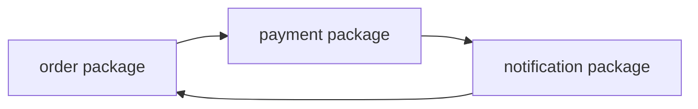

Khi cả ba module import qua lại, khó cô lập thay đổi và kiểm thử từng phần. Một cách sắp xếp khác:

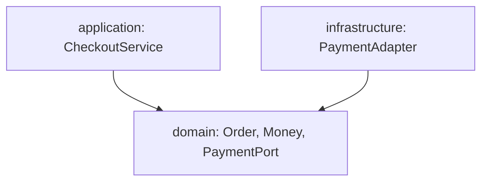

Trong cách tổ chức này, những kiểu nghiệp vụ ổn định và contract cần thiết có thể được đặt tại domain/application; hạ tầng hiện thực contract. Nơi khởi tạo ứng dụng (composition root) kết nối adapter với service. Sự phụ thuộc **mã nguồn** hướng vào hợp đồng, dù luồng **runtime** vẫn đi từ service ra hạ tầng thông qua implementation.

Không nên áp một sơ đồ kiến trúc cứng cho mọi bài toán. Dự án nhỏ có thể dùng package đơn giản; hệ thống lớn với nhiều tích hợp và chu kỳ thay đổi khác nhau thường hưởng lợi từ ranh giới rõ.

### Khi hai module buộc phải giao tiếp hai chiều?

Trước hết kiểm tra xem trách nhiệm có bị phân chia sai không. Có thể trích một hợp đồng chung, dùng callback hoặc domain event. Nhưng event cũng tạo **coupling theo thông điệp**: bên nhận phụ thuộc schema, thời điểm, thứ tự, tính trùng lặp và cách xử lý lỗi. “Không import nhau” không có nghĩa “không còn phụ thuộc”.

## 8. Đo coupling như thế nào?

Các chỉ số có thể hỗ trợ phát hiện vấn đề, nhưng cần đọc cùng hành vi thực tế.

| Chỉ số/tín hiệu | Cách hiểu | Giới hạn |
|---|---|---|
| **CBO (Coupling Between Objects)** | Số lớp mà một lớp liên hệ/phụ thuộc theo định nghĩa của công cụ | Cách đếm không thống nhất giữa công cụ; không nói trực tiếp mối phụ thuộc nào nguy hiểm |
| **Fan-out** | Một module có bao nhiêu dependency đi ra | Nhiều dependency vào API ổn định có thể ít rủi ro hơn một dependency vào chi tiết dễ đổi |
| **Fan-in** | Có bao nhiêu nơi phụ thuộc vào một module | Fan-in cao có thể cho thấy component chung hữu ích, nhưng thay đổi ở đó cần thận trọng |
| **Chu trình phụ thuộc** | A → B → C → A | Có thể khiến phân lớp và triển khai độc lập khó hơn |
| **Change coupling** | Các file/lớp thường phải đổi cùng nhau | Cần xem lịch sử thay đổi; có thể do cùng feature chứ không do thiết kế xấu |
| **Khó kiểm thử cô lập** | Test phải mở database, mạng hoặc nhiều service mới chạy được | Có thể do ranh giới quá rộng, dependency ẩn hoặc thiếu abstraction thích hợp |

Một ví dụ: `ReportService` dùng năm class value object nhỏ, bất biến, với hợp đồng ổn định không nhất thiết có vấn đề hơn `CheckoutService` phụ thuộc một SDK thanh toán vừa lớn vừa thay đổi thường xuyên.

Muốn đánh giá đúng, hãy kết hợp **chi phí khi thay đổi**, **khả năng chạy test**, **độ ổn định của hợp đồng** và **mức độ hiểu biết về chi tiết bên ngoài**. Đừng chỉ đếm `import` hoặc số lượng field.

## 9. Quy trình thực tế khi thấy hai lớp phụ thuộc chặt

1. **Chỉ ra điều đang biến động:** nhà cung cấp, nguồn dữ liệu, cấu trúc object, quy tắc nghiệp vụ, định dạng thông điệp hay cơ chế gửi nhận?
2. **Xác định lớp nào cần trách nhiệm gì:** `CheckoutService` cần “thu tiền”, không cần biết endpoint HTTP cụ thể.
3. **Vạch hợp đồng nhỏ nhưng đầy đủ:** tham số, kết quả, ngoại lệ, các điều kiện tiền/hậu phải rõ ràng.
4. **Đưa phần thay đổi thường xuyên vào implementation riêng:** adapter database, HTTP, email hoặc chính sách nghiệp vụ có nhiều biến thể.
5. **Cung cấp dependency có chủ đích:** constructor injection cho thành phần bắt buộc và ổn định trong thời gian sống service; truyền tham số nếu chỉ cần theo từng thao tác.
6. **Kiểm thử qua hợp đồng:** giả lập giao diện ở ranh giới, kiểm tra hành vi observable; thêm integration test cho adapter thật khi cần.
7. **Đánh giá lại độ phức tạp:** nếu sau refactor số lớp tăng nhiều nhưng thay đổi thực tế không đơn giản hơn, thiết kế có thể đã trừu tượng hóa quá sớm.

Không phải lớp nào cũng cần interface. `Money`, `OrderId`, `LocalDate` hay thuật toán nội bộ ổn định thường có thể được dùng trực tiếp mà không cần tạo `IMoneyFactoryAdapter` và hàng loạt wrapper vô nghĩa.

## 10. Những nhầm lẫn hay gặp

| Nhận định sai | Cách hiểu đúng |
|---|---|
| “Càng ít dependency càng tốt trong mọi trường hợp.” | Thiết kế cần hợp tác giữa các lớp; mục tiêu là phụ thuộc **có chủ đích và dễ quản lý**. |
| “Chỉ import một lớp nên coupling chắc chắn thấp.” | Một lớp có thể biết rất nhiều chi tiết và giả định của một dependency duy nhất. |
| “Có interface là đã loose coupling.” | Nếu interface sao chép toàn bộ SDK bên ngoài hoặc thay đổi liên tục, lớp dùng vẫn bị ràng buộc chặt. |
| “Dependency injection giải quyết mọi coupling.” | DI giúp cung cấp implementation và kiểm thử; hợp đồng vẫn có thể thiết kế kém. |
| “Gọi qua event/message broker thì không còn coupling.” | Vẫn có phụ thuộc vào schema, delivery semantics, version và thứ tự xử lý. |
| “Static utility luôn là vấn đề.” | Hàm pure, stateless như `Math.multiplyExact` thường ổn; shared mutable state mới cần xem xét kỹ. |
| “Tách càng nhiều lớp càng dễ bảo trì.” | Quá nhiều abstraction/wrapper làm tăng độ khó điều hướng và quản lý. |
| “Coupling thấp nghĩa là cohesion cao.” | Đây là hai trục khác nhau: quan hệ giữa lớp và trách nhiệm bên trong lớp. |
| “Test có fake chạy được nghĩa là tích hợp production an toàn.” | Fake kiểm tra logic ứng dụng; adapter/network/database và failure modes còn cần kiểm chứng phù hợp. |

## 11. Bài tập thực hành

### Bài 1 – Nhận diện coupling mạnh

```java
class MonthlyReportService {
    byte[] generate() {
        OracleConnection db = new OracleConnection("...");
        var rows = db.query("SELECT ...");
        return new VendorPdfWriter().render(rows);
    }
}
```

*Đây là mã minh họa; các lớp vendor chưa được khai báo.*

Hỏi: nếu chuyển từ Oracle sang PostgreSQL hoặc đổi thư viện xuất PDF, phải sửa nơi nào? Làm gì để `MonthlyReportService` ít hiểu hơn về chi tiết đó?

**Gợi ý:** xác định hợp đồng lấy dữ liệu báo cáo và hợp đồng dựng tài liệu (chỉ khi có lý do cần thay đổi/kiểm thử độc lập). Đưa cấu hình và khởi tạo adapter ra khỏi service; tách truy vấn theo nhu cầu miền nghiệp vụ.

### Bài 2 – Interface có đủ không?

Một dự án có:

```java
interface HugePaymentSdkFacade {
    void connectWithVendorCertificate(...);
    void setVendorRegion(...);
    void callVendorEndpoint(...);
    void parseVendorResponse(...);
}
```

`CheckoutService` gọi tất cả hàm này. Tại sao dù có interface, coupling vẫn cao?

**Gợi ý:** interface làm lộ những chi tiết của nhà cung cấp; thay vendor vẫn buộc sửa lớp nghiệp vụ. Hợp đồng tốt hơn nên thể hiện hành động như `charge(request)` và quy tắc kết quả/lỗi nghiệp vụ.

### Bài 3 – Chọn cách truyền dependency

Một formatter chỉ được dùng trong một lần xuất báo cáo; còn repository được dùng trong hầu hết thao tác của một service. Bạn sẽ truyền chúng qua phương thức hay constructor?

**Gợi ý:** formatter có thể là tham số khi khác nhau theo mỗi request. Repository ổn định và bắt buộc thường phù hợp constructor injection. Đây là lựa chọn theo vòng đời và API; không có luật tuyệt đối.

### Bài 4 – Phát hiện coupling khi thay đổi

Một lần thay đổi định dạng địa chỉ buộc sửa `Customer`, `Order`, `Invoice`, `EmailSender` và `CsvExporter` vì tất cả tự đọc `address.line1`, `address.line2` và ghép chuỗi theo cách riêng.

Bạn sẽ tìm ranh giới nào để giảm sự lan truyền thay đổi?

**Gợi ý:** xem `Address` như value object với hành vi/định dạng rõ trách nhiệm, hoặc tạo formatter theo ngữ cảnh xuất dữ liệu. Không ép mọi định dạng (email, hóa đơn, CSV) về một chuỗi duy nhất nếu yêu cầu khác nhau.

### Bài 5 – Kiểm thử tính thay thế

Dựa vào `CouplingDemo.java`, tạo `FailingPaymentGateway` ném exception trong `charge()`. Kiểm tra `RecordingReceiptSender` **không được gọi** nếu thu tiền không thành công.

**Gợi ý:** thêm một biến `boolean called` trong sender; gọi `checkout()` và bắt lỗi dự kiến, sau đó assert `called == false`. Bài mở rộng: nếu gateway thu tiền xong nhưng sender lỗi, hệ thống nên lưu trạng thái và retry biên nhận thế nào để tránh thu tiền hai lần?

---

**Ghi nhớ:** coupling phản ánh mức độ một lớp phải biết, dựa vào và bị ảnh hưởng bởi lớp khác. Thiết kế tốt giữ **trách nhiệm rõ**, **hợp đồng ổn định**, **chi tiết có thể thay thế ở ranh giới cần thiết** và **hành vi dễ kiểm thử**. Hãy giảm sự lan truyền thay đổi thực tế, đồng thời tránh tạo abstraction khi chưa có nhu cầu.


</details>

- [Quay lại đầu trang](#back-to-top)

---

## <a id="class-design-004">Tách dữ liệu, nghiệp vụ và tương tác bên ngoài</a>

<details>
<summary>Xem chi tiết</summary>

# Tách dữ liệu, nghiệp vụ và tương tác bên ngoài trong thiết kế lớp Java

Một chức năng “đặt hàng” có thể đồng thời phải nhận JSON, kiểm tra giỏ hàng, tính số tiền, lưu database và gửi email xác nhận. Nếu đặt tất cả trong một class, mọi thay đổi từ định dạng HTTP đến quy tắc khuyến mãi đều buộc sửa cùng một nơi. Khi chạy test tính tiền, chương trình lại cần khởi động database hoặc dịch vụ email.

Giải pháp là **phân định trách nhiệm của dữ liệu, logic nghiệp vụ và tương tác với thế giới bên ngoài**, rồi kết nối chúng bằng những giao diện đủ rõ. Mục tiêu là thay đổi và kiểm thử từng phần mà không làm rối quy tắc cốt lõi.

## 1. Hiểu đúng ba nhóm trách nhiệm

| Nhóm | Câu hỏi mà thành phần trả lời | Ví dụ | Điều nên tránh |
| --- | --- | --- | --- |
| Dữ liệu và mô hình miền (*data/domain model*) | Đối tượng có trạng thái gì? Những giá trị nào hợp lệ? | `OrderLine`, `Order`, `Money` | Để bất kỳ ai sửa dữ liệu khiến đơn hàng mất hợp lệ |
| Nghiệp vụ (*business rules/use case*) | Khi nào được đặt hàng? Tính tổng và giảm giá thế nào? Luồng xử lý ra sao? | `PricingPolicy`, `CheckoutService` | Gắn công thức giảm giá trực tiếp vào controller/SQL/email |
| Tương tác bên ngoài (*I/O, infrastructure, adapters*) | Nhận yêu cầu, lưu ở đâu, thông báo bằng cách nào? | HTTP controller, JDBC repository, email gateway | Đưa thư viện HTTP/SQL vào đối tượng nghiệp vụ |

**Điều chỉnh quan trọng:** “tách dữ liệu và nghiệp vụ” **không có nghĩa** entity chỉ chứa getter/setter còn tất cả quy tắc bị đẩy sang service. Một domain entity tốt có thể tự kiểm tra bất biến và cung cấp hành vi hợp lệ. Điều cần tách là **logic cốt lõi** khỏi chi tiết kết nối HTTP, cơ sở dữ liệu, file, email hay hệ thống khác.

Ví dụ `OrderLine` biết số lượng phải dương và biết tính thành tiền. `Order` bảo vệ tổng tiền hợp lệ. `CheckoutService` điều phối tạo và lưu đơn. `OrderRepository` định nghĩa cách yêu cầu lưu; lớp cài đặt JDBC mới biết câu SQL cụ thể.

## 2. Vì sao đặt chung mọi thứ trong một class gây vấn đề?

```java
// PSEUDOCODE: ví dụ cần cải tiến, không phải đoạn có thể chạy độc lập.
class CheckoutController {
    void checkout(HttpRequest request) {
        String customerId = request.json().get("customerId");
        long total = 0;

        // Vừa parse HTTP, vừa thực thi business rule.
        for (var item : request.json().items()) {
            total += item.quantity() * item.unitPriceCents();
        }
        if ("SAVE10".equals(request.json().promoCode())) {
            total = total - total / 10;
        }

        // Vừa làm I/O, vừa điều phối use case.
        database.execute("INSERT INTO orders ...");
        emailClient.send(customerId, "Order confirmed");
    }
}
```

Những phụ thuộc bị trộn lẫn:

- Chỉ muốn thay cách nhận JSON cũng có thể ảnh hưởng code tính tiền.
- Chỉ muốn test giảm giá lại phải giả lập HTTP, database và email.
- Cùng một quy tắc có thể bị sao chép sang CLI, API thứ hai hoặc tác vụ chạy nền.
- Nếu lưu đơn thành công nhưng gửi email lỗi, không rõ hệ thống xử lý trạng thái dở dang như thế nào.
- Controller chứa quá nhiều lý do thay đổi; lỗi thực hiện trong một tầng khó được phát hiện qua test tập trung.

Tách trách nhiệm giúp làm rõ **ai quyết định điều gì** và **lỗi ở đâu được xử lý**. Không có một cách tách duy nhất phù hợp với mọi quy mô dự án.

## 3. Thiết kế luồng phụ thuộc

Một cách tổ chức thực tế là: adapter nhận dữ liệu, application service điều phối, domain model/policy giữ quy tắc, còn persistence/notification được truy cập qua *port* (interface).

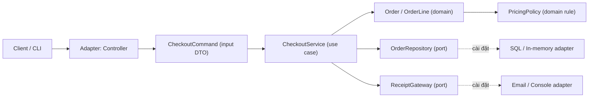

Đường mũi tên liền mô tả nơi một thành phần gọi hoặc dùng thành phần kia trong luồng. **Hướng phụ thuộc trong mã nguồn** cần được kiểm soát: tầng nghiệp vụ định nghĩa những port cần thiết; adapter bên ngoài cài đặt các port đó. Tầng domain không import controller, JDBC, `System.out` hoặc thư viện gửi email.

Trong thiết kế theo **Dependency Inversion Principle**, `CheckoutService` phụ thuộc `OrderRepository`/ `ReceiptGateway` là *interface*; lớp `JdbcOrderRepository` hoặc `SmtpReceiptGateway` mới phụ thuộc vào công nghệ cụ thể.

### Một số thuật ngữ dễ nhầm

| Thuật ngữ | Nhiệm vụ thực tế | Có chứa quy tắc nghiệp vụ không? |
| --- | --- | --- |
| DTO / Command | Mang dữ liệu vào/ra giữa các ranh giới | Chủ yếu kiểm tra định dạng đầu vào; không phải nguồn chân lý của invariant |
| Value object | Biểu diễn một giá trị có nghĩa trong domain | Có thể tự kiểm tra và thực hiện phép toán của giá trị đó |
| Entity / Aggregate | Bảo vệ trạng thái và các chuyển đổi hợp lệ | Có; đây thường là nơi quan trọng để giữ invariant |
| Domain policy/service | Quy tắc không thuộc riêng một entity hoặc cần cấu hình độc lập | Có |
| Application service | Điều phối một use case và các cộng tác viên | Có thể kiểm tra điều kiện quy trình, nhưng hạn chế nhồi công thức domain |
| Repository port | Hợp đồng lưu/truy vấn đối tượng miền | Không biết SQL trong bản interface |
| Adapter | Chuyển đổi I/O thành các hợp đồng của hệ thống | Không nên định nghĩa lại quy tắc tính tiền, hạn mức... |

`Data class` không nhất thiết chỉ là record; nó là lựa chọn hình thức biểu diễn. `record` Java hữu ích cho dữ liệu bất biến, nhưng entity có vòng đời và chuyển trạng thái có thể phù hợp hơn với class có hành vi và trường đóng gói.

## 4. Ví dụ Java 17 độc lập: đặt hàng và gửi biên nhận

Yêu cầu:

- Khách hàng có thể đặt ít nhất một dòng hàng.
- Mỗi dòng có mã sản phẩm, số lượng dương và giá tính bằng **đơn vị cent** không âm.
- Mã `SAVE10` giảm 10% tổng tiền trước giảm, làm tròn **xuống đến cent**; không nhập mã thì không giảm.
- Mã ưu đãi không hỗ trợ phải bị từ chối **trước khi lưu đơn**.
- Đơn hàng được lưu qua `OrderRepository`; gửi biên nhận qua `ReceiptGateway`.
- Có thể chạy thử với repository trong bộ nhớ và gateway in ra console, không cần HTTP hay database.

Tạo file **`SeparationOfConcernsDemo.java`**:

```java
import java.math.BigDecimal;
import java.util.ArrayList;
import java.util.LinkedHashMap;
import java.util.List;
import java.util.Map;
import java.util.Objects;
import java.util.Optional;

public class SeparationOfConcernsDemo {

    // INPUT DTO: biểu diễn dữ liệu mà một adapter chuyển cho use case.
    record LineInput(String sku, int quantity, long unitPriceCents) { }
    record CheckoutCommand(
            String customerId,
            List<LineInput> items,
            String promoCode) { }

    // DOMAIN: value object; dữ liệu và hành vi luôn đi cùng bất biến.
    record OrderLine(String sku, int quantity, long unitPriceCents) {
        OrderLine {
            if (sku == null || sku.isBlank()) {
                throw new IllegalArgumentException("SKU is required");
            }
            if (quantity <= 0 || unitPriceCents < 0) {
                throw new IllegalArgumentException("Invalid line values");
            }
        }

        long lineTotalCents() {
            // Phát hiện tràn số thay vì âm thầm cho kết quả sai.
            return Math.multiplyExact(quantity, unitPriceCents);
        }
    }

    // DOMAIN POLICY: quy tắc giá độc lập với cách nhận và lưu dữ liệu.
    interface PricingPolicy {
        long payableCents(long subtotalCents, String promoCode);
    }

    static final class StandardPricingPolicy implements PricingPolicy {
        @Override
        public long payableCents(long subtotalCents, String promoCode) {
            if (subtotalCents < 0) {
                throw new IllegalArgumentException("Negative subtotal");
            }

            if (promoCode == null || promoCode.isBlank()) {
                return subtotalCents;
            }
            if ("SAVE10".equals(promoCode)) {
                long discountCents = subtotalCents / 10; // làm tròn xuống
                return subtotalCents - discountCents;
            }
            throw new IllegalArgumentException("Unknown promotion");
        }
    }

    // DOMAIN: Order bảo vệ dữ liệu và invariant tổng tiền.
    static final class Order {
        private final String id;
        private final String customerId;
        private final List<OrderLine> lines;
        private final long subtotalCents;
        private final long payableCents;

        private Order(String id, String customerId,
                      List<OrderLine> inputLines, String promoCode,
                      PricingPolicy policy) {
            this.id = required(id, "order id");
            this.customerId = required(customerId, "customer id");
            Objects.requireNonNull(policy, "policy");

            this.lines = List.copyOf(inputLines);
            if (lines.isEmpty()) {
                throw new IllegalArgumentException("Empty order");
            }

            long sum = 0L;
            for (OrderLine line : lines) {
                sum = Math.addExact(sum, line.lineTotalCents());
            }
            this.subtotalCents = sum;

            long proposed = policy.payableCents(sum, promoCode);
            if (proposed < 0 || proposed > sum) {
                throw new IllegalArgumentException(
                        "Pricing policy returned invalid amount");
            }
            this.payableCents = proposed;
        }

        static Order place(String id, String customerId,
                           List<OrderLine> lines, String promoCode,
                           PricingPolicy policy) {
            return new Order(id, customerId, lines, promoCode, policy);
        }

        String id() { return id; }
        String customerId() { return customerId; }
        long subtotalCents() { return subtotalCents; }
        long payableCents() { return payableCents; }
        List<OrderLine> lines() { return lines; }
    }

    // PORTS: hợp đồng dịch vụ ngoài do use case cần.
    interface OrderRepository {
        void save(Order order);
        Optional<Order> findById(String id);
    }

    interface ReceiptGateway {
        void sendReceipt(Order order);
    }

    interface OrderIdGenerator {
        String nextId();
    }

    // APPLICATION: điều phối, không tự tính tiền hay biết SQL.
    static final class CheckoutService {
        private final PricingPolicy pricing;
        private final OrderRepository orders;
        private final ReceiptGateway receipts;
        private final OrderIdGenerator ids;

        CheckoutService(PricingPolicy pricing, OrderRepository orders,
                        ReceiptGateway receipts, OrderIdGenerator ids) {
            this.pricing = Objects.requireNonNull(pricing);
            this.orders = Objects.requireNonNull(orders);
            this.receipts = Objects.requireNonNull(receipts);
            this.ids = Objects.requireNonNull(ids);
        }

        Order checkout(CheckoutCommand command) {
            Objects.requireNonNull(command, "command");
            Objects.requireNonNull(command.items(), "items");

            // Chuyển từ input DTO sang domain value object.
            List<OrderLine> lines = new ArrayList<>();
            for (LineInput input : command.items()) {
                Objects.requireNonNull(input, "line input");
                lines.add(new OrderLine(
                        input.sku(),
                        input.quantity(),
                        input.unitPriceCents()));
            }

            Order order = Order.place(
                    ids.nextId(), command.customerId(),
                    lines, command.promoCode(), pricing);

            orders.save(order);
            receipts.sendReceipt(order);
            return order;
        }
    }

    // ADAPTER: thay bằng JDBC/JPA mà không thay code tính tiền.
    static final class InMemoryOrderRepository implements OrderRepository {
        private final Map<String, Order> data = new LinkedHashMap<>();

        @Override
        public void save(Order order) {
            Objects.requireNonNull(order, "order");
            if (data.putIfAbsent(order.id(), order) != null) {
                throw new IllegalStateException("Order id already exists");
            }
        }

        @Override
        public Optional<Order> findById(String id) {
            return Optional.ofNullable(data.get(id));
        }
    }

    // ADAPTER: tương tác console, không nằm trong entity Order.
    static final class ConsoleReceiptGateway implements ReceiptGateway {
        @Override
        public void sendReceipt(Order order) {
            String amount = BigDecimal
                    .valueOf(order.payableCents(), 2)
                    .toPlainString();
            System.out.println(
                    "Receipt " + order.id() + " = " + amount);
        }
    }

    private static String required(String text, String field) {
        if (text == null || text.isBlank()) {
            throw new IllegalArgumentException(field + " is required");
        }
        return text;
    }

    public static void main(String[] args) {
        InMemoryOrderRepository repository = new InMemoryOrderRepository();
        CheckoutService service = new CheckoutService(
                new StandardPricingPolicy(),
                repository,
                new ConsoleReceiptGateway(),
                () -> "ORDER-001");

        CheckoutCommand command = new CheckoutCommand(
                "CUSTOMER-01",
                List.of(
                        new LineInput("BOOK", 2, 120_00),
                        new LineInput("PEN", 3, 25_00)),
                "SAVE10");

        Order order = service.checkout(command);
        System.out.println(
                "Saved = " + repository.findById(order.id()).isPresent());

        try {
            service.checkout(new CheckoutCommand(
                    "CUSTOMER-02",
                    List.of(new LineInput("BOOK", 1, 120_00)),
                    "INVALID"));
        } catch (IllegalArgumentException expected) {
            System.out.println(expected.getMessage());
        }
    }
}
```

Biên dịch và chạy bằng Java 17 trở lên:

```bash
javac SeparationOfConcernsDemo.java
java SeparationOfConcernsDemo
```

Kết quả:

```text
Receipt ORDER-001 = 283.50
Saved = true
Unknown promotion
```

Tính tay: `2 × 120.00 + 3 × 25.00 = 315.00`; giảm 10% là `31.50`; thanh toán `283.50`. Trong code, tiền lưu bằng số nguyên cent để tránh lỗi làm tròn của `double`; chính sách giảm giá và quy tắc làm tròn được ghi rõ. Với hệ thống nhiều loại tiền, cần mô hình `Money` có currency, scale và rounding mode phù hợp.

### Vì sao đây là ví dụ phân tách đúng trách nhiệm?

- `CheckoutCommand`/`LineInput` là dữ liệu đầu vào; không biết SQL, email hoặc quy tắc tính tiền.
- `OrderLine` là **value object có hành vi**, giữ bất biến và tính thành tiền một dòng.
- `Order` là mô hình miền, đảm bảo danh sách không rỗng và số phải trả nằm trong khoảng hợp lệ. `List.copyOf` tạo snapshot danh sách; các phần tử trong ví dụ là record với thành phần bất biến nên không làm lộ trạng thái mutable.
- `StandardPricingPolicy` biết khuyến mãi, không biết cách nhận request hoặc lưu database.
- `CheckoutService` biến input thành đối tượng miền rồi phối hợp lưu/gửi biên nhận. Nó không tự viết SQL hoặc tính lại công thức `SAVE10`.
- `InMemoryOrderRepository` và `ConsoleReceiptGateway` là adapter. Đổi cách lưu hoặc gửi không đòi sửa `OrderLine` hay `Order`.

**Giới hạn của bản demo:** repository trong bộ nhớ không thread-safe, ID generator cố định dành cho lần checkout thành công duy nhất. Hệ thống thật phải sinh ID duy nhất và áp dụng ràng buộc uniqueness trong nơi lưu trữ.

Ngoài ra, `orders.save(order)` có thể thành công rồi `receipts.sendReceipt(order)` thất bại. Khi đó **đơn đã được lưu nhưng caller có thể nhận exception**. Đây là lý do một bản production thường dùng transactional outbox, hàng đợi và xử lý idempotent để phát biên nhận an toàn sau commit. Đừng ngộ nhận rằng đưa hai thao tác vào một method hoặc chỉ thêm `@Transactional` sẽ tự tạo giao dịch nguyên tử giữa database và hệ thống email.

## 5. Luồng xử lý và vị trí kiểm thử

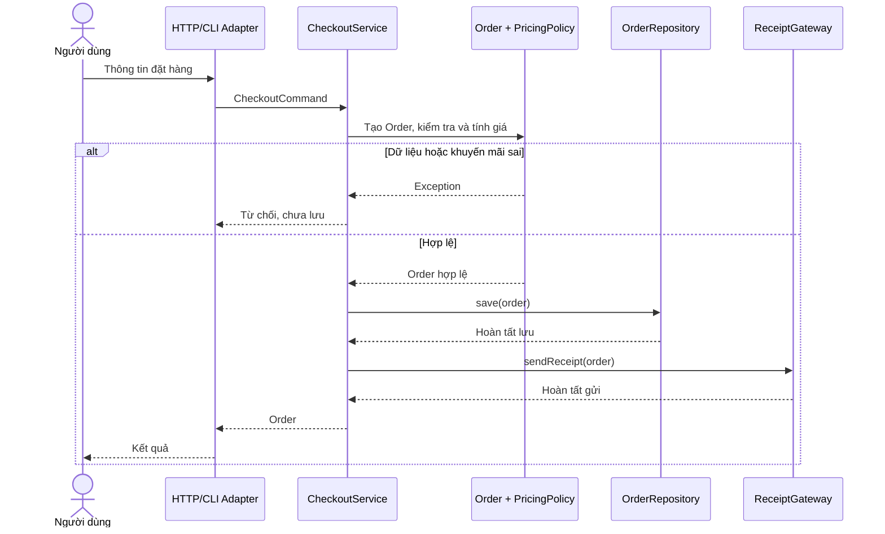

### Unit test miền không cần I/O

Chính sách giá là phép tính thuần từ đầu vào sang đầu ra. Có thể kiểm thử độc lập mà không cần mock mạng/database:

```java
PricingPolicy policy = new StandardPricingPolicy();

assert policy.payableCents(31_500, "SAVE10") == 28_350;
assert policy.payableCents(31_500, null) == 31_500;
assert policy.payableCents(0, "SAVE10") == 0;
```

Chạy với `java -ea` để bật Java `assert`, hoặc dùng JUnit trong dự án thật. Nên bổ sung test với tổng không chia hết cho 10, mã không hỗ trợ, giá âm, số lượng 0 và tràn `long` để xác nhận các cạnh biên.

### Unit test quy trình với fake/mock

Với `CheckoutService`, fake `OrderRepository` có thể ghi nhận `save` đã được gọi với tổng tiền đúng; fake `ReceiptGateway` có thể đếm số lần gửi. Các kiểm tra quan trọng:

| Tình huống | Điều cần khẳng định |
| --- | --- |
| Dòng hàng hợp lệ + promo hợp lệ | Tạo Order đúng tổng, lưu một lần, yêu cầu gửi một lần |
| SKU rỗng hoặc quantity không dương | Bị từ chối trước `save` và `sendReceipt` |
| Promo không hỗ trợ | Không lưu và không gửi |
| Repository báo lỗi | Không gửi biên nhận; báo lỗi cho use case |
| Gateway báo lỗi sau khi lưu | Xử lý trạng thái đã lưu theo thiết kế retry/outbox |
| Hai request trùng ID | Repository thật phải áp dụng ràng buộc duy nhất |

Không cần test lại công thức giảm giá ở controller. Controller test trách nhiệm chuyển HTTP thành command, ánh xạ lỗi thành status code và JSON; policy test công thức riêng.

## 6. Ranh giới “dữ liệu” và domain: tránh mô hình thiếu hành vi

Một lỗi hay gặp là tạo entity với hàng loạt setter rồi dồn mọi nghiệp vụ sang service:

```java
// Thiết kế dễ bị phá vỡ invariant.
class Order {
    public List<OrderLine> lines;
    public long totalCents;
}
```

Caller có thể tự thay `totalCents` không khớp tổng của các dòng. Tách tầng không có nghĩa cho phép trạng thái miền mất kiểm soát.

Một hướng tốt hơn là dùng constructor/factory, đóng gói field và chỉ cho thay đổi qua các hành vi hợp lệ, ví dụ `addLine`, `confirm`, `cancel`. Trong demo, `Order` được tạo một lần, bất biến sau khi tạo. Nếu đơn có vòng đời thay đổi, hãy thêm trạng thái và những chuyển đổi nghiệp vụ vào chính aggregate phù hợp.

Phân biệt:

| Loại dữ liệu | Ví dụ | Quy tắc nên chứa |
| --- | --- | --- |
| Request DTO | `CheckoutCommand` | Cấu trúc đầu vào; parse/format cơ bản |
| Domain value object | `OrderLine` | SKU hợp lệ, quantity, phép tính dòng hàng |
| Domain entity/aggregate | `Order` | Bất biến và chuyển trạng thái của đơn |
| Persistence record | Hàng dữ liệu SQL/JPA mapping | Chuyển đổi sang/từ dạng lưu |
| Response DTO | `OrderResponse` | Dạng dữ liệu API cam kết trả về |

Không phải dự án nào cũng cần DTO và persistence model tách rời entity. Quyết định dựa trên mức độ phức tạp và sự biến động của các ranh giới. Tuy nhiên, khi entity bị ràng buộc mạnh vào schema hoặc serialization, tách chúng thường giúp domain độc lập hơn.

## 7. “Pure core, imperative shell” trong OOP

Một cách nhìn khác là đặt phần logic ít side effect ở trung tâm, phần có I/O ở rìa.

**Pure core:** cùng input thì cùng output và không ghi file, log, mạng, database. Ví dụ `PricingPolicy.payableCents`. Nó dễ test và dễ chạy lại.

**Imperative shell:** thực hiện nhận request, gọi domain logic, lưu dữ liệu và phát thông báo. Ví dụ `CheckoutService` điều phối các port, còn adapter thực hiện I/O thật.

Không phải mọi domain method đều thuần hàm: entity có thể thay đổi trạng thái hợp lệ bằng `confirm()` hoặc `cancel()`. Nguyên tắc có ích là **cô lập I/O và sự phụ thuộc không ổn định**, không phải cấm mọi hành vi thay đổi trạng thái bên trong đối tượng.

Những phụ thuộc có thể gây khó kiểm thử:

- Đồng hồ hệ thống: thay `LocalDate.now()` trực tiếp bằng `Clock` được truyền vào khi thời gian là quy tắc.
- Random/UUID: dùng `OrderIdGenerator` hoặc nguồn ID được tiêm qua constructor.
- Environment/config: lấy từ bên ngoài rồi chuyển thành cấu hình/policy rõ ràng.
- Email/HTTP/SQL: cung cấp port rồi viết adapter tương ứng.
- Database transaction: đặt tại ranh giới use case hoặc unit of work phù hợp, không nhúng vào phép tính giá.

## 8. Khi áp dụng với Spring Boot/JPA

Một cấu trúc điển hình:

```text
com.example.orders
├── domain
│   ├── Order.java
│   ├── OrderLine.java
│   └── PricingPolicy.java
├── application
│   ├── CheckoutService.java
│   ├── CheckoutCommand.java
│   ├── OrderRepository.java
│   └── ReceiptGateway.java
├── infrastructure
│   ├── JpaOrderRepositoryAdapter.java
│   ├── OrderJpaEntity.java
│   └── SmtpReceiptAdapter.java
└── web
    ├── CheckoutController.java
    └── CheckoutResponse.java
```

Đây là **một cách tổ chức**. Với hệ thống nhỏ, có thể gộp package đơn giản hơn; package đặt tên đẹp không bù được dependency sai.

Ví dụ sơ đồ phụ thuộc trong Spring:

```java
// application port
public interface OrderRepository {
    void save(Order order);
}

// infrastructure adapter
@Repository
public class JpaOrderRepositoryAdapter implements OrderRepository {
    private final SpringDataOrderRepository jpa;

    public JpaOrderRepositoryAdapter(SpringDataOrderRepository jpa) {
        this.jpa = jpa;
    }

    @Override
    public void save(Order order) {
        // Map domain sang persistence entity, rồi gọi jpa.save(...)
    }
}
```

Đoạn trên chỉ minh họa tích hợp: `SpringDataOrderRepository`, các entity và mapper phải được định nghĩa trong ứng dụng thật. Class domain không cần annotation HTTP hoặc gửi email.

`@Transactional` trên application service có thể bao bọc các thao tác ghi database, nhưng **không** mở rộng transaction ACID sang SMTP/HTTP khác hệ thống. Khi cần “lưu đơn xong chắc chắn sẽ gửi thông báo”, có thể ghi bản ghi outbox trong cùng giao dịch DB; worker riêng đọc outbox để gửi, retry và xử lý trùng. Luồng này có *eventual consistency*: thông báo có thể đến sau khi đơn đã lưu.

## 9. Dấu hiệu thiết kế sai và cách sửa

| Dấu hiệu | Vì sao có hại? | Hướng sửa phù hợp |
| --- | --- | --- |
| Controller viết SQL và tính discount | Pha trộn adapter với nghiệp vụ | Controller tạo command, gọi service; policy tính giá |
| Entity tự gửi email hoặc gọi HTTP | Domain phụ thuộc I/O | Phát sự kiện nghiệp vụ hoặc để service gọi port |
| Repository chứa luật “giảm 10%” | Luật bị chôn trong lưu trữ | Đưa vào domain policy |
| DTO có mutable list rồi truyền thẳng cho domain | Caller sửa lén trạng thái | Chuyển đổi/validate, tạo defensive copy |
| Service chứa hàng trăm `if` giá/thuế | Thay policy ảnh hưởng use case | Trích xuất policy có tên rõ |
| Dùng `new Jdbc...` trong service | Không thay adapter dễ, test phụ thuộc DB | Constructor injection + port |
| “Interface cho mọi class” kể cả value object đơn giản | Tạo abstraction không có giá trị | Chỉ dùng khi có ranh giới biến động hay hợp đồng cần |
| Gửi email rồi mới lưu đơn | Có thể gửi thông báo cho đơn không tồn tại | Xác định luồng ghi/commit và cơ chế thông báo đáng tin |
| Catch mọi exception rồi trả “success” | Che lỗi và phá cam kết API | Phân loại lỗi, rollback/retry và báo trạng thái đúng |

**Đừng tách cơ học theo “mỗi method một class”.** Class nên có trách nhiệm rõ, gắn kết và đủ hành vi. Nếu một module nhỏ chỉ có hai use case và một database, không cần sao chép đầy đủ kiến trúc nhiều tầng của hệ thống lớn.

## 10. Cách làm khi nhận yêu cầu mới

Giả sử cần “thêm miễn phí vận chuyển cho đơn đủ điều kiện”, hãy đi theo trình tự:

1. **Diễn đạt quy tắc:** ngưỡng miễn phí tính trước hay sau giảm giá? Áp dụng cho currency nào? Từ ngày nào?
2. **Xác định nguồn dữ liệu:** giỏ hàng, địa chỉ nhận, bảng phí, thông tin chính sách.
3. **Đặt trách nhiệm:** phép tính phí/miễn phí ở domain policy phù hợp; gọi dịch vụ giao vận qua port nếu thật sự cần I/O; service điều phối thứ tự.
4. **Giữ ranh giới:** request DTO chứa địa chỉ, mapper tạo đối tượng miền; adapter giao vận chuyển đổi request/response của bên thứ ba.
5. **Kiểm thử rule trước:** dưới/trên ngưỡng, promo cộng dồn, tiền tệ khác, lỗi khi tra phí.
6. **Kiểm thử tích hợp sau:** database, transaction, retry, API contract, trường hợp cùng một request được gửi lại.

Nhờ sự phân chia này, thêm cách tính phí mới không đòi sửa controller lẫn SQL chỉ vì hai phần đó sử dụng chung một use case.

## 11. Bài tập thực hành

**Bài A — Tách lớp đang ôm việc.** Một `RegistrationController` trực tiếp validate email, kiểm tra tài khoản tồn tại bằng SQL, hash mật khẩu, lưu DB, gửi email chào mừng, trả JSON. Hãy thiết kế các thành phần mới và chọn đúng nơi đặt invariant “email duy nhất”. Chỉ ra bước nào cần transaction và bước nào nên xử lý bất đồng bộ.

**Bài B — Đưa thời gian ra ranh giới.** Chính sách thuê sách: hạn trả 14 ngày sau ngày mượn; có ngày nghỉ lễ. Thiết kế domain policy thuần hàm từ `LocalDate` và lịch nghỉ đã cung cấp, đồng thời để adapter hoặc application service chịu trách nhiệm lấy ngày hiện tại/nguồn lịch.

**Bài C — Kiểm thử không I/O.** Viết test cho `StandardPricingPolicy` khi subtotal là 1 cent, 9 cents, 10 cents, và số lớn gần ngưỡng `long`. Giải thích quy tắc làm tròn xuống; bảo đảm `Order` dùng `Math.addExact` để không trả số tiền âm vì tràn.

**Bài D — Xử lý lỗi sau lưu.** Trong ví dụ checkout, repository lưu thành công nhưng receipt gateway ném exception. Đề xuất cơ chế outbox tối giản gồm các trạng thái `PENDING/SENT`, thao tác retry idempotent và cách khách hàng kiểm tra đơn hàng đã tạo, để không phải thực hiện lại việc đặt hàng do lỗi gửi mail.

**Bài E — Thử đổi adapter.** Thay `ConsoleReceiptGateway` thành fake chỉ ghi nhận số lần gửi; kiểm chứng tính tiền và repository không cần chỉnh. Sau đó thử tạo `JdbcOrderRepositoryAdapter` giả lập và xác định class nào **không** cần đổi.

## 12. Checklist review thiết kế lớp

- **Domain** có thể kiểm tra logic cốt lõi mà không cần khởi động framework, HTTP, file, database, email không?
- Data DTO có được chuyển thành object miền và kiểm tra invariant ở ranh giới thích hợp không?
- Entity/value object có hành vi bảo vệ trạng thái, tránh public setter không kiểm soát không?
- Application service có điều phối use case qua các hợp đồng rõ ràng không?
- Có lớp nào vừa tính toán domain, vừa ghi SQL, vừa định dạng response không?
- Phụ thuộc từ domain có đi vào một framework hoặc adapter cụ thể không?
- Các input không ổn định như clock, ID, configuration, random có nguồn được kiểm soát để test không?
- Giao dịch, idempotency, retry và lỗi từng side effect có chính sách rõ không?
- Có thực sự cần interface/adapter mới, hay cách đơn giản hơn vẫn rõ trách nhiệm?
- Khi đổi công thức giá, schema DB hoặc giao thức email, số lớp phải sửa có hợp lý không?

**Ý chính:** tách dữ liệu, nghiệp vụ và tương tác bên ngoài là tách **ranh giới thay đổi và trách nhiệm**. Hãy để mô hình miền giữ các bất biến, use case điều phối hành vi, và adapter giải quyết công nghệ I/O. Khi đó có thể phát triển nghiệp vụ mà không buộc mọi lần thay đổi đều chạm tới database, controller hoặc email.


</details>

- [Quay lại đầu trang](#back-to-top)

---

## <a id="class-design-005">Đặt tên lớp, thuộc tính và phương thức</a>

<details>
<summary>Xem chi tiết</summary>

# Đặt tên lớp, thuộc tính và phương thức trong Java OOP

**Mục tiêu:** Đọc tên là đoán được **vai trò của lớp**, **ý nghĩa và đơn vị dữ liệu**, **hành vi của phương thức**, cũng như **tác dụng phụ và hợp đồng trả về**. Tên tốt làm cho code dễ đọc, giúp phân chia trách nhiệm và giảm sai sót khi dùng API. Tên không thay thế cho thiết kế tốt, nhưng là một phần quan trọng của thiết kế.

## 1. Nguyên tắc cốt lõi: tên phải kể đúng sự thật

Xét đoạn mã:

~~~java
DataManager m = new DataManager();
m.process(x);
boolean flag = m.check();
~~~

Người đọc không thể biết `DataManager` quản lý cái gì, `process()` tạo mới hay xóa dữ liệu, `check()` đang kiểm tra điều kiện nào, hay `flag` có nghĩa gì. Tên quá mơ hồ buộc người khác mở thân hàm và lần theo nhiều lớp để hiểu.

Một phiên bản rõ nghĩa hơn:

~~~java
OrderRepository orders = new InMemoryOrderRepository();
orders.insert(order);
boolean exists = orders.findById(order.orderId()).isPresent();
~~~

Ở đây, tên cho biết repository quản lý đơn hàng, `insert()` bổ sung một đơn, `findById()` tra cứu theo mã và kết quả có thể không tồn tại. Ví dụ này vẫn đòi hỏi hợp đồng nêu rõ nếu trùng mã thì làm gì, nhưng API đã dễ hiểu hơn.

**Năm câu hỏi trước khi chốt tên:**

1. **Tên thuộc khái niệm nghiệp vụ nào?** `Order`, `Cart`, `Payment` hay một hạ tầng kỹ thuật như `OrderRepository`?
2. **Tên nêu vai trò hay chỉ kiểu dữ liệu?** `remainingSeats` hữu ích hơn `number`; `userIds` hữu ích hơn `stringList`.
3. **Người gọi có đoán được hành vi không?** `cancelReservation()` rõ hơn `handle()`.
4. **Tên có phản ánh điều kiện và kết quả không?** `findById()` gợi ý việc “có thể không tìm thấy”; `requireById()` có thể biểu đạt quy ước “thiếu thì ném lỗi” nếu được tài liệu hóa.
5. **Tên có còn đúng sau thay đổi triển khai không?** `OrderRepository` cho phép đổi từ JDBC sang API; `JdbcOrderDao` mang thông tin công nghệ và chỉ phù hợp nếu chính lớp đó thật sự là adapter JDBC.

Không nên tối ưu tên chỉ để ngắn. Một tên đủ dài nhưng cụ thể thường rẻ hơn thời gian suy luận của mỗi người đọc. Ngược lại, tên dài lặp lại thông tin đã có trong ngữ cảnh cũng làm code nặng nề.

## 2. Quy ước đặt tên chuẩn trong Java

| Thành phần | Quy ước thông dụng | Ví dụ | Ghi chú |
|---|---|---|---|
| Class | `UpperCamelCase`, thường là danh từ/cụm danh từ | `ShoppingCart`, `OrderRepository` | Chỉ ra đối tượng hoặc trách nhiệm |
| Interface | `UpperCamelCase` | `PaymentGateway`, `Runnable` | Gọi theo **hợp đồng**, không bắt buộc thêm tiền tố `I` |
| Record | `UpperCamelCase` | `Money`, `OrderLine` | Tên mô tả giá trị hoặc nhóm dữ liệu |
| Enum type | `UpperCamelCase` | `OrderStatus` | Nêu một tập trạng thái/loại |
| Enum constant | `UPPER_SNAKE_CASE` | `PENDING_PAYMENT`, `PAID` | Thường là các giá trị cố định |
| Method | `lowerCamelCase`, thường là động từ/cụm động từ | `addLine()`, `findById()` | Tên mô tả hành động hoặc truy vấn |
| Field | `lowerCamelCase` | `orderId`, `remainingSeats` | Tránh tiền tố kiểu Hungary `strName`, `mName` |
| Parameter / local variable | `lowerCamelCase` | `orderId`, `customerEmail` | Có thể ngắn khi ngữ cảnh cực rõ |
| Hằng số có tên | `UPPER_SNAKE_CASE` | `MAX_RETRY_ATTEMPTS` | Với hằng số thực sự bất biến, thường `static final` |
| Package | chữ thường, tên nhóm theo miền/chức năng | `com.example.orders` | Tránh camelCase hoặc dấu gạch dưới cho package mới |
| Generic type parameter | thường một chữ hoa có nghĩa | `T`, `E`, `K`, `V`, `ID` | Với generic phức tạp, tên dài rõ nghĩa cũng được |

Đây là **quy ước** Java được cộng đồng và hệ sinh thái dùng rộng rãi, không phải mọi tên sai style đều bị compiler từ chối. Java phân biệt chữ hoa/chữ thường: `orderId` và `OrderId` là hai identifier khác nhau.

**Phân biệt `final` và hằng số:** `private final List<Order> orders` chỉ giữ nguyên **tham chiếu** tới danh sách, các phần tử vẫn có thể thêm/xóa; không nên tự động viết `ORDERS` chỉ vì có `final`. `private static final int MAX_ITEMS = 100;` mới là dạng hằng số đặt tên `UPPER_SNAKE_CASE` điển hình. Tương tự, `private static final List<String> CODES = new ArrayList<>()` có tham chiếu không đổi nhưng nội dung vẫn mutable, nên cần xét tính bất biến thực tế trước khi xem nó là hằng số.

### Từ viết tắt và thuật ngữ

Ưu tiên tên dễ đọc như `HttpClient`, `customerId`, `paymentUrl`, `parseJson()`. Các từ viết tắt đã quen như `URL`, `HTTP`, `DTO`, `ID` có thể xuất hiện, nhưng cần **thống nhất quy ước của dự án**, nhất là tên API công khai. Các thư viện Java hiện có cả tên kiểu `URL` và `URI`; không được tùy tiện đổi tên API thư viện.

Ví dụ `getURL()` và `getUrl()` có thể dẫn đến cách JavaBeans introspection suy ra tên property khác nhau ở một số trường hợp, do quy tắc decapitalize. Khi sửa code dùng reflection, serialization hoặc binding, hãy kiểm tra hành vi thực tế chứ không chỉ đổi chữ hoa.

## 3. Đặt tên lớp: ưu tiên khái niệm và trách nhiệm

### Lớp mô hình nghiệp vụ

Tên danh từ như `Invoice`, `ShoppingCart`, `OrderLine`, `BankAccount` thường nói rõ thực thể/giá trị mà đối tượng biểu diễn. Các phương thức đi kèm bảo vệ invariant của khái niệm đó.

~~~java
final class ShoppingCart {
    // Danh sách và hành vi thuộc cùng khái niệm giỏ hàng.
}

record OrderLine(String sku, int quantity) {}
~~~

Nếu tên `Cart` đã nằm trong package `com.example.checkout.cart`, không cần luôn gọi `CheckoutShoppingCartDataModel`. Cần đủ cụ thể để không lẫn với một `Cart` khác trong cùng ngữ cảnh; tránh thêm nhiều tiền tố lặp.

### Lớp chuyên cung cấp hành vi

Một số trách nhiệm không phải “thực thể” mà là cộng tác viên:

| Tên mơ hồ | Tên gợi ý | Trách nhiệm được làm rõ |
|---|---|---|
| `OrderManager` | `OrderRepository` | Lưu, truy vấn đơn hàng |
| `PaymentHelper` | `PaymentGateway` | Giao tiếp cổng thanh toán |
| `ThingProcessor` | `InvoiceCalculator` | Tính số tiền hóa đơn |
| `ReportUtil` | `CsvReportExporter` | Kết xuất báo cáo CSV |
| `DataHandler` | `InventoryReservationService` | Nghiệp vụ giữ hàng tồn |
| `EmailStuff` | `ReceiptSender` | Gửi biên nhận |

Tên đuôi `Service`, `Manager`, `Handler`, `Processor` không bị cấm; chúng chỉ trở nên yếu khi **không nói được service làm gì**. `CheckoutService` có thể là tên tốt nếu nó thực hiện một use case checkout được xác định rõ. Không ép mọi lớp thành `SomethingService`.

**Interface:** gọi bằng khả năng/hợp đồng, ví dụ `TaxPolicy`, `ShippingGateway`, `OrderRepository`. Implementation nên thể hiện sự khác biệt có ích: `JdbcOrderRepository`, `InMemoryOrderRepository`, `StripePaymentGateway`. Không cần viết `IOrderRepository`/`OrderRepositoryImpl` theo thói quen nếu tên không mang thêm thông tin; dự án hiện có convention riêng thì giữ nhất quán trong phạm vi đó.

**Ngoại lệ:** lớp có ý nghĩa lỗi như `InsufficientBalanceException` hoặc `OrderNotFoundException` cho phép caller nắm loại lỗi; đừng dùng `MyException` hay `CustomException` khi public API có thể nói cụ thể hơn.

**Class có hậu tố `Dto`/`Request`/`Response`:** phù hợp ở biên HTTP hoặc tích hợp nếu kiểu đó là dạng vận chuyển dữ liệu. Đừng dùng DTO làm domain entity một cách vô thức; một `CreateOrderRequest` không nhất thiết bảo vệ cùng invariant với `Order`.

## 4. Đặt tên thuộc tính: ý nghĩa, số lượng, đơn vị và trạng thái

Một field nên thể hiện **dữ liệu lưu trong field là gì**:

~~~java
// Khó đọc vì thiếu ý nghĩa:
private long value;
private int t;
private boolean flag;
private List<String> data;

// Cụ thể hơn trong ngữ cảnh ví dụ:
private long balanceCents;
private int retryCount;
private boolean emailVerified;
private List<String> permittedCountryCodes;
~~~

### Danh sách và số nhiều

- Một phần tử: `order`, `customer`, `selectedProduct`.
- Nhiều phần tử: `orders`, `customerIds`, `selectedProducts`.
- Một tập hợp tra cứu: `ordersById` khi là `Map<String, Order>`; tên thể hiện **khóa** được dùng.
- `pendingOrders` nói rõ bộ lọc, trong khi `orders` chỉ nói về loại phần tử.

Không cần mang tên kiểu kỹ thuật vào mọi trường như `arrayListOfOrders` vì đổi `ArrayList` sang `LinkedList`/`List` làm tên trở nên sai. Thường khai báo theo abstraction phù hợp: `List<Order> pendingOrders`.

### Đơn vị và miền giá trị

`timeout = 500` không cho biết 500 ms, giây hay phút. Có hai hướng:

~~~java
long timeoutMillis = 500L;        // Nếu API thật sự lưu con số millis
java.time.Duration timeout =
        java.time.Duration.ofMillis(500); // Tốt khi API hỗ trợ Duration
~~~

Tương tự `balanceCents` cụ thể hơn `balance` nếu dữ liệu là số nguyên đơn vị cent; `discountRate` (tỉ lệ 0–1) và `discountPercent` (0–100) **không được sử dụng thay thế** mà không có quy ước. Với tiền tệ thực tế, có thể cần kiểu `Money(amount, currency)`, `BigDecimal` và quy tắc rounding, không chỉ đổi tên field.

### Biến boolean: đặt thành mệnh đề khẳng định dễ đọc

| Khó hiểu | Gợi ý | Khi dùng |
|---|---|---|
| `flag` | `emailVerified` | Field trạng thái |
| `status` kiểu boolean | `paymentCompleted` | Một trạng thái nhị phân xác định |
| `notInvalid` | `valid` | Tránh phủ định kép |
| `check()` | `hasAvailableSeats()` | Method truy vấn điều kiện |
| `testUser()` | `canAccessResource()` | Method trả về quyền truy cập |
| `enabledOrNot` | `isEnabled()` | Getter boolean nếu theo quy ước API |

Đọc trong câu lệnh:

~~~java
if (account.isLocked()) {
    throw new IllegalStateException("Account is locked");
}

if (cart.hasItems() && payment.canBeCaptured()) {
    // Thực hiện bước tiếp theo.
}
~~~

Lưu ý: `isEnabled()` là tên method JavaBeans thường gặp cho boolean; record `record Settings(boolean enabled)` sinh accessor `enabled()`. Đừng sửa tất cả accessor record thành `getEnabled()` chỉ để giống JavaBeans; xem yêu cầu của framework và API đang có.

## 5. Đặt tên phương thức: nói rõ thao tác và hợp đồng

Phương thức làm việc nên mang một **động từ hoặc cụm hành động**; method truy vấn có thể mang tên thuộc tính hoặc mệnh đề rõ nghĩa. Tên không chỉ mô tả “thực hiện gì”, mà còn nên giúp người dùng dự đoán có thay đổi trạng thái, I/O, lỗi hoặc kết quả rỗng không.

| Method yếu | Method rõ hơn | Lợi ích |
|---|---|---|
| `process(order)` | `placeOrder(order)` | Nêu use case |
| `handle(orderId)` | `cancelOrder(orderId)` | Nêu tác động |
| `calculate(x)` | `calculateShippingFee(destination)` | Nêu giá trị được tính |
| `update(x)` | `changeDeliveryAddress(address)` | Nêu field/invariant được sửa |
| `check(orderId)` | `existsById(orderId)` | Giá trị trả về dễ hiểu |
| `get(id)` | `findById(id)` | Thể hiện truy vấn theo ID |
| `doPayment()` | `capturePayment()` | Phân biệt giữ tiền và thu tiền |
| `run()` | `generateMonthlyStatement()` | Rõ kết quả nghiệp vụ |

### Một số tiền tố hữu ích, nhưng không phải luật cứng

- `getName()` / `name()`: đọc một thuộc tính; tuân theo JavaBeans khi framework cần.
- `isLocked()`, `hasItems()`, `canSubmit()`: truy vấn boolean.
- `findById()`: thường phù hợp khi **không tìm thấy** là kết quả bình thường, ví dụ trả `Optional<T>`.
- `requireById()` hoặc `loadRequiredById()`: có thể đặt cho quy ước **không tìm thấy thì ném exception**; phải viết rõ trong contract. Không có quy tắc Java toàn cục bắt buộc `get` hay `find` xử lý lỗi theo một cách duy nhất.
- `calculateTotal()` / `subtotalAmount()`: tính toán không chủ ý tạo tác dụng phụ.
- `createOrder()`, `placeOrder()`, `cancelOrder()`: biểu đạt hành động biến đổi trạng thái.
- `save()`, `insert()`, `update()`: phải giải thích khác biệt giữa ghi mới, cập nhật, upsert, xử lý trùng khóa và transaction; chỉ đổi tên không biến hành vi thành đúng.
- `sendEmail()`, `enqueueEmail()`, `scheduleEmail()`: phân biệt đã gọi gửi, đưa vào hàng đợi và lên lịch. Nếu chỉ publish message thì gọi `enqueue`/`publish` trung thực hơn tuyên bố đã gửi thành công.
- `validate()` có thể ném ngoại lệ hoặc trả danh sách lỗi; nếu hai hành vi tồn tại, nên có tên/hợp đồng phân biệt như `isValid()` và `validateOrThrow()`.

**Đừng giấu side effect trong tên getter:** một `getBalance()` gọi API thanh toán từ xa, thay đổi trạng thái hoặc có thể tốn vài giây là điều caller dễ bất ngờ. Nếu nghiệp vụ bắt buộc truy xuất từ xa, tên như `fetchBalance()` cùng tài liệu thời gian, lỗi, cache có thể rõ hơn.

### Tránh boolean flag điều khiển hai nghiệp vụ

~~~java
// Mơ hồ: true có nghĩa gì? Khó nhớ khi đọc lời gọi.
processOrder(order, true);

// Rõ ý định hơn nếu là hai thao tác khác nhau:
orderService.submitOrder(order);
orderService.previewOrder(order);
~~~

Nếu khác biệt chỉ là tham số cấu hình hợp lệ của một nghiệp vụ, có thể dùng enum có tên:

~~~java
enum DeliveryPriority { STANDARD, EXPRESS }

shippingService.scheduleShipment(order, DeliveryPriority.EXPRESS);
~~~

Không cần tách tất cả method có tham số boolean: hãy tách khi cờ tạo hai hành vi độc lập khiến tên chung che giấu trách nhiệm.

## 6. Ví dụ hoàn chỉnh: từ tên chung chung tới API OOP dễ hiểu

Bài toán: người dùng thêm sản phẩm vào giỏ, xem tổng tạm tính và đặt đơn. Một vài tên yếu thường thấy trong code cũ:

~~~java
// Mã Java hợp lệ nhưng tên không nói rõ trách nhiệm.
class Manager {
    private java.util.List<String> data = new java.util.ArrayList<>();
    private boolean flag;

    void add(String x) { data.add(x); }
    java.math.BigDecimal calc() { return java.math.BigDecimal.ZERO; }
    void process(String x) { flag = (x != null); }
}
~~~

Người đọc không đoán được `data` là giỏ hàng hay danh sách đơn đã lưu, `flag` biểu diễn trạng thái nào, `calc()` tính gì, `process()` có ghi dữ liệu hay không.

### Thiết kế tên và trách nhiệm mới

~~~mermaid
classDiagram
    class ShoppingCart {
        -List~CartLine~ lines
        +addProduct(String, int, BigDecimal)
        +hasItems() boolean
        +snapshot() CartSnapshot
    }
    class CartLine {
        <<record>>
        +sku
        +quantity
        +unitPrice
        +lineTotal()
    }
    class CheckoutService {
        -OrderRepository orders
        +placeOrder(String, ShoppingCart) Order
    }
    class OrderRepository {
        <<interface>>
        +insert(Order)
        +findById(String) Optional
    }
    class InMemoryOrderRepository
    ShoppingCart *-- CartLine
    CheckoutService --> ShoppingCart : đọc snapshot
    CheckoutService --> OrderRepository : lưu đơn
    InMemoryOrderRepository ..|> OrderRepository
~~~

- `ShoppingCart` là danh từ biểu diễn đối tượng nghiệp vụ; `addProduct()` nói hành động, `hasItems()` nói điều kiện, `snapshot()` nói người gọi nhận **ảnh chụp dữ liệu**.
- `CartLine` là một dòng hàng có `quantity` và `unitPrice`; `lineTotal()` nói rõ tổng riêng của dòng.
- `CheckoutService.placeOrder()` nói mục tiêu use case và tác dụng chính; `OrderRepository.insert()` nói thao tác ghi mới.
- `InMemoryOrderRepository` mô tả đặc điểm triển khai; người dùng của interface không cần biết nó lưu bằng `ConcurrentHashMap`.

**Toàn bộ mã trong tệp `NamingDemo.java`, chạy bằng Java 17+:**

~~~java
import java.math.BigDecimal;
import java.util.ArrayList;
import java.util.List;
import java.util.Map;
import java.util.Objects;
import java.util.Optional;
import java.util.concurrent.ConcurrentHashMap;

record CartLine(String sku, int quantity, BigDecimal unitPrice) {
    CartLine {
        Objects.requireNonNull(sku, "sku");
        Objects.requireNonNull(unitPrice, "unitPrice");
        if (sku.isBlank() || quantity <= 0 || unitPrice.signum() < 0) {
            throw new IllegalArgumentException("Invalid cart line");
        }
    }

    BigDecimal lineTotal() {
        return unitPrice.multiply(BigDecimal.valueOf(quantity));
    }
}

// Snapshot bất biến tại thời điểm đặt đơn.
record CartSnapshot(List<CartLine> lines, BigDecimal subtotalAmount) {
    CartSnapshot {
        Objects.requireNonNull(lines, "lines");
        Objects.requireNonNull(subtotalAmount, "subtotalAmount");
        lines = List.copyOf(lines);
    }
}

final class ShoppingCart {
    private final List<CartLine> lines = new ArrayList<>();

    void addProduct(String sku, int quantity, BigDecimal unitPrice) {
        lines.add(new CartLine(sku, quantity, unitPrice));
    }

    boolean hasItems() {
        return !lines.isEmpty();
    }

    CartSnapshot snapshot() {
        List<CartLine> copiedLines = List.copyOf(lines);
        BigDecimal subtotalAmount = copiedLines.stream()
                .map(CartLine::lineTotal)
                .reduce(BigDecimal.ZERO, BigDecimal::add);

        return new CartSnapshot(copiedLines, subtotalAmount);
    }
}

record Order(String orderId, List<CartLine> lines, BigDecimal subtotalAmount) {
    Order {
        Objects.requireNonNull(orderId, "orderId");
        Objects.requireNonNull(lines, "lines");
        Objects.requireNonNull(subtotalAmount, "subtotalAmount");
        if (orderId.isBlank() || lines.isEmpty()) {
            throw new IllegalArgumentException("Invalid order");
        }
        lines = List.copyOf(lines);
    }
}

interface OrderRepository {
    void insert(Order order);              // Trùng mã thì báo lỗi
    Optional<Order> findById(String orderId); // Không thấy -> Optional.empty()
}

final class InMemoryOrderRepository implements OrderRepository {
    private final Map<String, Order> ordersById =
            new ConcurrentHashMap<>();

    @Override
    public void insert(Order order) {
        Objects.requireNonNull(order, "order");
        Order previous = ordersById.putIfAbsent(order.orderId(), order);
        if (previous != null) {
            throw new IllegalStateException("Order already exists");
        }
    }

    @Override
    public Optional<Order> findById(String orderId) {
        return Optional.ofNullable(ordersById.get(orderId));
    }
}

final class CheckoutService {
    private final OrderRepository orders;

    CheckoutService(OrderRepository orders) {
        this.orders = Objects.requireNonNull(orders, "orders");
    }

    Order placeOrder(String orderId, ShoppingCart cart) {
        Objects.requireNonNull(cart, "cart");

        CartSnapshot cartSnapshot = cart.snapshot();
        if (cartSnapshot.lines().isEmpty()) {
            throw new IllegalArgumentException("Cannot place an empty cart");
        }

        Order order = new Order(orderId,
                cartSnapshot.lines(), cartSnapshot.subtotalAmount());

        orders.insert(order);
        return order;
    }
}

public class NamingDemo {
    public static void main(String[] args) {
        ShoppingCart cart = new ShoppingCart();
        cart.addProduct("JAVA-BOOK", 2, new BigDecimal("125000"));
        cart.addProduct("NOTEBOOK", 1, new BigDecimal("30000"));

        OrderRepository orders = new InMemoryOrderRepository();
        CheckoutService checkout = new CheckoutService(orders);

        Order placedOrder = checkout.placeOrder("ORD-42", cart);

        System.out.println(placedOrder.subtotalAmount()); // 280000
        System.out.println(orders.findById("ORD-42").isPresent()); // true
    }
}
~~~

~~~bash
javac NamingDemo.java
java NamingDemo
~~~

Kết quả dự kiến:

~~~text
280000
true
~~~

Trong ví dụ:

1. `orderId` là **mã đơn**, `sku` là **mã hàng**, `quantity` là **số lượng**, `unitPrice` là **đơn giá**. Không dùng các tên `str1`, `x`, `val`.
2. `CartSnapshot` mô tả dữ liệu sao chép tại thời điểm đặt đơn. `snapshot()` dùng cùng một danh sách đã sao chép để tính subtotal, tránh tính tổng từ một nguồn khác so với danh sách được lưu.
3. `OrderRepository.insert()` đúng với hành vi từ chối trùng ID qua `putIfAbsent`, còn `findById()` thể hiện khả năng trả về `Optional.empty()`.
4. `CheckoutService.placeOrder()` trả về `Order` đã được ghi, nên caller đặt tên biến `placedOrder` thay vì `result` chung chung.
5. `BigDecimal` dùng cho phép tính tiền trong ví dụ, tránh phép tính tiền bằng `double`. Ứng dụng thật còn cần currency, rounding/scale policy, và quy tắc thuế/chiết khấu.

Đây là mẫu minh họa **đặt tên và ranh giới lớp**, không phải hệ thống đặt hàng đầy đủ: `ShoppingCart` mutable chưa bảo đảm thread safety khi nhiều luồng cùng thêm hàng; repository bộ nhớ không bền vững qua lần chạy; quy tắc duplicate ID, transaction và xác thực cần được định nghĩa thêm khi triển khai thật.

**Vì sao các tên ăn khớp nhau?** Ở lời gọi `checkout.placeOrder("ORD-42", cart)` có thể dự đoán đây là tác vụ tạo đơn; `orders.findById(...)` là truy vấn; `cart.snapshot()` tạo một bản dữ liệu ổn định để truyền sang đơn mới. Người đọc không phải mở từng thân hàm để tìm chức năng cơ bản.

## 7. Tên tốt cần đi cùng API và tính nhất quán

Một tên nghe “hay” không bù được hợp đồng sai:

~~~java
// Sai về mặt ý nghĩa: tên nói truy vấn nhưng thực tế xóa dữ liệu.
Order findById(String id) {
    return deleteOrderAndReturnOldValue(id);
}
~~~

Nếu truy vấn có side effect, cần xem lại thiết kế, không chỉ sửa tên cho hấp dẫn. Tên là **cam kết** với caller.

Trong cùng một lớp, tránh hai tên cho một ý nghĩa nếu không có khác biệt thật:

~~~java
findOrder(id);
lookupOrder(id);
getOrder(id);
fetchOrder(id);
~~~

Nếu bốn method có bốn hành vi khác nhau, cần tài liệu chỉ rõ: truy vấn bộ nhớ, truy vấn DB, fetch HTTP, hoặc ném lỗi khi thiếu. Nếu chỉ là bí danh lịch sử, giảm số bí danh để API dễ học hơn.

### Có nên thêm tên class vào tên method?

~~~java
// Lặp thừa ngữ cảnh:
cart.addCartProduct(product);
orderRepository.findOrderByOrderId(orderId);

// Tự nhiên hơn khi class đã cho biết bối cảnh:
cart.addProduct(product);
orderRepository.findById(orderId);
~~~

Tuy nhiên, `OrderRepository.findByCustomerId()` có thông tin quan trọng ở `CustomerId` vì nó phân biệt kiểu truy vấn. Không xóa thông tin chỉ để tên ngắn.

### Tên phương thức có quan hệ với exception và null

Nếu một method có thể không tìm thấy dữ liệu, hãy chọn và thực hiện **một hợp đồng nhất quán**:

~~~java
Optional<Order> findById(String orderId);  // Không tìm thấy -> empty()

Order requireById(String orderId);          // Không tìm thấy -> exception
~~~

Đây là **quy ước API được thiết kế**, không phải chuẩn Java bắt buộc. `Optional` hữu ích với kết quả “có hoặc không”; không cần bọc mọi biến hoặc field trong `Optional`. Nêu rõ lỗi từ chối và tác động của việc ghi dữ liệu, nhất là API public.

## 8. Đặt tên tham số, biến cục bộ và biến vòng lặp

Tên biến nên tỷ lệ với **phạm vi sử dụng**:

~~~java
// i là hợp lý khi chỉ là index của vòng lặp ngắn:
for (int i = 0; i < orderLines.size(); i++) {
    System.out.println(orderLines.get(i));
}

// Trong logic nghiệp vụ, hãy nói vai trò:
for (OrderLine orderLine : orderLines) {
    // ...
}
~~~

Với dữ liệu chuyển đổi, tên đầu vào và kết quả nên mô tả sự khác nhau:

~~~java
String rawEmail = request.email();
String normalizedEmail = rawEmail.strip().toLowerCase(java.util.Locale.ROOT);
~~~

Nhưng đừng chọn `normalizedEmail` nếu nghiệp vụ chưa định nghĩa việc hạ chữ hoa có hợp lệ cho toàn bộ email hay không; nhiều hệ thống thường chỉ lowercase miền (domain), và chính sách so sánh email cần nhất quán. Ví dụ trên minh họa **đặt tên dữ liệu trước/sau biến đổi**, không phải quy tắc chuẩn hóa email áp dụng cho mọi hệ thống.

Một tham số như `timeoutMillis` tốt hơn `time` nếu API chỉ chấp nhận mili giây; nếu dùng `Duration timeout` thì kiểu dữ liệu đã chứa thông tin đơn vị, tên `timeout` là đủ.

Tránh tên dễ nhầm về số học: `total` là tổng của gì, bao gồm thuế chưa? Trong thanh toán, `subtotalAmount`, `taxAmount`, `shippingFee`, `grandTotalAmount` có thể là những khái niệm khác nhau. Đừng gom tất cả thành `amount` nếu chúng đồng thời xuất hiện trong cùng phương thức.

## 9. JavaBeans, record, ORM và serialization

Đặt tên không chỉ ảnh hưởng người đọc. Một số công cụ suy ra **property names**, tên bean hoặc tên cột từ code.

### JavaBeans getter/setter

~~~java
public final class CustomerView {
    private String displayName;
    private boolean active;

    public String getDisplayName() {
        return displayName;
    }

    public void setDisplayName(String displayName) {
        this.displayName = displayName;
    }

    public boolean isActive() {
        return active;
    }
}
~~~

Nhiều framework JavaBeans nhận diện property `displayName` từ `getDisplayName()` và `active` từ `isActive()`. Tuy nhiên, behavior thực tế còn phụ thuộc thư viện/phiên bản và annotation. Không đổi chữ ký getter public tùy hứng khi có client reflection.

### Record accessor

~~~java
public record CustomerSummary(String customerId, boolean active) {}
~~~

Record tự tạo accessor `customerId()` và `active()`, không tự tạo `getCustomerId()` hoặc `isActive()`. Người dùng library cần biết kiểu là record và framework hỗ trợ record ở phiên bản nào.

### API/ORM/JSON đã phát hành

Nếu REST payload chứa field `customer_id` nhưng Java field là `customerId`, có thể đặt mapping tường minh qua annotation/mapper thay vì buộc mọi tên Java trùng định dạng JSON:

~~~java
// Ví dụ khái niệm với Jackson:
record CustomerDto(
    @com.fasterxml.jackson.annotation.JsonProperty("customer_id")
    String customerId
) {}
~~~

Tương tự, JPA có thể suy ra tên cột hoặc được cấu hình với `@Column(name = "...")`; đổi tên Java field có thể gây thay đổi mapping nếu không khóa tên theo schema. Spring cũng có thể tạo tên bean mặc định dựa trên tên class; thay tên có thể làm thay đổi wiring bằng `@Qualifier` hoặc theo tên.

**Điểm quan trọng:** Rename ở public API có thể làm hỏng source compatibility, binary compatibility, reflection, JSON contract, database mapping, cấu hình Spring, tài liệu, log parsing và script bên ngoài. Nếu mới chỉ refactor một private field không bị đọc bằng reflection, phạm vi tác động thường nhỏ hơn nhiều.

## 10. Đổi tên an toàn trên codebase đang sử dụng

Cách làm với một API tên cũ `createOrder()` cần đổi thành `placeOrder()`:

1. **Hiểu hành vi hiện tại:** tạo đối tượng trong bộ nhớ, lưu DB hay thực hiện cả workflow? Chỉ đổi tên khi tên mới đúng với semantics.
2. **Tìm usage và ranh giới công khai:** compile-time callers, overloads, method references, reflection, serialization, plugin SPI, cấu hình Spring/ORM và script.
3. **Dùng Rename Symbol của IDE:** để cập nhật symbol và reference; kiểm tra thêm những chỗ dùng chuỗi ký tự mà tool không tự nhận diện.
4. **Nếu API còn client cũ:** có thể giữ wrapper tương thích có ghi chú deprecated trong một chu kỳ migration.
5. **Chạy build/test:** compile tất cả module liên quan, test reflection/JSON/database mapping nếu có; kiểm tra API docs, ví dụ, log và metric.
6. **Khi xóa tên cũ:** chỉ thực hiện theo chính sách versioning, kiểm tra các consumer đã di chuyển.

Ví dụ wrapper công khai:

~~~java
public final class OrderApplicationService {
    public Order placeOrder(String orderId, ShoppingCart cart) {
        // Triển khai đúng use case ở đây.
        throw new UnsupportedOperationException("Illustrative body");
    }

    /** @deprecated Use {@link #placeOrder(String, ShoppingCart)}. */
    @Deprecated(since = "2.1", forRemoval = false)
    public Order createOrder(String orderId, ShoppingCart cart) {
        return placeOrder(orderId, cart);
    }
}
~~~

Đoạn wrapper chỉ minh họa **chiến lược migration** và không dùng trực tiếp với `NamingDemo.java` (trong ví dụ đầy đủ, class điều phối mang tên `CheckoutService`). Khi giữ wrapper, việc gọi `createOrder()` vẫn chạy theo contract cũ nếu `placeOrder()` có cùng ngữ nghĩa; việc đổi tên không cho phép thay đổi hành vi một cách âm thầm. Nếu hệ thống dùng các method name làm protocol hoặc key serialized, cần migration riêng.

## 11. Đo chất lượng tên bằng cách review và kiểm thử

Tên khó đo bằng một chỉ số tự động vì phụ thuộc ngữ cảnh nghiệp vụ. Có thể tự review bằng các câu hỏi:

| Câu hỏi review | Ví dụ đạt | Dấu hiệu cần sửa |
|---|---|---|
| Class thể hiện một vai trò rõ? | `ReceiptSender` | `GeneralHelper` làm 6 việc khác nhau |
| Field có ý nghĩa và đơn vị? | `retryDelayMillis` | `delay` mà không ai biết đơn vị |
| Boolean đọc như câu hỏi? | `hasOutstandingInvoices()` | `check()` |
| Method bộc lộ tác động? | `cancelSubscription()` | `processSubscription()` |
| Kết quả “có thể thiếu” rõ? | `findById(): Optional<Order>` | `get()` âm thầm trả null |
| Tên public không lộ detail không cần thiết? | `OrderRepository` | `JdbcMysqlV2Util` trong API nghiệp vụ |
| Tên đồng bộ với thực thi? | `insert()` báo trùng khóa | `find()` lại xóa dữ liệu |

Tên test cũng là tài liệu. Với JUnit Jupiter 5, dùng tên mô tả **kịch bản và kết quả**:

~~~java
import static org.junit.jupiter.api.Assertions.*;
import org.junit.jupiter.api.Test;
import java.math.BigDecimal;

class NamingDemoTest {
    @Test
    void placingOrderStoresAnImmutableCartSnapshot() {
        OrderRepository repository = new InMemoryOrderRepository();
        CheckoutService checkout = new CheckoutService(repository);
        ShoppingCart cart = new ShoppingCart();
        cart.addProduct("BOOK", 2, new BigDecimal("100"));

        Order placedOrder = checkout.placeOrder("O-1", cart);
        cart.addProduct("PEN", 1, new BigDecimal("10"));

        assertEquals(1, placedOrder.lines().size());
        assertEquals(0, new BigDecimal("200")
                .compareTo(placedOrder.subtotalAmount()));
        assertEquals(placedOrder, repository.findById("O-1").orElseThrow());
    }

    @Test
    void insertingDuplicateOrderIdIsRejected() {
        OrderRepository repository = new InMemoryOrderRepository();
        CheckoutService checkout = new CheckoutService(repository);

        ShoppingCart cart = new ShoppingCart();
        cart.addProduct("BOOK", 1, BigDecimal.TEN);

        checkout.placeOrder("O-2", cart);

        assertThrows(IllegalStateException.class,
                () -> checkout.placeOrder("O-2", cart));
    }

    @Test
    void addingLineWithInvalidQuantityIsRejected() {
        ShoppingCart cart = new ShoppingCart();

        assertThrows(IllegalArgumentException.class,
                () -> cart.addProduct("BOOK", 0, BigDecimal.ONE));
    }
}
~~~

Tên `placingOrderStoresAnImmutableCartSnapshot` tự nói tình huống kiểm thử; `insertingDuplicateOrderIdIsRejected` nói rõ điều kiện lỗi. Chạy test này cần JUnit Jupiter 5 được cấu hình trong project. Các test kiểm tra **hành vi thật** của ví dụ, không chỉ kiểm tra rằng code có tên method mong muốn.

Lưu ý về từ “immutable”: `Order.lines()` chứa bản sao danh sách không sửa được qua API và `CartLine` là record bất biến với các thành phần `String`, `int`, `BigDecimal` (đều bất biến). Vì vậy ảnh chụp trong **ví dụ này** giữ nguyên. Với bản sao danh sách chứa phần tử mutable, `List.copyOf` không tự tạo deep copy, nên tên `immutableSnapshot` sẽ gây hiểu nhầm nếu không có biện pháp bổ sung.

## 12. Lỗi thường gặp và cách sửa

| Lỗi | Hậu quả | Hướng xử lý |
|---|---|---|
| Dùng `Manager`, `Helper`, `Util` cho nhiều việc không liên quan | Khó xác định trách nhiệm lớp | Đặt tên theo capability/domain, xem lại cohesion |
| Dùng `data`, `temp`, `flag` trong scope lớn | Người đọc phải lần theo nhiều dòng | Nêu vai trò và trạng thái: `pendingOrders`, `paymentCaptured` |
| Tên phương thức che giấu I/O hoặc thay đổi trạng thái | Caller bất ngờ về hiệu năng và lỗi | Đặt tên có nghĩa hoặc ghi contract rõ |
| Viết tắt không thống nhất | Khó tìm kiếm và nhận biết cùng khái niệm | Lập từ điển thuật ngữ và convention chung |
| Thêm kiểu cụ thể vào tên domain không cần thiết | Tên sai khi đổi implementation | Đặt theo ý nghĩa, để type declaration làm phần còn lại |
| Tên dài lặp lại class/package | API khó đọc | Xóa phần trùng mà không xóa ý nghĩa |
| Đổi getter/DTO public mà không kiểm tra mapping | Lỗi JSON, bean binding, binary compatibility | Kiểm thử biên, migration/versioning |
| Tách một hành vi thành nhiều tên đồng nghĩa | API khó học, nhiều alias tồn tại | Một tên chính, deprecated wrapper tạm thời nếu cần |
| Trả kết quả trái ngụ ý của tên | Vi phạm kỳ vọng caller | Đồng bộ hợp đồng, method name và implementation |

## 13. Bài tập thiết kế tên theo miền nghiệp vụ

Một chương trình đặt lịch đang có API sau:

~~~java
class ProcessManager {
    private int n;
    private boolean f;
    private java.util.List<String> values;

    void doWork(String x);
    boolean check(String x);
    void execute(String x, boolean flag);
    String get(String x);
}
~~~

**Giả định nghiệp vụ** để tránh đoán mò: hệ thống quản lý chỗ ngồi trong lớp học. `n` là số chỗ còn lại; `f` cho biết lớp đã đóng đăng ký; `values` là các mã học viên đã ghi danh. `doWork(studentId)` ghi danh học viên; `check(studentId)` kiểm tra học viên đã ghi danh; `execute(studentId, flag)` thêm hoặc hủy ghi danh tùy flag; `get(studentId)` trả về mã xác nhận nếu học viên có đăng ký.

Hãy thực hiện:

1. Đề xuất tên class theo một trách nhiệm, ví dụ `ClassEnrollment` nếu nó giữ và bảo vệ danh sách học viên; tránh dùng `Manager` khi không cần.
2. Đổi fields thành `remainingSeats`, `registrationClosed` và `enrolledStudentIds` hoặc chọn cấu trúc dữ liệu phù hợp để không cho phép đăng ký trùng.
3. Tạo các phương thức thể hiện hành vi `enrollStudent()`, `cancelEnrollment()`, `isEnrolled()`, `findConfirmationCode()` (nếu không thấy là trường hợp bình thường, cân nhắc `Optional<String>`); thay method cờ boolean bằng hai hành vi rõ.
4. Ghi invariants: không đăng ký trùng, không âm số chỗ, không đăng ký khi đóng, hủy phải cập nhật số chỗ.
5. Viết test tên theo hành vi, chẳng hạn `enrollingStudentDecreasesAvailableSeats()`, `enrollingTwiceIsRejected()`, `closedRegistrationRejectsEnrollment()`.
6. Kiểm tra mọi tên còn đúng với hành vi đã triển khai. Nếu xác nhận chỉ được tạo khi đăng ký thành công, tên `findConfirmationCode()` không được che giấu việc tự động tạo đăng ký mới.

**Tự đánh giá:** Người chưa biết code có thể đọc lời gọi method và đoán được tác động chính không? Tên có thể dùng ổn định khi thay danh sách bằng database không? API có phân biệt rõ truy vấn với thao tác làm đổi trạng thái không?

---

**Ghi nhớ:** Đặt tên tốt là **một quyết định thiết kế**. Class nói rõ *đối tượng là gì/đảm nhận gì*, field nói rõ *dữ liệu và đơn vị*, method nói rõ *hành vi và hợp đồng*. Tên càng gần ngôn ngữ nghiệp vụ, nhất quán với Java và trung thực với tác dụng thực tế, code càng dễ đọc, kiểm thử và thay đổi.

</details>

- [Quay lại đầu trang](#back-to-top)

---

## <a id="class-design-006">Đối tượng thực thể, đối tượng giá trị và dịch vụ</a>

<details>
<summary>Xem chi tiết</summary>

# Đối tượng thực thể, đối tượng giá trị và dịch vụ trong thiết kế lớp OOP

## 1. Ba cách phân chia trách nhiệm trong mô hình miền nghiệp vụ

Giả sử đang thiết kế ứng dụng chuyển tiền. Hệ thống có **tài khoản ngân hàng**, **số tiền** và hành động **chuyển tiền giữa hai tài khoản**. Ba khái niệm này nhìn có vẻ đều có thể biểu diễn bằng class Java, nhưng chúng có cách tồn tại và cách so sánh khác nhau:

- **Entity (đối tượng thực thể):** có *danh tính riêng* xuyên suốt vòng đời. Tài khoản mang ID `ACC-001` vẫn là tài khoản ấy sau khi số dư thay đổi.
- **Value Object (đối tượng giá trị):** được xác định bằng *các giá trị cấu thành*. Hai đối tượng biểu diễn cùng 50.000 VND là tương đương về mặt giá trị, không cần ID riêng.
- **Service (dịch vụ):** cung cấp *một thao tác hoặc quy trình* không thuộc tự nhiên về một object đơn lẻ. Chuyển tiền phải làm việc với hai tài khoản nên có thể được điều phối bởi `TransferService`.

Đây là các **vai trò thiết kế**, thường được dùng trong Domain-Driven Design (DDD) và mô hình miền nghiệp vụ hướng đối tượng. Chúng không phải ba từ khóa đặc biệt của Java, cũng không đồng nghĩa máy móc với `@Entity`, `record`, `@Service` trong framework.

Một câu hỏi định hướng hữu ích là: **“Ta cần nhận diện chính đối tượng đó, cần giữ một giá trị, hay cần thực hiện một hành vi?”**

## 2. Bảng so sánh

| Tiêu chí | Entity | Value Object | Service |
|---|---|---|---|
| Đặc trưng | **Danh tính** phân biệt các thực thể | **Thuộc tính và giá trị** xác định sự tương đương | **Hành vi/quy trình** |
| Ví dụ | `Account`, `Customer`, `Order` | `Money`, `EmailAddress`, `DateRange` | `TransferService`, `ShippingFeeCalculator` |
| Bình đẳng | Thường theo ID ổn định trong phạm vi miền | Theo toàn bộ thành phần mang ý nghĩa | Thường không cần so sánh theo ID miền |
| Trạng thái | Có thể thay đổi qua hành vi hợp lệ | Nên bất biến (*immutable*) | Domain Service thường hạn chế trạng thái nghiệp vụ; Application Service có thể giữ các dependency |
| Vòng đời | Tạo, thay đổi, vô hiệu hóa/xóa; ID tiếp tục xác định cùng thực thể | Có thể thay bằng instance mới cùng giá trị | Thực hiện thao tác khi được gọi |
| Vị trí logic | Quy tắc thuộc về chính thực thể | Quy tắc kiểm tra/tính toán của giá trị | Quy tắc phối hợp nhiều đối tượng hoặc điều phối use case |
| Rủi ro khi dùng sai | Đồng nhất hai entity vì tên/số dư giống nhau | Sửa nội dung VO sau khi dùng làm khóa Map/Set | Biến service thành “god class” chứa hết logic |

Không phải cứ là **danh từ** thì thành Entity, cứ là **số/chuỗi** thì thành Value Object, hoặc cứ là **động từ** thì cần Service. Vai trò phụ thuộc vào ý nghĩa nghiệp vụ và nhu cầu duy trì danh tính, bất biến, giao dịch.

## 3. Sơ đồ: ba vai trò liên kết thế nào?

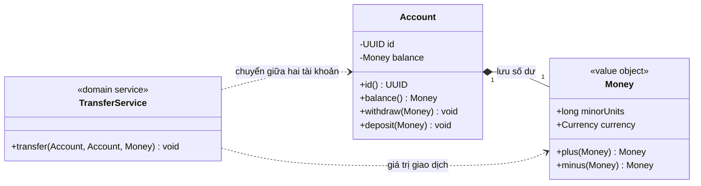

Trong sơ đồ:

- `Account` có định danh riêng và giữ **giá trị số dư hiện tại**. Mỗi khi số dư đổi, ta có thể tạo một `Money` mới.
- `Money` biểu diễn số lượng đơn vị tiền tệ và mã tiền tệ; *hai Money bằng giá trị* không đồng nghĩa các tài khoản giữ chúng là một tài khoản.
- `TransferService` phối hợp thay đổi hai entity, dùng cùng một Money làm số tiền chuyển.

Hình thoi ở đây minh họa **sở hữu giá trị số dư như một phần trạng thái tài khoản**; vòng đời và các ràng buộc được quyết định bởi mô hình, không phải do cú pháp Java tự thực hiện. Một Value Object hoàn toàn có thể được chia sẻ giữa nhiều entity nếu nó bất biến.

## 4. Entity: điều cốt lõi là danh tính

Một `Account` có các thuộc tính:

```text
id       = 4d3d... (định danh ổn định)
balance  = 100.000 VND
status   = ACTIVE
```

Sau khi chủ tài khoản rút 30.000 VND, `balance` còn 70.000 VND nhưng `id` không đổi. Hệ thống phải nhận ra đây **vẫn là cùng tài khoản**.

Ví dụ tối giản:

```java
import java.util.Objects;
import java.util.UUID;

final class Customer {
    private final UUID id;
    private String displayName;

    Customer(UUID id, String displayName) {
        this.id = Objects.requireNonNull(id, "id");
        rename(displayName);
    }

    UUID id() {
        return id;
    }

    String displayName() {
        return displayName;
    }

    void rename(String newName) {
        if (newName == null || newName.isBlank()) {
            throw new IllegalArgumentException("Name is required");
        }
        this.displayName = newName;
    }

    @Override
    public boolean equals(Object other) {
        return other instanceof Customer customer
                && id.equals(customer.id);
    }

    @Override
    public int hashCode() {
        return id.hashCode();
    }
}
```

Trong thiết kế này, **hai instance `Customer` với cùng UUID đại diện cho cùng thực thể**, dù `displayName` khác nhau (ví dụ hai bản chụp của dữ liệu trước/sau khi đổi tên). Sử dụng `displayName` để tính `hashCode()` sẽ rất rủi ro nếu tên thay đổi trong khi object nằm trong `HashSet`.

Tuy nhiên, không có một quy tắc `equals()/hashCode()` áp dụng máy móc cho mọi hệ thống:

- **ID được cấp khi tạo** và bất biến (UUID, ULID, ID miền nghiệp vụ): có thể dùng so sánh theo ID ổn định như ví dụ.
- **ID do database cấp sau khi lưu:** entity chưa được persist có ID `null`; nếu dùng ID tùy tiện, hai entity mới có thể bị coi bằng nhau, hoặc hash thay đổi sau persist.
- **ORM/JPA proxy và kế thừa:** cần quy tắc so sánh tương thích với vòng đời persistence và kiểu proxy. Không sao chép bừa `getClass()`/`instanceof` từ bài ví dụ vào entity JPA phức tạp.
- Nếu không thực sự cần *logical equality* giữa các instance, cân nhắc so sánh ID một cách tường minh thay vì override equality.

Một Entity tốt thường **đóng gói trạng thái và quy tắc chuyển trạng thái**: `account.withdraw(...)`, `order.cancel(...)`, `customer.rename(...)`. Việc chỉ có hàng loạt getter/setter công khai khiến logic nghiệp vụ dễ bị phân tán.

## 5. Value Object: bằng nhau vì giá trị, không vì danh tính

Một `Money` gồm **số tiền theo đơn vị nhỏ nhất** (*minor units*) và **loại tiền**:

- `new Money(10_000, VND)` tương đương một đối tượng khác có cùng cặp thuộc tính.
- `new Money(10_000, USD)` **không bằng** Money 10.000 VND.
- Ở VND, minor unit phổ biến là 1 đồng (ISO 4217 quy định 0 chữ số thập phân). Ở USD, 1.999 minor units là 19,99 USD (100 cents = 1 USD).
- Phép cộng chỉ hợp lệ khi cùng tiền tệ; nếu cần quy đổi, phải có tỷ giá và chính sách làm tròn rõ ràng.

**Tại sao cần một class Money thay vì dùng `long` hoặc `double` đơn thuần?**

```java
double price = 0.1 + 0.2;
System.out.println(price == 0.3); // false
```

Kiểu `double` biểu diễn các số nhị phân dấu phẩy động, nên không thích hợp để biểu diễn chính xác nhiều giá trị tiền thập phân. `long` với minor units hoặc `BigDecimal` với scale/rounding có quy ước rõ ràng thường phù hợp hơn.

Với **Java 17+**, `record` là cách ngắn gọn tạo Value Object bất biến ở mức trường dữ liệu:

```java
import java.util.Currency;
import java.util.Objects;

record Money(long minorUnits, Currency currency) {
    Money {
        Objects.requireNonNull(currency, "currency");
    }

    static Money vnd(long dong) {
        return new Money(dong, Currency.getInstance("VND"));
    }

    Money plus(Money other) {
        sameCurrency(other);
        return new Money(
                Math.addExact(minorUnits, other.minorUnits), currency);
    }

    Money minus(Money other) {
        sameCurrency(other);
        return new Money(
                Math.subtractExact(minorUnits, other.minorUnits), currency);
    }

    private void sameCurrency(Money other) {
        Objects.requireNonNull(other, "other");
        if (!currency.equals(other.currency)) {
            throw new IllegalArgumentException("Currency mismatch");
        }
    }
}
```

`record` sinh `equals()`, `hashCode()` và `toString()` dựa trên các thành phần của record. Ví dụ:

```java
Money first = Money.vnd(50_000);
Money second = Money.vnd(50_000);

System.out.println(first == second);      // false: hai instance
System.out.println(first.equals(second)); // true: cùng giá trị
System.out.println(first.plus(second));   // Money[minorUnits=100000, currency=VND]
```

Phương thức `plus()` **tạo Money mới**, không sửa đối tượng gốc. `Math.addExact()` và `Math.subtractExact()` phát hiện tràn số nguyên thay vì âm thầm cho kết quả sai.

**Record chỉ bất biến nông (*shallow immutability*)**. Nếu field chứa `List` có thể sửa hoặc object lồng nhau mutable, cần sao chép phòng vệ và thiết kế cẩn thận. Ví dụ `record Basket(List<Item> items)` mặc định vẫn có thể bị thay đổi qua `basket.items().add(...)` nếu không bảo vệ danh sách. Ở `Money` trên, `Currency` bất biến nên an toàn để chia sẻ.

**Một điểm quan trọng về BigDecimal:** `new BigDecimal("10.0").equals(new BigDecimal("10.00"))` trả `false` vì khác scale, dù `compareTo() == 0`. Nếu Money dùng BigDecimal, hãy chuẩn hóa scale/ràng buộc ngay ở constructor và thống nhất cách so sánh, làm tròn.

## 6. Service: hành vi không thuộc riêng một entity hay value object

Một tài khoản có thể tự đảm bảo rằng **số dư không âm khi rút tiền**. Một Money có thể tự kiểm tra **cùng loại tiền khi cộng**. Nhưng hành vi “chuyển tiền từ A sang B” liên quan **hai Account**, nên việc đặt nó vào `Account A` hoặc `Account B` có thể làm trách nhiệm một bên bị méo.

Một **Domain Service** thể hiện hành vi miền nghiệp vụ phối hợp các object, khi hành vi ấy **không có chủ thể tự nhiên duy nhất**. Ví dụ `TransferService.transfer(from, to, amount)`. Trong nhiều trường hợp domain service có thể stateless; điều này **không đồng nghĩa mọi service đều không có field**.

Một **Application Service** lại điều phối *use case* hoàn chỉnh: xác thực/quyền, mở transaction, tải các entity từ repository, gọi hành vi domain, lưu kết quả, phát sự kiện hoặc gửi thông báo. Nó nên tránh làm thay những quy tắc thực chất thuộc Entity/Value Object.

Ví dụ hai tầng:

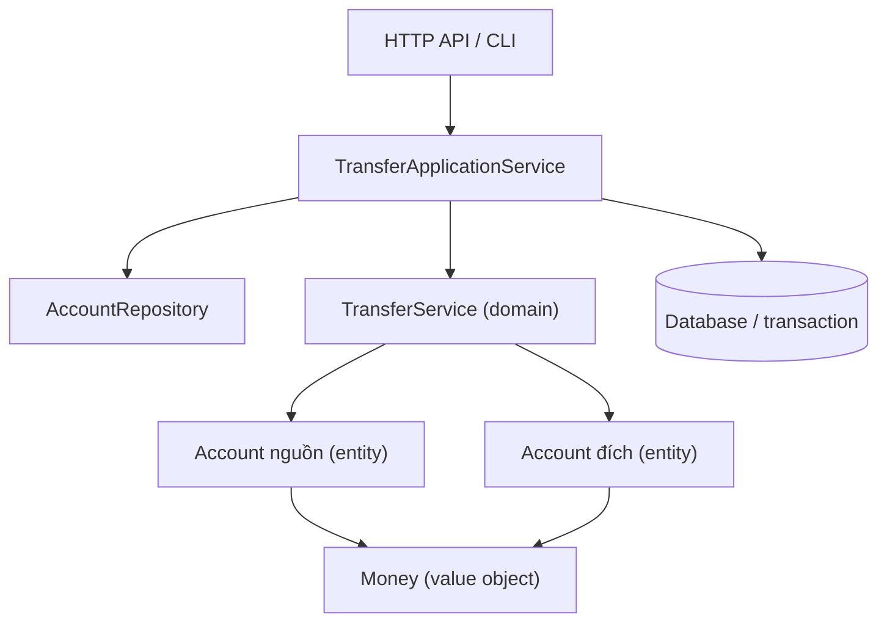

Đường `ApplicationService → repository/transaction` giúp tách công việc lấy/lưu dữ liệu khỏi **quy tắc chuyển tiền**. Trong ứng dụng rất nhỏ, có thể không cần tách mọi tầng thành class riêng; điều quan trọng là trách nhiệm đúng nơi và dễ kiểm thử.

## 7. Ví dụ hoàn chỉnh Java 17+: Account, Money và TransferService

Lưu toàn bộ mã sau vào file `EntityValueServiceDemo.java`:

```java
import java.util.Currency;
import java.util.Objects;
import java.util.UUID;

public class EntityValueServiceDemo {

    // VALUE OBJECT: bằng nhau theo nội dung, bất biến.
    record Money(long minorUnits, Currency currency) {
        Money {
            Objects.requireNonNull(currency, "currency");
        }

        static Money vnd(long dong) {
            return new Money(dong, Currency.getInstance("VND"));
        }

        Money plus(Money other) {
            requireSameCurrency(other);
            return new Money(
                    Math.addExact(minorUnits, other.minorUnits),
                    currency);
        }

        Money minus(Money other) {
            requireSameCurrency(other);
            return new Money(
                    Math.subtractExact(minorUnits, other.minorUnits),
                    currency);
        }

        private void requireSameCurrency(Money other) {
            Objects.requireNonNull(other, "other");
            if (!currency.equals(other.currency)) {
                throw new IllegalArgumentException(
                        "Currency mismatch: " + currency
                                + " vs " + other.currency);
            }
        }
    }

    // ENTITY: định danh riêng, số dư thay đổi theo thời gian.
    static final class Account {
        private final UUID id;
        private Money balance;

        Account(UUID id, Money openingBalance) {
            this.id = Objects.requireNonNull(id, "id");
            this.balance = Objects.requireNonNull(
                    openingBalance, "openingBalance");
            if (balance.minorUnits() < 0) {
                throw new IllegalArgumentException(
                        "Opening balance must be nonnegative");
            }
        }

        UUID id() {
            return id;
        }

        Money balance() {
            return balance;
        }

        void deposit(Money amount) {
            requirePositive(amount);
            balance = balance.plus(amount);
        }

        void withdraw(Money amount) {
            requirePositive(amount);
            Money next = balance.minus(amount);
            if (next.minorUnits() < 0) {
                throw new IllegalStateException("Insufficient funds");
            }
            balance = next;
        }

        private static void requirePositive(Money amount) {
            Objects.requireNonNull(amount, "amount");
            if (amount.minorUnits() <= 0) {
                throw new IllegalArgumentException(
                        "Amount must be positive");
            }
        }

        @Override
        public boolean equals(Object other) {
            return other instanceof Account account
                    && id.equals(account.id);
        }

        @Override
        public int hashCode() {
            return id.hashCode();
        }
    }

    // DOMAIN SERVICE: quy tắc chuyển tiền qua hai Entity.
    static final class TransferService {
        void transfer(Account from, Account to, Money amount) {
            Objects.requireNonNull(from, "from");
            Objects.requireNonNull(to, "to");
            Objects.requireNonNull(amount, "amount");

            if (from.id().equals(to.id())) {
                throw new IllegalArgumentException(
                        "Cannot transfer to the same account");
            }

            if (amount.minorUnits() <= 0) {
                throw new IllegalArgumentException(
                        "Amount must be positive");
            }

            // Kiểm tra cả hai số dư trước khi bắt đầu thay đổi.
            Money sourceAfter = from.balance().minus(amount);
            if (sourceAfter.minorUnits() < 0) {
                throw new IllegalStateException("Insufficient funds");
            }
            to.balance().plus(amount); // Kiểm tra cùng currency và tràn số.

            from.withdraw(amount);
            to.deposit(amount);
        }
    }

    public static void main(String[] args) {
        Money a = Money.vnd(50_000);
        Money b = Money.vnd(50_000);
        System.out.println("Money equals: " + a.equals(b));

        Account source = new Account(
                UUID.fromString(
                        "00000000-0000-0000-0000-000000000001"),
                Money.vnd(100_000));
        Account destination = new Account(
                UUID.fromString(
                        "00000000-0000-0000-0000-000000000002"),
                Money.vnd(20_000));

        TransferService transfers = new TransferService();
        transfers.transfer(source, destination, Money.vnd(30_000));

        System.out.println("Source: "
                + source.balance().minorUnits() + " VND");
        System.out.println("Destination: "
                + destination.balance().minorUnits() + " VND");

        Account anotherSnapshot = new Account(
                source.id(), Money.vnd(999));
        System.out.println("Same Account identity: "
                + source.equals(anotherSnapshot));

        // Transfer không hợp lệ: source chỉ còn 70.000 VND.
        try {
            transfers.transfer(
                    source, destination, Money.vnd(90_000));
            throw new AssertionError("Expected insufficient funds");
        } catch (IllegalStateException expected) {
            System.out.println("Rejected: " + expected.getMessage());
        }

        System.out.println("Source after rejection: "
                + source.balance().minorUnits() + " VND");
    }
}
```

Biên dịch và chạy với JDK 17 hoặc mới hơn:

```bash
javac EntityValueServiceDemo.java
java EntityValueServiceDemo
```

Kết quả dự kiến:

```text
Money equals: true
Source: 70000 VND
Destination: 50000 VND
Same Account identity: true
Rejected: Insufficient funds
Source after rejection: 70000 VND
```

### Phân tích vai trò trong ví dụ

**`Account` là Entity.** Sau chuyển tiền, số dư từ 100.000 VND giảm còn 70.000 VND nhưng `source.id()` không đổi. Hai đối tượng Account cùng UUID được xem là cùng *danh tính miền nghiệp vụ* trong quy ước của ví dụ, dù snapshot số dư khác nhau. Không nên đồng thời dùng hai snapshot cùng ID như hai bản ghi độc lập có thể cập nhật tự do.

**`Money` là Value Object.** Hai Money 50.000 VND khác instance nhưng `equals()` bằng nhau. Mỗi phép cộng/trừ trả một Money mới. `Money` tự giữ quy tắc về loại tiền và phát hiện tràn số; nó không cần biết số dư thuộc tài khoản nào.

**`TransferService` là Domain Service.** Nó phối hợp hai tài khoản: cấm chuyển về cùng tài khoản, yêu cầu amount dương, kiểm tra đủ tiền và currency trước khi gọi hành vi của các entity. Đây là quy tắc trên *mối tương tác*, không phải trách nhiệm tự nhiên của riêng Money.

**Giới hạn thực tế cần hiểu:** ví dụ chỉ mô hình hóa thao tác **tuần tự trong bộ nhớ**. Việc kiểm tra trước rồi gọi `withdraw()` và `deposit()` **chưa tạo ra atomic transaction** trong trường hợp đa luồng, nhiều tiến trình, crash hoặc có DB. Với hệ thống chuyển tiền thật, phải bổ sung cơ chế transaction, locking/optimistic concurrency, kiểm tra số dư nhất quán tại cơ sở dữ liệu, idempotency, audit và cách xử lý lỗi. Preflight ở code demo chỉ giúp tránh một số lỗi trước khi bắt đầu cập nhật.

## 8. Quy tắc nào đặt ở đâu?

Giả sử cùng miền nghiệp vụ quản lý đơn hàng:

| Quy tắc/hành vi | Nơi thường phù hợp | Vì sao |
|---|---|---|
| Email phải đúng định dạng mà hệ thống chấp nhận | `EmailAddress` (Value Object) | Bất biến thuộc chính dữ liệu email |
| Không được thêm dòng đơn có số lượng âm | `Order.addLine()` hoặc `OrderLine` | Bất biến của thực thể/giá trị trong đơn |
| Một đơn đã hủy không thể chuyển sang đã thanh toán | `Order.pay()` | Quy tắc chuyển trạng thái của cùng Entity |
| Hai khoản Money chỉ cộng khi cùng tiền tệ | `Money.plus()` | Quy tắc toán học của giá trị |
| Chọn cách tính phí vận chuyển từ cân nặng, vùng và chính sách áp dụng | Có thể là `ShippingFeeCalculator` (Domain Service) | Nếu chính sách tính phí không thuộc riêng một entity |
| Tải đơn, kiểm tra quyền, gọi thanh toán, lưu và phát sự kiện | `PlaceOrderApplicationService` | Điều phối use case và hạ tầng |
| Truy vấn đơn hàng theo mã từ DB | `OrderRepository` | Trừu tượng hóa truy cập dữ liệu, không phải Entity |
| Trả JSON dữ liệu hiển thị cho client | DTO/Presenter/API layer | Trách nhiệm giao tiếp, không phải Entity miền nghiệp vụ |

**Đừng đẩy mọi quy tắc vào Service.** Nếu `Order` chỉ có getter/setter còn mọi kiểm tra “đã hủy chưa”, “được thanh toán chưa”, “có thể thêm dòng không” nằm rải rác ở hàng chục service, mô hình dễ trở thành *anemic domain model*. Ứng dụng CRUD đơn giản đôi khi chấp nhận thiết kế này, nhưng miền nghiệp vụ nhiều bất biến thường hưởng lợi khi hành vi nằm gần dữ liệu của Entity/Value Object.

**Cũng đừng cố gắn mọi hàm vào Entity.** Một thuật toán tính giá vận chuyển có thể liên quan chính sách bảng giá, vùng giao hàng và gói dịch vụ. Nếu không có một entity rõ ràng sở hữu thuật toán, Domain Service là lựa chọn hợp lý.

## 9. Domain Service khác Application Service thế nào?

Cả hai có thể có hậu tố `Service`, nhưng nằm ở trách nhiệm khác nhau.

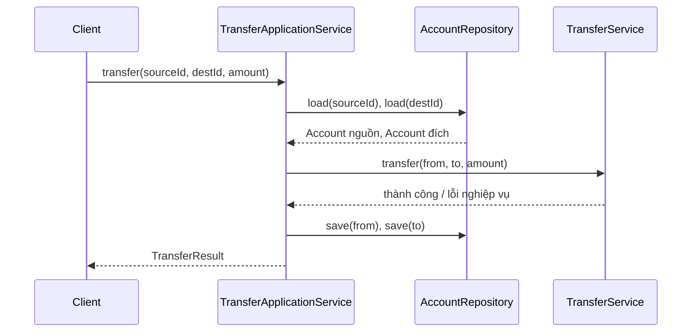

Một thiết kế hướng đối tượng có thể dùng các hợp đồng:

```java
// Trích đoạn minh họa về cấu trúc tầng ứng dụng,
// giả định Account, Money và TransferService là các kiểu của domain.
interface AccountRepository {
    Account load(java.util.UUID id);
    void save(Account account);
}

final class TransferApplicationService {
    private final AccountRepository accounts;
    private final TransferService domainTransfers;

    TransferApplicationService(
            AccountRepository accounts,
            TransferService domainTransfers) {
        this.accounts = java.util.Objects.requireNonNull(accounts);
        this.domainTransfers =
                java.util.Objects.requireNonNull(domainTransfers);
    }

    void transfer(java.util.UUID sourceId,
                  java.util.UUID destinationId,
                  Money amount) {
        Account from = accounts.load(sourceId);
        Account to = accounts.load(destinationId);

        domainTransfers.transfer(from, to, amount);

        accounts.save(from);
        accounts.save(to);
    }
}
```

Trích đoạn này trình bày **phân công trách nhiệm**, không phải implementation giao dịch production. Hai lệnh `save()` riêng biệt có thể thất bại giữa chừng. Trong ứng dụng có DB, *ranh giới transaction* thường thuộc Application Service/infrastructure: cần bảo đảm hai cập nhật số dư được commit/rollback thống nhất; với hệ phân tán còn có những giới hạn khác.

Sự phân biệt chính:

- **Domain Service:** thể hiện quy tắc miền (*chuyển tiền hợp lệ ra sao?*), có thể kiểm thử bằng entity/VO thuần.
- **Application Service:** điều phối thao tác của người dùng/hệ thống (*tải gì, xác thực ai, mở transaction, lưu gì, trả gì?*).
- **Infrastructure Service/Adapter:** hiện thực việc gửi email, truy cập database, gọi HTTP, lưu file hoặc cache.

Không nhất thiết cứ một nghiệp vụ là phải có ba lớp service riêng. Nếu Entity đã sở hữu trọn hành vi, gọi trực tiếp Entity từ Application Service có thể đơn giản và rõ hơn.

## 10. Phân biệt Entity miền nghiệp vụ với JPA Entity

Một class có `@jakarta.persistence.Entity` là **thực thể persistence** trong JPA. Điều đó không tự đảm bảo class được thiết kế tốt như **Domain Entity**:

- JPA thường cần constructor, chiến lược khóa chính, lazy-loading và quy tắc quản lý phiên.
- ID dùng trong database không nhất thiết là **định danh miền** hiển thị ra API hoặc người dùng.
- Một Domain Value Object có thể được map bằng `@Embeddable`, converter hoặc lưu dưới dạng cột khác.
- Một Domain Entity có thể được lưu qua repository bằng JDBC, tài liệu NoSQL, event store, file, hoặc thậm chí tồn tại chỉ trong bộ nhớ; nó không bắt buộc phải có `@Entity`.
- Spring `@Service` là stereotype để framework phát hiện bean; annotation đó **không quyết định** bean là Domain Service hay Application Service.

Ví dụ minh họa giá trị nhúng trong JPA:

```java
// Pseudocode minh họa ý tưởng ánh xạ; cần JPA dependency/annotation
// và cấu hình phù hợp trong dự án thực.
@Embeddable
class MoneyEmbeddable {
    long minorUnits;
    String currencyCode;
}
```

Không chọn Entity/Value Object **chỉ vì cách lưu vào DB**. Nên xuất phát từ quy tắc miền, rồi mới chọn ánh xạ persistence phù hợp.

## 11. Những lỗi thiết kế thường gặp

### Sai lầm 1: coi hai Entity có cùng thuộc tính là một

Hai khách hàng cùng tên “Lan” và cùng ngày sinh chưa chắc là cùng người. Equality của Entity phải dựa vào khái niệm danh tính đúng phạm vi nghiệp vụ, tránh chọn thuộc tính có thể trùng hoặc thay đổi.

### Sai lầm 2: lưu Value Object mutable và dùng làm khóa Map

```java
// Không nên: lớp địa chỉ có thể sửa và hashCode phụ thuộc thành phần.
Map<Address, Integer> counts = new HashMap<>();
counts.put(address, 1);
address.setStreet("Đường khác");
```

Nếu hash thay đổi sau khi chèn, thao tác `get(address)` có thể trả kết quả không mong đợi. Dùng Value Object bất biến; thay địa chỉ bằng một instance mới.

### Sai lầm 3: dùng primitive trần cho giá trị nhiều quy tắc

```java
void charge(double amount, String currency);
```

Caller có thể truyền âm, NaN, mã tiền tệ sai hoặc làm tròn tùy ý. Một `Money` VO có constructor kiểm tra hợp lệ và API tính toán rõ ràng sẽ an toàn hơn.

### Sai lầm 4: Service biết/sửa toàn bộ field nội bộ

```java
// Tránh mở public field để service tự gán không có kiểm soát:
account.balance = account.balance.minus(amount);
```

Đặt bất biến gần Entity và cung cấp hành vi có tên. Với logic qua nhiều entity, domain service **phối hợp thông qua API hợp lệ** của entity, hạn chế xuyên thủng encapsulation.

### Sai lầm 5: tạo Service cho mọi phép tính

Nếu `Money.plus()` chỉ là cộng hai giá trị và kiểm tra currency, không cần `MoneyAdditionService` riêng. Logic tự nhiên thuộc Value Object.

### Sai lầm 6: tạo Entity cho từng value

Nếu `EmailAddress("a@example.test")` không có vòng đời độc lập và không cần ID riêng, việc thêm `emailId` cùng repository cho từng email chỉ làm mô hình phức tạp. Cần Entity khi **danh tính và lịch sử độc lập thật sự có ý nghĩa**.

### Sai lầm 7: nhầm stateless service với không có dependency

```java
final class ShippingFeeService {
    private final FeePolicy policy;

    ShippingFeeService(FeePolicy policy) {
        this.policy = policy;
    }

    Money calculate(Shipment shipment) {
        return policy.feeFor(shipment);
    }
}
```

Service có thể giữ **tham chiếu đến dependency**, ví dụ chính sách tính phí, nhưng vẫn không lưu **trạng thái nghiệp vụ thay đổi theo từng lần tính**. Stateless mô tả cách quản lý trạng thái xử lý, không có nghĩa field phải luôn rỗng.

## 12. Khi thiết kế lớp mới, tự hỏi sáu điều

1. **Thay đổi thuộc tính có làm nó thành một đối tượng khác không?** Nếu không, có thể là Entity. Một đơn hàng thay trạng thái vẫn là đơn hàng ấy.
2. **Hai object có cùng nội dung có thay thế được cho nhau không?** Nếu có và không cần danh tính riêng, nghiêng về Value Object.
3. **Có quy tắc hợp lệ/tính toán gắn chặt với dữ liệu này không?** Đặt trong VO hoặc Entity thay vì sao chép ở các service.
4. **Hành vi tác động đến nhiều Entity hoặc một chính sách miền không thuộc hẳn object nào?** Cân nhắc Domain Service.
5. **Hành vi chủ yếu điều phối transaction, repository, quyền, network?** Cân nhắc Application Service hoặc infrastructure adapter.
6. **Nếu business rule thay đổi, có sửa tại một nơi dễ tìm không?** Nếu phải dò nhiều controller/service/mapper, ranh giới trách nhiệm có thể chưa hợp lý.

## 13. Bài tập và cách tự kiểm chứng

**Bài 1 — Customer và EmailAddress.** Mỗi khách hàng có UUID và email. Khách có thể đổi email.

- **Gợi ý:** `Customer` là Entity vì UUID vẫn giữ nguyên; `EmailAddress` là VO bất biến, có thể thay instance khi đổi email. Đổi email cần đi qua hành vi của Customer và qua kiểm tra uniqueness ở ranh giới phù hợp nếu hệ thống yêu cầu.

**Bài 2 — Hai địa chỉ giống nhau.** Hai khách hàng khác nhau cùng nhận hàng tại “12 Nguyễn Huệ, TP.HCM”.

- **Gợi ý:** hai VO Address có thể bằng nhau theo giá trị, nhưng hai Entity Customer vẫn khác nhau. Không dùng địa chỉ làm danh tính khách hàng.

**Bài 3 — Giảm số dư khi rút.** Nên đặt điều kiện “không được âm số dư” ở đâu?

- **Gợi ý:** Entity `Account` bảo vệ bất biến số dư khi rút; `Money` bảo vệ currency và phép toán. Nếu nhiều tài khoản tương tác, domain service phối hợp.

**Bài 4 — Thanh toán rồi gửi email.** `PayOrderApplicationService` cần tải order, kiểm tra quyền, gọi cổng thanh toán, lưu trạng thái và phát thông báo.

- **Gợi ý:** orchestration ở Application Service. Entity `Order` quyết định liệu trạng thái được phép chuyển sang `PAID`; gateway/email nằm ở adapter. Tránh dồn mọi quyết định vào service.

**Bài 5 — Test với Java ví dụ.** Hãy mở rộng `EntityValueServiceDemo.java` để xác nhận:

```java
// Đặt trong main, sau khi khởi tạo hai Account:
Money x = Money.vnd(5_000);
Money y = Money.vnd(5_000);
if (!x.equals(y) || x == y) {
    throw new AssertionError("Value Object equality failed");
}

Money beforeSource = source.balance();
Money beforeDest = destination.balance();
try {
    transfers.transfer(source, destination, Money.vnd(-10));
    throw new AssertionError("Negative amount must fail");
} catch (IllegalArgumentException expected) {
    // Thao tác không hợp lệ đã bị chặn.
}

if (!source.balance().equals(beforeSource)
        || !destination.balance().equals(beforeDest)) {
    throw new AssertionError("Invalid transfer changed balances");
}
```

Đây là kiểm thử quy tắc **đầu vào âm bị từ chối** trong luồng tuần tự. Muốn bảo đảm chuyển tiền thật sự nguyên tử khi có hai luồng hoặc nhiều tiến trình, cần kiểm thử ở mức transaction/concurrency của hệ thống lưu trữ.

---

**Ghi nhớ:** **Entity** được nhận diện bằng *danh tính*, **Value Object** được nhận diện bằng *giá trị*, còn **Service** thể hiện *hành vi/phối hợp* phù hợp với ranh giới miền hoặc use case. Phân vai chính xác giúp các bất biến nằm đúng chỗ, giảm lặp logic và khiến việc thay đổi, kiểm thử lớp Java dễ hơn.


</details>

- [Quay lại đầu trang](#back-to-top)

---

## <a id="class-design-007">Mô hình giàu hành vi và mô hình chỉ chứa dữ liệu</a>

<details>
<summary>Xem chi tiết</summary>

# Mô hình giàu hành vi và mô hình chỉ chứa dữ liệu trong OOP (Java)

Khi thiết kế các lớp, ta thường đứng trước một lựa chọn: lớp `Order` chỉ chứa các trường `status`, `items`, `total` cùng getter/setter, hay nó phải biết **cách thêm sản phẩm, tính tổng tiền, xác nhận đơn và từ chối thay đổi không hợp lệ**?

Đây là điểm khác biệt cốt lõi giữa **Rich Domain Model (mô hình miền giàu hành vi)** và **Anemic Domain Model (mô hình miền thiếu hành vi, thường chỉ chứa dữ liệu)**. Cả hai đều có các lớp biểu diễn dữ liệu, nhưng khác nhau về **nơi đặt quy tắc nghiệp vụ, quyền thay đổi trạng thái và cách bảo vệ bất biến**.

Mục tiêu bài này: hiểu sự khác biệt, đọc và thiết kế Java đúng, chọn kiến trúc theo độ phức tạp nghiệp vụ, biết khi nào cần một domain service và kiểm thử các trạng thái hợp lệ.

## 1. Hai cách mô hình hóa cùng một bài toán

Giả sử ứng dụng bán hàng có quy tắc:

1. Một đơn hàng bắt đầu ở `DRAFT`.
2. Có thể thêm sản phẩm khi còn `DRAFT`; mỗi dòng hàng có số lượng dương và đơn giá không âm.
3. Chỉ được xác nhận khi đơn có ít nhất một dòng.
4. Sau khi `CONFIRMED`, không được thêm sản phẩm.
5. Tổng tiền phải luôn bằng tổng thành tiền của các dòng hàng.

### Mô hình chỉ chứa dữ liệu (anemic)

```java
// Minh họa một kiểu anemic có thể gây lỗi nếu mở setter công khai.
class OrderData {
    public String id;
    public String status;
    public java.util.List<OrderLineData> lines;
    public long totalCents;
}

class OrderLineData {
    public String sku;
    public int quantity;
    public long unitPriceCents;
}
```

Logic nghiệp vụ thường bị đẩy sang service:

```java
// Phác thảo: toàn bộ nghiệp vụ ở service.
void confirm(OrderData order) {
    if (order.lines == null || order.lines.isEmpty()) {
        throw new IllegalStateException("Empty order");
    }
    order.status = "CONFIRMED";
}
```

Vấn đề là một caller khác vẫn có thể sửa thẳng `order.status = "CONFIRMED"` hoặc `order.totalCents = -1` mà không cần qua `confirm`. Nếu nhiều service tự thực hiện các bước kiểm tra, quy tắc dễ trùng lặp và không đồng nhất.

**Không phải mọi lớp dữ liệu đều xấu.** DTO để nhận/trả HTTP, đối tượng cấu hình, record truyền dữ liệu hay dữ liệu kết quả truy vấn có thể rất hợp lý khi chỉ mang giá trị. “Anemic Domain Model” đáng chú ý khi **mô hình nghiệp vụ vốn có nhiều quy tắc**, nhưng entity không giữ được hành vi hay bất biến của mình.

### Mô hình giàu hành vi (rich)

```java
// API ở mức ý tưởng:
order.addItem("BOOK", 2, 120_00);
order.confirm();
long payable = order.totalCents();

// Không cung cấp order.setStatus(...) hoặc
// order.setTotalCents(...) cho bên ngoài gọi tùy ý.
```

Tại đây `Order` biết **cái gì được phép làm với trạng thái của chính nó**. Code gọi đơn hàng dùng ngôn ngữ nghiệp vụ (`addItem`, `confirm`) thay vì lắp ghép setter và hy vọng mọi nơi nhớ hết quy tắc.

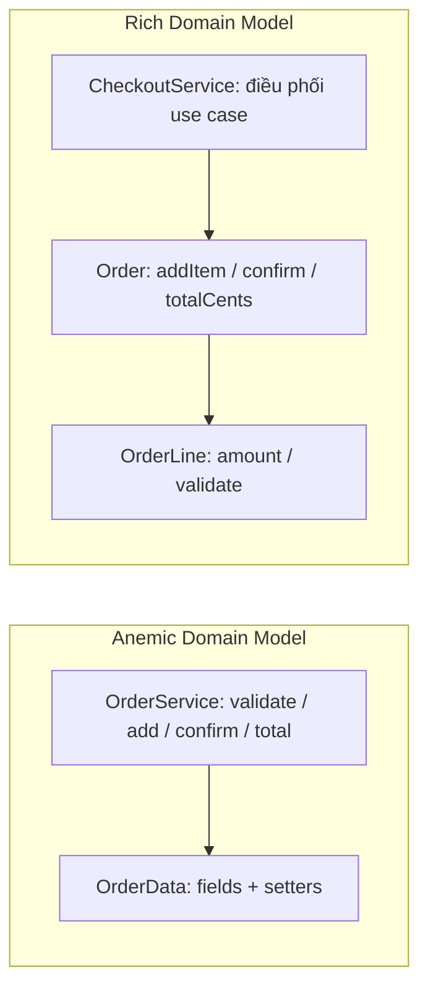

Sơ đồ không nói Rich Model phải chứa **mọi** thao tác. Lưu database, gửi email, gọi API vận chuyển vẫn thuộc những thành phần bên ngoài; chúng không phải hành vi tự nhiên của đối tượng `Order`.

## 2. So sánh theo các tiêu chí quan trọng

| Tiêu chí | Rich Domain Model | Anemic Domain Model |
| --- | --- | --- |
| Entity có gì? | Dữ liệu, hành vi và ràng buộc đi cùng nhau | Chủ yếu field, getter/setter hoặc record |
| Nơi giữ invariant của entity | Trong constructor/factory và phương thức nghiệp vụ | Thường ở service bên ngoài, dễ bị bỏ qua nếu mở mutation |
| Cách cập nhật | `order.confirm()`, `account.withdraw(amount)` | `order.setStatus(...)` hoặc service sửa field |
| Độ gắn kết (*cohesion*) | Hành vi liên quan tới dữ liệu ở gần nhau | Có thể tách xa dữ liệu và hành vi |
| Nguy cơ trùng quy tắc | Thấp hơn nếu API bảo vệ trạng thái | Cao hơn nếu nhiều service cùng sửa dữ liệu |
| Độ đơn giản ban đầu | Cần thiết kế domain API và trạng thái | Ít code hơn cho dữ liệu đơn giản/CRUD |
| Tính phù hợp | Nghiệp vụ nhiều quy tắc, trạng thái, chuyển đổi | DTO, mapping, báo cáo, CRUD đơn giản với quy tắc ít |
| Điểm cần cảnh giác | Entity phình to, gọi I/O trong domain, khó load ORM | “Transaction script” rải rác và setter làm mất invariant |

**Không thể kết luận một kiến trúc chỉ bằng việc có getter/setter hay không.** Một entity có thể dùng getter, có method update được kiểm soát và vẫn là mô hình giàu hành vi. Một lớp dữ liệu bất biến do service tạo ra vẫn có thể tạo thành thiết kế tốt nếu nghiệp vụ thực sự đơn giản.

## 3. Bất biến (invariant): tiêu chí quan trọng nhất

**Invariant** là điều kiện phải đúng với mọi trạng thái được công khai là hợp lệ của đối tượng.

Đối với đơn hàng:

- `lines` không được chứa dòng có `quantity <= 0`.
- `totalCents` không âm, bằng tổng các `quantity × unitPriceCents`.
- `CONFIRMED` chỉ đạt được khi có dòng hàng.
- Sau `CONFIRMED`, không thể gọi `addItem` thành công.
- Trạng thái chỉ chuyển theo những quy tắc được định nghĩa.

Trong rich model, các hành vi được thiết kế quanh bất biến:

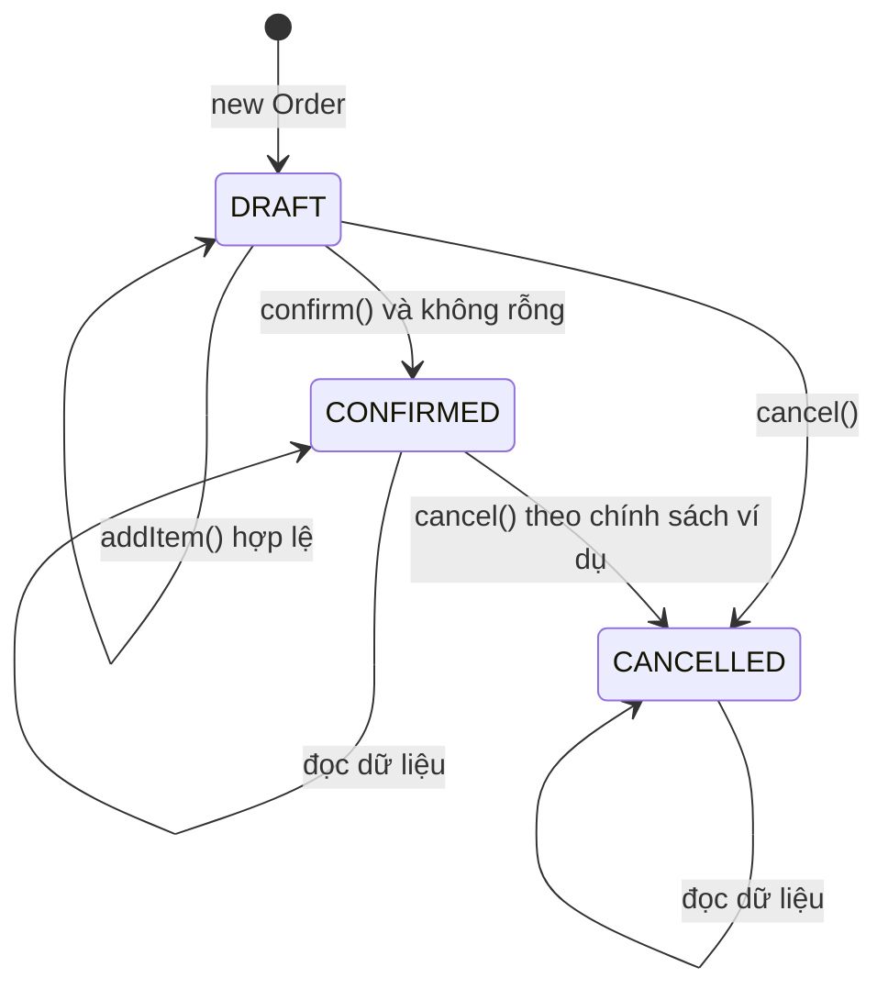

Trong dự án thật, việc hủy đơn đã thanh toán có thể cần hoàn tiền, kiểm tra vận chuyển và nhiều bước khác. Sơ đồ chỉ thể hiện **một chính sách đơn giản**. Phải xác định trạng thái và bước chuyển theo nghiệp vụ cụ thể, không tự áp đặt trạng thái `CANCELLED` cho mọi hệ thống.

## 4. Ví dụ Java 17 hoàn chỉnh: Rich Domain Model

Đoạn dưới là **một file Java chạy được**, không cần Spring, JPA, database hay thư viện ngoài. Để việc phân vai rõ ràng, file có:

- `OrderLine`: value object chứa dữ liệu và cách tính thành tiền.
- `Order`: entity/aggregate quản lý dòng hàng, tổng tiền, trạng thái và hành vi.
- `OrderRepository`: cổng lưu/truy vấn.
- `OrderApplicationService`: điều phối use case.
- `ConsoleOrderNotifier`: adapter minh họa tương tác ngoài.

Tạo file `RichVsAnemicDemo.java`:

```java
import java.util.ArrayList;
import java.util.LinkedHashMap;
import java.util.List;
import java.util.Map;
import java.util.Objects;

public class RichVsAnemicDemo {

    enum OrderStatus {
        DRAFT, CONFIRMED, CANCELLED
    }

    // Value object: một dòng đơn hàng hợp lệ ngay từ lúc khởi tạo.
    record OrderLine(String sku, int quantity, long unitPriceCents) {
        OrderLine {
            if (sku == null || sku.isBlank()) {
                throw new IllegalArgumentException("SKU is required");
            }
            if (quantity <= 0) {
                throw new IllegalArgumentException("Quantity must be positive");
            }
            if (unitPriceCents < 0) {
                throw new IllegalArgumentException("Negative unit price");
            }
        }

        long amountCents() {
            return Math.multiplyExact((long) quantity, unitPriceCents);
        }
    }

    static final class Order {
        private final String id;
        private final Map<String, OrderLine> lines = new LinkedHashMap<>();
        private OrderStatus status = OrderStatus.DRAFT;

        Order(String id) {
            if (id == null || id.isBlank()) {
                throw new IllegalArgumentException("Order id is required");
            }
            this.id = id;
        }

        String id() {
            return id;
        }

        OrderStatus status() {
            return status;
        }

        List<OrderLine> lines() {
            // Chỉ trả snapshot; caller không thể sửa danh sách nội bộ.
            return List.copyOf(lines.values());
        }

        void addItem(String sku, int quantity, long unitPriceCents) {
            requireDraft();

            // Tạo value object sẽ tự kiểm tra số lượng/đơn giá.
            OrderLine incoming = new OrderLine(sku, quantity, unitPriceCents);
            OrderLine old = lines.get(incoming.sku());

            OrderLine candidate;
            if (old == null) {
                candidate = incoming;
            } else {
                if (old.unitPriceCents() != incoming.unitPriceCents()) {
                    throw new IllegalArgumentException(
                            "Different price for the same SKU");
                }
                int merged = Math.addExact(
                        old.quantity(), incoming.quantity());
                candidate = new OrderLine(
                        incoming.sku(), merged, incoming.unitPriceCents());
            }

            // Bảo đảm tổng tiền không tràn long trước khi sửa trạng thái.
            long oldAmount = old == null ? 0 : old.amountCents();
            long nextTotal = Math.subtractExact(totalCents(), oldAmount);
            Math.addExact(nextTotal, candidate.amountCents());

            lines.put(candidate.sku(), candidate);
        }

        long totalCents() {
            long total = 0;
            for (OrderLine line : lines.values()) {
                total = Math.addExact(total, line.amountCents());
            }
            return total;
        }

        void confirm() {
            requireDraft();
            if (lines.isEmpty()) {
                throw new IllegalStateException("Cannot confirm empty order");
            }
            status = OrderStatus.CONFIRMED;
        }

        void cancel() {
            if (status == OrderStatus.CANCELLED) {
                return; // gọi lặp giữ nguyên kết quả
            }
            // Chính sách demo cho phép hủy DRAFT và CONFIRMED.
            status = OrderStatus.CANCELLED;
        }

        private void requireDraft() {
            if (status != OrderStatus.DRAFT) {
                throw new IllegalStateException(
                        "Order is not editable: " + status);
            }
        }
    }

    // Port: hợp đồng lưu trữ, domain không biết JDBC hay SQL.
    interface OrderRepository {
        Order getRequired(String orderId);
        void save(Order order);
    }

    // Adapter trong bộ nhớ dùng cho ví dụ.
    static final class InMemoryOrderRepository implements OrderRepository {
        private final Map<String, Order> byId = new LinkedHashMap<>();

        @Override
        public Order getRequired(String orderId) {
            Order found = byId.get(orderId);
            if (found == null) {
                throw new IllegalArgumentException("Order not found");
            }
            return found;
        }

        @Override
        public void save(Order order) {
            Objects.requireNonNull(order, "order");
            byId.put(order.id(), order);
        }
    }

    interface OrderNotifier {
        void confirmed(Order order);
    }

    static final class ConsoleOrderNotifier implements OrderNotifier {
        @Override
        public void confirmed(Order order) {
            System.out.println("Notified: " + order.id());
        }
    }

    // Application service: phối hợp, không lặp quy tắc của Order.
    static final class OrderApplicationService {
        private final OrderRepository orders;
        private final OrderNotifier notifier;

        OrderApplicationService(
                OrderRepository orders, OrderNotifier notifier) {
            this.orders = Objects.requireNonNull(orders);
            this.notifier = Objects.requireNonNull(notifier);
        }

        void addItem(String orderId, String sku, int qty, long priceCents) {
            Order order = orders.getRequired(orderId);
            order.addItem(sku, qty, priceCents);
            orders.save(order);
        }

        void confirm(String orderId) {
            Order order = orders.getRequired(orderId);
            order.confirm();
            orders.save(order);
            notifier.confirmed(order);
        }
    }

    public static void main(String[] args) {
        InMemoryOrderRepository repository = new InMemoryOrderRepository();
        Order order = new Order("O-100");
        repository.save(order);

        OrderApplicationService service = new OrderApplicationService(
                repository, new ConsoleOrderNotifier());

        service.addItem("O-100", "BOOK", 2, 12_000);
        service.addItem("O-100", "PEN", 3, 2_500);

        System.out.println("Total cents: " + order.totalCents());
        service.confirm("O-100");
        System.out.println("State: " + order.status());

        try {
            service.addItem("O-100", "ERASER", 1, 500);
        } catch (IllegalStateException expected) {
            System.out.println(expected.getMessage());
        }

        try {
            Order empty = new Order("O-200");
            empty.confirm();
        } catch (IllegalStateException expected) {
            System.out.println(expected.getMessage());
        }

        order.cancel();
        System.out.println("After cancel: " + order.status());
    }
}
```

Biên dịch và chạy:

```bash
javac RichVsAnemicDemo.java
java RichVsAnemicDemo
```

Kết quả dự kiến:

```text
Total cents: 31500
Notified: O-100
State: CONFIRMED
Order is not editable: CONFIRMED
Cannot confirm empty order
After cancel: CANCELLED
```

### Vì sao ví dụ là “giàu hành vi”?

1. **Không có setter `status` hoặc `totalCents`.** Trạng thái chỉ đổi qua những method có tên và quy tắc cụ thể.
2. **`OrderLine` kiểm tra bất biến của mình.** Dòng hàng không thể được tạo hợp lệ với số lượng bằng 0 hay giá âm.
3. **`Order` giữ quy tắc của aggregate.** Nó quyết định thời điểm được thêm dòng, cộng gộp SKU, từ chối giá không nhất quán và không xác nhận đơn rỗng.
4. **Tổng tiền được tính từ nguồn dữ liệu thực.** Không có field `totalCents` mutable dễ lệch với chi tiết đơn.
5. **Tràn số bị phát hiện rõ.** `Math.multiplyExact` và `Math.addExact` ném `ArithmeticException` thay vì âm thầm tạo tổng sai. Nếu đơn không thể tính tổng hợp lệ, `addItem` không cập nhật dòng mới.
6. **Collection nội bộ không bị lộ ra ngoài.** `lines()` trả `List.copyOf` từ `OrderLine` bất biến; caller không thể thêm/xóa hoặc sửa từng dòng qua getter.

Application service vẫn có giá trị: lấy đơn từ repository, gọi nghiệp vụ, lưu thay đổi, yêu cầu gửi thông báo. Nó không cần tự viết lại `if (status != DRAFT)` hay tính tổng dòng hàng.

### Giới hạn cần hiểu

Ví dụ này **chỉ chạy tuần tự trong bộ nhớ**. `InMemoryOrderRepository` giữ tham chiếu đến cùng một `Order`; nếu `confirm()` thành công mà `save()` hoặc notifier gặp lỗi, ví dụ không có rollback giao dịch. Trong hệ thống thực, thao tác cần transaction phù hợp, cơ chế load/save entity đúng, kiểm soát version/locking khi cập nhật đồng thời và chính sách gửi thông báo sau commit (chẳng hạn transactional outbox).

`long` cent phù hợp để giải thích số học chính xác và giới hạn tràn; với nhiều loại tiền và cách làm tròn khác nhau, nên dùng value object `Money` gồm amount và currency cùng quy tắc scale/rounding rõ ràng. Không sử dụng `double` làm đơn vị lưu trữ cho số tiền nghiệp vụ cần chính xác.

`Order.cancel()` trong demo cho phép hủy đơn đã xác nhận; ứng dụng thực có thể yêu cầu không được hủy khi đã giao, phải hoàn tiền hoặc có phân quyền. Các quy tắc đó cần được đưa vào domain model hoặc service có trách nhiệm phù hợp.

## 5. Điều gì vẫn nên nằm ngoài entity?

“Rich” nghĩa là **giàu hành vi nghiệp vụ**, không phải là một đối tượng biết làm mọi thứ.

| Hành vi | Vị trí thường hợp lý | Lý do |
| --- | --- | --- |
| `Order.addItem` | `Order` | Thay đổi trạng thái và bất biến của chính đơn |
| `Order.confirm` | `Order` | Chuyển trạng thái của aggregate |
| `OrderLine.amountCents` | `OrderLine` | Tính toán trên chính dữ liệu của dòng |
| `CheckoutService.checkout` | Application service | Điều phối nhiều domain object, repository, giao dịch |
| `PricingPolicy.calculate` | Domain policy/service | Quy tắc giá có thể độc lập và cần nhiều đầu vào |
| `OrderRepository.save` | Port + adapter persistence | Tương tác database / kho dữ liệu |
| `EmailSender.send` | Port + adapter email | Giao tiếp với hệ thống ngoài |
| Nhận JSON, trả HTTP status | Controller / web adapter | Hợp đồng giao tiếp API |
| Chạy `@Transactional` | Thường ở application boundary | Phạm vi giao dịch của use case |

Một dấu hiệu sai là để `Order.confirm()` tự gọi `new JdbcConnection(...)` hay `smtp.send(...)`. Khi đó entity phụ thuộc hạ tầng, test chuyển trạng thái phải kéo cả DB/email vào, và lỗi I/O có thể làm rối bất biến. Domain method tốt nhất chỉ thay đổi trạng thái hoặc trả giá trị/sự kiện nghiệp vụ, còn bên ngoài thực hiện side effect.

### Domain service không đồng nghĩa với anemic model

Đôi khi một quy tắc không thuộc rõ về **một** entity:

- Chuyển tiền giữa hai tài khoản đòi kiểm tra cả hai và ghi atomically.
- Áp giá ưu đãi theo cấp khách hàng có thể cần `Customer`, `Order`, `Promotion` và một policy.
- Phân bổ chỗ ngồi có thể cần cả chuyến bay, sơ đồ ghế và quyền đặt.

Dùng domain service/policy cho quy tắc có ngữ cảnh riêng, còn mỗi entity vẫn giữ invariant nội tại. Ví dụ dịch vụ chuyển tiền điều phối `source.withdraw(...)` và `destination.deposit(...)` trong transaction; `Account` chịu trách nhiệm không cho số dư âm khi rút nếu đó là luật của tài khoản.

Ngược lại, đặt tất cả quy tắc ngay trong một service duy nhất, chỉ gọi `setBalance`, `setStatus`, `setLines` thường là dấu hiệu entity đã mất quyền bảo vệ trạng thái.

## 6. Tránh nhầm với DTO, record và POJO

**Record không tự động là anemic.** Một Java record có thể có compact constructor để validate, method tính toán và hành vi bất biến:

```java
record Quantity(int value) {
    Quantity {
        if (value <= 0) {
            throw new IllegalArgumentException("Positive only");
        }
    }

    Quantity plus(Quantity other) {
        return new Quantity(Math.addExact(value, other.value));
    }
}
```

`Quantity` tuy chỉ có một field nhưng có hành vi ý nghĩa, là value object tốt. Ngược lại `record CheckoutRequest(String sku, int quantity)` có thể chỉ là dữ liệu đầu vào, và điều đó hoàn toàn hợp lý.

**POJO** (*Plain Old Java Object*) nói về việc một class Java không bắt buộc kế thừa framework hay base class đặc biệt; không cho biết nó rich hay anemic. **Entity** nói về danh tính/vòng đời; **DTO** nói về vận chuyển dữ liệu; **Rich/Anemic** nói về nơi đặt hành vi nghiệp vụ. Đây là những trục phân loại khác nhau.

| Loại | Mục đích chính | Rich/anemic có bắt buộc không? |
| --- | --- | --- |
| HTTP request DTO | Nhận dữ liệu qua API | Chỉ chứa dữ liệu thường hợp lý |
| HTTP response DTO | Trả dữ liệu cho client | Chỉ chứa dữ liệu thường hợp lý |
| Value object `Money` | Tiền hợp lệ và phép toán trên tiền | Nên bảo vệ invariant và cung cấp hành vi hữu ích |
| Domain entity `Order` | Danh tính, vòng đời, bất biến đơn hàng | Giàu hành vi hữu ích khi có quy tắc/trạng thái |
| ORM persistence entity | Biểu diễn dữ liệu DB | Có thể tách domain, tùy kiến trúc |
| Projection/read model | Dữ liệu báo cáo, query/read-only | Chủ yếu dữ liệu là đủ |
| Domain service | Quy tắc nghiệp vụ xuyên nhiều đối tượng | Có hành vi, không nhất thiết có nhiều trạng thái |

Một hệ thống có thể **kết hợp cả hai cách**: rich model ở phần giao dịch phức tạp; record/DTO cho danh sách tra cứu, báo cáo, nhập xuất và màn hình chỉ đọc.

## 7. Nhìn sâu vào thay đổi nghiệp vụ

Một thiết kế tốt được kiểm chứng khi yêu cầu thay đổi.

**Yêu cầu A:** “Sau khi xác nhận đơn, không cho sửa mặt hàng.”

- Với rich model, quy tắc được đặt trong `Order.addItem` (và mọi phương thức thay đổi tương đương).
- Với mô hình chỉ dữ liệu và setter public, phải đảm bảo tất cả controller/service/job đều nhớ kiểm tra. Bỏ sót một đường ghi là dữ liệu sai.

**Yêu cầu B:** “Thêm trạng thái `PAID`, không được hủy đơn đã thanh toán.”

- Rich: thêm chuyển trạng thái `markPaid()`, cập nhật điều kiện `cancel()` và test state machine.
- Anemic: sửa nhiều service nếu mỗi service kiểm tra status riêng; nếu đã gom mọi cập nhật vào một domain service kiểm soát chặt thì vẫn có thể giữ nhất quán.

**Yêu cầu C:** “Chuyển lưu đơn từ database A sang database B.”

- Đây là thay đổi adapter/repository, không phải lý do sửa `Order.confirm()`.
- Nếu entity gọi thẳng SQL, ranh giới thiết kế đã bị trộn lẫn bất kể entity giàu bao nhiêu method.

**Yêu cầu D:** “Thay cách tính thuế dựa trên địa phương và cấu hình bên thứ ba.”

- Không nên bắt entity tự gọi HTTP đến nhà cung cấp thuế.
- Application service lấy dữ liệu đầu vào qua adapter rồi dùng domain policy `TaxCalculator` để áp dụng giá trị; nếu quy tắc cần nhiều loại tham số, policy có thể là đối tượng chuyên trách.

## 8. Khi nào Anemic Model vẫn phù hợp?

Anemic không phải nhãn để loại bỏ mọi class chỉ có dữ liệu. Nó có thể là **lựa chọn có ý thức** khi:

1. Ứng dụng chủ yếu là **CRUD đơn giản**: lưu/chỉnh/sửa một biểu mẫu với ít quy tắc.
2. Lớp là **DTO/projection** dùng để truyền hoặc đọc dữ liệu, không phải nơi quyết định trạng thái nghiệp vụ.
3. Logic chủ yếu là **biến đổi dữ liệu theo pipeline**, ít danh tính/vòng đời; cách thiết kế hàm thuần có thể rõ ràng hơn nhồi hành vi vào object.
4. Các thao tác nghiệp vụ đã được quản lý tập trung và không cho caller vượt qua quy tắc bằng setter tùy tiện.
5. Đây là đoạn code phụ trợ nội bộ đơn giản; thêm aggregate/policy/service phức tạp làm chi phí vượt lợi ích.

Ví dụ mô hình chỉ đọc:

```java
record MonthlySalesReport(
        java.time.YearMonth month,
        long orderCount,
        long revenueCents) { }
```

Nó không cần tự gọi SQL, cũng không phải tự quyết định cách tổng hợp báo cáo: một query service tạo `MonthlySalesReport`, còn report chỉ chứa kết quả. Đây là mô hình dữ liệu phù hợp chứ không phải một rich entity còn thiếu method.

**Điểm quyết định:** nếu có nhiều invariant và chuyển trạng thái cần được bảo vệ ở nhiều luồng xử lý, rich domain model thường đem lại lợi ích rõ rệt. Nếu chủ yếu đọc/ghi dữ liệu và không có hành vi cốt lõi đáng đóng gói, DTO/data model có thể đơn giản hơn.

## 9. Những sai lầm khi áp dụng Rich Model

### Sai lầm 1 — Entity trở thành God Object

```java
class Order {
    void confirm() { /* domain */ }
    void persistByJdbc() { /* SQL */ }
    void emailCustomer() { /* SMTP */ }
    void renderJson() { /* HTTP serialization */ }
}
```

Đây không phải rich domain model lành mạnh. `Order` đang ôm trách nhiệm I/O và giao diện. Tách adapter và application service, giữ ở entity hành vi thuộc trạng thái/quy tắc đơn hàng.

### Sai lầm 2 — “Rich” bằng cách thêm nhiều getter bọc lại

```java
class Order {
    long getTotal() { return total; }
    String getStatus() { return status; }
    void setStatus(String next) { status = next; }
}
```

Nhiều method không có nghĩa là giàu hành vi. Quan trọng là API diễn đạt **ý định nghiệp vụ** và ngăn trạng thái sai.

### Sai lầm 3 — Để trạng thái phụ thuộc bên ngoài quyết định một phần, rồi quên kiểm tra lại

Ví dụ `Order` không thể tự biết tồn kho thực tế nếu dữ liệu nằm tại service bên ngoài. Quy trình đúng cần application service/đối tượng chính sách có nguồn dữ liệu tương ứng để kiểm tra hoặc giữ chỗ tồn kho; `Order` chỉ chịu những bất biến mà nó có đủ thông tin để đảm bảo.

### Sai lầm 4 — Dồn mọi công thức vào entity dù không thuộc entity

Giảm giá theo hợp đồng khách hàng hoặc thuế theo quốc gia có thể cần `PromotionPolicy`, `TaxPolicy` hoặc domain service; làm tất cả trong `Order` khiến entity biết quá nhiều và dễ coupling.

### Sai lầm 5 — Quên ràng buộc DB và xử lý đồng thời

`Order.confirm()` bảo vệ trạng thái của **một instance**. Nếu hai request khác nhau cùng load và thay đổi một đơn, vẫn có thể mất cập nhật (*lost update*). Khi lưu vào JPA/SQL cần transaction, optimistic locking (ví dụ `@Version`) hoặc kỹ thuật đồng bộ hóa phù hợp. Một phương thức domain đúng trong bộ nhớ **không tự bảo đảm** tính nhất quán khi chạy phân tán.

### Sai lầm 6 — Gọi service bên ngoài từ entity trong transaction

Gửi email trong `Order.confirm()` không khiến database và SMTP commit atomically. Nếu gửi mail thành công rồi DB rollback, người dùng thấy xác nhận cho đơn chưa lưu. Một lựa chọn thực tế là ghi sự kiện/outbox cùng giao dịch DB, xử lý gửi sau commit và có idempotency/retry.

## 10. Liên hệ với DDD Aggregate, encapsulation và Spring/JPA

Trong **Domain-Driven Design (DDD)**, *aggregate root* là điểm quản lý các bất biến cần nhất quán ngay của một cụm đối tượng. `Order` có thể là aggregate root, `OrderLine` là thành phần bên trong.

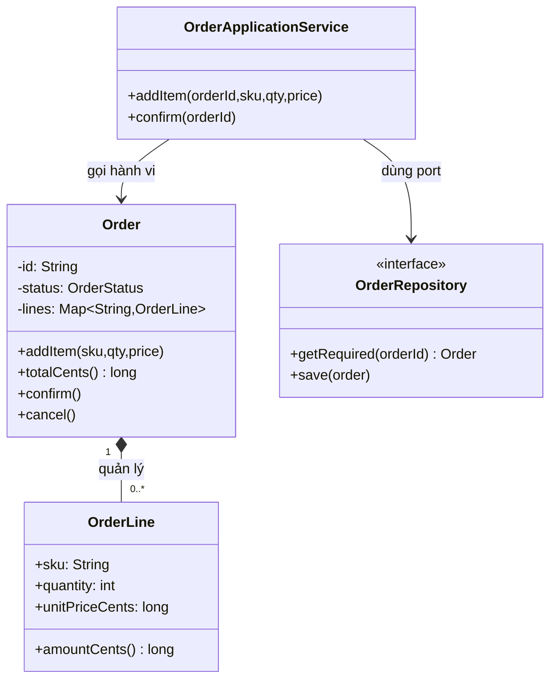

**Aggregate** không có nghĩa mọi quan hệ 1–N đều là composition hay mọi object trong sơ đồ đều lưu trong cùng một bảng. Ranh giới aggregate được chọn theo invariant cần đảm bảo khi cập nhật. Ví dụ `Order` không nên trực tiếp sở hữu toàn bộ `Customer` hay `Product` chỉ vì có quan hệ tham chiếu.

Với Spring Boot/JPA, cách tổ chức có thể gồm:

```text
orders/
  application/
    OrderApplicationService.java
  domain/
    Order.java
    OrderLine.java
    OrderStatus.java
    OrderRepository.java
    PricingPolicy.java
  infrastructure/
    JpaOrderRepositoryAdapter.java
    OrderJpaEntity.java
    OrderJpaMapper.java
    OutboxPublisher.java
  web/
    OrderController.java
    OrderRequest.java
    OrderResponse.java
```

Có hai lựa chọn thực tế:

- **Domain entity độc lập JPA:** mapper chuyển giữa domain và persistence entity. Domain test gọn, ít ràng buộc framework, đổi persistence dễ hơn nhưng cần mapping code.
- **JPA entity kiêm domain entity:** có thể tiết kiệm mapping; cần chú ý constructor cho ORM, proxy, lazy loading, setter công khai, dirty checking và cách `equals/hashCode` hoạt động. Dù dùng một class hay hai class, các public method nghiệp vụ vẫn nên bảo vệ invariant.

`@Transactional` nên đặt ở ranh giới use case phù hợp, nơi nhiều bước lưu cần đi cùng nhau. Nó không thay thế việc áp quy tắc qua domain method và không tự giao dịch được với mail server hay dịch vụ HTTP.

**Thiết kế test hợp lý:**

| Mức test | Nội dung nên kiểm tra |
| --- | --- |
| Domain unit test | `Order.addItem` chỉ cho `DRAFT`; số lượng/giá sai bị từ chối; tổng tiền chính xác |
| State transition test | Không xác nhận đơn rỗng; không sửa sau confirm; chính sách cancel đúng |
| Application service test | Load đúng ID, gọi domain method, save và phát yêu cầu thông báo theo hợp đồng |
| Persistence integration test | Save/load lại entity giữ nguyên invariant; kiểm tra unique/locking/transaction |
| API test | JSON, validation đầu vào, HTTP status và quyền truy cập |
| Concurrent/integration test | Hai request đổi cùng một đơn, không âm thầm ghi đè trạng thái của nhau |

## 11. Cách refactor từ Anemic sang Rich một cách an toàn

Giả sử hiện tại hệ thống dùng `OrderData` với field công khai và `OrderService` tính mọi quy tắc. Không cần viết lại tất cả trong một lượt.

1. **Tìm các đường sửa trạng thái:** controller, service, batch job, import dữ liệu, consumer message; liệt kê chỗ set status/lines/total.
2. **Viết invariant rõ ràng:** trạng thái hợp lệ, điều kiện xác nhận, cách tính tiền và quy tắc số lượng.
3. **Bổ sung test hành vi hiện có:** test các luồng hợp lệ, lỗi và trạng thái sau lỗi trước khi chuyển code.
4. **Đưa hành vi sát dữ liệu cần bảo vệ:** thêm `Order.confirm()`, `Order.addItem()`, tạo `OrderLine` bất biến.
5. **Di chuyển điểm gọi:** các service chuyển từ `setStatus` hoặc sửa `List` trực tiếp sang phương thức nghiệp vụ.
6. **Thu hẹp API:** khi caller đã chuyển hết, bỏ/giới hạn setter nguy hiểm và getter trả collection mutable.
7. **Giữ orchestration ở application service:** giao dịch, repository, idempotency và thông báo vẫn được tổ chức ở tầng thích hợp.
8. **Kiểm tra persistence:** ORM mapping, migration, concurrency và khả năng load lại đối tượng có trạng thái cũ.
9. **Dừng ở nơi có giá trị:** không biến mọi DTO/report thành entity phức tạp khi không có bất biến nghiệp vụ cần bảo vệ.

Các bước trên giúp các thay đổi có thể review và kiểm chứng. Khi dữ liệu DB cũ có khả năng vi phạm invariant mới, cần có chiến lược xử lý/migration rõ ràng thay vì giả định constructor mới luôn đọc được mọi bản ghi.

## 12. Câu hỏi ôn tập và bài tập

### Bài 1 — Chỉ ra mô hình thiếu hành vi

```java
class BankAccount {
    public String id;
    public long balanceCents;
}
class TransferService {
    void transfer(BankAccount a, BankAccount b, long amount) {
        a.balanceCents -= amount;
        b.balanceCents += amount;
    }
}
```

Hãy tìm ít nhất bốn vấn đề: số tiền âm/0, số dư không đủ, tràn số, tài khoản null, cập nhật dở dang hoặc đồng thời. Thiết kế lại `Account.withdraw`/`deposit` để mỗi tài khoản bảo vệ invariant của mình. Xác định giao dịch chuyển tiền giữa **hai** account thuộc trách nhiệm của application/domain service và transaction ở đâu.

### Bài 2 — Phân biệt DTO và rich entity

Dùng `CreateOrderRequest`, `Order`, `OrderLine`, `OrderResponse`. Xác định class nào chỉ cần mang dữ liệu, class nào cần hành vi và tại sao. Không để `OrderResponse` trở thành nơi tính tổng tiền thay domain.

### Bài 3 — Bổ sung quy tắc nghiệp vụ

Mở rộng ví dụ Java: chỉ cho `cancel()` khi `DRAFT`, thêm `pay()` chuyển `CONFIRMED` sang `PAID`, cấm thêm dòng và hủy đơn đã thanh toán. Vẽ state machine và viết test cho mọi bước chuyển hợp lệ/không hợp lệ.

### Bài 4 — Thiết kế giới hạn tồn kho

Một `Product` có tồn kho thay đổi theo hàng nghìn đơn. Nên lưu toàn bộ số tồn kho trong `Order` không? Hãy đề xuất `InventoryReservationService` hoặc aggregate tồn kho riêng, làm rõ transaction/locking giữa việc giữ hàng và đặt hàng.

### Bài 5 — Phản biện lựa chọn kiến trúc

Một màn hình chỉ có `MonthlySalesReport(month, totalOrders, revenue)`, xây từ câu truy vấn SQL và không có state transition. Việc thêm class domain giàu hành vi có lợi ích gì? Có cần không? Nêu lý do chọn record/projection đơn giản.

## 13. Checklist quyết định sử dụng Rich hay Anemic

- **Nghiệp vụ có nhiều trạng thái/chuyển đổi không?** Nếu có, entity nên cung cấp hành vi để thực thi các bước chuyển.
- **Có invariant phải đúng qua mọi nơi gọi không?** Đưa invariant vào constructor/factory/method nghiệp vụ của owner phù hợp.
- **Có nhiều service đang lặp cùng một quy tắc không?** Chọn một nơi làm nguồn chân lý, loại bỏ đường sửa trạng thái trái quy tắc.
- **Mô hình chỉ là DTO/projection hoặc CRUD đơn giản?** Một data-only class có thể đủ và dễ hiểu hơn.
- **Hành vi có thực sự thuộc đối tượng này không?** Nếu phải đọc nhiều entity hoặc chính sách bên ngoài, cân nhắc domain service/policy.
- **Entity đang tự gọi SQL/email/HTTP không?** Tách ra port/adapter/application service để bảo vệ ranh giới.
- **Có public setter làm bỏ qua bất biến không?** Thu hẹp API và cho phép thao tác bằng ngôn ngữ nghiệp vụ.
- **Đồng thời/persistence có bảo vệ invariant không?** Cần transaction, ràng buộc DB, locking và test phù hợp khi thiết kế mở rộng.
- **Mô hình có dễ hiểu và test hơn sau khi chia không?** Nếu chỉ nhiều class hơn nhưng luật bị phân tán thì chưa đạt mục tiêu.

**Kết luận:** Rich Domain Model phù hợp khi trạng thái và quy tắc của đối tượng cần được bảo vệ nhất quán; mô hình chỉ chứa dữ liệu phù hợp với DTO, projection và nghiệp vụ đơn giản. Chọn cách tổ chức theo **trách nhiệm thực tế và nơi bất biến được kiểm soát**, không theo số lượng getter/setter hoặc độ dài class.


</details>

- [Quay lại đầu trang](#back-to-top)

---

## <a id="class-design-008">Tách truy vấn khỏi thao tác thay đổi trạng thái</a>

<details>
<summary>Xem chi tiết</summary>

# Tách truy vấn khỏi thao tác thay đổi trạng thái trong thiết kế lớp (Command–Query Separation)

**Mục tiêu:** Biết phân biệt phương thức chỉ đọc trạng thái (*query*) với phương thức chủ động thay đổi trạng thái (*command*), thiết kế API Java dễ hiểu và dễ kiểm thử, xử lý ngoại lệ thực tế mà không nhầm với kiến trúc CQRS.

## 1. Vấn đề: một câu hỏi lại âm thầm gây thay đổi

Xét một lớp quản lý hàng tồn kho:

~~~java
class Inventory {
    private int quantity = 10;

    // Nghe như truy vấn số lượng còn lại nhưng đồng thời trừ kho.
    int getAvailableQuantity(int requested) {
        if (requested > quantity) {
            throw new IllegalArgumentException("Not enough stock");
        }
        quantity -= requested;
        return quantity;
    }
}
~~~

Tên `getAvailableQuantity` khiến người gọi kỳ vọng một câu hỏi đọc dữ liệu. Nhưng một lần gọi lại thay đổi số lượng trong kho. Ví dụ UI gọi lại để cập nhật màn hình, logging gọi để ghi thông tin, hoặc test gọi để kiểm tra trạng thái đều có thể vô tình làm mất hàng tồn.

**Command–Query Separation (CQS)** là nguyên tắc thiết kế phương thức thường gắn với Bertrand Meyer: một thao tác nên là **truy vấn cung cấp thông tin** hoặc **lệnh tạo thay đổi**, với hợp đồng rõ ràng về tác động của nó.

- **Query (truy vấn):** Trả về dữ liệu hoặc kết quả tính toán; không làm thay đổi **trạng thái quan sát được của miền nghiệp vụ**. Ví dụ: `availableQuantity()`, `canReserve(int)`, `balance()`.
- **Command (lệnh):** Thực hiện thay đổi trạng thái hoặc hành vi có tác dụng phụ như ghi DB, gửi yêu cầu thanh toán, phát sự kiện. Ví dụ: `reserve(int)`, `deposit(amount)`, `submitOrder()`.
- **Hợp đồng API phải làm rõ điều gì có thể xảy ra:** method có được gọi lặp hay không, có tính idempotent không, có thể ném ngoại lệ nào và trạng thái sau thất bại là gì.

Điều cốt lõi không phải tên `get...` hay kiểu trả về `void`, mà là **ý nghĩa hành vi**. Một method `void calculate()` vẫn có thể là query được thiết kế kém nếu không làm gì ngoài tính toán rồi bỏ kết quả. Ngược lại, `createOrder()` thường cần trả về mã đơn được tạo, dù nó là command. CQS là **hướng dẫn thiết kế**, không phải quy tắc cú pháp cưỡng bức.

## 2. Thiết kế lại một ví dụ nhỏ

Thiết kế ban đầu gộp đọc và thay đổi:

~~~java
final class BadStock {
    private int available = 10;

    int checkAndReserve(int units) {
        if (units <= 0 || units > available) {
            throw new IllegalArgumentException("Invalid quantity");
        }
        available -= units;
        return available;
    }
}
~~~

Có hai ý định nghiệp vụ khác nhau: **kiểm tra khả năng cấp hàng** và **thực sự giữ hàng**. Tách chúng:

~~~java
final class Stock {
    private int available = 10;

    // Query: không làm thay đổi số lượng.
    int availableUnits() {
        return available;
    }

    // Query: có thể hỏi nhiều lần, không tự giữ hàng.
    boolean canReserve(int units) {
        return units > 0 && units <= available;
    }

    // Command: giữ hàng nếu thỏa điều kiện tại thời điểm thực thi.
    void reserve(int units) {
        if (!canReserve(units)) {
            throw new IllegalArgumentException("Not enough stock or invalid units");
        }
        available -= units;
    }
}
~~~

Cách sử dụng:

~~~java
Stock stock = new Stock();

System.out.println(stock.canReserve(4));   // true
System.out.println(stock.availableUnits()); // 10
stock.reserve(4);                           // Command
System.out.println(stock.availableUnits()); // 6
~~~

**Điểm quan trọng:** `canReserve(4)` không bảo đảm `reserve(4)` sẽ luôn thành công sau đó nếu nhiều luồng/giao dịch cùng dùng kho. Command phải **tự kiểm tra lại điều kiện tại thời điểm ghi**. Không tách thành “query kiểm tra rồi command trừ không điều kiện” trong hệ thống đồng thời.

## 3. Java 17: API tài khoản có truy vấn thuần và lệnh an toàn

Ví dụ hoàn chỉnh dùng `BigDecimal` cho tiền và đồng bộ trên một đối tượng để việc kiểm tra–thay đổi số dư là nguyên tử trong **một process**. Mọi loại tiền trong ví dụ được xem là cùng đơn vị; hệ thống tài chính thật phải mô hình hóa currency, scale và chính sách làm tròn.

**Tệp `AccountDemo.java`:**

~~~java
import java.math.BigDecimal;
import java.util.ArrayList;
import java.util.List;
import java.util.Objects;

record AccountSnapshot(BigDecimal balance, List<String> movements) {
    AccountSnapshot {
        Objects.requireNonNull(balance, "balance");
        movements = List.copyOf(Objects.requireNonNull(movements, "movements"));
    }
}

final class Account {
    private BigDecimal balance = BigDecimal.ZERO;
    private final List<String> movements = new ArrayList<>();

    // Query: trả về giá trị bất biến; không sửa trạng thái.
    synchronized BigDecimal balance() {
        return balance;
    }

    // Query: không lộ danh sách có thể sửa của lớp.
    synchronized AccountSnapshot snapshot() {
        return new AccountSnapshot(balance, movements);
    }

    // Query: không tự động trừ tiền.
    synchronized boolean canWithdraw(BigDecimal amount) {
        return amount != null
                && amount.signum() > 0
                && balance.compareTo(amount) >= 0;
    }

    // Command: ghi nhận khoản tiền vào.
    synchronized void deposit(BigDecimal amount) {
        requirePositive(amount);
        balance = balance.add(amount);
        movements.add("DEPOSIT " + amount.toPlainString());
    }

    // Command: kiểm tra lại điều kiện ngay trong vùng đồng bộ.
    synchronized void withdraw(BigDecimal amount) {
        requirePositive(amount);
        if (balance.compareTo(amount) < 0) {
            throw new IllegalStateException("Insufficient balance");
        }
        balance = balance.subtract(amount);
        movements.add("WITHDRAW " + amount.toPlainString());
    }

    private static void requirePositive(BigDecimal amount) {
        Objects.requireNonNull(amount, "amount");
        if (amount.signum() <= 0) {
            throw new IllegalArgumentException("Amount must be positive");
        }
    }
}

public class AccountDemo {
    public static void main(String[] args) {
        Account account = new Account();

        account.deposit(new BigDecimal("100.00"));
        System.out.println(account.canWithdraw(new BigDecimal("40.00"))); // true
        System.out.println(account.balance()); // 100.00

        account.withdraw(new BigDecimal("40.00"));
        AccountSnapshot result = account.snapshot();
        System.out.println(result.balance()); // 60.00
        System.out.println(result.movements());
        // [DEPOSIT 100.00, WITHDRAW 40.00]
    }
}
~~~

Biên dịch và chạy:

~~~bash
javac AccountDemo.java
java AccountDemo
~~~

**Vì sao đây là một thiết kế có CQS rõ ràng?**

| Phương thức | Vai trò | Giá trị trả về | Có thay đổi trạng thái nghiệp vụ? |
|---|---|---|---|
| `balance()` | Query | `BigDecimal` | Không |
| `snapshot()` | Query | `AccountSnapshot` bất biến | Không |
| `canWithdraw(amount)` | Query | `boolean` | Không |
| `deposit(amount)` | Command | `void` | Có: số dư và lịch sử |
| `withdraw(amount)` | Command | `void` | Có: số dư và lịch sử |
| `requirePositive(amount)` | Hàm kiểm tra nội bộ | `void` hoặc exception | Không |

`AccountSnapshot` dùng `List.copyOf` để giữ bản sao không thể sửa bằng API collection. `BigDecimal` và `String` cũng là kiểu bất biến. Nếu snapshot chứa đối tượng lồng có thể sửa thì `List.copyOf` **không** tự biến các đối tượng lồng thành bất biến.

`synchronized` giúp phối hợp thao tác trên **cùng một đối tượng Account trong một JVM**. Đây không phải giải pháp cho nhiều instance dịch vụ cùng cập nhật một tài khoản trong DB; ứng dụng thực cần transaction, khóa hoặc optimistic locking và kiểm soát concurrency tại nơi lưu trữ.

## 4. Trực quan hóa luồng đọc và ghi

~~~mermaid
flowchart TD
    Client[Ứng dụng/UI] --> Q[Query: snapshot / balance]
    Q --> S[(Trạng thái hiện tại)]
    S --> R[Trả dữ liệu, không sửa trạng thái]
    Client --> C[Command: deposit / withdraw]
    C --> V{Điều kiện hợp lệ?}
    V -->|Không| E[Trả lỗi, không thay đổi số dư]
    V -->|Có| U[Cập nhật số dư và lịch sử]
    U --> S
~~~

Bộ phận giao diện có thể gọi query để hiển thị bao nhiêu lần tùy ý mà không làm thay đổi tài khoản. Command phản ánh **một ý định thực hiện hành động** của người dùng hoặc use case. Nếu UI gọi command hai lần do retry, điều đó không tự động an toàn: cần xem xét idempotency.

## 5. CQS và CQRS: liên quan nhưng không giống nhau

**CQS** là nguyên tắc **thiết kế phương thức/API**, thường áp dụng ngay bên trong một lớp OOP. **CQRS** (*Command Query Responsibility Segregation*) là một cách **tổ chức kiến trúc** tách đường xử lý lệnh và truy vấn, đôi khi dùng mô hình dữ liệu hoặc nơi lưu trữ riêng.

| Khía cạnh | CQS | CQRS |
|---|---|---|
| Cấp độ | Phương thức, lớp, interface, API | Application / hệ thống / kiến trúc |
| Câu hỏi | Method này đọc hay làm thay đổi trạng thái? | Đường đọc và ghi cần xử lý bằng mô hình/thành phần riêng hay không? |
| Bắt buộc tách database? | Không | Cũng không bắt buộc; có thể tách handler nhưng dùng cùng DB |
| Mục tiêu | Tính dễ đoán, dễ dùng và kiểm thử của API | Mô hình đọc/ghi độc lập theo nhu cầu nghiệp vụ, mở rộng và hiệu năng |
| Ví dụ | `account.balance()` / `account.withdraw(x)` | `WithdrawCommandHandler` / `AccountBalanceQueryHandler` |
| Chi phí | Thường thấp | Có thể cao: thêm mapping, synchronization, eventual consistency |

Một ứng dụng có CQS tốt **không cần** áp dụng CQRS. Nếu CQRS có read model được cập nhật bất đồng bộ, dữ liệu đọc có thể **trễ** sau command thành công; phải định nghĩa yêu cầu nhất quán. CQS trong một đối tượng không tự tạo độ trễ đó.

~~~mermaid
flowchart LR
    UI[Client] --> Query[Query API]
    UI --> Command[Command API]
    Query --> Read[(Read model)]
    Command --> Write[(Write model)]
    Write -. cập nhật/projection .-> Read
~~~

Sơ đồ chỉ minh họa **một kiến trúc CQRS có mô hình đọc và ghi riêng**; không phải điều kiện cần để tuân thủ CQS.

## 6. Ranh giới của “không thay đổi trạng thái”

Một query lý tưởng không có **tác dụng phụ quan sát được** đối với domain. Cần phân biệt:

1. **Thay đổi dữ liệu nghiệp vụ:** `getBalance()` tự tăng phí, `findOrder()` tự đánh dấu đơn đã giao → trái kỳ vọng query; nên tách thành command có tên rõ.
2. **Ghi log, metrics, tracing:** hệ thống quan sát có thể tạo dữ liệu kỹ thuật, nhưng đó không nên làm kết quả nghiệp vụ thay đổi. Nên minh bạch, đặc biệt với audit log và quyền riêng tư.
3. **Cache/memoization:** một getter lần đầu tính rồi lưu cache là thay đổi trạng thái nội bộ vì tối ưu. Về mặt CQS thực dụng, có thể chấp nhận nếu **giữ nguyên hành vi quan sát được**, không ảnh hưởng luồng xử lý, concurrency hay idempotency; tuyệt đối không dùng cache để che giấu một command nghiệp vụ.
4. **Lazy loading ORM:** đọc getter của JPA entity có thể kích hoạt SQL SELECT, network và exception nếu session đóng. Dù không chủ động cập nhật dữ liệu, phương thức không còn “thuần” theo nghĩa không I/O. Cần biết ranh giới persistence, tránh giả định mọi getter rẻ hoặc an toàn sau transaction.
5. **Truy vấn tăng bộ đếm đọc hoặc ghi `lastSeen`:** nếu đó là thay đổi domain, nên thiết kế như một command riêng hoặc một use case được đặt tên phản ánh cả đọc và ghi; không che dấu trong `get...`.
6. **Đọc file hay gọi API:** là query về mặt intent nếu chỉ thu thập thông tin, nhưng có thể timeout/thất bại. “Không thay đổi trạng thái domain” không đồng nghĩa “không bao giờ phát sinh I/O”.

Một query được gọi nhiều lần với cùng dữ liệu và không có sửa đổi xen giữa nên cho kết quả nhất quán theo hợp đồng. Không nhất thiết trả về **cùng object identity**, đặc biệt khi tạo snapshot mới.

## 7. Command có bắt buộc trả về void?

Không. Phân loại theo **tác dụng** chứ không chỉ kiểu trả về.

Ví dụ `createOrder(request)` ghi đơn mới và trả về `OrderId`. Đây vẫn là **command**:

~~~java
record OrderId(String value) {}

interface OrderCommands {
    OrderId createOrder(CreateOrderRequest request); // Có hiệu ứng ghi
}

interface OrderQueries {
    OrderView findById(OrderId id);     // Chỉ trả dữ liệu
}
~~~

Trả `OrderId`, trạng thái thành công hoặc phiên bản mới là cách hợp lý để xác định kết quả command. Tuy nhiên, cần tránh việc một method vừa âm thầm ghi rồi trả nguyên một danh sách phức tạp để giả làm query. Nếu nghiệp vụ cần một giá trị tổng hợp mới sau khi ghi, cân nhắc command trả ID/version và query riêng khi thực sự có lợi. Đừng tách thêm API chỉ để đạt “void tuyệt đối” nếu khiến caller phải gọi thừa không cần thiết.

Một quy ước tiện dụng:

- `get`, `find`, `list`, `calculate`, `can` → ưu tiên query rõ ràng.
- `create`, `update`, `reserve`, `pay`, `withdraw`, `cancel` → thể hiện command rõ ràng.
- `getAndReset`, `readAndMarkSeen`, `checkAndReserve` → cần xem xét tách trách nhiệm hoặc đổi tên/hợp đồng để làm lộ hiệu ứng.

Tên chỉ là tín hiệu. Các quy tắc nghiệp vụ, transaction, error handling và quyền hạn quyết định nội dung thực sự.

## 8. Tránh điều kiện kiểm tra rồi thực hiện không nguyên tử (TOCTOU)

Tách query và command rất hữu ích, nhưng có thể tạo lỗi nếu caller tưởng kết quả query “khóa” trạng thái:

~~~java
if (inventory.canReserve(2)) {
    inventory.reserve(2); // Một caller khác có thể đã giữ hàng trước đó.
}
~~~

Đây là **time-of-check to time-of-use (TOCTOU)**. Cách xử lý:

- Query `canReserve` chỉ giúp UI hiển thị khả năng **tạm thời**, không bảo đảm thành công.
- Command `reserve` phải kiểm tra lại **trong cùng vùng bảo vệ thay đổi**.
- Với cùng một JVM, có thể dùng `synchronized` hay lock phù hợp để gộp kiểm tra–ghi.
- Với database, nên thực hiện update có điều kiện trong transaction hoặc dùng version/optimistic locking. Ví dụ điều kiện `WHERE available >= :qty` và kiểm tra số hàng cập nhật. Không dựa vào `SELECT` trước đó làm bằng chứng chắc chắn.
- Với nhiều service, phải xác định ranh giới nhất quán ở nơi thật sự sở hữu tồn kho, thay vì chỉ khóa object ở một instance ứng dụng.

CQS tách **ý định đọc** và **ý định thay đổi**; tính nguyên tử là một yêu cầu khác cần đảm bảo ở command.

## 9. Idempotency của command và an toàn khi retry

**Query không có side effect nghiệp vụ**, nhưng command có thể tạo tác dụng phụ. Một command không mặc định idempotent:

- `setStatus("PAID")` thường idempotent nếu thực hiện lại không tạo thêm hiệu ứng.
- `deposit(100)` thực hiện hai lần tăng số dư hai lần: **không idempotent**.
- `sendEmail()` gọi lại có thể gửi thêm email dù dữ liệu không đổi.

Khi client retry do timeout, cần một **idempotency key** gắn với ý định giao dịch. Ví dụ API nhận `requestId` duy nhất rồi ghi nhận yêu cầu đã hoàn thành để lần gửi lại không chạy hiệu ứng lần nữa.

~~~text
POST /payments
Idempotency-Key: pay-req-8f9...
Body: {"orderId":"O-101","amountCents":50000}
~~~

Để thực hiện đúng trên nhiều instance, việc kiểm tra/chèn khóa và cập nhật dữ liệu cần atomic trong cơ chế lưu trữ thích hợp; một `HashSet<String>` trong RAM đơn lẻ không bảo đảm an toàn đa process hoặc restart.

## 10. Test nguyên tắc CQS bằng hành vi quan sát được

Với tệp `AccountDemo.java` ở mục 3, có thể tạo **`AccountTest.java`** dùng JUnit Jupiter 5:

~~~java
import static org.junit.jupiter.api.Assertions.*;
import java.math.BigDecimal;
import org.junit.jupiter.api.Test;

class AccountTest {
    @Test
    void queriesDoNotChangeBalanceOrMovements() {
        Account account = new Account();
        account.deposit(new BigDecimal("100.00"));

        AccountSnapshot before = account.snapshot();

        assertTrue(account.canWithdraw(new BigDecimal("40.00")));
        assertEquals(0, new BigDecimal("100.00").compareTo(account.balance()));
        assertEquals(before, account.snapshot()); // Cùng giá trị quan sát được
    }

    @Test
    void commandsChangeStateAndPreserveInvariant() {
        Account account = new Account();
        account.deposit(new BigDecimal("100.00"));
        account.withdraw(new BigDecimal("40.00"));

        assertEquals(0, new BigDecimal("60.00").compareTo(account.balance()));
        assertEquals(2, account.snapshot().movements().size());

        AccountSnapshot beforeError = account.snapshot();
        assertThrows(IllegalStateException.class,
                () -> account.withdraw(new BigDecimal("100.00")));
        assertEquals(beforeError, account.snapshot());
    }

    @Test
    void snapshotCannotBeMutatedFromOutside() {
        Account account = new Account();
        account.deposit(BigDecimal.ONE);

        assertThrows(UnsupportedOperationException.class,
                () -> account.snapshot().movements().clear());
        assertEquals(1, account.snapshot().movements().size());
    }
}
~~~

Các test trên xác nhận query không thay đổi trạng thái nghiệp vụ, command giữ invariant khi thành công và thất bại, snapshot không lộ collection mutable. Chúng **không** kiểm thử độ bền dữ liệu database, bảo đảm phân tán hoặc hiệu ứng thanh toán thật. Những khía cạnh đó cần integration tests phù hợp.

Không cần test dựa vào reflection để đếm số method có prefix `get` hay xem kiểu trả về có phải `void`; điều đó không chứng minh hợp đồng đọc/ghi.

## 11. Quy trình refactor method đang trộn query và command

~~~mermaid
flowchart TD
    A[Nhận diện method vừa đọc vừa thay đổi] --> B[Liệt kê kết quả và side effect]
    B --> C[Thiết kế query không thay đổi domain]
    C --> D[Thiết kế command thể hiện ý định ghi]
    D --> E[Cập nhật callers và hợp đồng lỗi]
    E --> F[Đảm bảo validation và ghi atomic]
    F --> G[Kiểm thử kết quả, rollback và retry]
~~~

Thực hiện theo thứ tự:

1. **Tìm đúng các method khả nghi:** `getAndDelete`, `fetchAndMarkRead`, `calculateAndSave`, `checkAndReserve`, getter có setter ẩn hoặc query phát thông báo.
2. **Xác định side effect cần giữ:** thay đổi field, DB, cache nghiệp vụ, event, email, transaction; đồng thời liệt kê giá trị trả về và ngoại lệ hiện hành.
3. **Làm rõ use case:** người dùng đang hỏi tình trạng hay đang yêu cầu thay đổi? Cùng một thao tác có thể cần hai API nếu cả hai nhu cầu đều hợp lệ.
4. **Tạo query có hợp đồng đọc:** trả snapshot/DTO/value object khi cần ngăn sửa trạng thái qua object tham chiếu.
5. **Tạo command có tên phản ánh thay đổi:** tự validation và đảm bảo invariant tại thời điểm ghi; quyết định return value thiết thực.
6. **Di chuyển caller:** thay code đang dựa vào side effect của getter; lưu ý API public có thể cần deprecation/migration.
7. **Kiểm tra transaction/concurrency/retry:** tránh tình trạng check trước, ghi sau thiếu khóa; bổ sung idempotency khi hành vi cần.
8. **Kiểm thử:** query không tạo tác động ngoài mong đợi, command xử lý thành công/thất bại nhất quán, integration test xác nhận tác động thật.

**Ví dụ quyết định refactor:** `MessageService.fetchAndMarkRead(id)` có thể tách thành `findById(id)` và `markRead(id)` nếu UI vừa cần xem trước mà không đánh dấu đã đọc, vừa cần đánh dấu chủ động. Nếu nghiệp vụ quy định “xem tin nhắn đồng nghĩa đánh dấu đã đọc” thì có thể giữ một **use case command** `openMessage(id)` trả nội dung và nêu rõ hiệu ứng trong hợp đồng; không che hành vi đó sau tên `getMessage`.

## 12. Các sai lầm thường gặp

| Sai lầm | Hậu quả | Cách cải thiện |
|---|---|---|
| Getter tự ghi dữ liệu nghiệp vụ | Refresh UI có thể tạo thay đổi ngoài ý muốn | Tách query khỏi command hoặc đặt tên/hợp đồng thể hiện side effect |
| Nghĩ command bắt buộc `void` | Tạo API bất tiện, truy vấn thừa để lấy ID/version | Cho command trả metadata cần thiết, vẫn gọi đúng là command |
| Nghĩ CQS chính là CQRS | Áp dụng architecture phức tạp cho bài toán đơn giản | Phân biệt mức method với mức kiến trúc |
| Query trả thẳng `List` mutable bên trong | Caller sửa state không qua command | Trả snapshot/immutable view phù hợp |
| Chỉ kiểm tra trước bằng query | TOCTOU/race condition | Command kiểm tra–ghi nguyên tử tại owner của dữ liệu |
| Coi cache nội bộ giống thay đổi nghiệp vụ | Tối ưu vô hại cũng bị cấm máy móc | Xác định rõ trạng thái quan sát được và giới hạn side effect |
| Retry command không idempotent | Thanh toán/ghi dữ liệu bị lặp | Sử dụng idempotency key và transaction phù hợp |
| Tách mọi API một cách cực đoan | Tăng call round-trip, tăng complexity | Chọn ranh giới có lợi ích thực tế |

## 13. Bài tập vận dụng

Một hệ thống thư viện có:

~~~java
BookView borrowAndGetBook(String bookId, String memberId);
~~~

Method vừa trừ số sách còn lại, tạo phiếu mượn, vừa trả nội dung hiển thị sách.

Hãy xác định các nhu cầu thực tế và thiết kế lại:

- `BookView findBook(String bookId)` chỉ đọc metadata/số lượng tại thời điểm truy vấn.
- `BorrowReceipt borrowBook(String bookId, String memberId, String requestId)` là command kiểm tra quyền mượn, điều kiện tồn kho và ghi phiếu mượn trong transaction. Nó có thể trả phiếu biên nhận để dùng ngay.
- Nếu UI cần trạng thái mới nhất sau khi mượn, có thể query lại; nếu hệ thống dùng optimistic update thì kiểm tra trường hợp mượn thất bại do cạnh tranh.
- Nếu client retry, bảo đảm `requestId` không tạo hai phiếu mượn.

**Câu hỏi tự kiểm tra:** Người gọi có thể nhận ra method nào làm thay đổi hệ thống không? Query có an toàn khi được gọi lặp không? Command có bảo vệ invariant tại lúc ghi không? API có nêu rõ trạng thái lỗi và các hiệu ứng ngoài hệ thống không?

---

**Ghi nhớ:** Hãy thiết kế phương thức để một câu hỏi **không bí mật làm thay đổi trạng thái nghiệp vụ**, còn lệnh **thể hiện rõ ý định thay đổi**. Phân tách đúng làm API dễ dự đoán, nhưng vẫn phải bảo vệ tính nguyên tử, tính nhất quán và khả năng retry của những command có side effect.

</details>

- [Quay lại đầu trang](#back-to-top)

---

## <a id="class-design-009">Giới hạn việc truy cập sâu vào chuỗi đối tượng</a>

<details>
<summary>Xem chi tiết</summary>

# Giới hạn việc truy cập sâu vào chuỗi đối tượng trong thiết kế lớp OOP

## 1. Vấn đề: một lớp “biết” quá nhiều lớp phía sau

Giả sử ứng dụng thư viện cần tính tiền phạt khi bạn đọc trả sách trễ. Một đoạn mã có thể viết rất nhanh:

```java
long fee = loan.getMember()
               .getMembershipPlan()
               .getDailyLateFeeCents()
           * overdueDays;
```

Đoạn trên giả định các phương thức getter tồn tại. Nó trông dễ hiểu, nhưng `LoanReturnService` (nơi chạy đoạn mã) phải biết đến **ít nhất ba nấc cấu trúc nội bộ**:

1. `Loan` lưu người mượn `Member`;
2. `Member` lưu gói thành viên `MembershipPlan`;
3. `MembershipPlan` chứa mức phạt theo ngày.

Nếu sau này phí phạt phụ thuộc loại sách, thời điểm mượn, số ngày được miễn hoặc chương trình ưu đãi, service sẽ phải đào sâu thêm vào các lớp khác. Việc thay đổi cấu trúc `Member` hay `MembershipPlan` cũng có thể khiến service lỗi biên dịch hoặc tính phí sai.

Đây là hiện tượng thường được gọi là **message chain**, **train wreck** (chuỗi dấu chấm gọi phương thức dài), hoặc vi phạm quy tắc thực dụng của **Law of Demeter (LoD) – nguyên tắc ít hiểu biết**.

Một thiết kế giàu hành vi hơn có thể là:

```java
long fee = loan.calculateLateFeeCents(overdueDays);
```

Ở đây service nêu yêu cầu nghiệp vụ **“tính phí trễ của khoản mượn này”**, còn khoản mượn và các đối tượng gần nó quyết định cách tính. Service không cần biết *phí được lấy qua bao nhiêu nấc object*.

> Ý chính: một lớp nên giao tiếp qua giao diện mà những đối tượng trực tiếp cộng tác cung cấp, thay vì đi xuyên qua chúng để hỏi chi tiết và điều khiển các đối tượng ở xa.

## 2. Law of Demeter thực sự nói gì?

Một cách diễn giải thường dùng của LoD là: trong một phương thức, ưu tiên gọi phương thức của những **đối tượng gần gũi** (*friends*):

- chính đối tượng hiện tại (`this`);
- các tham số truyền trực tiếp vào phương thức;
- các đối tượng thuộc trạng thái trực tiếp của nó (field/cộng tác viên trực tiếp);
- các đối tượng được tạo trong phương thức đó.

Và hãy hạn chế gọi phương thức trên một đối tượng **vừa lấy được từ đối tượng khác**:

```java
// Cấu trúc sâu: a nhận b từ một object rồi tiếp tục điều khiển b.
a.getB().getC().perform();

// Gọi trực tiếp một hành vi được a cung cấp.
a.performRequiredOperation();
```

Trong cách phát biểu chặt của LoD có nhiều biến thể và ngoại lệ cho đối tượng toàn cục, các kết quả trả về hoặc cấu trúc dữ liệu. Vì vậy, các gạch đầu dòng trên là **quy tắc thiết kế dễ áp dụng**, không phải thuật toán kiểm tra cú pháp tuyệt đối.

**Một dấu chấm không tự tạo vấn đề, và nhiều dấu chấm không tự khẳng định thiết kế sai.** Điều cần đánh giá là caller có phải **biết quá nhiều về cấu trúc và trách nhiệm của những object khác** hay không.

Ví dụ:

```java
// Không phải cứ có dấu chấm là vi phạm có ý nghĩa:
String normalized = input.trim().toLowerCase();

// Fluent API/query DSL chủ động thiết kế để gọi chuỗi:
query.select("name").from("customers").where("active = true");
```

Các API xử lý dữ liệu hoặc builder có thể cố ý trả lại một object để tiếp tục thao tác. LoD hữu ích nhất khi bảo vệ **ranh giới hành vi của các đối tượng có trách nhiệm riêng** trong miền nghiệp vụ.

## 3. “Ask for data” và “Tell, don't ask”

Cùng một yêu cầu trả sách trễ có thể được viết theo hai hướng:

| Cách tiếp cận | Ví dụ | Hệ quả thiết kế |
|---|---|---|
| **Đào sâu rồi tự xử lý** | `loan.getMember().getPlan().getRate() * days` | Caller biết cấu trúc của Loan, Member, Plan và công thức nghiệp vụ |
| **Gửi thông điệp về hành vi** | `loan.calculateLateFeeCents(days)` | Caller biết năng lực của Loan; chi tiết có thể được ẩn bên trong |
| **Truyền đúng giá trị cần thiết vào cộng tác viên** | `feePolicy.calculate(loanSnapshot, days)` | Hữu ích nếu tính phí là chính sách độc lập, không thuộc riêng Loan |

Câu khẩu quyết **“Tell, don't ask”** nhấn mạnh việc yêu cầu một object *thực hiện công việc thuộc trách nhiệm của nó*, thay vì lấy toàn bộ trạng thái của nó rồi thao tác từ bên ngoài.

Điều này liên quan đến:

- **Encapsulation:** bảo vệ bất biến và trạng thái nội bộ, công khai hành vi có chủ đích.
- **Information hiding:** khi cấu trúc bên trong thay đổi, ít lớp bên ngoài bị ảnh hưởng.
- **Coupling:** giảm số chi tiết của các lớp xa mà caller phải biết.
- **High cohesion:** quy tắc nào thuộc đối tượng nào thì đặt gần trạng thái và khái niệm đó.

Nhưng **“Tell, don't ask” không có nghĩa cấm mọi getter**. Đọc dữ liệu để hiển thị UI, serialize DTO, tính báo cáo và giao tiếp với một cấu trúc dữ liệu được công khai có thể hoàn toàn phù hợp.

## 4. Minh họa UML: cấu trúc nội bộ và hướng gọi hành vi

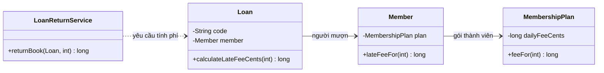

Sơ đồ mô tả việc `LoanReturnService` biết trực tiếp `Loan`. `Loan` biết `Member`; `Member` biết `MembershipPlan`. Mỗi lớp chỉ cần gọi **cộng tác viên trực tiếp** của nó.

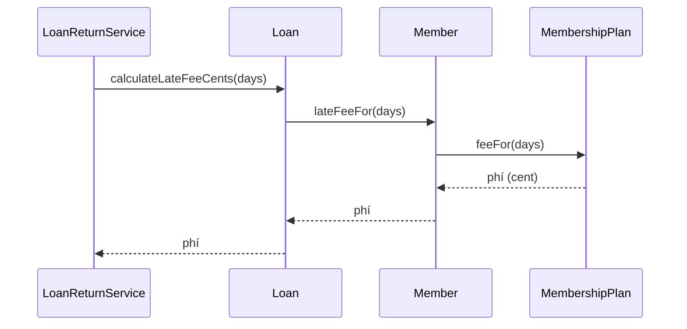

Chuỗi tương tác runtime vẫn có nhiều bước. Điểm khác biệt là **service không trực tiếp điều hướng đến Plan** hay tự diễn giải số ngày và mức phí. Các bước ở trong ranh giới trách nhiệm của từng đối tượng.

**Cần phân biệt:** LoD không cấm hệ thống có nhiều tầng đối tượng, cũng không cấm một lời gọi nghiệp vụ cuối cùng thực hiện nhiều lời gọi nội bộ. Nó hạn chế việc *caller* biết và phụ thuộc không cần thiết vào cấu trúc xa.

## 5. Ví dụ Java chạy được: tính phí trả sách trễ

Ví dụ sử dụng tiền theo đơn vị nhỏ nhất (cent), tránh dùng `double` để cộng/trừ số tiền không chính xác. Lưu vào tệp `DemeterDemo.java`, biên dịch bằng JDK 11 hoặc mới hơn:

```java
import java.util.Objects;

public class DemeterDemo {

    // Value object: mức phí theo ngày.
    static final class MembershipPlan {
        private final String name;
        private final long dailyLateFeeCents;

        MembershipPlan(String name, long dailyLateFeeCents) {
            this.name = Objects.requireNonNull(name, "name");
            if (dailyLateFeeCents < 0) {
                throw new IllegalArgumentException(
                        "Daily late fee cannot be negative");
            }
            this.dailyLateFeeCents = dailyLateFeeCents;
        }

        long feeFor(int overdueDays) {
            if (overdueDays < 0) {
                throw new IllegalArgumentException(
                        "Overdue days cannot be negative");
            }
            return Math.multiplyExact(dailyLateFeeCents, overdueDays);
        }
    }

    // Entity: thành viên biết gói của chính mình.
    static final class Member {
        private final String id;
        private MembershipPlan plan;

        Member(String id, MembershipPlan plan) {
            this.id = Objects.requireNonNull(id, "id");
            this.plan = Objects.requireNonNull(plan, "plan");
        }

        String id() {
            return id;
        }

        void changePlan(MembershipPlan next) {
            plan = Objects.requireNonNull(next, "next");
        }

        long lateFeeFor(int overdueDays) {
            return plan.feeFor(overdueDays);
        }
    }

    // Entity: phiếu mượn biết người mượn, bảo vệ trạng thái đã trả.
    static final class Loan {
        private final String code;
        private final Member borrower;
        private boolean returned;

        Loan(String code, Member borrower) {
            this.code = Objects.requireNonNull(code, "code");
            this.borrower = Objects.requireNonNull(borrower, "borrower");
        }

        long calculateLateFeeCents(int overdueDays) {
            if (returned) {
                throw new IllegalStateException(
                        "Loan already returned: " + code);
            }
            return borrower.lateFeeFor(overdueDays);
        }

        void markReturned() {
            if (returned) {
                throw new IllegalStateException(
                        "Loan already returned: " + code);
            }
            returned = true;
        }
    }

    // Application-level collaborator: chỉ biết hành vi công khai của Loan.
    static final class LoanReturnService {
        long returnBook(Loan loan, int overdueDays) {
            Objects.requireNonNull(loan, "loan");

            long fee = loan.calculateLateFeeCents(overdueDays);
            // Demo: giả định phí được thu/xác nhận thành công tại đây.
            loan.markReturned();
            return fee;
        }
    }

    public static void main(String[] args) {
        MembershipPlan basic = new MembershipPlan("Basic", 125);
        MembershipPlan premium = new MembershipPlan("Premium", 40);
        Member member = new Member("M001", basic);
        LoanReturnService returns = new LoanReturnService();

        Loan first = new Loan("L001", member);
        System.out.println(
                "First fee: " + returns.returnBook(first, 4)); // 500

        member.changePlan(premium);
        Loan second = new Loan("L002", member);
        System.out.println(
                "Second fee: " + returns.returnBook(second, 4)); // 160

        try {
            returns.returnBook(second, 2);
            throw new AssertionError("Expected already-returned error");
        } catch (IllegalStateException expected) {
            System.out.println("Rejected duplicate return");
        }
    }
}
```

Lệnh chạy:

```bash
javac DemeterDemo.java
java DemeterDemo
```

Kết quả dự kiến:

```text
First fee: 500
Second fee: 160
Rejected duplicate return
```

Hãy quan sát:

1. `LoanReturnService` chỉ gọi `loan.calculateLateFeeCents(...)` và `loan.markReturned()`. Nó không cần getter `getBorrower()` hay `getPlan()`.
2. `Loan` gọi phương thức của field trực tiếp `borrower`.
3. `Member` gọi phương thức của field trực tiếp `plan`.
4. `MembershipPlan` sở hữu công thức mức phí và kiểm tra số ngày. `Math.multiplyExact()` phát hiện overflow.
5. Khi thay đổi mức phí theo gói, caller không phải được sửa để đọc một chuỗi thuộc tính khác.
6. `Loan` sở hữu quy tắc “mỗi phiếu chỉ được đánh dấu trả một lần”.

**Giới hạn nghiệp vụ của demo:** phép tính dùng gói *hiện tại* của thành viên tại thời điểm trả. Nếu hệ thống yêu cầu phí theo gói *lúc mượn* (không đổi khi người dùng nâng cấp sau đó), `Loan` phải chụp (*snapshot*) biểu phí lúc tạo hoặc lưu một chính sách áp dụng tương ứng. Đây là quyết định nghiệp vụ, không phải kết quả tự động của LoD.

**Giới hạn triển khai:** demo đánh dấu `returned` sau khi tính phí và giả định việc thu phí thành công. Hệ thống thật cần xử lý đồng bộ trạng thái thanh toán, transaction/idempotency và concurrency; LoD không tự cung cấp các bảo đảm đó.

## 6. Vì sao đổi cấu trúc bên trong ít tác động hơn?

Giả sử ngày mai công thức phạt đổi từ “số ngày × phí/ngày” sang “miễn hai ngày đầu, có mức phí tối đa”. Với thiết kế đào sâu, nhiều service có thể đang thực hiện:

```java
long fee = loan.getMember()
               .getMembershipPlan()
               .getDailyLateFeeCents() * overdueDays;
```

Mỗi nơi phải tìm và sửa cùng quy tắc. Với thiết kế hành vi:

```java
long fee = loan.calculateLateFeeCents(overdueDays);
```

Ta có thể đổi `MembershipPlan.feeFor(...)`, hoặc thay cơ chế tính phí bằng policy phù hợp, **giữ nguyên hợp đồng của Loan** nếu ý nghĩa và dữ liệu đầu vào không đổi.

Ví dụ công thức khác:

```java
long feeFor(int overdueDays) {
    if (overdueDays < 0) {
        throw new IllegalArgumentException("days");
    }

    int billableDays = Math.max(0, overdueDays - 2);
    long calculated = Math.multiplyExact(
            dailyLateFeeCents, billableDays);
    return Math.min(calculated, 2_000L);
}
```

Đây là **một phương án thay thế** cho phương thức `feeFor` ở trên, không dùng đồng thời hai phương thức trùng chữ ký trong cùng lớp. Mức miễn và trần tiền chỉ để minh họa; trong dự án thực chúng phải đến từ quy tắc đã được phê duyệt và cần kiểm thử.

Nhờ API đúng mức trừu tượng, caller bớt bị ràng buộc vào cách lưu/cách tính.

## 7. Có phải cứ getter là sai?

**Không.** Getter có nhiều vai trò hợp lý:

- Cung cấp dữ liệu cho DTO hoặc lớp trình bày.
- Truy vấn trạng thái đọc mà caller thực sự có quyền biết.
- Trả về Value Object bất biến dùng làm dữ liệu cho thuật toán khác.
- Cho phép test quan sát kết quả công khai.
- Truy cập cấu trúc data-centric như `record`, JSON DTO hoặc kết quả truy vấn được thiết kế để điều hướng.

Vấn đề cần chú ý là **getter tạo ra sự lệ thuộc vào cấu trúc lồng nhau và kéo theo logic nghiệp vụ phân tán**.

| Biểu thức | Nhận xét |
|---|---|
| `order.getCustomer().getMembership().getPlan().getDiscountRate()` | Tín hiệu đáng xem xét nếu service dùng nó để tự áp mức giảm giá |
| `order.calculateTotalAfterDiscount()` | Phù hợp nếu Order/miền đặt quy tắc tổng tiền ở đây |
| `address.getCity()` | Hợp lý khi object `address` là tham số dữ liệu trực tiếp của formatter |
| `dto.customer().address().city()` | Có thể chấp nhận ở tầng trình bày nếu DTO cố ý phơi bày cấu trúc |
| `builder.withName("A").withEmail("b@c.test").build()` | Fluent builder, không phải đào xuyên qua các entity miền |
| `users.stream().filter(...).map(...).toList()` | Chuỗi thao tác của Stream API được thiết kế để compose |
| `service.getDao().getConnection().getMetaData().getTables(...)` | Có thể tạo coupling đến chi tiết tài nguyên và vòng đời kết nối; xem lại ranh giới |

Một kiểm tra đơn giản: **nếu thay cách cất dữ liệu ở lớp giữa mà phải sửa lớp đang gọi, liệu caller có đang biết chi tiết mà nó không cần biết?** Nếu có, cân nhắc đưa hành vi về nơi phù hợp hoặc đưa dữ liệu qua một contract rõ ràng.

## 8. Không “chữa cháy” bằng hàng loạt getter bọc ngoài

Giả sử service cần mã bưu chính để tính cước vận chuyển:

```java
String postalCode = order.getCustomer()
                         .getAddress()
                         .getPostalCode();
```

Có thể thêm:

```java
String Order.getCustomerPostalCode() {
    return customer.getAddress().getPostalCode();
}
```

Điều này rút ngắn chuỗi trong caller nhưng **chưa chắc làm mô hình tốt hơn**. Nếu từ đó tạo thêm hàng chục phương thức `getCustomerCity()`, `getCustomerStreet()`, `getCustomerDistrict()`..., `Order` trở thành “mặt tiền chuyển tiếp” cho mọi field của `Customer`, trong khi chưa rõ trách nhiệm chính của Order.

Hai cách tốt hơn tùy nhu cầu:

**Cách A: Đưa hành vi đến nơi sở hữu quy tắc.** Nếu Order chịu trách nhiệm chuẩn bị địa chỉ giao của chính đơn hàng, `order.shippingLabel()` hoặc `order.confirmDeliveryDestination()` có thể là API hợp lý. Bên trong, nó cộng tác với các thành phần gần nó.

**Cách B: Chọn một ranh giới dữ liệu rõ ràng.** Nếu `ShippingRateCalculator` cần nhiều trường địa chỉ, truyền trực tiếp một **`ShippingAddress` Value Object** bất biến, thay vì cho calculator tự đi từ Order → Customer → Address:

```java
record ShippingAddress(String city, String postalCode) {
    ShippingAddress {
        java.util.Objects.requireNonNull(city);
        java.util.Objects.requireNonNull(postalCode);
    }
}

interface ShippingRateCalculator {
    long rateCents(ShippingAddress destination, int grams);
}
```

Bộ tính phí phụ thuộc vào **hợp đồng đầu vào cần thiết**, không phụ thuộc vào cấu trúc Order/Customer. `Order` hoặc tầng ứng dụng chịu trách nhiệm cung cấp địa chỉ phù hợp từ nghiệp vụ (ví dụ địa chỉ được *chụp lại khi tạo đơn*, khác địa chỉ hiện tại của khách).

**Trade-off:** truyền VO qua một tầng ứng dụng là hợp lý khi đây là **dữ liệu độc lập cần cho phép tính**. Nếu mọi đối tượng chỉ phát tán dữ liệu thô để service tự viết quy tắc nghiệp vụ của chúng, hệ thống lại trở về thiết kế thiếu đóng gói.

## 9. Phân biệt tránh chuỗi truy cập và tránh phụ thuộc

LoD **không đồng nghĩa** “mỗi method chỉ được có một dấu chấm”. Số lượng dấu chấm là tín hiệu ban đầu, không phải thước đo đầy đủ về thiết kế.

| Vấn đề | Law of Demeter gợi ý | Điều chưa được bảo đảm |
|---|---|---|
| Caller đọc quá sâu vào domain model | Giao tiếp với object gần nhất qua hành vi | Không tự xác định chính xác trách nhiệm của lớp |
| Đổi cấu trúc bên trong làm caller hỏng | Che giấu điều hướng nội bộ sau contract ổn định | Contract vẫn có thể thiết kế mơ hồ hoặc quá rộng |
| Logic nghiệp vụ bị sao chép ngoài Entity | Chuyển quy tắc về đối tượng sở hữu hoặc domain policy | Không thay thế việc phân tích miền nghiệp vụ |
| Test phải dựng graph object rất sâu | Tách ranh giới giao tiếp phù hợp | Không có nghĩa mọi đối tượng đều cần interface/mock |
| Hiệu năng kém do truy vấn lồng nhau | Xem lại mô hình dữ liệu và cách truy cập | Rút ngắn chain Java không tự loại bỏ database round-trip |

LoD liên quan mạnh đến **encapsulation**, nhưng **Single Responsibility Principle (SRP)** và **cohesion** vẫn cần được cân nhắc. Đưa toàn bộ hành vi của hệ thống vào một “God Object” để không phải gọi sâu **không phải** cách áp dụng LoD tốt.

## 10. Đối tượng “bạn bè” ở cấp phương thức

Ví dụ sau phân loại mức gần gũi của các object:

```java
final class InvoiceMailer {
    private final MailGateway gateway; // Cộng tác viên trực tiếp.

    InvoiceMailer(MailGateway gateway) {
        this.gateway = gateway;
    }

    void send(Invoice invoice) { // invoice là tham số trực tiếp.
        String content = "Invoice " + invoice.number();

        MailMessage message = new MailMessage(
                invoice.recipientEmail(), content); // object vừa tạo.

        gateway.send(message); // gọi trực tiếp field gateway.
    }
}
```

Giả định `Invoice`, `MailMessage` và `MailGateway` đã được định nghĩa. Những lời gọi trên tương tác với tham số `invoice`, đối tượng tạo trong phương thức `message` và field trực tiếp `gateway`, nên khá phù hợp với cách đọc thông dụng của LoD.

Ngược lại:

```java
// Mailer phải biết cấu trúc internal của invoice → customer → profile.
gateway.send(new MailMessage(
    invoice.getCustomer().getProfile().getPrimaryEmail(),
    "Invoice " + invoice.number()));
```

Nếu địa chỉ nhận hóa đơn là một khái niệm của Invoice, hãy cung cấp `invoice.recipientEmail()`. Điều đó bảo đảm lựa chọn email hóa đơn nằm ở nơi sở hữu quy tắc: có thể dùng email đã được xác nhận lúc lập hóa đơn, khác với email hiện tại của khách hàng.

**Điểm cốt lõi:** phương thức gọi trực tiếp trên tham số là bình thường; thứ nên xét lại là khi caller tiếp tục **đào sâu object được lấy ra từ tham số** để điều khiển các chi tiết bên trong.

## 11. Khi gặp Optional, null, Stream và builder

### Chuỗi null-check không giải quyết coupling

```java
String zip = order != null
    && order.getCustomer() != null
    && order.getCustomer().getAddress() != null
    ? order.getCustomer().getAddress().getZip()
    : "";
```

Thêm kiểm tra null có thể tránh `NullPointerException`, nhưng caller vẫn phụ thuộc vào toàn bộ đường đi. Hơn nữa gọi getter lặp lại có thể có tác dụng phụ hoặc trả snapshot khác nếu dữ liệu thay đổi.

Dùng `Optional` cũng không tự khắc phục vấn đề:

```java
Optional.ofNullable(order)
    .map(Order::getCustomer)
    .map(Customer::getAddress)
    .map(Address::getZip)
    .orElse("");
```

Chuỗi `map` tránh một số kiểm tra null thủ công, nhưng caller vẫn biết cấu trúc `Order → Customer → Address`. Nếu mục đích là lấy mã bưu chính phục vụ nghiệp vụ thuộc Order, hãy thiết kế API đó đúng chỗ.

### Fluent APIs là ngoại lệ có chủ đích

```java
String output = "  HELLO  ".trim().toLowerCase();

List<String> names = users.stream()
    .filter(User::isActive)
    .map(User::getName)
    .toList();
```

Lưu ý `Stream.toList()` cần Java 16+; với Java 11 có thể dùng `collect(Collectors.toList())`. Những API bất biến/fluent này có giao thức công khai rõ ràng; gọi chuỗi là cách sử dụng hợp lý. Không cần tạo một lớp wrapper riêng chỉ để làm giảm số dấu chấm.

## 12. Vấn đề đặc biệt ở ORM và JPA/Hibernate

Một chuỗi như:

```java
String country = order.getCustomer()
                      .getAddress()
                      .getCountryCode();
```

có thể không chỉ là vấn đề coupling. Nếu `customer` hoặc `address` là quan hệ ORM được tải **lazy**, truy cập getter có thể kích hoạt truy vấn SQL; trong vòng lặp nhiều đơn hàng, có thể xảy ra **N+1 queries**, hoặc lỗi như `LazyInitializationException` nếu session đã đóng (tùy mapping và trạng thái).

Tuy nhiên:

- Đưa chain vào `order.shippingCountryCode()` **không tự loại bỏ SQL query**; chỉ chuyển vị trí gọi.
- Chọn fetch strategy, query projection, entity graph, batch fetching hoặc DTO phù hợp mới giải quyết chi phí truy xuất.
- Không nhất thiết thêm mọi mối quan hệ hai chiều để tiện điều hướng.
- Tránh serialize nguyên object graph JPA trực tiếp ra JSON nếu quan hệ hai chiều hoặc lazy proxy gây vòng tham chiếu, rò dữ liệu hay load quá nhiều. Một DTO/API contract rõ ràng thường dễ kiểm soát hơn.

Vì vậy cần đánh giá **cả ranh giới hướng đối tượng lẫn truy cập dữ liệu**, không coi LoD như một kỹ thuật tối ưu hiệu năng tự động.

## 13. Quy trình refactor một chuỗi truy cập sâu

Giả sử phát hiện đoạn mã:

```java
if (order.getCustomer().getMembership().getTier().isGold()) {
    total = total * 90 / 100;
}
```

Hãy làm theo trình tự:

1. **Đặt tên câu hỏi nghiệp vụ:** “Đơn hàng này được giảm bao nhiêu theo chính sách thành viên?” thay vì “tier có phải GOLD?”.
2. **Tìm nơi chịu trách nhiệm:** nếu thành viên tự xác định mức ưu đãi, có thể đặt `membership.discountFor(orderAmount)`. Nếu chính sách phức tạp và liên quan nhiều yếu tố, dùng `DiscountPolicy` hoặc domain service.
3. **Thiết kế contract rõ:** ví dụ `order.discountedTotal(policy)` hoặc `policy.calculate(orderSnapshot)`; xác định đơn vị tiền tệ, làm tròn, quy tắc khuyến mãi và thời điểm chụp dữ liệu.
4. **Giữ bất biến trong miền:** entity chịu trách nhiệm tính tổng hợp lệ, policy chịu trách nhiệm quy tắc giảm giá, không để controller tự nhân `90 / 100`.
5. **Thay caller bằng API mới:** controller/service chỉ cần kết quả mức giá; không phải duyệt đồ thị của khách hàng.
6. **Kiểm thử hành vi trước/sau:** GOLD, không GOLD, thiếu membership, làm tròn, thay đổi chính sách, không để giá âm.
7. **Bỏ các getter không còn cần nếu an toàn:** giảm API công khai, nhưng không xóa getter còn phục vụ nhu cầu truy vấn dữ liệu hợp lệ.

**Không nên mặc định** mọi cấu trúc điều hướng sâu đều được sửa bằng một phương thức “get” khác. Đôi khi đúng hơn là **phân định lại trách nhiệm nghiệp vụ**, hoặc trích Value Object/policy có ý nghĩa rõ ràng.

## 14. Lỗi phổ biến và cách xử lý

| Cách làm dễ mắc | Hệ quả | Hướng suy nghĩ tốt hơn |
|---|---|---|
| Caller tự đọc nhiều cấp để tính quy tắc | Phụ thuộc vào cấu trúc sâu, logic phân tán | Gọi hành vi của object sở hữu quy tắc |
| Thêm hàng chục forwarding getter | Lớp trung gian phình to, API rối | Bộc lộ capability thực sự hoặc VO đúng ranh giới |
| Xóa mọi getter vì “LoD cấm getter” | Tầng hiển thị/truy vấn dữ liệu khó dùng | Phân biệt domain behavior và data projection |
| Đưa mọi quy tắc vào một Service khổng lồ | Entity không có hành vi, cohesion thấp | Giữ bất biến cùng entity/VO; dùng service khi cần |
| Mock toàn bộ object graph sâu trong test | Test giòn, gắn vào chi tiết getter | Test hành vi công khai qua đối tượng/cổng cộng tác |
| Chuyển chain Java sang một method nhưng giữ nguyên việc gọi DB nhiều lần | N+1/lazy lỗi vẫn tồn tại | Thiết kế fetch/projection/transaction hợp lý |
| Dùng `Optional.map(...)` để che mọi chain | Giảm null-check nhưng coupling không đổi | Phân tích trách nhiệm và API |
| Áp dụng LoD tuyệt đối lên builder, Stream, DTO | Tạo wrapper thừa, code khó đọc | Cho phép chuỗi có hợp đồng data/fluent rõ |
| Giấu field bằng API nhưng API còn phụ thuộc tên bảng/cột SDK | Coupling chỉ chuyển hình thức | Thiết kế hợp đồng theo ngữ nghĩa nghiệp vụ ổn định |

## 15. Bài tập tự luyện

### Bài 1: xác định lớp đang biết quá nhiều

```java
void sendReminder(Loan loan) {
    String email = loan.getMember()
                       .getProfile()
                       .getEmailAddress()
                       .getValue();
    mailGateway.send(email, "Please return the book");
}
```

**Câu hỏi:** Có bao nhiêu tầng cấu trúc bị lộ ra cho mã gửi nhắc nhở? Nếu email liên hệ của khoản mượn phải được chốt lúc mượn, nên làm gì?

**Gợi ý:** thay bằng API như `loan.reminderRecipientEmail()` hoặc một VO/DTO chứa thông tin nhắc nhở của phiếu mượn. Nếu địa chỉ phải được chốt, lưu snapshot hoặc chính sách chọn người nhận tại ranh giới phù hợp. Không nhầm email hiện tại của profile với email được dùng lúc mượn.

### Bài 2: LoD và Value Object

```java
long cents = invoice.total().minorUnits();
```

**Câu hỏi:** Có nên cấm biểu thức này chỉ vì có hai dấu chấm?

**Gợi ý:** `invoice.total()` trả `Money` bất biến; tầng API cần chuyển sang JSON hoặc hiển thị có thể đọc `minorUnits()` hợp lý. Nếu business caller phải làm một loạt quy tắc tiền tệ thủ công, nên dùng hành vi của Money/invoice thay vì tách giá trị primitive.

### Bài 3: bảo vệ hành vi trong Entity

Một `Order` có `status` và `paidAt`. Controller viết:

```java
if (order.getStatus().equals("NEW")) {
    order.setStatus("PAID");
    order.setPaidAt(Instant.now());
}
```

**Gợi ý:** dùng `order.markPaid(paymentReference, paidAt)` (hoặc API đúng nghiệp vụ), đặt điều kiện chuyển trạng thái và tính nhất quán của thời điểm thanh toán bên trong Order. Quy tắc chỉ cho phép thanh toán một lần nên thuộc cùng nơi với trạng thái.

### Bài 4: hoàn thiện ví dụ Java

Trong `DemeterDemo`, bổ sung chính sách “gói Premium miễn ngày đầu tiên, tính phí từ ngày thứ hai” và kiểm thử phí cho 0, 1, 2, 4 ngày trễ.

**Gợi ý:** có thể mô hình hóa một `LateFeePolicy` Value Object hoặc interface nếu thật sự có nhiều chính sách, đặt ở phía `MembershipPlan`. Giữ nguyên lời gọi `loan.calculateLateFeeCents(days)` tại service. Đặt ràng buộc tránh số âm và tràn số.

### Bài 5: xét ngoại lệ

Màn hình báo cáo nhận DTO:

```java
String city = reportDto.customer()
                       .shippingAddress()
                       .city();
```

**Câu hỏi:** Có nhất thiết sửa thành `reportDto.getShippingCity()` không?

**Gợi ý:** không. DTO thường được tạo để đọc cấu trúc dữ liệu; hãy đánh giá xem schema là hợp đồng công khai và UI có quyền sử dụng các trường đó hay không. Chỉ cần cân nhắc ranh giới nếu trình bày phải tự viết các quy tắc domain hoặc bị ràng buộc vào cấu trúc persistence.

---

**Ghi nhớ:** hạn chế truy cập sâu không phải một cuộc thi giảm dấu chấm. Hãy để lớp gọi **yêu cầu hành vi có ý nghĩa** từ cộng tác viên trực tiếp, để lớp sở hữu dữ liệu **giữ những quy tắc và bất biến của mình**, và chỉ bộc lộ cấu trúc dữ liệu khi đó là một hợp đồng chủ đích. Nhờ vậy, sửa cấu trúc một lớp ít kéo theo sửa hàng loạt lớp xung quanh.


</details>

- [Quay lại đầu trang](#back-to-top)
