<a id="back-to-top"></a>

# Mô hình hóa

## Menu
- [Thu thập tình huống sử dụng và quy tắc nghiệp vụ](#modeling-001)
- [Nhận diện đối tượng từ yêu cầu](#modeling-002)
- [Phân chia trách nhiệm và đối tượng cộng tác](#modeling-003)
- [Thẻ CRC: lớp, trách nhiệm và cộng tác](#modeling-004)
- [Sơ đồ lớp: thành viên và quan hệ](#modeling-005)
- [Sơ đồ đối tượng: các thể hiện tại một thời điểm](#modeling-006)
- [Sơ đồ tuần tự: thứ tự tương tác](#modeling-007)
- [Sơ đồ trạng thái: chuyển trạng thái hợp lệ](#modeling-008)
- [Đối chiếu mô hình với mã và tình huống thực tế](#modeling-009)

## <a id="modeling-001">Thu thập tình huống sử dụng và quy tắc nghiệp vụ</a>

<details>
<summary>Xem chi tiết</summary>

# Thu thập tình huống sử dụng và quy tắc nghiệp vụ để mô hình hóa OOP

**Mục tiêu:** Đi từ câu chuyện của người dùng đến **use case**, **business rule**, **điều kiện bất biến**, rồi mới xác định trách nhiệm của đối tượng và xây dựng Java API có thể kiểm thử. Bài học dùng ví dụ **sinh viên đăng ký khóa học**; các quy tắc trong ví dụ là giả định minh họa, không phải luật áp dụng mặc định cho mọi nền tảng đào tạo.

## 1. Vì sao phải thu thập trước khi thiết kế lớp?

Một yêu cầu ban đầu thường rất ngắn:

> “Sinh viên muốn đăng ký một khóa học. Hệ thống báo thành công nếu đăng ký được.”

Nếu bắt đầu ngay bằng lớp `Student`, `Course`, `EnrollmentService`, `Database`, ta dễ bỏ qua những câu hỏi quyết định hành vi:

- Sinh viên chưa được kích hoạt tài khoản có thể đăng ký không?
- Khóa học đã đóng đăng ký thì sao?
- Phải hoàn thành môn tiên quyết trước hay có ngoại lệ?
- Có được đăng ký cùng một khóa hai lần?
- Nếu chỗ cuối cùng được hai người chọn đồng thời, ai nhận chỗ?
- Khi thành công, phải lưu thông tin nào và trả gì cho người dùng?
- Nếu gửi email thông báo lỗi, đăng ký có còn thành công không?
- Ai có quyền thay đổi sức chứa, thời hạn, danh sách môn tiên quyết?

**Use case** mô tả một mục tiêu mà **actor** đạt được nhờ tương tác với hệ thống. **Business rule** diễn tả điều kiện, chính sách hoặc ràng buộc của tổ chức mà các use case phải tuân thủ. Hai thứ bổ sung nhau:

- Use case trả lời: **Ai làm gì, để đạt mục tiêu nào, theo các luồng nào?**
- Business rule trả lời: **Trong điều kiện nào hệ thống được hoặc không được làm việc đó?**
- Domain model trả lời: **Những khái niệm nào tồn tại, giữ trạng thái gì và chịu trách nhiệm bảo vệ điều kiện nào?**

Đừng suy luận rằng mỗi danh từ trong yêu cầu trở thành một class, hoặc mỗi dòng use case trở thành một method. Mô hình hóa là bước chuyển từ ngôn ngữ nghiệp vụ sang trách nhiệm và hợp đồng phần mềm.

## 2. Chọn đúng phạm vi và người cung cấp thông tin

Trước khi phỏng vấn, xác định **ranh giới hệ thống** (system boundary), mục tiêu và các bên liên quan.

| Thành phần | Câu hỏi cần làm rõ | Ví dụ trong hệ thống đăng ký học |
|---|---|---|
| Actor chính | Ai khởi động tương tác để đạt mục tiêu? | Sinh viên |
| Bên liên quan khác | Ai đặt/duyệt quy tắc, ai chịu hậu quả? | Phòng đào tạo, giảng viên, quản trị viên |
| Mục tiêu | Kết quả có giá trị với actor là gì? | Có một suất học hợp lệ |
| Hệ thống ngoài | Phụ thuộc vào hệ thống nào? | Đăng nhập, quản lý học vụ, email |
| Phạm vi | Phần nào do ứng dụng này chịu trách nhiệm? | Kiểm tra điều kiện và ghi danh |
| Điều chưa chắc chắn | Ai được quyền quyết định câu trả lời? | Phòng đào tạo xác nhận chính sách đủ điều kiện |
| Ràng buộc phi chức năng | Khối lượng, thời gian phản hồi, an toàn, audit? | Nhiều lượt đăng ký cùng lúc, không vượt sức chứa |

Một yêu cầu “kiểm tra sinh viên đã học môn A” có thể lấy dữ liệu từ hệ thống đào tạo khác. Khi đó cần biết hệ thống nào là **nguồn sự thật** (*source of truth*), thời điểm dữ liệu được cập nhật và cách ứng dụng xử lý khi dịch vụ đó không sẵn sàng.

## 3. Thu thập yêu cầu bằng tình huống cụ thể

Các kỹ thuật thực tế nên kết hợp thay vì chỉ hỏi “cần những màn hình nào?”.

### Phỏng vấn theo mục tiêu

Hỏi sinh viên về thao tác, hỏi phòng đào tạo về chính sách, hỏi vận hành về ngoại lệ và sai lệch dữ liệu. Ví dụ:

1. “Lần gần nhất bạn đăng ký môn học diễn ra như thế nào, từ đầu tới cuối?”
2. “Có tình huống nào hệ thống từ chối nhưng cán bộ vẫn chấp nhận ngoại lệ?”
3. “Thế nào được tính là **một** suất trong khóa học: mỗi tài khoản, mỗi sinh viên, mỗi lần ghi danh?”
4. “Khi hai người đăng ký chỗ cuối cùng cùng lúc, hệ thống phải quyết định thế nào?”
5. “Chúng ta kiểm chứng đăng ký thành công bằng dữ liệu hoặc sự kiện nào?”
6. “Ai có thể điều chỉnh chính sách, và có cần giữ lịch sử phiên bản không?”

Tránh câu hỏi gợi ý “Mình nên có nút Đăng ký chứ?” vì dễ chuyển cuộc thảo luận sang UI trước khi hiểu mục tiêu.

### Quan sát và đi theo quy trình (observation / shadowing)

Xem nhân viên nghiệp vụ xử lý hồ sơ thật, đầu vào, quyết định và các thao tác ngoại lệ. Một câu “đăng ký hợp lệ” có thể che giấu kiểm tra tín chỉ, lịch trùng, môn tiên quyết và khoản nợ học phí. Đừng thêm các quy tắc này vào mô hình nếu bên nghiệp vụ chưa xác nhận.

### Workshop ví dụ và phản ví dụ

Dùng ví dụ có số liệu để tránh từ mơ hồ:

| Tình huống được đưa ra | Câu hỏi cần chốt |
|---|---|
| Còn 1 chỗ, có 2 lượt đăng ký đồng thời | Ai thắng? Có hàng đợi không? |
| Sinh viên học xong môn tiên quyết nhưng bảng điểm chưa đồng bộ | Từ chối, chờ đồng bộ hay cho đăng ký có điều kiện? |
| Đã ghi danh và gửi yêu cầu giống hệt lần nữa | Báo “đã đăng ký”, trả kết quả cũ hay tạo lỗi? |
| Đăng ký thành công, email thất bại | Có hủy đăng ký không? Có retry không? |
| Khóa học đầy, quản trị viên tăng sức chứa | Ai được phép làm và có audit không? |

Mỗi ví dụ nên có **đầu vào, trạng thái trước, hành động, kết quả mong đợi, lý do**. Nếu stakeholder trả lời khác nhau, ghi lại xung đột cùng người quyết định, không tự chọn một đáp án.

### Event storming nhẹ

Viết các sự kiện đã xảy ra như “Sinh viên yêu cầu ghi danh”, “Đăng ký bị từ chối”, “Sinh viên đã ghi danh” rồi lần ngược lại:

- Điều gì kích hoạt sự kiện?
- Ai/đối tượng nào quyết định?
- Điều kiện nào phải đúng trước khi sự kiện xảy ra?
- Có cần lưu sự kiện, hay chỉ cần trạng thái cuối?
- Có hệ thống nào phản ứng sau sự kiện không?

Event storming giúp tìm ranh giới trách nhiệm, nhưng **không bắt buộc** triển khai event sourcing hay message broker.

## 4. Chuẩn hóa một tình huống sử dụng (Use Case Specification)

Ví dụ use case **UC-01 – Đăng ký khóa học**, trong phạm vi hệ thống giả định:

| Thuộc tính | Nội dung |
|---|---|
| **ID / Tên** | UC-01 / Đăng ký khóa học |
| **Mục tiêu** | Sinh viên có một lượt ghi danh hợp lệ vào khóa học |
| **Actor chính** | Sinh viên đã xác thực |
| **Kích hoạt** | Sinh viên yêu cầu đăng ký một khóa học được chọn |
| **Tiền điều kiện** | Hệ thống đã xác định danh tính sinh viên và khóa học; người dùng có quyền gửi yêu cầu |
| **Luồng thành công** | 1. Nhận yêu cầu → 2. Tải trạng thái sinh viên và khóa học → 3. Kiểm tra chính sách → 4. Ghi danh nguyên tử → 5. Trả xác nhận |
| **Luồng thay thế** | Tài khoản chưa kích hoạt, lớp đóng, thiếu môn tiên quyết, đăng ký trùng, hết chỗ |
| **Hậu điều kiện thành công** | Có đúng một ghi danh cho cặp sinh viên–khóa học; số chỗ trống giảm theo chính sách |
| **Bảo đảm khi thất bại** | Không tạo ghi danh mới hoặc vượt quá sức chứa |
| **Đầu ra** | Mã khóa học, mã sinh viên, trạng thái và thông điệp phù hợp |
| **Ngoài phạm vi ví dụ** | Thanh toán, hủy ghi danh, danh sách chờ, đăng ký thủ công của nhân viên |

Tiền điều kiện “đã xác thực” khác quy tắc “tài khoản đang **hoạt động**”: người dùng có thể đăng nhập được nhưng đang bị khóa ghi danh theo chính sách. Một use case specification tốt phân biệt các điều kiện đó.

Đừng chèn chi tiết như “click nút màu xanh ở góc phải” vào **use case nghiệp vụ**. Đó là UI design hoặc test giao diện; use case cần đủ trừu tượng để API, web hay mobile đều thực hiện cùng mục tiêu.

## 5. Ghi business rule sao cho kiểm tra được

Các quy tắc sau là **giả định được chọn để xây dựng ví dụ**:

| ID | Quy tắc nghiệp vụ | Kết quả khi vi phạm |
|---|---|---|
| BR-01 | Chỉ sinh viên có trạng thái **active** được ghi danh | Từ chối, không ghi danh |
| BR-02 | Chỉ nhận đăng ký khi khóa còn **mở** | Từ chối |
| BR-03 | Sinh viên đã hoàn thành **tất cả môn tiên quyết** của khóa | Từ chối |
| BR-04 | Một sinh viên có **tối đa một** ghi danh trong cùng một khóa | Từ chối yêu cầu trùng |
| BR-05 | Số ghi danh không được vượt **capacity** của khóa | Từ chối khi hết chỗ |
| BR-06 | Ghi danh thành công cập nhật trạng thái **một cách nguyên tử** | Không có trạng thái ghi một nửa |

Quy tắc tốt cần có:

- **ID ổn định** để tham chiếu trong use case, ticket, test và tài liệu.
- **Mệnh đề rõ ràng**: dữ liệu đầu vào, điều kiện và hành vi khi điều kiện không thỏa.
- **Người sở hữu quy tắc**: bộ phận nghiệp vụ có thẩm quyền quyết định.
- **Phạm vi áp dụng**: loại khóa học, chương trình học, khu vực, thời gian và ngoại lệ.
- **Hiệu lực và phiên bản** nếu chính sách có thể thay đổi theo học kỳ.
- **Ví dụ đúng/sai** để loại bỏ mơ hồ.

Ví dụ cụm “được đăng ký đủ điều kiện” không thể kiểm thử. Thay bằng “BR-03: trước khi ghi danh, tập môn đã hoàn thành phải chứa toàn bộ tập môn tiên quyết của khóa học”.

Phân biệt **business rule** và **technical constraint**:

- “Không vượt quá 30 sinh viên trong lớp có capacity = 30” là luật nghiệp vụ.
- “Cột `student_id` có type VARCHAR(36)” là lựa chọn kỹ thuật.
- “Mỗi sinh viên chỉ có một lượt ghi danh cho một khóa” là business rule; unique constraint `(course_id, student_id)` trong DB là **một cơ chế** để thực thi luật đó.

## 6. Các luồng ngoại lệ phải được đặc tả ngang với luồng thành công

Đừng dừng ở “thành công thì lưu vào DB”. Lập ma trận nghiệp vụ:

| Trạng thái trước khi gọi | Hành động | Kết quả mong đợi | Quy tắc |
|---|---|---|---|
| Sinh viên active, khóa mở, đủ tiên quyết, còn chỗ | Ghi danh | Thành công, số chỗ giảm 1 | BR-01..06 |
| Sinh viên không active | Ghi danh | Từ chối, không thay đổi số ghi danh | BR-01 |
| Khóa đóng | Ghi danh | Từ chối, trạng thái không đổi | BR-02 |
| Thiếu môn tiên quyết | Ghi danh | Từ chối, không giữ chỗ | BR-03 |
| Đã ghi danh khóa đó | Ghi danh lại | Từ chối hoặc trả kết quả cũ theo chính sách được chọn | BR-04 |
| Khóa đủ sức chứa | Ghi danh | Từ chối, không vượt capacity | BR-05 |
| Hai lượt giữ chỗ cuối cùng cùng lúc | Ghi danh | Tối đa một lượt thành công | BR-05, BR-06 |

Các phản ví dụ này trực tiếp trở thành acceptance criteria và test. Với yêu cầu gửi lại do mạng, hãy **chốt chính sách idempotency**: “yêu cầu trùng” và “retry cùng một yêu cầu” có thể cần hành vi khác nhau. Ví dụ Java đơn giản bên dưới chọn **từ chối đăng ký trùng**, chưa làm idempotency key.

## 7. Chuyển từ use case và business rule sang mô hình lớp

Đầu tiên tách **khái niệm**, **trạng thái**, **invariant** và **hành vi**:

| Khái niệm | Trạng thái tối thiểu | Hành vi / trách nhiệm |
|---|---|---|
| `Student` | ID, active, các môn đã hoàn thành | Cung cấp thông tin đủ điều kiện, giữ trạng thái sinh viên nhất quán |
| `Course` | ID, capacity, trạng thái mở, môn tiên quyết, tập sinh viên ghi danh | Quyết định có chấp nhận một lượt ghi danh; bảo vệ capacity/trùng |
| `EnrollmentReceipt` | Mã khóa, mã sinh viên, số ghi danh sau thao tác | Trả kết quả bất biến cho caller |
| `EnrollmentUseCase` (khi có DB/API thật) | Các dependency cần thiết | Tải dữ liệu, kiểm tra quyền, gọi domain, lưu transaction, trả kết quả |
| Repository / Adapter | Công nghệ lưu trữ | Lưu/tải domain state, đảm bảo transaction theo thiết kế |

Không phải danh từ nào cũng là class. “Nút đăng ký”, “màn hình”, “email” có thể thuộc presentation/integration, không nhất thiết là domain entity. Quy tắc “sức chứa” chưa cần lớp `CapacityValidator` riêng nếu nó chỉ là một invariant đơn giản, thuộc trách nhiệm của `Course`.

Có thể coi `Course` là **aggregate root** cho đăng ký chỗ trong ví dụ thu nhỏ, nếu tất cả lượt đăng ký được quản lý qua nó. Với hệ thống lớn, ghi danh có thể là aggregate riêng và việc bảo vệ capacity đặt ở reservation service/database; cách chia ranh giới phải dựa vào transaction, khối lượng truy cập và invariant thực tế.

~~~mermaid
classDiagram
    direction LR
    class Student {
        +id: String
        +active: boolean
        +completedCourses: Set
    }
    class Course {
        +id: String
        +capacity: int
        +enroll(Student) EnrollmentReceipt
        +remainingSeats() int
        +closeRegistration()
    }
    class EnrollmentReceipt {
        +courseId: String
        +studentId: String
        +enrolledCount: int
    }
    Course ..> Student : kiểm tra điều kiện
    Course ..> EnrollmentReceipt : tạo kết quả
~~~

Quan hệ phía trên là **phụ thuộc hành vi**, không đủ dữ liệu để kết luận composition hay aggregation. Nếu cần mô hình hóa vòng đời ghi danh như một entity riêng, có thể thêm `Enrollment` với identity và trạng thái; không nên thêm chỉ vì sơ đồ có nhiều danh từ.

## 8. Java 17+: hiện thực mẫu dựa trên quy tắc đã thu thập

Đây là một ví dụ **chạy được trong một tệp `EnrollmentModelingDemo.java`**. Dùng trạng thái trong bộ nhớ để làm rõ domain. Nó **không** thay thế transaction và unique constraint của database thật.

~~~java
import java.util.LinkedHashSet;
import java.util.Objects;
import java.util.Set;

record Student(String id, boolean active, Set<String> completedCourses) {
    Student {
        Objects.requireNonNull(id, "id");
        Objects.requireNonNull(completedCourses, "completedCourses");
        if (id.isBlank()) {
            throw new IllegalArgumentException("Student id is blank");
        }
        completedCourses = Set.copyOf(completedCourses);
    }
}

record EnrollmentReceipt(
        String courseId, String studentId, int enrolledCount) {}

final class BusinessRuleViolation extends RuntimeException {
    private final String ruleId;

    BusinessRuleViolation(String ruleId, String message) {
        super(message);
        this.ruleId = ruleId;
    }

    String ruleId() {
        return ruleId;
    }
}

final class Course {
    private final String id;
    private final int capacity;
    private final Set<String> prerequisites;
    private final Set<String> enrolledStudentIds = new LinkedHashSet<>();
    private boolean registrationOpen;

    Course(String id, int capacity, Set<String> prerequisites,
            boolean registrationOpen) {
        this.id = Objects.requireNonNull(id, "id");
        Objects.requireNonNull(prerequisites, "prerequisites");
        if (id.isBlank() || capacity <= 0) {
            throw new IllegalArgumentException("Invalid course");
        }
        this.capacity = capacity;
        this.prerequisites = Set.copyOf(prerequisites);
        this.registrationOpen = registrationOpen;
    }

    // Command: kiểm tra và thay đổi trong cùng vùng đồng bộ.
    synchronized EnrollmentReceipt enroll(Student student) {
        Objects.requireNonNull(student, "student");

        if (!student.active()) {
            throw new BusinessRuleViolation("BR-01", "Student is inactive");
        }
        if (!registrationOpen) {
            throw new BusinessRuleViolation("BR-02", "Registration is closed");
        }
        if (!student.completedCourses().containsAll(prerequisites)) {
            throw new BusinessRuleViolation("BR-03", "Prerequisites missing");
        }
        if (enrolledStudentIds.contains(student.id())) {
            throw new BusinessRuleViolation("BR-04", "Already enrolled");
        }
        if (enrolledStudentIds.size() >= capacity) {
            throw new BusinessRuleViolation("BR-05", "Course is full");
        }

        enrolledStudentIds.add(student.id()); // BR-06 trong 1 JVM
        return new EnrollmentReceipt(
                id, student.id(), enrolledStudentIds.size());
    }

    // Query: không thay đổi dữ liệu.
    synchronized int remainingSeats() {
        return capacity - enrolledStudentIds.size();
    }

    synchronized void closeRegistration() {
        registrationOpen = false;
    }
}

public class EnrollmentModelingDemo {
    public static void main(String[] args) {
        Course oop = new Course("OOP-201", 2, Set.of("JAVA-101"), true);
        Student lan = new Student("ST-01", true, Set.of("JAVA-101"));
        Student minh = new Student("ST-02", true, Set.of("JAVA-101"));

        EnrollmentReceipt result = oop.enroll(lan);
        System.out.println(result);
        System.out.println("Remaining: " + oop.remainingSeats()); // 1

        oop.enroll(minh);
        System.out.println("Remaining: " + oop.remainingSeats()); // 0

        try {
            oop.enroll(new Student(
                    "ST-03", true, Set.of("JAVA-101")));
        } catch (BusinessRuleViolation exception) {
            System.out.println(
                    exception.ruleId() + ": " + exception.getMessage());
            // BR-05: Course is full
        }
    }
}
~~~

Chạy bằng JDK 17 trở lên:

~~~bash
javac EnrollmentModelingDemo.java
java EnrollmentModelingDemo
~~~

**Ý nghĩa thiết kế:**

- `Student` là `record` bất biến, `Set.copyOf` tránh caller thay đổi danh sách môn đã hoàn thành sau khi tạo.
- `Course.enroll()` bảo vệ các business rule thuộc trách nhiệm của khóa, thay vì đặt ở controller rồi hy vọng mọi caller đều kiểm tra.
- `BusinessRuleViolation.ruleId()` tạo **liên kết truy vết** giữa yêu cầu BR-xx, code và test; không nên trả stack trace nội bộ cho người dùng cuối.
- `synchronized` bảo đảm kiểm tra và thêm sinh viên không bị xen ngang khi **cùng một instance `Course` trong một JVM** được truy cập bởi nhiều luồng.
- `EnrollmentReceipt` chỉ chứa dữ liệu cần trả cho use case. Trong hệ thống thật có thể bổ sung enrollment ID, trạng thái, thời gian và version theo yêu cầu đã được xác nhận.

**Ranh giới quan trọng:** Nếu ứng dụng chạy trên nhiều node và mỗi node tải một `Course` riêng từ DB, các khóa `synchronized` **không** đồng bộ giữa các node. Để bảo vệ BR-04/BR-05/BR-06 trong hệ thống thực cần transaction đúng, unique constraint theo `(course_id, student_id)`, cơ chế khóa/optimistic version hoặc update có điều kiện và kiểm tra kết quả. Luật nghiệp vụ không tự được bảo đảm chỉ vì có `if` trong Java.

## 9. Truy vết yêu cầu → lớp → kiểm thử

Ma trận traceability giúp kiểm soát phạm vi và thấy luật nào thiếu kiểm chứng:

| Nguồn yêu cầu | Nơi thể hiện trong model | Ca kiểm thử |
|---|---|---|
| UC-01 luồng thành công | `Course.enroll()`, `EnrollmentReceipt` | Sinh viên hợp lệ được ghi danh, số chỗ giảm 1 |
| BR-01 | `Student.active()`, `Course.enroll()` | Sinh viên inactive bị từ chối |
| BR-02 | `Course.registrationOpen` | Khóa đóng bị từ chối |
| BR-03 | `Student.completedCourses`, `Course.prerequisites` | Thiếu môn bị từ chối |
| BR-04 | `Course.enrolledStudentIds` | Ghi danh lần hai bị từ chối |
| BR-05 | `Course.capacity` | Hết chỗ bị từ chối |
| BR-06 | `Course.enroll()` và persistence transaction khi dùng DB | Lỗi không thêm bản ghi, hai request tranh chỗ không vượt capacity |

Một tiêu chí nghiệp vụ có thể cần **nhiều** test; ngược lại một test có thể đi qua nhiều quy tắc. Traceability hữu ích khi chính sách thay đổi: tìm nhanh code và test phải sửa mà không buộc tất cả quy tắc thành một lớp lớn.

### Test JUnit Jupiter 5 minh họa

**`EnrollmentModelingTest.java`** (đặt cùng package với tệp demo):

~~~java
import static org.junit.jupiter.api.Assertions.*;
import org.junit.jupiter.api.Test;
import java.util.Set;

class EnrollmentModelingTest {
    private static Student eligible(String id) {
        return new Student(id, true, Set.of("JAVA-101"));
    }

    @Test
    void successConsumesExactlyOneSeat() {
        Course course = new Course("OOP", 2, Set.of("JAVA-101"), true);

        EnrollmentReceipt receipt = course.enroll(eligible("S-01"));

        assertEquals("OOP", receipt.courseId());
        assertEquals("S-01", receipt.studentId());
        assertEquals(1, receipt.enrolledCount());
        assertEquals(1, course.remainingSeats());
    }

    @Test
    void duplicateDoesNotConsumeAnotherSeat() {
        Course course = new Course("OOP", 2, Set.of(), true);
        Student student = new Student("S-01", true, Set.of());
        course.enroll(student);

        BusinessRuleViolation exception = assertThrows(
                BusinessRuleViolation.class, () -> course.enroll(student));

        assertEquals("BR-04", exception.ruleId());
        assertEquals(1, course.remainingSeats());
    }

    @Test
    void missingPrerequisiteIsRejected() {
        Course course = new Course("OOP", 1, Set.of("JAVA-101"), true);

        BusinessRuleViolation exception = assertThrows(
                BusinessRuleViolation.class,
                () -> course.enroll(new Student("S-02", true, Set.of())));

        assertEquals("BR-03", exception.ruleId());
        assertEquals(1, course.remainingSeats());
    }

    @Test
    void capacityIsEnforced() {
        Course course = new Course("OOP", 1, Set.of(), true);
        course.enroll(new Student("S-01", true, Set.of()));

        BusinessRuleViolation exception = assertThrows(
                BusinessRuleViolation.class,
                () -> course.enroll(new Student("S-02", true, Set.of())));

        assertEquals("BR-05", exception.ruleId());
        assertEquals(0, course.remainingSeats());
    }

    @Test
    void closedRegistrationRejectsRequest() {
        Course course = new Course("OOP", 1, Set.of(), true);
        course.closeRegistration();

        BusinessRuleViolation exception = assertThrows(
                BusinessRuleViolation.class,
                () -> course.enroll(new Student("S-01", true, Set.of())));

        assertEquals("BR-02", exception.ruleId());
        assertEquals(1, course.remainingSeats());
    }
}
~~~

Các test trên kiểm tra hành vi đúng với quy tắc. Chúng chưa chứng minh uniqueness/atomicity đa node; cần integration test có DB và kiểm thử cạnh tranh phù hợp trước khi dùng cho hệ thống thật.

## 10. Acceptance criteria bằng Given–When–Then

Use case dài hữu ích cho bối cảnh, còn **Given–When–Then** biến từng tình huống thành tiêu chí có thể chấp nhận.

~~~gherkin
Feature: Đăng ký khóa học

  Scenario: Đăng ký hợp lệ
    Given sinh viên ST-01 đang hoạt động
      And ST-01 đã hoàn thành JAVA-101
      And khóa OOP-201 đang mở với 1 chỗ trống
    When ST-01 đăng ký OOP-201
    Then hệ thống xác nhận đăng ký thành công
      And OOP-201 có 0 chỗ trống

  Scenario: Từ chối đăng ký trùng
    Given ST-01 đã ghi danh OOP-201
    When ST-01 đăng ký lại OOP-201
    Then hệ thống từ chối theo BR-04
      And số chỗ trống không thay đổi
~~~

Đoạn Gherkin chỉ là **đặc tả tình huống**; để chạy tự động cần công cụ và step definitions thích hợp (ví dụ Cucumber). Nó không tự thực thi khi đặt vào file README.

Không biến mọi chi tiết UI thành tiêu chí acceptance. “Nút xanh xuất hiện” có thể cần test giao diện riêng; rule BR-04 phải được kiểm tra ở tầng nghiệp vụ ngay cả khi caller không dùng giao diện web.

## 11. Luồng nghiệp vụ, trạng thái và điểm quyết định

~~~mermaid
flowchart TD
    A[Sinh viên yêu cầu ghi danh] --> B[Định danh người yêu cầu và khóa học]
    B --> C{Sinh viên active?}
    C -->|Không| X1[Từ chối BR-01]
    C -->|Có| D{Khóa đang mở?}
    D -->|Không| X2[Từ chối BR-02]
    D -->|Có| E{Đủ môn tiên quyết?}
    E -->|Không| X3[Từ chối BR-03]
    E -->|Có| F{Đã ghi danh?}
    F -->|Có| X4[Từ chối BR-04]
    F -->|Không| G{Còn capacity?}
    G -->|Không| X5[Từ chối BR-05]
    G -->|Có| H[Giữ chỗ và tạo ghi danh nguyên tử]
    H --> I[Trả biên nhận]
~~~

Sơ đồ giúp stakeholder phát hiện nhánh chưa xác định. Thứ tự kiểm tra lỗi trong sơ đồ **chỉ là một lựa chọn của ví dụ**: trong hệ thống thật có thể ưu tiên kiểm tra quyền trước, hạn chế lộ thông tin khóa học hoặc xử lý trường hợp “đã đăng ký” khác. Thứ tự lỗi trả về là một phần hợp đồng cần xác nhận.

Nếu có vòng đời nhiều trạng thái (`Requested → Approved → Cancelled`, chẳng hạn), hãy vẽ **state machine** và ghi quy tắc chuyển trạng thái. Nhưng nếu use case chỉ có quyết định thành công/thất bại và chưa có trạng thái dài hạn bổ sung, không cần tự tạo hàng loạt state giả.

## 12. Quy tắc nghiệp vụ khác gì yêu cầu chức năng và phi chức năng?

| Nhóm | Ví dụ | Tác động lên mô hình |
|---|---|---|
| **Use case / functional requirement** | Sinh viên đăng ký khóa học | Cần thao tác điều phối và trả kết quả |
| **Business rule** | Không vượt sức chứa; không đăng ký trùng | Invariant và validation ở domain/transaction |
| **Non-functional requirement** | 99% yêu cầu trả lời trong ngưỡng do stakeholder quy định | Ảnh hưởng chiến lược truy cập DB, cache, phân tải |
| **Security rule** | Chỉ chủ tài khoản hoặc nhân viên được ủy quyền mới đăng ký thay | Authorization tại entry point và nơi thích hợp |
| **Data constraint** | Unique `(course_id, student_id)` | Bảo vệ tính nhất quán ở nơi lưu trữ |
| **UI behavior** | Hiển thị số chỗ còn lại, disabled khi đầy | Presentation; không thay thế kiểm tra của command |

Không viết một business rule mơ hồ thành ràng buộc cứng tại nhiều chỗ rồi quên quản lý phiên bản. Nếu cùng quy tắc được áp dụng ở API, DB và UI, xác định **nguồn định nghĩa chính** cùng chiến lược nhất quán giữa các lớp.

## 13. Quy trình thu thập và mô hình hóa có thể áp dụng ngay

1. **Xác định mục tiêu và system boundary.** Lập danh sách actor, hệ thống liên quan và kết quả mong đợi, tránh khởi đầu bằng danh sách class.
2. **Thu thập câu chuyện thực tế.** Phỏng vấn, quan sát workflow, dùng ví dụ có dữ liệu và phản ví dụ. Ghi rõ ai nói gì và điểm chưa được phê duyệt.
3. **Đặt tên use case theo động từ + kết quả.** Ví dụ “Đăng ký khóa học”, “Hủy ghi danh”, “Duyệt yêu cầu ngoại lệ”. Mỗi use case có actor và mục tiêu rõ.
4. **Đặc tả luồng chính và ngoại lệ.** Ghi trigger, preconditions, postconditions, bảo đảm khi lỗi và tình huống cạnh tranh.
5. **Chắt lọc business rule riêng.** Cấp mã BR-xx, diễn giải bằng điều kiện quan sát được, xác định owner, phạm vi, ngoại lệ và phiên bản.
6. **Xác nhận bằng ví dụ cụ thể.** Dùng bảng quyết định/Given–When–Then để stakeholder xác nhận cả dữ liệu sát biên, null/blank, trùng lặp và concurrency.
7. **Phác thảo domain model.** Xác định entity, value object, aggregate, invariants và trách nhiệm; chỉ thêm abstraction khi có nhu cầu thật.
8. **Thiết kế API/use case.** Command phải bảo vệ quy tắc tại nơi quản lý dữ liệu, query chỉ đọc; giao diện kỹ thuật không sở hữu tùy tiện policy nghiệp vụ.
9. **Tạo traceability.** Ánh xạ use case → business rule → class/method → test; duy trì cùng khi yêu cầu thay đổi.
10. **Review với stakeholder và người vận hành.** Kiểm tra tính thực thi, lỗi, audit, transaction, tích hợp và khả năng thay đổi theo thời gian.

~~~mermaid
flowchart LR
    A[Stakeholder và tình huống thực] --> B[Use case]
    B --> C[Business rules và acceptance criteria]
    C --> D[Domain model và trách nhiệm]
    D --> E[Java API / transaction / persistence]
    E --> F[Test truy vết]
    F -. phát hiện thiếu hoặc mâu thuẫn .-> B
~~~

Việc mô hình hóa là **lặp lại có kiểm soát**, không phải viết tài liệu một lần rồi bỏ. Nếu test khám phá một trường hợp nghiệp vụ chưa rõ, quay lại người sở hữu quy tắc để xác nhận thay vì chỉ thêm `if` theo phán đoán kỹ thuật.

## 14. Rủi ro thu thập yêu cầu và cách tránh

| Sai lầm | Hệ quả | Cách phòng tránh |
|---|---|---|
| Chỉ ghi yêu cầu UI | Thiếu quy tắc domain, API khác dễ bỏ qua kiểm tra | Thu use case ở mức mục tiêu người dùng |
| Hỏi một stakeholder cho mọi quy tắc | Thiếu ngoại lệ và quyền quyết định | Xác định owner, người duyệt và các bên liên quan |
| Quy tắc dùng từ “hợp lệ”, “đủ”, “nhanh” | Không kiểm thử được | Thay bằng điều kiện, ngưỡng, ví dụ cụ thể |
| Lẫn policy với cách cài đặt | Lúc đổi DB/framework phải sửa tài liệu nghiệp vụ | Tách BR khỏi SQL, HTTP và class cụ thể |
| Chỉ mô tả happy path | Lỗi dữ liệu, thao tác cạnh tranh và retry không có định nghĩa | Tạo decision table và luồng thất bại |
| Biến mọi danh từ thành class | Nhiều lớp không có trách nhiệm rõ, coupling tăng | Xác định identity, state và invariants trước |
| Chỉ kiểm tra ở controller | Job/background caller bỏ qua rule | Đặt invariant ở domain/persistence phù hợp |
| Không gắn BR với test | Thay policy mà không biết vùng ảnh hưởng | Traceability BR-ID → behavior test |
| Xem in-memory lock là bảo đảm phân tán | Vượt capacity trên nhiều server | DB transaction/constraint/locking thích hợp |
| Không ghi giả định và phạm vi | Dev lặng lẽ quyết định chính sách thay stakeholder | Danh sách câu hỏi mở, quyết định, phiên bản |

## 15. Bài tập tự thực hành

**Bối cảnh khác:** hệ thống thư viện cho độc giả mượn sách.

Hãy thu thập và mô hình hóa use case **“Mượn một bản sách”** với yêu cầu ban đầu: “Độc giả được mượn sách còn sẵn”. Trước khi code, đề xuất ít nhất các câu hỏi về tài khoản hoạt động, số sách tối đa đang mượn, hạn mượn, bản sách cụ thể, việc đặt trước, trễ hạn, retry request và nhiều độc giả chọn cùng bản cuối.

Sau khi có câu trả lời, hãy:

1. Viết một use case UC-LIB-01 với actor, trigger, luồng thành công, các nhánh thất bại và hậu điều kiện.
2. Lập bảng BR-LIB-01... và ví dụ đúng/sai cho từng rule đã được xác nhận.
3. Xác định `BookTitle`, `BookCopy`, `Member`, `Loan` có danh tính và vòng đời thế nào; trách nhiệm giữ bản cuối nên đặt ở đâu.
4. Vẽ một sơ đồ use case flow và một class diagram vừa đủ; không tạo class chỉ từ danh từ.
5. Viết API Java cho command `borrowCopy(...)` và query `availableCopies(...)`; kiểm tra race condition ở hệ thống lưu trữ thật.
6. Chuyển ít nhất ba business rules thành acceptance tests và ánh xạ ID tương ứng.

**Tiêu chí hoàn thành:** Một stakeholder có thể đọc các tình huống và xác nhận hành vi; lập trình viên xác định được trách nhiệm của mỗi class; người kiểm thử lần theo được mỗi rule tới ca kiểm thử; và trường hợp lỗi không để dữ liệu ở trạng thái trái chính sách.

---

**Ghi nhớ:** Mô hình OOP tốt bắt đầu từ **người dùng muốn đạt kết quả gì** và **tổ chức cho phép kết quả đó trong điều kiện nào**. Use case cung cấp luồng mục tiêu; business rule cung cấp chính sách/invariant; Java class và test là cách hiện thực, bảo vệ và chứng minh hai loại yêu cầu đó.

</details>

- [Quay lại đầu trang](#back-to-top)

---

## <a id="modeling-002">Nhận diện đối tượng từ yêu cầu</a>

<details>
<summary>Xem chi tiết</summary>

# Nhận diện đối tượng từ yêu cầu trong OOP (Java)

## Bài toán của bước mô hình hóa

Khi nhận một yêu cầu như “Độc giả mượn bản sách, hệ thống kiểm tra bản sách còn cho mượn được hay không, ghi nhận lượt mượn và tính hạn trả”, người thiết kế chưa nên viết ngay một class cho mỗi danh từ. Trước hết cần tìm ra **các khái niệm có ý nghĩa trong nghiệp vụ**, thông tin nào thuộc về chúng, hành vi nào chúng chịu trách nhiệm và quan hệ nào phải được giữ nhất quán.

**Nhận diện đối tượng từ yêu cầu** là quá trình chuyển cách diễn đạt của người dùng thành các *đối tượng ứng viên* (*candidate objects*), kiểm tra vai trò của từng ứng viên, rồi đề xuất mô hình lớp. Đây là bước khám phá và kiểm chứng giả thuyết, không phải thao tác tìm danh từ một cách máy móc.

Kết thúc bài, bạn sẽ có thể:

- Đọc mô tả nghiệp vụ để trích xuất đối tượng, thuộc tính, hành vi, sự kiện và quy tắc.
- Phân biệt **entity**, **value object**, đối tượng điều phối và các phụ thuộc bên ngoài.
- Loại bỏ những “class giả” chỉ là thuộc tính, màn hình, vai trò hay cách triển khai kỹ thuật.
- Kiểm chứng mô hình bằng tình huống nghiệp vụ, bất biến, sơ đồ UML và ví dụ Java chạy độc lập.
- Biết khi nào nên sửa mô hình vì yêu cầu chưa rõ hoặc quy tắc mới làm xuất hiện đối tượng có vòng đời riêng.

## 1. Bắt đầu từ ngôn ngữ nghiệp vụ

Xét yêu cầu mẫu:

> “Độc giả có mã thành viên và tên. Thư viện có nhiều bản sách, mỗi bản có mã riêng và thuộc một đầu sách. Độc giả được mượn tối đa hai bản cùng lúc. Một bản sách không được có hai lượt mượn đang hoạt động. Khi mượn, hệ thống ghi ngày mượn và hạn trả sau 14 ngày. Nhân viên có thể tra cứu các lượt mượn đang hoạt động.”

Đây là **một yêu cầu ví dụ** để luyện kỹ năng phân tích, không phải hệ thống thư viện chuẩn áp dụng cho mọi tổ chức. Các con số hai bản và 14 ngày là quy tắc riêng của ví dụ.

Gạch chân những nhóm từ cần làm rõ:

| Cụm từ trong yêu cầu | Ứng viên đầu tiên | Câu hỏi để xác nhận |
| --- | --- | --- |
| Độc giả | `Borrower` | Có mã định danh, vòng đời và lịch sử riêng không? |
| Mã thành viên, tên | Thuộc tính của `Borrower` | Có cần quy tắc định dạng/một kiểu giá trị riêng không? |
| Đầu sách | `BookTitle` hoặc `Book` | Có ISBN, tác giả, thông tin xuất bản riêng không? |
| Bản sách | `BookCopy` | Có mã riêng, có thể mượn độc lập các bản khác không? |
| Mượn bản sách | `Loan` và hành vi `borrow(...)` | Một lượt mượn có ngày, trạng thái và danh tính riêng không? |
| Hai bản cùng lúc | `LoanPolicy` hoặc quy tắc miền | Áp dụng cho ai? Có ngoại lệ theo loại độc giả không? |
| Lượt mượn đang hoạt động | Trạng thái/điều kiện trên `Loan` | Trả sách có kết thúc lượt mượn hay xóa lịch sử? |
| Ngày mượn, hạn trả | Thuộc tính của `Loan` | Dùng `LocalDate` hay `Instant`? Hạn tính theo múi giờ nào? |
| Tra cứu | Hành vi use case/query | Có cần `LoanQueryService` hay chỉ một repository query? |
| Thư viện | Khái niệm bối cảnh | Có thực sự cần đối tượng `Library` trong phạm vi chức năng này không? |

**Đầu sách và bản sách là hai khái niệm khác nhau.** Có thể có ba bản vật lý của cùng một tựa sách. Nếu chỉ tạo `Book(title)` mà bỏ danh tính từng bản, hệ thống không thể xác định chính xác bản nào đang được mượn. Đây là ví dụ quan trọng về việc hỏi đúng câu hỏi nghiệp vụ trước khi chọn class.

## 2. Kỹ thuật danh từ – động từ – quy tắc

Có thể thực hiện bước phân tích đầu tiên bằng ba lượt đọc:

1. **Danh từ và cụm danh từ:** tìm thực thể, vật, tài liệu, vai trò, kết quả có thể có danh tính hoặc giá trị riêng.
2. **Động từ:** tìm hành vi như *mượn*, *trả*, *xác nhận*, *tính*, *chuyển*, *hủy*, *tra cứu*.
3. **Điều kiện/ràng buộc:** đánh dấu *phải*, *không được*, *tối đa*, *ít nhất*, *chỉ khi*, *nếu... thì...*, *sau ... ngày*.

Ví dụ:

```text
"Cá nhân [độc giả] mượn [bản sách]."
  Danh từ: độc giả, bản sách
  Động từ: mượn
  Câu hỏi: ai quyết định cho mượn, ai ghi nhận kết quả?

"Mỗi bản sách không có quá một [lượt mượn đang hoạt động]."
  Ứng viên: lượt mượn (Loan)
  Invariant: active-loan-count(copyId) <= 1

"Hạn trả sau 14 ngày."
  Dữ liệu: ngày mượn, hạn trả
  Quy tắc: dueDate = borrowedOn + 14 ngày
  Vị trí ứng viên: LoanPolicy hoặc nghiệp vụ tạo Loan
```

Kỹ thuật này chỉ **tạo danh sách ứng viên**. Không áp dụng công thức “mỗi danh từ → một class”, “mỗi động từ → một service”. Chẳng hạn “ngày mượn” thường là một `LocalDate` trong `Loan`, còn “kiểm tra” có thể là một method, không cần class `Check`.

## 3. Phân loại đối tượng ứng viên bằng những câu hỏi có thể kiểm chứng

Một ứng viên đáng trở thành class nếu có **vai trò riêng** mà việc gom vào class khác sẽ làm mất thông tin hoặc khiến trách nhiệm lẫn lộn.

| Loại | Cách nhận diện | Ví dụ | Cách biểu diễn |
| --- | --- | --- | --- |
| Entity | Có danh tính và vòng đời; cùng ID vẫn là cùng thực thể dù thuộc tính đổi | `Borrower`, `BookCopy`, `Loan` | Class có ID, hành vi và bất biến |
| Value object | Phân biệt bằng giá trị; thường bất biến, không cần ID riêng | `DateRange`, `Money`, `Address` | `record` hoặc class immutable |
| Aggregate root | Quản lý bất biến và cập nhật của một nhóm đối tượng | `Loan` hoặc một đối tượng quản lý việc mượn theo thiết kế cụ thể | API thay đổi có kiểm soát |
| Domain policy/service | Quy tắc cần nhiều đầu vào, không thuộc riêng một entity | `LoanPolicy` | Class/record có hành vi rõ |
| Application service | Điều phối một use case: lấy dữ liệu, áp chính sách, ghi nhận | `BorrowingService` | Service phụ thuộc port |
| Repository/port | Hợp đồng truy cập dữ liệu bên ngoài domain | `LoanRepository` | Interface và adapter |
| DTO/Command | Dữ liệu vào/ra qua API, CLI, message | `BorrowRequest` | Record/data carrier |
| Domain event | Sự kiện đã xảy ra có ích cho các phần khác | `LoanCreated` | Record/event object khi cần |

Không phải phải có đủ mọi loại. Với chức năng nhỏ, chỉ vài class rõ trách nhiệm là đủ. **Entity, value object, service** là những cách phân vai theo vấn đề cần giải quyết, không phải các nhãn buộc mọi đối tượng đi vào một khuôn.

### Ba phép thử cho một ứng viên

- **Phép thử danh tính:** nếu đổi tên nhưng giữ mã, có phải vẫn là cùng một đối tượng? Nếu có, rất có thể đó là entity.
- **Phép thử trách nhiệm:** đối tượng này có dữ liệu hoặc hành vi riêng mà không đối tượng khác nào nên quản lý không?
- **Phép thử vòng đời:** khi tạo, thay đổi, kết thúc hoặc lưu lịch sử, có cần theo dõi nó độc lập không?

Ví dụ một “lượt mượn” có người mượn, bản sách, ngày bắt đầu, ngày trả và trạng thái. Nó có vòng đời khác bản sách và người mượn, nên `Loan` là một đối tượng có ý nghĩa, thay vì chỉ đặt `borrowerId` trực tiếp trong `BookCopy` rồi mất lịch sử.

## 4. Từ ứng viên đến mô hình quan hệ

Đặt câu hỏi ở **cả hai đầu** của mỗi quan hệ:

- Một đầu sách có bao nhiêu bản sách? Mỗi bản thuộc bao nhiêu đầu sách?
- Một độc giả có bao nhiêu lượt mượn? Mỗi lượt mượn thuộc bao nhiêu độc giả?
- Một bản sách có thể có bao nhiêu lượt mượn **trong lịch sử**, và bao nhiêu lượt **đang hoạt động**?

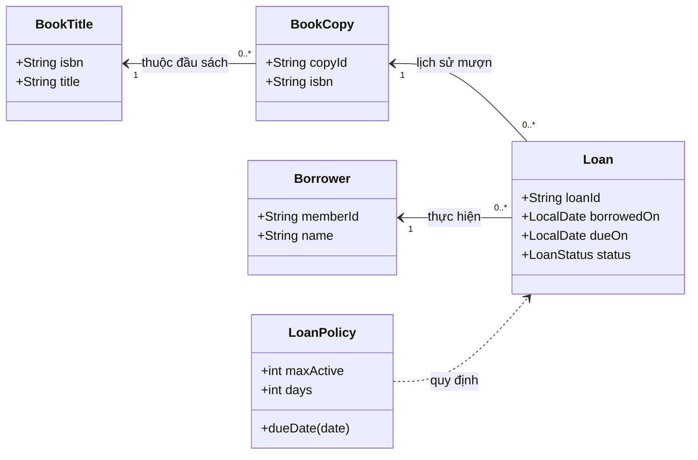

**Không suy luận sai từ số lượng:** `BookCopy 1 <-- 0..* Loan` không có nghĩa một bản được nhiều người mượn cùng lúc. Đây là **số lượt mượn trong lịch sử**. Ràng buộc “tối đa một lượt active cho một bản” phải được bảo vệ riêng bằng logic và, trong hệ thống lưu trữ thực, bằng chiến lược giao dịch/ràng buộc dữ liệu phù hợp.

Trong UML, hướng mũi tên chỉ là một quyết định điều hướng (*navigability*). Chưa cần đặt collection hai chiều trong mọi class. Nếu một hướng đã đáp ứng use case, có thể truy vấn những hướng còn lại qua repository.

## 5. Chọn thuộc tính và hành vi đúng chủ sở hữu

Không phải sau khi tìm thấy class là đặt tất cả field công khai. Cần quyết định lớp nào **biết** thông tin, lớp nào **được quyền thay đổi** và luật nào phải đúng trong suốt vòng đời.

| Đối tượng | Dữ liệu có nghĩa | Hành vi hoặc bất biến |
| --- | --- | --- |
| `Borrower` | `memberId`, `name` | ID hợp lệ; có thể thêm trạng thái thành viên khi có yêu cầu |
| `BookTitle` | ISBN, tiêu đề | Kiểm tra ISBN/metadata nếu phạm vi yêu cầu |
| `BookCopy` | `copyId`, ID đầu sách | Mã bản không rỗng; độc lập với các bản cùng đầu sách |
| `Loan` | ID lượt, ID người, ID bản, ngày mượn, hạn trả | Ngày hạn trả sau ngày mượn; trạng thái chuyển hợp lệ |
| `LoanPolicy` | Giới hạn số lượt, số ngày | Từ chối vượt giới hạn; tính hạn trả |
| `BorrowingService` | Repository, policy, clock, ID generator | Điều phối kiểm tra điều kiện, tạo Loan, lưu kết quả |
| `LoanRepository` | Không cần lưu trạng thái trong interface | Truy vấn lượt active, đếm lượt theo người và lưu |

**Nguyên tắc Information Expert:** ưu tiên đặt hành vi nơi có thông tin cần thiết để thực hiện nó. `Loan` đủ biết ngày mượn và hạn trả để bảo vệ thứ tự ngày; `LoanPolicy` biết thời hạn cho phép. `BorrowingService` cần nhiều thành phần để điều phối quá trình mượn, nhưng không nên tự nhân bản công thức tính ngày ở nhiều nơi.

## 6. Ví dụ Java 17 hoàn chỉnh: biến yêu cầu thành object model

Để tập trung vào bước nhận diện đối tượng, ví dụ là chương trình **mượn sách trong bộ nhớ**. Mỗi lần mượn hợp lệ tạo một `Loan`; `LoanRepository` trong demo chỉ giữ các lượt active, chưa triển khai trả sách/lưu lịch sử. Độc giả, bản sách, policy và Loan có trách nhiệm riêng, còn service điều phối.

Tạo file `IdentifyObjectsDemo.java`:

```java
import java.time.Clock;
import java.time.Instant;
import java.time.LocalDate;
import java.time.ZoneOffset;
import java.util.LinkedHashMap;
import java.util.Map;
import java.util.Objects;
import java.util.concurrent.atomic.AtomicInteger;

public class IdentifyObjectsDemo {

    private static String required(String value, String label) {
        if (value == null || value.isBlank()) {
            throw new IllegalArgumentException(label + " must not be blank");
        }
        return value;
    }

    // Entity ứng viên: có mã thành viên riêng.
    record Borrower(String memberId, String name) {
        Borrower {
            memberId = required(memberId, "memberId");
            name = required(name, "name");
        }
    }

    // Entity ứng viên: từng bản sách có mã độc lập với đầu sách.
    record BookCopy(String copyId, String title) {
        BookCopy {
            copyId = required(copyId, "copyId");
            title = required(title, "title");
        }
    }

    // Một lượt mượn có danh tính và ngày tháng riêng.
    record Loan(String loanId, String memberId, String copyId,
                LocalDate borrowedOn, LocalDate dueOn) {
        Loan {
            loanId = required(loanId, "loanId");
            memberId = required(memberId, "memberId");
            copyId = required(copyId, "copyId");
            Objects.requireNonNull(borrowedOn, "borrowedOn");
            Objects.requireNonNull(dueOn, "dueOn");
            if (!dueOn.isAfter(borrowedOn)) {
                throw new IllegalArgumentException(
                        "Due date must be after borrowed date");
            }
        }
    }

    // Domain policy: số lượt cho phép và thời hạn.
    record LoanPolicy(int maxActiveLoans, int loanDays) {
        LoanPolicy {
            if (maxActiveLoans <= 0 || loanDays <= 0) {
                throw new IllegalArgumentException("Policy must be positive");
            }
        }

        void ensureAllowed(int activeCount) {
            if (activeCount >= maxActiveLoans) {
                throw new IllegalStateException("Borrow limit reached");
            }
        }

        LocalDate dueDate(LocalDate borrowedOn) {
            return borrowedOn.plusDays(loanDays);
        }
    }

    // Port: service biết hợp đồng, không biết SQL/JPA.
    interface LoanRepository {
        boolean isCopyBorrowed(String copyId);
        int activeCount(String memberId);
        void save(Loan loan);
    }

    // Adapter trong bộ nhớ; dùng để minh họa và unit test tuần tự.
    static final class InMemoryLoanRepository implements LoanRepository {
        private final Map<String, Loan> activeByCopy = new LinkedHashMap<>();

        @Override
        public boolean isCopyBorrowed(String copyId) {
            return activeByCopy.containsKey(copyId);
        }

        @Override
        public int activeCount(String memberId) {
            int count = 0;
            for (Loan loan : activeByCopy.values()) {
                if (loan.memberId().equals(memberId)) count++;
            }
            return count;
        }

        @Override
        public void save(Loan loan) {
            Objects.requireNonNull(loan, "loan");
            if (activeByCopy.putIfAbsent(loan.copyId(), loan) != null) {
                throw new IllegalStateException(
                        "Copy " + loan.copyId() + " is already borrowed");
            }
        }
    }

    interface LoanIdSource {
        String nextLoanId();
    }

    // Application service: thực hiện trình tự của use case.
    static final class BorrowingService {
        private final LoanRepository loans;
        private final LoanPolicy policy;
        private final Clock clock;
        private final LoanIdSource ids;

        BorrowingService(LoanRepository loans, LoanPolicy policy,
                         Clock clock, LoanIdSource ids) {
            this.loans = Objects.requireNonNull(loans);
            this.policy = Objects.requireNonNull(policy);
            this.clock = Objects.requireNonNull(clock);
            this.ids = Objects.requireNonNull(ids);
        }

        Loan borrow(Borrower borrower, BookCopy copy) {
            Objects.requireNonNull(borrower, "borrower");
            Objects.requireNonNull(copy, "copy");

            if (loans.isCopyBorrowed(copy.copyId())) {
                throw new IllegalStateException(
                        "Copy " + copy.copyId() + " is already borrowed");
            }

            policy.ensureAllowed(loans.activeCount(borrower.memberId()));

            LocalDate today = LocalDate.now(clock);
            Loan loan = new Loan(
                    ids.nextLoanId(),
                    borrower.memberId(),
                    copy.copyId(),
                    today,
                    policy.dueDate(today));

            loans.save(loan);
            return loan;
        }
    }

    public static void main(String[] args) {
        Borrower an = new Borrower("MEM-01", "An");
        Borrower binh = new Borrower("MEM-02", "Binh");
        BookCopy copy1 = new BookCopy("COPY-01", "OOP Java");
        BookCopy copy2 = new BookCopy("COPY-02", "SQL");
        BookCopy copy3 = new BookCopy("COPY-03", "Algorithms");

        InMemoryLoanRepository repo = new InMemoryLoanRepository();
        LoanPolicy policy = new LoanPolicy(2, 14);
        Clock clock = Clock.fixed(
                Instant.parse("2026-10-15T00:00:00Z"),
                ZoneOffset.UTC);
        AtomicInteger seq = new AtomicInteger();
        LoanIdSource ids = () -> "LOAN-" + seq.incrementAndGet();

        BorrowingService service =
                new BorrowingService(repo, policy, clock, ids);

        Loan first = service.borrow(an, copy1);
        System.out.println(
                "Loan: " + first.loanId() + ", due " + first.dueOn());

        try {
            service.borrow(binh, copy1);
        } catch (IllegalStateException ex) {
            System.out.println(ex.getMessage());
        }

        service.borrow(an, copy2);
        System.out.println("Active of An: " + repo.activeCount(an.memberId()));

        try {
            service.borrow(an, copy3);
        } catch (IllegalStateException ex) {
            System.out.println(ex.getMessage());
        }
    }
}
```

Chạy:

```bash
javac IdentifyObjectsDemo.java
java IdentifyObjectsDemo
```

Kết quả dự kiến:

```text
Loan: LOAN-1, due 2026-10-29
Copy COPY-01 is already borrowed
Active of An: 2
Borrow limit reached
```

### Gắn ví dụ code trở lại từng câu yêu cầu

| Câu yêu cầu | Thành phần trong code | Điểm chứng minh |
| --- | --- | --- |
| Độc giả có mã, tên | `Borrower` | `record Borrower(memberId, name)` |
| Bản sách có mã riêng | `BookCopy` | `copyId` định danh bản |
| Hệ thống ghi một lần mượn | `Loan` | Có `loanId`, borrower, copy, ngày |
| Một bản không được cho mượn trùng | `LoanRepository`, `BorrowingService` | Kiểm tra active; `putIfAbsent` từ chối trùng |
| Tối đa hai bản | `LoanPolicy` | `ensureAllowed(activeCount)` |
| Hạn trả sau 14 ngày | `LoanPolicy` | `borrowedOn.plusDays(loanDays)` |
| Quy trình mượn cần nhiều thành phần | `BorrowingService` | Kiểm tra, tạo Loan, lưu |
| Cần thay DB/nguồn thời gian | `LoanRepository`, `Clock` | Dependency injection vào service |

Code dùng `record` để ngắn gọn và bất biến trong demo. **Một entity không bắt buộc là record**, và có thể cần class có method chuyển trạng thái khi bổ sung nghiệp vụ trả sách, gia hạn, mất sách hoặc hủy mượn. Ở đây đối tượng `Loan` có danh tính riêng theo nghĩa domain dù được hiện thực bằng record bất biến.

**Giới hạn kỹ thuật:** mẫu này chạy tuần tự. Hai request đồng thời có thể cùng thấy độc giả còn hạn mức rồi cùng `save`, vượt giới hạn tổng; `LinkedHashMap` cũng không thread-safe. Để chạy production, phải áp đặt giao dịch/khóa hoặc cách đảm bảo atomicity phù hợp, xác thực mã độc giả/bản sách thực sự tồn tại, lưu lịch sử khi trả sách và có ràng buộc database ngăn hai lượt mượn active cho cùng một bản. **Phân chia object hợp lý là điều kiện giúp xử lý đúng, không tự thay thế kiểm soát đồng thời.**

## 7. Mô phỏng sự cộng tác để kiểm chứng mô hình

Sau khi đề xuất class, hãy **chạy thử use case trên giấy**. Nếu không giải thích được ai sở hữu một bước hoặc phải trao quyền sửa dữ liệu lung tung, mô hình chưa ổn.

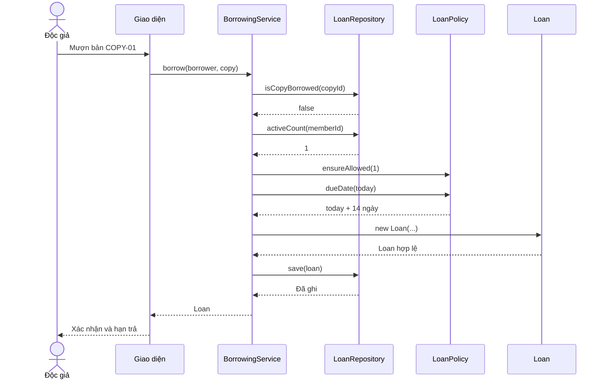

Đây là một **đường đi thành công**. Phải mô phỏng thêm đường đi thất bại: bản đang được mượn, người mượn đạt hạn mức, đầu vào không hợp lệ, lưu DB lỗi. Mỗi đường đi cần có một nơi chịu trách nhiệm xử lý và trạng thái không được sai lệch.

Đừng để giao diện quyết định thay `LoanPolicy` rằng 3 bản vẫn hợp lệ; giao diện có thể kiểm tra nhanh để phản hồi tốt hơn, nhưng quy tắc nghiệp vụ cần được thực thi ở tầng có thẩm quyền.

## 8. Các dấu hiệu nhận diện class sai

### 8.1 Biến mọi danh từ thành class

Từ “ngày mượn”, “tên”, “số lượng” thường chỉ là field hoặc value object quen thuộc (`LocalDate`, `String`, `int`). Chỉ nâng thành kiểu miền riêng khi có **quy tắc/ý nghĩa** đáng được bảo vệ, ví dụ `MembershipId` có định dạng đặc biệt hoặc `Money` có currency và phép toán.

### 8.2 Biến mọi động từ thành class service

Có thể thiết kế một service `AddItemService`, `SetDueDateService`, `ChangeStatusService` cho mọi thao tác nhỏ, nhưng nếu hành vi gắn với trạng thái và bất biến của entity, method trực tiếp trên entity có thể rõ nghĩa hơn. `Loan.extendDueDate(...)` có thể phù hợp hơn cho quy tắc gia hạn nội tại, còn `RenewalService` hữu ích nếu gia hạn phải phối hợp tồn kho, tài khoản và chính sách ngoài entity.

### 8.3 Gộp hai khái niệm có vòng đời khác nhau

Gộp “đầu sách” và “bản sách” khiến không lưu được số bản và từng tình trạng. Gộp “độc giả” với “lượt mượn” khiến lịch sử, gia hạn và trả sách phức tạp. Hãy so sánh **ID, tuổi thọ và nguyên nhân thay đổi** của từng khái niệm.

### 8.4 Nhầm role/actor với đối tượng miền

“Nhân viên thư viện” là actor trong use case; có thể cần entity `StaffMember` nếu hệ thống thực sự quản lý nhân viên, phân quyền và ca làm. Nếu chức năng chỉ mô tả “nhân viên nhấn nút tra cứu”, chưa đủ cơ sở để thêm một lớp miền `Librarian`. Vai trò sử dụng hệ thống và mô hình dữ liệu bên trong là hai phạm vi khác nhau.

### 8.5 Biến `System`, `Manager`, `Helper` thành kho mọi trách nhiệm

Một `LibrarySystem` biết từ ISBN, lịch, tính phí đến gửi email thường là “God Object”. Hỏi lại mỗi hành vi cần thông tin nào và thuộc một khái niệm nghiệp vụ nào. Một service điều phối nhiều thành phần được phép tồn tại nhưng không nên tự sở hữu mọi quy tắc nội tại.

### 8.6 Thiết kế quá sớm từ bảng hoặc màn hình

Một bảng DB có thể chứa nhiều cột không đồng nghĩa chính xác với một domain object. Một trang “Thông tin độc giả và lịch sử mượn” có thể hiển thị dữ liệu tổng hợp từ nhiều thực thể. Mô hình nghiệp vụ nên dựa vào **định danh, hành vi và bất biến**, sau đó mới quyết định bảng, màn hình và DTO tương ứng.

## 9. Kiểm chứng class ứng viên bằng vòng CRC ngắn

Sau khi xác định các class ứng viên, thử một lượt **Class–Responsibilities–Collaborators (CRC)**: mỗi ứng viên phải có một nghĩa vụ riêng và chỉ biết những cộng tác viên cần thiết.

- `Borrower`: danh tính độc giả; không cần biết kho sách.
- `BookCopy`: danh tính bản vật lý; không quyết định hạn mức độc giả.
- `Loan`: một lượt mượn có ngày tháng, identity và vòng đời.
- `LoanPolicy`: quy tắc hạn mức, hạn trả.
- `BorrowingService`: điều phối policy, repository, đồng hồ và nguồn ID.

Thử kịch bản **trả sách rồi mượn lại**: class nào kết thúc lượt cũ, class nào bảo vệ bản sách còn sẵn, class nào giữ lịch sử? Nếu xóa một ứng viên mà không mất khái niệm hay trách nhiệm nào, ứng viên đó có thể chỉ cần là field/method.

Đây chỉ là bước *xác minh đối tượng vừa tìm được*; cách viết thẻ CRC và role-play cộng tác đầy đủ được trình bày ở bài **Thẻ CRC: lớp, trách nhiệm và cộng tác**.

## 10. Khi yêu cầu mới làm thay đổi mô hình

Không có mô hình nào cố định ngay từ lần đọc đầu. Ví dụ:

**Bổ sung “Có thể đặt trước khi bản sách đã được mượn.”** Khái niệm `Reservation` xuất hiện, có thứ tự chờ và trạng thái. Đừng nhét toàn bộ hàng chờ vào một biến `nextBorrowerId` của `BookCopy` nếu nghiệp vụ đặt trước có vòng đời riêng.

**Bổ sung “Gia hạn tối đa hai lần, trừ khi đã có người đặt trước.”** `Loan` có thể cần `renewalCount` và hành vi gia hạn; điều kiện về hàng chờ cần dữ liệu từ `ReservationRepository`/policy, không nhất thiết đặt toàn bộ truy vấn vào entity.

**Bổ sung “Mỗi bản sách có nhiều lịch sử sửa chữa.”** Có thể cần `MaintenanceRecord` với ngày, chi phí, loại lỗi; một field `lastRepairDate` không giữ được danh sách lịch sử.

**Bổ sung “Trả sách có thể phát sinh tiền phạt.”** `Fine` có thể là value object số tiền, entity nghĩa vụ thanh toán hoặc kết quả tính toán tạm thời tùy cách theo dõi thu/hoàn tiền. Không thể quyết định chỉ từ từ “phạt”; phải hỏi về định danh, trạng thái và vòng đời.

| Thay đổi yêu cầu | Dấu hiệu xuất hiện đối tượng mới | Cần hỏi |
| --- | --- | --- |
| Đặt trước sách | Hàng chờ có lượt, trạng thái, thứ tự | Mỗi người đặt một hay nhiều lượt? Khi nào hết hạn? |
| Gia hạn | Lượt mượn có chuyển trạng thái/quy tắc | Ai được gia hạn? Có cần lưu lịch sử? |
| Sửa chữa bản sách | Sự kiện và chi phí theo từng lần | Có cần audit và truy vấn nhiều năm? |
| Phí phạt | Tiền, hạn nộp, thanh toán | Đây là giá trị tính được hay khoản nợ có ID? |
| Email nhắc hạn | Tác vụ bên ngoài/asynchronous | Sự kiện nào kích hoạt? Retry/idempotency ra sao? |

Nhận diện đối tượng là **hoạt động lặp lại theo hiểu biết nghiệp vụ**: từ use case → class ứng viên → thử cộng tác → làm rõ câu hỏi → chỉnh sửa mô hình.

## 11. Một quy trình thực hành có thể áp dụng ngay

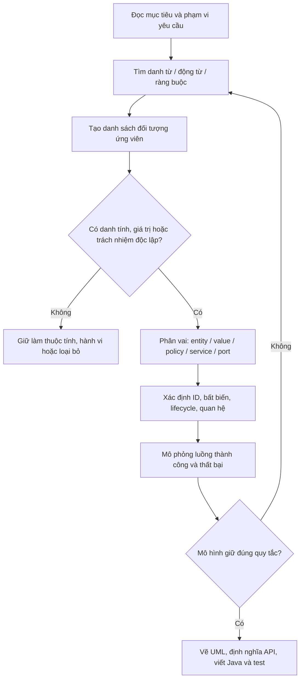

Trong một buổi phân tích thực tế:

1. **Giữ nguyên câu nói của người dùng.** Tránh đổi ngay mọi từ nghiệp vụ sang ngôn ngữ kỹ thuật như “table”, “controller”, “service”.
2. **Viết danh sách ứng viên có lý do.** Mỗi tên nên có một câu cho biết tại sao nó cần tồn tại.
3. **Xác định thuật ngữ mơ hồ.** “Sách” là tựa sách hay bản vật lý? “Đăng ký” là tài khoản hay lượt đăng ký một khóa?
4. **Thử hai tình huống trái ngược.** Một người mượn hai bản, hai người muốn mượn cùng một bản, trả rồi mượn lại.
5. **Chọn nguồn chân lý.** Bản sách “đang mượn” được suy ra từ lượt active hay lưu cờ riêng? Nếu lưu cả hai, ai phải cập nhật đồng bộ?
6. **Chỉ sau đó mới chọn kiểu Java.** `record`, class, enum, interface, `List`, `Map`, repository, DTO.
7. **Viết test từ câu yêu cầu.** Tên test nên phản ánh chính sách, ví dụ `cannotBorrowCopyAlreadyOnLoan`, không chỉ `testGetter`.

Một mô hình tốt không nhất thiết có nhiều class. Nó phải mô tả đúng **đối tượng quan trọng của bài toán** và tạo ra điểm đặt hành vi/ràng buộc rõ ràng.

## 12. Những câu hỏi nên hỏi người cung cấp yêu cầu

Khi mô hình chưa rõ, hỏi những câu có thể làm thay đổi thiết kế:

- “Một đầu sách có thể có nhiều bản vật lý độc lập không? Mỗi bản có mã duy nhất trên toàn hệ thống chứ?”
- “Lượt mượn đã trả có còn phải lưu lại để tra cứu lịch sử không?”
- “Hai lần mượn cùng bản sách ở hai ngày khác nhau là hai lượt độc lập hay sửa lượt cũ?”
- “Giới hạn hai bản áp dụng cho mọi loại độc giả hay mỗi nhóm một chính sách?”
- “Hạn 14 ngày là ngày lịch, ngày làm việc hay tính đến giờ chính xác?”
- “Có trạng thái mất, hỏng, bảo trì khiến bản sách không thể cho mượn dù không có lượt active không?”
- “Khi hai yêu cầu mượn đến đồng thời, điều kiện nào bắt buộc phải được đảm bảo ở database?”

Những câu hỏi này giúp nhận ra `BookCopy`, `Loan`, `LoanPolicy`, `CopyStatus`, `Reservation` có cần là các khái niệm riêng. Đừng coi mọi câu trả lời “chưa biết” như một tín hiệu phải thêm abstraction phòng xa.

## 13. Bài tập tự luyện

### Bài 1 — Hệ thống bán vé xem phim

Yêu cầu: “Khán giả chọn suất chiếu, chọn hai ghế trống, thanh toán và nhận vé. Một ghế của cùng suất chiếu không được bán hai lần. Vé có mã QR.”

Hãy tìm danh từ/động từ/ràng buộc, sau đó đề xuất các class ứng viên. Phân biệt `Movie` (phim), `Screening` (suất chiếu), `Seat` (ghế vật lý), `SeatReservation` (giữ ghế theo suất) và `Ticket` (vé) nếu chúng cần vòng đời riêng. Giải thích vì sao “ghế A5” không thể bị đánh dấu đã bán vĩnh viễn cho mọi suất.

### Bài 2 — Giỏ hàng

Yêu cầu: “Người mua thêm sản phẩm vào giỏ, chỉnh số lượng, xem tổng tiền và áp mã giảm giá.”

Xác định ứng viên `Cart`, `CartLine`, `Product`, `Money`, `DiscountPolicy`. Chỉ ra trường hợp “mã giảm giá” nên là `String`, value object hoặc entity riêng. Thiết kế ít nhất ba invariant của `Cart`.

### Bài 3 — Quản lý khóa học

Yêu cầu: “Sinh viên đăng ký nhiều lớp học phần, mỗi lớp có tối đa 30 sinh viên, một sinh viên không được đăng ký trùng cùng một lớp.”

Xác định `Student`, `Course`, `Section`, `Enrollment`; cho biết `Course` và `Section` có cần tách không. Vẽ UML multiplicity và giải thích luật “tối đa 30” được kiểm soát ở đâu khi có đăng ký đồng thời.

### Bài 4 — Phản biện danh sách class

Một người đề xuất: `Library`, `Name`, `Borrow`, `Check`, `Date`, `Database`, `Screen`, `Book`, `Loan`.

Hãy phân loại: class miền có cơ sở, hành vi, thuộc tính/value có sẵn, adapter kỹ thuật, và ứng viên chưa đủ thông tin. Giải thích bằng **danh tính, trách nhiệm và vòng đời**, không chỉ bằng “từ này là danh từ”.

### Bài 5 — Mở rộng demo Java

Bổ sung `returnCopy(copyId, date)`: giữ lịch sử, một lượt mượn chỉ được trả một lần, sau khi trả bản sách có thể được mượn tiếp. Chọn giữa biến `Loan` thành entity có status hoặc tạo record lịch sử mới; cập nhật repository và viết test cho thứ tự mượn → trả → mượn lại.

## 14. Checklist trước khi chốt mô hình

| Câu hỏi | Dấu hiệu đã sẵn sàng |
| --- | --- |
| Mỗi ứng viên có ý nghĩa nghiệp vụ riêng không? | Có một câu mô tả trách nhiệm/định danh rõ |
| Có tách khái niệm chỉ giống tên nhưng khác vòng đời không? | Ví dụ phân biệt đầu sách, bản sách, lượt mượn |
| Có loại những ứng viên chỉ là từ ngữ/thuộc tính/hành vi không? | Không tạo class rỗng vô nghĩa |
| Entity và value object có được phân biệt không? | Biết so sánh theo ID hay theo giá trị |
| Đã xác định invariant và nơi kiểm soát chưa? | “Tối đa một lượt active” có điểm thực thi rõ |
| Quan hệ hai phía và multiplicity đã đúng chưa? | Có ví dụ phản chứng, không lẫn lịch sử với trạng thái hiện tại |
| Hành vi nằm ở nơi có đủ thông tin không? | Entity giữ bất biến, policy giữ chính sách, service điều phối |
| Mô hình có phụ thuộc thừa vào HTTP/DB/UI không? | Có thể kiểm thử logic chính mà không khởi động công nghệ bên ngoài |
| Có xử lý được các tình huống lỗi và cạnh tranh không? | Biết cần transaction/constraint ở đâu |
| Có thể nối mỗi câu yêu cầu tới code/test không? | Không có quy tắc “biến mất” sau khi triển khai |

**Ghi nhớ:** trích danh từ chỉ là cách **khởi đầu**. Đối tượng đúng phải có lý do tồn tại trong miền, dữ liệu và hành vi tương ứng, quan hệ rõ ràng cùng bất biến được bảo vệ. Hãy mô phỏng yêu cầu thực tế và điều chỉnh mô hình trước khi viết nhiều code.


</details>

- [Quay lại đầu trang](#back-to-top)

---

## <a id="modeling-003">Phân chia trách nhiệm và đối tượng cộng tác</a>

<details>
<summary>Xem chi tiết</summary>

# Phân chia trách nhiệm và đối tượng cộng tác khi mô hình hóa OOP

## 1. Từ yêu cầu nghiệp vụ đến các đối tượng biết làm việc cùng nhau

Giả sử xây dựng hệ thống thư viện với yêu cầu:

> Một thành viên có thể mượn sách nếu tài khoản còn hoạt động, chưa đạt giới hạn số lượt mượn và bản sách còn sẵn. Khi mượn, hệ thống lập phiếu có hạn trả. Khi trả, phiếu được đóng, bản sách lại sẵn sàng và số lượt mượn đang hoạt động của thành viên giảm đi.

Ta có thể đặt toàn bộ kiểm tra và thao tác trong một `LibraryService` khổng lồ. Nhưng khi quy tắc thay đổi, mọi phần của service phải hiểu chi tiết trạng thái `Member`, `BookCopy` và `Loan`. Cách mô hình hóa hướng đối tượng hữu ích hơn là xác định:

- **Trách nhiệm (responsibility):** một đối tượng cần *biết gì* và *làm gì* để thực hiện vai trò của nó?
- **Đối tượng cộng tác (collaborator):** đối tượng nào cung cấp thông tin/hành vi để đối tượng hiện tại hoàn thành trách nhiệm đó?
- **Ranh giới (boundary):** phần nào là bất biến cục bộ của một đối tượng, phần nào là quy trình phối hợp nhiều đối tượng?
- **Hợp đồng (contract):** đối tượng cần lời gọi/đầu vào/đầu ra nào từ cộng tác viên, và lỗi được biểu diễn thế nào?

Mô hình tốt không yêu cầu mỗi lớp phải tự làm hết mọi việc. Nó yêu cầu mỗi trách nhiệm **có chủ sở hữu rõ ràng** và các đối tượng cộng tác qua API có ý nghĩa.

### Phân biệt hai kiểu trách nhiệm

| Loại | Câu hỏi | Ví dụ |
|---|---|---|
| **Knowing (biết)** | Đối tượng phải nắm những dữ liệu/quan hệ nào? | `BookCopy` biết mã bản sách và nó đang sẵn sàng hay đã được mượn |
| **Doing (làm)** | Đối tượng chịu trách nhiệm hành động/quy tắc gì? | `BookCopy.markBorrowed()` ngăn cho mượn một bản sách không còn sẵn |

Một đối tượng thường có cả hai: `Member` biết số lượt mượn đang mở và thực thi quy tắc giới hạn; `Loan` biết ngày đến hạn và bảo vệ việc đóng phiếu đúng một lần.

**Không đồng nhất “biết dữ liệu” với “cho lớp ngoài quyền thay đổi mọi field”.** Trạng thái nên được kiểm soát qua hành vi rõ nghĩa, thay vì chuỗi getter/setter công khai.

## 2. Dùng CRC để nhìn **luồng cộng tác**, không chỉ danh sách lớp

Một bảng CRC nhỏ giúp kiểm tra “ai cần nhờ ai” trước khi viết sequence diagram:

| Class | Trách nhiệm trong use case mượn/trả | Cộng tác viên |
|---|---|---|
| `Member` | Bảo vệ điều kiện đủ quyền mượn và số lượt đang hoạt động | Không cần biết `BookCopy` |
| `BookCopy` | Bảo vệ khả năng cho mượn của một bản | Không cần biết quota `Member` |
| `Loan` | Bảo vệ một lượt mượn và quy tắc đóng phiếu | Tham chiếu member/copy |
| `LendingService` | Điều phối đúng thứ tự các hành vi ở trên | `Member`, `BookCopy`, `Loan`, `Clock` |

**Diễn tập:** service yêu cầu member xác nhận quota, copy xác nhận sẵn sàng, tạo loan, rồi mới thay trạng thái. Nếu đổi người kiểm tra quota từ `Member` sang `BookCopy`, đối tượng bản sách phải biết dữ liệu không thuộc vai trò của nó. Đó là dấu hiệu phân công trách nhiệm sai.

CRC chi tiết (cách viết thẻ, role-play và các nhánh lỗi) được học ở bài **Thẻ CRC: lớp, trách nhiệm và cộng tác**. Bài hiện tại đi tiếp câu hỏi **chọn chủ sở hữu cho mỗi quy tắc và thiết kế lời gọi giữa các đối tượng**.

## 3. Chọn nơi đặt quy tắc: đừng tách dữ liệu khỏi chủ sở hữu của nó

Một quy tắc chỉ phụ thuộc vào trạng thái của **một** đối tượng thường nên ở ngay đối tượng đó.

Ví dụ:

```java
// Kiểu thiết kế yếu: service tự đọc rồi sửa trạng thái của Member.
if (member.getActiveLoanCount() < member.getMaxLoans()) {
    member.setActiveLoanCount(
            member.getActiveLoanCount() + 1);
}
```

Đoạn trên khiến nhiều caller có thể bỏ qua điều kiện giới hạn, tăng sai số lượng hoặc gọi setter vào thời điểm không thích hợp.

Thay vào đó:

```java
// API theo ý nghĩa nghiệp vụ:
member.recordBorrow();
```

`Member` tự kiểm tra quy tắc và thực hiện thay đổi hợp lệ. Nếu quy tắc “tài khoản bị khóa không được mượn” xuất hiện, vị trí thay đổi rất rõ.

Tương tự, `BookCopy` nên thực thi “một bản sách không thể được đánh dấu đã mượn hai lần khi chưa trả”, còn `Loan` nên kiểm soát “một phiếu không được đóng hai lần”.

Nhưng hành vi **mượn sách** tác động đồng thời đến thành viên, bản sách và phiếu. Không nên cố bắt `Member` truy cập trực tiếp cơ sở dữ liệu của kho sách để hoàn tất mọi thứ. Đây là nơi **đối tượng điều phối** có thể giúp các object cộng tác.

## 4. Nhìn quan hệ qua UML class diagram

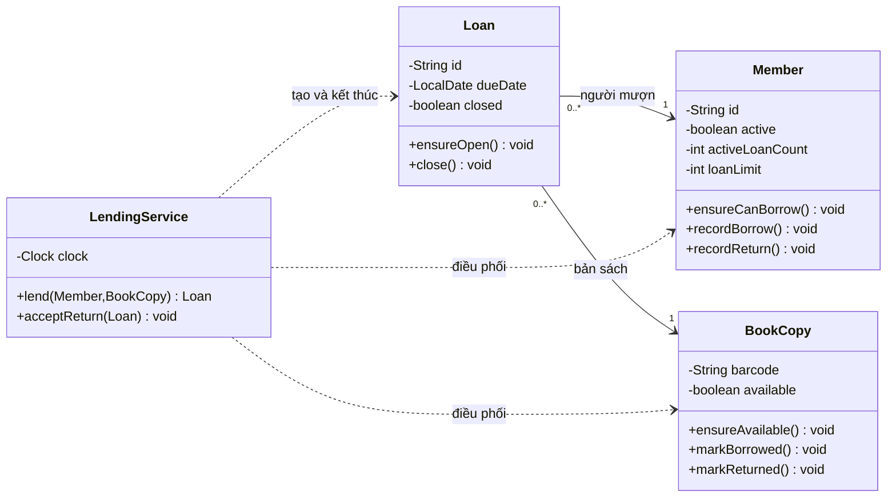

Đọc sơ đồ:

- Một `Loan` liên kết với đúng một `Member` và một `BookCopy`.
- Một thành viên hoặc bản sách có thể xuất hiện trong nhiều phiếu **theo thời gian**. Khả năng đang mượn được bảo vệ bởi trạng thái và bất biến. Bội số `0..*` ở đây **không** cho phép cùng một bản sách được mượn đồng thời nhiều lần.
- `LendingService` nhận các đối tượng và gửi thông điệp tới chúng. Đường phụ thuộc nét đứt không có nghĩa service sở hữu vòng đời những đối tượng này.
- `Clock` là cộng tác viên kỹ thuật cung cấp thời gian có thể kiểm soát khi kiểm thử; nó không phải một thực thể miền.

**Sơ đồ lớp** cho biết ai giữ thông tin và có phương thức gì. Để kiểm chứng quy trình cộng tác thực sự, hãy bổ sung **sơ đồ trình tự**.

## 5. Sơ đồ trình tự: mỗi object thực hiện phần việc của mình

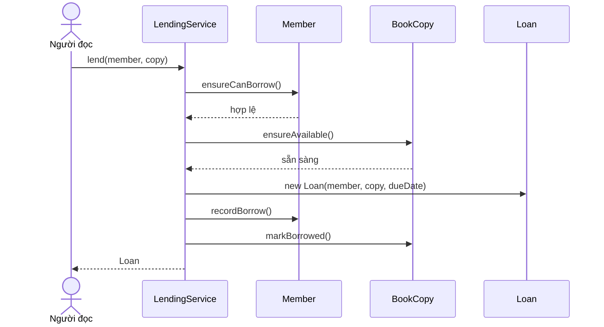

Mỗi bước có một người chịu trách nhiệm. Nếu `ensureCanBorrow()` từ chối, service kết thúc và không thay đổi `BookCopy`. Nếu `ensureAvailable()` từ chối, service không lập phiếu.

Sơ đồ trình tự trên minh họa **luồng bình thường, tuần tự trong bộ nhớ**. Nó chưa phải một transaction nguyên tử trong tình huống đa luồng, nhiều tiến trình hoặc DB. Khi đưa vào hệ thống thật, một lỗi sau bước thay đổi trạng thái có thể cần rollback hoặc cơ chế bù trừ; sẽ bàn ở phần sau.

## 6. Ví dụ Java chạy được: nhiều đối tượng, mỗi đối tượng một trách nhiệm

Lưu toàn bộ mã sau thành `ResponsibilityDemo.java` (JDK 11+):

```java
import java.time.Clock;
import java.time.Instant;
import java.time.LocalDate;
import java.time.ZoneOffset;
import java.util.Objects;
import java.util.UUID;

public class ResponsibilityDemo {

    // Entity: biết và bảo vệ trạng thái mượn của thành viên.
    static final class Member {
        private final String id;
        private final int loanLimit;
        private boolean active;
        private int activeLoanCount;

        Member(String id, int loanLimit) {
            this.id = Objects.requireNonNull(id, "id");
            if (id.isBlank() || loanLimit < 1) {
                throw new IllegalArgumentException(
                        "Invalid member id or limit");
            }
            this.loanLimit = loanLimit;
            this.active = true;
        }

        void ensureCanBorrow() {
            if (!active) {
                throw new IllegalStateException("Member inactive");
            }
            if (activeLoanCount >= loanLimit) {
                throw new IllegalStateException("Loan limit reached");
            }
        }

        void recordBorrow() {
            ensureCanBorrow();
            activeLoanCount++;
        }

        void recordReturn() {
            if (activeLoanCount <= 0) {
                throw new IllegalStateException(
                        "No active loans to return");
            }
            activeLoanCount--;
        }

        int activeLoanCount() {
            return activeLoanCount;
        }

        void deactivate() {
            active = false;
        }
    }

    // Entity: một bản sách vật lý, có mã riêng.
    static final class BookCopy {
        private final String barcode;
        private boolean available = true;

        BookCopy(String barcode) {
            this.barcode = Objects.requireNonNull(
                    barcode, "barcode");
            if (barcode.isBlank()) {
                throw new IllegalArgumentException("Blank barcode");
            }
        }

        void ensureAvailable() {
            if (!available) {
                throw new IllegalStateException(
                        "Book copy is already on loan");
            }
        }

        void markBorrowed() {
            ensureAvailable();
            available = false;
        }

        void markReturned() {
            if (available) {
                throw new IllegalStateException(
                        "Book copy is not on loan");
            }
            available = true;
        }

        boolean isAvailable() {
            return available;
        }

        String barcode() {
            return barcode;
        }
    }

    // Entity: thông tin và vòng đời một lần mượn cụ thể.
    static final class Loan {
        private final String id;
        private final Member borrower;
        private final BookCopy copy;
        private final LocalDate dueDate;
        private boolean closed;

        Loan(String id, Member borrower, BookCopy copy,
             LocalDate dueDate) {
            this.id = Objects.requireNonNull(id, "id");
            this.borrower = Objects.requireNonNull(
                    borrower, "borrower");
            this.copy = Objects.requireNonNull(copy, "copy");
            this.dueDate = Objects.requireNonNull(
                    dueDate, "dueDate");
        }

        Member borrower() {
            return borrower;
        }

        BookCopy copy() {
            return copy;
        }

        LocalDate dueDate() {
            return dueDate;
        }

        void ensureOpen() {
            if (closed) {
                throw new IllegalStateException("Loan already closed");
            }
        }

        void close() {
            ensureOpen();
            closed = true;
        }

        boolean isClosed() {
            return closed;
        }
    }

    // Coordinator: không tự sửa các field riêng tư của entity.
    static final class LendingService {
        private final Clock clock;
        private final int loanDays;

        LendingService(Clock clock, int loanDays) {
            this.clock = Objects.requireNonNull(clock, "clock");
            if (loanDays < 1) {
                throw new IllegalArgumentException(
                        "loanDays must be positive");
            }
            this.loanDays = loanDays;
        }

        Loan lend(Member member, BookCopy copy) {
            Objects.requireNonNull(member, "member");
            Objects.requireNonNull(copy, "copy");

            // Kiểm tra trước khi bắt đầu thay đổi trạng thái.
            member.ensureCanBorrow();
            copy.ensureAvailable();

            Loan loan = new Loan(
                    UUID.randomUUID().toString(),
                    member,
                    copy,
                    LocalDate.now(clock).plusDays(loanDays));

            member.recordBorrow();
            copy.markBorrowed();
            return loan;
        }

        void acceptReturn(Loan loan) {
            Objects.requireNonNull(loan, "loan");
            loan.ensureOpen();

            loan.copy().markReturned();
            loan.borrower().recordReturn();
            loan.close();
        }
    }

    public static void main(String[] args) {
        Clock testClock = Clock.fixed(
                Instant.parse("2026-10-15T00:00:00Z"),
                ZoneOffset.UTC);

        Member lan = new Member("MEM-01", 1);
        BookCopy bookA = new BookCopy("COPY-A");
        BookCopy bookB = new BookCopy("COPY-B");
        LendingService lending = new LendingService(testClock, 14);

        Loan first = lending.lend(lan, bookA);
        System.out.println("Due: " + first.dueDate());
        System.out.println("Active loans: "
                + lan.activeLoanCount());
        System.out.println("Book A available: "
                + bookA.isAvailable());

        try {
            lending.lend(lan, bookB);
            throw new AssertionError(
                    "Expected loan-limit rejection");
        } catch (IllegalStateException expected) {
            System.out.println("Rejected: " + expected.getMessage());
        }

        System.out.println("Book B still available: "
                + bookB.isAvailable());

        lending.acceptReturn(first);
        System.out.println("After return, active loans: "
                + lan.activeLoanCount());

        Loan second = lending.lend(lan, bookB);
        System.out.println("Second loan due: "
                + second.dueDate());

        if (!first.isClosed() || bookB.isAvailable()
                || lan.activeLoanCount() != 1) {
            throw new AssertionError("State invariant failed");
        }
        System.out.println("State checks passed");
    }
}
```

Biên dịch và chạy:

```bash
javac ResponsibilityDemo.java
java ResponsibilityDemo
```

Kết quả dự kiến:

```text
Due: 2026-10-29
Active loans: 1
Book A available: false
Rejected: Loan limit reached
Book B still available: true
After return, active loans: 0
Second loan due: 2026-10-29
State checks passed
```

### Những quyết định đáng chú ý trong ví dụ

**`Member` là nơi duy nhất thực thi giới hạn mượn.** Nếu thay quy tắc từ một lên ba cuốn, hoặc cần khóa thành viên nợ phí, logic điều kiện thuộc về thành viên hoặc policy nghiệp vụ mà nó cộng tác. `LendingService` không truy xuất rồi tự so sánh `activeLoanCount` và `loanLimit`.

**`BookCopy` quyết định trạng thái của bản sách.** Dù service muốn cho mượn, bản sách có quyền từ chối `markBorrowed()` nếu đang được mượn. Service không thể đơn giản đặt `available=false` bằng setter công khai.

**`Loan` giữ danh tính của giao dịch mượn và ngày hẹn trả.** Một `Loan` khác có thể liên kết đến cùng `BookCopy` trong lịch sử, nhưng chỉ một phiếu đang hoạt động được phép chiếm bản sách tại một thời điểm.

**`LendingService` điều phối các bước.** Nó không tự tính xem thành viên còn quota hay bản sách sẵn không. Nó cần biết *gọi ai* và *ở thời điểm nào*, chứ không phải biết cấu trúc field nội bộ. `Clock` được tiêm vào để có thể kiểm tra ngày đến hạn mà không dựa vào đồng hồ máy thực tế.

**Đây là demo mô hình miền trong một luồng.** Hai lệnh thay đổi trạng thái `member.recordBorrow()` và `copy.markBorrowed()` là những thao tác riêng lẻ, chưa được bao bọc trong giao dịch hay khóa. Vì vậy code demo **không an toàn khi hai luồng/tiến trình cho mượn đồng thời**, không bảo đảm atomicity khi tích hợp DB hoặc xảy ra sự cố giữa các bước. Với hệ thống thực tế, phải thiết kế transaction, ràng buộc dữ liệu, chiến lược khóa/optimistic concurrency và thời điểm phát thông báo phù hợp.

## 7. Chọn cộng tác viên theo GRASP

**GRASP** (*General Responsibility Assignment Software Patterns*) là nhóm nguyên tắc giúp trả lời “giao trách nhiệm này cho ai?”. Không cần biến mọi pattern thành một lớp riêng, nhưng các câu hỏi sau rất hữu ích khi mô hình hóa.

| Nguyên tắc | Câu hỏi | Áp dụng trong thư viện |
|---|---|---|
| **Information Expert** | Ai đang sở hữu thông tin cần để thực thi quy tắc? | `Member` biết quota; `BookCopy` biết trạng thái sẵn sàng |
| **Creator** | Ai nên tạo đối tượng mới vì có đủ dữ liệu/quan hệ cần thiết? | Use case `LendingService` tạo `Loan` từ member, copy và hạn trả |
| **Controller** | Ai nhận yêu cầu của một sự kiện/use case và phối hợp? | `LendingService.lend(...)` điều phối luồng mượn |
| **Low Coupling** | Có thể tránh cho một lớp biết chi tiết không liên quan của nhiều lớp khác không? | Service gọi hành vi có tên, không can thiệp field |
| **High Cohesion** | Trách nhiệm của một lớp có cùng mục đích, dễ giải thích không? | `BookCopy` bảo vệ trạng thái của một bản sách |
| **Polymorphism** | Các biến thể hành vi cùng một vai trò có thể dùng hợp đồng chung không? | Chính sách tính phí trễ có thể theo `LateFeePolicy` |
| **Indirection** | Cần một trung gian để tách hai phía đang liên kết chặt không? | Adapter cổng thông báo tách domain khỏi SMTP/HTTP |
| **Pure Fabrication** | Có trách nhiệm kỹ thuật không thuộc tự nhiên về một entity không? | `LoanRepository` để lưu/tải loan |
| **Protected Variations** | Thay đổi nào cần được che sau một hợp đồng ổn định? | `NotificationSender` trừu tượng hóa email/SMS |

Không phải lúc nào áp dụng một nguyên tắc cũng hoàn toàn thỏa mãn nguyên tắc khác. Ví dụ `LendingService` dùng nhiều cộng tác viên là hợp lý vì bản thân nhiệm vụ điều phối đòi hỏi nhiều object; tránh coupling không có nghĩa là service chỉ được biết một class.

## 8. Cộng tác với đối tượng trực tiếp, tránh chuỗi lấy dữ liệu rồi quyết định hộ

Xem hai cách kiểm tra quyền mượn.

**Cách A: service đọc từng field và tự quyết định.**

```java
// Minh họa anti-pattern.
if (member.isActive()
        && member.getActiveLoanCount()
           < member.getLoanLimit()) {
    member.setActiveLoanCount(
            member.getActiveLoanCount() + 1);
}
```

Cách này khiến logic bị phân tán: bất kỳ controller hay service nào cũng có thể bỏ qua một điều kiện.

**Cách B: giao việc cho đối tượng sở hữu quy tắc.**

```java
member.recordBorrow();
```

API theo hành vi bảo vệ quy tắc ngay trong `Member`.

Đôi khi một service đào sâu:

```java
long fee = loan.getBorrower()
               .getMembershipPlan()
               .getLateFeePerDay()
           * overdueDays;
```

Thay bằng một yêu cầu đúng trách nhiệm như `loan.calculateLateFee(overdueDays)` hoặc một `LateFeePolicy` được cung cấp đầu vào phù hợp sẽ giúp caller không phải hiểu nhiều nấc cấu trúc. Đây là tinh thần của **Law of Demeter** và **Tell, Don't Ask**.

Tuy nhiên, không cấm hoàn toàn getter. DTO chỉ để hiển thị, dữ liệu truy vấn, Value Object bất biến và fluent API đều có thể cho phép đọc cấu trúc. Điều cần tránh là **caller tự giữ và sao chép quy tắc thuộc trách nhiệm của đối tượng khác**.

## 9. Khi nào một trách nhiệm nên thuộc Service thay vì Entity?

Đặt hành vi vào Entity/Value Object nếu quy tắc **gắn chặt với trạng thái và bất biến của nó**:

- `BookCopy.markBorrowed()` không cho mượn khi đã mượn;
- `Member.recordBorrow()` không cho vượt quota;
- `Loan.close()` không cho đóng hai lần;
- `Money.plus()` từ chối cộng khác tiền tệ.

Dùng **Domain Service** khi hành vi có ý nghĩa miền rõ ràng nhưng **không thuộc tự nhiên vào một đối tượng duy nhất**. Ví dụ tính lịch xếp ca dựa trên nhiều nhân viên và quy tắc phân công, hoặc áp dụng chính sách phí cho nhiều loại thành viên.

Dùng **Application Service/use-case controller** khi nhiệm vụ chủ yếu là điều phối:

- kiểm tra quyền người gọi;
- tải các entity từ repository;
- mở transaction;
- yêu cầu các domain object thực thi quy tắc;
- lưu kết quả, gửi event hoặc điều phối thông báo.

Trong bài toán mượn sách đơn giản, `LendingService` đang gộp vai trò điều phối luồng vào một lớp để dễ thấy sự cộng tác. Nếu ứng dụng có database và phân lớp rõ, có thể tách `LendBookApplicationService` (tải/lưu/transaction) khỏi logic miền thích hợp. **Không cần ép tách** nếu chưa có độ phức tạp thực tế.

## 10. Nhận diện đối tượng cộng tác ổn định và dependency ở biên

Một service thường cần cộng tác viên hạ tầng như repository, đồng hồ, công cụ gửi thông báo. Đừng cho Entity phải biết SQL, HTTP hay cách tạo email.

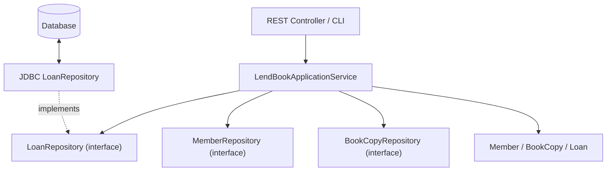

Một hợp đồng repository có thể là:

```java
interface LoanRepository {
    void save(Loan loan);
    java.util.Optional<Loan> findById(String loanId);
}

interface BookCopyRepository {
    BookCopy getByBarcode(String barcode);
    void save(BookCopy copy);
}
```

Đoạn trên là **phác thảo interface**, giả định `Loan` và `BookCopy` thuộc cùng miền hoặc được import thích hợp. Các lớp Entity không phải chứa kết nối database; tầng application/infrastructure có thể cấp cộng tác viên qua constructor.

**Dependency injection** hữu ích vì dễ thay adapter và giả lập khi kiểm thử. Nhưng đừng tạo interface cho mọi class ngay từ đầu: `Member`, `BookCopy` và những Value Object có quy tắc ổn định có thể được dùng trực tiếp. Interface đặc biệt có ý nghĩa ở ranh giới có nhiều implementation hoặc cần tách khỏi hạ tầng.

## 11. Vấn đề giao dịch: hợp tác đúng trách nhiệm vẫn phải giữ tính nhất quán

Tưởng tượng quy trình mượn trong ứng dụng thật:

1. Tải `Member` và `BookCopy` từ database.
2. Kiểm tra điều kiện mượn.
3. Tạo bản ghi `Loan`.
4. Cập nhật số lượng phiếu đang mở và trạng thái bản sách.
5. Commit giao dịch.
6. Thông báo cho người đọc.

Nếu một tiến trình khác cũng lấy cùng `BookCopy` trong khoảng giữa kiểm tra và commit, cả hai có thể tưởng bản sách còn sẵn (*race condition*).

Một thiết kế ứng dụng hoàn chỉnh cần trả lời:

| Rủi ro | Cách xử lý cần cân nhắc |
|---|---|
| Hai yêu cầu mượn cùng một bản sách | Optimistic locking/version, khóa phù hợp, kiểm tra điều kiện cập nhật trong transaction |
| DB lỗi sau khi một phần dữ liệu đã được thay đổi | Transaction để commit/rollback các cập nhật liên quan |
| Thông báo gửi lỗi sau khi DB đã commit | Outbox/event sau commit, retry có kiểm soát |
| Người dùng gửi lại cùng yêu cầu | Idempotency key hoặc ràng buộc nghiệp vụ phát hiện bản mượn trùng |
| Đóng phiếu hai lần | Entity bảo vệ trạng thái và ràng buộc DB/concurrency tương ứng |
| Quy tắc quota bị vượt bởi nhiều yêu cầu song song | Lock/version hoặc cập nhật điều kiện tại dữ liệu gốc, kiểm tra lại trước commit |

**Không nên gửi email trong transaction database nếu điều đó giữ khóa quá lâu**. Phối hợp giữa DB và hệ thống gửi thư thường cần cơ chế hậu giao dịch hoặc outbox. Một “Controller” biết phối hợp không có nghĩa được tự sửa dữ liệu bypass các bất biến.

## 12. Mô hình không phải bản sao cơ sở dữ liệu

Nhiều dự án tạo mỗi bảng một class có getter/setter, sau đó dồn tất cả logic vào `XYZService`. Cách này có thể phục vụ CRUD đơn giản, nhưng với miền nghiệp vụ nhiều quy tắc, đối tượng chỉ là túi dữ liệu và khả năng cộng tác OOP chưa được tận dụng.

Hãy thử phân biệt:

| Câu hỏi | Thiết kế chỉ dựa bảng | Thiết kế theo trách nhiệm |
|---|---|---|
| Ai kiểm soát giới hạn mượn? | Controller đọc `member.limit` và đếm loan | Hành vi miền/policy bảo vệ quy tắc quota, application cung cấp dữ liệu cần thiết |
| Ai cho phép trả lại bản sách? | Service gán hai cột `available` và `returned` | `BookCopy.markReturned()` và `Loan.close()` có điều kiện |
| Ai xác định ngày hẹn trả? | Caller tự cộng ngày ở mỗi nơi | Một chính sách hoặc coordinator dùng `Clock` và quy tắc hạn trả |
| Ai truy cập DB? | Mọi Entity tự mở connection | Repository/adapter được cấp qua ranh giới ứng dụng |

Trách nhiệm nghiệp vụ đôi khi cần dữ liệu từ nhiều đối tượng hoặc truy vấn DB. Khi đó chọn một **domain policy/service** hoặc **đối tượng điều phối** hợp lý thay vì cố buộc mọi ràng buộc vào một Entity không đủ thông tin.

## 13. Kiểm tra thiết kế bằng kịch bản thay đổi

Bản thiết kế nào dễ thay đổi khi yêu cầu phát triển?

**Yêu cầu 1: thành viên Premium được mượn nhiều hơn.** Nếu `Member` giữ chính sách giới hạn, thay đổi sẽ tập trung ở Entity hoặc một `BorrowingPolicy` được cung cấp cho Entity. Tránh sửa riêng từng controller.

**Yêu cầu 2: có bản sách điện tử với quyền truy cập khác bản giấy.** Hãy xác định điểm khác nhau thực sự. Có thể thêm một hợp đồng `BorrowableItem` hoặc policy nếu quy trình cho mượn thực sự thay đổi theo loại tài nguyên. Không vội kế thừa mọi thứ từ `BookCopy`.

**Yêu cầu 3: gửi SMS thay email.** Nếu thông báo chỉ đi qua một cổng `NotificationSender`, thay adapter không cần đổi các bất biến mượn/trả.

**Yêu cầu 4: hết hạn mượn phụ thuộc loại thành viên và kỳ nghỉ.** Có thể trích `DueDatePolicy.calculate(member, copy, borrowedAt)` rồi để use case cộng tác với policy. Khi công thức không thuộc tự nhiên của riêng Member hay BookCopy, một domain service/policy là ứng viên phù hợp.

**Yêu cầu 5: phải ghi lịch sử thao tác.** Domain có thể tạo sự kiện “LoanCreated”, “LoanReturned”, còn application lưu/phát sự kiện sau transaction. Đừng bắt mỗi Entity tự mở file log hoặc gọi HTTP.

Một kịch bản thay đổi tốt **chỉ ra nơi cần sửa và các đối tượng cần cộng tác**, thay vì làm mọi lớp biết thêm về nhau.

## 14. Dấu hiệu phân chia trách nhiệm chưa ổn

| Dấu hiệu | Vấn đề thường gặp | Cách xem xét |
|---|---|---|
| `LibraryService` dài hàng nghìn dòng | Một lớp chứa nhiều quy tắc không cùng lý do thay đổi | Di chuyển bất biến về Entity/VO; trích policy/use case khi có ý nghĩa |
| Entity chỉ có getter/setter | Logic nghiệp vụ ở bên ngoài có thể bypass bất biến | Bổ sung hành vi `borrow`, `return`, `close` có điều kiện |
| Lớp A gọi `b.getC().getD().setX()` | A biết quá sâu cấu trúc của nhiều cộng tác viên | Gửi hành vi đến object gần, hoặc truyền VO/policy phù hợp |
| Một thay đổi quota sửa nhiều controller | Quy tắc bị nhân bản | Đặt quy tắc vào một thành phần có chủ sở hữu rõ |
| Mọi lớp đều phụ thuộc vào database hoặc framework | Logic miền khó chạy/kiểm thử độc lập | Dùng repository và adapter ở ranh giới |
| Hai Entity được cập nhật riêng không transaction | Dữ liệu có thể lệch khi lỗi hoặc cạnh tranh | Xác định transaction boundary, locking và tính idempotent |
| Mỗi class nhỏ đều có interface tương ứng | Indirection và file thừa, khó lần theo luồng | Chỉ trừu tượng hóa nơi có biến thể/ranh giới hữu ích |
| Một interface có hàng chục phương thức không liên quan | Caller phụ thuộc nhiều chức năng không dùng | Phân tách interface theo vai trò cộng tác |
| Nhiều nơi vừa kiểm tra vừa sửa cùng một field | Quy tắc mất chủ sở hữu và dễ bị đua tranh | Cung cấp hành vi bảo vệ trạng thái; xử lý concurrency đúng |

## 15. Bài tập thực hành

### Bài 1 – Lập CRC cho chức năng đặt vé

Cho yêu cầu: một khách hàng có thể đặt ghế còn trống; sự kiện có sức chứa; sau khi đặt phải có mã đặt chỗ và gửi xác nhận.

Hãy liệt kê CRC cho `Customer`, `Seat`, `Reservation` và `ReservationService`.

**Gợi ý:**

- `Seat` sở hữu quy tắc ghế có thể đặt;
- `Reservation` ghi định danh/lifecycle của lượt đặt;
- `ReservationService` điều phối yêu cầu;
- `Customer` biết trạng thái hoặc điều kiện đặt nếu đó là quy tắc theo khách;
- một `NotificationSender` gửi thông báo, tránh để `Seat` tự gọi email.

### Bài 2 – Ai sở hữu quy tắc?

Trong một ứng dụng thương mại, `Order` có trạng thái và các dòng hàng. Service viết:

```java
if (!order.getStatus().equals("CANCELLED")) {
    order.getLines().add(line);
}
```

**Đáp án gợi ý:** `Order` nên cung cấp `addLine(...)` để tự bảo vệ trạng thái, quy tắc số lượng, giá và tính nhất quán. Nếu cần tra kho ngoài Order, application/domain service cộng tác với Inventory nhưng không sửa trực tiếp collection nội bộ.

### Bài 3 – Vẽ sequence diagram theo nhánh thất bại

Từ kịch bản mượn sách, giả sử `BookCopy.ensureAvailable()` ném `IllegalStateException`.

Hãy vẽ luồng và nêu đối tượng nào phải giữ nguyên. **Gợi ý:** Service kết thúc trước khi tạo Loan và gọi hai thao tác ghi trạng thái; `Member.activeLoanCount` và `BookCopy.available` vẫn giữ nguyên trong luồng tuần tự.

### Bài 4 – Mở rộng chương trình

Trong `ResponsibilityDemo.java`, thêm `Member.deactivate()` rồi thử mượn một bản sách vẫn còn sẵn.

Cần kiểm tra:

```java
Member blocked = new Member("MEM-02", 2);
blocked.deactivate();
BookCopy free = new BookCopy("COPY-Z");

try {
    lending.lend(blocked, free);
    throw new AssertionError("Expected inactive member rejection");
} catch (IllegalStateException expected) {
    // Đã bị từ chối tại Member.
}

if (!free.isAvailable() || blocked.activeLoanCount() != 0) {
    throw new AssertionError("Rejected request changed state");
}
```

Đặt đoạn mã trong `main` của ví dụ, sau khi có biến `lending`. Điều cần xác nhận là **logic từ chối nằm ở Member**, còn service chỉ gọi hợp đồng.

### Bài 5 – Khi nào không cần thêm Service?

Một Value Object `Money` có hai trường số tiền và loại tiền. Tính năng cộng hai Money cùng currency nên nằm ở `Money.plus(other)` hay `MoneyAdditionService.add(a, b)`?

**Gợi ý:** quy tắc cộng và kiểm tra currency thuộc tự nhiên về Money, nên `plus` thường rõ nghĩa hơn. Dùng service khi bài toán đòi policy/tỷ giá/nguồn dữ liệu nằm ngoài một Money, hoặc liên quan nhiều đối tượng khác nhau.

---

**Điều cần nắm:** thiết kế lớp không dừng ở việc tìm danh từ để tạo class. Hãy **giao đúng trách nhiệm cho đối tượng sở hữu thông tin và bất biến**, xác định **những cộng tác viên tối thiểu cần thiết**, rồi diễn tả sự phối hợp bằng thông điệp, hợp đồng và sơ đồ trình tự. Nhờ vậy các thay đổi thường tập trung đúng nơi, code dễ kiểm thử và các lớp giữ được mục đích rõ ràng.


</details>

- [Quay lại đầu trang](#back-to-top)

---

## <a id="modeling-004">Thẻ CRC: lớp, trách nhiệm và cộng tác</a>

<details>
<summary>Xem chi tiết</summary>

# Thẻ CRC: lớp, trách nhiệm và cộng tác trong mô hình hóa OOP

Thẻ **CRC** (*Class–Responsibilities–Collaborators*) là công cụ phân tích thiết kế hướng đối tượng: mỗi thẻ nêu **lớp nào**, lớp đó **chịu trách nhiệm gì**, và cần **cộng tác với lớp nào** để hoàn thành công việc. Khi các thẻ được đặt cạnh nhau và dùng để diễn tập tình huống nghiệp vụ, nhóm thiết kế có thể phát hiện những trách nhiệm bị bỏ quên, bị trùng lặp hoặc bị đặt sai nơi trước khi đầu tư vào code.

CRC đặc biệt hữu ích khi yêu cầu được diễn đạt theo ngôn ngữ người dùng nhưng chưa rõ cách chia thành các lớp Java. Nó giúp trả lời ba câu hỏi xuyên suốt:

1. **Class:** Khái niệm hoặc vai trò nào thực sự cần được mô hình hóa?
2. **Responsibilities:** Mỗi lớp phải biết hoặc phải làm điều gì để các quy tắc nghiệp vụ đúng?
3. **Collaborators:** Khi một lớp không có đủ thông tin để làm một việc, nó cần hỏi hoặc nhờ lớp nào?

CRC là phương pháp khám phá **trách nhiệm và sự cộng tác**, không phải bản đặc tả mọi field, constructor hay chữ ký method. Sau khi trách nhiệm ổn định mới triển khai API, UML và code phù hợp.

## 1. Cấu trúc của một thẻ CRC

Một thẻ có ba phần:

```text
+-----------------------------------------------------+
| CLASS: Workshop                                     |
+-----------------------------+-----------------------+
| RESPONSIBILITIES            | COLLABORATORS         |
| - Biết mã lớp và sức chứa    | - Student             |
| - Quản lý người đã đăng ký   | - Enrollment          |
| - Chặn đăng ký trùng         |                       |
| - Chặn vượt sức chứa         |                       |
| - Cho hủy đăng ký hợp lệ     |                       |
+-----------------------------+-----------------------+
```

**Class:** tên thể hiện khái niệm đủ cụ thể trong ngữ cảnh, chẳng hạn `Workshop`, `Enrollment` thay vì `DataManager` hay `Helper`.

**Responsibilities:** mô tả **nghĩa vụ** và **kết quả** của lớp bằng câu nghiệp vụ: “không cho đăng ký trùng”, “giữ giới hạn sức chứa”, “tính hạn trả”. Tránh chỉ ghi “có hàm `setX`” vì đó là chi tiết cài đặt, chưa giải thích trách nhiệm.

**Collaborators:** những lớp mà nó thực sự cần trao đổi để hoàn thành trách nhiệm; không phải toàn bộ các class có trong dự án. Một class không có collaborator vẫn có thể hoàn toàn hợp lệ, như một value object tự kiểm tra dữ liệu của mình.

| Phần trên thẻ | Câu hỏi kiểm tra | Dấu hiệu chưa tốt |
| --- | --- | --- |
| Class | Có một vai trò rõ, cần phân biệt với các khái niệm khác không? | `EverythingService`, `GeneralUtils` |
| Responsibilities | Lớp sở hữu tri thức hay hành vi nghiệp vụ nào? | Chỉ liệt kê getter/setter |
| Collaborators | Cần ai cung cấp thông tin hoặc thực hiện phần việc khác? | Liệt kê mọi class trong hệ thống |
| Ranh giới | Thay đổi quy tắc này nên sửa lớp nào trước? | Cùng một quy tắc nằm ở ba lớp |

Thẻ CRC có thể viết trên giấy, bảng trắng, trong tài liệu Markdown hoặc công cụ thiết kế. Hình thức vật lý không quyết định chất lượng; **tranh luận và kiểm nghiệm trách nhiệm** mới là giá trị chính.

## 2. Tình huống thực tế để xây dựng các thẻ

Ví dụ nghiệp vụ: “Một trung tâm tổ chức lớp thực hành. Học viên chọn một lớp có mã riêng để đăng ký. Mỗi lớp có số chỗ giới hạn. Một học viên chỉ được đăng ký **một lần** vào cùng lớp. Khi đăng ký hợp lệ, hệ thống lưu lượt đăng ký, ghi ngày đăng ký và gửi thông báo. Học viên có thể hủy đăng ký để trả lại chỗ.”

Hãy ghi các trường hợp tối thiểu:

- **Luồng thành công:** An đăng ký lớp Java còn chỗ.
- **Đăng ký trùng:** An đăng ký lại cùng lớp, phải từ chối.
- **Hết chỗ:** Chi đăng ký lớp đã đầy, phải từ chối và không tạo lượt đăng ký.
- **Hủy:** Một người đã đăng ký hủy lượt, số chỗ trống tăng.
- **Thông báo lỗi:** Lưu được đăng ký nhưng gửi thông báo thất bại; cần chính sách xử lý rõ.
- **Đồng thời:** Hai người cùng tranh chỗ cuối; số lượt thành công không được vượt sức chứa.

Chưa cần quyết định SQL, REST API hay JPA trong bước này. Hãy tìm trách nhiệm tồn tại **dù công nghệ thay đổi**.

### Danh sách lớp ứng viên

| Ứng viên | Lý do xuất hiện | Kết luận bước đầu |
| --- | --- | --- |
| `Student` | Có danh tính học viên riêng | Lớp/record miền |
| `Workshop` | Có mã, sức chứa và danh sách đăng ký | Lớp miền quản lý quy tắc |
| `Enrollment` | Một lần đăng ký có học viên, ngày và vòng đời riêng | Lớp/record miền |
| `RegistrationService` | Điều phối tìm lớp, đăng ký, lưu, thông báo | Application service |
| `WorkshopRepository` | Tải/lưu trạng thái lớp | Interface truy cập dữ liệu |
| `RegistrationNotifier` | Thông báo sau khi đăng ký | Port tương tác ngoài |
| `RegistrationDate` | Ngày đăng ký | Chưa cần class mới: dùng `LocalDate` |
| `RegisterButton` | Nút trong giao diện | Không phải đối tượng miền cần CRC ở phạm vi này |
| `RegistrationValidator` | Tên được nghĩ ra cho “kiểm tra” | Chưa cần nếu `Workshop` đã biết và bảo vệ quy tắc |
| `Database` | Chi tiết lưu trữ | Adapter/infrastructure, không phải quy tắc miền |

Một ứng viên chưa được xác nhận vĩnh viễn. Ví dụ khi đăng ký có trạng thái `WAITLISTED`, thanh toán và lịch sử, `Enrollment` có thể trở thành entity có hành vi thay vì record bất biến chỉ mô tả kết quả.

## 3. Lập bộ thẻ CRC đầu tiên

Các thẻ dưới đây là bản thử nghiệm để **diễn tập**, không phải bộ lớp bắt buộc cho mọi hệ thống đăng ký.

| Class | Responsibilities | Collaborators |
| --- | --- | --- |
| `Student` | Giữ danh tính hợp lệ của học viên | Không bắt buộc |
| `Workshop` | Biết sức chứa; giữ danh sách đăng ký; quyết định thêm/hủy; ngăn trùng và quá chỗ | `Student`, `Enrollment` |
| `Enrollment` | Biểu diễn lượt đăng ký hợp lệ: học viên và ngày đăng ký | `Student` qua ID |
| `RegistrationService` | Điều phối use case đăng ký/hủy; lấy ngày hiện tại; tải/lưu lớp; yêu cầu thông báo | `Workshop`, `WorkshopRepository`, `RegistrationNotifier`, `Clock` |
| `WorkshopRepository` | Cung cấp cách lấy và lưu `Workshop` | `Workshop`; adapter thực thi |
| `RegistrationNotifier` | Công bố thông tin đăng ký tới kênh ngoài | `Student`, `Workshop`, `Enrollment` |

**Quan sát:** Quy tắc không trùng và không vượt sức chứa được đặt ở `Workshop`, vì đối tượng này quản lý toàn bộ tập đăng ký của một lớp. `RegistrationService` không nên tự sửa collection hay chép lại các điều kiện đó. Ngược lại, `Workshop` không cần biết cách ghi database hoặc gửi email.

Nếu bỏ `RegistrationService` và để `Workshop.register()` tự mở JDBC connection và gửi SMTP, class miền sẽ phụ thuộc công nghệ; như vậy trách nhiệm đang đặt sai.

### CRC khác bảng phân công công việc

Thẻ `Workshop` không ghi “developer A chịu trách nhiệm” mà ghi “**đối tượng Workshop** chịu trách nhiệm bảo vệ sức chứa”. CRC nói về **vai trò của các đối tượng trong phần mềm**, không phải người triển khai.

“Collaborator” cũng không nhất thiết là quan hệ sở hữu. `RegistrationService` sử dụng `WorkshopRepository`; điều đó không khiến service sở hữu vòng đời database hay có quyền đóng kết nối dùng chung.

## 4. Cách diễn tập thẻ CRC (*role-playing*)

Một người hoặc một tấm thẻ đại diện cho mỗi lớp. Người điều phối đọc từng tình huống. Đối tượng nào có trách nhiệm phải “nhận việc”; nếu cần dữ liệu khác, nó nhờ collaborator. Nhờ vậy nhóm phát hiện được bước bị thiếu hoặc vòng phụ thuộc không tự nhiên.

**Kịch bản A — An đăng ký thành công:**

1. Giao diện đưa yêu cầu `register(student, workshopCode)` cho `RegistrationService`.
2. `RegistrationService` nhờ `WorkshopRepository` tải `Workshop` theo mã.
3. Service lấy ngày hiện tại qua `Clock`, giao `Workshop` thực hiện đăng ký.
4. `Workshop` kiểm tra trùng và sức chứa; tạo `Enrollment` rồi giữ nó.
5. Service yêu cầu repository lưu `Workshop` đã thay đổi.
6. Service nhờ `RegistrationNotifier` gửi thông báo.

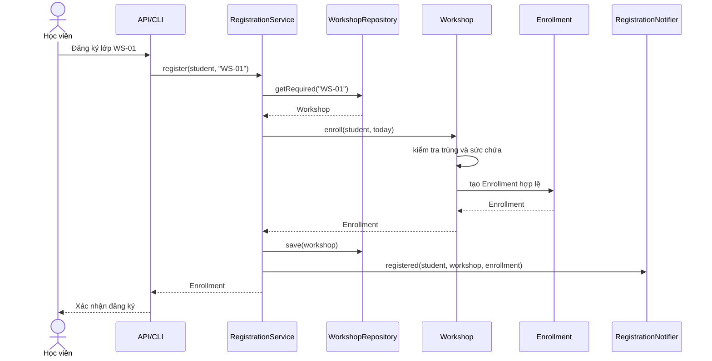

**Kịch bản B — Đăng ký trùng:** `Workshop` phát hiện đã có `studentId`, từ chối trước khi sửa trạng thái. Service không gọi `save` và không thông báo thành công.

**Kịch bản C — Hết chỗ:** `Workshop` thấy số đăng ký bằng sức chứa, từ chối. Không tạo `Enrollment`. Chính lớp giữ ràng buộc cũng quyết định có được sửa hay không.

**Kịch bản D — Hủy đăng ký:** `RegistrationService` tải `Workshop`; `Workshop` kiểm tra người đó có đăng ký và loại liên kết; service lưu kết quả. Nếu sau này cần email xác nhận hủy, bổ sung cộng tác với notifier ở luồng hủy.

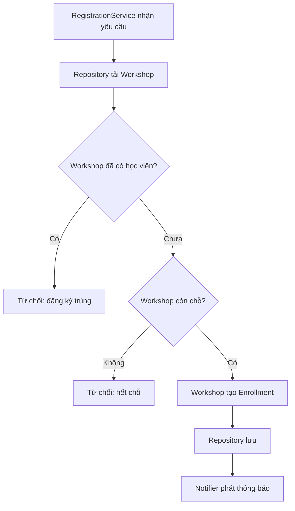

Sau mỗi lượt role-play, hãy hỏi: “Bước này ai sở hữu trách nhiệm?”, “Nếu thất bại thì class nào chịu trách nhiệm xử lý?”, “Cần thêm collaborator hay chỉ cần sửa một thẻ?”. Một thẻ có quá nhiều hành vi không liên quan là dấu hiệu xem lại phân chia.

## 5. Từ thẻ CRC sang sơ đồ lớp

CRC Cards xác định *trách nhiệm và cộng tác*. UML class diagram giúp cụ thể hơn về association, multiplicity và API:

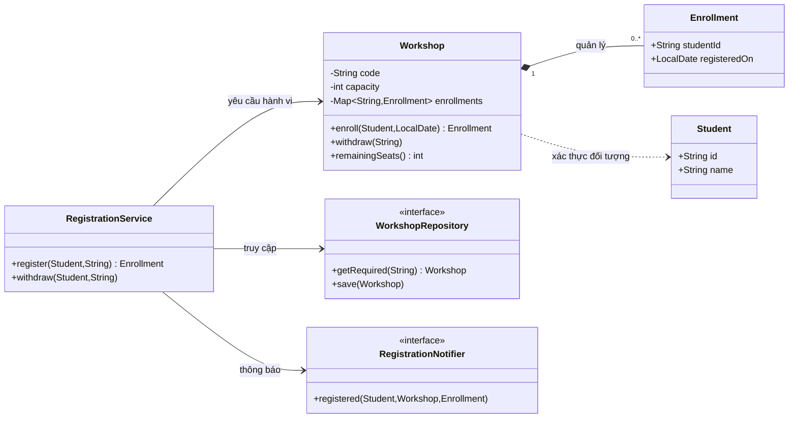

Một số quyết định trong sơ đồ là **lựa chọn thiết kế cho ví dụ**: `Workshop` là điểm kiểm soát tập đăng ký, còn `Enrollment` thuộc vòng đời của tập này. Nếu yêu cầu lưu lịch sử đăng ký đã hủy, đổi lớp và quan hệ cho phù hợp. CRC **không tự suy ra** composition, interface, transaction hay kiểu collection; các chi tiết này được xác nhận khi thiết kế sâu hơn.

### Từ trách nhiệm thành API

| Trách nhiệm CRC | API Java dự kiến | Kiểm chứng |
| --- | --- | --- |
| Mã và tên học viên hợp lệ | `Student` constructor | ID/tên rỗng bị từ chối |
| Lớp giới hạn sức chứa | `Workshop.enroll(...)` | Đủ chỗ được thêm; đầy bị từ chối |
| Cấm học viên đăng ký trùng | `Workshop.enroll(...)` | Cùng ID lần hai bị từ chối |
| Hủy và trả chỗ | `Workshop.withdraw(...)` | Số chỗ trống tăng |
| Tìm lớp theo mã | `WorkshopRepository.getRequired(...)` | Không tìm thấy báo lỗi |
| Điều phối một yêu cầu | `RegistrationService.register(...)` | Gọi đúng bước và xử lý lỗi |
| Thông báo sau đăng ký | `RegistrationNotifier.registered(...)` | Chỉ thực hiện sau ghi thành công ở luồng đơn giản |

Đây là **cầu nối từ tư duy CRC đến thiết kế lớp**. Một method có thể thực hiện nhiều phần của một trách nhiệm; không cần ánh xạ một trách nhiệm thành đúng một method.

## 6. Chương trình Java 17 hoàn chỉnh

Tạo file `CrcCardsDemo.java`. Ví dụ sử dụng repository trong bộ nhớ và notifier in console để làm rõ việc cộng tác; có thời gian cố định để kết quả tái lập.

```java
import java.time.Clock;
import java.time.Instant;
import java.time.LocalDate;
import java.time.ZoneOffset;
import java.util.LinkedHashMap;
import java.util.List;
import java.util.Map;
import java.util.Objects;

public class CrcCardsDemo {

    // CRC: Student — giữ danh tính học viên hợp lệ.
    record Student(String id, String name) {
        Student {
            if (id == null || id.isBlank()) {
                throw new IllegalArgumentException("Student id is required");
            }
            if (name == null || name.isBlank()) {
                throw new IllegalArgumentException("Student name is required");
            }
        }
    }

    // CRC: Enrollment — thông tin hợp lệ của một lượt đăng ký.
    record Enrollment(String studentId, LocalDate registeredOn) {
        Enrollment {
            if (studentId == null || studentId.isBlank()) {
                throw new IllegalArgumentException("Student id is required");
            }
            Objects.requireNonNull(registeredOn, "registeredOn");
        }
    }

    // CRC: Workshop — điểm kiểm soát giới hạn và danh sách đăng ký.
    static final class Workshop {
        private final String code;
        private final int capacity;
        private final Map<String, Enrollment> enrollments =
                new LinkedHashMap<>();

        Workshop(String code, int capacity) {
            if (code == null || code.isBlank()) {
                throw new IllegalArgumentException("Workshop code is required");
            }
            if (capacity < 1) {
                throw new IllegalArgumentException(
                        "Workshop capacity must be positive");
            }
            this.code = code;
            this.capacity = capacity;
        }

        String code() {
            return code;
        }

        int remainingSeats() {
            return capacity - enrollments.size();
        }

        List<Enrollment> enrollments() {
            // Trả snapshot, không trao quyền sửa Map nội bộ.
            return List.copyOf(enrollments.values());
        }

        Enrollment enroll(Student student, LocalDate today) {
            Objects.requireNonNull(student, "student");
            Objects.requireNonNull(today, "today");

            // Các điều kiện được kiểm tra trước khi thay đổi dữ liệu.
            if (enrollments.containsKey(student.id())) {
                throw new IllegalStateException("Already registered");
            }
            if (enrollments.size() >= capacity) {
                throw new IllegalStateException("Workshop is full");
            }

            Enrollment enrollment = new Enrollment(student.id(), today);
            enrollments.put(student.id(), enrollment);
            return enrollment;
        }

        void withdraw(String studentId) {
            if (studentId == null || studentId.isBlank()) {
                throw new IllegalArgumentException("Student id is required");
            }
            if (!enrollments.containsKey(studentId)) {
                throw new IllegalStateException("Registration not found");
            }
            enrollments.remove(studentId);
        }
    }

    // CRC: WorkshopRepository — hợp đồng tìm và lưu lớp.
    interface WorkshopRepository {
        Workshop getRequired(String code);
        void save(Workshop workshop);
    }

    // Infrastructure adapter, thay được bằng một cài đặt JDBC/JPA.
    static final class InMemoryWorkshopRepository
            implements WorkshopRepository {
        private final Map<String, Workshop> workshops =
                new LinkedHashMap<>();

        @Override
        public Workshop getRequired(String code) {
            Workshop found = workshops.get(code);
            if (found == null) {
                throw new IllegalArgumentException("Workshop not found");
            }
            return found;
        }

        @Override
        public void save(Workshop workshop) {
            Objects.requireNonNull(workshop, "workshop");
            workshops.put(workshop.code(), workshop);
        }
    }

    // CRC: RegistrationNotifier — hợp đồng gửi thông báo.
    interface RegistrationNotifier {
        void registered(Student student, Workshop workshop,
                        Enrollment enrollment);
    }

    static final class ConsoleRegistrationNotifier
            implements RegistrationNotifier {
        @Override
        public void registered(Student student, Workshop workshop,
                               Enrollment enrollment) {
            System.out.println(
                    "Notified " + student.id() +
                    " for " + workshop.code() +
                    " on " + enrollment.registeredOn());
        }
    }

    // CRC: RegistrationService — điều phối use case qua collaborators.
    static final class RegistrationService {
        private final WorkshopRepository repository;
        private final RegistrationNotifier notifier;
        private final Clock clock;

        RegistrationService(WorkshopRepository repository,
                            RegistrationNotifier notifier, Clock clock) {
            this.repository = Objects.requireNonNull(repository);
            this.notifier = Objects.requireNonNull(notifier);
            this.clock = Objects.requireNonNull(clock);
        }

        Enrollment register(Student student, String workshopCode) {
            Objects.requireNonNull(student, "student");

            Workshop workshop = repository.getRequired(workshopCode);
            Enrollment result =
                    workshop.enroll(student, LocalDate.now(clock));
            repository.save(workshop);
            notifier.registered(student, workshop, result);
            return result;
        }

        void withdraw(Student student, String workshopCode) {
            Objects.requireNonNull(student, "student");

            Workshop workshop = repository.getRequired(workshopCode);
            workshop.withdraw(student.id());
            repository.save(workshop);
        }
    }

    public static void main(String[] args) {
        InMemoryWorkshopRepository repository =
                new InMemoryWorkshopRepository();
        Workshop java = new Workshop("WS-01", 2);
        repository.save(java);

        Clock clock = Clock.fixed(
                Instant.parse("2026-10-15T00:00:00Z"), ZoneOffset.UTC);
        RegistrationService service = new RegistrationService(
                repository, new ConsoleRegistrationNotifier(), clock);

        Student an = new Student("ST-01", "An");
        Student binh = new Student("ST-02", "Binh");
        Student chi = new Student("ST-03", "Chi");

        service.register(an, "WS-01");
        service.register(binh, "WS-01");

        try {
            service.register(an, "WS-01");
        } catch (IllegalStateException expected) {
            System.out.println(expected.getMessage());
        }

        try {
            service.register(chi, "WS-01");
        } catch (IllegalStateException expected) {
            System.out.println(expected.getMessage());
        }

        System.out.println("Remaining: " + java.remainingSeats());
        service.withdraw(binh, "WS-01");
        System.out.println("After withdrawal: " + java.remainingSeats());
    }
}
```

Biên dịch và chạy:

```bash
javac CrcCardsDemo.java
java CrcCardsDemo
```

Kết quả:

```text
Notified ST-01 for WS-01 on 2026-10-15
Notified ST-02 for WS-01 on 2026-10-15
Already registered
Workshop is full
Remaining: 0
After withdrawal: 1
```

### Đối chiếu chương trình với từng thẻ

- **`Student`** không biết database, danh sách lớp hay cách gửi email. Định danh và tên được xác thực khi tạo.
- **`Enrollment`** là giá trị ghi lại một lượt đăng ký với ngày cụ thể; ở phạm vi demo nó bất biến.
- **`Workshop`** sở hữu tập người đăng ký của lớp và từ chối trùng/hết chỗ; không có setter tùy ý cho collection.
- **`WorkshopRepository`** định nghĩa việc lấy/lưu; cài đặt `InMemoryWorkshopRepository` giữ `Map`, không chứa quy tắc sức chứa.
- **`RegistrationNotifier`** là cổng thông báo. `ConsoleRegistrationNotifier` chịu trách nhiệm in ra console, không quyết định đăng ký hợp lệ.
- **`RegistrationService`** phối hợp repository, đối tượng nghiệp vụ, clock và notifier. Phương thức này không tự tính sức chứa hoặc ghi trực tiếp vào `enrollments`.

Trong `Workshop.enroll(...)`, các lỗi về trùng/hết chỗ xảy ra **trước khi sửa Map**. Thao tác `withdraw` từ chối nếu người học chưa có trong lớp. Do đó kết quả đơn luồng khớp các quy tắc được phân công trên thẻ.

**Ranh giới demo:** `InMemoryWorkshopRepository` lưu và trả cùng một tham chiếu `Workshop`; phương thức `enroll` làm thay đổi đối tượng trước khi `save` được gọi. Đây là mô hình trong bộ nhớ tuần tự để giảng về trách nhiệm, **không phải transaction có rollback**. Trong hệ thống thật, cần kiểm tra sức chứa và lưu dưới cơ chế đồng bộ/giao dịch phù hợp để hai yêu cầu không vượt quá chỗ trống. Nếu notifier lỗi sau khi đã lưu, phải có chính sách phát lại, trạng thái đơn và idempotency; ví dụ thường dùng transactional outbox.

## 7. Kiểm chứng CRC bằng test tình huống

Một bộ CRC tốt phải hỗ trợ suy ra test từ trách nhiệm, đặc biệt test khi quy tắc thất bại.

| Thẻ | Tình huống test | Kết quả cần có |
| --- | --- | --- |
| `Student` | ID rỗng, tên rỗng | Constructor từ chối |
| `Workshop` | Tạo lớp capacity 0 | Constructor từ chối |
| `Workshop` | Đăng ký lần đầu khi còn chỗ | Có thêm một `Enrollment` |
| `Workshop` | Cùng học viên đăng ký lại | Từ chối, tập đăng ký không đổi |
| `Workshop` | Lớp đầy | Từ chối, số chỗ không âm |
| `Workshop` | Hủy người chưa đăng ký | Từ chối, trạng thái không đổi |
| `RegistrationService` | Đăng ký hợp lệ | Tải lớp, áp hành vi, lưu, yêu cầu thông báo |
| `RegistrationService` | Lớp từ chối | Không báo thành công, không yêu cầu gửi thông báo |
| Repository adapter | Lớp không tồn tại | Trả lỗi rõ ràng |
| Tích hợp nhiều request | Hai người đăng ký chỗ cuối | Tối đa một yêu cầu thành công |

Có thể mở rộng ví dụ bằng fake `RegistrationNotifier` để đếm số lần gọi; thay `ConsoleRegistrationNotifier` mà không sửa `Workshop`. Đó là phép thử trực tiếp cho **sự phân chia trách nhiệm và mức phụ thuộc**.

Unit test thuần trên `Workshop` kiểm tra quy tắc đơn luồng. Nó chưa chứng minh thread safety; cần integration/concurrency test tại tầng DB hoặc transaction để xác nhận bất biến toàn hệ thống.

## 8. Đánh giá chất lượng thẻ CRC

### Tính gắn kết (*cohesion*)

Các trách nhiệm trên cùng một thẻ có cùng phục vụ một mục tiêu không?

- Tốt: `Workshop` quản lý sức chứa, danh sách đăng ký và tính hợp lệ khi đăng ký.
- Đáng xem lại: `Workshop` vừa quản lý sức chứa vừa xuất PDF, kết nối SMTP và parse JSON.

### Mức phụ thuộc (*coupling*)

Class có phụ thuộc quá nhiều chi tiết của class khác không?

- Tốt: `RegistrationService` dùng `WorkshopRepository` interface.
- Đáng xem lại: service biết cấu trúc bảng SQL của repository và phải tự sửa `Workshop.enrollments` bên trong.

### Nguồn chân lý của quy tắc

Nếu giới hạn sức chứa được kiểm tra ở `Workshop`, không nên có bản sao công thức giới hạn trong controller, notifier và repository. Controller có thể kiểm tra nhanh để hiển thị lỗi, nhưng điểm có thẩm quyền giữ bất biến phải được xác định rõ.

### Khả năng thay đổi

Thử những biến động độc lập:

| Thay đổi | Thẻ nào nên được xem xét? | Thẻ nào ít cần đổi? |
| --- | --- | --- |
| Lớp giới hạn 30 người thay vì 20 | Dữ liệu cấu hình `Workshop` | Notifier, repository interface |
| Chuyển từ console sang email | Cài đặt `RegistrationNotifier` | `Workshop`, `Enrollment` |
| Chuyển lưu bộ nhớ sang PostgreSQL | Adapter của `WorkshopRepository` | Quy tắc đăng ký trong `Workshop` |
| Cho phép danh sách chờ | `Workshop`, có thể thêm `WaitlistEntry` | HTTP adapter có thể chỉ đổi DTO cần thiết |
| Thu phí trước khi xác nhận | Quy trình/service, payment port, trạng thái enrollment | Các lớp không liên quan đến thanh toán |
| Học viên có quyền ưu tiên | `RegistrationPolicy` hoặc quy tắc miền phù hợp | Adapter gửi thông báo |

Nếu một thay đổi hạ tầng buộc sửa nhiều lớp domain, hãy kiểm tra lại collaborators và hướng phụ thuộc.

## 9. Tái phân công trách nhiệm khi yêu cầu mở rộng

CRC là tài liệu **sống** trong lúc mô hình hóa. Những tình huống mới có thể làm thay đổi thẻ chứ không phải chỉ thêm một method.

**Tình huống: “Khi lớp đầy, học viên được vào danh sách chờ theo thời gian.”**

Các câu hỏi mới: ai giữ thứ tự chờ, khi có người hủy ai được mời, lời mời có hết hạn không? Nếu danh sách chờ có ngày và trạng thái riêng, cân nhắc class `WaitlistEntry`. `Workshop` có thể điều phối chỗ trống và hàng chờ, hoặc cộng tác với một policy để quyết định người ưu tiên. Cập nhật CRC trước khi thêm field tùy tiện.

**Tình huống: “Mỗi học viên có một hạng thành viên, hạng VIP được ưu tiên.”**

Đừng để notifier quyết định ai được nhận vào lớp chỉ vì nó nhìn thấy email VIP. Đây là **quy tắc phân bổ**; cân nhắc thẻ `AdmissionPolicy` cộng tác với `Workshop` và thông tin hạng học viên.

**Tình huống: “Đăng ký chỉ hợp lệ sau thanh toán.”**

`Enrollment` không còn chỉ là giá trị bất biến một dòng. Có thể cần entity `Enrollment` với trạng thái `PENDING_PAYMENT`, `CONFIRMED`, `CANCELLED`, thêm `PaymentGateway`, timeout và quy tắc giải phóng chỗ. Xác định rõ chỗ được giữ từ lúc nào, giao dịch nào tạo entitlement và cách xử lý webhook trả về nhiều lần.

**Tình huống: “Một học viên không thể đăng ký hai lớp trùng giờ.”**

`Workshop` riêng lẻ không biết lịch ở các lớp khác. Quy tắc này cần collaborator có quyền truy vấn danh sách đăng ký/lịch của học viên hoặc một service/policy ở ranh giới thích hợp. Đó là dấu hiệu bổ sung trách nhiệm mới **vượt phạm vi một lớp**.

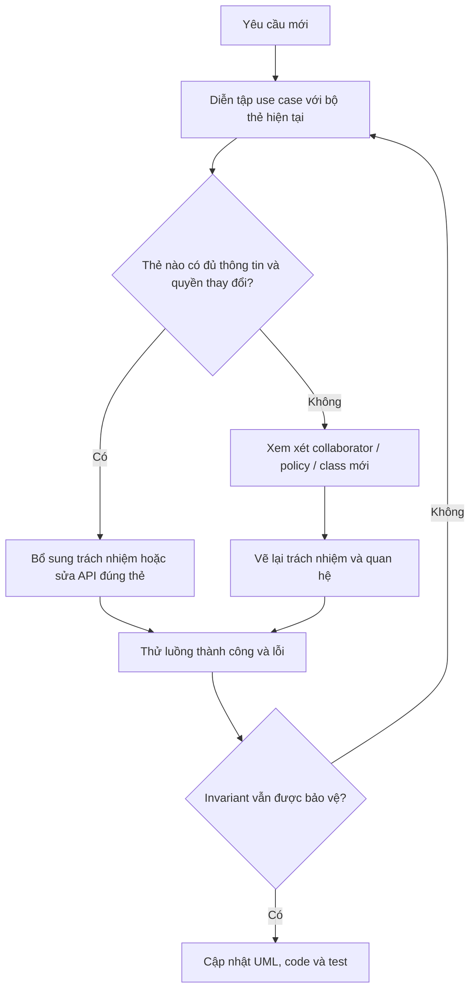

## 10. Lỗi thường gặp khi dùng CRC Cards

**Lỗi 1 — Class nào cũng thành service.** Ghi `WorkshopService` “quản lý tất cả”, `Workshop` chỉ có setter. Hãy thử chuyển những bất biến của lớp về `Workshop`, còn service giữ nhiệm vụ điều phối use case. Nhưng không ép các quy tắc cần nhiều aggregate vào một entity thiếu dữ liệu.

**Lỗi 2 — Chỉ mô tả method và field.** “Có `getCapacity`, `setCapacity`, `getStudents`” chưa làm rõ *lớp chịu trách nhiệm ngăn quá chỗ*. Viết trách nhiệm trước, suy ra API sau.

**Lỗi 3 — Tạo một class cho mỗi danh từ.** “Ngày đăng ký” không nhất thiết cần `RegistrationDateManager`; `LocalDate` có thể đủ. Một class mới cần có ý nghĩa, quy tắc hoặc vòng đời độc lập.

**Lỗi 4 — Collaborators là toàn bộ dependency trong ứng dụng.** Nếu thẻ `Workshop` liệt kê database, REST controller, log framework, email client mà không dùng trực tiếp cho hành vi miền, đó có thể là ghép tầng kỹ thuật vào sai nơi.

**Lỗi 5 — Hai lớp cùng làm chủ một quyết định.** Nếu cả `RegistrationService` và `Workshop` đều tự kiểm tra và cập nhật sức chứa theo logic khác nhau, dễ xuất hiện hai câu trả lời mâu thuẫn. Chọn nơi có thẩm quyền bảo vệ bất biến và định nghĩa rõ hợp đồng.

**Lỗi 6 — Chỉ diễn tập luồng thành công.** Đăng ký trùng, hết chỗ, lỗi lưu, mất mạng, hủy lặp, request đồng thời mới phát hiện phân công thiếu trách nhiệm.

**Lỗi 7 — Nghĩ CRC thay thế thiết kế chi tiết.** CRC giúp hình dung trách nhiệm và cộng tác; nó **không** chứng minh tính đúng đắn của code, thread safety, thiết kế bảng, transactional outbox hay permission. Các quyết định đó cần thêm UML/API, test, review và kiểm chứng hệ thống.

**Lỗi 8 — Gộp actor người dùng với class miền một cách máy móc.** “Nhân viên hỗ trợ gửi thông báo” có thể là một vai trò trong use case, không có nghĩa phải có object `SupportStaff` nếu không quản lý định danh/quy tắc của nhân viên trong phạm vi ứng dụng.

## 11. CRC, UML và các công cụ thiết kế khác

| Công cụ | Trả lời tốt nhất | Nên dùng lúc nào |
| --- | --- | --- |
| User story / use case | Người dùng muốn kết quả gì? Khi nào thành công/thất bại? | Khi khám phá nhu cầu |
| CRC Cards | Lớp nào nhận trách nhiệm gì và nhờ ai? | Khi phân chia đối tượng và điều phối |
| UML class diagram | Lớp, quan hệ, multiplicity và API là gì? | Khi cần mô tả cấu trúc chính xác |
| UML sequence diagram | Các collaborator gọi nhau theo thứ tự nào? | Khi kiểm tra luồng tương tác |
| State machine | Đối tượng có thể chuyển những trạng thái nào? | Khi nghiệp vụ có vòng đời phức tạp |
| Unit/integration tests | Hành vi đã triển khai có đúng yêu cầu không? | Khi xác thực code và tích hợp |

Một quá trình hiệu quả là **use case → CRC role-play → UML ở mức cần thiết → Java/test → sửa lại thẻ khi học thêm về nghiệp vụ**. CRC không phải tài liệu phải giữ nguyên bất chấp code và thực tế đổi khác.

## 12. Bài tập thực hành

### Bài 1 — Thẻ CRC cho đặt vé xem phim

Yêu cầu: “Khán giả chọn suất chiếu, giữ ghế trong 5 phút, thanh toán rồi nhận vé. Một ghế trong cùng một suất không được bán cho hai người.”

Hãy đề xuất CRC cho `Screening`, `SeatHold`, `Ticket`, `BookingService`, `PaymentGateway`, `BookingRepository`. Chỉ rõ lớp nào quyết định giữ ghế hợp lệ, lớp nào biết thời hạn giữ, và class nào điều phối xác nhận thanh toán.

### Bài 2 — Tìm trách nhiệm trùng lặp

Một thiết kế có `RegistrationController`, `RegistrationService`, `Workshop` và `WorkshopRepository`; cả bốn đều kiểm tra “lớp đã đủ 30 người chưa?”. Hãy viết lại thẻ CRC để chỉ rõ nguồn chân lý, giữ validation cần thiết tại ranh giới mà không nhân bản quyết định nghiệp vụ.

### Bài 3 — Diễn tập luồng lỗi

Dùng bộ thẻ của bài Java, giả sử `save(workshop)` thất bại rồi notifier vẫn gửi email “đã đăng ký”. Thẻ nào cần thay đổi trách nhiệm hoặc hợp đồng? Đề xuất trạng thái, transaction và chính sách retry hợp lý. Giải thích tại sao không thể giải quyết chỉ bằng cách gọi lại `register` tùy ý.

### Bài 4 — Thêm danh sách chờ

Lớp 30 người đã đầy; học viên tiếp theo được thêm vào hàng chờ. Khi một người hủy, hệ thống dành chỗ cho học viên đầu tiên trong hàng chờ trong 15 phút. Vẽ CRC mới, mô tả trạng thái `WAITING/OFFERED/CONFIRMED/EXPIRED` và ai quản lý thời gian hết hạn.

### Bài 5 — Chuyển CRC thành test và code

Bổ sung `registrationCount()`, test `Workshop` từ 0 đến sức chứa, test đăng ký trùng không làm thay đổi count, test hủy trả chỗ. Viết fake notifier đếm số lần gọi và kiểm tra `RegistrationService` không báo thành công khi `Workshop` từ chối.

## 13. Checklist hoàn thành một vòng thiết kế CRC

- Mỗi class có **một mục đích dễ giải thích bằng ngôn ngữ nghiệp vụ**?
- Các responsibility dùng động từ có ý nghĩa và thể hiện **nghĩa vụ** thay vì chỉ liệt kê method?
- Mọi điều kiện “phải/không được/tối đa/chỉ khi” đều có một nơi chịu trách nhiệm bảo vệ?
- Những collaborator được liệt kê có thực sự cần để hoàn thành trách nhiệm?
- Có vòng gọi lại, phụ thuộc chéo hoặc hai class cùng làm chủ một quy tắc?
- Mỗi class có đủ thông tin để giữ invariant của mình hay đang sửa lén dữ liệu class khác?
- Đã diễn tập luồng thành công, lỗi và trạng thái cần hoàn tác?
- Đã phân biệt đối tượng miền, policy, service điều phối, repository và adapter bên ngoài?
- Nếu yêu cầu thay đổi, có biết **thẻ nào cần sửa** và vì sao không?
- Đã chuyển trách nhiệm thành API/UML và tình huống kiểm thử rõ ràng?
- Khi chạy đồng thời hoặc có DB/network, đã xác định nơi cần transaction, locking, retry và idempotency?

**Ghi nhớ:** một thẻ CRC tốt không thắng vì có nhiều class hay nhiều dòng. Nó tốt khi người đọc có thể kể được “ai làm gì, vì sao người đó làm, và nhờ ai khi cần”, rồi kiểm chứng được câu trả lời đó bằng các tình huống thực tế và code OOP rõ ràng.


</details>

- [Quay lại đầu trang](#back-to-top)

---

## <a id="modeling-005">Sơ đồ lớp: thành viên và quan hệ</a>

<details>
<summary>Xem chi tiết</summary>

# Sơ đồ lớp UML: thành viên và quan hệ trong thiết kế OOP Java

> **Mục tiêu:** Đọc, vẽ và kiểm tra sơ đồ lớp (*UML class diagram*) gồm tên lớp, thuộc tính, phương thức, phạm vi truy cập, kiểu dữ liệu, bội số và các quan hệ giữa lớp. Biết chuyển sơ đồ thành Java và nhận ra những điều sơ đồ chỉ **mô tả** chứ Java/UML không tự thực thi.

## 1. Sơ đồ lớp giúp trả lời câu hỏi nào?

Một sơ đồ lớp là **mô hình cấu trúc tĩnh**: hệ thống có những khái niệm nào, mỗi khái niệm có trạng thái và hành vi gì, và các khái niệm liên hệ với nhau như thế nào.

Chẳng hạn với ứng dụng bán hàng, yêu cầu “khách hàng đặt đơn, mỗi đơn chứa nhiều dòng hàng, mỗi dòng chọn một sản phẩm, thanh toán qua cổng thanh toán” cần trả lời:

- `Customer`, `Order`, `OrderLine`, `Product` nên có những dữ liệu nào?
- Ai **sở hữu** các dòng đơn hàng, ai chỉ **tham chiếu** đến sản phẩm?
- Một khách hàng có thể có bao nhiêu đơn? Một đơn có thể chưa có dòng khi còn là bản nháp không?
- Những hành vi nào cần đặt vào `Order` để bảo vệ quy tắc nghiệp vụ?
- `CheckoutService` phụ thuộc vào `PaymentGateway` như thế nào, và implementation thay thế được bằng cách nào?

Sơ đồ lớp hỗ trợ **trao đổi thiết kế, phân chia trách nhiệm, nhận diện liên kết và review kiến trúc**. Nó không phải sơ đồ tuần tự thực thi: muốn mô tả thứ tự gọi khi checkout, dùng *sequence diagram* hoặc *activity diagram* thích hợp hơn.

Sơ đồ có thể xuất hiện ở ba mức:

| Mức mô hình | Trọng tâm | Chi tiết nên thể hiện |
|---|---|---|
| **Phân tích miền nghiệp vụ** | Các khái niệm và quy tắc | `Order` chứa `OrderLine`; `Customer` đặt `Order` |
| **Thiết kế phần mềm** | Trách nhiệm, API, phụ thuộc | `Order.addLine(...)`, `PaymentGateway.charge(...)`, bội số |
| **Triển khai** | Cấu trúc code gần với Java | visibility, kiểu cụ thể, constructor, collection, interface, static |

Đừng đưa mọi getter, setter, DTO, kiểu thư viện và dependency hạ tầng vào một sơ đồ phân tích đơn giản. Chỉ đưa vào những thành viên và quan hệ cần thiết để giải thích quyết định thiết kế của sơ đồ đó.

## 2. Hình hộp lớp gồm những thành viên nào?

Cách vẽ phổ biến dùng một hình chữ nhật chia ba ngăn: **tên lớp**, **thuộc tính**, **phương thức**.

~~~text
┌──────────────────────────────────────┐
│                Order                 │  (1) Tên lớp
├──────────────────────────────────────┤
│ - id: String                         │  (2) Thuộc tính
│ - lines: List<OrderLine>             │
│ - status: OrderStatus                │
├──────────────────────────────────────┤
│ + addLine(p: Product, qty: int): void│  (3) Phương thức
│ + totalCents(): long                 │
│ + confirm(): void                    │
└──────────────────────────────────────┘
~~~

Các quy ước UML thường dùng:

- **Tên lớp** ở ngăn trên cùng; lớp trừu tượng có thể viết nghiêng hoặc gắn nhãn `«abstract»`.
- **Thuộc tính** biểu diễn trạng thái: `visibility name: Type [multiplicity] = defaultValue {property}`. Không cần mọi thành phần trong một sơ đồ.
- **Phương thức/operation** biểu diễn dịch vụ/hành vi: `visibility name(parameter: Type = default): ReturnType`. Có thể có nhiều tham số.
- Có thể **ẩn ngăn** hoặc ẩn thành viên không liên quan để sơ đồ dễ đọc; đó là thay đổi mức chi tiết trình bày, không có nghĩa lớp không có những phương thức ấy.
- UML phân biệt *operation* (hợp đồng có thể gọi) với *method* (cách triển khai). Trong tài liệu hướng Java, người học thường gọi chung là “phương thức”, nhưng không nên suy diễn rằng sơ đồ luôn mô tả body của phương thức.

### Ký hiệu phạm vi truy cập

| UML | Ý nghĩa | Java gần tương ứng |
|---|---|---|
| `+` | Public | `public` |
| `-` | Private | `private` |
| `#` | Protected | `protected` |
| `~` | Package visibility | Không ghi modifier (package-private) |

Một điểm dễ nhầm: Java `protected` cho phép truy cập trong cùng package và từ subclass theo những quy tắc riêng; không thể xem nó đồng nhất hoàn toàn với mọi đặc tả truy cập trong mọi ngôn ngữ UML.

Để mô hình hóa **thuộc tính dẫn xuất**, UML thường dùng dấu `/` trước tên, ví dụ `/totalCents: long`: giá trị tính từ các dòng hàng, không nhất thiết có field `totalCents` được lưu. Với giá trị bất biến/read-only, có thể dùng thuộc tính ràng buộc như `{readOnly}`. Thành viên `static` thường được **gạch dưới** trong UML chuẩn; ở code Java tương ứng `static`. Tool vẽ có thể cung cấp cú pháp riêng cho các biểu diễn này, nên cần biết giới hạn của công cụ.

### Ví dụ UML bằng Mermaid

~~~mermaid
classDiagram
    class Order {
        -String id
        -List~OrderLine~ lines
        -OrderStatus status
        +addLine(Product product, int quantity) void
        +totalCents() long
        +confirm() void
    }
~~~

Mermaid phù hợp README vì có thể giữ sơ đồ cùng phiên bản với tài liệu. Tuy nhiên một số tính năng UML chi tiết, đặc biệt định dạng text, thuộc tính phái sinh hay constraint phức tạp, có thể không được thể hiện chính xác bằng mọi renderer Mermaid. Với các chi tiết quan trọng, hãy bổ sung mô tả bằng văn bản ngay bên cạnh.

## 3. Đọc thuộc tính và operation một cách chính xác

Các dòng thuộc tính minh họa:

~~~text
- id: UUID
- capacity: int = 30
- members: Set<Member> [0..*]
- /remainingSeats: int {readOnly}
~~~

Diễn giải:

- `id` có kiểu định danh `UUID` và được che giấu phía ngoài.
- `capacity` có giá trị mặc định trong mô hình là 30 (không đồng nghĩa Java chắc chắn đã gán 30 nếu code khác sơ đồ).
- `members` giữ nhiều tham chiếu `Member`; multiplicity `[0..*]` biểu thị số lượng kết quả/thành phần mong đợi trong mô hình.
- `remainingSeats` là giá trị **tính ra** và chỉ đọc; code Java có thể triển khai bằng method `remainingSeats()` thay vì field.

Các dòng phương thức minh họa:

~~~text
+ enroll(student: Student): EnrollmentReceipt
+ findById(id: UUID): Optional<Member>
- validateCapacity(requested: int): void
# onStatusChanged(old: Status, next: Status): void
~~~

UML đặt **tên tham số trước kiểu**, trong khi Java viết `Type parameterName`. Ví dụ:

~~~java
public EnrollmentReceipt enroll(Student student) {
    // implementation
    throw new UnsupportedOperationException("Example signature only");
}
~~~

`Optional<Member>` là kiểu Java của **kết quả trả về**, không phải bội số trên association UML. Không nên suy luận từ `Optional` rằng entity bắt buộc được lưu trữ dưới dạng một collection, hay từ `List<>` rằng quan hệ bắt buộc là aggregation.

### Interface, abstract class, enum

~~~mermaid
classDiagram
    class PaymentGateway {
        <<interface>>
        +charge(String orderId, long amountCents) void
    }
    class AbstractDiscountPolicy {
        <<abstract>>
        +discount(long amount) long
    }
    class OrderStatus {
        <<enumeration>>
        DRAFT
        CONFIRMED
    }
~~~

Với Java:

- `interface` xác định hợp đồng hành vi; lớp cụ thể dùng `implements`.
- `abstract class` có thể chứa trạng thái và phương thức đã triển khai, đồng thời khai báo abstract method.
- `enum` là tập giá trị hữu hạn có thể sở hữu hành vi; đưa vào sơ đồ nếu trạng thái chuyển đổi hoặc giá trị được giới hạn là phần quan trọng của thiết kế.
- Không nhất thiết phải tạo abstract class hoặc interface cho mọi class. Chỉ dùng khi cần hợp đồng chung hoặc điểm thay thế có ý nghĩa.

## 4. Bảng phân biệt các loại quan hệ UML

Đầu mũi tên và hình thoi chứa ý nghĩa khác nhau; **không nên dùng mọi loại đường chỉ để trang trí**.

| Quan hệ | Dấu hiệu UML / Mermaid | Ý nghĩa | Java thường gặp |
|---|---|---|---|
| **Association** (liên kết) | `--` hoặc `-->` | Đối tượng có liên kết với đối tượng khác | Field/tham chiếu hoặc mô hình nghiệp vụ |
| **Shared aggregation** (tập hợp) | `o--` | Toàn thể–bộ phận theo nghĩa gom nhóm, quyền sở hữu không mạnh | `Team` tham chiếu `Employee` độc lập |
| **Composition** (hợp thành) | `*--` | Toàn thể sở hữu part; part thuộc tối đa một composite tại một thời điểm | `Order` sở hữu `OrderLine` |
| **Generalization** (kế thừa) | `<|--` | Subclass là một dạng của superclass | `extends` |
| **Realization** (hiện thực hợp đồng) | `<|..` | Lớp hiện thực interface | `implements` |
| **Dependency** (phụ thuộc) | `<..` / `..>` | Một phần tử sử dụng phần tử khác để định nghĩa/thực hiện | Tham số, local variable, method call |
 
Đặc trưng nên ghi nhớ:

**Association:** Quan hệ cấu trúc hai đối tượng có liên hệ. Đường **không mũi tên** biểu thị association nhưng không tự mô tả hướng điều hướng; một mũi tên chỉ khả năng điều hướng/hướng quan hệ trong cách biểu diễn. **Không mặc định hai phía phải giữ field tham chiếu nhau.**

**Aggregation:** Hình thoi **rỗng ở phía toàn thể**, ví dụ đội nhóm và nhân viên. Chuẩn UML dành cho shared aggregation ít ngữ nghĩa ràng buộc hơn composition; nếu không có nhu cầu nhấn mạnh whole–part, association thường rõ và ít gây hiểu nhầm hơn.

**Composition:** Hình thoi **đặc ở phía whole**. Part chịu quan hệ sở hữu mạnh; không được đồng thời thuộc hai composite. Chính luật nghiệp vụ và API phải bảo vệ điều này. Trong Java, GC không tự “xóa part ngay lúc whole bị xóa”; nếu dùng DB, cascade/orphan removal cũng phải cấu hình có chủ đích.

**Generalization:** Mũi **tam giác rỗng chỉ về superclass**. Quan hệ `Car extends Vehicle` chỉ hợp lý khi `Car` thực sự tuân thủ hợp đồng của `Vehicle`. Kế thừa để “vay code” thường làm thiết kế khó bảo trì.

**Realization:** Đường **nét đứt kết thúc bằng tam giác rỗng** về interface. `StripeGateway implements PaymentGateway` là minh họa, nhưng không ngụ ý mọi interface phải có nhiều implementation.

**Dependency:** Đường **nét đứt và mũi tên thường** chỉ về phía được sử dụng. Nó thường mô tả việc lớp nhận tham số hoặc gọi API khác mà **không nhất thiết lưu tham chiếu dài hạn**. Đừng tự đồng nhất dependency với composition.

Một cách nhớ ngắn: **đường liên kết** thể hiện quan hệ đối tượng, **hình thoi** thể hiện toàn thể–bộ phận, **tam giác rỗng** thể hiện kiểu cha/hợp đồng, **đường nét đứt đơn giản** thể hiện phụ thuộc sử dụng.

## 5. Bội số, tên vai trò, hướng điều hướng

Multiplicity diễn tả có bao nhiêu đối tượng ở một đầu liên kết cho **một đối tượng phía kia**.

| Bội số UML | Cách đọc |
|---|---|
| `1` | Chính xác một |
| `0..1` | Không có hoặc một |
| `*` hay `0..*` | Không hoặc nhiều |
| `1..*` | Ít nhất một |
| `2..5` | Từ hai đến năm (bao gồm hai đầu) |

Ví dụ:

~~~mermaid
classDiagram
    Customer "1" <-- "0..*" Order : places
    Order "1" *-- "0..*" OrderLine : owns
    OrderLine "0..*" --> "1" Product : refers to
~~~

Cách hiểu các quan hệ:

- **Một `Order` thuộc về đúng một `Customer`**; một khách hàng có thể có 0 hoặc nhiều đơn.
- **Một `OrderLine` thuộc về đúng một `Order`**; đơn nháp có thể có 0 dòng. Nếu đơn đã xác nhận phải có từ một dòng trở lên, đó là một **ràng buộc trạng thái** cần kiểm tra riêng.
- **Mỗi `OrderLine` tham chiếu một `Product`**; một sản phẩm có thể được chọn trong nhiều dòng của nhiều đơn hàng. Bản ghi sản phẩm độc lập và **không** là part bị xóa cùng đơn.

**Hình thoi ở phía `Order`**, không phải phía `OrderLine`. Với những quan hệ có role name (ví dụ `customer`, `lines`) có thể đặt tên tại đầu association để truyền đạt mục đích; mỗi công cụ dựng sơ đồ có mức hỗ trợ nhãn role khác nhau.

Ví dụ API Java tương ứng:

~~~java
final class Order {
    private final Customer customer;          // Order --> 1 Customer
    private final List<OrderLine> lines;       // Order *-- 0..* OrderLine
    // ...
}
~~~

Trong Java, **cú pháp field không tự enforce bội số**: `Customer customer` vẫn có thể null nếu constructor cho phép; `List<OrderLine>` vẫn có thể chứa phần tử được tạo từ đơn khác nếu API không kiểm tra. Muốn bảo vệ mô hình, phải kiểm tra invariant, ngăn sửa collection trực tiếp, và bổ sung constraint ở DB nếu cần.

## 6. Ví dụ thiết kế hoàn chỉnh: khách hàng – đơn hàng – thanh toán

Yêu cầu giả định:

1. Khách hàng có thể tạo nhiều đơn; đơn thuộc một khách hàng.
2. Mỗi đơn giữ **các dòng riêng** có sản phẩm, số lượng và đơn giá được chốt lúc thêm.
3. Sản phẩm trong catalog vẫn tồn tại độc lập khi một đơn bị hủy/xóa.
4. Đơn nháp có thể chưa có dòng; đơn không rỗng mới được xác nhận.
5. Checkout gửi yêu cầu thanh toán qua interface để có thể đổi adapter.

### Sơ đồ lớp

~~~mermaid
classDiagram
    direction LR
    class Customer {
        <<entity>>
        +String id
        +String name
    }
    class Product {
        <<entity>>
        +String sku
        +String name
        +long priceCents
    }
    class Order {
        -String id
        -Customer customer
        -List~OrderLine~ lines
        -Status status
        +addLine(Product product, int quantity) void
        +totalCents() long
        +isEmpty() boolean
        +confirm() void
        +status() Status
    }
    class OrderLine {
        -Product product
        -int quantity
        -long unitPriceCents
        +subtotalCents() long
    }
    class CheckoutService {
        -PaymentGateway gateway
        +checkout(Order order) void
    }
    class PaymentGateway {
        <<interface>>
        +charge(String orderId, long amountCents) void
    }
    class ConsolePaymentGateway {
        +charge(String orderId, long amountCents) void
    }

    Customer "1" <-- "0..*" Order : places
    Order "1" *-- "0..*" OrderLine : owns
    OrderLine "0..*" --> "1" Product : refers to
    CheckoutService ..> Order : checkout parameter
    CheckoutService --> PaymentGateway : injected dependency
    ConsolePaymentGateway ..|> PaymentGateway : implements
~~~

Phân tích từng lựa chọn:

- `Customer` được `Order` tham chiếu, nhưng có thể tồn tại không cần đơn: **association**. Sơ đồ không đòi hỏi `Customer` giữ collection đơn ở chiều ngược lại.
- `OrderLine` là part do `Order` tạo và quản lý: **composition**. Mỗi dòng là một mục riêng của một đơn; không chia sẻ cùng instance dòng giữa hai đơn.
- `Product` là thực thể/cấu trúc tham chiếu độc lập, không phải child của một đơn: **association**.
- `CheckoutService` gọi các hành vi của `Order` qua tham số method: dùng **dependency**. Nó giữ `PaymentGateway` trong field do constructor cung cấp: association/dependency được mô hình hóa bằng đường có hướng.
- `ConsolePaymentGateway` hiện thực interface `PaymentGateway`: **realization**. Thay adapter khác mà không sửa giao diện checkout.
- Các stereotype `«entity»` ở `Customer` và `Product` nhấn mạnh danh tính ổn định theo `id`/`sku` và vòng đời độc lập với `Order`. Ví dụ Java dùng `record` làm biểu diễn bất biến đơn giản; `record` không tự quyết định một đối tượng miền là entity hay value object.

### Mã Java 17+ chạy trong một tệp

Tạo tệp **`OrderDiagramDemo.java`** với toàn bộ nội dung sau:

~~~java
import java.util.ArrayList;
import java.util.List;
import java.util.Objects;

// Độc lập với vòng đời của một Order.
record Customer(String id, String name) {
    Customer {
        Objects.requireNonNull(id, "id");
        Objects.requireNonNull(name, "name");
        if (id.isBlank() || name.isBlank()) {
            throw new IllegalArgumentException("Invalid customer");
        }
    }
}

record Product(String sku, String name, long priceCents) {
    Product {
        Objects.requireNonNull(sku, "sku");
        Objects.requireNonNull(name, "name");
        if (sku.isBlank() || name.isBlank() || priceCents < 0) {
            throw new IllegalArgumentException("Invalid product");
        }
    }
}

// Chủ sở hữu vòng đời của từng dòng đơn.
final class Order {
    enum Status { DRAFT, CONFIRMED }

    private final String id;
    private final Customer customer;
    private final List<OrderLine> lines = new ArrayList<>();
    private Status status = Status.DRAFT;

    // Chỉ Order có thể tạo một dòng; không cung cấp API đổi owner.
    private static final class OrderLine {
        private final Product product;
        private final int quantity;
        private final long unitPriceCents;

        private OrderLine(Product product, int quantity) {
            this.product = Objects.requireNonNull(product, "product");
            if (quantity <= 0) {
                throw new IllegalArgumentException("Quantity must be positive");
            }
            this.quantity = quantity;
            this.unitPriceCents = product.priceCents(); // Chốt đơn giá
            Math.multiplyExact(unitPriceCents, quantity); // Kiểm tra tràn số
        }

        private long subtotalCents() {
            return Math.multiplyExact(unitPriceCents, quantity);
        }
    }

    Order(String id, Customer customer) {
        this.id = Objects.requireNonNull(id, "id");
        this.customer = Objects.requireNonNull(customer, "customer");
        if (id.isBlank()) {
            throw new IllegalArgumentException("Order id is blank");
        }
    }

    String id() {
        return id;
    }

    Customer customer() {
        return customer;
    }

    Status status() {
        return status;
    }

    boolean isEmpty() {
        return lines.isEmpty();
    }

    int lineCount() {
        return lines.size();
    }

    // Command: Owner kiểm tra và tạo part trong phạm vi của mình.
    void addLine(Product product, int quantity) {
        ensureDraft();
        lines.add(new OrderLine(product, quantity));
    }

    // Query: Tính tổng không sửa trạng thái.
    long totalCents() {
        long total = 0;
        for (OrderLine line : lines) {
            total = Math.addExact(total, line.subtotalCents());
        }
        return total;
    }

    void confirm() {
        ensureDraft();
        if (lines.isEmpty()) {
            throw new IllegalStateException("Cannot confirm empty order");
        }
        status = Status.CONFIRMED;
    }

    private void ensureDraft() {
        if (status != Status.DRAFT) {
            throw new IllegalStateException("Order is not a draft");
        }
    }
}

// Interface là hợp đồng, không có quan hệ sở hữu OrderLine.
interface PaymentGateway {
    void charge(String orderId, long amountCents);
}

final class ConsolePaymentGateway implements PaymentGateway {
    @Override
    public void charge(String orderId, long amountCents) {
        System.out.printf("Charge %s: %d cents%n", orderId, amountCents);
    }
}

// Use case nhận Order làm tham số, giữ dependency qua constructor.
final class CheckoutService {
    private final PaymentGateway gateway;

    CheckoutService(PaymentGateway gateway) {
        this.gateway = Objects.requireNonNull(gateway, "gateway");
    }

    void checkout(Order order) {
        Objects.requireNonNull(order, "order");

        if (order.status() != Order.Status.DRAFT || order.isEmpty()) {
            throw new IllegalStateException("Order not ready");
        }

        long amount = order.totalCents();
        gateway.charge(order.id(), amount);
        order.confirm();
    }
}

public class OrderDiagramDemo {
    public static void main(String[] args) {
        Customer customer = new Customer("C-01", "Linh");
        Product book = new Product("JAVA", "Java Book", 125_000);
        Product notebook = new Product("NOTE", "Notebook", 30_000);

        Order order = new Order("O-100", customer);
        order.addLine(book, 2);
        order.addLine(notebook, 1);

        System.out.println(order.totalCents()); // 280000
        CheckoutService checkout =
                new CheckoutService(new ConsolePaymentGateway());
        checkout.checkout(order);
        System.out.println(order.status()); // CONFIRMED
        System.out.println(order.customer().name()); // Linh
    }
}
~~~

Chạy:

~~~bash
javac OrderDiagramDemo.java
java OrderDiagramDemo
~~~

Kết quả dự kiến:

~~~text
280000
Charge O-100: 280000 cents
CONFIRMED
Linh
~~~

Với sơ đồ ở trên, những điểm cần chú ý khi so code với UML:

- `Order.customer` là **private field**, nhưng đối tượng `Customer` có thể vẫn tồn tại và được tham chiếu độc lập.
- `OrderLine` là một **private nested class**; sơ đồ tách thành một hình hộp riêng để người đọc hiểu cấu trúc thành phần.
- `Order.addLine(...)` không trả ra `OrderLine`, ngăn caller lấy part của đơn A gắn sang đơn B.
- `Product.priceCents` dùng ở thời điểm tạo dòng và được chốt lại trong `unitPriceCents`. Một thiết kế bán hàng thực cần quy định thêm giá khuyến mãi, thuế, tiền tệ, làm tròn và hiệu lực bảng giá.
- `CheckoutService` không kế thừa `PaymentGateway`, mà cộng tác với một instance của interface.
- `Order.confirm()` chuyển trạng thái sang `CONFIRMED` nhưng không tự giải quyết toàn bộ giao dịch phân tán.

**Phạm vi của ví dụ:** Đây là luồng một luồng (single-thread), mô phỏng thanh toán bằng console. Nếu payment gateway thật đã charge xong nhưng ứng dụng lỗi trước khi lưu `CONFIRMED`, có thể xảy ra trạng thái không nhất quán. Hệ thống thật cần chiến lược transaction, idempotency và đối soát. Sơ đồ lớp không thể hiện đầy đủ các tình huống thời gian như vậy.

## 7. Từ Java sang UML: tránh vẽ nhầm quan hệ

Đoạn Java sau:

~~~java
final class ReportService {
    private final ReportRepository repository;

    ReportService(ReportRepository repository) {
        this.repository = repository;
    }

    Report generate(long id) {
        Report report = repository.findById(id);
        return report;
    }
}
~~~

Có thể mô hình hóa `ReportService → ReportRepository` là một quan hệ định hướng vì service **giữ field tham chiếu**. Tuy nhiên, `Report` chỉ xuất hiện trong tham số/giá trị trả về của operation: tùy mức chi tiết có thể xem là dependency, không nhất thiết là association dài hạn.

~~~mermaid
classDiagram
    class ReportService
    class ReportRepository {
        <<interface>>
    }
    class Report
    ReportService --> ReportRepository : collaborator
    ReportService ..> Report : uses as result
~~~

Một số quy tắc ánh xạ hữu ích:

| Dấu hiệu code | Có thể biểu diễn bằng | Điều còn phải hỏi |
|---|---|---|
| `private B b;` | Association từ A sang B | B có thể null? Có owner hay chỉ tham chiếu? |
| `List<B> members;` | Association với multiplicity nhiều | Có chia sẻ? Ai quản lý lifecycle? |
| `new B()` trong A | Có thể gợi ý composition | Có thực sự sở hữu độc quyền B không? |
| `A extends B` | Generalization | A có giữ hợp đồng thay thế cho B không? |
| `A implements I` | Realization | I là hợp đồng ở tầng nào? |
| B là local variable hoặc tham số method | Dependency | Quan hệ có ý nghĩa đủ lớn để đưa lên sơ đồ không? |
| `@OneToMany` trong JPA | Association với multiplicity | Cascade, orphan removal, ownership phía DB có đúng domain? |

**Không có suy luận tự động** “có field ⇒ composition”. Một `Order` có field `Customer` nhưng không sở hữu vòng đời của khách hàng. Và “không có field ⇒ không liên quan”: method có tham số `Customer` vẫn tạo dependency ở cấp mã nguồn.

## 8. Kế thừa, interface và tính thay thế trong sơ đồ

Ví dụ minh họa độc lập về các kiểu quan hệ giữa các lớp:

~~~mermaid
classDiagram
    class Animal {
        <<abstract>>
        +move() void
    }
    class Dog {
        +move() void
    }
    class Identifiable {
        <<interface>>
        +id() String
    }
    class Shelter {
        +register(Identifiable animal) void
    }
    Animal <|-- Dog : extends
    Identifiable <|.. Dog : implements
    Shelter ..> Identifiable : parameter
~~~

Trong Java:

~~~java
abstract class Animal {
    abstract void move();
}

interface Identifiable {
    String id();
}

final class Dog extends Animal implements Identifiable {
    private final String name;

    Dog(String name) {
        this.name = name;
    }

    @Override void move() {
        System.out.println("Running");
    }

    @Override public String id() {
        return name;
    }
}

final class Shelter {
    void register(Identifiable animal) {
        System.out.println(animal.id());
    }
}
~~~

**Đọc chính xác đường UML:**

- `Dog --|> Animal` là **generalization**: Dog là subtype của Animal.
- `Dog ..|> Identifiable` là **realization**: Dog hiện thực interface.
- `Shelter ..> Identifiable` là **dependency**: shelter nhận tham số kiểu contract; sơ đồ này không khẳng định shelter lưu trữ mọi animal.

Khi vẽ inheritance, cần kiểm tra nguyên tắc thay thế (*Liskov Substitution Principle*): một `Dog` phải đáp ứng kỳ vọng của `Animal`. Đừng kế thừa chỉ để dùng lại helper method.

## 9. Checklist chất lượng cho sơ đồ lớp

Một sơ đồ hữu ích không nhất thiết có nhiều lớp. Khi review, kiểm tra:

1. **Phạm vi và mức độ chi tiết:** Sơ đồ nói về domain, thiết kế hay implementation? Có đang trộn các mức quá nhiều không?
2. **Tên lớp:** Dùng danh từ nghiệp vụ hoặc vai trò kỹ thuật rõ ràng, tránh `Manager`/`Util` cho tập hợp trách nhiệm không liên quan.
3. **Thuộc tính:** Đặt đúng nơi sở hữu trạng thái và invariant. Field có bị public không cần thiết không?
4. **Operation:** Có đặt hành vi ở đúng chủ thể không? Những thao tác thay đổi trạng thái có nêu intent rõ không?
5. **Visibility:** Public API vừa đủ? Helper nội bộ nên private/protected/package-private?
6. **Kiểu dữ liệu:** Các kiểu đơn vị như tiền, định danh, thời gian có được xác định rõ? Có dùng `double` cho tiền một cách thiếu kiểm soát không?
7. **Multiplicity:** Nhãn `1`, `0..1`, `0..*`, `1..*` có được giải thích và enforced khi cần không?
8. **Hướng quan hệ:** Mũi tên đi đúng hướng phụ thuộc/điều hướng? Hình thoi đặt ở đầu whole?
9. **Ownership:** Quan hệ whole–part là association, shared aggregation hay composition? Có lý do nghiệp vụ đủ mạnh để dùng hình thoi đặc?
10. **Kế thừa/realization:** Tam giác rỗng hướng về superclass/interface? Có quan hệ *is-a* và hợp đồng subtype?
11. **Vòng phụ thuộc:** Có đường A → B → A không cần thiết? Có thể trích xuất policy/port hoặc điều phối ở tầng trên?
12. **Tính nhất quán với code:** Có method, field, kiểu, quyền truy cập quan trọng nào khác với sơ đồ mà chưa cập nhật?
13. **Giới hạn biểu diễn:** Điều kiện giao dịch, concurrency, state transition và lỗi vận hành có cần sơ đồ khác hoặc ghi chú?

Một sơ đồ bỏ bớt thuộc tính nội bộ để tập trung vào domain không phải “sai”. Nhưng **quan hệ sai loại hoặc multiplicity không tương thích với yêu cầu nghiệp vụ** có thể khiến người triển khai đưa ra quyết định kiến trúc sai.

## 10. Sai lầm thường gặp khi vẽ sơ đồ lớp

| Lỗi | Vì sao chưa đúng | Cách sửa |
|---|---|---|
| Đặt hình thoi ở phía part | Đảo ngữ nghĩa toàn thể–bộ phận | Đặt hình thoi tại đầu whole |
| Vẽ composition vì có `List<T>` | Collection không nói lên ownership | Xác minh vòng đời và tính độc quyền |
| Vẽ inherit để tái sử dụng một method | Mô hình hóa sai kiểu *is-a* | Dùng collaboration/delegation khi hợp lý |
| Quên multiplicity | Không biết 0, 1 hay nhiều đối tượng | Ghi và giải thích bội số hai đầu |
| Vẽ dependency như association lâu dài | Làm sơ đồ gợi ý object giữ state | Chọn nét đứt nếu chỉ sử dụng ngắn hạn |
| Mặc định getter/setter cho mọi field | Rò rỉ trạng thái, phá đóng gói | Dùng hành vi miền và query cần thiết |
| Tất cả field/method đều public | Caller dễ sửa invariant của đối tượng | Dùng visibility nhỏ nhất hợp lý |
| Nhồi đủ database table lên sơ đồ domain | Đánh mất ý nghĩa và trách nhiệm lớp | Tách domain model với ERD/persistence mapping |
| Cho rằng UML ép code thi hành rule | Sơ đồ chỉ là mô tả | Viết validation, test và DB constraint cần thiết |
| Bỏ qua code thay đổi sau khi vẽ | Tài liệu trở nên sai lệch | Duy trì sơ đồ và code qua review/version control |

## 11. Kiểm thử những điều sơ đồ hứa hẹn

Sơ đồ tự nó không chạy được. Hãy chọn **invariant của các quan hệ** và kiểm tra chúng bằng hành vi Java.

Với `OrderDiagramDemo.java` ở trên, có thể tạo `OrderDiagramTest.java` dùng JUnit Jupiter 5:

~~~java
import static org.junit.jupiter.api.Assertions.*;
import org.junit.jupiter.api.Test;

class OrderDiagramTest {
    @Test
    void oneOrderOwnsItsLinesAndKeepsCustomerReference() {
        Customer customer = new Customer("C-01", "Linh");
        Product product = new Product("JAVA", "Java Book", 125_000);
        Order first = new Order("O-1", customer);
        Order second = new Order("O-2", customer);

        first.addLine(product, 2);
        second.addLine(product, 1);

        assertSame(customer, first.customer());
        assertSame(customer, second.customer());
        assertEquals(1, first.lineCount());
        assertEquals(1, second.lineCount());
        assertEquals(250_000L, first.totalCents());
        assertEquals(125_000L, second.totalCents());
    }

    @Test
    void checkoutChangesStatusOnlyAfterSuccessfulCharge() {
        Order order = new Order(
                "O-3", new Customer("C-02", "Minh"));
        order.addLine(new Product("N", "Notebook", 30_000), 1);

        final long[] amountCharged = {0L};
        PaymentGateway gateway = (id, amount) -> amountCharged[0] = amount;

        new CheckoutService(gateway).checkout(order);

        assertEquals(30_000L, amountCharged[0]);
        assertEquals(Order.Status.CONFIRMED, order.status());
        assertThrows(IllegalStateException.class,
                () -> order.addLine(
                        new Product("P", "Pen", 1000), 1));
    }

    @Test
    void chargeFailureDoesNotConfirmOrder() {
        Order order = new Order(
                "O-4", new Customer("C-03", "An"));
        order.addLine(new Product("JAVA", "Java Book", 125_000), 1);

        PaymentGateway failingGateway = (id, amount) -> {
            throw new IllegalStateException("Gateway unavailable");
        };

        assertThrows(IllegalStateException.class,
                () -> new CheckoutService(failingGateway).checkout(order));
        assertEquals(Order.Status.DRAFT, order.status());
    }

    @Test
    void emptyOrderCannotBeConfirmed() {
        Order order = new Order(
                "O-5", new Customer("C-04", "Hoa"));
        assertThrows(IllegalStateException.class, order::confirm);
    }
}
~~~

Test xác nhận những gì có ý nghĩa trên mô hình: các đơn chia sẻ tham chiếu khách hàng/sản phẩm độc lập, giữ **dòng riêng**, tổng tiền đúng, trạng thái không bị chuyển khi cổng thanh toán báo lỗi, và đơn rỗng không thể xác nhận.

**Giới hạn:** Test không thể chứng minh “không bao giờ có line được chia sẻ” trong mọi phiên bản code, nhưng API đang dùng private nested `OrderLine` và không lộ phương thức gắn lại part. Test cũng không bảo đảm giao dịch thanh toán thực hoàn toàn rollback được khi gặp lỗi mạng giữa quá trình xử lý; cần integration test và chiến lược đối soát thích hợp.

## 12. Một quy trình vẽ class diagram từ yêu cầu

~~~mermaid
flowchart TD
    A[Đọc tình huống sử dụng và quy tắc] --> B[Chọn khái niệm có identity/state]
    B --> C[Phân trách nhiệm và invariant]
    C --> D[Đặt thuộc tính và operation]
    D --> E[Chọn association / ownership / kiểu cha]
    E --> F[Ghi multiplicity và visibility]
    F --> G[Đối chiếu use case, Java và test]
    G --> H{Thể hiện đủ, không mâu thuẫn?}
    H -->|Chưa| C
    H -->|Rồi| I[Chốt sơ đồ cho mức thiết kế đã chọn]
~~~

**Cách làm thực tế:**

1. **Thu thập use case:** ví dụ “Khách hàng thêm sản phẩm vào đơn nháp và thanh toán”. Xác định happy path và ngoại lệ như đơn rỗng, số lượng không hợp lệ, thanh toán lỗi.
2. **Chọn đối tượng có trách nhiệm:** `Order` chịu trách nhiệm bảo vệ trạng thái và danh sách dòng; `PaymentGateway` làm cổng tích hợp.
3. **Chỉ ra dữ liệu phải được sở hữu:** dòng hàng riêng của mỗi đơn so với tham chiếu sản phẩm chung.
4. **Xác định API cần gọi:** `addLine`, `totalCents`, `confirm`, `checkout`, `charge`; tránh thêm setter công khai cho `status` và `lines`.
5. **Chọn loại quan hệ:** composition cho Order–Line; association cho Order–Customer/Product; realization cho gateway implementation; dependency cho use case sử dụng Order.
6. **Ghi multiplicity:** cân nhắc cả trạng thái nháp và trạng thái xác nhận; bổ sung constraint riêng nếu bội số thay đổi theo trạng thái.
7. **Kiểm chứng bằng Java và test:** object nào được tạo ở đâu? Ai được sửa? Có test bảo vệ invariant? Mã có thay đổi sơ đồ nào không?

**Không cần vẽ mọi thứ**: nếu sơ đồ quá nhiều lớp hoặc mũi tên, hãy tách theo bounded context, use case hoặc mức thiết kế, đồng thời ghi rõ quan hệ nào bị lược bỏ.

## 13. Bài tập vận dụng: thư viện và phiếu mượn

**Yêu cầu mẫu:** Thư viện quản lý `BookTitle` và từng bản sách vật lý `BookCopy`. Một `Member` có thể mượn nhiều bản sách theo các `Loan`, nhưng mỗi bản vật lý chỉ được một lượt mượn **đang hoạt động** tại một thời điểm. Phiếu mượn chứa ngày mượn, hạn trả, trạng thái.

Hãy thực hiện:

1. Viết các lớp/mối quan hệ tối thiểu: `BookTitle`, `BookCopy`, `Member`, `Loan`. Quyết định danh tính của từng loại: ISBN mô tả đầu sách, copy ID mô tả bản vật lý, loan ID mô tả lượt mượn.
2. Vẽ một sơ đồ class có thuộc tính, operation và visibility. Ghi rõ tên và kiểu tham số ở `borrowCopy(member, copy)`, `returnCopy()`, `isAvailable()`.
3. Gắn multiplicity cho quan hệ `BookTitle–BookCopy`, `Member–Loan` và `Loan–BookCopy`. Lưu ý “một bản sách có nhiều Loan **lịch sử**” khác “tối đa một Loan **đang hoạt động**”.
4. Chọn association/aggregation/composition chỉ khi xác nhận vòng đời. Nếu xóa đầu sách khỏi catalog có phải hủy luôn bản vật lý không? Nếu xóa thành viên có cần giữ lịch sử mượn vì quy định lưu trữ không?
5. Viết Java model bảo vệ quy tắc “một bản không thể có hai loan active đồng thời”, thiết kế command và query phù hợp.
6. Kiểm thử một lượt mượn thành công, mượn trùng bản chưa trả, trả sách, và hai yêu cầu mượn cạnh tranh; ghi rõ cơ chế DB transaction nếu chạy nhiều node.

**Câu hỏi tự đánh giá:** Nhìn vào sơ đồ, một đồng đội mới có xác định được **ai sở hữu dữ liệu nào**, **phương thức nào bảo vệ bất biến**, **một instance liên kết tối đa bao nhiêu instance khác**, và **phụ thuộc đi về phía nào** không?

---

**Ghi nhớ:** Sơ đồ lớp mạnh ở việc diễn đạt **thành viên và quan hệ** có ý nghĩa: tên lớp và trách nhiệm; thuộc tính, operation và phạm vi truy cập; association, aggregation, composition, generalization, realization, dependency; cùng multiplicity và hướng điều hướng. Hãy đọc sơ đồ như một **hợp đồng thiết kế cần được Java và kiểm thử bảo vệ**, không như hình vẽ tự động bảo đảm mọi quy tắc.

</details>

- [Quay lại đầu trang](#back-to-top)

---

## <a id="modeling-006">Sơ đồ đối tượng: các thể hiện tại một thời điểm</a>

<details>
<summary>Xem chi tiết</summary>

# Sơ đồ đối tượng (Object Diagram): các thể hiện tại một thời điểm

## 1. Sơ đồ đối tượng trả lời câu hỏi gì?

**Sơ đồ đối tượng (UML Object Diagram)** biểu diễn **những đối tượng cụ thể, giá trị thuộc tính và liên kết giữa chúng tại một thời điểm**. Đây là một “ảnh chụp” của trạng thái hệ thống, còn gọi là *snapshot*.

Xét một ứng dụng bán hàng: lớp `Order` mô tả đơn hàng nói chung, nhưng khi khách Lan đặt đơn `O-001`, chương trình có **một object Order cụ thể** chứa mã đơn và tham chiếu đến object khách hàng Lan. Đơn có thể chứa nhiều object `OrderItem`; mỗi item liên kết đến một object `Product`.

Sơ đồ đối tượng giúp trả lời những câu hỏi có tính cụ thể:

- Đúng thời điểm này, đơn `O-001` đang trỏ tới khách hàng **nào**?
- Đơn đang có **bao nhiêu** item; item nào ứng với sản phẩm nào?
- Hai item có tham chiếu cùng một object sản phẩm hay hai object khác nhau?
- Nếu thêm item, đồ thị đối tượng thay đổi ra sao?

Đừng nhầm với sơ đồ lớp: “Một Order **có thể có** nhiều OrderItem” là quy tắc ở mức **kiểu/lớp**; “Object `o01` hiện có hai item `i01`, `i02`” là sự thật ở mức **instance** tại một thời điểm.

## 2. Ký pháp UML: đối tượng, thuộc tính và liên kết

Một **object** thường được vẽ bằng hình chữ nhật. Phần tiêu đề theo dạng `tênĐốiTượng:TênLớp` và **được gạch chân** trong ký pháp UML chuẩn. Ví dụ `o01:Order` nghĩa là thể hiện mang tên `o01` của lớp `Order`. Có thể viết `:Order` khi không quan tâm đến tên object, hoặc `o01` khi kiểu đã rõ trong ngữ cảnh.

Trong phần thân object, UML có thể hiển thị *slot* — giá trị của thuộc tính tại lúc chụp:

```text
┌──────────────────────────────┐
│         o01:Order            │  ← Tiêu đề được gạch chân khi vẽ UML chuẩn
├──────────────────────────────┤
│ code = "O-001"               │
│ status = "DRAFT"             │
└──────────────────────────────┘
```

**Link** là đường nối giữa **hai object cụ thể**, thể hiện một instance của association. Khi muốn làm rõ field/role, có thể ghi nhãn `customer`, `items`, `product` lên liên kết.

Phân biệt các thành phần:

| Thành phần | Trên sơ đồ lớp | Trên sơ đồ đối tượng |
|---|---|---|
| Kiểu | `Order`, `Customer` | `o01:Order`, `c01:Customer` |
| Thuộc tính | `code: String` | `code = "O-001"` |
| Quan hệ | `Order → Customer` | Link từ `o01` đến `c01` |
| Bội số | `0..*`, `1` cho **mọi** instance hợp lệ | Số object/link **đang có** trong snapshot |
| Mục đích | Khai báo cấu trúc có thể xảy ra | Minh họa trạng thái thực tế đang xảy ra |

Tên object và giá trị trong sơ đồ là **nhãn để con người theo dõi**; chúng không nhất thiết là tên biến Java, cũng không nhất thiết là khóa chính của một bản ghi database.

## 3. Ví dụ xuyên suốt: đơn hàng lúc t0

Giả sử hệ thống có các đối tượng sau:

- `c01:Customer` — khách hàng Lan.
- `o01:Order` — đơn `O-001`, đang thuộc về Lan.
- `i01:OrderItem` — dòng hàng số 1, số lượng 2.
- `p01:Product` — sản phẩm có SKU `BOOK-01`.

**Snapshot t0:** đơn vừa có một dòng hàng.

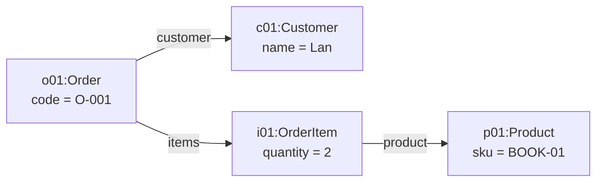

Sơ đồ được vẽ bằng **Mermaid flowchart** để tiện hiển thị trong Markdown; đây là **cách minh họa object graph tương đương về ý nghĩa**, không phải một trình biên dịch UML Object Diagram đầy đủ. Trong UML chính thức, tiêu đề instance được gạch chân và liên kết thường thể hiện bằng đường nối. Mũi tên Mermaid ở đây chỉ làm rõ **tham chiếu nào được lần theo**, không mô tả trình tự thực thi, lời gọi hàm hay dữ liệu đang di chuyển.

Đọc hình theo một đường dẫn:

```text
o01 (Order) --items--> i01 (OrderItem) --product--> p01 (Product)
```

Và một đường khác:

```text
o01 (Order) --customer--> c01 (Customer)
```

Điểm quan trọng: **link nối các instance**, ví dụ `o01 → c01`, chứ không nối khái niệm `Order` và `Customer` chung chung.

## 4. Sơ đồ lớp cho phép những trạng thái nào?

Trước khi vẽ object diagram, cần hiểu quy tắc cấu trúc do lớp và association quy định. Với ví dụ đang xét:

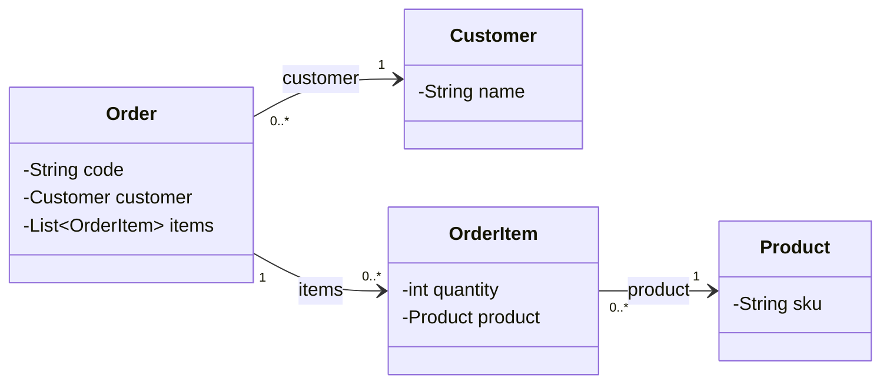

Cách đọc bội số trên association:

- Mỗi `Order` liên kết với **1 Customer**; một `Customer` có thể được **0 hoặc nhiều Order** tham chiếu.
- Mỗi `OrderItem` thuộc **1 Order** theo quy tắc nghiệp vụ mô hình; một `Order` có thể chứa **0 hoặc nhiều OrderItem**. Đoạn Java dưới đây đảm bảo mỗi item chỉ được thêm vào một order theo luồng demo, nhưng nếu muốn cưỡng chế tuyệt đối quy tắc “mỗi item có đúng một order” trong mọi trường hợp, ta cần bổ sung ownership/validation phù hợp.
- Mỗi `OrderItem` có **1 Product**; một `Product` có thể được **nhiều item** tham chiếu.

Ở sơ đồ đối tượng lúc **t0**, ta chỉ thấy *một* customer, *một* order, *một* item và *một* product. Điều đó không có nghĩa ứng dụng chỉ cho phép bốn object hoặc đơn hàng bị giới hạn một dòng hàng.

**Một object diagram không cần liệt kê toàn bộ object trong JVM.** Nó thường chọn một phần của object graph vừa đủ để minh họa một kịch bản, một bất biến hoặc một lỗi.

## 5. Java chạy được: tạo object graph và chụp hai thời điểm

Tạo tệp `ObjectDiagramDemo.java`. Ví dụ không cần framework, tương thích Java 11 trở lên.

```java
import java.util.ArrayList;
import java.util.List;
import java.util.Objects;

public class ObjectDiagramDemo {

    static final class Customer {
        final String label;  // Nhãn minh họa trên sơ đồ.
        final String name;

        Customer(String label, String name) {
            this.label = Objects.requireNonNull(label);
            this.name = Objects.requireNonNull(name);
        }
    }

    static final class Product {
        final String label;
        final String sku;

        Product(String label, String sku) {
            this.label = Objects.requireNonNull(label);
            this.sku = Objects.requireNonNull(sku);
        }
    }

    static final class OrderItem {
        final String label;
        final Product product;
        final int quantity;

        OrderItem(String label, Product product, int quantity) {
            this.label = Objects.requireNonNull(label);
            this.product = Objects.requireNonNull(product);

            if (quantity <= 0) {
                throw new IllegalArgumentException("quantity must be positive");
            }
            this.quantity = quantity;
        }
    }

    static final class Order {
        final String label;
        final String code;
        final Customer customer;
        final List<OrderItem> items = new ArrayList<>();

        Order(String label, String code, Customer customer) {
            this.label = Objects.requireNonNull(label);
            this.code = Objects.requireNonNull(code);
            this.customer = Objects.requireNonNull(customer);
        }

        void addItem(OrderItem item) {
            Objects.requireNonNull(item);
            if (items.contains(item)) {
                throw new IllegalArgumentException("Item already added");
            }
            items.add(item);
        }

        List<OrderItem> getItems() {
            return List.copyOf(items); // Không lộ collection sửa được.
        }
    }

    static void printSnapshot(String time, Order order) {
        System.out.println("=== " + time + " ===");
        System.out.println(order.label + ":Order code=" + order.code);
        System.out.println(order.label + " --customer--> " + order.customer.label);
        System.out.println(order.customer.label + ":Customer name=" + order.customer.name);

        for (OrderItem item : order.getItems()) {
            System.out.println(order.label + " --items--> " + item.label);
            System.out.println(item.label + ":OrderItem quantity=" + item.quantity);
            System.out.println(item.label + " --product--> " + item.product.label);
            System.out.println(item.product.label + ":Product sku=" + item.product.sku);
        }
    }

    public static void main(String[] args) {
        Customer c01 = new Customer("c01", "Lan");
        Product p01 = new Product("p01", "BOOK-01");
        Product p02 = new Product("p02", "NOTE-02");

        Order o01 = new Order("o01", "O-001", c01);
        OrderItem i01 = new OrderItem("i01", p01, 2);
        o01.addItem(i01);

        printSnapshot("t0", o01);

        OrderItem i02 = new OrderItem("i02", p02, 1);
        o01.addItem(i02);

        printSnapshot("t1", o01);

        // Những object cũ vẫn giữ nguyên danh tính tham chiếu.
        System.out.println("Same customer: " + (o01.customer == c01));
        System.out.println("Same first item: " + (o01.getItems().get(0) == i01));
    }
}
```

Biên dịch và chạy:

```bash
javac ObjectDiagramDemo.java
java ObjectDiagramDemo
```

Kết quả:

```text
=== t0 ===
o01:Order code=O-001
o01 --customer--> c01
c01:Customer name=Lan
o01 --items--> i01
i01:OrderItem quantity=2
i01 --product--> p01
p01:Product sku=BOOK-01
=== t1 ===
o01:Order code=O-001
o01 --customer--> c01
c01:Customer name=Lan
o01 --items--> i01
i01:OrderItem quantity=2
i01 --product--> p01
p01:Product sku=BOOK-01
o01 --items--> i02
i02:OrderItem quantity=1
i02 --product--> p02
p02:Product sku=NOTE-02
Same customer: true
Same first item: true
```

**Vì sao đây là snapshot?** `printSnapshot("t0", o01)` quan sát graph trước khi thêm `i02`. Lần gọi thứ hai quan sát **cùng object `o01`** sau khi danh sách `items` có thêm một liên kết. Java không cần tạo một object `Order` mới để có sơ đồ khác.

Lưu ý: `label` chỉ giúp ánh xạ instance sang tên trong hình. Java sử dụng **tham chiếu object**; dấu `==` trong hai dòng cuối xác nhận hai tham chiếu trỏ đến đúng **cùng instance**. Hai object có cùng `code` hoặc `sku` chưa chắc là cùng instance.

## 6. Snapshot t1: cùng đơn hàng, nhiều liên kết hơn

Sau khi thêm item thứ hai, object graph trông như sau:

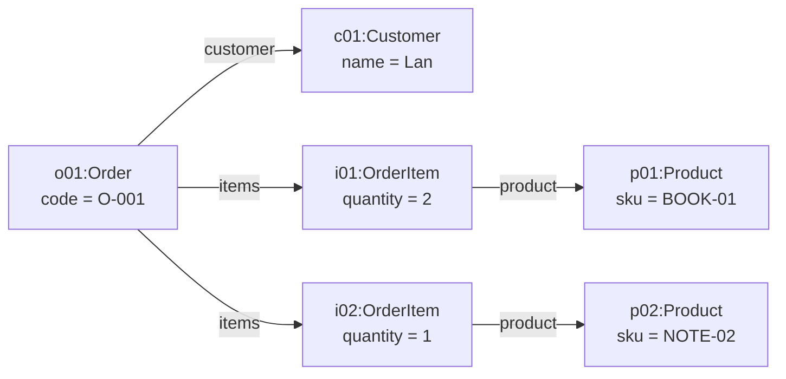

*Hai snapshot chỉ hiển thị những field thực sự có trong mã Java minh họa (`code`, `name`, `quantity`, `sku`) và các link giữa instance. Nếu nghiệp vụ bổ sung `status`, hãy thêm cả field Java, giá trị snapshot và test thay vì đặt một nhãn trạng thái chưa được triển khai.*

So sánh:

| Quan sát | Snapshot `t0` | Snapshot `t1` |
|---|---|---|
| `o01:Order` | Có | Cùng object `o01` |
| `c01:Customer` | Có | Cùng object `c01` |
| `i01:OrderItem` | Có, quantity = 2 | Vẫn có, quantity = 2 |
| `i02:OrderItem` | Chưa liên kết vào `o01`; trong demo chưa được tạo | Có, quantity = 1 |
| Link `o01 → i01` | Có | Có |
| Link `o01 → i02` | Không | Có |
| Lớp `Order`, `OrderItem` | Không đổi | Không đổi |

Việc có hai ảnh tĩnh **không tự tạo thành sequence diagram**. Hai ảnh thể hiện trạng thái “trước/sau”; còn sequence diagram trả lời **ai gọi ai, thông điệp gì, theo trình tự nào**.

## 7. Nhiều tham chiếu đến cùng một object

Một lợi ích nổi bật của sơ đồ đối tượng là chỉ rõ **chia sẻ tham chiếu (aliasing)**.

Giả sử hai đơn hàng khác nhau đều thuộc về một khách Lan:

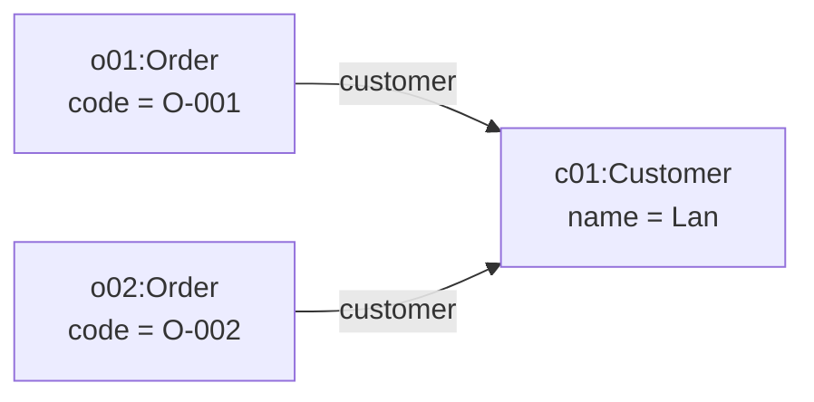

Đây là **ba object**, không phải bốn: hai object `Order`, một object `Customer`. Hai link cùng đi tới `c01`. Trong Java:

```java
Customer c01 = new Customer("c01", "Lan");
Order o01 = new Order("o01", "O-001", c01);
Order o02 = new Order("o02", "O-002", c01);

System.out.println(o01.customer == o02.customer); // true
```

Đoạn này chạy khi đặt bên trong `main` của `ObjectDiagramDemo` (dùng các lớp lồng đã khai báo). Nếu tạo **hai** object `Customer` khác nhau cùng tên “Lan”, snapshot phải vẽ **hai hộp** riêng. Việc trùng nội dung thuộc tính không làm chúng thành một instance.

Điều này rất hữu ích khi tìm lỗi cập nhật dữ liệu: sửa một object được chia sẻ có thể được nhìn thấy qua nhiều đường tham chiếu; sửa một object khác có cùng dữ liệu thì không.

## 8. Khi nào dùng sơ đồ đối tượng?

**Làm rõ yêu cầu và ví dụ nghiệp vụ.** Trong hệ thống đặt chỗ, chụp trạng thái có `room01`, `booking17`, `guest03` để cùng kiểm tra “phòng này đã được đặt bởi ai vào thời điểm xác định”.

**Kiểm tra ràng buộc và bội số.** Nếu class diagram nói mỗi `OrderItem` phải gắn một `Product`, snapshot có item không có product là **một trạng thái vi phạm quy tắc**. Diagram giúp đưa ra phản ví dụ trực quan.

**Giải thích aliasing và trạng thái dùng chung.** Hai đường link đến cùng một object làm rõ tại sao một thay đổi có thể được quan sát từ nhiều object khác.

**Gỡ lỗi object graph.** Khi test thất bại do item thuộc sai đơn hoặc user giữ quyền truy cập cũ, sơ đồ trước/sau có thể chỉ ra link nào sai. Nên chú ý rằng object graph trong heap và quan hệ lưu trong database có thể khác nhau nếu dữ liệu chưa được flush hoặc đang bị cache.

**Thiết kế test.** Snapshot mô tả trạng thái đầu vào mong muốn, rồi mô tả trạng thái kết quả của một hành vi. Kỳ vọng test có thể kiểm tra số link, identity, giá trị thuộc tính và bất biến nghiệp vụ.

### Dùng cùng test Java để kiểm tra snapshot

Thêm các kiểm tra phù hợp vào cuối `main` trong ví dụ:

```java
if (o01.getItems().size() != 2) {
    throw new AssertionError("Order must contain two items at t1");
}

if (o01.customer != c01) {
    throw new AssertionError("Order customer link is incorrect");
}

if (o01.getItems().get(1).product != p02) {
    throw new AssertionError("Second item points to wrong product");
}
```

Các kiểm tra khẳng định những quan hệ **tại t1**. Nếu thay đổi yêu cầu làm đơn cho phép nhiều khách hàng, class diagram, object diagram và test phải được cập nhật nhất quán.

## 9. Những sai lầm thường gặp

| Sai lầm | Vì sao sai | Cách làm đúng |
|---|---|---|
| Vẽ các lớp `Order`, `Customer` rồi gọi là object diagram | Chưa có instance cụ thể | Viết `o01:Order`, `c01:Customer` và link cụ thể |
| Ghi `quantity: int` trong hộp instance | Đó là khai báo kiểu thuộc tính | Ghi `quantity = 2` để thể hiện trạng thái |
| Vẽ hai hộp cho cùng một instance | Làm người đọc tưởng hai object khác nhau | Dùng một hộp, nối nhiều link đến hộp đó |
| Cho rằng thiếu link là link không thể xảy ra | Snapshot có thể cố ý lược bớt phần graph | Nêu rõ phạm vi được chụp và các giả định |
| Đọc snapshot thành trình tự xử lý | Object diagram không mang thời gian trên từng cạnh | Vẽ t0, t1 riêng; cần diễn tiến chi tiết thì dùng sequence/activity diagram |
| Đồng nhất nhãn `o01` với biến/ID DB | Object identity khác tên biến, khóa nghiệp vụ hay khóa DB | Ghi rõ quy ước đặt nhãn; kiểm tra identity bằng tham chiếu khi cần |
| Vẽ một trạng thái trái bội số mà không giải thích | Dễ khiến quy tắc miền bị hiểu sai | Đánh dấu đây là ví dụ lỗi hoặc chỉnh quan hệ |
| Cho rằng mũi tên của hình Mermaid là lời gọi hàm | Link giữa object biểu diễn association | Dùng nhãn field/role, tránh nhầm với message của sequence diagram |

## 10. Bài tập tự luyện

**Bài 1 — Nhận diện instance:** Hệ thống có `Student` và `Course`. Sinh viên An và Bình cùng đăng ký khóa Java. Cần vẽ bao nhiêu object sinh viên và object khóa học?

**Gợi ý:** hai object `Student` khác nhau, **một** object `Course` được cả hai liên kết đến, nếu đó là cùng khóa Java.

**Bài 2 — Từ lớp sang snapshot:** Sơ đồ lớp có `Library 1 — 0..* Book`. Tại thời điểm chụp, thư viện `L1` giữ hai cuốn sách `B1`, `B2`. Hãy vẽ ba hộp instance và hai link. Điều gì thay đổi khi chuyển `B2` sang thư viện `L2`?

**Gợi ý:** trước: `L1—B1` và `L1—B2`. Sau: `L1—B1` và `L2—B2`. Các object sách có thể vẫn là chính những instance ban đầu.

**Bài 3 — Phát hiện trạng thái lỗi:** Quy tắc là mỗi `OrderItem` phải có đúng một sản phẩm. Snapshot có `i03:OrderItem` nhưng không có link đến `Product`. Có thể kết luận lỗi chắc chắn không?

**Gợi ý:** nếu snapshot được công bố là **đầy đủ cho các link product**, đây là trạng thái vi phạm; nếu là hình cố ý lược bỏ chi tiết, cần kiểm tra trước khi kết luận.

**Bài 4 — Hai ảnh có phải sequence diagram?** Một ảnh có đơn ở trạng thái `DRAFT`, ảnh khác có `PAID`. Hai ảnh cho biết điều gì, và không cho biết điều gì?

**Gợi ý:** biết giá trị ở hai thời điểm; không biết ai gọi API nào, transaction thực hiện ra sao hoặc thứ tự thông điệp giữa các thành phần.

**Bài 5 — Kiểm tra identity:** Hai đơn hàng cùng trỏ tới `customerA` và `customerB`, cả hai có tên Lan nhưng `customerA != customerB`. Hãy vẽ sơ đồ với đúng số hộp và liên kết.

**Gợi ý:** bốn object — hai đơn và hai customer — vì có hai instance customer riêng.

---

**Ghi nhớ:** sơ đồ lớp mô tả *kiểu và quy tắc cấu trúc*, còn sơ đồ đối tượng mô tả *các instance, giá trị và link tại một thời điểm được chọn*. Để sơ đồ có ích, hãy nêu rõ thời điểm, phạm vi snapshot, nhãn identity và mối liên hệ giữa từng link với trạng thái thực của chương trình.


</details>

- [Quay lại đầu trang](#back-to-top)

---

## <a id="modeling-007">Sơ đồ tuần tự: thứ tự tương tác</a>

<details>
<summary>Xem chi tiết</summary>

# Sơ đồ tuần tự (Sequence Diagram): thứ tự tương tác trong OOP

Khi một tính năng liên quan đến nhiều đối tượng, sơ đồ lớp cho ta biết **những đối tượng nào có quan hệ**, còn **sơ đồ tuần tự (UML Sequence Diagram)** cho thấy **đối tượng nào gọi đối tượng nào, theo thứ tự nào và kết quả được trả về ra sao** trong một tình huống cụ thể.

Ví dụ: độc giả nhấn “Mượn sách”, hệ thống phải kiểm tra bản sách còn trống, kiểm tra số sách độc giả đang mượn, xác định hạn trả, lưu phiếu mượn, rồi phản hồi. Một sơ đồ tuần tự tốt làm rõ **ai chịu trách nhiệm ở từng bước** và **nhánh nào xảy ra khi yêu cầu không hợp lệ**.

## 1. Khi nào cần sơ đồ tuần tự?

Dùng sơ đồ tuần tự để trả lời những câu hỏi như:

- Lời gọi nào xuất phát từ tác nhân (actor), và đối tượng nào tiếp nhận đầu tiên?
- Một use case cần qua controller, service, repository, domain object theo **thứ tự** nào?
- Kết quả của mỗi lời gọi được dùng để ra quyết định gì?
- Khi kiểm tra thất bại, luồng dừng tại đâu? Có tiếp tục ghi dữ liệu không?
- Có lời gọi lặp, tùy chọn hoặc xử lý song song/bất đồng bộ nào?
- Trách nhiệm đang nằm đúng lớp hay controller/service đang ôm quá nhiều việc?

Sơ đồ mô tả **một tương tác hoặc một nhóm tình huống của một hành vi**, không nhất thiết vẽ toàn bộ hệ thống. Thường bắt đầu từ **một use case có thể phát biểu thành câu**: “Độc giả mượn một bản sách”.

| Câu hỏi | Loại sơ đồ thường phù hợp hơn |
| --- | --- |
| Lớp nào có thuộc tính/phương thức và liên hệ gì? | Class diagram |
| Các bước xử lý, nhánh quyết định trong một thuật toán? | Activity diagram |
| Đối tượng nào gửi thông điệp cho ai và theo thứ tự nào? | **Sequence diagram** |
| Đối tượng chuyển qua các trạng thái nào? | State machine |
| Thành phần triển khai/kết nối theo kiến trúc nào? | Component/deployment diagram |

Sequence diagram rất hữu ích khi nhiều đối tượng cộng tác, nhưng nếu chỉ cần mô tả phép cộng hai số bên trong một phương thức thì sơ đồ có thể phức tạp hơn chính đoạn code.

## 2. Thành phần và cách đọc từ trên xuống

Một sơ đồ tuần tự có **trục ngang** là các bên tham gia (*participants/lifelines*) và **trục dọc** thể hiện thứ tự diễn ra của các thông điệp. Các thông điệp ở vị trí càng thấp thường xuất hiện càng muộn trong tình huống được mô tả.

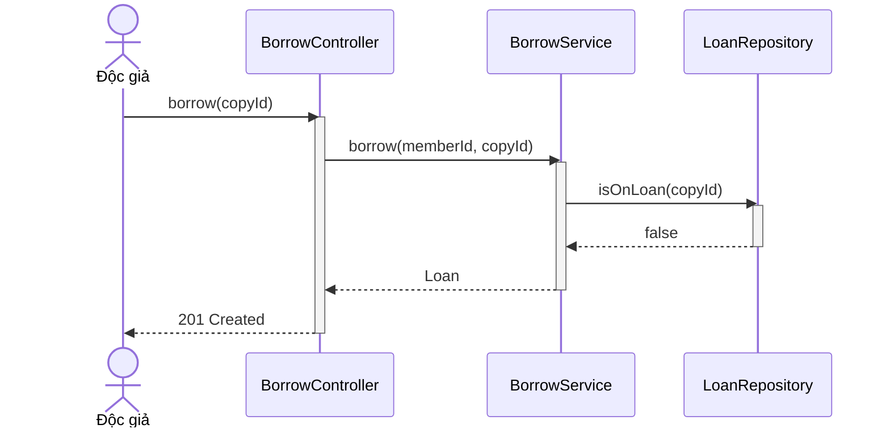

| Thành phần | Ý nghĩa | Cách đọc trong Mermaid |
| --- | --- | --- |
| **Actor** | Người hoặc hệ thống bên ngoài khởi tạo tương tác | `actor U as Độc giả` |
| **Participant** | Đối tượng, service, thành phần nhận/gửi thông điệp | `participant S as BorrowService` |
| **Lifeline** | Đường thẳng đứng thể hiện một bên tham gia xuyên suốt tương tác | Hiện dưới tên participant |
| **Message (call)** | Một lời gọi/yêu cầu có hướng từ bên gửi đến bên nhận | `S->>R: isOnLoan(copyId)` |
| **Return message** | Kết quả quay về bên gọi, thường vẽ nét đứt | `R-->>S: false` |
| **Activation** | Khoảng một participant đang thực hiện công việc trong tương tác | `activate S`, `deactivate S` |
| **Combined fragment** | Khung thể hiện nhánh, lặp, tùy chọn, song song... | `alt`, `opt`, `loop`, `par` |
| **Note** | Ghi chú quy tắc/giả định quan trọng | `Note over S,R: ...` |

Trong UML chuẩn, khái niệm *activation* còn được gọi là **execution specification**; nó biểu diễn khoảng thực thi, **không bắt buộc** trùng thời lượng CPU hoặc thời gian đo đạc thực. Mỗi lifeline cũng không nhất thiết là một thread riêng.

**Lưu ý quan trọng về thứ tự:** sơ đồ cho biết thứ tự tương đối của các tương tác được biểu diễn. Khoảng cách dọc giữa hai mũi tên **không mặc nhiên** cho biết số mili giây; nếu cần thời lượng, timeout hoặc deadline, phải ghi rõ bằng note/ràng buộc hay sơ đồ phục vụ mục đích định thời.

## 3. Các loại thông điệp cần phân biệt

### 3.1. Lời gọi đồng bộ và trả về

Với một lời gọi Java thông thường:

```java
boolean borrowed = repository.isOnLoan(copyId);
```

Đối tượng gọi chờ lời gọi hoàn thành hoặc ném exception, rồi mới xử lý tiếp trên cùng luồng điều khiển. Biểu diễn phổ biến:

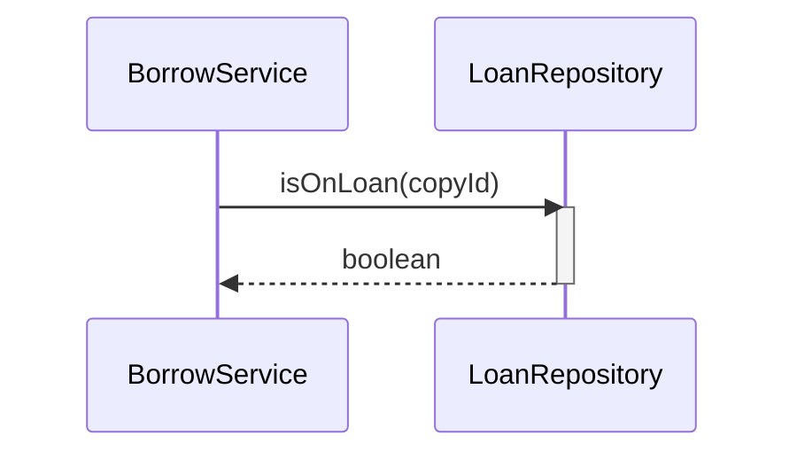

Trong Mermaid, `->>` là nét liền có đầu mũi tên và `-->>` là mũi tên nét đứt; **ngữ nghĩa đồng bộ/bất đồng bộ phải dựa cả vào nội dung và cách diễn đạt**, không chỉ vào một ký tự mũi tên. Trong UML chuẩn, call/return cũng là những loại message có ký hiệu riêng.

### 3.2. Lời gọi bất đồng bộ

Ví dụ ứng dụng gửi lệnh tạo email vào queue và tiếp tục xử lý mà không chờ email được gửi xong:

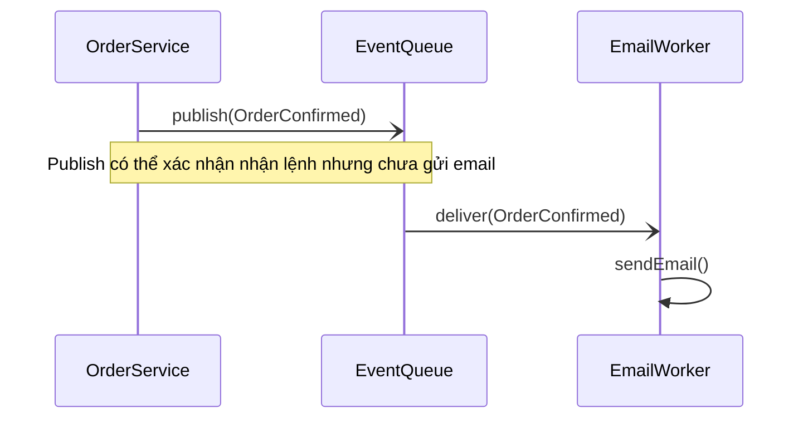

Cách viết `-)` trong Mermaid diễn tả thông điệp có đầu mũi tên mở, thường dùng để diễn giải asynchronous message. Tuy nhiên **chỉ đổi ký hiệu trên sơ đồ không làm code Java tự trở nên bất đồng bộ**. Cần có cơ chế thực tế: queue, event bus, callback, `CompletableFuture`, worker, hoặc một giao thức không chờ kết quả.

Ngoài ra, `publish(...)` có thể vẫn là lời gọi đồng bộ của client queue (chờ broker nhận message), trong khi **việc xử lý email** mới diễn ra bất đồng bộ. Phải chỉ rõ ranh giới giữa *ghi/đẩy sự kiện* và *thực thi tác vụ*.

### 3.3. Thông điệp tự gọi, tạo và kết thúc đối tượng

- **Self-message:** một đối tượng gọi chính phương thức khác của nó, ví dụ `validator.validateState()`.
- **Create message:** một đối tượng yêu cầu tạo instance mới, như `new Loan(...)`.
- **Destroy message:** mô tả kết thúc vòng đời của đối tượng trong mô hình tương tác.

Không nhầm dấu kết thúc lifeline với thao tác Java garbage collection. JVM không đảm bảo thời điểm thu hồi object chỉ vì một biến ra khỏi scope; tài nguyên `AutoCloseable` cũng phải có chính sách đóng tường minh.

## 4. Combined fragments: biểu diễn nhánh và lặp

Các khung điều khiển trong sequence diagram giúp không cần vẽ một hình riêng cho từng kết quả.

| Fragment | Ý nghĩa | Ví dụ |
| --- | --- | --- |
| `alt` | Các nhánh thay thế nhau theo điều kiện | Sách đã mượn / sách còn trống |
| `opt` | Khối tùy chọn: chạy hoặc bỏ qua | Có mã giảm giá mới tính giảm |
| `loop` | Lặp khối tương tác | Kiểm tra lần lượt từng dòng hàng |
| `par` | Các phần có thể diễn ra song song/đan xen | Hai công việc độc lập chạy đồng thời |
| `break` | Kết thúc sớm phần tương tác bao quanh khi điều kiện thỏa | Xác thực thất bại thì dừng xử lý |
| `critical` | Vùng tương tác quan trọng cần thực hiện không bị xen ngang theo ràng buộc mô hình | Thao tác cần bảo vệ khỏi cập nhật tranh chấp |

Ví dụ ba fragment thường gặp:

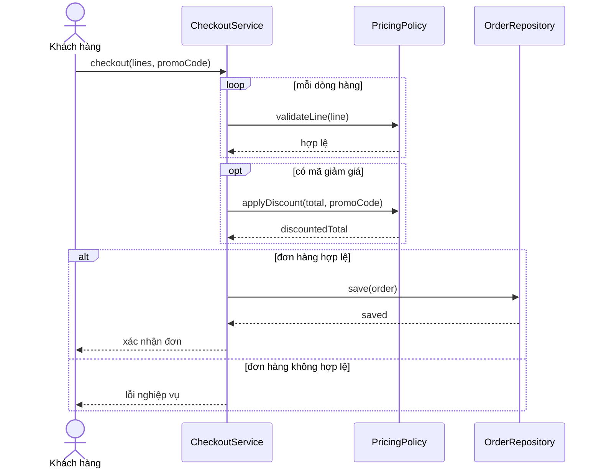

**Không được hiểu `par` hay `critical` là cơ chế đồng bộ hóa đã tồn tại trong ứng dụng.** Fragment chỉ ghi nhận ý đồ thiết kế. Nếu nhiều transaction cùng tranh chấp dữ liệu, code vẫn cần lock, isolation, optimistic concurrency, unique constraint hoặc giải pháp tương đương tại đúng ranh giới.

## 5. Tình huống xuyên suốt: mượn một bản sách

Bài toán:

1. Độc giả gửi `memberId` và `copyId`.
2. Hệ thống từ chối nếu bản sách đang được mượn.
3. Hệ thống từ chối nếu độc giả đã đạt giới hạn số lượt mượn đang hoạt động.
4. Nếu hợp lệ, hệ thống tính hạn trả từ ngày mượn và chính sách, tạo phiếu mượn, lưu kết quả.
5. Đầu vào thành công nhận **201** và dữ liệu phiếu mượn; bản sách không sẵn có nhận **409**; vượt hạn mức nhận **422** (đây là quyết định API minh họa, không phải luật bắt buộc cho mọi API).

### Sơ đồ tuần tự cho luồng đầy đủ

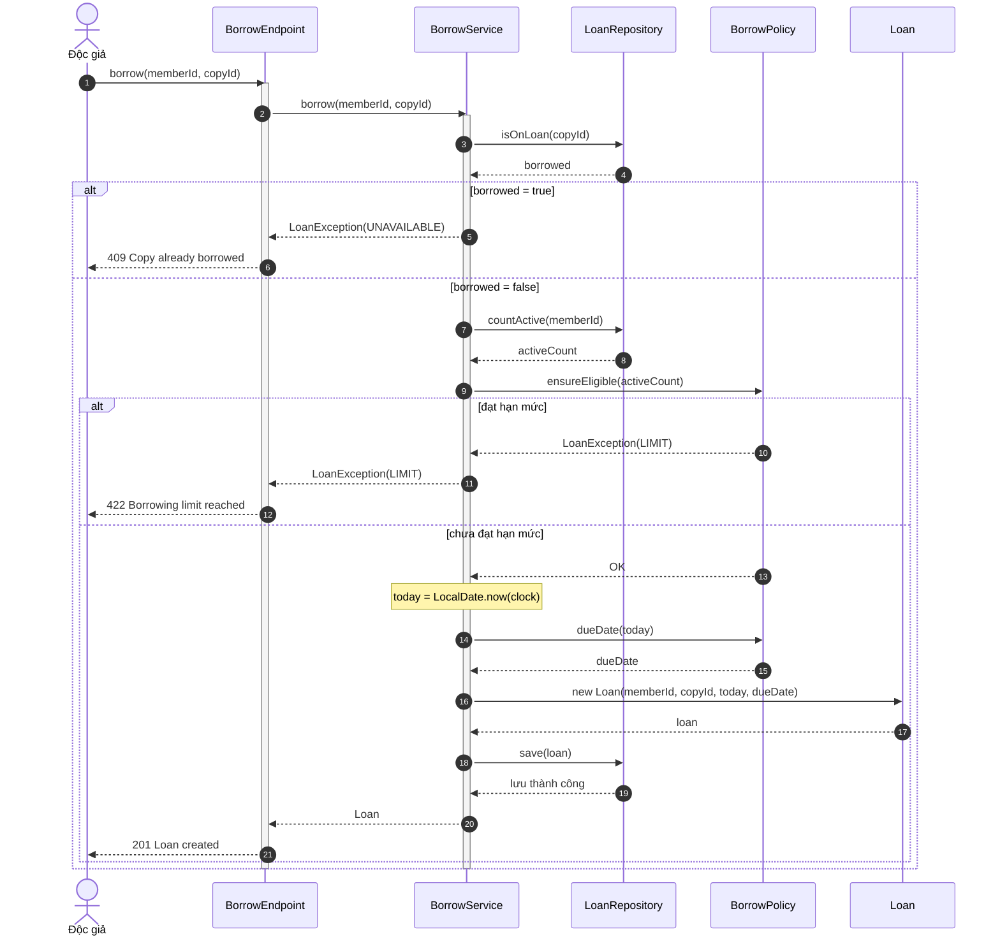

Sơ đồ dùng `autonumber` để đánh số **thứ tự message hiển thị**, không phải mã dòng Java hoặc số request HTTP. Các mũi tên exception được dùng như cách diễn giải phản hồi lỗi ở ranh giới service/controller; trong Java, exception thực tế **không phải** giá trị trả về thông thường.

Ở nhánh “bản sách đã mượn”, **không có** lời gọi `countActive` hay `save`. Ở nhánh “đạt hạn mức”, **không có** lời gọi `dueDate` hoặc `save`. Những chi tiết này cho phép kiểm tra thứ tự và tác dụng phụ, không chỉ kết quả cuối cùng.

## 6. Chương trình Java 17 chạy được khớp với sơ đồ

Đặt toàn bộ code sau vào một file `SequenceDiagramDemo.java`:

```java
import java.time.Clock;
import java.time.Instant;
import java.time.LocalDate;
import java.time.ZoneOffset;
import java.util.LinkedHashMap;
import java.util.Map;
import java.util.Objects;

public class SequenceDiagramDemo {

    enum Reason { UNAVAILABLE, LIMIT }

    static final class LoanException extends RuntimeException {
        private final Reason reason;

        LoanException(Reason reason, String message) {
            super(message);
            this.reason = Objects.requireNonNull(reason);
        }

        Reason reason() { return reason; }
    }

    // Entity/value: bất biến nội tại được kiểm tra ở constructor.
    record Loan(String memberId, String copyId,
                LocalDate borrowedOn, LocalDate dueOn) {
        Loan {
            memberId = required(memberId, "memberId");
            copyId = required(copyId, "copyId");
            Objects.requireNonNull(borrowedOn, "borrowedOn");
            Objects.requireNonNull(dueOn, "dueOn");
            if (!dueOn.isAfter(borrowedOn)) {
                throw new IllegalArgumentException("dueOn must be later");
            }
        }
    }

    // Domain policy: luật hạn mức và hạn trả.
    record BorrowPolicy(int maxActive, int loanDays) {
        BorrowPolicy {
            if (maxActive <= 0 || loanDays <= 0) {
                throw new IllegalArgumentException("Invalid policy");
            }
        }

        void ensureEligible(long activeCount) {
            if (activeCount >= maxActive) {
                throw new LoanException(
                        Reason.LIMIT, "Borrowing limit reached");
            }
        }

        LocalDate dueDate(LocalDate start) {
            return start.plusDays(loanDays);
        }
    }

    // Port: hợp đồng truy vấn/lưu, không phụ thuộc database cụ thể.
    interface LoanRepository {
        boolean isOnLoan(String copyId);
        long countActive(String memberId);
        void save(Loan loan);
    }

    // Adapter cho demo: mỗi copyId có tối đa một Loan active.
    static final class InMemoryLoanRepository implements LoanRepository {
        private final Map<String, Loan> activeByCopy = new LinkedHashMap<>();

        @Override
        public boolean isOnLoan(String copyId) {
            return activeByCopy.containsKey(copyId);
        }

        @Override
        public long countActive(String memberId) {
            return activeByCopy.values().stream()
                    .filter(x -> x.memberId().equals(memberId))
                    .count();
        }

        @Override
        public void save(Loan loan) {
            Objects.requireNonNull(loan, "loan");
            if (activeByCopy.putIfAbsent(loan.copyId(), loan) != null) {
                throw new LoanException(
                        Reason.UNAVAILABLE, "Copy already borrowed");
            }
        }
    }

    // Application service: thứ tự gọi như trên sequence diagram.
    static final class BorrowService {
        private final LoanRepository loans;
        private final BorrowPolicy policy;
        private final Clock clock;

        BorrowService(LoanRepository loans, BorrowPolicy policy, Clock clock) {
            this.loans = Objects.requireNonNull(loans);
            this.policy = Objects.requireNonNull(policy);
            this.clock = Objects.requireNonNull(clock);
        }

        Loan borrow(String memberId, String copyId) {
            memberId = required(memberId, "memberId");
            copyId = required(copyId, "copyId");

            // Message 1: kiểm tra bản sách.
            if (loans.isOnLoan(copyId)) {
                throw new LoanException(
                        Reason.UNAVAILABLE, "Copy already borrowed");
            }

            // Message 2: truy vấn số lượt mượn của độc giả.
            long activeCount = loans.countActive(memberId);

            // Message 3: policy quyết định có được mượn thêm không.
            policy.ensureEligible(activeCount);

            // Message 4: thời gian được truyền từ ngoài để test ổn định.
            LocalDate today = LocalDate.now(clock);

            // Message 5: policy tính hạn trả, domain tạo đối tượng.
            Loan loan = new Loan(memberId, copyId,
                    today, policy.dueDate(today));

            // Message 6: repository ghi nhận.
            loans.save(loan);
            return loan;
        }
    }

    // Giao diện mô phỏng controller, không phụ thuộc HTTP framework.
    record Response(int status, String body) {
        @Override
        public String toString() {
            return status + " " + body;
        }
    }

    static final class BorrowEndpoint {
        private final BorrowService service;

        BorrowEndpoint(BorrowService service) {
            this.service = Objects.requireNonNull(service);
        }

        Response borrow(String memberId, String copyId) {
            try {
                Loan loan = service.borrow(memberId, copyId);
                return new Response(201,
                        "Loan created, due " + loan.dueOn());
            } catch (LoanException ex) {
                int status = ex.reason() == Reason.UNAVAILABLE ? 409 : 422;
                return new Response(status, ex.getMessage());
            }
        }
    }

    static String required(String s, String name) {
        if (s == null || s.isBlank()) {
            throw new IllegalArgumentException(name + " is required");
        }
        return s;
    }

    public static void main(String[] args) {
        Clock fixedClock = Clock.fixed(
                Instant.parse("2026-10-15T00:00:00Z"), ZoneOffset.UTC);

        LoanRepository repo = new InMemoryLoanRepository();
        BorrowPolicy policy = new BorrowPolicy(1, 14);
        BorrowEndpoint endpoint = new BorrowEndpoint(
                new BorrowService(repo, policy, fixedClock));

        System.out.println(endpoint.borrow("MEM-01", "COPY-01"));
        System.out.println(endpoint.borrow("MEM-02", "COPY-01"));
        System.out.println(endpoint.borrow("MEM-01", "COPY-02"));
        System.out.println(endpoint.borrow("MEM-02", "COPY-02"));
    }
}
```

Chạy:

```bash
javac SequenceDiagramDemo.java
java SequenceDiagramDemo
```

Kết quả dự kiến:

```text
201 Loan created, due 2026-10-29
409 Copy already borrowed
422 Borrowing limit reached
201 Loan created, due 2026-10-29
```

### Đối chiếu message với phương thức Java

| Thứ tự logic | Mũi tên trên sơ đồ | Lời gọi trong code | Kết quả/nhánh |
| --- | --- | --- | --- |
| 1 | Endpoint → Service | `service.borrow(memberId, copyId)` | Bắt đầu use case |
| 2 | Service → Repository | `loans.isOnLoan(copyId)` | Nếu true: ném `UNAVAILABLE`, dừng |
| 3 | Service → Repository | `loans.countActive(memberId)` | Trả số lượt active |
| 4 | Service → Policy | `policy.ensureEligible(activeCount)` | Nếu vượt giới hạn: ném `LIMIT`, dừng |
| 5 | Service → Clock/Policy | `LocalDate.now(clock)`, `policy.dueDate(today)` | Tính ngày mượn/hạn trả |
| 6 | Service → Loan | `new Loan(...)` | Tạo Loan hợp lệ |
| 7 | Service → Repository | `loans.save(loan)` | Lưu, hoặc từ chối nếu copy bị chiếm |
| 8 | Service → Endpoint → Actor | `return loan` / `Response` | Thành công 201 hoặc lỗi 409/422 |

Sơ đồ đặt `Loan` như một participant để minh họa tạo object. Không nhất thiết tạo participant riêng cho mọi `String`, `List` hoặc hàm hỗ trợ đơn giản; chỉ vẽ những nơi quan trọng với **trách nhiệm và giao tiếp** của use case.

Ví dụ cố tình giới hạn các Loan trong repository đều là lượt đang hoạt động. Luồng trả sách, phân quyền người mượn và việc đăng ký bản sách hợp lệ chưa được mô hình hóa.

**Giới hạn về đồng thời:** code in-memory ở trên minh họa thứ tự tuần tự cho một lời gọi, chưa cung cấp transaction đa request. Hai lời gọi đồng thời có thể cùng vượt qua `countActive` và làm một độc giả vượt giới hạn; `LinkedHashMap` còn không thread-safe. Với ứng dụng thật, phải kiểm tra/ràng buộc dưới giao dịch, khóa hoặc cơ chế duy trì invariant thích hợp, dùng repository/database có xử lý đồng thời. Sequence diagram là mô hình tương tác, **không tự bảo đảm atomicity**.

## 7. Dùng sơ đồ để phát hiện lỗi thiết kế

### Lỗi A: gọi nhầm thứ tự làm phát sinh tác dụng phụ

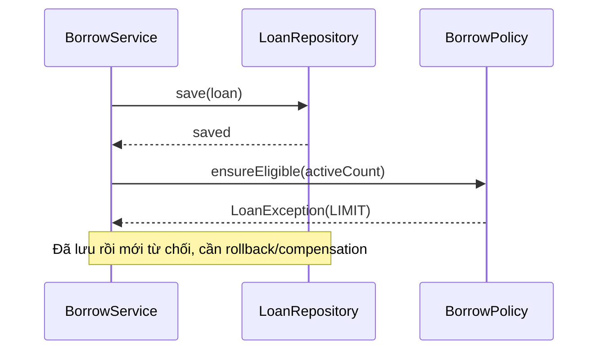

Nếu `save` đã commit, kiểm tra policy sau đó là quá muộn. Trong code chạy dưới transaction, một exception có thể kích hoạt rollback nếu cấu hình đúng; nhưng không nên xây thiết kế dựa trên giả định transaction luôn tồn tại.

### Lỗi B: controller làm thay domain rule

Nếu sơ đồ có chuỗi `Controller -> Repository -> Controller -> Policy -> Controller -> Repository` và controller tự tính tiền/hạn mức, có thể đang phân bổ trách nhiệm chưa tốt. Khi đó application service hoặc domain service có thể là nơi điều phối hợp lý hơn. **Không phải mọi sơ đồ nhiều mũi tên đều xấu**; chỉ cảnh báo khi giao tiếp lộ chi tiết nghiệp vụ sang sai tầng.

### Lỗi C: bỏ qua đường thất bại

Sơ đồ chỉ có “save → success” có thể thiếu kiểm tra, lỗi timeout hoặc trường hợp lưu dữ liệu không thành công. Ít nhất mô tả các nhánh ảnh hưởng tới **hợp đồng của use case**: người dùng nhận thông báo gì, có gọi tiếp không, có trạng thái được ghi dở dang không.

### Lỗi D: nhầm thông báo bất đồng bộ với kết quả đã hoàn tất

Nếu service phát sự kiện `OrderCreated` rồi trả thành công, đó là thành công của phần đồng bộ. Không thể vẽ như thể email đã được gửi, trừ khi hệ thống thực sự chờ kết quả. Với event bus, mô tả riêng xử lý retry, dead-letter và bảo đảm at-least-once khi cần.

## 8. Từ yêu cầu đến sơ đồ tuần tự: quy trình 7 bước

1. **Chọn một scenario rõ ràng.** Đầu vào, tiền điều kiện, kết quả thành công, các kết quả thất bại quan trọng.
2. **Xác định participants thật.** Actor, adapter/controller, application service, domain policy/entity, repository, dịch vụ ngoài. Đừng tự tạo một class chỉ để có thêm mũi tên.
3. **Đặt luồng thành công trước.** Viết lần lượt các lời gọi thực tế từ trên xuống; bên nhận phải có trách nhiệm phù hợp.
4. **Bổ sung return có ý nghĩa.** Giá trị trả về hoặc exception làm thay đổi quyết định; không cần vẽ mọi câu lệnh `return`.
5. **Thêm `alt`, `opt`, `loop`.** Diễn đạt rõ các điều kiện và chỗ luồng dừng, tránh những nhánh chỉ xuất hiện vì chi tiết nhỏ.
6. **Kiểm tra các tác dụng phụ.** Các lời gọi `save`, `publish`, `send`, `charge` có xảy ra sau kiểm tra chưa? Khi lỗi, trạng thái còn đúng không?
7. **So với code và test.** Đối chiếu thứ tự giữa sơ đồ và phương thức thật; chỉnh lại một trong hai khi thiết kế thay đổi.

Sơ đồ là tài liệu để trao đổi và kiểm tra thiết kế. Nó hữu ích nhất khi đủ chính xác để người khác đối chiếu với mã nguồn, đồng thời đủ gọn để đọc được.

## 9. Kiểm thử thứ tự tương tác

Không phải luồng nào cũng cần kiểm tra đúng **toàn bộ** thứ tự các lời gọi nội bộ. Nên kiểm tra thứ tự khi thứ tự đó là một **yêu cầu hành vi**:

- Nếu bản sách đã có người mượn, tuyệt đối không gọi `save`.
- Nếu vượt hạn mức, không gọi `save`.
- Nếu kiểm tra không hợp lệ, không phát thông báo xác nhận thành công.
- Nếu hệ thống phát event sau commit, cần kiểm chứng vị trí phát event so với lưu dữ liệu (hoặc outbox).

Một **spy repository** có thể ghi các lời gọi quan sát được:

```java
// Minh họa ý tưởng spy; có thể viết thành class implements LoanRepository.
List<String> calls = new ArrayList<>();
// isOnLoan -> calls.add("isOnLoan")
// countActive -> calls.add("countActive")
// save -> calls.add("save")

// Với nhánh thành công, mong đợi:
List<String> expected =
        List.of("isOnLoan", "countActive", "save");
```

Với nhánh `UNAVAILABLE`, mong đợi chỉ `["isOnLoan"]`. Với `LIMIT`, mong đợi `["isOnLoan", "countActive"]`. Các test này xác nhận không xảy ra **tác dụng phụ sai thứ tự**, thay vì khóa chặt mọi chi tiết implementation. Trong dự án có JUnit/Mockito, có thể dùng spy/mock và xác nhận tương tác nếu đó là hợp đồng cần bảo vệ.

Khi có tính đồng thời, một sequence diagram tuần tự đơn lẻ không đủ chứng minh thứ tự giữa các request độc lập. Phải bổ sung mô hình cạnh tranh, constraint ở nơi lưu và integration/concurrency test.

## 10. Những lưu ý UML để tránh hiểu sai

| Hiểu sai thường gặp | Cách hiểu đúng |
| --- | --- |
| Mỗi participant là một thread | Participant thường là instance hoặc vai trò tham gia, không nhất thiết là thread |
| Mũi tên nằm thấp hơn tức chạy chậm hơn N mili giây | Vị trí dọc mô tả thứ tự tương tác, không tự biểu diễn độ trễ |
| Mũi tên nét đứt là message “bất đồng bộ” | Return message thường là nét đứt; asynchronous message là khái niệm riêng |
| Có `par` trên sơ đồ thì Java chắc chắn chạy song song | Phải có cơ chế thực thi song song thật |
| `alt` là hai nhánh đồng thời xảy ra | `alt` chọn một nhánh theo điều kiện |
| Sơ đồ phải chứa từng setter/getter | Chỉ cần message quan trọng cho kịch bản và trách nhiệm cần làm rõ |
| Sequence diagram thay thế class diagram | Hai sơ đồ trả lời câu hỏi khác nhau và bổ sung cho nhau |
| Diagram thể hiện lưu thành công là đã an toàn đa luồng | Cần transaction/locking/constraint theo invariant |
| Mọi exception đều vẽ như giá trị return | Có thể mô hình hóa đường lỗi, nhưng phải phân biệt exception với normal return |

Đặt nhãn message theo **ý nghĩa thực tế** như `countActive(memberId)`, `save(loan)`, `publish(event)`; tránh chỉ ghi những từ mơ hồ như “xử lý”, “gọi”, “trả dữ liệu”. Ở mỗi nhánh `alt`, ghi điều kiện đủ cụ thể để người đọc phân biệt.

## 11. Bài tập thực hành

**Bài A — Đăng nhập.** Vẽ sequence diagram cho actor, `LoginController`, `AuthenticationService`, `UserRepository`, `PasswordVerifier`, `TokenIssuer`. Mô tả nhánh không tìm thấy người dùng, mật khẩu sai và đăng nhập thành công. Chỉ phát token sau xác thực; không vẽ việc so sánh mật khẩu bằng `==` với chuỗi plaintext trong ứng dụng thực tế.

**Bài B — Giỏ hàng.** Vẽ `loop` kiểm tra từng dòng hàng, `opt` có promo và `alt` đơn hợp lệ/không hợp lệ. Đối chiếu mũi tên trong sơ đồ với phương thức Java của các lớp do bạn tự thiết kế.

**Bài C — Sửa thứ tự sai.** Một sơ đồ thanh toán đang có `notifySuccess()` trước `charge()`, `charge()` trước `checkAvailability()`. Hãy vẽ lại quy trình và giải thích tại sao hoàn trả tiền/giữ hàng cần một chính sách rõ khi tác dụng phụ từ hệ thống ngoài đã xảy ra.

**Bài D — Không nhầm đồng bộ và bất đồng bộ.** Sau khi ghi đơn, ứng dụng đặt một sự kiện vào queue rồi lập tức trả `202 Accepted`. Vẽ rõ phần publish và consumer xử lý sau; thêm note cho retry/idempotency và chỉ ra điều kiện nào mới có thể gọi là “email đã gửi”.

**Bài E — Kiểm thử theo sơ đồ.** Viết fake/spy `LoanRepository` cho ví dụ Java trên. Ghi nhận thứ tự lời gọi ở ba trường hợp: bản sách đã được mượn, độc giả đạt hạn mức, và mượn thành công. Đảm bảo không có `save` trong hai trường hợp bị từ chối.

### Checklist trước khi hoàn thành sequence diagram

- Sơ đồ phục vụ một scenario hoặc một use case được phát biểu rõ ràng?
- Mỗi participant có vai trò cụ thể trong mã nguồn/thiết kế?
- Các message đi **đúng người nhận và đúng thứ tự**?
- Nhánh `alt` thể hiện kết quả thành công và thất bại cần thiết?
- Return/exception có được phân biệt với asynchronous delivery?
- `loop`, `opt`, `par` chỉ được dùng khi có lý do nghiệp vụ/thực thi?
- Tác dụng phụ như lưu, thanh toán, phát sự kiện có đúng vị trí?
- Sơ đồ có khớp với thứ tự trong code và test?
- Những giả định về transaction, độ đồng thời và thời gian có được nói rõ?

**Ghi nhớ:** sơ đồ tuần tự là cách kể lại **một hành vi OOP theo thời gian** bằng những thông điệp giữa các đối tượng. Giá trị của nó không nằm ở số lượng mũi tên mà ở việc phát hiện sai thứ tự, trách nhiệm đặt sai lớp và luồng lỗi còn thiếu trước khi những sai sót đó đi vào mã nguồn.


</details>

- [Quay lại đầu trang](#back-to-top)

---

## <a id="modeling-008">Sơ đồ trạng thái: chuyển trạng thái hợp lệ</a>

<details>
<summary>Xem chi tiết</summary>

# Sơ đồ trạng thái: chuyển trạng thái hợp lệ trong OOP

## 1. Vì sao phải mô hình hóa trạng thái?

Một đối tượng không phải lúc nào cũng được phép thực hiện mọi hành động. Đơn hàng mới tạo có thể được gửi để chờ thanh toán; đơn đã thanh toán có thể chuyển sang đóng gói; đơn đã giao không thể quay trở lại trạng thái mới tạo chỉ bằng cách gán một giá trị khác vào trường `status`.

Nếu chỉ dùng:

```java
order.setStatus("SHIPPED");
```

thì bất kỳ đoạn mã nào cũng có thể đánh dấu “đã gửi hàng”, kể cả khi đơn chưa thanh toán hoặc chưa có mã vận đơn. Khi quy tắc nằm rải rác trong controller, service và repository, việc bổ sung luồng mới dễ tạo ra các trạng thái bất hợp lệ.

**Sơ đồ trạng thái (UML state machine/state diagram)** diễn tả vòng đời của **một đối tượng**: nó có những trạng thái nào, sự kiện nào làm phát sinh chuyển trạng thái, điều kiện nào phải thỏa mãn và hành động nào được thực hiện khi chuyển.

Mô hình này hữu ích cho đơn hàng, phiếu hỗ trợ, hợp đồng, tài khoản, yêu cầu phê duyệt, đơn vận chuyển hoặc tác vụ nền có vòng đời rõ ràng.

## 2. Năm thành phần cần đọc trên một sơ đồ trạng thái

| Thành phần | Ý nghĩa | Ví dụ đơn hàng |
|---|---|---|
| **State – trạng thái** | Tình huống mà đối tượng đang ở trong đó; chi phối các hành vi được phép | `DRAFT`, `PAID`, `SHIPPED` |
| **Event/trigger – sự kiện kích hoạt** | Điều gì được gửi/xảy ra để yêu cầu chuyển trạng thái | `SUBMIT`, `CONFIRM_PAYMENT` |
| **Guard – điều kiện gác** | Biểu thức Boolean phải đúng để chuyển theo một nhánh | `[paidAmount == total]` |
| **Effect/action – hiệu ứng chuyển trạng thái** | Việc thực hiện khi chuyển thành công | Lưu mã vận đơn; tạo dữ liệu nghiệp vụ |
| **Transition – cạnh chuyển** | Quy tắc nối trạng thái nguồn với trạng thái đích | `PAID --START_PACKING--> PACKING` |

Một nhãn chuyển trạng thái trong UML thường có dạng:

```text
event [guard] / effect
```

Ví dụ:

```text
PACKING --> SHIPPED : SHIP [trackingCode hợp lệ] / lưu trackingCode
```

Đọc thành lời: “Khi đơn ở trạng thái `PACKING` và nhận yêu cầu `SHIP`, chỉ cho phép chuyển sang `SHIPPED` nếu mã vận đơn hợp lệ; khi chuyển, lưu mã vận đơn”.

Một **guard không đạt** nghĩa là nhánh chuyển này **không được thực hiện**. Cần xác định rõ chính sách xử lý yêu cầu không hợp lệ: trả lỗi nghiệp vụ, giữ nguyên trạng thái, hoặc xử lý qua một nhánh khác. Trong ví dụ Java, ta chọn **ném ngoại lệ và giữ nguyên trạng thái**.

## 3. Sơ đồ vòng đời của một đơn hàng

```mermaid
stateDiagram-v2
    [*] --> DRAFT : tạo đơn
    DRAFT --> WAITING_PAYMENT : SUBMIT
    DRAFT --> CANCELLED : CANCEL
    WAITING_PAYMENT --> PAID : CONFIRM_PAYMENT [paidAmount == total]
    WAITING_PAYMENT --> CANCELLED : CANCEL
    PAID --> PACKING : START_PACKING
    PACKING --> SHIPPED : SHIP [trackingCode hợp lệ] / lưu mã vận đơn
    SHIPPED --> DELIVERED : CONFIRM_DELIVERY
    DELIVERED --> [*]
    CANCELLED --> [*]
```

Trong sơ đồ:

- **`[*]` bên trái** là ký hiệu bắt đầu (initial pseudostate). Nó biểu diễn việc khởi tạo state machine ở `DRAFT`.
- **Hình chữ nhật bo góc** (Mermaid thể hiện tên trạng thái) là các trạng thái ổn định của đơn hàng.
- **Mũi tên** diễn tả chuyển trạng thái; nhãn chỉ sự kiện, guard và action khi có.
- **`[*]` bên phải** là trạng thái kết thúc (final state) của vòng đời được mô tả. Điều đó **không có nghĩa object Java hoặc bản ghi database tự bị xóa**.
- `CANCELLED` là đích hợp lệ chỉ từ `DRAFT` và `WAITING_PAYMENT` **trong ví dụ này**. Sau thanh toán, nghiệp vụ hoàn tiền thường đòi hỏi một quy trình khác, không nên tự ý cho `PAID → CANCELLED` rồi bỏ qua tiền đã thu.

Sơ đồ trả lời ngay những câu hỏi:

- Đơn đang `DRAFT` có thể gửi hoặc hủy: **có**.
- Đơn đang `PAID` có thể chuyển thẳng sang `SHIPPED`: **không**, phải sang `PACKING`.
- Đơn đang `SHIPPED` có thể xác nhận đã giao: **có**.
- Đơn đã `DELIVERED` có thể bị hủy theo luồng đơn giản này: **không**.

Không cần vẽ mọi chuyển trạng thái không hợp lệ bằng mũi tên cấm. **Những cạnh không tồn tại mặc định không được phép** trong một state machine có danh sách chuyển đóng, trừ khi mô hình định nghĩa cách xử lý khác.

## 4. Bảng chuyển trạng thái là “hợp đồng” kiểm chứng được

| Trạng thái hiện tại | Event | Guard | Hành động/hiệu ứng trong domain | Trạng thái tiếp theo |
|---|---|---|---|---|
| `DRAFT` | `SUBMIT` | Không thêm điều kiện | Ghi nhận đơn đã gửi | `WAITING_PAYMENT` |
| `DRAFT` | `CANCEL` | Không thêm điều kiện | Ghi nhận hủy | `CANCELLED` |
| `WAITING_PAYMENT` | `CONFIRM_PAYMENT` | Số tiền xác nhận bằng tổng tiền đơn | Chấp nhận thanh toán đã xác thực | `PAID` |
| `WAITING_PAYMENT` | `CANCEL` | Không thêm điều kiện | Ghi nhận hủy | `CANCELLED` |
| `PAID` | `START_PACKING` | Không thêm điều kiện | Bắt đầu xử lý đóng gói | `PACKING` |
| `PACKING` | `SHIP` | Mã vận đơn có nội dung hợp lệ | Lưu mã vận đơn | `SHIPPED` |
| `SHIPPED` | `CONFIRM_DELIVERY` | Không thêm điều kiện trong ví dụ | Ghi nhận giao thành công | `DELIVERED` |

Mọi tổ hợp `(state, event)` ngoài bảng đều **bị từ chối**. Thêm một trạng thái mới phải xem lại những cạnh vào/ra, guard, tác động và ca kiểm thử; chỉ bổ sung một hằng số vào enum là chưa đủ.

Một số quy tắc quan trọng:

1. **Guard được đánh giá dựa trên trạng thái hiện tại và dữ liệu của event.** Tránh làm thay đổi dữ liệu trong quá trình “chỉ kiểm tra”.
2. **Transition không phải setter tùy ý.** Một event có thể cần tham số; ví dụ xác nhận thanh toán cần số tiền, gửi hàng cần mã vận đơn.
3. **Những trạng thái kết thúc cần chính sách rõ.** Có thể vẫn cho phép xem, xuất báo cáo, tra cứu; chỉ các event thay đổi vòng đời bị khóa.
4. **Danh sách trạng thái chỉ là một phần của mô hình.** Chính bảng event/guard/transition mới xác định hành vi hợp lệ.

## 5. Ví dụ Java hoàn chỉnh: từ chối mọi chuyển trạng thái sai

Lưu mã sau vào `OrderStateMachineDemo.java`. Ví dụ dùng JDK 11+ và **không cần thư viện ngoài**.

```java
import java.util.ArrayList;
import java.util.EnumMap;
import java.util.List;
import java.util.Map;
import java.util.Objects;

public class OrderStateMachineDemo {

    enum Status {
        DRAFT, WAITING_PAYMENT, PAID, PACKING,
        SHIPPED, DELIVERED, CANCELLED
    }

    enum Event {
        SUBMIT, CONFIRM_PAYMENT, START_PACKING,
        SHIP, CONFIRM_DELIVERY, CANCEL
    }

    static final class InvalidTransitionException
            extends IllegalStateException {
        InvalidTransitionException(Status from, Event event) {
            super(from + " --" + event + "--> không hợp lệ");
        }
    }

    static final class Order {
        // Tập các cạnh duy nhất được phép trong vòng đời.
        private static final Map<Status, Map<Event, Status>> RULES =
                new EnumMap<>(Status.class);

        static {
            for (Status status : Status.values()) {
                RULES.put(status, new EnumMap<>(Event.class));
            }

            allow(Status.DRAFT, Event.SUBMIT, Status.WAITING_PAYMENT);
            allow(Status.DRAFT, Event.CANCEL, Status.CANCELLED);
            allow(Status.WAITING_PAYMENT, Event.CONFIRM_PAYMENT,
                    Status.PAID);
            allow(Status.WAITING_PAYMENT, Event.CANCEL,
                    Status.CANCELLED);
            allow(Status.PAID, Event.START_PACKING, Status.PACKING);
            allow(Status.PACKING, Event.SHIP, Status.SHIPPED);
            allow(Status.SHIPPED, Event.CONFIRM_DELIVERY,
                    Status.DELIVERED);
        }

        private static void allow(
                Status from, Event event, Status to) {
            if (RULES.get(from).putIfAbsent(event, to) != null) {
                throw new IllegalStateException(
                        "Duplicate rule: " + from + " / " + event);
            }
        }

        private final String id;
        private final long totalCents;
        private final List<String> history = new ArrayList<>();
        private Status status = Status.DRAFT;
        private String trackingCode;

        Order(String id, long totalCents) {
            if (id == null || id.isBlank()) {
                throw new IllegalArgumentException("Blank order id");
            }
            if (totalCents <= 0) {
                throw new IllegalArgumentException(
                        "Total must be positive");
            }
            this.id = id;
            this.totalCents = totalCents;
        }

        String id() {
            return id;
        }

        Status status() {
            return status;
        }

        String trackingCode() {
            return trackingCode;
        }

        List<String> history() {
            return List.copyOf(history);
        }

        // Chỉ những hành vi được đặt tên mới thay đổi trạng thái.
        void submit() {
            advance(Event.SUBMIT);
        }

        void cancel() {
            advance(Event.CANCEL);
        }

        void confirmPayment(long paidAmountCents) {
            // Kiểm tra event hợp lệ với trạng thái trước.
            Status next = nextStatus(Event.CONFIRM_PAYMENT);

            // Guard phụ thuộc dữ liệu của event.
            if (paidAmountCents != totalCents) {
                throw new IllegalArgumentException(
                        "Payment amount mismatch");
            }

            change(Event.CONFIRM_PAYMENT, next);
        }

        void startPacking() {
            advance(Event.START_PACKING);
        }

        void ship(String newTrackingCode) {
            Status next = nextStatus(Event.SHIP);
            if (newTrackingCode == null
                    || newTrackingCode.isBlank()) {
                throw new IllegalArgumentException(
                        "Tracking code is required");
            }

            // Tất cả validation trước khi đổi trạng thái.
            trackingCode = newTrackingCode;
            change(Event.SHIP, next);
        }

        void confirmDelivery() {
            advance(Event.CONFIRM_DELIVERY);
        }

        private Status nextStatus(Event event) {
            Objects.requireNonNull(event, "event");
            Status next = RULES.get(status).get(event);
            if (next == null) {
                throw new InvalidTransitionException(status, event);
            }
            return next;
        }

        private void advance(Event event) {
            Status next = nextStatus(event);
            change(event, next);
        }

        private void change(Event event, Status next) {
            Status previous = status;
            status = next;
            history.add(previous + " --" + event + "--> " + next);
        }
    }

    public static void main(String[] args) {
        Order order = new Order("OD-100", 120_000L);
        order.submit();

        try {
            order.confirmPayment(99_000L); // Sai số tiền.
            throw new AssertionError("Must reject wrong amount");
        } catch (IllegalArgumentException expected) {
            System.out.println("Từ chối số tiền sai");
        }

        System.out.println(
                "Sau guard thất bại: " + order.status());

        order.confirmPayment(120_000L);
        System.out.println("Sau thanh toán: " + order.status());

        try {
            order.cancel(); // Không có cạnh PAID -> CANCELLED.
            throw new AssertionError("Must reject cancel");
        } catch (InvalidTransitionException expected) {
            System.out.println("Từ chối hủy: "
                    + expected.getMessage());
        }

        System.out.println("Sau event sai: " + order.status());

        order.startPacking();
        order.ship("VN123");
        order.confirmDelivery();

        System.out.println("Đã giao: " + order.status()
                + ", tracking=" + order.trackingCode());

        Order draft = new Order("OD-101", 50_000L);
        draft.cancel();

        try {
            draft.submit();
            throw new AssertionError("Cancelled order cannot submit");
        } catch (InvalidTransitionException expected) {
            System.out.println("Không gửi lại đơn đã hủy");
        }

        if (order.status() != Status.DELIVERED
                || order.history().size() != 5
                || draft.status() != Status.CANCELLED) {
            throw new AssertionError("Invalid state history");
        }

        System.out.println("Các chuyển trạng thái đều hợp lệ");
    }
}
```

Chạy chương trình:

```bash
javac OrderStateMachineDemo.java
java OrderStateMachineDemo
```

Kết quả dự kiến:

```text
Từ chối số tiền sai
Sau guard thất bại: WAITING_PAYMENT
Sau thanh toán: PAID
Từ chối hủy: PAID --CANCEL--> không hợp lệ
Sau event sai: PAID
Đã giao: DELIVERED, tracking=VN123
Không gửi lại đơn đã hủy
Các chuyển trạng thái đều hợp lệ
```

### Điều gì đảm bảo trạng thái hợp lệ?

- `status` là `private`, bên ngoài không có `setStatus(...)`.
- `RULES` chứa **duy nhất** các cạnh được phép, không có “chuyển tự do” giữa hai enum bất kỳ.
- `nextStatus(event)` thất bại nếu không có cạnh tương ứng.
- `confirmPayment(...)` và `ship(...)` kiểm tra dữ liệu **trước khi cập nhật trạng thái**.
- `change(...)` là nơi tập trung cập nhật state và ghi lịch sử; caller sử dụng các API nghiệp vụ có tên.
- `history()` trả bản sao không sửa được, tránh người gọi tùy tiện thay đổi lịch sử nội bộ.

Lớp `Order` trong ví dụ đóng vai trò **entity nắm giữ bất biến vòng đời**. Việc điều phối cổng thanh toán, repository, quyền người dùng hoặc email nằm ở các đối tượng khác; không nên bắt `Order` tự mở HTTP/SQL để hoàn thành một chuyển trạng thái.

**Giới hạn kỹ thuật của demo:** các thao tác cập nhật field và danh sách lịch sử chỉ dành cho luồng xử lý tuần tự trong bộ nhớ. Chúng **không** tạo atomic transaction đa luồng hay cơ sở dữ liệu; phần dưới sẽ nói cách bảo toàn trạng thái trong ứng dụng thực.

## 6. Khi nào nên dùng enum, bảng chuyển, State Pattern hoặc workflow engine?

| Cách hiện thực | Phù hợp khi | Điểm cần chú ý |
|---|---|---|
| `enum Status` + phương thức nghiệp vụ | Vài trạng thái, luật đơn giản, ít thay đổi | Dễ tạo `if/switch` lớn nếu hành vi phình to |
| Bảng chuyển (như `RULES`) | Muốn liệt kê cạnh rõ ràng, kiểm tra trạng thái nguồn/event/đích | Guard phụ thuộc dữ liệu vẫn phải được mô hình hóa |
| **State Pattern** | Mỗi trạng thái có nhiều hành vi riêng, dễ phát triển độc lập | Tăng số lớp; không cần thiết cho 3–5 trạng thái đơn giản |
| State machine library | Nhiều nhánh, guard, entry/exit action, cấp trạng thái lồng nhau | Cần hiểu cơ chế event, persistence và idempotency của thư viện |
| Workflow/process engine | Quy trình dài ngày, nhiều bên tham gia, retry/timer/approval | Phức tạp vận hành; không thay thế các bất biến miền nghiệp vụ |

Một ví dụ nhỏ của **State Pattern**:

```java
interface OrderState {
    void submit(OrderContext context);
    void cancel(OrderContext context);
}

final class DraftState implements OrderState {
    @Override
    public void submit(OrderContext context) {
        context.changeTo(new WaitingPaymentState());
    }

    @Override
    public void cancel(OrderContext context) {
        context.changeTo(new CancelledState());
    }
}
```

Đoạn này **chỉ minh họa cấu trúc pattern**, giả định các lớp `OrderContext`, `WaitingPaymentState` và `CancelledState` được xây dựng riêng. Trong project thật, các state implementation phải cùng bảo đảm rằng mọi event khác đều bị từ chối, và context chỉ cho phép chuyển thông qua cơ chế kiểm soát. Chưa cần tạo một lớp cho mỗi trạng thái nếu enum và bảng chuyển đã đủ rõ.

## 7. Các ký hiệu mở rộng trong UML state machine

Sơ đồ trạng thái có thể phong phú hơn một đồ thị các enum. Những ký hiệu quan trọng cần biết:

| Ký hiệu/khái niệm | Cách đọc | Trường hợp áp dụng |
|---|---|---|
| Initial pseudostate | Điểm bắt đầu mặc định của state machine hoặc vùng | Đơn mới tạo vào `DRAFT` |
| Final state | Hoàn tất tiến trình của state machine hoặc vùng | Luồng đặt hàng đã kết thúc |
| Self-transition | Một event đưa trạng thái quay lại chính nó, có thể chạy exit/entry | Tiếp nhận lại thông tin khi vẫn chờ duyệt |
| Internal transition | Xử lý event *trong* trạng thái, không rời rồi vào lại trạng thái | Cập nhật thông tin phụ khi đang chờ |
| Entry / exit / do activity | Hành vi khi vào trạng thái, khi rời, hoặc trong lúc ở trạng thái | Khởi động/tắt một tác vụ theo trạng thái |
| Choice / junction | Rẽ nhánh hoặc ghép các đường chuyển | Dựa trên kết quả xét duyệt |
| Composite state | Trạng thái chứa các trạng thái con | `PROCESSING` chứa đóng gói và kiểm tra |
| History pseudostate | Quay lại một substate trước đó của composite state | Tiếp tục quy trình bị tạm dừng |
| Orthogonal regions | Nhiều vùng trạng thái tiến triển đồng thời | Thanh toán và vận chuyển là hai chiều trạng thái |

Cần cẩn thận với **self-transition** và **internal transition**: cả hai có thể giữ nguyên *tên* trạng thái, nhưng hành vi entry/exit có thể khác. Không nên suy rằng mọi event không đổi enum đều là “không có gì xảy ra”.

Ví dụ thể hiện entry/exit trong Mermaid:

```mermaid
stateDiagram-v2
    [*] --> WAITING
    state WAITING {
        direction LR
        [*] --> READY
        READY --> REVIEWING : REVIEW
        REVIEWING --> READY : REVISION_REQUESTED
    }
    WAITING --> APPROVED : APPROVE [checksPassed]
    APPROVED --> [*]
```

Sơ đồ này dùng **composite state** `WAITING` chứa hai trạng thái con `READY` và `REVIEWING`. Khi hệ thống lớn hơn, trạng thái lồng nhau giảm trùng lặp điều kiện so với việc ép mọi biến thể vào một enum phẳng.

## 8. Guard, action, invariant và quyền gọi là bốn việc khác nhau

Đừng gom mọi quy tắc thành một điều kiện `if` mơ hồ:

**Guard:** điều kiện để đi theo một cạnh cụ thể, chẳng hạn `paidAmount == total`.

**Action/effect:** tác động nghiệp vụ khi cạnh được thực hiện, chẳng hạn ghi mã vận đơn, tạo sự kiện miền hoặc cập nhật thời điểm xác nhận.

**Invariant:** điều luôn phải đúng với đối tượng ở trạng thái hợp lệ, ví dụ:

- Nếu `status == SHIPPED` hoặc `DELIVERED` thì `trackingCode` phải tồn tại và không trống.
- Nếu `status == PAID` thì phải có một xác nhận thanh toán hợp lệ tương ứng (trong hệ thống thực).
- Một trạng thái kết thúc không thể được quay về trạng thái chưa xử lý nếu không có chuyển trạng thái được định nghĩa tường minh.

**Authorization:** ai có quyền phát sinh event? Ví dụ nhân viên kho có thể gọi `ship()`; cổng thanh toán đã xác minh mới có thể yêu cầu `confirmPayment()`. Một transition **hợp lệ về trạng thái** vẫn có thể **không được phép về bảo mật** nếu người gọi không có quyền. Quyền thường được kiểm tra ở tầng application/API, cùng với dữ liệu xác thực của yêu cầu.

Mỗi quy tắc cần có nơi chịu trách nhiệm rõ để không bị bỏ qua khi hệ thống thêm API mới.

## 9. Sơ đồ trạng thái khác sơ đồ lớp và sơ đồ trình tự

| Sơ đồ | Trả lời câu hỏi gì? | Cách dùng với bài toán đơn hàng |
|---|---|---|
| **Class diagram** | Có những lớp, field, method và quan hệ nào? | `Order` có `status`, `totalCents`, `ship()` |
| **State diagram** | Đối tượng đang ở trạng thái nào, event nào cho phép sang đâu? | `PACKING --SHIP--> SHIPPED` |
| **Sequence diagram** | Trong một kịch bản cụ thể, object nào gọi object nào theo thời gian? | Controller → service → payment gateway → Order → repository |
| **Activity diagram** | Công việc và các nhánh xử lý thực hiện theo luồng nào? | Kiểm tra thanh toán, nhập kho, đóng gói, giao hàng |

Ví dụ phối hợp xác nhận thanh toán:

```mermaid
sequenceDiagram
    participant Gateway as PaymentGateway
    participant App as OrderApplicationService
    participant Repo as OrderRepository
    participant Order
    Gateway->>App: callback(paymentId, amount, signature)
    App->>App: xác thực chữ ký / đối chiếu quyền
    App->>Repo: load(orderId)
    Repo-->>App: Order ở WAITING_PAYMENT
    App->>Order: confirmPayment(amount)
    Order-->>App: trạng thái PAID
    App->>Repo: save(order)
    App-->>Gateway: kết quả xử lý
```

**State diagram** quy định `WAITING_PAYMENT → PAID` là hợp lệ khi guard đúng; **sequence diagram** cho thấy *ai* xác thực callback, tải object và lưu state. Hai sơ đồ bổ trợ, không thay thế nhau.

## 10. Lỗi thực tế: callback trùng, hai luồng và transaction

Sơ đồ chỉ xác định chuyển hợp lệ trong mô hình. Khi nhiều request tác động vào cùng một object lưu trong database, cần cơ chế bảo đảm dữ liệu.

### Callback thanh toán bị gửi hai lần

Nhà cung cấp thanh toán có thể gửi lại callback. Lần đầu đơn chuyển `WAITING_PAYMENT → PAID`, lần thứ hai thấy đơn ở `PAID`. Nếu cứ ném lỗi HTTP và nhà cung cấp tiếp tục retry, hệ thống có thể lặp vô hạn.

Có thể áp dụng **idempotency** ở lớp xử lý event:

1. Xác thực chữ ký và đối chiếu thanh toán.
2. Kiểm tra event ID/payment ID đã xử lý chưa.
3. Nếu cùng event đã xử lý thành công, trả kết quả phù hợp mà **không ghi nhận thêm lần thanh toán**.
4. Nếu event mới, thực hiện transition hợp lệ trong transaction và lưu khóa idempotency.
5. Nếu event có cùng mã nhưng nội dung khác, xử lý như lỗi hoặc dấu hiệu bất thường.

Không nên đơn giản thêm `PAID --CONFIRM_PAYMENT--> PAID` mà bỏ qua xác minh dữ liệu; việc chấp nhận một self-transition tùy tiện có thể che giấu callback sai.

### Hai yêu cầu cùng xử lý trạng thái cũ

Giả sử hai nhân viên kho cùng tải đơn `PACKING` rồi cả hai gửi `SHIP`. Cả hai object trong bộ nhớ đều thấy event hợp lệ. Nếu update database không kiểm tra phiên bản, có thể xảy ra **lost update**, ghi đè mã vận đơn hoặc tạo hai yêu cầu vận chuyển.

Cơ chế điển hình là **optimistic locking**:

```sql
-- Ví dụ giả định bảng orders có cột version.
UPDATE orders
SET status = 'SHIPPED',
    tracking_code = :trackingCode,
    version = version + 1
WHERE id = :orderId
  AND status = 'PACKING'
  AND version = :expectedVersion;
```

Chỉ một request có thể cập nhật thành công phiên bản mong đợi; nếu số dòng bị ảnh hưởng là 0, cần tải lại và trả lỗi xung đột hoặc xử lý lại theo chính sách. Đây là SQL minh họa, cách binding tham số phụ thuộc thư viện.

### Ghi DB thành công nhưng gửi thông báo lỗi

Đổi state và ghi database nên nằm trong transaction phù hợp. Gửi email/HTTP ra ngoài **không tự tham gia ACID transaction** với database. Thường nên ghi **outbox event** trong cùng transaction, sau commit mới chuyển thông báo bằng worker có retry/idempotency.

Đừng đặt các hành động mạng khó kiểm soát trực tiếp vào setter trạng thái nếu chúng có thể thất bại giữa chừng và khiến object hoặc DB rơi vào tình trạng không nhất quán.

## 11. Kiểm thử chuyển trạng thái theo bảng

Thay vì chỉ kiểm thử “đơn giao thành công”, hãy kiểm thử **mọi cạnh hợp lệ** và những event bất hợp lệ quan trọng.

| Trạng thái ban đầu | Thao tác | Kết quả cần kiểm tra |
|---|---|---|
| `DRAFT` | `submit()` | `WAITING_PAYMENT` |
| `DRAFT` | `cancel()` | `CANCELLED` |
| `WAITING_PAYMENT` | `confirmPayment(total)` | `PAID` |
| `WAITING_PAYMENT` | `confirmPayment(wrongAmount)` | Lỗi, vẫn `WAITING_PAYMENT` |
| `WAITING_PAYMENT` | `cancel()` | `CANCELLED` |
| `PAID` | `startPacking()` | `PACKING` |
| `PAID` | `cancel()` | Lỗi, vẫn `PAID` |
| `PACKING` | `ship("")` | Lỗi, vẫn `PACKING` |
| `PACKING` | `ship("VN123")` | `SHIPPED` và tracking được lưu |
| `SHIPPED` | `confirmDelivery()` | `DELIVERED` |
| `CANCELLED` | `submit()` | Lỗi, vẫn `CANCELLED` |
| `DELIVERED` | `confirmDelivery()` lần nữa | Lỗi hoặc idempotent theo chính sách cụ thể |

Với mỗi yêu cầu không hợp lệ, xác nhận **cả trạng thái lẫn các dữ liệu liên quan không bị thay đổi ngoài ý muốn**. Ví dụ `ship("")` không được lưu chuỗi rỗng rồi mới ném ngoại lệ.

### Trường hợp nên kiểm thử thêm

- Số tiền biên `0`, âm, lớn và rủi ro tràn số.
- Mã vận đơn chỉ có dấu cách.
- Nhận callback trùng, callback đến sai thứ tự và callback từ nguồn không được xác thực.
- Hai request đồng thời chuyển cùng một đơn, nhất là khi có versioning.
- Từ chối thao tác khi user không đúng vai trò, dù trạng thái đang cho phép.
- Lưu state trong DB rồi tải lại: kết quả vẫn đúng; việc cache stale phải được xử lý.
- Thay đổi từ phiên bản state machine cũ sang mới khi còn những đơn đang dở dang.

Kiểm thử theo cạnh có thể kết hợp **state transition coverage** (đã đi qua bao nhiêu cạnh) và **negative transition coverage** (đã kiểm tra bao nhiêu thao tác không được phép). Không nhất thiết thử mọi chuỗi vô hạn; có thể ưu tiên các cạnh và ranh giới nghiệp vụ có rủi ro cao.

## 12. Khi trạng thái phình to: tránh kết hợp mọi chiều vào một enum

Một đơn hàng có thể chứa **hai chiều trạng thái tương đối độc lập**:

- Thanh toán: `UNPAID`, `PAID`, `REFUND_PENDING`, `REFUNDED`.
- Thực hiện đơn: `NOT_STARTED`, `PACKING`, `SHIPPED`, `DELIVERED`.

Nếu tạo enum `PAID_PACKING`, `PAID_SHIPPED`, `REFUNDED_PACKING`, ... số tổ hợp có thể tăng rất nhanh.

Có thể biểu diễn bằng hai state machine hoặc các vùng trực giao (*orthogonal regions*):

```mermaid
flowchart LR
    subgraph Payment["Trạng thái thanh toán"]
      U["UNPAID"] --> P["PAID"]
      P --> RP["REFUND_PENDING"]
      RP --> R["REFUNDED"]
    end
    subgraph Fulfillment["Trạng thái thực hiện"]
      N["NOT_STARTED"] --> K["PACKING"]
      K --> S["SHIPPED"]
      S --> D["DELIVERED"]
    end
```

Đây là **hai đồ thị minh họa các chiều trạng thái** trong flowchart, không phải ký pháp UML orthogonal state machine đầy đủ. Khi tách, vẫn cần **ràng buộc liên chiều**: không được bắt đầu đóng gói nếu chưa thanh toán; không tự động hoàn tiền nếu hàng đã giao, v.v.

Chọn một enum phẳng nếu vòng đời thực sự tuyến tính và dễ đọc; cân nhắc tách nhiều state machine khi những chiều trạng thái tiến triển riêng và tạo quá nhiều tổ hợp.

## 13. Những lỗi thiết kế thường gặp

| Lỗi | Hậu quả | Hướng xử lý |
|---|---|---|
| Chỉ có enum và setter status công khai | Bất kỳ caller nào cũng chuyển sai trạng thái | Dùng hành vi có tên và bảng/quy tắc chuyển |
| Không đọc bội số nhánh từ trạng thái nguồn | Dễ bỏ sót đường hủy hoặc đường hồi phục | Vẽ rõ cạnh nguồn–event–đích |
| Guard đặt sau khi đã sửa state | Thất bại vẫn để lại thay đổi dở dang | Kiểm tra trước và cập nhật trong transaction phù hợp |
| Mọi event đều được âm thầm bỏ qua | Caller tưởng thao tác thành công nhưng không có thay đổi | Trả kết quả rõ ràng hoặc lỗi nghiệp vụ; idempotency có chủ đích |
| Guard thực hiện network I/O có side effect | Khó lặp lại phép kiểm tra, khó rollback | Tách xác minh dữ liệu, effect và orchestration |
| Kết thúc state machine đồng nghĩa xóa object | Nhầm lẫn vòng đời trạng thái và vòng đời lưu trữ | Xác định retention/archiving độc lập |
| Gộp thanh toán và giao hàng thành nhiều trạng thái tổ hợp | State explosion, khó bảo trì | Tách chiều khi cần và định nghĩa cross-state constraints |
| Chỉ kiểm thử happy path | Lỗi ở cạnh cấm, retry, guard thất bại | Dùng transition matrix và negative tests |
| Nghĩ sơ đồ tự bảo vệ DB trước concurrent update | Race condition, lost update | Lock/version/conditional update/transaction |
| Thêm trạng thái mới mà không di chuyển dữ liệu cũ | Dữ liệu tồn tại ở state không còn hợp lệ | Kế hoạch migration và backward compatibility |

## 14. Bài tập mô hình hóa một phiếu hỗ trợ

Một hệ thống helpdesk có yêu cầu:

- Phiếu mới ở `OPEN`.
- Nhân viên nhận phiếu: `IN_PROGRESS`.
- Nhân viên giải quyết xong: `RESOLVED`.
- Người dùng xác nhận: `CLOSED`.
- Nếu chưa hài lòng, người dùng mở lại từ `RESOLVED` về `IN_PROGRESS`.
- Không được đóng phiếu chưa giải quyết.

Hãy tự vẽ sơ đồ rồi so với mô hình sau:

```mermaid
stateDiagram-v2
    [*] --> OPEN
    OPEN --> IN_PROGRESS : ASSIGN
    IN_PROGRESS --> RESOLVED : RESOLVE
    RESOLVED --> IN_PROGRESS : REOPEN
    RESOLVED --> CLOSED : CONFIRM
    CLOSED --> [*]
```

Câu hỏi tự kiểm tra:

1. **Tại sao `OPEN → CLOSED` không có?** Vì nghiệp vụ đòi phiếu phải được giải quyết trước.
2. **Có nên cho `CLOSED → IN_PROGRESS`?** Chỉ khi nghiệp vụ cho phép mở lại phiếu đã đóng; nếu có, phải thêm event và kiểm tra quyền/thời hạn.
3. **Guard nào có thể cần ở `RESOLVE`?** Nhân viên đã được phân công, nội dung xử lý không rỗng, quyền phù hợp.
4. **Action nào gắn với `CONFIRM`?** Ghi thời điểm xác nhận và có thể phát domain event để gửi thông báo.
5. **Nếu người dùng nhấn xác nhận hai lần?** Cần chính sách idempotency và cách phản hồi rõ ràng.
6. **Nếu một nhân viên đóng phiếu trong khi người khác mở lại?** Cần transaction/version để bảo đảm chỉ một trạng thái cuối hợp lệ được ghi.
7. **Thêm `WAITING_CUSTOMER` có ảnh hưởng gì?** Phải định nghĩa những event vào/ra mới và xem lại bộ kiểm thử, không chỉ sửa enum.

## 15. Danh sách kiểm tra khi hoàn thiện state machine

- Mỗi trạng thái có **tên phản ánh ý nghĩa nghiệp vụ** và điều kiện hợp lệ cụ thể.
- Có **trạng thái bắt đầu**; các trạng thái kết thúc được xác định khi cần.
- Mỗi event có **nguồn và đích hợp lệ**, guard rõ ràng, effect được phân biệt với kiểm tra.
- Trường hợp không có transition được xử lý **tường minh**.
- Không có setter/truy cập dữ liệu cho phép bỏ qua bất biến.
- Test có **happy path, guard thất bại và cạnh cấm**, kiểm tra state không đổi sau lỗi.
- Xác thực/quyền người gọi được kiểm tra ở ranh giới phù hợp.
- Nếu dùng DB hoặc nhiều worker, có **transaction, concurrency control và idempotency**.
- Các side effect ngoài DB được xử lý theo chính sách retry/after-commit/outbox.
- Việc thêm trạng thái/event có kế hoạch cho dữ liệu cũ và callback còn đang đến.

**Điểm cốt lõi:** trạng thái chỉ nói “đối tượng đang ở đâu”; **transition + event + guard** mới xác định “khi nào được đi sang đâu”, còn **effect và transaction** quyết định “thay đổi nào được ghi nhận thành công”. Mã Java nên bảo vệ mô hình này bằng hành vi có tên, chặn cạnh không tồn tại và kiểm chứng cả trường hợp hợp lệ lẫn bất hợp lệ.


</details>

- [Quay lại đầu trang](#back-to-top)

---

## <a id="modeling-009">Đối chiếu mô hình với mã và tình huống thực tế</a>

<details>
<summary>Xem chi tiết</summary>

# Đối chiếu mô hình với mã và tình huống thực tế trong OOP Java

> **Mục tiêu:** Biết kiểm tra một mô hình hướng đối tượng có diễn tả đúng tình huống nghiệp vụ, được hiện thực đúng bằng Java và tiếp tục đúng khi hệ thống vận hành hay không. Bài học dùng tình huống **mượn và trả bản sách tại thư viện** để thực hành đối chiếu hai chiều giữa yêu cầu, sơ đồ, mã nguồn, kiểm thử và dữ liệu thực tế.

## 1. Ba góc nhìn cần khớp nhau

Một mô hình đẹp chưa chắc đúng. Sơ đồ có thể ghi “mỗi bản sách chỉ có một lượt mượn đang hoạt động” nhưng chương trình vẫn cho hai người mượn cùng bản sách. Ngược lại, mã có thể chạy tốt trên một dữ liệu mẫu nhưng không thể hiện chính sách trả muộn, hoàn trả hay giới hạn lượt mượn.

Khi đối chiếu, cần nhìn **ba nguồn chứng cứ**:

1. **Tình huống thực tế và quy tắc nghiệp vụ:** Ai thực hiện việc gì? Điều kiện nào phải đúng? Điều gì xảy ra khi không hợp lệ, khi làm lại thao tác hoặc khi hai người thao tác đồng thời?
2. **Mô hình thiết kế:** Những khái niệm nào có danh tính và trạng thái? Quan hệ giữa chúng có bội số, vòng đời, quyền sở hữu và trách nhiệm đúng không? Ràng buộc nằm ở đâu?
3. **Mã và hành vi chạy:** Kiểu dữ liệu, API, mức truy cập, lệnh thay đổi trạng thái, transaction và test có thực thi đúng điều mô hình hứa hẹn không?

~~~mermaid
flowchart TD
    R[Use case, ví dụ thực tế, business rule] <-->|kiểm chứng ý nghĩa| M[Mô hình lớp, quan hệ, invariant]
    M <-->|đối chiếu cấu trúc và trách nhiệm| C[Java API và implementation]
    C <-->|kiểm thử hành vi| T[Test và dữ liệu chạy thật]
    T -. lỗi hoặc trường hợp chưa rõ .-> R
~~~

**Đối chiếu không chỉ một chiều “UML → code”.** Khi kiểm tra một chương trình đang tồn tại, ta có thể đi ngược từ code/test về mô hình, rồi hỏi người phụ trách nghiệp vụ liệu hành vi đang chạy có thật sự được mong muốn không. Nếu khác nhau, **không tự mặc định** sơ đồ đúng hoặc code đúng: tìm quyết định nghiệp vụ và cập nhật các phần tương ứng.

## 2. Bắt đầu từ tình huống quan sát được

Giả sử thư viện đưa ra yêu cầu ban đầu:

> “Độc giả đang hoạt động được mượn bản sách còn sẵn. Khi trả sách, bản sách có thể cho mượn lại.”

Từ câu này, cần chủ động hỏi các trường hợp biên:

| Câu hỏi | Quyết định minh họa cho bài |
|---|---|
| Mượn một đầu sách hay một bản vật lý? | Mượn **một BookCopy** có mã bản riêng |
| Người dùng bị khóa tài khoản? | Không được mượn |
| Tối đa bao nhiêu bản đang mượn? | **3 bản** mỗi độc giả |
| Mỗi bản đang được mượn bởi bao nhiêu người? | Tối đa **1 lượt mượn đang hoạt động** |
| Thời hạn mượn? | **14 ngày**, tính theo ngày hiện hành |
| Trả một phiếu đã trả rồi? | Báo lỗi, không tạo thêm thao tác trả |
| Khi trả sách có xóa lịch sử mượn? | Không; lưu ngày trả để truy vết |
| Hai độc giả tranh bản cuối cùng? | Tối đa một yêu cầu thành công |
| Có cho gia hạn, giữ chỗ, xử lý phạt? | Chưa thuộc phạm vi minh họa |

Các quyết định trên là **giả định của ví dụ**, không phải quy tắc thư viện phổ quát. Trong dự án thật phải ghi người phê duyệt, thời điểm hiệu lực, ngoại lệ và những câu hỏi còn mở.

### Chuyển thành use case

**UC-BORROW: Mượn một bản sách**

- **Actor chính:** Độc giả (qua nhân viên thủ thư hoặc ứng dụng).
- **Trigger:** Độc giả yêu cầu mượn bản có `copyId`.
- **Tiền điều kiện:** Hệ thống nhận diện được độc giả và bản sách.
- **Luồng thành công:** Kiểm tra tài khoản → giới hạn lượt mượn → bản còn sẵn → tạo phiếu mượn → đánh dấu bản đang được mượn → trả mã phiếu và hạn trả.
- **Luồng thay thế:** Tài khoản bị khóa; bản không tồn tại; độc giả đủ 3 lượt; bản đang có phiếu mượn còn hiệu lực; lỗi lưu dữ liệu.
- **Hậu điều kiện thành công:** Một phiếu mượn mới có hiệu lực và bản sách không thể bị mượn lần thứ hai cùng lúc.
- **Bảo đảm khi thất bại:** Không tạo nửa phiếu, không vượt giới hạn.

**UC-RETURN: Trả bản sách**

- **Trigger:** Thủ thư nhận bản sách và mã phiếu.
- **Luồng thành công:** Tìm phiếu đang hoạt động → ghi ngày trả → bản có thể mượn tiếp.
- **Luồng thay thế:** Không tìm thấy phiếu hoặc phiếu đã trả → báo lỗi, không làm mất lịch sử.
- **Hậu điều kiện:** Phiếu cũ vẫn được giữ với `returnedOn`; nó không còn được tính là lượt mượn đang hoạt động.

Một use case tốt diễn tả **kết quả và lỗi**, không trói vào “nhấn nút xanh” hay một framework.

## 3. Chuyển các quyết định thành quy tắc có ID

| ID | Business rule | Dữ liệu liên quan | Ví dụ cần kiểm tra |
|---|---|---|---|
| **BR-01** | Chỉ `Member.active == true` được mượn | Member | Member bị khóa bị từ chối |
| **BR-02** | Mỗi Member có tối đa 3 Loan đang hoạt động | Member, Loan | Mượn bản thứ tư bị từ chối |
| **BR-03** | Một BookCopy có tối đa 1 Loan đang hoạt động tại một thời điểm | BookCopy, Loan | Hai người tranh bản cuối |
| **BR-04** | Ngày hẹn trả = ngày mượn + 14 ngày | Loan, ngày nghiệp vụ | Ngày 15/10 → hạn 29/10 |
| **BR-05** | Chỉ phiếu chưa trả mới được thực hiện thao tác trả | Loan | Trả phiếu hai lần bị từ chối |
| **BR-06** | Trả sách không xóa lịch sử Loan | Loan | Phiếu cũ vẫn truy vấn được |
| **BR-07** | Khi thao tác mượn thất bại, không được tạo dữ liệu mượn một phần | Loan, persistence | Không có nửa phiếu |
 
Đầu vào không tồn tại, ID rỗng, dữ liệu sai dạng và lỗi kết nối cũng cần hợp đồng rõ; đây có thể là quy tắc validation kỹ thuật hoặc một business rule riêng tùy phạm vi.

**Không coi danh sách quy tắc là chỉ dẫn duy nhất để code.** Ví dụ BR-03 cần chốt thêm: “phiếu mượn đang hoạt động” nghĩa là `returnedOn == null` hay có trạng thái quá hạn riêng? Trong ví dụ này, một phiếu quá hạn nhưng **chưa trả** vẫn chiếm bản sách.

## 4. Dựng mô hình khái niệm: phân biệt đầu sách, bản sách và phiếu mượn

Ba đối tượng sau không thể gộp tùy tiện:

- **BookTitle:** mô tả đầu sách/tác phẩm hoặc ấn bản; nhiều bản vật lý có thể cùng đầu sách.
- **BookCopy:** một bản cụ thể, có `copyId` riêng; đối tượng bị chiếm dụng khi được mượn.
- **Loan:** một lần mượn cụ thể của một Member đối với một BookCopy, với ngày mượn, hạn trả và ngày hoàn trả.

Sơ đồ khái niệm:

~~~mermaid
classDiagram
    direction LR
    class Member {
        +String id
        +boolean active
    }
    class BookCopy {
        +String id
        +String title
    }
    class Loan {
        +String id
        +String memberId
        +String copyId
        +LocalDate borrowedOn
        +LocalDate dueOn
        +LocalDate returnedOn
        +isActive() boolean
        +returnOn(LocalDate) Loan
    }
    class Library {
        -Map members
        -Map copies
        -Map loans
        +borrow(memberId, copyId) Loan
        +returnLoan(loanId) void
        +isAvailable(copyId) boolean
    }
    Member "1" -- "0..*" Loan : lịch sử mượn
    BookCopy "1" -- "0..*" Loan : lịch sử bản sách
    Library --> Member : quản lý dữ liệu
    Library --> BookCopy : quản lý dữ liệu
    Library --> Loan : quản lý dữ liệu
~~~

**Lưu ý bội số rất quan trọng:** Một `BookCopy` có thể có **nhiều Loan trong lịch sử**, nhưng **tối đa một Loan còn hoạt động**. Multiplicity `0..*` trên toàn bộ lịch sử **không** tự biểu diễn được điều kiện “tối đa một active”; phải ghi constraint bổ sung và thực thi bằng code + lưu trữ. Đây là ví dụ điển hình về việc **đối chiếu mô hình với tình huống thực**: vẽ một đường liên kết chưa đủ.

Đừng vội vẽ composition giữa `Member` và `Loan`: nếu xóa tài khoản thành viên, chính sách lưu lịch sử có thể yêu cầu giữ phiếu mượn. Quan hệ sở hữu/vòng đời phải được quyết định từ yêu cầu, không suy diễn từ việc có field tham chiếu.

### Bảng ánh xạ mô hình sang Java

| Thành phần mô hình | Cách triển khai minh họa | Cần đối chiếu |
|---|---|---|
| Member có identity và active | `record Member(String id, boolean active)` | ID khác rỗng; active có đúng nghĩa miền không |
| Bản vật lý có identity | `record BookCopy(String id, String title)` | Không dùng title làm khóa duy nhất |
| Phiếu mượn có trạng thái | `record Loan(..., returnedOn)` | Còn hoạt động khi `returnedOn == null` |
| Giới hạn 3 lượt | `Library.borrow()` đếm phiếu active | Không đếm toàn bộ lịch sử |
| Một bản đang mượn | `Library.borrow()` kiểm tra active loan cùng copy | Atomic khi có cạnh tranh |
| Thao tác trả | `Library.returnLoan()` thay Loan bằng phiên bản có ngày trả | Không xóa bản ghi lịch sử |
| Hạn trả | `LocalDate.now(clock).plusDays(14)` | Clock/timezone, chính sách ngày nghỉ |

## 5. Java 17: một mô hình nhỏ có thể chạy và kiểm chứng

Ví dụ dùng **một JVM và trạng thái trong bộ nhớ** để tập trung vào việc mô hình thực thi đúng rule. Các public API được giản lược; trên môi trường thật sẽ có repository, transaction, authentication và logging phù hợp.

Tạo tệp **`LibraryModelDemo.java`**:

~~~java
import java.time.Clock;
import java.time.Instant;
import java.time.LocalDate;
import java.time.ZoneOffset;
import java.util.HashMap;
import java.util.Map;
import java.util.Objects;
import java.util.Optional;

record Member(String id, boolean active) {
    Member {
        Objects.requireNonNull(id, "id");
        if (id.isBlank()) {
            throw new IllegalArgumentException("Member id is blank");
        }
    }
}

record BookCopy(String id, String title) {
    BookCopy {
        Objects.requireNonNull(id, "id");
        Objects.requireNonNull(title, "title");
        if (id.isBlank() || title.isBlank()) {
            throw new IllegalArgumentException("Invalid book copy");
        }
    }
}

record Loan(
        String id,
        String memberId,
        String copyId,
        LocalDate borrowedOn,
        LocalDate dueOn,
        LocalDate returnedOn) {

    Loan {
        Objects.requireNonNull(id, "id");
        Objects.requireNonNull(memberId, "memberId");
        Objects.requireNonNull(copyId, "copyId");
        Objects.requireNonNull(borrowedOn, "borrowedOn");
        Objects.requireNonNull(dueOn, "dueOn");
        if (id.isBlank() || memberId.isBlank() || copyId.isBlank()) {
            throw new IllegalArgumentException("Invalid loan id/reference");
        }
        if (dueOn.isBefore(borrowedOn)) {
            throw new IllegalArgumentException("Due date before borrow date");
        }
        if (returnedOn != null && returnedOn.isBefore(borrowedOn)) {
            throw new IllegalArgumentException("Return date before borrow date");
        }
    }

    boolean isActive() {
        return returnedOn == null;
    }

    Loan returnOn(LocalDate day) {
        Objects.requireNonNull(day, "day");
        if (!isActive()) {
            throw new IllegalStateException("Loan already returned");
        }
        return new Loan(
                id, memberId, copyId, borrowedOn, dueOn, day);
    }
}

final class Library {
    private static final int MAX_ACTIVE_LOANS = 3;

    private final Clock clock;
    private final Map<String, Member> members = new HashMap<>();
    private final Map<String, BookCopy> copies = new HashMap<>();
    private final Map<String, Loan> loans = new HashMap<>();
    private long nextLoanNumber = 1;

    Library(Clock clock) {
        this.clock = Objects.requireNonNull(clock, "clock");
    }

    synchronized void addMember(Member member) {
        Objects.requireNonNull(member, "member");
        if (members.putIfAbsent(member.id(), member) != null) {
            throw new IllegalArgumentException("Duplicate member");
        }
    }

    synchronized void addCopy(BookCopy copy) {
        Objects.requireNonNull(copy, "copy");
        if (copies.putIfAbsent(copy.id(), copy) != null) {
            throw new IllegalArgumentException("Duplicate copy");
        }
    }

    // Query: số phiếu chưa trả của một member.
    synchronized long activeLoanCount(String memberId) {
        return loans.values().stream()
                .filter(loan -> loan.memberId().equals(memberId))
                .filter(Loan::isActive)
                .count();
    }

    // Query: chỉ đọc, không giữ sách.
    synchronized boolean isAvailable(String copyId) {
        if (!copies.containsKey(copyId)) {
            throw new IllegalArgumentException("Unknown book copy");
        }
        return loans.values().stream()
                .filter(Loan::isActive)
                .noneMatch(loan -> loan.copyId().equals(copyId));
    }

    // Command: kiểm tra và tạo phiếu trong cùng một lock.
    synchronized Loan borrow(String memberId, String copyId) {
        Member member = members.get(memberId);
        if (member == null) {
            throw new IllegalArgumentException("Unknown member");
        }
        if (!member.active()) {
            throw new IllegalStateException("Inactive member"); // BR-01
        }
        if (activeLoanCount(memberId) >= MAX_ACTIVE_LOANS) {
            throw new IllegalStateException("Loan limit"); // BR-02
        }
        if (!isAvailable(copyId)) {
            throw new IllegalStateException("Copy is already loaned"); // BR-03
        }

        LocalDate today = LocalDate.now(clock);
        Loan loan = new Loan(
                "L-" + nextLoanNumber++,
                memberId,
                copyId,
                today,
                today.plusDays(14), // BR-04
                null);
        loans.put(loan.id(), loan); // Chỉ ghi sau khi tất cả rule đạt.
        return loan;
    }

    synchronized void returnLoan(String loanId) {
        Loan old = loans.get(loanId);
        if (old == null) {
            throw new IllegalArgumentException("Unknown loan");
        }
        // returnOn từ chối Loan đã trả (BR-05).
        // Thay giá trị trong map, không xóa lịch sử (BR-06).
        loans.put(loanId, old.returnOn(LocalDate.now(clock)));
    }

    synchronized Optional<Loan> findLoan(String loanId) {
        return Optional.ofNullable(loans.get(loanId));
    }
}

public class LibraryModelDemo {
    public static void main(String[] args) {
        Clock fixedClock = Clock.fixed(
                Instant.parse("2026-10-15T09:00:00Z"),
                ZoneOffset.UTC);
        Library library = new Library(fixedClock);

        library.addMember(new Member("M-01", true));
        library.addMember(new Member("M-02", true));
        library.addCopy(new BookCopy("C-001", "Java Fundamentals"));

        Loan loan = library.borrow("M-01", "C-001");

        System.out.println(loan.dueOn());                // 2026-10-29
        System.out.println(library.isAvailable("C-001")); // false

        try {
            library.borrow("M-02", "C-001");
        } catch (IllegalStateException ex) {
            System.out.println(ex.getMessage()); // Copy is already loaned
        }

        library.returnLoan(loan.id());
        System.out.println(library.isAvailable("C-001")); // true
        System.out.println(library.findLoan(loan.id())
                .orElseThrow().isActive());              // false
    }
}
~~~

Biên dịch và chạy (JDK 17+):

~~~bash
javac LibraryModelDemo.java
java LibraryModelDemo
~~~

Kết quả mong đợi:

~~~text
2026-10-29
false
Copy is already loaned
true
false
~~~

### Tại sao các quyết định Java này bám mô hình?

- `Member` và `BookCopy` có danh tính riêng: mã **bản sách** khác tên đầu sách. Nếu chỉ dùng `title` làm khóa, một đầu sách có nhiều bản sẽ không được mô hình hóa đúng.
- `Loan` giữ cả `borrowedOn`, `dueOn` và `returnedOn` để biết phiếu nào còn hiệu lực và giữ được lịch sử.
- `Loan.returnOn()` trả **giá trị mới** thay cho sửa record; record Java là kiểu bất biến nông nếu các thành phần bất biến, và ở đây các thành phần là `String`/`LocalDate`.
- `Library.borrow()` kiểm tra BR-01, BR-02, BR-03 rồi ghi; không chỉ kiểm tra trong controller. Query `isAvailable()` không tự thay đổi trạng thái.
- `Clock` được truyền vào để test ngày tháng không phụ thuộc giờ máy. Với nghiệp vụ nhiều khu vực, phải xác định timezone của thư viện và quy tắc thời hạn trước khi dùng `LocalDate.now(clock)`.
- `synchronized` bảo đảm toàn bộ thao tác trên **cùng instance Library trong một JVM** không xen ngang giữa kiểm tra và ghi. Nó không đồng bộ nhiều tiến trình hoặc nhiều máy.
- Trong phương thức `borrow`, Java cho phép gọi đồng bộ `activeLoanCount` và `isAvailable` từ một method đang giữ cùng monitor: `synchronized` là khóa tái nhập (*reentrant*).

Đây là **một cách hiện thực minh họa**, không phải kết luận mô hình phải có đúng một lớp `Library` ôm ba map. Khi cần lưu trữ thật, các map và việc phát sinh ID sẽ chuyển tới các thành phần tương ứng, nhưng các invariant cần vẫn được bảo vệ ở ranh giới giao dịch.

## 6. Kiểm chứng chiều ngược: từ mã suy ra mô hình có đang đúng?

Khi review hoặc bảo trì dự án, đi từ thực thể code về yêu cầu, theo chuỗi:

~~~mermaid
flowchart TD
    A[Đọc API public của class] --> B[Kiểm tra trạng thái được giữ và quyền thay đổi]
    B --> C[Đối chiếu quan hệ, multiplicity, ownership]
    C --> D[Truy vết từng BR vào lệnh thực thi]
    D --> E[Chạy test với ví dụ thực tế và phản ví dụ]
    E --> F{Có sai lệch?}
    F -->|Có| G[Hỏi lại business owner và sửa model/code/test]
    F -->|Không| H[Ghi nhận bằng chứng và phiên bản]
    G --> D
~~~

Ví dụ sau là các **mismatch** thường gặp:

| Mô hình/yêu cầu nói | Mã lại làm | Vì sao lệch | Hướng sửa |
|---|---|---|---|
| Một bản sách chỉ có 1 loan active | `borrow()` chỉ kiểm tra `copy != null` | Không kiểm tra phiếu active | Kiểm tra tại lúc ghi và dùng DB constraint/lock khi cần |
| Mỗi độc giả mượn tối đa 3 bản | Đếm tổng số `Loan` trong lịch sử | Người đã trả 3 bản bị chặn vĩnh viễn | Chỉ đếm `returnedOn == null` |
| Trả sách giữ lịch sử | `loans.remove(loanId)` | Mất dấu vết nghiệp vụ | Cập nhật trạng thái/ngày trả |
| Hạn trả 14 ngày | `LocalDate.now()` ở nhiều nơi | Test không ổn định, timezone mơ hồ | Xác định clock/date policy tại một ranh giới |
| Đối tượng Loan không sửa tùy tiện | `public setReturnedOn` không validation | Có thể ghi ngày trả trước ngày mượn | Command `returnOn` kiểm tra invariant |
| Một bản vật lý có mã riêng | Dùng ISBN làm khóa `BookCopy` | Không quản lý được hai bản cùng ISBN | Thêm copy ID riêng |
| Không vượt 1 loan active trên nhiều node | Dùng `synchronized` trên mỗi node | Lock không chia sẻ qua tiến trình | Transaction + constraint/locking ở DB |
| Query không giữ chỗ | Getter gọi ngầm `borrow` | Hiển thị làm thay đổi dữ liệu | Tách query và command rõ ràng |

**Nguyên tắc review:** Không sửa chỉ để đường UML trông giống Java. Nếu sản phẩm đã đổi chính sách được phê duyệt, mô hình cũ có thể đã lỗi thời. Lưu quyết định thay đổi và cập nhật sơ đồ/luật/test cùng nhau.

## 7. Kiểm thử truy vết được từng quy tắc

Một test có ý nghĩa phải trả lời “điều gì đúng hay sai theo BR-xx?” chứ không chỉ xác nhận class có field `loans`.

**Tệp `LibraryModelTest.java`**, đặt cùng package với file `LibraryModelDemo.java`, dùng **JUnit Jupiter 5**:

~~~java
import static org.junit.jupiter.api.Assertions.*;
import java.time.Clock;
import java.time.Instant;
import java.time.ZoneOffset;
import org.junit.jupiter.api.Test;

class LibraryModelTest {
    private static Library freshLibrary() {
        Clock fixed = Clock.fixed(
                Instant.parse("2026-10-15T09:00:00Z"),
                ZoneOffset.UTC);
        Library library = new Library(fixed);
        library.addMember(new Member("M-01", true));
        library.addMember(new Member("M-02", true));
        library.addCopy(new BookCopy("C-01", "Java"));
        return library;
    }

    @Test
    void borrowCreatesActiveLoanWithCorrectDueDate() {
        Library library = freshLibrary();

        Loan loan = library.borrow("M-01", "C-01");

        assertTrue(loan.isActive());
        assertEquals("2026-10-29", loan.dueOn().toString()); // BR-04
        assertEquals(1, library.activeLoanCount("M-01"));
        assertFalse(library.isAvailable("C-01"));           // BR-03
    }

    @Test
    void sameCopyCannotBeBorrowedTwice() {
        Library library = freshLibrary();
        library.borrow("M-01", "C-01");

        assertThrows(IllegalStateException.class,
                () -> library.borrow("M-02", "C-01"));

        assertEquals(1, library.activeLoanCount("M-01"));
        assertEquals(0, library.activeLoanCount("M-02"));
    }

    @Test
    void returningKeepsHistoryAndMakesCopyAvailable() {
        Library library = freshLibrary();
        Loan loan = library.borrow("M-01", "C-01");

        library.returnLoan(loan.id());

        Loan history = library.findLoan(loan.id()).orElseThrow();
        assertFalse(history.isActive());                     // BR-06
        assertNotNull(history.returnedOn());
        assertTrue(library.isAvailable("C-01"));
        assertThrows(IllegalStateException.class,
                () -> library.returnLoan(loan.id()));        // BR-05
    }

    @Test
    void inactiveMemberCannotBorrow() {
        Library library = freshLibrary();
        library.addMember(new Member("M-03", false));

        assertThrows(IllegalStateException.class,
                () -> library.borrow("M-03", "C-01"));

        assertTrue(library.isAvailable("C-01"));             // BR-01
    }

    @Test
    void fourthActiveLoanIsRejected() {
        Library library = freshLibrary();
        library.addCopy(new BookCopy("C-02", "OOP"));
        library.addCopy(new BookCopy("C-03", "Patterns"));
        library.addCopy(new BookCopy("C-04", "Testing"));

        library.borrow("M-01", "C-01");
        library.borrow("M-01", "C-02");
        library.borrow("M-01", "C-03");

        assertThrows(IllegalStateException.class,
                () -> library.borrow("M-01", "C-04"));       // BR-02
        assertEquals(3, library.activeLoanCount("M-01"));
        assertTrue(library.isAvailable("C-04"));
    }
}
~~~

Bộ test này có thể chạy khi dự án cấu hình JUnit Jupiter 5 (ví dụ qua Maven/Gradle); lệnh `javac` đơn thuần chỉ biên dịch ví dụ `LibraryModelDemo.java`, không tự cung cấp thư viện JUnit.

**Điểm còn thiếu:** Các test trên chứng minh hành vi tuần tự trong bộ nhớ. Chúng chưa chứng minh tính đúng đắn khi dữ liệu lưu ở DB hoặc nhiều node; test tích hợp phải kiểm tra ranh giới transaction, unique constraint, rollback và tranh chấp thật ở tầng lưu trữ.

## 8. Kiểm tra một tình huống đồng thời: lời hứa của UML có được giữ?

Trong sơ đồ, một BookCopy có thể có nhiều Loan trong **lịch sử** nhưng tối đa một Loan **đang hoạt động**. Nếu hai độc giả gửi yêu cầu gần như cùng lúc:

~~~mermaid
sequenceDiagram
    participant A as Độc giả A
    participant B as Độc giả B
    participant L as Library
    A->>L: borrow(M-01, C-01)
    B->>L: borrow(M-02, C-01)
    Note over L: Lock cùng instance trong Java
    L-->>A: Loan L-1 (thành công)
    L-->>B: Từ chối, copy đã được mượn
~~~

Thứ tự A trước B chỉ là **một** lịch thực thi minh họa. Nếu B giành lock trước, B có thể thành công. Bất biến cần bảo vệ là **không đồng thời có hai phiếu active** cho cùng copy, chứ không phải “A luôn thắng”.

### Test cạnh tranh cùng một JVM

~~~java
import static org.junit.jupiter.api.Assertions.*;
import java.time.Clock;
import java.util.concurrent.*;
import org.junit.jupiter.api.Test;

class LibraryConcurrencyTest {
    @Test
    void onlyOneBorrowSucceedsForSameCopy() throws Exception {
        Library library = new Library(Clock.systemUTC());
        library.addMember(new Member("A", true));
        library.addMember(new Member("B", true));
        library.addCopy(new BookCopy("C", "Java"));

        ExecutorService pool = Executors.newFixedThreadPool(2);
        CountDownLatch start = new CountDownLatch(1);

        Callable<Boolean> first = () -> attempt(library, "A", start);
        Callable<Boolean> second = () -> attempt(library, "B", start);

        try {
            Future<Boolean> a = pool.submit(first);
            Future<Boolean> b = pool.submit(second);
            start.countDown();

            int success = (a.get() ? 1 : 0) + (b.get() ? 1 : 0);
            assertEquals(1, success);
            assertFalse(library.isAvailable("C"));
        } finally {
            pool.shutdownNow();
        }
    }

    private static boolean attempt(
            Library library, String memberId, CountDownLatch start)
            throws InterruptedException {
        start.await();
        try {
            library.borrow(memberId, "C");
            return true;
        } catch (IllegalStateException expected) {
            return false;
        }
    }
}
~~~

**Tại sao test này có ý nghĩa?** Nó thử đúng một tình huống có thể làm sai mô hình: hai luồng tranh cùng một bản sách. Nhưng nó vẫn **không** xác nhận hệ thống nhiều node. Đặc biệt, test cạnh tranh có thể không lặp lại mọi lịch thực thi; cần cơ chế đồng bộ được chứng minh bằng ranh giới transaction và các phép kiểm tra tích hợp phù hợp.

### Khi dùng database

Để BR-03 tiếp tục đúng trong hệ thống phân tán, cần ngăn hai transaction cùng tạo Loan active cho một BookCopy. Một lựa chọn với **PostgreSQL**, nếu lưu `returned_on` là `NULL` khi chưa trả:

~~~sql
CREATE UNIQUE INDEX uq_active_loan_copy
ON loan(copy_id)
WHERE returned_on IS NULL;
~~~

Chỉ số này đảm bảo tối đa một hàng active theo `copy_id` tại tầng DB, ngay cả khi hai node cùng ghi. Nhưng **BR-02 tối đa 3 loan active mỗi Member** không được bảo vệ chỉ bởi index trên copy: cần transaction với khóa phù hợp theo member, một cơ chế reservation counter atomic, hoặc thiết kế concurrency khác được kiểm chứng.

Quy trình production thường có transaction, xử lý lỗi unique constraint thành lỗi nghiệp vụ rõ ràng, và chính sách retry/idempotency nếu client gửi lại cùng ý định mượn do mất kết nối. Dùng constraint hỗ trợ domain invariant không làm domain model trở nên vô ích: một bên thể hiện chính sách, một bên bảo vệ tính nhất quán ở ranh giới dữ liệu.

## 9. So sánh cấu trúc tĩnh và luồng chạy động

Sơ đồ lớp mô tả **ai liên quan với ai**. Luồng chạy mô tả **thao tác nào xảy ra và theo thứ tự nào**. Cần cả hai khi kiểm tra một use case có nhiều bước.

| Thắc mắc | Bằng chứng nên xem |
|---|---|
| Loan có thuộc về đúng một member và copy không? | Class diagram, kiểu dữ liệu, foreign keys |
| Return phải giữ lịch sử không? | Business rule, `returnLoan()`, test lịch sử |
| Loan đang active được xác định thế nào? | Định nghĩa trạng thái, query, test |
| Có thể có hai active loan cùng copy không? | Concurrency/transaction/unique constraint |
| Mượn khi tài khoản inactive có bị từ chối? | Use case, command validation, test |
| Hạn trả 14 ngày tính ở timezone nào? | Quy tắc nghiệp vụ, Clock, test ngày |
| Nếu DB ghi thất bại, có nửa dữ liệu không? | Transaction boundary, integration test |
| Mã đã thay đổi so với sơ đồ chưa? | Code review, diff, sơ đồ phiên bản hiện tại |

Một mô hình **không cần** chứa toàn bộ chi tiết của code, nhưng những quyết định có ảnh hưởng đến nghiệp vụ phải khớp. Ví dụ cấu trúc `HashMap` trong demo là chi tiết triển khai; yêu cầu “mỗi copy có tối đa một active loan” mới là hợp đồng đáng lưu trong mô hình.

## 10. Phát hiện chênh lệch từ tình huống thực tế

Giả sử trong vận hành xuất hiện các phản hồi:

- “Độc giả đổi thẻ, hệ thống coi họ là người mới và cho mượn quá giới hạn.”
- “Bản sách đã được trả nhưng vẫn báo đang mượn.”
- “Nhân viên nhập sai ngày trả và lịch sử có ngày trước ngày mượn.”
- “Thư viện có ba chi nhánh, hai máy vẫn cho mượn cùng bản sách cuối.”

Cách xử lý không nên bắt đầu bằng một dòng `if` ngẫu nhiên. Trước tiên xác định **mô hình nào đang sai hoặc thiếu**:

| Sự cố | Câu hỏi mô hình | Bổ sung cần cân nhắc |
|---|---|---|
| Đổi thẻ tạo “người mới” | Identity của Member là người hay thẻ thư viện? | Member ID ổn định, LibraryCard như thực thể/giá trị khác |
| Đã trả vẫn báo đang mượn | Return là trạng thái Loan hay thuộc tính tạm của BookCopy? | Định nghĩa nguồn sự thật, đồng bộ chỉ mục |
| Ngày trả sai | Ai xác thực ngày trả? Có cho điều chỉnh có audit? | Lệnh sửa có phân quyền và lưu lịch sử sửa |
| Hai chi nhánh cùng mượn | Boundary giao dịch thực ở đâu? | DB constraint/lock, quy trình phân tán |
| Lượt mượn cũ bị xóa | Có chính sách lưu lịch sử/audit không? | Entity Loan có vòng đời và retention rõ |

**Đừng nhầm lỗi hiển thị với lỗi domain.** Số sách “còn sẵn” hiển thị chậm có thể là query cache, trong khi bản ghi mượn đã đúng. Hãy kiểm tra hệ thống nguồn sự thật và thời điểm quan sát trước khi sửa model.

## 11. Làm sao biết một sơ đồ lớp đã khớp Java?

Một vòng review ngắn gọn, có thể lặp trong code review:

1. **Đối chiếu danh tính:** Mỗi entity có ID đúng nghĩa chưa? `BookTitle` khác `BookCopy`; dùng title/ISBN thay mã bản sẽ gây sai trong tình huống nhiều bản.
2. **Đối chiếu thuộc tính:** `borrowedOn`, `dueOn`, `returnedOn` và `active` có đúng kiểu và trạng thái không? Cho phép `null` có chủ đích hay vô tình?
3. **Đối chiếu API:** Phương thức đặt ở đúng chủ thể? `borrow` là command; `isAvailable` là query; có setter nào cho phép bypass invariant không?
4. **Đối chiếu quan hệ:** Một Loan gắn một Member/copy; một Member/copy có nhiều Loan theo lịch sử. Multiplicity có nêu rõ “active” hay “history”?
5. **Đối chiếu vòng đời:** Xóa/thay đổi entity nào ảnh hưởng phiếu mượn? Nếu có quy tắc lưu lịch sử, không dùng cascade delete tùy tiện.
6. **Đối chiếu hợp đồng lỗi:** Bản không tồn tại, thành viên bị khóa, đã hết hạn mức, bản hết chỗ, phiếu đã trả, lỗi DB — phải có kết quả xác định.
7. **Đối chiếu cạnh tranh:** Các kiểm tra trước command có được giữ nguyên tử đến khi commit hay không?
8. **Đối chiếu test:** Mỗi quy tắc có ít nhất một test hành vi có khả năng thất bại khi code vi phạm không? Có cần integration/contract test?
9. **Đối chiếu tài liệu triển khai:** Nếu đã chuyển từ map sang DB, sơ đồ mức domain có thể giữ nguyên nhưng sơ đồ component/persistence phải cập nhật.
10. **Đối chiếu stakeholder:** Có thay đổi chính sách được duyệt khiến sơ đồ và test cũ không còn đúng không?

Khi phát hiện chênh lệch, ghi ngắn gọn: **hành vi mong đợi → hành vi thực tế → bằng chứng → quyết định sửa → test xác nhận**. Điều này giúp tránh tranh luận cảm tính về sơ đồ “đẹp” hay tên class “chuẩn”.

## 12. Ma trận truy vết từ yêu cầu đến test

| ID | Tình huống | Mô hình/chủ thể | Java API / cơ chế | Bằng chứng kiểm thử |
|---|---|---|---|---|
| UC-BORROW | Độc giả mượn bản còn sẵn | Member, BookCopy, Loan | `Library.borrow` | `borrowCreatesActiveLoanWithCorrectDueDate` |
| BR-01 | Tài khoản bị khóa | Member | Kiểm tra `active` trong command | `inactiveMemberCannotBorrow` |
| BR-02 | Đủ 3 bản active | Loan theo Member | `activeLoanCount` + kiểm tra giới hạn | `fourthActiveLoanIsRejected` |
| BR-03 | Một bản không có hai loan active | BookCopy – Loan | `isAvailable` + lock/DB constraint | `sameCopyCannotBeBorrowedTwice`; concurrency test |
| BR-04 | Hạn trả sau 14 ngày | Loan | `Clock` và `plusDays(14)` | Test ngày cụ thể |
| BR-05 | Không trả lại phiếu đã trả | Loan | `Loan.returnOn` | `returningKeepsHistoryAndMakesCopyAvailable` |
| BR-06 | Lưu phiếu lịch sử | Loan | Update `returnedOn`, không remove | Truy vấn phiếu sau khi trả |
| BR-07 | Không ghi dang dở | Lưu trữ phiếu mượn | Trong RAM một lock; production cần transaction | Integration test rollback/atomicity |

Một quy tắc có thể có nhiều tầng bảo vệ: **domain validation** để diễn đạt và báo lỗi phù hợp; **database constraint** để chặn vi phạm khi nhiều tiến trình cùng ghi. Cùng bảo vệ một invariant không phải lúc nào cũng là sao chép vô ích.

**Đọc ma trận theo chiều ngược:** Nếu một method public có side effect nhưng không truy vết được tới use case/điều kiện nào, cần kiểm tra nó có tạo hành vi ngoài yêu cầu hay không. Nếu một BR không có API hoặc test nào chứng minh, đó là khoảng trống kiểm chứng.

## 13. Đối chiếu thay đổi sau khi sản phẩm đã chạy

Mô hình là **tài liệu sống**. Ví dụ thư viện quyết định từ học kỳ mới cho phép giáo viên mượn 6 bản thay vì 3 bản:

1. Ghi rõ chính sách mới: ai được hưởng, thời gian áp dụng, trường hợp đã mượn trước đó.
2. Cập nhật BR-02 thành quy tắc theo **vai trò hoặc chính sách**; tránh thay số 3 bằng số 6 cho mọi Member.
3. Thảo luận nơi quản lý policy: một `BorrowingPolicy` có thể phù hợp nếu nhiều vai trò, ngày hiệu lực và điều kiện ngoại lệ; khi luật vẫn đơn giản, constant trong domain có thể đủ.
4. Cập nhật mô hình, Java API và test; kiểm tra hợp đồng tương thích cho caller.
5. Xem lại schema/configuration nếu thay đổi đòi thêm thông tin vai trò và version.
6. Triển khai và quan sát thực tế có vi phạm trong dữ liệu cũ hay không.

Có thể biểu diễn thay đổi bằng policy:

~~~java
interface BorrowingPolicy {
    int maxActiveLoans(Member member);
}
~~~

Đây là **đề xuất mở rộng**, không phải phần có sẵn trong demo. Nếu thêm interface chỉ để che một hằng số không bao giờ biến đổi, thiết kế có thể phức tạp hơn cần thiết. Trích xuất trách nhiệm khi nó có lý do thay đổi rõ.

## 14. Những cạm bẫy thường gặp

| Sai lầm | Tại sao có hại | Cách sửa |
|---|---|---|
| “Sơ đồ có đường nối nên mọi rule đã được bảo đảm” | Association không tự giới hạn số loan active | Ghi constraint và bảo vệ lúc ghi |
| “Code chạy demo là đủ” | Happy path không bao phủ lỗi và cạnh tranh | Test phản ví dụ và boundary |
| “Hễ có class trong UML phải có file cùng tên” | Mô hình khái niệm có thể khác cấu trúc triển khai | Chọn mức trừu tượng, nêu mapping |
| “Field `final` làm object bất biến” | Tham chiếu final vẫn có thể trỏ collection mutable | Đóng gói, snapshot, constructor validation |
| “`synchronized` giải quyết mọi tranh chấp” | Lock chỉ có hiệu lực tại một đối tượng/JVM | Ràng buộc transaction ở tầng lưu trữ dùng chung |
| “Loan lịch sử là thuộc sở hữu của Member nên được xóa theo Member” | Chính sách audit/retention có thể khác | Xác định vòng đời từ nghiệp vụ |
| “Chỉ sửa code, không sửa tài liệu/test” | Model drift, lỗi quay lại trong lần sau | Duy trì traceability trong thay đổi |
| “Chỉ sửa sơ đồ cho trông giống code” | Có thể hợp thức hóa một bug đang chạy | Kiểm chứng lại với yêu cầu được duyệt |
| “Dữ liệu thật khác mô hình thì bỏ qua” | Bug có thể đã xuất hiện trong DB | Kiểm tra migration, backfill, integrity |

## 15. Bài tập: đối chiếu đơn đặt hàng thực tế

Một nhóm phát triển có sơ đồ `Customer "1" -- "0..*" Order` và `Order "1" *-- "1..*" OrderLine`. Nhưng khi chạy:

- API tạo `Order` không cần `OrderLine`, để ở trạng thái `DRAFT`.
- `confirm()` từ chối khi danh sách dòng rỗng.
- `OrderLine` có `productId` và giá chốt lúc mua.
- Một Product được nhiều OrderLine tham chiếu.

Hãy thực hiện:

1. Kiểm tra multiplicity `1..*` của `OrderLine` có sai với trạng thái draft không. Đề xuất sơ đồ với `0..*` và constraint **confirmed order must contain >=1 line**.
2. Phân biệt Product độc lập với OrderLine thuộc đơn. Chọn association hay composition và nêu lý do từ vòng đời.
3. Liệt kê ít nhất bốn use case hoặc phản ví dụ: thêm dòng, xác nhận đơn rỗng, sửa đơn đã xác nhận, thay giá catalog sau khi chốt đơn.
4. Viết test đảm bảo `total` của đơn đã chốt không vô tình đổi theo giá catalog hiện tại.
5. Với nhiều yêu cầu xác nhận cùng lúc, đề xuất cách bảo vệ trạng thái chuyển đổi và tính nhất quán trong database.
6. Viết một ma trận traceability gồm ID quy tắc, nơi bảo vệ, test và bằng chứng chạy.

**Tiêu chí đạt:** Người đọc xác định được **chênh lệch mô hình nào là có chủ đích theo trạng thái**, chênh lệch nào là bug, và một cách kiểm chứng cụ thể cho mỗi quyết định.

---

**Ghi nhớ:** Đối chiếu mô hình với mã và tình huống thực tế là một vòng kiểm chứng **hai chiều**: lấy use case/rule để hỏi mô hình và code có đúng không, dùng test/dữ liệu vận hành để phát hiện giả định thiếu, rồi cập nhật những phần phải thay đổi. Giá trị của mô hình nằm ở **hành vi và invariant kiểm chứng được**, không ở việc sơ đồ chứa thật nhiều hộp và mũi tên.

</details>

- [Quay lại đầu trang](#back-to-top)
