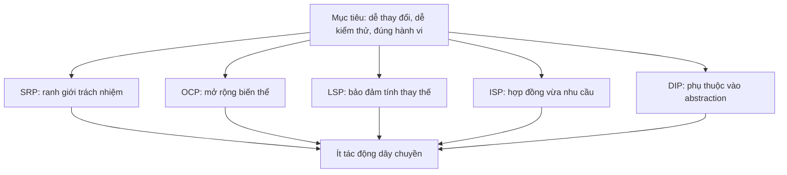
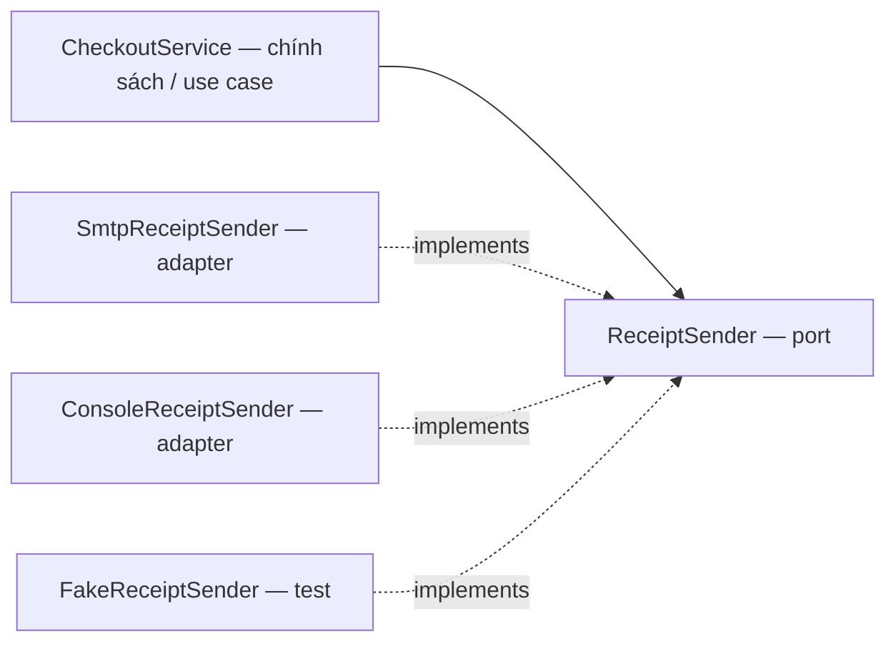
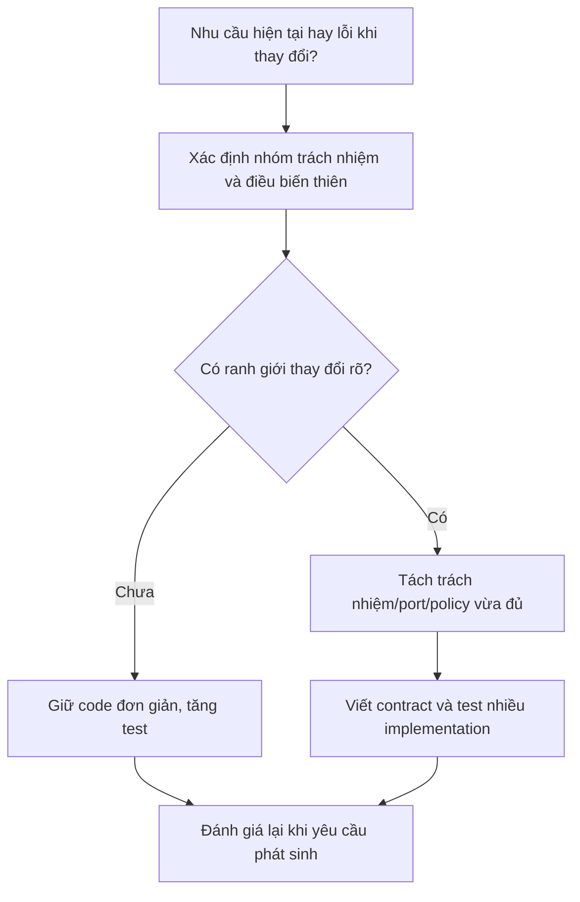
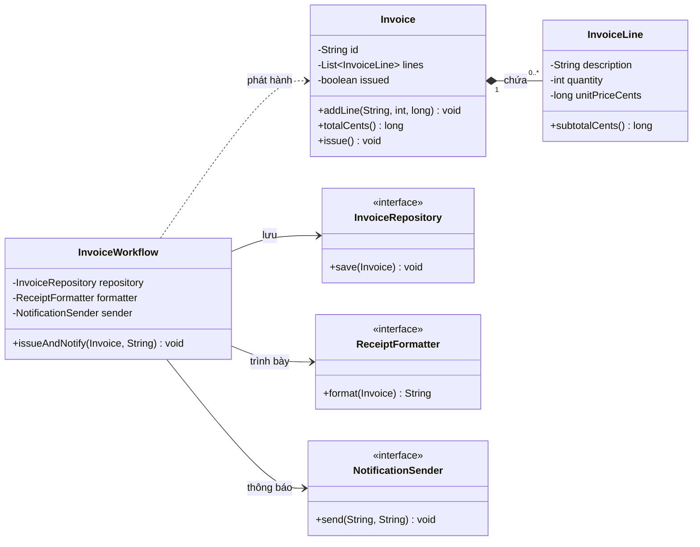
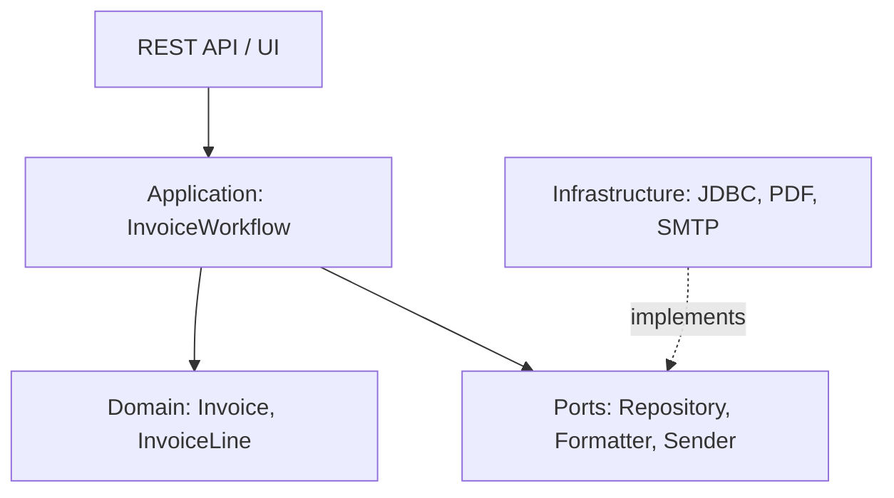
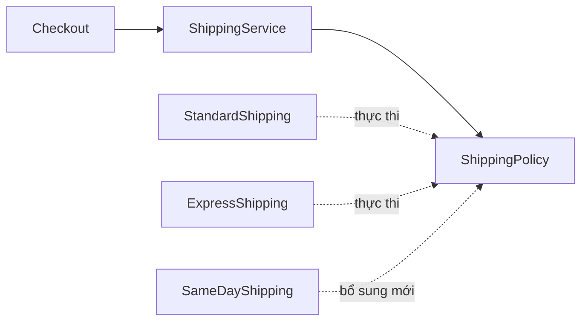
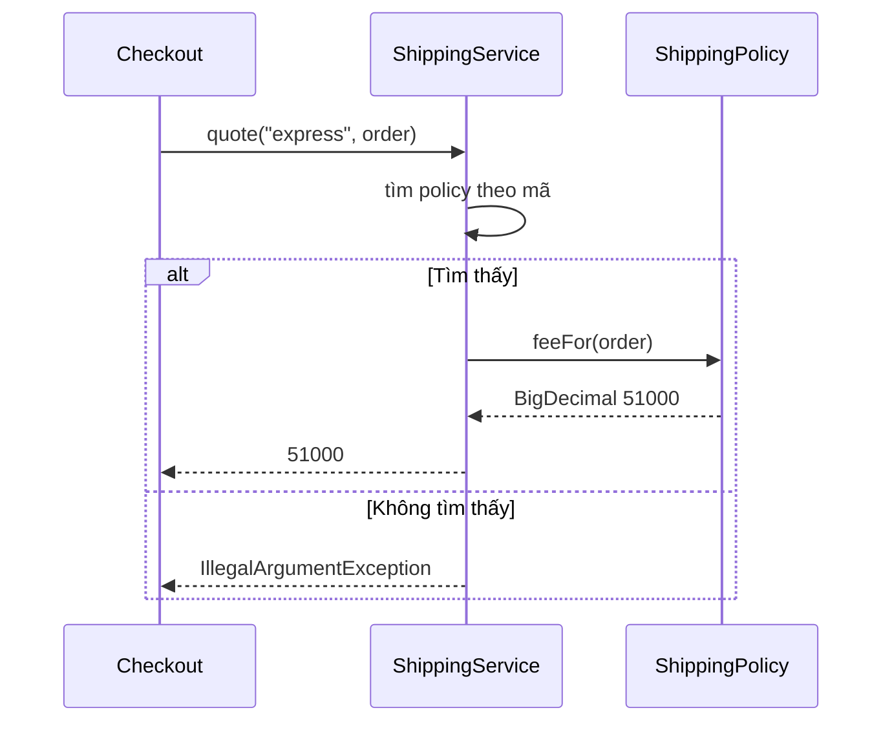
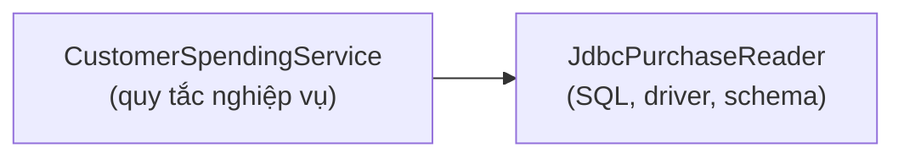
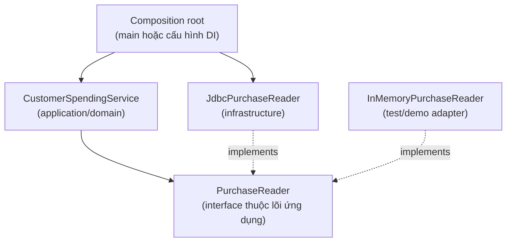
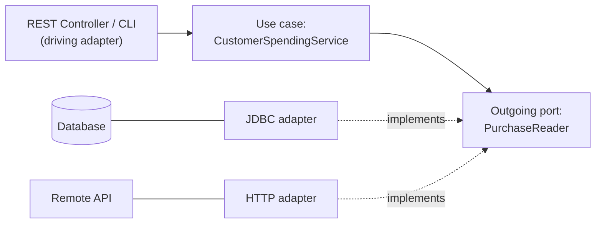

<a id="back-to-top"></a>

# SOLID

## Menu
- [Mục đích và phạm vi áp dụng SOLID](#solid-001)
- [Trách nhiệm đơn: một nhóm lý do thay đổi](#solid-002)
- [Đóng-mở: mở rộng hành vi với thay đổi có kiểm soát](#solid-003)
- [Thay thế Liskov: bảo toàn hợp đồng của kiểu cha](#solid-004)
- [Phân tách giao diện: hợp đồng phù hợp từng bên sử dụng](#solid-005)
- [Đảo ngược phụ thuộc: phụ thuộc vào sự trừu tượng](#solid-006)
- [Phân biệt đảo ngược phụ thuộc và tiêm phụ thuộc](#solid-007)
- [Cân bằng các nguyên tắc với độ phức tạp thực tế](#solid-008)

## <a id="solid-001">Mục đích và phạm vi áp dụng SOLID</a>

<details>
<summary>Xem chi tiết</summary>

# SOLID trong OOP: mục đích và phạm vi áp dụng

**SOLID** là năm nguyên tắc thiết kế hướng đối tượng giúp phần mềm dễ thay đổi, dễ kiểm thử và giảm tác động dây chuyền khi yêu cầu phát triển. Đây là **các nguyên tắc định hướng**, không phải cú pháp bắt buộc của Java, công thức tự động tạo kiến trúc tốt, hay yêu cầu mọi class phải có interface.

Bài học tập trung vào hai câu hỏi: **SOLID giải quyết vấn đề gì?** và **nên áp dụng đến mức nào trong từng bối cảnh?** Sau khi hiểu phạm vi, ta mới quyết định cách dùng SRP, OCP, LSP, ISP, DIP trong một thiết kế cụ thể.

## 1. Vì sao cần SOLID?

Hãy hình dung ứng dụng bán hàng có một `CheckoutService` vừa tính tiền, áp khuyến mãi, gọi SQL trực tiếp và gửi email. Khi chính sách giảm giá thay đổi, bạn phải sửa service; khi chuyển sang PostgreSQL, vẫn sửa service; khi đổi nhà cung cấp email, tiếp tục sửa service. Một lỗi nhỏ ở bất kỳ phần nào có thể tác động đến quy trình đặt hàng.

SOLID hướng tới những kết quả cụ thể:

- **Dễ thay đổi có kiểm soát:** đổi một quy tắc không bắt buộc viết lại các thành phần ít liên quan.
- **Giảm phụ thuộc vào chi tiết biến động:** code nghiệp vụ không phải biết chính xác thư viện SQL, SMTP hay hình thức lưu trữ.
- **Dễ kiểm thử:** có thể kiểm tra phép tính và quy tắc bằng dữ liệu giả mà không cần mọi dịch vụ bên ngoài cùng chạy.
- **Giữ đúng hợp đồng:** các triển khai khác nhau của cùng một abstraction không làm code sử dụng chúng bị sai bất ngờ.
- **Làm rõ trách nhiệm:** khi có bug hoặc yêu cầu mới, biết nơi cần thay đổi và nơi cần kiểm tra hồi quy.

Tuy vậy, dùng SOLID có **chi phí**: thêm abstraction, lớp điều phối, hợp đồng và công việc hiểu luồng phụ thuộc. Nếu áp dụng cơ học cho chức năng nhỏ, số lượng lớp có thể tăng mà không đem lại lợi ích thực tế.

> Mục tiêu của SOLID là quản lý **chi phí thay đổi theo thời gian** và chất lượng hợp đồng giữa các thành phần, chứ không phải tối đa hóa số interface hay số class.

## 2. Năm chữ cái SOLID nói về điều gì?

| Chữ | Nguyên tắc | Câu hỏi tự kiểm tra | Nguy cơ nếu bỏ qua |
| --- | --- | --- | --- |
| **S** | **Single Responsibility Principle (SRP)** — một trách nhiệm chính | Class/module đang thay đổi vì bao nhiêu nhóm yêu cầu độc lập? | Một thay đổi SQL/email/nghiệp vụ cùng buộc sửa một class |
| **O** | **Open/Closed Principle (OCP)** — mở rộng được, hạn chế sửa code ổn định | Có thêm cách tính/chiến lược bằng implementation mới được không? | Mỗi biến thể mới phải thêm nhánh `if/switch` vào lõi |
| **L** | **Liskov Substitution Principle (LSP)** — thay thế được | Triển khai subtype có giữ đúng hợp đồng kỳ vọng của kiểu cha không? | Code gọi qua interface bất ngờ sai với một implementation |
| **I** | **Interface Segregation Principle (ISP)** — giao diện theo nhu cầu | Consumer có bị ép phụ thuộc method nó không dùng? | Class phải implement method vô nghĩa hoặc ném `UnsupportedOperationException` |
| **D** | **Dependency Inversion Principle (DIP)** — đảo chiều phụ thuộc | Quy tắc cấp cao đang phụ thuộc trực tiếp chi tiết công nghệ? | Domain/application bị trói với DB, HTTP hoặc thư viện cụ thể |

Năm nguyên tắc **hỗ trợ nhau**, không phải năm quy tắc tách biệt tuyệt đối. Một interface nhỏ giúp ISP; application service phụ thuộc interface thay vì SMTP cụ thể thể hiện DIP; nhiều triển khai tuân cùng hợp đồng liên quan đến LSP; thêm triển khai mới mà ít sửa luồng chính hỗ trợ OCP.



## 3. Hiểu phạm vi áp dụng trước khi thiết kế

SOLID thường phát huy tác dụng ở hệ thống có **nhiều quy tắc, nhiều biến thể hoặc nhiều tác nhân gây thay đổi**. Nhưng quy tắc nghiệp vụ đơn giản không nhất thiết cần cả hệ thống phân tầng phức tạp.

| Bối cảnh | Mức áp dụng hợp lý | Lý do |
| --- | --- | --- |
| Value object `Money` chỉ cần kiểm tra và cộng/trừ tiền | Giữ dữ liệu và hành vi gắn kết, tránh abstraction dư | Không cần interface cho phép cộng hai số tiền |
| CRUD nội bộ ít quy tắc, một kiểu lưu trữ cố định | Class rõ trách nhiệm và validation đủ dùng | Tách quá nhiều tầng làm khó đọc mà ít lợi ích |
| Nhiều cách giảm giá/vận chuyển thay đổi thường xuyên | Policy/strategy có hợp đồng chung | OCP, LSP giúp thêm biến thể có kiểm soát |
| Use case đọc/ghi DB, phát email hoặc gọi API ngoài | Tách rule khỏi adapter; tạo port tại chỗ cần thay thế | SRP, DIP, ISP làm logic dễ test |
| Thư viện/SDK cung cấp interface công khai cho nhiều consumer | Thiết kế hợp đồng chính xác, nhỏ và ổn định | LSP, ISP đặc biệt quan trọng vì khách hàng phụ thuộc lâu dài |
| Hệ thống có nhiều nhóm phát triển và module | Phân rõ quyền sửa, abstraction ở biên thay đổi | Giảm ảnh hưởng khi nhiều nhóm sửa song song |
| Script xử lý tạm một lần, không có quy tắc tái sử dụng | Ưu tiên đơn giản, đúng và có kiểm tra cần thiết | Chi phí thiết kế hơn lợi ích vòng đời ngắn |

Nên đặt câu hỏi **“điều gì thực sự thay đổi?”** trước câu hỏi **“cần tạo interface nào?”**. Chẳng hạn nếu chỉ có một cách tính thuế đơn giản và không có yêu cầu đa vùng, một hàm `calculateTax(...)` rõ ràng có thể đủ. Khi có nhiều chính sách theo vùng và đổi thường xuyên, abstraction mới bắt đầu có giá trị rõ.

## 4. SRP: xác định ranh giới trách nhiệm

SRP thường được giải thích là một class nên có **một lý do để thay đổi**. “Một” ở đây gắn với một nhóm trách nhiệm phục vụ cùng quy tắc/người sở hữu nghiệp vụ, **không phải một method**.

Ví dụ một lớp làm mọi việc:

```java
// Phác thảo một cách viết cần xem lại, không phải chương trình chạy độc lập.
class CheckoutManager {
    void checkout(Order order) {
        // Tự áp dụng discount
        // Tự tạo SQL và lưu đơn
        // Tự xây nội dung email rồi gửi SMTP
        // Tự chuyển kết quả sang JSON
    }
}
```

Những thay đổi trong công thức giảm giá, schema DB, nhà cung cấp email và định dạng JSON đều làm `CheckoutManager` biến động. Hãy phân vai:

- `Order` bảo vệ bất biến của đơn và tính tổng dựa trên các dòng.
- `DiscountPolicy` quyết định số tiền giảm theo chính sách.
- `CheckoutService` phối hợp quy trình.
- `OrderRepository` lưu/truy vấn đơn theo một hợp đồng.
- `ReceiptSender` gửi biên nhận qua cổng bên ngoài.
- Controller/API adapter xử lý HTTP và DTO.

Không có nghĩa bắt buộc **mỗi dòng yêu cầu một class**. Nếu hai method cùng phục vụ một trách nhiệm, hoàn toàn có thể để cạnh nhau. SRP bị áp dụng sai khi tạo hàng chục lớp chỉ để đạt “một method một class”.

## 5. OCP: chọn đúng điểm mở rộng

OCP thường được diễn đạt: đối tượng/module nên **mở cho mở rộng nhưng đóng đối với sửa đổi**. Ý nghĩa thực tế không phải “không bao giờ sửa source”. Một bug, hợp đồng sai hoặc yêu cầu mới chưa từng được dự liệu vẫn cần sửa code. OCP nhắm tới những **biến thể đã biết có khả năng tăng**, sao cho thêm biến thể ít phải sửa lõi đã ổn định.

Ví dụ khi giảm giá có nhiều chính sách:

```java
interface DiscountPolicy {
    long discountCents(long subtotalCents);
}

final class NoDiscount implements DiscountPolicy {
    public long discountCents(long subtotalCents) {
        return 0;
    }
}

final class TenPercentDiscount implements DiscountPolicy {
    public long discountCents(long subtotalCents) {
        return subtotalCents / 10;
    }
}
```

`CheckoutService` chỉ phụ thuộc `DiscountPolicy`. Khi bổ sung một loại giảm giá có điều kiện, tạo implementation mới và cấu hình chọn nó; không phải chỉnh code tính tiền của toàn bộ checkout.

**Lưu ý:** vị trí **chọn implementation nào** vẫn cần thay đổi/cấu hình theo yêu cầu: composition root, factory, Spring DI configuration hoặc một policy selector. OCP không xóa hoàn toàn việc sửa code, mà **giới hạn vùng ảnh hưởng**.

## 6. LSP: cùng interface phải giữ cùng kỳ vọng

Nếu `CheckoutService` chấp nhận `DiscountPolicy`, mọi policy đều phải giữ hợp đồng:

- Input subtotal hợp lệ là số cent không âm.
- Output discount là số cent trong khoảng `0..subtotal`.
- Không tự ý tạo order, ghi database hoặc đột nhiên trả `null`.
- Nếu code caller kỳ vọng policy hoạt động cho subtotal hợp lệ, implementation không được âm thầm thu hẹp đầu vào chỉ vì “loại policy này không hỗ trợ”.

Ví dụ vi phạm LSP:

```java
final class BrokenDiscount implements DiscountPolicy {
    @Override
    public long discountCents(long subtotalCents) {
        return subtotalCents + 100; // Giảm nhiều hơn giá trị đơn!
    }
}
```

Dù Java cho phép compile, triển khai này không đáp ứng hậu điều kiện của `DiscountPolicy`. Khi thay nó cho policy khác, checkout có thể tính số tiền phải trả âm.

Cách bảo vệ gồm **viết rõ contract**, test chung cho các implementation và kiểm tra các invariant quan trọng tại ranh giới (nhất là khi implementation do plugin/đối tác ngoài cung cấp).

LSP không chỉ áp dụng cho `extends`: đối tượng triển khai interface cũng phải thay thế được nhau về mặt **hành vi**, chứ không chỉ cùng chữ ký method.

## 7. ISP: interface đủ nhỏ cho vai trò sử dụng

Một interface vừa lưu đơn, gửi email, xuất PDF, hoàn tiền và thống kê khiến mỗi implementation hoặc consumer phải phụ thuộc những phần nó không cần.

```java
// Dễ gây ép buộc không cần thiết:
interface BusinessGateway {
    void saveOrder(Order order);
    void emailReceipt(Order order);
    void exportMonthlyReport();
}
```

Thay vì buộc một test fake repository phải implement `emailReceipt`, có thể tách:

```java
interface OrderRepository {
    void save(Order order);
}

interface ReceiptSender {
    void sendReceipt(Order order, long payableCents);
}
```

Service cần lưu đơn chỉ phụ thuộc `OrderRepository`; thành phần gửi biên nhận chỉ quan tâm `ReceiptSender`. Hợp đồng nhỏ còn làm test dễ hiểu.

Tuy nhiên, ISP **không yêu cầu chia vô hạn** thành interface một method. Nếu nhiều operation cùng thuộc một giao thức ổn định và những consumer liên quan đều dùng chúng, một interface gắn kết vẫn hợp lý.

## 8. DIP và Dependency Injection có gì khác nhau?

**DIP** là nguyên tắc thiết kế **hướng phụ thuộc**: phần chính sách cấp cao nên phụ thuộc abstraction mô tả những gì nó cần; chi tiết cấp thấp cài đặt abstraction đó.

**Dependency Injection (DI)** là kỹ thuật truyền dependency từ bên ngoài (ví dụ qua constructor). DI thường giúp hiện thực DIP, nhưng **tự tiêm một class công nghệ cụ thể không tự động đạt DIP**.

```java
// Có constructor injection nhưng vẫn phụ thuộc chi tiết SMTP:
class CheckoutService {
    private final SmtpMailClient client;
    CheckoutService(SmtpMailClient client) {
        this.client = client;
    }
}
```

Một thiết kế theo DIP:

```java
interface ReceiptSender {
    void sendReceipt(Order order, long payableCents);
}

class CheckoutService {
    private final ReceiptSender sender;

    CheckoutService(ReceiptSender sender) {
        this.sender = sender;
    }
}
```

Lúc chạy có thể truyền `SmtpReceiptSender`, `ConsoleReceiptSender` hoặc fake để test. Service vẫn quan tâm tới nghĩa vụ “gửi biên nhận” nhưng không bị ràng buộc bởi lớp SMTP cụ thể.



Đặt interface ở module nghiệp vụ/application hoặc module contract thích hợp là một cách để **source code của phần cấp cao không import adapter**. Đừng đánh giá hướng phụ thuộc bằng thứ tự gọi lúc chạy: việc service gọi adapter qua interface không có nghĩa module service phải biết chi tiết adapter.

## 9. Ví dụ Java 17 chạy độc lập: SOLID ở đúng điểm cần thay đổi

Bài toán: checkout đơn giản có nhiều chương trình giảm giá, có thể thay cách lưu và cách gửi biên nhận. Phần **tiền và trạng thái đơn hợp lệ** thuộc mô hình; phần **điều phối** thuộc service; **tương tác bên ngoài** qua hai interface nhỏ.

Tạo file `SolidScopeDemo.java`. Chương trình dùng một lớp chính và các lớp nested để bạn biên dịch bằng một lệnh.

```java
import java.util.LinkedHashMap;
import java.util.List;
import java.util.Map;
import java.util.Objects;
import java.util.Optional;

public class SolidScopeDemo {

    // Domain value object: trường hợp quantity > 0, unit price >= 0.
    record OrderLine(String sku, int quantity, long unitPriceCents) {
        OrderLine {
            if (sku == null || sku.isBlank()) {
                throw new IllegalArgumentException("SKU is required");
            }
            if (quantity <= 0 || unitPriceCents < 0) {
                throw new IllegalArgumentException("Invalid order line");
            }
        }

        long amountCents() {
            return Math.multiplyExact((long) quantity, unitPriceCents);
        }
    }

    // Domain model: luôn có ít nhất một dòng hợp lệ.
    record Order(String id, List<OrderLine> lines) {
        Order {
            if (id == null || id.isBlank()) {
                throw new IllegalArgumentException("Order id is required");
            }
            Objects.requireNonNull(lines, "lines");
            lines = List.copyOf(lines);
            if (lines.isEmpty()) {
                throw new IllegalArgumentException("Order must have items");
            }
        }

        long subtotalCents() {
            long sum = 0;
            for (OrderLine line : lines) {
                sum = Math.addExact(sum, line.amountCents());
            }
            return sum;
        }
    }

    // Contract: 0 <= discount <= subtotal với subtotal không âm.
    interface DiscountPolicy {
        long discountCents(long subtotalCents);
    }

    static final class NoDiscount implements DiscountPolicy {
        @Override
        public long discountCents(long subtotalCents) {
            if (subtotalCents < 0) {
                throw new IllegalArgumentException("Negative subtotal");
            }
            return 0;
        }
    }

    static final class PercentDiscount implements DiscountPolicy {
        private final int percent;

        PercentDiscount(int percent) {
            if (percent < 0 || percent > 100) {
                throw new IllegalArgumentException("Invalid percent");
            }
            this.percent = percent;
        }

        @Override
        public long discountCents(long subtotalCents) {
            if (subtotalCents < 0) {
                throw new IllegalArgumentException("Negative subtotal");
            }
            // floor(subtotal * percent / 100) không tràn ở phép nhân.
            long whole = (subtotalCents / 100) * percent;
            long fraction = ((subtotalCents % 100) * percent) / 100;
            return Math.addExact(whole, fraction);
        }
    }

    interface OrderRepository {
        void save(Order order);
        Optional<Order> findById(String id);
    }

    interface ReceiptSender {
        void sendReceipt(Order order, long payableCents);
    }

    record CheckoutResult(Order order, long discountCents, long payableCents) { }

    static final class CheckoutService {
        private final DiscountPolicy discount;
        private final OrderRepository repository;
        private final ReceiptSender sender;

        CheckoutService(DiscountPolicy discount,
                        OrderRepository repository,
                        ReceiptSender sender) {
            this.discount = Objects.requireNonNull(discount);
            this.repository = Objects.requireNonNull(repository);
            this.sender = Objects.requireNonNull(sender);
        }

        CheckoutResult checkout(Order order) {
            Objects.requireNonNull(order, "order");
            long subtotal = order.subtotalCents();
            long reduction = discount.discountCents(subtotal);

            // Thực thi contract của policy tại ranh giới.
            if (reduction < 0 || reduction > subtotal) {
                throw new IllegalStateException("Invalid discount policy");
            }

            long payable = subtotal - reduction;
            repository.save(order);
            sender.sendReceipt(order, payable);
            return new CheckoutResult(order, reduction, payable);
        }
    }

    // Adapter bộ nhớ — thay bằng JDBC mà không phải sửa policy.
    static final class MemoryOrderRepository implements OrderRepository {
        private final Map<String, Order> data = new LinkedHashMap<>();

        @Override
        public void save(Order order) {
            Objects.requireNonNull(order);
            if (data.putIfAbsent(order.id(), order) != null) {
                throw new IllegalStateException("Duplicate order id");
            }
        }

        @Override
        public Optional<Order> findById(String id) {
            return Optional.ofNullable(data.get(id));
        }
    }

    // Adapter console — thay bằng SMTP hoặc message bus khi cần.
    static final class ConsoleReceiptSender implements ReceiptSender {
        @Override
        public void sendReceipt(Order order, long payableCents) {
            System.out.println(
                    "Receipt " + order.id() + ": " + payableCents + " cents");
        }
    }

    public static void main(String[] args) {
        MemoryOrderRepository repository = new MemoryOrderRepository();
        ReceiptSender sender = new ConsoleReceiptSender();

        Order first = new Order("O-01", List.of(
                new OrderLine("BOOK", 1, 15_000),
                new OrderLine("PEN", 2, 2_500)));

        CheckoutService promotionalCheckout = new CheckoutService(
                new PercentDiscount(10), repository, sender);
        CheckoutResult result = promotionalCheckout.checkout(first);
        System.out.println("Discount: " + result.discountCents());
        System.out.println("Saved: " +
                repository.findById("O-01").isPresent());

        Order second = new Order("O-02", List.of(
                new OrderLine("NOTE", 1, 10_000)));

        CheckoutService normalCheckout = new CheckoutService(
                new NoDiscount(), repository, sender);
        normalCheckout.checkout(second);
    }
}
```

Chạy bằng JDK 17 hoặc mới hơn:

```bash
javac SolidScopeDemo.java
java SolidScopeDemo
```

Kết quả dự kiến:

```text
Receipt O-01: 18000 cents
Discount: 2000
Saved: true
Receipt O-02: 10000 cents
```

Cách tính đơn đầu tiên: `15_000 + 2 × 2_500 = 20_000` cent; giảm 10% là `2_000` cent; số phải trả `18_000` cent.

**Giới hạn của ví dụ:** chưa có thuế, hoàn tiền, thanh toán thật hoặc giao dịch database. `MemoryOrderRepository` không thread-safe, chỉ phục vụ demo. `CheckoutService` lưu đơn rồi gửi biên nhận; nếu gửi thất bại, đơn có thể **đã lưu** dù caller gặp exception. Trong sản phẩm cần quy định transaction, retry/idempotency và có thể dùng *transactional outbox* để phát thông báo sau commit. SOLID giúp tách trách nhiệm nhưng **không tự bảo đảm atomicity, tính đúng đắn khi đồng thời hoặc consistency giữa các hệ thống**.

### Mỗi nguyên tắc xuất hiện ở đâu trong ví dụ?

| Nguyên tắc | Bằng chứng từ Java | Giá trị thực tế |
| --- | --- | --- |
| SRP | `Order` giữ invariant/tính tổng; `CheckoutService` điều phối; adapter lo I/O | Đổi nơi lưu không ảnh hưởng công thức tổng tiền |
| OCP | `PercentDiscount` và `NoDiscount` cùng implement `DiscountPolicy` | Thêm chính sách mới qua implementation thay vì sửa checkout |
| LSP | Mọi policy phải trả `0..subtotal` | Thay policy không làm `CheckoutService` trả số âm |
| ISP | `OrderRepository` và `ReceiptSender` là hợp đồng nhỏ | Fake test chỉ implement đúng phần cần |
| DIP | Service nhận ba interface qua constructor | Không phụ thuộc trực tiếp `MemoryOrderRepository`/`ConsoleReceiptSender` |

**Một thiết kế có thể dùng cùng lúc nhiều nguyên tắc** mà không cần đặt tên mỗi nguyên tắc vào tên class. Hợp đồng rõ và các mối phụ thuộc ít bất ngờ quan trọng hơn việc có đủ “năm mẫu” trong code.

## 10. Kiểm thử điều gì để biết thiết kế thật sự có ích?

Bạn nên kiểm tra **hành vi** và **khả năng thay thế**:

1. Chính sách 0%, 10%, 100% luôn trả mức giảm trong giới hạn.
2. Trường hợp `subtotal=1` cent với 10% phải giảm `0` cent theo quy tắc làm tròn xuống.
3. `Order` từ chối danh sách rỗng, dòng có số lượng không dương, giá âm hoặc dữ liệu khiến tổng tràn `long`.
4. Nếu policy vi phạm contract, checkout từ chối **trước khi lưu**.
5. Nếu repository từ chối ghi, `ReceiptSender` không được gọi trong luồng triển khai này.
6. Nếu thay `ConsoleReceiptSender` bằng fake, cách tính giá và lưu đơn không đổi.
7. Nếu thay repository bằng một adapter khác, code `Order` và các policy không phải sửa.

Một fake sender tối giản để kiểm thử:

```java
class CountingReceiptSender implements SolidScopeDemo.ReceiptSender {
    int sends;

    @Override
    public void sendReceipt(
            SolidScopeDemo.Order order, long payableCents) {
        sends++;
    }
}
```

Nếu test đoạn này **từ file khác**, các nested type trong demo đang có mức truy cập *package-private*: đặt test cùng package (ví dụ file mặc định không khai báo package) hoặc sửa visibility phù hợp khi chuyển thành project thật. Để test tự động, dùng JUnit 5 và assert kết quả thay vì phụ thuộc `System.out`.

Ví dụ test hợp đồng cho policy:

```java
// Phác thảo phép kiểm thử, thêm vào test/JUnit của dự án.
void assertPolicyContract(
        SolidScopeDemo.DiscountPolicy policy, long subtotal) {
    long discount = policy.discountCents(subtotal);
    if (discount < 0 || discount > subtotal) {
        throw new AssertionError("Policy violates contract");
    }
}
```

Chạy cùng một bộ kiểm tra cho mọi implementation của `DiscountPolicy` là phương pháp thực tế để duy trì LSP. Riêng tính đúng đắn khuyến mãi theo yêu cầu còn cần test công thức và ranh giới số học.

## 11. SOLID không thay thế những nguyên tắc nào?

Một thiết kế tuân SOLID vẫn có thể lỗi nếu bỏ qua:

- **Đúng nghiệp vụ:** thời gian, đơn vị tiền, điều kiện khuyến mãi hay chính sách trả hàng bị hiểu sai.
- **Đóng gói dữ liệu:** public setter có thể phá invariant dù service đã tách interface đẹp.
- **Transaction và concurrency:** hai request cùng kiểm tra tồn kho/giới hạn rồi cập nhật có thể tạo race condition.
- **Bảo mật và phân quyền:** interface nhỏ không tự kiểm tra ai được thực hiện thao tác.
- **Hiệu năng:** quá nhiều truy vấn, gọi mạng tuần tự hoặc cấp phát đối tượng vẫn có thể chậm.
- **Khả năng quan sát:** log, metric, trace và lỗi cần được xử lý rõ ràng.
- **Mô hình dữ liệu:** khóa ngoại, uniqueness và constraints ở database không được tự sinh từ SOLID.
- **Đơn giản hóa:** có những nơi một class/factory đơn giản dễ bảo trì hơn một hệ thống chiến lược không cần thiết.

Vì vậy SOLID là **một phần** của thiết kế tốt, không phải thước đo duy nhất của chất lượng code.

## 12. Các dấu hiệu đang dùng SOLID quá mức

| Dấu hiệu | Vì sao cần xem lại? | Cách đơn giản hơn |
| --- | --- | --- |
| Mỗi helper có một interface và một class `Impl` duy nhất | Không tạo ra ranh giới thay thế thực sự | Class hoặc hàm thuần, có test |
| Mỗi thao tác nhỏ trong `Money`/entity thành một service | Tách rời các hành vi cùng bảo vệ một bất biến | Giữ `add`, `subtract`, `compareTo` trong value object |
| Xây cây kế thừa nhiều tầng cho biến thể còn chưa tồn tại | Phụ thuộc sâu, nhiều điểm override và hợp đồng khó giữ | Composition/policy khi có yêu cầu |
| Cấm sửa module ổn định dù hợp đồng đang sai | OCP bị hiểu nhầm thành “không được sửa code” | Sửa hợp đồng, chạy test hồi quy |
| Mỗi cách đổi nhỏ cần cấu hình plugin động | Chi phí thiết kế và vận hành vượt ích lợi | `if/switch` rõ ràng nếu tập biến thể nhỏ và ổn định |

Đừng đánh giá SOLID bằng số lượng class/interface. Bài **Cân bằng các nguyên tắc với độ phức tạp thực tế** cho một tình huống giao hàng tăng từ một chính sách lên nhiều chính sách, rồi đo cụ thể chi phí mở rộng và chi phí abstraction.

## 13. Quy trình nhanh trước khi thêm abstraction



1. **Xác định áp lực có thật:** bug do phụ thuộc, nhiều biến thể cùng phải sửa một chỗ, test cần hạ tầng, hoặc subclass không giữ hợp đồng.
2. **Chọn điểm cần bảo vệ:** nghiệp vụ/domain, dữ liệu và invariant trước; chi tiết SQL/SMTP hoặc quy tắc riêng đưa ra ranh giới phù hợp.
3. **Mở rộng ở đúng chỗ:** OCP cho điểm biến thiên, DIP cho hướng dependency, ISP cho API của consumer, LSP cho tính thay thế, SRP cho trách nhiệm.
4. **Giữ kết quả cũ bằng test:** so sánh output, exception và side effect của ca cũ; test riêng ca mới, tình huống biên và lỗi.
5. **Đánh giá chi phí:** abstraction có làm ít chỗ phải sửa hơn, dễ test/đọc hơn hay chỉ thêm bước chuyển tiếp?

Đây là bản định hướng đầu chương, không phải quy trình luôn phải áp dụng nguyên xi. Không có tỷ lệ “số interface / số class” hay phần trăm code phải giảm để chứng minh SOLID đúng.

## 14. Bài tập thực hành

**Bài 1 — Nhận diện phạm vi.** Ứng dụng ghi chú cá nhân chỉ cần tạo, sửa, xóa ghi chú, lưu trên một file JSON. Hãy nêu hai cách thiết kế: đơn giản và phân tầng đầy đủ. Phương án nào hợp lý ở thời điểm hiện tại? Điều kiện nào khiến bạn cần repository port hoặc policy riêng?

**Bài 2 — SRP và DIP.** Một `ReportService` vừa tổng hợp số liệu, vừa ghi CSV, vừa tải lên cloud storage. Thiết kế lại trách nhiệm và port để có thể test cách tổng hợp khi cloud không có mạng.

**Bài 3 — OCP và LSP.** Thêm `FixedAmountDiscount` giảm tối đa 5.000 cent nhưng không vượt subtotal. Viết contract test cho các giá trị subtotal 0, 1.000 và 10.000. Giải thích vì sao trả -100 hoặc giảm quá subtotal vi phạm LSP.

**Bài 4 — ISP.** Hệ thống có `Device` với `print()`, `scan()`, `fax()`; một máy in chỉ hỗ trợ print. Hãy thiết kế các interface năng lực riêng để lớp máy in không phải ném `UnsupportedOperationException` cho `scan/fax`.

**Bài 5 — Kiểm chứng giá trị.** Đếm những file phải sửa khi thêm một chính sách giảm giá mới **trước** và **sau** refactor. Cũng kiểm tra chi phí tạo thêm class/interface và độ dễ hiểu. Không kết luận refactor thành công chỉ vì số file phải sửa ít hơn: chức năng phải đúng và người bảo trì phải hiểu được.

**Bài 6 — Quan sát side effect.** Giả sử repository lưu thành công nhưng gửi biên nhận lỗi. Thiết kế kết quả trả về, quy tắc retry/idempotency và ranh giới transaction phù hợp. Phân biệt phần SOLID hỗ trợ với phần yêu cầu kỹ thuật consistency ngoài SOLID.

## 15. Checklist trước khi quyết định đưa SOLID vào code

- Quy tắc hoặc thành phần nào có khả năng thay đổi **thật sự**?
- Một class đang có nhiều **lý do thay đổi độc lập** hay chỉ có nhiều method cùng chức năng?
- Điểm biến thể có đủ nhu cầu để được trừu tượng hóa không?
- Interface được mô tả theo điều consumer cần, hay chỉ sao chép y nguyên mọi method của implementation?
- Các implementation có cùng **ngữ nghĩa và contract** không?
- Logic cấp cao có import hoặc tạo trực tiếp client I/O khó thay thế không?
- Có thể test quy tắc miền bằng input/output độc lập database và HTTP không?
- Dữ liệu và invariant có được bảo vệ ngoài phạm vi interface không?
- Transaction, concurrent updates, security và lỗi hệ thống ngoài đã được xem xét riêng chưa?
- Lợi ích bảo trì có lớn hơn chi phí lớp, interface và cấu hình được thêm vào không?

**Điểm cần nhớ:** SOLID giúp thiết kế *những ranh giới đáng ổn định trước thay đổi*. Áp dụng có chọn lọc dựa trên trách nhiệm, biến thể và phụ thuộc của hệ thống. Với chức năng đơn giản, một class rõ ràng có thể tốt hơn nhiều abstraction; với nghiệp vụ lớn và thay đổi thường xuyên, hợp đồng nhỏ và trách nhiệm rõ đem lại lợi ích bền vững.


</details>

- [Quay lại đầu trang](#back-to-top)

---

## <a id="solid-002">Trách nhiệm đơn: một nhóm lý do thay đổi</a>

<details>
<summary>Xem chi tiết</summary>

# Trách nhiệm đơn: một nhóm lý do thay đổi (Single Responsibility Principle – SRP)

## 1. SRP thực sự muốn nói gì?

**Single Responsibility Principle (SRP)** là chữ **S** trong **SOLID**. Cách phát biểu quen thuộc là:

> Một module/lớp nên có một lý do để thay đổi.

Tuy nhiên, nếu hiểu “một lý do” là **một phương thức**, **một dòng chức năng**, hoặc “mỗi lớp chỉ làm một việc nhỏ nhất có thể”, ta rất dễ thiết kế hàng chục lớp vụn vặt khó theo dõi.

Diễn giải hữu ích hơn là: **một lớp nên chịu trách nhiệm với một nhóm yêu cầu thay đổi có cùng mục đích/nguồn phát sinh**. Trong các tài liệu của Robert C. Martin, cách nhìn SRP còn được giải thích theo *actor* – nhóm người hoặc bộ phận yêu cầu thay đổi. Nếu một lớp phải thay đổi vì các nhóm yêu cầu độc lập, nó có thể đang gộp nhiều trách nhiệm.

Ví dụ lớp `Invoice` (hóa đơn) có thể cần:

- Thêm dòng hàng khi hóa đơn còn ở trạng thái nháp.
- Kiểm tra số lượng và đơn giá hợp lệ.
- Tính tổng tiền từ các dòng hàng.
- Phát hành hóa đơn và từ chối phát hành lặp.

Các hành vi này khác nhau, nhưng cùng bảo vệ **vòng đời và tính đúng đắn của một hóa đơn**. Không cần tách mỗi phép kiểm tra thành một service chỉ để mỗi lớp có một phương thức.

Ngược lại, nếu `Invoice` còn tự tạo PDF, tự ghi SQL và tự gửi email, nó phải sửa khi *quy tắc hóa đơn*, *bố cục tài liệu*, *hệ quản trị dữ liệu* hoặc *nhà cung cấp email* thay đổi. Những nhóm thay đổi đó có thể thuộc các trách nhiệm khác nhau.

**Mục tiêu SRP là tăng sự gắn kết (cohesion) của lớp và giảm việc một thay đổi không liên quan buộc sửa cùng một nơi.** SRP không cấm lớp có nhiều phương thức, nhiều field hay nhiều đối tượng cộng tác.

## 2. “Một nhóm lý do thay đổi” nghĩa là gì?

Hãy lấy ví dụ hệ thống xuất hóa đơn:

| Yêu cầu thay đổi | Ai/nhóm nào thường đề xuất? | Trách nhiệm liên quan |
|---|---|---|
| Chỉ cho phát hành hóa đơn khi có dòng hàng | Nhóm nghiệp vụ hóa đơn | Quy tắc miền của hóa đơn |
| Đơn giá, số lượng phải hợp lệ | Nhóm nghiệp vụ/kế toán | Bất biến của dòng hóa đơn |
| Đổi cách hiển thị tiêu đề/logo biên nhận | Thiết kế thương hiệu hoặc vận hành | Định dạng biên nhận |
| Chuyển lưu từ file sang database | Nhóm vận hành hạ tầng | Lưu trữ |
| Đổi email sang dịch vụ gửi khác | Nhóm tích hợp/hạ tầng | Gửi thông báo |
| Quy trình phát hành cần xác thực quyền | Chủ sản phẩm/bảo mật | Điều phối use case/quyền |

Bảng này **không bắt buộc mỗi hàng phải là một class**. Các nhóm yêu cầu được dùng để xem **những thay đổi nào đi cùng nhau**, rồi tìm ranh giới mô hình thích hợp.

Ví dụ “không có dòng hàng thì không phát hành” và “không thể thêm dòng sau phát hành” đều là **một nhóm bất biến vòng đời hóa đơn**, dù là hai quy tắc. Chúng thường nên nằm cùng `Invoice`.

Ngược lại, thay logo biên nhận không nên buộc sửa quy tắc chuyển trạng thái của `Invoice`.

### Thử nghiệm nhanh

Hãy đặt câu hỏi: “Nếu ngày mai chỉ đổi định dạng biên nhận, class nào cần sửa?” Nếu câu trả lời bao gồm cả class bảo vệ trạng thái hóa đơn, có thể SRP đã bị ảnh hưởng.

Và chiều ngược lại: “Nếu đổi điều kiện phát hành hóa đơn, phải sửa bao nhiêu nơi?” Nếu hàng loạt controller, trình render và repository đều tự kiểm tra trạng thái bằng chuỗi `"DRAFT"`, quy tắc có thể đang bị phân tán.

## 3. Dấu hiệu một lớp gánh nhiều trách nhiệm

Ví dụ thiết kế dồn mọi thứ vào `InvoiceManager`:

```java
// Đoạn minh họa vấn đề, không phải chương trình độc lập.
class InvoiceManager {
    void issueInvoice(Invoice invoice) {
        // 1. Kiểm tra nghiệp vụ.
        if (invoice.getLines().isEmpty()) {
            throw new IllegalStateException("Empty invoice");
        }

        // 2. Tự tính tiền và chuyển trạng thái.
        long total = invoice.getLines().stream()
                .mapToLong(l -> l.getQuantity() * l.getPrice())
                .sum();
        invoice.setStatus("ISSUED");

        // 3. Tự dựng HTML/PDF và biết logo công ty.
        String html = "<h1>My Brand</h1><p>" + total + "</p>";

        // 4. Tự thực hiện câu lệnh SQL.
        // connection.prepareStatement("INSERT INTO invoices ...");

        // 5. Tự gọi hệ thống gửi email.
        // smtpClient.send(invoice.getCustomerEmail(), html);
    }
}
```

Những vấn đề:

- **Độ gắn kết thấp:** kiểm tra miền, tính tiền, dựng nội dung, lưu trữ và gửi email có các động lực thay đổi riêng.
- **Sửa một nơi dễ ảnh hưởng hành vi khác:** chỉnh HTML cũng phải mở class chứa logic phát hành.
- **Khó kiểm thử:** muốn thử điều kiện “hóa đơn rỗng không được phát hành” có thể phải cấu hình SQL/SMTP.
- **Rủi ro thiếu nhất quán:** nơi khác cũng có thể cập nhật `status` mà bỏ qua kiểm tra.
- **Khó thay thế tích hợp:** class phụ thuộc trực tiếp nhiều công nghệ.

Lưu ý: đoạn trên được cố ý viết thiếu các lớp phụ thuộc để làm rõ vấn đề thiết kế. Chương trình đầy đủ ở phần sau sẽ minh họa cách phân chia trách nhiệm và có thể biên dịch độc lập.

## 4. Phân chia theo trách nhiệm, không theo số câu lệnh

Một mô hình phù hợp:



Vai trò của từng phần:

- **`Invoice`** bảo vệ trạng thái và bất biến của hóa đơn.
- **`InvoiceLine`** giữ dữ liệu và phép tính của một dòng.
- **`ReceiptFormatter`** chuyển nội dung hóa đơn sang cách thể hiện (text, HTML, PDF…).
- **`InvoiceRepository`** đại diện cho trách nhiệm lưu/tải.
- **`NotificationSender`** đại diện cho trách nhiệm giao tiếp với người nhận.
- **`InvoiceWorkflow`** điều phối *use case phát hành hóa đơn*: gọi các cộng tác viên theo trình tự. Việc biết nhiều đối tượng cộng tác là bình thường đối với một lớp chuyên **điều phối**.

Đây là mô hình trách nhiệm, không phải yêu cầu phải tạo framework hay mỗi interface có đủ ba implementation. Những ranh giới được giới thiệu để minh họa các loại thay đổi độc lập.

## 5. Ví dụ Java 11+ chạy được

Tạo tệp `SrpDemo.java` với toàn bộ nội dung sau:

```java
import java.util.ArrayList;
import java.util.HashMap;
import java.util.List;
import java.util.Map;
import java.util.Objects;

public class SrpDemo {

    // Value Object: dữ liệu và phép tính của một dòng hóa đơn.
    static final class InvoiceLine {
        private final String description;
        private final int quantity;
        private final long unitPriceCents;

        InvoiceLine(String description, int quantity, long unitPriceCents) {
            if (description == null || description.isBlank()) {
                throw new IllegalArgumentException("Description required");
            }
            if (quantity <= 0 || unitPriceCents < 0) {
                throw new IllegalArgumentException(
                        "Invalid quantity or unit price");
            }
            this.description = description;
            this.quantity = quantity;
            this.unitPriceCents = unitPriceCents;
        }

        String description() {
            return description;
        }

        int quantity() {
            return quantity;
        }

        long unitPriceCents() {
            return unitPriceCents;
        }

        long subtotalCents() {
            return Math.multiplyExact(quantity, unitPriceCents);
        }
    }

    // Entity: sở hữu quy tắc và vòng đời hóa đơn.
    static final class Invoice {
        private final String id;
        private final List<InvoiceLine> lines = new ArrayList<>();
        private boolean issued;

        Invoice(String id) {
            if (id == null || id.isBlank()) {
                throw new IllegalArgumentException("Invoice id required");
            }
            this.id = id;
        }

        String id() {
            return id;
        }

        boolean isIssued() {
            return issued;
        }

        void addLine(String description, int quantity,
                     long unitPriceCents) {
            if (issued) {
                throw new IllegalStateException(
                        "Cannot modify an issued invoice");
            }
            lines.add(new InvoiceLine(
                    description, quantity, unitPriceCents));
        }

        List<InvoiceLine> lines() {
            // Không cho code bên ngoài sửa collection nội bộ.
            return List.copyOf(lines);
        }

        long totalCents() {
            long sum = 0L;
            for (InvoiceLine line : lines) {
                sum = Math.addExact(sum, line.subtotalCents());
            }
            return sum;
        }

        void issue() {
            if (issued) {
                throw new IllegalStateException(
                        "Invoice has already been issued");
            }
            if (lines.isEmpty()) {
                throw new IllegalStateException(
                        "Cannot issue an empty invoice");
            }
            totalCents(); // Phát hiện tràn số trước khi đổi trạng thái.
            issued = true;
        }
    }

    // Contract trình bày: có thể thay text bằng HTML/PDF adapter.
    interface ReceiptFormatter {
        String format(Invoice invoice);
    }

    static final class PlainTextReceiptFormatter
            implements ReceiptFormatter {
        @Override
        public String format(Invoice invoice) {
            Objects.requireNonNull(invoice);
            StringBuilder sb = new StringBuilder();
            sb.append("HOA DON ").append(invoice.id()).append("\n");

            for (InvoiceLine line : invoice.lines()) {
                sb.append(line.description())
                  .append(" x ")
                  .append(line.quantity())
                  .append(" = ")
                  .append(line.subtotalCents())
                  .append(" VND\n");
            }

            return sb.append("TONG: ")
                     .append(invoice.totalCents())
                     .append(" VND")
                     .toString();
        }
    }

    // Contract lưu trữ: logic miền không biết SQL/file/NoSQL.
    interface InvoiceRepository {
        void save(Invoice invoice);
    }

    static final class InMemoryInvoiceRepository
            implements InvoiceRepository {
        private final Map<String, Invoice> invoices = new HashMap<>();

        @Override
        public void save(Invoice invoice) {
            Objects.requireNonNull(invoice);
            invoices.put(invoice.id(), invoice);
        }

        int size() {
            return invoices.size();
        }
    }

    // Contract gửi thông báo: logic hóa đơn không biết SMTP.
    interface NotificationSender {
        void send(String recipient, String content);
    }

    static final class RecordingNotificationSender
            implements NotificationSender {
        private final List<String> recipients = new ArrayList<>();
        private final List<String> messages = new ArrayList<>();

        @Override
        public void send(String recipient, String content) {
            if (recipient == null || recipient.isBlank()) {
                throw new IllegalArgumentException("Recipient required");
            }
            recipients.add(recipient);
            messages.add(Objects.requireNonNull(content));
        }

        int sentCount() {
            return recipients.size();
        }

        String lastRecipient() {
            return recipients.get(recipients.size() - 1);
        }

        String lastMessage() {
            return messages.get(messages.size() - 1);
        }
    }

    // Application Service: một trách nhiệm là điều phối use case.
    static final class InvoiceWorkflow {
        private final InvoiceRepository repository;
        private final ReceiptFormatter formatter;
        private final NotificationSender sender;

        InvoiceWorkflow(InvoiceRepository repository,
                        ReceiptFormatter formatter,
                        NotificationSender sender) {
            this.repository = Objects.requireNonNull(repository);
            this.formatter = Objects.requireNonNull(formatter);
            this.sender = Objects.requireNonNull(sender);
        }

        void issueAndNotify(Invoice invoice, String recipient) {
            Objects.requireNonNull(invoice, "invoice");
            if (recipient == null || recipient.isBlank()) {
                throw new IllegalArgumentException("Recipient required");
            }

            invoice.issue();
            repository.save(invoice);
            sender.send(recipient, formatter.format(invoice));
        }
    }

    public static void main(String[] args) {
        Invoice invoice = new Invoice("INV-9");
        invoice.addLine("But", 2, 5_000L);
        invoice.addLine("So", 1, 25_000L);

        InMemoryInvoiceRepository repository =
                new InMemoryInvoiceRepository();
        RecordingNotificationSender sender =
                new RecordingNotificationSender();
        ReceiptFormatter formatter = new PlainTextReceiptFormatter();

        InvoiceWorkflow workflow = new InvoiceWorkflow(
                repository, formatter, sender);
        workflow.issueAndNotify(invoice, "buyer@example.test");

        System.out.println("Issued: " + invoice.isIssued());
        System.out.println("Total: " + invoice.totalCents());
        System.out.println("Saved invoices: " + repository.size());
        System.out.println("Recipient: " + sender.lastRecipient());
        System.out.println("Receipt has total: "
                + sender.lastMessage().contains("TONG: 35000 VND"));

        try {
            workflow.issueAndNotify(invoice, "buyer@example.test");
            throw new AssertionError(
                    "An issued invoice must not be reissued");
        } catch (IllegalStateException expected) {
            System.out.println("Duplicate issue rejected");
        }

        if (sender.sentCount() != 1
                || invoice.totalCents() != 35_000L) {
            throw new AssertionError("Unexpected invoice state");
        }
    }
}
```

Chạy bằng JDK 11 hoặc mới hơn:

```bash
javac SrpDemo.java
java SrpDemo
```

Kết quả mong đợi:

```text
Issued: true
Total: 35000
Saved invoices: 1
Recipient: buyer@example.test
Receipt has total: true
Duplicate issue rejected
```

### SRP được thể hiện ở đâu?

1. Đổi quy tắc “hóa đơn rỗng không thể phát hành” hoặc “không sửa dòng sau phát hành” → xem ở **`Invoice`**.
2. Đổi cách định dạng dòng, đổi sang HTML hoặc thêm bố cục biên nhận → xem ở **`ReceiptFormatter`** và implementation.
3. Đổi nơi lưu từ bộ nhớ sang database → cung cấp một **`InvoiceRepository`** implementation mới.
4. Đổi hệ thống gửi email sang hàng đợi thông báo → xem ở **`NotificationSender`** và adapter.
5. Đổi trình tự use case hoặc chính sách xử lý lỗi giữa các bước → xem ở **`InvoiceWorkflow`**.

Lưu ý **`InvoiceWorkflow` có ba dependency vẫn có thể tuân SRP**: chúng cùng phục vụ trách nhiệm điều phối một use case. Chỉ việc đếm field hoặc import không xác định lớp có tuân SRP hay không.

### Giới hạn của chương trình minh họa

Ví dụ trên chạy **tuần tự trong bộ nhớ**. Việc `invoice.issue()` thành công nhưng `repository.save(...)` hoặc `sender.send(...)` thất bại có thể để lại trạng thái cục bộ đã phát hành mà thông báo chưa gửi. Trong ứng dụng thật, việc lưu dữ liệu và ghi sự kiện để gửi thông báo thường cần transaction và outbox/retry/idempotency phù hợp.

Ngoài ra, `InMemoryInvoiceRepository` giữ tham chiếu trực tiếp đến object. Nó không mô phỏng persistence độc lập, isolation, optimistic locking, concurrency hoặc quá trình tải lại một entity từ database. Đây là bản demo làm rõ **ranh giới trách nhiệm**, không phải hệ thống hóa đơn sản xuất.

## 6. Cohesion và coupling liên quan thế nào đến SRP?

**Cohesion (độ gắn kết):** các field và phương thức của một lớp có cùng phục vụ một mục đích nhất quán không?

**Coupling (mức phụ thuộc):** lớp cần hiểu hoặc lệ thuộc vào bao nhiêu chi tiết của những lớp khác?

SRP hướng tới *cohesion cao* trong một ranh giới trách nhiệm. Việc phân chia hợp lý thường giúp giảm các phụ thuộc không liên quan, nhưng không tự động bảo đảm coupling thấp.

| Thiết kế | Cohesion | Coupling | Đánh giá |
|---|---|---|---|
| Một lớp vừa dựng PDF, tính thuế, gửi email, tự viết SQL | Thường thấp | Thường cao | Nhiều nguồn thay đổi dồn một chỗ |
| `Invoice` giữ các bất biến về dòng và phát hành | Cao | Có thể thấp/vừa | Một nhóm trách nhiệm nghiệp vụ |
| Một method `calculateTotal()` trong một lớp riêng chỉ để gọi lại `invoice.totalCents()` | Có vẻ cao | Thêm indirection | Tách lớp không đem lại giá trị rõ rệt |
| `InvoiceWorkflow` gọi repository, formatter và sender | Cao nếu chuyên điều phối | Có dependency cần thiết | Có nhiều cộng tác viên nhưng mục đích rõ |
| Một `Utils` chứa xác thực email, định dạng JSON, tính phí và SQL | Thấp | Khó kiểm soát | Tên “Utils” che giấu nhiều trách nhiệm |

Tránh nhầm lẫn rằng một lớp có **nhiều hành vi** là không cohesive. Chẳng hạn `Invoice.addLine()`, `Invoice.totalCents()`, `Invoice.issue()` đều làm việc với cùng bất biến hóa đơn; mối quan hệ giữa chúng là điều tốt.

## 7. Tại sao “một method một class” lại có thể phá SRP?

Các thao tác `Invoice.addLine()`, `Invoice.totalCents()` và `Invoice.issue()` cùng bảo vệ **một nhóm bất biến**. Nếu tách thành `AddLineService`, `TotalCalculatorService` và `IssueService` chỉ để mỗi lớp có một method, code caller phải ghép lại trạng thái và logic vòng đời ở nhiều nơi. Việc này tăng indirection và có thể làm yếu đóng gói.

Hãy phân biệt *nhiều thao tác của một trách nhiệm* với *nhiều nguồn thay đổi độc lập*: thêm dòng và phát hành thuộc nghiệp vụ hóa đơn; dựng PDF, ghi SQL và gửi email là các trục biến thiên khác. Xác nhận ranh giới bằng tình huống thay đổi và test, không bằng phép đếm method/import.

## 8. Đặt trách nhiệm vào Entity, Value Object hay Service?

Một phương án phân chia phổ biến trong thiết kế miền nghiệp vụ:

| Trách nhiệm | Nơi thường phù hợp | Ví dụ |
|---|---|---|
| Bảo vệ trạng thái và chuyển trạng thái của một thực thể | Entity | `Invoice.issue()` |
| Tính toán gắn với một giá trị bất biến | Value Object | `Money.plus()` hoặc `InvoiceLine.subtotalCents()` |
| Quy tắc nghiệp vụ trải qua nhiều đối tượng mà không thuộc tự nhiên một object | Domain Service/policy | `TaxPolicy.calculate(invoiceSnapshot)` |
| Điều phối use case: tải, gọi domain, lưu, báo kết quả | Application Service | `InvoiceWorkflow` |
| Đọc/ghi nơi lưu trữ | Repository/adapter | `SqlInvoiceRepository` |
| Chuyển dữ liệu sang định dạng giao tiếp | Formatter/Presenter | `PdfReceiptFormatter` |
| Tích hợp dịch vụ bên ngoài | Adapter/gateway | `SmtpNotificationSender` |

Đây là **gợi ý tìm ranh giới**, không phải công thức bắt buộc.

Ví dụ “thuế của hóa đơn” có thể đơn giản là phép tính cố định theo một chính sách nhất quán, khi đó `Invoice.totalTax()` có thể hợp lý. Nếu thuế phụ thuộc nhiều khu vực, ngày, loại hàng và nguồn quy định cập nhật độc lập, một `TaxPolicy` là lựa chọn đáng xem xét hơn. Trách nhiệm được quyết định bởi **ý nghĩa và nguồn thay đổi**, chứ không phải tên lớp.

## 9. SRP ở cấp package/module cũng quan trọng

Nguyên tắc trách nhiệm đơn được nói đến nhiều ở cấp class, nhưng ở hệ thống lớn, **module và package** cũng có thể chứa quá nhiều trách nhiệm thay đổi độc lập.

Ví dụ package `billing` vừa gồm nghiệp vụ hóa đơn, cơ sở dữ liệu, email và UI có thể trở thành nơi phải chỉnh sửa khi bất kỳ nhóm công việc nào thay đổi. Có thể tổ chức theo ranh giới:

```text
billing/
  domain/
    Invoice.java
    InvoiceLine.java
  application/
    InvoiceWorkflow.java
    InvoiceRepository.java
    ReceiptFormatter.java
    NotificationSender.java
  infrastructure/
    JdbcInvoiceRepository.java
    PdfReceiptFormatter.java
    SmtpNotificationSender.java
```

Đây chỉ là một tổ chức tham khảo. Dự án nhỏ hoàn toàn có thể đặt vài class cùng package nếu tên gọi, mức kết dính và dependency đã rõ.



Các component nên biết điều cần biết để hoàn thành vai trò của mình. **Đổi SMTP không nên buộc domain model phải biên dịch với thư viện SMTP**, và đổi quy tắc phát hành cũng không nên yêu cầu sửa lớp vẽ PDF nếu hợp đồng dữ liệu vẫn tương thích.

## 10. SRP và các nguyên tắc SOLID khác: phần nào trùng, phần nào khác?

SRP liên quan đến các nguyên tắc khác nhưng có **câu hỏi riêng**:

| Nguyên tắc | Câu hỏi trung tâm | Ví dụ |
|---|---|---|
| **SRP** | Lớp có một nhóm lý do thay đổi nhất quán không? | Hóa đơn không tự xử lý SMTP |
| **OCP** | Có thể thêm biến thể hành vi mà ít sửa code ổn định không? | Thêm một formatter mới qua interface |
| **LSP** | Implementation có giữ được hợp đồng của kiểu cha/interface không? | Formatter nào cũng phải trả chuỗi hợp lệ theo contract |
| **ISP** | Một client có bị buộc phụ thuộc những phương thức không dùng không? | Tránh `CommunicationManager` với 30 API không liên quan |
| **DIP** | Module nghiệp vụ có phụ thuộc abstraction thay vì chi tiết thay đổi không? | Workflow phụ thuộc `NotificationSender`, không phụ thuộc SMTP SDK |

Dùng interface **không tự động tuân SRP**. Có thể có `AllPurposeService` chứa mười interface dependency nhưng vẫn quyết định cùng lúc thuế, giao diện và phân quyền. Và một Entity không dùng interface nào vẫn có thể tuân SRP nếu trách nhiệm của nó rõ ràng.

## 11. Actor là cách tìm lý do thay đổi, không phải một nhãn tổ chức cứng nhắc

Kế toán, bảo mật và vận hành đều có thể yêu cầu thay đổi quy trình phát hành hóa đơn. **Không phải ba actor đồng nghĩa ba class**. Cần xác định quy tắc đang thuộc đâu:

- `Invoice` giữ bất biến “đã phát hành thì không được sửa”; đó là luật vòng đời thực thể.
- Application/authorization boundary xác nhận **ai có quyền** ra lệnh phát hành.
- Adapter/audit ghi log theo chính sách an toàn, không cấp quyền tùy ý sửa trạng thái của `Invoice`.

Một thay đổi hợp lệ vẫn có thể ảnh hưởng nhiều tầng cùng lúc (domain, API, lưu trữ). SRP giảm các *lý do thay đổi không liên quan* trong cùng nơi, chứ không hứa mọi yêu cầu sẽ chạm đúng một file.

## 12. Lộ trình refactor một lớp có nguy cơ vi phạm SRP

Giả sử đang có `OrderService` chứa hơn 1.000 dòng: kiểm tra tồn kho, áp voucher, tính tiền, ghi DB, gửi thông báo.

### Bước 1 – Liệt kê lý do thay đổi thực tế

Chỉ ra việc sửa nào từng xảy ra hoặc có khả năng xảy ra độc lập: chính sách voucher, công thức giá, cơ chế kho, công nghệ DB, template email. Đừng tự suy đoán rằng mỗi method có lý do thay đổi riêng.

### Bước 2 – Tìm hành vi và invariant của từng object

Trạng thái/điều kiện thuộc Order nên gần Order. Quy tắc kho thuộc hệ thống quản lý kho; quy tắc giảm giá có thể thuộc policy. Tránh tạo “service tiện ích” chỉ chuyển getter/setter từ nơi này sang nơi khác.

### Bước 3 – Xác định đầu vào và hợp đồng rõ nghĩa

Ví dụ nghiệp vụ cần `reserveStock(productId, quantity)`, không cần biết mã bảng SQL để tự `UPDATE warehouse_stock`. Đầu ra và lỗi phải được ghi rõ.

### Bước 4 – Tách từng ranh giới có giá trị

Ưu tiên phần có lý do thay đổi rõ, có thể kiểm thử độc lập: email gateway, repository, formatter, chính sách giảm giá. Đừng tạo hàng loạt lớp cùng lúc nếu chưa đánh giá tác động.

### Bước 5 – Giữ use case dễ theo dõi

Một application service có thể điều phối các thành phần theo trình tự. Điều này không vi phạm SRP khi trách nhiệm thống nhất của nó là **hoàn thành một ca sử dụng**.

### Bước 6 – Kiểm thử hành vi thay vì hình dạng lớp

Kiểm tra:
- Hóa đơn rỗng bị từ chối.
- Sau phát hành không được thêm dòng.
- Tổng tiền đúng, phát hiện tràn số.
- Formatter thay đổi không làm thay quy tắc Invoice.
- Repository và sender fake có thể thay thế.
- Lỗi lưu/gửi được xử lý nhất quán theo chính sách ứng dụng.

### Bước 7 – Đánh giá sau thay đổi

Số file không phải KPI. Đánh giá xem các yêu cầu thay đổi đã **tập trung đúng nơi**, số ca kiểm thử tích hợp không cần thiết có giảm, và người mới có thể nhanh chóng tìm trách nhiệm của từng lớp hay chưa.

## 13. Kiểm thử cho đúng mục đích của SRP

Một lợi ích của ranh giới trách nhiệm rõ là kiểm thử theo **hành vi có thể quan sát**, không phải kiểm thử getters hoặc nội bộ implementation.

Ví dụ kiểm thử Entity đơn thuần:

```java
Invoice invoice = new Invoice("INV-TEST");
invoice.addLine("Notebook", 2, 18_000L);
invoice.issue();

if (invoice.totalCents() != 36_000L || !invoice.isIssued()) {
    throw new AssertionError("Invoice invariant failed");
}

try {
    invoice.addLine("Pen", 1, 2_000L);
    throw new AssertionError("Issued invoice was modified");
} catch (IllegalStateException expected) {
    // Hợp lệ: bất biến ngăn thay đổi sau phát hành.
}
```

Đoạn trên được đặt trong phạm vi có thể truy cập lớp `Invoice`, ví dụ `main` của `SrpDemo`. Nó không cần database hay email.

Kiểm thử formatter độc lập:

```java
String receipt = new PlainTextReceiptFormatter().format(invoice);
if (!receipt.contains("TONG: 36000 VND")) {
    throw new AssertionError("Wrong total in receipt");
}
```

Kiểm thử use case cần xác nhận repository, sender, formatter được sử dụng đúng. Có thể dùng fake hoặc spy ở các ranh giới tích hợp, không cần mock từng đối tượng miền nhỏ.

**Hạn chế:** tách lớp không tự bảo đảm correctness. Tích hợp với database/email thật, lỗi mạng, transaction và retry vẫn cần ca kiểm thử thích hợp.

## 14. Checklist tránh ngộ nhận SRP

| Nhầm lẫn | Cách sửa cách hiểu |
|---|---|
| “Một class chỉ nên có một method hoặc một `if`.” | Những hành vi cùng giữ một invariant có thể nằm trong cùng class. |
| “Có nhiều dependency/interface là vi phạm SRP.” | Một application coordinator có thể cần nhiều cổng để hoàn thành **một use case**. |
| “Cứ tách càng nhỏ là càng tốt.” | Lớp chỉ chuyển tiếp một lời gọi làm tăng coupling và khó theo dõi. |
| “Một class lớn là bằng chứng sai SRP.” | Phải xem nguồn thay đổi: quy tắc miền, định dạng, lưu trữ, tích hợp có đang trộn nhau không? |
| “Tách formatter xong UI không bao giờ cần sửa vì domain đổi.” | Hợp đồng dữ liệu thay đổi chính đáng vẫn có thể cần sửa cả hai. |
| “Repository và sender đã tách nên tự động có transaction an toàn.” | SRP không thay thế transaction, retry, idempotency hay ràng buộc dữ liệu. |

Đối chiếu thiết kế bằng *trách nhiệm và hậu quả của yêu cầu thực*, không chỉ bằng tên lớp `Service`, kích thước file hoặc số import.

## 15. Bài tập tự luyện

### Bài 1 – Nhận diện những lý do thay đổi

Một lớp `UserManager` có các phương thức:

```java
registerUser();
changePassword();
deactivateUser();
generateCsvExport();
sendWelcomeEmail();
```

Hãy nhóm theo trách nhiệm.

**Gợi ý:** quản lý trạng thái và quy tắc tài khoản có thể thuộc cùng một miền; CSV export và email thường thuộc presentation/infrastructure. Tuy nhiên cần xem `UserManager` có phải application coordinator chủ định hay đang tự xử lý chi tiết CSV/SMTP.

### Bài 2 – Không tách quá mức

Một `Money` immutable có `plus()`, `minus()`, `multiply()` và `sameCurrency()`. Có nên tách thành bốn service?

**Gợi ý:** không cần nếu tất cả cùng bảo vệ và vận hành các giá trị Money. Tách khi có chính sách ngoài Money, như tỷ giá lấy từ nhà cung cấp bên ngoài.

### Bài 3 – Viết kiểm thử nguyên tắc phát hành

Dựa trên `SrpDemo.java`, hãy thử phát hành một `Invoice` chưa có dòng, kiểm tra `isIssued()` vẫn là `false`. Sau đó thêm một dòng, phát hành và xác nhận không thể sửa dòng nữa.

**Gợi ý:** hai điều kiện này cùng phục vụ bất biến vòng đời hóa đơn; đặt trong `Invoice`, không đặt riêng trong formatter hay email sender.

### Bài 4 – Thay định dạng mà không sửa domain

Thêm `HtmlReceiptFormatter implements ReceiptFormatter`. Chỉ thay object truyền cho `InvoiceWorkflow`:

```java
ReceiptFormatter formatter = new HtmlReceiptFormatter();
```

Nếu thiết kế hợp đồng đúng, `Invoice` không phải thay đổi. Kiểm tra formatter trả HTML đã escape đúng các trường do người dùng nhập, chẳng hạn mô tả sản phẩm, để tránh chèn markup không mong muốn.

### Bài 5 – Nhận diện lý do thực sự cần tách

Một ứng dụng có một lớp `TaxCalculator` chỉ làm một phép nhân cố định, không dự kiến có thêm quy tắc; một lớp `Invoice` khác có 12 phương thức toàn bộ cùng quản lý vòng đời và dòng hóa đơn.

**Câu hỏi:** lớp nào nhiều khả năng cần xem lại ranh giới trước?

**Gợi ý:** không thể kết luận từ số lượng method. Hãy xét nguồn thay đổi, policy, dữ liệu cần bảo vệ và phạm vi sử dụng. Một `Invoice` cohesive có thể tốt, còn `TaxCalculator` vẫn có thể hợp lý nếu chính sách thuế độc lập và thay đổi thường xuyên.

### Bài 6 – Tình huống production

`InvoiceWorkflow` đánh dấu `invoice.issue()` rồi lưu và gửi thông báo. Giả sử việc lưu thành công nhưng email thất bại.

**Câu hỏi:** Có nên tự đảo `invoice.issued = false` trong NotificationSender không?

**Gợi ý:** không. Sender không nên sửa bất biến hóa đơn. Hãy định nghĩa transaction quanh phần lưu trạng thái và sự kiện gửi, sau đó xử lý thông báo qua outbox/retry/idempotency theo chính sách. Đây cũng là ví dụ vì sao ranh giới trách nhiệm có giá trị khi xảy ra lỗi.

---

**Ghi nhớ:** SRP yêu cầu **một nhóm trách nhiệm có cùng mục đích và nguồn thay đổi**, không yêu cầu “một class = một method”. Hãy giữ các bất biến gần đối tượng sở hữu chúng, tách những chi tiết hiển thị/lưu trữ/tích hợp có nguồn thay đổi riêng, và để một đối tượng điều phối các cộng tác viên khi cần. Một thiết kế tuân SRP sẽ giúp người bảo trì biết chính xác nên sửa đâu khi yêu cầu thay đổi, mà không làm mất sự gắn kết tự nhiên của mô hình miền.


</details>

- [Quay lại đầu trang](#back-to-top)

---

## <a id="solid-003">Đóng-mở: mở rộng hành vi với thay đổi có kiểm soát</a>

<details>
<summary>Xem chi tiết</summary>

# Nguyên lý Đóng–Mở (Open/Closed Principle): mở rộng hành vi với thay đổi có kiểm soát

> **Mục tiêu:** Khi xuất hiện một quy tắc nghiệp vụ mới, có thể bổ sung cách xử lý mới qua điểm mở rộng được thiết kế sẵn; phần điều phối ổn định không phải sửa theo từng biến thể.

## 1. OCP thực sự nói gì?

Open/Closed Principle (OCP), chữ **O** trong SOLID, thường được diễn đạt: một thành phần phần mềm nên **mở cho việc mở rộng** và **đóng trước những sửa đổi do biến thể mới**.

- **Mở cho mở rộng:** có thể đưa vào cách tính phí, hình thức thanh toán, cách xuất báo cáo… mới thông qua hợp đồng (interface/abstract class), composition hoặc callback.
- **Đóng trước sửa đổi:** phần nghiệp vụ cốt lõi đã ổn định không cần thêm nhánh `if`, `switch`, `instanceof` mỗi khi có biến thể.
- **Có kiểm soát:** hợp đồng của điểm mở rộng quy định đầu vào, đầu ra, ngoại lệ, các bất biến và cách đăng ký thành phần. Mã mở rộng phải tuân thủ hợp đồng; bổ sung không được vô tình đổi hành vi hiện hành.

OCP **không** có nghĩa “đã viết class thì tuyệt đối không sửa”. Vẫn cần sửa lỗi, tăng tính rõ ràng, thay đổi yêu cầu nền tảng hoặc điều chỉnh một abstraction thiết kế sai. Mục tiêu là giảm số chỗ phải chỉnh và rủi ro hồi quy **khi thêm một biến thể đã được dự liệu**.

### Khi nào vấn đề xuất hiện?

Giả sử hệ thống bán hàng hiện có hai cách giao hàng: tiêu chuẩn và nhanh. Mỗi tháng lại thêm một dịch vụ mới. Nếu bộ phận tính phí chứa mọi công thức, mỗi dịch vụ mới buộc phải mở lại cùng một hàm và có thể làm hỏng logic cũ.

```java
// Thiết kế ban đầu: thêm dịch vụ mới luôn phải sửa hàm này.
BigDecimal shippingFee(String service, int weightGrams) {
    if ("STANDARD".equals(service)) {
        return new BigDecimal("20000");
    } else if ("EXPRESS".equals(service)) {
        long kilograms = (weightGrams + 999L) / 1000;
        return new BigDecimal("35000")
                .add(new BigDecimal("8000")
                .multiply(BigDecimal.valueOf(kilograms)));
    }
    throw new IllegalArgumentException("Dịch vụ không hỗ trợ: " + service);
}
```

Vấn đề không nằm ở riêng cú pháp `if/else`. Nó nằm ở **lý do thay đổi**: mỗi dịch vụ là một quy tắc độc lập, nhưng tất cả đều sửa cùng một điểm điều phối. Điều này tăng xung đột khi nhiều người phát triển, khối lượng kiểm thử hồi quy và nguy cơ bỏ quên một nhánh. Nếu tập lựa chọn là cố định và rất nhỏ thì `switch` vẫn có thể là thiết kế hợp lý.

## 2. Thiết kế điểm mở rộng bằng Strategy và đa hình

Trong ví dụ dưới đây, `ShippingService` chỉ biết hợp đồng `ShippingPolicy`, không phụ thuộc công thức của từng hãng giao hàng. Từng chính sách chịu trách nhiệm tính giá và có thể được thử nghiệm độc lập.



### Ví dụ Java 17 chạy được

Lưu toàn bộ mã dưới đây vào file `OpenClosedDemo.java`, chạy bằng `javac OpenClosedDemo.java` rồi `java OpenClosedDemo`.

```java
import java.math.BigDecimal;
import java.util.Map;
import java.util.Objects;

public class OpenClosedDemo {

    // Hợp đồng ổn định: mỗi chính sách trả về phí giao hàng bằng VND.
    interface ShippingPolicy {
        BigDecimal feeFor(Order order);
    }

    record Order(BigDecimal subtotal, int weightGrams) {
        Order {
            Objects.requireNonNull(subtotal, "subtotal");
            if (subtotal.signum() < 0) {
                throw new IllegalArgumentException("subtotal phải >= 0");
            }
            if (weightGrams <= 0) {
                throw new IllegalArgumentException("weightGrams phải > 0");
            }
        }
    }

    static final class StandardShipping implements ShippingPolicy {
        @Override
        public BigDecimal feeFor(Order order) {
            Objects.requireNonNull(order, "order");
            return new BigDecimal("20000");
        }
    }

    static final class ExpressShipping implements ShippingPolicy {
        @Override
        public BigDecimal feeFor(Order order) {
            Objects.requireNonNull(order, "order");
            long kilograms = (order.weightGrams() + 999L) / 1000L;
            return new BigDecimal("35000")
                    .add(new BigDecimal("8000")
                    .multiply(BigDecimal.valueOf(kilograms)));
        }
    }

    // Ví dụ mở rộng: thêm một chính sách, không sửa ShippingService.
    static final class SameDayShipping implements ShippingPolicy {
        @Override
        public BigDecimal feeFor(Order order) {
            Objects.requireNonNull(order, "order");
            if (order.subtotal().compareTo(new BigDecimal("500000")) >= 0) {
                return new BigDecimal("45000");
            }
            return new BigDecimal("70000");
        }
    }

    static final class ShippingService {
        private final Map<String, ShippingPolicy> policies;

        ShippingService(Map<String, ShippingPolicy> policies) {
            Objects.requireNonNull(policies, "policies");
            // Bản sao không sửa được để tránh thay đổi đăng ký từ bên ngoài.
            this.policies = Map.copyOf(policies);
        }

        BigDecimal quote(String serviceCode, Order order) {
            Objects.requireNonNull(serviceCode, "serviceCode");
            Objects.requireNonNull(order, "order");
            ShippingPolicy policy = policies.get(serviceCode);
            if (policy == null) {
                throw new IllegalArgumentException(
                        "Dịch vụ không hỗ trợ: " + serviceCode);
            }
            BigDecimal amount = Objects.requireNonNull(
                    policy.feeFor(order), "ShippingPolicy returned null");
            if (amount.signum() < 0) {
                throw new IllegalStateException(
                        "ShippingPolicy returned a negative fee");
            }
            return amount;
        }
    }

    public static void main(String[] args) {
        ShippingService service = new ShippingService(Map.of(
                "standard", new StandardShipping(),
                "express", new ExpressShipping(),
                "same-day", new SameDayShipping()
        ));
        Order order = new Order(new BigDecimal("150000"), 1200);

        System.out.println(service.quote("standard", order)); // 20000
        System.out.println(service.quote("express", order));  // 51000
        System.out.println(service.quote("same-day", order)); // 70000
    }
}
```

Lưu ý thực tế:

1. `ShippingPolicy` là **điểm biến thiên**. Chính sách mới thêm một lớp thực thi interface này, không buộc `ShippingService` sửa công thức tính.
2. `ShippingService` là **phần ổn định**, tra cứu chính sách, gọi `feeFor` và từ chối kết quả `null` hoặc phí âm để bảo vệ ranh giới tích hợp. Nó không dùng `instanceof` hoặc hỏi kiểu cụ thể để xử lý khác nhau.
3. `Map<String, ShippingPolicy>` là **cơ chế chọn và đăng ký**. Khi thêm dịch vụ, thay đổi ở nơi lắp ráp ứng dụng (composition root: ví dụ `main`, cấu hình hoặc DI container) là có chủ đích; OCP không đòi hỏi cả hệ thống tuyệt đối không thay đổi dòng nào.
4. `BigDecimal` phù hợp với tiền hơn `double` để tránh sai số nhị phân. Ví dụ giữ số tiền VND là giá trị nguyên, không tự ý làm tròn tại nhiều chỗ.
5. Đối tượng `Order` tự bảo vệ dữ liệu tối thiểu; chính sách mới phải trả phí hợp lệ. Trong dự án thật, có thể cần lớp `Money`/`Currency`, quy tắc làm tròn, giới hạn khối lượng và mức phí riêng.

Một hợp đồng tốt còn phải nêu điều **không được phép thay đổi**: `feeFor` không trả `null`, không trả phí âm, không thay đổi `Order`, áp dụng cùng đơn vị VND và có quy định rõ xử lý dữ liệu không hợp lệ. Những ràng buộc này không được diễn đạt hết bằng chữ ký phương thức; cần tài liệu, kiểm thử hợp đồng và review.

## 3. Hướng thay đổi: trước và sau

| Tình huống | Hàm tập trung `if/else` | Thiết kế qua `ShippingPolicy` |
|---|---|---|
| Thêm giao hàng trong ngày | Chèn nhánh vào hàm tính chung | Viết `SameDayShipping`, đăng ký chính sách |
| Sửa biểu phí giao nhanh | Sửa nhánh chung, dễ ảnh hưởng dịch vụ khác | Sửa `ExpressShipping` và test của nó |
| Đơn vị kiểm thử | Phải dựng nhiều trường hợp trong một hàm | Test từng chính sách theo hợp đồng chung |
| Phần cần ổn định | Dễ biến thành điểm thay đổi liên tục | `ShippingService` và lời gọi `feeFor` |
| Chi phí | Ban đầu rất ngắn, tăng dần khi có nhiều biến thể | Thêm interface, lớp, cấu hình và quản lý vòng đời |

Việc thêm `SameDayShipping` vẫn phải đăng ký vào `Map`. Nếu triển khai Spring, có thể để mỗi implementation là bean có tên và inject `Map<String, ShippingPolicy>` vào service; Spring tập hợp những bean tương ứng. Điều này hữu ích khi có nhiều plugin, nhưng không bắt buộc đối với ứng dụng Java thuần. Không cần đưa reflection hoặc plugin loader vào bài toán chỉ có hai công thức đơn giản.

### Sơ đồ luồng thực thi



Trong phương thức `quote`, `if (policy == null)` vẫn tồn tại, vì đó là **kiểm soát tính hợp lệ của yêu cầu**. OCP không cấm mọi `if`; điều cần tránh là điều phối bằng danh sách kiểu cụ thể liên tục phình to theo các biến thể.

## 4. “Đóng” ở cấp nào và thay đổi có kiểm soát ra sao?

OCP thường chỉ có giá trị khi xác định đúng **ranh giới biến thiên**:

- **Thay đổi thường xuyên:** cách tính phí, cách đánh giá khuyến mãi, cách gửi thông báo… → là ứng viên cho interface.
- **Thay đổi hiếm hoặc luôn đồng bộ:** các bước bất biến như xác thực mã dịch vụ, chặn đầu vào vô nghĩa, cách ghi nhận lỗi… → giữ ở thành phần điều phối.
- **Thay đổi hợp đồng nền tảng:** nếu tất cả phương thức phải bổ sung `DeliveryContext`, giao diện và các implementation có thể phải sửa. Đây là thay đổi kiến trúc có chủ đích, không phải vi phạm OCP tự động.

Ví dụ, khi muốn áp dụng phụ phí khu vực, có hai tình huống khác nhau:

- Nếu **mỗi chính sách tự quyết phụ phí vùng** và logic này thay đổi theo từng dịch vụ, thiết kế hợp đồng đầu vào (ví dụ thêm `Destination` vào `Order` hoặc `ShippingRequest`) rồi để chính sách phụ trách.
- Nếu **mọi chính sách luôn chịu cùng một phụ phí nền tảng**, nên cân nhắc xử lý chung trong service hoặc một decorator bọc chính sách thay vì sao chép vào từng implementation.

Không nên mở rộng `ShippingPolicy` thành một interface với hàng chục tham số dự phòng cho các kịch bản chưa xuất hiện. Mọi abstraction tạo ra chi phí: tên gọi, tài liệu hợp đồng, kiểm thử, DI, truyền dependency, khả năng debug.

## 5. Ví dụ mở rộng nâng cao bằng Decorator

Giả sử cần phụ thu cố định **5.000 VND** cho mọi dịch vụ khi giao đến vùng xa. Nếu yêu cầu mới này áp dụng như một lớp phủ nhất quán, có thể bọc chính sách hiện có thay vì sao chép công thức của từng dịch vụ.

```java
static final class RemoteAreaSurcharge implements ShippingPolicy {
    private final ShippingPolicy delegate;

    RemoteAreaSurcharge(ShippingPolicy delegate) {
        this.delegate = Objects.requireNonNull(delegate);
    }

    @Override
    public BigDecimal feeFor(Order order) {
        return delegate.feeFor(order).add(new BigDecimal("5000"));
    }
}

// Ví dụ sử dụng trong cùng OpenClosedDemo:
ShippingPolicy policy =
        new RemoteAreaSurcharge(new ExpressShipping());
BigDecimal total = policy.feeFor(
        new Order(new BigDecimal("150000"), 1200));
// total = 56000
```

Đoạn `RemoteAreaSurcharge` được viết như **lớp lồng trong `OpenClosedDemo`**, nên tái sử dụng được `ShippingPolicy`, `Order`, `ExpressShipping` từ ví dụ trước. Đây là ví dụ áp dụng decorator; khi tích hợp thực tế, chỉ bọc những chuyến hàng đủ điều kiện vùng xa (ví dụ tại composition root theo địa chỉ đã xác thực). Không nên bọc tất cả một cách mù quáng.

Mở rộng kiểu này khác với tạo subclass của `ShippingService` và ghi đè phương thức không được thiết kế cho việc ghi đè. **Ưu tiên composition khi muốn phối hợp nhiều hành vi độc lập.** Đừng biến inheritance thành điểm mở rộng mặc định.

## 6. Kiểm thử để bảo vệ phần “đóng”

Chỉ tách thành interface không tự bảo đảm an toàn. Mỗi implementation có thể âm thầm vi phạm hợp đồng (trả số âm, `null`, dùng sai đơn vị, thay đổi input, ném exception bất ngờ). Nên có hai tầng kiểm thử:

**Kiểm thử quy tắc riêng** (JUnit 5, giả sử mã ví dụ nằm trong `OpenClosedDemo` và các kiểu lồng trong đó có thể truy cập từ test cùng package):

```java
import static org.junit.jupiter.api.Assertions.*;
import java.math.BigDecimal;
import org.junit.jupiter.api.Test;

class ShippingPolicyTest {
    private final OpenClosedDemo.Order order =
            new OpenClosedDemo.Order(new BigDecimal("150000"), 1200);

    @Test
    void expressRoundsWeightUpToFullKilograms() {
        OpenClosedDemo.ShippingPolicy policy =
                new OpenClosedDemo.ExpressShipping();
        assertEquals(new BigDecimal("51000"), policy.feeFor(order));
    }

    @Test
    void aNewPolicyDoesNotChangeExistingExpressResult() {
        var policies = java.util.Map.<String, OpenClosedDemo.ShippingPolicy>of(
                "express", new OpenClosedDemo.ExpressShipping(),
                "same-day", new OpenClosedDemo.SameDayShipping()
        );
        var service = new OpenClosedDemo.ShippingService(policies);

        assertEquals(new BigDecimal("51000"), service.quote("express", order));
        assertEquals(new BigDecimal("70000"), service.quote("same-day", order));
    }
}
```

**Kiểm thử hợp đồng dùng chung:** với **mọi** `ShippingPolicy` đã đăng ký, chạy các trường hợp đầu vào hợp lệ, xác nhận kết quả khác `null`, không âm, đúng đơn vị; xác định hành vi với đầu vào bị từ chối. Trong hệ thống plugin, có thể dùng `@ParameterizedTest` kết hợp `@MethodSource` để thử cùng một contract cho mọi implementation. Chỉ kiểm tra kết quả không âm là chưa đủ: cần assert các mốc nghiệp vụ, biên khối lượng và những quy tắc của từng chiến lược.

Khi tích hợp, thêm thử nghiệm xem tên dịch vụ mới đã được đăng ký chưa và mã dịch vụ không xác định bị từ chối rõ ràng. Nếu sử dụng DI/container, kiểm tra trùng tên bean, thiếu bean, vòng đời singleton và dữ liệu trạng thái dùng chung.

## 7. Cạm bẫy khi áp dụng OCP

| Cạm bẫy | Vì sao có hại | Cách xử lý |
|---|---|---|
| Tạo interface cho mọi lớp | Phức tạp mà không có biến thể thực tế | Chỉ mở điểm có thay đổi độc lập và lặp lại |
| Sau khi tạo interface vẫn `instanceof` từng implementation | Service vẫn phải sửa khi có kiểu mới | Giao hành vi vào phương thức đa hình của interface |
| Đưa mọi công thức và bảng giá vào service | Điểm điều phối liên tục nhận yêu cầu mới | Tách chính sách độc lập; có thể dùng dữ liệu/cấu hình khi phù hợp |
| Sửa interface công khai theo từng biến thể | Gây dây chuyền sửa tất cả implementation | Chọn hợp đồng đủ ổn định; bổ sung capability riêng nếu thật sự khác biệt |
| Dùng kế thừa sâu | Dễ phụ thuộc implementation, khó phối hợp hành vi | Ưu tiên interface nhỏ và composition/decorator |
| Che lỗi bằng default policy | Mã dịch vụ nhập sai có thể âm thầm áp phí sai | Fail fast với thông báo rõ hoặc fallback theo quy định nghiệp vụ |
| Bỏ qua chất lượng implementation mới | Một plugin xấu làm hỏng luồng chung | Contract test, logging, code review và quy tắc tích hợp |
| Xem OCP là “không bao giờ sửa code cũ” | Bám abstraction lỗi thời, phát sinh vá víu | Refactor có kiểm soát khi dữ liệu thực tế chỉ ra cần đổi hợp đồng |

**OCP liên hệ với các nguyên lý SOLID khác:**

- **SRP:** mỗi chính sách có lý do thay đổi riêng. Nếu một chính sách vừa tính phí vừa gửi email, nó đang ôm nhiều trách nhiệm.
- **LSP:** implementation thay thế được cho `ShippingPolicy` mà không phá vỡ giả định của client. Điều này rất quan trọng để “mở rộng” vẫn an toàn.
- **ISP:** hợp đồng nhỏ khiến implementation không phải viết những hàm vô nghĩa.
- **DIP:** `ShippingService` phụ thuộc abstraction `ShippingPolicy` thay vì class cụ thể.

## 8. Quy trình refactor một đoạn code đang vi phạm OCP

1. **Nhận diện sự biến thiên:** liệt kê lý do gần đây phải sửa cùng một `if/switch`. Nếu là các quy tắc nghiệp vụ khác nhau, cân nhắc tách.
2. **Rút hợp đồng tối thiểu:** đặt tên từ nghiệp vụ như `ShippingPolicy.feeFor(Order)`, mô tả bất biến và xử lý lỗi.
3. **Di chuyển từng hành vi:** viết `StandardShipping` và `ExpressShipping` cho logic có sẵn; giữ kết quả giống trước.
4. **Chuyển client sang interface:** inject policy hoặc registry; xác nhận service không còn hỏi kiểu cụ thể.
5. **Bảo vệ bằng kiểm thử:** test kết quả cũ, điều kiện biên và hợp đồng chung.
6. **Thử thêm biến thể thật:** tạo `SameDayShipping`. Nếu vẫn phải sửa công thức trong service thì điểm mở rộng chưa đúng.
7. **Theo dõi độ phức tạp:** số lớp, wiring, khả năng quan sát lỗi và hiệu năng thực tế. Có thể giữ giải pháp đơn giản nếu chi phí abstraction vượt lợi ích.

### Bài tập tự luyện

**Bài 1 – Thanh toán.** Hệ thống hiện xử lý `CASH` và `BANK_TRANSFER` bằng `switch`. Thiết kế `PaymentMethod` với thao tác thanh toán và kết quả tường minh; mở rộng `QR_PAYMENT`. Phân biệt phần chung (validation, idempotency, logging) với phần thay đổi theo phương thức. Không lưu số thẻ hoặc thông tin nhạy cảm vào log.

**Bài 2 – Xuất báo cáo.** Đang có `PDF` và `CSV`. Chuyển sang `ReportExporter` với phương thức `export(ReportData)`. Thêm JSON mà không chỉnh thuật toán điều phối xuất báo cáo. Ghi rõ MIME type và quy tắc xử lý lỗi.

**Bài 3 – Phản biện thiết kế.** Một hệ thống chỉ có đúng hai trạng thái đóng/mở đã ổn định nhiều năm. Việc thêm ba interface, registry và dynamic plugin loader có giúp gì không? Giải thích bằng tần suất thay đổi, chi phí bảo trì và độ phức tạp vận hành.

## 9. Tự kiểm tra đã hiểu OCP chưa?

- Có chỉ rõ **điểm ổn định** và **trục biến thiên** cần mở rộng không?
- Khi thêm biến thể mới, có cần chỉnh các nhánh điều phối đã ổn định không?
- Interface có mô tả hành vi chung thực sự và đủ rõ để viết contract test không?
- Implementation mới có thay thế được implementation cũ tại vị trí client kỳ vọng không?
- Việc đăng ký/cấu hình có tường minh, fail fast và kiểm thử được không?
- Độ phức tạp bổ sung có tương xứng với tần suất yêu cầu thay đổi không?

**Ghi nhớ:** OCP là một quyết định về *ranh giới thay đổi*. Thiết kế tốt đặt phần thay đổi thường xuyên phía sau hợp đồng ổn định, cho phép thêm hành vi mới và khoanh vùng kiểm thử, nhưng vẫn sẵn sàng sửa abstraction khi yêu cầu nền tảng thật sự đổi.


</details>

- [Quay lại đầu trang](#back-to-top)

---

## <a id="solid-004">Thay thế Liskov: bảo toàn hợp đồng của kiểu cha</a>

<details>
<summary>Xem chi tiết</summary>

# Thay thế Liskov (LSP): Bảo toàn hợp đồng của kiểu cha

> Chủ đề: OOP → SOLID → Liskov Substitution Principle. Trọng tâm là **khả năng thay thế về hành vi**: một đối tượng thuộc kiểu con phải dùng được tại mọi vị trí mà chương trình mong đợi kiểu cha, đồng thời giữ nguyên những cam kết mà mã sử dụng kiểu cha đang dựa vào.

## 1. Nguyên lý nói gì?

Giả sử một hàm nhận đối tượng kiểu `T`. Nếu `S` là kiểu con của `T`, việc truyền một đối tượng `S` thay cho `T` phải giữ đúng các tính chất mà hàm đó được phép kỳ vọng từ hợp đồng của `T`. Viết ngắn gọn:

~~~java
void process(T value) { /* chỉ dựa vào hợp đồng công khai của T */ }

// Nếu S <: T, process(new S(...)) vẫn phải đáp ứng hợp đồng của T.
~~~

LSP không yêu cầu kiểu con tạo ra **cùng một kết quả cụ thể** với mọi kiểu con khác; kiểu con được phép có thuật toán hoặc chính sách riêng. Điều bắt buộc là mọi kết quả và cách ứng xử của nó nằm trong phạm vi đã cam kết bởi kiểu cha.

Đừng đánh đồng “`extends` / `implements` hợp lệ và biên dịch được” với “thay thế được”. Trình biên dịch Java kiểm tra nhiều quy tắc về kiểu và ghi đè phương thức, nhưng không tự chứng minh được hợp đồng nghiệp vụ (ví dụ: “chiết khấu không được vượt tổng tiền hàng”).

### Hợp đồng của kiểu cha gồm những gì?

| Thành phần | Điều kiểu cha cam kết | Kiểu con phải làm gì? |
|---|---|---|
| **Tiền điều kiện (precondition)** | Điều kiện người gọi phải đáp ứng trước khi gọi, ví dụ: tổng tiền ≥ 0 | **Không được siết chặt**: không tự dưng đòi thêm điều kiện đầu vào hợp lệ |
| **Hậu điều kiện (postcondition)** | Điều kiện đúng sau khi phương thức hoàn tất, ví dụ: chiết khấu thuộc [0, tổng tiền] | **Không được làm yếu**: có thể bảo đảm nhiều hơn, nhưng phải giữ mọi bảo đảm cũ |
| **Bất biến (invariant)** | Trạng thái luôn hợp lệ trong vòng đời đối tượng | Không tạo trạng thái phá vỡ các bất biến mà người dùng kiểu cha tin cậy |
| **Lỗi và ngoại lệ** | Cách báo lỗi cho những trường hợp thuộc hợp đồng | Không phát sinh ngoại lệ không được hợp đồng cho phép trên đầu vào hợp lệ; quy tắc Java về `checked exception` chỉ là một phần của vấn đề |
| **Tác dụng phụ/quan sát được** | Các quy ước về dữ liệu bị thay đổi, số lần thực hiện, thứ tự, tính ổn định nếu có ghi rõ | Không thay đổi tùy tiện những cam kết mà client có quyền dựa vào |

Một phương thức có thể khai báo **đầu vào không hợp lệ** và ném lỗi tương ứng. LSP không đòi kiểu con chấp nhận mọi dữ liệu trong thế giới; nó đòi kiểu con chấp nhận ít nhất tất cả dữ liệu **hợp lệ theo kiểu cha**.

## 2. Tình huống thực tế: tính chiết khấu tại checkout

Giả sử ứng dụng bán hàng có nhiều chính sách chiết khấu: giảm cố định và giảm cho đơn đạt ngưỡng. Checkout không muốn biết từng loại chính sách; nó chỉ biết hợp đồng của `DiscountPolicy`.

**Hợp đồng công khai**:

- Đầu vào `subtotal` phải khác `null` và ≥ 0. Với `null` hoặc số âm, báo `IllegalArgumentException`.
- Với mọi `subtotal` hợp lệ, `discountFor(subtotal)` phải trả về `BigDecimal` khác `null`, thỏa mãn `0 ≤ discount ≤ subtotal`.
- Không sửa đầu vào hay tạo tác dụng phụ bất ngờ; ở đây `BigDecimal` vốn bất biến.
- Chính sách được tự chọn giá trị giảm cụ thể; không bắt buộc luôn giảm hoặc luôn giảm cùng số tiền.

### 2.1. Thiết kế đáp ứng LSP (Java 17+)

Lưu ví dụ dưới đây thành `LspDemo.java`; có thể biên dịch và chạy bằng JDK mà không cần thư viện ngoài.

~~~java
import java.math.BigDecimal;
import java.util.List;
import java.util.Objects;

interface DiscountPolicy {
    /**
     * @param subtotal khác null và >= 0
     * @return giá trị khác null, nằm trong [0, subtotal]
     * @throws IllegalArgumentException nếu subtotal null hoặc âm
     */
    BigDecimal discountFor(BigDecimal subtotal);
}

final class Discounts {
    private Discounts() {}

    static void requireValid(BigDecimal subtotal) {
        if (subtotal == null || subtotal.signum() < 0) {
            throw new IllegalArgumentException("subtotal must be >= 0");
        }
    }
}

/** Giảm một số tiền cố định, nhưng không bao giờ vượt tiền hàng. */
final class FixedDiscount implements DiscountPolicy {
    private final BigDecimal amount;

    FixedDiscount(BigDecimal amount) {
        Objects.requireNonNull(amount, "amount");
        if (amount.signum() < 0) {
            throw new IllegalArgumentException("amount must be >= 0");
        }
        this.amount = amount;
    }

    @Override
    public BigDecimal discountFor(BigDecimal subtotal) {
        Discounts.requireValid(subtotal);
        return amount.min(subtotal);
    }
}

/** Đơn dưới ngưỡng được giảm 0, không phát sinh ngoại lệ. */
final class ThresholdDiscount implements DiscountPolicy {
    private static final BigDecimal THRESHOLD =
            new BigDecimal("100.00");
    private static final BigDecimal REWARD =
            new BigDecimal("10.00");

    @Override
    public BigDecimal discountFor(BigDecimal subtotal) {
        Discounts.requireValid(subtotal);
        if (subtotal.compareTo(THRESHOLD) < 0) {
            return BigDecimal.ZERO;
        }
        return REWARD.min(subtotal);
    }
}

final class CheckoutService {
    BigDecimal total(BigDecimal subtotal, DiscountPolicy policy) {
        Discounts.requireValid(subtotal);
        BigDecimal discount =
                Objects.requireNonNull(policy, "policy")
                       .discountFor(subtotal);
        // Client được phép tin vào hợp đồng của DiscountPolicy.
        return subtotal.subtract(discount);
    }
}

public class LspDemo {
    public static void main(String[] args) {
        CheckoutService checkout = new CheckoutService();
        BigDecimal subtotal = new BigDecimal("25.00");

        List<DiscountPolicy> policies = List.of(
                new FixedDiscount(new BigDecimal("10.00")),
                new ThresholdDiscount()
        );
        for (DiscountPolicy policy : policies) {
            System.out.println(checkout.total(subtotal, policy));
        }
        // 15.00: chính sách giảm cố định
        // 25.00: chưa đạt ngưỡng nên giảm 0
    }
}
~~~

~~~bash
javac LspDemo.java
java LspDemo
~~~

**Vì sao thay thế an toàn?** `CheckoutService.total` chỉ sử dụng `DiscountPolicy` và dựa trên việc chiết khấu không âm, không vượt tổng tiền. Cả hai implementation đều nhận được *mọi subtotal hợp lệ*, kể cả 0 hoặc đơn rất nhỏ. Vì vậy, có thể thêm chính sách mới mà không phải viết nhánh phân biệt kiểu trong `CheckoutService`.

Một cách nhìn theo luồng gọi:

~~~mermaid
flowchart TD
    C["CheckoutService.total(subtotal, policy)"]
    P["DiscountPolicy.discountFor(subtotal)"]
    F["FixedDiscount"]
    T["ThresholdDiscount"]
    R["Kiểm tra: 0 <= discount <= subtotal"]
    O["total = subtotal - discount"]
    C --> P
    P --> F
    P --> T
    F --> R
    T --> R
    R --> O
~~~

## 3. Hai cách vi phạm LSP thường gặp

### 3.1. Siết chặt tiền điều kiện của kiểu cha

~~~java
// Ví dụ SAI: chèn thêm class này vào cùng package với ví dụ trên.
final class BadVipDiscount implements DiscountPolicy {
    @Override
    public BigDecimal discountFor(BigDecimal subtotal) {
        Discounts.requireValid(subtotal);
        if (subtotal.compareTo(new BigDecimal("100")) < 0) {
            throw new UnsupportedOperationException(
                    "VIP discount only for orders >= 100");
        }
        return new BigDecimal("10.00");
    }
}
~~~

Tổng tiền `25.00` là đầu vào **hợp lệ** theo `DiscountPolicy`. Tuy vậy, `BadVipDiscount` lại ném `UnsupportedOperationException`. Đối tượng này không thể thay thế một `DiscountPolicy` bất kỳ trong `CheckoutService`, dù code biên dịch bình thường.

**Sửa:** Với đơn dưới 100, trả chiết khấu `BigDecimal.ZERO` như `ThresholdDiscount`. Nếu nghiệp vụ yêu cầu từ chối xử lý một đơn hàng, hãy định nghĩa điều đó **ngay trong hợp đồng của kiểu cha** hoặc tách một abstraction chuyên biệt; không tự thêm điều kiện bí mật trong subclass.

### 3.2. Làm yếu hậu điều kiện

~~~java
// Ví dụ SAI: trả số tiền giảm cố định mà không chặn theo subtotal.
final class BadFixedDiscount implements DiscountPolicy {
    @Override
    public BigDecimal discountFor(BigDecimal subtotal) {
        Discounts.requireValid(subtotal);
        return new BigDecimal("50.00");
    }
}
~~~

Với đơn `25.00`, chiết khấu trả về `50.00`, vi phạm ràng buộc `discount ≤ subtotal`. `CheckoutService.total` khi đó cho ra `-25.00`; lỗi nghiệp vụ xuất hiện ở client mặc dù nó dùng đúng API.

**Sửa:** Trả `new BigDecimal("50.00").min(subtotal)` như `FixedDiscount`. Khi tính toán tiền tệ, nên dùng `BigDecimal(String)` thay vì `new BigDecimal(double)` để tránh mang sai số nhị phân vào phép tính.

| Trường hợp | `subtotal = 25.00` | Hợp đồng | Kết luận |
|---|---:|---|---|
| `FixedDiscount(10)` | Giảm 10, tổng còn 15 | Đúng | Thay thế được |
| `ThresholdDiscount` | Giảm 0, tổng còn 25 | Đúng | Thay thế được |
| `BadVipDiscount` | Ném `UnsupportedOperationException` | Sai: thêm điều kiện | Vi phạm LSP |
| `BadFixedDiscount` | Giảm 50, tổng âm | Sai: phá hậu điều kiện | Vi phạm LSP |

Hai lỗi trên có tính chất khác nhau: **thêm lý do từ chối đầu vào hợp lệ** là siết tiền điều kiện; **trả kết quả ngoài miền hợp lệ** là làm yếu hậu điều kiện. Một implementation cũng có thể vi phạm nhiều phần hợp đồng cùng lúc.

## 4. Kiểm thử hợp đồng chung cho mọi implementation

Unit test riêng từng lớp dễ bỏ sót khả năng thay thế. Thay vào đó, hãy chạy **cùng một bộ test** cho mọi `DiscountPolicy` mới. Ví dụ dưới đây dùng JUnit Jupiter và JUnit 5 parameterized tests; tệp `DiscountPolicyContractTest.java` nên được đặt cùng package với các lớp ví dụ, trong source set kiểm thử.

~~~java
import static org.junit.jupiter.api.Assertions.*;

import java.math.BigDecimal;
import java.util.function.Supplier;
import java.util.stream.Stream;
import org.junit.jupiter.params.ParameterizedTest;
import org.junit.jupiter.params.provider.Arguments;
import org.junit.jupiter.params.provider.MethodSource;

class DiscountPolicyContractTest {

    static Stream<Arguments> policies() {
        return Stream.of(
            Arguments.of("fixed",
                (Supplier<DiscountPolicy>) () ->
                    new FixedDiscount(new BigDecimal("10.00"))),
            Arguments.of("threshold",
                (Supplier<DiscountPolicy>) ThresholdDiscount::new)
        );
        // Thử bổ sung BadVipDiscount hoặc BadFixedDiscount vào đây:
        // bộ kiểm thử sẽ phát hiện hành vi phá hợp đồng.
    }

    @ParameterizedTest(name = "{0} respects valid inputs")
    @MethodSource("policies")
    void validSubtotalsReturnValidDiscount(
            String name, Supplier<DiscountPolicy> factory) {
        DiscountPolicy policy = factory.get();

        for (String input : new String[]{"0", "25.00", "100.00", "250.00"}) {
            BigDecimal subtotal = new BigDecimal(input);
            BigDecimal discount = assertDoesNotThrow(
                () -> policy.discountFor(subtotal),
                "A valid subtotal must not be rejected");

            assertNotNull(discount);
            assertTrue(discount.compareTo(BigDecimal.ZERO) >= 0);
            assertTrue(discount.compareTo(subtotal) <= 0);
        }
    }

    @ParameterizedTest(name = "{0} rejects invalid inputs as specified")
    @MethodSource("policies")
    void invalidSubtotalsFollowContract(
            String name, Supplier<DiscountPolicy> factory) {
        DiscountPolicy policy = factory.get();
        assertThrows(IllegalArgumentException.class,
            () -> policy.discountFor(null));
        assertThrows(IllegalArgumentException.class,
            () -> policy.discountFor(new BigDecimal("-1")));
    }
}
~~~

Lưu ý: để chạy đoạn test này cần các dependency JUnit Jupiter, JUnit Params và cấu hình test runner trong Maven/Gradle. Mục tiêu là **test hành vi quan sát được ở cấp interface**, không ép tất cả lớp có cùng công thức tính. Trong ví dụ, `BadVipDiscount` trượt ca `subtotal = 25`; `BadFixedDiscount` trượt ca `0` và `25`.

Kiểm thử trên vài giá trị là **bằng chứng có giới hạn**, không phải chứng minh toán học cho mọi đầu vào. Với phép tính tiền quan trọng, hãy bổ sung kiểm thử giá trị biên (0, đúng ngưỡng, ngay dưới/trên ngưỡng), dữ liệu rất lớn, số có nhiều chữ số thập phân và kiểm thử thuộc tính để tăng độ tin cậy.

## 5. Ví dụ OOP kinh điển: Rectangle và Square

Giả sử `Rectangle` công khai hai setter độc lập `setWidth(w)` và `setHeight(h)`, đồng thời cam kết gọi setter nào thì **chỉ kích thước tương ứng** thay đổi. Một `Square extends Rectangle` ghi đè `setWidth` để tự đổi cả chiều cao nhằm giữ hai cạnh bằng nhau. Điều này bảo toàn “hình vuông” nhưng phá hợp đồng “đổi chiều rộng không ảnh hưởng chiều cao” của `Rectangle`.

Ví dụ client hợp lệ với kiểu cha:

~~~java
void resize(Rectangle r) {
    r.setWidth(5);
    r.setHeight(4);
    // Theo hợp đồng setter độc lập: diện tích = 20.
    assert r.area() == 20;
}
~~~

Nếu `Square` âm thầm ép hai cạnh bằng nhau, client không còn nhận được hành vi đã được kiểu cha hứa. Đây là vấn đề của **hợp đồng setter đã thiết kế**, không phải tuyên bố rằng hình vuông không phải hình chữ nhật về toán học.

Thiết kế tốt hơn tùy yêu cầu có thể là hai kiểu bất biến triển khai chung `Shape.area()`, trong đó interface chung **không hứa setter độc lập**; hoặc dùng composition thay cho quan hệ kế thừa để tái sử dụng logic. Đừng ép quan hệ `is-a` trong miền toán học thành `extends` khi hợp đồng phần mềm không tương thích.

## 6. LSP liên quan gì đến những chữ còn lại trong SOLID?

- **SRP:** Một lớp có trách nhiệm rõ ràng sẽ dễ mô tả hợp đồng, nhưng SRP đúng chưa bảo đảm LSP đúng.
- **OCP:** Khi mọi implementation giữ hợp đồng, ta có thể thêm loại `DiscountPolicy` mới mà ít phải sửa `CheckoutService`; LSP là điều kiện quan trọng để mở rộng an toàn.
- **ISP:** Interface quá rộng khiến nhiều implementation buộc phải `throw new UnsupportedOperationException()` trên tác vụ hợp lệ; chia interface theo năng lực thường giúp mỗi hợp đồng trung thực hơn.
- **DIP:** Client phụ thuộc abstraction, nhưng abstraction chỉ hữu ích nếu các implementation tuân thủ cùng hợp đồng hành vi.

Không nhất thiết dùng inheritance mới có LSP: `implements` một interface cũng tạo nghĩa vụ thay thế. Ngược lại, một chương trình không có kế thừa không tự động “đạt SOLID”.

## 7. Cách áp dụng khi review hoặc refactor

Trước khi thêm lớp con hoặc implementation mới, trả lời lần lượt:

1. **Xác định client:** Nơi nào nhận kiểu cha? Client đang dựa vào những giả định nào về tham số, kết quả, lỗi và tác dụng phụ?
2. **Viết hợp đồng:** Diễn tả rõ dữ liệu đầu vào hợp lệ, ngoại lệ cho dữ liệu sai, giá trị đầu ra hợp lệ, bất biến và hành vi quan trọng. Dùng JavaDoc, API docs và test.
3. **Đối chiếu kiểu con:** Có điều kiện đầu vào nào vừa phát sinh? Có `null`, exception, giá trị âm, trạng thái bất hợp lệ, thay đổi dữ liệu, hoặc side effect mới trên đầu vào hợp lệ không?
4. **Chạy contract tests:** Áp dụng cùng bộ test ở cấp interface cho mọi implementation. Thêm ca biên và kiểm thử tích hợp theo rủi ro.
5. **Thiết kế lại khi hợp đồng không phù hợp:** Tách interface theo khả năng, chuyển “không hỗ trợ” thành một kết quả được hợp đồng quy định, hoặc dùng composition. Không che lỗi bằng `instanceof` để phân biệt subtype ngay trong client.

### Sai lầm dễ gặp

- Chỉ kiểm tra `@Override`, chữ ký phương thức hoặc giới hạn checked exception rồi kết luận “đúng LSP”.
- Viết phương thức trong subtype ném `UnsupportedOperationException` dù phương thức đó hợp lệ theo abstraction.
- Cho phép subtype trả `null` khi kiểu cha đã hứa kết quả khác `null`, hoặc trả giá trị ngoài miền hợp lệ.
- Dùng `instanceof BadVipDiscount` trong `CheckoutService` để cứu một contract đã bị phá: cách này chuyển hiểu biết về subtype vào client, tăng rẽ nhánh khi mở rộng.
- Hiểu nhầm rằng mọi kiểu con phải có cùng kết quả, hiệu năng hoặc chi tiết thuật toán: chỉ những thuộc tính đã hứa trong hợp đồng mới bắt buộc. Nếu latency, thứ tự xử lý, tính idempotent hoặc thread safety là cam kết công khai, chúng cũng phải được bảo toàn.

**Ghi nhớ:** Kế thừa đúng về cú pháp chưa đủ. Hãy hỏi: “Nếu caller chỉ biết kiểu cha, caller có còn an toàn khi nhận kiểu con này không?” Nếu câu trả lời là không, cần sửa implementation hoặc thiết kế lại hợp đồng và quan hệ giữa các kiểu.


</details>

- [Quay lại đầu trang](#back-to-top)

---

## <a id="solid-005">Phân tách giao diện: hợp đồng phù hợp từng bên sử dụng</a>

<details>
<summary>Xem chi tiết</summary>

# Phân tách giao diện: hợp đồng phù hợp từng bên sử dụng (Interface Segregation Principle — ISP)

> **Ngữ cảnh:** SOLID trong thiết kế hướng đối tượng. **Ý chính:** một bên sử dụng chỉ nên phụ thuộc vào những thao tác mà nó thực sự cần.

## 1. ISP giải quyết vấn đề gì?

**Interface Segregation Principle (ISP)** thường được diễn đạt: *Clients should not be forced to depend upon interfaces that they do not use* — không ép client phụ thuộc vào các phương thức mà nó không sử dụng.

Trong Java, **client** là lớp, dịch vụ hoặc module gọi qua một hợp đồng; không nhất thiết là người dùng cuối. **Interface** ở đây mang nghĩa hợp đồng lập trình, có thể là Java interface hay lớp trừu tượng. Một hợp đồng quá nhiều trách nhiệm (*fat interface*) buộc các client rất khác nhau nhìn thấy cùng một nhóm thao tác.

Ví dụ, ứng dụng quản lý tài liệu có ba nhu cầu riêng:

| Client | Nhu cầu thực tế | Hợp đồng nên biết |
| --- | --- | --- |
| Dịch vụ tải tài liệu | Đọc theo mã | **DocumentReader** |
| Tác vụ nhập tài liệu | Lưu tài liệu | **DocumentWriter** |
| Tác vụ dọn dữ liệu | Xóa theo chính sách | **DocumentDeleter** |
| Kho lưu trữ chỉ đọc | Cung cấp dữ liệu để tra cứu | Chỉ cần triển khai **DocumentReader** |

Nếu tất cả đều phụ thuộc vào **DocumentStorage** chứa cả đọc, ghi và xóa, ứng dụng tạo ra những phụ thuộc không cần thiết. Đặc biệt, kho chỉ đọc có thể bị ép khai báo các thao tác mà nó không hỗ trợ.

### Dấu hiệu thiết kế đang vi phạm ISP

- Lớp triển khai hàng loạt phương thức chỉ để ném **UnsupportedOperationException**, trả giá trị giả hoặc để trống.
- Một client chỉ dùng 1–2 phương thức nhưng phải mock/stub một hợp đồng có hàng chục phương thức để kiểm thử.
- Bổ sung tính năng thuộc một nhóm client lại kéo theo sửa nhiều lớp thuộc nhóm khác.
- Phân quyền nghiệp vụ khác nhau (chỉ đọc, chỉ ghi, quản trị) nhưng tất cả cùng nhận một API toàn quyền.

**Điểm cần phân biệt:** một interface có nhiều phương thức *không tự động* là sai. Sai khi các nhóm client có nhu cầu khác nhau nhưng bị buộc phụ thuộc vào các thao tác không liên quan.

## 2. Thiết kế ban đầu: hợp đồng quá rộng

Giả sử ta bắt mọi loại kho tài liệu tuân theo ba thao tác:

~~~java
import java.util.Map;
import java.util.Optional;

interface DocumentStorage {
    Optional<String> findById(String id);
    void save(String id, String content);
    void delete(String id);
}

final class ReadOnlyArchive implements DocumentStorage {
    private final Map<String, String> snapshot = Map.of("A1", "Biên bản");

    @Override
    public Optional<String> findById(String id) {
        return Optional.ofNullable(snapshot.get(id));
    }

    @Override
    public void save(String id, String content) {
        throw new UnsupportedOperationException("Kho chỉ đọc");
    }

    @Override
    public void delete(String id) {
        throw new UnsupportedOperationException("Kho chỉ đọc");
    }
}
~~~

**Vấn đề:** **ReadOnlyArchive** chỉ có năng lực đọc, nhưng **DocumentStorage** lại tuyên bố đối tượng có cả năng lực ghi và xóa. Client có thể gọi **save/delete** một cách hợp lệ ở thời điểm biên dịch và chỉ nhận lỗi khi chạy. Việc này đồng thời là dấu hiệu đáng xem xét dưới góc độ **Liskov Substitution Principle (LSP)**: đối tượng triển khai không thực hiện đúng kỳ vọng của hợp đồng rộng.

Không nên vá bằng cách trả về thành công giả, thêm phương thức rỗng hoặc dùng **default method** để che một khả năng vốn không tồn tại. Hãy thu nhỏ hợp đồng theo người sử dụng.

## 3. Thiết kế lại theo ISP: nhiều hợp đồng nhỏ, có mục đích

Mã sau đặt trong **IspDemo.java**, dùng **Java 17+**, biên dịch và chạy độc lập. Mỗi interface mô tả một năng lực. **InMemoryStore** cung cấp cả ba năng lực; **ReadOnlyArchive** chỉ cung cấp năng lực đọc. Client chỉ nhận đúng hợp đồng nó cần.

~~~java
import java.util.Map;
import java.util.NoSuchElementException;
import java.util.Objects;
import java.util.Optional;
import java.util.concurrent.ConcurrentHashMap;

public class IspDemo {

    // Hợp đồng dành cho client chỉ cần đọc.
    interface DocumentReader {
        Optional<String> findById(String id);
    }

    // Hợp đồng dành cho client cần nhập hoặc cập nhật.
    interface DocumentWriter {
        void save(String id, String content);
    }

    // Hợp đồng dành cho công việc dọn dữ liệu.
    interface DocumentDeleter {
        void delete(String id);
    }

    // Một adapter được phép hỗ trợ nhiều hợp đồng.
    static final class InMemoryStore
            implements DocumentReader, DocumentWriter, DocumentDeleter {
        private final Map<String, String> data = new ConcurrentHashMap<>();

        @Override
        public Optional<String> findById(String id) {
            return Optional.ofNullable(data.get(id));
        }

        @Override
        public void save(String id, String content) {
            data.put(Objects.requireNonNull(id),
                     Objects.requireNonNull(content));
        }

        @Override
        public void delete(String id) {
            data.remove(id);
        }
    }

    // Không cần triển khai phương thức ghi/xóa giả.
    static final class ReadOnlyArchive implements DocumentReader {
        private final Map<String, String> snapshot;

        ReadOnlyArchive(Map<String, String> source) {
            this.snapshot = Map.copyOf(source);
        }

        @Override
        public Optional<String> findById(String id) {
            return Optional.ofNullable(snapshot.get(id));
        }
    }

    static final class DownloadService {
        private final DocumentReader reader;

        DownloadService(DocumentReader reader) {
            this.reader = Objects.requireNonNull(reader);
        }

        String download(String id) {
            return reader.findById(id)
                    .orElseThrow(() -> new NoSuchElementException(id));
        }
    }

    static final class ImportService {
        private final DocumentWriter writer;

        ImportService(DocumentWriter writer) {
            this.writer = Objects.requireNonNull(writer);
        }

        void importFile(String id, String content) {
            writer.save(id, content);
        }
    }

    public static void main(String[] args) {
        InMemoryStore mainStore = new InMemoryStore();

        new ImportService(mainStore).importFile("D01", "Hợp đồng mới");
        System.out.println(
                new DownloadService(mainStore).download("D01"));

        DocumentReader archive =
                new ReadOnlyArchive(Map.of("A01", "Bản lưu năm trước"));
        System.out.println(
                new DownloadService(archive).download("A01"));
    }
}
~~~

Chạy:

~~~bash
javac IspDemo.java
java IspDemo
~~~

Kết quả:

~~~text
Hợp đồng mới
Bản lưu năm trước
~~~

**Điều đáng chú ý trong ví dụ:**

1. **DownloadService** chỉ biết **DocumentReader**. Nó không thấy API xóa dù đối tượng thực tế có thể hỗ trợ xóa.
2. **ImportService** chỉ biết **DocumentWriter**. Nó nhận được **InMemoryStore**, nhưng không được giả định quyền đọc hoặc xóa.
3. **ReadOnlyArchive** không cần phương thức không hỗ trợ, vì hợp đồng đã phản ánh đúng năng lực.
4. Một lớp được **implements** nhiều interface khi bản thân thực sự cung cấp nhiều năng lực. ISP không buộc tạo một lớp riêng cho mỗi interface.
5. **Optional.empty()** thể hiện tài liệu không tồn tại. Nó không đại diện cho lỗi mạng, lỗi phân quyền hoặc lỗi hệ thống; các trường hợp đó cần cơ chế lỗi phù hợp.

Để ứng dụng sản xuất dễ bảo trì, hãy đặt từng interface và các lớp nghiệp vụ vào file/package thích hợp. Việc lồng các kiểu trong **IspDemo** chỉ nhằm cung cấp ví dụ chạy được ngay.

## 4. Sơ đồ phụ thuộc sau khi phân tách

~~~mermaid
classDiagram
    class DocumentReader {
        <<interface>>
        +findById(id) Optional~String~
    }
    class DocumentWriter {
        <<interface>>
        +save(id, content) void
    }
    class DocumentDeleter {
        <<interface>>
        +delete(id) void
    }
    class DownloadService
    class ImportService
    class InMemoryStore
    class ReadOnlyArchive

    DownloadService --> DocumentReader : uses
    ImportService --> DocumentWriter : uses
    DocumentReader <|.. InMemoryStore
    DocumentWriter <|.. InMemoryStore
    DocumentDeleter <|.. InMemoryStore
    DocumentReader <|.. ReadOnlyArchive
~~~

Mũi tên từ **Service** sang **interface** diễn đạt sự phụ thuộc ở phía client; mũi tên **implements** diễn đạt những năng lực mà adapter cung cấp. Mỗi client có thể đổi implementation mà không phải nhận thêm phương thức ngoài nhu cầu của mình.

## 5. Kiểm thử trở nên tập trung hơn

Với **JUnit 5**, ta truyền implementation tối thiểu cho từng client. **DocumentReader** và **DocumentWriter** mỗi loại chỉ có một abstract method, nên có thể biểu diễn bằng lambda khi phù hợp.

~~~java
import static org.junit.jupiter.api.Assertions.assertEquals;

import java.util.Map;
import java.util.concurrent.atomic.AtomicReference;
import org.junit.jupiter.api.Test;

class IspDemoTest {

    @Test
    void taiTaiLieuTuKhoChiDoc() {
        var archive =
                new IspDemo.ReadOnlyArchive(Map.of("A1", "Bản lưu"));
        var service = new IspDemo.DownloadService(archive);

        assertEquals("Bản lưu", service.download("A1"));
    }

    @Test
    void nhapTaiLieuChiCanHopDongGhi() {
        AtomicReference<String> recorded = new AtomicReference<>();
        IspDemo.DocumentWriter writer =
                (id, content) -> recorded.set(id + ":" + content);

        var service = new IspDemo.ImportService(writer);
        service.importFile("D1", "Nội dung");

        assertEquals("D1:Nội dung", recorded.get());
    }
}
~~~

Bài kiểm thử đầu xác nhận client đọc hoạt động với kho chỉ đọc. Bài thứ hai kiểm tra client ghi mà không cần tạo các stub cho đọc/xóa. Với ứng dụng Spring, cùng nguyên tắc được áp dụng khi inject các interface theo nhu cầu vào từng **@Service**; các adapter **@Component/@Repository** có thể triển khai nhiều hợp đồng. Nếu có nhiều bean cùng một interface, cấu hình lựa chọn bean bằng **@Qualifier**, **@Primary** hoặc cơ chế cấu hình thích hợp.

## 6. Phân biệt ISP với các nguyên lý gần nó

| Nguyên lý | Câu hỏi thiết kế | Liên hệ với ví dụ |
| --- | --- | --- |
| **ISP** — Interface Segregation | Client có bị phụ thuộc vào phương thức không cần dùng không? | DownloadService chỉ nhận DocumentReader. |
| **SRP** — Single Responsibility | Một module có bao nhiêu lý do độc lập để thay đổi? | Logic tải tài liệu và logic nhập tài liệu nằm ở dịch vụ khác nhau khi trách nhiệm khác nhau. |
| **DIP** — Dependency Inversion | Module nghiệp vụ có phụ thuộc vào abstraction phù hợp thay vì chi tiết lưu trữ không? | DownloadService phụ thuộc DocumentReader, không phụ thuộc InMemoryStore. |
| **LSP** — Liskov Substitution | Implementation có giữ lời hứa của hợp đồng không? | ReadOnlyArchive không tuyên bố hỗ trợ ghi/xóa rồi ném lỗi vì thiếu khả năng. |

Các nguyên lý bổ trợ nhau nhưng không thay thế nhau. Chỉ dùng interface thay cho concrete class chưa chắc thỏa ISP nếu interface đó vẫn quá rộng.

## 7. Thiết kế ranh giới hợp đồng trong dự án thật

Không có quy tắc “cứ một phương thức là một interface”. Hãy phân tách theo **vai trò sử dụng, năng lực và lý do thay đổi**.

| Trường hợp | Quyết định hợp lý | Lý do |
| --- | --- | --- |
| Mọi client luôn cần cùng tập thao tác, chúng có ý nghĩa gắn bó | Giữ một interface gọn, nhất quán | Tránh tạo ra quá nhiều kiểu không mang ý nghĩa. |
| Người xem chỉ đọc, tác vụ đồng bộ chỉ ghi | Tách **Reader** và **Writer** | Client chỉ thấy đúng năng lực cần. |
| Một adapter hỗ trợ toàn bộ các vai trò | Cho lớp đó triển khai nhiều interface | Không phải nhân bản logic hoặc instance. |
| Một client quản trị thực sự cần đầy đủ chức năng | Có thể dùng interface tổng hợp cho đúng client đó | Ví dụ **DocumentAdmin extends DocumentReader, DocumentWriter, DocumentDeleter**. |
| Một thao tác luôn ném **UnsupportedOperationException** vì không hỗ trợ | Xem lại lời hứa của hợp đồng | Có khả năng interface đã bao trùm quá nhiều năng lực. |

Trong hệ thống REST/Spring, phân tách interface Java **không tự động tạo ra phân quyền bảo mật**. Một client chỉ nhận **DocumentReader** là giới hạn ở mức thiết kế/biên dịch; endpoint ghi/xóa vẫn cần kiểm tra xác thực, phân quyền và quy tắc nghiệp vụ tại biên hệ thống.

### Cách refactor an toàn một interface lớn

1. **Lập bản đồ client:** ghi rõ mỗi client đang gọi những phương thức nào, nhóm hành vi nào thay đổi cùng nhau.
2. **Định nghĩa hợp đồng nhỏ:** đặt tên theo năng lực có ý nghĩa trong domain, ví dụ **DocumentReader**, **DocumentWriter**.
3. **Chuyển phụ thuộc dần:** đổi constructor/field/kiểm thử của từng client sang interface tương ứng; để adapter hiện tại triển khai các hợp đồng thực sự hỗ trợ.
4. **Xử lý hợp đồng cũ:** chỉ bỏ interface cũ khi không còn nơi sử dụng; với thư viện public cần cân nhắc tương thích nguồn/binary và lộ trình migration.
5. **Kiểm tra hành vi:** không đánh đổi semantics (lỗi không tìm thấy, quyền truy cập, tính nhất quán dữ liệu) chỉ để interface ngắn hơn.

**Lỗi thường gặp khi áp dụng ISP:**

- Tách interface theo từng hàm một cách máy móc, làm API khó tìm hiểu.
- Chỉ tạo nhiều interface nhưng client vẫn inject một interface tổng hợp.
- Dùng một “God Service” phía sau nhiều interface mà không cải thiện phụ thuộc hoặc trách nhiệm thực tế; ISP chỉ giảm phụ thuộc của client, không tự giải quyết mọi vấn đề của implementation.
- Lạm dụng interface chỉ đọc ở Java để thay cho cơ chế authorization lúc chạy.

## 8. Bài tập thực hành

Một hệ thống thông báo có hợp đồng **NotificationService** gồm **sendEmail()**, **sendSms()**, **sendPush()**. Một job chỉ gửi email, còn một adapter chỉ hỗ trợ SMS.

Hãy thiết kế các interface theo nhóm client (**EmailSender**, **SmsSender**, **PushSender**), viết một **OtpService** chỉ phụ thuộc vào khả năng gửi SMS và tạo fake **SmsSender** để test. Sau đó tự kiểm tra:

- Adapter chỉ hỗ trợ SMS có phải khai báo phương thức email/push giả không?
- **OtpService** có nhìn thấy và vô tình gọi được **sendEmail()** không?
- Nếu một provider hỗ trợ cả email và SMS, nó có thể triển khai hai interface mà không nhân bản provider không?
- Nếu sau này thêm kênh chat, client chỉ dùng SMS có bị buộc sửa không?

**Tiêu chí đạt:** hợp đồng ở phía client chỉ chứa những thao tác client có lý do sử dụng; mỗi implementation thực hiện đúng mọi thao tác mà nó công bố. Đó là giá trị thực tế của **Interface Segregation Principle**.

</details>

- [Quay lại đầu trang](#back-to-top)

---

## <a id="solid-006">Đảo ngược phụ thuộc: phụ thuộc vào sự trừu tượng</a>

<details>
<summary>Xem chi tiết</summary>

# Đảo ngược phụ thuộc (Dependency Inversion Principle – DIP): phụ thuộc vào sự trừu tượng

> **Mục tiêu:** Thiết kế để quy tắc nghiệp vụ quan trọng không bị buộc phải thay đổi mỗi khi thay cơ sở dữ liệu, API bên ngoài, cách lưu trữ hoặc công cụ gửi thông báo. Sau bài này, bạn có thể nhận diện hướng phụ thuộc sai, tự viết interface đúng ranh giới và lắp ráp các implementation bằng Java/Spring.

## 1. DIP là gì?

**Dependency Inversion Principle (DIP)** là chữ **D** trong SOLID, gồm hai ý quan trọng:

1. **Module cấp cao không nên phụ thuộc module cấp thấp; cả hai nên phụ thuộc vào abstraction.**
2. **Abstraction không nên phụ thuộc chi tiết triển khai; chi tiết triển khai phải phụ thuộc abstraction.**

Ở đây, **cấp cao** là thành phần diễn đạt quyết định nghiệp vụ, ví dụ tính doanh thu hợp lệ của một khách hàng. **Cấp thấp** là chi tiết kỹ thuật như SQL/JDBC, HTTP client, đọc file hoặc cache. Phân loại này nói về **mức độ chính sách và sự ổn định**, không phải “class ở package nào nằm phía trên”.

DIP quan tâm đến **hướng phụ thuộc ở mã nguồn** (import, sử dụng kiểu, tham chiếu module, liên kết khi biên dịch). Lúc chạy, nghiệp vụ vẫn có thể *gọi qua interface* để thực thi JDBC/HTTP; đó là luồng thực thi bình thường và không mâu thuẫn với DIP.

### Minh họa hướng phụ thuộc

**Trước – nghiệp vụ biết trực tiếp công nghệ:**



Ví dụ thiếu linh hoạt:

```java
// Phác họa một thiết kế bị phụ thuộc hạ tầng.
// Giả sử JdbcPurchaseReader đã được định nghĩa ở nơi khác.
class CustomerSpendingService {
    private final JdbcPurchaseReader reader = new JdbcPurchaseReader();

    long totalSpentVnd(String customerId) {
        // Mọi xử lý nghiệp vụ giờ gắn cứng với JDBC.
        return reader.findByCustomer(customerId)
                .stream()
                .filter(p -> !p.refunded())
                .mapToLong(Purchase::amountVnd)
                .sum();
    }
}
```

Nếu chuyển từ database sang API hoặc muốn chạy unit test không có database, lớp nghiệp vụ phải sửa cách khởi tạo/sử dụng dependency hoặc tạo môi trường hạ tầng thật. Đoạn mã trên mang tính **minh họa**, không phải ví dụ độc lập để biên dịch.

**Sau – cả nghiệp vụ và JDBC đều hướng về hợp đồng:**



Điểm mấu chốt: `CustomerSpendingService` chỉ biết **nó cần đọc những đơn mua nào**; nó không biết dữ liệu lấy từ JDBC, HTTP hay bộ nhớ. Implementation bên hạ tầng phải tuân theo yêu cầu đó.

## 2. Ví dụ Java 17 hoàn chỉnh: tổng tiền mua hàng chưa hoàn

Giả định nghiệp vụ: tính tổng giá trị các giao dịch **chưa hoàn tiền** của một khách hàng, số tiền được lưu dạng số nguyên VND. Nguồn giao dịch có thể đổi, nhưng quy tắc tính tổng vẫn giữ nguyên.

Lưu ví dụ sau thành `DipDemo.java` và chạy:

```bash
javac DipDemo.java
java DipDemo
```

```java
import java.util.ArrayList;
import java.util.HashMap;
import java.util.List;
import java.util.Map;
import java.util.Objects;

public class DipDemo {

    // Dữ liệu nghiệp vụ: độc lập SQL, HTTP, Spring và driver.
    record Purchase(String customerId, long amountVnd, boolean refunded) {
        Purchase {
            Objects.requireNonNull(customerId, "customerId");
            if (customerId.isBlank()) {
                throw new IllegalArgumentException("customerId phải có giá trị");
            }
            if (amountVnd < 0) {
                throw new IllegalArgumentException("amountVnd không được âm");
            }
        }
    }

    // PORT/ABSTRACTION do phía ứng dụng định nghĩa.
    // Hợp đồng: trả List khác null, rỗng khi không có giao dịch,
    // chỉ chứa giao dịch của customerId tương ứng.
    @FunctionalInterface
    interface PurchaseReader {
        List<Purchase> findByCustomer(String customerId);
    }

    // Chính sách nghiệp vụ: chỉ phụ thuộc PurchaseReader.
    static final class CustomerSpendingService {
        private final PurchaseReader reader;

        // Constructor injection: caller cung cấp implementation.
        CustomerSpendingService(PurchaseReader reader) {
            this.reader = Objects.requireNonNull(reader, "reader");
        }

        long totalSpentVnd(String customerId) {
            Objects.requireNonNull(customerId, "customerId");
            if (customerId.isBlank()) {
                throw new IllegalArgumentException("customerId phải có giá trị");
            }

            long total = 0L;
            List<Purchase> purchases =
                    Objects.requireNonNull(reader.findByCustomer(customerId),
                            "PurchaseReader phải trả List khác null");

            for (Purchase p : purchases) {
                Objects.requireNonNull(p, "giao dịch không được null");
                if (!customerId.equals(p.customerId())) {
                    throw new IllegalStateException(
                            "PurchaseReader trả sai customerId");
                }
                if (!p.refunded()) {
                    total = Math.addExact(total, p.amountVnd());
                }
            }
            return total;
        }
    }

    // ADAPTER: dữ liệu bộ nhớ phục vụ demo và test.
    static final class InMemoryPurchaseReader implements PurchaseReader {
        private final Map<String, List<Purchase>> data;

        InMemoryPurchaseReader(Map<String, List<Purchase>> source) {
            Objects.requireNonNull(source, "source");
            Map<String, List<Purchase>> copy = new HashMap<>();
            source.forEach((customerId, purchases) ->
                    copy.put(customerId, List.copyOf(purchases)));
            this.data = Map.copyOf(copy);
        }

        @Override
        public List<Purchase> findByCustomer(String customerId) {
            return data.getOrDefault(customerId, List.of());
        }
    }

    // COMPOSITION ROOT: là nơi duy nhất ví dụ biết implementation cụ thể.
    public static void main(String[] args) {
        PurchaseReader reader = new InMemoryPurchaseReader(Map.of(
            "KH01", List.of(
                new Purchase("KH01", 250_000, false),
                new Purchase("KH01", 100_000, true),
                new Purchase("KH01", 80_000, false)
            )
        ));

        CustomerSpendingService service = new CustomerSpendingService(reader);
        System.out.println(service.totalSpentVnd("KH01")); // 330000
        System.out.println(service.totalSpentVnd("KH02")); // 0
    }
}
```

**Vì sao đúng DIP?**

- `CustomerSpendingService` chứa phép tính và điều kiện lọc `refunded`. Nó không import JDBC, không khởi tạo repository cụ thể và không phụ thuộc framework.
- `PurchaseReader` diễn đạt **nhu cầu dữ liệu của nghiệp vụ** bằng các kiểu Java đơn giản, không lộ `ResultSet`, `Connection`, `ResponseEntity` hay `HttpResponse`.
- `InMemoryPurchaseReader` **phụ thuộc ngược vào hợp đồng** thông qua `implements PurchaseReader`. Sau này thêm adapter SQL/REST mà lớp tính tổng không cần thay đổi.
- `main` biết các lớp cụ thể vì nó **chịu trách nhiệm lắp ráp hệ thống**. Đây là ngoại lệ có chủ đích ở composition root, không phải vi phạm DIP của service.
- `Math.addExact` ném `ArithmeticException` nếu tổng `long` tràn. Với hệ thống tài chính đa tiền tệ hoặc cần phần lẻ, nên dùng kiểu `Money`/`BigDecimal` kèm đơn vị và quy tắc làm tròn.

DIP không làm cho mã hạ tầng biến mất. Nó **đặt ranh giới** để kiến thức hạ tầng ở đúng chỗ.

## 3. DIP, DI và IoC không phải ba tên gọi của cùng một thứ

| Khái niệm | Câu hỏi | Thể hiện trong ví dụ |
|---|---|---|
| **DIP** — nguyên lý kiến trúc | Mã nguồn của use case phụ thuộc **abstraction nào**, adapter có phụ thuộc ngược vào nó không? | `CustomerSpendingService → PurchaseReader ← InMemoryPurchaseReader` |
| **DI** — kỹ thuật lắp ghép | Dependency cụ thể được **truyền vào đối tượng** bằng cách nào? | `new CustomerSpendingService(reader)` |
| **IoC** — đảo quyền điều khiển ở phạm vi rộng | Bên ngoài có kiểm soát khởi tạo/luồng gọi/callback của thành phần không? | `main` hoặc Spring container tạo và nối object |
| **Composition root** | Ở đâu ứng dụng chọn implementation thật? | `main`, cấu hình Spring hoặc bootstrap |

```java
// DI có, nhưng DIP chưa đạt nếu nghiệp vụ phụ thuộc hạ tầng cụ thể:
class BadService {
    private final JdbcPurchaseReader jdbc;
    BadService(JdbcPurchaseReader jdbc) { this.jdbc = jdbc; }
}
```

Một constructor nhận `PurchaseReader` và được cấp `InMemoryPurchaseReader` hoặc adapter SQL **vừa sử dụng DI vừa hỗ trợ DIP**, miễn là package/module đặt abstraction đúng ranh giới. Không cần Spring để làm điều đó. Với dependency bắt buộc, constructor injection và field `final` thường rõ nhất; setter/field injection có chi phí về trạng thái khởi tạo. Phần chuyên sâu **Phân biệt đảo ngược phụ thuộc và tiêm phụ thuộc** trình bày mã thanh toán độc lập, Spring `@Bean`, fake tests, các kiểu injection và lỗi nhầm DI với DIP.

## 4. Ứng dụng cùng JDBC: thay nguồn dữ liệu mà giữ quy tắc tính tổng

Ví dụ adapter dưới đây phù hợp khi bảng `purchases` có ba cột `customer_id`, `amount_vnd`, `refunded`. Dùng Java JDBC chuẩn; đặt các type `Purchase` và `PurchaseReader` thành kiểu public/package phù hợp khi tách file thành nhiều package.

```java
import java.sql.*;
import java.util.ArrayList;
import java.util.List;
import java.util.Objects;
import javax.sql.DataSource;

// Phác họa adapter thực tế; Purchase/PurchaseReader dùng chung
// hợp đồng từ ví dụ phần 2.
final class JdbcPurchaseReader implements PurchaseReader {
    private final DataSource dataSource;

    JdbcPurchaseReader(DataSource dataSource) {
        this.dataSource = Objects.requireNonNull(dataSource);
    }

    @Override
    public List<Purchase> findByCustomer(String customerId) {
        String sql = """
            SELECT customer_id, amount_vnd, refunded
            FROM purchases
            WHERE customer_id = ?
            """;
        List<Purchase> result = new ArrayList<>();

        try (Connection connection = dataSource.getConnection();
             PreparedStatement stmt = connection.prepareStatement(sql)) {
            stmt.setString(1, customerId);
            try (ResultSet rs = stmt.executeQuery()) {
                while (rs.next()) {
                    result.add(new Purchase(
                        rs.getString("customer_id"),
                        rs.getLong("amount_vnd"),
                        rs.getBoolean("refunded")
                    ));
                }
            }
        } catch (SQLException ex) {
            throw new IllegalStateException("Không thể đọc giao dịch", ex);
        }
        return List.copyOf(result);
    }
}
```

Trong ứng dụng thật, adapter nên **ánh xạ** lỗi hạ tầng sang lỗi phù hợp với API của ứng dụng (ví dụ `PurchaseReadException`), có metrics, timeout, connection pool và logging an toàn. Nếu các cột SQL có thể `NULL`, cần xác định chính sách và kiểm tra `ResultSet.wasNull()` khi đọc kiểu nguyên thủy; ví dụ giả định database áp dụng `NOT NULL`. Dùng `PreparedStatement` để binding tham số, tránh ghép `customerId` trực tiếp vào SQL.

**Sau khi tạo `JdbcPurchaseReader`:** thay cách lắp ráp từ `new InMemoryPurchaseReader(...)` sang `new JdbcPurchaseReader(dataSource)`. `CustomerSpendingService` vẫn giữ nguyên. Tại ranh giới triển khai thật, cấu hình DB và định nghĩa bảng nằm ở tầng infrastructure, không được kéo vào `PurchaseReader`.

### Nơi đặt abstraction

Một tổ chức package thường gặp:

```text
com.example.shop
├── application
│   ├── CustomerSpendingService.java
│   └── port
│       └── PurchaseReader.java
├── domain
│   └── Purchase.java
├── infrastructure
│   ├── jdbc
│   │   └── JdbcPurchaseReader.java
│   └── memory
│       └── InMemoryPurchaseReader.java
└── bootstrap
    └── Application.java
```

Tầng `application` có thể biết `domain`; `infrastructure` biết contract của `application`; `bootstrap` biết các implementation để ghép nối. Không để application import infrastructure. Nếu tách thành **module** Maven/Gradle, kiểm tra dependency ở mức module thay vì chỉ tin vào tên package.

Chú ý: DIP không bắt buộc mọi interface phải nằm ở domain. Đặt ở **phía sở hữu nhu cầu**: hợp đồng lấy dữ liệu phục vụ use case có thể nằm ở `application.port`, còn quy tắc domain thuần túy có thể thuộc `domain`. Interface ở một module “common” khổng lồ đôi khi lại tạo phụ thuộc chung khó quản lý.

## 5. DI với Spring: framework chỉ quản lý khởi tạo

Khi sử dụng Spring Boot và Spring JDBC, adapter có thể nhận `JdbcTemplate` bằng constructor; service vẫn chỉ biết `PurchaseReader`.

```java
// Ví dụ dạng nhiều file trong project Spring Boot có spring-jdbc.
// Imports rút gọn: @Repository/@Service/JdbcTemplate/List.

@Repository
class SpringJdbcPurchaseReader implements PurchaseReader {
    private final JdbcTemplate jdbc;

    SpringJdbcPurchaseReader(JdbcTemplate jdbc) {
        this.jdbc = jdbc;
    }

    @Override
    public List<Purchase> findByCustomer(String customerId) {
        return jdbc.query(
            "SELECT customer_id, amount_vnd, refunded " +
            "FROM purchases WHERE customer_id = ?",
            (rs, rowNum) -> new Purchase(
                rs.getString("customer_id"),
                rs.getLong("amount_vnd"),
                rs.getBoolean("refunded")
            ),
            customerId
        );
    }
}

@Service
class CustomerSpendingService {
    private final PurchaseReader reader;

    CustomerSpendingService(PurchaseReader reader) {
        this.reader = reader;
    }

    // totalSpentVnd(...) giữ nguyên nghiệp vụ ở phần 2.
}
```

Spring tự inject implementation nếu chỉ có **một bean `PurchaseReader`** phù hợp. Nếu có nhiều implementation cùng kiểu, cần chọn minh bạch bằng `@Qualifier`, `@Primary`, cấu hình `@Bean` hoặc `@Profile`. Đây là trách nhiệm **wiring/deployment**, không đưa `if (isProduction) new Jdbc...` vào service.

**Lưu ý khả năng biên dịch:** đây là phác họa các class tách file, cần import `org.springframework.stereotype.Repository`, `org.springframework.stereotype.Service`, `org.springframework.jdbc.core.JdbcTemplate`, Java `List`, và khai báo các loại `Purchase`/`PurchaseReader` phù hợp; không thể ghép nguyên xi bên cạnh các lớp lồng cùng tên trong `DipDemo.java`. Ví dụ Java thuần ở phần 2 là ví dụ chạy trực tiếp, không cần Spring.

Một lựa chọn có tính tách biệt cao hơn là giữ service Java thuần không gắn `@Service`, đăng ký nó ở configuration:

```java
@Configuration
class SpendingConfiguration {
    @Bean
    CustomerSpendingService customerSpendingService(PurchaseReader reader) {
        return new CustomerSpendingService(reader);
    }
}
```

Khi đó service không cần import Spring. Chọn cách phù hợp quy mô và mục tiêu độc lập framework; cả hai đều có thể tuân DIP nếu hướng phụ thuộc đúng.

## 6. Kiểm thử: lợi ích đo được của DIP

Trong unit test, không cần kết nối database; cung cấp một implementation đơn giản của `PurchaseReader`. Vì interface chỉ có một phương thức, có thể dùng lambda Java để tạo **fake/stub**.

Ví dụ JUnit 5 (đặt test cùng package và tham chiếu type lồng `DipDemo` từ phần 2):

```java
import static org.junit.jupiter.api.Assertions.*;
import java.util.List;
import org.junit.jupiter.api.Test;

class CustomerSpendingServiceTest {
    @Test
    void ignoresRefundedPurchases() {
        DipDemo.PurchaseReader fake = customerId -> List.of(
            new DipDemo.Purchase(customerId, 90_000, false),
            new DipDemo.Purchase(customerId, 40_000, true),
            new DipDemo.Purchase(customerId, 10_000, false)
        );

        var service = new DipDemo.CustomerSpendingService(fake);
        assertEquals(100_000L, service.totalSpentVnd("KH01"));
    }

    @Test
    void returnsZeroForCustomerWithoutPurchases() {
        DipDemo.PurchaseReader fake = customerId -> List.of();
        var service = new DipDemo.CustomerSpendingService(fake);

        assertEquals(0L, service.totalSpentVnd("UNKNOWN"));
    }

    @Test
    void rejectsWrongCustomerReturnedByAdapter() {
        DipDemo.PurchaseReader faulty = customerId ->
            List.of(new DipDemo.Purchase("KH_KHAC", 50_000, false));
        var service = new DipDemo.CustomerSpendingService(faulty);

        assertThrows(IllegalStateException.class,
            () -> service.totalSpentVnd("KH01"));
    }
}
```

Kiểm thử đủ tốt cần ba lớp khác nhau:

| Lớp kiểm thử | Xác nhận | Có cần DB thực? |
|---|---|---|
| **Unit test của service** | Lọc hoàn tiền, cộng đúng, validate đầu vào, xử lý contract sai | Không; fake `PurchaseReader` |
| **Integration test adapter JDBC** | SQL đúng, map `NULL`/kiểu dữ liệu, transaction, lỗi kết nối, thứ tự nếu được yêu cầu | Có; dùng test database/Testcontainers khi phù hợp |
| **Application wiring test** | Container/`main` chọn đúng bean/adapter, không thiếu dependency, cấu hình ổn | Tùy phạm vi; có thể mock hạ tầng |

DIP làm giảm nhu cầu truy cập hạ tầng cho **unit test**, nhưng không thay thế integration test. Một fake trả dữ liệu đúng không chứng minh SQL đã viết đúng.

## 7. Hợp đồng tốt giúp đảo ngược phụ thuộc mà không rò rỉ chi tiết

Một interface đạt mục đích DIP nên mô tả **khả năng nghiệp vụ cần**, thay vì chép nguyên API kỹ thuật.

| Hợp đồng dễ rò rỉ hạ tầng | Hợp đồng hướng nhu cầu ứng dụng | Lý do |
|---|---|---|
| `ResultSet executeQuery(String sql)` | `List<Purchase> findByCustomer(String id)` | Use case không biết SQL và vòng đời connection |
| `HttpResponse<byte[]> fetch(String url)` | `ExchangeRate getRate(CurrencyPair pair)` | Ẩn URL, status code, cách parse |
| `void sendSmtp(MimeMessage message)` | `void notifyOrderConfirmed(OrderConfirmation confirmation)` | Use case không tự tạo SMTP message |
| `RedisTemplate getCache()` | `Optional<Product> findProduct(ProductId id)` | Không buộc logic ứng dụng phụ thuộc Redis |

Khi thiết kế port, viết ra các điều kiện sau:

1. **Đơn vị và bất biến:** `amountVnd` là số nguyên VND không âm; không tự động trộn VND và USD.
2. **Dữ liệu thiếu:** không có giao dịch thì danh sách rỗng; không trả `null`. Phân biệt “không tìm thấy” và “hạ tầng lỗi”.
3. **Ngữ nghĩa kết quả:** trả giao dịch đúng khách hàng; có hay không giao dịch đã hoàn tiền; yêu cầu sắp xếp nếu cần.
4. **Hành vi khi lỗi:** timeouts, retry, loại ngoại lệ, có thể lặp lại an toàn hay không. Không biến mọi lỗi DB thành “danh sách rỗng”.
5. **Thời gian và nhất quán:** nếu báo cáo theo kỳ hoặc nhiều nguồn, xác định timezone, snapshot, mức nhất quán và cơ chế phân trang.
6. **An toàn và bảo mật:** xác thực/quyền truy cập dữ liệu nên ở đúng ranh giới; không coi “đã có interface” là đủ chống SQL injection hoặc lộ dữ liệu.

Nếu nghiệp vụ cần phân trang lớn, việc port trả tất cả `List` có thể gây vấn đề bộ nhớ. Hãy thiết kế `Page`/`Cursor` phù hợp use case thực tế, nhưng tránh đưa class phân trang của một thư viện hạ tầng vào cốt lõi khi yêu cầu độc lập với framework.

## 8. Liên hệ DIP với Ports & Adapters (Hexagonal Architecture)

DIP là **nguyên lý về hướng phụ thuộc**. Ports & Adapters là một cách tổ chức kiến trúc giúp hiện thực nguyên lý đó.



Ở runtime, `CustomerSpendingService` gọi `findByCustomer` và Java dynamic dispatch chạy implementation tương ứng; nhưng **source dependency** của service chỉ hướng tới `PurchaseReader`.

Đây cũng là cách áp dụng DIP trong Clean Architecture, với tên tầng và vị trí interface có thể khác nhau giữa các tổ chức. Không cần dùng toàn bộ kiến trúc hexagonal mới được phép áp dụng DIP; ngay cả ứng dụng nhỏ vẫn có thể tách một phụ thuộc biến động cao.

**Khi nào không nên tạo port?**

- Logic thuần tính toán, ít khả năng thay đổi: dùng lớp/hàm trực tiếp có thể đơn giản hơn.
- Đối tượng dữ liệu hoặc utility ổn định và không đóng vai trò công nghệ bên ngoài: tạo interface vô cớ làm khó điều hướng.
- Chỉ có một implementation nhưng hạ tầng rất biến động hoặc unit test cần cô lập nó: vẫn có lý do tốt để có port.
- Mọi interface chỉ lặp lại đúng public methods của library (`IJdbcTemplate` chứa mọi hàm) mà nghiệp vụ không sở hữu: chưa đạt ranh giới có ý nghĩa.

Nguyên tắc thực tế: đặt abstraction khi nó **bảo vệ chính sách ổn định khỏi chi tiết dễ thay đổi** hoặc cho phép test độc lập có giá trị. Không đếm số lượng interface để đánh giá DIP.

## 9. Các lỗi làm đảo ngược phụ thuộc không hiệu quả

| Triệu chứng | Lỗi cốt lõi | Hướng sửa |
|---|---|---|
| `new JdbcPurchaseReader()` hoặc `JdbcTemplate` trong use case | Chính sách import trực tiếp chi tiết | Inject port `PurchaseReader` do ứng dụng sở hữu |
| Constructor có DI nhưng kiểu là `JdbcPurchaseReader` | Mới đổi cách lắp ghép, chưa đổi hướng phụ thuộc | Tham số/field theo port |
| Port trả `ResultSet`, `ResponseEntity`, `EntityManager` | Hạ tầng rò rỉ qua chữ ký | Trả model/kết quả thuộc miền ứng dụng |
| Port nằm trong module infrastructure | Module lõi vẫn phải import tầng thấp | Chuyển port vào application/domain hoặc module contract phù hợp |
| Adapter lỗi DB nhưng trả `List.of()` | Trộn “không có dữ liệu” với “không thể đọc” | Có exception/result phân biệt lỗi rõ |
| Fake pass, JDBC sai hợp đồng | Chỉ test logic với dữ liệu giả | Contract test và integration test của adapter |
| Tạo interface cho mọi helper | Chi phí abstraction không đem lại ranh giới ổn định | Giữ class/hàm thuần ở nơi ít biến động |

Một port nhỏ `PurchaseReader` giúp ISP; thêm adapter mới ít sửa chính sách giúp OCP; adapter phải trả đúng customer/không null để giữ LSP. **DIP không thay thế hợp đồng, kiểm tra đầu vào, transaction hay phân quyền.**

## 10. Quy trình refactor an toàn một dependency cụ thể

1. **Xác định logic cần bảo vệ:** ví dụ `CustomerSpendingService.totalSpentVnd` là quy tắc kinh doanh.
2. **Liệt kê các chi tiết đang bị gắn chặt:** `JdbcTemplate`, `DataSource`, SQL, SDK HTTP, cách khởi tạo.
3. **Đề xuất port từ nhu cầu của use case:** `PurchaseReader.findByCustomer` với model và quy tắc trả dữ liệu rõ ràng.
4. **Cho adapter hiện tại thực hiện port:** di chuyển mã SQL/HTTP vào infrastructure, ánh xạ dữ liệu về model chung.
5. **Inject vào use case qua constructor:** bỏ thao tác khởi tạo adapter khỏi business class.
6. **Lắp ráp ở composition root:** chọn adapter theo môi trường bằng code cấu hình minh bạch.
7. **Giữ behavior bằng test:** unit test cho nghiệp vụ, integration test cho adapter, wiring test nếu có DI.
8. **Đánh giá coupling còn sót:** package import, kiểu dữ liệu trả về, lỗi, transactions, logging, test fixtures, khả năng thay adapter.
9. **Chỉ thêm abstraction khi có lợi:** đo bằng số lý do phải sửa use case, tính độc lập kiểm thử và khả năng thay đổi hạ tầng.

### Bài tập thực hành

**Bài 1 – Đổi adapter:** Viết `CsvPurchaseReader implements PurchaseReader` đọc tập tin CSV thử nghiệm (đặt rule rõ về separator, encoding UTF-8, cột bắt buộc, lỗi định dạng). Giữ `CustomerSpendingService` và unit test của nó không đổi.

**Bài 2 – Thông báo đơn hàng:** Ban đầu `OrderService` gọi trực tiếp `SmtpClient`. Thiết kế một `OrderNotificationPort` theo nhu cầu nghiệp vụ và hai implementation `EmailNotificationAdapter`, `FakeNotificationAdapter`. Giải thích nơi tạo bean, xử lý khi gửi thất bại và cách tránh gửi trùng nếu retry.

**Bài 3 – Phản biện:** Một lập trình viên tạo `IStringFormatter` cho mọi `String.format` và gọi đây là DIP. Phân tích xem lớp nghiệp vụ có đang phụ thuộc chi tiết biến động cao nào không; số interface mới có đem lại lợi ích thực tế nào không.

**Bài 4 – Kiến trúc nhiều module:** Thiết kế phụ thuộc Maven/Gradle cho `domain`, `application`, `infrastructure`, `bootstrap`. Vẽ mũi tên phụ thuộc build-time và chứng minh `application` không được import package `infrastructure`.

## 11. Checklist tự đánh giá

- [ ] Tôi chỉ ra được **chính sách cấp cao** và **chi tiết cấp thấp** trong bài toán.
- [ ] Service không gọi `new` adapter cụ thể hoặc import thư viện hạ tầng.
- [ ] Abstraction diễn đạt *nhu cầu nghiệp vụ*, không lộ API kỹ thuật không cần thiết.
- [ ] Adapter thực thi hợp đồng; lựa chọn adapter được quyết định tại composition root.
- [ ] Tôi phân biệt rõ DIP (nguyên lý), DI (kỹ thuật) và IoC (điều khiển).
- [ ] Có unit test với fake đơn giản và integration test xác minh adapter thực tế.
- [ ] Hợp đồng quy định kết quả rỗng, lỗi, đơn vị, tính nhất quán và điều kiện biên.
- [ ] Mức độ abstraction tương xứng với chi phí thay đổi và khả năng bảo trì.

**Ghi nhớ:** DIP không có nghĩa “luôn phải dùng interface hoặc Spring”. DIP yêu cầu **chi tiết phải đi theo nhu cầu của phần nghiệp vụ ổn định**, để công nghệ có thể thay đổi trong phạm vi kiểm soát và logic quan trọng vẫn dễ hiểu, dễ kiểm thử.


</details>

- [Quay lại đầu trang](#back-to-top)

---

## <a id="solid-007">Phân biệt đảo ngược phụ thuộc và tiêm phụ thuộc</a>

<details>
<summary>Xem chi tiết</summary>

# Phân biệt đảo ngược phụ thuộc (DIP) và tiêm phụ thuộc (DI)

> **Chủ đề:** OOP → SOLID. Hai khái niệm thường xuất hiện cùng nhau trong Java/Spring, nhưng giải quyết **hai câu hỏi khác nhau**: *Mã nguồn nên phụ thuộc vào ai?* (DIP) và *đối tượng phụ thuộc được cung cấp bằng cách nào?* (DI).

## 1. Định nghĩa đúng bản chất

**Dependency Inversion Principle (DIP)** là chữ **D** trong SOLID. Robert C. Martin mô tả hai ý chính:

1. **Module cấp cao** (nghiệp vụ/chính sách) không nên phụ thuộc trực tiếp vào **module cấp thấp** (cơ sở dữ liệu, email, HTTP client, cổng thanh toán). Cả hai nên phụ thuộc vào **abstraction**.
2. **Abstraction không nên phụ thuộc vào chi tiết triển khai; chi tiết triển khai phải phụ thuộc vào abstraction**.

**Dependency Injection (DI)** là một kỹ thuật cung cấp các dependency cho một đối tượng từ bên ngoài, thường qua **constructor**, **setter** hoặc một cơ chế do container quản lý. Đối tượng không cần tự tạo dependency bằng `new` bên trong logic nghiệp vụ.

Ví dụ: một `CheckoutService` cần thu tiền đơn hàng. DIP gợi ý service nên biết `PaymentGateway` (hợp đồng nghiệp vụ), không biết trực tiếp `BankSdkClient`. DI là thao tác truyền một implementation của `PaymentGateway` vào constructor `CheckoutService` khi dựng ứng dụng.

| Khía cạnh | DIP: Dependency Inversion Principle | DI: Dependency Injection |
|---|---|---|
| Bản chất | Nguyên lý **thiết kế kiến trúc và hướng phụ thuộc mã nguồn** | Kỹ thuật **khởi tạo, lắp ghép đối tượng** |
| Câu hỏi chính | “Ai được phép phụ thuộc vào ai?” | “Dependency đến từ đâu?” |
| Mục tiêu trực tiếp | Nghiệp vụ độc lập hơn trước chi tiết hạ tầng, dễ thay thế và bảo trì | Bỏ việc tự khởi tạo dependency khỏi class cần sử dụng |
| Công cụ thường dùng | Interface/abstract class, phân tách module, ports/adapters | Constructor injection, setter injection, factory, DI container |
| Có cần Spring không? | Không | Không; `new CheckoutService(gateway)` cũng là DI |
| Tự nó bảo đảm điều gì? | Định hướng kiến trúc; phải kiểm tra cả package/module dependencies | Một dependency được đưa từ ngoài vào; **không tự bảo đảm DIP** |

**DIP không đồng nghĩa DI**. DI là một cách thuận tiện để triển khai thiết kế theo DIP, nhưng ứng dụng có DI vẫn có thể phụ thuộc trực tiếp vào implementation cụ thể.

## 2. Vấn đề gốc: nghiệp vụ biết quá nhiều về hạ tầng

Mã minh họa sau gắn cứng lựa chọn cổng thanh toán vào bên trong use case:

~~~java
// Minh họa thiết kế bị phụ thuộc vào lớp cụ thể
final class TightlyCoupledCheckoutService {
    private final DemoBankAdapter bank = new DemoBankAdapter();

    String checkout(String orderId, long amountVnd) {
        // Trong ví dụ rút gọn, bỏ qua bước kiểm tra đầu vào.
        return bank.charge(orderId, amountVnd);
    }
}
~~~

Giả sử `DemoBankAdapter` là adapter gọi SDK ngân hàng thật. Khi thay đổi nhà cung cấp, muốn chạy kiểm thử không gọi API thật, hoặc cần dùng một adapter khác theo môi trường, `TightlyCoupledCheckoutService` dễ bị kéo theo thay đổi. Mã nghiệp vụ đang chịu ảnh hưởng bởi chi tiết “dùng adapter nào”.

Sửa chỗ `new` bằng constructor **nhận chính `DemoBankAdapter`** chỉ mới đạt DI:

~~~java
final class CheckoutWithDiButWithoutDip {
    private final DemoBankAdapter bank;

    CheckoutWithDiButWithoutDip(DemoBankAdapter bank) {
        this.bank = bank; // Được truyền từ bên ngoài: có DI.
    }

    String checkout(String orderId, long amountVnd) {
        return bank.charge(orderId, amountVnd);
    }
}
~~~

Tuy đã dùng constructor injection, kiểu khai báo vẫn là `DemoBankAdapter`. Module nghiệp vụ còn phụ thuộc vào class cụ thể của hạ tầng, nên chưa đạt mục tiêu của DIP.

## 3. Thiết kế đúng: phụ thuộc vào hợp đồng do nghiệp vụ cần

Đặt abstraction theo nhu cầu của use case: “thu số tiền VND cho một mã đơn hàng, nhận mã giao dịch”. Adapter cụ thể sẽ triển khai hợp đồng đó.

~~~mermaid
flowchart TB
    subgraph Business["Nghiệp vụ / application"]
        S["CheckoutService (high-level policy)"]
        P["PaymentGateway (port/interface)"]
        S -->|"tham chiếu kiểu"| P
    end

    subgraph Infrastructure["Hạ tầng"]
        A["DemoBankAdapter (low-level detail)"]
    end

    A -->|"implements"| P

    subgraph Bootstrap["Lắp ghép khi khởi động"]
        C["Main / Spring configuration"]
    end

    C -.->|"tạo và truyền dependency"| S
    C -.->|"tạo instance"| A
~~~

**Mũi tên liền** thể hiện phụ thuộc ở mã nguồn/kiểu: `CheckoutService → PaymentGateway ← DemoBankAdapter`. **Mũi tên nét đứt** thể hiện nơi lắp ghép đối tượng, nơi được phép biết cả interface và implementation. Lúc chạy, lệnh gọi vẫn đi từ `CheckoutService` đến implementation ngân hàng thông qua interface: đảo ngược phụ thuộc mã nguồn **không có nghĩa** đảo chiều luồng gọi runtime.

### 3.1. Ví dụ Java 17 chạy độc lập (không dùng Spring)

Tạo tệp `DipDiDemo.java`:

~~~java
import java.util.Objects;

/**
 * Port do use case định nghĩa.
 *
 * Hợp đồng:
 * - orderId khác null và không rỗng;
 * - amountVnd > 0;
 * - trả về mã giao dịch khác null, không rỗng nếu thu thành công;
 * - lỗi thanh toán được báo bằng exception phù hợp chính sách ứng dụng.
 */
interface PaymentGateway {
    String charge(String orderId, long amountVnd);
}

/** Kết quả của use case. */
record Receipt(String orderId, long amountVnd, String transactionId) {}

/**
 * Chính sách nghiệp vụ: chỉ biết port; không phụ thuộc SDK ngân hàng.
 */
final class CheckoutService {
    private final PaymentGateway paymentGateway;

    // Constructor injection: dependency là bắt buộc.
    CheckoutService(PaymentGateway paymentGateway) {
        this.paymentGateway = Objects.requireNonNull(
                paymentGateway, "paymentGateway");
    }

    Receipt checkout(String orderId, long amountVnd) {
        if (orderId == null || orderId.isBlank()) {
            throw new IllegalArgumentException("orderId must not be blank");
        }
        if (amountVnd <= 0) {
            throw new IllegalArgumentException("amountVnd must be positive");
        }

        String transactionId = paymentGateway.charge(orderId, amountVnd);
        if (transactionId == null || transactionId.isBlank()) {
            throw new IllegalStateException("Gateway returned invalid transaction ID");
        }

        return new Receipt(orderId, amountVnd, transactionId);
    }
}

/**
 * Adapter DEMO để mô phỏng ngân hàng; không chuyển tiền thật.
 * Khi tích hợp thực, lớp hạ tầng này sẽ bọc SDK/API của nhà cung cấp.
 */
final class DemoBankAdapter implements PaymentGateway {
    @Override
    public String charge(String orderId, long amountVnd) {
        System.out.printf(
                "[DEMO] Thu %d VND cho đơn %s%n", amountVnd, orderId);
        return "TX-DEMO-" + orderId;
    }
}

public class DipDiDemo {
    public static void main(String[] args) {
        // Composition root: chỉ tại đây chọn implementation cụ thể.
        PaymentGateway gateway = new DemoBankAdapter();

        // DI thủ công, không cần Spring.
        CheckoutService checkout = new CheckoutService(gateway);

        Receipt receipt = checkout.checkout("ORD-001", 150_000L);
        System.out.println(receipt);
    }
}
~~~

Chạy:

~~~bash
javac DipDiDemo.java
java DipDiDemo
~~~

Đầu ra minh họa:

~~~text
[DEMO] Thu 150000 VND cho đơn ORD-001
Receipt[orderId=ORD-001, amountVnd=150000, transactionId=TX-DEMO-ORD-001]
~~~

Trong ví dụ này, constructor nhận `PaymentGateway` là **DI**. Việc `CheckoutService` chỉ import/tham chiếu `PaymentGateway` và `DemoBankAdapter implements PaymentGateway` là phần thiết kế theo **DIP**. `DipDiDemo.main` là **composition root**: nơi quyết định dùng adapter nào và cấp đối tượng đó vào use case.

Mã ví dụ dùng `long` cho đơn vị VND nguyên để giữ trọng tâm ở dependency; khi xử lý nhiều loại tiền tệ, có phần lẻ, tỷ giá hoặc quy tắc làm tròn, nên thiết kế một money value object phù hợp (`BigDecimal`/minor units + currency), không dùng `double` cho số tiền.

### 3.2. Thay thế implementation không sửa use case

Ví dụ trong môi trường phát triển cần adapter mô phỏng để không tạo giao dịch thật:

~~~java
final class LocalFakePaymentGateway implements PaymentGateway {
    @Override
    public String charge(String orderId, long amountVnd) {
        return "LOCAL-" + orderId;
    }
}

// Ở composition root:
PaymentGateway gateway = new LocalFakePaymentGateway();
CheckoutService checkout = new CheckoutService(gateway);
~~~

Lúc này `CheckoutService` không có `if (gateway instanceof ...)` và không cần biết adapter hiện tại là ngân hàng, sandbox hay fake. Mọi implementation phải đáp ứng hợp đồng của `PaymentGateway` (ví dụ không trả mã giao dịch rỗng khi thành công). DIP tạo ra điểm thay thế, còn tính thay thế an toàn yêu cầu hợp đồng interface rõ ràng.

**Ranh giới quan trọng:** Nếu interface `PaymentGateway` trả về `BankSdkPaymentResponse` hoặc bắt buộc người gọi truyền `BankSdkRequest`, thì abstraction đã rò rỉ chi tiết ngân hàng. Dù service chỉ viết tên interface, module nghiệp vụ vẫn phải biết kiểu thuộc SDK. Nên dùng kiểu thuộc nghiệp vụ (`Receipt`, `PaymentId`, `PaymentRequest`...) và chuyển đổi trong adapter.

## 4. DI bằng Spring: framework lắp ghép, DIP vẫn nằm ở thiết kế

Với Spring, ta có thể cấu hình dependency bằng bean. Ví dụ này dùng **các class Java ở phần 3.1** trong cùng package, với dependency `spring-context`:

~~~java
import org.springframework.context.annotation.Bean;
import org.springframework.context.annotation.Configuration;

@Configuration
class CheckoutConfiguration {
    @Bean
    PaymentGateway paymentGateway() {
        return new DemoBankAdapter();
    }

    @Bean
    CheckoutService checkoutService(PaymentGateway gateway) {
        // Spring cấp đúng bean PaymentGateway qua method parameter.
        return new CheckoutService(gateway);
    }
}
~~~

Spring tạo `DemoBankAdapter`, đưa bean đó vào `CheckoutService` và quản lý vòng đời bean. Không có `@Autowired` cũng được vì đang dùng tham số của `@Bean` method; nếu một `@Service` có **một constructor**, Spring cũng tự chọn constructor đó để injection theo cách thông dụng.

Khi tích hợp ngân hàng thật, có thể thay duy nhất bean `PaymentGateway` bằng một adapter khác (và cấu hình các dependency của adapter), miễn là chỉ có một bean phù hợp hoặc có `@Qualifier`/`@Primary` khi cần chọn nhiều implementation. Nếu khai báo đồng thời nhiều bean cùng kiểu mà không có quy tắc phân giải, Spring có thể báo lỗi ambiguity khi khởi tạo.

**Tránh nhầm:** `@Autowired`, `@Inject`, `@Component`, `@Bean` không tự biến một thiết kế phụ thuộc vào SDK thành DIP. Ví dụ dưới đây là DI nhưng vẫn coupling chặt:

~~~java
// Đây là DI, nhưng service vẫn phụ thuộc class hạ tầng cụ thể:
final class CoupledCheckout {
    private final DemoBankAdapter bank;

    CoupledCheckout(DemoBankAdapter bank) {
        this.bank = bank;
    }
}
~~~

Trong dự án nhiều module, đặt interface `PaymentGateway` ở module ứng dụng/nghiệp vụ phù hợp. Module hạ tầng phụ thuộc ngược về module chứa interface, còn module nghiệp vụ không import module hạ tầng. Nơi bootstrap hoặc cấu hình Spring được phép tham chiếu cả hai để kết nối. Đây mới là điều cần kiểm tra trên **sơ đồ module và dependencies của build**, bên cạnh chữ ký constructor.

## 5. Kiểm thử dễ hơn nhờ abstraction và DI

Không cần khởi động Spring, kết nối mạng, mở database hay gọi cổng thanh toán để kiểm thử logic `CheckoutService`. Tạo một fake ghi nhận số lần gọi; chạy test bằng JUnit Jupiter (JUnit 5).

Tệp `CheckoutServiceTest.java` (cùng package với demo):

~~~java
import static org.junit.jupiter.api.Assertions.*;

import java.util.concurrent.atomic.AtomicInteger;
import org.junit.jupiter.api.Test;

class CheckoutServiceTest {
    @Test
    void validOrderUsesInjectedGateway() {
        AtomicInteger calls = new AtomicInteger();

        PaymentGateway fake = (orderId, amountVnd) -> {
            assertEquals("ORD-123", orderId);
            assertEquals(150_000L, amountVnd);
            calls.incrementAndGet();
            return "FAKE-TX-123";
        };

        CheckoutService service = new CheckoutService(fake);
        Receipt receipt = service.checkout("ORD-123", 150_000L);

        assertEquals("FAKE-TX-123", receipt.transactionId());
        assertEquals(150_000L, receipt.amountVnd());
        assertEquals(1, calls.get());
    }

    @Test
    void invalidOrderIsRejectedBeforeExternalCall() {
        AtomicInteger calls = new AtomicInteger();
        PaymentGateway fake = (id, amountVnd) -> {
            calls.incrementAndGet();
            return "unexpected";
        };
        CheckoutService service = new CheckoutService(fake);

        assertThrows(IllegalArgumentException.class,
                () -> service.checkout("ORD-123", 0));
        assertThrows(IllegalArgumentException.class,
                () -> service.checkout(" ", 100));

        assertEquals(0, calls.get());
    }

    @Test
    void malformedGatewayReplyIsDetected() {
        CheckoutService service =
                new CheckoutService((id, amountVnd) -> "");

        assertThrows(IllegalStateException.class,
                () -> service.checkout("ORD-123", 100));
    }
}
~~~

Ba test này kiểm tra chính sách đầu vào, cách tương tác với abstraction và bảo vệ trước adapter sai hợp đồng. Test không chứng minh một adapter HTTP/SDK hoạt động thật; adapter thật vẫn cần integration test với sandbox hoặc môi trường kiểm thử có kiểm soát.

Một lợi ích quan trọng của **constructor injection** là dependency bắt buộc được thể hiện ngay khi khởi tạo; field `final` giúp tránh bị đổi tham chiếu sau đó. Test có thể lắp adapter giả rất rõ ràng.

## 6. Các cách DI và lựa chọn hợp lý

| Cách cấp dependency | Ví dụ ngắn | Khi phù hợp | Điểm cần chú ý |
|---|---|---|---|
| **Constructor injection** | `new CheckoutService(gateway)` | Dependency bắt buộc, thiết kế ưu tiên mặc định | Nếu constructor quá nhiều tham số, xem lại trách nhiệm class |
| **Setter injection** | `service.setGateway(gateway)` | Dependency tùy chọn hoặc cần thay cấu hình sau khởi tạo | Có thể tồn tại giai đoạn chưa khởi tạo đầy đủ; cần kiểm soát trạng thái |
| **Field injection** | `@Autowired private PaymentGateway gateway;` | Mã Spring cũ hoặc tình huống đặc biệt | Khó thấy dependency bắt buộc khi đọc constructor, khó tạo object thuần Java |
| **DI container** | `@Bean`, `@Service`, `@Autowired` | Ứng dụng cần cấu hình và quản lý vòng đời bean | Đây là hạ tầng lắp ghép; không thay thế tư duy thiết kế abstraction |

Ngoài constructor/setter/field, **method parameter injection** cũng phù hợp khi một dependency hay chiến lược chỉ áp dụng cho một lời gọi thay vì toàn bộ vòng đời object. Không nhất thiết biến mọi dữ liệu đầu vào của phương thức thành field trong constructor.

**Service locator** như `GlobalContainer.get(PaymentGateway.class)` gọi từ trong logic nghiệp vụ không có ưu điểm tương đương với constructor injection: nó làm dependency khó nhìn thấy và khiến việc test phụ thuộc vào trạng thái container toàn cục. Nếu cần container, nên truy cập tại ranh giới khởi tạo, rồi truyền dependency tường minh vào lớp nghiệp vụ.

## 7. DIP, DI và IoC khác nhau thế nào?

**Inversion of Control (IoC)** là khái niệm rộng: quyền điều phối một phần quá trình thực thi/khởi tạo do một thành phần bên ngoài nắm giữ, chẳng hạn Spring gọi code ứng dụng hoặc container quản lý cấu hình và vòng đời đối tượng.

**DI** là một cơ chế thực hiện IoC trong việc cung cấp dependency. **DIP** là nguyên lý về cấu trúc phụ thuộc của module. Chúng liên quan nhưng nằm ở các tầng khái niệm khác nhau:

~~~mermaid
flowchart LR
    D["DIP: thiết kế hướng phụ thuộc"] -->|"tạo ra nhu cầu về port"| P["Abstraction / interface"]
    I["DI: lắp ghép đối tượng"] -->|"truyền implementation vào"| S["Service"]
    C["IoC container (tùy chọn)"] -->|"có thể thực hiện"| I
    P -->|"là kiểu dependency của"| S
~~~

Một ứng dụng thuần Java có thể áp dụng DIP + DI thủ công mà không dùng IoC container. Ngược lại, hệ thống dùng Spring DI rất rộng rãi vẫn vi phạm DIP nếu lớp nghiệp vụ phụ thuộc trực tiếp vào các adapter, class framework hoặc DTO SDK.

## 8. Những hiểu lầm và điểm kiểm tra khi review

- **“Có interface là có DIP”:** Chưa đủ. Nếu interface nằm trong module hạ tầng khiến nghiệp vụ phải phụ thuộc hạ tầng, hướng phụ thuộc build vẫn sai. Quan trọng là abstraction thuộc về nhu cầu của tầng ổn định hơn và các module phụ thuộc vào nó đúng hướng.
- **“Đưa `new` ra constructor là DIP”:** Chỉ chắc chắn là DI. Hãy kiểm tra kiểu tham số constructor là abstraction do nghiệp vụ sở hữu hay implementation hạ tầng.
- **“DIP bắt buộc mỗi class có một interface”:** Không. Các value object, domain entity, thuật toán ổn định hoặc class nội bộ không có nhiều cách thay thế có thể không cần abstraction mới. Đặt port tại ranh giới thực sự biến động hoặc cần kiểm thử/tách module.
- **“DIP có nghĩa không được gọi code hạ tầng”:** Khi chạy, service vẫn gọi adapter hạ tầng để thực hiện công việc. Điều được đảo là **hướng phụ thuộc ở mức kiểu/module**, không phải thứ tự lời gọi.
- **“Có Spring thì không phải quản lý dependency”:** Container giúp lắp ghép nhưng phải quản lý số lượng bean, vòng đời, vòng phụ thuộc và tính an toàn luồng nếu singleton giữ trạng thái thay đổi.
- **“Để code nghiệp vụ import response/request của SDK là vô hại”:** Đây là một dạng rò rỉ chi tiết. Nên chuyển đổi ở adapter và định nghĩa kiểu dữ liệu hợp đồng theo use case.
- **“Cứ inject càng nhiều càng tốt”:** Constructor với hàng chục service khác nhau có thể báo hiệu class quá nhiều trách nhiệm. DI giúp nhìn rõ sự phức tạp; nó không làm sự phức tạp đó biến mất.

### Quy trình refactor một trường hợp thực tế

1. Xác định **chính sách/use case** cần được giữ ổn định: ví dụ xác thực đơn hàng và yêu cầu thu tiền.
2. Liệt kê chính xác **hợp đồng** nghiệp vụ muốn dùng: tham số, kết quả, exception, quy tắc idempotency, retry, timeout nếu thuộc yêu cầu hệ thống.
3. Định nghĩa **port** ở module đúng tầng, tránh kiểu dữ liệu và chú giải đặc thù nhà cung cấp trong API.
4. Viết **adapter** triển khai port; xử lý chuyển đổi DTO, mapping lỗi và giao tiếp network ở hạ tầng.
5. Dùng **constructor injection**, nối các đối tượng trong `main` hoặc cấu hình Spring.
6. Viết **unit test** use case bằng fake/mock port và **integration test** riêng cho adapter; kiểm tra đồ thị module để ngăn nghiệp vụ import hạ tầng.

Một ví dụ thực tế về hợp đồng quan trọng: nếu cổng thanh toán có thể retry sau timeout, chỉ tạo interface `charge` và thay implementation chưa đủ. Cần làm rõ khóa idempotency, trạng thái giao dịch không chắc chắn và chính sách lặp lời gọi. DIP giúp cô lập API nhà cung cấp; hợp đồng đúng mới giúp thay thế nhà cung cấp an toàn trong vận hành.

## 9. Bài tập thực hành

Cho thiết kế sau:

~~~java
class ReportService {
    private final SqlReportRepository repository = new SqlReportRepository();

    String loadReport(String id) {
        return repository.load(id);
    }
}
~~~

Hãy refactor để `ReportService` sử dụng `ReportRepository` do nghiệp vụ định nghĩa, còn `SqlReportRepository implements ReportRepository` nằm tại tầng lưu trữ. Tạo phiên bản `InMemoryReportRepository` để chạy unit test không cần database. Cuối cùng, so sánh hai biến thể:

- Truyền `SqlReportRepository` qua constructor: đã có DI, nhưng lớp nghiệp vụ vẫn phụ thuộc concrete.
- Truyền `ReportRepository` qua constructor: có DI **và** thiết kế đi theo DIP, nếu dependency giữa các module cũng đúng hướng.

**Tự kiểm tra kết quả:** Khi đổi từ SQL sang lưu trữ in-memory, có phải sửa hoặc import thêm loại repository trong `ReportService` không? Nếu có, hãy xem lại vị trí interface, chữ ký constructor và việc đặt logic khởi tạo.

---

**Điều cần nhớ:** **DIP quyết định “phụ thuộc vào abstraction nào và theo hướng nào”; DI quyết định “ai cung cấp implementation cụ thể”.** Có thể dùng DI mà chưa đạt DIP. Kết hợp abstraction đúng tầng, constructor injection và composition root rõ ràng giúp Java/Spring dễ thay đổi hạ tầng, kiểm thử nghiệp vụ và kiểm soát kiến trúc hơn.


</details>

- [Quay lại đầu trang](#back-to-top)

---

## <a id="solid-008">Cân bằng các nguyên tắc với độ phức tạp thực tế</a>

<details>
<summary>Xem chi tiết</summary>

# Cân bằng các nguyên tắc với độ phức tạp thực tế

**Phạm vi:** OOP — SOLID trong Java.  
**Mục tiêu:** biết khi nào nên áp dụng một nguyên tắc thiết kế, áp dụng đến mức nào và khi nào nên giữ giải pháp đơn giản để hệ thống dễ hiểu, dễ kiểm thử và dễ thay đổi.

SOLID là năm nguyên tắc định hướng thiết kế hướng đối tượng, không phải bộ luật bắt mọi lớp, mọi phương thức đều đi qua interface, inheritance và dependency injection. Một thiết kế tốt phải giải quyết nhu cầu đang tồn tại, đồng thời giữ chi phí thay đổi trong tương lai ở mức hợp lý. Đôi khi đó là một lớp ngắn với vài nhánh điều kiện; đôi khi là các abstraction độc lập.

## 1. Tại sao áp dụng SOLID quá mức lại phản tác dụng?

Các nguyên tắc nhắc ta quản lý các **phụ thuộc** và **lý do thay đổi**:

| Nguyên tắc | Câu hỏi cần hỏi | Dấu hiệu áp dụng quá mức |
| --- | --- | --- |
| **SRP — Single Responsibility** | Module có tập trung vào một trách nhiệm, một nhóm lý do thay đổi nhất quán không? | Tách mỗi hàm thành một lớp, khiến một luồng nghiệp vụ đơn giản phải đi qua nhiều lớp trung gian. |
| **OCP — Open/Closed** | Có điểm biến thiên ổn định nào cần mở rộng mà ít sửa mã đã kiểm chứng không? | Tạo Strategy/Factory/Plugin cho mọi nhánh giả định chưa có yêu cầu thực tế. |
| **LSP — Liskov Substitution** | Mọi implementation có thực hiện đúng hợp đồng và bất biến mà client kỳ vọng không? | Dùng kế thừa chỉ để tái sử dụng mã dù subtype phải từ chối những thao tác của base type. |
| **ISP — Interface Segregation** | Client có bị ép phụ thuộc vào năng lực không sử dụng không? | Tách interface thành vô số loại một phương thức khi tất cả client luôn dùng cùng một nhóm thao tác. |
| **DIP — Dependency Inversion** | Logic quan trọng có phụ thuộc quá sâu vào chi tiết dễ đổi (database, HTTP, nhà cung cấp) không? | Bọc tất cả các lớp đơn giản bằng một interface tương ứng và cấu hình DI dù chỉ có một luồng không cần hoán đổi. |

**Tách trách nhiệm** không có nghĩa là “mỗi lớp chỉ được có một phương thức”. **Mở để mở rộng** không có nghĩa là “không bao giờ sửa một lớp”. **Lập trình hướng abstraction** không có nghĩa là “mọi lớp đều phải có interface”.

Một abstraction luôn có chi phí: đặt tên, tạo thêm điểm chuyển hướng khi đọc mã, quản lý dependency, duy trì hợp đồng công khai, điều hướng IDE, bảo trì mock/fake và giải thích cho đồng đội. Chi phí đó chỉ đáng trả khi nó làm giảm đáng kể chi phí thay đổi hoặc kiểm thử.

## 2. Bắt đầu từ trường hợp đơn giản thật sự

Giả sử phiên bản đầu tiên của cửa hàng **chỉ** có giao hàng tiêu chuẩn:

- Phí giao hàng: **30.000 VND**.
- Đơn hàng từ **500.000 VND** được miễn phí giao hàng.
- Chưa có API bên thứ ba, không có các gói giao hàng khác.
- Giá trị tiền là số nguyên VND để tránh lỗi làm tròn kiểu dấu phẩy động.

Trong tình huống này, một lớp có thể là thiết kế phù hợp:

~~~java
final class SimpleCheckout {
    long totalVnd(long goodsTotalVnd) {
        if (goodsTotalVnd < 0) {
            throw new IllegalArgumentException("Tổng tiền hàng không hợp lệ");
        }

        long shippingFee = goodsTotalVnd >= 500_000L ? 0L : 30_000L;
        return Math.addExact(goodsTotalVnd, shippingFee);
    }
}
~~~

Đoạn mã ngắn, có quy tắc rõ ràng, dễ debug và dễ kiểm thử. Tạo ngay **FeePolicy**, **PolicyFactory**, **PolicyRegistry** và một hệ thống cấu hình động chỉ vì “sau này *có thể* thêm gói giao hàng” sẽ khiến phần mềm phức tạp hơn khi chưa có bằng chứng về lợi ích.

Nếu các quy tắc còn ít và ổn định, một vài nhánh **if/switch** đơn giản, kiểm thử được, hoàn toàn có thể là lựa chọn tốt. Khi nhu cầu thật sự mở rộng, refactor dựa trên hành vi đã được kiểm chứng.

## 3. Khi yêu cầu thay đổi, thiết kế cũng cần tiến hóa

Sáu tháng sau, bài toán khác đi:

- Có thêm giao hàng **Express**, phí cơ bản 50.000 VND cộng 5.000 VND cho mỗi kilogram, phần lẻ kilogram làm tròn lên.
- Giao hàng **Standard** vẫn miễn phí khi tổng tiền hàng từ 500.000 VND.
- Hai chính sách do hai nhóm nghiệp vụ phụ trách và thay đổi độc lập.
- Hệ thống có thể kết nối thêm chính sách giao hàng mới qua cấu hình.

Lúc này các *quy tắc thực sự thay đổi độc lập* là lý do thực tế để tách một abstraction. Cách tiếp cận có thể như sau:

~~~mermaid
flowchart TD
    A["Checkout cần tính phí"] --> B["DeliveryFeePolicy (hợp đồng)"]
    B --> C["StandardFeePolicy"]
    B --> D["ExpressFeePolicy"]
    E["Cấu hình chế độ giao hàng"] --> F["Bảng chọn policy"]
    F --> A
~~~

### Ví dụ Java 17+ hoàn chỉnh

Lưu thành **DeliveryDemo.java**. Ví dụ dùng **record**, **enum** và **Map** để giữ cho mô hình nhỏ nhưng có thể thay đổi chính sách độc lập.

~~~java
import java.util.Map;
import java.util.Objects;

public class DeliveryDemo {
    enum DeliveryMode {
        STANDARD, EXPRESS
    }

    record Order(long goodsTotalVnd, long weightGrams) {
        Order {
            if (goodsTotalVnd < 0 || weightGrams < 0) {
                throw new IllegalArgumentException(
                        "Tiền hàng và khối lượng phải không âm");
            }
        }
    }

    record Receipt(
            long goodsTotalVnd,
            long deliveryFeeVnd,
            long grandTotalVnd
    ) {}

    // Abstraction nhỏ: một chính sách chịu trách nhiệm tính phí.
    interface DeliveryFeePolicy {
        long calculateFeeVnd(Order order);
    }

    static final class StandardFeePolicy implements DeliveryFeePolicy {
        @Override
        public long calculateFeeVnd(Order order) {
            return order.goodsTotalVnd() >= 500_000L
                    ? 0L : 30_000L;
        }
    }

    static final class ExpressFeePolicy implements DeliveryFeePolicy {
        @Override
        public long calculateFeeVnd(Order order) {
            // Phần lẻ kilogram được tính thành một kilogram đầy đủ.
            long grams = order.weightGrams();
            // Ceil(grams / 1000) mà không cộng 999 gây overflow long.
            long kilograms = grams / 1_000L
                    + (grams % 1_000L == 0 ? 0 : 1);
            long weightSurchargeVnd = Math.multiplyExact(kilograms, 5_000L);
            return Math.addExact(50_000L, weightSurchargeVnd);
        }
    }

    static final class Checkout {
        private final Map<DeliveryMode, DeliveryFeePolicy> policies;

        Checkout(Map<DeliveryMode, DeliveryFeePolicy> policies) {
            this.policies = Map.copyOf(
                    Objects.requireNonNull(policies));
        }

        Receipt price(Order order, DeliveryMode mode) {
            Objects.requireNonNull(order, "order");
            Objects.requireNonNull(mode, "mode");

            DeliveryFeePolicy policy = policies.get(mode);
            if (policy == null) {
                throw new IllegalArgumentException(
                        "Chưa cấu hình chính sách cho: " + mode);
            }

            long fee = policy.calculateFeeVnd(order);
            if (fee < 0) {
                throw new IllegalStateException(
                        "Chính sách trả về phí âm");
            }

            long total = Math.addExact(order.goodsTotalVnd(), fee);
            return new Receipt(order.goodsTotalVnd(), fee, total);
        }
    }

    public static void main(String[] args) {
        Checkout checkout = new Checkout(Map.of(
                DeliveryMode.STANDARD, new StandardFeePolicy(),
                DeliveryMode.EXPRESS, new ExpressFeePolicy()
        ));

        Order order = new Order(600_000L, 1_500L);
        System.out.println(checkout.price(order, DeliveryMode.STANDARD));
        System.out.println(checkout.price(order, DeliveryMode.EXPRESS));
    }
}
~~~

Chạy:

~~~bash
javac DeliveryDemo.java
java DeliveryDemo
~~~

Kết quả:

~~~text
Receipt[goodsTotalVnd=600000, deliveryFeeVnd=0, grandTotalVnd=600000]
Receipt[goodsTotalVnd=600000, deliveryFeeVnd=60000, grandTotalVnd=660000]
~~~

Ở thiết kế này:

1. **SRP:** mỗi policy chứa quy tắc tính phí thuộc một chế độ; **Checkout** điều phối lựa chọn chính sách và tính tổng.
2. **OCP:** có thể bổ sung implementation chính sách mới mà không sửa mã tính tổng trong **Checkout**. Việc khai báo chế độ mới trong **DeliveryMode**, cập nhật cấu hình và các thành phần liên quan vẫn có thể cần sửa — OCP không có nghĩa hệ thống hoàn toàn bất biến khi thêm tính năng.
3. **LSP:** các policy cần thực hiện hợp đồng nhất quán: trả về phí hợp lệ, không âm cho đơn hàng hợp lệ, và không tự ý thay đổi đối tượng đơn hàng. Nếu một policy báo thành công giả hoặc âm phí, việc thay thế policy trở nên không an toàn.
4. **ISP:** **Checkout** chỉ cần khả năng **calculateFeeVnd**. Không bắt mọi policy triển khai các thao tác như gửi email, xuất hóa đơn hoặc lưu database.
5. **DIP:** **Checkout** phụ thuộc vào **DeliveryFeePolicy** thay vì phụ thuộc trực tiếp vào **StandardFeePolicy** hay **ExpressFeePolicy**. Phần cấu hình ở **main** (composition root) quyết định implementation nào được cấp vào.

**Giới hạn có chủ ý:** dùng **enum** và registry đơn giản đủ cho hai chế độ trong ví dụ. Nếu nhu cầu thực tế chỉ có hai nhánh rất ổn định, **switch** rõ ràng vẫn có thể rẻ hơn hai class policy và bộ registry. Abstraction này trở nên đáng giá khi các chính sách phát triển, kiểm thử và được thay thế độc lập.

## 4. Kiểm thử điều gì để việc tách lớp có giá trị?

Kiểm thử **hành vi có ý nghĩa**, không kiểm tra nội bộ chỉ để chứng minh thiết kế gồm bao nhiêu lớp. Với JUnit Jupiter (JUnit 5), các trường hợp sau bắt các ranh giới nghiệp vụ và phép tính:

~~~java
import static org.junit.jupiter.api.Assertions.assertEquals;
import static org.junit.jupiter.api.Assertions.assertThrows;

import java.util.Map;
import org.junit.jupiter.api.Test;

class DeliveryDemoTest {
    @Test
    void standardMiễnPhíKhiĐạtNgưỡng() {
        var checkout = new DeliveryDemo.Checkout(Map.of(
                DeliveryDemo.DeliveryMode.STANDARD,
                new DeliveryDemo.StandardFeePolicy()));

        var result = checkout.price(
                new DeliveryDemo.Order(500_000L, 1_800L),
                DeliveryDemo.DeliveryMode.STANDARD);

        assertEquals(0L, result.deliveryFeeVnd());
        assertEquals(500_000L, result.grandTotalVnd());
    }

    @Test
    void expressLàmTrònLênTheoKilogram() {
        var policy = new DeliveryDemo.ExpressFeePolicy();

        assertEquals(50_000L, policy.calculateFeeVnd(
                new DeliveryDemo.Order(100_000L, 0L)));
        assertEquals(55_000L, policy.calculateFeeVnd(
                new DeliveryDemo.Order(100_000L, 1L)));
        assertEquals(60_000L, policy.calculateFeeVnd(
                new DeliveryDemo.Order(100_000L, 1_001L)));
        // Với khối lượng cực lớn, phí tràn long phải báo lỗi,
        // không tạo ra số kilogram âm do phép cộng bị overflow.
        assertThrows(ArithmeticException.class, () ->
                policy.calculateFeeVnd(
                        new DeliveryDemo.Order(100_000L, Long.MAX_VALUE)));
    }

    @Test
    void chưaCấuHìnhPolicyPhảiBáoLỗiRõRàng() {
        var checkout = new DeliveryDemo.Checkout(Map.of());

        assertThrows(IllegalArgumentException.class, () ->
                checkout.price(
                        new DeliveryDemo.Order(50_000L, 100L),
                        DeliveryDemo.DeliveryMode.EXPRESS));
    }
}
~~~

**Chú ý:** test trên cần JUnit Jupiter có trong classpath của dự án. Quy tắc làm tròn trong ví dụ là giả định nghiệp vụ minh họa. Nếu nhà vận chuyển quy định khối lượng tối thiểu một kilogram, trọng lượng quy đổi, làm tròn tiền hay phụ phí vùng miền, phải sửa đặc tả và test tương ứng trước khi sửa implementation.

Có thể truyền một fake **DeliveryFeePolicy** cho **Checkout** để kiểm tra việc cộng tổng mà không cần gọi dịch vụ vận chuyển thật. Tuy nhiên, nếu toàn bộ logic chỉ là một công thức ổn định, test trực tiếp hàm thuần túy có thể đủ; không cần tạo interface chỉ vì muốn dùng mock.

## 5. Quyết định giữa sự đơn giản và khả năng mở rộng

Một kỹ thuật thiết kế chỉ có ý nghĩa khi giải quyết *áp lực thay đổi cụ thể*. Có thể dùng bảng sau khi review:

| Tình huống thực tế | Cách tiếp cận cân nhắc | Vì sao |
| --- | --- | --- |
| Một quy tắc nhỏ, ít thay đổi | Hàm thuần hoặc một lớp đơn giản | Ít khái niệm, dễ đọc và test. |
| Hai biến thể với điều kiện ngắn, ổn định | **if/switch** rõ ràng, có test | Tổng chi phí có thể thấp hơn Strategy/Factory. |
| Nhiều thuật toán cùng vai trò, thay đổi độc lập | **Strategy** hoặc policy interface | Giới hạn tác động của thay đổi và test từng thuật toán. |
| Logic nghiệp vụ quan trọng gọi database/HTTP dễ thay thế | Port/repository interface ở ranh giới phù hợp | Giảm phụ thuộc vào hạ tầng; test nghiệp vụ độc lập. |
| Client đọc và client ghi có nhu cầu khác nhau | Tách interface đọc/ghi nếu cần | Tránh ép client phụ thuộc vào thao tác không dùng. |
| Một lớp vừa tính giá vừa gửi email, truy cập DB, render PDF | Tách những trách nhiệm có lý do thay đổi khác nhau | Cô lập lỗi và tác động của thay đổi. |
| Kế thừa khiến subclass phải ném **UnsupportedOperationException** | Xem lại subtype; ưu tiên composition/hợp đồng phù hợp | Giữ đúng cam kết hành vi với client. |
| Tạo nhiều tầng interface cho một mô hình bất biến nhỏ | Gộp/loại bỏ lớp trung gian không có giá trị | Giảm độ sâu khi đọc mã và chi phí đồng bộ thay đổi. |

Đừng chọn chỉ bằng **số dòng**, **số class** hay **số interface**. Một module nhiều dòng nhưng mạch lạc có thể tốt hơn một mô hình phân lớp sâu buộc người đọc mở 12 file để hiểu một phép tính.

### Câu hỏi trước khi tạo abstraction

- **Ai là client?** Những client nào cần tập thao tác hoặc quy tắc khác nhau?
- **Điều gì thật sự biến thiên?** Có hai hoặc nhiều trường hợp hiện hữu, yêu cầu đã được xác nhận, hoặc thay đổi lặp lại không?
- **Ranh giới ở đâu?** Thay đổi nghiệp vụ có độc lập với database, giao thức, UI, nhà cung cấp không?
- **Có quy ước chung không?** Các implementation có tuân thủ cùng một hợp đồng hành vi hay chỉ tình cờ trùng tên?
- **Chi phí của cách đơn giản là gì?** Thêm một biến thể đòi sửa bao nhiêu chỗ, có bao nhiêu test hồi quy chịu ảnh hưởng?
- **Chi phí của abstraction là gì?** Thêm bao nhiêu kiểu, cấu hình DI, cách chọn implementation, API versioning và rủi ro khó đọc?

**Ngưỡng thay đổi không thể được quyết định bằng một con số cố định.** Quy tắc “đợi ba trường hợp mới trừu tượng hóa” có thể hữu ích như lời nhắc chống thiết kế trước quá xa, nhưng không phải quy luật. Một ranh giới liên quan thanh toán, pháp lý hoặc tích hợp ngoài có thể đáng tách ngay vì tính độc lập và rủi ro thay đổi đã rõ.

## 6. Ba dạng phức tạp cần nhận diện

### 6.1. Phức tạp vốn có của nghiệp vụ

Ví dụ: giao hàng phụ thuộc khoảng cách, cân nặng, giờ cao điểm, vùng địa lý, điều kiện miễn phí và quy tắc hoàn tiền. Những điều này không thể biến mất bằng mẫu thiết kế. Công việc của ta là biểu diễn chúng thành quy tắc minh bạch và có test.

### 6.2. Phức tạp do cách triển khai

Ví dụ: cùng công thức nằm trong controller, service, repository và frontend, hoặc một client phải gọi qua năm adapter không thêm ý nghĩa. Có thể giảm bằng cách gom quy tắc vào một chỗ, tách phụ thuộc ở đúng ranh giới và bỏ tầng trung gian thừa.

### 6.3. Phức tạp để dự phòng tương lai

Ví dụ: hỗ trợ động hàng trăm plugin giao hàng trước khi dự án có nhà vận chuyển thứ hai. Đây là nơi cần xem xét **YAGNI** (*You Aren't Gonna Need It*) và trì hoãn quyết định có thể đảo ngược. Tuy vậy, trì hoãn thiết kế không có nghĩa bỏ qua lỗi kiến trúc đã biết; nếu thay đổi sau này gây rủi ro lớn hoặc mất tương thích dữ liệu, có thể cần đầu tư sớm.

**KISS** (*Keep It Simple*) khuyên chọn giải pháp đơn giản đáp ứng yêu cầu. **DRY** (*Don't Repeat Yourself*) khuyên tránh lặp lại tri thức/quy tắc có nguy cơ sai khác; không yêu cầu gộp mọi đoạn mã giống nhau về cú pháp. Gộp hai quy tắc trông giống nhưng khác chủ sở hữu nghiệp vụ có thể tạo coupling nguy hiểm.

## 7. Đo mức độ tốt của thiết kế bằng hậu quả thay đổi

Thay vì hỏi “đã dùng đủ năm chữ SOLID chưa?”, hãy kiểm tra bằng các tình huống thay đổi đại diện.

| Tín hiệu | Cách quan sát | Diễn giải thận trọng |
| --- | --- | --- |
| **Change surface** | Một yêu cầu nhỏ phải sửa bao nhiêu module và hợp đồng công khai? | Sửa nhiều nơi không tự động xấu, nhưng có thể chỉ ra coupling không cần thiết. |
| **Khả năng kiểm thử** | Viết test tình huống lỗi/biên có cần dựng quá nhiều hạ tầng không? | Dễ test thường phản ánh ranh giới tốt; mock quá nhiều có thể che thiết kế khó hiểu. |
| **Độ dễ đọc** | Một người mới có lần theo đường đi của dữ liệu và business rule nhanh không? | Nhiều tầng chuyển tiếp không đóng góp logic là chi phí nhận thức. |
| **Tính thay thế** | Thay adapter, phương thức thanh toán hay policy có giữ được hợp đồng không? | Tính mở rộng chỉ có giá trị khi điểm biến thiên là thật. |
| **Rủi ro hồi quy** | Sau thay đổi, test nào chứng minh behavior cũ và behavior mới? | Thiết kế tốt đi cùng đặc tả và kiểm thử, không thay thế chúng. |
| **Chi phí vận hành** | Có tăng cấu hình, quản trị dependency, khởi tạo bean, tracing/debug không? | Mẫu thiết kế có thể chuyển chi phí từ code sang cấu hình và vận hành. |

Không có điểm số tuyệt đối cho mọi dự án. Mức độ cần phân tách của thư viện public dùng bởi nhiều nhóm thường khác với script nội bộ dùng một lần.

## 8. Refactor theo bằng chứng, không theo phong trào

Một lộ trình có kiểm soát:

1. **Ghi rõ hành vi hiện tại** và bảo vệ bằng test các ca chính, ca biên và lỗi.
2. **Chỉ ra lý do thay đổi đã quan sát được**: hai rule có lịch phát hành khác nhau, DB adapter thường xuyên đổi, hoặc một client đang gánh thao tác không dùng.
3. **Chọn ranh giới hẹp nhất** thực sự giúp thay đổi dễ hơn; đặt tên theo domain, không chỉ thêm hậu tố **Manager**, **Processor**, **Factory**.
4. **Refactor từng bước nhỏ**, giữ nguyên kết quả nghiệp vụ ở các đầu vào cũ; chạy test sau mỗi bước có tác động.
5. **Thêm biến thể mới** qua hợp đồng vừa được ổn định, kiểm tra rằng logic cũ không cần sửa lan rộng.
6. **Dọn lớp/adapter cũ đã hết nhiệm vụ** nếu không còn client phụ thuộc; với public API phải có kế hoạch tương thích và chuyển đổi.

Trong Java/Spring, dependency injection giúp đưa implementation vào constructor, nhưng DI container không thay việc xác định ranh giới. Không cần đưa một giá trị hoặc helper thuần túy vào Spring bean chỉ để “tuân thủ DIP”. Interface thường hữu ích ở chỗ có nhiều implementation, có ranh giới hạ tầng, có hợp đồng công khai cần ổn định hoặc có nhiều client với nhu cầu khác nhau.

### Các lỗi cần tránh khi review

- **Speculative generality:** thêm cơ chế đăng ký plugin, override nhiều tầng hoặc generic phức tạp khi chưa có yêu cầu.
- **Premature optimization:** tối ưu hoặc thay cấu trúc trước khi đo vấn đề hiệu năng thực tế.
- **Shotgun surgery:** sửa một rule nhỏ phải chạm nhiều module không liên quan.
- **Feature envy/God class:** một lớp đọc và thao túng trạng thái của quá nhiều lớp khác để quyết định nghiệp vụ.
- **Inheritance misuse:** subclass không giữ đúng tiền điều kiện, hậu điều kiện hoặc bất biến của base type.
- **Test phụ thuộc implementation:** kiểm tra thứ tự gọi nội bộ thay vì kết quả nghiệp vụ, khiến refactor không đổi hành vi vẫn làm test hỏng.

## 9. Bài tập áp dụng

Một ứng dụng ban đầu tính giảm giá cố định 5% cho tất cả khách hàng; sau đó có thêm giảm theo hạng thành viên và mã khuyến mãi.

**Yêu cầu thực hành:**

1. Viết bản đầu chỉ cần một hàm tính số tiền giảm, dùng kiểu số nguyên hoặc **BigDecimal** với quy tắc làm tròn được xác định rõ.
2. Bổ sung hạng thành viên bằng **if/switch** và test; xác định khi nào logic vẫn dễ đọc.
3. Giả lập thay đổi nghiệp vụ: mỗi chương trình khuyến mãi có vòng đời và cách kiểm tra điều kiện riêng. Cân nhắc **DiscountPolicy**, nhưng chỉ nếu có nhiều chính sách thực sự cần thay đổi độc lập.
4. Kiểm tra **LSP**: mọi policy có cùng quy định về đầu vào, kết quả không âm, không vượt số tiền hàng hay không?
5. Thử tính số file/lớp phải sửa khi thêm một chương trình mới; nếu mô hình phức tạp hơn mà chi phí thay đổi không giảm, hãy đơn giản hóa lại.

**Tiêu chí tự đánh giá:** giải pháp đúng nghiệp vụ, giữ được các bất biến quan trọng, test được ca biên, có số lượng abstraction phù hợp với thay đổi đã biết và người khác có thể hiểu đường đi dữ liệu mà không phải lần qua nhiều tầng vô nghĩa.

**Thông điệp cốt lõi:** SOLID là công cụ kiểm soát phụ thuộc và chi phí thay đổi. Hãy áp dụng nguyên tắc vào nơi có rủi ro thật, giữ thiết kế nhỏ khi bài toán nhỏ, và mở rộng abstraction khi nhu cầu đã xuất hiện hoặc có bằng chứng đủ mạnh.

</details>

- [Quay lại đầu trang](#back-to-top)
