<a id="back-to-top"></a>

# Mẫu thiết kế

## Menu
- [Mẫu thiết kế: vấn đề, bối cảnh và đánh đổi](#design-patterns-001)
- [Factory Method và Abstract Factory](#design-patterns-002)
- [Builder và việc tạo đối tượng phức tạp](#design-patterns-003)
- [Singleton và rủi ro trạng thái dùng chung](#design-patterns-004)
- [Adapter và tích hợp giao diện khác nhau](#design-patterns-005)
- [Decorator và bổ sung hành vi](#design-patterns-006)
- [Facade và đơn giản hóa cách sử dụng](#design-patterns-007)
- [Strategy và thay thế thuật toán](#design-patterns-008)
- [State và hành vi theo trạng thái](#design-patterns-009)
- [Observer và thông báo thay đổi](#design-patterns-010)
- [Template Method và khung thuật toán](#design-patterns-011)
- [Command và đóng gói yêu cầu](#design-patterns-012)
- [Khi mẫu thiết kế làm hệ thống phức tạp hơn cần thiết](#design-patterns-013)

## <a id="design-patterns-001">Mẫu thiết kế: vấn đề, bối cảnh và đánh đổi</a>

<details>
<summary>Xem chi tiết</summary>

# Mẫu thiết kế: vấn đề, bối cảnh và đánh đổi

> **Mục tiêu học tập:** Không chỉ nhớ tên các Design Pattern, mà biết phân tích vấn đề đang gặp, đọc bối cảnh và ràng buộc, so sánh các phương án, lựa chọn mẫu thiết kế phù hợp rồi đo tác động thực tế của lựa chọn đó bằng mã Java và kiểm thử.

## 1. Mẫu thiết kế giải quyết điều gì?

**Design Pattern (mẫu thiết kế)** là một cách tổ chức sự cộng tác giữa các đối tượng hoặc thành phần đã được đúc kết để giải quyết **một vấn đề thiết kế lặp lại trong một bối cảnh nhất định**.

Mẫu thiết kế **không phải**:
- Một class, thư viện hoặc đoạn mã có thể chép nguyên xi vào mọi dự án.
- Một yêu cầu bắt buộc khi lập trình hướng đối tượng.
- Bằng chứng tự động rằng kiến trúc tốt, hiệu năng cao hay dễ bảo trì.
- Thay thế cho hiểu biết về domain, thiết kế dữ liệu, bảo mật, transaction và kiểm thử.

Một cách đọc đầy đủ một pattern thường gồm:

| Thành phần | Câu hỏi cần trả lời |
|---|---|
| **Tên / ý định (intent)** | Mẫu này giải quyết loại vấn đề nào? |
| **Vấn đề (problem)** | Điều gì hiện tại gây khó sửa, khó thay thế, dễ lỗi hoặc lặp mã? |
| **Bối cảnh (context)** | Hệ thống có bao nhiêu biến thể, thay đổi thường xuyên đến đâu, ai dùng, có ràng buộc gì? |
| **Lực kéo / mâu thuẫn (forces)** | Những mục tiêu nào đang cạnh tranh: linh hoạt với đơn giản, tái sử dụng với cô lập, hiệu năng với dễ hiểu? |
| **Giải pháp (solution)** | Đối tượng nào đảm nhiệm vai trò gì; quan hệ và điểm thay đổi nằm ở đâu? |
| **Hệ quả (consequences)** | Giảm coupling ở đâu, thêm abstraction gì, chi phí runtime và kiểm thử thế nào? |
| **Điều kiện áp dụng** | Tín hiệu nào cho thấy pattern phù hợp, và tình huống nào nên chọn cách đơn giản hơn? |

**Công thức tư duy:** vấn đề cụ thể + bối cảnh thực tế + các đánh đổi chấp nhận được → **quyết định thiết kế**. Tên pattern chỉ là ngôn ngữ ngắn gọn để trao đổi sau khi đã hiểu quyết định.

### Ví dụ về phát biểu vấn đề

Phát biểu mơ hồ: “Module tính chiết khấu của chúng ta cần Strategy Pattern.”

Phát biểu có thể kiểm chứng:

> “Có bốn nhóm quy tắc chiết khấu độc lập, dự kiến thêm theo từng chiến dịch. Mỗi quy tắc đang làm phải sửa lại `CheckoutService` qua một nhánh `if/else`. Chúng ta muốn thêm quy tắc mới mà không thay đổi thuật toán chốt đơn và có thể thử nghiệm từng quy tắc độc lập.”

Phát biểu thứ hai làm rõ **nỗi đau**, **động lực thay đổi** và **tiêu chí thành công**. Lúc đó Strategy mới trở thành một phương án đáng cân nhắc.

## 2. Bối cảnh quyết định mẫu nào phù hợp

Hai chương trình trông giống nhau trên biểu đồ lớp chưa chắc nên dùng cùng một pattern. Trước khi lựa chọn, hãy hỏi:

1. **Điều gì thay đổi?** Số loại xử lý, thuật toán, định dạng, trạng thái, API bên ngoài hay vòng đời đối tượng?
2. **Tần suất và chủ sở hữu thay đổi?** Một quy tắc đổi vài lần một năm hay có nhiều đội bổ sung biến thể mỗi tuần?
3. **Cái gì phải ổn định?** Hợp đồng public, kết quả tính tiền, schema, latency, cách kiểm soát lỗi hay tiến trình release?
4. **Đường đi của lời gọi?** Xử lý đồng bộ hay bất đồng bộ; có đa luồng, transaction hoặc network không?
5. **Chi phí tổ chức?** Đội ngũ có dễ tra cứu luồng xử lý qua interface/DI registry không? Người trực vận hành có xác định được implementation chạy thật không?
6. **Khả năng quan sát và kiểm thử?** Có test cho quy tắc cũ, kiểm thử hợp đồng cho implementation mới, logging/metrics đủ để điều tra lỗi không?
7. **Bài toán nào chưa cần giải?** Tránh tạo điểm mở rộng cho hàng chục khả năng chỉ mới tưởng tượng.

Bốn tín hiệu thường gợi ý cân nhắc pattern:

- Một nhánh lựa chọn hành vi liên tục tăng và mỗi nhánh là **quy tắc độc lập** → xem xét **Strategy**.
- Có nhiều cách tạo object phức tạp, không muốn client phụ thuộc lớp cụ thể → cân nhắc **Factory Method / Abstract Factory**.
- Cần nói chuyện với API không cùng hợp đồng hoặc phải bọc thêm hành vi → cân nhắc **Adapter / Decorator** tùy mục tiêu.
- Nhiều thành phần phải phản ứng khi một sự kiện/trạng thái đổi → cân nhắc **Observer** hoặc một cơ chế thông báo sự kiện phù hợp.

Đây là **gợi ý chẩn đoán**, không phải luật cứng. Cùng một vấn đề vẫn có thể giải quyết đơn giản bằng một hàm thuần túy, một `switch`, một bảng dữ liệu, composition thông thường hoặc một module riêng.

## 3. Một ví dụ xuyên suốt: tính chiết khấu trong checkout

Giả sử hệ thống bán hàng có ba lựa chọn:

- Không chiết khấu.
- Thành viên nhận **5% giá trị giỏ hàng**.
- Mã khuyến mãi cố định **30.000 VND**, không vượt giá trị giỏ hàng.

Trong ví dụ, giỏ hàng được biểu diễn bằng tổng tiền VND nguyên; quy tắc làm tròn phần trăm là `HALF_UP` tới đơn vị VND. Mỗi checkout áp dụng **một chính sách** đã chọn. Đây là giả định nghiệp vụ để ví dụ rõ ràng, không phải khẳng định mọi hệ thống thương mại chỉ được dùng một khuyến mãi.

### 3.1. Cách đơn giản, phù hợp khi biến thể ít và ổn định

```java
enum DiscountKind { NONE, MEMBER, VOUCHER }

static long discountVnd(long subtotalVnd, DiscountKind kind) {
    if (subtotalVnd < 0) {
        throw new IllegalArgumentException("Tổng tiền không được âm");
    }
    return switch (kind) {
        case NONE -> 0L;
        // Ví dụ số nguyên gần đúng: phải thận trọng với quy tắc làm tròn,
        // overflow và đơn vị tiền khi xây dựng hệ thống thật.
        case MEMBER -> java.math.BigDecimal.valueOf(subtotalVnd)
                .multiply(new java.math.BigDecimal("0.05"))
                .setScale(0, java.math.RoundingMode.HALF_UP)
                .longValueExact();
        case VOUCHER -> Math.min(30_000L, subtotalVnd);
    };
}
```

`switch` ở đây **không sai**. Nếu ba lựa chọn ổn định, được sở hữu bởi cùng một nhóm và toàn bộ quy tắc ngắn gọn, đây có thể là thiết kế tốt nhất: ít lớp, dễ lần theo luồng, ít nơi phải cấu hình. Đừng tự động đổi mọi `switch` thành Strategy.

### 3.2. Khi biến thể là một trục thay đổi thật: Strategy

Khi nhiều đội bổ sung các hình thức chiết khấu và mỗi loại có kiểm thử riêng, có thể tách thành các chính sách thống nhất bởi một hợp đồng.

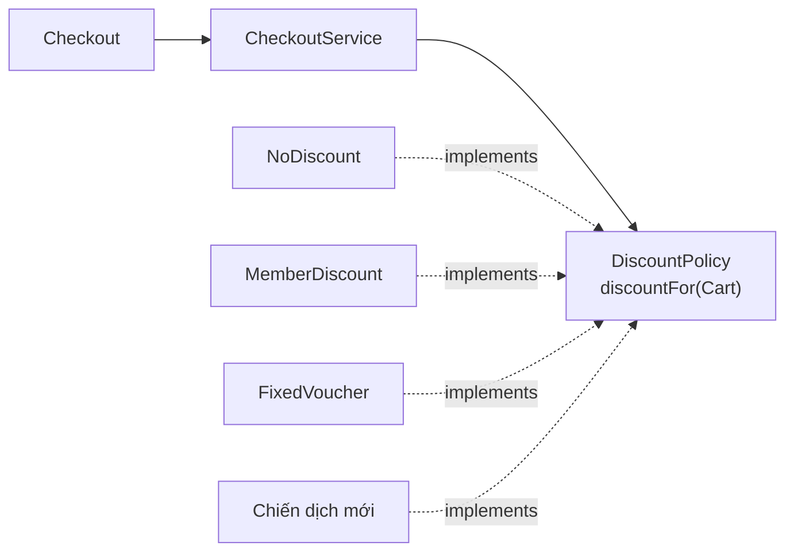

Ví dụ **Java 17 độc lập**, lưu thành `PatternDecisionDemo.java`, chạy bằng `javac PatternDecisionDemo.java` và `java PatternDecisionDemo`:

```java
import java.math.BigDecimal;
import java.math.RoundingMode;
import java.util.Objects;

public class PatternDecisionDemo {

    record Cart(BigDecimal subtotalVnd) {
        Cart {
            Objects.requireNonNull(subtotalVnd, "subtotalVnd");
            if (subtotalVnd.signum() < 0 ||
                    subtotalVnd.stripTrailingZeros().scale() > 0) {
                throw new IllegalArgumentException(
                        "subtotalVnd phải là số nguyên VND không âm");
            }
        }
    }

    // Hợp đồng nhỏ, diễn đạt một khả năng thay đổi độc lập.
    interface DiscountPolicy {
        BigDecimal discountFor(Cart cart);
    }

    static final class NoDiscount implements DiscountPolicy {
        @Override
        public BigDecimal discountFor(Cart cart) {
            Objects.requireNonNull(cart, "cart");
            return BigDecimal.ZERO;
        }
    }

    static final class MemberDiscount implements DiscountPolicy {
        @Override
        public BigDecimal discountFor(Cart cart) {
            Objects.requireNonNull(cart, "cart");
            return cart.subtotalVnd()
                    .multiply(new BigDecimal("0.05"))
                    .setScale(0, RoundingMode.HALF_UP);
        }
    }

    static final class FixedVoucher implements DiscountPolicy {
        private final BigDecimal amountVnd;

        FixedVoucher(BigDecimal amountVnd) {
            Objects.requireNonNull(amountVnd, "amountVnd");
            if (amountVnd.signum() < 0 ||
                    amountVnd.stripTrailingZeros().scale() > 0) {
                throw new IllegalArgumentException(
                        "amountVnd phải là số nguyên VND không âm");
            }
            this.amountVnd = amountVnd;
        }

        @Override
        public BigDecimal discountFor(Cart cart) {
            Objects.requireNonNull(cart, "cart");
            return amountVnd.min(cart.subtotalVnd());
        }
    }

    // Không hỏi cụ thể từng kiểu chính sách.
    static final class CheckoutService {
        private final DiscountPolicy policy;

        CheckoutService(DiscountPolicy policy) {
            this.policy = Objects.requireNonNull(policy, "policy");
        }

        BigDecimal payableFor(Cart cart) {
            Objects.requireNonNull(cart, "cart");
            BigDecimal discount = Objects.requireNonNull(
                    policy.discountFor(cart), "discount không được null");

            // Bảo vệ invariant của phần điều phối.
            if (discount.signum() < 0 ||
                    discount.compareTo(cart.subtotalVnd()) > 0 ||
                    discount.stripTrailingZeros().scale() > 0) {
                throw new IllegalStateException(
                        "Chính sách trả mức chiết khấu không hợp lệ");
            }
            return cart.subtotalVnd().subtract(discount);
        }
    }

    public static void main(String[] args) {
        Cart cart = new Cart(new BigDecimal("400000"));

        CheckoutService member = new CheckoutService(
                new MemberDiscount());
        CheckoutService voucher = new CheckoutService(
                new FixedVoucher(new BigDecimal("30000")));
        CheckoutService none = new CheckoutService(
                new NoDiscount());

        System.out.println(member.payableFor(cart));  // 380000
        System.out.println(voucher.payableFor(cart)); // 370000
        System.out.println(none.payableFor(cart));    // 400000
    }
}
```

**Vai trò trong mẫu Strategy:**

| Thành phần | Vai trò | Lý do |
|---|---|---|
| `DiscountPolicy` | Strategy interface | Định nghĩa thao tác chung và kỳ vọng đầu vào/đầu ra |
| `MemberDiscount`, `FixedVoucher`, `NoDiscount` | Concrete strategies | Mỗi loại giữ một công thức độc lập |
| `CheckoutService` | Context | Chỉ điều phối checkout, gọi strategy và kiểm tra invariant |
| `main` | Composition root | Chọn strategy được sử dụng tại thời điểm lắp ráp |

**Mở rộng hành vi:** bổ sung `SeasonalDiscount implements DiscountPolicy` mà không phải thêm nhánh mới trong `CheckoutService`. Nếu có giao diện cho người dùng chọn loại chiết khấu, phần **wiring** vẫn phải biết ánh xạ mã chiến dịch sang strategy hoặc nhận qua cơ chế đăng ký phù hợp; sự thay đổi này là bình thường.

**Đánh đổi thật sự:** tăng số lớp, thêm interface, cấu hình lựa chọn strategy và đòi hỏi hợp đồng chặt chẽ giữa các implementation. Lợi ích chủ yếu là tách rời biến thể, giảm sửa phần điều phối và kiểm thử chiến lược độc lập; không phải tăng tốc độ chạy chương trình.

### 3.3. So sánh trước khi quyết định

| Tiêu chí | `switch` tập trung | Strategy |
|---|---|---|
| Ba quy tắc ngắn, hiếm đổi | Thường đơn giản và rõ hơn | Có thể dư abstraction |
| Thêm quy tắc mới thường xuyên | Phải sửa `switch` | Thêm implementation và wiring |
| Kiểm thử từng quy tắc | Có thể làm được, thường chung một đơn vị mã | Dễ cô lập từng strategy |
| Theo dõi luồng | Đọc một hàm | Theo interface, implementation, lắp ráp |
| Hỗ trợ plugin/đội khác bổ sung quy tắc | Khó tách quyền sở hữu | Phù hợp hơn nếu có contract rõ |
| Chi phí nhận thức | Thấp lúc ban đầu, có thể tăng theo nhánh | Cao hơn lúc ban đầu, ổn định hơn khi nhiều biến thể |
| Rủi ro hệ thống | Hàm lớn, thêm nhánh dễ ảnh hưởng nhánh khác | Cấu hình nhầm strategy, implementation vi phạm hợp đồng |

Không nên chọn Strategy chỉ vì nhìn thấy `if`. Cần chứng minh rằng **cách xử lý là trục biến thiên** có tần suất và độc lập đủ lớn.

## 4. Cơ chế đánh đổi: pattern giải quyết một lực kéo và tạo lực kéo khác

Các nguyên tắc thiết kế thường xung đột:

- **Ít coupling** với implementation ↔ **nhiều indirection** (thêm lớp trung gian khi điều hướng).
- **Mở rộng bằng lớp mới** ↔ **nhiều loại object và cấu hình** cần quản lý.
- **Ẩn chi tiết hạ tầng** ↔ **khó thấy implementation thực tế** nếu DI/registry thiếu minh bạch.
- **Composition linh hoạt** ↔ **thứ tự ghép thành phần** có thể ảnh hưởng hành vi.
- **Thông báo sự kiện tách rời** ↔ **khó xác định thứ tự, lỗi và tính nhất quán**.
- **Tạo object qua factory** ↔ **logic lựa chọn loại object tập trung thêm tại factory**.

Một pattern thành công khi những chi phí mới **được chủ động chấp nhận** và nhỏ hơn nỗi đau nó giải quyết. Trong review thiết kế, hỏi “Pattern này chuyển trách nhiệm và chi phí sang đâu?” thường hữu ích hơn hỏi “Pattern này thuộc nhóm nào?”.

## 5. Những nhóm pattern thường gặp

Danh mục kinh điển **Gang of Four (GoF)** chia 23 mẫu thành ba nhóm theo ý định. Bảng dưới đây chỉ chọn một số mẫu điển hình; phân nhóm không thay thế việc phân tích tình huống cụ thể.

| Nhóm | Pattern | Khi nào cân nhắc | Đánh đổi cần nhớ |
|---|---|---|---|
| **Creational** | Factory Method | Cần hoãn việc quyết định class cụ thể cho lớp con/điểm mở rộng tạo object | Tăng phân cấp và gián tiếp hóa |
| **Creational** | Abstract Factory | Tạo **họ** đối tượng liên quan nhất quán (ví dụ bộ UI Windows/Mac) | Khó bổ sung một *loại sản phẩm mới* vào mọi factory |
| **Creational** | Builder | Object có nhiều tùy chọn hoặc quá trình tạo phức tạp, cần xây dựng dễ đọc | Thêm builder/state và bước validate |
| **Creational** | Singleton | Thật sự cần một instance duy nhất trong phạm vi xác định | Trạng thái toàn cục, coupling và khó kiểm thử; DI singleton scope có ý nghĩa khác với constructor private |
| **Structural** | Adapter | Bên gọi cần một interface nhưng thư viện bên ngoài có API khác | Thêm lớp chuyển đổi, có thể mất thông tin/ngữ nghĩa |
| **Structural** | Decorator | Cần thêm hành vi quanh object mà vẫn giữ cùng interface | Thứ tự bọc quan trọng, khó theo dõi nhiều lớp |
| **Structural** | Facade | Nhiều API con phức tạp, muốn một điểm tiếp cận đơn giản | Facade có thể phình to và che mất các khả năng đặc thù |
| **Behavioral** | Strategy | Nhiều thuật toán có thể hoán đổi theo ngữ cảnh | Nhiều implementation, cần cơ chế chọn phù hợp |
| **Behavioral** | Observer | Một thay đổi cần thông báo nhiều đối tượng quan sát | Thứ tự, vòng đời đăng ký, lỗi callback và backpressure |
| **Behavioral** | Command | Cần biểu diễn một yêu cầu như object để queue, log, undo hoặc retry | Thêm object/cấu trúc dữ liệu, quản lý idempotency khi retry |
| **Behavioral** | State | Hành vi phụ thuộc trạng thái, chuyển trạng thái phức tạp | Nhiều lớp trạng thái, cần kiểm soát transition hợp lệ |
| **Behavioral** | Template Method | Khung thuật toán cố định, vài bước được chuyên biệt bằng kế thừa | Coupling qua inheritance, thay thế khó hơn composition |

**Phân biệt mức độ:** Design Pattern dạng GoF thường nói về cộng tác giữa các đối tượng; **architectural pattern** (ví dụ Layered Architecture, Hexagonal Architecture) tác động đến ranh giới toàn hệ thống. **Idiom** là lối viết theo ngôn ngữ (ví dụ `try-with-resources` trong Java). Không nên áp một pattern ở mọi cấp độ chỉ vì chúng có tên quen thuộc.

## 6. Cùng một yêu cầu, chọn đúng pattern theo mục tiêu

Ví dụ cần tích hợp dịch vụ gửi tin nhắn của nhà cung cấp mới. Nếu mục tiêu là đổi giao diện từ SDK sang hợp đồng nội bộ:

```java
interface SmsSender {
    void send(String phoneNumber, String message);
}

// API nhà cung cấp bên ngoài có chữ ký khác.
final class VendorSmsSdk {
    void dispatchText(String destination, String payload) {
        // Gọi API thực tế, xử lý HTTP/auth tại adapter.
    }
}

// Adapter biến lời gọi nội bộ thành lời gọi SDK.
final class VendorSmsAdapter implements SmsSender {
    private final VendorSmsSdk sdk;

    VendorSmsAdapter(VendorSmsSdk sdk) {
        this.sdk = java.util.Objects.requireNonNull(sdk);
    }

    @Override
    public void send(String phoneNumber, String message) {
        sdk.dispatchText(phoneNumber, message);
    }
}
```

Đây là **Adapter**: đổi *hình thức hợp đồng*, đồng thời che API vendor. Nó không tự động xử lý retry, cước tin nhắn, bảo mật hay tính đúng đắn của số điện thoại.

Nếu hợp đồng `SmsSender` đã ổn, nhưng muốn **bổ sung metric** cho mọi lần gửi:

```java
interface SendMetrics {
    void countSuccess();
    void countFailure();
}

final class MeteredSmsSender implements SmsSender {
    private final SmsSender delegate;
    private final SendMetrics metrics;

    MeteredSmsSender(SmsSender delegate, SendMetrics metrics) {
        this.delegate = java.util.Objects.requireNonNull(delegate);
        this.metrics = java.util.Objects.requireNonNull(metrics);
    }

    @Override
    public void send(String phoneNumber, String message) {
        try {
            delegate.send(phoneNumber, message);
            metrics.countSuccess();
        } catch (RuntimeException e) {
            metrics.countFailure();
            throw e;
        }
    }
}
```

Đây là **Decorator**: giữ cùng interface và bọc thêm chức năng trước/sau khi delegate xử lý. Các đoạn Java ở mục này là **mẫu tách file/ghép theo package** để giải thích cấu trúc; phần `main` hoàn chỉnh có thể biên dịch độc lập nằm ở mục 3.

**Vấn đề khác nhau, pattern khác nhau:**

| Điều cần thay đổi | Phương án có thể xét | Vì sao |
|---|---|---|
| Thay API vendor bằng cùng hợp đồng ứng dụng | Adapter | Chuyển đổi interface |
| Thêm metrics, tracing hoặc hành vi bao quanh | Decorator | Bọc đối tượng giữ nguyên interface |
| Có nhiều cách chọn kênh SMS/email/push | Strategy | Hoán đổi thuật toán/cách gửi |
| Nhiều hệ thống muốn phản ứng sau khi đơn hàng được duyệt | Observer hoặc event messaging | Thông báo bên quan tâm |
| Cần gói yêu cầu gửi lại vào job có thể queue/retry | Command/job object | Biểu diễn yêu cầu thành dữ liệu có thể chuyển giao |

Nếu thông báo phải đảm bảo giao dịch và giao hàng tin cậy qua mạng, **Observer in-process** không đủ: cần xử lý message broker, outbox, retry, idempotency và các trường hợp partial failure. Pattern không thay thế các yêu cầu phân tán.

### Thứ tự bọc thay đổi kết quả

```text
new RetrySender(new MeteredSmsSender(actual, metrics))
    → metrics ghi nhận từng attempt được retry

new MeteredSmsSender(new RetrySender(actual), metrics)
    → metrics ghi nhận một lần gửi logic sau retry
```

Hai cách ghép đều có thể hợp lệ; chọn theo yêu cầu đo lường. Đây là ví dụ minh họa về hệ quả của **Decorator/composition**, không phải code hoàn chỉnh của `RetrySender`.

## 7. Quy trình lựa chọn mẫu từ tình huống thực tế

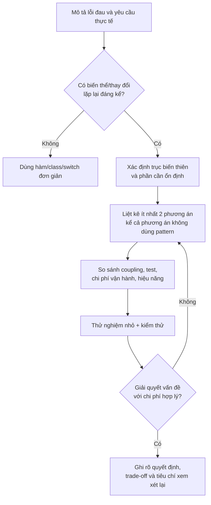

Thực hiện bằng một tình huống cụ thể:

1. **Ghi nhận thay đổi gần đây:** đếm số lần sửa module trong 3–6 tháng, số branch độc lập và số lỗi hồi quy (đừng dựa hoàn toàn vào cảm giác).
2. **Tách “what” khỏi “how”:** chính sách nghiệp vụ cần hành vi gì và implementation thực hiện bằng kỹ thuật nào?
3. **Nêu ràng buộc bắt buộc:** độ đúng, bảo mật, độ trễ, thread-safety, transaction, backward compatibility.
4. **So sánh baseline với ứng viên:** trước tiên thử cải thiện tên hàm, tách phương thức hoặc mapping dữ liệu; chỉ nâng lên Strategy/Factory/Observer khi có lợi.
5. **Dựng spike nhỏ:** có thể thử thêm một biến thể hoàn toàn mới mà ít sửa phần lõi không? Luồng debug có bị khó quá mức không?
6. **Định nghĩa contract và test:** xác định kết quả, ngoại lệ, bất biến, giới hạn và concurrency.
7. **Viết một quyết định thiết kế ngắn:** bối cảnh, phương án đã xem, lý do chọn, hệ quả và tình huống cần xét lại.
8. **Đánh giá sau khi có dữ liệu:** pattern được giữ, thu gọn hoặc thay thế khi bối cảnh thay đổi.

### Một bản ghi quyết định kiến trúc (ADR) mẫu

```markdown
# ADR: Tách chính sách chiết khấu khỏi CheckoutService

Trạng thái: Chấp nhận (ví dụ minh họa)

Bối cảnh:
- Có nhiều chương trình khuyến mãi được phát triển độc lập.
- Phần điều phối checkout phải ổn định và dùng chung validation.
- Các quy tắc cần unit test riêng, thêm mới thường xuyên.

Phương án:
1. Duy trì switch tập trung.
2. Dùng bảng cấu hình nếu mọi quy tắc thuần dữ liệu.
3. Dùng DiscountPolicy (Strategy) cho quy tắc có hành vi khác nhau.

Quyết định:
- Chọn Strategy cho các chiến dịch có thuật toán khác biệt.
- Composition root ánh xạ mã chiến dịch sang implementation.

Hệ quả:
+ Ít sửa luồng checkout khi thêm chiến dịch.
+ Test được từng chính sách riêng.
- Thêm interface, class và cấu hình.
- Phải kiểm tra contract: mức giảm nằm trong [0, subtotal].

Xem xét lại khi:
- Các chiến dịch chủ yếu chuyển thành cấu hình dữ liệu,
  hoặc số chiến dịch giảm và rất hiếm thay đổi.
```

## 8. Kiểm thử pattern theo hành vi và hợp đồng

Pattern tốt phải giúp **kiểm soát thay đổi** mà không phá invariant. Với ví dụ Strategy, các test sau nên được ưu tiên:

- Khi `subtotalVnd = 400000`, thành viên được giảm 20000 VND.
- Khi giỏ hàng 20000 VND, voucher 30000 VND chỉ giảm tối đa 20000 VND; payable bằng 0.
- Với `subtotalVnd = 0`, payable bằng 0 cho mọi chính sách hợp lệ.
- Một implementation mới trả chiết khấu âm, vượt giỏ hàng hoặc `null` phải bị từ chối.
- Nếu có dynamic registry/DI: mã chính sách không tồn tại phải trả lỗi rõ ràng, không âm thầm chọn chính sách khác.

Ví dụ JUnit 5, đặt lớp test cùng package với `PatternDecisionDemo`:

```java
import static org.junit.jupiter.api.Assertions.*;
import java.math.BigDecimal;
import org.junit.jupiter.api.Test;

class PatternDecisionDemoTest {

    @Test
    void memberDiscountIsFivePercent() {
        var cart = new PatternDecisionDemo.Cart(
                new BigDecimal("400000"));
        var checkout = new PatternDecisionDemo.CheckoutService(
                new PatternDecisionDemo.MemberDiscount());

        assertEquals(new BigDecimal("380000"),
                checkout.payableFor(cart));
    }

    @Test
    void fixedVoucherNeverMakesPayableNegative() {
        var cart = new PatternDecisionDemo.Cart(
                new BigDecimal("20000"));
        var checkout = new PatternDecisionDemo.CheckoutService(
                new PatternDecisionDemo.FixedVoucher(
                        new BigDecimal("30000")));

        assertEquals(BigDecimal.ZERO,
                checkout.payableFor(cart));
    }

    @Test
    void invalidStrategyIsRejected() {
        PatternDecisionDemo.DiscountPolicy bad =
                cart -> new BigDecimal("-1");
        var checkout = new PatternDecisionDemo.CheckoutService(bad);

        assertThrows(IllegalStateException.class,
                () -> checkout.payableFor(
                        new PatternDecisionDemo.Cart(
                                new BigDecimal("100000"))));
    }
}
```

Các test này chứng minh tính đúng đắn của **hành vi đang sử dụng**. Chúng chưa chứng minh mọi chiến dịch trong tương lai đều đúng; cần contract test chung, test ranh giới và test riêng với những thuật toán mới. Nếu hệ thống áp dụng đồng thời nhiều loại voucher, cần định nghĩa thêm thứ tự, khả năng kết hợp và các quy tắc khóa chéo. **Không tự ý áp dụng nhiều Strategy liên tiếp** nếu hợp đồng chưa cho phép.

## 9. Những lỗi tư duy thường gặp khi học Design Pattern

| Lỗi | Vì sao gây hại | Cách sửa |
|---|---|---|
| Nhớ tên rồi tìm chỗ áp dụng | Tăng code và abstraction nhưng không giải quyết vấn đề | Bắt đầu từ rủi ro thay đổi thực tế |
| Coi `if/switch/new` là code smell tuyệt đối | Làm mất giải pháp ngắn gọn vốn đang đúng | Đánh giá tần suất biến thể, độ phức tạp và ownership |
| Đặt nhiều interface cho một trường hợp cố định | Tạo thêm indirection và chi phí điều hướng | Giữ thiết kế đơn giản cho đến khi xuất hiện nhu cầu |
| Dùng Singleton để chia sẻ dữ liệu mutable | Tăng coupling toàn cục, race condition, test phụ thuộc nhau | Quản lý vòng đời rõ ràng, ưu tiên immutable/dependency injection |
| Adapter chỉ đổi tên hàm nhưng làm mất lỗi/ngữ nghĩa | Client hiểu sai hợp đồng của bên thứ ba | Xác định mapping dữ liệu, timeout, exception và giới hạn rõ |
| Decorator có thứ tự bọc không được kiểm tra | Metrics, retry, cache hoặc transaction có nghĩa khác nhau | Test thứ tự composition và hiệu ứng biên |
| Observer mặc định callback luôn an toàn | Lỗi một observer có thể ảnh hưởng publisher, unsubscribe bị quên | Thiết kế policy lỗi, vòng đời, ordering và backpressure |
| Factory trả object không tương thích hợp đồng | Lỗi chỉ xuất hiện ở runtime | Kiểm tra type, invariant và tính tương thích |
| Pattern kết hợp tạo vòng phụ thuộc | Khó khởi tạo, khó sửa, vòng đời không rõ | Sơ đồ hóa dependency; tách ranh giới |
| Đo “chất lượng” bằng số pattern | Khó bảo trì hơn dù nhìn có vẻ kiến trúc | Đo bằng thời gian sửa lỗi, test, coupling, khả năng debug |

**Một câu hỏi quan trọng:** Nếu ngày mai loại thay đổi mà pattern được thiết kế để hỗ trợ **không còn xảy ra**, liệu kiến trúc có còn hợp lý không? Nếu câu trả lời là không, hãy xem lại chi phí abstraction.

## 10. Những câu hỏi phân biệt pattern

**Strategy hay State?** Cả hai đều có thể dùng interface và composition, nhưng ý định khác nhau. Strategy hoán đổi **thuật toán/chính sách**; State biểu diễn **trạng thái hiện tại và chuyển trạng thái hợp lệ**, nơi hành vi của đối tượng phụ thuộc state machine. Việc đổi class lúc chạy chưa đủ để gọi là State.

**Adapter hay Decorator?** Adapter làm cho hai interface không tương thích nói chuyện được. Decorator thường giữ **cùng interface** và thêm chức năng quanh đối tượng được bọc. Trong hệ thống thật có thể cần cả hai.

**Factory Method hay một hàm factory?** Factory Method theo GoF dựa vào phương thức tạo object có thể được lớp con chuyên biệt hóa; một **static factory method** trong Java (ví dụ `Color.of(...)`) không tự động là mẫu GoF Factory Method. Tránh lẫn thuật ngữ khi review thiết kế.

**Observer hay event bus?** Observer là mô hình quan hệ publisher–subscriber trong phạm vi ứng dụng hoặc object. Event bus/message broker có thể mang ý tưởng publish–subscribe nhưng phải giải quyết thêm delivery, retry, ordering, phân tán và idempotency.

**Builder hay constructor?** Builder phù hợp khi nhiều tham số tùy chọn hoặc quá trình xây dựng cần kiểm tra theo bước. Với record có hai tham số bắt buộc rõ ràng, constructor có thể dễ hiểu hơn.

## 11. Bài tập ứng dụng

### Bài 1 – Chọn hay không chọn Strategy

Hệ thống tính phí dịch vụ có hai quy tắc cố định, chỉ sửa mỗi năm một lần. Hãy viết hai phương án: một bằng `switch`, một bằng Strategy. Ước tính số class, số điểm thay đổi và tình huống nào sẽ làm phương án thứ hai hữu ích hơn. Giải thích lựa chọn cuối cùng.

### Bài 2 – Adapter theo contract

Bên ngoài trả thông tin nhiệt độ Fahrenheit, còn domain cần Celsius. Thiết kế `TemperatureProvider` trả độ C, một adapter cho SDK ngoài và quy tắc xử lý giá trị lỗi. Viết test cho ngưỡng 32°F → 0°C và 212°F → 100°C; phân biệt adapter chuyển đơn vị với quy tắc cảnh báo nhiệt.

### Bài 3 – Decorator và thứ tự

Thiết kế `Notifier` có bọc retry và metrics. Giải thích cách đặt `RetryNotifier` **ngoài** hay **trong** `MetricsNotifier` ảnh hưởng số lần đếm. Nếu một lần gửi thất bại cuối cùng, cách nào phản ánh số lần thử, cách nào phản ánh một yêu cầu nghiệp vụ?

### Bài 4 – Chẩn đoán bối cảnh

Một nhóm muốn dùng Observer cho hành vi “gửi email sau khi thanh toán thành công”. Phân tích nếu thanh toán và email nằm ở các tiến trình khác nhau, có sự cố mạng, yêu cầu không gửi trùng, cần lưu bền và có retry. Chỉ ra vì sao Observer đồng bộ trong bộ nhớ chưa đủ; đề xuất những cơ chế cần bổ sung.

### Bài 5 – Viết ADR

Chọn một đoạn Java hiện có dùng nhiều điều kiện. Viết một ADR ngắn nêu: vấn đề thực tế, bối cảnh, hai lựa chọn (trong đó có một lựa chọn đơn giản), phương án quyết định, lợi ích, rủi ro và điều kiện xem xét lại. Không được kết luận chỉ bằng “vì SOLID”.

## 12. Checklist trước khi đưa pattern vào mã sản phẩm

- [ ] Có **vấn đề đo hoặc quan sát được**, không chỉ là mong muốn dùng pattern.
- [ ] Bối cảnh, tần suất thay đổi và giới hạn hiệu năng/bảo mật đã rõ.
- [ ] Có **phương án đơn giản** để so sánh.
- [ ] Phân biệt **điểm ổn định** với **điểm cần mở rộng**.
- [ ] Lợi ích của pattern lớn hơn số lớp, cấu hình và chi phí debug tăng thêm.
- [ ] Interface/contract nói rõ giá trị hợp lệ, lỗi và tác dụng phụ.
- [ ] Có test cho hành vi hiện tại, điều kiện biên và các implementation.
- [ ] Có kế hoạch đăng ký, khởi tạo, quản lý vòng đời và theo dõi object.
- [ ] Review có thể giải thích **tại sao chọn** và **khi nào bỏ** pattern.

**Ghi nhớ:** một thiết kế tốt không phải là thiết kế dùng nhiều mẫu nhất. Mẫu thiết kế đáng dùng khi nó xử lý một vấn đề **đang tồn tại trong bối cảnh cụ thể**, mang lại lợi ích dài hạn đủ lớn và có các đánh đổi được hiểu, kiểm thử và chấp nhận rõ ràng.


</details>

- [Quay lại đầu trang](#back-to-top)

---

## <a id="design-patterns-002">Factory Method và Abstract Factory</a>

<details>
<summary>Xem chi tiết</summary>

# Factory Method và Abstract Factory trong Java

> **Nhóm:** Mẫu thiết kế (Design Patterns) → *Creational patterns* (nhóm mẫu khởi tạo).  
> **Mục tiêu:** Biết vì sao cần tách việc tạo đối tượng khỏi mã sử dụng, triển khai đúng cấu trúc **Factory Method** và **Abstract Factory**, nhận biết khác biệt, lựa chọn theo bài toán, và tránh nhầm với hàm tạo đối tượng thông thường.

## 1. Vấn đề chung: mã nghiệp vụ bị ràng buộc vào cách tạo đối tượng

Xét một ứng dụng có thể gửi thông báo qua email hoặc SMS. Nếu lớp nghiệp vụ tự quyết định implementation:

~~~java
void notifyCustomer(String channel, String customerId, String message) {
    if ("email".equals(channel)) {
        new EmailSender().send(customerId, message);
    } else if ("sms".equals(channel)) {
        new SmsSender().send(customerId, message);
    } else {
        throw new IllegalArgumentException("Unsupported channel");
    }
}
~~~

Khi thêm kênh mới, phải sửa `if/else` ở nơi đang sử dụng. Mã tạo đối tượng và logic điều phối thông báo bị trộn chung. Nếu nhiều nơi cùng chọn kênh, các nhánh dễ bị lặp.

Hai mẫu dưới đây cùng sử dụng **abstraction** để giảm coupling nhưng có trọng tâm khác nhau:

- **Factory Method** để **class cha định nghĩa một điểm mở rộng tạo sản phẩm**, còn class con quyết định tạo loại sản phẩm nào.
- **Abstract Factory** để client sử dụng **một đối tượng factory** tạo ra **một họ sản phẩm liên quan**, mà không biết các class cụ thể của họ đó.

Đừng vội thêm factory khi chỉ có một `new` đơn giản, ít khả năng thay đổi. Factory trở nên hữu ích khi việc tạo đối tượng là một **điểm biến thiên có chủ đích**.

## 2. Factory Method — trì hoãn quyết định tạo sản phẩm cho lớp con

**Định nghĩa theo GoF:** Định nghĩa interface cho việc tạo một đối tượng; để subclass quyết định class nào được khởi tạo. Factory Method cho phép class hoãn việc khởi tạo sản phẩm cụ thể cho các subclass.

Các vai trò điển hình:

| Vai trò | Chức năng | Ví dụ |
|---|---|---|
| **Product** | Hợp đồng của đối tượng được tạo | `Sender` |
| **Concrete Product** | Các implementation của Product | `EmailSender`, `SmsSender` |
| **Creator** | Chứa luồng xử lý chung và khai báo factory method | `NotificationCampaign` |
| **Concrete Creator** | Ghi đè factory method để trả sản phẩm cụ thể | `EmailCampaign`, `SmsCampaign` |

Điểm quan trọng: **Creator không nhất thiết chỉ là một “lớp nhà máy”**. Nó thường chứa logic xử lý thật, gọi factory method để lấy cộng tác viên phù hợp. Trong ví dụ dưới đây, `notifyCustomer` là luồng chung; `createSender` là factory method.

### 2.1. Java chạy độc lập: tạo kênh gửi thông báo

Tạo tệp `FactoryMethodDemo.java`. Mã chạy bằng Java 17+ và không gọi dịch vụ email/SMS thật.

~~~java
import java.util.List;
import java.util.Objects;

// Product: client chỉ cần thao tác trên hợp đồng này.
interface Sender {
    void send(String customerId, String message);
}

// Concrete products: các adapter mô phỏng để dễ chạy demo.
final class EmailSender implements Sender {
    @Override
    public void send(String customerId, String message) {
        System.out.printf("[EMAIL] %s: %s%n", customerId, message);
    }
}

final class SmsSender implements Sender {
    @Override
    public void send(String customerId, String message) {
        System.out.printf("[SMS] %s: %s%n", customerId, message);
    }
}

// Creator: thuật toán chung, đồng thời công bố factory method.
abstract class NotificationCampaign {
    public final void notifyCustomer(String customerId, String message) {
        Objects.requireNonNull(customerId, "customerId");
        Objects.requireNonNull(message, "message");

        if (customerId.isBlank() || message.isBlank()) {
            throw new IllegalArgumentException("Blank customer/message");
        }

        // Không cần biết Sender cụ thể là email hay SMS.
        Sender sender = Objects.requireNonNull(
                createSender(), "createSender returned null");
        sender.send(customerId, message);
    }

    protected abstract Sender createSender(); // Factory Method
}

// Concrete creators: lựa chọn sản phẩm bằng polymorphism.
final class EmailCampaign extends NotificationCampaign {
    @Override
    protected Sender createSender() {
        return new EmailSender();
    }
}

final class SmsCampaign extends NotificationCampaign {
    @Override
    protected Sender createSender() {
        return new SmsSender();
    }
}

public class FactoryMethodDemo {
    public static void main(String[] args) {
        List<NotificationCampaign> campaigns = List.of(
                new EmailCampaign(),
                new SmsCampaign()
        );

        for (NotificationCampaign campaign : campaigns) {
            campaign.notifyCustomer("CUST-42", "Don hang da xac nhan");
        }
    }
}
~~~

Chạy từ thư mục chứa tệp:

~~~bash
javac FactoryMethodDemo.java
java FactoryMethodDemo
~~~

Kết quả:

~~~text
[EMAIL] CUST-42: Don hang da xac nhan
[SMS] CUST-42: Don hang da xac nhan
~~~

**Điều đang diễn ra:**

1. Client chọn `EmailCampaign` hoặc `SmsCampaign` tại điểm lắp ghép (ví dụ ở `main`).
2. Client gọi **cùng API** `notifyCustomer(customerId, message)`.
3. Creator thực hiện kiểm tra đầu vào rồi gọi `createSender()`.
4. Phương thức được dispatch động tới subclass; subclass tạo `EmailSender` hoặc `SmsSender`.
5. Luồng xử lý chung không cần `if (sender instanceof EmailSender)` hay sửa khi có một Concrete Creator mới.

Trong hệ thống thật, `EmailSender` có thể gọi provider email và `SmsSender` gọi gateway SMS. `customerId` ở đây là ID chung, không phải địa chỉ email hay số điện thoại; các adapter thật sẽ cần cơ chế tra thông tin liên hệ và quy tắc xử lý lỗi phù hợp.

### 2.2. Sơ đồ quan hệ

~~~mermaid
classDiagram
    class Sender {
        <<interface>>
        +send(customerId, message) void
    }
    class EmailSender {
        +send(customerId, message) void
    }
    class SmsSender {
        +send(customerId, message) void
    }
    class NotificationCampaign {
        <<abstract>>
        +notifyCustomer(customerId, message) void
        #createSender() Sender
    }
    class EmailCampaign {
        #createSender() Sender
    }
    class SmsCampaign {
        #createSender() Sender
    }

    Sender <|.. EmailSender
    Sender <|.. SmsSender
    NotificationCampaign <|-- EmailCampaign
    NotificationCampaign <|-- SmsCampaign
    NotificationCampaign ..> Sender : sử dụng
    EmailCampaign ..> EmailSender : tạo
    SmsCampaign ..> SmsSender : tạo
~~~

Đây là **Factory Method đúng cấu trúc GoF**, vì **subclass ghi đè một phương thức tạo sản phẩm của Creator**. Nó không chỉ là một hàm có chữ “factory” trong tên.

### 2.3. Khi nào nên dùng?

Factory Method hữu ích khi có một **quy trình ổn định ở Creator** nhưng thành phần cần tạo trong quy trình khác nhau theo loại Creator: xuất báo cáo bằng renderer phù hợp, tạo message sender cho từng chiến dịch, tạo parser chuyên biệt trong một pipeline, tạo document trong một editor.

Đánh đổi: mỗi biến thể có thể cần một Concrete Creator, tăng số class và sử dụng kế thừa. Nếu đối tượng chỉ khác nhau qua cấu hình runtime hoặc Creator không thực sự chứa hành vi chung, truyền một factory hoặc chiến lược bằng composition có thể ngắn gọn hơn.

## 3. Abstract Factory — tạo một họ sản phẩm đồng bộ

**Định nghĩa theo GoF:** Cung cấp interface để tạo ra **các họ đối tượng liên quan hoặc phụ thuộc lẫn nhau** mà client không cần chỉ ra các class cụ thể.

Ví dụ: một ứng dụng desktop hỗ trợ giao diện **Light** và **Dark**. Mỗi theme gồm nhiều thành phần: `Button` và `Checkbox`. Client mong muốn các thành phần được tạo **đồng bộ trong cùng theme**.

| Họ sản phẩm | Button | Checkbox |
|---|---|---|
| **Light** | `LightButton` | `LightCheckbox` |
| **Dark** | `DarkButton` | `DarkCheckbox` |

Nếu client khởi tạo riêng lẻ từng class ở mọi nơi, có thể vô tình phối `LightButton` với `DarkCheckbox`. Abstract Factory gom việc lựa chọn cả họ vào một nơi.

### 3.1. Java chạy độc lập: Light/Dark UI

Tạo tệp **riêng** `AbstractFactoryDemo.java`, biên dịch và chạy độc lập với ví dụ Factory Method.

~~~java
import java.util.Objects;

// Abstract products: hợp đồng của từng loại thành phần UI.
interface Button {
    String render();
}

interface Checkbox {
    String render();
}

// Abstract factory: danh sách sản phẩm mà MỌI họ cần cung cấp.
interface UiFactory {
    Button createButton();
    Checkbox createCheckbox();
}

// Họ Light: hai sản phẩm có cùng phong cách.
final class LightButton implements Button {
    @Override
    public String render() {
        return "Button[LIGHT]";
    }
}

final class LightCheckbox implements Checkbox {
    @Override
    public String render() {
        return "Checkbox[LIGHT]";
    }
}

final class LightUiFactory implements UiFactory {
    @Override
    public Button createButton() {
        return new LightButton();
    }

    @Override
    public Checkbox createCheckbox() {
        return new LightCheckbox();
    }
}

// Họ Dark: cùng interface sản phẩm, implementation khác.
final class DarkButton implements Button {
    @Override
    public String render() {
        return "Button[DARK]";
    }
}

final class DarkCheckbox implements Checkbox {
    @Override
    public String render() {
        return "Checkbox[DARK]";
    }
}

final class DarkUiFactory implements UiFactory {
    @Override
    public Button createButton() {
        return new DarkButton();
    }

    @Override
    public Checkbox createCheckbox() {
        return new DarkCheckbox();
    }
}

// Client chỉ biết các abstraction Button, Checkbox và UiFactory.
final class SettingsScreen {
    private final Button button;
    private final Checkbox checkbox;

    SettingsScreen(UiFactory factory) {
        Objects.requireNonNull(factory, "factory");

        // Tất cả thành phần được tạo qua CÙNG MỘT factory.
        this.button = Objects.requireNonNull(
                factory.createButton(), "button");
        this.checkbox = Objects.requireNonNull(
                factory.createCheckbox(), "checkbox");
    }

    void render() {
        System.out.println(button.render() + " | " + checkbox.render());
    }
}

public class AbstractFactoryDemo {
    public static void main(String[] args) {
        UiFactory light = new LightUiFactory();
        UiFactory dark = new DarkUiFactory();

        new SettingsScreen(light).render();
        new SettingsScreen(dark).render();
    }
}
~~~

Chạy:

~~~bash
javac AbstractFactoryDemo.java
java AbstractFactoryDemo
~~~

Kết quả:

~~~text
Button[LIGHT] | Checkbox[LIGHT]
Button[DARK] | Checkbox[DARK]
~~~

`SettingsScreen` chỉ biết **Abstract Products** (`Button`, `Checkbox`) và **Abstract Factory** (`UiFactory`). Nó không khởi tạo hoặc import `DarkButton` / `LightCheckbox`.

Một concrete factory tạo ra **cùng họ** các sản phẩm; chỉ cần thay `UiFactory` ở **composition root** là chuyển cả bộ giao diện. Nếu factory cụ thể trả về các sản phẩm lẫn theme, đó là lỗi implementation/hợp đồng họ sản phẩm; interface Java không tự kiểm tra được tính đồng bộ này.

### 3.2. Sơ đồ Abstract Factory

~~~mermaid
flowchart TD
    Client["SettingsScreen (client)"] --> Abstract["UiFactory"]
    Client --> BP["Button"]
    Client --> CP["Checkbox"]
    Light["LightUiFactory"] -.->|"implements"| Abstract
    Dark["DarkUiFactory"] -.->|"implements"| Abstract
    Light --> LB["LightButton"]
    Light --> LC["LightCheckbox"]
    Dark --> DB["DarkButton"]
    Dark --> DC["DarkCheckbox"]
    LB -.->|"implements"| BP
    DB -.->|"implements"| BP
    LC -.->|"implements"| CP
    DC -.->|"implements"| CP
~~~

Đặc trưng dễ nhận biết: **một factory có nhiều phương thức tạo các loại Product khác nhau** như `createButton()` và `createCheckbox()`; mỗi Concrete Factory triển khai toàn bộ phương thức để sản xuất **một biến thể nhất quán**.

### 3.3. Khi nào nên dùng?

- Có **nhiều loại sản phẩm liên quan** và cần chọn đồng thời một họ: Light/Dark UI, bộ connector cloud của AWS/Azure (storage, queue, notification), các thành phần xuất tài liệu theo định dạng, adapter cho nhiều nhà cung cấp cùng hệ sinh thái.
- Cần đổi họ sản phẩm trong cấu hình khởi động hoặc trong lúc dựng một phiên làm việc mà client không phụ thuộc vào class cụ thể.
- Cần cô lập các quy tắc tạo bộ sản phẩm và kiểm thử tính tương thích của sản phẩm trong cùng họ.

**Đánh đổi quan trọng:** Thêm **họ mới** thường chỉ cần thêm một Concrete Factory và các Concrete Product. Nhưng thêm **loại sản phẩm mới** vào interface (ví dụ `createSlider()`) có thể đòi sửa tất cả Concrete Factory. Abstract Factory phù hợp khi danh sách loại sản phẩm tương đối ổn định, còn số họ thay đổi.

## 4. So sánh trực diện

| Tiêu chí | Factory Method | Abstract Factory |
|---|---|---|
| Bài toán cốt lõi | Thay cách tạo **một loại Product** trong thuật toán của Creator | Tạo **một họ các Product liên quan** |
| Cơ chế biến thiên đặc trưng | **Kế thừa + override** một factory method | **Composition**: truyền đối tượng factory vào client |
| Giao diện sáng tạo | `protected Sender createSender()` trong Creator | `UiFactory` có `createButton()` và `createCheckbox()` |
| Khi thêm biến thể | Thêm Concrete Creator + Product tương ứng | Thêm Concrete Factory + các Product thuộc họ mới |
| Khi thêm loại sản phẩm hoàn toàn mới | Có thể cần thêm abstraction/quy trình Creator mới | Thường phải bổ sung API và cập nhật mọi concrete factory |
| Client chính | Làm việc qua Creator (hoặc gọi operation chung của Creator) | Làm việc qua Abstract Factory và Abstract Products |
| Ví dụ ở trên | `EmailCampaign` chọn `EmailSender` | `DarkUiFactory` tạo cả `DarkButton` + `DarkCheckbox` |
| Điểm cần chú ý | Dễ sinh nhiều subclass chỉ để chọn một sản phẩm | Khó mở rộng theo chiều thêm loại sản phẩm |

**Hai mẫu không loại trừ nhau.** Một concrete factory trong Abstract Factory có thể dùng các factory method bên trong để tạo mỗi loại sản phẩm. Sự khác biệt nằm ở **ý đồ thiết kế và cấu trúc client sử dụng**, không nằm ở tên phương thức.

## 5. Phân biệt với Simple Factory và static factory method

Nhiều tài liệu gọi mọi hàm trả về object là “Factory Method”, dẫn đến nhầm lẫn.

**Simple Factory** thường là một class hoặc hàm tập trung việc chọn implementation bằng tham số:

~~~java
enum Channel { EMAIL, SMS }

final class SenderFactory {
    static Sender create(Channel channel) {
        return switch (channel) {
            case EMAIL -> new EmailSender();
            case SMS -> new SmsSender();
        };
    }
}

// Client:
Sender sender = SenderFactory.create(Channel.EMAIL);
~~~

Đoạn trên giả sử dùng lại các class `Sender`, `EmailSender`, `SmsSender` từ ví dụ `FactoryMethodDemo.java` (nếu đặt trong cùng package). Đây là **simple factory** theo cách gọi thông dụng: một hàm tự quyết định theo enum, **không có Creator/subclass ghi đè factory method**. Khi thêm enum mới, phải sửa `switch`; simple factory vẫn có thể hoàn toàn phù hợp với hệ thống nhỏ.

**Static factory method** là một phương thức `static` tạo hoặc trả về object, ví dụ `List.of(...)` và `LocalDate.of(...)` trong Java. Đây là một cách thiết kế API, **không đồng nghĩa** với pattern **Factory Method** GoF. Static factory có thể trả object mới, object được lưu đệm hoặc một implementation ẩn tùy hợp đồng API.

Tên gọi không quyết định pattern. Hãy hỏi **điểm biến thiên nằm ở subclass nào, hay ở đối tượng factory nào, hay đơn giản chỉ ở tham số truyền vào?**

## 6. Factory khác DI và Strategy ở đâu?

**Dependency Injection (DI)** là kỹ thuật **cấp dependency từ ngoài vào đối tượng**. Trong `new SettingsScreen(new DarkUiFactory())`, ta có constructor injection cho `UiFactory`; Abstract Factory là loại dependency đang được cấp. DI không tự động là Factory Method/Abstract Factory.

**Strategy** đóng gói một **thuật toán/hành vi có thể thay thế**. Factory tạo ra **đối tượng**. Chúng có thể kết hợp: factory tạo hoặc chọn `PricingStrategy`; service dùng Strategy để tính giá.

Một quy tắc thực dụng:

- Nếu khác biệt nằm ở **cách vận hành hàm hiện có**, ưu tiên xét Strategy.
- Nếu khác biệt nằm ở **class được tạo trong một quy trình chung mà subclass có quyền quyết định**, xét Factory Method.
- Nếu cần tạo **bộ sản phẩm cùng biến thể** (nhiều interface liên quan), xét Abstract Factory.
- Nếu chỉ cần chọn một implementation tại khởi động và ít biến thể, DI bằng constructor ở composition root có thể đã đủ.

Trong Spring, `@Bean` và DI container giải quyết khởi tạo, wiring và vòng đời bean, nhưng **không tự động** làm mọi đoạn `@Bean` thành Factory Method/Abstract Factory theo GoF. Khi chỉ cần cấu hình một `Sender`, có thể inject trực tiếp; không phải lúc nào cũng cần thêm một lớp factory.

## 7. Thiết kế sạch khi dùng factory trong ứng dụng thực tế

### 7.1. Tách nơi lựa chọn biến thể khỏi client

Cả hai ví dụ đều có điểm **composition root**:

~~~java
// Factory Method:
NotificationCampaign campaign = new EmailCampaign();

// Abstract Factory:
UiFactory uiFactory = new DarkUiFactory();
SettingsScreen screen = new SettingsScreen(uiFactory);
~~~

Với cấu hình runtime, quyết định biến thể có thể nằm ở `main`, module bootstrap hoặc cấu hình DI. Client chính không nên rải `new DarkButton()` hay `if (factory instanceof DarkUiFactory)` khắp logic.

Cần phân biệt **đổi cấu hình giữa các lần khởi động** với **đổi biến thể cho từng request**. Nếu mỗi HTTP request cần nhà cung cấp khác nhau, một singleton factory cố định từ startup không đủ; có thể cần registry/selector kiểm soát quyền chọn, hoặc truyền factory phù hợp vào từng request. Lựa chọn này phụ thuộc ngữ cảnh vận hành, không phải bản thân mẫu tự cung cấp.

### 7.2. Không lộ class cụ thể trong API trừ khi có lý do chính đáng

Nếu `UiFactory.createButton()` trả về `DarkButton` và client phải ép kiểu để gọi hành vi độc quyền, mục tiêu tách concrete product sẽ suy yếu. Interface sản phẩm nên thể hiện các thao tác **thực sự cần cho client**, tránh nhét phương thức chỉ phù hợp với một họ.

Không nên tạo một interface với hàng chục phương thức mà đa số implementation chỉ ném `UnsupportedOperationException`. Xem lại việc chia interface, giới hạn hỗ trợ hoặc cách biểu diễn capability.

### 7.3. Xác định thời điểm tạo, quyền sở hữu và vòng đời

Hai demo dùng `new` nên mỗi lần gọi factory method có thể tạo đối tượng mới. Trong thực tế, các dependency đắt tiền như HTTP client, connection pool hoặc SDK có thể cần tái sử dụng. Factory **có thể** trả object đã tạo trước, object từ pool hoặc object mới, miễn hợp đồng cho phép.

Cần mô tả rõ:
- Object do factory trả về có giữ trạng thái riêng của request không?
- Có an toàn khi chia sẻ giữa nhiều thread không?
- Ai chịu trách nhiệm đóng `AutoCloseable` và quản lý vòng đời tài nguyên?
- Client có được thay đổi trạng thái sản phẩm sau khi tạo không?

Đừng dùng cache/singleton mặc định chỉ vì một factory gọi nhiều lần; nhất là với sản phẩm giữ dữ liệu người dùng hoặc ngữ cảnh giao dịch.

### 7.4. Xử lý lỗi tạo đối tượng

Khởi tạo có thể thất bại vì cấu hình sai, thiếu thông tin xác thực, provider không khả dụng hoặc tài nguyên cạn. Phân biệt **lỗi cấu hình khi khởi động** và **lỗi xử lý khi gọi operation**. Contract nên nói rõ factory có thể trả `null` hay phải ném exception; mặc định trả về object hợp lệ hoặc ném exception có ngữ nghĩa rõ ràng giúp client đơn giản hơn.

## 8. Kiểm thử theo đúng mục tiêu mẫu

### Factory Method: kiểm tra thuật toán chung thực sự dùng sản phẩm được tạo

Vì `Sender` chỉ in console trong demo, một bài kiểm thử có thể tạo Creator trả một fake Sender và ghi nhận lời gọi. Đoạn sau dùng các class `NotificationCampaign`/`Sender` từ ví dụ Factory Method; test chạy với JUnit Jupiter:

~~~java
import static org.junit.jupiter.api.Assertions.*;

import java.util.concurrent.atomic.AtomicInteger;
import org.junit.jupiter.api.Test;

class FactoryMethodContractTest {
    @Test
    void creatorDelegatesToProduct() {
        AtomicInteger sent = new AtomicInteger();
        NotificationCampaign campaign = new NotificationCampaign() {
            @Override
            protected Sender createSender() {
                return (id, message) -> {
                    assertEquals("CUST-1", id);
                    assertEquals("Hello", message);
                    sent.incrementAndGet();
                };
            }
        };

        campaign.notifyCustomer("CUST-1", "Hello");
        assertEquals(1, sent.get());
    }

    @Test
    void invalidInputIsRejectedBeforeCreation() {
        AtomicInteger creations = new AtomicInteger();
        NotificationCampaign campaign = new NotificationCampaign() {
            @Override
            protected Sender createSender() {
                creations.incrementAndGet();
                return (id, msg) -> {};
            }
        };

        assertThrows(IllegalArgumentException.class,
                () -> campaign.notifyCustomer("", "Hello"));
        assertEquals(0, creations.get());
    }
}
~~~

### Abstract Factory: kiểm tra một họ sản phẩm nhất quán

Test có thể tạo từng concrete factory, kiểm tra nó tạo đủ các sản phẩm không `null`, thực hiện được thao tác theo interface và tuân thủ quy ước theme. Ví dụ JUnit Jupiter, sử dụng class trong `AbstractFactoryDemo.java`:

~~~java
import static org.junit.jupiter.api.Assertions.*;
import org.junit.jupiter.api.Test;

class AbstractFactoryContractTest {
    @Test
    void darkFactoryCreatesMatchingProducts() {
        UiFactory factory = new DarkUiFactory();

        Button button = assertDoesNotThrow(factory::createButton);
        Checkbox checkbox = assertDoesNotThrow(factory::createCheckbox);

        assertNotNull(button);
        assertNotNull(checkbox);
        assertEquals("Button[DARK]", button.render());
        assertEquals("Checkbox[DARK]", checkbox.render());
    }
}
~~~

Kiểm thử bên trên dùng output demo làm tín hiệu kiểm tra theme. Trong ứng dụng UI thật, có thể kiểm tra qua thuộc tính theme/token được công bố trên abstraction hoặc dùng screenshot/visual tests ở cấp tích hợp. Test này không đủ chứng minh giao diện hiển thị đúng trong mọi môi trường.

**Lưu ý khi thực thi:** Mỗi ví dụ chính là một tệp `.java` riêng; đặt test cùng package/source set thích hợp và thêm dependency `org.junit.jupiter:junit-jupiter` cùng JUnit test runner. Các đoạn test cần class của ví dụ tương ứng trên classpath.

## 9. Câu hỏi ra quyết định và bài tập

### Bảng tình huống

| Tình huống | Lựa chọn cân nhắc | Vì sao |
|---|---|---|
| Một công cụ import chung, subclass XML/JSON tạo parser phù hợp | **Factory Method** | Creator giữ quy trình import, subclass chọn parser |
| App tạo cả Button, Checkbox, Dialog theo Light/Dark | **Abstract Factory** | Chọn một **họ sản phẩm** đồng bộ |
| Một hàm trả Sender theo enum EMAIL/SMS | **Simple Factory** | Tập trung việc tạo bằng tham số, không dùng subclass Creator |
| Service chỉ cần một `EmailSender` đã cấu hình tại startup | **Constructor DI** | Có thể đủ đơn giản, tránh factory không cần thiết |
| Thay đổi thuật toán giảm giá trên cùng đối tượng đơn hàng | **Strategy** | Biến thiên là hành vi/thuật toán |
| Cần tạo các adapter Storage + Queue + Email theo AWS/Azure | **Abstract Factory** (nếu cần một họ nhất quán) | Nhiều product cùng provider, cần tránh cấu hình pha trộn |

### Bài tập 1 — Factory Method

Thiết kế một quy trình `DocumentExporter.export(Document)` cố định gồm kiểm tra đầu vào, tạo `Renderer` và gọi `render(Document)`. Viết hai subclass `PdfExporter` và `HtmlExporter` ghi đè `createRenderer()`. Kiểm tra rằng lớp Creator không import `PdfRenderer`/`HtmlRenderer`; khi thêm `MarkdownExporter`, thuật toán chung không đổi. Có thể triển khai renderer demo trả `String` để không cần thư viện PDF thật.

### Bài tập 2 — Abstract Factory

Thiết kế `CloudFactory` có `createObjectStorage()` và `createMessageQueue()`. Cài đặt `AwsFactory` và `AzureFactory`, mỗi factory cung cấp đúng hai adapter tương ứng. Một `BackupWorkflow` chỉ nhận `CloudFactory`. Viết unit test dùng factory giả để kiểm tra workflow; sau đó kiểm tra lỗi thiết kế nếu người triển khai vô tình tạo Storage của AWS và Queue của Azure trong cùng factory.

### Tự kiểm tra

1. Trong Factory Method, đối tượng nào **sở hữu thuật toán chung**, đối tượng nào **quyết định class sản phẩm**?
2. Nếu client cần ba loại sản phẩm cùng theme, mẫu nào giúp tránh chọn từng loại rời rạc?
3. Vì sao `static Sender create(Channel)` không tự động là Factory Method theo GoF?
4. Với Abstract Factory, thêm **họ mới** và thêm **loại sản phẩm mới** ảnh hưởng tới mã nguồn khác nhau thế nào?
5. Khi nào truyền một dependency bằng constructor là đủ, không cần dựng thêm tầng factory?

**Ghi nhớ:** **Factory Method** mở rộng *cách tạo một Product bên trong quy trình Creator thông qua subclass*. **Abstract Factory** đóng gói *việc tạo nhiều Product liên quan thành một họ nhất quán thông qua một đối tượng factory*. Hãy chọn theo **điểm biến thiên của bài toán**, không theo việc mã có chứa từ “Factory”.


</details>

- [Quay lại đầu trang](#back-to-top)

---

## <a id="design-patterns-003">Builder và việc tạo đối tượng phức tạp</a>

<details>
<summary>Xem chi tiết</summary>

# Builder và việc tạo đối tượng phức tạp trong Java

**Chủ đề:** Mẫu thiết kế (Design Patterns) — Builder.  
**Mục tiêu:** hiểu vì sao Builder hữu ích khi một đối tượng có nhiều thành phần và ràng buộc, tự viết fluent Builder bằng Java, bảo đảm đối tượng sau khi tạo hợp lệ và biết khi nào nên chọn cách tạo đối tượng đơn giản hơn.

## 1. Vì sao việc khởi tạo đối tượng có thể trở nên khó kiểm soát?

Khi một đối tượng chỉ có hai trường bắt buộc, constructor trực tiếp thường đủ rõ:

~~~java
record Point(int x, int y) {}

Point point = new Point(10, 20);
~~~

Nhưng hãy tưởng tượng yêu cầu tạo **đơn hàng** có các thông tin sau:

| Thành phần | Bắt buộc? | Ràng buộc |
| --- | --- | --- |
| Mã khách hàng | Có | Không được rỗng hoặc chỉ có khoảng trắng |
| Địa chỉ giao | Có | Không được rỗng |
| Danh sách mặt hàng | Có ít nhất một | Mỗi mặt hàng có SKU, số lượng dương và đơn giá không âm |
| Cách giao hàng | Không | Mặc định **STANDARD**, có thể chọn **EXPRESS** |
| Mã khuyến mãi | Không | Nếu cung cấp thì không được rỗng |
| Gói quà | Không | Mặc định **false** |
| Ghi chú giao hàng | Không | Mặc định chuỗi rỗng |

Nếu tất cả thành tham số constructor:

~~~java
// Khó nhận ra ý nghĩa của các giá trị ở giữa.
new Order("C01", "12 Nguyễn Huệ", items,
          ShippingMode.EXPRESS, "WELCOME",
          true, "Gọi trước khi giao");
~~~

Client phải nhớ thứ tự tham số, cách biểu diễn trường tùy chọn và các tổ hợp giá trị hợp lệ. Các kiểu cùng là **String** càng dễ bị truyền nhầm vị trí mà trình biên dịch không phát hiện. Nếu khắc phục bằng hàng loạt constructor quá tải (*telescoping constructors*) thì số lượng biến thể có thể tăng nhanh. Nếu thay bằng constructor rỗng rồi gọi setter, đối tượng có thể tồn tại ở trạng thái chưa hợp lệ trong lúc thiết lập:

~~~java
MutableOrder order = new MutableOrder();
order.setCustomerId("C01");
// Nếu bị sử dụng tại đây, order có thể chưa có địa chỉ và mặt hàng.
order.setShippingAddress("12 Nguyễn Huệ");
~~~

**Builder** cung cấp một cách tổ chức quá trình dựng đối tượng: gom các lựa chọn cấu hình vào một builder, đặt tên rõ cho mỗi thao tác, xác thực trước khi hoàn tất và tạo đối tượng kết quả.

## 2. Builder là gì?

Builder là mẫu thiết kế tạo đối tượng (*creational pattern*). Ý tưởng chung là **tách các bước xây dựng khỏi đối tượng cuối cùng**. Trong Java, biến thể rất phổ biến là **fluent Builder**: mỗi phương thức thiết lập thông tin trả về chính builder để có thể gọi nối tiếp.

~~~java
Order order = Order.builder("C01", "12 Nguyễn Huệ")
        .addItem("BOOK-01", 2, new BigDecimal("125000"))
        .addItem("PEN-05", 1, new BigDecimal("35000"))
        .shippingMode(ShippingMode.EXPRESS)
        .couponCode("WELCOME")
        .giftWrap(true)
        .build();
~~~

Luồng tư duy khi đọc đoạn mã: tạo đơn cho khách, thêm mặt hàng, chọn cách giao, đặt mã ưu đãi, yêu cầu gói quà rồi hoàn tất. Chữ ký phương thức thể hiện rõ ý nghĩa từng giá trị.

Builder không bắt buộc phải có chuỗi fluent, nested class hoặc các tên phương thức cố định. GoF Builder cổ điển có thể gồm **Builder**, **ConcreteBuilder**, **Director** và **Product**; một fluent Builder dùng trong Java có thể chỉ cần **Product** cùng **Builder**, không cần Director. Tên gọi là phương tiện tổ chức quá trình tạo, không phải yêu cầu triển khai tất cả vai trò cho mọi bài toán.

~~~mermaid
flowchart LR
    A["Client"] -->|"builder(required fields)"| B["Order.Builder"]
    B -->|"addItem / shippingMode / couponCode"| B
    B -->|"build(): kiểm tra bất biến"| C["Order (bất biến)"]
    C --> D["Client sử dụng Order hoàn chỉnh"]
~~~

### Những lợi ích cần nhận đúng

- **Dễ đọc:** mỗi bước cấu hình có tên, ít nhầm thứ tự tham số.
- **Kiểm tra tập trung:** Builder/constructor sản phẩm có thể xác nhận điều kiện xuyên nhiều trường trước khi trả về đối tượng.
- **Tùy chọn và mặc định:** khách hàng chỉ cung cấp các lựa chọn khác mặc định.
- **Đối tượng cuối cùng bất biến:** không cần public setter nếu giá trị đã hoàn chỉnh tại **build()**.
- **Tái sử dụng quy trình tạo:** builder có thể hỗ trợ thêm bước hoặc biến thể tùy nghiệp vụ.

**Không phải lợi ích tự động:** Builder không tự đảm bảo tính bất biến, đúng nghiệp vụ, thread-safe hoặc giảm mọi độ phức tạp. Những tính chất đó phụ thuộc vào code cụ thể.

## 3. Ví dụ Java 17+: tạo Order có ràng buộc rõ ràng

Lưu đoạn mã sau vào **BuilderDemo.java** rồi chạy bằng JDK 17 trở lên. Ví dụ dùng **record** cho mặt hàng bất biến, **BigDecimal** để biểu diễn đơn giá chính xác, **List.copyOf** để chụp lại danh sách khi tạo đơn, và builder có các tham số bắt buộc ngay từ phương thức khởi đầu.

~~~java
import java.math.BigDecimal;
import java.util.ArrayList;
import java.util.List;
import java.util.Objects;

public class BuilderDemo {

    enum ShippingMode {
        STANDARD, EXPRESS
    }

    // Value object: record tự sinh accessor, equals/hashCode và toString.
    // Các thành phần của record này đều là giá trị bất biến.
    public record LineItem(String sku, int quantity, BigDecimal unitPriceVnd) {
        public LineItem {
            sku = requiredText(sku, "sku");
            if (quantity <= 0) {
                throw new IllegalArgumentException(
                        "Số lượng phải lớn hơn 0");
            }
            Objects.requireNonNull(unitPriceVnd, "unitPriceVnd");
            if (unitPriceVnd.signum() < 0) {
                throw new IllegalArgumentException(
                        "Đơn giá không được âm");
            }
        }

        public BigDecimal lineTotalVnd() {
            return unitPriceVnd.multiply(BigDecimal.valueOf(quantity));
        }
    }

    public static final class Order {
        private final String customerId;
        private final String shippingAddress;
        private final List<LineItem> items;
        private final ShippingMode shippingMode;
        private final String couponCode;
        private final boolean giftWrap;
        private final String note;

        private Order(Builder builder) {
            // Một lần nữa xác nhận bất biến tại ranh giới tạo đối tượng.
            this.customerId =
                    requiredText(builder.customerId, "customerId");
            this.shippingAddress =
                    requiredText(builder.shippingAddress, "shippingAddress");

            // Bản sao độc lập; không giữ danh sách mutable của Builder.
            this.items = List.copyOf(builder.items);
            if (items.isEmpty()) {
                throw new IllegalStateException(
                        "Đơn hàng cần ít nhất một mặt hàng");
            }

            this.shippingMode =
                    Objects.requireNonNull(builder.shippingMode);
            this.couponCode = builder.couponCode;
            this.giftWrap = builder.giftWrap;
            this.note = builder.note;
        }

        // Bắt buộc có khách hàng và địa chỉ ngay khi khởi tạo builder.
        public static Builder builder(
                String customerId, String shippingAddress) {
            return new Builder(customerId, shippingAddress);
        }

        public String customerId() {
            return customerId;
        }

        public String shippingAddress() {
            return shippingAddress;
        }

        public List<LineItem> items() {
            return items;
        }

        public ShippingMode shippingMode() {
            return shippingMode;
        }

        public String couponCode() {
            return couponCode;
        }

        public boolean giftWrap() {
            return giftWrap;
        }

        public String note() {
            return note;
        }

        public BigDecimal goodsTotalVnd() {
            return items.stream()
                    .map(LineItem::lineTotalVnd)
                    .reduce(BigDecimal.ZERO, BigDecimal::add);
        }

        public static final class Builder {
            private final String customerId;
            private final String shippingAddress;
            private final List<LineItem> items = new ArrayList<>();
            private ShippingMode shippingMode = ShippingMode.STANDARD;
            private String couponCode;
            private boolean giftWrap;
            private String note = "";

            private Builder(String customerId, String shippingAddress) {
                this.customerId = requiredText(customerId, "customerId");
                this.shippingAddress =
                        requiredText(shippingAddress, "shippingAddress");
            }

            public Builder addItem(
                    String sku, int quantity, BigDecimal unitPriceVnd) {
                items.add(new LineItem(sku, quantity, unitPriceVnd));
                return this;
            }

            public Builder shippingMode(ShippingMode mode) {
                this.shippingMode =
                        Objects.requireNonNull(mode, "shippingMode");
                return this;
            }

            public Builder couponCode(String code) {
                this.couponCode = requiredText(code, "couponCode");
                return this;
            }

            public Builder giftWrap(boolean enabled) {
                this.giftWrap = enabled;
                return this;
            }

            public Builder note(String value) {
                this.note = Objects.requireNonNull(value, "note");
                return this;
            }

            public Order build() {
                return new Order(this);
            }
        }
    }

    private static String requiredText(String value, String field) {
        if (value == null || value.isBlank()) {
            throw new IllegalArgumentException(
                    field + " không được rỗng");
        }
        return value.trim();
    }

    public static void main(String[] args) {
        Order order = Order.builder("C01", "12 Nguyễn Huệ")
                .addItem("BOOK-01", 2, new BigDecimal("125000"))
                .addItem("PEN-05", 1, new BigDecimal("35000"))
                .shippingMode(ShippingMode.EXPRESS)
                .couponCode("WELCOME")
                .giftWrap(true)
                .note("Gọi trước khi giao")
                .build();

        System.out.println(
                order.customerId() + " | " +
                order.shippingMode() + " | " +
                order.goodsTotalVnd().toPlainString() + " VND");
        System.out.println("Số dòng mặt hàng: " + order.items().size());
    }
}
~~~

Chạy:

~~~bash
javac BuilderDemo.java
java BuilderDemo
~~~

Kết quả:

~~~text
C01 | EXPRESS | 285000 VND
Số dòng mặt hàng: 2
~~~

**Giải thích các điểm thiết kế:**

1. **Constructor của Order là private.** Client không thể tạo **Order** bằng cách bỏ qua ranh giới xác thực.
2. **Order.builder(customerId, shippingAddress)** yêu cầu hai thông tin tối thiểu. Trình biên dịch buộc người gọi cung cấp tham số, còn kiểm tra null/rỗng được thực hiện lúc chạy.
3. **addItem(...)** tạo **LineItem** hợp lệ tại thời điểm thêm vào builder; **build()** kiểm tra điều kiện liên quan đến toàn bộ đơn hàng: phải có ít nhất một dòng.
4. **shippingMode** có giá trị mặc định. **couponCode == null** thể hiện không có mã ưu đãi, **giftWrap == false** thể hiện không gói quà, **note == ""** là không có ghi chú. Các ý nghĩa đó phải được xác định rõ trong API.
5. **Order** chỉ có trường **private final** và accessor. Không có setter thay đổi trạng thái sau khi tạo.
6. **List.copyOf** tạo danh sách không cho chỉnh sửa qua accessor và tách danh sách của đơn khỏi danh sách nội bộ của builder. Vì **LineItem** dùng **String**, **int** và **BigDecimal** (đều bất biến trong ví dụ), nội dung từng phần tử cũng không bị chỉnh sửa thông qua reference mutable.
7. **goodsTotalVnd()** là tổng tiền hàng trước phí vận chuyển và giảm giá. Builder không tự áp dụng coupon; quy tắc giảm giá thuộc xử lý nghiệp vụ riêng.

Mã sử dụng **BigDecimal** thay vì **double** cho tiền để tránh sai số nhị phân của phép tính dấu phẩy động. Trong dự án thật, hãy thống nhất quy tắc làm tròn, đơn vị tiền tệ, thuế và không dùng chuỗi coupon để ngầm coi đã áp dụng giảm giá.

## 4. Hai thời điểm kiểm tra điều kiện: cấu hình và hoàn tất

Đừng dồn một cách máy móc mọi kiểm tra vào **build()**, cũng đừng tin rằng việc từng setter riêng lẻ hợp lệ bảo đảm tổ hợp cuối cùng hợp lệ.

| Thời điểm | Nên kiểm tra gì? | Ví dụ |
| --- | --- | --- |
| Khi khởi tạo builder | Giá trị bắt buộc độc lập | Mã khách hàng/địa chỉ không rỗng |
| Khi gọi phương thức cấu hình | Tính hợp lệ của từng lựa chọn | Số lượng > 0, đơn giá không âm, chế độ giao không null |
| Khi gọi **build()** | Bất biến liên quan nhiều thành phần | Phải có ít nhất một mặt hàng; ngày giao sau ngày đặt nếu nghiệp vụ yêu cầu |
| Ở service nghiệp vụ | Quy tắc cần dữ liệu động hoặc hạ tầng | Tồn kho, hiệu lực mã ưu đãi, quyền đặt hàng, phí từ hãng vận chuyển |

Ví dụ với quy tắc tùy chọn: một đơn **EXPRESS** phải có số điện thoại liên hệ. Có thể thêm **contactPhone** vào builder và kiểm tra tổ hợp khi **build()**:

~~~java
// Minh họa đoạn điều kiện đặt trong constructor của Product:
if (builder.shippingMode == ShippingMode.EXPRESS
        && (builder.contactPhone == null
            || builder.contactPhone.isBlank())) {
    throw new IllegalStateException(
            "Giao EXPRESS yêu cầu số điện thoại liên hệ");
}
~~~

Đoạn này là **phần mở rộng minh họa**, không phải phần có thể copy nguyên xi vào **BuilderDemo.java** vì ví dụ hoàn chỉnh phía trên chưa khai báo **contactPhone**. Nếu triển khai, cần bổ sung field, method trong builder, field bất biến trong Order, accessor và test ràng buộc.

Lưu ý quan trọng: xác minh tồn kho hoặc tính phí vận chuyển bên ngoài không nên tự động gọi mạng trong **build()** của value object nếu điều đó làm quá trình tạo đối tượng khó dự đoán, khó test hoặc có side effect. Để service phối hợp các phụ thuộc thích hợp rồi tạo hoặc xác nhận đơn hàng.

## 5. Hiểu đúng tính bất biến và việc tái sử dụng Builder

**Builder thường mutable**, còn **Product có thể immutable**. Hai trạng thái đó không mâu thuẫn.

Một builder có thể được sử dụng để tạo nhiều bản chụp đối tượng:

~~~java
var builder = BuilderDemo.Order
        .builder("C02", "45 Lê Lợi")
        .addItem("BOOK-01", 1, new java.math.BigDecimal("100000"));

var first = builder.build();           // 1 dòng
builder.addItem("PEN-05", 2,
        new java.math.BigDecimal("10000"));
var second = builder.build();          // 2 dòng

System.out.println(first.items().size());   // 1
System.out.println(second.items().size());  // 2
~~~

Điều này hoạt động vì mỗi lần **build()** sao chép danh sách. Nếu constructor của Product chỉ giữ **builder.items** trực tiếp, thay đổi builder sau khi build cũng làm thay đổi sản phẩm trước đó — phá vỡ kỳ vọng bất biến.

Tuy nhiên, **List.copyOf chỉ là sao chép nông các phần tử**. Nếu danh sách chứa đối tượng mutable như **MutableAddress**, **ArrayList** con hoặc đối tượng có setter, người giữ reference tới các phần tử có thể vẫn sửa nội dung bên trong. Khi cần bất biến sâu hơn, hãy dùng value object immutable, defensive copy từng phần tử, hoặc tránh lộ reference mutable.

**Builder mutable không mặc nhiên thread-safe.** Không chia sẻ một builder đang được cập nhật giữa các thread nếu không có giao thức đồng bộ/chống tranh chấp phù hợp. Cách đơn giản nhất là mỗi luồng/tác vụ dùng builder của riêng mình.

Các lỗi thường gặp:

- Public setter trên **Order** làm mất ý nghĩa “hoàn tất khi build”.
- **build()** trả về chính builder hoặc trả về product giữ reference mutable do builder sở hữu.
- Builder cho phép tạo product thiếu trường cần thiết mà không báo lỗi.
- Mặc định âm thầm thay đổi theo thời gian khiến hành vi cũ bị bất ngờ.
- Phép kiểm tra chỉ nằm ở một setter nhưng tổ hợp các bước cấu hình có thể vượt qua bất biến.
- Dùng exception cho trường hợp nghiệp vụ hợp lệ nhưng thất bại thường xuyên mà không có contract rõ ràng; ở ứng dụng lớn có thể dùng kiểu kết quả validation chuyên biệt.

## 6. Kiểm thử Builder bằng JUnit 5

Các test sau đặt trong **BuilderDemoTest.java** (có JUnit Jupiter trong classpath của dự án). Mục tiêu là xác nhận tính đúng đắn của đối tượng **đã xây dựng**, mặc định, bất biến và lỗi đầu vào.

~~~java
import static org.junit.jupiter.api.Assertions.*;

import java.math.BigDecimal;
import org.junit.jupiter.api.Test;

class BuilderDemoTest {

    @Test
    void taoDonHangVoiMacDinh() {
        var order = BuilderDemo.Order.builder("C01", "12 Nguyễn Huệ")
                .addItem("BOOK-01", 2, new BigDecimal("125000"))
                .build();

        assertEquals(BuilderDemo.ShippingMode.STANDARD,
                order.shippingMode());
        assertFalse(order.giftWrap());
        assertNull(order.couponCode());
        assertEquals("", order.note());
        assertEquals(new BigDecimal("250000"), order.goodsTotalVnd());
    }

    @Test
    void khongChoTaoDonRong() {
        var builder = BuilderDemo.Order.builder("C01", "12 Nguyễn Huệ");

        assertThrows(IllegalStateException.class, builder::build);
    }

    @Test
    void chanSoLuongKhongHopLe() {
        var builder = BuilderDemo.Order.builder("C01", "12 Nguyễn Huệ");

        assertThrows(IllegalArgumentException.class, () ->
                builder.addItem("BOOK-01", 0,
                        new BigDecimal("125000")));
    }

    @Test
    void danhSachCuaOrderKhongTheSuaVaKhongBiAnhHuongKhiTaiSuDungBuilder() {
        var builder = BuilderDemo.Order.builder("C01", "12 Nguyễn Huệ")
                .addItem("BOOK-01", 1, new BigDecimal("100000"));
        var first = builder.build();

        assertThrows(UnsupportedOperationException.class, () ->
                first.items().clear());

        builder.addItem("PEN-05", 1, new BigDecimal("10000"));
        var second = builder.build();

        assertEquals(1, first.items().size());
        assertEquals(2, second.items().size());
    }

    @Test
    void batBuocCoMaKhachHangHopLe() {
        assertThrows(IllegalArgumentException.class, () ->
                BuilderDemo.Order.builder("   ", "12 Nguyễn Huệ"));
    }
}
~~~

Một bộ kiểm thử đầy đủ hơn nên bao phủ các biên: số lượng cực lớn, đơn giá âm, null, chuỗi trắng, các quy tắc liên trường, giá trị mặc định và cách xử lý khi builder được cấu hình lặp lại. Chọn mức độ test tương ứng với rủi ro nghiệp vụ; không cần viết test chỉ để chứng minh mỗi setter trả về builder nếu kết quả end-to-end đã bao phủ.

## 7. So sánh các cách tạo đối tượng trong Java

| Cách tạo | Hợp khi | Điểm cần cân nhắc |
| --- | --- | --- |
| Constructor thông thường | Ít trường, tất cả đều rõ ràng và bắt buộc | Có thể khó đọc khi quá nhiều tham số cùng kiểu |
| **record** | Value object nhỏ, thành phần rõ, cần equality theo giá trị | Không tự giải quyết tình trạng nhiều tùy chọn hay quy trình dựng nhiều bước |
| Static factory | Muốn tên nghiệp vụ rõ, chọn implementation hoặc quản lý cách khởi tạo | Nếu có hàng chục tùy chọn, số factory có thể phình to |
| Setter trên đối tượng mutable | Đối tượng thực sự cần thay đổi liên tục sau khởi tạo | Có thể lộ trạng thái trung gian không hợp lệ |
| **Builder** | Nhiều trường tùy chọn, quy trình tạo có bước, cần valid/immutable product | Thêm code, trạng thái trung gian và chi phí học API |
| Factory + Builder | Cần lựa chọn họ đối tượng/implementation rồi cấu hình nhiều tham số | Cân nhắc độ phức tạp tổng thể; hai mẫu không thay thế nhau |

**Factory trả lời chủ yếu “tạo loại đối tượng nào, bằng cơ chế nào?”; Builder trả lời “cung cấp thông tin và các bước để tạo đối tượng đó ra sao?”.** Có thể dùng cùng nhau nếu bài toán đòi hỏi, nhưng không cần kết hợp chỉ để tăng số mẫu thiết kế.

Đặc biệt, Java **record** thích hợp với dữ liệu nhỏ như **LineItem**. Builder mang lại giá trị rõ hơn với aggregate **Order** có nhiều tùy chọn, danh sách và ràng buộc liên trường.

## 8. Fluent Builder, staged Builder và Director

### Fluent Builder thông thường

Ví dụ **Order.Builder** ở trên cho phép gọi các bước tùy chọn theo thứ tự linh hoạt. Một số yêu cầu bắt buộc được ép thông qua **builder(customerId, shippingAddress)**, còn quy tắc “ít nhất một mặt hàng” được kiểm tra tại runtime khi **build()**.

### Staged Builder / Step Builder

Nếu một quy trình phức tạp cần ép người gọi thực hiện các bước theo thứ tự ở *thời điểm biên dịch*, có thể tách các interface từng giai đoạn:

~~~java
interface CustomerStep {
    AddressStep customer(String customerId);
}

interface AddressStep {
    BuildStep address(String shippingAddress);
}

interface BuildStep {
    BuildStep giftWrap(boolean enabled);
    Order build();
}
~~~

Client chỉ thấy phương thức hợp lệ ở giai đoạn hiện tại. Cách này có thể giảm nguy cơ thiếu trường bắt buộc, nhưng tạo thêm nhiều interface, generic hoặc type phức tạp. Thường không đáng dùng cho object cấu hình bình thường. Ví dụ trên chỉ mô tả hình dạng các **stage interfaces**; cần một implementation tương ứng và kiểu **Order** thực tế trước khi sử dụng.

### Director trong GoF Builder

**Director** là đối tượng biết một trình tự xây dựng tiêu chuẩn. Nó gọi builder để tạo biến thể như “đơn quà tặng”, “báo cáo chi tiết”, “cấu hình mặc định cho môi trường test”:

~~~java
static BuilderDemo.Order createGiftOrder(
        String customerId, String address) {
    return BuilderDemo.Order.builder(customerId, address)
            .addItem("GIFT-01", 1, new java.math.BigDecimal("200000"))
            .giftWrap(true)
            .build();
}
~~~

Ở đây một static factory đủ diễn đạt “recipe” và không cần tạo class **Director** riêng. Nếu có nhiều loại builder cho những sản phẩm khác nhau nhưng cùng quy trình dựng, một Director độc lập mới có thể có ích.

## 9. Builder khi kết hợp với Lombok, Spring hoặc thư viện khác

Trong codebase dùng Lombok, **@Builder** có thể tạo API builder và giảm boilerplate:

~~~java
// Ví dụ ý tưởng, cần dependency Lombok và cấu hình annotation processing:
@lombok.Builder
record ExportOptions(
        String format,
        boolean includeImages,
        int maxRows
) {}
~~~

Đây không phải thay thế trực tiếp cho các kiểm tra ở ví dụ **Order**. Annotation sinh builder và cơ chế dựng, nhưng các bất biến nghiệp vụ, defensive copy của dữ liệu mutable, lựa chọn mặc định và điều kiện liên trường vẫn cần được thiết kế/chứng minh. Cũng cần hiểu tương tác giữa **@Builder**, record/constructor, **@Builder.Default** (trong các trường hợp được hỗ trợ) và code được sinh khi review.

Với Spring Boot, một lớp cấu hình có thể được bind từ YAML/properties qua constructor/record và có cơ chế validation của framework. Không nên thêm Builder cho mọi **@ConfigurationProperties** nếu constructor binding hoặc record đã đủ rõ; Builder phù hợp hơn khi client thực sự tạo đối tượng từng bước hoặc có nhiều cấu hình tùy chọn do code quyết định.

**Lưu ý hiệu năng:** tạo thêm builder là thêm một object ngắn hạn và các bước gọi phương thức. Thông thường ưu tiên tính đúng, độ rõ và khả năng bảo trì. Chỉ tối ưu allocation khi profiling chứng minh đây là điểm nghẽn thực tế.

## 10. Thiết kế API Builder dễ dùng và dễ bảo trì

Một số quyết định nhỏ nhưng có ảnh hưởng lớn:

| Quyết định | Gợi ý | Lý do |
| --- | --- | --- |
| Trường bắt buộc | Đưa vào static factory **builder(required...)** hoặc dùng staged steps khi cần | Giảm khả năng quên và làm rõ entry point |
| Giá trị mặc định | Định nghĩa minh bạch, nhất quán trong builder | Client không phải truyền lại giá trị phổ biến |
| Danh sách/map | Tích lũy trong builder, sao chép phòng vệ khi build | Không lộ mutable state qua product |
| Giá trị có kiểu | Ưu tiên **enum**, value object thay vì chuỗi không kiểm soát | Giảm trạng thái không hợp lệ |
| Trường cùng tên | Dùng tên phương thức đúng ngôn ngữ nghiệp vụ | Tránh mơ hồ như **setFlag(true)** |
| Exception | Báo lỗi gắn với trường hoặc bất biến vi phạm | Người gọi dễ sửa dữ liệu đầu vào |
| Build nhiều lần | Quy định rõ có hỗ trợ hay không; nếu có, trả object độc lập | Tránh mutation vô tình |
| Đồng thời | Builder thuộc phạm vi một tác vụ/thread, trừ khi có thiết kế đồng bộ rõ | Hạn chế data race |
| Sao chép/biến thể | Cân nhắc **toBuilder()** chỉ khi có nhu cầu | Tránh copy bằng setter trên immutable product |

Một cách triển khai rất hay gặp là **Builder nằm trong lớp Product**, nhưng không phải giới hạn của mẫu thiết kế. Builder bên ngoài phù hợp khi không sở hữu mã nguồn Product, cần nhiều chiến lược dựng, hoặc muốn giữ API Product gọn.

## 11. Khi nào không nên dùng Builder?

Builder có chi phí viết và bảo trì. Hãy giữ cách tạo đơn giản khi:

- Một object có 2–3 tham số rõ ràng, không có nhiều tùy chọn hoặc trạng thái trung gian.
- Dữ liệu chủ yếu là bản ghi bất biến nhỏ; **record** hoặc constructor là đủ.
- Object là entity do framework ORM quản lý, có ràng buộc lifecycle/proxy khác với value object. Cần xem lại yêu cầu của framework thay vì áp Builder máy móc.
- Mọi thay đổi là trạng thái hợp lệ trong quá trình sống của object; khi đó API mutation có kiểm soát, command hoặc aggregate method có thể là mô hình đúng hơn.
- Tạo builder chỉ vì “dự án phải có Design Pattern”, trong khi người đọc cần thêm lớp để hiểu một phép gán.

Một nguyên tắc thực dụng: **chọn Builder khi nó làm rõ một quá trình tạo phức tạp, bảo vệ bất biến, hoặc làm API gọi dễ hiểu hơn đáng kể so với constructor/factory**. Không đo chất lượng thiết kế bằng số lớp hoặc số pattern xuất hiện.

## 12. Bài tập thực hành

Thiết kế **ReportConfig** cho chức năng xuất báo cáo doanh thu:

- **reportName**, **fromDate**, **toDate** là bắt buộc.
- **format** mặc định **CSV**, có thể chọn **PDF**.
- **includeCharts** mặc định false; PDF được phép có biểu đồ, CSV thì không.
- Danh sách các phòng ban cần lọc có thể rỗng (nghĩa là tất cả), nhưng không chứa mã phòng ban null/rỗng.
- Ngày bắt đầu không được sau ngày kết thúc.

Hãy viết **ReportConfig.builder(reportName, fromDate, toDate)**, thêm **format(...)**, **includeCharts(...)**, **addDepartment(...)** và **build()**. Dùng **LocalDate**, **enum Format**, **List.copyOf** và các field **final** nếu phù hợp. Kiểm thử tối thiểu: mặc định CSV, khoảng ngày đảo ngược bị từ chối, CSV kèm biểu đồ bị từ chối, danh sách phòng ban trên Product không thay đổi được, và việc dùng lại builder không sửa ReportConfig đã tạo.

Tự đánh giá bằng ba câu hỏi: (1) người đọc lời gọi có hiểu từng lựa chọn không; (2) có cách nào tạo ReportConfig vi phạm bất biến không; (3) khi thêm tùy chọn mới, có cần sửa mọi vị trí constructor trong hệ thống không?

**Kết luận:** Builder hữu ích nhất khi biến quá trình tạo đối tượng nhiều tham số thành các bước có ý nghĩa, cô lập xác thực và tạo sản phẩm hoàn chỉnh. Hãy đảm bảo ranh giới giữa Builder mutable và Product immutable được thiết kế thực sự đúng, và chỉ chấp nhận độ phức tạp của mẫu khi lợi ích bảo trì rõ ràng.

</details>

- [Quay lại đầu trang](#back-to-top)

---

## <a id="design-patterns-004">Singleton và rủi ro trạng thái dùng chung</a>

<details>
<summary>Xem chi tiết</summary>

# Singleton và rủi ro trạng thái dùng chung trong Java

**Bối cảnh:** Một ứng dụng có rất nhiều nơi cần sử dụng một bộ cấu hình, logger hoặc bộ điều phối chung. Ta muốn tránh tạo đối tượng lặp lại không cần thiết. Nhưng nếu một đối tượng duy nhất còn lưu dữ liệu thay đổi theo từng người dùng hoặc từng yêu cầu, chuyện gì xảy ra khi nhiều luồng cùng truy cập?

Bài học này giải thích đúng phạm vi của **Singleton**, các cách triển khai trong Java, vì sao **một instance không đồng nghĩa với thread-safe**, cách thiết kế trạng thái dùng chung an toàn, và khi nào nên chọn **dependency injection (DI)** thay vì một biến toàn cục.

## 1. Singleton là gì?

**Singleton** là mẫu thiết kế khởi tạo (*creational design pattern*) hướng đến hai ý:

1. Kiểm soát việc tạo để chỉ có một instance của một kiểu trong **phạm vi được định nghĩa**.
2. Cung cấp cách truy cập instance đó cho những thành phần cần sử dụng.

Định nghĩa kinh điển thường mô tả một điểm truy cập toàn cục. Tuy nhiên, trong ứng dụng lớn, truy cập toàn cục khiến dependency bị ẩn; thường nên để container DI quản lý vòng đời và truyền dependency một cách tường minh.

Ví dụ bài toán phù hợp: cấu hình **đọc duy nhất sau khi khởi động**, tập luật bất biến, hoặc một dịch vụ chia sẻ dùng đúng tài nguyên với chính sách đồng bộ rõ ràng.

Ví dụ dễ gây lỗi: giỏ hàng đang xử lý, người dùng đăng nhập hiện tại, request ID, tổng tiền đơn hàng đang tính, hoặc đối tượng chứa bộ đệm tạm thay đổi sau mỗi request. Các dữ liệu đó thuộc **phạm vi request/phiên hoặc biến cục bộ**, không thuộc Singleton toàn cục.

### Phạm vi “một instance” không phải tuyệt đối

- Với Singleton Java dựa trên `static`, instance thường là **một cho mỗi class loader** tải lớp đó. Nhiều class loader có thể có các bản riêng.
- Nếu ứng dụng chạy nhiều process, container hoặc pod, mỗi tiến trình có Singleton riêng. Singleton **không** bảo đảm một instance trên cả cụm máy.
- Với Spring, bean có scope `singleton` mặc định là **một instance cho mỗi bean definition trong mỗi IoC container**; điều này khác với khẳng định toàn JVM chỉ có một object thuộc lớp đó.
- Nếu nghiệp vụ đòi hỏi điều phối toàn hệ thống (ví dụ số thứ tự giao dịch không trùng qua nhiều máy), hãy dùng cơ chế thích hợp như **database sequence, transaction, distributed lock hoặc coordinator**, thay vì dựa vào Singleton trong bộ nhớ.

## 2. Ví dụ Singleton chỉ đọc: Initialization-on-demand holder

Khi thật sự cần API truy cập tĩnh, một cách gọn và thường an toàn trong Java là **static holder**. Java bảo đảm quá trình khởi tạo lớp được đồng bộ theo quy tắc class initialization.

Tạo file `AppSettings.java`:

```java
import java.util.Map;

public final class AppSettings {
    private final Map<String, String> properties;

    private AppSettings() {
        // Giả lập cấu hình cố định đã được nạp.
        this.properties = Map.of(
                "currency", "VND",
                "region", "VN",
                "supportEmail", "support@example.com"
        );
    }

    // Holder chỉ được khởi tạo khi AppSettings.getInstance()
    // truy cập Holder.INSTANCE lần đầu tiên.
    private static final class Holder {
        private static final AppSettings INSTANCE = new AppSettings();
    }

    public static AppSettings getInstance() {
        return Holder.INSTANCE;
    }

    public String get(String key) {
        return properties.get(key);
    }

    public static void main(String[] args) {
        AppSettings a = AppSettings.getInstance();
        AppSettings b = AppSettings.getInstance();

        System.out.println(a == b);                // true
        System.out.println(a.get("currency"));       // VND
    }
}
```

Chạy bằng Java 17+:

```bash
javac AppSettings.java
java AppSettings
```

**Điểm cần hiểu:**

- `private` constructor ngăn mã Java thông thường bên ngoài gọi `new AppSettings()`.
- `final` class ngăn kế thừa lớp đó theo cách thông thường.
- Lớp `Holder` cung cấp **lazy initialization** và cơ chế công bố instance an toàn qua việc khởi tạo lớp; không cần tự viết khối `synchronized` trong `getInstance()`.
- `Map.of(...)` tạo map không cho sửa phần tử. `String` cũng bất biến, nên dữ liệu cấu hình ví dụ không bị thay đổi trong quá trình sử dụng.
- `private final Map` **không đủ** để bảo đảm bất biến nếu ta khởi tạo bằng `HashMap` rồi cho bên ngoài sửa nội dung của map. `final` chỉ ngăn gán lại **tham chiếu**, không tự khóa trạng thái của object được tham chiếu.

Đây là ví dụ minh họa kỹ thuật, không phải lời khuyên đưa mọi cấu hình vào class `static`. Trong ứng dụng thực tế, cấu hình nên được inject vào thành phần cần nó để dễ kiểm thử và thay đổi theo môi trường.

## 3. Một instance không đồng nghĩa với an toàn đa luồng

Hai khái niệm rất khác nhau:

| Thuộc tính | Câu hỏi nó giải quyết | Nó **không** tự bảo đảm |
|---|---|---|
| Singleton | Có bao nhiêu instance trong phạm vi quản lý? | Các phương thức được gọi đồng thời có an toàn không? |
| Thread safety | Các thao tác đồng thời có bảo toàn bất biến, thứ tự và khả năng quan sát hợp lệ không? | Toàn chương trình chỉ có một instance |
| Immutability | Trạng thái có thể thay đổi sau khi tạo không? | Mọi dependency tham chiếu đều bất biến |
| Safe publication | Luồng khác có thấy trạng thái đã khởi tạo hợp lệ không? | Các thao tác cập nhật sau đó đều nguyên tử |
| Transaction/concurrency control | Các thay đổi nhiều bước có giữ đúng quy tắc nghiệp vụ không? | Chỉ cần thêm `volatile` là đủ |

### Phản ví dụ: lưu trạng thái của request vào Singleton

```java
import java.math.BigDecimal;

final class UnsafeCheckoutService {
    // Nếu class này chỉ có một instance và phục vụ nhiều request,
    // các trường này sẽ bị mọi request chia sẻ.
    private String currentCustomerId;
    private BigDecimal currentAmount;

    String prepareReceipt(String customerId, BigDecimal amount) {
        currentCustomerId = customerId;
        currentAmount = amount;

        // Thực tế có thể có I/O hoặc scheduler chuyển luồng ở đây.
        return currentCustomerId + ":" + currentAmount;
    }
}
```

Giả sử luồng A xử lý khách `AN`, 100.000 VND; luồng B xử lý khách `BINH`, 900.000 VND:

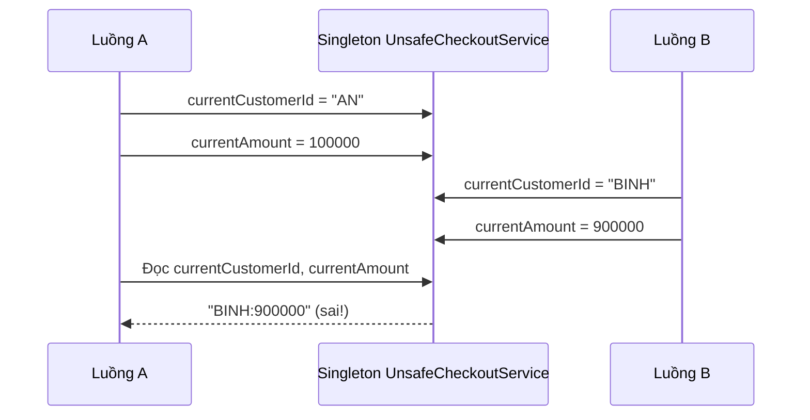

Đây là một **interleaving có thể xảy ra**, chưa cần bàn đến quy tắc Java Memory Model. Khi thiếu quan hệ đồng bộ, việc nhìn thấy giá trị trên các luồng còn có thể phức tạp hơn. Không thể dùng `Thread.sleep` để “sửa” tình huống này.

Lỗi không phụ thuộc vào việc Singleton viết bằng holder, `enum`, `synchronized getInstance()`, Spring bean hay constructor injection. **Nếu trạng thái thay đổi theo request nằm trong object dùng chung, thiết kế vẫn nguy hiểm.**

### Cách sửa đúng: dùng biến cục bộ và dependency phù hợp

```java
import java.math.BigDecimal;
import java.util.Objects;

public final class SafeCheckoutService {
    private final PaymentGateway gateway;

    public SafeCheckoutService(PaymentGateway gateway) {
        this.gateway = Objects.requireNonNull(gateway, "gateway");
    }

    public Receipt checkout(String customerId, BigDecimal amount) {
        Objects.requireNonNull(customerId, "customerId");
        Objects.requireNonNull(amount, "amount");

        if (customerId.isBlank() || amount.signum() <= 0) {
            throw new IllegalArgumentException("Thông tin đơn hàng không hợp lệ");
        }

        // Không có currentCustomerId/currentAmount làm field.
        // Mỗi lời gọi chỉ dùng tham số và biến cục bộ của chính nó.
        String confirmationCode = gateway.charge(customerId, amount);
        return new Receipt(customerId, amount, confirmationCode);
    }

    public interface PaymentGateway {
        String charge(String customerId, BigDecimal amount);
    }

    public record Receipt(String customerId,
                          BigDecimal amount,
                          String confirmationCode) {}

    public static void main(String[] args) {
        PaymentGateway fakeGateway = (id, amount) -> "CONFIRMED-" + id;
        SafeCheckoutService service = new SafeCheckoutService(fakeGateway);

        System.out.println(service.checkout("AN", new BigDecimal("100000")));
        System.out.println(service.checkout("BINH", new BigDecimal("900000")));
    }
}
```

`SafeCheckoutService` có thể được chia sẻ giữa nhiều request **vì bản thân nó không có trạng thái thay đổi theo request**. Nhưng điều kiện đi kèm là `gateway.charge(...)` cũng phải an toàn khi được gọi đồng thời; tính an toàn của thành phần phụ thuộc phải được xét riêng. Trong ứng dụng thật, việc xử lý thanh toán còn cần idempotency key, timeout, retry được kiểm soát và tránh log dữ liệu nhạy cảm.

**Nguyên tắc thực hành:** dữ liệu theo request → tham số, biến cục bộ hoặc dependency đúng scope. Dữ liệu bất biến dùng chung → có thể đặt trong object sống lâu. Dữ liệu thay đổi dùng chung → phải có bất biến, chiến lược đồng bộ và phương án kiểm thử rõ ràng.

## 4. Khi Singleton bắt buộc mang trạng thái thay đổi

Một số trạng thái có lý do chính đáng để chia sẻ: thống kê trong tiến trình, cache, pool tài nguyên hoặc một hàng đợi công việc. Khi đó, câu hỏi chính không còn là “lấy instance bằng cách nào” mà là “mọi phép cập nhật có đúng khi chạy đồng thời không?”.

### Sai: thao tác cộng một không nguyên tử

```java
final class UnsafeCounter {
    private long total = 0L;

    public void increment() {
        total++; // Đọc -> cộng -> ghi: nhiều bước, có thể mất cập nhật.
    }

    public long get() {
        return total;
    }
}
```

Kể cả có đúng **một** `UnsafeCounter`, hai luồng vẫn có thể cùng đọc `total = 5`, cùng ghi `6`, và làm mất một lần tăng. Khai báo `volatile long total` chỉ cải thiện vấn đề visibility/ordering liên quan đến biến đó; phép `total++` vẫn không trở thành phép cộng nguyên tử.

### Đúng cho bộ đếm trong một process: AtomicLong

Tạo file `CounterDemo.java`:

```java
import java.util.ArrayList;
import java.util.List;
import java.util.concurrent.Callable;
import java.util.concurrent.ExecutorService;
import java.util.concurrent.Executors;
import java.util.concurrent.Future;
import java.util.concurrent.atomic.AtomicLong;

public class CounterDemo {
    enum RequestCounter {
        INSTANCE;

        private final AtomicLong count = new AtomicLong();

        public long incrementAndGet() {
            return count.incrementAndGet();
        }

        public long get() {
            return count.get();
        }
    }

    public static void main(String[] args) throws Exception {
        int workers = 8;
        int incrementsPerWorker = 10_000;
        ExecutorService executor = Executors.newFixedThreadPool(workers);

        try {
            List<Callable<Void>> jobs = new ArrayList<>();
            for (int worker = 0; worker < workers; worker++) {
                jobs.add(() -> {
                    for (int i = 0; i < incrementsPerWorker; i++) {
                        RequestCounter.INSTANCE.incrementAndGet();
                    }
                    return null;
                });
            }

            List<Future<Void>> futures = executor.invokeAll(jobs);
            for (Future<Void> future : futures) {
                future.get(); // Chờ tác vụ hoàn tất và nhận lỗi nếu có.
            }

            System.out.println(RequestCounter.INSTANCE.get());
            // 80000 khi chạy một lần trong một JVM mới, không có caller khác.
        } finally {
            executor.shutdown();
        }
    }
}
```

`enum RequestCounter` thể hiện dạng Singleton gọn: ngôn ngữ Java tạo các constant của enum với cơ chế khởi tạo an toàn; xử lý serialization của enum theo ngữ nghĩa riêng và ngăn tạo instance enum theo cách reflection thông thường. `AtomicLong` làm cho **mỗi phép tăng** là nguyên tử. Tuy nhiên:

- Bộ đếm chỉ thuộc **một JVM/class loader**; không gom thống kê từ các pod khác.
- Giá trị mất khi tiến trình khởi động lại; không dùng làm mã giao dịch duy nhất bền vững.
- Nếu có nhiều trường cần nhất quán với nhau, một `AtomicLong` không giải quyết giao dịch nhiều bước.
- `enum` cũng không làm các kiểu trạng thái tùy ý trong nó trở nên thread-safe.

Ví dụ này chứng minh việc tạo Singleton và việc cập nhật trạng thái là **hai quyết định thiết kế độc lập**.

## 5. Những bẫy đồng bộ thường gặp

| Vấn đề | Ví dụ | Cách kiểm soát |
|---|---|---|
| Lost update | `count++` trong nhiều luồng | `AtomicLong`, `synchronized`, `Lock` tùy bất biến |
| Visibility | Một luồng ghi flag, luồng khác mãi không thấy | `volatile`, lock, atomic hoặc cơ chế đồng bộ phù hợp |
| Collection thay đổi đồng thời | Nhiều luồng cùng ghi `HashMap` | `ConcurrentHashMap` hoặc khóa bảo vệ truy cập |
| Nhiều bước phải nhất quán | Trừ tồn kho rồi ghi đơn hàng | Transaction/CAS/lock, xác định điểm nguyên tử |
| Rò rỉ dữ liệu request | Field `currentUser`, `currentOrder` | Biến cục bộ, tham số hoặc đúng scope |
| Dependency không thread-safe | Đưa object có trạng thái nội bộ không an toàn vào Singleton | Dùng API thread-safe, bảo vệ bằng khóa hoặc không chia sẻ |
| Trạng thái giữa các lần test | Test A tăng counter, test B mong counter bằng 0 | Inject instance mới, fixture cô lập, tránh global mutable |
| Xung đột qua nhiều instance ứng dụng | Mỗi pod cấp cùng mã số 101 | Cơ chế đồng bộ/danh tính ở lớp dữ liệu hoặc phân tán |

Đặc biệt, `ConcurrentHashMap` làm các phương thức riêng lẻ an toàn khi dùng đồng thời, **không tự biến chuỗi `get` + tính toán + `put` thành một giao dịch nguyên tử**. Khi tăng bộ đếm theo khóa, dùng `merge` hoặc `compute` thích hợp:

```java
import java.util.concurrent.ConcurrentHashMap;

final class OperationMetrics {
    private final ConcurrentHashMap<String, Long> counts =
            new ConcurrentHashMap<>();

    void record(String operation) {
        counts.merge(operation, 1L, Long::sum);
    }

    long count(String operation) {
        return counts.getOrDefault(operation, 0L);
    }
}
```

Ở đây, một lần gọi `merge` thực hiện phép cập nhật nguyên tử đối với khóa tương ứng theo hợp đồng `ConcurrentHashMap`. Việc đọc nhiều khóa liên tiếp vẫn **không** tạo ra một snapshot nhất quán toàn map. Nếu báo cáo yêu cầu số liệu chính xác tại cùng một thời điểm hoặc liên quan đến một transaction DB, cần cơ chế khác.

### Vì sao `synchronized getInstance()` không bảo vệ các phương thức?

```java
public static synchronized SharedState getInstance() {
    // Chỉ tuần tự hóa việc truy cập phương thức getInstance().
    return INSTANCE;
}
```

Đoạn trên không bảo vệ những thao tác như `getInstance().addItem()` hoặc `getInstance().updateBalance()` **trừ khi chính các thao tác đó** được đồng bộ phù hợp. Nếu cần double-checked locking để lazy initialization, trường instance phải được công bố với các quy tắc memory visibility đúng (chẳng hạn `volatile`). Trong trường hợp thông thường, holder hoặc DI đơn giản và ít lỗi hơn.

## 6. Singleton trong Spring: scope và trạng thái

Spring mặc định dùng scope `singleton` cho bean, nghĩa là các nơi inject cùng bean definition trong một application context nhận cùng object. Spring quản lý vòng đời, injection, proxy tùy cấu hình; phạm vi này **không phải bảo đảm một object duy nhất trên tất cả context/JVM**.

Ví dụ bean service không giữ dữ liệu request:

```java
import java.math.BigDecimal;
import org.springframework.stereotype.Service;

@Service // Mặc định scope singleton trong Spring
public class PriceService {
    public BigDecimal total(BigDecimal unitPrice, int quantity) {
        if (unitPrice == null || unitPrice.signum() < 0 || quantity < 0) {
            throw new IllegalArgumentException("Giá hoặc số lượng không hợp lệ");
        }
        // Chỉ dùng tham số và kết quả cục bộ.
        return unitPrice.multiply(BigDecimal.valueOf(quantity));
    }
}
```

Khi nhiều HTTP request gọi `PriceService.total(...)` đồng thời, không có field tạm theo request để ghi đè nhau. Trường hợp này có thể dùng singleton vì code **stateless**.

Ngược lại, cách viết sau rất nguy hiểm:

```java
@Service
public class BadCartService {
    private String activeUserId; // Dữ liệu của request hiện tại!

    public void setActiveUser(String id) {
        activeUserId = id;
    }

    public String activeUser() {
        return activeUserId;
    }
}
```

Không nên “vá” bằng `synchronized` nếu bản chất dữ liệu thuộc từng user/request. Khóa toàn cục vừa làm nghẽn tải vừa vẫn dễ sai nếu request có nhiều lần gọi tách biệt.

### Chọn đúng scope và vòng đời

| Dữ liệu/Thành phần | Phạm vi thường phù hợp | Ghi chú |
|---|---|---|
| Dịch vụ xử lý nghiệp vụ stateless | Spring singleton | Dependency bên trong cũng cần an toàn |
| Thông tin chỉ dùng trong một lời gọi | Biến cục bộ, tham số | Đơn giản và tránh chia sẻ ngoài ý muốn |
| Trạng thái của một HTTP request | `request` scope hoặc truyền tường minh | Request scope cần web-aware context |
| Trạng thái gắn với HTTP session | `session` scope hoặc kho lưu phù hợp | Có vấn đề đồng thời khi cùng session mở nhiều tab |
| Object phải mới cho mỗi lần lấy | `prototype` scope | Inject prototype trực tiếp vào singleton không tự tạo mới mỗi lần dùng |
| Cache/pool dùng chung | Singleton kết hợp primitive/thiết kế thread-safe | Có giới hạn kích thước, timeout, eviction, giám sát |
| Dữ liệu giao dịch bền vững | Database/transaction | Không lưu bản chuẩn duy nhất trong field của bean |

Khi bean singleton cần dùng bean request-scoped, Spring phải có cơ chế lấy instance tương ứng ngữ cảnh đang hoạt động (ví dụ scoped proxy, `ObjectProvider` hoặc truyền dependency từ request layer). Việc chú thích scope một cách tùy tiện không tự giải quyết được các quy tắc phiên, bảo mật hoặc xử lý async.

## 7. Singleton và dependency injection: vấn đề kiểm thử

Một trong những rủi ro lớn của `GlobalState.getInstance()` là **hidden dependency**. Constructor của lớp không cho biết lớp đó phụ thuộc hệ thống toàn cục, test dễ bị ảnh hưởng thứ tự chạy, và rất khó thay implementation riêng cho môi trường thử nghiệm.

**Ví dụ phụ thuộc ẩn:**

```java
final class NotificationService {
    void sendWelcome(String email) {
        GlobalMailClient.getInstance().send(email, "Welcome!");
    }
}
```

Mã trên trực tiếp lấy service toàn cục. Trong unit test, ta khó đưa một fake client độc lập hoặc kiểm tra chính xác lần gọi mà không can thiệp global state.

**Thiết kế bằng constructor injection:**

```java
import java.util.Objects;

interface MailClient {
    void send(String recipient, String message);
}

final class NotificationService {
    private final MailClient mailClient;

    NotificationService(MailClient mailClient) {
        this.mailClient = Objects.requireNonNull(mailClient);
    }

    void sendWelcome(String email) {
        mailClient.send(email, "Welcome!");
    }
}

final class FakeMailClient implements MailClient {
    int sent = 0;

    @Override
    public void send(String recipient, String message) {
        sent++;
    }
}
```

Ở đây, có thể tạo `new NotificationService(new FakeMailClient())` trong từng test. Fake lưu biến `sent` **chỉ thuộc fixture của test đó**; fake không cần chia sẻ toàn ứng dụng và không cần tự đồng bộ nếu mỗi test gọi tuần tự. Với production, container có thể quản lý `MailClient` theo singleton nếu implementation phù hợp.

**Không nên tự động đánh đồng:**

- Singleton pattern: lớp tự kiểm soát instance và thường cung cấp điểm truy cập toàn cục.
- Singleton scope của DI container: container quyết định chia sẻ một instance của bean; mã sử dụng có thể chỉ biết interface được inject.
- Trạng thái toàn cục: dữ liệu hoặc dịch vụ được truy cập rộng rãi, có thể có hoặc không được quản lý bằng Singleton. Vấn đề chính là phạm vi, tính thay đổi và khả năng kiểm soát.

Một component hoàn toàn stateless thường không cần pattern Singleton Java truyền thống; việc tái sử dụng instance có thể do DI container hoặc composition root quyết định.

## 8. Kiểm thử sự an toàn của Singleton

Kiểm thử nên đi từ các **bất biến nghiệp vụ** cụ thể, không chỉ từ việc gọi `getInstance()` hai lần.

### Kiểm tra danh tính cùng class loader

```java
import static org.junit.jupiter.api.Assertions.*;
import org.junit.jupiter.api.Test;

class AppSettingsTest {
    @Test
    void returnsSameInstanceWithinTestClassLoader() {
        assertSame(AppSettings.getInstance(), AppSettings.getInstance());
    }

    @Test
    void exposesExpectedImmutableConfiguration() {
        assertEquals("VND", AppSettings.getInstance().get("currency"));
    }
}
```

Phép `assertSame` xác minh hành vi một instance **ở ngữ cảnh test đó**. Nó không xác minh thread-safety của mọi method trong Singleton, cũng không chứng minh một instance trên cụm phân tán.

### Kiểm tra cập nhật dưới tải cạnh tranh

Ví dụ `CounterDemo` ở mục 4 cho nhiều tác vụ tăng `AtomicLong` và chờ mọi `Future`. Với ứng dụng thật, nên kiểm tra cả trường hợp exception, timeout, đóng executor và các bất biến phối hợp nhiều field.

Lưu ý quan trọng: unit test race có thể chạy qua dù code sai, vì lịch xen kẽ của thread không được bảo đảm. Có thể dùng latch/barrier để điều phối tình huống cạnh tranh và kiểm thử lặp lại, nhưng **kiểm thử không thay thế được lập luận về đồng bộ**. Tránh phép kiểm tra dựa vào `sleep(...)` hoặc thời gian chạy ngẫu nhiên.

Với global mutable Singleton, nhiều test cùng chạy song song có thể làm kết quả không ổn định. Tốt hơn là **inject stateful collaborator mới cho từng test**, hoặc thiết kế một cơ chế reset được bảo vệ và kiểm soát thứ tự nếu thật sự bắt buộc.

## 9. Vòng đời và tài nguyên cũng là trách nhiệm

Singleton sống lâu thường giữ tài nguyên: connection pool, file watcher, scheduler, thread pool hoặc cache. Cần quan tâm:

- **Đóng tài nguyên** đúng lúc ứng dụng shutdown (`AutoCloseable`, callback lifecycle của container như `@PreDestroy`).
- **Không giữ tham chiếu lâu dài** đến request/session/user khiến dữ liệu không được giải phóng.
- **Giới hạn bộ nhớ** đối với cache (TTL, số mục, kích thước và eviction).
- **Không nhét lock quá rộng** quanh I/O kéo dài; nguy cơ giảm thông lượng hoặc deadlock.
- **Không dùng Singleton thay thế transaction DB** khi có nhiều tiến trình hoặc yêu cầu bền vững.
- **Không tin rằng một object tự đảm bảo chính xác một lần xử lý**: retry, crash và nhiều worker cần thiết kế idempotency riêng.

Singleton chứa nhiều dependency có vòng đời và trạng thái khác nhau đặc biệt khó vận hành. Việc tách trách nhiệm, giảm trạng thái và quản lý vòng đời trong container thường giúp dễ giám sát hơn.

## 10. Khi nào nên dùng Singleton?

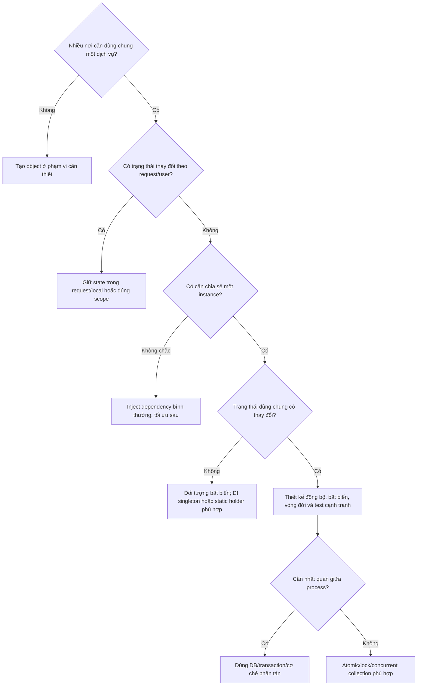

**Những dấu hiệu nên tránh Singleton thủ công:** số lượng user đang hoạt động; context hiện tại; data mutable lấy từ HTTP request; object cần fake/test thay thế; yêu cầu chạy nhiều instance; lớp biết quá nhiều dependency; biến toàn cục gây phụ thuộc thứ tự khởi tạo.

**Những trường hợp có thể hợp lý:** giá trị cấu hình được nạp một lần và bất biến, registry đọc nhiều/ghi ít với cơ chế đồng bộ rõ, facade đến một tài nguyên sống lâu do container quản lý, hoặc thống kê cục bộ trong process với `AtomicLong` và đặc tả về vòng đời.

## 11. Bài tập áp dụng

### Bài 1 – Phát hiện race condition

Một singleton service khai báo:

```java
private String currentOrderId;

public void process(String orderId) {
    currentOrderId = orderId;
    audit(currentOrderId);
}
```

Hãy mô tả một thứ tự xen kẽ của hai request khiến `audit` nhận sai order ID. Refactor dùng tham số cục bộ, không đưa dữ liệu request vào field chung. Giải thích vì sao khóa `synchronized process` là giải pháp có thể chạy nhưng không giải quyết đúng nhu cầu sở hữu dữ liệu.

### Bài 2 – Thiết kế bộ đếm

Triển khai `RequestMetrics` đếm số request theo loại. Đề xuất hai lựa chọn:

- Dùng `ConcurrentHashMap<String, AtomicLong>` hoặc `ConcurrentHashMap.merge` để cập nhật theo khóa.
- Lưu số liệu thống kê trong database hoặc dịch vụ metrics khi cần tổng hợp qua nhiều container.

Phân tích khác biệt ở khả năng reset, tính chính xác snapshot và độ bền dữ liệu.

### Bài 3 – Refactor để dễ kiểm thử

Một `InvoiceService` gọi `TaxRules.getInstance()` trong mọi phương thức. Chuyển sang interface `TaxCalculator` inject qua constructor; viết fake tax calculator cho test. Giải thích trường hợp `TaxRules` bất biến vẫn có thể tái sử dụng một instance nhưng không cần để client biết đến `getInstance()`.

### Bài 4 – Phạm vi Spring

Một singleton `OrderService` inject `ShoppingCart` dạng mutable prototype bằng constructor. Người học cần giải thích vì sao điều đó **không** bảo đảm một cart mới cho mỗi request, rồi đề xuất cách truyền cart qua tham số hoặc dùng scope/phương án tạo instance phù hợp.

## 12. Những điều cần tự kiểm tra trước khi thiết kế

1. “Một” instance được hiểu trong phạm vi **class loader, IoC container, process hay toàn cụm**?
2. Object chỉ có phương thức xử lý stateless hay giữ trạng thái mutable? Ai sở hữu trạng thái?
3. Nếu hai thread gọi cùng phương thức, có tương tác vào field nào? Các phép cập nhật có nguyên tử không?
4. `final`, `volatile`, `synchronized`, `AtomicLong` hay concurrent collections được chọn để bảo vệ **bất biến cụ thể nào**?
5. Trường hợp dùng nhiều server, mất điện hoặc restart thì dữ liệu có phải còn nguyên hoặc thống nhất không?
6. Test có thể tạo dependency riêng và chạy độc lập, song song hay không?
7. Ai chịu trách nhiệm khởi tạo, cấu hình, dọn dẹp tài nguyên và quan sát lỗi?

**Ghi nhớ:** Singleton chỉ trả lời câu hỏi **số lượng và điểm truy cập instance trong một phạm vi**. Độ an toàn khi chia sẻ phụ thuộc vào **trạng thái, hợp đồng đồng thời, vòng đời và ranh giới triển khai**. Ưu tiên dữ liệu cục bộ, object bất biến và dependency injection; chỉ dùng trạng thái chia sẻ có chủ đích khi đã xác định cách đồng bộ và kiểm thử tương ứng.


</details>

- [Quay lại đầu trang](#back-to-top)

---

## <a id="design-patterns-005">Adapter và tích hợp giao diện khác nhau</a>

<details>
<summary>Xem chi tiết</summary>

# Adapter Pattern trong Java: tích hợp các giao diện khác nhau

**Nhóm:** OOP → Mẫu thiết kế  
**Chủ đề:** Adapter và tích hợp giao diện khác nhau

## 1. Bài toán: hai hệ thống làm cùng việc nhưng không nói cùng “ngôn ngữ”

Ứng dụng của bạn đã chuẩn hóa việc thanh toán qua interface `PaymentGateway` với đối tượng yêu cầu và kết quả rõ ràng. Sau đó doanh nghiệp phải tích hợp một SDK thanh toán cũ:

- Ứng dụng gửi số tiền bằng `BigDecimal`, đơn vị USD; SDK cũ nhận `long`, đơn vị **cent**.
- Ứng dụng dùng `charge(PaymentRequest)`; SDK cũ dùng `execute(String merchantRef, long amountInCents)`.
- Ứng dụng cần kết quả `APPROVED` hoặc `DECLINED`; SDK cũ trả mã chuỗi `"00"`, `"05"`, `"91"`.
- Đổi toàn bộ mã `CheckoutService` để phụ thuộc SDK cũ sẽ làm chức năng nghiệp vụ bị ràng buộc vào nhà cung cấp.

**Adapter** tạo một lớp đứng giữa để biến giao diện mà SDK hiện có (*Adaptee*) thành giao diện mà ứng dụng mong đợi (*Target*). Bên sử dụng (*Client*) tiếp tục làm việc với `Target`. Lớp `Adapter` chịu trách nhiệm chuyển đổi lời gọi, tham số, phản hồi và lỗi trong phạm vi hợp đồng đã xác định.

### Thành phần của mẫu Adapter

| Vai trò | Trong ví dụ | Trách nhiệm |
|---|---|---|
| **Client** | `CheckoutService` | Gọi nghiệp vụ thanh toán thông qua interface thống nhất |
| **Target** | `PaymentGateway` | Hợp đồng mà client hiểu: `charge(PaymentRequest)` |
| **Adaptee** | `LegacyPaymentApi` / `LegacyPaymentSdk` | API cũ có chữ ký và quy ước dữ liệu riêng |
| **Adapter** | `LegacyPaymentAdapter` | Triển khai `PaymentGateway` và ủy quyền tới API cũ sau khi chuyển đổi |

~~~mermaid
classDiagram
    direction LR
    class PaymentGateway {
        <<interface>>
        +charge(PaymentRequest) PaymentReceipt
    }
    class LegacyPaymentApi {
        <<interface>>
        +execute(String, long) LegacyReply
    }
    class CheckoutService {
        -PaymentGateway gateway
        +checkout(PaymentRequest) String
    }
    class LegacyPaymentAdapter {
        -LegacyPaymentApi legacy
        +charge(PaymentRequest) PaymentReceipt
    }
    class LegacyPaymentSdk {
        +execute(String, long) LegacyReply
    }
    CheckoutService --> PaymentGateway : uses
    LegacyPaymentAdapter ..|> PaymentGateway : implements
    LegacyPaymentAdapter --> LegacyPaymentApi : delegates
    LegacyPaymentSdk ..|> LegacyPaymentApi : implements
~~~

> Đây là **Object Adapter**: giữ tham chiếu tới đối tượng được bọc bằng *composition*. Một lớp adapter không nhất thiết phải thừa kế lớp của SDK.

## 2. Xác định hợp đồng trước khi viết adapter

Cần thống nhất ý nghĩa dữ liệu trước khi chuyển đổi. Trong ví dụ học tập này:

1. `PaymentRequest` chỉ đại diện giao dịch bằng **USD**, số tiền dương và biểu diễn chính xác được bằng cent trong phạm vi `long`; mã đơn hàng khác rỗng. Dữ liệu không đáp ứng điều kiện bị từ chối ngay khi tạo request.
2. `PaymentGateway.charge` nhận request hợp lệ. Với phản hồi rõ ràng từ nhà cung cấp, nó trả `PaymentReceipt` có trạng thái `APPROVED` hoặc `DECLINED`.
3. Mã `"00"` của SDK nghĩa là duyệt, `"05"` là từ chối, `"91"` là tạm thời không xác định được kết quả. **Các mã này chỉ là quy ước giả lập của ví dụ**, không đại diện cho mọi SDK thực tế.
4. Phản hồi bị thiếu, mã không biết, hoặc lỗi hạ tầng phải được đưa ra dưới dạng lỗi rõ ràng. Không biến lỗi không xác định thành `DECLINED` hoặc `APPROVED`.
5. Client không truy cập kiểu `LegacyReply`, mã lỗi nội bộ hay phương thức đặc thù của SDK.

Ở hệ thống thật, đọc tài liệu chính thức của nhà cung cấp để xác nhận đơn vị tiền, trạng thái cuối cùng, quy tắc làm tròn, thời hạn timeout và yêu cầu idempotency. **Adapter không thể tự tạo ra bảo đảm mà dịch vụ ngoài không cung cấp**.

## 3. Java 17+: ví dụ đầy đủ, chạy độc lập

Lưu toàn bộ code thành file **`AdapterDemo.java`**. SDK bên dưới chỉ là một **stub mô phỏng** để học thiết kế; nó không gửi tiền hoặc kết nối dịch vụ thực.

~~~java
import java.math.BigDecimal;
import java.util.Objects;

// ====== API mà nghiệp vụ của ứng dụng mong đợi (Target) ======

enum PaymentStatus {
    APPROVED,
    DECLINED
}

record PaymentRequest(String orderId, BigDecimal amountUsd) {
    PaymentRequest {
        if (orderId == null || orderId.isBlank()) {
            throw new IllegalArgumentException("orderId must not be blank");
        }
        if (amountUsd == null) {
            throw new IllegalArgumentException("amountUsd is required");
        }

        // Không chấp nhận đơn vị nhỏ hơn 1 cent hoặc giá trị
        // không biểu diễn vừa trong long.
        try {
            long cents = amountUsd.movePointRight(2).longValueExact();
            if (cents <= 0) {
                throw new IllegalArgumentException("amount must be positive");
            }
        } catch (ArithmeticException ex) {
            throw new IllegalArgumentException(
                    "amount must be an exact cent value within long range", ex);
        }
    }
}

record PaymentReceipt(PaymentStatus status, String reference) {
    PaymentReceipt {
        Objects.requireNonNull(status, "status");
        if (status == PaymentStatus.APPROVED &&
                (reference == null || reference.isBlank())) {
            throw new IllegalArgumentException(
                    "approved payment needs provider reference");
        }
    }
}

interface PaymentGateway {
    /**
     * Nhận PaymentRequest hợp lệ, trả APPROVED hoặc DECLINED
     * khi phản hồi đã xác định.
     *
     * @throws GatewayUnavailableException nếu chưa xác định
     *         được kết quả từ nhà cung cấp
     * @throws ProviderProtocolException nếu phản hồi phá hợp đồng
     */
    PaymentReceipt charge(PaymentRequest request);
}

final class GatewayUnavailableException extends RuntimeException {
    GatewayUnavailableException(String message) {
        super(message);
    }
}

final class ProviderProtocolException extends RuntimeException {
    ProviderProtocolException(String message) {
        super(message);
    }
}

// ====== API của SDK cũ (Adaptee) ======

record LegacyReply(String code, String transactionId) {}

interface LegacyPaymentApi {
    // Nhận cents (long), trả mã giao thức riêng.
    LegacyReply execute(String merchantRef, long amountInCents);
}

// Stub mô phỏng SDK thực tế. "00" là thành công theo quy ước demo.
final class LegacyPaymentSdk implements LegacyPaymentApi {
    @Override
    public LegacyReply execute(String merchantRef, long amountInCents) {
        return new LegacyReply("00", "LEGACY-" + merchantRef);
    }
}

// ====== Adapter: bọc SDK cũ, cung cấp API mới ======

final class LegacyPaymentAdapter implements PaymentGateway {
    private final LegacyPaymentApi legacy;

    LegacyPaymentAdapter(LegacyPaymentApi legacy) {
        this.legacy = Objects.requireNonNull(legacy, "legacy");
    }

    @Override
    public PaymentReceipt charge(PaymentRequest request) {
        Objects.requireNonNull(request, "request");

        // Request đã kiểm tra cent chính xác ngay khi khởi tạo.
        long cents = request.amountUsd()
                            .movePointRight(2)
                            .longValueExact();

        LegacyReply reply = legacy.execute(request.orderId(), cents);

        if (reply == null || reply.code() == null) {
            throw new ProviderProtocolException(
                    "legacy provider returned an invalid reply");
        }

        return switch (reply.code()) {
            case "00" -> {
                if (reply.transactionId() == null ||
                        reply.transactionId().isBlank()) {
                    throw new ProviderProtocolException(
                            "approved reply has no transaction id");
                }
                yield new PaymentReceipt(
                        PaymentStatus.APPROVED, reply.transactionId());
            }
            case "05" -> new PaymentReceipt(
                    PaymentStatus.DECLINED, reply.transactionId());
            case "91" -> throw new GatewayUnavailableException(
                    "provider result is not confirmed; reconcile first");
            default -> throw new ProviderProtocolException(
                    "unknown provider code: " + reply.code());
        };
    }
}

// ====== Client: không biết tên SDK, mã lỗi hoặc đơn vị cents ======

final class CheckoutService {
    private final PaymentGateway gateway;

    CheckoutService(PaymentGateway gateway) {
        this.gateway = Objects.requireNonNull(gateway, "gateway");
    }

    String checkout(PaymentRequest request) {
        PaymentReceipt receipt = gateway.charge(request);

        return switch (receipt.status()) {
            case APPROVED -> "Paid: " + receipt.reference();
            case DECLINED -> "Payment declined";
        };
    }
}

public class AdapterDemo {
    public static void main(String[] args) {
        LegacyPaymentApi oldSdk = new LegacyPaymentSdk();
        PaymentGateway gateway = new LegacyPaymentAdapter(oldSdk);
        CheckoutService checkout = new CheckoutService(gateway);

        PaymentRequest order = new PaymentRequest(
                "ORDER-1001", new BigDecimal("12.34"));

        System.out.println(checkout.checkout(order));
        // Paid: LEGACY-ORDER-1001
    }
}
~~~

Chạy bằng JDK 17 trở lên:

~~~bash
javac AdapterDemo.java
java AdapterDemo
~~~

**Dòng dữ liệu thực tế của ví dụ:**

~~~mermaid
sequenceDiagram
    participant C as CheckoutService
    participant A as LegacyPaymentAdapter
    participant L as LegacyPaymentApi
    C->>A: charge(ORDER-1001, USD 12.34)
    Note over A: BigDecimal 12.34 → long 1234 cents
    A->>L: execute("ORDER-1001", 1234)
    L-->>A: LegacyReply("00", "LEGACY-ORDER-1001")
    Note over A: "00" → APPROVED
    A-->>C: PaymentReceipt(APPROVED, reference)
~~~

`CheckoutService` chỉ phụ thuộc `PaymentGateway`. Nếu sau này chuyển sang SDK mới, lập trình viên chỉ cần cung cấp implementation khác cho `PaymentGateway` và thay cấu hình khởi tạo/dependency injection. Nghiệp vụ checkout không cần hiểu giao thức SDK cũ.

### Tại sao `BigDecimal` và `longValueExact()`?

Thanh toán yêu cầu số tiền chính xác. Với `new BigDecimal("12.34")`:

`12.34 USD × 100 = 1234 cents`

Đoạn `movePointRight(2).longValueExact()` không tự làm tròn: `12.345` sẽ bị từ chối vì không biểu diễn nguyên cent. Đây là lựa chọn **hợp đồng dữ liệu**; nếu sản phẩm thực sự cần làm tròn, phải quy định chính xác mức làm tròn và nơi thực hiện, không tùy ý gọi `doubleValue()` rồi ép `long`.

## 4. Adapter thật sự chuyển đổi những gì?

| Khác biệt | Ở phía ứng dụng | Ở phía SDK cũ | Chuyển đổi tại adapter |
|---|---|---|---|
| Chữ ký | `charge(PaymentRequest)` | `execute(String,long)` | Tách dữ liệu từ request rồi ủy quyền |
| Đơn vị tiền | `BigDecimal` USD | `long` cents | Nhân 100 với phép chuyển chính xác |
| Đầu ra | `PaymentReceipt` | `LegacyReply` | Tạo kiểu kết quả thuộc domain |
| Kết quả | `APPROVED` / `DECLINED` | `"00"` / `"05"` | Ánh xạ mã đã thống nhất |
| Chưa rõ kết quả | Lỗi miền tích hợp | `"91"` | Ném `GatewayUnavailableException` |
| Phản hồi sai giao thức | Lỗi miền tích hợp | `null` / mã lạ | Ném `ProviderProtocolException` |
| Phụ thuộc | `PaymentGateway` | `LegacyPaymentApi` | SDK chỉ xuất hiện ở composition root và adapter |

Chú ý **`DECLINED` là một kết quả nghiệp vụ đã xác định**; sự cố mạng, timeout hay trạng thái không rõ không phải là “khách hàng bị từ chối”. Phân biệt hai trường hợp giúp tránh gửi thông báo sai hoặc thực hiện lại thanh toán bừa bãi.

## 5. Kiểm thử ở đúng ranh giới tích hợp

Để kiểm thử adapter không cần mạng thật, ví dụ trên đưa `LegacyPaymentApi` thành interface có thể thay bằng lambda. File `LegacyPaymentAdapterTest.java` dưới đây dùng JUnit Jupiter 5 (cần dependency JUnit Jupiter và cấu hình JUnit test runner trong Maven hoặc Gradle). Đặt test cùng package với demo; với cấu trúc một file Java mặc định ở trên, cả hai nằm trong default package để trình bày ngắn gọn.

~~~java
import static org.junit.jupiter.api.Assertions.*;

import java.math.BigDecimal;
import java.util.concurrent.atomic.AtomicLong;
import org.junit.jupiter.api.Test;

class LegacyPaymentAdapterTest {

    @Test
    void convertsAmountToCentsWithoutRounding() {
        AtomicLong receivedCents = new AtomicLong(-1L);

        LegacyPaymentApi fake = (ref, cents) -> {
            assertEquals("ORDER-42", ref);
            receivedCents.set(cents);
            return new LegacyReply("00", "TX-1");
        };

        PaymentGateway gateway = new LegacyPaymentAdapter(fake);
        PaymentReceipt result = gateway.charge(
                new PaymentRequest("ORDER-42", new BigDecimal("12.34")));

        assertEquals(1234L, receivedCents.get());
        assertEquals(PaymentStatus.APPROVED, result.status());
        assertEquals("TX-1", result.reference());
    }

    @Test
    void declinedIsAResultRatherThanProviderOutage() {
        PaymentGateway gateway = new LegacyPaymentAdapter(
                (ref, cents) -> new LegacyReply("05", null));

        PaymentReceipt result = gateway.charge(
                new PaymentRequest("ORDER-43", new BigDecimal("2.00")));

        assertEquals(PaymentStatus.DECLINED, result.status());
    }

    @Test
    void ambiguousProviderResultMustNotBeTreatedAsDeclined() {
        PaymentGateway gateway = new LegacyPaymentAdapter(
                (ref, cents) -> new LegacyReply("91", null));

        assertThrows(GatewayUnavailableException.class,
                () -> gateway.charge(new PaymentRequest(
                        "ORDER-44", new BigDecimal("2.00"))));
    }

    @Test
    void unknownCodeDoesNotBecomeSuccess() {
        PaymentGateway gateway = new LegacyPaymentAdapter(
                (ref, cents) -> new LegacyReply("??", null));

        assertThrows(ProviderProtocolException.class,
                () -> gateway.charge(new PaymentRequest(
                        "ORDER-45", new BigDecimal("2.00"))));
    }

    @Test
    void rejectsFractionalCentAtRequestBoundary() {
        assertThrows(IllegalArgumentException.class,
                () -> new PaymentRequest(
                        "ORDER-46", new BigDecimal("12.345")));
    }

    @Test
    void approvedReplyMustHaveTransactionReference() {
        PaymentGateway gateway = new LegacyPaymentAdapter(
                (ref, cents) -> new LegacyReply("00", ""));

        assertThrows(ProviderProtocolException.class,
                () -> gateway.charge(new PaymentRequest(
                        "ORDER-47", new BigDecimal("1.00"))));
    }
}
~~~

Những kiểm thử này xác minh **quy tắc chuyển đổi và ánh xạ**, không chứng minh SDK ngoài vận hành chính xác. Với tích hợp thật cần thêm contract test theo tài liệu API, sandbox integration test và kiểm thử tình huống hạ tầng: timeout trước/sau khi nhà cung cấp nhận yêu cầu, phản hồi trùng, webhook đến muộn, API thay đổi phiên bản.

### Cách tránh thanh toán trùng khi lỗi mạng

Nếu một lệnh `execute` timeout, ứng dụng có thể chưa biết tiền đã bị trừ hay chưa. Không nên tự động gọi lại chỉ vì adapter ném exception: việc retry có thể tạo giao dịch thứ hai.

Giải pháp cần được thống nhất từ thiết kế hệ thống: dùng **idempotency key** khi provider hỗ trợ, lưu trạng thái giao dịch và khóa xử lý trùng, truy vấn trạng thái/reconcile với provider trước khi retry, đồng thời xử lý webhook idempotently. Trong ví dụ, `orderId` chỉ là `merchantRef`; **không có bảo đảm tự động chống trùng**, vì stub không triển khai cơ chế idempotency.

## 6. Object Adapter và Class Adapter

Có hai hình thức Adapter thường được nhắc đến:

**Object Adapter (phổ biến trong Java):** Adapter *chứa* đối tượng Adaptee và gọi phương thức của nó. Đây là cách trong ví dụ:

~~~java
final class LegacyPaymentAdapter implements PaymentGateway {
    private final LegacyPaymentApi legacy;
    // ... chuyển đổi rồi gọi legacy.execute(...)
}
~~~

Ưu điểm: ít phụ thuộc hệ phân cấp lớp, có thể bọc nhiều implementation cùng interface, dễ thay fake để kiểm thử, vẫn dùng được khi SDK dùng `final class` (miễn có cơ chế bọc hoặc một lớp wrapper thích hợp).

**Class Adapter:** Adapter kế thừa lớp Adaptee đồng thời triển khai Target; Java có thể dùng `extends LegacyBaseSdk implements PaymentGateway` nếu lớp SDK cho phép kế thừa. Cách này khó áp dụng với `final`, gắn adapter chặt hơn vào chi tiết lớp cha và Java không hỗ trợ kế thừa nhiều lớp. Vì vậy **composition** thường là lựa chọn dễ bảo trì hơn.

Ví dụ hình thức Class Adapter (chỉ phác họa, không cần ghép vào demo chạy độc lập):

~~~java
class LegacyBaseSdk {
    String oldOperation(String value) { return "old:" + value; }
}
interface NewApi {
    String run(String value);
}
class InheritanceAdapter extends LegacyBaseSdk implements NewApi {
    @Override public String run(String value) {
        return oldOperation(value);
    }
}
~~~

Dù chọn cách nào, điểm xác định mẫu Adapter vẫn là **biến giao diện cũ thành giao diện mới được client mong đợi**, không phải chỉ đơn giản “có một lớp bọc”.

## 7. Adapter khác các mẫu thiết kế dễ nhầm thế nào?

| Mẫu | Mục đích chính | Tình huống nhận diện |
|---|---|---|
| **Adapter** | Làm hai giao diện không tương thích làm việc được với nhau | Domain dùng `PaymentGateway`, SDK có `execute(ref,cents)` |
| **Facade** | Cung cấp điểm truy cập đơn giản tới hệ thống con phức tạp | Một phương thức gom nhiều lời gọi thanh toán, kho, vận chuyển |
| **Decorator** | Bổ sung hành vi, vẫn giữ nguyên giao diện đang bọc | Thêm logging/metrics/retry policy quanh một `PaymentGateway` |
| **Proxy** | Đại diện và kiểm soát truy cập một đối tượng | Lazy initialization, phân quyền, remote access |
| **Bridge** | Tách abstraction khỏi phần hiện thực để hai phía thay đổi độc lập | Nhiều kiểu thông báo và nhiều kênh gửi kết hợp linh hoạt |

Các mẫu có thể phối hợp: ví dụ `MetricsPaymentGateway` dạng Decorator bao quanh `LegacyPaymentAdapter`; bên ngoài vẫn là `PaymentGateway`. Không cần gán mọi lớp wrapper vào Adapter nếu mục tiêu thực tế chỉ là đo thời gian hay kiểm soát quyền truy cập.

## 8. Khi tích hợp nhiều SDK hoặc API phiên bản khác nhau

Giả sử thêm nhà cung cấp thứ hai có JSON HTTP thay vì SDK Java:

~~~text
CheckoutService
      |
      v
  PaymentGateway (hợp đồng chung)
      |                     |
      v                     v
LegacyPaymentAdapter    HttpPaymentAdapter
      |                     |
      v                     v
 LegacyPaymentApi        HTTP/JSON API
~~~

Mỗi adapter đóng gói một bộ ánh xạ riêng, nhưng đều phải bảo toàn hợp đồng `PaymentGateway`. Việc chọn adapter có thể đặt ở lớp cấu hình hoặc dependency injection, chẳng hạn Spring:

~~~java
// Phác họa wiring với Spring; cần có các bean tương ứng.
// @Bean
// PaymentGateway paymentGateway(LegacyPaymentApi legacyPaymentApi) {
//     return new LegacyPaymentAdapter(legacyPaymentApi);
// }
//
// @Service
// class CheckoutService {
//     CheckoutService(PaymentGateway gateway) { ... }
// }
~~~

Nếu hệ thống bắt đầu có hai cách diễn giải `DECLINED` khác nhau, hoặc một nhà cung cấp chỉ hỗ trợ “tạo yêu cầu và chờ callback”, hãy kiểm tra lại **hợp đồng chung**. Không nên giả vờ một API bất đồng bộ luôn cung cấp kết quả xác định tức thời. Khi cần, tách capability, chuyển kết quả thành `PENDING` theo hợp đồng mới và cập nhật client có chủ đích, hoặc thiết kế port chuyên biệt cho luồng bất đồng bộ.

Adapter thường là một phần của **Anti-Corruption Layer** trong DDD: giữ thuật ngữ, model, trạng thái và lỗi thuộc hệ thống ngoài tại biên tích hợp, tránh để chúng lan vào domain. Tuy nhiên Anti-Corruption Layer có thể bao gồm nhiều component hơn một adapter, như mapping, validation, translator và client/repository.

## 9. Những lỗi thiết kế cần tránh

1. **Trả trực tiếp `LegacyReply` ra domain.** Khi đó client vẫn biết mã `"00"`, `"05"`; Adapter chưa hoàn thành trách nhiệm che sự không tương thích.
2. **Rải `if (provider == ...)` khắp nghiệp vụ.** Mỗi provider mới làm client phình to và dễ sai khác hành vi. Dùng một hợp đồng rõ ràng và các implementation thích hợp.
3. **Ép kiểu tiền qua `double` hoặc làm tròn ngầm.** Ví dụ `(long)(12.345 * 100)` âm thầm làm mất phần thập phân. Phải công bố quy tắc tiền tệ trước.
4. **Bắt mọi exception rồi trả `DECLINED`.** Lỗi hạ tầng và trạng thái chưa rõ có thể khiến hệ thống đối soát sai.
5. **Gọi lại khi timeout mà chưa kiểm tra idempotency.** Với lệnh có tác dụng phụ, retry không kiểm soát có thể lặp thanh toán.
6. **Tạo “adapter” chứa luôn nghiệp vụ đặt hàng, tính giá, lưu kho.** Chuyển đổi giao thức nên ở biên; quy tắc kinh doanh nên ở tầng phù hợp.
7. **Bỏ qua bảo mật dữ liệu.** Không log số thẻ, token thanh toán hoặc thông tin bí mật; triển khai TLS, xác thực và quản lý secret theo yêu cầu API thật.
8. **Coi sự tương thích chữ ký là đủ.** Nếu implementation thứ hai trả trạng thái, lỗi hoặc đảm bảo thời gian khác với interface, nó có thể phá những kỳ vọng hợp lệ của client.

## 10. Checklist áp dụng Adapter trong dự án

- [ ] Đã xác định **Target** là hợp đồng do ứng dụng kiểm soát, đủ rõ về đầu vào, đầu ra và lỗi.
- [ ] Đã xác định đúng **Adaptee** (SDK/API cần tích hợp) và đọc quy ước chính thức của nó.
- [ ] Có phép chuyển đổi đơn vị, kiểu dữ liệu và trạng thái rõ ràng, không mất thông tin quan trọng.
- [ ] Các lỗi ngoại vi được ánh xạ sang lỗi hoặc trạng thái có ý nghĩa trong domain; không báo thành công giả.
- [ ] Client phụ thuộc interface của ứng dụng; adapter giữ riêng chi tiết SDK.
- [ ] Có unit test cho ánh xạ và giá trị biên, integration test ở sandbox cho contract bên ngoài.
- [ ] Có chiến lược timeout, đối soát, retry và idempotency tương ứng với khả năng provider.
- [ ] Khi thay provider, phần lớn thay đổi nằm ở adapter và cấu hình kết nối, không xâm nhập core business.

### Bài tập tự luyện

Viết `HttpPaymentAdapter implements PaymentGateway` cho một API giả lập nhận JSON `{"order":"ORDER-1","amountMinor":1234}` và trả `{"state":"accepted","reference":"REMOTE-1"}`. Ánh xạ `accepted → APPROVED`, `rejected → DECLINED`, `pending →` một tình huống chưa xác định theo **hợp đồng đã chọn**. Dùng fake HTTP client để kiểm thử JSON mapping, lỗi parse, timeout và transaction reference bị thiếu. Quan sát rằng `CheckoutService` vẫn không phải thay đổi.

**Điểm cần nhớ:** Adapter không sửa “cách làm việc” của bên thứ ba; nó tạo một **ranh giới dịch thuật có hợp đồng**. Nghiệp vụ nói bằng thuật ngữ của ứng dụng, còn chi tiết nhà cung cấp nằm trong lớp tích hợp.

</details>

- [Quay lại đầu trang](#back-to-top)

---

## <a id="design-patterns-006">Decorator và bổ sung hành vi</a>

<details>
<summary>Xem chi tiết</summary>

# Decorator và bổ sung hành vi trong Java

> **Chủ đề:** OOP → Mẫu thiết kế → **Decorator Pattern**.  
> **Mục tiêu:** hiểu cách mở rộng hành vi đối tượng bằng cách bọc (*wrap*) đối tượng khác cùng hợp đồng, phối hợp nhiều decorator, kiểm soát thứ tự thực thi và nhận biết tình huống không nên áp dụng.

## 1. Bài toán: thêm hành vi mà không sửa mọi implementation

Giả sử ứng dụng có một thành phần gửi thông báo:

~~~java
interface MessageChannel {
    void send(Message message);
}
~~~

Ban đầu, một **ConsoleChannel** ghi thông báo ra console để thử nghiệm. Sau đó xuất hiện yêu cầu:

- Thêm tiền tố **[APP]** vào nội dung trước khi gửi.
- Chặn nội dung dài quá giới hạn.
- Đếm số lời gọi xử lý thành công qua chuỗi gửi.
- Sau này có thể có **EmailChannel**, **SmsChannel** hay adapter cho nhà cung cấp thứ ba.

Một cách làm vội là bổ sung logic tiền tố, kiểm tra độ dài, đếm và ghi log vào mọi lớp gửi thông báo. Cách này lặp logic; mỗi thay đổi quy định chung lại kéo theo nhiều implementation. Cách khác là tạo các lớp con kiểu **LoggedEmailChannel**, **CheckedEmailChannel**, **CheckedLoggedEmailChannel**… Số tổ hợp kế thừa sẽ khó quản lý, đặc biệt khi hành vi phải bật/tắt linh hoạt.

**Decorator** giải quyết tình huống này bằng **composition**: một đối tượng triển khai cùng interface với đối tượng được bọc, giữ tham chiếu đến đối tượng đó, rồi thêm hành vi trước hoặc sau khi ủy quyền lời gọi.

~~~mermaid
flowchart LR
    Client["Client"] --> Count["CountingDecorator"]
    Count --> Prefix["PrefixDecorator"]
    Prefix --> Limit["LengthLimitDecorator"]
    Limit --> Core["ConsoleChannel"]
    Core --> Output["Đầu ra console"]
~~~

Đường đi trong sơ đồ là thứ tự gọi **từ ngoài vào trong**. Khi lời gọi quay ra, các decorator bên ngoài có thể thực hiện thêm hành vi sau khi lớp bên trong hoàn tất.

**Ý chính:** người gọi có thể sử dụng toàn bộ chuỗi qua cùng một interface **MessageChannel** mà không cần biết chính xác nó đang được bọc bởi bao nhiêu lớp.

## 2. Cấu trúc của Decorator

| Vai trò | Trong ví dụ thông báo | Trách nhiệm |
| --- | --- | --- |
| **Component** | **MessageChannel** | Định nghĩa hợp đồng chung mà client sử dụng |
| **Concrete Component** | **ConsoleChannel** | Cung cấp hành vi gốc: nhận và xuất thông báo |
| **Decorator** | **ChannelDecorator** | Giữ tham chiếu đến một **MessageChannel** khác và tiếp tục triển khai hợp đồng |
| **Concrete Decorator** | **PrefixDecorator** | Biến đổi nội dung trước khi gửi |
| **Concrete Decorator** | **LengthLimitDecorator** | Kiểm tra điều kiện trước khi chuyển tiếp |
| **Concrete Decorator** | **CountingDecorator** | Theo dõi số lời gọi trở về thành công |
| **Client** | **main** hoặc service nghiệp vụ | Lắp chuỗi wrapper và gọi giao diện chung |

Mỗi lớp bọc có quyền gọi delegate **trước**, **sau** hoặc **xung quanh** phần hành vi bổ sung. Nó cũng có thể từ chối chuyển tiếp khi một ràng buộc công khai bị vi phạm. Tuy nhiên, thay đổi tiền điều kiện/hậu điều kiện của hợp đồng cần được thiết kế và mô tả rõ; chỉ cần cùng interface về mặt cú pháp chưa đảm bảo mọi wrapper thay thế an toàn cho nhau.

### Sơ đồ lớp

~~~mermaid
classDiagram
    class MessageChannel {
        <<interface>>
        +send(message) void
    }
    class ConsoleChannel {
        +send(message) void
    }
    class ChannelDecorator {
        <<abstract>>
        #next: MessageChannel
    }
    class PrefixDecorator {
        -prefix: String
        +send(message) void
    }
    class LengthLimitDecorator {
        -maxCodePoints: int
        +send(message) void
    }
    class CountingDecorator {
        -accepted: AtomicInteger
        +send(message) void
        +acceptedCalls() int
    }
    MessageChannel <|.. ConsoleChannel
    MessageChannel <|.. ChannelDecorator
    ChannelDecorator o--> MessageChannel : delegates
    ChannelDecorator <|-- PrefixDecorator
    ChannelDecorator <|-- LengthLimitDecorator
    ChannelDecorator <|-- CountingDecorator
~~~

Không cần bắt buộc có lớp **ChannelDecorator** trung gian nếu chỉ có một wrapper nhỏ; mỗi decorator hoàn toàn có thể trực tiếp implements **MessageChannel** và nhận một **MessageChannel** trong constructor. Lớp trừu tượng trung gian chỉ có ích khi thực sự giảm lặp, chẳng hạn cùng logic kiểm tra delegate khác null.

## 3. Ví dụ Java 17 chạy độc lập

Tạo file **DecoratorDemo.java**. Ví dụ dùng **record Message** để thông điệp có giá trị bất biến, **AtomicInteger** để đếm lời gọi qua một wrapper, và **String.codePointCount** để giới hạn theo Unicode code point thay vì chỉ theo số đơn vị UTF-16 của **String.length()**.

~~~java
import java.util.Objects;
import java.util.concurrent.atomic.AtomicInteger;

public class DecoratorDemo {

    public record Message(String recipient, String body) {
        public Message {
            if (recipient == null || recipient.isBlank()) {
                throw new IllegalArgumentException(
                        "Người nhận không được rỗng");
            }
            if (body == null || body.isBlank()) {
                throw new IllegalArgumentException(
                        "Nội dung không được rỗng");
            }
        }
    }

    public interface MessageChannel {
        void send(Message message);
    }

    // Thành phần gốc: chỉ giả lập gửi bằng console.
    public static final class ConsoleChannel implements MessageChannel {
        @Override
        public void send(Message message) {
            Objects.requireNonNull(message, "message");
            System.out.println(
                    "SEND " + message.recipient()
                    + ": " + message.body());
        }
    }

    // Lớp nền tùy chọn: giữ delegate của chuỗi decorator.
    public static abstract class ChannelDecorator
            implements MessageChannel {

        protected final MessageChannel next;

        protected ChannelDecorator(MessageChannel next) {
            this.next = Objects.requireNonNull(next, "next");
        }
    }

    // Thêm tiền tố nhưng không sửa đối tượng Message ban đầu.
    public static final class PrefixDecorator extends ChannelDecorator {
        private final String prefix;

        public PrefixDecorator(MessageChannel next, String prefix) {
            super(next);
            this.prefix = Objects.requireNonNull(prefix, "prefix");
        }

        @Override
        public void send(Message message) {
            Objects.requireNonNull(message, "message");
            next.send(new Message(
                    message.recipient(),
                    prefix + message.body()
            ));
        }
    }

    // Kiểm tra độ dài của thông điệp tại vị trí đặt decorator.
    public static final class LengthLimitDecorator
            extends ChannelDecorator {

        private final int maxCodePoints;

        public LengthLimitDecorator(
                MessageChannel next, int maxCodePoints) {
            super(next);
            if (maxCodePoints <= 0) {
                throw new IllegalArgumentException(
                        "Giới hạn phải lớn hơn 0");
            }
            this.maxCodePoints = maxCodePoints;
        }

        @Override
        public void send(Message message) {
            Objects.requireNonNull(message, "message");
            String body = message.body();
            int length = body.codePointCount(0, body.length());

            if (length > maxCodePoints) {
                throw new IllegalArgumentException(
                        "Thông điệp vượt quá "
                        + maxCodePoints + " Unicode code points");
            }
            next.send(message);
        }
    }

    // Chỉ đếm các lời gọi delegate trở về bình thường.
    public static final class CountingDecorator
            extends ChannelDecorator {

        private final AtomicInteger accepted = new AtomicInteger();

        public CountingDecorator(MessageChannel next) {
            super(next);
        }

        @Override
        public void send(Message message) {
            next.send(message);
            accepted.incrementAndGet();
        }

        public int acceptedCalls() {
            return accepted.get();
        }
    }

    public static void main(String[] args) {
        CountingDecorator channel = new CountingDecorator(
                new PrefixDecorator(
                        new LengthLimitDecorator(
                                new ConsoleChannel(), 80),
                        "[APP] "
                )
        );

        channel.send(new Message(
                "user-01", "Hóa đơn đã phát hành"));

        System.out.println(
                "Số lần xử lý không ném lỗi: "
                        + channel.acceptedCalls());
    }
}
~~~

Chạy trong terminal với JDK 17 trở lên:

~~~bash
javac DecoratorDemo.java
java DecoratorDemo
~~~

Kết quả:

~~~text
SEND user-01: [APP] Hóa đơn đã phát hành
Số lần xử lý không ném lỗi: 1
~~~

Trong ví dụ này, **ConsoleChannel** chỉ mô phỏng gửi thông báo bằng cách in ra màn hình. Một lời gọi trả về bình thường **không tương đương** bảo đảm người nhận thực sự nhận được email/SMS. Vì vậy, bộ đếm được đặt tên **acceptedCalls**, không phải **deliveredMessages**. Khi tích hợp hệ thống thật, cần định nghĩa trạng thái đã tiếp nhận, đã gửi tới nhà cung cấp và đã giao thành công theo hợp đồng của nhà cung cấp.

**Diễn biến lời gọi:**

1. Client gọi **CountingDecorator.send(message)**.
2. **CountingDecorator** chuyển lời gọi vào **PrefixDecorator**.
3. **PrefixDecorator** tạo một **Message** mới có tiền tố và gửi tiếp.
4. **LengthLimitDecorator** đo độ dài của nội dung **sau khi thêm tiền tố**; vượt giới hạn thì ném **IllegalArgumentException** và không gọi thành phần gốc.
5. **ConsoleChannel** in thông điệp.
6. Nếu chuỗi trở về bình thường, **CountingDecorator** tăng bộ đếm; nếu lớp trong ném exception, bộ đếm không tăng.

**Tính mở rộng:** muốn đổi cách gửi, thay **ConsoleChannel** bằng implementation **MessageChannel** khác mà vẫn có thể tái sử dụng các wrapper. Các wrapper không cần biết chi tiết thư viện HTTP, SMTP hay thiết bị đích.

## 4. Thứ tự bọc quyết định hành vi

Một trong những yếu tố dễ gây lỗi nhất của Decorator là **thứ tự**. Xét hai cách lắp:

~~~java
// A: thêm tiền tố trước, sau đó kiểm tra nội dung cuối cùng.
MessageChannel pipelineA =
        new DecoratorDemo.PrefixDecorator(
                new DecoratorDemo.LengthLimitDecorator(
                        new DecoratorDemo.ConsoleChannel(), 12),
                "[A] ");

// B: kiểm tra nội dung gốc trước, rồi mới thêm tiền tố.
MessageChannel pipelineB =
        new DecoratorDemo.LengthLimitDecorator(
                new DecoratorDemo.PrefixDecorator(
                        new DecoratorDemo.ConsoleChannel(), "[A] "),
                12);
~~~

Với nội dung gồm **10** ký tự ASCII, tiền tố **[A]** kèm dấu cách dài **4** code points:

- **pipelineA:** kiểm tra 14 code points, **từ chối** vì vượt 12.
- **pipelineB:** kiểm tra 10 code points, **chấp nhận**; thành phần gốc nhận văn bản dài 14.

Cả hai chuỗi đều đúng cú pháp Java, nhưng chỉ **pipelineA** bảo đảm thông điệp đầu ra không vượt 12 code points. Nếu dịch vụ ngoài giới hạn **số byte UTF-8**, số code point cũng **chưa đủ**: phải đo byte sau khi encode theo charset yêu cầu. Thực tế cần quy định rõ giới hạn đang nói tới byte, code point, UTF-16 code unit hay ký tự hiển thị.

Thứ tự quan trọng tương tự với nén/mã hóa, cache/phân quyền, retry/logging:

| Chuỗi bọc | Tác động có thể xảy ra | Cần quyết định |
| --- | --- | --- |
| Tiền tố → kiểm tra độ dài | Kiểm tra văn bản hoàn chỉnh | Giới hạn đo trước hay sau biến đổi? |
| Cache → phân quyền | Nếu cache phục vụ trước bước phân quyền, có thể làm lộ dữ liệu | Phải xác thực/phân quyền đúng cho mỗi request và tách cache theo ngữ cảnh phù hợp |
| Logging → retry | Wrapper log ngoài có thể chỉ thấy một lần gọi tổng thể | Muốn log một request hay từng lần thử? |
| Retry → logging | Wrapper logging bên trong có thể chạy mỗi lần thử | Có được phép gọi lại thao tác và trùng side effect không? |
| Nén → mã hóa | Thường nén dữ liệu trước khi mã hóa | Bên nhận phải giải mã rồi giải nén cùng định dạng |

Bảng mô tả ảnh hưởng về mặt cấu trúc. Với hệ thống thật, tính an toàn còn tùy contract, dữ liệu, cơ chế lưu trữ, lỗi và chính sách bảo mật của từng decorator. **Không thêm retry cho thao tác có side effect chỉ bằng việc bọc một lớp**; lệnh gửi tin, thanh toán hoặc ghi dữ liệu cần idempotency key hoặc cơ chế chống lặp phù hợp. Timeout có thể xảy ra sau khi bên nhận đã xử lý yêu cầu.

## 5. Kiểm thử từng decorator và cả chuỗi

Một lợi thế của thiết kế theo interface là dễ thay thành phần gốc bằng một **fake** nhỏ để quan sát hành vi. Ví dụ JUnit 5 dưới đây đặt trong **DecoratorDemoTest.java**, cùng package với mã nguồn mẫu.

~~~java
import static org.junit.jupiter.api.Assertions.*;

import org.junit.jupiter.api.Test;

class DecoratorDemoTest {

    static final class RecordingChannel
            implements DecoratorDemo.MessageChannel {
        DecoratorDemo.Message lastMessage;
        int calls;

        @Override
        public void send(DecoratorDemo.Message message) {
            lastMessage = message;
            calls++;
        }
    }

    @Test
    void tienToDuocThemMaKhongThayDoiMessageGoc() {
        RecordingChannel fake = new RecordingChannel();
        var channel = new DecoratorDemo.PrefixDecorator(fake, "[APP] ");
        var original =
                new DecoratorDemo.Message("u01", "Xin chào");

        channel.send(original);

        assertEquals("[APP] Xin chào", fake.lastMessage.body());
        assertEquals("Xin chào", original.body());
        assertEquals(1, fake.calls);
    }

    @Test
    void chuoiChanDuocNoiDungQuaDaiSauKhiThemTienTo() {
        RecordingChannel fake = new RecordingChannel();

        var channel = new DecoratorDemo.PrefixDecorator(
                new DecoratorDemo.LengthLimitDecorator(fake, 8),
                "[A] ");

        assertThrows(IllegalArgumentException.class, () ->
                channel.send(
                        new DecoratorDemo.Message("u01", "12345")));
        // "[A] " dài 4, cộng "12345" dài 5 = 9 > 8.
        assertEquals(0, fake.calls);
    }

    @Test
    void boDemChiTangKhiDelegateTroVeBinhThuong() {
        RecordingChannel fake = new RecordingChannel();
        var counted = new DecoratorDemo.CountingDecorator(
                new DecoratorDemo.LengthLimitDecorator(fake, 5));

        counted.send(
                new DecoratorDemo.Message("u01", "Hello"));
        assertThrows(IllegalArgumentException.class, () ->
                counted.send(
                        new DecoratorDemo.Message("u01", "123456")));

        assertEquals(1, counted.acceptedCalls());
        assertEquals(1, fake.calls);
    }
}
~~~

Các test trên không cần mạng hay máy chủ SMTP/SMS. Chúng kiểm tra chính xác điều wrapper hứa thực hiện: chuyển tiếp, biến đổi, ngăn chuyển tiếp và điều kiện tăng bộ đếm. JUnit Jupiter cần có trong classpath của dự án để chạy file test; **DecoratorDemo.java** độc lập không yêu cầu JUnit.

Nên bổ sung test tích hợp khi kết nối provider thật để kiểm tra encoding, giới hạn payload, policy retry và ánh xạ trạng thái giao hàng. Kiểm thử fake không thể chứng minh nhà cung cấp thật luôn hành xử theo giả định của fake.

## 6. Decorator khác gì các cách mở rộng quen thuộc?

| Kỹ thuật | Cách hoạt động | Nên cân nhắc khi |
| --- | --- | --- |
| **Decorator** | Một đối tượng **cùng interface** bọc đối tượng khác và thêm hành vi có thể ghép lớp | Bổ sung logging, metrics, validation, buffering, compression, transformation... cho từng instance |
| **Kế thừa** | Subclass thay đổi/mở rộng hành vi của base class | Quan hệ subtype thực sự ổn định, ít tổ hợp độc lập |
| **Proxy** | Cũng có thể cùng interface và ủy quyền, nhưng trọng tâm là **kiểm soát truy cập** tới đối tượng khác (lazy loading, remote access, access control...) | Client cần đối tượng đại diện/kiểm soát truy cập |
| **Adapter** | Chuyển đổi **hợp đồng/interface** không tương thích sang hợp đồng client mong đợi | Tích hợp thư viện, API cũ hoặc provider có giao diện khác |
| **Strategy** | Đóng gói các thuật toán **thay thế** và chọn thuật toán phù hợp | Có nhiều cách thực hiện cùng một nhiệm vụ |
| **Chain of Responsibility** | Chuyển request qua chuỗi handler, thường mỗi handler chọn xử lý hoặc tiếp tục | Có nhiều bước xử lý với điều kiện dừng/chuyển tiếp riêng |
| **AOP** | Khai báo cross-cutting advice tại các join point được framework hỗ trợ | Muốn áp quy tắc chung trên nhiều bean/method mà không bọc bằng tay |

**Proxy và Decorator có cấu trúc giống nhau**, nên phải xem ý định thiết kế và trách nhiệm thực tế chứ không phân loại chỉ bằng sơ đồ. **Strategy** chọn *một cách thực hiện*; Decorator thêm các *lớp hành vi* xung quanh cách thực hiện được chọn. Hai mẫu có thể kết hợp.

Trong Spring, **@Transactional**, một số interceptor và proxy là cơ chế giải quyết các vấn đề cắt ngang, nhưng không đồng nghĩa mọi use case Decorator phải chuyển sang AOP. Với wrapper cần tùy biến theo từng instance hoặc có thứ tự rõ ở nơi lắp ráp, Decorator thuần Java dễ đọc và test hơn. Ngược lại, áp một policy thống nhất cho hàng trăm endpoint có thể phù hợp với filter/interceptor/AOP, tùy điểm chặn. Spring proxy AOP cũng có chi tiết cần lưu ý, chẳng hạn lời gọi nội bộ từ một phương thức tới phương thức khác của cùng object thường không đi qua proxy khi dùng proxy-based interception.

## 7. Ví dụ Decorator quen thuộc trong JDK

Một ví dụ rõ ràng là **java.io.InputStream**:

~~~java
import java.io.BufferedInputStream;
import java.io.FileInputStream;
import java.io.IOException;
import java.io.InputStream;

class InputExample {
    static int firstByte(String path) throws IOException {
        try (InputStream in = new BufferedInputStream(
                new FileInputStream(path))) {
            return in.read();
        }
    }
}
~~~

**FileInputStream** đọc byte từ file; **BufferedInputStream** bọc một **InputStream** để bổ sung buffering trong quá trình đọc. Client tiếp tục gọi **read()** qua hợp đồng **InputStream**. Khi **try-with-resources** đóng wrapper, wrapper này thực hiện việc đóng luồng bên trong theo hợp đồng của nó.

Từ ví dụ này cần rút ra hai điểm: (1) client không cần sửa chỉ vì một lớp bọc được thêm vào; (2) wrapper có thể quản lý tài nguyên/lifecycle, nên cần hiểu rõ trách nhiệm đóng, flush và thứ tự kết hợp thay vì coi các decorator hoàn toàn độc lập.

Một ví dụ liên quan là **Collections.unmodifiableList(list)** tạo view không cho sửa qua view đó, nhưng **không tạo bản sao**: thay đổi trên list gốc vẫn có thể phản ánh qua view. Nếu muốn snapshot không sửa qua reference gốc, hãy cân nhắc **List.copyOf(list)** cùng với tính bất biến của các phần tử. Đây là ví dụ điển hình cho việc wrapper bổ sung/giới hạn hành vi mà không nhất thiết copy dữ liệu.

## 8. Thiết kế Decorator an toàn khi đưa vào dự án

### 8.1. Giữ đúng hợp đồng Component

Wrapper cần giữ ý nghĩa của **send**, quy tắc xử lý lỗi và các bất biến mà client trông đợi. Chẳng hạn:

- Một decorator không nên tự ý bỏ thông điệp rồi báo đã gửi nếu hợp đồng hứa thông báo sẽ được chuyển tới delegate hoặc trả lỗi rõ ràng.
- Khi thêm giới hạn nội dung, hãy định nghĩa đó là một phần chính sách công khai của pipeline; client cần biết tình huống nào phát sinh validation error.
- Nếu có kết quả bất đồng bộ (**CompletableFuture**), đừng chỉ đo/đếm ngay khi nhận được future; phải xác định muốn đo việc xếp lịch, việc future hoàn tất thành công hay việc provider xác nhận đã giao.
- Nếu wrapper thêm tài nguyên cần đóng, nên biểu diễn lifecycle rõ ràng (chẳng hạn **AutoCloseable**) và tránh double-close, rò rỉ tài nguyên.

### 8.2. Quyết định trách nhiệm khi gặp exception

Decorator chạy **trước** và **sau** delegate nên thời điểm phát sinh exception rất quan trọng. Trong **CountingDecorator** ở trên, bộ đếm tăng sau khi delegate trả về bình thường; nó không nói lên kết quả giao hàng ngoài đời.

Với đo thời gian, **finally** thường phù hợp nếu muốn đo cả request thất bại:

~~~java
@Override
public void send(Message message) {
    long start = System.nanoTime();
    try {
        next.send(message);
    } finally {
        long elapsedNanos = System.nanoTime() - start;
        recordDuration(elapsedNanos); // Phương thức đo lường do ứng dụng định nghĩa.
    }
}
~~~

Đoạn trên chỉ minh họa **phần thân của một decorator đo thời gian**; để biên dịch độc lập cần khai báo lớp có **next**, hợp đồng **send** và phương thức **recordDuration**. Không dùng **finally** để ngầm biến thất bại thành thành công; exception vẫn cần được truyền hoặc chuyển đổi theo hợp đồng đã định nghĩa. Cũng cần hạn chế exception từ việc ghi metric làm che khuất exception chính.

### 8.3. Cân nhắc trạng thái, đồng thời và phạm vi sử dụng

**PrefixDecorator** và **LengthLimitDecorator** trong ví dụ giữ cấu hình **final** và không tự thay đổi trạng thái. **CountingDecorator** dùng **AtomicInteger** nên riêng phép tăng và đọc bộ đếm được bảo vệ trước cập nhật đồng thời; điều đó **không khiến cả chuỗi thread-safe**. Tính an toàn còn phụ thuộc vào **next**, dữ liệu truyền qua, cách dùng tài nguyên ngoài và có hay không mutation khác.

Nếu cache theo người dùng, bảo đảm key chứa đủ ngữ cảnh phân quyền và thời hạn phù hợp. Nếu logging, không ghi nội dung chứa thông tin cá nhân, token hoặc dữ liệu nhạy cảm theo mặc định. Nếu retry, yêu cầu khả năng chống thực hiện trùng. Nếu giới hạn tốc độ, phân biệt rate-limit theo instance, người dùng, tenant hay toàn hệ thống.

### 8.4. Đừng để lắp ráp trở thành mê cung

Một chuỗi quá dài, nhiều thứ tự cấu hình ngầm hoặc wrapper có tác dụng phụ không hiển nhiên có thể khó debug hơn giải pháp ban đầu. Nên:

1. Đặt tên từng decorator theo **hành vi cụ thể**, như **LengthLimitDecorator**, không đặt tên mơ hồ kiểu **EnhancedChannel**.
2. Tập trung lắp ráp ở **composition root** hoặc một factory có tên rõ, đặc biệt khi chain được sử dụng chung.
3. Ghi nhận thứ tự từ ngoài vào trong cùng lý do; viết test integration cho những tương tác có rủi ro.
4. Tránh wrapper vừa logging, vừa cache, vừa retry, vừa đổi nội dung nếu các trách nhiệm biến thiên độc lập.
5. Khi một hành vi dùng ở mọi nơi và không có biến thể, cân nhắc đưa vào service chung, interceptor hoặc chính implementation thay vì tạo quá nhiều lớp bọc.

## 9. Khi nào nên và không nên chọn Decorator?

**Cân nhắc Decorator khi** cần bật/tắt hoặc ghép các hành vi quanh từng đối tượng, nhiều implementation phải chia sẻ logic bổ sung, sửa implementation gốc không khả thi hoặc không phù hợp, và cùng một hợp đồng có thể biểu diễn pipeline.

**Tránh dùng máy móc khi** chỉ cần một phép gọi đơn giản, một helper function là đủ, không có nhu cầu kết hợp hành vi, hoặc nhiều wrapper làm hợp đồng khó hiểu. Một quy tắc bắt buộc đối với mọi đối tượng có thể cần đặt ở ranh giới domain thay vì cho phép client vô tình quên bọc. Không dùng Decorator chỉ để né việc refactor một lớp đang có trách nhiệm lẫn lộn.

Khả năng thay đổi động của Decorator mang lại lợi ích nhưng cũng cần cân đối với **KISS** (*Keep It Simple*) và nguyên tắc **composition over inheritance**: composition giúp linh hoạt, chứ không miễn trừ chi phí kiểm soát độ phức tạp.

## 10. Bài tập thực hành

Xây dựng hệ thống đọc tài liệu với hợp đồng:

~~~java
interface DocumentReader {
    String read(String documentId);
}
~~~

Có một **InMemoryDocumentReader** đọc từ **Map<String, String>**. Hãy viết ba decorator độc lập:

- **TrimmingReader** xóa khoảng trắng đầu/cuối của nội dung trả về.
- **CachingReader** lưu nội dung theo document ID sau lần đọc đầu tiên. Xác định rõ TTL/invalidation nếu dữ liệu có thể thay đổi; với bài tập, giả định dữ liệu gốc bất biến.
- **CountingReader** đếm số lần gọi **read()** tới wrapper. Nêu rõ đếm request hay đếm lần truy cập vào nguồn thật.

Lắp hai pipeline:

~~~text
Counting → Caching → Trimming → InMemory
Counting → Trimming → Caching → InMemory
~~~

Gọi cùng document ID hai lần và so sánh: nguồn gốc được gọi mấy lần; nội dung nào được cache; nếu thay đổi quy tắc trimming thì vị trí cache làm thay đổi hành vi hay không? Tạo fake reader để kiểm thử thay vì phụ thuộc file hoặc mạng.

**Tiêu chí đạt:**

- Các decorator đều triển khai cùng interface **DocumentReader**.
- Không sửa **InMemoryDocumentReader** khi bổ sung trim/cache/count.
- Mỗi wrapper có một trách nhiệm được đặt tên rõ ràng; thứ tự pipeline có chủ đích.
- Test chứng minh kết quả cuối, số lần delegate được gọi và hành vi khi nguồn ném exception.
- Không dùng cache chia sẻ dữ liệu nhạy cảm xuyên người dùng khi key hoặc chính sách truy cập không phân biệt người sử dụng.

**Ghi nhớ:** Decorator mở rộng hành vi **bằng cách bọc đối tượng cùng hợp đồng**. Giá trị thực tế là có thể phối hợp các hành vi mà không cần tạo hàng loạt lớp con hoặc sửa mã lõi; thách thức thực tế là giữ đúng hợp đồng, quản lý thứ tự và làm rõ lỗi/trạng thái ở từng lớp bọc.

</details>

- [Quay lại đầu trang](#back-to-top)

---

## <a id="design-patterns-007">Facade và đơn giản hóa cách sử dụng</a>

<details>
<summary>Xem chi tiết</summary>

# Facade Pattern: đơn giản hóa cách sử dụng một hệ thống nhiều thành phần

> **Chủ đề:** Facade và đơn giản hóa cách sử dụng (Design Patterns – OOP).  
> **Mục tiêu:** Nhận ra khi client đang phụ thuộc quá nhiều lớp con, thiết kế một điểm vào cấp cao gọn và có chủ đích, cài đặt Facade bằng Java, kiểm thử hợp đồng của nó và hiểu rõ những đánh đổi về coupling, ranh giới và xử lý lỗi.

## 1. Vấn đề Facade giải quyết

Trong một ứng dụng thực tế, một thao tác người dùng thường đòi hỏi phối hợp nhiều dịch vụ hoặc thư viện con. Ví dụ, để **báo giá một giỏ hàng**, mã ở controller có thể phải:

1. Tìm thông tin sản phẩm.
2. Kiểm tra tồn kho.
3. Tính tiền hàng.
4. Áp dụng chiết khấu dành cho thành viên.
5. Tính phí giao hàng.
6. Ghép kết quả thành báo giá.

Nếu controller, tác vụ batch và API đối tác đều tự thực hiện chuỗi trên, mỗi client phải biết chi tiết về nhiều lớp, thứ tự gọi, quy tắc lỗi và cách tạo kết quả. Một thay đổi nhỏ về thứ tự áp dụng phí có thể buộc nhiều client sửa theo.

**Facade** là mẫu thiết kế cấu trúc (*structural pattern*) cung cấp **một giao diện cấp cao thống nhất, thuận tiện hơn** cho một hệ thống con vốn có nhiều giao diện riêng.

- **Ý định:** đơn giản hóa cách sử dụng một khả năng cụ thể của subsystem.
- **Vai trò:** client gọi Facade; Facade phối hợp các subsystem để hoàn tất thao tác cấp cao.
- **Lợi ích:** giảm số dependency mà client phải biết và gom quy trình sử dụng chung về một chỗ.
- **Giới hạn:** Facade không làm các lớp con “biến mất”; không tự bảo đảm transaction, retry, concurrency, tính đúng đắn nghiệp vụ hay bảo mật.

Một câu mô tả đúng bài toán: “Nhiều client đang phải biết và lặp lại **quy trình phối hợp** giữa các lớp con; chúng ta cần một API đơn giản, ổn định cho thao tác thường dùng”.

### Trước và sau khi có Facade

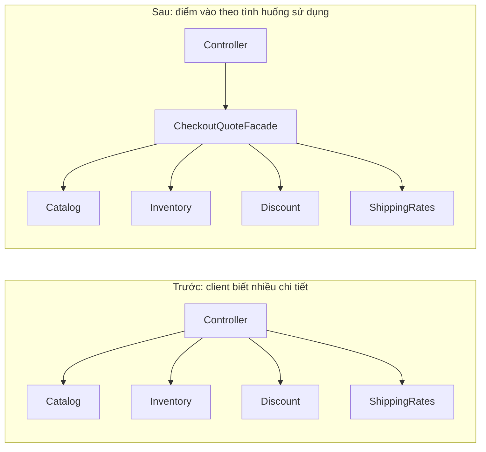

Ở phương án sau, **tổng độ phức tạp của subsystem không tự nhiên giảm đi**. Độ phức tạp được **đóng gói sau một ranh giới**, làm cho mã client ngắn và ít biết chi tiết hơn.

## 2. Thành phần của mẫu Facade

| Thành phần | Trách nhiệm | Nên biết điều gì? |
|---|---|---|
| **Client** | Thực hiện thao tác người dùng, gọi API cấp cao | Nhu cầu báo giá, dữ liệu đầu vào, kết quả |
| **Facade** | Phối hợp các bước thường dùng, xử lý/ánh xạ lỗi phù hợp | Hợp đồng của các subsystem và quy trình cấp cao |
| **Subsystem classes** | Thực hiện các thao tác chuyên biệt | Catalog, tồn kho, chính sách giá, phí vận chuyển |
| **Composition root / DI container** | Khởi tạo và lắp các dependency | Implementation nào được dùng trong môi trường hiện tại |

Facade thường dùng **composition**: nó giữ reference tới các đối tượng cấp dưới, chứ không cần kế thừa chúng.

Một API Facade tốt thể hiện mục đích rõ ràng, ví dụ `quote(sku, quantity, member)`; không chỉ biến thành hàng chục phương thức `getCatalog()`, `getInventory()`, `getDiscountCalculator()`. Các getter chỉ làm client tiếp tục phụ thuộc sâu vào subsystem.

## 3. Ví dụ Java 17 chạy độc lập: báo giá thanh toán

**Bối cảnh ví dụ:** một đơn hàng chỉ chứa một loại sản phẩm, giá tính bằng **VND nguyên**. Báo giá dành cho thành viên được giảm 5% tiền hàng; phí giao là 25.000 VND, miễn phí nếu **tiền hàng sau giảm** ít nhất 500.000 VND. Báo giá chỉ **kiểm tra** số tồn hiện tại, không giữ hàng hoặc trừ tồn kho.

Quy tắc vừa nêu phải rõ ràng trước khi viết Facade: nếu phí giao dựa trên tiền hàng *trước* giảm, hoặc cho phép nhiều sản phẩm, API và thuật toán đều cần điều chỉnh theo nghiệp vụ.

Tạo file `FacadeDemo.java`, sau đó chạy:

```bash
javac FacadeDemo.java
java FacadeDemo
```

```java
import java.math.BigDecimal;
import java.math.RoundingMode;
import java.util.Map;
import java.util.Objects;

public class FacadeDemo {

    // ----- Các loại dữ liệu công khai ở mức ví dụ -----
    record Product(String sku, BigDecimal unitPriceVnd) {
        Product {
            Objects.requireNonNull(sku, "sku");
            Objects.requireNonNull(unitPriceVnd, "unitPriceVnd");
            if (sku.isBlank() || unitPriceVnd.signum() < 0 ||
                    unitPriceVnd.stripTrailingZeros().scale() > 0) {
                throw new IllegalArgumentException(
                        "SKU phải có giá trị, đơn giá là số nguyên VND không âm");
            }
        }
    }

    record Quote(
            BigDecimal subtotalVnd,
            BigDecimal discountVnd,
            BigDecimal shippingVnd,
            BigDecimal totalVnd) {}

    // ----- Các subsystem độc lập -----
    static final class Catalog {
        private final Map<String, Product> products;

        Catalog(Map<String, Product> products) {
            this.products = Map.copyOf(Objects.requireNonNull(products));
        }

        Product findRequired(String sku) {
            Product product = products.get(sku);
            if (product == null) {
                throw new IllegalArgumentException(
                        "Không tìm thấy sản phẩm: " + sku);
            }
            return product;
        }
    }

    static final class Inventory {
        private final Map<String, Integer> availableUnits;

        Inventory(Map<String, Integer> availableUnits) {
            this.availableUnits =
                    Map.copyOf(Objects.requireNonNull(availableUnits));
        }

        boolean canFulfill(String sku, int quantity) {
            return availableUnits.getOrDefault(sku, 0) >= quantity;
        }
    }

    static final class MemberDiscount {
        BigDecimal calculate(BigDecimal subtotalVnd, boolean isMember) {
            Objects.requireNonNull(subtotalVnd, "subtotalVnd");
            if (!isMember) {
                return BigDecimal.ZERO;
            }
            return subtotalVnd.multiply(new BigDecimal("0.05"))
                    .setScale(0, RoundingMode.HALF_UP);
        }
    }

    static final class ShippingRates {
        BigDecimal forAmountAfterDiscount(BigDecimal amountVnd) {
            Objects.requireNonNull(amountVnd, "amountVnd");
            return amountVnd.compareTo(new BigDecimal("500000")) >= 0
                    ? BigDecimal.ZERO : new BigDecimal("25000");
        }
    }

    // ----- FACADE: một thao tác cấp cao dễ dùng -----
    static final class CheckoutQuoteFacade {
        private final Catalog catalog;
        private final Inventory inventory;
        private final MemberDiscount discounts;
        private final ShippingRates shipping;

        CheckoutQuoteFacade(
                Catalog catalog,
                Inventory inventory,
                MemberDiscount discounts,
                ShippingRates shipping) {
            this.catalog = Objects.requireNonNull(catalog);
            this.inventory = Objects.requireNonNull(inventory);
            this.discounts = Objects.requireNonNull(discounts);
            this.shipping = Objects.requireNonNull(shipping);
        }

        Quote quote(String sku, int quantity, boolean isMember) {
            Objects.requireNonNull(sku, "sku");
            if (sku.isBlank() || quantity <= 0) {
                throw new IllegalArgumentException(
                        "SKU phải có giá trị và quantity phải > 0");
            }

            // Client không phải tự gọi các bước này.
            Product product = catalog.findRequired(sku);
            if (!inventory.canFulfill(sku, quantity)) {
                throw new IllegalStateException("Không đủ hàng cho " + sku);
            }

            BigDecimal subtotal = product.unitPriceVnd()
                    .multiply(BigDecimal.valueOf(quantity));
            BigDecimal discount =
                    discounts.calculate(subtotal, isMember);
            BigDecimal amountAfterDiscount = subtotal.subtract(discount);
            BigDecimal delivery =
                    shipping.forAmountAfterDiscount(amountAfterDiscount);
            BigDecimal total = amountAfterDiscount.add(delivery);

            return new Quote(subtotal, discount, delivery, total);
        }
    }

    // ----- Composition root: nơi biết các lớp cụ thể -----
    public static void main(String[] args) {
        Catalog catalog = new Catalog(Map.of(
                "KBD", new Product("KBD", new BigDecimal("180000"))));
        Inventory inventory = new Inventory(Map.of("KBD", 10));

        CheckoutQuoteFacade checkout = new CheckoutQuoteFacade(
                catalog, inventory,
                new MemberDiscount(), new ShippingRates());

        Quote twoItems = checkout.quote("KBD", 2, true);
        System.out.println(twoItems);
        // Quote[subtotalVnd=360000, discountVnd=18000,
        //       shippingVnd=25000, totalVnd=367000]

        Quote threeItems = checkout.quote("KBD", 3, true);
        System.out.println(threeItems.totalVnd()); // 513000
        // 540000 - 27000 = 513000, đạt ngưỡng miễn phí giao
    }
}
```

Đây là ví dụ tự chứa: không yêu cầu Spring, cơ sở dữ liệu hay thư viện ngoài JDK 17. Các class lồng trong `FacadeDemo` có scope phục vụ ví dụ; khi chuyển vào dự án thực tế có thể đặt mỗi class vào file/package phù hợp và công khai những API mà client cần.

### Vì sao ví dụ trên là Facade?

1. **Một thao tác cấp cao:** client chỉ gọi `checkout.quote(...)` để lấy báo giá.
2. **Ẩn trình tự phối hợp:** các bước tìm sản phẩm, kiểm tra tồn, tính giảm giá và vận chuyển nằm trong Facade.
3. **Dùng lại trách nhiệm sẵn có:** `Catalog` quản lý việc tìm sản phẩm, `Inventory` trả lời về tồn kho; Facade không tự cài lại những chi tiết đó.
4. **Chỉ trả kết quả cần thiết:** `Quote` diễn đạt chi tiết báo giá, không rò rỉ `Map` lưu tồn kho hay cấu trúc của catalog.
5. **Lắp ráp bên ngoài:** Facade nhận dependency bằng constructor; việc chọn implementation ở `main` giúp thay adapter, mock hoặc fake khi kiểm thử.

**Điểm cần nhớ:** Facade có thể đóng vai trò entry point và điều phối nghiệp vụ, nhưng bản thân **mẫu Facade** được định nghĩa bởi việc **cung cấp bề mặt sử dụng đơn giản cho subsystem**. Nó không tự xác định đây là Domain Service, Application Service hay lớp transaction.

## 4. Luồng xử lý của một lời gọi

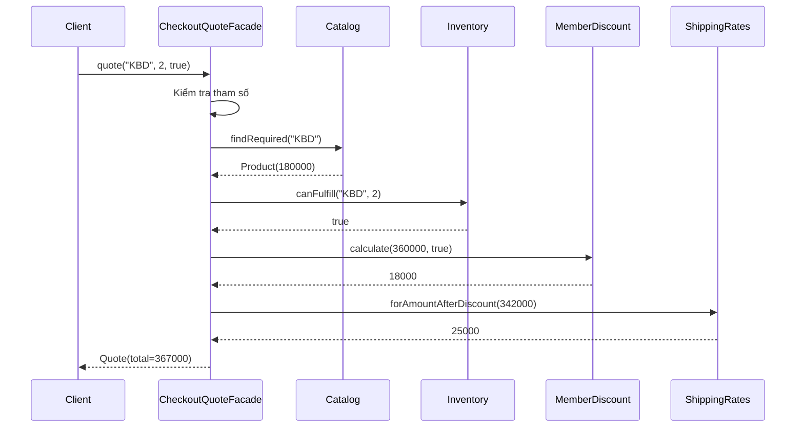

Lỗi được xử lý ở ranh giới hợp lý: SKU không tồn tại báo `IllegalArgumentException`, lượng không đủ báo `IllegalStateException`. API bên ngoài (ví dụ REST controller) có thể ánh xạ chúng thành mã HTTP phù hợp. Không nên xem hai loại exception trong bản demo là quy chuẩn bắt buộc: production nên dùng mô hình lỗi nghiệp vụ rõ hơn, có mã lỗi ổn định và kiểm thử được.

**Đường đi lỗi:** nếu sản phẩm không tồn tại hoặc tồn kho không đủ, Facade dừng trước khi tính giá tiếp. Đừng “nuốt” lỗi đọc tồn kho thành kết quả `false` khi hệ thống kho thật gặp timeout: **không đủ hàng** và **không kiểm tra được tồn kho** là hai trường hợp khác nhau.

## 5. Facade làm đơn giản API ở đâu?

Trước Facade, mã dùng từ nhiều client có thể lặp quy trình (mã phác họa; giả sử các dependency đã được khởi tạo):

```java
Product product = catalog.findRequired(sku);
if (!inventory.canFulfill(sku, quantity)) {
    throw new IllegalStateException("Không đủ hàng");
}
BigDecimal subtotal = product.unitPriceVnd()
        .multiply(BigDecimal.valueOf(quantity));
BigDecimal discount = discounts.calculate(subtotal, isMember);
BigDecimal net = subtotal.subtract(discount);
BigDecimal fee = shipping.forAmountAfterDiscount(net);
Quote quote = new Quote(subtotal, discount, fee, net.add(fee));
```

Sau Facade:

```java
Quote quote = checkoutQuoteFacade.quote(sku, quantity, isMember);
```

Điều đáng giá không đơn thuần là **ít dòng code**. Quan trọng hơn là client **không phải biết** thứ tự áp dụng chiết khấu và phí, cách đọc catalog hay API của từng subsystem.

Khi logic “tính phí giao sau khi giảm giá” đổi vì một quyết định nghiệp vụ có chủ đích, một điểm điều phối có thể được sửa và kiểm thử tập trung. Facade giúp giảm **coupling của client với chi tiết phối hợp**, trong khi chính Facade vẫn phụ thuộc các subsystem mà nó sử dụng.

### Hai loại đơn giản hóa cần tách bạch

- **Đơn giản hóa giao diện:** ít lời gọi hơn, tên API theo nhiệm vụ, input/output dễ hiểu hơn.
- **Đơn giản hóa kiến trúc:** không nhất thiết xảy ra. Vẫn có catalog, kho, chiết khấu và phí giao, cùng nhiều quy định nghiệp vụ.

Một Facade kém thiết kế có thể biến thành nút thắt mới nếu mọi use case và mọi quy tắc bị dồn hết vào đó.

## 6. Facade khác Adapter, Decorator, Proxy và Mediator thế nào?

Các pattern đều có thể có một đối tượng “đứng giữa”, nhưng **ý định** khác nhau.

| Pattern | Ý định chính | Hình thức điển hình | Ví dụ |
|---|---|---|---|
| **Facade** | Cung cấp API đơn giản cho nhiều thành phần/phân hệ | `checkout.quote(...)` phối hợp 4 subsystem | Một cửa báo giá giỏ hàng |
| **Adapter** | Chuyển đổi **giao diện không tương thích** sang giao diện client cần | `VendorSmsAdapter implements SmsSender` gọi SDK khác tên hàm | Ẩn khác biệt API nhà cung cấp |
| **Decorator** | Bổ sung hành vi mà vẫn giữ cùng hợp đồng của đối tượng được bọc | `CachedCatalog implements CatalogReader` delegate đến nguồn gốc | Thêm cache, metrics, logging có kiểm soát |
| **Proxy** | Đại diện thay thế để quản lý truy cập/vòng đời/lời gọi đến đối tượng thực | `RemoteImageProxy` trì hoãn tải hoặc kiểm tra quyền | Lazy load, remote proxy, protection proxy |
| **Mediator** | Trung gian hóa các quan hệ tương tác giữa nhiều đồng nghiệp | `DialogMediator` phối hợp nút, trường nhập, thông báo | Giảm các callback chéo giữa UI controls |

**Nhận diện bằng câu hỏi:**

- “Client đang phải gọi **quá nhiều bước** của subsystem?” → Facade.
- “Thư viện này có **API khác** với giao diện ứng dụng cần?” → Adapter.
- “Muốn **bọc thêm chức năng** cho cùng interface?” → Decorator.
- “Muốn **kiểm soát việc truy cập** tới một đối tượng?” → Proxy.
- “Nhiều đối tượng **gọi lẫn nhau theo mạng quan hệ rối**?” → Mediator.

Một lớp có thể có nhiều vai trò thực tế, nhưng khi giải thích thiết kế nên gọi theo **lý do chủ yếu** khiến nó tồn tại. “Có lớp trung gian” chưa phải tiêu chí đủ để kết luận là Facade.

## 7. Facade có phải là Service Layer hoặc Controller không?

Không đồng nghĩa.

- **Controller** tiếp nhận HTTP/request, phân tích input, xác thực/ủy quyền ở tầng thích hợp và chuyển đổi response. Controller có thể dùng Facade để thực hiện nghiệp vụ cấp cao.
- **Application Service** điều phối một use case, áp đặt ranh giới transaction và các chính sách luồng ứng dụng. Nó có thể **đồng thời đóng vai trò Facade** nếu cung cấp API đơn giản cho nhiều subsystem; nhưng không phải Application Service nào cũng nên mang tên `Facade`.
- **Domain Service** chứa quy tắc nghiệp vụ không thuộc tự nhiên về một entity/value object nào. Không nên cho domain phụ thuộc SQL/HTTP chỉ vì muốn dùng Facade.
- **Facade** nói về việc **giảm độ phức tạp khi client tương tác subsystem**. Nó không quy định tầng kiến trúc, framework, transaction hoặc bất biến nghiệp vụ phải đặt ở đâu.

Một ví dụ tổ chức:

```text
application/
  CheckoutQuoteFacade.java   # API báo giá cấp cao
domain/
  Product.java
  PricingPolicy.java
infrastructure/
  JdbcCatalog.java
  WarehouseInventoryClient.java
bootstrap/
  Configuration.java         # Lắp dependency
web/
  CheckoutController.java    # HTTP ↔ API ứng dụng
```

Đừng sao chép mô hình package này máy móc. Với hệ thống nhỏ, một vài lớp và một Facade là đủ; với hệ thống lớn, Facade có thể nằm ở một **module API** riêng và phụ thuộc các port/hợp đồng do ứng dụng sở hữu.

## 8. Tổ chức dependency để Facade dễ kiểm thử và thay công nghệ

Trong demo, Facade nhận trực tiếp `Catalog`, `Inventory` và hai lớp tính toán. Trong ứng dụng thực tế, catalog có thể đọc từ MySQL, kho từ HTTP, hoặc API đối tác có nhiều môi trường. Khi các chi tiết này biến động, dùng interface mô tả khả năng client cần.

```java
// Phác họa khi tách các class ra package rõ ràng:
interface ProductLookup {
    Product findRequired(String sku);
}

interface StockAvailability {
    boolean canFulfill(String sku, int quantity);
}

// CheckoutQuoteFacade phụ thuộc các interface,
// JdbcProductLookup/HttpStockAvailability implements interface.
```

Với Spring, có thể inject dependencies vào constructor và khai báo Facade thành bean:

```java
// Phác họa với Spring Boot. Imports tương ứng:
// org.springframework.stereotype.Service
@Service
public class CheckoutQuoteFacade {
    private final ProductLookup catalog;
    private final StockAvailability inventory;

    public CheckoutQuoteFacade(
            ProductLookup catalog, StockAvailability inventory) {
        this.catalog = catalog;
        this.inventory = inventory;
    }

    // quote(...) phối hợp thêm các pricing policy liên quan.
}
```

Đoạn Spring là **phác họa kiến trúc**, không phải code để ghép nguyên xi với `FacadeDemo` có lớp lồng cùng tên. Nếu có nhiều bean cùng interface, lựa chọn implementation cần được cấu hình rõ ràng (`@Qualifier`, `@Primary`, `@Bean`, v.v.).

**Facade không bắt buộc dùng interface.** Nếu chỉ có một cách điều phối và không có nhu cầu thay thế Facade, class `CheckoutQuoteFacade` thông thường là hợp lý. Tạo `ICheckoutQuoteFacade` chỉ để tăng số interface không làm thiết kế tốt hơn; abstraction có ích khi bảo vệ client khỏi dependency dễ biến động hoặc khi có hợp đồng rõ cho nhiều implementation.

## 9. Đánh đổi và giới hạn cần biết

| Lợi ích | Giá phải trả / rủi ro |
|---|---|
| Client chỉ cần nhớ vài thao tác cấp cao | Tăng thêm lớp và indirection, phải lần từ client qua Facade |
| Giảm coupling trực tiếp giữa client và subsystem | Facade có thể trở thành điểm phụ thuộc tập trung, dễ phình to |
| Tập trung thứ tự gọi và chính sách lỗi cho thao tác chung | Nếu Facade quá rộng, thay đổi một use case có thể tác động nhiều client |
| Dễ fake/mocking ranh giới của client | Cần kiểm thử cả hợp đồng Facade và cách nó phối hợp subsystem |
| Ẩn chi tiết kỹ thuật không liên quan với người dùng API | Có nguy cơ che mất timeout, partial failure và ngữ nghĩa dữ liệu |
| Dễ chuẩn hóa API công khai của module | Versioning và backward compatibility trở thành trách nhiệm rõ ràng |
| Có thể giữ các subsystem chuyên biệt, dễ dùng trực tiếp khi cần | Dễ bị lạm dụng thành “đường duy nhất”, cấm mọi tình huống nâng cao |

### Facade không tự tạo transaction phân tán

Ví dụ **báo giá** phía trên cố tình tránh ghi dữ liệu: kiểm tra tồn chỉ là **ảnh chụp tức thời**, không phải đặt hàng. Hai khách hàng có thể cùng được báo “còn hàng”, nhưng chỉ người đầu tiên đặt thành công. Điều đó không vi phạm hợp đồng nếu API được gọi rõ là **quote**, không phải **reserve/order**.

Nếu xây Facade `placeOrder(...)` có các bước giữ hàng, thanh toán và gửi thông báo:

- Các thao tác có thể nằm ở **nhiều hệ thống**, không chung một DB transaction.
- Lỗi sau khi thanh toán có thể tạo trạng thái dở dang.
- Cần thiết kế **idempotency key**, trạng thái đơn, saga/compensation hoặc outbox tùy yêu cầu.
- Retry phải phân biệt lỗi tạm thời và lỗi nghiệp vụ; không mặc định retry một charge sẽ an toàn.

Facade chỉ cung cấp **điểm phối hợp**. Nó không biến các thao tác mạng thành một giao dịch nguyên tử. Đừng “nuốt” lỗi partial failure rồi trả thành công.

### Độ trễ cũng không tự biến mất

Một lời gọi `facade.quote` có thể vẫn tạo bốn lời gọi tới DB/API ở dưới. Giảm số lời gọi **ở phía client** không bảo đảm giảm latency tổng:

```text
Tổng thời gian xấp xỉ:
  validation + catalog + inventory + discount + shipping + overhead

Nếu các thành phần gọi dịch vụ từ xa, network latency,
timeout, số lần retry và contention thường chi phối kết quả.
```

Chỉ thực hiện song song những bước **thật sự độc lập** và hiểu giới hạn consistency. Ví dụ pricing sau discount phụ thuộc kết quả discount, không thể chạy bừa mọi thao tác cùng lúc.

## 10. Khi nào nên dùng, khi nào nên tránh?

**Rất phù hợp khi:**

- Một phân hệ có nhiều API nhỏ, nhưng hầu hết client chỉ cần 2–3 thao tác cấp cao.
- Nhiều client đang lặp cùng một chuỗi gọi có thứ tự.
- Muốn giảm việc controller/API consumer phải biết cấu trúc nội bộ của module.
- Thư viện/SDK có API phức tạp, cần một điểm vào phục vụ nghiệp vụ phổ biến.
- Muốn giới hạn tác động khi cấu trúc nội bộ subsystem đổi, trong khi contract phía ngoài ổn định.

**Nên cân nhắc cách đơn giản hơn khi:**

- Client chỉ gọi một API đơn giản và không lặp quy trình.
- Facade chỉ chuyển tiếp một lời gọi y hệt mà không cung cấp abstraction hoặc ranh giới hữu ích.
- Mỗi client có quy trình hoàn toàn khác biệt; ép dùng chung một Facade khiến nó chứa hàng loạt `if` theo loại client.
- Không thể mô tả rõ trách nhiệm, dẫn đến “God Facade” vừa tính giá, vừa ghi DB, gửi email, chạy báo cáo và làm mọi thứ.
- Facade che lỗi hạ tầng bằng giá trị mặc định sai, làm người dùng hiểu nhầm dữ liệu đã chắc chắn.

### Thiết kế API Facade tốt

Một vài gợi ý thực hành:

1. **Đặt tên từ mục đích sử dụng:** `quote`, `previewInvoice`, `generateReport`, `startCheckout`. Tránh phương thức `processEverything`.
2. **Giữ input/output ổn định:** dùng DTO/value object phù hợp; đừng trả kết quả thô `ResultSet`, `Connection`, `HttpResponse` của một thư viện hạ tầng.
3. **Không làm lộ object nội bộ tùy tiện:** nếu client phải lấy `getInventoryService()` để tiếp tục tự điều phối, Facade chưa thực sự đơn giản hóa.
4. **Tách Facade theo nhóm client/use case nếu cần:** `CheckoutQuoteFacade` và `AdminPricingFacade` có thể cùng dùng subsystem mà giữ API riêng.
5. **Không gom mọi công thức nghiệp vụ vào Facade:** giữ thuật toán/điều kiện chuyên biệt trong lớp có trách nhiệm phù hợp, Facade điều phối.
6. **Quy ước rõ lỗi và trạng thái:** không tìm thấy, không đủ hàng, giá đã cũ, timeout, permission denied là những tình huống khác nhau.
7. **Thiết kế thread-safety:** Facade kiểu singleton nên tránh giữ trạng thái request mutable trong field; ví dụ demo dùng biến cục bộ trong `quote`.
8. **Có quan sát vận hành:** log/trace ở ranh giới tác vụ cấp cao, nhưng tránh log dữ liệu thanh toán hoặc thông tin nhạy cảm.

## 11. Kiểm thử Facade: kiểm tra kết quả lẫn thứ tự phối hợp

Unit test không chỉ kiểm một class có tồn tại. Nó phải xác nhận **hợp đồng từ góc nhìn client**, bao gồm nhánh thành công, lỗi và bất biến.

Ví dụ JUnit 5, đặt file test cùng package với `FacadeDemo` (các loại lồng có phạm vi package):

```java
import static org.junit.jupiter.api.Assertions.*;
import java.math.BigDecimal;
import java.util.Map;
import org.junit.jupiter.api.Test;

class FacadeDemoTest {

    private FacadeDemo.CheckoutQuoteFacade newFacade(int stock) {
        var catalog = new FacadeDemo.Catalog(Map.of(
                "KBD", new FacadeDemo.Product(
                        "KBD", new BigDecimal("180000"))));
        var inventory =
                new FacadeDemo.Inventory(Map.of("KBD", stock));
        return new FacadeDemo.CheckoutQuoteFacade(
                catalog, inventory,
                new FacadeDemo.MemberDiscount(),
                new FacadeDemo.ShippingRates());
    }

    @Test
    void memberQuoteIncludesDiscountAndShipping() {
        var quote = newFacade(10).quote("KBD", 2, true);

        assertEquals(new BigDecimal("360000"), quote.subtotalVnd());
        assertEquals(new BigDecimal("18000"), quote.discountVnd());
        assertEquals(new BigDecimal("25000"), quote.shippingVnd());
        assertEquals(new BigDecimal("367000"), quote.totalVnd());
    }

    @Test
    void freeShippingUsesAmountAfterDiscount() {
        var quote = newFacade(10).quote("KBD", 3, true);
        assertEquals(BigDecimal.ZERO, quote.shippingVnd());
        assertEquals(new BigDecimal("513000"), quote.totalVnd());
    }

    @Test
    void insufficientStockStopsQuote() {
        assertThrows(IllegalStateException.class,
                () -> newFacade(1).quote("KBD", 2, false));
    }

    @Test
    void invalidQuantityIsRejected() {
        assertThrows(IllegalArgumentException.class,
                () -> newFacade(10).quote("KBD", 0, true));
    }
}
```

Các test này dùng subsystem in-memory thật, đủ nhỏ để chạy nhanh. Nếu component bên dưới gọi database/HTTP, nên **fake các port** ở unit test và có integration test riêng cho adapter thật.

**Về thứ tự:** ví dụ có phụ thuộc dữ liệu rõ ràng — phải tính discount trước mới có giá sau giảm để tính shipping. Assert con số `513000` và `shippingVnd = 0` kiểm tra được ý nghĩa thứ tự đó. Nếu những bước có **side effect**, test cần kiểm tra không gửi thanh toán/ghi DB sau một lỗi xác thực, và policy rollback/compensation tùy yêu cầu. Không nên lạm dụng test “gọi đúng 4 phương thức ở thứ tự đúng” nếu trình tự đó là chi tiết triển khai không quan trọng với hành vi client.

### Checklist chất lượng kiểm thử

| Trường hợp | Kỳ vọng |
|---|---|
| Sản phẩm tồn tại, có đủ hàng, là thành viên | Báo giá đúng tiền hàng, giảm giá, vận chuyển và tổng |
| Không phải thành viên | Không có chiết khấu; phí giao tính theo số tiền tương ứng |
| Không có SKU hoặc lượng mua không hợp lệ | Lỗi đầu vào rõ ràng, không trả báo giá sai |
| SKU không tồn tại | Lỗi “không tìm thấy”, không giả định giá 0 |
| Không đủ tồn | Không sinh báo giá thành công |
| Tồn kho/giá từ dịch vụ ngoài bị timeout | Trả lỗi truy xuất dữ liệu phù hợp; không tráo thành hết hàng |
| Ranh giới miễn phí vận chuyển | Giá ngay dưới/bằng/ngay trên ngưỡng |
| Có yêu cầu đa luồng | Không lưu dữ liệu request vào field dùng chung |
| Thêm subsystem implementation mới | Hợp đồng Facade giữ ổn định, các test chính tiếp tục qua |

## 12. Refactor sang Facade từng bước

Giả sử một controller đang dài vì phải gọi 5 subsystem. Cách chuyển an toàn:

1. **Khoanh một use case cụ thể:** “xem báo giá”, không bắt đầu bằng “tập hợp tất cả service vào Facade”.
2. **Liệt kê thao tác và điều kiện:** xác định input, thứ tự, loại lỗi, dữ liệu trả về, side effect và những ranh giới bất biến.
3. **Đặt một phương thức cấp cao:** `Quote quote(String sku, int quantity, boolean member)`.
4. **Di chuyển logic phối hợp:** controller chỉ còn chuyển input và ánh xạ response; business rule thực sự vẫn ở lớp thích hợp.
5. **Constructor-inject dependency:** tạo/lắp các đối tượng ở composition root hoặc DI container.
6. **Duy trì hành vi bằng test:** so sánh kết quả trước và sau với các trường hợp biên và lỗi.
7. **Chuyển từng client sang Facade:** tránh thay đồng thời mọi luồng lớn mà chưa đo tương thích.
8. **Xóa sự điều phối trùng lặp** khi tất cả client liên quan đã dùng API mới và không còn phụ thuộc cũ.
9. **Đo lại độ phức tạp:** coupling của client, API surface, thời gian test/debug, latency, tỷ lệ lỗi.
10. **Rà soát phạm vi:** nếu Facade bắt đầu có quá nhiều phương thức độc lập, cân nhắc chia theo use case.

Một Facade có thể cùng tồn tại với quyền truy cập **trực tiếp** vào subsystem cho những client cần chức năng chuyên sâu. Việc **cấm mọi truy cập khác** là quyết định module/API, không phải quy tắc bắt buộc của Facade Pattern.

## 13. Bài tập tự luyện

**Bài 1 – Facade cho xuất báo cáo.** Hệ thống có `DataFetcher`, `SalesAggregator`, `CsvRenderer`, `FileStore`. Viết `SalesReportFacade.exportMonthlyReport(YearMonth month)`; nêu cách truyền timezone, định dạng file, cách xử lý file lớn và lỗi ghi file. Không cần gom tất cả hàm truy vấn thành API public của Facade.

**Bài 2 – Refactor controller.** Một `OrderController` đang trực tiếp gọi `Catalog`, `Inventory`, `Discount` và `ShippingRates`. Tách API báo giá của ví dụ Java thành Facade, viết test so sánh kết quả và chỉ ra trách nhiệm còn giữ ở controller.

**Bài 3 – Lỗi phân tán.** Thay báo giá bằng đặt đơn thật với giữ kho, thu tiền và thông báo. Thiết kế bảng trạng thái đơn tối thiểu và thảo luận khả năng thanh toán thành công nhưng thông báo thất bại. Facade giải quyết phần **điều phối API** nào, phần nào cần outbox/saga/idempotency?

**Bài 4 – So sánh pattern.** Một thư viện thanh toán bên ngoài có `payWithRawSdkRequest(...)`. Ứng dụng muốn có `PaymentGateway.pay(PaymentRequest)` và một API `Checkout.placeOrder()` phối hợp kho, gateway, hóa đơn. Chỉ ra thành phần nào hợp lý là **Adapter**, thành phần nào là **Facade**.

**Bài 5 – Review thiết kế.** Một class `SystemFacade` có 45 phương thức: gửi email, import CSV, tính điểm, tạo hóa đơn, tải ảnh và cập nhật mật khẩu. Tại sao dễ trở thành God Object? Đề xuất cách tách API theo chức năng hoặc bounded context, nêu hệ quả với client.

## 14. Tự kiểm tra đã nắm được Facade chưa?

- [ ] Tôi mô tả được **vấn đề cụ thể**: client biết quá nhiều API hoặc lặp trình tự phối hợp.
- [ ] Tôi thiết kế được **API cấp cao có ý nghĩa**, ít tham số và trả dữ liệu cần thiết.
- [ ] Tôi biết Facade dùng **composition** để phối hợp subsystem.
- [ ] Tôi phân biệt được Facade với Adapter, Decorator, Proxy, Mediator.
- [ ] Tôi không xem Facade như giải pháp tự động cho transaction, network latency, caching và thread-safety.
- [ ] Tôi giữ business invariant, xử lý lỗi, kiểm thử và khả năng quan sát một cách tường minh.
- [ ] Tôi biết khi nào một lớp Facade trở nên quá rộng và cần tách nhỏ.
- [ ] Tôi sẵn sàng giữ giải pháp đơn giản khi client chỉ cần một lời gọi trực tiếp.

**Ghi nhớ:** Facade hữu ích khi nó tạo ra một **đường vào đơn giản, ổn định và giàu ý nghĩa** cho một khả năng có nhiều chi tiết phối hợp. Nó giảm kiến thức mà client phải mang theo, đồng thời chuyển trách nhiệm điều phối vào đúng một ranh giới có thể kiểm thử và bảo trì.


</details>

- [Quay lại đầu trang](#back-to-top)

---

## <a id="design-patterns-008">Strategy và thay thế thuật toán</a>

<details>
<summary>Xem chi tiết</summary>

# Strategy Pattern trong Java: thay thế thuật toán bằng composition

> **Chủ đề:** OOP → Mẫu thiết kế → Strategy và thay thế thuật toán.  
> **Mục tiêu:** Hiểu lý do dùng Strategy, nhận biết ba vai trò Context–Strategy–Concrete Strategy, tự triển khai trong Java, chuyển thuật toán ở thời điểm chạy, kiểm thử hợp đồng chung và biết khi nào không nên dùng thêm abstraction.

## 1. Strategy là gì?

**Strategy** là mẫu thiết kế hành vi (*behavioral design pattern*) trong bộ mẫu GoF. Ý tưởng là **đóng gói các thuật toán có thể thay thế cho nhau thành những đối tượng cùng một hợp đồng**, rồi cho đối tượng sử dụng thuật toán (Context) làm việc thông qua hợp đồng đó.

Khi cần đổi cách xử lý, Context nhận một implementation khác thay vì tự chứa tất cả các nhánh `if/else` hoặc `switch` chi tiết. Thuật toán được thay thế có thể là cách tính phí, chọn tuyến vận chuyển, sắp xếp, áp khuyến mãi, xác thực, nén dữ liệu hoặc tính điểm.

Ba vai trò cốt lõi:

| Vai trò | Trách nhiệm | Trong ví dụ sẽ dùng |
|---|---|---|
| **Strategy** | Định nghĩa hoạt động chung và hợp đồng đầu vào/đầu ra | `DiscountStrategy` |
| **Concrete Strategy** | Thực hiện một biến thể thuật toán | `NoDiscount`, `PercentageDiscount`, `FixedDiscount` |
| **Context** | Điều phối nghiệp vụ và sử dụng Strategy qua interface | `Checkout` |
| **Client / composition root** | Chọn Strategy thích hợp cho ngữ cảnh, truyền vào Context | `StrategyDemo.main` |

**Điểm cốt lõi:** Context không cần biết thuật toán cụ thể đã triển khai như thế nào. Context chỉ dựa vào hành vi đã được Strategy cam kết.

## 2. Vấn đề trước khi áp dụng Strategy

Một website bán hàng có thể hỗ trợ ba chính sách giảm giá: không giảm, giảm theo tỷ lệ, giảm số tiền cố định. Nếu nhúng thuật toán ngay trong Checkout:

~~~java
// Minh họa mã khó mở rộng — không phải chương trình hoàn chỉnh.
BigDecimal calculateDiscount(String type, BigDecimal subtotal) {
    if ("NONE".equals(type)) {
        return BigDecimal.ZERO;
    }
    if ("PERCENT".equals(type)) {
        return subtotal.multiply(new BigDecimal("0.10"));
    }
    if ("FIXED".equals(type)) {
        return new BigDecimal("30.00").min(subtotal);
    }
    throw new IllegalArgumentException("Unknown discount type");
}
~~~

Ví dụ trên cố ý rút gọn và **chưa xử lý làm tròn tiền**. Vấn đề thiết kế xuất hiện khi số thuật toán, thông số và quy tắc ngày càng nhiều:

- Mỗi chính sách mới buộc sửa phương thức đang phục vụ nghiệp vụ chính.
- Các biến thể trộn chung điều kiện lựa chọn với công thức tính; dễ sửa nhầm nhánh đang hoạt động.
- Khó kiểm thử từng thuật toán một cách độc lập khi mọi thứ ở cùng một phương thức lớn.
- Nếu nhiều màn hình hoặc use case cùng tính chiết khấu, các nhánh có thể bị lặp.

Không có nghĩa `if/else` luôn sai. Với **hai điều kiện ngắn, ổn định và không có nhu cầu thay đổi riêng**, một hàm đơn giản có thể rõ ràng hơn nhiều lớp. Strategy hữu ích khi **thuật toán thực sự là một trục biến thiên độc lập**.

## 3. Cấu trúc Strategy

~~~mermaid
classDiagram
    class DiscountStrategy {
        <<interface>>
        +discountFor(subtotal) BigDecimal
    }
    class NoDiscount {
        +discountFor(subtotal) BigDecimal
    }
    class PercentageDiscount {
        -rate : BigDecimal
        +discountFor(subtotal) BigDecimal
    }
    class FixedDiscount {
        -amount : BigDecimal
        +discountFor(subtotal) BigDecimal
    }
    class Checkout {
        -strategy : DiscountStrategy
        +Checkout(strategy)
        +quote(subtotal) PriceQuote
    }
    class StrategyDemo {
        +main(args) void
    }

    DiscountStrategy <|.. NoDiscount
    DiscountStrategy <|.. PercentageDiscount
    DiscountStrategy <|.. FixedDiscount
    Checkout --> DiscountStrategy : sử dụng
    StrategyDemo ..> Checkout : khởi tạo
    StrategyDemo ..> DiscountStrategy : lựa chọn
~~~

Mũi tên quan trọng là **`Checkout → DiscountStrategy`**: Context phụ thuộc vào abstraction. Các Concrete Strategy có thể được thêm vào mà không phải viết lại công thức điều phối của Context.

Strategy thường dùng **composition**: Context **có một** đối tượng Strategy. Đây là một cách ưu tiên composition trước việc tạo nhiều subclass của chính Context, chứ không phải cấm inheritance trong mọi tình huống.

## 4. Ví dụ Java 17 có thể chạy độc lập: chiến lược giảm giá

Ta định nghĩa hợp đồng rõ ràng trước khi viết implementation:

- `subtotal` là số tiền không âm, có độ chính xác **đến đơn vị xu** (tối đa hai chữ số thập phân có ý nghĩa; có thể thêm các số 0).
- `discountFor(subtotal)` trả giá trị không null, **không âm và không vượt subtotal**, với độ chính xác đến hai chữ số thập phân.
- Strategy **không sửa subtotal**, không tự thực hiện thanh toán và không tạo các tác dụng phụ ngoài tính toán. `BigDecimal` vốn bất biến.
- Context kiểm tra tổng tiền đầu vào và chặn kết quả vi phạm hợp đồng, giúp lỗi thuật toán được phát hiện gần nguồn hơn.

> Đây là mô hình tiền tệ để học Strategy với đơn vị có hai chữ số thập phân. Sản phẩm thực tế cần quy định tiền tệ, đơn vị nhỏ nhất, thuế, làm tròn và phạm vi áp dụng khuyến mãi theo nghiệp vụ; không phải mọi đồng tiền đều có hai chữ số thập phân.

Lưu toàn bộ ví dụ sau vào **`StrategyDemo.java`**:

~~~java
import java.math.BigDecimal;
import java.math.RoundingMode;
import java.util.List;
import java.util.Map;
import java.util.Objects;

// Strategy: một thuật toán giảm giá, không thực hiện thanh toán.
@FunctionalInterface
interface DiscountStrategy {
    /**
     * Tiền điều kiện: subtotal không null, >= 0, chính xác tới 2 số lẻ.
     * Hậu điều kiện: 0 <= kết quả <= subtotal; tối đa 2 số lẻ.
     */
    BigDecimal discountFor(BigDecimal subtotal);
}

// Concrete Strategy A: không giảm.
final class NoDiscount implements DiscountStrategy {
    @Override
    public BigDecimal discountFor(BigDecimal subtotal) {
        return new BigDecimal("0.00");
    }
}

// Concrete Strategy B: giảm theo tỷ lệ.
// Ví dụ: rate = 0.10 tương ứng 10%.
final class PercentageDiscount implements DiscountStrategy {
    private final BigDecimal rate;

    PercentageDiscount(BigDecimal rate) {
        Objects.requireNonNull(rate, "rate");
        if (rate.compareTo(BigDecimal.ZERO) < 0
                || rate.compareTo(BigDecimal.ONE) > 0) {
            throw new IllegalArgumentException("rate must be in [0, 1]");
        }
        this.rate = rate;
    }

    @Override
    public BigDecimal discountFor(BigDecimal subtotal) {
        return subtotal.multiply(rate)
                .setScale(2, RoundingMode.HALF_UP);
    }
}

// Concrete Strategy C: giảm số tiền cố định, không vượt subtotal.
final class FixedDiscount implements DiscountStrategy {
    private final BigDecimal amount;

    FixedDiscount(BigDecimal amount) {
        Objects.requireNonNull(amount, "amount");
        if (amount.signum() < 0) {
            throw new IllegalArgumentException("amount must be >= 0");
        }
        try {
            this.amount = amount.setScale(2, RoundingMode.UNNECESSARY);
        } catch (ArithmeticException ex) {
            throw new IllegalArgumentException("amount has fractions of cent", ex);
        }
    }

    @Override
    public BigDecimal discountFor(BigDecimal subtotal) {
        return amount.min(subtotal);
    }
}

// Giá trước giảm, mức giảm và giá cuối cùng là một kết quả bất biến.
record PriceQuote(
        BigDecimal subtotal,
        BigDecimal discount,
        BigDecimal total
) {}

// Context: giữ quy trình báo giá, ủy quyền công thức cho Strategy.
final class Checkout {
    private final DiscountStrategy strategy;

    Checkout(DiscountStrategy strategy) {
        this.strategy = Objects.requireNonNull(strategy, "strategy");
    }

    PriceQuote quote(BigDecimal subtotal) {
        Objects.requireNonNull(subtotal, "subtotal");
        if (subtotal.signum() < 0) {
            throw new IllegalArgumentException("subtotal must be >= 0");
        }

        final BigDecimal normalized;
        try {
            normalized = subtotal.setScale(2, RoundingMode.UNNECESSARY);
        } catch (ArithmeticException ex) {
            throw new IllegalArgumentException(
                    "subtotal has fractions of cent", ex);
        }

        BigDecimal rawDiscount = Objects.requireNonNull(
                strategy.discountFor(normalized),
                "Strategy must return a discount");

        final BigDecimal discount;
        try {
            discount = rawDiscount.setScale(2, RoundingMode.UNNECESSARY);
        } catch (ArithmeticException ex) {
            throw new IllegalStateException(
                    "Strategy returned fractions of cent", ex);
        }

        if (discount.signum() < 0
                || discount.compareTo(normalized) > 0) {
            throw new IllegalStateException(
                    "Strategy must return discount in [0, subtotal]");
        }

        return new PriceQuote(
                normalized,
                discount,
                normalized.subtract(discount));
    }
}

public class StrategyDemo {
    public static void main(String[] args) {
        // Đây là nơi cấu hình/chọn chiến lược theo tên.
        Map<String, DiscountStrategy> strategies = Map.of(
                "NONE", new NoDiscount(),
                "TEN_PERCENT",
                    new PercentageDiscount(new BigDecimal("0.10")),
                "FIXED_30",
                    new FixedDiscount(new BigDecimal("30.00"))
        );

        BigDecimal subtotal = new BigDecimal("120.00");

        for (String key : List.of("NONE", "TEN_PERCENT", "FIXED_30")) {
            DiscountStrategy selected = strategies.get(key);
            Checkout checkout = new Checkout(selected);
            PriceQuote quote = checkout.quote(subtotal);

            System.out.println(
                    key + " -> discount=" + quote.discount()
                    + ", total=" + quote.total());
        }
    }
}
~~~

Chạy trên JDK 17 trở lên:

~~~bash
javac StrategyDemo.java
java StrategyDemo
~~~

Kết quả dự kiến:

~~~text
NONE -> discount=0.00, total=120.00
TEN_PERCENT -> discount=12.00, total=108.00
FIXED_30 -> discount=30.00, total=90.00
~~~

**Đọc từng thành phần của ví dụ:**

1. `DiscountStrategy` là một **hợp đồng thống nhất**, chỉ nói “tính mức giảm”; không áp đặt thuật toán.
2. `NoDiscount`, `PercentageDiscount` và `FixedDiscount` cài đặt các thuật toán độc lập.
3. `Checkout` nhận Strategy qua **constructor injection**. Nó kiểm tra quy tắc chung và gọi `strategy.discountFor(...)`. Không hề dùng `instanceof` hay biết tên class cụ thể.
4. `StrategyDemo.main` lấy chiến lược phù hợp từ `Map`, khởi tạo Context và chạy cùng một quy trình. Đây là **lựa chọn thuật toán ở thời điểm chạy**, trước khi tạo Context.
5. Nếu cần chính sách mới, ví dụ `LoyaltyDiscount`, ta viết thêm class thực thi `DiscountStrategy` rồi đăng ký ở nơi lựa chọn; phần lớn code `Checkout` không cần sửa.

Lưu ý: `Map` chỉ là **cơ chế chọn** Strategy. Bản thân Map/Registry không phải điều định nghĩa mẫu Strategy. Điều định nghĩa mẫu là việc **đưa một thuật toán có cùng contract vào Context**, thông qua một interface chung.

## 5. Strategy thay đổi vào lúc nào?

Trong tài liệu GoF, Strategy có thể được chọn khi dựng Context hoặc thay bằng một implementation khác tùy nhu cầu. Hai cách phổ biến:

| Cách | Minh họa | Phù hợp |
|---|---|---|
| **Chọn khi tạo Context (immutable)** | `new Checkout(new PercentageDiscount(rate))` | Mỗi request/phiên có chính sách riêng, dễ kiểm soát concurrency |
| **Đổi Strategy trong Context** | `context.setStrategy(other)` | Một đối tượng dài hạn cần đổi thuật toán chủ động, có cơ chế quản lý trạng thái rõ ràng |
| **Truyền Strategy cho mỗi phương thức** | `quote(subtotal, strategy)` | Cùng Context xử lý nhiều request độc lập, thuật toán là tham số của mỗi lần gọi |

Ví dụ đổi Strategy trực tiếp (không phải class `Checkout` ở phần trước):

~~~java
// Chỉ minh họa cơ chế thay đổi động trên một Context.
final class MutableQuoteService {
    private DiscountStrategy strategy;

    MutableQuoteService(DiscountStrategy initial) {
        setStrategy(initial);
    }

    void setStrategy(DiscountStrategy next) {
        strategy = Objects.requireNonNull(next);
    }

    BigDecimal calculateDiscount(BigDecimal validSubtotal) {
        return strategy.discountFor(validSubtotal);
    }
}
~~~

Khi cùng một `MutableQuoteService` được chia sẻ giữa nhiều HTTP request, `setStrategy` trên một request có thể ảnh hưởng request khác. Không nên dùng một singleton mutable cho chiến lược mang dữ liệu riêng của từng người dùng nếu chưa thiết kế đồng bộ/tránh race condition. Thực tế thường **chọn Strategy theo từng request rồi truyền rõ ràng**, hoặc dùng Context bất biến như `Checkout`.

Chú ý `MutableQuoteService` cố ý chưa kiểm tra quy tắc tiền tệ. Ví dụ đầy đủ đã giao việc kiểm tra hợp đồng cho `Checkout`; khi áp dụng thực tế, cần giữ đúng các kiểm tra đó.

## 6. Cách viết Strategy bằng lambda trong Java

Vì `DiscountStrategy` có **một phương thức trừu tượng** (`@FunctionalInterface`), Java cho phép dùng lambda thay cho một class cụ thể khi thuật toán đủ ngắn và không cần state phức tạp.

~~~java
DiscountStrategy weekendDiscount = subtotal ->
        subtotal.multiply(new BigDecimal("0.05"))
                .setScale(2, RoundingMode.HALF_UP);

Checkout checkout = new Checkout(weekendDiscount);
PriceQuote result = checkout.quote(new BigDecimal("200.00"));
// Giảm 10.00, tổng còn 190.00
~~~

Các dòng này dùng những type/import đã có trong `StrategyDemo.java`; có thể đặt bên trong `main` hoặc phương thức Java tương thích.

**Chọn class riêng** nếu Strategy có nhiều bước, tham số cấu hình, dependency (dịch vụ, repository), logging riêng hoặc cần kiểm thử phức tạp. **Chọn lambda** nếu hành vi ngắn, tự giải thích được tên biến và không làm mờ quy tắc nghiệp vụ. Việc dùng lambda không làm mất bản chất của Strategy: vẫn là một implementation của hợp đồng `DiscountStrategy`.

## 7. Strategy và nguyên lý OOP/SOLID

Strategy thể hiện rất rõ ba ý tưởng OOP:

- **Đóng gói:** Mỗi biến thể thuật toán tự quản lý chi tiết tính toán.
- **Đa hình:** Lời gọi `discountFor` được dispatch tới implementation được truyền vào.
- **Composition:** Context giữ tham chiếu tới một đối tượng Strategy, không bắt buộc kế thừa Context.

Liên hệ SOLID:

| Nguyên lý | Strategy hỗ trợ ra sao | Lưu ý |
|---|---|---|
| **SRP** | Tách trách nhiệm điều phối checkout và tính từng loại giảm giá | Đừng tách class vô ích cho các biểu thức quá nhỏ |
| **OCP** | Có thể thêm `LoyaltyDiscount` mà không sửa thuật toán chung của `Checkout` | Vẫn cần đăng ký/chọn biến thể ở composition root |
| **LSP** | Các Strategy phải thực sự thay thế được theo contract `0 ≤ discount ≤ subtotal` | Có interface **không đồng nghĩa** mọi implementation hợp lệ |
| **ISP** | Interface một thao tác, đủ cho nhu cầu của Context | Tránh interface lớn ép Strategy làm những việc không liên quan |
| **DIP** | `Checkout` phụ thuộc `DiscountStrategy` thay vì class cụ thể | Cần chú ý hướng phụ thuộc giữa các module nếu chia package/module |

DI và Strategy cũng khác nhau: **DI** là cách cung cấp dependency từ ngoài vào; **Strategy** mô tả một **họ thuật toán có thể thay thế**. Trong ví dụ có cả hai: ta dùng constructor DI để đưa một Strategy vào Context.

## 8. Kiểm thử Strategy một cách có hệ thống

Việc tách thuật toán giúp kiểm thử hai lớp vấn đề: (a) công thức của từng Strategy; (b) hợp đồng chung và cách Context gọi Strategy. Các đoạn dưới đây dùng JUnit Jupiter (JUnit 5), đặt ở test source set, cùng package với `StrategyDemo.java`; cần dependency `junit-jupiter` và test runner của dự án.

### 8.1. Kiểm thử đơn vị từng thuật toán và tình huống biên

~~~java
import static org.junit.jupiter.api.Assertions.*;
import java.math.BigDecimal;
import org.junit.jupiter.api.Test;

class DiscountStrategyTest {
    @Test
    void percentageDiscountRoundsToCents() {
        Checkout checkout = new Checkout(
                new PercentageDiscount(new BigDecimal("0.10")));

        PriceQuote quote = checkout.quote(new BigDecimal("12.34"));

        assertEquals(new BigDecimal("1.23"), quote.discount());
        assertEquals(new BigDecimal("11.11"), quote.total());
    }

    @Test
    void fixedDiscountNeverExceedsSubtotal() {
        Checkout checkout = new Checkout(
                new FixedDiscount(new BigDecimal("30.00")));

        PriceQuote quote = checkout.quote(new BigDecimal("12.00"));

        assertEquals(new BigDecimal("12.00"), quote.discount());
        assertEquals(new BigDecimal("0.00"), quote.total());
    }

    @Test
    void invalidAmountAndBadStrategyAreRejected() {
        Checkout checkout = new Checkout(new NoDiscount());

        assertThrows(IllegalArgumentException.class,
                () -> checkout.quote(new BigDecimal("-1.00")));
        assertThrows(IllegalArgumentException.class,
                () -> checkout.quote(new BigDecimal("1.001")));

        // Một Strategy phá hợp đồng trả mức giảm lớn hơn subtotal.
        DiscountStrategy broken = amount -> amount.add(BigDecimal.ONE);
        Checkout guarded = new Checkout(broken);

        assertThrows(IllegalStateException.class,
                () -> guarded.quote(new BigDecimal("10.00")));
    }
}
~~~

Trong test trên, `BigDecimal.equals` so sánh cả **scale**; `1.23` và `1.230` khác nhau theo `equals`. Ví dụ đã chuẩn hóa giá trị xuống hai chữ số thập phân để việc so sánh chính xác. Khi chỉ muốn kiểm tra giá trị số, có thể dùng `compareTo`.

### 8.2. Một contract test dùng lại cho mọi Strategy

Mỗi Strategy mới cần tuân thủ cùng hợp đồng: đầu vào hợp lệ, đầu ra khác null, không âm, không vượt giá gốc. Dùng `@ParameterizedTest` để tránh viết lại cùng test khi thêm biến thể:

~~~java
import static org.junit.jupiter.api.Assertions.*;
import java.math.BigDecimal;
import java.util.stream.Stream;
import org.junit.jupiter.params.ParameterizedTest;
import org.junit.jupiter.params.provider.Arguments;
import org.junit.jupiter.params.provider.MethodSource;

class DiscountStrategyContractTest {
    static Stream<Arguments> strategies() {
        return Stream.of(
                Arguments.of("none", new NoDiscount()),
                Arguments.of("percent",
                        new PercentageDiscount(new BigDecimal("0.10"))),
                Arguments.of("fixed",
                        new FixedDiscount(new BigDecimal("30.00")))
        );
    }

    @ParameterizedTest(name = "{0} preserves discount bounds")
    @MethodSource("strategies")
    void allStrategiesSatisfyContract(
            String name, DiscountStrategy strategy) {
        for (String value : new String[]{"0.00", "0.01", "12.34", "120.00"}) {
            BigDecimal subtotal = new BigDecimal(value);
            BigDecimal discount = assertDoesNotThrow(
                    () -> strategy.discountFor(subtotal));
            assertNotNull(discount);
            assertTrue(discount.compareTo(BigDecimal.ZERO) >= 0);
            assertTrue(discount.compareTo(subtotal) <= 0);
            assertEquals(0, discount.setScale(2,
                    java.math.RoundingMode.UNNECESSARY)
                    .compareTo(discount));
        }
    }
}
~~~

Đoạn cuối kiểm tra rằng mức giảm biểu diễn được chính xác đến hai chữ số thập phân; nếu một Strategy trả giá trị ba chữ số thập phân có ý nghĩa, `setScale(2, UNNECESSARY)` sẽ ném `ArithmeticException` và test thất bại. Đoạn test cần dependency bổ sung `junit-jupiter-params`. Đây là bộ **kiểm thử mẫu**, chưa bao phủ mọi giá trị; nên bổ sung kiểm thử thuộc tính, dữ liệu cực trị và các boundary đặc thù (đúng ngưỡng, ngay dưới/trên ngưỡng, đơn hàng lớn).

Ở dự án thật, phép tính giá cần được kiểm thử cùng các quy tắc **làm tròn, giới hạn khuyến mãi, thuế và tiền tệ**. Hợp đồng Strategy là chính nơi các quy tắc chung nên được diễn đạt rõ.

## 9. So sánh Strategy với những mẫu/hình thức dễ nhầm

| Cách tiếp cận | Ý tưởng chủ đạo | Khác Strategy ở đâu? |
|---|---|---|
| **Strategy** | Chọn một thuật toán từ nhiều implementation cùng contract | Context ủy quyền hành vi cho đối tượng Strategy |
| **State** | Hành vi phụ thuộc trạng thái nội tại của Context; chuyển trạng thái là một phần mô hình | Các đối tượng State thường quản lý/chỉ đạo **chuyển trạng thái**, còn Strategy thường do client hoặc cấu hình chọn |
| **Template Method** | Class cha cố định khung thuật toán; subclass override từng bước | Dùng **kế thừa**; Strategy chủ yếu dùng **composition/delegation** |
| **Command** | Đóng gói một yêu cầu/hành động thành object | Thường hướng đến thực thi, queue, log, undo; Strategy hướng đến biến thể thuật toán |
| **Factory Method / Factory** | Tạo đối tượng | Factory có thể **tạo hoặc chọn** Strategy, nhưng bản thân Strategy tập trung vào hành vi của object được chọn |
| **Một `switch` đơn giản** | Chọn thuật toán bằng điều kiện trực tiếp | Ít class hơn; phù hợp khi ít nhánh, logic ngắn và hiếm thay đổi |

Một điểm cần thận trọng: Strategy và State có thể có **sơ đồ UML tương tự** (Context giữ interface, nhiều implementation). Phân biệt bằng **ý nghĩa mô hình**: chọn cách giải cùng một việc hay thể hiện một trạng thái cùng các chuyển tiếp của đối tượng.

### Khi Strategy chưa chắc là đáp án tốt

Không nên tự động tạo interface và năm class chỉ để thay một phép cộng ngắn. Cân nhắc:
- Số biến thể có thật hay chỉ là giả định tương lai?
- Logic của mỗi biến thể có đủ phức tạp hoặc thay đổi riêng để hưởng lợi từ tách class?
- Contract có ổn định và dễ diễn đạt không?
- Code dùng một lần hay được nhiều Context chia sẻ?
- Thay đổi biến thể có cần runtime hay chỉ được cố định tại lúc build?
- Chi phí tạo class, đăng ký, cấu hình và test có tương xứng không?

Một hàm thuần hoặc `switch` vẫn có thể là thiết kế tốt. Có thể refactor sang Strategy khi sự biến thiên đã rõ.

## 10. Nâng cao: chọn Strategy từ dữ liệu người dùng một cách an toàn

Trong ví dụ main, `Map` lưu sẵn các instance được tin cậy. Khi loại chiến lược đến từ HTTP request, file cấu hình hoặc database, **không được** nạp class tùy ý bằng tên từ input rồi phản chiếu tạo instance. Hãy ánh xạ khóa hợp lệ tới những Strategy đã đăng ký/cấu hình.

Ví dụ mở rộng của `StrategyDemo.java`:

~~~java
// strategies là Map<String, DiscountStrategy> trong main.
String requested = "TEN_PERCENT"; // Ví dụ giá trị đã đọc từ request.
DiscountStrategy strategy = strategies.get(requested);

if (strategy == null) {
    throw new IllegalArgumentException(
            "Unsupported discount policy: " + requested);
}

PriceQuote quote = new Checkout(strategy)
        .quote(new BigDecimal("200.00"));
System.out.println(quote.total()); // 180.00
~~~

Với chính sách cần gọi database hoặc API bên ngoài, có thể viết Strategy là một class riêng và đưa dependency vào constructor. Khi nhiều Strategy dùng chung, chúng nên được thiết kế thread-safe hoặc tạo theo đúng scope sử dụng. Không lưu đơn hàng của user A trong field của một Strategy singleton nếu request user B cũng có thể dùng nó.

Nếu chính sách được chọn từ cơ sở dữ liệu, nên lưu **mã nghiệp vụ và tham số** (ví dụ `DISCOUNT_RATE` và giá trị `0.10`) theo mô hình có kiểm soát; việc ánh xạ mã sang implementation thuộc tầng cấu hình/chọn Strategy. Luồng thực hiện một đơn hàng có thể cần ghi nhận **phiên bản chính sách** để tái hiện kết quả khi kiểm toán.

## 11. Bài tập thực hành: chiến lược tính phí giao hàng

Bạn đang viết `ShippingService`. Cùng một đơn hàng có ba cách tính phí:

| Chiến lược | Luật ví dụ | Đầu ra với trọng lượng 3 kg |
|---|---|---:|
| `StandardShipping` | 15.000 VND + 5.000 VND/kg | 30.000 VND |
| `ExpressShipping` | 30.000 VND + 10.000 VND/kg | 60.000 VND |
| `FreeShipping` | 0 VND | 0 VND |

Giả định khối lượng kg nguyên dương cho đơn giản. Hãy:
1. Định nghĩa `ShippingStrategy` có `long feeFor(int weightKg)`.
2. Cài đặt ba Concrete Strategy theo bảng. Trong production, phải quy định cách xử lý khối lượng thập phân, giới hạn, vùng địa lý và overflow khi nhân/cộng.
3. Viết `ShippingService` nhận `ShippingStrategy` qua constructor, xác thực `weightKg > 0`, trả phí không âm.
4. Chọn Strategy theo lựa chọn của người mua từ một `Map` hoặc `enum` tại composition root; không dùng chuỗi `if/else` bên trong `ShippingService`.
5. Viết JUnit test cho cả ba phương thức và một contract test chung; thử bổ sung `SameDayShipping` mà không sửa core của `ShippingService`.

### Câu hỏi tự kiểm tra

1. `Checkout` có cần biết class `PercentageDiscount` không? Nếu có, đang phụ thuộc sai chỗ nào?
2. Strategy quyết định **thuật toán tính tiền** hay chịu trách nhiệm **khởi tạo đối tượng**? Factory có thể tham gia vào đâu?
3. Đổi Strategy cho một singleton bằng setter trong hệ thống nhiều request có thể gây lỗi gì?
4. Vì sao Strategy mới phải giữ hợp đồng `0 ≤ discount ≤ subtotal` dù interface Java chỉ có chữ ký trả `BigDecimal`?
5. Khi chỉ có hai biểu thức đơn giản, không có nhu cầu thay đổi, vì sao `switch` có thể là lựa chọn tốt?

**Kết luận thực hành:** **Strategy = một hợp đồng hành vi + nhiều implementation thuật toán + Context dùng composition để ủy quyền.** Chọn Strategy ở ranh giới cấu hình hoặc theo request; giữ Context tập trung vào nghiệp vụ chung và bảo vệ hợp đồng đầu vào/đầu ra. Pattern có giá trị khi các thuật toán thực sự cần biến thiên độc lập, không phải khi chỉ muốn loại bỏ mọi câu lệnh `if`.


</details>

- [Quay lại đầu trang](#back-to-top)

---

## <a id="design-patterns-009">State và hành vi theo trạng thái</a>

<details>
<summary>Xem chi tiết</summary>

# State Pattern: tổ chức hành vi theo trạng thái của đối tượng

**Chủ đề:** OOP → Mẫu thiết kế → **State và hành vi theo trạng thái**.

**Mục tiêu:** hiểu vì sao cùng một lời gọi có thể có kết quả khác nhau tùy trạng thái hiện tại; viết được State Pattern bằng Java, thiết kế quy tắc chuyển trạng thái hợp lệ, kiểm thử luồng và nhận biết khi nào chỉ cần enum hoặc switch đơn giản.

## 1. Vì sao trạng thái lại ảnh hưởng đến hành vi?

Hãy xét một đơn hàng trực tuyến. Hệ thống cho phép người dùng hoặc nhân viên thực hiện các thao tác:

- **Xác nhận thanh toán** khi đơn mới tạo.
- **Đánh dấu đã bàn giao vận chuyển** sau khi thanh toán được xác nhận.
- **Hủy đơn** khi đơn vẫn đang chờ thanh toán.

Cùng một yêu cầu **cancel()** có ý nghĩa khác nhau: đơn mới tạo thì được hủy, còn đơn đã giao vận chuyển thì không thể dùng cùng quy trình đó để hủy. Tương tự, một đơn đã thanh toán không nên xác nhận thanh toán lần thứ hai như thể chưa thu tiền.

Nói cách khác, **hành vi hợp lệ phụ thuộc vào trạng thái**. Nếu code bỏ qua trạng thái, hệ thống có thể nhận các thao tác không có nghĩa hoặc thực hiện quy trình sai.

Ở phiên bản nhỏ, ta có thể kiểm tra trực tiếp:

~~~java
void confirmPayment() {
    if (status != OrderStatus.CREATED) {
        throw new IllegalStateException(
                "Chỉ đơn mới tạo mới được xác nhận thanh toán");
    }
    status = OrderStatus.PAID;
}
~~~

Đoạn code này hoàn toàn hợp lý khi chỉ có vài trạng thái và quy tắc ngắn. Nhưng khi thêm nhiều thao tác và biến thể, các điều kiện **if/switch** có thể xuất hiện rải rác trong các phương thức như **confirmPayment()**, **markShipped()**, **cancel()**, **allowedActions()**, **nextStep()**. Mỗi lần thêm trạng thái mới, ta phải tìm và sửa nhiều nơi; các nhánh dễ mâu thuẫn với nhau.

**State Pattern** là một cách tổ chức những hành vi đó: đặt logic của từng trạng thái vào một đối tượng riêng, rồi để đối tượng nghiệp vụ ủy quyền cho đối tượng trạng thái hiện tại.

## 2. State Pattern là gì?

State là một **mẫu thiết kế hành vi** (*behavioral design pattern*) cho phép một đối tượng thay đổi cách phản hồi với thao tác khi **trạng thái nội bộ** của nó thay đổi. Với người gọi, dường như đối tượng thay đổi hành vi, trong khi API công khai có thể giữ nguyên.

Bốn vai trò thường gặp:

| Vai trò | Ý nghĩa | Ví dụ |
| --- | --- | --- |
| **Context** | Đối tượng mà client sử dụng; giữ trạng thái hiện tại và ủy quyền hành vi | **Order** |
| **State** | Hợp đồng cho các thao tác thay đổi theo trạng thái | **OrderState** |
| **Concrete State** | Cài đặt hành vi cụ thể của một trạng thái | **CreatedState**, **PaidState**, **ShippedState**, **CancelledState** |
| **Client** | Gọi API của Context, không cần điều khiển trực tiếp lớp trạng thái | Controller, service hoặc mã trong **main** |

Mối quan hệ tổng quát:

~~~mermaid
classDiagram
    class Order {
        -state: OrderState
        +confirmPayment()
        +markShipped()
        +cancel()
        +status() OrderStatus
        +allowedActions() Set~Action~
    }
    class OrderState {
        <<interface>>
        +status() OrderStatus
        +allowedActions() Set~Action~
        +confirmPayment(order)
        +markShipped(order)
        +cancel(order)
    }
    class CreatedState
    class PaidState
    class ShippedState
    class CancelledState
    Order o--> OrderState : trạng thái hiện tại
    OrderState <|.. CreatedState
    OrderState <|.. PaidState
    OrderState <|.. ShippedState
    OrderState <|.. CancelledState
~~~

Ở đây **Order** không tự hỏi “trạng thái hiện tại là gì?” trong mọi thao tác. Nó gọi **state.confirmPayment(this)** hoặc **state.cancel(this)**. Mỗi state quyết định xử lý hợp lệ ra sao và chuyển sang state nào.

**Điểm quan trọng:** State Pattern không làm quy tắc nghiệp vụ biến mất. Nó đặt quy tắc vào các đơn vị dễ tìm, dễ kiểm tra, dễ mở rộng hơn khi sự khác biệt theo trạng thái đủ lớn.

## 3. Xác định máy trạng thái trước khi viết lớp

Trước khi viết Java, hãy liệt kê rõ các trạng thái và sự kiện chuyển đổi. Với ví dụ này, quy trình được đơn giản hóa thành bốn trạng thái:

| Trạng thái hiện tại | Xác nhận thanh toán | Đánh dấu đã gửi | Hủy |
| --- | --- | --- | --- |
| **CREATED** — mới tạo | Chuyển **PAID** | Từ chối | Chuyển **CANCELLED** |
| **PAID** — đã xác nhận tiền | Từ chối | Chuyển **SHIPPED** | Từ chối |
| **SHIPPED** — đã bàn giao vận chuyển | Từ chối | Từ chối | Từ chối |
| **CANCELLED** — đã hủy | Từ chối | Từ chối | Từ chối |

**Giả định nghiệp vụ của ví dụ:** không hủy sau khi thanh toán vì trường hợp này cần quy trình hoàn tiền riêng. Hệ thống thật có thể cho phép yêu cầu hủy, hoàn tiền, trả hàng hoặc nhiều trạng thái trung gian hơn. Không nên sao chép bảng này thành chính sách thương mại chung cho mọi ứng dụng.

Sơ đồ chuyển trạng thái:

~~~mermaid
stateDiagram-v2
    [*] --> CREATED
    CREATED --> PAID: confirmPayment()
    CREATED --> CANCELLED: cancel()
    PAID --> SHIPPED: markShipped()
    SHIPPED --> [*]
    CANCELLED --> [*]
~~~

Trong sơ đồ, **SHIPPED** và **CANCELLED** không có chuyển tiếp trong *phạm vi mô hình minh họa*. Điều đó không có nghĩa đơn đã vận chuyển không thể tiếp tục sang **DELIVERED**, **RETURNED** hoặc trạng thái khác khi phát triển quy trình thực tế.

### Phân biệt trạng thái, sự kiện và hành vi

- **Trạng thái:** đơn hiện đang ở đâu trong vòng đời, chẳng hạn **PAID**.
- **Sự kiện/lệnh:** có yêu cầu thực hiện điều gì, chẳng hạn **markShipped()**.
- **Guard/điều kiện:** điều kiện nào phải đúng để chấp nhận lệnh, chẳng hạn đơn phải ở **PAID** và thông tin bàn giao đã được xác nhận.
- **Chuyển trạng thái:** kết quả thay đổi từ **PAID** sang **SHIPPED**.
- **Tác dụng phụ:** gửi email, gọi cổng thanh toán hoặc ghi database. Những việc này cần thiết kế riêng để tránh tác dụng phụ bị thực hiện hai lần.

State Pattern chủ yếu giúp tổ chức **hành vi và chuyển trạng thái**, chứ tự nó không bảo đảm giao dịch, xác thực, đồng bộ hay hiệu lực của sự kiện bên ngoài.

## 4. Ví dụ Java 17+ hoàn chỉnh

Tạo file **OrderStateDemo.java**. Mã dưới đây độc lập, không cần Spring và không cần thư viện ngoài.

**Thiết kế được chọn:**

1. **Order** là Context, giữ **OrderState** hiện tại trong field **private**.
2. **OrderState** định nghĩa các thao tác mà state có thể xử lý; mặc định từ chối chuyển trạng thái không hợp lệ.
3. Mỗi concrete state chỉ override những hành vi được cho phép.
4. Các đối tượng state được dùng chung dưới dạng singleton **vì chúng không có dữ liệu mutable riêng**.
5. **allowedActions()** cung cấp thông tin giao diện về thao tác hợp lệ; kiểm tra thật vẫn được thực hiện ở phía domain.

~~~java
import java.util.Objects;
import java.util.Set;

public class OrderStateDemo {

    public enum OrderStatus {
        CREATED, PAID, SHIPPED, CANCELLED
    }

    public enum Action {
        CONFIRM_PAYMENT, MARK_SHIPPED, CANCEL
    }

    public static final class Order {
        private static final OrderState CREATED_STATE = new CreatedState();
        private static final OrderState PAID_STATE = new PaidState();
        private static final OrderState SHIPPED_STATE = new ShippedState();
        private static final OrderState CANCELLED_STATE = new CancelledState();

        private final String id;
        private OrderState state = CREATED_STATE;

        public Order(String id) {
            if (id == null || id.isBlank()) {
                throw new IllegalArgumentException(
                        "Mã đơn hàng không được rỗng");
            }
            this.id = id.trim();
        }

        public String id() {
            return id;
        }

        public OrderStatus status() {
            return state.status();
        }

        public Set<Action> allowedActions() {
            return state.allowedActions();
        }

        public String nextStep() {
            return state.nextStep();
        }

        // Client chỉ gọi API nghiệp vụ của Order.
        public void confirmPayment() {
            state.confirmPayment(this);
        }

        public void markShipped() {
            state.markShipped(this);
        }

        public void cancel() {
            state.cancel(this);
        }

        // Chỉ code bên trong Order được chuyển trạng thái trực tiếp.
        private void transitionTo(OrderState next) {
            state = Objects.requireNonNull(next, "next");
        }

        private static IllegalStateException invalid(
                OrderState state, String operation) {
            return new IllegalStateException(
                    operation + " is not allowed in " + state.status());
        }

        private interface OrderState {
            OrderStatus status();

            Set<Action> allowedActions();

            String nextStep();

            default void confirmPayment(Order order) {
                throw invalid(this, "confirmPayment");
            }

            default void markShipped(Order order) {
                throw invalid(this, "markShipped");
            }

            default void cancel(Order order) {
                throw invalid(this, "cancel");
            }
        }

        private static final class CreatedState implements OrderState {
            @Override
            public OrderStatus status() {
                return OrderStatus.CREATED;
            }

            @Override
            public Set<Action> allowedActions() {
                return Set.of(Action.CONFIRM_PAYMENT, Action.CANCEL);
            }

            @Override
            public String nextStep() {
                return "Chờ xác nhận thanh toán";
            }

            @Override
            public void confirmPayment(Order order) {
                order.transitionTo(PAID_STATE);
            }

            @Override
            public void cancel(Order order) {
                order.transitionTo(CANCELLED_STATE);
            }
        }

        private static final class PaidState implements OrderState {
            @Override
            public OrderStatus status() {
                return OrderStatus.PAID;
            }

            @Override
            public Set<Action> allowedActions() {
                return Set.of(Action.MARK_SHIPPED);
            }

            @Override
            public String nextStep() {
                return "Chờ bàn giao vận chuyển";
            }

            @Override
            public void markShipped(Order order) {
                order.transitionTo(SHIPPED_STATE);
            }
        }

        private static final class ShippedState implements OrderState {
            @Override
            public OrderStatus status() {
                return OrderStatus.SHIPPED;
            }

            @Override
            public Set<Action> allowedActions() {
                return Set.of();
            }

            @Override
            public String nextStep() {
                return "Đơn đã bàn giao vận chuyển";
            }
        }

        private static final class CancelledState implements OrderState {
            @Override
            public OrderStatus status() {
                return OrderStatus.CANCELLED;
            }

            @Override
            public Set<Action> allowedActions() {
                return Set.of();
            }

            @Override
            public String nextStep() {
                return "Đơn đã hủy";
            }
        }
    }

    public static void main(String[] args) {
        Order first = new Order("ORD-001");

        System.out.println(first.status());
        first.confirmPayment();
        System.out.println(first.status());

        try {
            first.cancel();
        } catch (IllegalStateException error) {
            System.out.println(error.getMessage());
        }

        System.out.println(first.status()); // Thao tác lỗi không đổi state.
        first.markShipped();
        System.out.println(first.status());

        Order second = new Order("ORD-002");
        second.cancel();
        System.out.println(second.status());
    }
}
~~~

Chạy bằng JDK 17 trở lên:

~~~bash
javac OrderStateDemo.java
java OrderStateDemo
~~~

Kết quả:

~~~text
CREATED
PAID
cancel is not allowed in PAID
PAID
SHIPPED
CANCELLED
~~~

### Giải thích luồng hoạt động

- **new Order("ORD-001")** tạo Context ở **CREATED_STATE**.
- Gọi **confirmPayment()**: **Order** ủy quyền cho **CreatedState**, state đó chuyển Order sang **PAID_STATE**.
- Gọi **cancel()** từ **PAID_STATE**: không có override hợp lệ nên **OrderState.cancel()** ném **IllegalStateException**. Trạng thái vẫn **PAID**.
- Gọi **markShipped()**: **PaidState** cho phép chuyển sang **SHIPPED_STATE**.
- Một đơn mới khác có thể được hủy ngay ở trạng thái **CREATED** và chuyển sang **CANCELLED_STATE**.

Mã **confirmPayment()** mô phỏng việc ghi nhận rằng thanh toán đã được xác minh. **Không gọi phương thức này chỉ vì client gửi lên thông báo “tôi đã trả tiền”**: khi tích hợp thật, server cần kiểm tra sự kiện/callback đáng tin cậy hoặc trạng thái thanh toán ở hệ thống thanh toán trước khi ghi nhận thay đổi.

### Vì sao dùng private State thay vì public setter?

Nếu có **order.setStatus(OrderStatus.SHIPPED)**, bất kỳ nơi nào cũng có thể nhảy thẳng từ **CREATED** sang **SHIPPED** và bỏ qua quy tắc. Ví dụ dùng các **command method** có ý nghĩa như **confirmPayment()** và **markShipped()**; việc chuyển trạng thái trực tiếp bị đóng bên trong lớp **Order**.

State object được chia sẻ an toàn về **mặt dữ liệu nội bộ của chính các state** vì chúng không giữ state mutable. Tuy nhiên, **Order** vẫn có field mutable **state** nên toàn bộ Order **không mặc nhiên thread-safe**. Điều này sẽ được xử lý ở phần vận hành.

## 5. Cùng API, hành vi khác nhau theo trạng thái

State Pattern không chỉ là “lưu enum dưới dạng class”. Nó đặc biệt có ích khi trạng thái quyết định **nhiều hành vi khác nhau**.

Trong ví dụ:

| Hành vi | CREATED | PAID | SHIPPED | CANCELLED |
| --- | --- | --- | --- | --- |
| **confirmPayment()** | Đổi sang PAID | Báo lỗi | Báo lỗi | Báo lỗi |
| **markShipped()** | Báo lỗi | Đổi sang SHIPPED | Báo lỗi | Báo lỗi |
| **cancel()** | Đổi sang CANCELLED | Báo lỗi | Báo lỗi | Báo lỗi |
| **allowedActions()** | Xác nhận tiền, hủy | Đánh dấu đã gửi | Trống | Trống |
| **nextStep()** | Chờ xác nhận tiền | Chờ bàn giao | Đã bàn giao | Đã hủy |

Client gọi cùng một phương thức **nextStep()** nhưng nhận mô tả khác nhau từ state hiện tại. Nếu xuất hiện các hành vi riêng như **tính chi phí hủy**, **cho phép sửa địa chỉ**, **xác định SLA**, **kiểm tra quyền thao tác** hoặc **quy định sự kiện tiếp theo**, việc tổ chức chúng theo trạng thái có thể rõ hơn một khối lớn switch nằm rải ở nhiều lớp.

Với giao diện người dùng, **allowedActions()** hữu ích để ẩn hoặc vô hiệu nút không liên quan, nhưng **không phải kiểm soát bảo mật**. Server vẫn phải xác thực người dùng, kiểm tra quyền, ràng buộc nghiệp vụ và trạng thái thực tại thời điểm thực hiện lệnh. Dữ liệu trạng thái mà UI hiển thị có thể đã cũ.

## 6. Kiểm thử quy tắc chuyển trạng thái

State Pattern cần test **đường đi hợp lệ** lẫn **thao tác bị từ chối**. Một thay đổi enum hoặc sửa quyền của state rất dễ gây lỗi nếu không kiểm tra cả hai.

Ví dụ với **JUnit 5 (Jupiter)**, đặt trong **OrderStateDemoTest.java** cùng package:

~~~java
import static org.junit.jupiter.api.Assertions.*;

import java.util.Set;
import org.junit.jupiter.api.Test;

class OrderStateDemoTest {

    @Test
    void dongThanhToanVaBanGiaoDungThuTu() {
        var order = new OrderStateDemo.Order("ORD-001");

        assertEquals(OrderStateDemo.OrderStatus.CREATED,
                order.status());

        order.confirmPayment();
        assertEquals(OrderStateDemo.OrderStatus.PAID,
                order.status());

        order.markShipped();
        assertEquals(OrderStateDemo.OrderStatus.SHIPPED,
                order.status());
    }

    @Test
    void donMoiTaoCoTheHuy() {
        var order = new OrderStateDemo.Order("ORD-002");
        order.cancel();

        assertEquals(OrderStateDemo.OrderStatus.CANCELLED,
                order.status());
        assertEquals(Set.of(), order.allowedActions());
    }

    @Test
    void khongDuocBanGiaoKhiChuaThanhToan() {
        var order = new OrderStateDemo.Order("ORD-003");

        assertThrows(IllegalStateException.class,
                order::markShipped);
        assertEquals(OrderStateDemo.OrderStatus.CREATED,
                order.status());
    }

    @Test
    void khongDuocHuySauKhiXacNhanThanhToan() {
        var order = new OrderStateDemo.Order("ORD-004");
        order.confirmPayment();

        assertThrows(IllegalStateException.class, order::cancel);
        assertEquals(OrderStateDemo.OrderStatus.PAID,
                order.status());
    }

    @Test
    void hanhDongDuocPhepThayDoiTheoState() {
        var order = new OrderStateDemo.Order("ORD-005");

        assertEquals(Set.of(
                OrderStateDemo.Action.CONFIRM_PAYMENT,
                OrderStateDemo.Action.CANCEL),
                order.allowedActions());

        order.confirmPayment();

        assertEquals(Set.of(OrderStateDemo.Action.MARK_SHIPPED),
                order.allowedActions());
    }
}
~~~

Các test này cần JUnit Jupiter trong classpath. **OrderStateDemo.java** tự chạy được mà không cần JUnit. Khi phát triển thật, bổ sung test cho các quy trình hoàn tiền, timeout, xác nhận lặp, khôi phục trạng thái từ database và thao tác đồng thời.

### Test ma trận trạng thái

Với hệ thống có nhiều trạng thái, nên tạo một **ma trận trạng thái × thao tác** và kiểm tra các ô được chấp nhận hoặc từ chối. Chỉ test một “happy path” từ đầu đến cuối sẽ bỏ sót các chuyển trạng thái bất hợp lệ. Khi các quy tắc là đặc tả nghiệp vụ quan trọng, hãy coi bảng chuyển trạng thái như một tài liệu thiết kế cần được review cùng code/test.

## 7. State khác Strategy, enum và State Machine như thế nào?

Các khái niệm này liên quan nhưng không đồng nhất:

| Kỹ thuật | Cơ chế chủ yếu | Khi nào phù hợp |
| --- | --- | --- |
| **Enum + if/switch** | Lưu mã trạng thái; dùng điều kiện để quyết định hành vi | Ít trạng thái, ít thao tác, quy tắc đơn giản và ổn định |
| **State Pattern** | Context ủy quyền cho đối tượng trạng thái; mỗi state quy định hành vi/chuyển tiếp | Nhiều hành vi phụ thuộc trạng thái, nhánh phức tạp hoặc dễ thay đổi |
| **Strategy Pattern** | Client/Context dùng một thuật toán có thể thay thế | Nhiều cách thực hiện cùng một công việc: tính thuế, phí vận chuyển, định dạng xuất |
| **Finite State Machine (FSM)** | Mô hình hình thức gồm trạng thái, sự kiện, điều kiện và chuyển tiếp | Cần đặc tả, xác minh, phát hiện trạng thái bất khả đạt hoặc quy trình phức tạp |
| **Workflow/State Machine Framework** | Máy thực thi chuyển tiếp, guard, event, persistence, action theo cấu hình/code | Quy trình dài, phân nhánh, có nhiều bước bất đồng bộ và yêu cầu vận hành đặc thù |

**State Pattern là một cách cài đặt máy trạng thái**, nhưng không phải mọi FSM đều cần State Pattern. Một bảng chuyển trạng thái và một hàm thuần túy có thể đủ cho quy trình nhỏ. Ngược lại, một thư viện workflow có thể áp dụng FSM bằng bảng dữ liệu hay cấu hình mà không tạo một concrete class cho từng state.

### State và Strategy đều dùng composition/polymorphism; khác mục đích

Giả sử **ShippingFeePolicy** có hai thuật toán **StandardFeePolicy** và **ExpressFeePolicy**. Chọn chính sách nào thường do cấu hình hoặc client quyết định; đó là hướng **Strategy**. Còn việc **Order** chuyển từ **CREATED** sang **PAID** bởi sự kiện xác nhận thanh toán là sự phát triển của **trạng thái vòng đời**; đó là hướng **State**.

Điểm khác thường gặp: **Strategy** có thể được chọn từ bên ngoài mà không tự đổi sau lời gọi; **State** thường quyết định hoặc ảnh hưởng đến state tiếp theo của Context. Đây là khác biệt về **ý định**, không phải giới hạn cú pháp cứng nhắc.

## 8. Ai được quyết định trạng thái tiếp theo?

Trong ví dụ, **concrete state** gọi **order.transitionTo(...)**. Đây là một trong các cách thiết kế.

Có ít nhất ba lựa chọn hợp lý:

1. **State tự yêu cầu chuyển:** concrete state biết trạng thái tiếp theo; code nằm gần hành vi quyết định. Ví dụ Java đã chọn cách này.
2. **Context điều phối chuyển:** concrete state trả về một kết quả/sự kiện, Context áp dụng chuyển tiếp. Phù hợp khi Context phải bảo vệ thêm các bất biến hoặc thực hiện một chuỗi xử lý thống nhất.
3. **Bộ điều phối bên ngoài:** workflow engine hoặc application service xét guard, thực hiện action và lưu state. Phù hợp khi quá trình liên quan transaction, nhiều aggregate, timeout hoặc event bất đồng bộ.

Không cần thêm lớp điều phối chỉ để “đúng mẫu”. Hãy chọn nơi đặt quy tắc khiến người đọc dễ tìm ra câu trả lời: **ở trạng thái nào, thao tác nào được phép, tại sao, và kết quả là gì?**

### Có nên dùng default method để từ chối thao tác?

Trong ví dụ, **OrderState** dùng default method ném lỗi. Điều đó có hai lợi ích: code của một state ngắn và tập trung vào điều được phép; hành vi từ chối nhất quán.

Tuy nhiên, nếu một state bỏ sót override do lỗi lập trình, mặc định ném lỗi cũng có thể che việc triển khai thiếu. Với nghiệp vụ quan trọng, cần test ma trận. Ở một thiết kế khác, có thể dùng interface buộc khai báo mọi hành vi hoặc một bảng chuyển tiếp dữ liệu để dễ audit. **Default method ở đây là lựa chọn minh họa, không phải yêu cầu bắt buộc của State Pattern.**

## 9. Thực tế: database, transaction và xử lý đồng thời

Code trong bộ nhớ ở trên dạy rõ mô hình State, nhưng chưa phải một hệ thống đặt hàng hoàn chỉnh. Có ba ranh giới quan trọng.

### 9.1. Lưu trạng thái bền vững

Nếu khởi động lại ứng dụng, field **state** trong RAM sẽ mất. Ứng dụng thật thường lưu một mã trạng thái như **CREATED**, **PAID** vào database. Khi đọc lại aggregate, hệ thống ánh xạ mã đã lưu thành State object tương ứng.

**Không nhất thiết phải serialize trực tiếp implementation của State**. Việc lưu mã trạng thái tách dữ liệu nghiệp vụ khỏi tên class Java và thuận tiện cho schema migration. Phần phục hồi trạng thái phải là API nội bộ có kiểm soát, không phải public setter cho bất cứ client nào nhảy giữa các trạng thái.

### 9.2. Hai yêu cầu đồng thời có thể phá vỡ kỳ vọng

Giả sử cùng một đơn đang ở **CREATED**. Một request **confirmPayment()**, một request **cancel()** chạy gần như đồng thời. Nếu chúng cùng đọc trạng thái cũ và ghi trạng thái mới mà không có biện pháp điều phối, có thể xảy ra mất cập nhật (*lost update*) hoặc ghi nhận hai sự kiện nghiệp vụ mâu thuẫn.

Các biện pháp tùy kiến trúc bao gồm:

- Transaction và khóa database phù hợp với đặc điểm dữ liệu.
- **Optimistic locking** với cột version; chỉ một update dựa trên version cũ được chấp nhận, request còn lại phải kiểm tra lại.
- **Conditional update** có điều kiện trạng thái, chẳng hạn “chỉ đổi CREATED → PAID nếu trạng thái hiện vẫn là CREATED”.
- Serialization các lệnh theo từng order ID khi kiến trúc thực sự cần.

Ví dụ ý tưởng SQL (cú pháp và transaction thực tế phụ thuộc database):

~~~sql
UPDATE orders
SET status = 'PAID', version = version + 1
WHERE id = :order_id
  AND status = 'CREATED'
  AND version = :expected_version;
~~~

Nếu số dòng được cập nhật là **0**, trạng thái/version không còn đúng hoặc đơn không tồn tại. Application cần phân biệt lý do và phản hồi phù hợp. **State Pattern trong JVM tự nó không cung cấp atomicity xuyên các request/instance.**

### 9.3. Tác dụng phụ phải phù hợp kết quả transaction

Một bước chuyển trạng thái có thể cần gửi email hoặc xuất sự kiện. Không nên mặc định gọi email trước khi commit transaction: nếu commit thất bại, khách có thể nhận email “đã thanh toán” dù trạng thái trong database vẫn chưa đổi.

Tùy hệ thống, có thể dùng **transactional outbox** để lưu event trong cùng transaction với thay đổi trạng thái, sau đó có worker phát event. Consumer cần idempotency/deduplication phù hợp vì việc giao event có thể lặp.

Đối với thanh toán, **confirmPayment** trong ví dụ chỉ minh họa chuyển từ **CREATED** sang **PAID** sau khi đã xác minh. Trong thực tế, phải có định danh giao dịch, chống xử lý callback lặp, xác minh chữ ký/sự kiện, xử lý tiền hoàn trả và các trạng thái thất bại/đang chờ. Các nghĩa vụ đó là thiết kế nghiệp vụ và hạ tầng, không thể được bảo đảm chỉ bằng việc chia thành State class.

## 10. Những lỗi thường gặp khi dùng State Pattern

| Lỗi | Hậu quả | Cách tránh |
| --- | --- | --- |
| Mỗi state chỉ trả về một tên enum, không có hành vi khác biệt | Thêm nhiều lớp mà không giảm độ phức tạp | Giữ **enum + switch** nếu đủ rõ |
| Context có public **setState(...)** | Client vượt qua quy tắc chuyển trạng thái | Giấu state, phơi bày các phương thức nghiệp vụ có ý nghĩa |
| Concrete state vừa xử lý nhiều nghiệp vụ không liên quan vừa gọi DB/email trực tiếp | Coupling lớn, khó test và transaction khó kiểm soát | Đặt side effect và phối hợp hạ tầng ở ranh giới có trách nhiệm rõ |
| State instance dùng chung nhưng chứa dữ liệu mutable theo từng Order | Đơn này ảnh hưởng tới đơn khác, có nguy cơ race | State dùng chung nên stateless; dữ liệu theo đơn nằm trong Order hoặc state instance riêng |
| Kiểm tra trạng thái bằng dữ liệu UI đã tải trước đó | Chấp nhận thao tác dựa trên state cũ | Kiểm tra lại khi xử lý request, cập nhật có điều kiện |
| Cho phép chuyển tiếp tùy ý khi đọc từ DB | Phá bất biến vòng đời | Có cơ chế restore nội bộ riêng; validate dữ liệu và sự kiện |
| Ném exception không nhất quán hoặc nuốt exception | Client không biết chuyển trạng thái thất bại | Định nghĩa kết quả lỗi và giữ nguyên state khi lệnh bị từ chối |
| Quên các đường đi terminal/hoàn tiền/lỗi | Quy trình kẹt hoặc rẽ nhánh sai | Vẽ sơ đồ và review toàn bộ ma trận trạng thái |
| Dùng State Pattern để thay cho xác thực/phân quyền | Người dùng vẫn có thể gọi API trái phép | Kiểm tra authorization tại server theo user + resource + operation |

**Đừng nhầm thay đổi trạng thái với thay đổi loại đối tượng.** Một **Order** vẫn là cùng một đơn hàng, có cùng định danh, nhưng phản hồi khác nhau theo giai đoạn xử lý. Đây không phải việc xóa Order cũ rồi tạo một subtype Order mới mỗi khi thanh toán hoặc giao hàng.

## 11. Khi nào nên áp dụng và khi nào nên dừng ở cách đơn giản?

**State Pattern đáng cân nhắc khi** hành vi thực sự thay đổi theo trạng thái ở nhiều phương thức, logic transition ngày càng rắc rối, các nhóm nghiệp vụ bổ sung trạng thái mới, hoặc trạng thái có các quy tắc riêng đủ lớn để đóng gói độc lập.

**Giữ enum/switch khi** chỉ có 2–3 trạng thái, vài quy tắc dễ đọc, phần lớn hành vi không khác nhau và không có áp lực thay đổi. Tạo bốn lớp chỉ để thay cho một switch ngắn chưa chắc làm code tốt hơn.

Quy trình chọn thiết kế thực dụng:

1. Liệt kê trạng thái và sự kiện; vẽ ma trận chuyển tiếp.
2. Viết implementation đơn giản nhất vẫn đúng các bất biến.
3. Khi nhiều hành vi bắt đầu phụ thuộc vào cùng state và nhánh lặp lại, nhóm logic vào State.
4. Đặt test cho mọi chuyển tiếp quan trọng và trường hợp không hợp lệ.
5. Xác định ranh giới transaction, persistence, quyền thao tác và tích hợp ngoài độc lập với mẫu thiết kế.
6. Đo độ dễ đọc và chi phí sửa đổi của code hiện có; bỏ abstraction không giúp giải quyết vấn đề.

Số lượng state **không phải** tiêu chí duy nhất. Hai state nhưng mỗi state có logic phức tạp có thể cần State Pattern; nhiều state với bảng transition thuần dữ liệu có thể phù hợp hơn với một FSM engine hoặc bảng cấu hình.

## 12. Bài tập: vòng đời phiếu hỗ trợ khách hàng

Một hệ thống hỗ trợ có các trạng thái: **NEW**, **ASSIGNED**, **RESOLVED**, **CLOSED**. Nghiệp vụ yêu cầu:

- Từ **NEW** được **assign(agentId)** sang **ASSIGNED** hoặc **close()** khi phiếu tạo nhầm.
- Từ **ASSIGNED** được **resolve(solution)** sang **RESOLVED**.
- Từ **RESOLVED** được **reopen()** về **ASSIGNED**, hoặc **close()** sang **CLOSED**.
- **CLOSED** không cho thao tác thêm trong mô hình này.

Hãy tự làm:

1. Vẽ **Mermaid stateDiagram-v2** và bảng transition đầy đủ (cả trường hợp bị từ chối).
2. Viết **Ticket** (Context), **TicketState** và các concrete state bằng Java. Giữ **ticketId**, **agentId**, **solution** là dữ liệu nghiệp vụ của Ticket; đừng lưu dữ liệu theo phiếu vào một state singleton dùng chung.
3. Thiết kế **assign**, **resolve**, **reopen**, **close** sao cho client không thể gọi public setter để bỏ qua transition.
4. Viết test đường đi **NEW → ASSIGNED → RESOLVED → CLOSED**, đường **RESOLVED → ASSIGNED** và các lỗi như resolve trước assign, reopen khi CLOSED.
5. Trả lời: nếu người dùng A và B cùng xử lý một phiếu, bạn sẽ bảo vệ transition bằng cách nào khi có database?

**Tiêu chí hoàn thành:** mỗi event chỉ được chấp nhận ở trạng thái phù hợp, các lệnh bị từ chối không làm thay đổi trạng thái, code thể hiện rõ trách nhiệm từng state, và mọi phụ thuộc vào database/quyền người dùng được xử lý ở ranh giới thích hợp.

**Ghi nhớ:** State Pattern tổ chức hành vi biến thiên theo **trạng thái hiện tại của cùng một đối tượng**. Khi dùng đúng, các quy tắc chuyển trạng thái dễ tìm, dễ kiểm thử và tránh những khối điều kiện lan rộng. Giá trị của nó đến từ yêu cầu nghiệp vụ cụ thể; việc kiểm soát persistence, giao dịch và đồng thời vẫn là trách nhiệm thiết kế hệ thống.

</details>

- [Quay lại đầu trang](#back-to-top)

---

## <a id="design-patterns-010">Observer và thông báo thay đổi</a>

<details>
<summary>Xem chi tiết</summary>

# Observer Pattern – thông báo khi trạng thái thay đổi

> **Chủ đề:** Observer và thông báo thay đổi, thuộc nhóm mẫu thiết kế hành vi (*behavioral design patterns*). Mục tiêu của bài là biết **khi nào cần Observer**, thiết kế hợp đồng sự kiện và vòng đời đăng ký, cài đặt bằng Java, kiểm thử hành vi và nhận diện rủi ro khi chuyển từ callback trong một tiến trình sang hệ thống phân tán.

## 1. Vấn đề: một thay đổi, nhiều thành phần quan tâm

Giả sử đơn hàng chuyển từ `CREATED` sang `PAID`. Nhiều bộ phận có thể muốn phản ứng:

- Giao diện cập nhật nhãn trạng thái.
- Hệ thống audit ghi nhận việc đổi trạng thái.
- Module gửi thông báo cho khách hàng.
- Bộ phận phân tích cập nhật chỉ số.

Một cách triển khai là để `OrderService` gọi trực tiếp từng thành phần:

```java
// Mã minh họa vấn đề coupling; các tên bên dưới giả định đã có class.
void markPaid(String orderId) {
    repository.updateStatus(orderId, "PAID");
    auditLogger.record(orderId, "PAID");
    emailSender.sendPaymentConfirmation(orderId);
    dashboard.refresh(orderId);
}
```

Những cuộc gọi này có thể hợp lý trong một ứng dụng rất nhỏ, nhưng nếu danh sách phản ứng thường xuyên thay đổi, `OrderService` phải biết ngày càng nhiều dịch vụ. Việc thêm một chức năng phụ (metrics, notification, UI) lại buộc sửa mã phát sinh thay đổi.

**Observer Pattern** cho phép một đối tượng nguồn (*Subject/Publisher*) duy trì danh sách các đối tượng theo dõi (*Observers/Subscribers*). Khi có sự thay đổi đáng quan tâm, nguồn phát **thông báo** qua một hợp đồng thống nhất; các observer quyết định phải xử lý gì.

Nội dung cốt lõi của Observer:

1. Observer có thể **đăng ký** quan tâm tới một loại thay đổi.
2. Khi thay đổi xảy ra, Subject **phát thông báo**.
3. Observer nhận thông báo và thực thi phản ứng riêng.
4. Observer có thể **hủy đăng ký**, tránh giữ tham chiếu và nhận sự kiện không mong muốn.

Observer giúp **giảm phụ thuộc trực tiếp** giữa đối tượng phát sự kiện và những phản ứng phụ; nó **không xóa** mọi phụ thuộc, không đảm bảo thông báo được lưu bền hoặc được chuyển tới hệ thống khác khi có sự cố.

## 2. Vai trò và cấu trúc

| Vai trò | Chức năng | Ví dụ |
|---|---|---|
| **Subject / Publisher** | Quản lý đăng ký và phát thông báo | `OrderService` phát `OrderStatusChanged` |
| **Observer / Listener** | Hợp đồng nhận thông báo | `OrderStatusListener` |
| **Concrete observers** | Phản ứng theo mục đích riêng | Audit, email notification, cập nhật UI |
| **Event payload** | Mô tả *điều đã xảy ra*, thường là dữ liệu bất biến | `OrderStatusChanged(orderId, before, after)` |
| **Subscription** | Đại diện cho đăng ký, cho phép hủy bỏ | `Subscription.close()` |

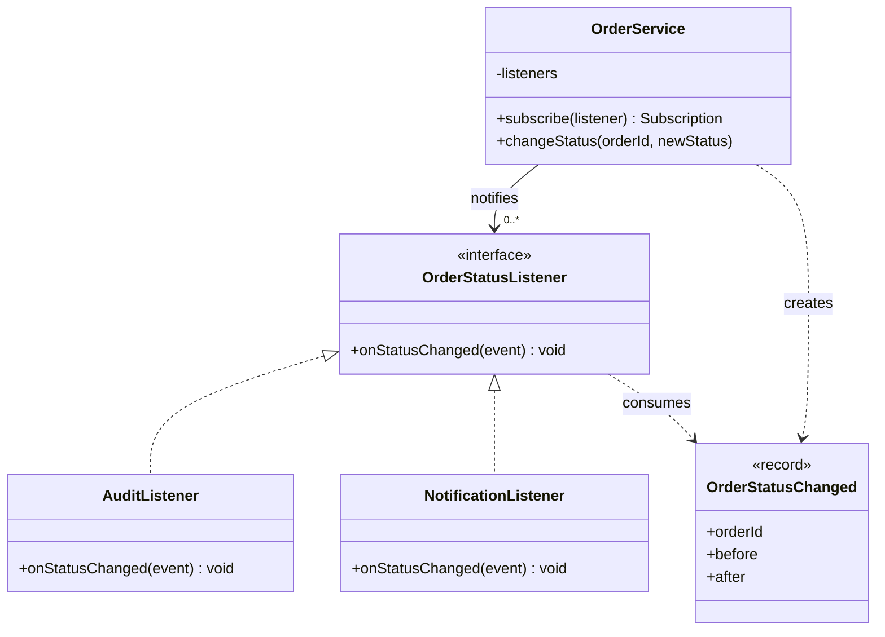

**Một điểm dễ nhầm:** sơ đồ mô tả hợp đồng cộng tác. Nó không đòi hỏi Observer phải kế thừa một abstract class nặng nề. Với Java hiện đại, một **functional interface** là đủ cho các listener đơn giản.

## 3. Java 17 hoàn chỉnh: đăng ký, phát sự kiện, hủy đăng ký

Ví dụ này mô phỏng thay đổi trạng thái của một đơn hàng trong **một luồng xử lý**. Trạng thái hợp lệ lần lượt là `CREATED → PAID → SHIPPED`. Không phát sự kiện khi gọi cập nhật với chính trạng thái hiện tại; những chuyển trạng thái sai bị từ chối.

Thiết kế sự kiện kiểu `record` bất biến, và thao tác đăng ký trả về một đối tượng `Subscription` để hủy theo đúng lần đăng ký.

Tạo file `ObserverDemo.java` và chạy:

```bash
javac ObserverDemo.java
java ObserverDemo
```

```java
import java.util.HashMap;
import java.util.Map;
import java.util.Objects;
import java.util.concurrent.CopyOnWriteArrayList;

public class ObserverDemo {

    enum OrderStatus { CREATED, PAID, SHIPPED }

    // Payload chỉ đọc: observer không thể thay đổi trạng thái event.
    record OrderStatusChanged(
            String orderId,
            OrderStatus before,
            OrderStatus after) {
        OrderStatusChanged {
            Objects.requireNonNull(orderId, "orderId");
            Objects.requireNonNull(before, "before");
            Objects.requireNonNull(after, "after");
        }
    }

    @FunctionalInterface
    interface OrderStatusListener {
        void onStatusChanged(OrderStatusChanged event);
    }

    // AutoCloseable, nhưng close() không ném checked exception.
    @FunctionalInterface
    interface Subscription extends AutoCloseable {
        @Override
        void close();
    }

    static final class OrderService {
        private final Map<String, OrderStatus> orders = new HashMap<>();
        private final CopyOnWriteArrayList<Registration> listeners =
                new CopyOnWriteArrayList<>();

        // Một token riêng cho mỗi lần đăng ký: cùng listener có thể
        // đăng ký nhiều lần nhưng hủy đúng subscription tương ứng.
        private static final class Registration {
            private final OrderStatusListener listener;

            private Registration(OrderStatusListener listener) {
                this.listener = listener;
            }
        }

        void createOrder(String id) {
            requireId(id);
            if (orders.putIfAbsent(id, OrderStatus.CREATED) != null) {
                throw new IllegalArgumentException(
                        "Đơn hàng đã tồn tại: " + id);
            }
        }

        Subscription subscribe(OrderStatusListener listener) {
            Objects.requireNonNull(listener, "listener");
            Registration registration = new Registration(listener);
            listeners.add(registration);
            return () -> listeners.remove(registration);
        }

        void changeStatus(String id, OrderStatus next) {
            requireId(id);
            Objects.requireNonNull(next, "next");
            OrderStatus current = orders.get(id);

            if (current == null) {
                throw new IllegalArgumentException(
                        "Không tìm thấy đơn hàng: " + id);
            }

            if (current == next) {
                return; // Không có sự thay đổi: không phát event.
            }

            boolean allowed =
                    current == OrderStatus.CREATED &&
                            next == OrderStatus.PAID
                    || current == OrderStatus.PAID &&
                            next == OrderStatus.SHIPPED;

            if (!allowed) {
                throw new IllegalStateException(
                        "Không thể chuyển từ " + current + " sang " + next);
            }

            orders.put(id, next);
            OrderStatusChanged event =
                    new OrderStatusChanged(id, current, next);

            // Best effort, đồng bộ, trong tiến trình.
            for (Registration r : listeners) {
                try {
                    r.listener.onStatusChanged(event);
                } catch (RuntimeException ex) {
                    // Demo: một listener lỗi không chặn listener còn lại.
                    // Production: log/metrics, error policy rõ ràng.
                    System.err.println(
                            "Listener gặp lỗi: " + ex.getMessage());
                }
            }
        }

        OrderStatus statusOf(String id) {
            requireId(id);
            OrderStatus status = orders.get(id);
            if (status == null) {
                throw new IllegalArgumentException(
                        "Không tìm thấy đơn hàng: " + id);
            }
            return status;
        }

        private static void requireId(String id) {
            Objects.requireNonNull(id, "orderId");
            if (id.isBlank()) {
                throw new IllegalArgumentException(
                        "orderId không được rỗng");
            }
        }
    }

    public static void main(String[] args) {
        OrderService orders = new OrderService();
        orders.createOrder("DH-100");

        Subscription audit = orders.subscribe(event ->
                System.out.printf(
                        "AUDIT %s: %s -> %s%n",
                        event.orderId(),
                        event.before(),
                        event.after()));

        Subscription notification = orders.subscribe(event -> {
            if (event.after() == OrderStatus.PAID) {
                System.out.println(
                        "NOTIFY: Đã thanh toán " + event.orderId());
            }
        });

        orders.changeStatus("DH-100", OrderStatus.PAID);
        // AUDIT DH-100: CREATED -> PAID
        // NOTIFY: Đã thanh toán DH-100

        notification.close(); // Dừng listener notification.
        orders.changeStatus("DH-100", OrderStatus.SHIPPED);
        // AUDIT DH-100: PAID -> SHIPPED

        orders.changeStatus("DH-100", OrderStatus.SHIPPED);
        // Không có thay đổi, không có thông báo mới.

        audit.close();
        System.out.println(orders.statusOf("DH-100")); // SHIPPED
    }
}
```

### Những quyết định quan trọng trong ví dụ

- **Không đặt logic audit/email vào `OrderService`:** service chỉ biết `OrderStatusListener`, không import SDK gửi email hay lớp dashboard.
- **Event chứa dữ liệu đủ dùng:** observer biết đơn nào đổi và từ trạng thái nào sang trạng thái nào, không cần tự đoán biến động từ trạng thái toàn cục.
- **Không phát khi không thay đổi:** lần gọi `SHIPPED → SHIPPED` là thao tác no-op, tránh hiệu ứng phụ trùng lặp trong kịch bản ví dụ.
- **`Subscription` quản lý vòng đời:** `close()` xóa đúng một đăng ký khỏi danh sách. Gọi `close()` nhiều lần không tạo lỗi. Không cần cho Subject truy cập phương thức hủy theo toàn bộ người quan sát.
- **`CopyOnWriteArrayList` giữ snapshot khi duyệt:** thêm/xóa listener trong lúc dispatch không làm ném `ConcurrentModificationException`. Listener được đăng ký hoặc hủy trong lúc dispatch có thể vẫn/không được nhận *event đang xử lý* tùy snapshot; không nên dựa vào hiệu lực tức thì trong callback.
- **Xử lý lỗi là một lựa chọn thiết kế:** demo bắt `RuntimeException` và tiếp tục gọi listener còn lại; sự kiện lỗi chỉ được in ra stderr. Production cần phân loại lỗi, đo metrics và quy tắc retry/điều tra.
- **Chỉ phục vụ single-thread cho trạng thái đơn hàng:** `HashMap` và chuỗi đọc–kiểm tra–ghi chưa được đồng bộ. `CopyOnWriteArrayList` chỉ hỗ trợ danh sách listener khi thay đổi đồng thời, **không** làm `OrderService` thread-safe.

**Bản demo không thay thế hệ thống đặt hàng thực tế**: nó không lưu DB, không có transaction, không xử lý đồng thời nhiều người cập nhật một đơn, và không bảo đảm notification được phát lại sau khi process chết.

## 4. Thứ tự gọi và thời điểm phát sự kiện

```mermaid
sequenceDiagram
    participant U as Client
    participant S as OrderService
    participant A as AuditObserver
    participant N as NotificationObserver
    U->>S: changeStatus("DH-100", PAID)
    S->>S: Validate transition
    S->>S: Lưu PAID
    S->>A: onStatusChanged(event)
    A-->>S: Return
    S->>N: onStatusChanged(event)
    N-->>S: Return
    S-->>U: Return
    Note over S,N: Dispatch đồng bộ; callback chậm làm chậm caller
```

Trong ví dụ, **thứ tự đăng ký** thường cũng là thứ tự lặp qua `CopyOnWriteArrayList` trong một lượt dispatch. Tuy nhiên, ứng dụng không nên đưa quy tắc nghiệp vụ sống còn vào việc “Observer A luôn chạy trước Observer B”. Một observer có thể được thêm, hủy, chạy lâu, ném lỗi hoặc kích hoạt một lần dispatch lồng nhau.

Nếu trình tự A phải hoàn tất thành công **trước** B để bảo đảm tính đúng đắn, đó thường là một **quy trình điều phối bắt buộc** thuộc use case hoặc workflow, không nên ngầm dựa vào thứ tự Observer.

### Push hay Pull?

Có hai cách tổ chức payload:

- **Push model:** nguồn phát gửi dữ liệu liên quan qua `OrderStatusChanged` như ví dụ. Observer dễ xử lý, nhưng contract của sự kiện phải được thiết kế và version cẩn thận.
- **Pull model:** nguồn chỉ báo “đã đổi”; observer phải hỏi ngược Subject để lấy trạng thái mới. Payload nhỏ hơn nhưng tăng coupling và tạo nguy cơ đọc phải trạng thái đã đổi thêm lần nữa.

Đối với các sự kiện cần audit hoặc cần phản ứng chính xác trên từng chuyển trạng thái, **payload bất biến mô tả điều đã xảy ra** thường dễ kiểm thử và ít gặp lỗi thời điểm hơn.

## 5. Kiểm thử Observer: đăng ký, hủy, trạng thái và lỗi

Kiểm thử Observer cần chứng minh hành vi từ góc nhìn client, không chỉ “có listener được gọi”.

Ví dụ JUnit 5; đặt file `ObserverDemoTest.java` trong cùng package với `ObserverDemo`:

```java
import static org.junit.jupiter.api.Assertions.*;
import java.util.ArrayList;
import java.util.List;
import org.junit.jupiter.api.Test;

class ObserverDemoTest {

    @Test
    void notifiesOnceForRealChange() {
        var service = new ObserverDemo.OrderService();
        service.createOrder("DH-1");

        List<ObserverDemo.OrderStatusChanged> received =
                new ArrayList<>();
        service.subscribe(event -> { received.add(event); });

        service.changeStatus("DH-1", ObserverDemo.OrderStatus.PAID);
        service.changeStatus("DH-1", ObserverDemo.OrderStatus.PAID);

        assertEquals(1, received.size());
        assertEquals("DH-1", received.get(0).orderId());
        assertEquals(ObserverDemo.OrderStatus.CREATED,
                received.get(0).before());
        assertEquals(ObserverDemo.OrderStatus.PAID,
                received.get(0).after());
    }

    @Test
    void unsubscribeStopsFutureNotifications() {
        var service = new ObserverDemo.OrderService();
        service.createOrder("DH-2");
        List<ObserverDemo.OrderStatusChanged> events =
                new ArrayList<>();

        ObserverDemo.Subscription sub =
                service.subscribe(event -> { events.add(event); });
        service.changeStatus("DH-2", ObserverDemo.OrderStatus.PAID);
        sub.close();
        sub.close(); // idempotent
        service.changeStatus("DH-2", ObserverDemo.OrderStatus.SHIPPED);

        assertEquals(1, events.size());
    }

    @Test
    void invalidTransitionDoesNotNotifyOrChangeState() {
        var service = new ObserverDemo.OrderService();
        service.createOrder("DH-3");
        List<ObserverDemo.OrderStatusChanged> events =
                new ArrayList<>();
        service.subscribe(event -> { events.add(event); });

        assertThrows(IllegalStateException.class,
                () -> service.changeStatus(
                        "DH-3", ObserverDemo.OrderStatus.SHIPPED));

        assertEquals(ObserverDemo.OrderStatus.CREATED,
                service.statusOf("DH-3"));
        assertTrue(events.isEmpty());
    }

    @Test
    void brokenObserverDoesNotBlockOtherObservers() {
        var service = new ObserverDemo.OrderService();
        service.createOrder("DH-4");
        List<ObserverDemo.OrderStatusChanged> received =
                new ArrayList<>();

        service.subscribe(event -> {
            throw new IllegalStateException("Lỗi mô phỏng");
        });
        service.subscribe(event -> { received.add(event); });

        service.changeStatus("DH-4", ObserverDemo.OrderStatus.PAID);
        assertEquals(1, received.size());
        assertEquals(ObserverDemo.OrderStatus.PAID,
                service.statusOf("DH-4"));
    }
}
```

Test cuối mô tả **chính sách lỗi đã chọn trong demo**: một listener ném `RuntimeException` nhưng các listener sau vẫn chạy. Nếu production cần *fail-fast* hay phải báo về caller việc thông báo chưa thành công, cần sửa **hợp đồng** và kiểm thử tương ứng, đồng thời bảo đảm không làm trạng thái domain bị hiểu sai.

Các test quan trọng khác có thể bổ sung: đăng ký cùng callback hai lần, hủy ngay trong callback, sự kiện gửi sau khi thay đổi thành công, xử lý khi một subscriber chạy rất chậm, và behavior trong trường hợp có nhiều thread. Không cần mock framework để kiểm thử cơ chế đơn giản này.

## 6. Vòng đời đăng ký và rò rỉ bộ nhớ

Subject thông thường **giữ tham chiếu mạnh** tới listener. Nếu listener tham chiếu đến UI controller hoặc một đối tượng lớn đã không còn cần thiết, nhưng vẫn nằm trong danh sách của Subject có vòng đời dài, GC có thể **không giải phóng được** các đối tượng liên quan.

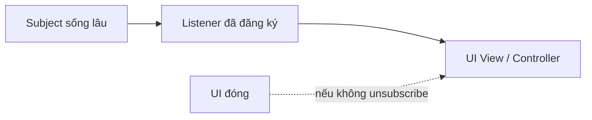

Cách phòng tránh:

- Trả về **subscription token** và gọi `close()` khi đối tượng không còn theo dõi.
- Liên kết subscription với lifecycle của UI, request scope hoặc component.
- Trong API async hoặc framework, sử dụng cơ chế dispose/unsubscribe được framework hỗ trợ.
- Tránh đăng ký lại cùng một listener sau mỗi lần render/request mà không kiểm soát số lượng.
- Kiểm thử thao tác đóng/mở nhiều lần để tìm rò rỉ và nhận event trùng.

**Weak references** có thể hữu ích trong một số framework, nhưng khiến observer bị GC bất ngờ nếu không có tham chiếu giữ sống; không phải thay thế mặc định cho việc quản lý lifecycle tường minh.

## 7. Callback đồng bộ, concurrency và reentrancy

Observer Pattern mô tả quan hệ đăng ký–thông báo, **không mặc định nói “chạy bất đồng bộ”**.

| Thuộc tính | Đồng bộ trong tiến trình (ví dụ) | Dispatch bất đồng bộ qua queue/executor |
|---|---|---|
| Thời điểm xử lý | Ngay trên luồng của publisher | Một luồng/tác vụ khác |
| Độ trễ của publisher | Cộng thời gian các observer | Có thể giảm thời gian chờ, nhưng thêm enqueue/điều phối |
| Thứ tự | Có thể dựa vào thứ tự dispatch một lượt, không nên thành luật nghiệp vụ | Phụ thuộc queue, worker, partition và concurrency |
| Lỗi listener | Có thể ném lên stack hoặc bắt tại publisher | Cần nơi ghi nhận lỗi, retry, dead-letter |
| Backpressure | Listener chậm chặn publisher | Queue đầy, memory tăng hoặc reject task |
| Vòng đời | Trong bộ nhớ process | Cần quản lý executor/queue và shutdown |

### Những vấn đề đặc biệt cần quyết định

**Reentrancy:** một listener có thể gọi lại `changeStatus` trong lúc Subject đang phát sự kiện. Khi đó lời gọi mới chạy lồng bên trong lời gọi cũ; observer khác có thể nhận event mới trước event cũ nếu không thiết kế rõ. Tránh callback tự kích hoạt vô hạn. Nếu cần bảo đảm thứ tự, hãy điều phối thay đổi bằng queue hoặc state machine với cơ chế serialization rõ.

**Race condition:** hai thread đọc cùng `CREATED` rồi cùng thay đổi sẽ gây mất cập nhật hoặc event sai. Khóa/transaction/optimistic locking phải bảo vệ **toàn bộ thao tác kiểm tra–cập nhật**, không chỉ danh sách listeners. Ví dụ `CopyOnWriteArrayList` không làm `HashMap` được cập nhật an toàn.

**Callback lâu:** gửi email hoặc gọi REST trực tiếp trong listener đồng bộ có thể kéo dài thời gian API phản hồi. Có thể chuyển side effect sang task/job; khi đó phải giải quyết hàng đợi đầy, retry, theo dõi lỗi và shutdown an toàn.

**Lỗi:** ba lựa chọn phổ biến là *fail-fast*, *tiếp tục và tổng hợp lỗi*, hoặc *best effort và ghi nhận lỗi*. Không có một chính sách luôn đúng. Quan trọng là người gọi biết update chính đã thành công hay chưa và notification được cam kết ở mức nào.

**Thứ tự và at-most-once:** không nên tự suy ra “có Observer thì mỗi người nhận chính xác một lần”. Đặc biệt sau sự cố, retry hoặc khi callback gọi lại, việc giao sự kiện có thể thiếu hoặc trùng.

## 8. Observer, Event Bus và Publish–Subscribe khác nhau thế nào?

**Observer** trong thiết kế hướng đối tượng thường là quan hệ trực tiếp giữa nguồn và danh sách người quan sát, trong cùng process.

**Event bus (trong process)** thêm một nơi trung gian nhận sự kiện và phân phối theo loại. Producer chỉ biết bus, còn nhiều handler đăng ký với bus. Mô hình này giảm tham chiếu trực tiếp nhưng có thể làm khó tra cứu ai xử lý sự kiện nào nếu cấu hình rải rác.

**Publish–subscribe qua message broker** (như Kafka hoặc RabbitMQ) tách producer và consumer qua mạng và thời gian. Đây là bài toán hệ thống phân tán: lưu bền thông điệp, xác nhận tiêu thụ, retry, thứ tự, nhóm consumer, poison message và idempotency.

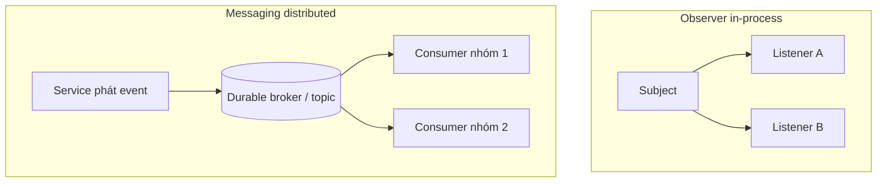

| Câu hỏi | Observer trong process | Messaging phân tán |
|---|---|---|
| Có qua mạng? | Thường không | Có |
| Đòi hỏi broker riêng? | Không | Thường có |
| Thông báo có tự được lưu bền? | Không | Tùy cấu hình và xác nhận ghi/đọc |
| Process dừng giữa dispatch? | Observer còn lại có thể không nhận | Có thể phát lại theo semantics của hệ thống |
| Cần xử lý trùng lặp? | Tùy code và retry | Thường cần idempotent consumer |
| Ai quản lý lifecycle? | Subject và subscription | Broker/client/consumer group + ứng dụng |
| Có đảm bảo “exactly once” end-to-end? | Không | Không mặc định; phụ thuộc phạm vi transaction và side effects |

Không nên gọi “Observer qua Kafka” như thể chỉ cần thay danh sách listener bằng topic. Đó là **một thiết kế khác cấp**, thêm nhiều yêu cầu vận hành và tính nhất quán.

## 9. Sự kiện domain và thời điểm publish với database

Giả sử xử lý thanh toán có transaction:

1. Kiểm tra đơn hàng và điều kiện chuyển trạng thái.
2. Ghi `PAID` vào database.
3. Commit.
4. Thông báo cho bộ phận email/audit/analytics.

Nếu phát sự kiện **trước commit**, listener có thể đọc một trạng thái chưa tồn tại bền vững, hoặc nhận “đã thanh toán” dù transaction rollback. Nếu chỉ phát **sau commit** bằng lời gọi trong RAM, có cửa sổ sự cố: DB đã commit nhưng process chết trước khi publish → mất thông báo.

Với yêu cầu tin cậy, xem xét **Transactional Outbox**:

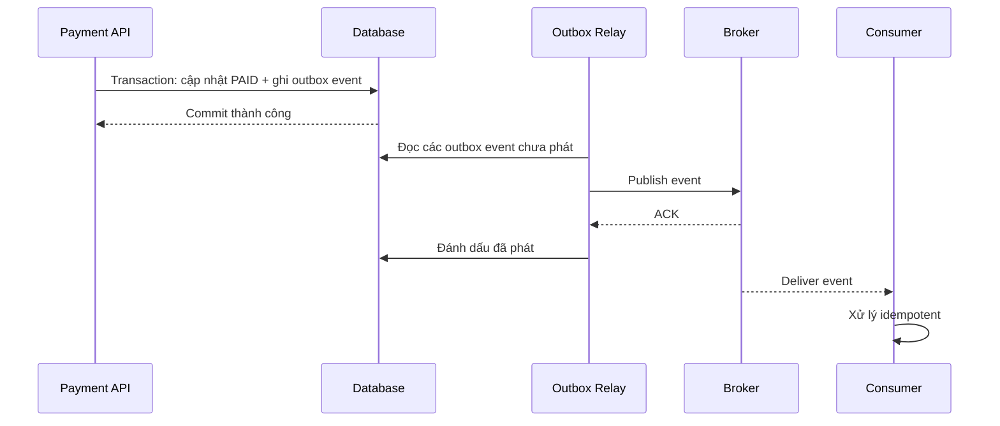

Outbox giải quyết **khoảng cách giữa cập nhật DB và ghi thông điệp** khi cả hai được ghi chung một transaction của DB. Nhưng relay có thể phát trùng nếu crash sau publish trước khi đánh dấu; consumer vẫn phải hỗ trợ **idempotency**. Không tự mặc định mọi event có thứ tự toàn cục hoặc được xử lý đúng một lần.

Các event nên mô tả **sự thật đã xảy ra** bằng tên quá khứ, ví dụ `OrderPaid`, `OrderShipped`. Một lệnh như `SendEmail` lại diễn đạt **yêu cầu làm việc**; phân biệt event và command giúp contract rõ ràng.

### Điều kiện tối thiểu cho event có thể chia sẻ

- Mã sự kiện duy nhất `eventId` để chống trùng.
- `aggregateId`/`orderId` để gắn với đối tượng nghiệp vụ.
- Loại sự kiện, thời điểm phát `occurredAt`, có cân nhắc múi giờ UTC.
- Phiên bản schema khi cần thay đổi hợp đồng lâu dài.
- Payload tối thiểu, tránh dữ liệu nhạy cảm không cần thiết.
- Quy tắc tương thích ngược và điều kiện consumer có thể retry an toàn.

Những trường này là **khuyến nghị cho sự kiện bền vững/phân tán**, không bắt buộc với mỗi observer cục bộ trong bài học.

## 10. Observer so với các Design Pattern gần gũi

| Pattern / cơ chế | Ý định | Khác biệt đáng nhớ |
|---|---|---|
| **Observer** | Một nguồn thay đổi thông báo các listener đăng ký | Chủ yếu quan hệ one-to-many, phản ứng sau thay đổi |
| **Strategy** | Hoán đổi thuật toán/chính sách để thực hiện một công việc | Thường chọn *một chiến lược xử lý*, không phải phát cho nhiều người quan tâm |
| **Mediator** | Tập trung điều phối tương tác qua lại giữa các đồng nghiệp | Quản lý quan hệ phối hợp hai chiều/phức tạp, không đơn thuần “có thay đổi thì báo” |
| **Command** | Đóng gói một yêu cầu hành động thành đối tượng | Command nói về việc *muốn làm*, event nói về việc *đã xảy ra* |
| **Decorator** | Bổ sung hành vi qua lớp bọc giữ cùng interface | Bao quanh một đối tượng/đường gọi, không xây danh sách subscriber |
| **Callback đơn lẻ** | Gọi một hàm khi tác vụ kết thúc | Có thể là phần tử của Observer, nhưng chưa nhất thiết có registry/vòng đời |

Ví dụ: khi nhấn nút đặt hàng, có thể dùng **Command** `PlaceOrder`, logic chọn cách giảm giá dùng **Strategy**, và sau khi trạng thái đổi thì **Observer** thông báo tới view/audit. Các pattern có thể phối hợp, nhưng mỗi cái phải giải quyết một vấn đề cụ thể.

## 11. Không phải phản ứng nào cũng nên là observer

Phân biệt **hành động bắt buộc cho tính đúng đắn** và **phản ứng phát sinh**:

| Tình huống | Thiết kế nên cân nhắc |
|---|---|
| Phải trừ tồn kho thành công trước khi xác nhận đơn | Workflow/use case rõ ràng với transaction hoặc saga; đừng phụ thuộc thứ tự listener ngầm |
| Cập nhật UI khi trạng thái ViewModel thay đổi | Observer/property listener rất phù hợp |
| Ghi metrics best effort sau khi xử lý xong | Observer/listener có thể phù hợp |
| Gửi email xác nhận có thể chậm, cần retry | Job queue, outbox hoặc consumer bền vững |
| Audit bắt buộc không được mất | Lưu audit cùng transaction hoặc cơ chế bền vững tương đương |
| Hai class luôn gọi nhau một-một đơn giản | Gọi phương thức trực tiếp có thể dễ hiểu hơn |
| Hàng nghìn loại event đăng ký khắp nơi không kiểm soát | Cần catalog event, tracing, schema và giới hạn quyền đăng ký |

Một **observer phát lỗi nhưng publisher đã thay đổi state** là trường hợp phải quy định từ trước. Nếu lỗi của observer phải khiến toàn bộ nghiệp vụ thất bại thì cấu trúc đồng bộ có rollback/compensation có thể cần thiết; tuyệt đối không mặc định “đã phát event” đồng nghĩa với “mọi hiệu ứng phụ đã xong”.

## 12. Kỹ thuật thiết kế API Observer dễ bảo trì

**Đặt tên theo domain.** `OrderStatusChanged` tốt hơn event mơ hồ `SomethingUpdated` nếu consumer cần ý nghĩa nghiệp vụ. Đừng lạm dụng kiểu `Object payload` rồi ép kiểu bằng `instanceof` khắp nơi.

**Giữ payload bất biến.** Java `record` thuận tiện cho dữ liệu ít trường, nhưng record chỉ *bất biến nông*: nếu chứa `List` mutable hoặc class mutable, nên sao chép phòng vệ (`List.copyOf`) và thiết kế phần tử bất biến.

**Xác định phạm vi nguồn.** Một `OrderService` riêng cho đơn hay một subject chung mọi đơn? Mỗi cách khác nhau về lọc sự kiện, vòng đời, quyền truy cập và memory.

**Có chính sách trùng lặp.** Nếu cần phát *mỗi lần thao tác* ngay cả khi trạng thái không đổi, dùng event thể hiện “attempted action”, không giả vờ đó là `StatusChanged`. Nếu nhiều listener đăng ký cùng một callback, quyết định có cho phép duplicate subscriptions hay không.

**Quản lý unsubscribe.** Khi view đóng, session hết hạn hay module dỡ tải, subscription cần được giải phóng. Java `AutoCloseable` thích hợp dùng với `try-with-resources` trong scope ngắn:

```java
try (ObserverDemo.Subscription sub =
         service.subscribe(event -> System.out.println(event))) {
    service.changeStatus("DH-10", ObserverDemo.OrderStatus.PAID);
}
// sub.close() tự gọi khi ra khỏi khối
```

Đoạn nhỏ trên giả định `service` đã tạo và có đơn `DH-10` trạng thái `CREATED`, không thể chạy độc lập.

**Quan sát được sự kiện.** Khi triển khai sản phẩm thật, bổ sung metrics số observer, thời gian callback, lỗi callback, độ trễ queue, correlation ID. Tránh log thông tin cá nhân/chi tiết thanh toán không cần thiết.

**Không đưa I/O chậm vào listener đồng bộ không giới hạn.** Callback gửi request mạng có thể treo, làm chậm tất cả các listener và caller. Có timeout, circuit breaker và/hoặc queue nếu cần — lựa chọn phải dựa vào yêu cầu sản phẩm.

## 13. Quy trình refactor từ lời gọi cứng sang Observer

1. **Xác định một thay đổi có ý nghĩa:** ví dụ chuyển trạng thái đơn sang `PAID`.
2. **Phân loại phản ứng:** tác vụ bắt buộc để commit thành công khác với tác vụ phụ như metrics/UI/notification.
3. **Đặt contract sự kiện:** `OrderStatusChanged` chứa dữ liệu tối thiểu observer cần.
4. **Tạo hợp đồng listener:** ví dụ `onStatusChanged(event)`; không để Subject biết các class nhận thông báo.
5. **Quyết định dispatch policy:** đồng bộ hay async; lỗi của observer ảnh hưởng caller thế nào; có cần đảm bảo thứ tự không.
6. **Tạo registry/subscription:** hỗ trợ hủy đăng ký, tránh giữ listener quá lâu.
7. **Chỉ publish khi thay đổi hợp lệ và có ý nghĩa:** không tạo “ghost event” cho lệnh thất bại.
8. **Viết test về hợp đồng:** một thay đổi thật, không thay đổi, trạng thái sai, nhiều observer, một observer lỗi, hủy đăng ký.
9. **Đánh giá bền vững nếu có DB/mạng:** transaction boundary, outbox, retry, idempotency, consumer lag.
10. **Theo dõi và thu gọn:** nếu mọi thứ trở nên khó lần theo, dùng event naming/catalog hoặc chuyển quy trình bắt buộc về application service.

## 14. Cạm bẫy thường gặp

| Cạm bẫy | Triệu chứng | Cách xử lý |
|---|---|---|
| Không unsubscribe | Mỗi lần mở lại UI, một event tạo nhiều callback | Trả subscription handle, gắn vào lifecycle |
| Callback làm I/O chậm | Một observer khiến request chậm toàn bộ | Dispatch phù hợp, queue/timeout |
| Observer A gọi lại Subject | Event lồng nhau, thứ tự khó đoán hoặc recursion | Giới hạn reentrancy, dùng queue nếu cần |
| Catch mọi ngoại lệ rồi bỏ qua | Mất notification mà không ai biết | Log/metrics/alert và error policy |
| Cho observer sửa trực tiếp event mutable | Các listener sau nhìn thấy nội dung thay đổi | Event bất biến, phòng vệ collection |
| Coi `CopyOnWriteArrayList` là thread-safe cho cả domain state | Trạng thái đơn bị race | Lock/transaction/CAS tại phần cập nhật trạng thái |
| Dựa vào thứ tự đăng ký để quyết định nghiệp vụ | Đổi cấu hình làm sai luồng | Đưa bước bắt buộc vào workflow |
| Publish trước commit | Observer nhận event dù transaction rollback | Publish sau commit hoặc outbox phù hợp |
| Publish sau commit trong RAM và tưởng “không mất” | Crash giữa commit và publish gây mất event | Transactional Outbox khi cần bền vững |
| Giả định exactly-once | Consumer lặp hiệu ứng phụ khi redelivery | Event ID, deduplication, idempotent consumer |
| Event quá chung `onChange(Object)` | Ép kiểu runtime và coupling ngầm | Kiểu event rõ và có schema |
| Dùng Observer cho mọi phép gọi | Khó debug, khó truy vết phụ thuộc | Giữ lời gọi trực tiếp cho tương tác rõ, bắt buộc |

## 15. Bài tập thực hành

**Bài 1 — Theo dõi thay đổi giá:** Xây `PriceCatalog` phát `PriceChanged(sku, oldPrice, newPrice)`. Có một observer cập nhật UI và một observer thu thập metric. Không phát sự kiện nếu giá không đổi; test đăng ký và hủy đăng ký.

**Bài 2 — Đăng ký trùng:** Gọi `subscribe` hai lần với cùng một listener. Xác định số thông báo được nhận. Hủy một `Subscription` và kiểm tra đăng ký còn lại vẫn hoạt động. Giải thích vì sao mỗi lần đăng ký cần token có danh tính riêng.

**Bài 3 — Observer gây lỗi:** Một listener ném exception, một listener còn lại thu event vào list. Viết test cho chính sách đã chọn (tiếp tục, fail-fast hoặc tổng hợp lỗi). Mô tả rõ người gọi sẽ quan sát trạng thái nghiệp vụ thế nào sau lỗi.

**Bài 4 — Đa luồng:** Hai thread cùng muốn đổi đơn từ `CREATED` sang `PAID`. Đề xuất cách cập nhật có điều kiện bằng database hoặc lock, và chỉ publish **một** sự kiện cho chuyển trạng thái thành công. Trình bày rủi ro nếu publish sau commit nhưng process chết.

**Bài 5 — Gửi email tin cậy:** Từ ví dụ đơn hàng, nâng yêu cầu thành “không được làm mất nhu cầu gửi email khi giao dịch đã commit; xử lý trùng lặp an toàn”. Vẽ sơ đồ outbox, relay, broker, consumer và đề xuất `eventId`/idempotency key.

## 16. Tự kiểm tra đã hiểu Observer chưa?

- [ ] Tôi chỉ ra được Subject, Observer, event, subscription và thời điểm publish.
- [ ] Tôi biết khi nào **thông báo về thay đổi** khác với **gọi thao tác bắt buộc**.
- [ ] Tôi phân biệt được callback đồng bộ trong Java với pub/sub qua broker.
- [ ] Tôi xử lý được sự kiện không thay đổi, invalid transition và listener ném lỗi.
- [ ] Tôi hiểu nguy cơ memory leak khi Subject giữ listener lâu hơn lifecycle của UI.
- [ ] Tôi không nhầm an toàn của danh sách listener với an toàn cập nhật trạng thái nghiệp vụ.
- [ ] Tôi xác định được policy về thứ tự, reentrancy, latency, error và retry.
- [ ] Tôi biết vì sao outbox/idempotency cần thiết khi nâng yêu cầu thành giao sự kiện tin cậy giữa các dịch vụ.

**Ghi nhớ:** Observer cung cấp cách để *một nguồn thay đổi thông báo tới nhiều đối tượng quan tâm* mà không biết trực tiếp tất cả các phản ứng. Thiết kế tốt phải đi kèm vòng đời đăng ký, hợp đồng sự kiện, cách xử lý lỗi và mức bảo đảm thông báo đúng với bối cảnh — đặc biệt khi đi từ callback cục bộ sang hệ thống phân tán.


</details>

- [Quay lại đầu trang](#back-to-top)

---

## <a id="design-patterns-011">Template Method và khung thuật toán</a>

<details>
<summary>Xem chi tiết</summary>

# Template Method trong Java: cố định khung thuật toán, tùy biến từng bước

> **Lộ trình:** OOP → Mẫu thiết kế → Template Method và khung thuật toán.  
> **Mục tiêu:** Hiểu Template Method là gì, biết xác định bước cố định và bước biến thiên, triển khai lớp cha cùng các lớp con trong Java, kiểm tra thứ tự thực thi, phân biệt với Strategy/Factory Method và nhận biết khi nào kế thừa gây thêm chi phí.

## 1. Template Method giải quyết vấn đề gì?

Trong nhiều chương trình, các tác vụ có **cùng quy trình tổng thể** nhưng khác ở một vài bước. Ví dụ, khi xuất báo cáo doanh thu:

1. Nhận và kiểm tra dữ liệu giao dịch.
2. Tính tổng doanh thu.
3. Tạo tiêu đề báo cáo.
4. Biểu diễn từng giao dịch.
5. Tạo dòng tổng kết.
6. Bổ sung nội dung cuối báo cáo nếu cần.

Báo cáo văn bản thuần và báo cáo Markdown đều phải thực hiện các bước này **đúng thứ tự**; chúng chỉ khác cách hiển thị tiêu đề, dòng giao dịch và tổng kết.

Nếu mỗi loại báo cáo có một phương thức `generate()` tự viết toàn bộ quá trình, phần kiểm tra dữ liệu, tính tổng và thứ tự xử lý dễ bị sao chép. Một phiên bản có thể quên kiểm tra tiền âm hoặc bỏ dòng tổng kết.

**Template Method** là mẫu thiết kế hành vi (*behavioral pattern*) theo GoF: định nghĩa **bộ khung của thuật toán trong một phương thức ở lớp cha**, đồng thời cho phép lớp con cài đặt hoặc ghi đè một số bước mà **không thay đổi cấu trúc chung của thuật toán**.

Cách đọc một thiết kế Template Method:

| Thành phần | Vai trò |
|---|---|
| **Abstract Class** | Lớp cha nắm quy trình và định nghĩa những bước mở rộng |
| **Template Method** | Phương thức điều phối thứ tự bước; thường đặt `final` để không bị ghi đè |
| **Concrete Operation** | Bước triển khai trọn vẹn tại lớp cha, dùng chung cho mọi biến thể |
| **Primitive Operation** | Bước `abstract` buộc subclass cung cấp |
| **Hook** | Bước có hành vi mặc định, subclass **có thể** ghi đè |
| **Concrete Class** | Lớp con triển khai những phần khác nhau theo từng biến thể |

Tên pattern đến từ **“mẫu quy trình”**, không phải “template” của generic type trong C++ hay một mẫu file giao diện.

## 2. Từ mã lặp đến một khung thống nhất

Một thiết kế ban đầu thường là hai class độc lập:

~~~java
// Phác thảo để thấy chỗ trùng lặp, không phải chương trình hoàn chỉnh.
class TextReport {
    String generate(List<Sale> sales) {
        validate(sales);
        BigDecimal total = calculateTotal(sales);
        // Render tiêu đề văn bản, từng dòng, tổng kết...
        return "...";
    }
}

class MarkdownReport {
    String generate(List<Sale> sales) {
        validate(sales);
        BigDecimal total = calculateTotal(sales);
        // Render tiêu đề Markdown, từng dòng, tổng kết...
        return "...";
    }
}
~~~

Hai lớp phải tự bảo đảm cùng thứ tự `validate → calculateTotal → render`. Khi nghiệp vụ thêm một bước chung, chẳng hạn kiểm tra ID giao dịch hợp lệ, cả hai có nguy cơ phải sửa.

Ý tưởng refactor:

- **Giữ trong lớp cha:** kiểm tra danh sách đầu vào, chụp snapshot, tính tổng, thứ tự các bước và trả kết quả.
- **Cho lớp con tùy biến:** nội dung tiêu đề, cách trình bày một giao dịch, cách trình bày tổng kết.
- **Dùng hook:** phần bổ sung cuối báo cáo có thể để trống hoặc được subclass định nghĩa.

Cơ chế này thường được diễn đạt bằng “**Hollywood Principle**”: *Don't call us, we'll call you*. Lớp cha quyết định khi nào gọi các bước do lớp con cung cấp; subclass không cần tự lắp lại toàn bộ luồng.

## 3. Ví dụ Java 17 đầy đủ: tạo báo cáo doanh thu

Ví dụ chỉ dùng JDK. Mỗi giao dịch có mã giao dịch và số tiền VND với hai chữ số thập phân **để đơn giản hóa bài học**; đây là quy ước của demo, không phải một phát biểu rằng VND bắt buộc có hai chữ số thập phân trong mọi hệ thống thực.

Hợp đồng đầu vào:

- Mã giao dịch chỉ chứa chữ `A–Z` viết hoa, chữ số hoặc dấu `-` để dễ biểu diễn an toàn trong văn bản/Markdown.
- Số tiền không âm, không null và biểu diễn được đến hai chữ số thập phân.
- Danh sách giao dịch không null; có thể rỗng. Không chấp nhận phần tử null.
- Lớp con chỉ làm nhiệm vụ **format**; không được sửa số tiền hoặc ngầm bỏ giao dịch.

Tạo tệp **`TemplateMethodDemo.java`** rồi chép toàn bộ đoạn sau:

~~~java
import java.math.BigDecimal;
import java.math.RoundingMode;
import java.util.List;
import java.util.Objects;

// Mỗi Sale là một value object bất biến.
// Compact constructor của record chuẩn hóa số tiền.
record Sale(String code, BigDecimal amount) {
    Sale {
        Objects.requireNonNull(code, "code");
        Objects.requireNonNull(amount, "amount");

        if (!code.matches("[A-Z0-9-]+")) {
            throw new IllegalArgumentException(
                    "code must contain only A-Z, 0-9 or -");
        }
        if (amount.signum() < 0) {
            throw new IllegalArgumentException(
                    "amount must be nonnegative");
        }

        try {
            amount = amount.setScale(2, RoundingMode.UNNECESSARY);
        } catch (ArithmeticException ex) {
            throw new IllegalArgumentException(
                    "amount has fractions smaller than 0.01", ex);
        }
    }
}

// Abstract Class: chứa quy trình chung và các extension points.
abstract class SalesReportTemplate {

    // TEMPLATE METHOD: luồng xử lý cuối cùng của mọi biến thể.
    public final String generate(List<Sale> source) {
        Objects.requireNonNull(source, "source");

        // Snapshot; List.copyOf cũng từ chối phần tử null.
        List<Sale> sales = List.copyOf(source);

        // Concrete operation: cùng công thức tổng cho mọi báo cáo.
        BigDecimal total = sales.stream()
                .map(Sale::amount)
                .reduce(BigDecimal.ZERO, BigDecimal::add)
                .setScale(2, RoundingMode.UNNECESSARY);

        StringBuilder output = new StringBuilder();

        // Các primitive operations sẽ được dispatch tới subclass.
        output.append(Objects.requireNonNull(
                header(), "header returned null"));

        for (Sale sale : sales) {
            output.append(Objects.requireNonNull(
                    row(sale), "row returned null"));
        }

        output.append(Objects.requireNonNull(
                summary(sales.size(), total),
                "summary returned null"));

        // Hook tùy chọn: không yêu cầu mọi subclass tự viết lại.
        output.append(Objects.requireNonNull(
                footer(), "footer returned null"));

        return output.toString();
    }

    // Primitive operations: subclass bắt buộc cài đặt.
    protected abstract String header();
    protected abstract String row(Sale sale);
    protected abstract String summary(int count, BigDecimal total);

    // Hook: hành vi mặc định là không thêm phần cuối báo cáo.
    protected String footer() {
        return "";
    }
}

// Concrete Class A: định dạng văn bản thuần.
final class TextSalesReport extends SalesReportTemplate {
    @Override
    protected String header() {
        return "BÁO CÁO DOANH THU\n-----------------\n";
    }

    @Override
    protected String row(Sale sale) {
        return sale.code() + ": "
                + sale.amount().toPlainString() + " VND\n";
    }

    @Override
    protected String summary(int count, BigDecimal total) {
        return "Tổng " + count + " giao dịch: "
                + total.toPlainString() + " VND\n";
    }

    // Không ghi đè footer(): dùng hành vi mặc định của hook.
}

// Concrete Class B: định dạng bảng Markdown.
final class MarkdownSalesReport extends SalesReportTemplate {
    @Override
    protected String header() {
        return "| Mã giao dịch | Số tiền (VND) |\n"
                + "|---|---:|\n";
    }

    @Override
    protected String row(Sale sale) {
        return "| " + sale.code() + " | "
                + sale.amount().toPlainString() + " |\n";
    }

    @Override
    protected String summary(int count, BigDecimal total) {
        return "| **Tổng (" + count + ")** | **"
                + total.toPlainString() + "** |\n";
    }

    @Override
    protected String footer() {
        return "\n_Tự động tạo báo cáo._\n";
    }
}

public class TemplateMethodDemo {
    public static void main(String[] args) {
        List<Sale> sales = List.of(
                new Sale("S-01", new BigDecimal("120.00")),
                new Sale("S-02", new BigDecimal("30.50"))
        );

        SalesReportTemplate textReport = new TextSalesReport();
        SalesReportTemplate markdownReport = new MarkdownSalesReport();

        System.out.println(textReport.generate(sales));
        System.out.println(markdownReport.generate(sales));
    }
}
~~~

Biên dịch và chạy:

~~~bash
javac TemplateMethodDemo.java
java TemplateMethodDemo
~~~

Đầu ra:

~~~text
BÁO CÁO DOANH THU
-----------------
S-01: 120.00 VND
S-02: 30.50 VND
Tổng 2 giao dịch: 150.50 VND

| Mã giao dịch | Số tiền (VND) |
|---|---:|
| S-01 | 120.00 |
| S-02 | 30.50 |
| **Tổng (2)** | **150.50** |

_Tự động tạo báo cáo._
~~~

**Vì sao đúng mẫu Template Method?**

1. `SalesReportTemplate.generate()` sở hữu **thứ tự** các bước.
2. `generate()` là `final` nên subclass không thể ghi đè để bỏ tính tổng, đảo thứ tự hoặc quên bước chung.
3. `header()`, `row()` và `summary()` là các **primitive operations**: abstract, được gọi bởi template và được subclass triển khai.
4. `footer()` là **hook** có mặc định `""`. `TextSalesReport` không cần ghi đè; `MarkdownSalesReport` chọn bổ sung dòng chú thích.
5. `TextSalesReport`/`MarkdownSalesReport` chỉ quyết định **cách biểu diễn kết quả**, không điều khiển lại thuật toán.

Chú ý rằng `final` chỉ khóa việc override **phương thức template**, không tự động ngăn mọi lỗi subclass. Ví dụ, `row()` của một subclass vẫn có thể trả giá trị sai hoặc thực hiện tác dụng phụ không mong muốn. Hợp đồng và kiểm thử vẫn rất quan trọng.

## 4. Sơ đồ lớp và chuỗi thực thi

### 4.1. Cấu trúc lớp

~~~mermaid
classDiagram
    class SalesReportTemplate {
        <<abstract>>
        +generate(source) String
        #header() String*
        #row(sale) String*
        #summary(count,total) String*
        #footer() String
    }
    class TextSalesReport {
        #header() String
        #row(sale) String
        #summary(count,total) String
    }
    class MarkdownSalesReport {
        #header() String
        #row(sale) String
        #summary(count,total) String
        #footer() String
    }
    SalesReportTemplate <|-- TextSalesReport
    SalesReportTemplate <|-- MarkdownSalesReport
~~~

Dấu `*` trong sơ đồ đánh dấu các bước abstract. `generate()` trong Java ở ví dụ được khai báo `final`; sơ đồ chỉ tóm tắt danh sách phương thức.

### 4.2. Ai quyết định thứ tự?

~~~mermaid
sequenceDiagram
    actor Client
    participant Context as SalesReportTemplate
    participant Sub as Concrete Report
    Client->>Context: generate(sales)
    Note over Context: Snapshot danh sách + tính total
    Context->>Sub: header()
    Sub-->>Context: Văn bản tiêu đề
    loop Mỗi Sale
        Context->>Sub: row(sale)
        Sub-->>Context: Dòng đã format
    end
    Context->>Sub: summary(count, total)
    Sub-->>Context: Dòng tổng kết
    Context->>Sub: footer()
    Sub-->>Context: Nội dung hook hoặc chuỗi rỗng
    Context-->>Client: Chuỗi báo cáo hoàn chỉnh
~~~

Khi gọi `new MarkdownSalesReport().generate(...)`, trình tự vẫn bắt đầu trong phương thức kế thừa từ `SalesReportTemplate`. Chỉ từng bước ảo được JVM dispatch tới implementation của đối tượng thật.

## 5. Ba nhóm bước trong Template Method

Thiết kế tốt thường phân biệt **bước bất biến**, **bước bắt buộc thay đổi** và **bước tùy chọn**:

| Nhóm | Đặc điểm Java | Ví dụ | Cách dùng |
|---|---|---|---|
| **Bước chung** | `private` hoặc `final` method chứa logic đầy đủ | Snapshot, tính tổng, kiểm tra dữ liệu | Để ở lớp cha, không tạo điểm ghi đè nếu không cần |
| **Bước abstract** | `protected abstract` | `header()`, `row(...)`, `summary(...)` | Subclass phải cung cấp implementation |
| **Hook** | `protected` method có mặc định | `footer() { return ""; }` | Subclass chỉ override khi cần |
| **Template Method** | Thường `public final` | `generate(...)` | Điều phối các bước theo một thứ tự có chủ ý |

Từ “**thường**” quan trọng: GoF không bắt buộc mọi Template Method phải `final`. Java cho phép phương thức template không `final` và một số framework có chủ đích mở rộng cả quy trình. Tuy nhiên, nếu mục tiêu là **giữ nguyên khung thuật toán**, đánh dấu `final` giúp bảo vệ ý định thiết kế.

### 5.1. Hook dùng để làm gì?

Một hook là một điểm mở rộng **không bắt buộc**. Chẳng hạn, phần lớn báo cáo không cần footer, nhưng Markdown có thể thêm chú thích. Hook nên có hành vi mặc định an toàn, dễ hiểu, và không khiến lớp con buộc phải định nghĩa method rỗng.

Hook cũng có thể kiểm soát một quyết định:

~~~java
// Ví dụ minh họa, giả sử đặt trong một abstract class khác.
protected boolean shouldAddTimestamp() {
    return false;
}
~~~

Template Method có thể hỏi `shouldAddTimestamp()` tại điểm định trước. Cách này hợp lý khi chỉ có một tùy chọn nhỏ; nếu sinh ra hàng loạt hook liên thuộc, các tổ hợp override có thể trở nên khó dự đoán.

### 5.2. Có nên để subclass can thiệp vào dữ liệu chung?

Trong ví dụ, `row(Sale)` nhận một `record` bất biến. Subclass không thể sửa `Sale` tại chỗ, giúp bảo vệ dữ liệu nguồn. Nếu hook nhận một `List` có thể thay đổi, một subclass có thể xóa phần tử, sửa thứ tự hoặc ảnh hưởng bước tổng kết.

Do đó nên:

- Dùng tham số bất biến, value object, hoặc bản sao phù hợp.
- Phân biệt **mở rộng cách thể hiện** và **thay đổi quy tắc nghiệp vụ**.
- Công bố rõ hook nào được phép thay đổi gì, và điều gì phải giữ nguyên.
- Không đưa toàn bộ nội bộ của lớp cha ra `protected` chỉ để subclass có thể sử dụng: điều đó tăng coupling và làm refactor khó hơn.

## 6. Lỗi thiết kế dễ mắc

### Lỗi 1: mỗi subclass tự ghi đè toàn bộ template

~~~java
abstract class ImportTask {
    // Không final; mọi subclass đều có thể thay đổi thứ tự.
    public void execute() {
        validate();
        parse();
        save();
    }

    protected abstract void validate();
    protected abstract void parse();
    protected abstract void save();
}
~~~

Nếu mục đích là bắt buộc tuân thủ thứ tự `validate → parse → save`, có thể dùng `public final void execute()`. Nếu một subclass cần cố tình thay đổi thứ tự, đó có thể là dấu hiệu **khung thuật toán không thực sự ổn định**; xem lại abstraction thay vì sửa tùy tiện tại subclass.

### Lỗi 2: gọi phương thức có thể override trong constructor của lớp cha

~~~java
abstract class UnsafeBase {
    UnsafeBase() {
        configure(); // Nguy hiểm: dispatch tới subclass khi chưa khởi tạo xong.
    }
    protected abstract void configure();
}

final class UnsafeChild extends UnsafeBase {
    private final String prefix = "ready";

    @Override
    protected void configure() {
        System.out.println(prefix.length());
    }
}
~~~

Trong Java, constructor của lớp cha chạy **trước** khi field initializer của lớp con hoàn tất. `configure()` có thể chạy khi `prefix == null`, dẫn tới `NullPointerException`. Tránh gọi hook/abstract override từ constructor; hãy gọi template sau khi object đã khởi tạo đầy đủ, hoặc thiết kế factory xây dựng object xong mới bắt đầu xử lý.

### Lỗi 3: ép lớp con phải hỗ trợ những bước không hợp lý

Nếu một `ImportTask` có bước `decrypt()` nhưng nhiều nguồn không bao giờ được mã hóa, ép mọi subclass triển khai `decrypt() { throw new UnsupportedOperationException(); }` là dấu hiệu hợp đồng không phù hợp.

Tùy nghiệp vụ, có thể dùng hook mặc định an toàn, tách abstraction theo khả năng, hoặc truyền một bộ giải mã Strategy. Không dùng hook trống một cách máy móc nếu việc “không giải mã” tạo rủi ro bảo mật.

### Lỗi 4: tạo quá nhiều hook phụ thuộc thứ tự

Một framework tự viết với hàng chục method như `beforeValidate`, `afterValidate`, `beforeParse`, `afterParse`, `onError`, `finally...` rất khó hiểu khi subclass override nhiều vị trí. Template Method hữu ích nhất khi **khung thực sự ổn định** và chỉ một số ít bước cần thay thế.

### Lỗi 5: dùng kế thừa để xử lý mọi chiều biến thiên

Giả sử đồng thời có hai định dạng đầu ra (Text/Markdown), hai ngôn ngữ (VI/EN) và ba cách xuất (file/email/API). Nếu đưa tất cả vào hệ thống subclass, số tổ hợp tiềm năng là `2 × 2 × 3 = 12`, dễ dẫn tới bùng nổ lớp.

Khi có **nhiều trục thay đổi độc lập**, cân nhắc composition: `ReportFormatter`, `Translator`, `ReportPublisher` được inject riêng. Template Method vẫn có thể quản lý khung xử lý chung ở một tầng ổn định, nhưng từng biến thể có thể do các đối tượng cộng tác đảm nhiệm.

## 7. Template Method so với Strategy, Factory Method và các kỹ thuật khác

| Tiêu chí | Template Method | Strategy | Factory Method |
|---|---|---|---|
| Mục đích | Giữ **khung một thuật toán**, cho subclass thay vài bước | Thay **toàn bộ thuật toán/hành vi** bằng đối tượng cộng tác | Cho subclass quyết định **loại đối tượng được tạo** |
| Cơ chế chính | **Inheritance + dynamic dispatch** các bước override | **Composition + delegation** qua interface | **Inheritance + override** phương thức khởi tạo |
| Điểm biến thiên | Các bước trong quy trình lớp cha | Một implementation Strategy được truyền vào Context | Phương thức tạo một Product |
| Thay biến thể lúc chạy | Có thể đổi **đối tượng subclass**, nhưng không tự thay được cấu trúc quy trình bên trong cùng object | Thường dễ chọn/đổi Strategy thông qua DI hoặc parameter | Chọn Creator subclass hoặc dùng factory do Creator cung cấp |
| Lợi ích | Không lặp phần luồng chung; duy trì thứ tự xử lý | Giảm phụ thuộc vào thuật toán; linh hoạt chọn hành vi | Cô lập việc tạo sản phẩm khỏi logic xử lý |
| Rủi ro | Subclass coupling với lớp cha; hook quá nhiều | Nhiều Strategy nhỏ, cần cơ chế chọn | Nhiều Creator subclass chỉ để thay loại sản phẩm |

**Nhận diện nhanh bằng ví dụ:**

- `SalesReportTemplate.generate()` giữ `header → rows → summary → footer`: **Template Method**.
- `PricingService` nhận `PricingStrategy` và gọi `calculate(...)`: **Strategy**.
- `DocumentCreator` gọi `createDocument()` được subclass override để tạo `PdfDocument` hoặc `HtmlDocument`: **Factory Method**.

Một Template Method **có thể gọi Factory Method** ở một bước, ví dụ quy trình xuất tài liệu gọi `createRenderer()`; cũng có thể nhận Strategy để thực hiện một phần tính toán. Các pattern là công cụ phối hợp, không phải danh mục loại trừ nhau.

### Template Method hay Strategy cho một bài toán?

Dùng các câu hỏi:

1. Có một **thứ tự bước bắt buộc**, nhiều bước dùng chung và chỉ một số bước khác nhau? → **Template Method** đáng cân nhắc.
2. Có nhiều **thuật toán hoàn chỉnh** cần hoán đổi, đặc biệt ở runtime hoặc theo từng request? → **Strategy** thường linh hoạt hơn.
3. Có nhiều chiều biến thiên tương đối độc lập (định dạng, ngôn ngữ, đầu ra)? → Ưu tiên **composition** hoặc phối hợp Strategy với một quy trình chung.
4. Thứ tự xử lý hay hợp đồng có thể bị lớp con phá vỡ không? → Hạn chế extension point, ghi rõ precondition/postcondition, kiểm thử mọi subclass.

Kế thừa trong Template Method tạo liên kết khá chặt với lớp cha. Một thay đổi trong thứ tự hoặc ý nghĩa hook có thể ảnh hưởng tới nhiều subclass; ngược lại, Strategy cần thiết kế interface đủ rõ và thêm bước chọn/khởi tạo object.

## 8. Template Method khác một interface thông thường

Một interface chỉ khai báo các thao tác:

~~~java
interface Exporter {
    String export(List<Sale> sales);
}
~~~

Nếu mỗi implementation của `Exporter` tự quyết định toàn bộ quá trình, chưa có **khung thuật toán dùng chung** ở một lớp cha. Đây là polymorphism qua interface, nhưng tự nó **chưa đủ** để kết luận đang dùng Template Method.

Một `abstract class` chứa `final generate()` gọi các bước `protected abstract`/hook là cấu trúc đặc trưng. Trong Java, interface có `default` method, nhưng cơ chế extension và state khác abstract class; vẫn cần xem xét **ai thực sự sở hữu skeleton** chứ không chỉ nhìn từ khóa.

## 9. Kiểm thử đúng tính chất của Template Method

Trong ứng dụng thật, không chỉ kiểm tra kết quả cuối cùng mà còn cần xác nhận:

- **Thứ tự bước** không bị thay đổi.
- **Bước chung** được thực thi ở mọi subclass.
- Các subclass tạo đầu ra đúng định dạng theo hợp đồng.
- Hook mặc định hoạt động khi subclass không override.
- Dữ liệu biên (danh sách rỗng, null, số tiền không hợp lệ) được xử lý đúng.

Các test dưới đây dùng JUnit Jupiter 5; đặt `TemplateMethodDemo.java` vào source chính và `SalesReportTemplateTest.java` vào source kiểm thử cùng package, có dependency `junit-jupiter` và test runner phù hợp.

### 9.1. Test dữ liệu, tổng kết và hook

~~~java
import static org.junit.jupiter.api.Assertions.*;

import java.math.BigDecimal;
import java.util.List;
import org.junit.jupiter.api.Test;

class SalesReportTemplateTest {
    @Test
    void textAndMarkdownUseSameTotal() {
        List<Sale> sales = List.of(
                new Sale("S-01", new BigDecimal("120.00")),
                new Sale("S-02", new BigDecimal("30.50"))
        );

        String text = new TextSalesReport().generate(sales);
        String markdown = new MarkdownSalesReport().generate(sales);

        assertTrue(text.contains(
                "Tổng 2 giao dịch: 150.50 VND"));
        assertTrue(markdown.contains(
                "| **Tổng (2)** | **150.50** |"));

        // Hook mặc định không thêm chú thích; Markdown có override.
        assertFalse(text.contains("_Tự động tạo báo cáo._"));
        assertTrue(markdown.endsWith(
                "_Tự động tạo báo cáo._\n"));
    }

    @Test
    void emptyListStillGetsASummary() {
        String result = new TextSalesReport()
                .generate(List.of());

        assertTrue(result.contains(
                "Tổng 0 giao dịch: 0.00 VND"));
    }

    @Test
    void invalidSalesAreRejected() {
        assertThrows(IllegalArgumentException.class,
                () -> new Sale("BAD|ID", new BigDecimal("10.00")));
        assertThrows(IllegalArgumentException.class,
                () -> new Sale("S-01", new BigDecimal("-1.00")));
        assertThrows(IllegalArgumentException.class,
                () -> new Sale("S-01", new BigDecimal("1.005")));
        assertThrows(NullPointerException.class,
                () -> new TextSalesReport().generate(null));
    }
}
~~~

### 9.2. Test thứ tự các bước bằng một subclass ghi nhận lời gọi

Test này hữu ích khi sau này ai đó sửa template và vô tình đảo vị trí các bước:

~~~java
import static org.junit.jupiter.api.Assertions.*;

import java.math.BigDecimal;
import java.util.ArrayList;
import java.util.List;
import org.junit.jupiter.api.Test;

class SalesReportOrderTest {
    static final class TracingReport extends SalesReportTemplate {
        final List<String> calls = new ArrayList<>();

        @Override
        protected String header() {
            calls.add("header");
            return "";
        }

        @Override
        protected String row(Sale sale) {
            calls.add("row:" + sale.code());
            return "";
        }

        @Override
        protected String summary(int count, BigDecimal total) {
            calls.add("summary:" + count);
            return "";
        }

        @Override
        protected String footer() {
            calls.add("footer");
            return "";
        }
    }

    @Test
    void templateControlsTheStepOrder() {
        TracingReport report = new TracingReport();

        report.generate(List.of(
                new Sale("S-01", new BigDecimal("20.00")),
                new Sale("S-02", new BigDecimal("15.00"))
        ));

        assertEquals(List.of(
                "header",
                "row:S-01",
                "row:S-02",
                "summary:2",
                "footer"
        ), report.calls);
    }
}
~~~

Lưu ý test về thứ tự chỉ chạy trên một subclass quan sát. Kiểm thử contract chung với tất cả subclass sản phẩm cũng cần thiết khi số biến thể tăng. Nếu một hook sinh tác dụng phụ thật (ghi DB, gửi mail), dùng fake dependency để tránh tạo tác động ngoài ý muốn trong unit test.

## 10. Khi dùng Template Method trong hệ thống thực

Một số trường hợp khung tương đối ổn định:

| Bài toán | Bước chung | Bước tùy biến |
|---|---|---|
| Nhập dữ liệu ETL | Kiểm tra → đọc → chuyển đổi → lưu → tổng kết | Parse CSV/XML, chuẩn hóa từng loại bản ghi |
| Xuất báo cáo | Lấy dữ liệu → tổng hợp → trình bày → xuất | Header, định dạng dòng, footer |
| Chạy tác vụ batch | Khởi tạo → xử lý từng item → cập nhật trạng thái → kết thúc | Xử lý mỗi item, hook trước/sau batch |
| Xử lý tài liệu | Kiểm tra quyền → đọc nội dung → biến đổi → ghi ra | Cách biến đổi/renderer |
| Mẫu kiểm thử cơ sở | Setup chung → thực thi kịch bản → xác nhận chung → cleanup | Dữ liệu fixture, bước thực thi riêng |

Đối với ví dụ **ETL**, có một điểm cần làm rõ: template chỉ cố định thứ tự **không có nghĩa tự bảo đảm giao dịch nguyên tử**. Nếu lưu nhiều bản ghi rồi có lỗi giữa chừng, kết quả có thể là ghi dở; cần transaction, rollback hoặc thiết kế idempotent tùy yêu cầu. Đừng gán năng lực của framework giao dịch cho pattern.

### Checklist thiết kế khung thuật toán

1. Viết **tên và thứ tự** các bước trước khi tạo abstract class. Chỉ phần thật sự bất biến mới vào template.
2. Mô tả **hợp đồng của từng extension point**: đầu vào, kết quả, ngoại lệ và tác dụng phụ được phép.
3. Để phương thức template `final` nếu subclass không được sửa khung.
4. Sử dụng `protected abstract` cho bước bắt buộc; hook có mặc định an toàn cho bước tùy chọn.
5. Giữ validation, bảo vệ trạng thái và quy tắc chung ở lớp cha.
6. Tránh gọi override trong constructor và tránh cho subclass can thiệp tự do vào dữ liệu mutable.
7. Viết test cho **thứ tự gọi, bước chung, kết quả và các biến thể**, kể cả dữ liệu biên.
8. Nếu các biến thể tăng theo nhiều chiều độc lập, đánh giá lại inheritance và chuyển một phần sang Strategy/composition.

## 11. Bài tập thực hành: khung xử lý file nhập sản phẩm

Một hệ thống nhận file sản phẩm từ đối tác theo hai định dạng giả định: `CSV-SIMPLE` và `PIPE-SIMPLE`. Mỗi dòng chứa mã hàng và số lượng, nhưng cách tách trường khác nhau.

Hãy thiết kế:

~~~java
abstract class ProductImportTemplate {
    public final int importText(String raw) {
        // 1. validate raw
        // 2. parseRecords(raw) - abstract
        // 3. validate từng Product
        // 4. persistAll(records) - bước chung
        // 5. afterImport(count) - hook tùy chọn
        // 6. return count
        throw new UnsupportedOperationException("Exercise");
    }

    protected abstract List<Product> parseRecords(String raw);

    protected void afterImport(int count) {
        // mặc định không làm gì
    }
}
~~~

Đây chỉ là **skeleton bài tập**, không phải một implementation hoàn chỉnh; người học cần định nghĩa `Product`, `persistAll` và xử lý lỗi cho đúng.

Yêu cầu bài tập:

- Viết hai subclass `CsvProductImport` và `PipeProductImport`.
- Lớp cha kiểm tra số lượng > 0 trước khi lưu.
- Không cho subclass ghi đè `importText` để bỏ validation.
- Viết test xác minh khi parse hoặc validate thất bại thì **chưa gọi bước lưu**.
- Nếu cần bảo đảm toàn bộ file được lưu hoặc toàn bộ bị hủy, chỉ rõ nơi bắt đầu/kết thúc transaction trong thiết kế của bạn.
- Thảo luận lúc nào thêm một `RecordParser` interface và dùng Strategy lại hợp lý hơn subclass theo định dạng.

### Câu hỏi tự kiểm tra

1. Phương thức nào trong ví dụ báo cáo là **Template Method**? Vì sao dùng `final`?
2. `header()` là primitive operation hay hook? `footer()` là gì?
3. Nếu Text và Markdown dùng **khác công thức tính tổng doanh thu**, việc thay riêng bước format đã còn đủ không? Cần thay đổi abstraction nào?
4. Vì sao gọi một method có thể override từ constructor của abstract class có thể gây `NullPointerException`?
5. Đổi thuật toán tính giá theo từng HTTP request nên cân nhắc Strategy hay tạo một subclass Template Method cho từng request? Vì sao?
6. Abstract class dùng chung data validation có tự động là Template Method nếu không có phương thức điều phối skeleton không?

**Điều cần nhớ:** Template Method để **lớp cha giữ quyền điều phối một quy trình ổn định**, còn lớp con chỉ **cài đặt những bước được cho phép thay đổi**. Sự rõ ràng về ranh giới giữa bước cố định, abstract step và hook mới là giá trị chính của pattern; không phải cứ dùng `abstract class` là đã áp dụng Template Method.


</details>

- [Quay lại đầu trang](#back-to-top)

---

## <a id="design-patterns-012">Command và đóng gói yêu cầu</a>

<details>
<summary>Xem chi tiết</summary>

# Command Pattern — Đóng gói yêu cầu thành đối tượng trong Java

**Chương:** OOP → Mẫu thiết kế.  
**Mục tiêu:** hiểu Command Pattern, tách nơi phát sinh yêu cầu khỏi nơi xử lý, tổ chức undo/redo, viết ví dụ Java có thể chạy và nhận diện giới hạn của lệnh bất đồng bộ hoặc có tác dụng phụ.

## 1. Bài toán: một thao tác có thể đến từ nhiều nơi

Giả sử ứng dụng quản lý công việc cho phép:

- Nhấn nút **Thêm công việc** hoặc dùng phím tắt.
- Đánh dấu một công việc **đã hoàn thành**.
- Hoàn tác thao tác gần nhất (**Undo**) và thực hiện lại (**Redo**).
- Về sau, cùng thao tác có thể được gọi từ giao diện web, menu desktop, tác vụ tự động hoặc lịch xử lý.

Nếu nút giao diện trực tiếp chứa mọi logic sửa dữ liệu, mỗi cách gọi mới dễ lặp lại cùng một nghiệp vụ. Để triển khai undo, nút bấm lại phải hiểu chi tiết trạng thái trước khi thao tác.

**Command Pattern** giải quyết bằng cách **biến một yêu cầu thành đối tượng có hợp đồng thực thi**. Nơi phát yêu cầu chỉ cần gửi Command tới một bộ thực thi; Command biết cách gọi đối tượng thực hiện nghiệp vụ và có thể giữ dữ liệu cần cho hành vi bổ sung như lịch sử, ghi log, lập lịch hoặc hoàn tác.

Ví dụ về lời gọi:

~~~java
manager.execute(new AddTaskCommand(board, "T1", "Học Command"));
manager.execute(new CompleteTaskCommand(board, "T1"));

manager.undo(); // Hoàn tác việc đánh dấu hoàn thành
manager.redo(); // Thực hiện lại thao tác đó
~~~

Trong đoạn này, **manager** không biết “thêm việc” hay “hoàn thành việc” cần thay đổi những field nào. Nó quản lý các Command theo một giao thức chung.

## 2. Những vai trò của Command Pattern

| Vai trò | Nhiệm vụ | Trong ví dụ |
| --- | --- | --- |
| **Command** | Hợp đồng cho một hành động được đóng gói | **Command** với **execute()**, **undo()** |
| **Concrete Command** | Lưu các tham số cần thiết và gọi Receiver | **AddTaskCommand**, **CompleteTaskCommand** |
| **Receiver** | Nơi thực sự chứa logic hoặc dữ liệu cần thay đổi | **TaskBoard** |
| **Invoker** | Kích hoạt Command, quản lý lịch sử hoặc lịch chạy | **CommandManager** |
| **Client** | Tạo Command, lựa chọn Receiver và yêu cầu thực hiện | **main**, controller, trình xử lý UI |

~~~mermaid
flowchart LR
    Client["Client / UI"] -->|tạo lệnh| Add["AddTaskCommand"]
    Client -->|tạo lệnh| Done["CompleteTaskCommand"]
    Add --> Invoker["CommandManager"]
    Done --> Invoker
    Invoker -->|execute / undo| Contract["Command"]
    Contract -->|ủy quyền| Receiver["TaskBoard"]
    Invoker <--> History["Undo / Redo stacks"]
~~~

Sơ đồ nhấn mạnh quan hệ logic; **AddTaskCommand** và **CompleteTaskCommand** đều là các triển khai của hợp đồng **Command**. Khi lệnh thực thi, nó gọi phương thức thích hợp trên Receiver.

**Điều quan trọng:** không nhất thiết mọi Command đều có **undo()**. Tài liệu GoF thường mô tả hợp đồng thực thi; khả năng hoàn tác là một mở rộng hay gặp. Ví dụ dưới đây cố ý dùng giao thức **execute/undo** vì yêu cầu nghiệp vụ có Undo/Redo.

### Command không chỉ là một lời gọi được đổi tên

Nếu lệnh chỉ chứa **execute()** gọi một hàm duy nhất, **Runnable** hoặc lambda có thể đủ. Lợi ích rõ hơn khi lệnh là một đơn vị có thể nhận diện và quản lý: có tham số, chính sách lỗi, quyền thực hiện, ghi lịch sử, xếp hàng, hủy, retry hoặc audit. Không nên thêm hàng chục lớp Command cho những thao tác quá đơn giản nếu hệ thống không cần những khả năng đó.

## 3. Thiết kế lệnh và quy tắc Undo/Redo

Trước khi viết code, hãy định nghĩa rõ:

1. **AddTaskCommand** thêm công việc có mã và tiêu đề. Khi undo, xóa chính công việc đã thêm. Khi redo, tạo lại công việc.
2. **CompleteTaskCommand** đặt **done = true**. Khi undo, khôi phục giá trị **done** trước đó (có thể là true hoặc false).
3. **CommandManager.execute(command)** chỉ đưa lệnh vào lịch sử sau khi **execute()** trở về thành công; một lệnh mới xóa lịch sử redo.
4. **undo()** lấy lệnh cuối trong lịch sử, gọi **undo()**, rồi mới chuyển nó sang redo stack.
5. **redo()** lấy lệnh từ redo stack, gọi lại **execute()**, rồi mới đưa nó vào undo stack.
6. Nếu lệnh ném exception, manager **không chuyển lệnh giữa hai stack**. Tuy vậy, điều đó *không tự bảo đảm* Receiver không bị thay đổi một phần trước khi exception xuất hiện.

Trong bài, Receiver là **TaskBoard** lưu trong bộ nhớ và chỉ được thay đổi qua một manager theo từng bước; đây là giả định quan trọng để lịch sử khớp với trạng thái. Nếu code bên ngoài sửa board giữa các lệnh, undo có thể không còn ý nghĩa hoặc bị thất bại.

~~~mermaid
sequenceDiagram
    participant UI as Client
    participant M as CommandManager
    participant C as CompleteTaskCommand
    participant B as TaskBoard
    UI->>M: execute(command)
    M->>C: execute()
    C->>B: setDone("T1", true)
    B-->>C: previousDone
    C-->>M: success
    Note over M: push undo; clear redo
    UI->>M: undo()
    M->>C: undo()
    C->>B: setDone("T1", previousDone)
    C-->>M: success
    Note over M: move from undo to redo
~~~

## 4. Java 17 hoàn chỉnh: Command, Receiver và Invoker

Tạo file **CommandDemo.java**. Chạy được trên JDK 17 trở lên, không cần Spring hoặc thư viện ngoài. Các lớp được lồng trong một file để tiện học; trong dự án thật có thể tách theo package.

~~~java
import java.util.ArrayDeque;
import java.util.ArrayList;
import java.util.Deque;
import java.util.LinkedHashMap;
import java.util.List;
import java.util.Map;
import java.util.Objects;

public class CommandDemo {

    // Command contract: hai thao tác phục vụ lịch sử.
    public interface Command {
        void execute();
        void undo();
    }

    // Dữ liệu chỉ đọc được đưa cho bên ngoài.
    public record TaskView(String id, String title, boolean done) {}

    // Receiver: sở hữu dữ liệu và các bất biến.
    public static final class TaskBoard {
        private static final class Task {
            final String id;
            final String title;
            boolean done;

            Task(String id, String title) {
                this.id = id;
                this.title = title;
            }
        }

        private final Map<String, Task> tasks = new LinkedHashMap<>();

        private void add(String id, String title) {
            id = required(id, "id");
            title = required(title, "title");

            if (tasks.containsKey(id)) {
                throw new IllegalArgumentException(
                        "Mã công việc đã tồn tại: " + id);
            }
            tasks.put(id, new Task(id, title));
        }

        private void remove(String id) {
            if (tasks.remove(id) == null) {
                throw new IllegalArgumentException(
                        "Không tìm thấy công việc: " + id);
            }
        }

        // Trả về trạng thái cũ để Command có thể hoàn tác chính xác.
        private boolean setDone(String id, boolean value) {
            Task task = tasks.get(id);
            if (task == null) {
                throw new IllegalArgumentException(
                        "Không tìm thấy công việc: " + id);
            }
            boolean previous = task.done;
            task.done = value;
            return previous;
        }

        public List<TaskView> snapshot() {
            List<TaskView> result = new ArrayList<>();
            for (Task task : tasks.values()) {
                result.add(new TaskView(
                        task.id, task.title, task.done));
            }
            return List.copyOf(result);
        }
    }

    public static final class AddTaskCommand implements Command {
        private final TaskBoard board;
        private final String id;
        private final String title;
        private boolean active;

        public AddTaskCommand(TaskBoard board, String id, String title) {
            this.board = Objects.requireNonNull(board, "board");
            this.id = required(id, "id");
            this.title = required(title, "title");
        }

        @Override
        public void execute() {
            if (active) {
                throw new IllegalStateException(
                        "Lệnh thêm đã được thực hiện");
            }
            board.add(id, title);
            active = true;
        }

        @Override
        public void undo() {
            if (!active) {
                throw new IllegalStateException(
                        "Không thể undo lệnh chưa thực hiện");
            }
            board.remove(id);
            active = false;
        }
    }

    public static final class CompleteTaskCommand implements Command {
        private final TaskBoard board;
        private final String id;
        private boolean active;
        private boolean previousDone;

        public CompleteTaskCommand(TaskBoard board, String id) {
            this.board = Objects.requireNonNull(board, "board");
            this.id = required(id, "id");
        }

        @Override
        public void execute() {
            if (active) {
                throw new IllegalStateException(
                        "Lệnh hoàn thành đã được thực hiện");
            }
            previousDone = board.setDone(id, true);
            active = true;
        }

        @Override
        public void undo() {
            if (!active) {
                throw new IllegalStateException(
                        "Không thể undo lệnh chưa thực hiện");
            }
            board.setDone(id, previousDone);
            active = false;
        }
    }

    // Invoker: có thể thực thi nhiều loại Command.
    public static final class CommandManager {
        private final Deque<Command> undoStack = new ArrayDeque<>();
        private final Deque<Command> redoStack = new ArrayDeque<>();

        public void execute(Command command) {
            Objects.requireNonNull(command, "command");

            // Chỉ cập nhật lịch sử sau khi lệnh thành công.
            command.execute();
            undoStack.push(command);
            redoStack.clear();
        }

        public boolean undo() {
            if (undoStack.isEmpty()) {
                return false;
            }
            Command command = undoStack.peek();
            command.undo(); // Nếu lỗi, giữ nguyên lịch sử.
            undoStack.pop();
            redoStack.push(command);
            return true;
        }

        public boolean redo() {
            if (redoStack.isEmpty()) {
                return false;
            }
            Command command = redoStack.peek();
            command.execute(); // Nếu lỗi, giữ nguyên lịch sử.
            redoStack.pop();
            undoStack.push(command);
            return true;
        }

        public boolean canUndo() {
            return !undoStack.isEmpty();
        }

        public boolean canRedo() {
            return !redoStack.isEmpty();
        }
    }

    private static String required(String value, String name) {
        if (value == null || value.isBlank()) {
            throw new IllegalArgumentException(
                    name + " không được rỗng");
        }
        return value.trim();
    }

    public static void main(String[] args) {
        TaskBoard board = new TaskBoard();
        CommandManager manager = new CommandManager();

        manager.execute(new AddTaskCommand(
                board, "T1", "Học Command Pattern"));
        manager.execute(new CompleteTaskCommand(board, "T1"));

        System.out.println(board.snapshot());

        manager.undo();
        System.out.println(board.snapshot());

        manager.redo();
        System.out.println(board.snapshot());
    }
}
~~~

Biên dịch và chạy:

~~~bash
javac CommandDemo.java
java CommandDemo
~~~

Kết quả:

~~~text
[TaskView[id=T1, title=Học Command Pattern, done=true]]
[TaskView[id=T1, title=Học Command Pattern, done=false]]
[TaskView[id=T1, title=Học Command Pattern, done=true]]
~~~

### Phân tích chi tiết từng vai trò

**TaskBoard (Receiver)** chịu trách nhiệm giữ dữ liệu và các bất biến cơ bản như không trùng mã, không tồn tại tiêu đề rỗng và không thao tác công việc không tồn tại. Command không cần biết cách lưu danh sách bên trong Receiver.

**AddTaskCommand** chứa đối tượng board, mã công việc, tiêu đề và cờ **active**. Sau khi thêm thành công, **active = true**. Undo xóa công việc đó rồi đặt lại cờ. Vì vậy, cùng instance có thể được redo sau khi undo. Đây là lựa chọn cụ thể của bài: không phải mọi Command ngoài đời đều có thể hoặc nên thực thi lặp lại.

**CompleteTaskCommand** ghi nhớ **previousDone** của chính lần thực thi gần nhất. Undo khôi phục giá trị cũ, thay vì luôn ép **false**. Đây là điểm quan trọng: hoàn tác phải khôi phục *trạng thái trước thao tác*, không đoán trạng thái.

**CommandManager** điều phối lịch sử nhưng không hiểu nghiệp vụ từng Command. Nó lưu **đối tượng lệnh**, không chỉ tên thao tác. Vì thế lệnh có thể giữ dữ liệu để undo. Lệnh mới thành công làm mất nhánh redo trước đó, giống hành vi phổ biến của trình soạn thảo.

**TaskView** là **record** bất biến, dùng làm snapshot cho code bên ngoài. **List.copyOf(...)** tạo danh sách không cho sửa thông qua kết quả trả về. Vì các thành phần của record là **String/boolean**, bản thân phần tử trong ví dụ cũng không mang trạng thái mutable.

### Giới hạn của ví dụ

- **TaskBoard** và manager chạy trong một tiến trình, một luồng thực hiện tuần tự. Chúng không triển khai khóa, transaction, persistence hoặc phân quyền.
- Phương thức mutation của **TaskBoard** được đặt **private**; các lớp lồng trong cùng top-level class có quyền truy cập private của nhau theo quy tắc Java. Trong codebase thật, hãy tổ chức API để chỉ application service/command handler có thẩm quyền sửa Receiver.
- Manager **không kiểm soát việc một instance Command được truyền qua hai manager khác nhau**. Cờ **active** sẽ từ chối một số lần gọi sai, nhưng đây không phải một cơ chế sở hữu/lifecycle tổng quát.
- Khi người dùng muốn “hoàn tác việc gửi email” hoặc “hoàn tác thanh toán”, thao tác thực tế có thể đã ra khỏi hệ thống. Khi đó **undo()** kiểu đảo trạng thái RAM không đủ; cần quy trình bù trừ, nếu có.
- Việc giữ **lịch sử trong bộ nhớ** làm mất lịch sử khi khởi động lại; cần giải pháp lưu trữ riêng nếu tính năng yêu cầu phục hồi sau restart.

## 5. Undo và Redo thực sự cần điều kiện gì?

Khả năng undo an toàn phụ thuộc vào bản chất hành động.

| Lệnh | Cách hoàn tác có thể có | Những điều cần lưu ý |
| --- | --- | --- |
| Đổi trạng thái checkbox | Khôi phục giá trị trước đó | Receiver không bị thay đổi trái phép ở giữa |
| Thêm dòng trong tài liệu | Xóa đúng đoạn đã chèn | Phải ghi lại vị trí, ID hoặc version để không xóa nhầm |
| Xóa công việc | Lưu bản chụp cần thiết rồi tạo lại | Khôi phục đủ thuộc tính và thứ tự nếu cần |
| Di chuyển file nội bộ | Di chuyển về vị trí cũ | Cần xử lý trùng tên, mất file, quyền truy cập |
| Gửi email | Thường không thể thu hồi email đã gửi | Có thể cần tạo một *lệnh mới* gửi email đính chính |
| Thanh toán thành công | Không đơn thuần đảo dấu số dư | Hoàn tiền là nghiệp vụ riêng, có ràng buộc và trạng thái độc lập |

Một lệnh **undoable** nên thỏa các kỳ vọng:

1. Có đủ thông tin trước thao tác để xác định hành vi bù trừ.
2. Khi undo thành công, những bất biến nghiệp vụ cần thiết được bảo toàn.
3. Khi undo thất bại, caller nhận lỗi rõ ràng; không giả vờ thành công.
4. Nếu có sửa đổi xen kẽ, cần quyết định rõ cách phát hiện xung đột hoặc tái tính toán.
5. Nếu có side effect ngoài hệ thống, phải có chính sách xử lý riêng.

Đôi khi **memento/snapshot** hữu ích: lưu trạng thái trước khi thực thi để phục hồi. Với dữ liệu lớn, lưu toàn bộ snapshot cho mỗi command có thể tốn bộ nhớ; lưu phần chênh lệch (*delta*) hoặc một cách biểu diễn thao tác đảo ngược thường hiệu quả hơn, nhưng phức tạp hơn. Chọn giải pháp dựa trên nhu cầu và kích thước dữ liệu.

### Vì sao manager thay đổi stack sau khi lệnh thành công?

Giả sử **undo()** ném exception vì dữ liệu đã bị một tác vụ khác thay đổi. Nếu manager đã pop lệnh khỏi **undoStack** trước khi gọi undo thì lịch sử sẽ mất lệnh dù chưa hoàn tác được. Vì vậy, trong ví dụ:

~~~java
Command command = undoStack.peek();
command.undo();          // Chưa động tới stack
undoStack.pop();         // Chỉ sau khi thành công
redoStack.push(command);
~~~

**Lưu ý:** nếu **command.undo()** đã sửa dữ liệu một phần rồi ném lỗi, việc để nguyên stack vẫn chưa giải quyết được trạng thái Receiver. Với nhiều thay đổi cần thực hiện như một khối, hãy dùng transaction, command có phương thức xử lý lỗi phù hợp hoặc cơ chế rollback có kiểm chứng.

## 6. Kiểm thử Command và lịch sử

Các kiểm thử sau dùng **JUnit 5 Jupiter**. Đặt trong **CommandDemoTest.java** cùng package với ví dụ.

~~~java
import static org.junit.jupiter.api.Assertions.*;

import java.util.List;
import org.junit.jupiter.api.Test;

class CommandDemoTest {

    @Test
    void executeUndoRedoGiuDungTrangThai() {
        var board = new CommandDemo.TaskBoard();
        var manager = new CommandDemo.CommandManager();

        manager.execute(new CommandDemo.AddTaskCommand(
                board, "T1", "Học Java"));
        manager.execute(new CommandDemo.CompleteTaskCommand(
                board, "T1"));

        assertEquals(List.of(
                new CommandDemo.TaskView("T1", "Học Java", true)),
                board.snapshot());

        assertTrue(manager.undo());
        assertEquals(List.of(
                new CommandDemo.TaskView("T1", "Học Java", false)),
                board.snapshot());

        assertTrue(manager.redo());
        assertEquals(List.of(
                new CommandDemo.TaskView("T1", "Học Java", true)),
                board.snapshot());
    }

    @Test
    void lenhMoiXoaNhanhRedoCu() {
        var board = new CommandDemo.TaskBoard();
        var manager = new CommandDemo.CommandManager();

        manager.execute(new CommandDemo.AddTaskCommand(
                board, "T1", "Làm A"));
        manager.execute(new CommandDemo.CompleteTaskCommand(
                board, "T1"));

        assertTrue(manager.undo());
        assertTrue(manager.canRedo());

        manager.execute(new CommandDemo.AddTaskCommand(
                board, "T2", "Làm B"));

        assertFalse(manager.canRedo());
        assertFalse(manager.redo());
        assertEquals(2, board.snapshot().size());
    }

    @Test
    void lenhThatBaiKhongThemVaoLichSu() {
        var board = new CommandDemo.TaskBoard();
        var manager = new CommandDemo.CommandManager();

        assertThrows(IllegalArgumentException.class, () ->
                manager.execute(new CommandDemo.CompleteTaskCommand(
                        board, "KHONG-TON-TAI")));

        assertFalse(manager.canUndo());
        assertFalse(manager.canRedo());
    }

    @Test
    void undoLenhThemXoaDungCongViec() {
        var board = new CommandDemo.TaskBoard();
        var manager = new CommandDemo.CommandManager();

        manager.execute(new CommandDemo.AddTaskCommand(
                board, "T1", "Viết test"));
        assertTrue(manager.undo());
        assertTrue(board.snapshot().isEmpty());

        assertTrue(manager.redo());
        assertEquals("T1", board.snapshot().get(0).id());
    }
}
~~~

Test kiểm tra kết quả nghiệp vụ và lịch sử, không giả định manager gọi chính xác bao nhiêu hàm nội bộ. Nếu dự án có nhiều Command, có thể kiểm tra hợp đồng chung bằng test tham số hóa; thêm test riêng cho các quy tắc đặc thù, nhất là khi Command thay đổi nhiều đối tượng.

## 7. Command mở đường cho macro, queue và lịch thực hiện

### 7.1. Macro Command: một lệnh gồm nhiều lệnh

Có thể viết lệnh kết hợp:

~~~java
final class CompositeCommand implements CommandDemo.Command {
    private final java.util.List<CommandDemo.Command> commands;

    CompositeCommand(java.util.List<CommandDemo.Command> commands) {
        this.commands = java.util.List.copyOf(commands);
    }

    @Override
    public void execute() {
        for (var command : commands) {
            command.execute();
        }
    }

    @Override
    public void undo() {
        for (int i = commands.size() - 1; i >= 0; i--) {
            commands.get(i).undo();
        }
    }
}
~~~

**Quan trọng:** đây chỉ là phiên bản minh họa ý tưởng **Composite Command**, **chưa bảo đảm atomicity**. Nếu lệnh thứ ba lỗi trong **execute()**, hai lệnh đầu có thể đã chạy; undo toàn bộ danh sách lúc đó cũng có thể sai. Để dùng thật, cần theo dõi các lệnh đã hoàn tất, undo phần đã thực hiện theo thứ tự ngược nếu phù hợp, hoặc đặt tất cả cập nhật vào transaction. Thậm chí rollback bù trừ có thể thất bại; phải định nghĩa trạng thái lỗi và cách khôi phục.

### 7.2. Queue Command: tách thời điểm nhận và xử lý yêu cầu

Vì Command đại diện một yêu cầu, Invoker có thể xếp hàng:

~~~java
java.util.Queue<CommandDemo.Command> queue =
        new java.util.ArrayDeque<>();

queue.add(new CommandDemo.AddTaskCommand(
        new CommandDemo.TaskBoard(), "T1", "Xử lý sau"));

CommandDemo.Command next = queue.remove();
next.execute();
~~~

Ví dụ trên chỉ là **queue trong RAM**, chưa phải hệ thống message queue bền vững. Đừng đưa nguyên một Java object chứa Receiver, kết nối database hoặc closure rồi giả định có thể serialize và chạy ở máy khác.

Trong hệ thống phân tán, thường dùng **mô tả lệnh** chứa dữ liệu như **commandId**, **type**, **taskId**, **payload**, **createdAt**, **expectedVersion**. Một handler ở phía tiêu thụ dựng lại nghiệp vụ từ mô tả đó và phụ thuộc cần thiết.

~~~java
// Mô tả dữ liệu lệnh, không chứa tham chiếu TaskBoard.
record CompleteTaskRequest(
        String commandId,
        String taskId,
        long expectedVersion
) {}
~~~

Command object bên trong tiến trình và thông điệp yêu cầu qua queue **có thể khác kiểu**, dù cùng diễn đạt một hành động. Khi chuyển từ local queue sang broker, cần thiết kế riêng việc serialize, version schema, security, timeout, dead-letter, retry và observability.

### 7.3. Retry và idempotency

Một lệnh có thể được gửi lại khi mạng timeout dù phía xử lý thực tế đã hoàn tất. Nếu **AddTaskCommand** được thực hiện lại ở Receiver, thao tác có thể báo trùng ID. Với hệ thống thật, cần thiết kế:

- **Command ID / idempotency key** xác định duy nhất một yêu cầu nghiệp vụ.
- Quy tắc xử lý lặp: trả lại kết quả cũ, từ chối trùng hoặc bảo đảm không tạo side effect lần nữa theo contract.
- Transaction/unique constraint hoặc cơ chế lưu trạng thái xử lý để nhiều worker không thực hiện trùng.
- Chính sách retry dựa trên tính chất lỗi: lỗi tạm thời khác lỗi kiểm tra nghiệp vụ.

**Đừng nhầm redo với retry**. **Redo** là hành động người dùng chọn để thực hiện lại sau khi undo; **retry** là nỗ lực xử lý lại một yêu cầu chưa xác định kết quả hoặc thất bại. Một Command có thể không an toàn nếu được tự động thực hiện hai lần.

## 8. So sánh Command với các khái niệm gần nó

| Khái niệm | Mục đích chính | Điểm phân biệt |
| --- | --- | --- |
| **Command Pattern** | Biến yêu cầu thành đối tượng để truyền, ghi nhận, lập lịch, quản lý vòng đời | Hướng đến **hành động được yêu cầu** |
| **Strategy Pattern** | Đóng gói các thuật toán thay thế nhau | Hướng đến **cách thực hiện cùng một tác vụ** |
| **Observer Pattern** | Phát thông báo cho nhiều bên đăng ký khi có sự kiện | Hướng đến **phản ứng khi sự kiện xảy ra** |
| **State Pattern** | Hành vi thay đổi theo trạng thái hiện tại của cùng Context | Hướng đến **vòng đời/trạng thái của đối tượng** |
| **Memento Pattern** | Lưu và phục hồi ảnh chụp trạng thái mà không lộ chi tiết nội bộ | Có thể kết hợp với Command để undo |
| **Event** | Ghi nhận **điều đã xảy ra** | Khác Command, vốn diễn đạt **mong muốn hành động** |
| **Runnable/Callable** | Abstraction hàm thực thi trong Java | Có thể đủ cho hành động đơn giản; không tự cung cấp danh tính nghiệp vụ, undo hoặc persistence |

Ví dụ:

- **Command:** “Hãy hoàn thành công việc T1”.
- **Event:** “Công việc T1 đã hoàn thành”.
- **Strategy:** “Dùng thuật toán tính điểm ưu tiên A hay B cho công việc?”.
- **State:** “Công việc đang NEW hay DONE nên những thao tác nào được cho phép?”.

Một handler có thể xử lý Command, thay đổi State rồi phát Event. Chúng phối hợp được với nhau nhưng không thay thế nhau.

## 9. Dùng Command trong ứng dụng thực tế

### 9.1. UI desktop và menu

Một hành động như Save, Undo, Redo, Delete Selection có thể xuất hiện ở nút toolbar, menu ngữ cảnh và phím tắt. Những Invoker khác nhau tạo/kích hoạt cùng kiểu Command mà không sao chép logic nghiệp vụ.

Với **JavaFX** hoặc **Swing**, việc này đặc biệt tự nhiên: UI handler làm nhiệm vụ chuyển ý định người dùng thành command, còn Receiver/service chịu trách nhiệm thực thi. Trong ứng dụng rất nhỏ, action callback trực tiếp vẫn có thể phù hợp hơn mô hình nhiều lớp.

### 9.2. Service backend và CQRS

Trong backend Java/Spring, application service có thể đóng vai trò command handler:

~~~java
// Phác thảo kiến trúc, không phải class Spring chạy độc lập:
record ApproveInvoiceCommand(String invoiceId, String actorId) {}

final class ApproveInvoiceHandler {
    private final InvoiceRepository invoices;

    ApproveInvoiceHandler(InvoiceRepository invoices) {
        this.invoices = invoices;
    }

    void handle(ApproveInvoiceCommand command) {
        // Kiểm tra quyền, load aggregate, kiểm tra trạng thái,
        // thực hiện chuyển đổi, lưu trong transaction phù hợp.
    }
}
~~~

Đoạn này là **phác thảo** vì **InvoiceRepository** và nghiệp vụ hóa đơn chưa được định nghĩa. Nó cho thấy một biến thể thường gặp: **Command là DTO bất biến**, **Handler** thực hiện nghiệp vụ, khác ví dụ Command object tự mang theo Receiver và **execute()**. Hai cách đều dùng ý tưởng đóng gói yêu cầu nhưng có lựa chọn đánh đổi khác nhau.

**CQRS** (Command Query Responsibility Segregation) phân tách đường xử lý thay đổi trạng thái khỏi đường truy vấn dữ liệu; nó không bắt buộc mọi dự án dùng command bus, event sourcing hoặc hai database. Một Command handler rõ ràng cũng có thể có ích trong kiến trúc thông thường.

### 9.3. Giao dịch, concurrency và phân quyền

Trong môi trường nhiều request:

- Kiểm tra **authorization** theo actor, resource và operation ở phía server. Không cho phép client gửi tên class hay payload tùy ý để gọi bất cứ phương thức nào.
- Sử dụng **version/optimistic locking** hoặc update có điều kiện để tránh hai lệnh ghi đè thay đổi của nhau.
- Xác định ranh giới **transaction** của mỗi Command; một lịch sử stack RAM không thay thế giao dịch.
- Nếu cần audit, ghi danh tính lệnh, tác nhân, thời điểm, tài nguyên, kết quả và thông tin lỗi theo chính sách bảo mật; tránh lưu dữ liệu nhạy cảm không cần thiết.
- Nếu Command tạo side effect ngoài database, cân nhắc **outbox**, idempotency, saga/compensation và chính sách vận hành khi lỗi giữa chừng.

**Một lịch sử undo trên UI không nên được coi là cơ chế hủy giao dịch thanh toán thật.** Sau khi thay đổi có hiệu lực bên ngoài, “hoàn tác” phải là nghiệp vụ bù trừ được định nghĩa rõ, có kiểm toán và giới hạn quyền truy cập.

## 10. Khi nào nên và không nên dùng Command?

**Nên cân nhắc Command nếu:**

- Cùng một hành động được gọi từ nhiều nơi và cần một hợp đồng thực thi thống nhất.
- Có yêu cầu **undo/redo**, macro, lịch sử hoặc replay có kiểm soát.
- Cần đưa yêu cầu vào queue, lên lịch, ghi audit hoặc áp retry/idempotency.
- Muốn tách handler nghiệp vụ khỏi UI, controller, scheduler hoặc cơ chế truyền thông.
- Muốn chuyển các thao tác sang đối tượng có định danh và dữ liệu rõ để kiểm thử độc lập.

**Không nên dùng chỉ vì mọi thao tác đều là hàm**. Một phép tính thuần túy **calculateTotal()**, một helper nội bộ nhỏ hoặc một button callback không có vòng đời/hành vi quản lý đặc biệt có thể không cần cả một class Command, Manager và factory.

Nếu chỉ cần trì hoãn một callback trong cùng tiến trình, có thể dùng **Runnable**:

~~~java
Runnable task = () -> System.out.println("Đã thực thi");
task.run();
~~~

Command Pattern phát huy giá trị khi ngoài “gọi sau” còn có **ý nghĩa nghiệp vụ, tham số, lifecycle, lịch sử, khả năng kiểm soát lỗi hoặc chính sách thực thi** cần được biểu diễn rõ.

### Các lỗi thường gặp

| Lỗi | Tác động | Cách khắc phục |
| --- | --- | --- |
| Command chứa cả giao diện, truy vấn DB, gửi email và quy tắc không liên quan | God object, khó test | Đặt nghiệp vụ ở Receiver/service; Command giữ mục đích và tham số |
| Undo luôn “đặt cờ false” bất kể giá trị trước đó | Phá trạng thái gốc | Lưu giá trị cũ hoặc thao tác nghịch đảo chính xác |
| Pop lịch sử trước khi biết undo thành công | Mất lệnh khi gặp lỗi | Chỉ cập nhật stack sau khi thao tác thành công |
| Tái sử dụng một Command instance đang active | Thực thi lặp ngoài ý định | Định nghĩa vòng đời và trạng thái của từng lệnh |
| Retry lệnh có side effect mà không có idempotency | Gửi trùng, ghi trùng, thu tiền hai lần | Command ID + guard/transaction phù hợp |
| Xem command object trong RAM là message bền vững | Không serialize được Receiver và phụ thuộc | Dùng request DTO/handler và schema có phiên bản |
| Lịch sử undo dùng chung nhiều user không phân biệt ngữ cảnh | Người này tác động lên lịch sử của người khác | Phân vùng theo phiên/người dùng/tài nguyên và kiểm tra quyền |
| Lạm dụng Command cho thao tác không cần quản lý | Boilerplate và thêm tầng khó đọc | Giữ phương thức/lambda trực tiếp khi đủ rõ |

## 11. Bài tập thực hành

Thiết kế một trình chỉnh sửa văn bản đơn giản bằng Java, có **TextDocument** làm Receiver và **CommandManager** làm Invoker.

Các lệnh yêu cầu:

1. **AppendTextCommand(text):** thêm văn bản vào cuối tài liệu; khi undo, chỉ loại bỏ đoạn chính nó đã thêm, đúng vị trí.
2. **ReplaceTextCommand(from, to):** thay đoạn văn bản đầu tiên khớp điều kiện; lưu đủ thông tin để undo chính xác.
3. **ClearDocumentCommand:** xóa toàn bộ; có thể lưu snapshot trước khi xóa để phục hồi.
4. Hỗ trợ undo/redo nhiều bước và xóa lịch sử redo khi thực thi một lệnh mới.

**Tình huống test nên có:** append hai lần rồi undo/redo; replace không tìm thấy đoạn cần thay; clear rồi phục hồi Unicode có dấu; lệnh lỗi không được ghi lịch sử; sửa tài liệu ngoài manager phải được từ chối hoặc gây lỗi xung đột rõ.

Thử mở rộng: lưu thông tin Command dưới dạng DTO có **commandId** và **expectedVersion** để áp lên tài liệu đã lưu database. Phân biệt phần dữ liệu tuần tự hóa được với Receiver/runtime service. Nếu hai người cùng sửa một tài liệu, hãy giải thích cách nhận biết và xử lý xung đột thay vì tin vào stack undo trong RAM.

**Tiêu chí đạt:** client gửi cùng một hợp đồng Command; Receiver giữ logic chỉnh sửa; lịch sử thay đổi chính xác sau khi lệnh hoàn tất; các thao tác undo/redo bảo toàn dữ liệu; có test cho đường hợp lệ, lỗi và xung đột.

**Điểm cần nhớ:** Command Pattern là cách đóng gói **ý định thực hiện một hành động** để có thể chuyển giao, quản lý và xử lý qua một giao diện chung. Nó giúp tách Invoker khỏi Receiver, nhưng undo, retry, lưu lịch sử, phân quyền và tính nhất quán dữ liệu đều cần được thiết kế tường minh theo tính chất nghiệp vụ thực tế.

</details>

- [Quay lại đầu trang](#back-to-top)

---

## <a id="design-patterns-013">Khi mẫu thiết kế làm hệ thống phức tạp hơn cần thiết</a>

<details>
<summary>Xem chi tiết</summary>

# Khi mẫu thiết kế làm hệ thống phức tạp hơn cần thiết

> **Chủ đề:** Mẫu thiết kế trong OOP – nhận diện và xử lý tình trạng *overengineering*.  
> **Mục tiêu:** Biết phân biệt sự linh hoạt thực sự cần thiết với abstraction dựa trên dự đoán; đánh giá chi phí của một Design Pattern, lựa chọn lời giải đủ đơn giản, kiểm thử và refactor khi bằng chứng cho thấy kiến trúc hiện tại quá nặng.

## 1. Tại sao một mẫu thiết kế “đúng sách” vẫn có thể là thiết kế kém?

**Design Pattern** là một phương án giải quyết vấn đề thiết kế lặp lại trong bối cảnh phù hợp. Nó không phải mục tiêu tự thân. Một lớp `Factory`, một interface `Strategy`, một chuỗi `Decorator` hay một `Observer` đều có thể đúng về cấu trúc nhưng vẫn làm ứng dụng khó hiểu hơn nếu vấn đề mà chúng giải quyết **chưa tồn tại hoặc quá nhỏ**.

Hãy tưởng tượng yêu cầu: “Ứng dụng nội bộ cần xuất một chuỗi CSV có ba cột”. Một thiết kế có thể gồm `IExporterFactory`, `AbstractExportBuilder`, `ExporterRegistry`, `CsvExportStrategy` và `ExportFacade`. Nhưng nếu chỉ có một định dạng, một nơi sử dụng và quy tắc ổn định, một hàm xuất CSV với kiểm thử tốt thường dễ đọc, sửa và vận hành hơn.

**Overengineering** xảy ra khi chi phí cấu trúc (lớp, giao diện, cấu hình, quy trình điều phối) vượt lợi ích dự kiến trong bối cảnh hiện tại và tương lai có cơ sở. Điều đó không có nghĩa “ít class luôn tốt”; đôi khi abstraction giúp giảm độ phức tạp tổng thể của hệ thống. Câu hỏi đúng là:

> Những gì pattern làm *dễ thay đổi, dễ kiểm thử hoặc an toàn hơn* có thực sự bù được những gì nó làm *khó điều hướng, khó cấu hình và khó dự đoán hơn* không?

### Những chi phí thường bị bỏ quên

| Chi phí | Biểu hiện thực tế |
|---|---|
| **Nhận thức** | Muốn hiểu một phép tính phải mở interface, ba implementation, factory, registry và file cấu hình |
| **Điều hướng** | Không nhìn vào call site để biết class nào chạy; phải theo DI container/annotation |
| **Bảo trì** | Sửa một kiểu dữ liệu phải đồng bộ nhiều abstraction và test |
| **Kiểm thử** | Bộ kiểm thử chứa nhiều mock cho luồng đơn giản, dễ kiểm tra lời gọi hơn là hành vi |
| **Cấu hình** | Sai tên bean, key hoặc thứ tự decorator làm lỗi runtime |
| **Rủi ro hợp đồng** | Implementation mới trả giá trị không hợp lệ hoặc mang ngữ nghĩa khác nhưng cùng interface |
| **Hiệu năng** | Thêm cấp gián tiếp, allocation, lookup, remote call hoặc serialization tùy kiểu thiết kế; nhiều pattern thuần Java có overhead không đáng kể |
| **Quyền sở hữu** | Nhóm không biết nên sửa quy tắc ở core, adapter hay factory |
| **Vận hành** | Khó xác định implementation đang hoạt động, nơi phát lỗi, cách cấu hình và giám sát |

Không nên khẳng định “Design Pattern luôn làm chậm chương trình”: một lời gọi interface trong Java thường có thể được JVM tối ưu; chi phí lớn hơn nhiều có thể nằm ở network, database hoặc thiết kế thuật toán. Hãy **đo thực tế** nếu hiệu năng là lý do lựa chọn.

## 2. Nhận diện khi nào abstraction là quá sớm

Một vài dấu hiệu mạnh:

1. **Interface có đúng một implementation**, không có yêu cầu thay thế, cô lập hạ tầng hay ranh giới module thực tế.
2. **Factory chỉ gọi một constructor** không có quyết định tạo đối tượng hoặc bất biến cần bảo vệ.
3. **Pattern được chọn trước khi mô tả vấn đề**: cuộc họp nói “áp dụng GoF” nhưng không chỉ ra thay đổi nào đang khó.
4. **Lớp chỉ chuyển tiếp nguyên xi** tham số và kết quả qua 3–4 tầng, không thêm chính sách, ranh giới hoặc khả năng thay đổi.
5. **Mở điểm extension cho giả định chưa có bằng chứng**, ví dụ plugin system cho ứng dụng chỉ có một cơ chế xử lý.
6. **Hệ thống có nhiều cách cấu hình hơn số tình huống sử dụng**, tạo trạng thái không hợp lệ rất khó test.
7. **Một thay đổi nhỏ chạm quá nhiều lớp**, dù mục tiêu ban đầu là “dễ mở rộng”.
8. **Debug phải truy ngược chuỗi event/callback dài**, khó biết ai xử lý trước hoặc vì sao lỗi không đến caller.

Mỗi dấu hiệu **không phải bằng chứng kết luận**. Một interface có một implementation vẫn hợp lý nếu đó là port ngăn business logic phụ thuộc database/SDK, hoặc là hợp đồng công khai của module. Một factory chỉ tạo một class nhưng đảm bảo validation/kiểm soát vòng đời vẫn có giá trị. Quan trọng là **lý do tồn tại và chi phí tổng thể**.

### Đừng đánh đồng đơn giản với ngắn

Hai trăm dòng trong một phương thức, đầy cờ boolean và trạng thái ẩn, không nhất thiết đơn giản hơn năm class nhỏ có trách nhiệm rõ. Ngược lại, năm class chỉ để bọc một phép cộng cũng không mặc nhiên tốt hơn một hàm.

- **Đơn giản**: dễ hiểu các điều kiện, dễ kiểm tra tính đúng, ít trạng thái và ít giả định ngầm.
- **Ngắn**: ít dòng code hoặc ít file.
- **Linh hoạt**: có thể thay một loại hành vi qua điểm mở rộng.
- **Dễ bảo trì**: thay đổi thường gặp tác động ít nơi, test có ý nghĩa và lỗi dễ quan sát.

Bốn thuộc tính này có thể hỗ trợ nhau nhưng **không tương đương**.

## 3. Ví dụ Java 17: “ba mức phí” có cần Strategy và Factory?

Bài toán: ứng dụng giao hàng nội bộ có ba mức giao đã được quy định sẵn:

| Mã | Phí VND |
|---|---:|
| `STANDARD` | 20.000 |
| `EXPRESS` | 35.000 |
| `PRIORITY` | 50.000 |

Yêu cầu hiện tại: chỉ tra cứu phí theo mã, không có thuật toán độc lập, không có plugin từ bên ngoài và biểu phí hiếm thay đổi. Đầu vào là một trong ba giá trị enum.

### 3.1. Thiết kế quá phức tạp cho bài toán này

Ví dụ dưới là **phác họa**, minh họa vai trò và mức độ gián tiếp:

```java
interface DeliveryPriceStrategy {
    long calculateFeeVnd();
}

final class StandardStrategy implements DeliveryPriceStrategy {
    public long calculateFeeVnd() { return 20_000L; }
}

final class ExpressStrategy implements DeliveryPriceStrategy {
    public long calculateFeeVnd() { return 35_000L; }
}

final class PriorityStrategy implements DeliveryPriceStrategy {
    public long calculateFeeVnd() { return 50_000L; }
}

interface DeliveryPriceFactory {
    DeliveryPriceStrategy create(String code);
}

final class DefaultPriceFactory implements DeliveryPriceFactory {
    public DeliveryPriceStrategy create(String code) {
        return switch (code) {
            case "STANDARD" -> new StandardStrategy();
            case "EXPRESS" -> new ExpressStrategy();
            case "PRIORITY" -> new PriorityStrategy();
            default -> throw new IllegalArgumentException("Mã không hỗ trợ");
        };
    }
}

final class PriceFacade {
    private final DeliveryPriceFactory factory;

    PriceFacade(DeliveryPriceFactory factory) {
        this.factory = factory;
    }

    long quote(String code) {
        return factory.create(code).calculateFeeVnd();
    }
}
```

Mọi class ở trên đều có thể tồn tại hợp lệ, nhưng **chưa giải quyết thêm nhu cầu thực tế nào**. Dù tạo ba strategy và một factory, vẫn phải sửa `DefaultPriceFactory` khi thêm mã mới. Logic tính phí chỉ là một hằng số cho mỗi mã. Bản thân `PriceFacade` cũng chỉ chuyển tiếp một lời gọi.

### 3.2. Một giải pháp đủ tốt, biên dịch và chạy độc lập

Tạo file `SimpleDeliveryPricing.java`:

```java
public final class SimpleDeliveryPricing {

    public enum ServiceLevel {
        STANDARD(20_000),
        EXPRESS(35_000),
        PRIORITY(50_000);

        private final long feeVnd;

        ServiceLevel(long feeVnd) {
            if (feeVnd < 0) {
                throw new IllegalArgumentException("Phí không được âm");
            }
            this.feeVnd = feeVnd;
        }

        public long feeVnd() {
            return feeVnd;
        }
    }

    public static long quote(ServiceLevel level) {
        if (level == null) {
            throw new IllegalArgumentException(
                    "Mức giao hàng không được null");
        }
        return level.feeVnd();
    }

    public static void main(String[] args) {
        System.out.println(quote(ServiceLevel.STANDARD)); // 20000
        System.out.println(quote(ServiceLevel.EXPRESS));  // 35000
        System.out.println(quote(ServiceLevel.PRIORITY)); // 50000
    }
}
```

Chạy:

```bash
javac SimpleDeliveryPricing.java
java SimpleDeliveryPricing
```

**Vì sao cách này phù hợp?**

- `enum` bảo đảm tập giá trị hữu hạn, giúp tránh chuỗi sai chính tả trong phần core.
- Giá của mỗi loại nằm cạnh tên loại, đọc được ngay khi mở một file.
- Không phải tạo object strategy mỗi lần yêu cầu báo giá.
- Bổ sung/đổi giá là thay đổi trực tiếp tại nơi bảng giá được sở hữu, với test tương ứng.
- Logic không dựa vào framework, không cần DI/registry.

Cách này **không phải chuẩn chung cho mọi bảng giá**. Nếu phí phải thay đổi theo thời gian, theo khu vực hoặc do nhân viên kinh doanh cấu hình, hard-code trong enum trở thành giới hạn; khi đó nên cân nhắc **dữ liệu cấu hình/database** hoặc một hệ thống pricing rule phù hợp. Không cần nhảy ngay sang Strategy nếu mọi biến thể thực chất chỉ là giá trị dữ liệu.

## 4. Một tình huống mà Strategy thật sự đáng dùng

Giả sử yêu cầu mới xuất hiện:

- STANDARD: 20.000 VND cố định.
- EXPRESS: 35.000 VND cộng thêm 8.000 VND mỗi kg, làm tròn khối lượng lên kg.
- PRIORITY: giảm 50% phí cơ bản nếu tiền đơn đạt 1 triệu VND.
- Các nhóm khác nhau phát triển quy tắc và có khả năng bổ sung biến thể thường xuyên.

Bây giờ **hành vi tính toán khác biệt**, không chỉ bảng hằng số. Strategy có thể đưa các thuật toán ra khỏi phần điều phối.

Ví dụ Java 17 độc lập, lưu trong `FlexibleDeliveryPricing.java`:

```java
import java.util.Map;
import java.util.Objects;

public final class FlexibleDeliveryPricing {

    record Shipment(long orderValueVnd, int weightGrams) {
        Shipment {
            if (orderValueVnd < 0 || weightGrams <= 0) {
                throw new IllegalArgumentException("Dữ liệu đơn không hợp lệ");
            }
        }
    }

    @FunctionalInterface
    interface FeePolicy {
        long feeVnd(Shipment shipment);
    }

    static final class QuoteService {
        private final Map<String, FeePolicy> policies;

        QuoteService(Map<String, FeePolicy> policies) {
            this.policies = Map.copyOf(Objects.requireNonNull(policies));
        }

        long quote(String code, Shipment shipment) {
            Objects.requireNonNull(code, "code");
            Objects.requireNonNull(shipment, "shipment");
            FeePolicy policy = policies.get(code);
            if (policy == null) {
                throw new IllegalArgumentException(
                        "Dịch vụ không hỗ trợ: " + code);
            }
            long result = policy.feeVnd(shipment);
            if (result < 0) {
                throw new IllegalStateException(
                        "FeePolicy không được trả phí âm");
            }
            return result;
        }
    }

    public static void main(String[] args) {
        FeePolicy standard = shipment -> 20_000L;
        FeePolicy express = shipment -> {
            long kilograms = (shipment.weightGrams() + 999L) / 1000L;
            return Math.addExact(
                    35_000L, Math.multiplyExact(kilograms, 8_000L));
        };
        FeePolicy priority = shipment ->
                shipment.orderValueVnd() >= 1_000_000L
                        ? 25_000L : 50_000L;

        QuoteService service = new QuoteService(Map.of(
                "STANDARD", standard,
                "EXPRESS", express,
                "PRIORITY", priority
        ));

        Shipment shipment = new Shipment(1_200_000L, 1_500);
        System.out.println(service.quote("STANDARD", shipment)); // 20000
        System.out.println(service.quote("EXPRESS", shipment));  // 51000
        System.out.println(service.quote("PRIORITY", shipment)); // 25000
    }
}
```

**Điểm khác về bối cảnh:** interface `FeePolicy` giờ diễn đạt một thuật toán thực sự; các chính sách dùng input khác nhau, có test riêng và có lý do thay đổi riêng. `QuoteService` không cần chứa thêm biểu thức hoặc kiểm tra kiểu cụ thể khi tăng số chính sách. `Map` là phần **đăng ký**, có thể thay bằng DI/container khi dự án lớn lên. Bổ sung chính sách mới vẫn cần cập nhật wiring — điều này bình thường.

**Giới hạn ví dụ:** dùng số nguyên VND, `Math.multiplyExact`/`addExact` tránh tràn số trong phép tính EXPRESS; giả định `weightGrams` dương nên làm tròn theo công thức an toàn trong khoảng `int`. Với tiền tệ có phần thập phân, đa tiền tệ hoặc báo giá đa gói, cần loại giá trị và quy tắc làm tròn tương ứng. Không mặc định công thức demo là chính sách vận chuyển thực tế.

### Lợi ích so với chi phí

| Tiêu chí | Bảng phí enum | Strategy theo thuật toán |
|---|---|---|
| Quy tắc chỉ là 3 hằng số | Ngắn, rõ ràng, ít cơ chế | Thừa nhiều lớp/nhánh lựa chọn |
| Có nhiều công thức độc lập | `enum` dễ phải chứa logic ngày càng lớn | Mỗi thuật toán tự chịu trách nhiệm |
| Thêm thuật toán bởi đội khác | Có thể đụng một file chung | Thêm `FeePolicy` và cập nhật đăng ký |
| Test | Kiểm các giá trị phí | Kiểm từng chính sách và contract chung |
| Tìm class chạy thực tế | Tra thẳng theo enum | Cần kiểm tra map/DI |
| Phí do admin nhập, không có thuật toán mới | Dữ liệu cấu hình có thể tốt hơn | Strategy không tự giải quyết nhu cầu cấu hình |

Không thể kết luận Strategy “tốt hơn” sau khi bối cảnh đã thay đổi. Bài học là **kiến trúc phải đi theo trục biến thiên có thật**.

## 5. Đọc sơ đồ phụ thuộc để thấy chi phí gián tiếp

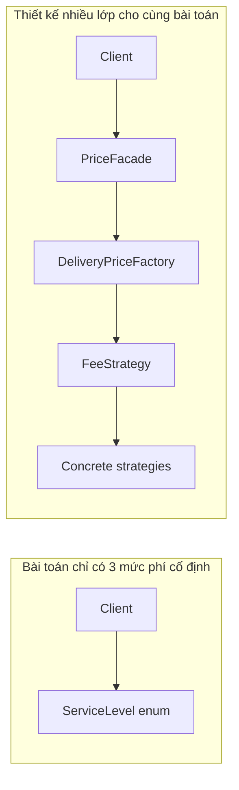

Sơ đồ không kết luận “ít mũi tên = tốt”. Nó cho thấy **số điểm cần tra cứu để hiểu lời gọi**. Nếu mỗi lớp thực sự cung cấp một ranh giới độc lập và có nhu cầu thay đổi riêng, các mũi tên này có thể hoàn toàn xứng đáng. Nếu mọi lớp chỉ chuyển tiếp lời gọi, chúng tăng chi phí mà không mang thêm ý nghĩa.

## 6. Một số pattern dễ bị áp dụng quá mức

| Pattern | Dấu hiệu áp dụng quá mức | Khi thực sự phù hợp |
|---|---|---|
| **Strategy** | Tạo interface và nhiều class cho các hằng số hoặc hai nhánh không đổi | Nhiều thuật toán có cách xử lý độc lập và thay đổi thường xuyên |
| **Factory Method / Abstract Factory** | Factory chỉ bọc `new SimpleClass()`, không có lý do tạo object khác | Tạo object phức tạp hoặc họ object cần tương thích, thay thế theo môi trường |
| **Builder** | Object có hai tham số bắt buộc rõ, nhưng cần builder nhiều bước | Nhiều lựa chọn tùy chọn, kiểm tra bất biến khi xây dựng, tránh constructor khó đọc |
| **Singleton** | Dùng global mutable singleton chỉ để mọi nơi dễ lấy dependency | Thật sự cần quản lý một instance trong phạm vi phù hợp, vòng đời và đồng thời rõ ràng |
| **Observer** | Một tác vụ quan trọng bị đẩy vào callback khó truy vết, chỉ có một consumer | Một thay đổi có nhiều thành phần độc lập quan tâm, có policy event/lifecycle rõ |
| **Decorator** | Bọc 4 tầng nhưng mỗi tầng chỉ gọi `delegate` | Thêm hành vi cắt ngang với contract và thứ tự composition rõ |
| **Adapter** | Bọc hai API vốn đã tương thích và không có ranh giới cần bảo vệ | Chuyển đổi API bên ngoài không tương thích thành hợp đồng phía client |
| **Facade** | Một lớp chỉ forward cùng tham số tới một phương thức đơn giản | Client phải phối hợp nhiều subsystem/phân hệ phức tạp |
| **Template Method** | Dùng thừa kế để chia sẻ 2 dòng mã, hierarchy sâu | Khung thuật toán thực sự ổn định với các bước có thể chuyên biệt |
| **Command** | Mỗi lần gọi một phương thức tạo command class, handler, dispatcher không có yêu cầu khác | Queue, undo, retry, lưu lịch sử hoặc phân phối yêu cầu dưới dạng object |
| **State** | Có đúng hai trạng thái và một nhánh lựa chọn không đổi | Chuyển trạng thái phức tạp, mỗi state có hành vi và transition riêng |

Lưu ý: các trường hợp ở cột giữa là **tín hiệu xem lại**, không phải phán quyết tự động. Ví dụ `Command` có thể hợp lý dù chỉ một loại tác vụ nếu ứng dụng thật cần lưu lệnh bền vững để xử lý sau.

## 7. Nguyên tắc giúp giữ thiết kế vừa đủ

### YAGNI – You Aren't Gonna Need It

**Không cài chức năng chỉ vì “có thể sau này sẽ cần”.** Nếu chưa có yêu cầu runtime plugin, đừng tự thiết kế một plugin loader phức tạp. Nếu chưa có nhiều thuật toán, có thể bắt đầu bằng một hàm ngắn và tách ra sau khi xuất hiện biến thể thật.

YAGNI không có nghĩa bỏ qua yêu cầu đã biết hoặc những rủi ro lớn. Nếu API công khai rất khó thay đổi sau phát hành, việc chừa một ranh giới hợp lý ngay từ đầu có thể rẻ hơn phá vỡ tương thích về sau.

### KISS – Keep It Simple

Chọn lời giải **đơn giản nhất vẫn đáp ứng đầy đủ ràng buộc**. Đơn giản phải bao gồm độ đúng, bảo mật, khả năng kiểm thử và tính an toàn, chứ không chỉ ít file.

Một `switch` có xử lý hết enum, một phương thức dữ liệu thuần và vài test rõ ràng có thể là thiết kế tốt. Khi `switch` tăng đến hàng chục thuật toán do nhiều đội bảo trì, đó là tín hiệu xem lại.

### DRY – tránh lặp *tri thức*, không phải mọi đoạn cú pháp

Không nên trừu tượng hóa hai đoạn code giống nhau nếu chúng biểu diễn **hai quy tắc nghiệp vụ có thể thay đổi độc lập**. Gộp sớm dễ tạo tham số boolean, nhiều trường hợp đặc biệt và coupling giả tạo.

Ngược lại, một bất biến bắt buộc như kiểm tra phí không âm được lặp khắp nơi có thể xứng đáng được đặt ở kiểu giá trị hoặc một điểm kiểm soát phù hợp.

### Rule of Three – heuristic, không phải luật

Khi đã có **vài trường hợp tương tự thật**, việc xác định phần chung và phần riêng đáng tin cậy hơn so với trừu tượng hóa chỉ từ một ví dụ. Đừng đợi đúng ba lần nếu đã có yêu cầu rõ ràng hoặc chi phí đổi kiến trúc về sau rất lớn.

### Ưu tiên thay đổi đảo ngược được

Trong code ứng dụng nội bộ, tạo một lớp nhỏ rồi refactor sau có thể rẻ. Với API công khai, định dạng sự kiện dùng bởi bên thứ ba hoặc dữ liệu đã lưu bền, quyết định sai có thể đắt: cân nhắc ranh giới, versioning và tính tương thích từ sớm.

## 8. Đừng nhầm khả năng mở rộng với số lượng interface

Một kiến trúc “mở rộng được” nên trả lời được:

- **Có thể thêm loại thay đổi nào mà không làm hỏng phần đang ổn định?**
- **Ai sở hữu hợp đồng chung và bất biến của nó?**
- **Đăng ký implementation mới ở đâu?**
- **Có thể xác định implementation đang chạy bằng logging/metrics không?**
- **Một implementation lỗi có thể gây hại cho hệ thống ở phạm vi nào?**
- **Test nào bảo vệ hành vi cũ khi thêm lựa chọn mới?**

Nếu không giải thích được các câu hỏi này, rất có thể một tập hợp interface vẫn chỉ là **coupling được giấu phía sau DI**.

### Một interface có một implementation có luôn sai?

Không. Ví dụ `PaymentGateway` có một `BankApiGateway` nhưng là ranh giới hạ tầng thực sự: use case cần thanh toán, không cần import HTTP SDK và có thể dùng fake trong unit test. Hợp đồng nên được **định nghĩa theo nhu cầu nghiệp vụ**, không bê nguyên API SDK vào interface.

Ngược lại, `IPriceAdder` chỉ có `PriceAdderImpl` gọi `a + b`, cả hai cùng package và không có ranh giới thay đổi, thường là một lớp indirection không cần thiết.

## 9. Nhận diện “God Factory”, “God Facade” và registry quá rộng

Một sai lầm khác là áp dụng pattern thật, nhưng **mở rộng trách nhiệm của nó quá mức**:

- **God Factory:** biết cách tạo mọi loại đối tượng trong cả hệ thống, cần sửa liên tục theo nhiều domain.
- **God Facade:** gom đăng nhập, thanh toán, vận chuyển, thông báo, báo cáo vào một API lớn.
- **Generic Repository vô hạn:** cố che mọi loại truy vấn, biến thành API có hàng chục tùy chọn, query động khó kiểm tra.
- **Event bus dùng khắp nơi:** thay các lời gọi rõ ràng bằng sự kiện vô danh, khó lần theo kết quả và lỗi.
- **DI registry bằng string tùy tiện:** sai key chỉ xuất hiện lúc chạy, cấu hình trở thành ngôn ngữ lập trình phụ khó debug.

Khi lớp “trung tâm” có nhiều lý do thay đổi không liên quan, giải pháp có thể là **chia theo use case, bounded context hoặc capability** chứ không thêm một lớp điều phối tổng nữa.

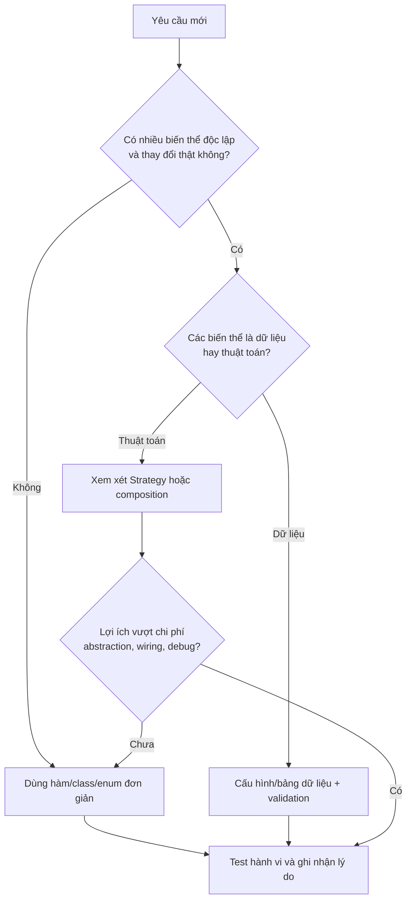

Đây là sơ đồ ra quyết định cho một trục biến thiên; những tình huống phức tạp còn cần xem xét concurrency, bảo mật, tương thích và độ bền dữ liệu.

## 10. Kiểm thử tốt không đòi hỏi pattern phức tạp

Ví dụ JUnit 5 cho thiết kế enum ở phần 3, đặt file `SimpleDeliveryPricingTest.java` cạnh `SimpleDeliveryPricing.java`, cùng package:

```java
import static org.junit.jupiter.api.Assertions.*;
import org.junit.jupiter.api.Test;

class SimpleDeliveryPricingTest {
    @Test
    void quotesEachSupportedServiceLevel() {
        assertEquals(20_000L,
                SimpleDeliveryPricing.quote(
                        SimpleDeliveryPricing.ServiceLevel.STANDARD));
        assertEquals(35_000L,
                SimpleDeliveryPricing.quote(
                        SimpleDeliveryPricing.ServiceLevel.EXPRESS));
        assertEquals(50_000L,
                SimpleDeliveryPricing.quote(
                        SimpleDeliveryPricing.ServiceLevel.PRIORITY));
    }

    @Test
    void rejectsNullServiceLevel() {
        assertThrows(IllegalArgumentException.class,
                () -> SimpleDeliveryPricing.quote(null));
    }
}
```

Khi dùng Strategy, nên thêm **contract test** cho mọi implementation: trả giá trị không âm, không đột biến input, tuân thủ đơn vị VND và cách báo lỗi. Nhưng không nên lập một bộ mock phức tạp chỉ để assert “factory được gọi đúng một lần” nếu nhu cầu người dùng chỉ là **tính đúng phí**.

### Kiểm thử khi đơn giản hóa code cũ

Nếu refactor bỏ Factory/Decorator/Observer thừa, viết hoặc giữ các test **ở ranh giới hành vi**:

1. Input hợp lệ trả cùng output.
2. Input sai vẫn sinh loại lỗi/ngữ nghĩa tương ứng.
3. Side effect và thứ tự bắt buộc không thay đổi.
4. Với API công khai, chữ ký và khả năng tương thích được giữ hoặc chuyển đổi theo kế hoạch.
5. Với đối tượng đa luồng, hành vi đồng thời và lifecycle không bị thay đổi âm thầm.

Không cần viết test xác nhận class trung gian còn tồn tại hay không: đó là chi tiết triển khai đang muốn thay đổi.

## 11. Refactor một thiết kế “quá nhiều pattern” thế nào cho an toàn?

Giả sử hiện có:

`OrderController → QuoteFacade → PricingFactory → StrategyRegistry → FixedPriceStrategy`

và cả hệ thống chỉ có một quy tắc giá cố định được dùng tại một nơi. Đừng xóa nhiều lớp cùng lúc rồi hy vọng toàn bộ client tự hoạt động đúng. Áp dụng các bước:

1. **Xác nhận usage:** tìm tất cả caller, cách tạo object, API công khai, cấu hình bean, reflection/serialization và những hệ thống ngoài module có phụ thuộc.
2. **Đóng băng hành vi bằng test:** kiểm tra kết quả, lỗi và side effect hiện có, kể cả trường hợp biên.
3. **Chọn một API đích rõ ràng:** chẳng hạn `PricingService.quote(Order)` hoặc hàm thuần túy nếu không cần state.
4. **Di chuyển logic về nơi sở hữu:** bỏ các lớp chỉ forward; giữ logic nghiệp vụ và adapter hạ tầng thực sự cần thiết.
5. **Chuyển caller theo từng bước:** khi cần, giữ một adapter mỏng tạm thời để tương thích; không tạo ra một hệ thống song song vô hạn.
6. **Loại bỏ cấu hình đã hết giá trị:** xóa mapping, bean, registry, reflection rule sau khi chứng minh không còn caller.
7. **Chạy kiểm thử đúng phạm vi:** unit, integration và test hợp đồng công khai tương ứng.
8. **Đo kết quả:** số điểm sửa khi đổi quy tắc, đường call stack, số file phải đọc, thời gian build/test và số lỗi runtime.
9. **Viết lý do refactor:** lợi ích và chi phí, cùng tiêu chí mở lại điểm extension nếu một ngày nhu cầu thật phát sinh.

Đơn giản hóa nên **giảm khối lượng kiến thức và trạng thái cần quản lý**, không chỉ đổi tên hay gộp file. Nếu một abstraction bảo vệ hợp đồng nhiều đội đang dùng, xóa nó có thể gây coupling lớn hơn lợi ích.

## 12. Hai kiểu “đơn giản hóa” dễ sai

### Chỉ gộp tất cả về một lớp

Một class 1.000 dòng xử lý mọi thứ có thể ít file hơn, nhưng làm tăng số lý do thay đổi và rủi ro hồi quy. Nếu loại bỏ một pattern, vẫn cần giữ **trách nhiệm rõ ràng** và tách các quy tắc thật sự độc lập.

### Chỉ xóa interface để gọi implementation trực tiếp

Nếu việc xóa interface khiến application import SQL driver hoặc HTTP SDK, bạn có thể đang làm **rò rỉ hạ tầng** vào business logic. Điều nên xem lại là port có phù hợp nhu cầu hay không, chứ không phải xóa interface theo số lượng.

Một hướng hợp lý: giữ `PaymentGateway` do application sở hữu, bỏ hai tầng `GatewayFactoryFactory` và `GatewayProviderAdapterBuilder` chỉ chuyển tiếp lời gọi vô ích. Như vậy có thể **giữ DIP nhưng giảm overengineering**.

## 13. So sánh chi phí dự kiến bằng một bảng quyết định

Cho một module cần thêm các cách tính giá mới:

| Câu hỏi | Nếu trả lời “có” | Tác động lên quyết định |
|---|---|---|
| Mỗi biến thể là thuật toán khác và được kiểm thử độc lập? | Có | Ủng hộ Strategy |
| Chỉ khác vài hằng số được cập nhật bởi admin? | Có | Ủng hộ dữ liệu/config |
| Có nhiều nhóm phát triển implementation cùng lúc? | Có | Ủng hộ hợp đồng ổn định |
| API đã public cho bên thứ ba? | Có | Cân nhắc tương thích dài hạn |
| Thay đổi chỉ một lần mỗi năm, 3 nhánh rõ ràng? | Có | Ủng hộ giải pháp trực tiếp |
| Có rủi ro cấu hình sai implementation? | Có | Tăng chi phí Strategy/registry |
| Phụ thuộc vào database hoặc dịch vụ ngoài? | Có | Cân nhắc port/adapter để cô lập hạ tầng |
| Nhóm vận hành cần biết chính xác luồng chạy? | Có | Ưu tiên wiring tường minh, logs/traces |

Không cần gán điểm số giả tạo để “chứng minh” pattern nào thắng. Một **Architecture Decision Record (ADR)** ngắn thường đủ khi quyết định ảnh hưởng lâu dài.

```markdown
# ADR: Giữ bảng phí giao hàng dưới dạng enum

Bối cảnh:
- Có ba mức phí cố định, hiếm thay đổi.
- Không có thuật toán theo đơn hàng hay plugin bên ngoài.
- Nhóm cần dễ đọc và dễ kiểm tra.

Các phương án:
1. Strategy + Factory + Registry.
2. Enum chứa phí và một hàm quote.

Quyết định:
- Chọn phương án 2.

Lý do:
- Chi phí cấu hình và số lớp của phương án 1 chưa tạo ra lợi ích.
- Test có thể kiểm tra toàn bộ mức phí trực tiếp.

Hệ quả:
+ Ít code, dễ truy vết.
- Muốn thêm thuật toán phức tạp sau này sẽ phải refactor.

Xem xét lại khi:
- Phí tính theo trọng lượng/vùng hoặc nhiều đội bổ sung thuật toán.
- Phí trở thành dữ liệu do người dùng quản lý, cần chuyển sang config/DB.
```

## 14. Bài tập thực hành

**Bài 1 — Lựa chọn abstraction.** Một ứng dụng có hai mức phí vận chuyển cố định và không dự kiến thay đổi. Viết một phiên bản dùng `enum` và một phiên bản dùng Strategy. So sánh số điểm thay đổi khi thêm mức phí, số class, cách kiểm thử và độ rõ của đường gọi.

**Bài 2 — Khi yêu cầu đổi.** Bổ sung cách tính “8.000 VND/kg, làm tròn lên” và một dịch vụ giảm phí khi tổng đơn vượt ngưỡng. Refactor code `SimpleDeliveryPricing` sang `FlexibleDeliveryPricing`, giữ test cho các mức phí trước khi thay thế và viết test cho ngưỡng biên.

**Bài 3 — God Facade.** Nhóm có class `ApplicationFacade` gồm 50 phương thức xử lý hóa đơn, người dùng, tìm kiếm, vận chuyển. Đề xuất nhóm API theo trách nhiệm; nêu trường hợp nên giữ facade nhỏ và trường hợp nên gọi trực tiếp application service.

**Bài 4 — “Tự động” không có nghĩa đơn giản.** Một nhóm muốn áp `Observer` để phát “đơn hàng được thanh toán” rồi gửi email bắt buộc. Phân tích trường hợp listener lỗi, lỗi DB commit, phát trùng; chỉ ra khi nào cần workflow rõ và khi nào cần transactional outbox.

**Bài 5 — Thực tế bảo trì.** Chọn một module có ít nhất ba abstraction liên tiếp. Vẽ call graph, liệt kê lý do từng tầng tồn tại, viết ADR giữ/bỏ mỗi tầng. Chỉ refactor sau khi có test kiểm chứng hành vi.

## 15. Checklist trước khi áp dụng một mẫu thiết kế

- [ ] Tôi mô tả được vấn đề đang xảy ra mà không cần gọi tên pattern.
- [ ] Tôi nêu được **loại thay đổi nào** sẽ diễn ra và tần suất dự kiến có bằng chứng.
- [ ] Tôi có một **phương án đơn giản** đủ đúng để so sánh.
- [ ] Mỗi abstraction mới mang một trách nhiệm hoặc ranh giới hữu ích, không chỉ forward.
- [ ] Tôi hiểu chi phí class, DI/config, callback, debug và kiểm thử tăng thêm.
- [ ] Tôi biết giải pháp có còn dễ sử dụng nếu chỉ có một implementation không.
- [ ] Tôi kiểm tra error handling, concurrency và hiệu ứng phụ ngoài chức năng chính.
- [ ] Tôi có test hành vi và hợp đồng cho trường hợp hiện tại.
- [ ] Tôi biết điều kiện cụ thể nào sẽ khiến quyết định thiết kế cần được xem xét lại.
- [ ] Tôi có thể giải thích lựa chọn này cho đồng đội mà không chỉ nói “vì đây là GoF/SOLID”.

**Ghi nhớ:** Mẫu thiết kế là một **công cụ đánh đổi**. Dùng pattern khi nó giải quyết vấn đề thay đổi, tương tác hoặc trách nhiệm **có thật** và bù được chi phí cấu trúc. Giữ giải pháp đơn giản khi nhu cầu đơn giản; refactor có kiểm thử khi bối cảnh thay đổi. Kiến trúc tốt là kiến trúc giúp hệ thống tiếp tục phát triển an toàn, chứ không phải kiến trúc có nhiều tên pattern nhất.


</details>

- [Quay lại đầu trang](#back-to-top)
