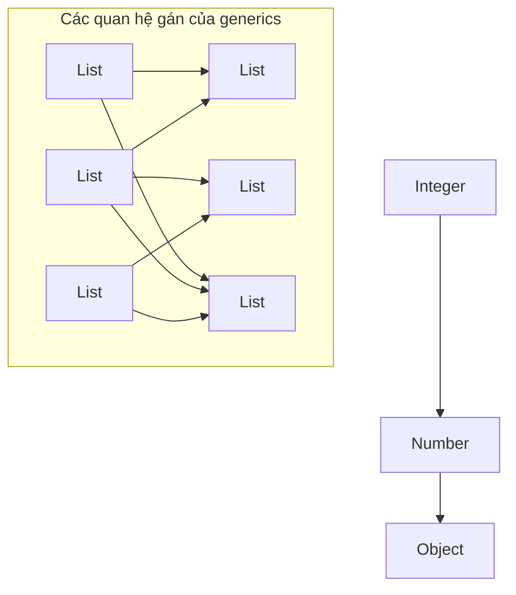
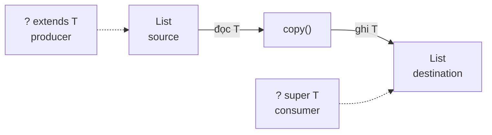
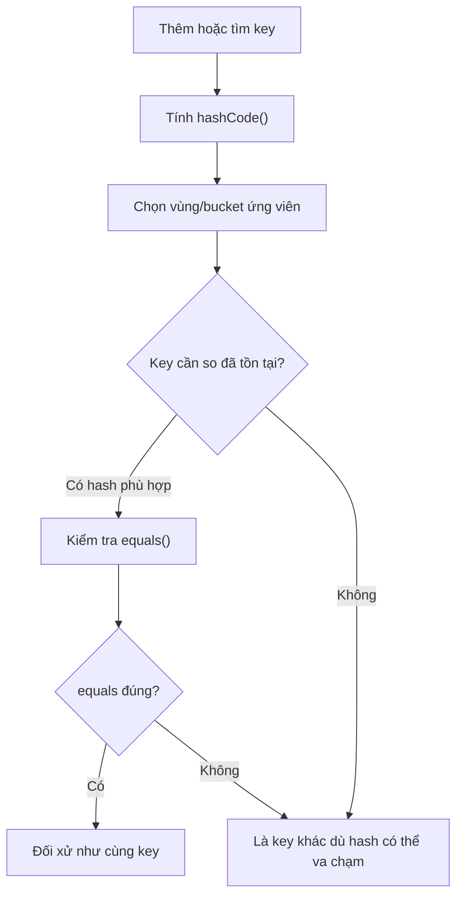
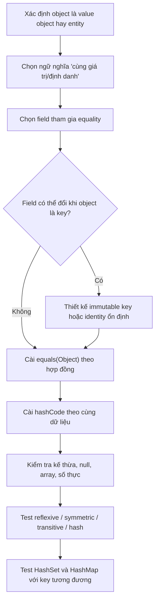
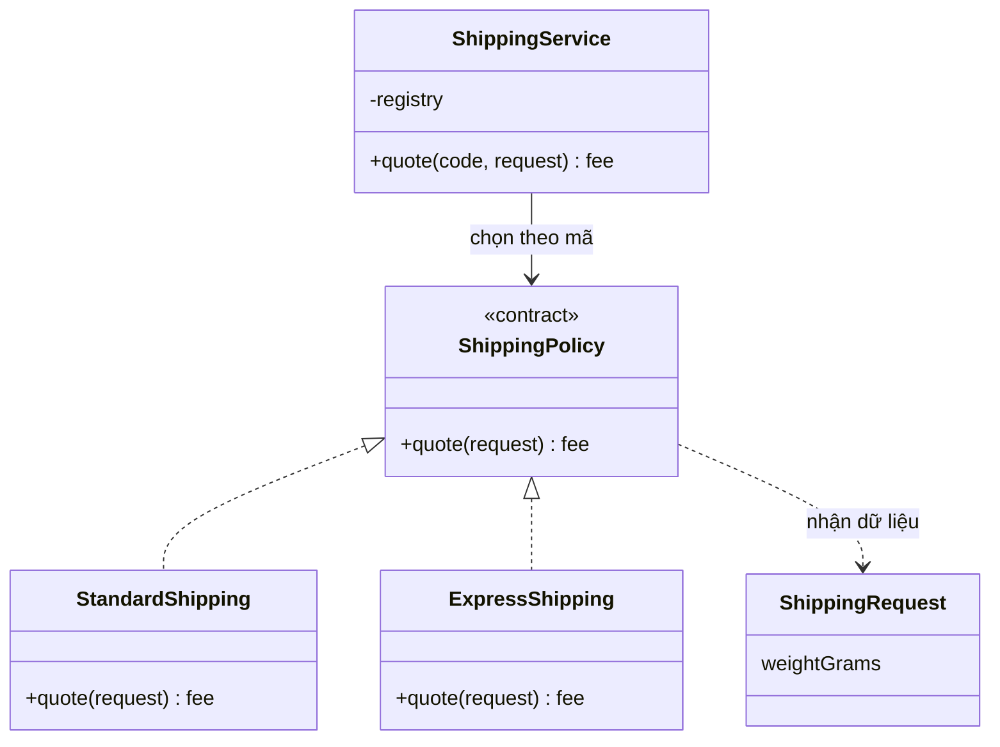
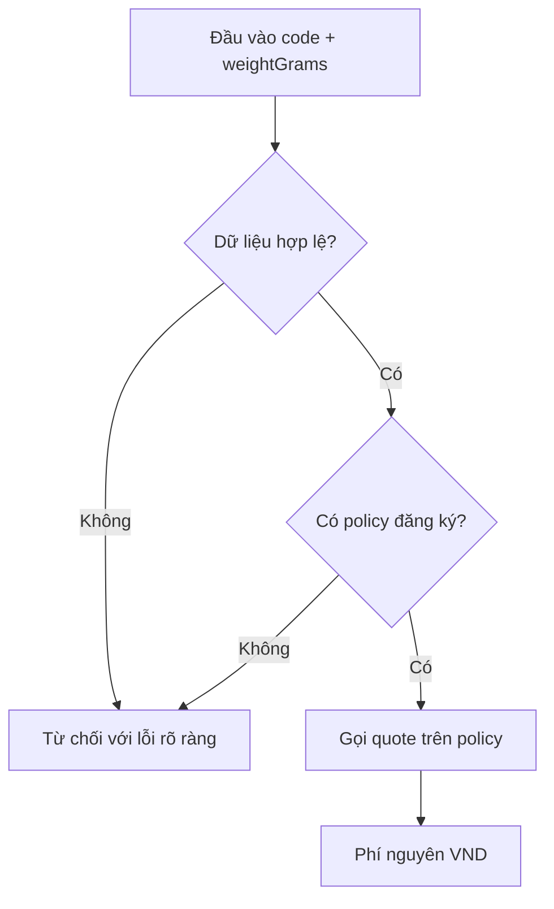

<a id="back-to-top"></a>

# Cơ chế ngôn ngữ

## Menu
- [Kiểu tổng quát và lớp có tham số kiểu](#language-mechanics-001)
- [Ràng buộc tham số kiểu](#language-mechanics-002)
- [Quan hệ kiểu của các cấu trúc tổng quát](#language-mechanics-003)
- [Kiểu tĩnh, kiểu động và kiểm tra kiểu](#language-mechanics-004)
- [Toán tử, thuộc tính và quy ước của ngôn ngữ](#language-mechanics-005)
- [Hợp đồng so sánh bằng và mã băm](#language-mechanics-006)
- [Biểu diễn chuỗi và thông tin chẩn đoán của đối tượng](#language-mechanics-007)
- [Ngoại lệ, trạng thái lỗi và hợp đồng phương thức](#language-mechanics-008)
- [Khác biệt ngôn ngữ khi hiện thực cùng một thiết kế OOP](#language-mechanics-009)

## <a id="language-mechanics-001">Kiểu tổng quát và lớp có tham số kiểu</a>

<details>
<summary>Xem chi tiết</summary>

# Java Generics: Kiểu tổng quát và lớp có tham số kiểu

> **Chủ đề:** OOP → Cơ chế ngôn ngữ → Kiểu tổng quát và lớp có tham số kiểu.  
> **Mục tiêu:** Tự khai báo và sử dụng lớp `Box<T>`, `Pair<K,V>` và lớp lưu trữ dữ liệu có tham số kiểu; hiểu generic type, type parameter, type argument, type inference, giới hạn kiểu, wildcard và type erasure; tránh các lỗi phổ biến khi thiết kế API Java.

## 1. Generics giải quyết vấn đề gì?

**Generics** (kiểu tổng quát) cho phép khai báo lớp, interface hoặc phương thức mà **một số kiểu dữ liệu được để thành tham số**, thay vì viết lại mã cho từng kiểu. Nhờ đó, trình biên dịch Java phát hiện nhiều thao tác sai kiểu ngay khi biên dịch.

Ví dụ trước thời kỳ dùng generic type an toàn:

~~~java
import java.util.ArrayList;
import java.util.List;

List raw = new ArrayList(); // raw type: không chỉ ra kiểu phần tử
raw.add("Java");
raw.add(123);              // Cả chuỗi lẫn số đều được chấp nhận

String name = (String) raw.get(1);
// Biên dịch được (có cảnh báo raw/unchecked) nhưng chạy sẽ
// gặp ClassCastException vì phần tử ở vị trí 1 là Integer.
~~~

Với generic type, hợp đồng kiểu trở nên rõ ràng:

~~~java
List<String> names = new ArrayList<>();
names.add("Java");
names.add("OOP");

// names.add(123); // LỖI BIÊN DỊCH: Integer không phải String.
String first = names.get(0); // Không phải ép kiểu thủ công.
~~~

**Điểm cốt lõi:** Generics tăng **type safety tại compile time**, làm rõ ý nghĩa API và giảm ép kiểu. Nó **không tạo ra một bản sao class riêng tại runtime cho mỗi tham số kiểu**: Java chủ yếu triển khai generics bằng cơ chế *type erasure* (xóa thông tin tham số kiểu trong bytecode ở nhiều vị trí), sẽ giải thích ở phần sau.

## 2. Đọc đúng cú pháp generic type

| Cú pháp | Ý nghĩa | Ví dụ |
|---|---|---|
| `class Box<T>` | Khai báo **lớp có một tham số kiểu** tên `T` | `Box<String>` |
| `interface Store<K,V>` | Interface có hai tham số kiểu | `Store<Long,User>` |
| `Box<String>` | Một **parameterized type**: kiểu cụ thể khi sử dụng `Box` với đối số kiểu `String` | `Box<String> x` |
| `T`, `K`, `V` | **Type parameters**, những tên tượng trưng trong khai báo | `T value` |
| `String`, `Long`, `User` | **Type arguments**, những kiểu được truyền khi dùng generic | `new Box<String>(...)` |
| `<>` | **Diamond operator**, trình biên dịch suy luận type arguments phù hợp | `new Box<>("Hi")` |
| `<T> T first(...)` | Phương thức generic khai báo tham số kiểu **riêng** | `static <T> T first(List<T> list)` |

Tên `T` không phải từ khóa của Java. Các tên quy ước thường gặp: `T` (Type), `E` (Element), `K` (Key), `V` (Value), `R` (Result), `S` (một kiểu khác). Có thể chọn tên rõ nghĩa hơn cho hệ thống phức tạp, ví dụ `ENTITY`, `ID`, nhưng chữ hoa ngắn giúp đọc các API Java phổ biến.

Phân biệt hai cách viết:

~~~java
class Holder<T> {
    T value; // T do class khai báo, dùng được ở instance member.

    Holder(T value) {
        this.value = value;
    }

    T get() {
        return value;
    }

    static <U> U identity(U x) {
        // U được khai báo bởi chính phương thức static này.
        return x;
    }
}
~~~

Một phương thức `static` **không** thể dùng `T` của class để khai báo field hoặc method signature phụ thuộc vào instance type parameter, vì thành viên static thuộc về class, không thuộc riêng `Holder<String>` hay `Holder<Integer>`. Nhưng phương thức static **có thể tự khai báo** `<U>` như `identity`.

## 3. Ví dụ Java 17 hoàn chỉnh: lớp Box, Pair và Repository tổng quát

Ví dụ sau chạy độc lập bằng JDK 17+, không cần Spring hay thư viện ngoài. Nó minh họa ba cấp độ sử dụng:

1. `Box<T>` lưu một giá trị với kiểu cụ thể được quyết định ở nơi sử dụng.
2. `Pair<K,V>` có **hai** tham số kiểu độc lập.
3. `InMemoryRepository<ID,T>` tái sử dụng cùng một implementation lưu dữ liệu cho nhiều loại entity và ID, nhưng vẫn ràng buộc kiểu đúng.

Tạo tệp **`GenericsDemo.java`**:

~~~java
import java.util.HashMap;
import java.util.Map;
import java.util.Objects;
import java.util.Optional;
import java.util.function.Function;

// Generic class: T đại diện cho kiểu dữ liệu được chứa.
final class Box<T> {
    private T value;

    Box(T value) {
        this.value = Objects.requireNonNull(value, "value");
    }

    T get() {
        return value;
    }

    void set(T next) {
        value = Objects.requireNonNull(next, "next");
    }

    // Generic method: R là tham số kiểu MỚI của phương thức.
    // Có thể biến Box<String> thành Box<Integer>, v.v.
    <R> Box<R> map(Function<? super T, ? extends R> mapper) {
        Objects.requireNonNull(mapper, "mapper");
        return new Box<>(
                Objects.requireNonNull(mapper.apply(value), "mapped value"));
    }
}

// Generic record: các thành phần độc lập về kiểu.
record Pair<K, V>(K key, V value) {}

// Entity ví dụ, record bất biến.
record User(String id, String name) {}

// Repository in-memory phục vụ demo, không phải kho dữ liệu bền vững.
final class InMemoryRepository<ID, T> {
    private final Function<T, ID> idOf;
    private final Map<ID, T> data = new HashMap<>();

    InMemoryRepository(Function<T, ID> idOf) {
        this.idOf = Objects.requireNonNull(idOf, "idOf");
    }

    void save(T item) {
        Objects.requireNonNull(item, "item");
        ID id = Objects.requireNonNull(idOf.apply(item), "id");
        data.put(id, item);
    }

    Optional<T> findById(ID id) {
        Objects.requireNonNull(id, "id");
        return Optional.ofNullable(data.get(id));
    }
}

public class GenericsDemo {
    public static void main(String[] args) {
        Box<String> language = new Box<>("Java"); // Diamond: suy luận T
        Box<Integer> counter = new Box<>(42);

        System.out.println("Box<String>: " + language.get());
        System.out.println("Box<Integer>: " + counter.get());

        // R = Integer vì String::length trả về int, được boxing.
        Box<Integer> length = language.map(String::length);
        System.out.println("Độ dài: " + length.get());

        Pair<String, Long> invoice = new Pair<>("HD-01", 180_000L);
        System.out.println(
                "Hóa đơn: " + invoice.key() + " = " + invoice.value());

        InMemoryRepository<String, User> users =
                new InMemoryRepository<>(User::id);
        users.save(new User("U-01", "Lan"));

        System.out.println(
                "Người dùng: " + users.findById("U-01").orElseThrow().name());
    }
}
~~~

Chạy:

~~~bash
javac GenericsDemo.java
java GenericsDemo
~~~

Kết quả dự kiến:

~~~text
Box<String>: Java
Box<Integer>: 42
Độ dài: 4
Hóa đơn: HD-01 = 180000
Người dùng: Lan
~~~

### Đọc luồng kiểu

- Với `Box<String> language`, mọi chỗ sử dụng `T` trong thành viên instance của `Box<T>` được **trình biên dịch xem là `String`**. `language.set(123)` sẽ không biên dịch.
- Với `Box<Integer> counter`, `counter.get()` có kiểu trả về `Integer` tại compile time.
- `<R> Box<R> map(...)` cho phép biến một loại dữ liệu sang một loại khác: `Box<String>` thành `Box<Integer>`. Tham số kiểu `R` là của method, độc lập với `T` của class.
- `Pair<K,V>` chỉ thể hiện cấu trúc hai giá trị có thể khác kiểu. Khi sử dụng `Pair<String,Long>`, `key()` trả `String`, `value()` trả `Long`.
- `InMemoryRepository<ID,T>` giữ nhất quán **kiểu khóa** và **kiểu entity**. Trong ví dụ, `findById` nhận `String` và trả `Optional<User>`; không cần ép kiểu từ `Object`.
- `User::id` là method reference dùng làm hàm trích khóa `Function<User,String>`. Repository không cần biết field `id` được lưu như thế nào trong từng loại entity.

**Phạm vi của ví dụ:** `InMemoryRepository` chỉ minh họa type safety và khả năng tái sử dụng; nó chưa cung cấp transaction, lưu trữ bền vững, xử lý truy cập đa luồng hoặc kiểm soát trùng khóa. Không nên dùng trực tiếp như repository production trong ứng dụng nhiều luồng.

## 4. Lớp có nhiều tham số kiểu và đặt ràng buộc ở đâu

Một class tổng quát có thể định nghĩa nhiều tham số kiểu:

~~~java
interface Repository<ID, ENTITY> {
    void save(ENTITY entity);
    Optional<ENTITY> findById(ID id);
}
~~~

Ví dụ các kiểu sử dụng khác nhau:

~~~java
Repository<Long, Product> products;
Repository<String, Customer> customers;
~~~

`Product` và `Customer` ở đây là các kiểu nghiệp vụ minh họa, cần được định nghĩa trong dự án. Mỗi cách kết hợp tạo một **parameterized type ở phía mã nguồn**: không phải một class bytecode riêng cho từng tổ hợp.

Nên dùng bao nhiêu tham số kiểu? Chỉ thêm tham số khi **client cần kiểm soát và kiểm tra kiểu tương ứng**. Nếu một generic class có năm, sáu tham số làm chữ ký khó đọc, cân nhắc chia vai trò, dùng type alias ở lớp trừu tượng riêng (Java không có cú pháp type alias tổng quát như một số ngôn ngữ khác) hoặc gói nhiều thuộc tính vào một domain type.

### 4.1. Khi thuật toán cần giới hạn `T`

Một `Box<T>` chỉ lưu/trả dữ liệu thì không cần biết `T` hỗ trợ những hành vi nào. Ngược lại, muốn gọi `doubleValue()` phải ghi `<T extends Number>`; muốn `compareTo` thì dùng bound như sau:

~~~java
static <T extends Comparable<? super T>> T greater(T a, T b) {
    return a.compareTo(b) >= 0 ? a : b;
}
~~~

`extends` trong khai báo generic chấp nhận **cả class và interface**. Nhiều bound dùng `&` (class nếu có phải đầu tiên): `<T extends Number & Comparable<? super T>>`. Java không có cú pháp `<T super Number>`; lower-bound chỉ có ở wildcard `? super Number`.

Bound bảo đảm API khả dụng tại compile time, **không** xác minh giá trị nghiệp vụ, null hay quan hệ thứ tự hợp lệ. Bài **Ràng buộc tham số kiểu** phát triển riêng `NumberBox`, `Comparable<? super T>`, intersection/recursive bounds, phép thử và các giới hạn erasure.

### 4.2. Generic method khác generic class

Không cần cả class tổng quát khi chỉ có **một phương thức** làm việc với nhiều kiểu:

~~~java
import java.util.List;
import java.util.NoSuchElementException;

final class Lists {
    private Lists() {}

    // <T> xuất hiện TRƯỚC kiểu trả về T.
    static <T> T first(List<T> items) {
        if (items.isEmpty()) {
            throw new NoSuchElementException("empty list");
        }
        return items.get(0);
    }
}

// Trong method khác:
String title = Lists.first(List.of("Java", "OOP"));
Integer number = Lists.first(List.of(10, 20));
~~~

Cả hai lời gọi dùng **cùng một phương thức**; trình biên dịch suy luận `T = String` hoặc `T = Integer` dựa vào đối số và ngữ cảnh. Có thể chỉ rõ đối số kiểu:

~~~java
String title = Lists.<String>first(List.of("Java", "OOP"));
~~~

Cách viết tường minh ít cần thiết khi type inference đã đủ. Nếu trong dự án đã có biến `title` từ đoạn trước, hãy đặt ví dụ này trong method riêng để tránh khai báo trùng biến cục bộ.

## 5. Type inference: trình biên dịch suy luận được bao nhiêu?

Java hỗ trợ suy luận đối số kiểu trong nhiều trường hợp:

~~~java
Box<String> box = new Box<>("Hello");  // Diamond operator
var another = new Box<>("World");      // Suy ra Box<String> trong JDK 10+
Pair<String, Integer> pair = new Pair<>("SKU-7", 3);
~~~

**Suy luận không phải dynamic typing**: `var another` vẫn có một kiểu tĩnh xác định tại compile time, là `Box<String>`. Gọi `another.set(100)` vẫn là lỗi biên dịch.

Một tình huống cần cẩn trọng khi constructor generic tự suy luận kiểu theo biểu thức khởi tạo và không có target type:

~~~java
var emptyStrings = new java.util.ArrayList<String>();
emptyStrings.add("A");

// var unknown = new java.util.ArrayList<>();
// Nếu không có thông tin ràng buộc, phần tử thường được suy ra
// kiểu Object; không thể tự kỳ vọng là String.
~~~

Khi API yêu cầu rõ kiểu phần tử, hãy khai báo `List<String> names = new ArrayList<>();` hoặc dùng constructor có type arguments tường minh. Đọc generic signature của method trước khi “sửa” bằng cast.

## 6. Invariance: vì sao Box<Integer> không phải Box<Number>?

`Integer extends Number` là quan hệ subtype hợp lệ. Nhưng với generic type thông thường, Java **không tự suy ra** `Box<Integer> extends Box<Number>`. Tương tự, `List<Integer>` không phải subtype của `List<Number>`.

~~~java
Box<Integer> ints = new Box<>(10);

// Box<Number> numbers = ints; // KHÔNG biên dịch.
~~~

Nếu điều này được phép, client có thể đưa `Double` vào hộp được tạo để chỉ chứa `Integer`:

~~~java
// Giả sử giả định sai: Box<Number> numbers = ints;
numbers.set(3.14);             // 3.14 là Double hợp lệ cho Number
Integer x = ints.get();        // Nhưng ints lẽ ra chỉ chứa Integer!
~~~

Vì vậy, với các generic type như `Box<T>` và `List<T>`, type arguments mặc định **invariant**. Đừng giải quyết lỗi bằng raw type hoặc ép kiểu không kiểm tra. Hãy xem API có cần wildcard hay một abstraction khác không.

So sánh với array: Java array có **covariance**, nhưng có thể phát hiện lỗi ghi kiểu ở runtime:

~~~java
Number[] nums = new Integer[1];
nums[0] = 3.14; // ArrayStoreException lúc chạy.
~~~

Generic invariance tránh một nhóm lỗi kiểu ngay ở compile time. Đây là một khác biệt quan trọng khi chuyển API array sang generic collection.

## 7. Wildcard để nhận nhiều kiểu collection an toàn

Generic thông thường **bất biến**: `List<Integer>` không gán cho `List<Number>`. Wildcard diễn đạt nơi sử dụng cần **đọc** hoặc **ghi** giá trị mà vẫn giữ kiểm tra kiểu:

| Chữ ký | Lời hứa của compiler | Phép thêm phần tử |
| --- | --- | --- |
| `List<?>` | Đọc được dưới `Object` | Chỉ `null` hợp lệ về kiểu |
| `List<? extends Number>` | Đọc được dưới `Number` | Không thêm `Integer`/`Double` tùy ý |
| `List<? super Integer>` | Thêm `Integer` an toàn; đọc dưới `Object` | Được thêm `Integer` |
| `List<Number>` | Đọc/ghi theo kiểu `Number` chính xác | Được thêm subtype của `Number` |

~~~java
static double sum(List<? extends Number> source) {
    double total = 0;
    for (Number n : source) total += n.doubleValue();
    return total;
}

static <T> void copyAll(
        List<? extends T> source, List<? super T> destination) {
    for (T item : source) destination.add(item);
}
~~~

`sum(List.of(1, 2, 3))` biên dịch dù nguồn là `List<Integer>`; `copyAll` có thể đưa dữ liệu từ `List<Integer>` vào `List<Number>`. **PECS** (Producer Extends, Consumer Super) mô tả vai trò nguồn/đích trong phương thức, không làm collection immutable. Những collection `List.of` vẫn từ chối `add` tại runtime dù chữ ký cho phép.

Wildcard khác `<T>`: đặt tên `T` khi cần ràng buộc các vị trí input/output cùng kiểu. Bài **Quan hệ kiểu của các cấu trúc tổng quát** là nơi dạy chính invariance, wildcard capture, PECS và generic inheritance với bảng compile/error và test đầy đủ.

## 8. Erasure: compiler biết `T`, runtime không có class riêng cho từng đối số kiểu

Với Java generics, compiler kiểm tra `List<String>` và `List<Integer>` theo type argument, nhưng hai `ArrayList` vẫn là cùng một runtime class:

~~~java
var texts = new java.util.ArrayList<String>();
var ints = new java.util.ArrayList<Integer>();
System.out.println(texts.getClass() == ints.getClass()); // true
~~~

Sau **type erasure**, `T` không bound thường được thay bằng `Object`; nếu có bound thì thường bị erase thành bound trái nhất, ví dụ `T extends Number` thành `Number`. Compiler có thể thêm cast/bridge methods để giữ hành vi đã kiểm tra.

| Không hợp lệ trực tiếp | Lý do |
|---|---|
| `new T()`, `T.class`, `new T[10]` | Runtime không biết kiểu cụ thể của `T` |
| `obj instanceof List<String>` | `List<String>` không phải kiểu reifiable để kiểm tra type argument |
| `static T shared` trong `class Box<T>` | Thành viên static không thuộc một biến thể `Box<String>` riêng |
| Overload `f(List<String>)` và `f(List<Integer>)` | Hai chữ ký trùng nhau sau erasure |
| `class CustomError<T> extends Exception` | Subclass của `Throwable` không được generic |

Khi cần tạo `T`, truyền `Supplier<? extends T>`; khi cần kiểm tra class lúc chạy, truyền `Class<T>` và dùng `isInstance/cast`. Reflection có thể nhìn thấy **generic signature trong khai báo**, nhưng không biến `ArrayList<String>` thành runtime class khác `ArrayList<Integer>`.

Raw type và unchecked cast ở mục kế tiếp có thể phá tính an toàn compiler đã bảo đảm.

## 9. Raw type, unchecked warning và heap pollution

**Raw type** bỏ toàn bộ type arguments: `List` thay vì `List<String>`, `Box` thay vì `Box<User>`. Nó thường tồn tại vì mã Java cũ hoặc API không generic; dùng raw type trong code mới làm mất nhiều kiểm tra kiểu quan trọng.

~~~java
import java.util.ArrayList;
import java.util.List;

List<String> names = new ArrayList<>();
List raw = names;        // Cùng object, nhìn qua kiểu raw.
raw.add(123);           // Cảnh báo unchecked nhưng có thể biên dịch.
String name = names.get(1);
// ClassCastException khi đọc: Integer đã được thêm ở chỉ số 1.
~~~

Hiện tượng biến/collection được khai báo với parameterized type nhưng thực tế chứa giá trị không tương thích gọi là **heap pollution**. Khi Java báo `unchecked assignment`, `unchecked call` hoặc `unchecked cast`, đừng chỉ tắt cảnh báo. Hãy lần theo boundary với raw type và chuyển đổi về kiểu có kiểm chứng.

Nếu phải giao tiếp với API legacy trả `List<?>`, có thể đọc từng phần tử, dùng `instanceof String` để kiểm tra rồi chép sang `List<String>` mới; đó là kiểm tra runtime có ý nghĩa. Một cast `(List<String>) raw` đơn thuần không xác minh được từng phần tử.

Sự khác biệt này rất quan trọng trong API công khai: **type safety nhờ generics chỉ có thể đáng tin khi không vô tình vượt qua ranh giới bằng unchecked cast hoặc raw type**.

## 10. Thiết kế generic class: nên tổng quát đến đâu?

Generics có giá trị khi nhiều kiểu dữ liệu chia sẻ cùng **cấu trúc và quy tắc xử lý**, trong khi type argument làm rõ các mối quan hệ cần thiết. Không nên tổng quát hóa mọi domain class chỉ vì có thể viết `<T>`.

### Trường hợp phù hợp

- `Box<T>`, `Optional<T>`: đóng gói một giá trị hoặc khả năng không có giá trị.
- `Pair<K,V>`, `Map<K,V>`: liên hệ nhiều giá trị có kiểu rõ ràng.
- `Repository<ID,ENTITY>`: quan hệ kiểu khóa/entity lặp lại nhiều nơi.
- `Result<T>`: đóng gói kết quả thành công với kiểu dữ liệu xác định, kèm trạng thái lỗi có hợp đồng rõ.
- Bộ xử lý tập hợp hoặc thuật toán không phụ thuộc kiểu cụ thể, trừ các khả năng được yêu cầu trong bound.

### Trường hợp không nên ép generic

Giả sử domain thực sự chỉ có `BankAccount` với quy tắc nghiệp vụ số tài khoản, trạng thái và số dư. Đổi nó thành `BankAccount<TBalance,TState,TId>` mà không có nhu cầu dùng nhiều kiểu khác nhau có thể làm API khó đọc và che mất khái niệm nghiệp vụ. Hãy ưu tiên những type có ý nghĩa trong domain, rồi dùng generics ở các abstraction thật sự tái sử dụng.

### Một vài quy tắc thiết kế

1. **Lộ đúng type parameter cần thiết** trong API công khai: một method trả `Object` buộc client cast sẽ làm giảm lợi ích của `<T>`.
2. **Ưu tiên collection interface** cho tham số nếu không cần khả năng riêng của `ArrayList`, `HashSet`, v.v.
3. **Giới hạn bound vừa đủ**; đừng ép `T extends SomeBaseClass` chỉ vì code hiện dùng class đó nếu interface nhỏ hơn đã đáp ứng thuật toán.
4. **Ghi rõ null policy**. `Box<T>` trong demo chủ động từ chối null; trong Java generics, `T` tự thân **không bảo đảm non-null**.
5. **Giữ thông tin kiểu nhất quán** giữa method/constructor: `Repository<ID,T>.findById(ID)` phải trả `Optional<T>`, tránh `Object`/unchecked cast.
6. **Kiểm thử kiểu sai ở compile time** và hành vi đúng ở runtime; đừng chỉ chứng minh rằng class có thể chứa một giá trị.
7. **Không nhầm generic type với đa hình kế thừa**. `List<Integer>` không kế thừa `List<Number>`; wildcard diễn đạt các ràng buộc linh hoạt khi cần.

## 11. Kiểm thử generic class và contract của nó

Kiểm thử generics có hai tầng bổ sung nhau:

- **Compile-time type safety:** Ví dụ `Box<String> box; box.set(1);` phải bị trình biên dịch từ chối. Đây là tính chất của hệ thống kiểu, không phải một exception runtime cần bắt bằng JUnit.
- **Runtime behavior:** Dù generic signature đúng, class vẫn có thể sai logic (trả nhầm giá trị, thay đổi trạng thái, nhận null trái hợp đồng).

Ví dụ JUnit Jupiter 5 cho `Box<T>` và `InMemoryRepository<ID,T>` ở phần 3, đặt tệp `GenericsDemoTest.java` trong source set kiểm thử cùng package:

~~~java
import static org.junit.jupiter.api.Assertions.*;

import java.util.NoSuchElementException;
import org.junit.jupiter.api.Test;

class GenericsDemoTest {
    @Test
    void boxPreservesTheDeclaredValueType() {
        Box<String> language = new Box<>("Java");
        assertEquals("Java", language.get());

        language.set("Spring");
        assertEquals("Spring", language.get());

        Box<Integer> length = language.map(String::length);
        assertEquals(6, length.get());
    }

    @Test
    void repositoryUsesConsistentIdAndEntityTypes() {
        InMemoryRepository<String, User> users =
                new InMemoryRepository<>(User::id);

        users.save(new User("U-9", "Mai"));

        assertEquals("Mai",
                users.findById("U-9").orElseThrow().name());
        assertTrue(users.findById("U-unknown").isEmpty());

        assertThrows(NoSuchElementException.class,
                () -> users.findById("U-unknown").orElseThrow());
    }

    @Test
    void boxedNullIsRejectedByThisImplementation() {
        assertThrows(NullPointerException.class,
                () -> new Box<String>(null));
    }
}
~~~

Đoạn test yêu cầu dependency `org.junit.jupiter:junit-jupiter` và JUnit runner tương thích. Các test ở đây xác minh logic và null contract của implementation cụ thể; **không cần** tạo test runtime cho từng đối số kiểu `T` nếu thuật toán là một và trình biên dịch đã kiểm tra quan hệ kiểu.

Đối với thư viện generic phức tạp, nên có test với nhiều nhóm type khác nhau, ví dụ `String`, `Integer`, record/domain object, và các ràng buộc nâng cao để phát hiện những giả định bất hợp lý trong thuật toán.

## 12. Những câu hỏi thường gặp

**Q1. `List<String>` có phải class riêng kế thừa `List`?**  
Không. `List<String>` là **parameterized type** từ generic interface `List<E>`. Nó chỉ định type argument ở compile time; không có một bản copy runtime class riêng theo từng `String`.

**Q2. Vì sao `Box<int>` không dùng được nhưng `Box<Integer>` được?**  
Generic type arguments trong Java phải là reference types. Boxing/unboxing cho phép chuyển đổi giữa `int` và `Integer` trong nhiều biểu thức, nhưng không biến primitive thành type argument hợp lệ.

**Q3. Một lớp có tham số kiểu bắt buộc phải là abstract class hoặc interface?**  
Không. `class Box<T>` có thể là concrete class như ví dụ. `record Pair<K,V>` và `interface Repository<ID,T>` cũng được phép có tham số kiểu.

**Q4. Generics có giúp thay thế kế thừa/đa hình không?**  
Không hoàn toàn. Kế thừa/interface polymorphism mô tả **hợp đồng hành vi**, trong khi generics mô tả **quan hệ giữa các kiểu ở API** và tái sử dụng thuật toán/cấu trúc cho nhiều type arguments. Chúng có thể kết hợp.

**Q5. `T extends Number` có cho phép mọi class tự định nghĩa phép toán `+` không?**  
Không. Java không định nghĩa toán tử cộng generic cho `Number`. Để thao tác số chính xác, cần giao diện tính toán riêng, strategy hoặc API cụ thể phù hợp; `doubleValue()` có thể mất độ chính xác.

**Q6. Khi nào dùng `<?>` thay `<T>`?**  
Khi không cần đặt tên và liên hệ kiểu giữa nhiều vị trí, dùng wildcard sẽ biểu đạt API gọn hơn. Khi cần cùng một type parameter xuất hiện trong cả input/output, `<T>` thường có ý nghĩa hơn.

## 13. Bài tập thực hành: viết Cache<K,V> an toàn kiểu

Hãy cài đặt một lớp:

~~~java
public final class Cache<K, V> {
    // TODO:
    // 1. private final Map<K, V> entries;
    // 2. public void put(K key, V value);
    // 3. public Optional<V> get(K key);
    // 4. public boolean containsKey(K key);
    // 5. public int size();
}
~~~

Yêu cầu:

1. Từ chối key null và value null theo chính sách bạn chọn, ghi rõ bằng JavaDoc.
2. Tạo `Cache<String,User>`, lưu `User("U-01", "Lan")` và đọc lại đúng kiểu `Optional<User>`.
3. Tạo `Cache<Long,String>` bằng cùng class, với ID kiểu `Long`.
4. Thử `cache.put(123L, user)` khi cache là `Cache<String,User>` để tự quan sát lỗi biên dịch.
5. Nếu muốn copy dữ liệu giữa các collection, viết helper `<T> void copyAll(List<? extends T>, List<? super T>)` và giải thích PECS.
6. Thử đặt một field `static V lastValue` trong `Cache<K,V>` rồi giải thích vì sao Java từ chối.
7. Nếu cần cache có TTL, đa luồng và eviction, hãy xác định **những yêu cầu runtime bổ sung** thay vì giả định generic signature giải quyết được.

### Tự kiểm tra sau bài học

- `<T>` được khai báo ở đâu? Khác biệt giữa `class Box<T>` và `static <T> T identity(T value)`?
- Vì sao `List<Integer>` không gán trực tiếp cho `List<Number>` dù `Integer extends Number`?
- Khi cần đọc số từ nhiều subtype, `List<? extends Number>` có lợi gì?
- Vì sao không thể dùng `new T()` trong generic class, và `Supplier<? extends T>` giải quyết vấn đề như thế nào?
- Raw type và unchecked cast có thể làm chương trình gặp lỗi gì ở runtime?
- Type erasure ảnh hưởng thế nào tới `instanceof`, overload method và việc tạo array generic?

**Ghi nhớ:** Generics giúp viết **một cấu trúc hoặc thuật toán có thể sử dụng với nhiều kiểu mà vẫn kiểm tra được quan hệ kiểu tại compile time**. Khi thiết kế lớp có tham số kiểu, hãy nghĩ tới hợp đồng API, tính bất biến/biến thiên, wildcard phù hợp và ranh giới type erasure, thay vì chỉ thêm ký hiệu `<T>`.


</details>

- [Quay lại đầu trang](#back-to-top)

---

## <a id="language-mechanics-002">Ràng buộc tham số kiểu</a>

<details>
<summary>Xem chi tiết</summary>

# Ràng buộc tham số kiểu (Bounded Type Parameters) trong Java Generics

**Chủ đề:** OOP → Cơ chế ngôn ngữ → Ràng buộc tham số kiểu.  
**Mục tiêu:** hiểu cách giới hạn tập kiểu có thể truyền cho một lớp hoặc phương thức generic; sử dụng đúng `extends`, nhiều ràng buộc với `&`, tự viết thuật toán với `Comparable`, phân biệt type parameter với wildcard và nhận biết giới hạn do type erasure.

## 1. Tại sao generic cần ràng buộc?

Generics cho phép viết một cấu trúc hoặc thuật toán hoạt động với nhiều kiểu mà vẫn được kiểm tra ở thời điểm biên dịch:

```java
final class Box<T> {
    private final T value;

    Box(T value) {
        this.value = value;
    }

    T get() {
        return value;
    }
}
```

`Box<String>` và `Box<Integer>` đều hợp lệ. Nhưng nếu muốn viết `value.doubleValue()` trong `Box<T>`, trình biên dịch không chấp nhận: `T` có thể là bất cứ kiểu tham chiếu nào, chưa chắc có phương thức `doubleValue()`.

**Bounded type parameter** giới hạn các kiểu hợp lệ và cho phép code generic sử dụng những thành viên được bảo đảm bởi ràng buộc:

```java
final class NumberBox<T extends Number> {
    private final T value;

    NumberBox(T value) {
        this.value = java.util.Objects.requireNonNull(value);
    }

    T get() {
        return value;
    }

    double asDouble() {
        return value.doubleValue();
    }
}

NumberBox<Integer> a = new NumberBox<>(42);
NumberBox<java.math.BigDecimal> b =
        new NumberBox<>(new java.math.BigDecimal("12.50"));

// Lỗi biên dịch: String không phải subtype của Number.
// NumberBox<String> wrong = new NumberBox<>("42");
```

Dấu `extends` ở đây mang nghĩa **phải tương thích với upper bound**. Nó dùng được khi ràng buộc là **class** hoặc **interface**, kể cả khi quan hệ giữa các interface về mặt Java được gọi là `implements`.

Ví dụ `<T extends Number>` nhận `Integer`, `Long`, `Double`, `BigDecimal` và các subtype `Number` khác. Nó không cho phép `String`.

**Lưu ý:** `T extends Number` không hứa mọi toán tử số học đều dùng được với `T`. Java không cho viết `a + b` khi `a`, `b` có kiểu `T`; bạn chỉ gọi được các phương thức bảo đảm bởi `Number` (như `doubleValue()`) hoặc dịch vụ số học được truyền vào. Việc chuyển sang `double` có thể mất độ chính xác, đặc biệt với tiền tệ.

## 2. Cú pháp và vị trí khai báo

| Mục đích | Cú pháp Java | Điều được bảo đảm |
| --- | --- | --- |
| Class generic không ràng buộc | `class Box<T>` | `T` mặc định có upper bound `Object` |
| Class generic có upper bound | `class NumberBox<T extends Number>` | `T` là subtype của `Number` |
| Ràng buộc bằng interface | `<T extends Comparable<T>>` | Có `compareTo(T)` thông qua interface |
| Phương thức generic | `static <T extends Number> double value(T x)` | Bound chỉ thuộc type parameter của phương thức |
| Nhiều ràng buộc | `<T extends Number & Comparable<T>>` | Phải tương thích cả hai ràng buộc |
| Wildcard upper bound | `List<? extends Number>` | Danh sách có phần tử thuộc subtype nào đó của `Number` |
| Wildcard lower bound | `List<? super Integer>` | Danh sách có kiểu phần tử `Integer` hoặc supertype của nó |

Với phương thức, **khai báo tham số kiểu nằm trước kiểu trả về**:

```java
static <T extends Number> double twiceAsDouble(T value) {
    return value.doubleValue() * 2;
}
```

Trong đoạn trên, `T` là kiểu generic **của phương thức**, không đòi hỏi lớp chứa phương thức cũng phải là generic.

Với class generic, có thể sử dụng `T` ở trường, constructor, tham số, kiểu trả về và phương thức instance:

```java
final class Pair<T extends CharSequence> {
    private final T first;
    private final T second;

    Pair(T first, T second) {
        this.first = first;
        this.second = second;
    }

    int totalLength() {
        return first.length() + second.length();
    }

    T first() {
        return first;
    }
}
```

`String`, `StringBuilder` đều triển khai `CharSequence`, nhưng **StringBuilder có thể thay đổi** nên một `Pair<StringBuilder>` không tự động bất biến chỉ vì các field là `final`.

## 3. Nhiều ràng buộc: intersection types

Một thuật toán đôi khi cần **nhiều khả năng cùng lúc**. Ví dụ muốn một giá trị vừa là số (`Number`) vừa so sánh được (`Comparable`):

```java
static <T extends Number & Comparable<? super T>>
T greater(T first, T second) {
    java.util.Objects.requireNonNull(first);
    java.util.Objects.requireNonNull(second);
    return first.compareTo(second) >= 0 ? first : second;
}
```

Ở đây:

- `Number` là upper bound ở dạng class, chứng minh `T` có API của `Number`.
- `Comparable<? super T>` yêu cầu `T` hỗ trợ phép so sánh với `T` hoặc một supertype phù hợp.
- Dấu **`&`** diễn đạt **đồng thời thỏa nhiều bound**, không phải chọn một trong các bound.
- Khi có class bound và interface bound, **class phải đứng đầu**; các phần sau là interface. Java không cho đưa hai class độc lập vào chuỗi bounds.

Hợp lệ:

```java
<T extends Number & Comparable<T>>
<T extends java.io.Serializable & Comparable<T>>
<T extends Number & java.io.Serializable & Comparable<T>>
```

Không hợp lệ:

```java
// Class Number phải đứng trước các interface.
// <T extends Comparable<T> & Number>

// Không được có hai class bound.
// <T extends Number & java.util.ArrayList<String>>

// Không dùng dấu phẩy để mô tả nhiều bound của một T.
// <T extends Number, Comparable<T>>
```

Dấu phẩy trong `<T, U>` dùng để **khai báo các tham số kiểu khác nhau**, chẳng hạn `<T extends Number, U extends CharSequence>`. Nếu nhiều ràng buộc thuộc **cùng một T**, dùng `&`.

### Vì sao nên dùng `Comparable<? super T>`?

Viết `<T extends Comparable<T>>` là đúng cho các kiểu như `String` hoặc `Integer`, nhưng có thể hạn chế subtype.

Giả sử `Person implements Comparable<Person>` và `Employee extends Person`. Một `Employee` kế thừa khả năng so sánh của `Person`, **không nhất thiết triển khai `Comparable<Employee>`**. Vì vậy:

```java
<T extends Comparable<? super T>>
```

linh hoạt hơn:

- `Employee` có thể so sánh với một `Person`.
- `Person` là supertype của `Employee`.
- `Comparable<Person>` phù hợp với `Comparable<? super Employee>`.

Đây là cách khai báo rất hữu ích cho hàm tìm phần tử lớn nhất hoặc sắp xếp theo **natural ordering**.

## 4. Ví dụ Java 17 chạy độc lập

Tạo file **BoundedGenericsDemo.java**. Ví dụ có ba tác vụ: tìm phần tử lớn nhất với `Comparable`, giữ một khoảng giá trị số hợp lệ và xử lý enum với ràng buộc đệ quy. Cả ba dùng cùng ý tưởng: chỉ cho phép những kiểu có các khả năng thuật toán cần.

```java
import java.math.BigDecimal;
import java.time.LocalDate;
import java.util.List;
import java.util.Objects;

public class BoundedGenericsDemo {

    // Comparable<? super T> chấp nhận cả kiểu so sánh với supertype.
    public static <T extends Comparable<? super T>>
    T max(List<? extends T> values) {
        Objects.requireNonNull(values, "values");
        if (values.isEmpty()) {
            throw new IllegalArgumentException(
                    "Danh sách không được rỗng");
        }

        T best = Objects.requireNonNull(values.get(0), "element");
        for (T item : values) {
            Objects.requireNonNull(item, "element");
            if (item.compareTo(best) > 0) {
                best = item;
            }
        }
        return best;
    }

    // T phải là Number VÀ có khả năng so sánh tự nhiên.
    public record NumericRange<T extends Number & Comparable<? super T>>(
            T lower, T upper) {

        public NumericRange {
            Objects.requireNonNull(lower, "lower");
            Objects.requireNonNull(upper, "upper");
            if (lower.compareTo(upper) > 0) {
                throw new IllegalArgumentException(
                        "Giới hạn dưới lớn hơn giới hạn trên");
            }
        }

        public boolean contains(T value) {
            Objects.requireNonNull(value, "value");
            return lower.compareTo(value) <= 0
                    && upper.compareTo(value) >= 0;
        }
    }

    // Lớp cha so sánh theo level.
    public static class Person implements Comparable<Person> {
        private final int level;

        public Person(int level) {
            this.level = level;
        }

        public int level() {
            return level;
        }

        @Override
        public int compareTo(Person other) {
            Objects.requireNonNull(other, "other");
            return Integer.compare(this.level, other.level);
        }
    }

    // Employee thừa hưởng Comparable<Person>, không khai báo
    // Comparable<Employee>.
    public static final class Employee extends Person {
        public Employee(int level) {
            super(level);
        }
    }

    enum Priority {
        LOW, MEDIUM, HIGH
    }

    // Bound đệ quy như cấu trúc Enum<E extends Enum<E>> trong JDK.
    public static <E extends Enum<E>> E parseEnum(
            Class<E> enumClass, String constantName) {
        Objects.requireNonNull(enumClass, "enumClass");
        Objects.requireNonNull(constantName, "constantName");
        return Enum.valueOf(enumClass, constantName);
    }

    public static void main(String[] args) {
        System.out.println("Max score: " + max(List.of(10, 25, 14)));

        System.out.println("Max date: " + max(List.of(
                LocalDate.of(2026, 1, 10),
                LocalDate.of(2026, 8, 20)
        )));

        Employee senior = max(List.of(
                new Employee(3),
                new Employee(9)
        ));
        System.out.println("Max employee level: " + senior.level());

        NumericRange<BigDecimal> range = new NumericRange<>(
                new BigDecimal("1.00"),
                new BigDecimal("2.00")
        );
        System.out.println("In range: " +
                range.contains(new BigDecimal("1.25")));

        System.out.println("Priority: " +
                parseEnum(Priority.class, "HIGH"));
    }
}
```

Chạy:

```bash
javac BoundedGenericsDemo.java
java BoundedGenericsDemo
```

Kết quả:

```text
Max score: 25
Max date: 2026-08-20
Max employee level: 9
In range: true
Priority: HIGH
```

**Đọc kết quả theo từng bound:**

1. `max(List.of(10, 25, 14))`: `Integer` cung cấp `Comparable<Integer>`, đáp ứng upper bound.
2. `max(List<LocalDate>)`: `LocalDate` có natural ordering thông qua `ChronoLocalDate`, một superinterface phù hợp với `Comparable<? super LocalDate>`.
3. `max(List<Employee>)`: lớp con so sánh được qua `Comparable<Person>`; ràng buộc `<? super T>` giúp loại trường hợp hợp lệ này không bị loại bỏ.
4. `NumericRange<BigDecimal>`: `BigDecimal` vừa mở rộng `Number` vừa triển khai `Comparable<BigDecimal>`, nên thỏa intersection bound.
5. `parseEnum(Priority.class, "HIGH")`: `Priority` là enum và tương thích ràng buộc `<E extends Enum<E>>`.

`BigDecimal.compareTo` so sánh **giá trị số**, khác `equals` có xét scale (ví dụ `1.0` và `1.00`). Để xét thuộc khoảng số, `compareTo` là lựa chọn phù hợp với quy tắc giá trị được giả định; với miền khác cần định nghĩa comparator và logic biên theo nghiệp vụ.

Ví dụ cố ý không trộn `Double` và `BigDecimal` vào cùng một `NumericRange<T>`: thuật toán so sánh dùng một hợp đồng so sánh chung của **một T**, thay vì tự chuyển đổi và so sánh lẫn các biểu diễn có ngữ nghĩa hoặc độ chính xác khác nhau.

## 5. Bound giúp trình biên dịch kiểm tra được gì?

Xét phương thức:

```java
static <T extends CharSequence> int countChars(T text) {
    return text.length();
}
```

Hợp lệ:

```java
countChars("Java");                  // String implements CharSequence
countChars(new StringBuilder("OOP")); // StringBuilder cũng vậy
```

Không hợp lệ:

```java
// Integer không triển khai CharSequence.
// countChars(123);
```

Khi gọi một phương thức generic, Java suy luận `T` từ đối số, kiểu đích trong một số ngữ cảnh và ràng buộc. Nếu không có cách suy luận một `T` thỏa tất cả điều kiện, chương trình bị từ chối khi biên dịch.

**Điều upper bound không làm được:**

- Không chặn truyền `null` ở thời điểm biên dịch. Ràng buộc về subtype không phải annotation non-null hoặc hệ thống null safety.
- Không xác thực quy tắc nghiệp vụ, ví dụ “số phải dương” hay “ngày bắt đầu trước ngày kết thúc”; cần điều kiện runtime.
- Không tự khiến `T` trở nên bất biến hoặc thread-safe.
- Không giúp dùng mọi toán tử nguyên thủy như `+`, `<` với biến kiểu `T`.
- Không bảo đảm một kết quả `doubleValue()` chính xác cho mọi subtype `Number`.

Nhờ bound, code bên trong có thể gọi API đã được định nghĩa bởi upper bound. Mọi ràng buộc nghiệp vụ ngoài hệ thống kiểu vẫn phải được xử lý rõ ràng.

## 6. Phân biệt bounded type parameter và bounded wildcard

Hai hình thức cùng dùng từ khóa `extends`, nhưng chúng phục vụ mục đích khác nhau:

**Tham số kiểu có tên (`T extends Number`):** đặt tên cho kiểu để dùng **lại nhất quán** trong chữ ký.

```java
static <T extends Number> T firstOf(List<T> values) {
    return values.get(0);
}
```

Kết quả có kiểu `T`: truyền `List<Integer>` thì lời gọi có thể nhận lại `Integer`. Nhờ tên `T`, ta diễn đạt mối quan hệ giữa kiểu phần tử đầu vào và kiểu trả về.

**Wildcard (`? extends Number`):** nhận một kiểu phần tử chưa biết, nhưng biết nó thỏa một upper bound.

```java
static double sumAsDouble(List<? extends Number> values) {
    double sum = 0.0;
    for (Number value : values) {
        sum += value.doubleValue();
    }
    return sum;
}
```

`sumAsDouble(List.of(1, 2, 3))` nhận `List<Integer>`, nhưng phương thức **không cần biết** kiểu phần tử chính xác để giữ lại hay trả về. Nó chỉ cần đọc các giá trị như `Number`.

**Không thể suy ra rằng `List<Integer>` là subtype của `List<Number>`**. Generics Java **invariant** đối với tham số kiểu cụ thể:

```java
List<Integer> integers = List.of(1, 2, 3);

// Lỗi biên dịch dù Integer extends Number.
// List<Number> numbers = integers;

List<? extends Number> readableNumbers = integers;
Number n = readableNumbers.get(0);
```

Với `List<? extends Number>`, ta không thể thêm một `Integer` hoặc `Double` thông thường, vì kiểu phần tử thực sự có thể là một subtype khác của `Number`. Vẫn có thể thêm `null` nếu danh sách cho phép, nhưng điều đó không đem lại giá trị cho một API chỉ đọc.

**Lower-bounded wildcard** dùng `super` để diễn đạt đích ghi chấp nhận một kiểu và các subtype của kiểu đó:

```java
static void addDefaults(List<? super Integer> target) {
    target.add(10);
    target.add(20);
    Object first = target.get(0);
}
```

Lời gọi có thể truyền một `List<Integer>`, `List<Number>` hoặc `List<Object>` có thể sửa được. Vì kiểu phần tử cụ thể của `target` chưa rõ, khi lấy ra chỉ có thể coi an toàn là `Object` (nếu không biết thêm gì).

| Công cụ | Dùng khi | Có thể đọc an toàn là | Có thể thêm gì? |
| --- | --- | --- | --- |
| `<T extends Number>` | Cần tên kiểu `T` dùng chung trong chữ ký | `T` hoặc `Number` | Theo API của cấu trúc mang `T` |
| `List<? extends Number>` | Chủ yếu **đọc** giá trị số | `Number` | Không thêm giá trị khác `null` qua reference này |
| `List<? super Integer>` | Chủ yếu **ghi** `Integer` | `Object` | `Integer` (và subtype, nếu có) |
| `List<Number>` | Chính xác danh sách có element type `Number` | `Number` | Các subtype `Number` hợp lệ |

Gợi nhớ **PECS — Producer Extends, Consumer Super**: nơi **sản sinh/cấp giá trị** cho ta đọc thường dùng `extends`; nơi **tiêu thụ/nhận giá trị** để ghi thường dùng `super`. Đây là quy tắc chọn API, không phải một quy tắc áp dụng máy móc cho mọi phương thức.

### `super` không dùng để ràng buộc tham số kiểu có tên

Không hợp lệ:

```java
// Java không cho khai báo lower bound trực tiếp cho T.
// class Box<T super Integer> {}
```

Hợp lệ:

```java
static void putInteger(List<? super Integer> output) {
    output.add(100);
}
```

Một điểm dễ nhầm: `Comparable<? super T>` **vẫn nằm trong một upper bound của `T`**, nhưng bản thân đối số kiểu của `Comparable` là lower-bounded wildcard. Chúng là hai cấp cú pháp khác nhau.

## 7. Thiết kế API: lúc nào nên dùng T, lúc nào nên dùng wildcard?

Giả sử đọc một danh sách số:

```java
static double average(List<? extends Number> numbers) {
    if (numbers.isEmpty()) {
        throw new IllegalArgumentException("Danh sách rỗng");
    }
    double total = 0;
    for (Number number : numbers) {
        total += number.doubleValue();
    }
    return total / numbers.size();
}
```

Ở đây **không cần T** vì phương thức không tạo mối quan hệ kiểu giữa các giá trị được đọc và kết quả. Wildcard làm hợp đồng gọn hơn.

Ngược lại, khi kết quả cần **cùng kiểu cụ thể** với phần tử của collection:

```java
static <T extends Comparable<? super T>> T chooseMax(
        List<? extends T> values) {
    if (values.isEmpty()) {
        throw new IllegalArgumentException("Danh sách rỗng");
    }
    T best = values.get(0);
    for (T value : values) {
        if (value.compareTo(best) > 0) {
            best = value;
        }
    }
    return best;
}
```

Tên `T` diễn đạt giá trị trả về có quan hệ chặt chẽ với element type của danh sách. Trong một API công khai, hãy ưu tiên wildcard khi nó tăng tính linh hoạt mà không làm mất mối quan hệ kiểu cần thiết.

**Tránh overengineering:** không thêm generic type parameter chỉ để thay một `Number` bằng ký hiệu `T`, khi nó không cung cấp thông tin kiểu hữu ích nào cho client.

## 8. Ràng buộc đệ quy (recursive hoặc F-bounded types)

Một bound có thể nhắc tới chính type parameter đang được khai báo:

```java
interface SelfComparable<T extends SelfComparable<T>>
        extends Comparable<T> {
}
```

Ý tưởng là các implementation tự biểu diễn khả năng thao tác với kiểu phù hợp của chính chúng. Đây được gọi là **F-bounded polymorphism**. Cách này xuất hiện trong những API muốn giữ quan hệ kiểu qua inheritance hoặc builder nhiều cấp.

Ví dụ quen thuộc của JDK:

```java
public abstract class Enum<E extends Enum<E>>
        implements Comparable<E>, java.io.Serializable {
    // Phần triển khai thật của JDK có thêm chi tiết nội bộ.
}
```

Khi khai báo:

```java
enum Status { NEW, DONE }
```

`Status` là một kiểu enum tương thích với bound `<E extends Enum<E>>`. Vì vậy helper sau có thể nhận đúng loại enum:

```java
static <E extends Enum<E>> E parseEnum(
        Class<E> enumType, String name) {
    return Enum.valueOf(enumType, name);
}
```

`parseEnum(Status.class, "DONE")` trả giá trị kiểu `Status`, không cần ép kiểu thủ công. Chuỗi sai tên hằng khiến `Enum.valueOf` ném `IllegalArgumentException`; đó là lỗi runtime về dữ liệu đầu vào, không phải lỗi suy luận kiểu.

**Không tự áp F-bounds cho mọi interface**. Chúng có thể tạo ra chữ ký khó đọc, đặc biệt nếu dùng nhiều cấp kế thừa, wildcard và recursive generics. Chỉ sử dụng khi mối liên hệ “kiểu này dùng chính kiểu cụ thể của nó” mang lại lợi ích rõ ràng.

## 9. Type erasure và những giới hạn cần biết

Generics Java chủ yếu được kiểm tra ở **compile time**. Trong mã thực thi, nhiều thông tin tham số kiểu bị **erase** thành bound tương ứng; trình biên dịch có thể chèn phép ép kiểu và sinh **bridge method** để giữ tính đa hình khi cần.

Ví dụ:

```java
final class NumberBox<T extends Number> {
    private final T value;

    NumberBox(T value) {
        this.value = value;
    }

    T get() {
        return value;
    }
}
```

Về mặt ý tưởng sau erasure, `T` có upper bound đầu tiên là `Number`, nên field/method tương ứng dùng `Number` ở mức bytecode. Đây là **mô hình giải thích**, không phải mã Java do compiler xuất chính xác từng dòng.

Với nhiều bounds:

```java
class Store<T extends Number & Comparable<T>> {
    T value;
}
```

**Erasure của T là bound bên trái**, tức `Number`. Vì thứ tự bounds có ý nghĩa đối với erasure, Java yêu cầu class bound đứng trước những interface còn lại. Bất cứ method nào trên các bound khác đều được trình biên dịch xử lý để giữ hợp đồng kiểu ở compile time.

### Những việc không thể làm trực tiếp với T

```java
class Example<T extends Number> {
    // Không thể tạo mới đối tượng chỉ từ một type variable:
    // T value = new T();

    // Không thể tạo generic array:
    // T[] values = new T[10];

    // Không thể kiểm tra kiểu thực tế của T theo cách này:
    // boolean exact = obj instanceof T;

    // Không thể dùng type parameter của class trong static field:
    // static T shared;
}
```

Giải pháp tùy mục đích:

- Muốn tạo instance của `T`: truyền `Supplier<T>`, factory hoặc `Class<T>` cùng cơ chế tạo được kiểm soát.
- Muốn chứa nhiều `T`: ưu tiên `List<T>` thay vì generic array nếu hợp lý.
- Muốn kiểm tra kiểu lúc chạy: truyền `Class<T>` và dùng `Class.isInstance/cast`, nhưng không giả định `Class<List<String>>` sẽ giữ được `String` của danh sách tại runtime.
- Muốn giữ logic dùng `T` trong context static: dùng **static generic method** với type parameter riêng.

```java
static <T extends Number> T requireNumber(T value) {
    return java.util.Objects.requireNonNull(value);
}
```

Hai kiểu tham số hóa cùng **raw class** thường không phân biệt bằng `instanceof`:

```java
Object value = java.util.List.of("A", "B");

if (value instanceof java.util.List<?> list) {
    System.out.println(list.size());
}

// Không hợp lệ:
// if (value instanceof java.util.List<String> strings) { ... }
```

Erasure cũng khiến hai phương thức chỉ khác nhau ở tham số kiểu của cùng một raw collection có thể đụng chữ ký:

```java
// Không thể cùng khai báo trong một class:
// void process(List<String> values) {}
// void process(List<Integer> values) {}
// Sau erasure cả hai đều nhận List.
```

**Quan trọng:** type erasure không có nghĩa generics “vô dụng ở runtime”. Việc kiểm tra tại compile time là điểm mạnh chính; một số thông tin generic declaration vẫn có thể quan sát qua reflection trên những chữ ký nhất định. Nhưng JVM không gắn nhãn `List<String>` riêng cho mỗi instance `ArrayList`.

## 10. Những lỗi thường gặp và cách sửa

| Lỗi | Vì sao sai / khó bảo trì | Cách tiếp cận |
| --- | --- | --- |
| `<T extends Number>` rồi viết `a + b` | Toán tử số học không định nghĩa trên type variable tham chiếu | Dùng `Number` API có ý thức độ chính xác hoặc truyền chiến lược cộng |
| Dùng `<T extends Comparable<T>>` khắp nơi | Có thể loại subtype chỉ comparable theo supertype | Cân nhắc `Comparable<? super T>` |
| Thử `<T super Number>` | Java không hỗ trợ lower bound trực tiếp cho type parameter | Dùng `? super ...` ở vị trí wildcard |
| `List<Number> x = new ArrayList<Integer>()` | Generic parameter invariant | Dùng `List<? extends Number>` nếu chủ yếu đọc |
| Ghi giá trị cụ thể vào `List<? extends Number>` | Element type thực tế chưa biết | Dùng `List<? super Integer>` nếu cần ghi Integer |
| Đặt interface trước class trong intersection bound | Class bound nếu có phải đứng đầu | `<T extends Number & Comparable<T>>` |
| Giả định upper bound loại trừ null | `null` vẫn có thể đi qua reference generic | `Objects.requireNonNull` và validation |
| Dùng `doubleValue()` để xử lý tiền chính xác | Có thể mất precision và scale | Dùng `BigDecimal` với policy làm tròn rõ |
| Dùng raw type `Comparable` để “dễ hơn” | Mất type safety, có thể dẫn tới lỗi ép kiểu khi chạy | Dùng tham số hóa `Comparable<T>` hoặc `Comparable<? super T>` |
| Tạo generic API quá phức tạp chỉ có một kiểu sử dụng | Chi phí hiểu/duy trì lớn hơn khả năng tái sử dụng | Dùng kiểu cụ thể hoặc abstraction nhỏ phù hợp |

### Có thể ràng buộc T với primitive không?

Không: Java generics chỉ nhận **reference type** làm type argument. Các kiểu `int`, `double` không thể dùng thành `List<int>` hoặc `Box<int>`. Dùng wrapper `Integer`, `Double` (autoboxing) hoặc các kiểu chuyên biệt cho primitive như `IntStream`, `int[]` khi hiệu năng/bộ nhớ là yếu tố quan trọng.

### Bound nhiều interface có phải implements tất cả ở lớp đích không?

Một kiểu có thể đáp ứng ràng buộc qua **thừa kế** và **các interface được triển khai gián tiếp**, không bắt buộc viết trực tiếp tất cả tên interface trong câu lệnh `implements`. Java kiểm tra quan hệ kiểu thực tế theo hệ thống phân cấp.

### Upper bound là giao diện hay điều kiện giá trị?

Bound là **ràng buộc kiểu**, không phải điều kiện trên **giá trị**. `T extends Number` không diễn đạt `T > 0`. Muốn số dương, phải kiểm tra giá trị runtime. `T extends Comparable<T>` cũng không tự chứng minh phép `compareTo` là đúng, bắc cầu hoặc nhất quán với `equals`; implementation phải tuân thủ hợp đồng `Comparable`.

## 11. Bài tập: kho dữ liệu có giá trị đo

Xây dựng một mô hình lưu phép đo cảm biến. Mỗi phép đo có **mã cảm biến**, **giá trị** và **thời gian ghi nhận**.

1. Viết `Measurement<T extends Number & Comparable<? super T>>` bằng `record`; không chấp nhận cảm biến rỗng hoặc giá trị null.
2. Viết `maxMeasurement(List<Measurement<T>>)` trả về phép đo có giá trị lớn nhất, với type parameter được bound thích hợp. Danh sách rỗng phải báo lỗi rõ.
3. Tạo ví dụ với `Integer` và `BigDecimal`. Giải thích vì sao hai kiểu phải được so sánh trong một hợp đồng nhất quán thay vì tự động trộn mọi `Number`.
4. Viết phương thức chỉ **đọc** danh sách `List<? extends Number>` và tính tổng gần đúng bằng `double`; nêu giới hạn khi dùng với dữ liệu tài chính.
5. Viết phương thức thêm giá trị mặc định vào `List<? super Integer>`, rồi thử gọi với `List<Integer>`, `List<Number>` và `List<Object>`.
6. Viết test JUnit 5 cho null, danh sách rỗng, trường hợp hai giá trị bằng nhau, giá trị âm và subtype kế thừa `Comparable` của supertype.

**Tự kiểm tra:** biến nào thật sự phải cùng kiểu `T`? Đâu là chỗ chỉ cần wildcard? Những điều kiện nào được compiler bảo đảm, điều kiện nào cần kiểm tra lúc chạy? Tác động của `Comparable<? super T>` khi kiểu con kế thừa cách so sánh từ lớp cha là gì?

## 12. Ghi nhớ để áp dụng đúng

- `<T extends Bound>` là **upper-bounded type parameter**: giới hạn kiểu có thể dùng và những thành viên có thể gọi an toàn.
- Một `T` có thể có **nhiều bound với `&`**; nếu có class bound thì đặt nó đầu tiên.
- `Comparable<? super T>` thường phù hợp hơn `Comparable<T>` khi muốn hỗ trợ kiểu con so sánh qua supertype.
- `T` có tên khi cần **nối quan hệ kiểu** giữa tham số, trường và kết quả; wildcard phù hợp khi không cần đặt tên mối quan hệ đó.
- `? extends` hỗ trợ đọc phần tử ở upper bound, `? super` hỗ trợ ghi kiểu cụ thể theo quy tắc PECS.
- **Type erasure** giới hạn một số thao tác runtime; generic bounds giúp kiểm tra kiểu khi biên dịch chứ không thay thế xác thực dữ liệu hoặc test.
- Hãy chọn bound nhỏ nhất đáp ứng đúng thuật toán. Ràng buộc quá chặt loại bỏ những kiểu vẫn có thể xử lý hợp lệ, còn ràng buộc quá lỏng buộc code phải ép kiểu nguy hiểm.

**Kết luận:** ràng buộc tham số kiểu là cách diễn đạt **những năng lực mà thuật toán đòi hỏi** ngay trong API Java. Dùng đúng bound giúp mã tái sử dụng được, an toàn kiểu và dễ hiểu; hiểu thêm wildcard, erasure và điều kiện runtime sẽ tránh được các giới hạn thường gây nhầm lẫn khi học Generics.

</details>

- [Quay lại đầu trang](#back-to-top)

---

## <a id="language-mechanics-003">Quan hệ kiểu của các cấu trúc tổng quát</a>

<details>
<summary>Xem chi tiết</summary>

# Quan hệ kiểu của các cấu trúc tổng quát trong Java (Generic Type Relationships)

> **Phạm vi:** Cơ chế ngôn ngữ Java, đặc biệt là *generics*: quan hệ subtype giữa các kiểu tham số hóa, tính bất biến (*invariance*), wildcard `? extends`/`? super`, kiểu bị chặn (*bounded type parameter*), kế thừa generic và ảnh hưởng của *type erasure*. Mục tiêu là đọc đúng chữ ký API, giải thích được mã nào biên dịch và viết các phương thức generic an toàn.

## 1. “Cấu trúc tổng quát” và “quan hệ kiểu” là gì?

Trong Java, generic cho phép một lớp, interface hoặc phương thức diễn đạt thuật toán/hợp đồng với **kiểu dữ liệu chưa được cố định**:

```java
final class Box<T> {
    private T value;

    Box(T value) { this.value = value; }
    T get() { return value; }
    void set(T value) { this.value = value; }
}
```

- `Box<T>` là một khai báo generic; `T` là **type parameter**.
- `Box<String>`, `Box<Number>` là **parameterized types**; `String` và `Number` là **type arguments**.
- `List<Integer>`, `List<? extends Number>` và `List<?>` đều là các kiểu tham số hóa, nhưng khả năng đọc/ghi và quan hệ gán được khác nhau.
- **Subtype** (`A <: B`) nghĩa là một giá trị kiểu `A` có thể dùng ở vị trí yêu cầu `B` mà không cần ép kiểu không an toàn. Ví dụ `Integer <: Number <: Object`.

Một câu hỏi rất quan trọng: nếu `Integer` là subtype của `Number`, liệu `List<Integer>` cũng là subtype của `List<Number>`? **Không.** Quan hệ của *type argument* và quan hệ giữa *toàn bộ parameterized type* không được tự động truyền theo cùng cách.

### Sơ đồ trực giác



Các mũi tên ở phần generics thể hiện **gán tương thích** (`x` có kiểu bên trái có thể gán vào biến kiểu bên phải), không diễn đạt quan hệ kế thừa giữa `Integer` và `Number` trong khai báo generic.

## 2. Generic mặc định là bất biến (*invariant*)

Đối với cùng một generic declaration `G<T>`, Java thông thường **không cho phép suy ra**:

`A <: B` ⟹ `G<A> <: G<B>`.

Ví dụ **không biên dịch**:

```java
List<Integer> integers = new ArrayList<>();
List<Number> numbers = integers; // COMPILE ERROR!
```

Tại sao? Giả sử Java cho gán đó:

```java
List<Integer> integers = new ArrayList<>();
List<Number> numbers = integers;  // Giả sử được, nhưng thực tế bị cấm
numbers.add(3.14);                // Hợp lệ đối với List<Number>
Integer value = integers.get(0);  // Có thể gặp Double: sai type!
```

Nếu được phép, cùng một danh sách vừa “chỉ chứa Integer” vừa cho thêm `Double`. Trình biên dịch chặn ngay **quan hệ gán**, không đợi xảy ra `ClassCastException` khi chạy.

| Kiểu nguồn | Kiểu đích | Kết quả |
|---|---|---|
| `Integer` | `Number` | Hợp lệ: kế thừa lớp |
| `ArrayList<Integer>` | `List<Integer>` | Hợp lệ: `ArrayList<E> implements List<E>` |
| `List<Integer>` | `List<Number>` | **Không hợp lệ**: generic bất biến |
| `List<Integer>` | `List<Object>` | **Không hợp lệ** |
| `List<Number>` | `List<Number>` | Hợp lệ |
| `List<Integer>` | `List<? extends Number>` | Hợp lệ |
| `List<Number>` | `List<? super Integer>` | Hợp lệ |
| `List<String>` | `List<?>` | Hợp lệ |

**Phân biệt hai trục:**

1. **Kế thừa giữa các generic classes/interfaces:** `ArrayList<String>` là subtype của `List<String>` vì `ArrayList<E>` implement `List<E>`.
2. **Thay đổi type argument trong cùng generic:** `List<String>` không phải subtype của `List<Object>`, dù `String` là subtype của `Object`.

Đây là lỗi phổ biến nhất khi đọc các API dùng generic trong Java.

## 3. Ba dạng wildcard: `?`, `? extends U`, `? super L`

Wildcard không tạo một “class runtime” mới. Chúng diễn đạt **một tập các kiểu tham số hóa có thể chấp nhận** tại vị trí sử dụng (*use-site variance*).

### 3.1. `List<?>` — danh sách phần tử chưa biết kiểu

```java
static void printAny(List<?> values) {
    for (Object value : values) {
        System.out.println(value);
    }
}
```

Có thể gọi `printAny(List.of(1, 2))` hay `printAny(List.of("a", "b"))` vì method không giả định kiểu cụ thể của các phần tử.

Với biến `List<?> list`:
- Đọc `list.get(0)` dưới kiểu an toàn chung là `Object`.
- **Không thể** gọi `list.add("x")`, `list.add(12)` hoặc `list.add(new Object())`: kiểu phần tử thực chưa biết.
- `list.add(null)` về mặt kiểm tra kiểu là hợp lệ, nhưng **collection có thể cấm null hoặc không cho chỉnh sửa**; không nên hiểu wildcard là cơ chế làm danh sách immutable.
- `list.clear()` có thể biên dịch vì không thêm phần tử sai kiểu; việc có chạy được hay không còn tùy tính mutable của collection.

**`List<?>` không đồng nghĩa `List<Object>`.** `List<Object>` cho phép thêm bất kỳ object nào (trên danh sách mutable), còn `List<?>` chỉ biết một type argument nào đó chưa xác định.

### 3.2. `? extends U` — giới hạn trên, đọc kiểu U an toàn

```java
static double sum(List<? extends Number> values) {
    double total = 0.0;
    for (Number n : values) {
        total += n.doubleValue();
    }
    return total;
}
```

Method này nhận `List<Integer>`, `List<Double>`, `List<BigDecimal>` và `List<Number>`; đều có phần tử thuộc `Number` hoặc subtype của nó.

```java
List<Integer> ints = new ArrayList<>(List.of(2, 4, 6));
List<? extends Number> source = ints;

Number n = source.get(0); // HỢP LỆ: phần tử là Number
// source.add(10);        // COMPILE ERROR
// source.add(3.5);       // COMPILE ERROR
```

Vì sao không thêm `Integer` dù khai báo “extends Number”? Biến `source` **có thể đang trỏ tới `List<Double>`**, nên Java không cho thêm giá trị khác `null` khi chưa biết chính xác kiểu phần tử. `extends` là **giới hạn kiểu**, không phải chỉ dẫn “collection chỉ đọc”; các phương thức như `remove`, `clear` vẫn có thể được gọi nếu collection hỗ trợ.

### 3.3. `? super L` — giới hạn dưới, ghi L an toàn

```java
static void addDefaults(List<? super Integer> destination) {
    destination.add(10);
    destination.add(20);

    // Integer i = destination.get(0); // COMPILE ERROR
    Object value = destination.get(0);  // Đọc dưới Object
}
```

Biến `List<? super Integer>` có thể trỏ tới:
- `List<Integer>`;
- `List<Number>`;
- `List<Object>`.

Vì mọi tập chứa một trong các kiểu đó đều chứa được `Integer`, Java cho phép thêm `Integer`. Ngược lại, khi đọc ra, kiểu được bảo đảm chung là `Object`, vì có thể chính là `List<Object>`.

**Không được suy ra `List<? super Integer>` chỉ chứa Integer.** Nếu đó là `List<Object>`, nó có thể đã chứa `String` và nhiều loại khác.

### Bảng đọc/ghi

| Kiểu tham chiếu | Đọc an toàn dưới kiểu | Thêm phần tử an toàn |
|---|---|---|
| `List<Integer>` | `Integer` | `Integer` hoặc `null` nếu collection cho phép |
| `List<Number>` | `Number` | `Number` và các subtype |
| `List<?>` | `Object` | Không phần tử khác `null` |
| `List<? extends Number>` | `Number` | Không phần tử khác `null` |
| `List<? super Integer>` | `Object` | `Integer` và subtype của `Integer` (trong thực tế `Integer` là final) |

“Đọc” ở đây là **kiểu được trình biên dịch bảo đảm**, không phải kiểu runtime duy nhất có thể xuất hiện. “Thêm” nói về **kiểm tra kiểu khi biên dịch**; một collection không chỉnh sửa được vẫn có thể ném `UnsupportedOperationException` lúc chạy.

## 4. PECS: Producer Extends, Consumer Super

**PECS** là quy tắc kinh nghiệm khi một tham số là nguồn dữ liệu hoặc nơi nhận dữ liệu.

- **Producer extends:** nếu tham số tạo ra dữ liệu để ta lấy về, dùng `? extends T`.
- **Consumer super:** nếu tham số nhận dữ liệu loại `T` do ta đưa vào, dùng `? super T`.
- Nếu cùng một tham số vừa cần đọc **đúng T** vừa cần ghi **T**, có thể cần `List<T>` hoặc một phương thức generic khác. Đừng cố ép mọi API vào wildcard.

Ví dụ `copy`:

```java
static <T> void copy(
        List<? super T> destination,
        List<? extends T> source) {
    for (T value : source) {
        destination.add(value);
    }
}
```

- `source` sản sinh giá trị `T` ⇒ `? extends T`.
- `destination` tiêu thụ giá trị `T` ⇒ `? super T`.

```java
List<Integer> source = List.of(1, 2, 3);
List<Number> destination = new ArrayList<>();
copy(destination, source); // Hợp lệ: Integer -> Number
```

Tương tự, Java chuẩn có `Collections.copy(List<? super T> dest, List<? extends T> src)`, nhưng chú ý **cách hoạt động khác**: hàm chuẩn **ghi đè các vị trí có sẵn** và đích phải có đủ phần tử; nó không tự `add` để tăng kích thước như hàm minh họa phía trên.

### Luồng dữ liệu



**Không phải mọi `List` đều là producer hoặc consumer tuyệt đối.** Mô tả đó liên quan tới **vai trò trong phương thức cụ thể**. Một `List<Integer>` thực tế có thể vừa đọc vừa ghi ở ngữ cảnh khác.

## 5. Ví dụ Java 17 độc lập, biên dịch được

Ví dụ gồm một generic class `Box<T>`, quan hệ `ArrayList<Integer> → List<Integer>`, wildcard hai chiều, phương thức generic copy, và phương thức chọn giá trị lớn nhất với bound liên quan đến `Comparable`.

Lưu thành `GenericTypeRelationsDemo.java`:

```java
import java.util.ArrayList;
import java.util.List;
import java.util.Objects;

public class GenericTypeRelationsDemo {

    static final class Box<T> {
        private T value;

        Box(T value) {
            this.value = Objects.requireNonNull(value);
        }

        T get() { return value; }

        void set(T value) {
            this.value = Objects.requireNonNull(value);
        }
    }

    static double total(List<? extends Number> values) {
        Objects.requireNonNull(values);
        double sum = 0.0;
        for (Number value : values) {
            sum += Objects.requireNonNull(value).doubleValue();
        }
        return sum;
    }

    static void addDefaults(List<? super Integer> destination) {
        Objects.requireNonNull(destination);
        destination.add(10);
        destination.add(20);
    }

    static <T> void copy(
            List<? super T> destination,
            List<? extends T> source) {
        Objects.requireNonNull(destination);
        Objects.requireNonNull(source);
        for (T item : source) {
            destination.add(item);
        }
    }

    static <T extends Comparable<? super T>> T maximum(
            List<? extends T> values) {
        Objects.requireNonNull(values);
        if (values.isEmpty()) {
            throw new IllegalArgumentException("Danh sách rỗng");
        }
        T best = Objects.requireNonNull(values.get(0));
        for (int i = 1; i < values.size(); i++) {
            T item = Objects.requireNonNull(values.get(i));
            if (item.compareTo(best) > 0) {
                best = item;
            }
        }
        return best;
    }

    public static void main(String[] args) {
        Box<String> text = new Box<>("Java");
        // Box<Object> bad = text; // ERROR: generics bất biến
        Box<Object> objectBox = new Box<>(text.get());
        System.out.println(objectBox.get()); // Java

        ArrayList<Integer> concrete = new ArrayList<>(List.of(2, 3, 5));
        List<Integer> integers = concrete; // Cùng type argument
        List<? extends Number> reader = integers;
        Number first = reader.get(0);
        System.out.println(first);         // 2
        System.out.println(total(integers)); // 10.0

        List<Number> numbers = new ArrayList<>();
        List<? super Integer> writer = numbers;
        addDefaults(writer);
        Object unknown = writer.get(0);
        System.out.println(unknown); // 10

        copy(numbers, integers);
        System.out.println(numbers); // [10, 20, 2, 3, 5]

        System.out.println(maximum(List.of(7, 3, 9)));       // 9
        System.out.println(maximum(List.of("An", "Binh")));   // Binh
    }
}
```

Chạy trong JDK 17 trở lên:

```bash
javac GenericTypeRelationsDemo.java
java GenericTypeRelationsDemo
```

**Tại sao `maximum` dùng `Comparable<? super T>`?**

Một đối tượng kiểu `T` cần so sánh được với đối tượng kiểu `T`, nhưng interface `Comparable` có thể được cài đặt cho **một supertype của T**. Bound `T extends Comparable<? super T>` linh hoạt hơn `T extends Comparable<T>`, đồng thời vẫn cho phép gọi `item.compareTo(best)`. Đây là một ứng dụng khác của nguyên tắc “consumer super”: phương thức `compareTo` **tiêu thụ** đối tượng đem so sánh.

Trong ví dụ, `List.of(...)` trả danh sách không chỉnh sửa được; các lời gọi `total` và `maximum` chỉ đọc nên phù hợp. Hàm `copy` phải nhận đích mutable vì nó thực hiện `add`.

## 6. Bound trong khai báo khác wildcard tại nơi dùng

Bound của một type parameter nói **thuật toán có quyền dùng API nào trên T**:

~~~java
class NumericBox<T extends Number> {
    private final T value;
    NumericBox(T value) { this.value = value; }
    double asDouble() { return value.doubleValue(); }
}
~~~

`NumericBox<Integer>` hợp lệ, `NumericBox<String>` không biên dịch. Một type parameter có thể có nhiều upper bounds, ví dụ `<T extends Number & Comparable<T>>`; class bound phải đứng trước các interface. `? extends Number & Comparable<?>` **không** là cú pháp Java hợp lệ.

Khác với bound khai báo, `List<? extends Number>` và `List<? super Integer>` là **use-site wildcard** để diễn đạt quan hệ gán/khả năng đọc ghi ở vị trí sử dụng. Bài **Ràng buộc tham số kiểu** là phần giảng chính về intersection, `Comparable<? super T>`, recursive bounds và erasure của từng bound. Tại bài này, điều cần giữ là: **giới hạn T không khiến List<T> tự trở thành covariant**.

## 7. Generic class kế thừa generic class/interface

Xem hai quan hệ riêng:

```java
interface Store<T> {
    T find();
}

class MemoryStore<T> implements Store<T> {
    private final T item;

    MemoryStore(T item) { this.item = item; }

    @Override
    public T find() { return item; }
}

class StringStore extends MemoryStore<String> {
    StringStore(String s) { super(s); }
}
```

Khi đó:

- `MemoryStore<String>` **là** `Store<String>`.
- `StringStore` **là** `MemoryStore<String>` và `Store<String>`.
- `Store<String>` **không là** `Store<Object>`.
- `StringStore` có thể gán cho `Store<? extends CharSequence>` vì `String` implement `CharSequence`.

```java
Store<String> a = new MemoryStore<>("abc");
Store<String> b = new StringStore("xyz");
Store<? extends CharSequence> c = b;
CharSequence x = c.find();

// Store<Object> invalid = b; // COMPILE ERROR
```

Trong kiểu `Store<? extends CharSequence>`, việc gọi `find()` an toàn cho `CharSequence`. Vì interface `Store<T>` trong ví dụ **chỉ có thao tác đọc**, có thể bạn tự hỏi vì sao `Store<String>` vẫn không tự động thành `Store<Object>`? Java không phân tích “interface này chỉ đọc” để suy ra covariance cho type argument; generics tại khai báo `Store<T>` vẫn bất biến. Ta diễn đạt nhu cầu covariance bằng wildcard tại vị trí sử dụng.

### Chữ ký generic được kế thừa và cố định T

Nếu lớp con cố định `T` thành `String`, compiler xem `find()` ở lớp con trả về `String` phù hợp khai báo. Điều này khác với cast runtime tùy ý: ràng buộc được compiler kiểm tra.

Một lớp không được triển khai cùng một generic interface ở hai kiểu tham số không tương thích trong cùng cây kế thừa, ví dụ cố có cả `Comparable<String>` và `Comparable<Integer>`; việc xóa type arguments khi biên dịch cũng làm các superinterface dạng đó xung đột.

## 8. Quan hệ kiểu với wildcard không phải phép thay thế tùy ý

Bảng sau giúp đọc các khai báo thường gặp:

| Gán | Kết quả | Giải thích |
|---|---|---|
| `List<Integer> → List<? extends Number>` | Được | Integer là subtype Number |
| `List<Double> → List<? extends Number>` | Được | Double là subtype Number |
| `List<Number> → List<? extends Object>` | Được | Number là subtype Object |
| `List<Integer> → List<? super Integer>` | Được | Giới hạn dưới có thể là Integer |
| `List<Number> → List<? super Integer>` | Được | Number là supertype của Integer |
| `List<Object> → List<? super Integer>` | Được | Object là supertype của Integer |
| `List<String> → List<? extends Number>` | **Không** | String không phải subtype Number |
| `List<Object> → List<? extends Number>` | **Không** | Object có thể chứa kiểu không phải Number |
| `List<Number> → List<? super Number>` | Được | Number là giới hạn dưới |
| `List<Integer> → List<? super Number>` | **Không** | Integer không phải supertype Number |
| `List<Integer> → List<Number>` | **Không** | Invariance |
| `List<?> → List<Object>` | **Không** | Không biết type argument thật |

**Chú ý chiều gán:** biến `List<? extends Number>` có thể tham chiếu tới nhiều kiểu nguồn khác nhau, nhưng bạn không được gán chính biến này cho `List<Number>` vì có thể nó đang tham chiếu `List<Integer>`. Tương tự, `List<? super Integer>` không tự đồng nghĩa `List<Integer>`.

### Wildcard “có thể là nhiều loại” không phải union type

`List<? extends Number>` là cách dùng existential wildcard với một bound. Nó không phải `List<Integer | Double>` và không bảo đảm phần tử đều có cùng kiểu runtime cụ thể mà client có thể biết. API chỉ được khai thác những gì bound bảo đảm.

Cũng không nên cho rằng `? super Integer` là một phép kiểm tra “giá trị phải là Number/Object”. Nó chỉ giới hạn type argument của *collection*, trong khi mỗi phần tử đã có trong collection có thể khác nhau nếu type argument thật là `Object`.

## 9. Wildcard capture: tại sao đôi lúc cần phương thức helper?

Một `List<?>` có một kiểu phần tử **cụ thể nhưng chưa được compiler đặt tên**. Tính năng *capture conversion* cho phép một phương thức generic đặt tên tạm kiểu đó để thao tác mà vẫn an toàn.

Ví dụ hoán đổi hai phần tử đầu của một danh sách mutable:

```java
static void swapFirstTwo(List<?> values) {
    if (values.size() < 2) {
        return;
    }
    swapCaptured(values);
}

private static <T> void swapCaptured(List<T> values) {
    T first = values.get(0);
    values.set(0, values.get(1));
    values.set(1, first);
}
```

Gọi `swapFirstTwo(new ArrayList<>(List.of("A", "B")))` là hợp lệ. `swapCaptured` đảm bảo hai giá trị đều thuộc **cùng kiểu T của danh sách nguồn**. Với `List<?>` trong thân phương thức ngoài, viết `values.set(0, values.get(1))` có thể gặp lỗi capture do compiler không xem các expression wildcard không tên như cùng một tham số kiểu ở lời gọi phù hợp; helper làm ràng buộc đó rõ ràng.

Thư viện Java cũng có `Collections.swap(List<?>, int, int)` đã giải quyết tình huống này; không cần tự viết helper nếu chỉ muốn đổi vị trí.

**Giới hạn:** biên dịch được không có nghĩa danh sách mutable. `List.of("A", "B")` vẫn có thể ném `UnsupportedOperationException` nếu bạn gọi `set`; muốn sửa, hãy dùng `new ArrayList<>(...)`.

## 10. Wildcard khác generic method return type

So sánh:

```java
static Object takeUnknown(List<?> items) {
    return items.get(0);
}

static <T> T takeTyped(List<T> items) {
    return items.get(0);
}
```

Với `List<String> strings`:
- `takeUnknown(strings)` có kiểu trả về `Object`.
- `takeTyped(strings)` có kiểu trả về `String` do compiler suy luận `T = String`.

Khi một API phải **giữ quan hệ giữa kiểu đầu vào và đầu ra**, type parameter có tên thường cần thiết hơn wildcard.

Ví dụ API chọn phần tử đầu tiên của hai danh sách phải cân nhắc việc dùng chung `T`; nếu hai danh sách thuộc những generic type khác nhau, compiler có thể suy luận một **supertype chung**, và kiểu trả về cũng chỉ bảo đảm ở mức đó. Type inference giúp tiết kiệm khai báo, nhưng không thay đổi nguyên lý type safety.

## 11. Mảng và generics có quan hệ khác nhau

Java array **covariant**:

```java
Integer[] numbers = new Integer[2];
Number[] refs = numbers;     // Biên dịch được
refs[0] = 3.14;              // Runtime: ArrayStoreException
```

Mảng biết component type tại runtime, nên JVM có thể phát hiện việc gán `Double` vào mảng `Integer[]`.

Generics mặc định **invariant**:

```java
List<Integer> integers = new ArrayList<>();
// List<Number> refs = integers; // Lỗi lúc biên dịch
```

Không có cảnh báo runtime tương đương cho mảng được tạo là `new List<String>[10]`, vì **không thể tạo mảng generic như vậy**. Java cấm tạo generic array với component type không reifiable:

```java
// List<String>[] a = new List<String>[10]; // COMPILE ERROR
// T[] values = new T[10];                   // COMPILE ERROR
```

Một số thao tác kết hợp arrays, varargs và generic có thể gây **heap pollution** nếu code bỏ qua cảnh báo hoặc dùng raw types. Đó là lý do nên ưu tiên `List<T>` trong API collection thay vì pha trộn mảng generic với cast không kiểm soát.

## 12. Type erasure ảnh hưởng các phép gán như thế nào?

```java
List<String> a = new ArrayList<>();
List<Integer> b = new ArrayList<>();
System.out.println(a.getClass() == b.getClass()); // true
```

Java kiểm tra generic tại compile time nhưng không tạo class runtime riêng cho mỗi type argument. Hệ quả: không thể `instanceof List<String>`, overload chỉ khác `List<String>`/`List<Integer>` hay tạo `new List<String>[10]`. Có thể dùng `instanceof List<?>` và kiểm chứng từng phần tử nếu dữ liệu đến từ API không tin cậy.

~~~java
List<String> names = new ArrayList<>();
List raw = names;       // Legacy raw type.
raw.add(42);           // Unchecked warning: mất kiểm tra kiểu.
String first = names.get(0); // ClassCastException khi đọc Integer.
~~~

**Heap pollution** xảy ra khi biến parameterized type tham chiếu tập dữ liệu chứa phần tử không phù hợp, thường qua raw/unchecked operations. Type erasure không làm compiler mất khả năng kiểm tra những lời gọi generic đúng chuẩn; rủi ro xuất hiện ở ranh giới phá bỏ kiểm tra đó.

Bài nhập môn **Kiểu tổng quát và lớp có tham số kiểu** giới thiệu `Supplier<T>` và metadata reflection; còn bài hiện tại tập trung vào quan hệ gán/đọc-ghi mà compiler chứng minh được.

## 13. Chọn chữ ký bằng dữ liệu thực sự được đọc và ghi

| Nhu cầu của client | Chữ ký phù hợp | Kiểu được bảo đảm |
|---|---|---|
| In mọi phần tử, không cần kiểu cụ thể | `printAll(List<?>)` | Đọc `Object` |
| Tổng từ nhiều loại số | `sum(List<? extends Number>)` | Đọc `Number` |
| Thêm `Integer` vào nhiều loại đích | `seed(List<? super Integer>)` | Thêm `Integer`, đọc `Object` |
| Sao chép giữa danh sách tương thích | `<T> copy(List<? super T>, List<? extends T>)` | Quan hệ nguồn/đích được compiler kiểm tra |
| Giữ kiểu trả về trùng kiểu đầu vào | `<T> T first(List<T>)` | Trả `T` |
| Hoán đổi hai phần tử của cùng `List<?>` | Helper `<T>` capture một kiểu ẩn | Thao tác `set` hợp lệ trên mutable list |

Nếu `average(List<Number>)` chỉ đọc thì nó **không** nhận `List<Integer>`; đổi tham số thành `List<? extends Number>`. Nếu `seed(List<? extends Number>)` muốn `add(1)` thì không biên dịch vì subtype thực có thể là `Double`; đổi thành `List<? super Integer>` khi mục tiêu là ghi.

Đây là cách suy luận theo *producer/consumer*, thay vì chỉ nhớ thuộc lòng PECS. Độ an toàn của phép gán kiểu khác với tính mutable, null policy, thread safety và hợp đồng nghiệp vụ của từng collection.

## 14. Bài kiểm tra nhỏ với JUnit 5

Các test bên dưới sử dụng class độc lập `GenericTypeRelationsDemo` ở mục 5. Đặt file `GenericTypeRelationsDemoTest.java` trong cùng package và thêm dependency JUnit Jupiter phù hợp hệ thống build.

```java
import static org.junit.jupiter.api.Assertions.*;
import java.util.ArrayList;
import java.util.List;
import org.junit.jupiter.api.Test;

class GenericTypeRelationsDemoTest {

    @Test
    void sumReadsNumbersOfDifferentTypes() {
        assertEquals(6.0,
                GenericTypeRelationsDemo.total(List.of(1, 2, 3)));
        assertEquals(4.0,
                GenericTypeRelationsDemo.total(List.of(1.5, 2.5)));
    }

    @Test
    void canCopyIntegerValuesIntoNumberList() {
        List<Integer> source = List.of(7, 8);
        List<Number> destination = new ArrayList<>();

        GenericTypeRelationsDemo.copy(destination, source);

        assertEquals(List.of(7, 8), destination);
    }

    @Test
    void lowerBoundDestinationAcceptsIntegers() {
        List<Object> destination = new ArrayList<>();
        GenericTypeRelationsDemo.addDefaults(destination);
        assertEquals(List.of(10, 20), destination);
    }

    @Test
    void maximumPreservesElementType() {
        String best =
                GenericTypeRelationsDemo.maximum(List.of("A", "Z"));
        assertEquals("Z", best);
    }

    @Test
    void maximumRejectsEmptyInput() {
        assertThrows(IllegalArgumentException.class,
                () -> GenericTypeRelationsDemo.maximum(
                        List.<Integer>of()));
    }
}
```

Để kiểm thử các **lỗi không biên dịch** (ví dụ gán `List<Integer>` cho `List<Number>`), không thể đặt trực tiếp dòng lỗi vào một test Java thông thường rồi mong bộ test chạy. Nên viết snippet giải thích hoặc dùng compile-testing trong một dự án thực sự cần kiểm chứng lỗi compiler.

## 15. Các lỗi thường gặp và cách sửa

| Biểu hiện | Nguyên nhân | Cách xử lý |
|---|---|---|
| `List<Integer> cannot be converted to List<Number>` | Generic bất biến | Dùng `List<? extends Number>` nếu chỉ cần đọc |
| Không `add(Integer)` vào `List<? extends Number>` | Kiểu phần tử thật chưa biết | Nếu cần ghi, cân nhắc `List<? super Integer>` |
| Lấy từ `List<? super Integer>` không gán thẳng vào `Integer` | Có thể là danh sách Number/Object | Nhận `Object` hoặc thiết kế lại contract |
| `List<?>` bị hiểu là `List<Object>` | Wildcard không xác định type argument cụ thể | Dùng đúng yêu cầu đọc/ghi của method |
| Compiler báo `capture of ?` | Không thể chứng minh một thao tác giữ cùng kiểu không tên | Dùng helper `<T>` để capture |
| `new T()`, `new T[]` không biên dịch | Type erasure / generic arrays | Supplier/factory, collection, hoặc mảng tạo có kiểm soát |
| Overload hai `List<T>` khác T báo name clash | Cùng signature sau erasure | Đổi tên/hợp đồng hoặc API phân biệt rõ |
| Ép raw type để hết lỗi | Vô hiệu hóa kiểm tra generic | Loại raw type, sửa bound hoặc adapter |
| Lạm dụng `<T>` cho mọi method | Chữ ký dài, inference khó | Chỉ đặt tên T khi cần kết nối nhiều vị trí |
| `List.of(...)` bị lỗi khi thêm phần tử | Collection không mutable, không liên quan variance | Dùng `new ArrayList<>(...)` nếu cần sửa |
| Tưởng wildcard bảo đảm đồng bộ/immutable | Generics chỉ kiểm tra kiểu | Xem riêng concurrency và tính mutable |
| Dùng `extends`/`super` như kế thừa object thông thường | Nhầm quan hệ type argument với subtype của collection | Vẽ nguồn và đích, xác định đọc/ghi |

## 16. Luyện tập phân tích quan hệ kiểu

**Bài 1 — Chọn kiểu tham số đúng.** Cho `List<Integer>`, `List<Double>` và `List<Number>`. Viết hàm tính tổng hỗ trợ cả ba, không cast và không raw type. Giải thích vì sao tham số `List<Number>` không đủ tổng quát.

**Bài 2 — Di chuyển giá trị.** Viết `<T> void moveAll(List<? super T> dst, List<? extends T> src)` có hành vi thêm từng phần tử nguồn vào đích. Giải thích trường hợp src và dst tham chiếu cùng danh sách có thể gây vấn đề khi vừa lặp vừa thêm; chọn chụp snapshot hoặc ràng buộc điều kiện sử dụng. Cần để ý danh sách nguồn có mutable hay không.

**Bài 3 — Sửa chữ ký.** Một API khai báo `void addScores(List<Number> xs)` nhưng caller có `List<Object>` và chỉ muốn thêm Integer. Hãy sửa chữ ký theo ý định phương thức và kiểm tra điều gì được bảo đảm khi đọc.

**Bài 4 — Đoán compile/error.** Với `List<Integer> a` và `List<Number> b`:

```java
List<?> x = a;
List<? extends Number> y = a;
List<? super Integer> z = b;
// b = a;                // ?
Object o = x.get(0);     // ?
Number n = y.get(0);     // ?
// y.add(3);             // ?
z.add(3);                // ?
Object p = z.get(0);     // ?
```

Giải thích từng dòng bằng **kiểu nguồn, kiểu đích và khả năng đọc/ghi**. Đáp án: `b = a` và `y.add(3)` không biên dịch; các dòng còn lại biên dịch, giả định danh sách có phần tử khi `get(0)` được thực thi.

**Bài 5 — Generic inheritance.** Tạo `Repository<T>` và `InMemoryRepository<T> implements Repository<T>`. Chỉ ra phép gán hợp lệ giữa `InMemoryRepository<String>`, `Repository<String>`, `Repository<Object>` và `Repository<?>`.

**Bài 6 — So sánh với array.** Tại sao `Integer[]` có thể được gán cho `Number[]` nhưng có thể gây `ArrayStoreException`, trong khi `List<Integer>` không gán được cho `List<Number>`? Liên hệ với kiểu phần tử được kiểm tra ở compile time và runtime.

## 17. Checklist trước khi thiết kế một API generic

- [ ] Tôi phân biệt được **kế thừa giữa các type declarations** với **quan hệ giữa type arguments**.
- [ ] Tôi biết generics của Java thường **bất biến**.
- [ ] Tôi dùng `? extends T` khi tham số **cấp dữ liệu kiểu T** cho code đọc.
- [ ] Tôi dùng `? super T` khi tham số **nhận dữ liệu kiểu T** do code ghi.
- [ ] Tôi dùng `<T>` khi cần liên hệ kiểu giữa nhiều tham số hoặc với giá trị trả về.
- [ ] Tôi không nhầm wildcard với collection chỉ đọc hoặc immutable.
- [ ] Tôi kiểm tra riêng mutability, null, thread safety, ngoại lệ và quy tắc nghiệp vụ.
- [ ] Tôi hiểu erasure, raw types, generic array và giới hạn kiểm tra kiểu ở runtime.
- [ ] Ví dụ API của tôi có test với cả các kiểu subtype và supertype cần hỗ trợ.
- [ ] Tôi có thể giải thích **tại sao** một phép gán hoặc lời gọi biên dịch, không chỉ nhớ PECS.

**Ghi nhớ:** `Integer <: Number` **không suy ra** `List<Integer> <: List<Number>`. Quan hệ kiểu generic trong Java được kiểm soát bằng kế thừa của **generic declaration**, bound của **type parameter** và wildcard ở **vị trí sử dụng**. Thiết kế tốt dựa trên dữ liệu được *đọc*, dữ liệu được *ghi* và quan hệ kiểu mà compiler có thể chứng minh an toàn.


</details>

- [Quay lại đầu trang](#back-to-top)

---

## <a id="language-mechanics-004">Kiểu tĩnh, kiểu động và kiểm tra kiểu</a>

<details>
<summary>Xem chi tiết</summary>

# Kiểu tĩnh, kiểu động và kiểm tra kiểu trong Java

> **Chủ đề:** OOP → Cơ chế ngôn ngữ → Kiểu tĩnh, kiểu động và kiểm tra kiểu.  
> **Mục tiêu:** Phân biệt *statically typed* và *dynamically typed*, hiểu **kiểu tại thời điểm biên dịch** với **kiểu thực tế của đối tượng lúc chạy**, giải thích Java vừa kiểm tra kiểu tĩnh vừa có đa hình động, biết vị trí cần kiểm tra runtime và xử lý đúng những giới hạn của generic type.

## 1. “Kiểu” đang nói về điều gì?

**Kiểu dữ liệu (type)** mô tả những giá trị một biểu thức có thể biểu diễn và những thao tác được phép thực hiện với biểu thức đó. Java có kiểu nguyên thủy như `int`, `boolean`, `double` và kiểu tham chiếu như `String`, `List<String>`, `User` hoặc interface `PaymentService`.

Trong một hệ thống kiểu, cần phân biệt ít nhất ba câu hỏi:

1. **Biểu thức/biến có kiểu gì tại thời điểm biên dịch?** Java dùng thông tin kiểu này để kiểm tra phép gán, lời gọi phương thức, toán tử và phần lớn ràng buộc generic.
2. **Giá trị đang trỏ tới đối tượng thuộc lớp thực tế nào khi chạy?** Một biến có kiểu tĩnh là interface có thể tham chiếu tới các implementation khác nhau.
3. **Những kiểm tra nào vẫn cần tại runtime?** Ép kiểu xuống lớp con, ghi vào mảng, kiểm tra input, phản chiếu (*reflection*) và nhiều điều kiện nghiệp vụ chỉ có thể xác nhận khi chạy.

Hai chữ “tĩnh/động” có thể chỉ **hệ thống kiểm tra kiểu** hoặc **cơ chế phân giải lời gọi phương thức**, là hai khái niệm không đồng nhất. Java là ngôn ngữ **kiểm tra kiểu tĩnh**, nhưng có **dynamic dispatch** cho phương thức instance được override.

## 2. Statically typed và dynamically typed

Trong ngôn ngữ **statically typed**, kiểu của biểu thức được phân tích và phần lớn quan hệ kiểu được kiểm tra **trước khi chương trình chạy**. Java thuộc nhóm này: những lời gọi phương thức hoặc phép gán không phù hợp sẽ bị từ chối khi biên dịch, nếu chúng xuất hiện trong mã nguồn được trình biên dịch kiểm tra bình thường.

Trong ngôn ngữ **dynamically typed**, các biến/tên thường không bị ràng buộc vào một kiểu khai báo cố định theo cách của Java; thao tác trên giá trị được kiểm tra nhiều hơn **trong khi chương trình chạy**. Python và JavaScript là ví dụ quen thuộc. Điều này không có nghĩa ngôn ngữ động “không có kiểu”: giá trị/đối tượng vẫn có kiểu và thao tác không hợp lệ vẫn có thể gây lỗi runtime.

| Tiêu chí | Java (kiểu tĩnh) | Python/JavaScript (kiểu động, mô tả tổng quát) |
|---|---|---|
| Kiểm tra trước khi chạy | Trình biên dịch kiểm tra kiểu của nhiều biểu thức, phép gán và lời gọi | Nhiều lỗi do dùng kiểu không phù hợp chỉ lộ ra khi nhánh mã được thực thi |
| Gán lại biến | Biến local có kiểu xác định; giá trị mới phải tương thích với kiểu đó | Một tên biến có thể được gán lần lượt các giá trị khác kiểu |
| Đa hình | Có, ví dụ biến interface tham chiếu implementation khác nhau | Có thể đạt đa hình bằng nhiều cơ chế của từng ngôn ngữ |
| Lỗi runtime | Vẫn có: `ClassCastException`, `ArrayStoreException`, input không hợp lệ... | Vẫn có lỗi khi thao tác với giá trị không được hỗ trợ |
| Ví dụ công cụ | `javac` kiểm tra kiểu khi biên dịch | Có thể dùng type checker/linter bổ sung, nhưng chính sách tùy hệ sinh thái |

So sánh cú pháp ngắn:

~~~java
// Java: kiểu của biến được xác định tại compile time.
Object value = "hello";
value = 123; // Hợp lệ vì cả String và Integer đều là Object.

// String name = "hello";
// name = 123; // LỖI BIÊN DỊCH: không gán int cho String.
~~~

~~~python
# Python: tên value lần lượt trỏ tới các giá trị khác kiểu.
value = "hello"
value = 123
# Một thao tác không được đối tượng hỗ trợ có thể báo lỗi khi chạy.
~~~

Việc Java cho phép `Object value` lần lượt chứa `String` rồi `Integer` **không biến Java thành ngôn ngữ kiểu động**. Kiểu **của biến** vẫn là `Object`; các phép toán trên biến vẫn bị giới hạn theo API của `Object` cho tới khi có một bước kiểm tra hoặc chuyển kiểu hợp lệ.

**Cần tránh kết luận quá mức:** “Kiểu tĩnh” không đồng nghĩa tuyệt đối “mọi lỗi kiểu đều phát hiện ở compile time”; “kiểu động” cũng không đồng nghĩa “mọi lỗi chỉ phát hiện ở runtime”. Công cụ phân tích, annotation, hệ thống kiểu tùy chọn và kiểm tra runtime có thể kết hợp theo nhiều cách.

## 3. Luồng từ nguồn Java đến runtime

~~~mermaid
flowchart TD
    A["Mã nguồn .java"] --> B["javac: phân tích cú pháp, tên và kiểu"]
    B --> C{"Ràng buộc kiểu tĩnh hợp lệ?"}
    C -->|Không| D["Lỗi biên dịch: không sinh chương trình hợp lệ"]
    C -->|Có| E["Bytecode .class"]
    E --> F["JVM tải và xác minh bytecode"]
    F --> G["Chạy chương trình"]
    G --> H["Runtime checks: cast, array store, input..."]
    G --> I["Dynamic dispatch: chọn implementation override"]
    H --> J["Kết quả hoặc lỗi runtime"]
    I --> J
~~~

Java compiler không chỉ “xem có method trùng tên hay không”; nó còn dùng kiểu biểu thức, khả năng truy cập, overload resolution, subtype, generic constraints và những quy tắc khác để quyết định chương trình hợp lệ.

JVM có quá trình **bytecode verification** nhằm kiểm tra các ràng buộc an toàn của bytecode đã nạp. Cơ chế này không thay thế việc xác thực dữ liệu nghiệp vụ, quyền truy cập hay logic của ứng dụng. Runtime vẫn cần giải quyết kiểu thực tế của object và kiểm tra các phép cast phù hợp.

## 4. Kiểu tĩnh của biến và kiểu động của đối tượng

Xét hai class cùng triển khai một interface:

~~~java
interface Message {
    String render();
}

final class EmailMessage implements Message {
    @Override
    public String render() {
        return "[EMAIL] Thông báo đơn hàng";
    }

    public String addressDomain() {
        return "example.com";
    }
}

final class SmsMessage implements Message {
    @Override
    public String render() {
        return "[SMS] Thông báo đơn hàng";
    }
}
~~~

Đoạn này khai báo:

~~~java
Message msg = new EmailMessage();
~~~

- **Kiểu tĩnh của biểu thức biến `msg`**: `Message`. Compiler cho phép gọi `msg.render()` vì `Message` có phương thức đó.
- **Lớp thực tế của đối tượng được tham chiếu lúc này**: `EmailMessage`. JVM sẽ chạy implementation `EmailMessage.render()`.
- `msg.addressDomain()` **không hợp lệ khi biên dịch**, vì interface `Message` không công bố phương thức `addressDomain()`, dù đối tượng thực tế có phương thức ấy.
- Khi gán `msg = new SmsMessage()`, **kiểu tĩnh của biến vẫn là `Message`**, còn đối tượng thực tế trở thành `SmsMessage`.

Các khái niệm liên quan:

| Khái niệm | Thời điểm xác định | Ví dụ |
|---|---|---|
| **Declared/static type của biến** | Compile time | `Message msg` |
| **Actual/runtime class của đối tượng** | Runtime | `new EmailMessage()` |
| **Subtype/polymorphism** | Quan hệ type được compiler kiểm tra, hành vi được thực thi khi chạy | `EmailMessage implements Message` |
| **Dynamic dispatch** | Runtime đối với lời gọi phương thức instance được override | `msg.render()` chạy `EmailMessage.render()` |
| **Downcast** | Phải được compiler chấp nhận về khả năng cast; cast tham chiếu được kiểm tra khi chạy | `(EmailMessage) msg` |

**Quan trọng:** Trong Java, đối tượng `new EmailMessage()` không “đổi class” thành `SmsMessage`. Chỉ là biến `msg` trỏ tới **đối tượng khác** sau phép gán. Với primitive như `int`, cũng không có đối tượng tham chiếu có runtime class theo mô hình trên.

## 5. Chương trình Java 17: compile-time checking, dynamic dispatch, cast và overload

Lưu đoạn dưới đây thành tệp **`TypeCheckingDemo.java`**. Có thể chạy trực tiếp với JDK 17 trở lên mà không cần thư viện ngoài.

~~~java
import java.util.ArrayList;
import java.util.List;

interface Notification {
    String format();
}

final class EmailNotification implements Notification {
    @Override
    public String format() {
        return "EMAIL: đơn hàng đã được xác nhận";
    }

    public String channelSpecificInfo() {
        return "SMTP";
    }
}

final class SmsNotification implements Notification {
    @Override
    public String format() {
        return "SMS: đơn hàng đã được xác nhận";
    }
}

public class TypeCheckingDemo {
    static String describe(Object input) {
        return "overload(Object)";
    }

    static String describe(String input) {
        return "overload(String)";
    }

    static void deliver(Notification notification) {
        // Instance method được dispatch theo object thực tế.
        System.out.println(notification.format());
    }

    public static void main(String[] args) {
        Notification notification = new EmailNotification();

        deliver(notification);
        System.out.println(
                "Runtime class: " + notification.getClass().getSimpleName());

        // Biên dịch sai vì declared type Notification không có method này:
        // notification.channelSpecificInfo();

        // Java 17: instanceof pattern matching vừa kiểm tra vừa bind biến.
        if (notification instanceof EmailNotification email) {
            System.out.println("Kênh đặc thù: "
                    + email.channelSpecificInfo());
        }

        notification = new SmsNotification();
        deliver(notification); // Cùng dòng gọi, implementation khác.

        Object value = "Java";
        System.out.println(describe(value));
        System.out.println(describe((String) value));

        Object untrusted = 42;
        if (untrusted instanceof String str) {
            System.out.println("Text: " + str);
        } else {
            System.out.println("Giá trị không phải String");
        }

        try {
            String bad = (String) untrusted; // Cast hợp lệ về cú pháp.
            System.out.println(bad);
        } catch (ClassCastException ex) {
            System.out.println("Cast sai ở runtime");
        }

        var count = 10; // Compiler suy luận int, không phải kiểu động.
        count = 11;
        // count = "mười"; // LỖI BIÊN DỊCH.

        List<String> codes = new ArrayList<>();
        codes.add("ORD-1");
        // codes.add(123); // LỖI BIÊN DỊCH do generic type.

        System.out.println("Code: " + codes.get(0));
    }
}
~~~

Chạy:

~~~bash
javac TypeCheckingDemo.java
java TypeCheckingDemo
~~~

Kết quả:

~~~text
EMAIL: đơn hàng đã được xác nhận
Runtime class: EmailNotification
Kênh đặc thù: SMTP
SMS: đơn hàng đã được xác nhận
overload(Object)
overload(String)
Giá trị không phải String
Cast sai ở runtime
Code: ORD-1
~~~

### 5.1. Vì sao `deliver(notification)` gọi đúng implementation?

Compiler xác nhận `notification` có static type `Notification` và interface ấy khai báo `format()`. Runtime chọn implementation đã override ứng với lớp thực tế: `EmailNotification.format()` hoặc `SmsNotification.format()`.

Đây là **đa hình động (runtime polymorphism)**. Nó tồn tại **bên trong Java statically typed**, nên không nên lấy dynamic dispatch làm bằng chứng “Java là ngôn ngữ kiểu động”.

### 5.2. Vì sao hai lời gọi `describe(...)` khác nhau?

Trong ví dụ:

~~~java
Object value = "Java";
System.out.println(describe(value));          // overload(Object)
System.out.println(describe((String) value)); // overload(String)
~~~

**Overloading** được giải quyết **theo kiểu biểu thức tại compile time**. Lời gọi `describe(value)` được chọn là `describe(Object)` vì kiểu tĩnh của `value` là `Object`; compiler không tự nhìn runtime object để chọn overload `String`.

Lời gọi `describe((String) value)` có một **biểu thức sau cast** mang kiểu tĩnh `String`, nên compiler chọn `describe(String)`. Bản thân cast tham chiếu vẫn được kiểm tra ở runtime.

**Overriding** thì khác: khi đã chọn chữ ký một phương thức instance thích hợp, JVM có thể chọn implementation override theo class thực tế lúc chạy. Phân biệt hai giai đoạn này để tránh kết quả “lạ” khi gặp overload kết hợp inheritance.

### 5.3. Kiểu của `var` có “động” không?

Không. Java `var` (từ Java 10) cho phép **suy luận kiểu cục bộ** (*local variable type inference*); nó không cho biến đổi sang kiểu không tương thích:

~~~java
var score = 100;       // int
score = 120;           // Đúng
// score = "cao";      // Sai compile time

var label = "READY";   // String
// label = false;      // Sai compile time
~~~

Hơn nữa, `var` không thay thế kiểu khai báo cho mọi vị trí:

~~~java
// int calculate(var value) { ... } // Không hợp lệ: var
// không dùng làm kiểu formal parameter của method thông thường.

// var field = 1; // Không hợp lệ cho field thông thường.
~~~

Một ngoại lệ về cú pháp là `var` có thể xuất hiện ở formal parameter của **lambda** trong một số trường hợp theo quy tắc ngôn ngữ; không nên nhầm với tham số của phương thức khai báo bình thường.

## 6. Kiểm tra kiểu tại compile time: phát hiện gì, bỏ sót gì?

Một số lỗi `javac` thường chặn được:

~~~java
String label = "READY";
// label = 42;        // Không thể gán int cho String.
// label.toUpperCase(1); // Sai danh sách tham số của method.

List<Integer> scores = new java.util.ArrayList<>();
scores.add(90);
// scores.add("A");   // Sai generic element type.

interface Printer { void print(); }
class ConsolePrinter implements Printer {
    public void print() { System.out.println("ok"); }
}
~~~

Nhiều ràng buộc Java được kiểm tra từ **khai báo, chữ ký, cách dùng generic, khả năng truy cập và subtype**. Tuy vậy, compiler không biết trước dữ liệu thực tế từ mạng, file, database, phản hồi HTTP hoặc user nhập vào.

| Trường hợp | Có thể chặn ở compile time? | Runtime cần làm gì? |
|---|---|---|
| Gán `String` vào `int` trực tiếp | Có | Không chạy được nếu vẫn còn lỗi |
| Gọi method không tồn tại trên static type | Có | Không chạy được nếu vẫn còn lỗi |
| Thêm `String` vào `List<Integer>` đúng kiểu khai báo | Có | Không chạy được nếu vẫn còn lỗi |
| Ép `Object` chứa `Integer` xuống `String` | Không thể biết chắc đối tượng thực tế | Cast bị kiểm tra, có thể ném `ClassCastException` |
| Ghi `Double` vào mảng thực tế là `Integer[]` qua tham chiếu `Number[]` | Compiler cho phép do array covariance | Có thể ném `ArrayStoreException` |
| Dữ liệu người dùng có định dạng email đúng | Không | Cần validation nghiệp vụ |
| `100 / divisor` khi `divisor` do runtime cung cấp | Không thể xác nhận mọi trường hợp | Có thể ném `ArithmeticException` nếu phép chia nguyên cho 0 |
| Class được nạp/khởi tạo qua reflection | Không chứng minh đầy đủ từ tên class runtime | Có thể cần kiểm tra `Class<?>` và xử lý reflection exceptions |

**Loại lỗi không phải một khái niệm duy nhất:** `NullPointerException`, `IndexOutOfBoundsException`, lỗi validation hoặc logic sai đều có thể xảy ra trong chương trình có kiểu tĩnh đúng. Không nên coi “biên dịch thành công” đồng nghĩa “chương trình chạy đúng”.

## 7. `instanceof`, pattern matching và cast an toàn

Khi nhận một giá trị có static type rộng như `Object`, hãy **kiểm tra kiểu thực tế** trước khi truy cập hành vi của subtype:

~~~java
static String describeValue(Object value) {
    if (value instanceof String text) {
        return "String: " + text.toUpperCase();
    }
    if (value instanceof Integer number) {
        return "Integer: " + number;
    }
    return "Other or null";
}
~~~

Đoạn trên dùng **pattern matching for `instanceof`** (có ở Java 17). Biến `text` chỉ được phép sử dụng tại những vị trí mà trình biên dịch xác định pattern đã match; đây là quy tắc **flow scoping**. `null instanceof String` trả `false`, nên nhánh cuối xử lý luôn `null`.

Đôi khi một downcast đã được xác thực bằng hợp đồng nghiệp vụ và có thể được viết tường minh, nhưng đừng “đoán” class để cast:

~~~java
Object incoming = Integer.valueOf(42);

// String text = (String) incoming;
// Compiler cho phép cast từ Object, nhưng runtime ném ClassCastException.

if (incoming instanceof Integer number) {
    System.out.println(number + 1);
}
~~~

Trong Java, toán tử cast có **nhiều mục đích khác nhau**. `(String) someObject` là cast kiểu tham chiếu và có thể bị kiểm tra runtime; `(int) 3.9` là chuyển đổi số nguyên thủy, cho kết quả `3` do quy tắc narrowing conversion, **không phải** `ClassCastException`. Không đánh đồng mọi phép cast.

### 7.1. Tránh lạm dụng `instanceof`

Nếu code liên tục làm:

~~~java
if (notification instanceof EmailNotification) {
    // xử lý email
} else if (notification instanceof SmsNotification) {
    // xử lý sms
}
~~~

trong khi interface đã có thao tác chung phù hợp, hãy để các class **override method** và gọi qua interface. `instanceof` nên được dùng khi thật sự cần **phân loại dữ liệu**, kiểm tra input không biết kiểu hoặc xử lý khả năng đặc biệt mà abstraction không thể biểu diễn hợp lý.

**Nguyên tắc thực tế:** Dùng interface và đa hình cho **hành vi chung**; dùng pattern matching/cast có kiểm soát ở **ranh giới dữ liệu không đồng nhất** hoặc nơi cần xử lý từng trường hợp riêng biệt.

## 8. Generics: compile time biết type argument, runtime cần xác thực dữ liệu ngoài

```java
List<String> codes = new ArrayList<>();
codes.add("ORD-1");
// codes.add(123); // Sai ngay khi biên dịch.
System.out.println(codes.get(0)); // ORD-1
```

Nhưng `ArrayList<String>` và `ArrayList<Integer>` dùng cùng runtime class; Java không cho kiểm tra `instanceof List<String>`, chỉ kiểm tra được `List<?>` và sau đó xác nhận phần tử nếu cần. Raw type hoặc unchecked cast có thể làm **heap pollution** và gây `ClassCastException` khi đọc.

Khi dữ liệu được nhận từ JSON/plugin/legacy API, đừng ép `(List<String>)` chỉ để compiler hết báo lỗi. Kiểm tra từng giá trị rồi tạo collection typed mới:

~~~java
static List<String> requireStrings(List<?> source) {
    Objects.requireNonNull(source);
    List<String> result = new ArrayList<>();
    for (Object item : source) {
        if (!(item instanceof String text)) {
            throw new IllegalArgumentException("Expected String");
        }
        result.add(text);
    }
    return List.copyOf(result);
}
~~~

`null` cũng bị từ chối vì không match `String`. Danh sách mới không sửa được nhưng đó là **quyết định API**, không phải đặc tính của wildcard. Chi tiết variance/capture và erasure trong bài **Quan hệ kiểu của các cấu trúc tổng quát**; phần này nhấn mạnh **ranh giới từ kiểm tra kiểu tĩnh sang dữ liệu runtime không đáng tin**.

## 9. Reflection, JSON và dữ liệu không tin cậy: kiểm tra kiểu đến đâu?

Khi nhận `Object` từ một plugin, kết quả JSON được ánh xạ thành giá trị hoặc object được tạo qua reflection, kiểm tra kiểu ở compile time không thể xác nhận hết những gì runtime sẽ mang đến.

Ví dụ dùng `Class<T>` để kiểm tra class thực tế trước khi ép kiểu:

~~~java
final class TypedReaders {
    private TypedReaders() {}

    static <T> T requireType(Object input, Class<T> expected) {
        if (!expected.isInstance(input)) {
            throw new IllegalArgumentException(
                    "Expected " + expected.getSimpleName());
        }
        return expected.cast(input);
    }
}

// Ví dụ gọi:
String name = TypedReaders.requireType("Lan", String.class);
// TypedReaders.requireType(42, String.class) -> IllegalArgumentException.
~~~

`Class<T>.isInstance` và `Class<T>.cast` là API runtime type checking hữu ích. Tuy nhiên, `Class<List<String>>` không biểu diễn trực tiếp được bằng `List<String>.class`. Những framework JSON sử dụng *type token* / `Type` / `ParameterizedType` để biểu diễn cấu trúc generic có tham số và ánh xạ dữ liệu sâu hơn. **Không** giả định rằng `List.class` kiểm chứng được kiểu từng phần tử của `List<String>`.

Kiểm tra đúng class vẫn **chưa đủ để bảo đảm dữ liệu hợp lệ**. Chẳng hạn `String email` có type `String` nhưng có thể là `""`; `BigDecimal amount` có đúng type nhưng có thể âm; một object request được deserialize hợp lệ vẫn có thể vi phạm giới hạn nghiệp vụ. Cần phân biệt:

1. **Type checking**: giá trị có thuộc kiểu mong đợi hoặc thỏa quan hệ subtype?
2. **Validation**: giá trị có đúng ý nghĩa nghiệp vụ, format, khoảng giá trị và quyền truy cập?
3. **Business rules**: hành động có được phép ở trạng thái hiện tại hay không?

Không nên dùng cast để thay validation và cũng không cần tự kiểm tra `instanceof` tại mọi dòng nếu static type đã diễn đạt đúng hợp đồng.

## 10. Khái niệm thường bị đánh đồng

| Cặp khái niệm | Phân biệt đúng | Ví dụ |
|---|---|---|
| **Static typing vs dynamic typing** | Hệ thống xác định/kiểm tra kiểu biểu thức trước hay trong runtime, theo đặc trưng ngôn ngữ | Java vs Python |
| **Static type vs runtime class** | Kiểu biểu thức mà compiler biết vs class của object thực tế | `Notification n = new EmailNotification()` |
| **Type inference vs dynamic typing** | Compiler **suy luận một kiểu tĩnh** vs binding linh hoạt hơn khi chạy | `var x = 1` vẫn là `int` |
| **Overloading vs overriding** | Chọn chữ ký overload chủ yếu ở compile time vs chọn implementation của instance override ở runtime | `describe(Object)` / `describe(String)` vs `format()` |
| **Subtype vs cast** | Quan hệ kiểu bảo đảm một số phép gán vs phép chuyển kiểu tham chiếu cần kiểm tra | `EmailNotification` là `Notification`; `(EmailNotification) n` |
| **Type safety vs logic correctness** | Hạn chế thao tác sai kiểu vs bảo đảm kết quả nghiệp vụ đúng | `List<String>` không ngăn gửi email trống |
| **Generic type vs runtime generic check** | Compiler có thể bảo đảm quan hệ kiểu; runtime erasure không giữ mọi type argument | `List<String>`, `instanceof List<?>` |
| **Static method vs dynamically dispatched instance method** | Phương thức static được ẩn (hiding), không override đa hình | `Parent.print()` vs `child.render()` |

### Static member hiding không phải dynamic dispatch

Đây là một ví dụ nhỏ chạy được trong method bất kỳ có hai class sau:

~~~java
class Parent {
    static String category() { return "Parent"; }
    String name() { return "Parent"; }
}

class Child extends Parent {
    static String category() { return "Child"; } // method hiding
    @Override
    String name() { return "Child"; }             // overriding
}

Parent item = new Child();

System.out.println(item.category()); // Parent: theo static type Parent.
System.out.println(item.name());     // Child: dispatch theo object.
~~~

Java cho phép cú pháp gọi static method qua biến, nhưng **nên** gọi rõ `Parent.category()` hoặc `Child.category()` để tránh hiểu nhầm đó là polymorphism. Field cùng tên giữa cha và con cũng **bị ẩn**, không override như instance method.

## 11. Trường hợp Java biên dịch được nhưng vẫn sai runtime

Bảng này giúp chọn cách phòng ngừa đúng thay vì chỉ thêm cast:

| Hiện tượng | Ví dụ nguyên nhân | Biện pháp |
|---|---|---|
| `ClassCastException` | Downcast `Object` sai subtype | Dùng interface chung hoặc `instanceof`/`Class.cast` có kiểm tra |
| `ArrayStoreException` | Ghi sai runtime component type của array covariant | Ưu tiên generic collection khi phù hợp; tránh gán mảng subtype cho biến supertype rồi ghi |
| `NullPointerException` | Dùng tham chiếu null như object hợp lệ | Thiết kế null policy, `Objects.requireNonNull` ở boundary, mô hình hóa optional nếu thích hợp |
| `ArithmeticException` | Chia nguyên cho 0 hoặc phép toán số học không hợp lệ | Kiểm tra điều kiện toán học trước phép tính |
| `IndexOutOfBoundsException` | Chỉ số vượt kích thước mảng/list | Xác thực chỉ số hoặc dùng iteration an toàn |
| `IllegalArgumentException` | Đầu vào đúng Java type nhưng sai quy tắc nghiệp vụ | Validation ở boundary và test trường hợp biên |
| `NoSuchMethodException` / lỗi reflection khác | Tên member runtime không tồn tại hoặc không phù hợp | Hạn chế reflection tùy tiện; kiểm tra API và xử lý lỗi nạp động |

Static typing góp phần giảm những lỗi liên quan kiểu, nhưng không thay thế unit test, integration test, xử lý ngoại lệ và thiết kế hợp đồng rõ ràng.

## 12. Kiểm thử những ranh giới kiểu quan trọng

Các quy tắc compile-time nên được chứng minh bằng **ví dụ không biên dịch** (comment trong demo), tài liệu API hoặc compile-testing tools nếu cần xây dựng thư viện. JUnit thông thường không chạy được một chương trình mà `javac` đã từ chối.

Test runtime, ngược lại, có thể xác nhận kiểu đối tượng khác nhau vẫn đáp ứng cùng interface và kiểm tra đầu vào không biết kiểu. Ví dụ JUnit Jupiter 5, giả sử dùng các class từ `TypeCheckingDemo.java`, đặt test cùng package:

~~~java
import static org.junit.jupiter.api.Assertions.*;
import org.junit.jupiter.api.Test;

class RuntimeTypingTest {
    @Test
    void interfaceReferenceCanHoldDifferentImplementations() {
        Notification notification = new EmailNotification();
        assertTrue(notification.format().startsWith("EMAIL:"));

        notification = new SmsNotification();
        assertTrue(notification.format().startsWith("SMS:"));
    }

    @Test
    void downcastIsCheckedByRuntime() {
        Object number = Integer.valueOf(42);

        assertFalse(number instanceof String);
        assertThrows(ClassCastException.class, () -> {
            String text = (String) number;
            System.out.println(text);
        });
    }

    @Test
    void checkedConversionRejectsOtherTypes() {
        assertEquals("Lan",
                TypedReaders.requireType("Lan", String.class));
        assertThrows(IllegalArgumentException.class,
                () -> TypedReaders.requireType(42, String.class));
    }
}
~~~

`TypedReaders` nằm ở ví dụ riêng trong phần reflection; để chạy test cuối, cần đưa class ấy vào cùng package của test. Các class khác đến từ demo. Thêm dependency `org.junit.jupiter:junit-jupiter` và cấu hình JUnit runner đúng dự án.

Một test `ClassCastException` chứng minh JVM kiểm tra cast tại runtime, **không** có nghĩa viết downcast sai là một cách thiết kế tốt. Trên đường xử lý chính, hãy giữ API theo interface/generic type đủ rõ để ít cần cast.

## 13. So sánh Java với TypeScript và Python

Java dùng hệ thống kiểu tĩnh với dynamic dispatch cho override. **TypeScript** kiểm tra shape/annotation khi biên dịch nhưng phần lớn kiểu bị xóa khi chạy JavaScript; `JSON.parse(...) as User` **không** xác minh object có đúng shape. **Python** mặc định kiểm tra nhiều thao tác khi chạy, dù công cụ như mypy/Pyright có thể dùng type hints để phát hiện sớm một số lỗi.

~~~typescript
type User = { id: number; name: string };
function displayUser(user: User) {
    console.log(user.name.toUpperCase());
}
// Giá trị từ JSON vẫn cần runtime validation trước khi gọi.
~~~

~~~python
value = 42
value = "forty-two"  # Một tên có thể lần lượt giữ giá trị khác kiểu.
print(value.upper())
~~~

So sánh này nhấn mạnh **thời điểm kiểm tra và hợp đồng runtime**, không xếp hạng ngôn ngữ nào luôn an toàn hơn. Bài **Khác biệt ngôn ngữ khi hiện thực cùng một thiết kế OOP** sẽ dùng một mô hình ShippingPolicy chạy qua Java/Kotlin/Python/TypeScript/C# để đối chiếu chi tiết.

## 14. Bài tập thực hành: xử lý thông báo hỗn hợp

Một API nhận dữ liệu đã được hệ thống khác chuyển thành `List<?>`; một số phần tử là `String`, một số là `Integer`, một số có thể là `null`. Bạn cần dựng các nhãn hiển thị.

**Yêu cầu:**

1. Viết `static List<String> labels(List<?> input)`.
2. Với `String` khác rỗng sau `trim()`, thêm `"TEXT: " + value`.
3. Với `Integer` không âm, thêm `"NUMBER: " + value`.
4. Với các phần tử khác hoặc null, ném `IllegalArgumentException` nêu vị trí phần tử.
5. Trả một danh sách không sửa đổi được; xử lý input `null` có chủ đích.
6. Viết test cho dữ liệu hợp lệ, số âm, chuỗi rỗng, phần tử null và kiểu bất ngờ.
7. Giải thích tại sao kiểu khai báo `List<?>` không thể bảo đảm tất cả phần tử đã là `String`, và vì sao ở đây `instanceof` là hợp lý hơn việc ép `(List<String>) input`.

Khung gợi ý:

~~~java
static java.util.List<String> labels(java.util.List<?> input) {
    java.util.Objects.requireNonNull(input, "input");

    java.util.List<String> result = new java.util.ArrayList<>();
    for (int i = 0; i < input.size(); i++) {
        Object value = input.get(i);

        if (value instanceof String text && !text.trim().isEmpty()) {
            result.add("TEXT: " + text.trim());
        } else if (value instanceof Integer number && number >= 0) {
            result.add("NUMBER: " + number);
        } else {
            throw new IllegalArgumentException(
                    "Invalid item at index " + i);
        }
    }
    return java.util.List.copyOf(result);
}
~~~

Khung trên cũng là một lời giải tham khảo. Hãy viết lại mà không dựa vào `instanceof` rải rác nhiều tầng: thực hiện phân loại tại boundary, chuyển về model có kiểu rõ ràng (ví dụ một `sealed interface` với hai record subtype) rồi xử lý model thống nhất ở lớp nghiệp vụ.

### Câu hỏi tự kiểm tra

1. Với `Message msg = new EmailMessage()`, kiểu của **biến** và class thực tế của **đối tượng** là gì?
2. Vì sao `var x = 10; x = "ten";` không biên dịch?
3. Vì sao `print(Object)` được chọn khi gọi `print(value)` dù runtime object là `String`?
4. Khác biệt giữa **overloading** và **overriding** về thời điểm quyết định là gì?
5. Vì sao `List<String>` và `List<Integer>` có thể dùng cùng runtime class mà compiler vẫn kiểm tra kiểu phần tử?
6. Khi nào `instanceof` là phương án kiểm tra boundary hợp lý, khi nào nó là dấu hiệu thiếu polymorphism?
7. Làm sao phân biệt lỗi **không đúng Java type**, lỗi **không đúng format dữ liệu**, và lỗi **vi phạm quy tắc nghiệp vụ**?

**Ghi nhớ:** Java kiểm tra kiểu **tĩnh** cho nhiều phép toán và lời gọi, nhưng tham chiếu interface có thể trỏ tới những object có **runtime class khác nhau**; overriding được phân giải động. `var` chỉ suy luận kiểu tĩnh. Những dữ liệu ngoài chương trình, cast, reflection, array covariance và ranh giới generics vẫn cần kiểm tra hoặc validation runtime. Thiết kế tốt là để compiler bảo vệ tối đa các quan hệ kiểu, còn runtime kiểm tra đúng những gì compiler không thể biết trước.


</details>

- [Quay lại đầu trang](#back-to-top)

---

## <a id="language-mechanics-005">Toán tử, thuộc tính và quy ước của ngôn ngữ</a>

<details>
<summary>Xem chi tiết</summary>

# Toán tử, thuộc tính và quy ước của ngôn ngữ Java

**Chủ đề:** OOP → Cơ chế ngôn ngữ.  
**Mục tiêu:** dùng đúng các nhóm toán tử, hiểu thứ tự và kiểu kết quả của biểu thức; phân biệt trường dữ liệu (*field*) với thuộc tính theo quy ước JavaBeans, getter/setter và thành phần của `record`; áp dụng quy ước Java để viết mã rõ ràng, an toàn, dễ bảo trì.

Java có bộ quy tắc cú pháp và hệ thống kiểu tương đối chặt chẽ. Một biểu thức “hợp lệ khi biên dịch” vẫn có thể cho kết quả sai vì chia số nguyên, tràn số, so sánh nhầm tham chiếu, tác dụng phụ trong biểu thức hoặc thứ tự đánh giá không được hiểu đúng. Tương tự, việc một trường có thể truy cập từ nơi khác không có nghĩa nên biến toàn bộ trạng thái của đối tượng thành `public`.

## 1. Tổng quan các nhóm toán tử

| Nhóm | Ký hiệu thường gặp | Công dụng | Lưu ý |
| --- | --- | --- | --- |
| Số học | `+`, `-`, `*`, `/`, `%` | Tính toán; `+` còn nối chuỗi | `int/int` vẫn chia số nguyên; `%` là phép lấy phần dư |
| Tăng/giảm | `++`, `--` | Cập nhật biến tăng/giảm một đơn vị | Tiền tố và hậu tố khác thời điểm lấy giá trị |
| Dấu và phủ định | `+x`, `-x`, `!flag`, `~bits` | Đổi dấu, phủ định boolean hoặc từng bit | `!` chỉ dùng với boolean; `~` áp dụng cho kiểu số nguyên |
| So sánh | `<`, `<=`, `>`, `>=` | So sánh số hoặc kiểu có quy tắc toán tử tương ứng | Không so sánh trực tiếp hai `String` bằng `<` |
| Bằng nhau | `==`, `!=` | So sánh primitive theo giá trị, reference theo danh tính | Nội dung object thường so bằng `equals()` |
| Logic | `&&`, `\|\|`, `!` | Kết hợp điều kiện boolean | `&&` / `\|\|` có cơ chế short-circuit |
| Bit | `&`, `\|`, `^`, `~` | Thao tác từng bit trên integral types; `&`/`\|`/`^` cũng dùng cho boolean | `&` và `\|` với boolean luôn đánh giá hai vế |
| Dịch bit | `<<`, `>>`, `>>>` | Dịch trái, phải có dấu và phải điền 0 | Khoảng dịch được giới hạn theo kích thước kiểu |
| Gán | `=`, `+=`, `-=`, `*=`, `/=`, `%=`, `&=`, … | Cập nhật biến | Gán kết hợp có thể ép kiểu ngầm về kiểu vế trái |
| Ba ngôi | `condition ? x : y` | Chọn một trong hai biểu thức | Chỉ đánh giá nhánh được chọn |
| Kiểm tra kiểu | `instanceof` | Xác định khả năng đối tượng thuộc một kiểu tại runtime | Với `null`, kết quả là `false` |
| Truy cập/gọi | `.`, `[]`, `()`, `new` | Truy cập thành viên, phần tử, gọi hàm, tạo object | Hành vi còn phụ thuộc visibility và kiểu biểu thức |

`->` của lambda và `::` của method reference cũng là cú pháp quan trọng, nhưng không nên coi chúng như phép toán số học thông thường. Chúng biểu diễn hàm/điểm tham chiếu phương thức phù hợp với functional interface.

### Ví dụ nhỏ: kết quả của toán tử

```java
int a = 7;
int b = 3;

System.out.println(a + b); // 10
System.out.println(a / b); // 2: chia nguyên
System.out.println(a % b); // 1
System.out.println((double) a / b); // 2.3333333333333335

int count = 5;
System.out.println(count++); // 5: dùng giá trị cũ rồi tăng
System.out.println(++count); // 7: tăng trước rồi dùng

System.out.println(-7 % 3); // -1: dấu của phần dư theo số bị chia
```

Trong Java, **phần dư `%` không đồng nhất với phép modulo luôn không âm**. Nếu cần kết quả không âm cho số chia dương, dùng `Math.floorMod(a, b)` thay vì tự giả định `a % b >= 0`. Ví dụ `Math.floorMod(-7, 3) == 2`.

## 2. Độ ưu tiên, tính kết hợp và thứ tự đánh giá

Nên đọc biểu thức theo hai khái niệm khác nhau:

- **Precedence** (độ ưu tiên) quyết định biểu thức được nhóm như thế nào khi thiếu ngoặc.
- **Associativity** (tính kết hợp) quyết định cách nhóm các toán tử **cùng mức**; phần lớn toán tử nhị phân là trái sang phải, phép gán và toán tử điều kiện nhóm từ phải sang trái.
- **Evaluation order** (thứ tự đánh giá) là lúc các toán hạng thực sự được tính và side effect xảy ra. Java nhìn chung đánh giá toán hạng từ trái sang phải theo quy tắc của từng biểu thức; điều này không đồng nghĩa với “mọi toán tử được thực hiện từ trái sang phải”.

Bảng rút gọn mức ưu tiên thường cần khi đọc Java (trên → dưới, cao → thấp):

| Mức | Nhóm | Ví dụ |
| --- | --- | --- |
| Cao nhất trong bảng | Truy cập, gọi hàm, chỉ số, hậu tố | `object.field`, `f()`, `array[i]`, `x++` |
| | Đơn ngôi, ép kiểu, tiền tố | `!ok`, `~mask`, `(long) x`, `++x` |
| | Nhân/chia/chia dư | `*`, `/`, `%` |
| | Cộng/trừ | `+`, `-` |
| | Dịch bit | `<<`, `>>`, `>>>` |
| | Quan hệ/kiểm tra kiểu | `<`, `<=`, `>`, `>=`, `instanceof` |
| | Bằng nhau | `==`, `!=` |
| | AND, XOR, OR trên bit hoặc boolean | `&` rồi `^` rồi `\|` |
| | AND logic | `&&` |
| | OR logic | `\|\|` |
| | Điều kiện | `?:` |
| Thấp | Gán và gán kết hợp | `=`, `+=`, `-=`, … |

Ví dụ:

```java
int result = 2 + 3 * 4;       // 14
int explicit = (2 + 3) * 4;   // 20

boolean allowed = true || false && false; // true
boolean clear = true || (false && false); // true

int x = 1, y = 2, z = 3;
x = y = z; // Tương đương x = (y = z)
```

**Đặt dấu ngoặc khi nó giúp người đọc hiểu ý định**, nhất là khi trộn bitwise với logic, ghép điều kiện dài hoặc chuyển đổi số. Không nên cố tạo biểu thức ngắn bằng nhiều lần `++`, gán và gọi phương thức có side effect trong cùng một dòng.

Điểm dễ nhầm:

```java
System.out.println("Tổng: " + 1 + 2);     // Tổng: 12
System.out.println("Tổng: " + (1 + 2));   // Tổng: 3
```

Các phép cộng và nối chuỗi cùng mức được nhóm từ trái qua phải; sau khi vế trái trở thành chuỗi, `+` nối chuỗi tiếp theo. Java không tự suy đoán bạn muốn cộng số trước.

## 3. Kiểu kết quả, nâng kiểu số và tràn số

### 3.1. Phép chia và numeric promotion

```java
int total = 5;
int portions = 2;

double wrong = total / portions;           // 2.0
double correct = (double) total / portions; // 2.5
```

Ở dòng đầu, biểu thức `total / portions` được tính bằng `int` **trước** khi gán vào `double`, nên phần thập phân đã mất. Ép kiểu một toán hạng trước phép chia sẽ thay đổi kiểu tính toán.

Đối với các phép toán số học thông thường trên `byte`, `short`, `char`, Java thực hiện **binary numeric promotion**; các giá trị nhỏ hơn `int` thường được nâng lên `int`:

```java
byte first = 10;
byte second = 20;

// Lỗi biên dịch: kết quả của first + second là int.
// byte sum = first + second;

int sum = first + second; // 30
```

`short`, `char` cũng chịu quy tắc tương ứng. Nếu một toán hạng là `long`, `float` hoặc `double`, kết quả thường được nâng theo kiểu lớn hơn trong thứ tự binary numeric promotion. Quy tắc cụ thể còn phụ thuộc loại toán tử.

### 3.2. Gán kết hợp có thể gây narrowing

```java
byte value = 127;
value += 1;
System.out.println(value); // -128
```

Gán kết hợp `E1 op= E2` tương đương về mặt giá trị với `E1 = (T) ((E1) op (E2))`, trong đó `T` là kiểu của `E1`, **ngoại trừ `E1` chỉ được đánh giá một lần**. Bởi vậy, `byte += int` có thể ép ngầm về `byte` và tạo kết quả tràn mà lập trình viên không nhận ra.

Trong ngữ cảnh tài chính, số đếm lớn, phiên bản dữ liệu hoặc phép tính quan trọng, hãy kiểm tra miền giá trị và cân nhắc `Math.addExact`, `Math.subtractExact`, `Math.multiplyExact` khi làm việc với `int`/`long`:

```java
try {
    int next = Math.addExact(Integer.MAX_VALUE, 1);
    System.out.println(next);
} catch (ArithmeticException overflow) {
    System.out.println("Tràn miền giá trị int");
}
```

Các phép cộng/trừ/nhân nguyên thủy thông thường **không tự ném lỗi khi tràn số**; chúng cho kết quả tràn theo độ rộng kiểu. Chia số nguyên cho 0 thì ném `ArithmeticException`.

### 3.3. Dấu phẩy động và tiền tệ

```java
System.out.println(0.1 + 0.2 == 0.3); // false (IEEE 754)
```

`float`/`double` dùng biểu diễn dấu phẩy động nhị phân; một số số thập phân không có biểu diễn chính xác. Không dùng `==` cho kết quả phép tính dấu phẩy động nếu bài toán yêu cầu ngưỡng sai số hoặc cách làm tròn rõ ràng.

Với tiền, có thể dùng **đơn vị nguyên nhỏ nhất** (`long` VND nếu miền giá trị phù hợp) hoặc `BigDecimal` với quy tắc làm tròn được xác định:

```java
java.math.BigDecimal price =
        new java.math.BigDecimal("0.10");
java.math.BigDecimal tax =
        new java.math.BigDecimal("0.20");

System.out.println(price.add(tax).toPlainString()); // 0.30
```

Tránh `new BigDecimal(0.1)` nếu muốn biểu diễn chính xác số thập phân `0.1`; ưu tiên constructor từ chuỗi hoặc `BigDecimal.valueOf(double)` khi đầu vào đã là `double` và bạn hiểu ngữ nghĩa chuyển đổi.

## 4. So sánh: `==`, `equals()` và các kiểu giá trị

Với **primitive**, `==` so sánh giá trị sau các quy tắc chuyển đổi số cần thiết:

```java
int a = 42, b = 42;
System.out.println(a == b); // true
```

Với **reference type**, `==` so sánh **hai tham chiếu có trỏ tới cùng một object** hay không:

```java
String first = new String("Java");
String second = new String("Java");

System.out.println(first == second);      // false
System.out.println(first.equals(second)); // true
```

`new String` tạo các object khác nhau trong ví dụ. Việc so sánh hai literal `"Java" == "Java"` có thể trả `true` nhờ string intern, nhưng **không dùng `==` để kiểm tra nội dung String**.

Để so sánh nội dung có khả năng `null`, dùng:

```java
java.util.Objects.equals(first, second);
```

`Objects.equals(null, null)` là `true`; `Objects.equals(null, "x")` là `false`. Nếu object tự định nghĩa `equals()`, phải tuân thủ các quy tắc phản xạ, đối xứng, bắc cầu, nhất quán và so với `null` là false. Khi override `equals()`, đồng thời override `hashCode()` sao cho hai object bằng nhau có cùng hash code.

Với mảng:

```java
int[] left = {1, 2};
int[] right = {1, 2};

System.out.println(left == right); // false
System.out.println(java.util.Arrays.equals(left, right)); // true
```

`Arrays.equals` so sánh các phần tử tương ứng của mảng một chiều; mảng lồng nhau có thể cần `Arrays.deepEquals`. `record` tự sinh `equals/hashCode/toString` theo thành phần, nhưng **thành phần là mảng vẫn dùng ngữ nghĩa equals của mảng**; không tự động so sánh sâu nội dung mảng.

Với `BigDecimal`, `equals()` còn xét **scale** còn `compareTo()` so sánh giá trị số:

```java
var x = new java.math.BigDecimal("1.0");
var y = new java.math.BigDecimal("1.00");

System.out.println(x.equals(y));        // false
System.out.println(x.compareTo(y) == 0); // true
```

Lựa chọn cách so sánh phải phù hợp với bài toán: giá trị tiền, định dạng nhập liệu hay tính duy nhất trong collection.

## 5. Logic ngắn mạch, bitwise và toán tử điều kiện

### 5.1. `&&` và `||` có short-circuit

```java
String input = null;

boolean valid = input != null && !input.isBlank();
System.out.println(valid); // false; vế phải không chạy
```

Nếu vế trái của `&&` là false, Java không đánh giá vế phải. Nếu vế trái của `||` là true, Java không đánh giá vế phải. Tính chất này giúp viết guard điều kiện an toàn và tránh công việc không cần thiết.

Ngược lại, `&` và `|` dùng được với boolean nhưng **đánh giá cả hai vế**:

```java
boolean firstCheck = false;
boolean secondCheck = true;

System.out.println(firstCheck && secondCheck); // false
System.out.println(firstCheck & secondCheck);  // false
```

Kết quả có thể giống nhau, nhưng điều kiện bên phải của `&` vẫn được tính. Ví dụ `input != null & !input.isBlank()` sẽ ném `NullPointerException` khi input null. Dùng `&&`/`||` cho điều kiện điều khiển thông thường, và `&`/`|` khi muốn xử lý bit hoặc thực sự muốn đánh giá cả hai vế.

### 5.2. Bitwise và dịch bit

```java
int mask = 0b1010;
mask |= 0b0100;                  // 0b1110
boolean enabled = (mask & 0b0100) != 0; // true

System.out.println(1 << 3);         // 8
System.out.println(-8 >> 1);        // -4: mở rộng bit dấu
System.out.println(-8 >>> 1);       // 2147483644: dịch phải điền 0
System.out.println(1L << 32);       // 4294967296
```

`>>` dịch phải bảo toàn bit dấu; `>>>` dịch phải điền 0. Với `int`, Java chỉ sử dụng **5 bit thấp** của số lượng dịch; với `long`, sử dụng **6 bit thấp**. Vì vậy `1 << 32` cho kết quả `1`, không phải `4294967296`; muốn phép dịch 32 bit trên long cần `1L << 32`.

Không dùng toán tử bitwise như một “cách tối ưu” số học nếu nó làm mất ý nghĩa; JVM/JIT đã có nhiều tối ưu và biểu thức rõ ràng dễ được kiểm chứng hơn.

### 5.3. Toán tử ba ngôi

```java
long goodsTotalVnd = 600_000L;
long deliveryFeeVnd = goodsTotalVnd >= 500_000L
        ? 0L
        : 30_000L;
```

Biểu thức `?:` chọn một trong hai nhánh; nhánh không được chọn sẽ không chạy. Nó phù hợp cho lựa chọn gọn có cùng ý nghĩa kiểu dữ liệu; khi nhiều điều kiện, có side effect hoặc cần xử lý lỗi chi tiết, `if/else` thường dễ đọc hơn.

**Lưu ý kiểu của toán tử ba ngôi:** Java có các quy tắc riêng để quyết định kiểu kết quả theo hai nhánh và ngữ cảnh; đặc biệt việc trộn primitive với wrapper có thể gây **unboxing** và `NullPointerException` trong tình huống khó đoán. Đừng giả định luôn lấy kiểu “chung chung nhất”; khi nhánh có null hoặc kiểu khác nhau, cân nhắc `if/else` rõ ràng.

## 6. `instanceof`, ép kiểu và pattern matching

Với Java 17, có thể dùng **pattern matching cho `instanceof`**:

```java
static int normalizedTextLength(Object value) {
    if (value instanceof String text && !text.isBlank()) {
        return text.trim().length();
    }
    return 0;
}
```

Nếu điều kiện `instanceof String text` thành công, biến `text` có kiểu `String` và có hiệu lực trong phạm vi Java chứng minh pattern đã match. Nếu `value == null`, `instanceof` cho `false`, không ném lỗi.

Cách truyền thống:

```java
if (value instanceof String) {
    String text = (String) value;
    System.out.println(text.length());
}
```

Cần phân biệt **ép kiểu tham chiếu** (runtime có thể ném `ClassCastException`) với **chuyển đổi số primitive** (có thể mất phần thập phân hoặc tràn miền):

```java
double original = 12.9;
int truncated = (int) original; // 12: bỏ phần thập phân
```

Ép kiểu không phải công cụ “sửa” thiết kế generic: nếu phải cast liên tục giữa các lớp, hãy xem có thể biểu diễn hợp đồng bằng kiểu chính xác hơn hay không.

## 7. Thuộc tính trong Java: field, accessor và property

Trong lập trình hướng đối tượng, “thuộc tính của đối tượng” thường là dữ liệu tạo nên trạng thái của object, nhưng Java cần phân biệt vài khái niệm:

| Khái niệm | Ví dụ | Ý nghĩa |
| --- | --- | --- |
| **Field (trường)** | `private String email;` | Biến được khai báo trong class, thuộc instance hoặc class |
| **Instance field** | `private boolean active;` | Mỗi object có bản trạng thái riêng |
| **Static field** | `private static int count;` | Giá trị thuộc class, dùng chung cho các instance |
| **Accessor/getter** | `getEmail()`, `isActive()` | Phương thức cho phép đọc trạng thái qua API |
| **Mutator/setter** | `setActive(boolean)` | Phương thức cập nhật trạng thái có thể kèm validation |
| **JavaBeans property** | Property `email` suy từ `getEmail()`/`setEmail(...)` | Quy ước getter/setter được framework và công cụ sử dụng |
| **Record component** | `record User(String email)` | Thành phần record sinh field private final và accessor `email()` |
| **Local variable** | `int total = 0;` trong method | Biến trong phạm vi cục bộ, không phải field của object |

**Java không có cú pháp property khai báo sẵn kiểu C#** như `public string Name { get; set; }`. Từ “property” trong nhiều thư viện Java thường là quy ước được nhận diện qua method, hoặc metadata của framework. Truy cập `user.email` là truy cập field nếu visibility cho phép; nó **không tự gọi** `getEmail()`.

Ví dụ class giữ dữ liệu được đóng gói:

```java
public final class UserProfile {
    private final String email;
    private boolean active;

    public UserProfile(String email) {
        if (email == null || email.isBlank()) {
            throw new IllegalArgumentException("Email không hợp lệ");
        }
        this.email = email.trim();
    }

    public String getEmail() {
        return email;
    }

    public boolean isActive() {
        return active;
    }

    public void setActive(boolean active) {
        this.active = active;
    }
}
```

`email` chỉ được gán lúc tạo; `active` có thể thay đổi. Không phải field nào cũng cần setter. Với nghiệp vụ thật, việc cập nhật trạng thái có thể cần tên hành vi rõ hơn:

```java
public void activate() {
    if (active) {
        return;
    }
    active = true;
}
```

Phương thức có ý nghĩa domain thường dễ bảo vệ bất biến hơn API setter tổng quát. Nếu trạng thái kích hoạt phụ thuộc phê duyệt hoặc quyền truy cập, các kiểm tra đó phải được tổ chức ở ranh giới có trách nhiệm tương ứng.

### 7.1. Quyền truy cập và đóng gói

| Modifier | Có thể truy cập từ đâu? | Hướng áp dụng |
| --- | --- | --- |
| `private` | Bên trong lớp/nhóm nested tương ứng theo quy tắc ngôn ngữ | Field nội bộ, invariant, helper |
| Không ghi modifier (*package-private*) | Cùng package | Thành phần triển khai chỉ dùng trong package |
| `protected` | Cùng package; và trong subclass ở package khác theo quy tắc truy cập `protected` | API mở rộng có chủ đích cho kế thừa |
| `public` | Nơi có thể nhìn thấy kiểu chứa thành viên | API công khai cần ổn định |

Ưu tiên **visibility hẹp nhất vẫn đáp ứng nhu cầu thực**. Việc một getter công khai không có nghĩa getter được phép lộ mật khẩu, token, giá trị nhạy cảm hoặc trạng thái mutable nội bộ.

Nếu field chứa collection mutable, trả trực tiếp field qua getter có thể cho client sửa trái phép dữ liệu:

```java
private final java.util.List<String> tags =
        new java.util.ArrayList<>();

public java.util.List<String> getTags() {
    return java.util.List.copyOf(tags); // snapshot không sửa qua getter
}
```

`List.copyOf` tạo danh sách không sửa được và tách cấu trúc danh sách khỏi nguồn, **không sao chép sâu các phần tử mutable**. Với phần tử là `String` như ví dụ, điều này không gây vấn đề. Nếu phần tử là object có setter, cần cân nhắc immutable value object hoặc defensive copy các phần tử.

### 7.2. `static`, `final`, `var`, `record`

- `static` đánh dấu thành viên ở cấp lớp; `static final` thường dùng cho hằng số. **Không phải mọi `static final` là hằng số compile-time**.
- `final` trên biến/field ngăn **gán lại reference hoặc giá trị sau khi được gán hợp lệ**, nhưng không bảo đảm object tham chiếu tới là bất biến.
- `var` (Java 10+) hỗ trợ suy luận kiểu cho **biến cục bộ có initializer**, một số biến vòng lặp và tham số lambda trong những trường hợp được phép; không dùng để khai báo field hay kiểu trả về phương thức. `var x = null;` không hợp lệ.
- `record` (ổn định từ Java 16) phù hợp cho dữ liệu mang cấu trúc giá trị. Record **không tự tạo bất biến sâu** nếu component chứa mảng/list/object mutable.

```java
final java.util.List<String> names =
        new java.util.ArrayList<>();
names.add("Java"); // Hợp lệ: sửa object mà names trỏ tới

// names = new java.util.ArrayList<>(); // Lỗi: gán lại biến final
```

`volatile` là công cụ về **visibility và thứ tự bộ nhớ giữa các thread**, không khiến những thao tác như `count++` trở thành nguyên tử. Không dùng `volatile` để thay locking hoặc `AtomicInteger` khi cần atomic read-modify-write.

## 8. JavaBeans và record: lựa chọn hợp đồng dữ liệu

### 8.1. Getter/setter theo quy ước

Quy ước JavaBeans thường dùng:

```java
String getName()
void setName(String value)
boolean isEnabled()
```

Các công cụ JavaBeans và nhiều framework có thể suy ra tên property từ tên method. Tuy nhiên, **không phải mọi class có getter/setter đều là một JavaBean đầy đủ theo đặc tả**, vì JavaBeans còn các quy ước khác liên quan đến cơ chế khởi tạo, sự kiện, introspection và khả năng serializable tùy trường hợp.

Setter tùy ý trên entity có thể làm sai bất biến; đừng sinh getter/setter cho mọi field như một quy tắc bắt buộc. Một API `changeEmail(...)` có kiểm tra dữ liệu, trạng thái và quyền có thể tốt hơn setter trống logic.

### 8.2. Record không dùng accessor `getX()` mặc định

```java
record Product(String sku, long unitPriceVnd) {
    Product {
        if (sku == null || sku.isBlank()) {
            throw new IllegalArgumentException("SKU không hợp lệ");
        }
        if (unitPriceVnd < 0) {
            throw new IllegalArgumentException("Đơn giá âm");
        }
        sku = sku.trim();
    }
}

Product product = new Product(" P-01 ", 125_000L);
System.out.println(product.sku());          // P-01
System.out.println(product.unitPriceVnd()); // 125000
```

Record sinh accessor `sku()`, `unitPriceVnd()`, chứ không phải `getSku()`, `getUnitPriceVnd()` theo mặc định. Nó cũng tự sinh `equals`, `hashCode`, `toString` theo các component. Quy ước của framework serialization/binding cần được kiểm tra riêng khi dùng record thay cho JavaBean.

### 8.3. Khi nào nên có property mutable?

Một object UI form có thể cần cập nhật dần nhiều trường. Một domain value object thể hiện địa chỉ giao hàng đã hợp lệ thường phù hợp bất biến. Entity của ORM có thể có ràng buộc tạo, hydrate hoặc proxy riêng.

Hãy xác định **ai được phép sửa, sửa lúc nào và điều kiện hợp lệ là gì** trước khi quyết định setter public, builder, constructor, record hoặc phương thức domain chuyên biệt.

## 9. Quy ước đặt tên và tổ chức mã Java

Các quy ước phổ biến trong cộng đồng Java giúp code được hiểu nhất quán; chúng không phải toàn bộ đều là luật compiler.

| Thành phần | Quy ước | Ví dụ |
| --- | --- | --- |
| Package | Chữ thường; thường theo reverse-domain | `com.example.order` |
| Class/record/interface/enum | `UpperCamelCase` | `OrderService`, `Money`, `PaymentStatus` |
| Method và field | `lowerCamelCase` | `calculateTotal()`, `totalPrice` |
| Biến cục bộ | `lowerCamelCase`, tên có nghĩa | `deliveryFeeVnd`, `isExpired` |
| Hằng số `static final` có nghĩa hằng số | `UPPER_SNAKE_CASE` | `MAX_RETRIES`, `DEFAULT_TIMEOUT` |
| Type parameter generic | Tên ngắn theo vai trò khi dễ hiểu | `T` = Type, `E` = Element, `K` = Key, `V` = Value |
| Tên test | Nêu hành vi hoặc điều kiện | `rejectsNegativePrice` |
| File Java public top-level type | Tên file tương ứng với kiểu public | `OrderService.java` |

Các nguyên tắc đọc mã hữu ích:

1. Một method nên có **tên mô tả hành động**, không chỉ `process()` nếu thiếu ngữ cảnh; với predicate boolean, thường chọn `isActive()`, `hasAccess()`, `canRetry()`.
2. Dùng `@Override` khi override phương thức để compiler giúp phát hiện sai chữ ký.
3. Dùng `final` có chủ đích cho những tham chiếu không nên được gán lại; không giả định chỉ thêm `final` là dữ liệu đã immutable.
4. Khi thể hiện đơn vị đo, ghi vào tên hoặc dùng value object: `timeoutMillis`, `priceVnd` giúp tránh nhầm milliseconds với seconds hoặc tiền tệ khác.
5. Không che giấu lỗi bằng `catch (Exception ignored)`; chỉ xử lý loại lỗi mà tầng hiện tại có trách nhiệm.
6. Giữ class, package, API public đủ nhỏ theo trách nhiệm; không tạo getter/setter chỉ để đạt “đủ tính OOP”.

**Cú pháp có thể được IDE formatter chuẩn hóa**, còn lựa chọn tên phụ thuộc ngôn ngữ nghiệp vụ. Đặt tên rõ ràng có ích hơn việc cực đoan chọn một số lượng ký tự hoặc dòng cố định.

## 10. Chương trình Java 17 kết hợp toán tử và thuộc tính

Lưu toàn bộ ví dụ sau vào file **LanguageMechanicsDemo.java**. Mã chạy với JDK 17+ và không dùng thư viện ngoài.

```java
import java.math.BigDecimal;
import java.util.Arrays;
import java.util.Objects;

public class LanguageMechanicsDemo {

    // Giá trị nghiệp vụ bất biến, record có compact constructor.
    public record Product(String sku, long unitPriceVnd) {
        public Product {
            if (sku == null || sku.isBlank()) {
                throw new IllegalArgumentException("SKU không hợp lệ");
            }
            if (unitPriceVnd < 0) {
                throw new IllegalArgumentException("Đơn giá âm");
            }
            sku = sku.trim();
        }
    }

    // Đối tượng có encapsulation và method thay đổi trạng thái rõ nghĩa.
    public static final class CartLine {
        private final Product product;
        private int quantity;

        public CartLine(Product product, int quantity) {
            this.product = Objects.requireNonNull(product, "product");
            if (quantity <= 0) {
                throw new IllegalArgumentException(
                        "Số lượng phải dương");
            }
            this.quantity = quantity;
        }

        public Product getProduct() {
            return product;
        }

        public int getQuantity() {
            return quantity;
        }

        public void increaseQuantity(int delta) {
            if (delta <= 0) {
                throw new IllegalArgumentException(
                        "Giá trị tăng phải dương");
            }
            quantity = Math.addExact(quantity, delta);
        }

        public long goodsTotalVnd() {
            return Math.multiplyExact(
                    product.unitPriceVnd(), (long) quantity);
        }
    }

    public static long checkoutTotalVnd(
            CartLine line, boolean vipCustomer) {
        Objects.requireNonNull(line, "line");
        long goodsTotalVnd = line.goodsTotalVnd();

        // VIP được miễn phí vận chuyển, khách khác miễn khi đủ ngưỡng.
        long shippingFeeVnd =
                vipCustomer || goodsTotalVnd >= 500_000L
                        ? 0L : 30_000L;

        return Math.addExact(goodsTotalVnd, shippingFeeVnd);
    }

    public static String normalizeText(Object value) {
        if (value instanceof String text && !text.isBlank()) {
            return text.trim();
        }
        return "";
    }

    public static void main(String[] args) {
        Product product = new Product(" P-01 ", 125_000L);
        CartLine line = new CartLine(product, 2);

        line.increaseQuantity(1);

        System.out.println(product.sku());               // P-01
        System.out.println(line.getQuantity());           // 3
        System.out.println(line.goodsTotalVnd());         // 375000
        System.out.println(checkoutTotalVnd(line, false)); // 405000
        System.out.println(checkoutTotalVnd(line, true));  // 375000

        System.out.println(normalizeText("  Java  "));    // Java

        Product sameValue = new Product("P-01", 125_000L);
        System.out.println(product.equals(sameValue));   // true
        System.out.println(product == sameValue);        // false

        System.out.println(Arrays.equals(
                new int[]{1, 2}, new int[]{1, 2}));      // true

        BigDecimal sum = new BigDecimal("0.1")
                .add(new BigDecimal("0.2"));
        System.out.println(sum.toPlainString());          // 0.3
    }
}
```

Chạy:

```bash
javac LanguageMechanicsDemo.java
java LanguageMechanicsDemo
```

Kết quả:

```text
P-01
3
375000
405000
375000
Java
true
false
true
0.3
```

Ở đây:

- **Toán tử số học** xuất hiện khi tính tiền hàng; `Math.multiplyExact` và `Math.addExact` làm rõ chính sách với số nguyên bị tràn.
- **`||` và `?:`** biểu diễn lựa chọn phí vận chuyển có short-circuit.
- **`instanceof String text`** lọc đầu vào trước khi xử lý chuỗi.
- **Product record** thể hiện value object; hai sản phẩm khác instance nhưng bằng nhau theo nội dung, do đó `equals()` khác `==`.
- **CartLine** đóng gói state mutable và chỉ cho thay đổi số lượng qua `increaseQuantity()` có validation.
- **Accessor** giúp client đọc trạng thái nhưng không sửa trực tiếp `quantity`; quy ước `getQuantity()` khác accessor `product.sku()` của record.

Dùng `long` cho đơn vị VND là giả định của bài. Một ứng dụng thật cần xác định tiền tệ, thuế, giảm giá, làm tròn và miền giá trị; không chuyển máy móc sang `double` khi xử lý tiền.

## 11. Kiểm thử hành vi thay vì kiểm tra mẹo toán tử

Ví dụ test bằng **JUnit Jupiter 5** (đặt vào file **LanguageMechanicsDemoTest.java**; JUnit cần được cấu hình trong dự án):

```java
import static org.junit.jupiter.api.Assertions.*;
import org.junit.jupiter.api.Test;

class LanguageMechanicsDemoTest {

    @Test
    void khachThuongChuaDuNguongPhaiTraPhiGiao() {
        var product =
                new LanguageMechanicsDemo.Product("P01", 125_000L);
        var line =
                new LanguageMechanicsDemo.CartLine(product, 2);

        assertEquals(280_000L,
                LanguageMechanicsDemo.checkoutTotalVnd(line, false));
    }

    @Test
    void khachVipDuocMienPhiGiao() {
        var product =
                new LanguageMechanicsDemo.Product("P01", 125_000L);
        var line =
                new LanguageMechanicsDemo.CartLine(product, 2);

        assertEquals(250_000L,
                LanguageMechanicsDemo.checkoutTotalVnd(line, true));
    }

    @Test
    void khongChoGiamSoLuongBangSoAm() {
        var product =
                new LanguageMechanicsDemo.Product("P01", 125_000L);
        var line =
                new LanguageMechanicsDemo.CartLine(product, 1);

        assertThrows(IllegalArgumentException.class,
                () -> line.increaseQuantity(-1));
        assertEquals(1, line.getQuantity());
    }

    @Test
    void phatHienTranSo() {
        var product =
                new LanguageMechanicsDemo.Product("P01", Long.MAX_VALUE);
        var line =
                new LanguageMechanicsDemo.CartLine(product, 2);

        assertThrows(ArithmeticException.class, line::goodsTotalVnd);
    }

    @Test
    void recordSoSanhTheoGiaTri() {
        var a =
                new LanguageMechanicsDemo.Product(" P01 ", 100L);
        var b =
                new LanguageMechanicsDemo.Product("P01", 100L);

        assertEquals(a, b);
        assertNotSame(a, b);
    }

    @Test
    void patternMatchingXuLyNull() {
        assertEquals("",
                LanguageMechanicsDemo.normalizeText(null));
        assertEquals("Java",
                LanguageMechanicsDemo.normalizeText(" Java "));
    }
}
```

Một bộ kiểm thử tốt chú trọng **ràng buộc đầu vào, miền giá trị, kết quả nghiệp vụ, tình huống biên và exception**. Đừng cố tạo biểu thức cực kỳ rối chỉ để kiểm thử compiler. Khi logic tiền tệ dùng `BigDecimal`, cần kiểm tra rõ phép chia, scale, rounding mode và so sánh giá trị.

## 12. Các lỗi Java thường gặp khi áp dụng quy ước

| Tình huống | Vấn đề | Cách xử lý |
| --- | --- | --- |
| `if (name == "admin")` | So sánh identity, không bảo đảm nội dung | `"admin".equals(name)` hoặc `Objects.equals` |
| `double rate = 5 / 2;` | Chia nguyên rồi mới chuyển thành double | `5.0 / 2` hoặc `(double) 5 / 2` |
| `int result = a * b;` trên giá trị lớn | Có thể overflow âm thầm | `Math.multiplyExact` hoặc kiểu/thuật toán phù hợp |
| `x != null & x.isReady()` | Vế phải chạy dù `x == null` | Dùng `&&` khi cần short-circuit |
| `List` được trả trực tiếp qua getter | Client có thể sửa nội bộ | Snapshot/immutable view và invariant phù hợp |
| Tất cả field đều `public` | Không kiểm soát thay đổi trạng thái | `private`, constructor và method nghiệp vụ |
| Mặc định sinh setter cho mọi trạng thái | Client có thể vượt quy tắc vòng đời | Chỉ expose hành vi được phép |
| Hiểu `final List` là không thể sửa danh sách | `final` chỉ ngăn gán lại reference | Dùng immutable collection/defensive copy |
| `record` có component là `int[]` và tin `equals()` so theo nội dung mảng | Mảng dùng equality theo reference | Thiết kế value object hoặc xử lý equals/hashCode phù hợp |
| `volatile int count; count++` | `++` không atomic | `AtomicInteger`, lock hoặc mô hình đồng bộ phù hợp |
| Đặt tên `timeout` mà không nói đơn vị | Dễ nhầm seconds/millis | `timeoutMillis`, `Duration` |
| Dùng một biểu thức nhiều side effect | Khó theo dõi thứ tự và debug | Tách các bước, đặt biến trung gian có tên rõ |

## 13. Bài tập thực hành

Xây dựng `InvoiceLine` với `unitPriceVnd` và `quantity`, cùng `Invoice` chứa nhiều dòng hóa đơn.

**Yêu cầu:**

1. Dùng `record` hoặc class bất biến để biểu diễn đơn giá và mã hàng; kiểm tra đơn giá không âm, số lượng dương.
2. Viết `goodsTotalVnd()` có kiểm soát overflow. Tính phí vận chuyển theo quy tắc: đơn từ **1.000.000 VND** hoặc thành viên VIP thì miễn phí; ngược lại 25.000 VND.
3. Không cho client thêm phần tử trực tiếp vào collection thuộc `Invoice`. Chọn `List.copyOf` hoặc defensive copy thích hợp.
4. Kiểm tra sự khác nhau giữa `==`, `equals()` cho hai value object bằng nhau nhưng được khởi tạo riêng.
5. Viết điều kiện `String coupon != null && !coupon.isBlank()`; thử giải thích nếu thay `&&` bằng `&` trong trường hợp null.
6. Viết test cho đúng ngưỡng miễn phí, lượng hàng tăng, giá trị 0, overflow, null và dữ liệu không hợp lệ.
7. Review tên: field, method, class, hằng số, đơn vị tiền, tính công khai và tính bất biến có diễn đạt đúng domain không?

**Tiêu chí đạt:** mã biên dịch và chạy trên Java 17+, không dựa vào trùng tham chiếu để so nội dung, không làm mất phần thập phân ngoài chủ đích, tránh overflow âm thầm ở phép tính trọng yếu, dữ liệu nội bộ được đóng gói, và API tuân thủ quy ước Java rõ ràng.

**Ghi nhớ:** toán tử quyết định **biểu thức được tính ra sao**, hệ thống kiểu quyết định **thao tác nào được phép**, còn field/property và quy ước Java quyết định **trạng thái được trình bày và kiểm soát như thế nào**. Hiểu cả ba giúp code OOP vừa đúng hành vi vừa dễ đọc và bảo trì.

</details>

- [Quay lại đầu trang](#back-to-top)

---

## <a id="language-mechanics-006">Hợp đồng so sánh bằng và mã băm</a>

<details>
<summary>Xem chi tiết</summary>

# Hợp đồng so sánh bằng và mã băm trong Java: `equals()` và `hashCode()`

> **Chủ đề:** Cơ chế ngôn ngữ Java – định nghĩa “hai đối tượng bằng nhau”, bảo đảm hai phương thức `equals(Object)` và `hashCode()` nhất quán, và sử dụng an toàn các đối tượng làm phần tử của `HashSet` hoặc khóa của `HashMap`. Bài học sử dụng Java 17.

## 1. Khi nào hai object được coi là “bằng nhau”?

Với đối tượng Java, có ít nhất ba câu hỏi khác nhau:

- **Cùng tham chiếu?** Hai biến có đang trỏ tới cùng một object trên heap không?
- **Bằng nhau theo giá trị/ngữ nghĩa?** Hai object khác nhau có biểu diễn cùng một định danh hoặc giá trị nghiệp vụ không?
- **Sắp xếp ngang nhau?** Một bộ so sánh `Comparator` hoặc `Comparable` có trả kết quả `0` cho hai giá trị không?

Không nên mặc định ba điều này tương đương.

```java
String a = new String("java");
String b = new String("java");

System.out.println(a == b);      // false: hai object riêng
System.out.println(a.equals(b)); // true: String so sánh ký tự
```

Toán tử `==` áp dụng lên hai tham chiếu object để kiểm tra **identity**; `equals` là phương thức có thể được ghi đè để kiểm tra **equality theo ngữ nghĩa**. Với primitive, `==` lại so sánh các giá trị primitive theo quy tắc ngôn ngữ, không phải địa chỉ.

Một đối tượng có thể có:
- **Identity equality:** đúng khi hai biến trỏ cùng object. Đây là mặc định từ `Object.equals`.
- **Value equality:** dựa trên các thuộc tính được định nghĩa trong hợp đồng, ví dụ hai `CustomerId("KH-01")` là cùng định danh logic.
- **Domain-specific equality:** tùy yêu cầu, ví dụ tài khoản có định danh ổn định không nên so sánh toàn bộ số dư hoặc địa chỉ hiện tại.

**Câu hỏi thiết kế đầu tiên:** Những thuộc tính nào xác định cùng một giá trị/định danh, và những thuộc tính nào có thể thay đổi mà không khiến đối tượng trở thành một đối tượng khác?

## 2. Hợp đồng chính thức của `equals(Object)`

Theo hợp đồng của `java.lang.Object.equals`, quan hệ bằng nhau phải đáp ứng các thuộc tính sau đối với các đối tượng không null:

| Tính chất | Công thức trực giác | Ý nghĩa |
|---|---|---|
| **Reflexive – phản xạ** | `x.equals(x) == true` | Một object bằng chính nó |
| **Symmetric – đối xứng** | `x.equals(y) == y.equals(x)` | Không có chuyện A coi B bằng, B lại không coi A bằng |
| **Transitive – bắc cầu** | Nếu A = B và B = C thì A = C | Không tạo nhóm bằng nhau mâu thuẫn |
| **Consistent – nhất quán** | Gọi lặp lại trả cùng kết quả khi dữ liệu dùng so sánh không đổi | Không dựa vào trạng thái ngẫu nhiên, clock hoặc yếu tố không ổn định |
| **Non-null** | `x.equals(null) == false` | Object không bằng null |

Không nên gọi `null.equals(x)` vì `null` không có phương thức: biểu thức ném `NullPointerException`. Khi cần so sánh an toàn với null, có thể dùng `Objects.equals(a, b)`; hàm này trả `true` nếu cả hai cùng null hoặc nếu `a.equals(b)` đúng.

### So sánh bằng không nhất thiết so sánh tất cả field

Ví dụ `CustomerId` chứa duy nhất chuỗi mã khách hàng. Mã này thể hiện định danh; những trường như tên hiển thị, email, thời điểm cập nhật hoặc cache không thuộc equality. Đối với entity, việc so sánh mọi field có thể gây lỗi khi field mutable hoặc quan hệ object có chu kỳ.

Đối với value object như `Money(100_000, "VND")`, cả số tiền và đơn vị tiền có thể là thành phần equality. `100_000 VND` không thể tự coi bằng `100_000 USD`.

## 3. Hợp đồng của `hashCode()`

`hashCode()` trả về một số nguyên `int` dùng để phân nhóm/tra cứu trong các cấu trúc dựa trên hash.

Các yêu cầu quan trọng:

1. Nếu `a.equals(b)` là `true`, thì **bắt buộc** `a.hashCode() == b.hashCode()`.
2. Khi những thuộc tính có mặt trong phép so sánh bằng nhau không thay đổi, các lần gọi `hashCode()` phải trả cùng giá trị trong một lần chạy ứng dụng.
3. Nếu `a.equals(b)` là `false` thì **không bắt buộc** hai hash khác nhau; **hash collision** là hợp lệ.
4. Các lần chạy JVM khác nhau không bị yêu cầu phải có cùng hashCode cho cùng một object hay cùng một giá trị. **Không dùng `hashCode()` như định danh bền vững**, key truyền qua mạng hay checksum bảo mật.

```text
equals(a, b) == true  =>  hash(a) == hash(b)       (BẮT BUỘC)
hash(a) != hash(b)    =>  equals(a, b) == false    (SUY RA)
hash(a) == hash(b)    =>  equals(a, b) ?           (CHƯA BIẾT)
equals(a, b) == false =>  hash(a) == hash(b) ?     (CÓ THỂ)
```

Đây là quan hệ **một chiều**, không có quy tắc “hash bằng nhau thì object bằng nhau”.

### Ví dụ va chạm hash

```java
System.out.println("FB".hashCode()); // 2236
System.out.println("Ea".hashCode()); // 2236
System.out.println("FB".equals("Ea")); // false
```

Hai chuỗi khác nhau có cùng mã băm. `HashMap` phải dùng **cả hashCode và equals** để xác định key trùng nhau; hash chỉ giúp tìm vùng ứng viên nhanh hơn.

## 4. Điều gì xảy ra trong `HashSet` và `HashMap`?

Cách hiểu ở mức API:



Đây là mô hình tư duy; thuật toán cụ thể và cấu trúc bucket bên trong có thể thay đổi theo phiên bản JDK. Không nên dựa vào thứ tự duyệt, bucket index hoặc cấu trúc cây nội bộ như một hợp đồng public.

- `HashSet.add(x)` dùng equality để quyết định phần tử đã tồn tại hay chưa.
- `HashMap.put(key, value)` dùng equality để tìm key tương đương và thay giá trị tương ứng.
- `HashSet.contains(x)` và `HashMap.get(key)` cần `hashCode` phù hợp để tìm tới các key ứng viên.
- Nếu ghi đè `equals` mà bỏ quên `hashCode`, hai object bằng nhau về logic có thể bị đặt vào các vị trí khác nhau, làm tập hợp/map hành xử sai với ý định nghiệp vụ.

**Điểm nhấn:** `HashMap` không gọi `equals` lên tất cả key trong mọi lần tra cứu; nó tìm ứng viên dựa trên mã băm và sau đó mới so sánh equality khi cần.

## 5. Một lỗi điển hình: ghi đè `equals` nhưng quên `hashCode`

Đoạn sau cố ý sai:

```java
final class BrokenCustomerId {
    private final String value;

    BrokenCustomerId(String value) {
        this.value = value;
    }

    @Override
    public boolean equals(Object other) {
        return other instanceof BrokenCustomerId id
                && java.util.Objects.equals(value, id.value);
    }

    // Thiếu hashCode(): kế thừa Object.hashCode()
}
```

```java
var x = new BrokenCustomerId("KH-01");
var y = new BrokenCustomerId("KH-01");

System.out.println(x.equals(y)); // true
System.out.println(x.hashCode() == y.hashCode());
// Không có bảo đảm true: VI PHẠM HỢP ĐỒNG
```

Mặc định `Object.hashCode` không gắn với nội dung field `value`; vì vậy không đáp ứng yêu cầu “hai object equals phải có hash bằng nhau”. Không nên dựa vào một lần chạy thấy hai giá trị hash có vẻ giống nhau hoặc khác nhau để kết luận chính xác về logic của `hashCode` mặc định.

Nếu key có hợp đồng equality sai, các thao tác `HashSet.contains` hoặc `HashMap.get` có thể không tìm thấy key tương đương.

## 6. Java 17 hoàn chỉnh: value object bất biến, `equals` và `hashCode` đúng

Thiết kế một kiểu `CustomerId`:
- Mã khách hàng không null, không trống.
- Equality dựa trên giá trị mã.
- Một instance sau khi tạo không bị thay đổi.
- `hashCode` được tính từ đúng field tham gia equality.

Lưu thành file `EqualityHashDemo.java` rồi chạy:

```bash
javac EqualityHashDemo.java
java EqualityHashDemo
```

```java
import java.util.HashMap;
import java.util.HashSet;
import java.util.Map;
import java.util.Objects;
import java.util.Set;

public class EqualityHashDemo {

    static final class CustomerId {
        private final String value;

        CustomerId(String value) {
            Objects.requireNonNull(value, "value");
            if (value.isBlank()) {
                throw new IllegalArgumentException(
                        "CustomerId không được rỗng");
            }
            this.value = value;
        }

        String value() {
            return value;
        }

        @Override
        public boolean equals(Object other) {
            if (this == other) {
                return true;
            }
            if (!(other instanceof CustomerId that)) {
                return false;
            }
            return value.equals(that.value);
        }

        @Override
        public int hashCode() {
            return value.hashCode();
        }

        @Override
        public String toString() {
            return "CustomerId[" + value + "]";
        }
    }

    // Record tự tạo equals/hashCode/toString từ components.
    record Money(long amountVnd, String currency) {
        Money {
            Objects.requireNonNull(currency, "currency");
            if (amountVnd < 0 || currency.isBlank()) {
                throw new IllegalArgumentException(
                        "Số tiền/đơn vị không hợp lệ");
            }
        }
    }

    public static void main(String[] args) {
        CustomerId a = new CustomerId("KH-01");
        CustomerId b = new CustomerId("KH-01");
        CustomerId c = new CustomerId("KH-02");

        System.out.println(a == b);             // false
        System.out.println(a.equals(b));        // true
        System.out.println(a.hashCode() ==
                           b.hashCode());       // true
        System.out.println(a.equals(c));        // false

        Set<CustomerId> ids = new HashSet<>();
        ids.add(a);
        ids.add(b);
        ids.add(c);
        System.out.println(ids.size());         // 2
        System.out.println(ids.contains(
                new CustomerId("KH-01")));      // true

        Map<CustomerId, String> names = new HashMap<>();
        names.put(a, "An");
        System.out.println(names.get(b));       // An

        Money m1 = new Money(100_000, "VND");
        Money m2 = new Money(100_000, "VND");
        Money m3 = new Money(100_000, "USD");
        System.out.println(m1.equals(m2));      // true
        System.out.println(m1.hashCode() ==
                           m2.hashCode());      // true
        System.out.println(m1.equals(m3));      // false
    }
}
```

**Điểm thiết kế đáng chú ý:**

1. `CustomerId` là `final` để tránh subclass thay đổi ngữ nghĩa equality và làm hỏng tính đối xứng/bắc cầu.
2. Field `value` là `final` và bản thân `String` bất biến, nên mã băm ổn định khi object được dùng làm key.
3. `equals(Object)` dùng đúng chữ ký của `Object`; pattern matching `instanceof CustomerId that` có trong Java 17.
4. `hashCode()` chỉ dựa vào `value` vì `equals` cũng chỉ dựa vào `value`.
5. Một `CustomerId` được tạo riêng vẫn tra được giá trị qua `HashMap.get` nếu có cùng mã; đây là công dụng rõ ràng của value equality.
6. `Money` dùng `record` nhằm minh họa equality dựa trên components; trong ứng dụng thực tế phải thống nhất đơn vị và quy tắc số tiền. `Money(100_000, "VND")` khác `Money(100_000, "USD")`.

Ví dụ giữ nguyên chuỗi mã: `"kh-01"` và `"KH-01"` **khác nhau**. Nếu nghiệp vụ yêu cầu không phân biệt hoa thường, hãy quy định và **chuẩn hóa mã tại constructor** (theo quy tắc domain, ví dụ `Locale.ROOT` khi phù hợp) trước khi áp dụng equality; không âm thầm áp dụng một phép so sánh mà phần còn lại của hệ thống không hiểu.

### Vì sao không cần `Objects.hash(value)` trong ví dụ này?

`Objects.hash(value)` cũng có thể tạo hash nhất quán, nhưng có thêm bước xử lý varargs; `value.hashCode()` đơn giản và phù hợp cho một field bắt buộc khác null. Với nhiều field, có thể dùng `Objects.hash(field1, field2)` để giữ công thức rõ ràng.

## 7. Công thức chuẩn khi có nhiều field

Với một kiểu bất biến, hãy xác định rõ các field tạo thành value equality:

```java
final class ProductKey {
    private final String shopId;
    private final String sku;

    ProductKey(String shopId, String sku) {
        this.shopId = java.util.Objects.requireNonNull(shopId);
        this.sku = java.util.Objects.requireNonNull(sku);
    }

    @Override
    public boolean equals(Object other) {
        if (this == other) return true;
        if (!(other instanceof ProductKey that)) return false;
        return shopId.equals(that.shopId)
                && sku.equals(that.sku);
    }

    @Override
    public int hashCode() {
        return java.util.Objects.hash(shopId, sku);
    }
}
```

**Bắt buộc sử dụng cùng tập dữ liệu mang ý nghĩa equality** ở cả hai phương thức. Không được so sánh bằng `shopId + sku` rồi chỉ hash `sku`? Về hợp đồng, hash một tập con field **vẫn có thể hợp lệ** nếu các object bằng nhau chắc chắn hash bằng nhau, nhưng làm nhiều collision và thường không phản ánh tốt ý định. Ngược lại, hash **thêm một field không tham gia equals** có thể làm hai object equals nhưng hash khác nhau, **vi phạm hợp đồng**.

```java
// Sai nếu "displayName" không được dùng trong equals():
@Override
public int hashCode() {
    return java.util.Objects.hash(shopId, sku, displayName);
}
```

Đối với primitive:
- `int`, `long`: dùng `Integer.hashCode`, `Long.hashCode` hoặc `Objects.hash`.
- `boolean`: dùng `Boolean.hashCode`.
- `double`/`float`: cân nhắc kỹ biểu diễn số thực, `NaN`, `+0.0` và `-0.0`; `Double.compare` và `Double.hashCode` tuân một chiến lược nhất quán cho boxed double, nhưng không đồng nhất với so sánh primitive bằng `==` ở mọi trường hợp.
- `String`/enum/value object bất biến: gọi `equals` và `hashCode` tương ứng.
- Array: `Objects.equals(arrayA, arrayB)` kiểm tra **tham chiếu** của mảng, không so sánh từng phần tử.

## 8. Mảng và collection: so sánh đúng cấu trúc

Nếu một class chứa `byte[]` hoặc `int[]` và muốn equality theo **nội dung phần tử**, phải chọn công cụ phù hợp:

```java
import java.util.Arrays;

byte[] a = {1, 2, 3};
byte[] b = {1, 2, 3};

System.out.println(a.equals(b));               // false
System.out.println(Arrays.equals(a, b));       // true
System.out.println(Arrays.hashCode(a) ==
                   Arrays.hashCode(b));         // true
```

| Dữ liệu | So sánh theo nội dung | Tính hash phù hợp |
|---|---|---|
| `byte[]`, `int[]`, `String[]` một chiều | `Arrays.equals(a,b)` | `Arrays.hashCode(a)` |
| Mảng lồng nhau | `Arrays.deepEquals(a,b)` | `Arrays.deepHashCode(a)` |
| `List<E>` | `List.equals` so sánh phần tử theo thứ tự | `List.hashCode` tương ứng |
| `Set<E>` | `Set.equals` so sánh thành viên không phụ thuộc thứ tự | `Set.hashCode` tương ứng |
| `Map<K,V>` | `Map.equals` so sánh mapping key/value | `Map.hashCode` tương ứng |

Nếu value object **giữ mảng mutable** bên trong, cần copy phòng vệ trong constructor và khi trả getter để object bất biến thật sự:

```java
final class BinaryKey {
    private final byte[] bytes;

    BinaryKey(byte[] bytes) {
        this.bytes = java.util.Arrays.copyOf(
                java.util.Objects.requireNonNull(bytes), bytes.length);
    }

    byte[] bytes() {
        return java.util.Arrays.copyOf(bytes, bytes.length);
    }

    @Override
    public boolean equals(Object other) {
        return other instanceof BinaryKey that
                && java.util.Arrays.equals(bytes, that.bytes);
    }

    @Override
    public int hashCode() {
        return java.util.Arrays.hashCode(bytes);
    }
}
```

Đáng chú ý: **record chứa một component `byte[]` không tự động so sánh nội dung mảng**. Phần triển khai `equals`/`hashCode` được sinh cho record sử dụng equality/hash của component; với mảng, đó là so sánh theo tham chiếu. Muốn semantics theo nội dung mảng, phải tự thiết kế lại và xử lý copy phòng vệ.

## 9. Khóa mutable: `hashCode` đúng mà `HashMap` vẫn tra sai

Một object có thể hiện thực `equals`/`hashCode` đúng về mặt công thức **nhưng vẫn không phù hợp làm key** nếu field tham gia hash bị thay đổi sau khi chèn.

Ví dụ phản ví dụ:

```java
import java.util.HashMap;
import java.util.Map;
import java.util.Objects;

final class MutableUserKey {
    String username;

    MutableUserKey(String username) {
        this.username = username;
    }

    @Override
    public boolean equals(Object other) {
        return other instanceof MutableUserKey key
                && Objects.equals(username, key.username);
    }

    @Override
    public int hashCode() {
        return Objects.hashCode(username);
    }
}

class MutableKeyProblem {
    public static void main(String[] args) {
        MutableUserKey key = new MutableUserKey("A");
        Map<MutableUserKey, String> map = new HashMap<>();
        map.put(key, "admin");

        key.username = "B"; // Thay field dùng làm hash sau put()
        System.out.println(map.get(key)); // Có thể null: key sai bucket
    }
}
```

Map ghi lại vị trí phục vụ tra cứu khi key được chèn. Khi mã băm của key thay đổi, lời gọi tìm kiếm có thể bắt đầu ở một bucket khác và bỏ lỡ entry đang tồn tại. Kết quả là một dạng **lỗi logic do sử dụng key không ổn định**, không thể khắc phục bằng cách “hashCode tính lại thật chính xác”.

**Cách đúng:** dùng value object bất biến hoặc một định danh ổn định không đổi trong suốt thời gian object là key; nếu bắt buộc đổi thông tin tạo key, hãy **remove entry bằng key cũ trước khi thay đổi rồi put lại** (hoặc tạo object key mới).

Thêm nữa, tránh dùng các field liên quan dữ liệu quan hệ có thể bị lazy load hoặc thay đổi như `List<OrderItem>` vào hash của entity JPA. Các entity ORM cần chọn chính sách identity phù hợp với lifecycle và proxy của framework, thay vì chép một công thức `getClass() + id` duy nhất cho mọi dự án.

## 10. Kế thừa khiến tính đối xứng dễ bị phá vỡ

Giả sử một class `Point` so sánh chỉ theo `x` và `y`, còn `ColoredPoint` thêm `color`:

```java
class Point {
    final int x, y;

    Point(int x, int y) {
        this.x = x; this.y = y;
    }

    @Override
    public boolean equals(Object other) {
        return other instanceof Point p
                && x == p.x && y == p.y;
    }

    @Override
    public int hashCode() {
        return java.util.Objects.hash(x, y);
    }
}

class ColoredPoint extends Point {
    final String color;

    ColoredPoint(int x, int y, String color) {
        super(x, y);
        this.color = color;
    }

    @Override
    public boolean equals(Object other) {
        return other instanceof ColoredPoint p
                && super.equals(p)
                && java.util.Objects.equals(color, p.color);
    }

    @Override
    public int hashCode() {
        return java.util.Objects.hash(super.hashCode(), color);
    }
}
```

```java
Point plain = new Point(1, 2);
Point red = new ColoredPoint(1, 2, "red");

System.out.println(plain.equals(red)); // true
System.out.println(red.equals(plain)); // false
```

**Vi phạm symmetry.** Nguyên nhân: lớp cha chấp nhận mọi subclass qua `instanceof Point`, nhưng lớp con yêu cầu thêm `color`.

Có nhiều chiến lược, **không có một mẹo áp dụng cho mọi hệ phân cấp**:

1. **Ưu tiên composition và `final` cho value object**. `ColoredPoint` có thể chứa `Point` thay vì kế thừa nếu equality cần thêm component.
2. **Dùng `getClass()` để chỉ chấp nhận đúng runtime class** trong một hierarchy mà các lớp cùng thống nhất quy tắc; nhưng có thể không phù hợp với **proxy của ORM** hoặc những hệ phân cấp đòi hỏi tính thay thế.
3. Một số mô hình dùng cơ chế `canEqual` để kiểm soát symmetry, nhưng làm hợp đồng phức tạp; phải thử symmetry/transitivity giữa mọi cặp lớp.
4. Đối với **entity**, cân nhắc định danh bền vững và trạng thái chưa lưu DB; không quyết định chỉ dựa trên việc “hai object có cùng tên” hoặc “id mặc định đều null”.

**Tại sao `final` giúp?** Nếu không có subclass, `instanceof CustomerId` kiểm tra đúng loại mong đợi; không thể có lớp con bổ sung điều kiện equality trái với lớp cha.

## 11. `record` có giúp khỏi viết `equals`/`hashCode` không?

Có, với **record thông thường** Java tự sinh `equals`/`hashCode` và `toString` từ các component:

```java
record Coordinate(int row, int column) {}

Coordinate p = new Coordinate(2, 4);
Coordinate q = new Coordinate(2, 4);

System.out.println(p.equals(q)); // true
System.out.println(p.hashCode() == q.hashCode()); // true
```

Record hữu ích cho **dữ liệu bất biến nông**, nhất là DTO/value object nhỏ. Tuy nhiên:
- Record không cho phép kế thừa class thông thường (record ngầm `final`), giảm nhiều rủi ro equality do subclass.
- Nếu component là collection/mảng mutable, bản thân record chưa bảo đảm bất biến sâu.
- Với array component, equality mặc định **không so sánh phần tử trong mảng**.
- Nếu cần so sánh chỉ trên một phần subset các component, hoặc áp dụng ngữ nghĩa đặc biệt (chuẩn hóa code, bỏ timestamp khỏi equality), phải cân nhắc class riêng hoặc ghi đè hợp đồng nhất quán.
- Record có tất cả component trong cấu trúc equality theo mặc định, do đó không nhất thiết phù hợp làm entity mutable hoặc object cần identity theo một field.

Không nên nói “record luôn tự động deep equals”. Đối với một `record Snapshot(List<String> items)`, `List.equals` so sánh phần tử theo thứ tự, nhưng nếu ai đó còn giữ list mutable và thay nội dung, equality/hash của record cũng có thể thay đổi.

## 12. `BigDecimal`: `equals` và `compareTo` không giống nhau

Đây là ví dụ quan trọng trong nghiệp vụ tiền:

```java
import java.math.BigDecimal;

BigDecimal a = new BigDecimal("1.0");
BigDecimal b = new BigDecimal("1.00");

System.out.println(a.compareTo(b)); // 0: cùng giá trị số học
System.out.println(a.equals(b));    // false: khác scale
System.out.println(a.hashCode() == b.hashCode()); // thường false
```

`BigDecimal.equals` xét **cả giá trị và scale**. `compareTo` so sánh theo giá trị số học.

Hệ quả với collection:

```java
var hashSet = new java.util.HashSet<BigDecimal>();
hashSet.add(new BigDecimal("1.0"));
hashSet.add(new BigDecimal("1.00"));
System.out.println(hashSet.size()); // 2

var treeSet = new java.util.TreeSet<BigDecimal>();
treeSet.add(new BigDecimal("1.0"));
treeSet.add(new BigDecimal("1.00"));
System.out.println(treeSet.size()); // 1
```

`HashSet` dùng `equals`/`hashCode`; `TreeSet` dùng `compareTo` hoặc `Comparator` để phân biệt phần tử. Hai collection có thể cho cardinality khác nhau là **đúng theo hợp đồng riêng** của chúng.

Nếu domain muốn coi `1.0` và `1.00` bằng nhau, có thể chuẩn hóa quy tắc scale, hoặc xây một value object riêng với equality được định nghĩa rõ. Đừng tùy tiện dùng `stripTrailingZeros()` mà chưa thống nhất biểu diễn giá trị, quy tắc số tiền và đơn vị: `new BigDecimal("1000").stripTrailingZeros()` có thể dùng scientific notation/scale âm.

### Đồng nhất thức so sánh trong sorted collections

Với `TreeSet` và `TreeMap`, một comparator nhất quán với `equals` là điều **được khuyến nghị mạnh** để hành vi giống quy ước của `Set`/`Map` nói chung. Nếu `compare(a,b)==0` nhưng `!a.equals(b)`, collection có thể coi hai key là một mặc dù `HashMap` xem là hai.

```java
record Person(String id, String name) {}

var byName = java.util.Comparator.comparing(Person::name);
var people = new java.util.TreeSet<>(byName);
people.add(new Person("1", "An"));
people.add(new Person("2", "An"));

System.out.println(people.size()); // 1 theo comparator
```

Hai người khác `id` nhưng trùng `name`: comparator xem tương đương. Nếu yêu cầu lưu cả hai, comparator nên có tie-breaker bằng `id`, ví dụ `comparing(Person::name).thenComparing(Person::id)`.

## 13. `Objects.equals`, `Objects.hash`, `identityHashCode`

Một số tiện ích chuẩn rất hữu ích:

| API | Ý nghĩa | Lưu ý |
|---|---|---|
| `Objects.equals(a,b)` | So sánh null-safe theo `equals` của đối tượng | Không tự thực hiện deep equals |
| `Objects.deepEquals(a,b)` | Với hai object là mảng, hỗ trợ so sánh nội dung sâu | Chỉ dùng khi đúng ngữ nghĩa dữ liệu |
| `Objects.hash(f1,f2)` | Tạo mã băm từ nhiều field | Dùng cùng các field trong equality |
| `Objects.hashCode(x)` | Null-safe, trả 0 cho null | Tốt cho một field có thể null |
| `Arrays.equals(a,b)` | So sánh mảng theo phần tử | Khác `a.equals(b)` của mảng |
| `Arrays.hashCode(a)` | Hash dựa trên phần tử mảng | Dùng cùng `Arrays.equals` |
| `System.identityHashCode(x)` | Mã băm identity theo cơ chế mặc định | Không phải định danh duy nhất hoặc bền vững |

```java
String nullable = null;
System.out.println(java.util.Objects.equals(nullable, null)); // true
System.out.println(java.util.Objects.hashCode(nullable));     // 0
```

**Cảnh báo:** `System.identityHashCode(x)` có thể trùng nhau cho hai object khác nhau, và không được dùng làm unique ID. Với `hashCode()` bị override, `System.identityHashCode` bỏ qua override để trả hash identity, nhưng điều này cũng không chứng minh hai object có cùng hay khác danh tính.

## 14. Nguyên tắc chọn field và đối tượng làm key

Trước khi viết equality cho một kiểu dùng làm key, hãy trả lời:

1. Hai instance khác nhau nhưng cùng **mã định danh nghiệp vụ** có cần được xem là bằng nhau không?
2. Mã đó có **duy nhất trong đúng phạm vi** không? Ví dụ `customerId` có thể cần cả `tenantId`.
3. Các field tham gia equality có **được giữ ổn định** suốt thời gian object ở trong hash collection không?
4. Dữ liệu có cần **chuẩn hóa** (hoa thường, khoảng trắng, Unicode normalization, timezone, đơn vị tiền) không?
5. Field nào có thể null, và hai null có phải là “cùng giá trị” không?
6. Có subclass/ORM proxy nào có thể làm ngữ nghĩa `instanceof` hoặc `getClass` thay đổi không?
7. Có bắt buộc định nghĩa thứ tự bằng `Comparable`/`Comparator` và giữ nó nhất quán với equality không?

Ví dụ hệ thống đa khách thuê:

```java
record CustomerKey(String tenantId, String customerId) {
    CustomerKey {
        java.util.Objects.requireNonNull(tenantId);
        java.util.Objects.requireNonNull(customerId);
        if (tenantId.isBlank() || customerId.isBlank()) {
            throw new IllegalArgumentException("ID không được rỗng");
        }
    }
}
```

Chỉ so sánh `customerId` có thể làm trùng khách hàng ở hai tenant. Equality nên dựa vào **định danh thực tế của domain**, không tự động theo tên một field thường gặp.

## 15. Equality của entity ORM/JPA cần thận trọng

Entity khác value object vì nó có **identity và lifecycle**:

- Một entity mới tạo có thể **chưa có database ID**.
- Sau khi persist, ID có thể được database sinh và gán.
- ORM có thể dùng **proxy subclass** để lazy-load.
- Quan hệ hai chiều có thể tạo vòng lặp nếu tự động gọi `equals`/`hashCode` trên mọi field.
- Hash code đổi sau khi entity được cho vào `HashSet` có thể khiến tra cứu thất bại.

Vì vậy không có một công thức “mọi JPA entity dùng `Objects.hash(id)`” luôn đúng. Một số dự án dùng **business key bất biến**, một số áp dụng **ID sau persist** với chính sách hash đặc biệt, và cần xem xét proxy/lifecycle cụ thể.

Một chiến lược thường gặp là dành equality theo khóa DB cho các entity đã persist, và dùng **reference equality** cho transient entities; nhưng phải kiểm soát tính nhất quán của `hashCode` và cách so class thực khi có proxy. Đừng sao chép code từ framework khác mà không thử create–persist–load–detach, hash collection và proxy.

**Với value object thuần Java, nên ưu tiên bất biến**; với entity, nên bắt đầu từ định nghĩa identity của mô hình và tài liệu ORM đang sử dụng.

## 16. Test hợp đồng bằng JUnit 5

Sau khi có `EqualityHashDemo.java` ở mục 6, tạo `EqualityHashDemoTest.java` trong cùng package, dùng JUnit Jupiter 5:

```java
import static org.junit.jupiter.api.Assertions.*;
import java.util.HashMap;
import java.util.HashSet;
import java.util.Map;
import java.util.Set;
import org.junit.jupiter.api.Test;

class EqualityHashDemoTest {

    @Test
    void equalityIsReflexiveSymmetricTransitiveAndNullSafe() {
        var a = new EqualityHashDemo.CustomerId("KH-01");
        var b = new EqualityHashDemo.CustomerId("KH-01");
        var c = new EqualityHashDemo.CustomerId("KH-01");
        var other = new EqualityHashDemo.CustomerId("KH-02");

        assertEquals(a, a);  // Reflexive
        assertEquals(a, b);
        assertEquals(b, a);  // Symmetric
        assertEquals(b, c);
        assertEquals(a, c);  // Transitive
        assertNotEquals(a, other);
        assertNotEquals(null, a);
    }

    @Test
    void equalValuesHaveEqualHashesAndWorkAsKeys() {
        var a = new EqualityHashDemo.CustomerId("KH-01");
        var b = new EqualityHashDemo.CustomerId("KH-01");

        assertEquals(a, b);
        assertEquals(a.hashCode(), b.hashCode());

        Set<EqualityHashDemo.CustomerId> ids = new HashSet<>();
        ids.add(a);
        ids.add(b);
        assertEquals(1, ids.size());

        Map<EqualityHashDemo.CustomerId, String> names =
                new HashMap<>();
        names.put(a, "An");
        assertEquals("An", names.get(b));
    }

    @Test
    void currencyIsPartOfMoneyValueEquality() {
        var a = new EqualityHashDemo.Money(100_000L, "VND");
        var b = new EqualityHashDemo.Money(100_000L, "VND");
        var c = new EqualityHashDemo.Money(100_000L, "USD");

        assertEquals(a, b);
        assertEquals(a.hashCode(), b.hashCode());
        assertNotEquals(a, c);
    }
}
```

Những test này kiểm tra **một tập representative cases**, không tự động chứng minh hợp đồng đúng với **mọi object có thể tạo**. Khi equality có nhiều field, kiểu kế thừa phức tạp hoặc dữ liệu ngẫu nhiên, có thể dùng property-based testing để tạo nhiều trường hợp và kiểm tra phản xạ, đối xứng, bắc cầu, nhất quán hash.

### Một bảng ca kiểm thử nên có

| Trường hợp | Điều cần xác nhận |
|---|---|
| Cùng reference | `x.equals(x)` là `true` |
| Hai instance cùng field equality | Hai chiều `equals` đều true, hash bằng nhau |
| Khác một field có ý nghĩa | `equals` là false |
| Một field không tham gia equality thay đổi | Không làm thay đổi equality/hash theo hợp đồng |
| `null` hoặc object khác kiểu | `equals` false, không ném exception không cần thiết |
| Ba object có cùng giá trị | Bắc cầu |
| Thêm key tương đương vào `HashSet` | Kích thước không tăng |
| Tra `HashMap` bằng key mới nhưng tương đương | Lấy được value đã chèn |
| Đối tượng chứa array | So sánh theo nội dung nếu domain yêu cầu |
| Lớp cha và lớp con | Không phá đối xứng/bắc cầu |
| Khóa bất biến | Hash không thay đổi suốt lifecycle trong collection |

Không nên viết test đòi hỏi hash của hai object **không bằng nhau** phải luôn khác. Không có yêu cầu đó; collision là hợp lệ.

## 17. Những sai lầm thường gặp

| Sai lầm | Hậu quả | Khắc phục |
|---|---|---|
| Override `equals` nhưng quên `hashCode` | `HashSet`/`HashMap` có thể không nhận diện key tương đương | Override cả hai theo cùng equality fields |
| Viết `boolean equals(CustomerId x)` thay vì `equals(Object)` | Đây là overload, `Object.equals` vẫn giữ identity | Thêm `@Override`, dùng đúng chữ ký |
| Equality so một tập field, hash lại thêm field khác | Hai object bằng nhau có thể hash khác nhau | Đồng bộ dữ liệu quyết định equality/hash |
| Coi hash bằng nhau là hai object bằng nhau | Collision làm nhận diện sai | Luôn dùng `equals` để xác nhận |
| Cho field mutable vào hash rồi sửa khi object đang là key | Không tìm thấy entry | Dùng key bất biến hoặc remove/reinsert |
| Dùng `==` cho `String`/value object | So sánh reference thay vì giá trị | Dùng `equals`/`Objects.equals` |
| So sánh array bằng `array.equals` | So sánh identity của mảng | Dùng `Arrays.equals`/`deepEquals` và hash tương ứng |
| Kế thừa rồi mỗi lớp thêm một điều kiện equals | Có thể mất symmetry/transitivity | Thiết kế value object final/composition hoặc protocol rõ |
| Đồng nhất `BigDecimal.compareTo` với `equals` | `HashSet`/`TreeSet` cho kết quả khác | Chọn normalization/equality/comparator theo domain |
| Dùng `hashCode` làm ID hay checksum bảo mật | Va chạm và thiếu ổn định giữa JVM/run | Dùng ID thích hợp hoặc cryptographic hash đúng yêu cầu |
| Dùng record chứa list/array mutable và tưởng deep immutable | Hash thay đổi hoặc equality không đúng mong đợi | Defensive copy, thiết kế component bất biến |
| Tạo equality trên toàn bộ entity ORM | Chu kỳ tham chiếu, lazy load, hash đổi khi persist | Thiết kế theo identity và lifecycle của ORM |
| Dùng `Objects.hash` tràn lan cho logic hiệu năng nhạy cảm | Có thể có overhead boxing/varargs | Đo benchmark trước khi tối ưu, chọn công thức phù hợp |

## 18. Quy trình thiết kế và review `equals`/`hashCode`



Trình tự gợi ý:

1. Viết định nghĩa domain bằng một câu: “hai `CustomerKey` bằng nhau nếu cùng `tenantId` và `customerId`”.
2. Quyết định có cần normalize giá trị ở constructor, và có những validation bất biến nào.
3. Nếu là value object, ưu tiên `record` hoặc `final class` bất biến với field không mutable.
4. Chọn cách so field: primitive bằng quy tắc phù hợp, reference bằng `Objects.equals`/`equals`, array bằng `Arrays.equals` nếu cần so nội dung.
5. Cài `hashCode` nhất quán với equality, không kỳ vọng không có collision.
6. Rà soát kế thừa và ORM proxy, đặc biệt nếu kiểu này là entity.
7. Kiểm thử các thuộc tính hợp đồng và hành vi với hash collections.
8. Đánh giá tính ổn định nếu object là key lâu dài hoặc sống trong cache.
9. Nếu sử dụng Lombok/IDE sinh mã, **vẫn review tập field được chọn**; công cụ chỉ sinh code theo cấu hình, không quyết định ngữ nghĩa domain thay bạn.

## 19. Bài tập thực hành

**Bài 1 – Khóa sản phẩm nhiều tenant.** Viết `record ProductKey(String tenantId, String sku)` và test: hai product cùng SKU nhưng khác tenant phải khác nhau trong `HashMap`. Thử thêm cùng giá trị bằng instance khác và giải thích số lượng entry.

**Bài 2 – Kiểu email.** Tạo `EmailAddress` bất biến, nêu rõ quy tắc canonicalization của hệ thống (ví dụ domain có thể không phân biệt hoa thường; local-part theo nghiệp vụ riêng). Viết `equals`/`hashCode` và test cả input chưa chuẩn hóa. Không tự ý áp quy tắc case-insensitive cho mọi email nếu sản phẩm chưa quy định.

**Bài 3 – Lớp chứa array.** Viết `ImageFingerprint` có field `byte[]` và semantics bằng nhau theo nội dung. Bảo vệ khỏi sửa mảng sau khi constructor nhận vào và sau khi getter trả về. Viết test hash collection và thử sửa mảng nguồn.

**Bài 4 – Phân tích lỗi kế thừa.** Dùng `Point` và `ColoredPoint`, chỉ ra tại sao `plain.equals(red)` khác `red.equals(plain)`. Thiết kế một cách thay thế dùng composition hoặc final class, giải thích trade-off.

**Bài 5 – BigDecimal.** Với `1.0` và `1.00`, so sánh kết quả `equals`, `compareTo`, `HashSet`, `TreeSet`. Nếu nghiệp vụ muốn lưu giá trị tiền quy định 2 chữ số thập phân, đề xuất bước chuẩn hóa trước khi tạo value object.

**Bài 6 – Entity với generated ID.** Phác họa lifecycle transient → persisted → detached. Đặt câu hỏi về ID null, proxy class và hash stability. Thiết kế ít nhất hai chiến lược equality khác nhau, nêu điểm mạnh/yếu và các test cần có trước khi áp dụng thật.

## 20. Checklist ghi nhớ

- [ ] `==` trên object là **cùng tham chiếu**; `equals` có thể là **bằng nhau theo giá trị**.
- [ ] `equals` tuân **phản xạ, đối xứng, bắc cầu, nhất quán, khác null**.
- [ ] **`equals(a,b)` true ⇒ `hash(a) == hash(b)`**, nhưng chiều ngược lại sai.
- [ ] Tôi không dùng hashCode làm định danh duy nhất hay hash bảo mật.
- [ ] Field tham gia equality/hash ổn định khi object là key.
- [ ] Tôi viết đúng `equals(Object)` và `hashCode()` với `@Override`.
- [ ] Tôi phân biệt cách xử lý `String`, mảng, collection, `BigDecimal` và số thực.
- [ ] Tôi đặc biệt chú ý khi có inheritance hoặc entity ORM.
- [ ] Test kiểm tra trực tiếp `HashSet`/`HashMap` ngoài các thuộc tính hợp đồng.
- [ ] Tôi dùng record/IDE/Lombok có ý thức: ngữ nghĩa equality vẫn do domain quyết định.

**Ghi nhớ:** `equals` quyết định “cùng giá trị theo nghĩa nào”; `hashCode` phải phù hợp với định nghĩa ấy để các cấu trúc băm hoạt động đúng. Điều quan trọng nhất không phải công thức số băm thật phức tạp, mà là **hợp đồng rõ ràng, nhất quán và ổn định**.


</details>

- [Quay lại đầu trang](#back-to-top)

---

## <a id="language-mechanics-007">Biểu diễn chuỗi và thông tin chẩn đoán của đối tượng</a>

<details>
<summary>Xem chi tiết</summary>

# Biểu diễn chuỗi và thông tin chẩn đoán của đối tượng trong Java

> **Chủ đề:** OOP → Cơ chế ngôn ngữ.  
> **Mục tiêu:** Hiểu vai trò của `Object.toString()`, phân biệt thông tin biểu diễn cho lập trình viên với dữ liệu dùng cho người dùng hoặc API, biết thiết kế một chuỗi chẩn đoán ngắn gọn và an toàn, sử dụng logging/exception đúng mục đích và kiểm thử nguy cơ rò rỉ dữ liệu.

## 1. Vì sao một đối tượng cần được biểu diễn thành chuỗi?

Khi một ứng dụng đang chạy, ta thường muốn biết **đối tượng nào đang được xử lý và trạng thái đáng chú ý của nó**. Ví dụ, khi một đơn hàng không chuyển được từ `CREATED` sang `PAID`, một dòng log như:

~~~text
Order{id='ORD-42', status=CREATED, itemCount=2, traceId='REQ-72'}
~~~

hữu ích hơn một chuỗi tương tự:

~~~text
com.example.Order@6d06d69c
~~~

Chuỗi đầu giúp người phát triển xác định mã đơn, trạng thái, số mặt hàng và mã truy vết. Chuỗi thứ hai chủ yếu cho biết lớp của đối tượng và một giá trị hash, thường chưa đủ để chẩn đoán.

Trong Java, **`toString()`** là phương thức căn bản để cung cấp biểu diễn văn bản của một đối tượng. Nó được khai báo trong `java.lang.Object`, nên mọi đối tượng Java đều kế thừa được phương thức này:

~~~java
public String toString()
~~~

Một class có thể **override** `toString()` để trình bày thông tin có ý nghĩa hơn. Mục đích điển hình là **quan sát đối tượng khi debug, ghi log hoặc xem trong trình gỡ lỗi (debugger)**.

**Điểm cần phân biệt ngay từ đầu:** Chuỗi từ `toString()` không nhất thiết là dữ liệu dành cho người dùng cuối, không có cam kết là định dạng JSON/XML, và thường **không nên** là định dạng trao đổi giữa các hệ thống. Nếu cần dữ liệu có schema ổn định, hãy dùng DTO và serializer phù hợp.

## 2. Mặc định `Object.toString()` tạo ra gì?

Triển khai mặc định của `Object.toString()` về cơ bản tương đương:

~~~java
public String toString() {
    return getClass().getName() + "@"
            + Integer.toHexString(hashCode());
}
~~~

Điều này tạo ra chuỗi gồm **tên lớp đầy đủ**, dấu `@` và kết quả `hashCode()` được biểu diễn theo hệ thập lục phân.

Ví dụ:

~~~java
class Ticket {
    private final String code = "T-17";
}

Ticket ticket = new Ticket();
System.out.println(ticket);
~~~

Có thể in ra chuỗi có dạng:

~~~text
Ticket@1b6d3586
~~~

Giá trị phía sau `@` **không cố định**, có thể khác giữa các lần chạy. Đừng dùng nó để khẳng định vị trí bộ nhớ, định danh database hoặc mã nghiệp vụ của đối tượng.

### Ba điều dễ hiểu nhầm về chuỗi mặc định

1. `hashCode()` **không phải địa chỉ bộ nhớ**. Không có bảo đảm API Java rằng chuỗi `@...` chứa địa chỉ vật lý hoặc vị trí heap.
2. `Object.toString()` gọi **`hashCode()`**, nên nếu class ghi đè `hashCode()`, chuỗi mặc định của nó có thể chịu ảnh hưởng bởi cách hash được định nghĩa.
3. Hai đối tượng khác nhau **có thể trùng hash code**. `hashCode()` không phải một ID duy nhất hoặc khóa truy vết nghiệp vụ.

Nếu thật sự cần một giá trị hash theo identity mà không phụ thuộc override `hashCode()`, Java có `System.identityHashCode(object)`; song giá trị ấy vẫn **không bảo đảm duy nhất tuyệt đối** và không thay thế ID nghiệp vụ.

### `toString()` liên quan thế nào đến `println` và nối chuỗi?

Java tự gọi cơ chế chuyển đối tượng sang chuỗi trong nhiều ngữ cảnh:

~~~java
Ticket ticket = new Ticket();

System.out.println(ticket);                // println(Object)
System.out.println("Ticket: " + ticket);   // phép nối chuỗi
String text = String.valueOf(ticket);       // String.valueOf(Object)
String formatted = String.format("%s", ticket);
~~~

Các thao tác này thông thường sử dụng kết quả `toString()` khi đối tượng khác `null`. Bởi vậy, chỉ cần override đúng một phương thức, nhiều vị trí debug/logging sẽ dễ đọc hơn.

Trường hợp null cần nhớ:

~~~java
Object missing = null;

System.out.println(String.valueOf(missing)); // "null"
System.out.println(java.util.Objects.toString(
        missing, "<chưa có>"));               // "<chưa có>"
~~~

Đừng tự gọi `missing.toString()`: lời gọi đó ném `NullPointerException`. `String.valueOf(Object)` và `Objects.toString(Object, String)` có chính sách xử lý null riêng.

## 3. Ví dụ thực tế Java 17: chẩn đoán một đơn hàng

Giả sử lớp `Order` giữ cả thông tin nghiệp vụ lẫn dữ liệu nhạy cảm:

- **Hữu ích khi chẩn đoán:** mã đơn, trạng thái, số mặt hàng, mã truy vết.
- **Không nên in ra:** email khách hàng, access token dùng gọi dịch vụ ngoài.
- **Không nên đưa trực tiếp vào `toString()`:** toàn bộ lịch sử xử lý dài, danh sách đối tượng lớn, thông tin có thể phải truy vấn từ database.

Ta viết `toString()` **có chủ đích chọn trường** (*allowlist*), không lấy tất cả field.

Tạo file **`ObjectDiagnosticsDemo.java`** và chạy bằng JDK 17 trở lên:

~~~java
import java.util.List;
import java.util.Objects;

// Enum mô tả các trạng thái hợp lệ.
enum OrderStatus {
    CREATED, PAID, CANCELLED
}

// Record chỉ chứa dữ liệu có thể hiển thị trong ví dụ này.
record OrderLine(String sku, int quantity) {
    OrderLine {
        Objects.requireNonNull(sku, "sku");

        if (!sku.matches("[A-Z0-9-]+")) {
            throw new IllegalArgumentException("Invalid SKU");
        }
        if (quantity <= 0) {
            throw new IllegalArgumentException(
                    "quantity must be positive");
        }
    }
}

final class Order {
    private final String id;
    private final OrderStatus status;
    private final List<OrderLine> lines;
    private final String traceId;

    // Hai trường này được giữ cho nghiệp vụ, KHÔNG ghi ra toString.
    private final String customerEmail;
    private final String accessToken;

    Order(
            String id,
            OrderStatus status,
            List<OrderLine> lines,
            String traceId,
            String customerEmail,
            String accessToken) {

        this.id = requireSafeId(id, "id");
        this.status = Objects.requireNonNull(status, "status");
        this.lines = List.copyOf(
                Objects.requireNonNull(lines, "lines"));
        this.traceId = requireSafeId(traceId, "traceId");

        this.customerEmail = Objects.requireNonNull(
                customerEmail, "customerEmail");
        this.accessToken = Objects.requireNonNull(
                accessToken, "accessToken");
    }

    private static String requireSafeId(String value, String name) {
        Objects.requireNonNull(value, name);
        if (!value.matches("[A-Z0-9-]+")) {
            throw new IllegalArgumentException("Invalid " + name);
        }
        return value;
    }

    String id() {
        return id;
    }

    int itemCount() {
        return lines.size();
    }

    @Override
    public String toString() {
        return "Order{"
                + "id='" + id + '\''
                + ", status=" + status
                + ", itemCount=" + itemCount()
                + ", traceId='" + traceId + '\''
                + '}';
    }

    // API riêng dành cho hiển thị nghiệp vụ; không dựa vào toString().
    String customerMessage() {
        return "Đơn " + id + " hiện ở trạng thái " + status;
    }
}

public class ObjectDiagnosticsDemo {
    public static void main(String[] args) {
        Order order = new Order(
                "ORD-42",
                OrderStatus.CREATED,
                List.of(
                        new OrderLine("SKU-1", 2),
                        new OrderLine("SKU-2", 1)),
                "REQ-72",
                "khach@example.com",
                "secret-token-do-not-log");

        System.out.println(order); // Tự gọi toString().
        System.out.println("Kiểm tra: " + order);
        System.out.println(order.customerMessage());

        OrderLine line = new OrderLine("SKU-1", 2);
        System.out.println(line); // Record sinh toString() mặc định.
    }
}
~~~

Biên dịch và chạy:

~~~bash
javac ObjectDiagnosticsDemo.java
java ObjectDiagnosticsDemo
~~~

Kết quả:

~~~text
Order{id='ORD-42', status=CREATED, itemCount=2, traceId='REQ-72'}
Kiểm tra: Order{id='ORD-42', status=CREATED, itemCount=2, traceId='REQ-72'}
Đơn ORD-42 hiện ở trạng thái CREATED
OrderLine[sku=SKU-1, quantity=2]
~~~

### Vì sao thiết kế này hữu ích?

- `Order.toString()` cung cấp **bối cảnh tối thiểu cần cho việc điều tra**: đơn nào, trạng thái nào, có bao nhiêu dòng, trace nào.
- Không đưa `customerEmail` và `accessToken` vào chuỗi. Thậm chí dữ liệu bị che một phần vẫn cần đánh giá lại theo chính sách riêng tư; giải pháp mặc định an toàn hơn là **không thêm trường đó**.
- `lines` được chụp bằng `List.copyOf` khi dựng đối tượng, giảm nguy cơ một bên khác thay đổi cấu trúc danh sách từ bên ngoài. Vì `OrderLine` là record chỉ chứa `String` và `int`, phần tử ví dụ này cũng không có state mutable bên trong.
- `customerMessage()` diễn đạt **nội dung dành cho khách hàng**. Nó có hợp đồng riêng, không phụ thuộc chuỗi dành cho developer.
- `traceId` là một mã được truyền từ luồng xử lý; có thể dùng để liên kết sự kiện qua nhiều lớp. Nó **không tự sinh ra correlation/tracing** nếu hệ thống chưa thiết kế cơ chế truyền và ghi nhận trace.

Đoạn trên minh họa một **snapshot đơn giản**. Trong hệ thống thực, thay vì trực tiếp lấy trạng thái từ entity phức tạp hoặc lazy-loaded ORM object ở `toString()`, có thể dùng một diagnostic DTO hoặc tập các trường đã chuẩn hóa.

## 4. Quy tắc thiết kế một `toString()` tốt

Không có một định dạng bắt buộc cho mọi class. Thay vào đó, nên đánh giá qua các tiêu chí thực tế:

| Tiêu chí | Cách áp dụng | Rủi ro khi làm sai |
|---|---|---|
| **Ngắn gọn** | Chọn ID, trạng thái và vài thuộc tính liên quan lỗi | Log quá dài, khó đọc, tăng chi phí lưu trữ |
| **Có ngữ nghĩa** | `orderId`, `status`, `itemCount` | Chỉ thấy hash hoặc các field không rõ ý nghĩa |
| **An toàn thông tin** | Dùng allowlist, bỏ token, mật khẩu, thông tin cá nhân không cần thiết | Rò rỉ dữ liệu qua log và công cụ giám sát |
| **Không tác dụng phụ** | Không đổi trạng thái, không gọi mạng, không ghi DB | Việc “xem object” gây hành vi ngoài ý muốn |
| **Chịu được null** | Xử lý trường tùy chọn có thể null | `NullPointerException` khi ghi log |
| **Hiệu năng dự đoán được** | Không tải quan hệ lazy, không duyệt graph khổng lồ | N+1 query, treo luồng, tạo chuỗi lớn |
| **Không phụ thuộc format như API** | Cho phép sửa chữ mô tả để tăng khả năng chẩn đoán | Consumer parse `toString()` bị hỏng khi refactor |
| **Dễ hiểu khi đa luồng** | Snapshot bất biến hoặc đọc trạng thái có cơ chế đồng bộ rõ | Chuỗi tổng hợp từ nhiều thời điểm khác nhau |

Một `toString()` được gọi rất thường xuyên: trên console, trong IDE, khi format chuỗi, khi ghi log có đối số object hoặc trong một thông báo exception. Vì vậy việc thực thi nên **nhanh, an toàn và không bất ngờ**.

### Những gì không nên đưa mặc định vào `toString()`

- Mật khẩu, access token, refresh token, API key, session cookie, mã OTP, secret nội bộ.
- Thông tin cá nhân chi tiết (email, số điện thoại, địa chỉ, định danh) nếu không có căn cứ rõ ràng để ghi log.
- Nội dung request/response thô có thể chứa dữ liệu người dùng.
- Toàn bộ collection lớn, file, ảnh, blob hoặc kết quả truy vấn.
- Đối tượng service, connection, ORM proxy, graph hai chiều hoặc những quan hệ có thể kích hoạt truy vấn.

Kể cả **ID** cũng có thể được xem là dữ liệu nhạy cảm trong một số hệ thống. Hãy tuân theo chính sách phân loại dữ liệu; không mặc định rằng “không phải password” nghĩa là an toàn để ghi log.

## 5. `toString()` của `record`, collection và array

### 5.1. Record tự tạo chuỗi dựa trên thành phần khai báo

Java `record` tự sinh `toString()`, `equals()` và `hashCode()` theo các thành phần của record nếu ta không override. Ví dụ:

~~~java
record Coordinate(int x, int y) {}

System.out.println(new Coordinate(2, 5));
// Coordinate[x=2, y=5]
~~~

Điều này hữu ích với **value object chứa dữ liệu đã được phép hiển thị**. Nhưng hãy cẩn thận với record giữ dữ liệu nhạy cảm:

~~~java
// RỦI RO nếu để record tự sinh toString().
record Credentials(String username, String password) {}

// System.out.println(new Credentials("alice", "secret"));
// Có thể làm lộ cả password trong biểu diễn mặc định.
~~~

Ta có thể override:

~~~java
record SafeCredentials(String username, String password) {
    @Override
    public String toString() {
        return "SafeCredentials{username='" + username
                + "', password=<redacted>}";
    }
}
~~~

Trong production, cũng nên cân nhắc ẩn `username` nếu đó là dữ liệu cần bảo vệ. **Không chỉ log** mới có thể gọi `toString()`; đôi khi trình debug hoặc code xử lý exception cũng làm điều tương tự.

### 5.2. Collection có thể lồng `toString()` của từng phần tử

~~~java
List<OrderLine> lines = List.of(
        new OrderLine("SKU-1", 2),
        new OrderLine("SKU-2", 1));

System.out.println(lines);
// [OrderLine[sku=SKU-1, quantity=2],
//  OrderLine[sku=SKU-2, quantity=1]]
~~~

Đây là ví dụ logic; output thực tế thường nằm trên **một dòng**. Phương thức `toString()` của collection có thể gọi `String.valueOf`/`toString()` cho phần tử, vì vậy **một phần tử chứa dữ liệu nhạy cảm có thể làm cả collection bị lộ**.

Đừng nối `list.toString()` vào log ở đường chạy nóng nếu collection có hàng nghìn phần tử. Thay bằng `size`, số phần tử lỗi hoặc vài ID đã được chọn lọc. Với collection thay đổi đồng thời, việc duyệt để tạo chuỗi còn có thể chịu ảnh hưởng của concurrency.

### 5.3. Array khác collection

Array Java mặc định không có cách biểu diễn nội dung theo phần tử như `List`:

~~~java
int[] values = {1, 2, 3};

System.out.println(values);
// Chuỗi dạng [I@... (tên kiểu mảng + hash), không phải [1, 2, 3].

System.out.println(java.util.Arrays.toString(values));
// [1, 2, 3]
~~~

Với array lồng nhau:

~~~java
int[][] matrix = {{1, 2}, {3, 4}};

System.out.println(java.util.Arrays.toString(matrix));
// Các phần tử int[] được in dưới dạng tham chiếu [I@...

System.out.println(java.util.Arrays.deepToString(matrix));
// [[1, 2], [3, 4]]
~~~

Lưu ý `Arrays.deepToString` cũng có thể in một lượng dữ liệu lớn; với cấu trúc phức tạp, chỉ sử dụng cho dữ liệu đã được phép xuất ra log.

### 5.4. Chu kỳ tham chiếu dễ gây lỗi đệ quy

Hai object có thể tham chiếu lẫn nhau: `Parent → Child → Parent`. Nếu `Parent.toString()` nối `child` và `Child.toString()` lại nối `parent`, hai phương thức có thể gọi qua lại vô hạn dẫn tới `StackOverflowError`.

Ví dụ cần tránh:

~~~java
class Parent {
    Child child;

    @Override
    public String toString() {
        return "Parent{child=" + child + "}";
    }
}

class Child {
    Parent parent;

    @Override
    public String toString() {
        return "Child{parent=" + parent + "}";
    }
}
~~~

Thay vì in cả graph, nên in **ID của đối tượng liên quan** hoặc một mô tả cạn (*shallow representation*):

~~~java
// Hướng thiết kế tốt hơn (minh họa ý tưởng):
// "Parent{id=10, childId=20}"
// "Child{id=20, parentId=10}"
~~~

Tránh lạm dụng reflection để in tất cả field: khó kiểm soát dữ liệu nhạy cảm, quan hệ vòng, lazy loading và hiệu năng.

## 6. `toString()` không phải `equals()` hay `hashCode()`

Ba phương thức từ `Object` có mục đích khác nhau:

| Phương thức | Trả về | Mục đích điển hình |
|---|---|---|
| `toString()` | `String` | Quan sát/biểu diễn đối tượng |
| `equals(Object)` | `boolean` | Kiểm tra ngữ nghĩa “bằng nhau” theo hợp đồng class |
| `hashCode()` | `int` | Hỗ trợ bảng băm, như `HashMap`/`HashSet`, theo hợp đồng với `equals` |

Một class override `toString()` **không cần** override `equals()` hay `hashCode()` chỉ vì mục đích chẩn đoán. Ngược lại, nếu định nghĩa lại `equals()`, phải bảo đảm các đối tượng bằng nhau có cùng `hashCode()`.

Đừng đưa chuỗi `toString()` vào thuật toán `equals()` hoặc làm key lưu trữ mặc định. Nếu thay format để debug dễ hơn, điều đó không nên làm thay đổi định danh nghiệp vụ hoặc cấu trúc của tập hợp.

### `toString()` có phải định dạng ổn định?

Không có cam kết chung nào bắt buộc biểu diễn `toString()` của lớp tùy biến phải là schema ổn định theo phiên bản. Dù một vài lớp Java có format được document cụ thể, vẫn phải **xem hợp đồng từng API** trước khi dựa vào nó.

Ví dụ:

~~~java
// KHÔNG NÊN:
database.save("order_dump", order.toString());

// KHÔNG NÊN:
String responseBody = order.toString(); // coi như JSON cho client

// NÊN:
// DTO -> JSON serializer có schema/validation/phân quyền rõ ràng.
~~~

Nếu cần dấu vết có cấu trúc, ghi các trường được phép như `orderId`, `status`, `traceId` riêng biệt thông qua hệ thống log hỗ trợ structured logging; nếu cần giao tiếp API, dùng DTO với schema xác định.

## 7. Ghi log và chẩn đoán lỗi đúng cách

`System.out.println` hữu ích để học nhanh, nhưng trong ứng dụng Java/Spring nên dùng một **logging API** có level, nơi ghi, cấu hình định dạng và khả năng xử lý exception.

Các loại thông tin có giá trị trong chẩn đoán thường gồm:

- **Sự kiện:** đang tạo đơn, từ chối thanh toán, đã đổi trạng thái.
- **Định danh và tương quan:** `orderId`, `traceId`, request/correlation ID đã được cấp.
- **Trạng thái cần thiết:** giá trị hiện tại và hành động được thử.
- **Nguyên nhân thất bại:** loại exception, message phù hợp, stack trace và cause chain.
- **Thời gian và ngữ cảnh:** timestamp và môi trường, nhưng thường để logger/tracing framework tự bổ sung.

### 7.1. Java Util Logging (JDK có sẵn)

~~~java
import java.util.logging.Level;
import java.util.logging.Logger;

final class OrderDiagnostics {
    private static final Logger LOG =
            Logger.getLogger(OrderDiagnostics.class.getName());

    static void inspect(Order order) {
        // Supplier: xây chuỗi chẩn đoán khi thông điệp được log.
        LOG.log(Level.FINE, () -> "Order snapshot: " + order);
    }

    static void reportFailure(String orderId, Exception error) {
        // Logger nhận Throwable riêng để giữ stack trace.
        LOG.log(Level.WARNING,
                "Cannot process order " + orderId, error);
    }
}
~~~

Đây là snippet riêng, giả sử `Order` là class ở ví dụ chính. Gọi `OrderDiagnostics.inspect(order)` chỉ hữu ích nếu logger được cấu hình để ghi `FINE`. Dùng overload nhận `Supplier<String>` có thể tránh tạo chuỗi khi mức log bị tắt.

**Chú ý:** `Supplier` không tự xử lý dữ liệu nhạy cảm; nếu `Order.toString()` làm lộ token, log vẫn rò rỉ khi được bật. Và nếu `orderId` đến trực tiếp từ dữ liệu người dùng, cần hạn chế ký tự xuống dòng/ký tự điều khiển để tránh log injection; ID trong ví dụ chính đã được kiểm soát định dạng.

### 7.2. SLF4J / Spring: parameterized logging

Trong ứng dụng dùng SLF4J, cú pháp thường gặp:

~~~java
// Snippet dành cho dự án đã có SLF4J, không chạy bằng JDK trần.
private static final org.slf4j.Logger log =
        org.slf4j.LoggerFactory.getLogger(CheckoutService.class);

log.debug("Processing order: {}", order);
log.warn("Failed processing order {}", order.id(), exception);
~~~

`CheckoutService` ở đây là tên class minh họa; hãy thay bằng class thật của dự án. Đối số `order` có thể được chuyển thành chuỗi khi logger xử lý sự kiện, vì vậy phải **thiết kế `toString()` an toàn ngay từ gốc**. SLF4J parameterized logging thường tránh nối chuỗi trước khi xác định có cần ghi log, nhưng chi phí phụ thuộc implementation và cách sử dụng.

Với việc báo lỗi, truyền `Throwable` qua overload phù hợp giúp hệ thống log giữ **stack trace**, thay vì chỉ ghép `exception.toString()` vào chuỗi. Lưu ý backend/cấu hình có thể xử lý stack trace khác nhau.

### 7.3. `Exception.toString()`, `getMessage()` và stack trace

~~~java
try {
    Integer.parseInt("abc");
} catch (NumberFormatException ex) {
    System.out.println(ex.getMessage()); // Mô tả riêng.
    System.out.println(ex.toString());    // Tên exception + mô tả.
    ex.printStackTrace();                 // Stack trace ra stderr.
}
~~~

Về mặt khái niệm:

| Cách lấy | Thông tin chính |
|---|---|
| `ex.getMessage()` | Lời nhắn gắn với exception (có thể null) |
| `ex.toString()` | Tên lớp exception và message nếu có |
| `ex.printStackTrace()` | Stack trace cùng thông tin exception/cause; ghi tới stream |
| `logger.log(Level.WARNING, "...", ex)` | Gửi exception cho logger để xử lý theo cấu hình |

Đừng gọi `ex.printStackTrace()` một cách tràn lan trong service production nếu đã có logger, vì nó ghi trực tiếp đến stream mặc định và khó tổ chức theo pipeline log. Stack trace cũng có thể mang thông tin nhạy cảm từ message; exception message cần được thiết kế cẩn thận.

## 8. Những lỗi hay gặp khi override `toString()`

### Lỗi A: tự động in mọi field mà không kiểm tra bảo mật

~~~java
// Minh họa SAI:
@Override
public String toString() {
    return "Account{email=" + email
            + ", apiToken=" + apiToken + "}";
}
~~~

Một lần `log.info("{}", account)` có thể khiến secret đi vào log và lưu lại lâu dài. Hãy xây **allowlist các field chẩn đoán** và kiểm tra các lớp lồng nhau.

### Lỗi B: lấy dữ liệu từ hệ thống bên ngoài trong `toString()`

~~~java
// Minh họa SAI:
@Override
public String toString() {
    return "Order{items=" + repository.findAllByOrder(id) + "}";
}
~~~

Một lời gọi `println(order)` có thể vô tình tạo I/O, N+1 queries, deadlock hoặc thất bại vì connection bị đóng. Lấy thông tin cần thiết **trước** khi tạo diagnostic snapshot; `toString()` chỉ format dữ liệu có sẵn.

### Lỗi C: phụ thuộc `toString()` để kiểm tra nghiệp vụ

~~~java
// Không nên dùng:
if (order.toString().contains("status=PAID")) {
    // ...
}
~~~

Hành vi nghiệp vụ phải dựa vào `order.status()`, enum hoặc phương thức có hợp đồng rõ, không parse văn bản phục vụ con người.

### Lỗi D: trả về null hoặc ném exception ngoài dự tính

Hợp đồng `Object.toString()` kỳ vọng một chuỗi biểu diễn đối tượng. Override nên trả về **chuỗi khác null**, đồng thời tránh phụ thuộc vào field tùy chọn mà có thể chưa khởi tạo.

~~~java
// Nếu nickname có thể null:
@Override
public String toString() {
    return "Profile{nickname="
            + java.util.Objects.toString(nickname, "<missing>")
            + "}";
}
~~~

Snippet trên giả định có một field `nickname`. Dùng dữ liệu đã có, không gọi callback hoặc method virtual phức tạp khiến việc in đối tượng gặp lỗi khó lường.

### Lỗi E: kết quả không giới hạn hoặc không an toàn khi đa luồng

In hàng chục nghìn phần tử có thể tạo áp lực GC và tăng độ trễ. Đọc nhiều field mutable mà không có cơ chế đồng bộ có thể tạo **ảnh chụp trạng thái không nhất quán**. Với dữ liệu lớn hoặc concurrent, nên tạo diagnostic DTO bất biến, có giới hạn kích thước, thu thập trong ranh giới đồng bộ khi cần và log theo dạng có cấu trúc.

Không nhất thiết mọi `toString()` phải dùng `StringBuilder`: phép nối chuỗi ngắn bằng dấu `+` rõ ràng và compiler/JVM thường tối ưu phù hợp. Chỉ tối ưu khi đo được chi phí thực tế và mục tiêu hiệu năng.

## 9. Kiểm thử biểu diễn chuỗi và chính sách bảo mật

Unit test cho `toString()` có thể kiểm tra **các thuộc tính quan trọng**: có ID để tra cứu, có trạng thái, không chứa dữ liệu nhạy cảm, không ném exception khi đối tượng hợp lệ.

Đặt tệp `ObjectDiagnosticsDemoTest.java` trong source set kiểm thử cùng package với `ObjectDiagnosticsDemo.java`, với dependency JUnit Jupiter 5:

~~~java
import static org.junit.jupiter.api.Assertions.*;

import java.util.List;
import org.junit.jupiter.api.Test;

class ObjectDiagnosticsDemoTest {

    private Order order() {
        return new Order(
                "ORD-42",
                OrderStatus.CREATED,
                List.of(new OrderLine("SKU-1", 2)),
                "REQ-72",
                "private@example.com",
                "token-top-secret");
    }

    @Test
    void diagnosticContainsUsefulFields() {
        String diagnostic = order().toString();

        assertTrue(diagnostic.contains("ORD-42"));
        assertTrue(diagnostic.contains("CREATED"));
        assertTrue(diagnostic.contains("itemCount=1"));
        assertTrue(diagnostic.contains("REQ-72"));
    }

    @Test
    void diagnosticDoesNotLeakSecrets() {
        String diagnostic = order().toString();

        assertFalse(diagnostic.contains("private@example.com"));
        assertFalse(diagnostic.contains("token-top-secret"));
        assertFalse(diagnostic.contains("customerEmail"));
        assertFalse(diagnostic.contains("accessToken"));
    }

    @Test
    void recordRepresentsSafeComponents() {
        String diagnostic = new OrderLine("SKU-1", 2).toString();

        assertEquals("OrderLine[sku=SKU-1, quantity=2]", diagnostic);
    }

    @Test
    void nullConversionIsPredictable() {
        assertEquals("null", String.valueOf((Object) null));
        assertEquals("<missing>", java.util.Objects.toString(
                null, "<missing>"));
    }
}
~~~

**Vì sao không luôn `assertEquals` toàn bộ `toString()`?** Nếu mục đích chỉ là chẩn đoán, test khớp toàn bộ dấu câu có thể quá giòn khi đổi format hợp lý. Hãy kiểm tra trường nào **bắt buộc có hoặc bắt buộc không được lộ**. Chỉ kiểm tra nguyên văn khi định dạng là một phần hợp đồng rõ ràng.

**Giới hạn của kiểm thử bảo mật:** Việc assert hai chuỗi bí mật không xuất hiện **không chứng minh tuyệt đối** không có dữ liệu nhạy cảm khác. Cần review field mới, xem nội dung của nested objects, kiểm tra log thực tế và áp dụng quy định phân loại dữ liệu.

## 10. Khi nào nên tạo mô hình chẩn đoán riêng?

`toString()` rất phù hợp cho chuỗi quan sát ngắn. Nhưng hệ thống lớn thường cần nhiều mức độ chi tiết:

- **Thông tin công khai:** mã theo dõi được phép chia sẻ, trạng thái mà người dùng cần biết.
- **Thông tin cho lập trình viên:** ID nội bộ hợp lệ, mã correlation, trạng thái kỹ thuật, tên component.
- **Thông tin phục vụ điều tra chuyên sâu:** timing, số lần retry, error codes, span IDs, chi tiết đã được làm sạch và được kiểm soát quyền truy cập.

Khi một object có thể hiển thị khác nhau tùy mục đích, đừng ép mọi nhu cầu vào `toString()`. Tạo các API khác nhau:

~~~java
record OrderDiagnostic(
        String orderId,
        String status,
        int itemCount,
        String traceId
) {}

record OrderPublicView(
        String reference,
        String customerFacingStatus
) {}
~~~

Hai record này là ví dụ về **hình dạng dữ liệu**. Trong API thực, đừng serialize `OrderDiagnostic` ra public endpoint chỉ vì nó là record: cần quyết định rõ nơi gửi, quyền truy cập và trường được phép. Bản thân record tự sinh `toString()` từ component, nên việc chọn component an toàn vẫn cực kỳ quan trọng.

Với logging có cấu trúc, thay vì chỉ có:

~~~text
Order{id='ORD-42', status=CREATED, traceId='REQ-72'}
~~~

hệ thống có thể ghi các trường riêng:

~~~json
{
  "event": "order.processing",
  "orderId": "ORD-42",
  "status": "CREATED",
  "traceId": "REQ-72"
}
~~~

JSON trên là **ví dụ minh họa schema log**, không phải kết quả của `Object.toString()`. Một logging framework có khả năng structured logging cần xử lý phần serialize, lọc field, làm sạch dữ liệu và giới hạn kích thước.

## 11. Bài tập thực hành: chẩn đoán PaymentAttempt

Tạo một class `PaymentAttempt` với những field:

| Field | Ví dụ | Được phép xuất trong chuỗi demo? |
|---|---|---|
| `attemptId` | `ATT-17` | Có |
| `orderId` | `ORD-42` | Có |
| `status` | `PENDING` | Có |
| `retryCount` | `2` | Có |
| `providerToken` | `sk_example_secret` | **Không** |
| `payerEmail` | `customer@example.com` | **Không** |
| `failureCode` | `PROVIDER_TIMEOUT` | Có khi là mã lỗi đã kiểm duyệt |

Các yêu cầu:

1. Override `toString()` để trả chuỗi ngắn có ID, status, retry count và mã lỗi nếu có.
2. Không đưa email, token hoặc nội dung raw provider response vào chuỗi.
3. Nếu `failureCode` là null, hiển thị một giá trị cố định như `none` mà không ném lỗi.
4. Viết test chứng minh secret không xuất hiện và chuỗi vẫn có các trường cần để điều tra.
5. Tạo danh sách 100.000 attempts và giải thích vì sao không nên log toàn bộ danh sách chỉ để biết số retry lỗi.
6. Viết method riêng `toCustomerMessage()` hoặc mapper DTO, chỉ trả trạng thái thân thiện với khách hàng.
7. Với trường hợp exception khi gọi provider, log `Throwable` qua API phù hợp để giữ stack trace; không chỉ ghép `ex.toString()`.

### Câu hỏi tự kiểm tra

1. Vì sao chuỗi dạng `ClassName@1a2b3c` không được xem như địa chỉ bộ nhớ hoặc ID nghiệp vụ?
2. `System.out.println(order)` thường dùng phương thức nào của đối tượng?
3. `String.valueOf(null)` khác gì gọi `nullReference.toString()`?
4. Record tự sinh `toString()` dựa vào đâu, và vì sao điều đó có thể nguy hiểm?
5. Khi nào nên dùng `Arrays.toString` và `Arrays.deepToString`?
6. Vì sao hai đối tượng trỏ vòng nhau có thể gây `StackOverflowError` trong `toString()` tự viết?
7. Vì sao parse `toString()` để xác định trạng thái đơn hàng là thiết kế kém bền vững?
8. Gửi `Exception` trực tiếp cho logger khác gì chỉ ghi `ex.getMessage()`?
9. Khi nào một diagnostic DTO hoặc structured logging phù hợp hơn `toString()`?

**Ghi nhớ:** **`toString()` là một biểu diễn hữu ích cho việc quan sát đối tượng**, do chính class quyết định. Hãy ưu tiên **ngữ nghĩa rõ, dữ liệu được phép hiển thị, xử lý nhanh và không có tác dụng phụ**. Những thông tin phục vụ khách hàng, serialization API, hợp đồng nghiệp vụ và điều tra bằng structured logs nên có giao diện thích hợp riêng, thay vì phụ thuộc vào một chuỗi debug.


</details>

- [Quay lại đầu trang](#back-to-top)

---

## <a id="language-mechanics-008">Ngoại lệ, trạng thái lỗi và hợp đồng phương thức</a>

<details>
<summary>Xem chi tiết</summary>

# Ngoại lệ, trạng thái lỗi và hợp đồng phương thức trong Java

**Chủ đề:** OOP → Cơ chế ngôn ngữ

Một phương thức Java có thể **hoàn thành và trả kết quả**, **từ chối một yêu cầu nghiệp vụ**, hoặc **không thể hoàn thành do lỗi**. Việc chọn trả về `boolean`, `Optional`, một kiểu kết quả có cấu trúc hay ném exception sẽ quyết định cách những người gọi API phải xử lý tình huống đó.

Bài này giúp bạn hiểu cơ chế exception trong Java, cách biểu diễn trạng thái lỗi và cách thiết kế **method contract**: ai được phép gọi phương thức với đầu vào nào, kết quả thành công được bảo đảm ra sao, điều gì xảy ra khi thất bại, và trạng thái đối tượng còn hợp lệ hay không.

## 1. Bắt đầu bằng tình huống thực tế

Một cửa hàng cho khách đặt giữ sách. Hiện kho còn 2 cuốn, khách yêu cầu giữ 3 cuốn.

- **Hết hàng** là tình huống dự kiến trong kinh doanh. Giao diện cần biết lý do để hiển thị “Chỉ còn 2 cuốn”.
- **Số lượng yêu cầu bằng -3** là đầu vào vi phạm quy tắc phương thức. Client không nên dùng API như vậy.
- **Không truy cập được database** là sự cố kỹ thuật. Nếu chuyển thành “hết hàng”, hệ thống đang nói dối về tồn kho.
- **Giữ hàng thành công** phải làm giảm tồn kho chính xác; giữ không thành công không được trừ hàng.

Bốn trường hợp có ý nghĩa khác nhau:

| Tình huống | Điều caller cần biết | Một cách biểu diễn hợp lý |
| --- | --- | --- |
| Đã giữ được sách | Số lượng giữ và tồn còn lại | `Reserved` |
| Không đủ hàng | Lý do từ chối và số lượng hiện có | `Rejected(OUT_OF_STOCK)` |
| Tham số vi phạm hợp đồng | Vị trí sử dụng sai API | `IllegalArgumentException` |
| Cơ sở dữ liệu mất kết nối | Có sự cố để phục hồi, thử lại có điều kiện hoặc báo lỗi | Exception hạ tầng có nguyên nhân rõ ràng |

Nguyên tắc thực dụng: **đừng dùng một tín hiệu duy nhất để mô tả mọi loại thất bại**. Đặc biệt, `null` hoặc `false` có thể quá mơ hồ khi caller phải quyết định hành động khác nhau.

## 2. Hợp đồng phương thức gồm những gì?

Một method contract mô tả những điều mà **bên gọi** và **bên cài đặt** thống nhất:

| Thành phần | Câu hỏi | Ví dụ của `reserve` |
| --- | --- | --- |
| **Precondition** — tiền điều kiện | Trước khi gọi phải đúng điều gì? | SKU không rỗng, số lượng là số nguyên dương |
| **Postcondition** — hậu điều kiện | Khi thành công bảo đảm điều gì? | Số lượng trong kho giảm đúng số đã giữ |
| **Invariant** — bất biến | Điều gì luôn phải đúng với đối tượng? | Tồn kho không âm |
| **Failure contract** | Nếu không thành công, điều gì được trả/ném? | `Rejected` nếu thiếu hàng, exception nếu tham số sai |
| **Side effect** | Phương thức thay đổi gì bên ngoài? | Thay đổi tồn kho; chưa gửi email/thu tiền |
| **Atomicity** | Khi thất bại, có thể bị cập nhật dở không? | Việc từ chối phải giữ nguyên tồn kho |
| **Concurrency** | Hai yêu cầu đồng thời có thể làm sai state không? | Kiểm tra và giảm hàng phải cùng một thao tác được bảo vệ |

Chữ ký `int reserve(String sku, int amount)` chỉ mô tả kiểu dữ liệu, chưa nói được kết quả `-1` nghĩa là không tìm thấy, hết hàng hay lỗi hệ thống.

Có thể làm hợp đồng rõ hơn bằng **kiểu trả về đặt tên tốt**, Javadoc và test:

~~~java
/**
 * Giữ một số lượng sản phẩm trong kho.
 *
 * @param sku mã sản phẩm khác null và không rỗng
 * @param quantity số lượng cần giữ, phải > 0
 * @return Reserved nếu giữ thành công;
 *         Rejected nếu sản phẩm không có hoặc không đủ hàng
 * @throws IllegalArgumentException nếu đầu vào sai hợp đồng
 *
 * Khi trả Rejected, tồn kho không thay đổi.
 * Khi trả Reserved, tồn kho còn lại không âm.
 */
ReserveResult reserve(String sku, int quantity);
~~~

Javadoc là **lời cam kết**, nhưng chỉ code, các ràng buộc dữ liệu và kiểm thử phù hợp mới chứng minh lời cam kết được giữ.

## 3. Exception là gì? Checked và unchecked khác nhau thế nào?

Java dùng `Throwable` làm gốc của hệ thống ngoại lệ. Hai nhánh chính là `Exception` và `Error`; `RuntimeException` kế thừa `Exception`.

~~~mermaid
classDiagram
    Throwable <|-- Exception
    Throwable <|-- Error
    Exception <|-- IOException
    Exception <|-- RuntimeException
    RuntimeException <|-- IllegalArgumentException
    RuntimeException <|-- IllegalStateException
    RuntimeException <|-- NullPointerException
~~~

**Checked exception** là subclass của `Throwable` nhưng không nằm dưới `RuntimeException` hoặc `Error`. Khi một checked exception có thể thoát khỏi phương thức, Java buộc code gọi phải **bắt** hoặc **khai báo `throws`**. Ví dụ: `IOException`, `SQLException`.

**Unchecked exception** gồm `RuntimeException` và các subclass; compiler không buộc caller bắt hoặc khai báo. Thường dùng cho vi phạm hợp đồng, lỗi trạng thái hoặc những failure mà API lựa chọn cách báo này.

**`Error`** như `OutOfMemoryError`, `LinkageError` thường liên quan môi trường chạy nghiêm trọng. Phần lớn code nghiệp vụ không nên `catch (Throwable)` rồi tiếp tục như không có lỗi.

| Loại | Ví dụ | Compiler có bắt khai báo/xử lý không? | Ghi nhớ |
| --- | --- | --- | --- |
| Checked | `IOException` | Có | Có thể bắt hoặc truyền tiếp |
| Unchecked | `IllegalArgumentException` | Không | Vẫn cần ghi rõ điều kiện ném trong hợp đồng |
| Error | `OutOfMemoryError` | Không | Không biến thành lỗi nghiệp vụ thông thường |

**Không suy diễn** “checked = chắc chắn khôi phục được” hoặc “unchecked = chắc chắn bug”. Thư viện HTTP có thể báo lỗi mạng bằng unchecked exception; ngược lại một checked exception vẫn có thể không xử lý được ở tầng hiện tại.

## 4. `throw`, `throws`, `try` và `catch`

`throw` thực sự ném một exception object:

~~~java
static void requirePositive(int quantity) {
    if (quantity <= 0) {
        throw new IllegalArgumentException(
                "quantity phải lớn hơn 0");
    }
}
~~~

`throws` **khai báo** ngoại lệ mà phương thức có thể để thoát ra ngoài:

~~~java
import java.io.IOException;
import java.nio.file.Files;
import java.nio.file.Path;

static String readSettings(Path file) throws IOException {
    return Files.readString(file);
}
~~~

Nếu caller có cách xử lý hữu ích, nó bắt exception:

~~~java
try {
    String data = readSettings(Path.of("app.conf"));
    System.out.println(data);
} catch (IOException failure) {
    System.err.println("Không đọc được cấu hình: "
            + failure.getMessage());
}
~~~

Các đoạn trên là các **snippet phương thức/lời gọi** đặt trong class thích hợp. Một caller khác có thể khai báo `throws IOException` để tầng trên quyết định. Không cần bắt và log ở mọi tầng.

**Khi ném exception**, Java ngắt đường chạy bình thường và tìm `catch` phù hợp dọc call stack. Nếu không có handler, exception truyền tới ranh giới thread/framework quản lý. Phần code sau lệnh ném trong cùng đường chạy sẽ không được thực thi bình thường.

### Bắt lỗi cụ thể trước lỗi tổng quát

~~~java
try {
    // ... xử lý ...
} catch (IllegalArgumentException badInput) {
    // Xử lý đầu vào sai nếu tầng này có trách nhiệm.
} catch (RuntimeException unexpected) {
    // Chính sách riêng cho RuntimeException còn lại.
}
~~~

Đặt subclass ở nhánh `catch` trước class cha. Java từ chối các `catch` không thể tới được; không thể bắt `RuntimeException` rồi sau đó mới bắt `IllegalArgumentException` riêng.

Có thể dùng **multi-catch** nếu các loại lỗi có cùng chính sách:

~~~java
catch (IllegalArgumentException | IllegalStateException failure) {
    // Quy tắc xử lý chung.
}
~~~

Các lựa chọn trong một multi-catch không được có quan hệ subclass/superclass với nhau. Trong code thật, không tự động gom mọi exception chỉ để tránh viết thêm dòng.

## 5. Chọn kết quả nghiệp vụ hay exception?

Ba API giả định đều có thể hợp lệ nhưng phục vụ hợp đồng khác nhau:

~~~java
// Không cần phân biệt nguyên nhân, ví dụ một thao tác thử đơn giản.
boolean tryReserve(String sku, int quantity);

// Không có giá trị trả về là tình huống bình thường.
java.util.Optional<Book> findByIsbn(String isbn);

// Cần phân biệt thành công với các lý do từ chối.
ReserveResult reserve(String sku, int quantity);
~~~

Với `Optional.empty()`, caller hiểu “không có sách” nếu hợp đồng `findByIsbn` nói vậy. Khi DB mất kết nối, **không nên** bí mật trả empty: caller sẽ tưởng sản phẩm không tồn tại.

Một số hệ thống chọn ném **domain exception** cho yêu cầu hết hàng; cách đó cũng có thể đúng nếu API/UX/handler thống nhất theo quy ước ấy. Nhưng khi từ chối là một nhánh được dự kiến và caller thường xuyên phải phân biệt, **kiểu Result có cấu trúc** thường khiến luồng xử lý rõ ràng.

## 6. Ví dụ Java 17 hoàn chỉnh: kết quả thành công/từ chối và lỗi hợp đồng

Tạo file **ErrorContractDemo.java**. Ví dụ dùng `sealed interface` để giới hạn các nhánh kết quả, `record` để biểu diễn dữ liệu kết quả bất biến, và `synchronized` cho thao tác kiểm tra–cập nhật tồn kho trong **một instance**.

~~~java
import java.util.HashMap;
import java.util.Map;
import java.util.Objects;

public class ErrorContractDemo {
    enum RejectionReason {
        UNKNOWN_SKU, OUT_OF_STOCK
    }

    sealed interface ReserveResult permits Reserved, Rejected {}

    record Reserved(String sku, int quantity, int remaining)
            implements ReserveResult {
        Reserved {
            Objects.requireNonNull(sku, "sku");
            if (sku.isBlank() || quantity <= 0 || remaining < 0) {
                throw new IllegalArgumentException(
                        "Kết quả giữ hàng không hợp lệ");
            }
        }
    }

    record Rejected(RejectionReason reason, String message)
            implements ReserveResult {
        Rejected {
            Objects.requireNonNull(reason, "reason");
            Objects.requireNonNull(message, "message");
        }
    }

    static final class StockService {
        private final Map<String, Integer> stock = new HashMap<>();

        StockService(Map<String, Integer> initialStock) {
            Objects.requireNonNull(initialStock, "initialStock");

            for (var entry : initialStock.entrySet()) {
                String sku = entry.getKey();
                Integer quantity = entry.getValue();

                if (sku == null || sku.isBlank()
                        || quantity == null || quantity < 0) {
                    throw new IllegalArgumentException(
                            "Tồn kho khởi tạo không hợp lệ");
                }
                stock.put(sku, quantity);
            }
        }

        /**
         * Preconditions: sku không rỗng, quantity > 0.
         * Rejected không làm thay đổi tồn kho.
         * Reserved giảm tồn đúng quantity, remaining >= 0.
         */
        synchronized ReserveResult reserve(
                String sku, int quantity) {
            if (sku == null || sku.isBlank()) {
                throw new IllegalArgumentException(
                        "SKU không được rỗng");
            }
            if (quantity <= 0) {
                throw new IllegalArgumentException(
                        "Số lượng phải dương");
            }

            Integer available = stock.get(sku);
            if (available == null) {
                return new Rejected(
                        RejectionReason.UNKNOWN_SKU,
                        "Sản phẩm không tồn tại");
            }

            if (available < quantity) {
                return new Rejected(
                        RejectionReason.OUT_OF_STOCK,
                        "Chỉ còn " + available + " sản phẩm");
            }

            int remaining = available - quantity;
            stock.put(sku, remaining);
            return new Reserved(sku, quantity, remaining);
        }

        synchronized int remaining(String sku) {
            Integer quantity = stock.get(sku);
            if (quantity == null) {
                throw new IllegalArgumentException(
                        "Không có SKU: " + sku);
            }
            return quantity;
        }
    }

    public static void main(String[] args) {
        StockService service =
                new StockService(Map.of("JAVA", 3));

        ReserveResult first = service.reserve("JAVA", 2);
        ReserveResult second = service.reserve("JAVA", 2);

        System.out.println(first);
        System.out.println(second);
        System.out.println("Remaining: "
                + service.remaining("JAVA"));

        try {
            service.reserve("JAVA", 0);
        } catch (IllegalArgumentException failure) {
            System.out.println("INPUT_ERROR: "
                    + failure.getMessage());
        }
    }
}
~~~

Biên dịch và chạy:

~~~bash
javac ErrorContractDemo.java
java ErrorContractDemo
~~~

Kết quả:

~~~text
Reserved[sku=JAVA, quantity=2, remaining=1]
Rejected[reason=OUT_OF_STOCK, message=Chỉ còn 1 sản phẩm]
Remaining: 1
INPUT_ERROR: Số lượng phải dương
~~~

**Phân tích theo hợp đồng:**

1. Lần giữ đầu tiên trả `Reserved`; tồn kho từ 3 còn 1.
2. Lần giữ thứ hai vượt số lượng hiện có nên trả `Rejected`. Không có dữ liệu nào bị trừ thêm.
3. Yêu cầu với số lượng 0 vi phạm precondition, nên bị từ chối bằng `IllegalArgumentException`.
4. `stock` thuộc quyền sở hữu của `StockService`: dữ liệu từ map đầu vào đã được sao chép, không giữ reference mutable từ bên ngoài.
5. `synchronized` khiến kiểm tra và giảm số lượng cùng được bảo vệ bởi monitor của service instance. Điều này **không thay transaction database** và không bảo vệ khi có nhiều JVM/instance cùng ghi dữ liệu dùng chung.

Nếu muốn client ở package khác dùng các kiểu kết quả, hãy tổ chức chúng thành public API với visibility thích hợp. Các kiểu được để package-private trong ví dụ nhằm cung cấp một file Java chạy độc lập.

## 7. Test cả giá trị trả về và trạng thái sau thất bại

Đặt đoạn sau vào **ErrorContractDemoTest.java**, trong cùng package, và cấu hình **JUnit Jupiter 5**:

~~~java
import static org.junit.jupiter.api.Assertions.*;
import java.util.Map;
import org.junit.jupiter.api.Test;

class ErrorContractDemoTest {

    @Test
    void reserveThanhCongGiamDungSoLuong() {
        var stock = new ErrorContractDemo.StockService(
                Map.of("JAVA", 3));

        assertEquals(
                new ErrorContractDemo.Reserved("JAVA", 2, 1),
                stock.reserve("JAVA", 2));
        assertEquals(1, stock.remaining("JAVA"));
    }

    @Test
    void reserveKhongDuHangKhongDoiState() {
        var stock = new ErrorContractDemo.StockService(
                Map.of("JAVA", 1));

        var result = stock.reserve("JAVA", 2);
        assertEquals(
                new ErrorContractDemo.Rejected(
                        ErrorContractDemo.RejectionReason.OUT_OF_STOCK,
                        "Chỉ còn 1 sản phẩm"),
                result);
        assertEquals(1, stock.remaining("JAVA"));
    }

    @Test
    void thamSoSaiNemExceptionTruocKhiThayDoi() {
        var stock = new ErrorContractDemo.StockService(
                Map.of("JAVA", 3));

        assertThrows(IllegalArgumentException.class,
                () -> stock.reserve("JAVA", 0));
        assertEquals(3, stock.remaining("JAVA"));
    }

    @Test
    void khongTimThaySkuLaTuChoiNghiepVu() {
        var stock = new ErrorContractDemo.StockService(
                Map.of("JAVA", 3));

        var result = stock.reserve("MISSING", 1);
        assertInstanceOf(ErrorContractDemo.Rejected.class, result);
        var rejected = (ErrorContractDemo.Rejected) result;
        assertEquals(
                ErrorContractDemo.RejectionReason.UNKNOWN_SKU,
                rejected.reason());
    }
}
~~~

Các test này xác minh **cả hậu điều kiện lẫn bất biến**. Không chỉ kiểm tra exception được ném, mà còn xác minh tồn kho không bị sửa trong trường hợp thất bại. Chúng chưa chứng minh khả năng chống race giữa các máy chủ hoặc xử lý transaction với DB thật; cần test tích hợp cho những điều đó.

## 8. Stack trace, propagation và giữ chuỗi nguyên nhân

Khi exception được ném, nó tìm handler trên call stack. Nếu repository đọc file gặp lỗi nhưng application service cần thêm bối cảnh nghiệp vụ, tầng service có thể chuyển đổi exception:

~~~java
final class InventoryUnavailableException
        extends RuntimeException {
    InventoryUnavailableException(
            String message, Throwable cause) {
        super(message, cause);
    }
}

static String loadInventoryText(java.nio.file.Path file) {
    try {
        return java.nio.file.Files.readString(file);
    } catch (java.io.IOException cause) {
        throw new InventoryUnavailableException(
                "Không tải được tồn kho: " + file, cause);
    }
}
~~~

Đây là các snippet dùng trong một class hoặc file Java thích hợp. Lỗi mới vẫn giữ **cause** để người điều tra lần được xuống `IOException` gốc. Nếu mọi tầng đều bắt, in stack trace rồi ném exception mới, log sẽ bị nhân bản và rất khó tìm điểm xảy ra lỗi thực sự.

Một nguyên tắc hữu ích là **catch tại tầng có khả năng đưa ra quyết định**:

~~~mermaid
sequenceDiagram
    participant Caller
    participant Service
    participant Repository
    Caller->>Service: load inventory
    Service->>Repository: read file
    Repository--xService: IOException
    Note over Service: Translate + giữ cause nếu cần
    Service--xCaller: InventoryUnavailableException
    Note over Caller: Quyết định phản hồi, log, retry có điều kiện
~~~

Không dùng `new RuntimeException(e.getMessage())` nếu muốn giữ nguyên nhân; truyền `e` làm `cause`.

### `getMessage()` không nên là mã lỗi

Một lỗi có thể được hiển thị bằng tiếng Việt hôm nay, tiếng Anh ngày mai hoặc thêm ngữ cảnh sau khi refactor. Caller nên phân biệt bằng **kiểu exception** hoặc **error code cấu trúc**, thay vì parse nội dung chuỗi `getMessage()`.

## 9. Try-with-resources, `finally` và suppressed exceptions

Khi đọc tệp, ghi stream hoặc dùng connection, cần đóng tài nguyên. `try-with-resources` làm việc đó theo hợp đồng `AutoCloseable`:

~~~java
import java.io.BufferedReader;
import java.io.IOException;
import java.nio.file.Files;
import java.nio.file.Path;

static long countLines(Path file) throws IOException {
    try (BufferedReader reader = Files.newBufferedReader(file)) {
        long count = 0;
        while (reader.readLine() != null) {
            count++;
        }
        return count;
    }
}
~~~

Nếu cả thân `try` lẫn `close()` đều ném exception, exception ở thân thường là **primary exception**; lỗi từ close được lưu trong `getSuppressed()`. Điều này giúp không làm mất lỗi ban đầu.

`finally` thường dùng để dọn dẹp sau `try`/`catch`, nhưng không nên `return` trong finally: nó có thể che giá trị trả về hoặc exception đang chờ. `finally` cũng không được đảm bảo chạy nếu JVM bị chấm dứt đột ngột hoặc tiến trình bị hủy từ bên ngoài.

**Resource cleanup không phải database rollback.** Nếu code đã gửi email hoặc trừ tiền rồi ném lỗi, việc đóng resource không tự động hoàn tác tác dụng phụ.

## 10. Exception không bảo đảm thao tác nguyên tử

Xét đoạn:

~~~java
balance -= amount;
sendConfirmationEmail(); // Có thể ném exception.
~~~

Nếu gửi email thất bại, `balance` đã bị trừ. Việc bắt exception không tự khôi phục số dư.

Cần xác định tính **failure atomicity**: thao tác thất bại có để lại một phần thay đổi không? Với dữ liệu quan trọng, có thể cần:

- Validate điều kiện độc lập **trước** khi sửa state.
- Dùng transaction cho các thay đổi thuộc cùng một nguồn dữ liệu có khả năng giao dịch.
- Với database và message broker, cân nhắc **transactional outbox** để đồng bộ thay đổi state và việc ghi sự kiện.
- Với lệnh có thể bị lặp sau timeout, dùng **idempotency key** hoặc điều kiện chống thực hiện trùng.
- Dùng optimistic locking, conditional update hoặc locking phù hợp để tránh mất cập nhật khi nhiều yêu cầu cùng sửa tài nguyên.

Một `@Transactional` trong Spring không tự rollback email đã gửi, và kết quả rollback của transaction manager còn phụ thuộc loại exception, cấu hình, điểm đi qua proxy và tài nguyên được quản lý. Phải kiểm thử tình huống lỗi ở chính ranh giới đó.

## 11. Hợp đồng exception khi override và đa hình

Giả sử client sử dụng abstraction:

~~~java
interface AccountStore {
    /** Empty chỉ có nghĩa tài khoản không tồn tại. */
    java.util.Optional<String> findOwner(String accountId);
}
~~~

Một implementation không thể coi lỗi mạng là `Optional.empty()`, vì điều đó phá nghĩa “không tồn tại” mà client đang dựa vào. Chữ ký vẫn đúng nhưng **hợp đồng hành vi đã sai**.

Với **Liskov Substitution Principle (LSP)**, implementation thay thế nên giữ:

- **Precondition:** không buộc caller thỏa thêm yêu cầu bất ngờ so với hợp đồng.
- **Postcondition:** không giảm những bảo đảm khi kết thúc thành công.
- **Invariant:** giữ điều kiện trạng thái mà abstraction đã công bố.
- **Failure semantics:** giữ ý nghĩa của các trường hợp từ chối, lỗi và side effect.

Ở mức cú pháp Java, method override **không thể thêm checked exception mới rộng hơn** checked exception của phương thức được override. Nhưng Java không chặn một implementation tự ném unchecked exception ở runtime; vì vậy cần thiết kế và test hành vi, không chỉ dựa vào compiler.

Ví dụ một `ReadOnlyRepository` triển khai giao diện hứa có `save()` rồi luôn ném `UnsupportedOperationException`: đây là dấu hiệu hợp đồng có thể quá rộng hoặc subtype không phù hợp, nên xem lại phân tách interface.

## 12. Cách ánh xạ lỗi giữa domain và API

| Tầng | Ví dụ | Việc nên đảm nhiệm |
| --- | --- | --- |
| Controller/API | JSON thiếu field, số lượng âm | Xác thực đầu vào, phản hồi có cấu trúc, tránh lộ dữ liệu nội bộ |
| Application service | Yêu cầu giữ hàng hoặc hủy đơn | Phối hợp nghiệp vụ, quyền, transaction và side effect |
| Domain object | Vi phạm bất biến, trạng thái không cho thao tác | Bảo vệ precondition/postcondition, trả kết quả hoặc ném lỗi domain phù hợp |
| Repository/adapter | Database unavailable, timeout | Giữ nguyên nhân và truyền hoặc chuyển lỗi đúng ranh giới |
| Job/queue consumer | Command xử lý thất bại | Xác định retry/backoff, dead-letter và xử lý lặp |
| HTTP boundary | Ngoại lệ chưa được xử lý | Quyết định status/response an toàn, log có ngữ cảnh |

**Mã lỗi nghiệp vụ không nhất thiết trùng mã HTTP.** `OUT_OF_STOCK` có thể là một enum ổn định trong domain; controller lựa chọn HTTP status theo chính sách API. Đừng để domain object phụ thuộc trực tiếp vào một framework web chỉ để biểu diễn tình huống bị từ chối.

### Có nên tạo exception riêng?

Nếu caller cần phân biệt bằng loại exception, có thể tạo:

~~~java
final class OrderAlreadyShippedException
        extends IllegalStateException {
    OrderAlreadyShippedException(String orderId) {
        super("Đơn đã giao không được hủy: " + orderId);
    }
}
~~~

Không nhất thiết tạo một class exception cho mỗi câu thông báo. Chọn loại có ý nghĩa, ổn định; tránh ghi token, thông tin thanh toán hoặc dữ liệu nhạy cảm vào message rồi vô tình đưa vào log.

## 13. Retry, interrupt và lỗi bất đồng bộ

**Không retry tất cả exception.** `IllegalArgumentException` từ số lượng âm sẽ không tự khỏi sau ba lần gọi. Lỗi timeout có thể là tạm thời, nhưng timeout xảy ra **sau khi hệ thống ngoài đã xử lý** thì retry mù có thể thu tiền/gửi tin hai lần.

Với `InterruptedException`, nếu đã bắt nhưng không truyền tiếp, nên khôi phục cờ interrupt:

~~~java
try {
    Thread.sleep(1000);
} catch (InterruptedException interrupted) {
    Thread.currentThread().interrupt();
    return; // Trong một phương thức void.
}
~~~

Nếu method có thể khai báo `throws InterruptedException`, việc truyền tiếp thường rõ ràng hơn. Không nuốt interrupt khiến task bỏ qua yêu cầu hủy hoặc shutdown.

`CompletableFuture` có thể kết thúc theo cách **exceptional completion**. Caller nhìn thấy failure ở `join()`/`get()` qua các wrapper exception tương ứng. Hợp đồng cần phân biệt “đã lập lịch”, “đã xử lý xong trong bộ nhớ” và “bên ngoài xác nhận hoàn tất”.

## 14. Những lỗi thiết kế thường gặp

| Lỗi | Hậu quả | Lựa chọn tốt hơn |
| --- | --- | --- |
| `catch (Exception e) { return null; }` | Không phân biệt mất kết nối và không có giá trị | Optional cho “không có”; exception/result riêng cho lỗi |
| `catch (Exception ignored) {}` | Báo thành công giả | Xử lý có chủ đích hoặc truyền tiếp |
| `catch (Throwable t)` trong nghiệp vụ | Nuốt cả Error nghiêm trọng | Bắt loại exception có thể xử lý |
| `throw new RuntimeException(e.getMessage())` | Mất original cause | `new RuntimeException("...", e)` |
| Log toàn bộ stack trace ở mọi tầng | Log trùng và khó tìm boundary | Log tại ranh giới chịu trách nhiệm |
| So sánh `getMessage()` với chuỗi cứng | Dễ vỡ khi đổi ngôn ngữ/thông điệp | Kiểu exception hoặc error code |
| Trả `false` cho mọi failure | Mất ngữ cảnh xử lý | Result có lý do hoặc exception thích hợp |
| Sửa state rồi mới validate | Có thể để lại state không hợp lệ | Validate trước, transaction nếu cần |
| Catch exception và cho rằng đã rollback | Side effect trước đó vẫn tồn tại | Thiết kế atomicity/compensation |
| Retry lệnh có side effect mà không chống trùng | Xử lý hai lần | Idempotency key và kiểm soát cập nhật |
| Coi checked luôn recoverable, unchecked luôn bug | Sai trong nhiều API | Đọc hợp đồng và chính sách phục hồi |

## 15. Bài tập: hợp đồng chuyển tiền giữa hai tài khoản

Thiết kế `transfer(fromId, toId, amountVnd)` với các yêu cầu:

1. ID không rỗng, hai ID khác nhau, số tiền phải dương.
2. Một tài khoản có thể không tồn tại, bị khóa hoặc không đủ số dư.
3. Nếu thành công, nguồn bị trừ đúng số tiền, đích tăng đúng số tiền, tổng số dư hai tài khoản không đổi.
4. Nếu bị từ chối, **không tài khoản nào được thay đổi**.
5. Nếu database lỗi, không được biến lỗi đó thành “không tìm thấy tài khoản”.
6. Nếu số dư dùng `long` VND, phải xử lý overflow bằng `Math.addExact` hoặc cách biểu diễn phù hợp.
7. Nếu có hai lệnh đồng thời hoặc một lệnh được gửi lại qua queue, cần mô tả transaction, version/lock và idempotency key.

Hãy viết hợp đồng bằng bảng **preconditions/postconditions/invariants/failures**, chọn có lý do giữa `TransferResult` và typed domain exception, rồi viết JUnit test cho thành công, thiếu tiền, tài khoản khóa, số tiền âm, overflow và bảo toàn số dư khi thất bại.

**Tự kiểm tra:** caller có phân biệt được từ chối nghiệp vụ với lỗi hạ tầng không? Có trường hợp ném exception sau khi đã sửa một nửa dữ liệu không? Hợp đồng lỗi có đang phụ thuộc vào nội dung message dễ thay đổi không?

**Điều cần nhớ:** trong Java, exception là một cơ chế báo và truyền failure; **hợp đồng phương thức** quyết định failure đó có ý nghĩa gì, caller phải xử lý ra sao và đối tượng phải giữ bất biến nào. Một API tốt làm rõ cả đường thành công lẫn đường thất bại.

</details>

- [Quay lại đầu trang](#back-to-top)

---

## <a id="language-mechanics-009">Khác biệt ngôn ngữ khi hiện thực cùng một thiết kế OOP</a>

<details>
<summary>Xem chi tiết</summary>

# Khác biệt ngôn ngữ khi hiện thực cùng một thiết kế OOP

**Một thiết kế hướng đối tượng có thể giữ nguyên ý tưởng nhưng mang hình thức rất khác nhau trong Java, Kotlin, Python, TypeScript và C#.** Có ngôn ngữ yêu cầu khai báo rõ interface; có ngôn ngữ chấp nhận đối tượng miễn là nó cung cấp đúng phương thức. Có ngôn ngữ kiểm tra kiểu chủ yếu lúc biên dịch; có ngôn ngữ chỉ kiểm tra khi chương trình chạy. Cả hai nhóm đều có thể xây dựng hệ thống OOP tốt nếu hợp đồng nghiệp vụ được giữ vững.

Bài học sẽ dùng **cùng một thiết kế tính phí vận chuyển** xuyên suốt các ví dụ. Mục tiêu là nhận ra điều gì thuộc về thiết kế OOP, điều gì là quy tắc của từng ngôn ngữ, và cách tránh lỗi khi chuyển thiết kế giữa các hệ sinh thái.

## 1. Giữ nguyên bài toán, không giữ nguyên từng dòng mã

Một hệ thống đặt hàng cần tính phí vận chuyển theo mã dịch vụ:

| Dịch vụ | Quy tắc |
|---|---|
| `standard` | Phí cố định **20.000 VND** |
| `express` | **35.000 VND + 8.000 VND × số kg làm tròn lên** |

Đầu vào là trọng lượng tính bằng **gram nguyên**, hợp lệ từ **1 đến 100.000 gram**. Phí trả về là **số nguyên VND**, không dùng số thực để biểu diễn phần lẻ tiền. Mã dịch vụ không được hỗ trợ hoặc trọng lượng không hợp lệ đều phải bị từ chối rõ ràng.

Ví dụ: 1.200 gram tương ứng 2 kg tính phí; `express` trả `35.000 + 8.000 × 2 = 51.000 VND`.

Ta xác định ba vai trò:

1. **Request:** giữ dữ liệu đầu vào và quy tắc hợp lệ.
2. **ShippingPolicy:** hợp đồng tính phí, cho phép nhiều cách hiện thực.
3. **ShippingService:** chọn chính sách theo mã và gọi hợp đồng mà không cần biết chi tiết công thức.



Sơ đồ là **thiết kế khái niệm**, không áp đặt phải tạo cùng số lượng class ở mọi ngôn ngữ. Việc chọn interface, protocol, function type, record hay data class tùy tính năng và phong cách của từng ngôn ngữ.

## 2. Java: interface danh nghĩa, kiểu tường minh và đa hình

Trong Java, một class cần khai báo `implements ShippingPolicy` để được xem là hiện thực của interface đó theo hệ thống kiểu danh nghĩa (*nominal typing*). Lời gọi `policy.quote(request)` được phân phối động đến implementation thực tế.

Ví dụ chạy với **Java 17+**. Lưu vào `ShippingDemo.java`:

```java
import java.util.Map;
import java.util.Objects;

public class ShippingDemo {
    record ShippingRequest(int weightGrams) {
        ShippingRequest {
            if (weightGrams < 1 || weightGrams > 100_000) {
                throw new IllegalArgumentException(
                        "Trọng lượng phải từ 1 đến 100000 gram");
            }
        }
    }

    interface ShippingPolicy {
        long quote(ShippingRequest request);
    }

    static final class StandardShipping implements ShippingPolicy {
        @Override
        public long quote(ShippingRequest request) {
            return 20_000L;
        }
    }

    static final class ExpressShipping implements ShippingPolicy {
        @Override
        public long quote(ShippingRequest request) {
            long kilograms = (request.weightGrams() + 999L) / 1_000L;
            return 35_000L + 8_000L * kilograms;
        }
    }

    static final class ShippingService {
        private final Map<String, ShippingPolicy> policies;

        ShippingService(Map<String, ShippingPolicy> policies) {
            this.policies = Map.copyOf(
                    Objects.requireNonNull(policies, "policies"));
        }

        long quote(String code, ShippingRequest request) {
            Objects.requireNonNull(code, "code");
            Objects.requireNonNull(request, "request");

            ShippingPolicy policy = policies.get(code);
            if (policy == null) {
                throw new IllegalArgumentException(
                        "Dịch vụ không hỗ trợ: " + code);
            }
            return policy.quote(request);
        }
    }

    public static void main(String[] args) {
        var service = new ShippingService(Map.of(
                "standard", new StandardShipping(),
                "express", new ExpressShipping()
        ));
        var request = new ShippingRequest(1_200);

        System.out.println(service.quote("standard", request)); // 20000
        System.out.println(service.quote("express", request));  // 51000
    }
}
```

Chạy:

```bash
javac ShippingDemo.java
java ShippingDemo
```

Những lựa chọn quan trọng:

- `interface` biểu diễn hợp đồng; `implements` khai báo tường minh quan hệ kiểu.
- `record` (Java 16+) tự tạo accessor, `equals`, `hashCode`, `toString` theo các thành phần; compact constructor giúp chặn trọng lượng sai ngay khi tạo request. `record` tạo **bất biến nông**, không tự biến mọi đối tượng tham chiếu bên trong thành bất biến.
- `final` ở implementation ngăn kế thừa class đó; không ngăn implementation khác tham gia cùng interface.
- `Map.copyOf` tạo bản map không sửa được qua API chuẩn, giúp tránh sửa registry từ bên ngoài sau khi khởi tạo. Nó không tự làm các `ShippingPolicy` bên trong thread-safe.
- `long` đủ cho phạm vi phí đã định; nếu bài toán có tiền thập phân, có thể cần `BigDecimal` và quy tắc làm tròn rõ ràng.

**Điểm OOP cốt lõi:** `ShippingService` phụ thuộc vào hợp đồng `ShippingPolicy`. Bổ sung `SameDayShipping implements ShippingPolicy` là mở rộng hành vi; phần chọn và gọi chính sách không phải chứa thêm nhánh công thức.

## 3. Kotlin: thiết kế tương tự Java, biểu đạt ngắn hơn

Kotlin vẫn dùng hệ thống kiểu danh nghĩa cho interface/class. Tuy nhiên, ngôn ngữ có `data class`, cú pháp property gọn và null-safety tại thời điểm biên dịch. Các class Kotlin là `final` theo mặc định, khác với class Java thông thường.

Ví dụ Kotlin/JVM trong `ShippingDemo.kt`:

```kotlin
data class ShippingRequest(val weightGrams: Int) {
    init {
        require(weightGrams in 1..100_000) {
            "Trọng lượng phải từ 1 đến 100000 gram"
        }
    }
}

interface ShippingPolicy {
    fun quote(request: ShippingRequest): Long
}

class StandardShipping : ShippingPolicy {
    override fun quote(request: ShippingRequest): Long = 20_000L
}

class ExpressShipping : ShippingPolicy {
    override fun quote(request: ShippingRequest): Long {
        val kilograms = (request.weightGrams.toLong() + 999L) / 1_000L
        return 35_000L + 8_000L * kilograms
    }
}

class ShippingService(policies: Map<String, ShippingPolicy>) {
    private val registry = policies.toMap()

    fun quote(code: String, request: ShippingRequest): Long {
        val policy = registry[code]
            ?: throw IllegalArgumentException("Dịch vụ không hỗ trợ: $code")
        return policy.quote(request)
    }
}

fun main() {
    val service = ShippingService(
        mapOf(
            "standard" to StandardShipping(),
            "express" to ExpressShipping()
        )
    )
    val request = ShippingRequest(1_200)
    println(service.quote("standard", request)) // 20000
    println(service.quote("express", request))  // 51000
}
```

Điểm khác Java:

- `data class` tạo `equals`/`hashCode`/`toString` và `copy` từ các property trong primary constructor.
- `val` ngăn gán lại property từ phía mã gọi, nhưng **không bảo đảm bất biến sâu**. `registry = policies.toMap()` tạo bản sao map thông thường; interface `Map` của Kotlin là read-only ở góc nhìn API, không mang nghĩa collection bất biến tuyệt đối trong mọi tình huống.
- Kiểu `ShippingPolicy` mặc định không nhận `null`; muốn nullable phải viết `ShippingPolicy?`. Điều này giúp loại một nhóm lỗi ở mã Kotlin thuần, nhưng dữ liệu đến từ Java, reflection hoặc nguồn ngoài vẫn cần chú ý.
- `override` là bắt buộc khi hiện thực phương thức interface. Không cần `new` khi tạo object.

Có thể dùng **function type** khi điểm mở rộng chỉ có một thao tác:

```kotlin
typealias FeeRule = (ShippingRequest) -> Long

val expressRule: FeeRule = { request ->
    35_000L + 8_000L * ((request.weightGrams.toLong() + 999L) / 1_000L)
}
```

Cùng ý tưởng “truyền hành vi vào service” nhưng không cần class cho mỗi quy tắc. Khi mỗi chính sách có thêm cấu hình, dependency, logging riêng hoặc nhiều phương thức, interface/class lại có thể rõ ràng hơn. Không có lý do ép mọi thiết kế OOP sang một dạng cú pháp duy nhất.

## 4. Python: Protocol, duck typing và kiểm tra lúc chạy

Python cho phép đa hình nhờ **duck typing**: đối tượng dùng được nếu ở thời điểm gọi nó có thao tác cần thiết. `Protocol` cung cấp cách mô tả hợp đồng **structural typing** để công cụ như mypy hoặc Pyright kiểm tra tĩnh; Python thông thường không tự thực thi chú giải kiểu khi chạy.

Ví dụ với **Python 3.10+**, lưu `shipping_demo.py`:

```python
from dataclasses import dataclass
from typing import Mapping, Protocol


@dataclass(frozen=True, slots=True)
class ShippingRequest:
    weight_grams: int

    def __post_init__(self) -> None:
        # bool là subclass của int trong Python: từ chối True/False.
        if type(self.weight_grams) is not int:
            raise ValueError("Trọng lượng phải là số nguyên")
        if not 1 <= self.weight_grams <= 100_000:
            raise ValueError("Trọng lượng phải từ 1 đến 100000 gram")


class ShippingPolicy(Protocol):
    def quote(self, request: ShippingRequest) -> int:
        ...


class StandardShipping:
    def quote(self, request: ShippingRequest) -> int:
        return 20_000


class ExpressShipping:
    def quote(self, request: ShippingRequest) -> int:
        kilograms = (request.weight_grams + 999) // 1_000
        return 35_000 + 8_000 * kilograms


class ShippingService:
    def __init__(self, policies: Mapping[str, ShippingPolicy]) -> None:
        self._registry = dict(policies)

    def quote(self, code: str, request: ShippingRequest) -> int:
        if code not in self._registry:
            raise ValueError(f"Dịch vụ không hỗ trợ: {code}")
        return self._registry[code].quote(request)


if __name__ == "__main__":
    service = ShippingService({
        "standard": StandardShipping(),
        "express": ExpressShipping(),
    })
    request = ShippingRequest(1_200)
    print(service.quote("standard", request))  # 20000
    print(service.quote("express", request))   # 51000
```

Chạy `python shipping_demo.py`.

Điểm đặc trưng:

- `StandardShipping` và `ExpressShipping` **không cần kế thừa** `ShippingPolicy`. Chúng đáp ứng protocol bằng chữ ký và hành vi được kỳ vọng. Công cụ kiểm tra kiểu mới có thể xác nhận mức độ phù hợp.
- `@dataclass(frozen=True)` ngăn phép gán field thông thường sau khi tạo, nhưng chỉ bất biến nông. `__post_init__` thực thi ràng buộc trọng lượng tại runtime.
- `int` có độ chính xác nguyên không giới hạn theo kích thước số nguyên (giới hạn thực tế bởi bộ nhớ), khác `long` 64-bit trong Java/Kotlin/C#.
- Toán tử `//` là phép chia lấy phần nguyên theo hướng âm vô cực; với đầu vào dương đã được bảo đảm, công thức làm tròn lên ở trên khớp Java.
- Chú thích `request: ShippingRequest` không ngăn caller truyền sai object vào lúc chạy. Nếu truyền một đối tượng không có thuộc tính/phương thức cần thiết, lỗi có thể chỉ xuất hiện khi truy cập.

Không nên hiểu “Python linh hoạt” là khỏi cần hợp đồng. Vì trình thông dịch không kiểm tra trước mọi đường gọi, **kiểm thử hợp đồng và kiểm tra input ở ranh giới hệ thống** càng có giá trị.

## 5. TypeScript: interface cấu trúc, biến mất khi chạy

TypeScript cũng hỗ trợ structural typing: object có đúng các thành phần cần thiết thường được xem là phù hợp với interface dù không khai báo `implements`. Tuy nhiên, phần lớn khai báo kiểu bị **xóa khi biên dịch thành JavaScript**. Vì vậy object từ API/JSON phải được kiểm tra tại runtime; `interface` và `Readonly` không tự làm được việc đó.

Ví dụ lưu `shipping_demo.ts`:

```typescript
type ShippingRequest = Readonly<{ weightGrams: number }>;

interface ShippingPolicy {
  quote(request: ShippingRequest): number;
}

class StandardShipping implements ShippingPolicy {
  quote(_request: ShippingRequest): number {
    return 20_000;
  }
}

class ExpressShipping implements ShippingPolicy {
  quote(request: ShippingRequest): number {
    return 35_000 + 8_000 * Math.ceil(request.weightGrams / 1_000);
  }
}

class ShippingService {
  private readonly registry: ReadonlyMap<string, ShippingPolicy>;

  constructor(policies: ReadonlyMap<string, ShippingPolicy>) {
    this.registry = new Map(policies);
  }

  quote(code: string, request: ShippingRequest): number {
    // TypeScript không kiểm tra dữ liệu JSON bên ngoài tại runtime.
    if (!Number.isSafeInteger(request.weightGrams) ||
        request.weightGrams < 1 || request.weightGrams > 100_000) {
      throw new RangeError("Trọng lượng phải từ 1 đến 100000 gram");
    }

    const policy = this.registry.get(code);
    if (policy === undefined) {
      throw new Error("Dịch vụ không hỗ trợ: " + code);
    }
    return policy.quote(request);
  }
}

const service = new ShippingService(
  new Map<string, ShippingPolicy>([
    ["standard", new StandardShipping()],
    ["express", new ExpressShipping()],
  ])
);

const request: ShippingRequest = { weightGrams: 1_200 };
console.log(service.quote("standard", request)); // 20000
console.log(service.quote("express", request));  // 51000
```

Sau khi cài TypeScript compiler, có thể dùng:

```bash
tsc shipping_demo.ts --strict --target ES2020 --module commonjs
node shipping_demo.js
```

Một object literal cũng có thể đáp ứng hợp đồng mà không cần class:

```typescript
const weekendPolicy: ShippingPolicy = {
  quote: (_request) => 40_000
};
```

Những điểm cần phân biệt:

- TypeScript kiểm tra kiểu **trước lúc chạy**; JavaScript runtime không giữ interface `ShippingPolicy` để dùng `instanceof ShippingPolicy`.
- `readonly` trong type và `private` thông thường là ràng buộc chủ yếu của TypeScript compiler, không phải lớp bảo vệ bất biến hoặc quyền truy cập lúc chạy. JavaScript có trường tư hữu `#field` với cơ chế runtime khác.
- `number` là số dấu phẩy động IEEE 754. Với trọng lượng giới hạn tối đa 100.000 gram và phí trong ví dụ, mọi phép tính đều cho giá trị nguyên chính xác trong phạm vi số nguyên an toàn. Với tiền lớn, tỷ giá hoặc số lẻ, hãy chọn biểu diễn tiền phù hợp (ví dụ đơn vị nguyên nhỏ nhất cùng kiểm tra phạm vi, `bigint` khi tương thích, hoặc thư viện decimal).
- `ReadonlyMap` chỉ mô tả API cho phép đọc từ TypeScript; `new Map(policies)` giúp service giữ bản sao registry. Không nên giả định type là cơ chế bảo vệ dữ liệu chạy trên server.
- Event loop JavaScript cũng không chứng minh mọi state dùng chung an toàn: các bước bất đồng bộ có thể xen kẽ logic theo thời gian.

**Ví dụ lỗi chuyển ngôn ngữ:** trong Java, compiler có thể thấy class không hiện thực interface; với một JSON tùy ý ở TypeScript, compiler không tự xác minh object thực tế của HTTP response. Ranh giới nhận dữ liệu cần runtime validation.

## 6. C#: interface danh nghĩa, record struct và decimal

C# có interface danh nghĩa như Java, property và access modifier, cùng hệ thống generic và tính năng record riêng. Dưới đây là ví dụ console **.NET 8**, đặt trong `Program.cs` của dự án console:

```csharp
using System;
using System.Collections.Generic;

var service = new ShippingService(
    new Dictionary<string, IShippingPolicy>(StringComparer.Ordinal)
    {
        ["standard"] = new StandardShipping(),
        ["express"] = new ExpressShipping()
    }
);

var request = new ShippingRequest(1_200);
Console.WriteLine(service.Quote("standard", request)); // 20000
Console.WriteLine(service.Quote("express", request));  // 51000

public readonly record struct ShippingRequest(int WeightGrams);

public interface IShippingPolicy
{
    long Quote(ShippingRequest request);
}

public sealed class StandardShipping : IShippingPolicy
{
    public long Quote(ShippingRequest request) => 20_000L;
}

public sealed class ExpressShipping : IShippingPolicy
{
    public long Quote(ShippingRequest request)
    {
        long kilograms = (request.WeightGrams + 999L) / 1_000L;
        return 35_000L + 8_000L * kilograms;
    }
}

public sealed class ShippingService
{
    private readonly Dictionary<string, IShippingPolicy> _registry;

    public ShippingService(Dictionary<string, IShippingPolicy> policies)
    {
        _registry = new Dictionary<string, IShippingPolicy>(
            policies, StringComparer.Ordinal);
    }

    public long Quote(string code, ShippingRequest request)
    {
        if (request.WeightGrams < 1 || request.WeightGrams > 100_000)
            throw new ArgumentOutOfRangeException(nameof(request));

        if (!_registry.TryGetValue(code, out IShippingPolicy? policy))
            throw new ArgumentException(
                "Dịch vụ không hỗ trợ: " + code, nameof(code));

        return policy.Quote(request);
    }
}
```

Có thể tạo project bằng `dotnet new console -n ShippingDemo`, thay nội dung `Program.cs` và chạy `dotnet run` trong thư mục project.

Điểm đáng chú ý:

- `: IShippingPolicy` xác nhận class thực thi interface; lời gọi interface có phân phối động tương tự Java.
- `readonly record struct` là **kiểu giá trị**; khi truyền như tham số trong ví dụ, dữ liệu nhỏ này được sao chép theo value semantics. Ngược lại, Java `record` là **kiểu tham chiếu** và có `equals` theo giá trị các thành phần.
- Ví dụ C# chủ ý đặt validation tại `ShippingService`. Điều đó bảo đảm đầu vào của nghiệp vụ `Quote`; tuy nhiên vẫn có thể tạo `new ShippingRequest(0)`. Nếu cần bất biến ngay lúc tạo request như Java/Kotlin/Python, nên đưa validation vào constructor/factory phù hợp.
- C# có `decimal` cho số thập phân cơ số 10 với độ chính xác và giới hạn riêng; không có nghĩa cứ đổi `long` sang `decimal` là khỏi cần quy tắc làm tròn, currency và overflow.
- `readonly` trên field `_registry` ngăn gán lại tham chiếu field, **không** tự biến mọi giá trị trong dictionary thành bất biến. Đây là dictionary nội bộ được sao chép một lần và service không cung cấp phương thức sửa nó.

Nếu ứng dụng chạy qua ASP.NET Core, DI container có thể khởi tạo `ShippingService` và các policy. Đừng nhầm lifetime của DI với lựa chọn record/class hay tính an toàn của trạng thái thay đổi.

## 7. So sánh trực diện: cùng vai trò, khác cơ chế

| Câu hỏi | Java | Kotlin | Python | TypeScript | C# |
|---|---|---|---|---|---|
| Hợp đồng hành vi | `interface` | `interface` hoặc function type | `Protocol`, ABC hoặc duck typing | `interface` hoặc type/function | `interface` hoặc delegate |
| Một class được xem là hiện thực hợp đồng | Phải `implements` (nominal) | Phải khai báo `: Interface` (nominal) | `Protocol` có thể khớp theo cấu trúc; runtime duck typing | Khớp theo cấu trúc ở compile time | Phải khai báo `: Interface` (nominal) |
| Kiểm tra kiểu | Chủ yếu compile time + runtime type checks | Chủ yếu compile time + runtime type checks | Type hints không ép kiểu runtime; optional type checker | Compile time; kiểu bị xóa phần lớn khi transpile | Compile time + thông tin kiểu CLR ở runtime |
| Biểu diễn dữ liệu request | `record` hoặc class | `data class` | `dataclass` | Object + `type`/`interface` | `record`/`record struct`/class |
| Giá trị rỗng | Reference có thể `null`; annotations tùy công cụ | `T` khác `T?` | `None`, annotation dạng `T \| None` | `null`/`undefined`, `strictNullChecks` | Nullable reference types: `T?` |
| Phí nguyên | `long` có giới hạn 64-bit | `Long` 64-bit | `int` độ lớn linh hoạt | `number` giới hạn chính xác số nguyên | `long` 64-bit |
| Interface còn tồn tại lúc chạy? | Có kiểu runtime | Có kiểu trên JVM | `Protocol` chủ yếu cho static typing; tùy cơ chế kiểm tra runtime | Không; bị xóa trong JS | Có kiểu CLR runtime |
| Runtime validation đầu vào ngoài | Cần | Cần | Cần | Cần đặc biệt với JSON/`unknown` | Cần |

**Lưu ý:** bảng tóm tắt hành vi phổ biến trong cấu hình ngôn ngữ/hệ runtime được nêu. Một số cơ chế tùy compiler, platform hoặc thư viện; không nên suy từ một ô trong bảng rằng mọi chương trình thuộc ngôn ngữ đó luôn có tính chất ấy.

### Danh tính đối tượng khác bình đẳng về giá trị

Hai object chứa cùng trọng lượng có thể **bằng nhau về dữ liệu** nhưng **không phải cùng object**. Đây là điểm rất dễ nhầm khi dịch mã OOP.

| Ngôn ngữ | So sánh giá trị | So sánh danh tính/tham chiếu |
|---|---|---|
| Java | `a.equals(b)` (với `record` được tạo sẵn) | `a == b` đối với hai tham chiếu |
| Kotlin | `a == b` gọi equality an toàn với null | `a === b` |
| Python | `a == b` qua `__eq__` | `a is b` |
| TypeScript/JavaScript | `===` so sánh giá trị primitive, nhưng object theo identity | `a === b` với object |
| C# | Phụ thuộc overload `==`/`Equals`; record hỗ trợ value equality | `ReferenceEquals(a,b)` cho đối tượng tham chiếu |

Trong Java, `new ShippingRequest(1200).equals(new ShippingRequest(1200))` là `true` nhưng `==` giữa hai record vừa tạo là `false`. Với TypeScript, hai object literal `{weightGrams: 1200}` riêng biệt so sánh bằng `===` là `false`. Lựa chọn key trong map, caching, deduplication và test có thể thay đổi kết quả nếu nhầm **identity** với **value equality**.

## 8. Phần thiết kế nào phải bất biến khi chuyển ngôn ngữ?

Điểm không thể “dịch máy móc” nằm ở chỗ **hợp đồng quan sát được** quan trọng hơn tên lớp.



**Các hợp đồng phải giữ nguyên:**

- Trọng lượng chỉ nhận số nguyên trong `[1, 100000]` gram. Lưu ý Python có `bool` là subclass của `int`; TypeScript có thể nhận giá trị ngoài type khi đọc dữ liệu không tin cậy.
- `standard` trả `20000` cho mọi trọng lượng hợp lệ.
- `express` trả `35000 + 8000 × ceil(weightGrams / 1000)`.
- Mã không có trong registry tạo lỗi; không âm thầm trả 0 hoặc chuyển sang dịch vụ mặc định.
- Service không chứa từng công thức; chọn implementation và gọi theo hợp đồng.
- Mỗi implementer cần trả phí hợp lệ, không sửa input và tuân thủ đơn vị VND.

Phần **có thể khác**: nơi đặt validation (constructor hoặc service), cách mô tả interface, kiểu số, naming convention, exception class, cú pháp registry, cơ chế tạo instance, kiểu bất biến và DI framework.

### Bộ kiểm thử chung cho cả năm phiên bản

| Trường hợp | `standard` | `express` | Giải thích |
|---|---:|---:|---|
| 1 gram | 20.000 | 43.000 | Tối thiểu 1 kg tính phí |
| 1.000 gram | 20.000 | 43.000 | Tròn đúng 1 kg |
| 1.001 gram | 20.000 | 51.000 | Bước qua mốc, tính 2 kg |
| 1.200 gram | 20.000 | 51.000 | Làm tròn lên 2 kg |
| 100.000 gram | 20.000 | 835.000 | Tối đa 100 kg |
| 0 hoặc 100.001 gram | Lỗi | Lỗi | Vi phạm input contract |
| Mã `unknown` | Lỗi | Lỗi | Không có policy đăng ký |

Với ca 100.000 gram, phép tính là `35.000 + 8.000 × 100 = 835.000`. Nếu bất kỳ implementation nào trả con số khác, lỗi nằm ở logic chuyển đổi/thi hành, dù cú pháp trông “đúng OOP”.

Đừng chỉ kiểm thử các lời gọi thành công. Cần test ranh giới kiểu (ví dụ `true` trong Python, `NaN` hay số không nguyên từ JavaScript), đầu vào bất hợp lệ và registration missing. Mục tiêu là **parity về hành vi** chứ không phải parity về số lượng class hoặc tên phương thức.

## 9. Khi nào một interface là quá nhiều?

Ví dụ vận chuyển dùng hai chính sách để làm rõ đa hình. Nhưng thiết kế thật có thể chỉ cần **một hàm** truyền vào service:

- Java: `ToLongFunction<ShippingRequest>` (lưu ý xử lý tên mã và dependency nơi gọi).
- Kotlin: `(ShippingRequest) -> Long`.
- Python: `Callable[[ShippingRequest], int]`.
- TypeScript: `(request: ShippingRequest) => number`.
- C#: `Func<ShippingRequest, long>`.

Các lựa chọn này vẫn diễn đạt **đảo ngược phụ thuộc vào hành vi được cung cấp**. Chọn class/interface khi policy có danh tính nghiệp vụ rõ, có nhiều phương thức, dependency, vòng đời hoặc cần công khai một hợp đồng bền vững. Chọn function khi hành vi nhỏ, độc lập và dễ đọc.

Ví dụ Java có thể chấp nhận các rule dưới dạng function:

```java
import java.util.Map;
import java.util.function.ToLongFunction;

// Dùng record ShippingRequest của ví dụ Java ở trên.
Map<String, ToLongFunction<ShippingRequest>> rules = Map.of(
    "standard", request -> 20_000L,
    "express", request -> 35_000L
        + 8_000L * ((request.weightGrams() + 999L) / 1_000L)
);

long fee = rules.get("express").applyAsLong(
        new ShippingRequest(1_200)); // 51000
```

Đoạn này là **mảnh mã minh họa đặt trong phạm vi có thể truy cập `ShippingRequest`**. Khi viết ứng dụng thật, cần kiểm tra mã tồn tại trước khi gọi `applyAsLong`; `rules.get(...)` trả `null` nếu key không có. Function type giảm số class nhưng không tự giải quyết validation, registry, logging và quy tắc lỗi.

## 10. Khác biệt về đóng gói, kế thừa và đa hình

Một thiết kế OOP tốt cần nêu **ai sở hữu trạng thái** và **người ngoài được phép làm gì**, bởi mỗi ngôn ngữ bảo vệ ranh giới này ở mức khác nhau.

**Đóng gói:**

- Java/C#: `private`, `protected` và các mức truy cập khác được ngôn ngữ/runtime hỗ trợ. Reflection hoặc các cơ chế đặc biệt vẫn cần xét riêng.
- Kotlin: `private`, `protected`, `internal`, `public`; `internal` phục vụ ranh giới module ở mức ngôn ngữ, cần hiểu thêm cách biên dịch/interop.
- Python: tiền tố `_field` chủ yếu là quy ước API nội bộ; `__field` dùng *name mangling* để giảm xung đột tên, không tạo ranh giới bảo mật tuyệt đối.
- TypeScript: `private` thường được compiler kiểm tra; trường JavaScript `#field` có kiểm soát runtime. Đừng dùng `readonly` để thay cơ chế bảo vệ dữ liệu không tin cậy.

**Kế thừa:**

- Java, Kotlin, C#, TypeScript: một class thường chỉ kế thừa trực tiếp **một class nền**, nhưng có thể hiện thực nhiều interface; các ngôn ngữ hỗ trợ khác nhau về default implementation.
- Python: hỗ trợ kế thừa nhiều class và tra cứu theo **MRO** (*method resolution order*). Đây là công cụ mạnh nhưng có thể gây khó hiểu khi nhiều class nền cùng định nghĩa một phương thức.

**Đa hình:**

- Java/Kotlin/C#: quan hệ khai báo với interface/class có vai trò trung tâm trong static typing.
- Python: runtime dispatch dựa trên object thực tế; `Protocol` giúp static tooling mô tả kỳ vọng.
- TypeScript: compiler kiểm tra shape, còn JavaScript thực thi lời gọi method trên object thực tế; interface không có runtime identity.

Đừng cố sao chép một hệ phân cấp class sâu từ Java sang Python/TypeScript. Nếu ngôn ngữ có function, composition, protocol hoặc object literal phù hợp hơn, có thể giữ **cùng trách nhiệm và hợp đồng** bằng cấu trúc gọn hơn.

## 11. Rủi ro khi port thiết kế OOP giữa ngôn ngữ

| Tình huống | Sai lầm thường gặp | Hướng xử lý |
|---|---|---|
| Copy công thức `(w + 999) / 1000` | Quên khác biệt phép chia nguyên/dấu phẩy động | Java/Kotlin/C# dùng phép chia nguyên với toán hạng nguyên; Python `//`; TypeScript `Math.ceil` |
| Giả định type annotation chặn runtime input | JSON sai lọt vào TypeScript/Python | Validation ở boundary; test `NaN`/`bool`/giá trị ngoài phạm vi |
| Dùng `==`/`===` như nhau | Trộn identity và value equality | Test rõ semantics từng kiểu và ngôn ngữ |
| Tin `readonly`/`final` bảo đảm deep immutability | Collection bên trong vẫn thay đổi | Defensive copy, immutable data và ownership rõ |
| Dịch mọi class 1:1 | Quá nhiều boilerplate hoặc bỏ qua idiom địa phương | Bảo toàn trách nhiệm, hợp đồng và đường phụ thuộc |
| Dùng inheritance để tái sử dụng mọi thứ | Phụ thuộc implementation và override khó đoán | Composition và interface/function type khi phù hợp |
| Cho rằng DI singleton = an toàn đa luồng | Service có field thay đổi theo request | Thiết kế stateless hoặc kiểm soát concurrency thật sự |
| Bỏ qua xử lý lỗi và lifecycle | Resource leak, retry khác nhau, API bất nhất | Đặc tả lỗi, transaction, close/dispose và thử nghiệm tích hợp |

Một vấn đề thường ẩn sau “cùng code nhưng chạy khác” là **hệ sinh thái thực thi**: Java trên JVM, Kotlin có nhiều target, Python runtime, JavaScript engine của Node/browser và CLR của .NET có mô hình I/O, GC, scheduling, reflection, serialization, package khác nhau. Không được suy ra hiệu năng, thread safety hay cách giải phóng tài nguyên chỉ từ sơ đồ class.

Ví dụ, Java có `AutoCloseable`/try-with-resources, C# có `IDisposable`/`using`, Python có context manager/`with`; TypeScript/JavaScript thường dùng `try/finally` và API close/dispose tương ứng. **Ý đồ** vẫn là giải phóng tài nguyên có trách nhiệm, còn **cơ chế** phụ thuộc runtime.

## 12. Một cách chuyển thiết kế có kiểm soát

Giả sử đội ngũ đã có bản Java và muốn viết dịch vụ tương đương bằng TypeScript:

1. **Chốt hợp đồng trước:** đầu vào, đơn vị, phạm vi, công thức, quy tắc lỗi, trạng thái và kỳ vọng đồng thời.
2. **Chuyển các vai trò:** Request, Policy, Service. Chỉ sau đó mới quyết định dùng `class`, function hay object literal.
3. **Đổi biểu diễn dữ liệu có chủ ý:** `long` Java sang `number` TypeScript chỉ được khi chứng minh giới hạn giá trị; thêm runtime checks.
4. **Kiểm tra boundary thực tế:** HTTP JSON không mang interface TypeScript; validate trước khi đưa vào domain.
5. **Áp dụng cùng bảng ca kiểm thử:** kết quả phải khớp về VND và trường hợp lỗi, dù exception class khác.
6. **Rà soát runtime và lifecycle:** registry có bị sửa ngoài ý muốn không, async có gây xen kẽ trạng thái không, tài nguyên giải phóng thế nào.
7. **Đánh giá idiomatic code:** code nhận diện được ý tưởng ban đầu nhưng vẫn dễ hiểu với lập trình viên của ngôn ngữ đích.

### Bài tập

**Bài 1:** Bổ sung `same-day` giá cố định 70.000 VND vào hai trong năm implementation. Không sửa công thức của `ShippingService`; chỉ viết policy mới và đăng ký mã. Phân tích ngôn ngữ nào bắt buộc khai báo quan hệ interface.

**Bài 2:** Thay `ShippingRequest` thành đối tượng chứa `List<String> notes` hoặc mảng ghi chú. So sánh mức “bất biến” của Java record, Kotlin data class, Python frozen dataclass, TypeScript Readonly và C# record khi collection bên trong vẫn mutable.

**Bài 3:** Tạo hai request có cùng trọng lượng 1.200 gram và thử so sánh equality vs identity trong Java, Kotlin, Python, TypeScript và C#. Giải thích kết quả; không giả định ký hiệu `==` có ý nghĩa giống nhau ở mọi ngôn ngữ.

**Bài 4:** Phân tích hai đầu vào đến từ JSON: `{"weightGrams": 1200}` và `{"weightGrams": "1200"}`. Xác định ở đâu cần parse/validate để không tự chuyển chuỗi sang số một cách mập mờ. Viết một test ngăn cả TypeScript lẫn Python vô tình chấp nhận kiểu dữ liệu sai.

**Câu hỏi tự đánh giá:** Nếu bỏ tên `interface`, `Protocol`, `data class` và `record` khỏi bản mô tả, bạn còn giải thích được ai chịu trách nhiệm tính phí, ai chọn chính sách, hợp đồng nào phải được giữ và cách kiểm chứng hay không? Nếu có, bạn đã nắm được **thiết kế OOP độc lập với cú pháp**.

**Điều cần nhớ:** một thiết kế OOP được nhận diện bằng **trách nhiệm, hợp đồng, ranh giới trạng thái và cách các đối tượng cộng tác**. Java, Kotlin, Python, TypeScript và C# cung cấp những công cụ khác nhau để biểu đạt các quyết định đó. Dịch thiết kế thành công là giữ đúng hành vi và bất biến nghiệp vụ, đồng thời dùng đúng cơ chế kiểu, runtime và idiom của ngôn ngữ đích.


</details>

- [Quay lại đầu trang](#back-to-top)
