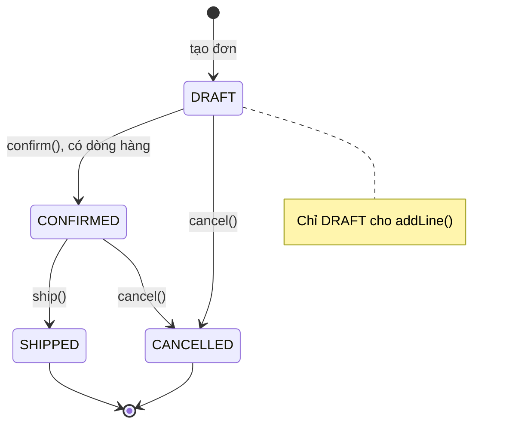
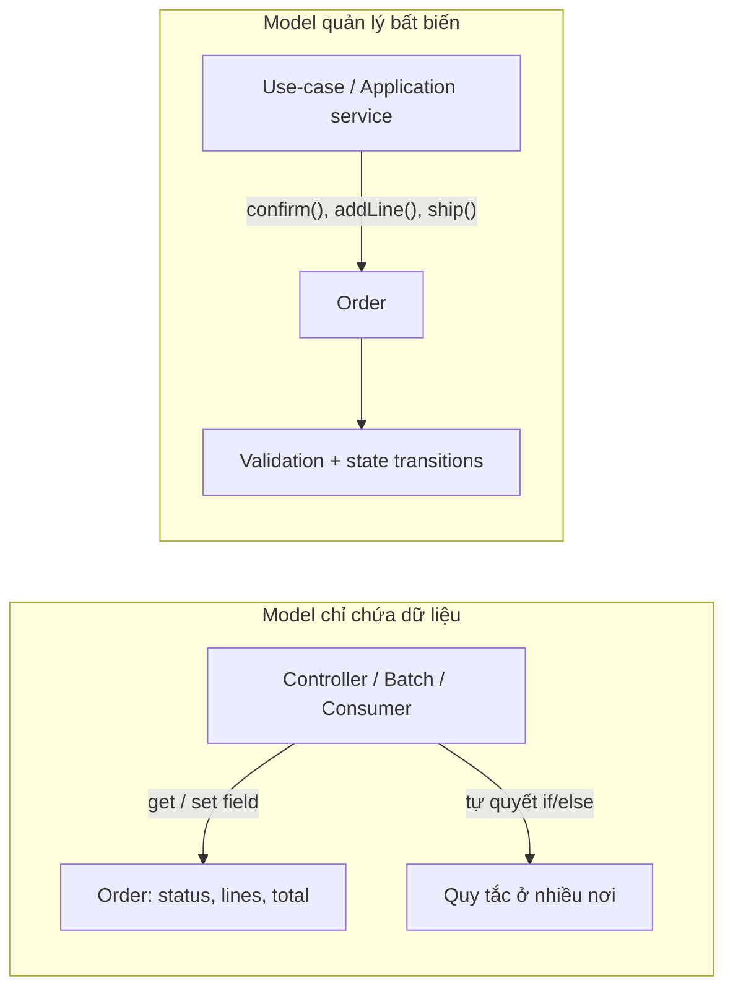
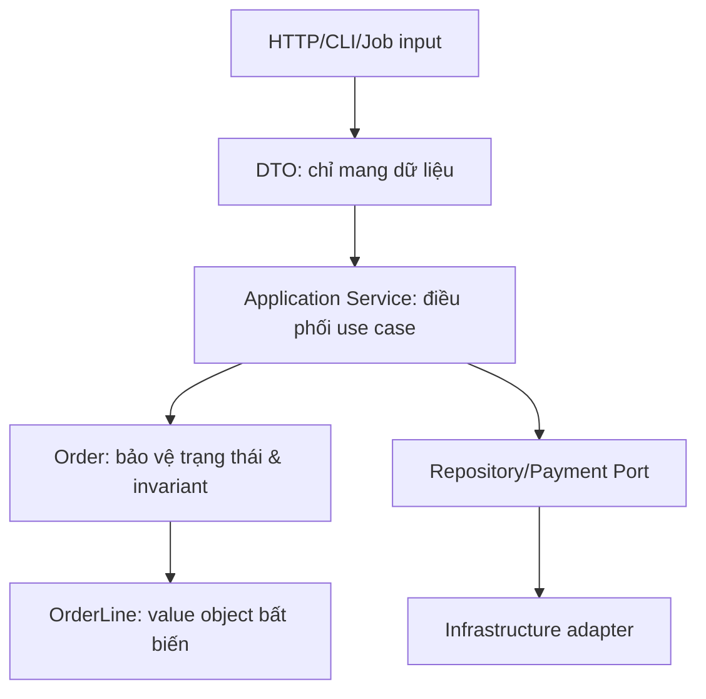
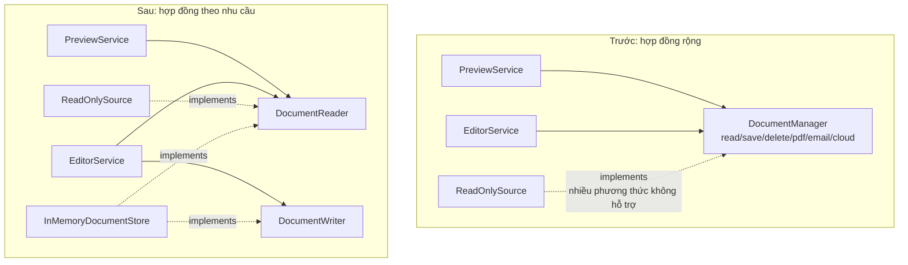
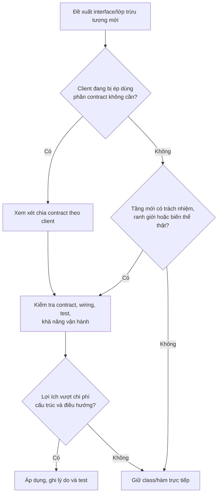
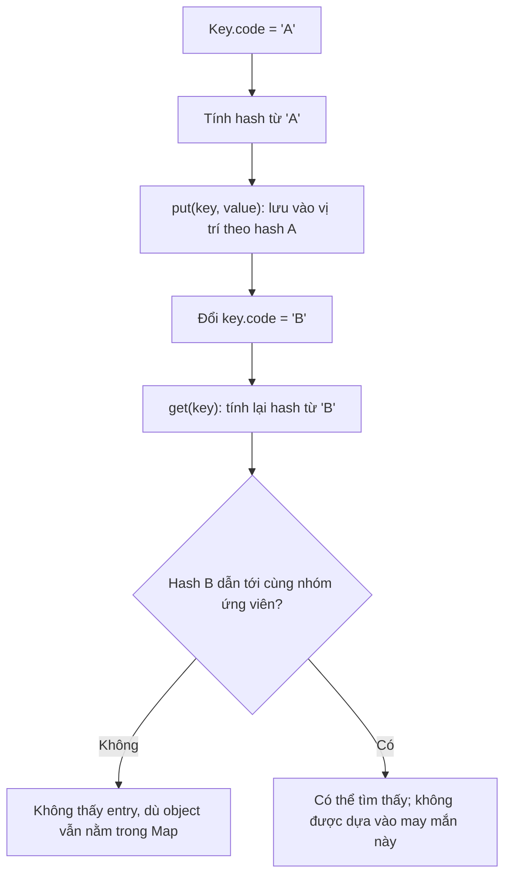
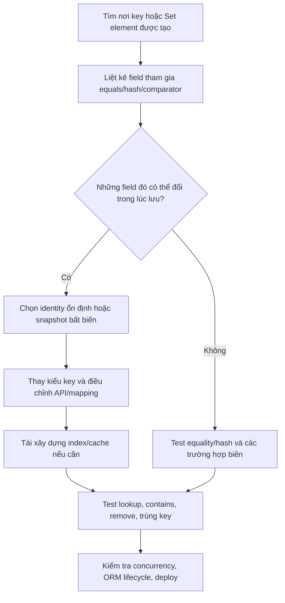

<a id="back-to-top"></a>

# Lỗi thiết kế

## Menu
- [Lớp ôm quá nhiều trách nhiệm](#design-pitfalls-001)
- [Trạng thái công khai và mất điều kiện bất biến](#design-pitfalls-002)
- [Getter, setter tràn lan nhưng thiếu hành vi](#design-pitfalls-003)
- [Kế thừa chỉ để dùng lại vài phương thức](#design-pitfalls-004)
- [Lạm dụng ép kiểu và kiểm tra kiểu](#design-pitfalls-005)
- [Giao diện quá lớn hoặc quá nhiều lớp trừu tượng](#design-pitfalls-006)
- [Phụ thuộc vòng và truy cập sâu vào đối tượng](#design-pitfalls-007)
- [Trạng thái dùng chung khó kiểm soát](#design-pitfalls-008)
- [Đối tượng có thể thay đổi làm sai phép so sánh hoặc mã băm](#design-pitfalls-009)
- [Lạm dụng mẫu thiết kế và trừu tượng hóa quá sớm](#design-pitfalls-010)

## <a id="design-pitfalls-001">Lớp ôm quá nhiều trách nhiệm</a>

<details>
<summary>Xem chi tiết</summary>

# Lớp ôm quá nhiều trách nhiệm (God Class): nhận biết và refactor đúng cách

> **Chủ đề:** OOP → Lỗi thiết kế → Lớp ôm quá nhiều trách nhiệm.  
> **Mục tiêu:** Hiểu vì sao một lớp có thể trở thành điểm nghẽn bảo trì, phân biệt “lớp dài” với “lớp nhiều trách nhiệm”, phát hiện các dấu hiệu qua lý do thay đổi và mức liên kết giữa các phương thức, rồi refactor bằng Java thành các phần có ranh giới rõ mà vẫn giữ nguyên hành vi nghiệp vụ.

## 1. “Lớp ôm quá nhiều trách nhiệm” nghĩa là gì?

**God Class** (đôi khi gọi *Blob*, *Large Class* hoặc *Bloaters* trong các phân loại code smell) là một dấu hiệu thiết kế: một lớp gom quá nhiều việc đáng lẽ cần thay đổi, kiểm thử và phát triển tương đối độc lập. Nó có thể biết quá nhiều về các phần còn lại của hệ thống, chứa lượng lớn trạng thái không liên quan và điều phối mọi thay đổi thông qua chính mình.

Ví dụ một `OrderManager` vừa:

- xác thực dữ liệu đơn hàng;
- tính giá, thuế và khuyến mãi;
- lưu đơn vào database;
- gọi cổng thanh toán;
- gửi email thông báo;
- tạo PDF hóa đơn;
- định dạng dữ liệu cho REST API.

Chỉ cần đổi công thức thuế, đổi hệ quản trị cơ sở dữ liệu hoặc sửa template email đều có thể phải mở cùng file `OrderManager.java`. Những thay đổi có **nguyên nhân khác nhau** va chạm trong một lớp.

Vấn đề chính không phải “bao nhiêu dòng là quá nhiều?”. **Một lớp 500 dòng xử lý một thuật toán có tính gắn kết cao có thể hợp lý**, trong khi một lớp 100 dòng vừa tính thuế, gửi email và gọi HTTP có thể đã có quá nhiều trách nhiệm.

Một tiêu chí thực tế là **lý do để thay đổi**: lớp có đang phải thay đổi vì nhiều quyết định nghiệp vụ hoặc nhiều nhóm người/phần hệ thống khác nhau hay không?

## 2. Vì sao kiểu thiết kế này xuất hiện?

Lúc ban đầu, để hoàn thành nhanh một chức năng, người viết thường đặt validation, tính toán, persistence và notification vào một phương thức. Khi có yêu cầu mới, họ bổ sung thêm một nhánh `if` hoặc một dependency vào cùng lớp vì “mọi thứ liên quan đơn hàng đã ở đây”.

Qua thời gian, lớp dần trở thành điểm tập trung kiến thức:

~~~mermaid
flowchart LR
    C["OrderManager"]
    C --> V["Validation"]
    C --> P["Pricing / Tax"]
    C --> D["Database"]
    C --> M["Email / SMS"]
    C --> F["PDF / CSV"]
    C --> A["API response"]
    C --> T["Payment gateway"]
~~~

Các trách nhiệm này cùng liên quan đến **đơn hàng**, nhưng không nhất thiết cùng một **lý do để thay đổi**. Chỉ dùng một tên miền nghiệp vụ chung như `Order` không chứng minh rằng chúng phải nằm trong một lớp.

Một số nguyên nhân phổ biến là thiếu ranh giới module, sợ tạo thêm lớp, copy-paste, sự phụ thuộc trực tiếp vào framework hoặc SDK, deadline gấp, và quá ít kiểm thử để refactor an toàn.

### Phân biệt thuật ngữ

| Thuật ngữ | Trọng tâm | Quan hệ với God Class |
|---|---|---|
| **God Class / Blob** | Biết và làm quá nhiều việc, thường ảnh hưởng rộng | Dạng điển hình của lớp ôm nhiều trách nhiệm |
| **Large Class** | Kích thước lớn: nhiều dòng, field, method | Một dấu hiệu để điều tra, **chưa đủ** kết luận |
| **Low Cohesion** | Các field/method không cùng phục vụ một mục đích nhất quán | Bằng chứng khá mạnh nếu đi kèm nhiều lý do thay đổi |
| **High Coupling** | Phụ thuộc trực tiếp vào nhiều class hoặc module khác | Làm phạm vi ảnh hưởng của thay đổi lớn hơn |
| **SRP violation** | Một module phục vụ nhiều actor/lý do thay đổi độc lập | Cách diễn giải nguyên lý thiết kế đằng sau nhiều God Class |
| **Anemic Domain Model** | Domain object ít hành vi nghiệp vụ, logic dồn vào service | Có thể đi cùng God Service, nhưng là vấn đề khác |

Một class dài **không đương nhiên** là God Class. Ngược lại, một lớp “manager” rất ngắn nhưng chuyển hàng chục yêu cầu cho các API khác nhau cũng có thể là trung tâm phụ thuộc quá rộng.

## 3. Dấu hiệu nhận biết qua code và lịch sử thay đổi

Quan sát mã nguồn và hỏi:

| Dấu hiệu | Ví dụ | Hệ quả |
|---|---|---|
| Nhiều lý do sửa cùng một file | Đổi thuế, SQL, email đều sửa `OrderManager` | Merge conflict, review khó, regression khó khoanh vùng |
| Field thành từng nhóm tách biệt | `dbConnection`, `mailClient`, `pdfWriter`, `taxRate` | Trạng thái của lớp có thể không cùng phục vụ một mục đích |
| Phương thức không dùng chung dữ liệu | `sendEmail()` không dùng dữ liệu của `calculateTax()` | Tính gắn kết thấp |
| Public API phình to | `createOrder`, `exportCsv`, `resetPassword`, `syncWarehouse` | Client phải nhìn thấy nhiều năng lực không cần thiết |
| Branch và side effect trộn lẫn | Tính giá giữa các lệnh gọi DB và HTTP | Test chậm, khó tái hiện lỗi |
| Khó khởi tạo trong unit test | Muốn test phép cộng phải cấu hình DB/mail/SDK | Trách nhiệm chưa được cô lập |
| Thay đổi nhỏ gây ảnh hưởng rộng | Sửa email template làm test tính giá lỗi | Ranh giới giữa các việc yếu |

Dấu hiệu mạnh nhất thường là **nhiều thay đổi không liên quan liên tục chạm cùng một lớp**. Khi audit, nên xem lịch sử thay đổi, các use case thực tế và dependency graph; không vội đoán chỉ từ tên `*Manager` hoặc `*Service`.

### “Một trách nhiệm” không đồng nghĩa “một phương thức”

Theo **Single Responsibility Principle (SRP)**, một module nên có một lý do thay đổi có tính nhất quán. Một `PriceCalculator` vẫn có thể có các phương thức `calculateSubtotal`, `calculateDiscount`, `calculateTax` nếu chúng cùng thuộc **chính sách tính giá** và thực sự thay đổi cùng nhau.

Ngược lại, chia một method 100 dòng thành 10 private methods **không tự giải quyết God Class** nếu cùng một lớp vẫn làm cả tính tiền, SQL và SMTP.

## 4. Mã có mùi thiết kế: tất cả trong một lớp

Đoạn sau là **ví dụ cố ý chưa tốt**, minh họa một ứng dụng đặt hàng:

~~~java
import java.math.BigDecimal;
import java.util.HashMap;
import java.util.List;
import java.util.Map;

record Item(String sku, int quantity, BigDecimal unitPrice) {}

final class AllInOneOrderService {
    private final Map<String, BigDecimal> fakeDatabase = new HashMap<>();

    String placeOrder(
            String orderId, String email, List<Item> items) {

        // 1. Validate input.
        if (orderId == null || orderId.isBlank()) {
            throw new IllegalArgumentException("Missing order ID");
        }

        // 2. Calculate price.
        BigDecimal total = BigDecimal.ZERO;
        for (Item item : items) {
            total = total.add(item.unitPrice()
                    .multiply(BigDecimal.valueOf(item.quantity())));
        }

        // 3. Persist (giả lập).
        fakeDatabase.put(orderId, total);

        // 4. Notify (giả lập).
        System.out.println("[DEMO MAIL] " + email + ": " + orderId);

        // 5. Format text for a caller.
        return "Order " + orderId + " total = " + total;
    }
}
~~~

Đây là một snippet minh họa *code smell*, **không phải triển khai production**: nó chưa validate `items`, số lượng, đơn giá, trùng mã đơn và lỗi khi gửi thông báo. Những thiếu sót đó cũng thể hiện một vấn đề: càng nhiều việc nằm trong cùng hàm, càng dễ bỏ sót hợp đồng ở các ranh giới.

Giả sử cần đổi email sang SMS. Ta phải sửa chính lớp chứa công thức tính giá. Nếu thay `HashMap` bằng JPA, vẫn sửa cùng lớp. Nếu muốn unit test giá của hai mặt hàng mà không sinh thông báo, test phải tìm cách né side effect.

Có thể thêm hàng loạt private method, nhưng **các nguyên nhân thay đổi vẫn sống chung trong `AllInOneOrderService`**.

## 5. Thiết kế lại: chia theo ranh giới trách nhiệm

Một hướng refactor là giữ một **use case điều phối** tương đối mỏng, còn các chính sách và tích hợp độc lập được đặt ở đúng nơi:

~~~mermaid
flowchart TD
    UI["Caller / Controller"] --> UC["PlaceOrderUseCase"]
    UC --> PR["PriceCalculator"]
    UC --> REPO["OrderRepository (port)"]
    UC --> NOTI["OrderNotifier (port)"]
    MEMORY["InMemoryOrderRepository"] -.->|"implements"| REPO
    MAIL["ConsoleOrderNotifier"] -.->|"implements"| NOTI
    DB["Adapter DB thật sau này"] -.->|"implements"| REPO
~~~

Cách chia này có ý nghĩa cụ thể:

- **`PriceCalculator`:** tính số tiền từ các mặt hàng, không biết database hoặc người nhận email.
- **`OrderRepository`:** hợp đồng lưu kết quả đơn hàng; adapter quyết định lưu vào đâu.
- **`OrderNotifier`:** hợp đồng phát thông báo; adapter quyết định dùng email/SMS/log demo.
- **`PlaceOrderUseCase`:** chịu trách nhiệm **quy trình đặt hàng**: nhận yêu cầu hợp lệ → tính tiền → tạo kết quả → yêu cầu lưu → yêu cầu thông báo.
- **Composition root:** tạo và nối các đối tượng; đây là nơi được phép biết implementation hạ tầng.

**Lưu ý:** Việc use case gọi nhiều cộng tác viên không tự động khiến nó thành God Class. **Điều phối các bước của một use case** có thể là **một trách nhiệm gắn kết**. Vấn đề xuất hiện khi use case tự chứa logic SQL, quy tắc giá, SMTP, PDF và vô số use case không liên quan.

## 6. Ví dụ Java 17 hoàn chỉnh, chạy độc lập

Ví dụ này dùng đơn vị tiền có hai chữ số thập phân để dễ quan sát phép tính; **quy ước làm tròn và đơn vị tiền** trong ứng dụng thật phải do yêu cầu nghiệp vụ xác định. Các adapter là mô phỏng tại bộ nhớ/console, không có tác vụ gửi email hoặc ghi database thật.

Lưu vào **`ResponsibilityDemo.java`**:

~~~java
import java.math.BigDecimal;
import java.math.RoundingMode;
import java.util.HashMap;
import java.util.List;
import java.util.Map;
import java.util.Objects;

// Value object: quy tắc hợp lệ của một mặt hàng.
record OrderItem(String sku, int quantity, BigDecimal unitPrice) {
    OrderItem {
        Objects.requireNonNull(sku, "sku");
        Objects.requireNonNull(unitPrice, "unitPrice");

        if (!sku.matches("[A-Z0-9-]+")) {
            throw new IllegalArgumentException("Invalid sku");
        }
        if (quantity <= 0 || unitPrice.signum() < 0) {
            throw new IllegalArgumentException(
                    "Invalid quantity or price");
        }

        try {
            unitPrice = unitPrice.setScale(
                    2, RoundingMode.UNNECESSARY);
        } catch (ArithmeticException ex) {
            throw new IllegalArgumentException(
                    "Unit price has fractions below 0.01", ex);
        }
    }
}

// Dữ liệu đầu vào của một use case.
record PlaceOrderRequest(
        String orderId,
        String customerEmail,
        List<OrderItem> items) {
    PlaceOrderRequest {
        Objects.requireNonNull(orderId, "orderId");
        Objects.requireNonNull(customerEmail, "customerEmail");
        Objects.requireNonNull(items, "items");

        if (!orderId.matches("[A-Z0-9-]+")) {
            throw new IllegalArgumentException("Invalid order ID");
        }
        if (customerEmail.isBlank()) {
            throw new IllegalArgumentException("Missing email");
        }
        items = List.copyOf(items);
        if (items.isEmpty()) {
            throw new IllegalArgumentException("Empty order");
        }
    }
}

record OrderReceipt(String orderId, BigDecimal total) {}

// Chính sách tính tiền: không biết lưu trữ hoặc thông báo.
final class PriceCalculator {
    BigDecimal calculate(List<OrderItem> items) {
        Objects.requireNonNull(items, "items");

        BigDecimal total = BigDecimal.ZERO.setScale(2);
        for (OrderItem item : items) {
            total = total.add(item.unitPrice()
                    .multiply(BigDecimal.valueOf(item.quantity())));
        }
        return total;
    }
}

// Hai port mô tả những việc use case cần.
interface OrderRepository {
    void save(OrderReceipt receipt);
}

interface OrderNotifier {
    void orderPlaced(String customerEmail, OrderReceipt receipt);
}

// Use case: giữ trình tự nghiệp vụ, không chứa công thức/SDK.
final class PlaceOrderUseCase {
    private final PriceCalculator calculator;
    private final OrderRepository repository;
    private final OrderNotifier notifier;

    PlaceOrderUseCase(
            PriceCalculator calculator,
            OrderRepository repository,
            OrderNotifier notifier) {
        this.calculator = Objects.requireNonNull(
                calculator, "calculator");
        this.repository = Objects.requireNonNull(
                repository, "repository");
        this.notifier = Objects.requireNonNull(
                notifier, "notifier");
    }

    OrderReceipt execute(PlaceOrderRequest request) {
        Objects.requireNonNull(request, "request");

        BigDecimal total = calculator.calculate(request.items());
        OrderReceipt receipt = new OrderReceipt(
                request.orderId(), total);

        // Quy trình có thứ tự rõ, mỗi dependency sở hữu một việc.
        repository.save(receipt);
        notifier.orderPlaced(request.customerEmail(), receipt);
        return receipt;
    }
}

// Adapter lưu tại bộ nhớ, minh họa — không thread-safe.
final class InMemoryOrderRepository implements OrderRepository {
    private final Map<String, OrderReceipt> storage = new HashMap<>();

    @Override
    public void save(OrderReceipt receipt) {
        Objects.requireNonNull(receipt, "receipt");

        if (storage.putIfAbsent(receipt.orderId(), receipt) != null) {
            throw new IllegalStateException("Duplicate order ID");
        }
    }

    OrderReceipt findRequired(String id) {
        OrderReceipt found = storage.get(id);
        if (found == null) {
            throw new IllegalArgumentException("Order not found");
        }
        return found;
    }
}

// Adapter mô phỏng gửi thông báo, không in email của khách hàng.
final class ConsoleOrderNotifier implements OrderNotifier {
    @Override
    public void orderPlaced(
            String customerEmail, OrderReceipt receipt) {
        Objects.requireNonNull(customerEmail, "customerEmail");
        System.out.printf(
                "[DEMO] Created %s, total=%s%n",
                receipt.orderId(),
                receipt.total().toPlainString());
    }
}

public class ResponsibilityDemo {
    public static void main(String[] args) {
        var repository = new InMemoryOrderRepository();
        var notifier = new ConsoleOrderNotifier();

        var useCase = new PlaceOrderUseCase(
                new PriceCalculator(),
                repository,
                notifier);

        var request = new PlaceOrderRequest(
                "ORD-42",
                "customer@example.com",
                List.of(
                        new OrderItem(
                                "SKU-1", 2, new BigDecimal("50.00")),
                        new OrderItem(
                                "SKU-2", 1, new BigDecimal("25.50"))
                ));

        OrderReceipt receipt = useCase.execute(request);

        System.out.println("Receipt: " + receipt);
        System.out.println("Saved: "
                + repository.findRequired("ORD-42").total());
    }
}
~~~

Biên dịch và chạy:

~~~bash
javac ResponsibilityDemo.java
java ResponsibilityDemo
~~~

Kết quả dự kiến:

~~~text
[DEMO] Created ORD-42, total=125.50
Receipt: OrderReceipt[orderId=ORD-42, total=125.50]
Saved: 125.50
~~~

Ví dụ dùng `record` của Java 17 để thể hiện dữ liệu có giá trị và ranh giới đơn giản; **record không tự bảo đảm mọi bất biến**, vì thế constructor kiểm tra điều kiện cần thiết. `List.copyOf` tạo một snapshot cấu trúc danh sách và từ chối phần tử null; `OrderItem` là record với các component bất biến, do đó dữ liệu ví dụ không có phần tử có thể thay đổi trạng thái.

Một số quyết định của bản demo được cố ý giới hạn:

- `customerEmail` chỉ kiểm tra không rỗng, **chưa phải validation email hoàn chỉnh**. Trong thực tế cần chính sách kiểm tra và xác minh riêng.
- `InMemoryOrderRepository` không lưu xuống đĩa, không thread-safe và chưa có transaction.
- `ConsoleOrderNotifier` **không gửi email**. Nó chỉ mô phỏng side effect để chứng minh ranh giới.
- `OrderReceipt` là kết quả use case đơn giản; với ứng dụng có trạng thái đơn hàng, thanh toán, vận chuyển, cần domain model phù hợp.
- Đặt tên class và module sao cho sự phụ thuộc hướng tới những hợp đồng ổn định. Không nhất thiết mỗi triển khai đều phải có một interface nếu không có nhu cầu thay thế.

### Trước và sau refactor: điều gì thực sự thay đổi?

| Thay đổi của hệ thống | Khi dồn vào `AllInOneOrderService` | Sau refactor |
|---|---|---|
| Đổi công thức giá | Sửa trong cùng lớp chứa DB/email | Sửa `PriceCalculator` và test giá |
| Đổi nơi lưu dữ liệu | Sửa logic truy cập DB trong lớp nghiệp vụ | Thay adapter của `OrderRepository` |
| Chuyển từ email sang SMS | Sửa logic thông báo ở cùng lớp nghiệp vụ | Thay adapter của `OrderNotifier` |
| Kiểm tra mặt hàng không hợp lệ | Nằm lẫn trong một hàm lớn | Thể hiện invariant ở `OrderItem` |
| Thay thứ tự nghiệp vụ: lưu trước thông báo | Dễ nằm lẫn side effect | Xem rõ trong `PlaceOrderUseCase.execute` |
| Unit test riêng công thức giá | Có thể vướng khởi tạo DB/mail | Tạo trực tiếp `new PriceCalculator()` |

**Điểm cần nhớ:** Refactor **không chỉ là chia file**. Ta phải tạo ra các ranh giới mà tại đó *mỗi phần sở hữu một quyết định*, và các phần còn lại sử dụng nó qua hợp đồng rõ ràng.

## 7. Trách nhiệm của lớp khác trách nhiệm của use case

Đến đây có thể xuất hiện một câu hỏi: “`PlaceOrderUseCase` gọi ba dependency, vậy nó có quá nhiều trách nhiệm không?”

**Chưa chắc.** Đặt một đơn hàng **bản thân nó là một quy trình** bao gồm tính tiền, lưu và thông báo. Use case có thể chịu trách nhiệm thực thi **một kịch bản nghiệp vụ có trình tự**, còn từng cộng tác viên chịu trách nhiệm cho chi tiết chuyên biệt.

Nhưng nếu cùng `PlaceOrderUseCase` bắt đầu có `cancelOrder`, `refund`, `generateMonthlyReport`, `syncWarehouse`, `createPromoCampaign` và hàng chục field trạng thái khác nhau, nó có thể đang thành **God Service**. Cần xem các yêu cầu có cùng lý do thay đổi hay thuộc nhiều luồng khác nhau.

Không nên hiểu SRP như một quy tắc máy móc “mỗi class chỉ có một method”, “mỗi class tối đa 100 dòng”, hay “mỗi method tối đa ba dependency”. Đó là các chỉ dấu tham khảo, không phải định nghĩa trách nhiệm.

### Domain object nên giữ hành vi nào?

Tách hết mọi hành vi khỏi entity có thể làm xuất hiện mô hình thiếu hành vi (*anemic domain model*), nơi mọi ràng buộc và thay đổi trạng thái bị dồn vào service khác. Ví dụ, một `BankAccount` có thể tự bảo vệ quy tắc rút tiền hợp lệ vì đó là **trách nhiệm liên kết chặt với trạng thái của tài khoản**:

~~~java
import java.math.BigDecimal;
import java.util.Objects;

final class BankAccount {
    private BigDecimal balance;

    BankAccount(BigDecimal initial) {
        Objects.requireNonNull(initial);
        if (initial.signum() < 0) {
            throw new IllegalArgumentException("Negative initial balance");
        }
        this.balance = initial;
    }

    void withdraw(BigDecimal amount) {
        Objects.requireNonNull(amount);
        if (amount.signum() <= 0 || amount.compareTo(balance) > 0) {
            throw new IllegalArgumentException("Invalid withdrawal");
        }
        balance = balance.subtract(amount);
    }

    BigDecimal balance() {
        return balance;
    }
}
~~~

Đây là **hành vi hợp lý bên trong domain object**, không phải dấu hiệu lớp ôm quá nhiều việc. `BankAccount` sẽ bắt đầu đáng ngờ nếu tự gọi SMTP, xây báo cáo CSV hoặc tự biết mật khẩu kết nối database.

## 8. Những lỗi khi refactor God Class

### 8.1. Chia lớp nhưng chỉ chuyển lời gọi qua lại

Ví dụ không giải quyết vấn đề:

~~~java
class OrderFacade {
    private final LegacyOrderManager manager = new LegacyOrderManager();

    void saveOrder() {
        manager.doEverything();
    }
}
~~~

Một wrapper đẹp tên không tách policy và side effect nếu `LegacyOrderManager` vẫn làm tất cả. Hãy xác định **logic nào thật sự được chuyển giao quyền sở hữu** và kiểm tra dependency sau thay đổi.

### 8.2. Tách nhỏ đến mức mất khả năng đọc luồng nghiệp vụ

Nếu mỗi dòng tính giá tạo thành một class (`AddItemService`, `MultiplyQuantityService`, `RoundTotalService`...) mà không có lý do thay đổi riêng, số lượng abstraction có thể làm việc đọc code chậm hơn. Hãy gom các bước có cùng mục đích vào một đối tượng gắn kết.

### 8.3. Dời tất cả sang một “Utils” tĩnh

~~~java
OrderUtils.validate(...);
OrderUtils.calculate(...);
OrderUtils.save(...);
OrderUtils.sendMail(...);
~~~

Đổi `OrderManager` thành `OrderUtils` vẫn tập trung trách nhiệm, thậm chí khó inject dependency hoặc kiểm thử side effect. Method `static` hợp lý cho hàm thuần nhỏ, nhưng “utils” không nên là nơi chứa mọi chính sách và adapter.

### 8.4. Tạo interface cho mọi class

Một interface chỉ có đúng một implementation không tự tạo giá trị nếu nó không phân tách ranh giới ổn định/biến động hoặc giúp kiểm thử. `PriceCalculator` trong ví dụ là class thường vì tính giá là phần cần kiểm thử trực tiếp, chưa cần nhiều thuật toán. `OrderRepository` và `OrderNotifier` là abstraction có ý nghĩa do ngăn use case phụ thuộc vào cơ chế lưu/gửi cụ thể.

### 8.5. Bỏ sót ranh giới giao dịch khi di chuyển code

Ví dụ chạy lần lượt:

~~~java
repository.save(receipt);
notifier.orderPlaced(email, receipt);
~~~

Nếu `save` thành công rồi `orderPlaced` ném exception, **đơn đã được lưu nhưng thông báo chưa được gửi**. Việc chia class không tự giải quyết atomicity, retry hay idempotency.

Trong hệ thống thực, có thể dùng **transactional outbox**: lưu đơn hàng và sự kiện cần phát trong cùng một giao dịch database, rồi một worker gửi sự kiện có khả năng retry và xử lý trùng. Thiết kế chi tiết tùy yêu cầu nhất quán; không nên giả định transaction DB có thể bao trùm email hoặc mọi HTTP side effect.

Tương tự, nếu giá đang được tính từ dữ liệu có thể thay đổi, phải xác định phiên bản bảng giá/tỷ lệ thuế tại thời điểm tạo đơn, tránh làm lệch kết quả sau refactor.

## 9. Kiểm thử để refactor an toàn

Trước khi sửa lớp lớn, cần biết **hành vi nào phải được bảo toàn**. Với code legacy chưa có test, có thể dùng *characterization tests* (kiểm thử ghi nhận hành vi hiện hữu) để khóa các quy tắc cần giữ, sau đó viết test cô lập cho phần được tách ra.

Ví dụ sau dùng JUnit Jupiter 5 và các class từ `ResponsibilityDemo.java`. Đặt trong `ResponsibilityDemoTest.java` cùng package, thêm dependency `org.junit.jupiter:junit-jupiter` và test runner phù hợp:

~~~java
import static org.junit.jupiter.api.Assertions.*;

import java.math.BigDecimal;
import java.util.ArrayList;
import java.util.List;
import java.util.concurrent.atomic.AtomicInteger;

import org.junit.jupiter.api.Test;

class ResponsibilityDemoTest {
    @Test
    void priceIsIndependentOfDatabaseAndNotification() {
        var calculator = new PriceCalculator();

        BigDecimal total = calculator.calculate(List.of(
                new OrderItem("SKU-1", 2, new BigDecimal("50.00")),
                new OrderItem("SKU-2", 1, new BigDecimal("25.50"))
        ));

        assertEquals(new BigDecimal("125.50"), total);
    }

    @Test
    void useCasePersistsBeforeNotifying() {
        var events = new ArrayList<String>();

        OrderRepository repository = receipt ->
                events.add("saved:" + receipt.orderId());

        OrderNotifier notifier = (email, receipt) ->
                events.add("notified:" + receipt.orderId());

        var useCase = new PlaceOrderUseCase(
                new PriceCalculator(), repository, notifier);

        var request = new PlaceOrderRequest(
                "ORD-42",
                "customer@example.com",
                List.of(new OrderItem(
                        "SKU-1", 1, new BigDecimal("10.00"))));

        var receipt = useCase.execute(request);

        assertEquals(new BigDecimal("10.00"), receipt.total());
        assertEquals(List.of(
                "saved:ORD-42",
                "notified:ORD-42"
        ), events);
    }

    @Test
    void notificationDoesNotRunWhenPersistenceFails() {
        AtomicInteger notifications = new AtomicInteger();

        OrderRepository brokenRepository = receipt -> {
            throw new IllegalStateException("Storage failure");
        };
        OrderNotifier notifier = (email, receipt) ->
                notifications.incrementAndGet();

        var useCase = new PlaceOrderUseCase(
                new PriceCalculator(), brokenRepository, notifier);

        var request = new PlaceOrderRequest(
                "ORD-99",
                "customer@example.com",
                List.of(new OrderItem(
                        "SKU-1", 1, new BigDecimal("10.00"))));

        assertThrows(IllegalStateException.class,
                () -> useCase.execute(request));
        assertEquals(0, notifications.get());
    }

    @Test
    void invalidQuantityIsRejectedBeforeUseCase() {
        assertThrows(IllegalArgumentException.class,
                () -> new OrderItem(
                        "SKU-1", 0, new BigDecimal("10.00")));
    }
}
~~~

**Giá trị của các test:**

- `PriceCalculator` được test **không cần** giả lập DB hay email.
- Test orchestration xác nhận **thứ tự** yêu cầu lưu rồi mới thông báo.
- Nếu repository thất bại, notifier chưa được gọi, nên lỗi luồng dễ nhận thấy.
- Bất biến của `OrderItem` được kiểm tra ở đúng nơi tạo value object.

Những test này không chứng minh lưu trữ thật hay gửi email thật đã hoạt động. Adapter dùng JDBC/JPA/HTTP/SMTP cần integration test ở ranh giới tương ứng. Với thay đổi giao dịch, cần thêm test cho retry, race condition, thông báo trùng và yêu cầu idempotency.

## 10. Cách refactor từng bước, giảm nguy cơ thay đổi hành vi

Một quy trình thực tế khi gặp lớp lớn đang chạy production:

1. **Xác định các chức năng và client:** Ai gọi method nào? Dữ liệu/side effect đi đâu? Đánh dấu các quy tắc có rủi ro cao (tiền, trạng thái, phân quyền, transaction).
2. **Ghi nhận hành vi hiện tại:** Characterization tests hoặc test tích hợp cho các luồng quan trọng; phân biệt bug cần sửa riêng với hành vi đang được phụ thuộc.
3. **Phân nhóm lý do thay đổi:** Pricing, persistence, notification, validation, presentation...; dùng dependency và field usage để xác nhận thay vì dựa vào tên class.
4. **Trích xuất logic thuần trước:** Chuyển phép tính xác định (pure logic) thành class/phương thức có test độc lập. Ít rủi ro hơn dịch chuyển transaction hoặc network call.
5. **Tách cổng giao tiếp ra khỏi use case:** Mô tả `OrderRepository`, `OrderNotifier` đúng theo nhu cầu của caller; tạo adapter cho code cũ khi cần.
6. **Di chuyển side effect có kiểm soát:** Giữ thứ tự tác vụ, điều kiện lỗi và chính sách retry như hợp đồng, tránh phát thông báo hai lần.
7. **Thu gọn lớp cũ:** Cho nó chỉ còn trách nhiệm thực sự của use case hoặc chuyển caller sang API mới; xóa luồng cũ khi không còn ai dùng.
8. **Kiểm tra thay đổi:** Chạy test module/unit/integration phù hợp, so sánh kết quả nghiệp vụ, đo log và truy vấn. Chỉ tối ưu hiệu năng khi có bằng chứng.

Refactor an toàn thường gồm **nhiều thay đổi nhỏ có thể review**, thay vì viết lại toàn bộ lớp hàng nghìn dòng một lần. Nếu có ràng buộc tương thích API, có thể giữ một adapter chuyển tiếp tạm thời và lên kế hoạch loại bỏ nó sau khi caller đã chuyển.

### Sơ đồ luồng sau khi tách

~~~mermaid
sequenceDiagram
    actor Client
    participant U as PlaceOrderUseCase
    participant P as PriceCalculator
    participant R as OrderRepository
    participant N as OrderNotifier
    Client->>U: execute(request)
    U->>P: calculate(items)
    P-->>U: total
    U->>R: save(receipt)
    R-->>U: hoàn tất
    U->>N: orderPlaced(email, receipt)
    N-->>U: hoàn tất
    U-->>Client: receipt
    Note over U,N: Nếu notify lỗi sau save, cần chính sách nhất quán/retry riêng
~~~

## 11. Khi nào KHÔNG cần chia lớp?

Các dấu hiệu gợi ý **nên giữ lại** một lớp:

- Mọi method thực sự phục vụ một invariant/thuật toán gắn kết, thay đổi theo cùng chính sách.
- Việc chia thêm lớp chỉ tạo nhiều đối tượng chuyển lời gọi qua lại mà không giảm coupling hay làm test dễ hơn.
- Thành phần là một value object hoặc aggregate có quy tắc nghiệp vụ bao quanh cùng một trạng thái.
- Bài toán rất nhỏ, thuật toán rõ ràng và chưa có trục biến thiên thực tế; refactor chưa đem lại lợi ích tương xứng.
- Một class có nhiều method vì triển khai giao thức đầy đủ, nhưng vẫn có ranh giới trách nhiệm rõ.

Đừng ra quyết định chỉ bằng **LOC (lines of code), số method, cyclomatic complexity hoặc tên `Manager`**. Chúng giúp tìm nơi cần xem xét; quyết định thiết kế phải dựa trên cohesion, coupling, nguyên nhân thay đổi, khả năng kiểm thử và ảnh hưởng tới nghiệp vụ.

## 12. Bài tập thực hành: tách lớp UserManager

Cho một lớp giả định:

~~~java
class UserManager {
    void register(String email, String password) { /* ... */ }
    boolean authenticate(String email, String password) { /* ... */ }
    void sendWelcomeEmail(String email) { /* ... */ }
    String exportUserCsv() { /* ... */ }
    void cleanupInactiveUsers() { /* ... */ }
}
~~~

Đừng lập tức biến năm method thành năm class. Hãy phân tích:

- Quy tắc đăng ký và xác thực thuộc cùng chính sách nào, có trường hợp cần tách không?
- Password hashing, mật khẩu và session/token cần ranh giới bảo mật nào?
- Email và CSV là trách nhiệm nghiệp vụ hay adapter của hệ thống?
- Xóa user không hoạt động có phải batch job riêng với transaction/audit yêu cầu khác?
- Những actor/nhóm yêu cầu nào khiến `UserManager` phải thay đổi?

**Yêu cầu:** Vẽ sơ đồ quan hệ sau khi tách, tạo interface chỉ tại ranh giới cần thay thế, đặt tên use case phù hợp, và viết ít nhất ba bài test: dữ liệu đăng ký sai, thành công lưu user, email thất bại sau lưu. Xác định rõ chính sách nghiệp vụ cho trường hợp email thất bại (đăng ký có được coi là thành công không? có retry/outbox không?).

### Câu hỏi tự kiểm tra

1. Vì sao “class nhiều dòng” chỉ là dấu hiệu, chưa phải bằng chứng God Class?
2. Nếu đổi SQL và công thức khuyến mãi đều sửa `OrderManager`, điều đó nói gì về lý do thay đổi?
3. Chia một method lớn thành 10 private methods có tự bảo đảm SRP không?
4. Lớp `PlaceOrderUseCase` gọi ba dependency có nhất thiết là God Class không? Vì sao?
5. Vì sao không nên tách cả phép kiểm tra số dư và rút tiền ra khỏi `BankAccount` nếu invariant thuộc chính account?
6. Interface và DI giúp gì khi chuyển database/mail adapter? Chúng có tự giải quyết transaction không?
7. Vì sao `repository.save` thành công nhưng `notifier.orderPlaced` thất bại cần một chính sách riêng?
8. Khi nào nên dừng refactor để tránh sinh hàng chục lớp chuyển tiếp không mang trách nhiệm thật?

**Kết luận:** Lớp ôm quá nhiều trách nhiệm làm các quyết định độc lập dính chặt vào nhau, khiến sửa một nơi gây ảnh hưởng nhiều nơi. Refactor tốt là **tìm các ranh giới thay đổi thực sự**, đặt logic và side effect đúng nơi, giữ use case điều phối gắn kết, đồng thời dùng kiểm thử và hợp đồng nghiệp vụ để bảo toàn kết quả. **Số class không phải chỉ số chất lượng**; khả năng hiểu, sửa và kiểm chứng hành vi mới là điều quan trọng.


</details>

- [Quay lại đầu trang](#back-to-top)

---

## <a id="design-pitfalls-002">Trạng thái công khai và mất điều kiện bất biến</a>

<details>
<summary>Xem chi tiết</summary>

# Trạng thái công khai và mất điều kiện bất biến trong OOP

> **Chủ đề:** OOP → Lỗi thiết kế → Trạng thái công khai và mất điều kiện bất biến.  
> **Mục tiêu:** Nhận diện các đường dữ liệu bên ngoài có thể phá hỏng trạng thái đối tượng; hiểu invariant khác với kiểm tra đầu vào; dùng encapsulation, thao tác nghiệp vụ, defensive copy và kiểm thử để bảo vệ đối tượng trong Java.

## 1. Vấn đề: đối tượng có thể “tự mâu thuẫn” dù khởi tạo hợp lệ

Giả sử hệ thống bán vé có một kho chỗ ngồi: **sức chứa 10**, đã đặt **4**, còn **6**. Các con số đó phải tuân thủ quy tắc:

\[
0 \le \text{reserved} \le \text{capacity}
\]

và \(\text{available}=\text{capacity}-\text{reserved}\).

Đây là **điều kiện bất biến của đối tượng (object invariant)**: một điều kiện phải đúng tại những thời điểm trạng thái của đối tượng được phép quan sát từ bên ngoài, đặc biệt **sau khi khởi tạo thành công** và **sau mỗi thao tác công khai hoàn tất**.

Một thiết kế có thể khởi tạo trạng thái đúng nhưng cho phép code bên ngoài làm sai:

~~~java
// Ví dụ CỐ Ý SAI để thấy lỗi thiết kế.
class BrokenSeatInventory {
    public int capacity;
    public int reserved;

    BrokenSeatInventory(int capacity) {
        this.capacity = capacity;
        this.reserved = 0;
    }

    int available() {
        return capacity - reserved;
    }
}

BrokenSeatInventory inventory = new BrokenSeatInventory(10);
inventory.reserved = 12; // Java cho phép: trường public.
System.out.println(inventory.available()); // -2
~~~

Chỉ một phép gán hợp lệ về mặt **kiểu `int`** đã phá quy tắc nghiệp vụ. Trình biên dịch không thể suy ra “`reserved` không được vượt `capacity`” từ hai trường `int`.

**Lỗi không chỉ là “để field ở `public`”**. Vấn đề sâu hơn là đối tượng **không kiểm soát được mọi con đường thay đổi trạng thái của chính nó**. Trạng thái có thể bị thay trực tiếp qua field, qua getter trả về collection mutable, qua một object được truyền vào constructor rồi bị sửa bên ngoài, hoặc qua setter cho phép các field liên quan biến đổi độc lập.

## 2. Invariant là gì và khác validation như thế nào?

Ba khái niệm thường đi cùng nhưng giải quyết ba câu hỏi khác nhau:

| Khái niệm | Câu hỏi | Ví dụ với kho chỗ |
|---|---|---|
| **Tiền điều kiện (precondition)** | Người gọi phải truyền gì để thao tác hợp lệ? | `reserve(seats)` yêu cầu `seats > 0` |
| **Hậu điều kiện (postcondition)** | Nếu thao tác thành công, kết quả phải thế nào? | Đặt 3 chỗ thành công thì số chỗ đã đặt tăng đúng 3 |
| **Bất biến (invariant)** | Quy tắc nào luôn phải được bảo toàn ở ranh giới quan sát trạng thái? | `0 ≤ reserved ≤ capacity` |

Một invariant có thể liên quan **nhiều trường**:

- Tài khoản: `balance >= 0` nếu nghiệp vụ không cho thấu chi.
- Kho hàng: `0 <= reserved <= stock`.
- Khoảng thời gian: `start.isBefore(end)`.
- Đơn hàng: `status == PAID` chỉ khi một số điều kiện thanh toán đã đạt.
- Nhóm người dùng: quyền sở hữu và thành viên phải nhất quán theo quy tắc hệ thống.

Không phải mọi đối tượng đều có invariant phức tạp. Ví dụ một DTO đọc dữ liệu chưa kiểm chứng có thể cố ý chứa trạng thái chưa hợp lệ để trả lỗi validation. Ngược lại, **domain object** được kỳ vọng biểu diễn trạng thái hợp lệ thì cần giữ quy tắc của nó trong các thao tác công khai.

### “Luôn đúng” có nghĩa đến mức nào?

Một method có thể thay đổi nhiều field qua các bước nội bộ; một trạng thái trung gian **không được lộ ra** có thể chưa thỏa invariant tạm thời. Thiết kế tốt vẫn cố gắng cập nhật theo một bước nhất quán và chỉ công bố trạng thái hợp lệ. Trong chương trình nhiều luồng, điều này còn đòi hỏi đồng bộ hóa nếu các thread cùng đọc/ghi.

Không nên coi lời hứa “chỉ gọi setter theo đúng thứ tự” là bảo vệ invariant. Người dùng API, lớp con, serializer, framework hay một lần refactor có thể gọi theo thứ tự khác.

## 3. Vì sao `private` là cần nhưng chưa đủ?

**Encapsulation (đóng gói)** không chỉ là thay `public` thành `private`. Nó là việc đối tượng **giữ quyền kiểm soát trạng thái và bảo đảm các quy tắc hợp lệ** khi nhận yêu cầu thay đổi.

Một thiết kế tốt thường có ba tầng bảo vệ:

1. **Ẩn cách lưu trạng thái:** không cho client ghi thẳng các field quan trọng.
2. **Đặt thao tác theo ngôn ngữ nghiệp vụ:** `reserve(3)`, `cancel(2)` thay vì `setReserved(7)`.
3. **Bảo vệ mọi đường tham chiếu mutable:** constructor, getter, setter, collection, array, object lồng nhau và luồng truy cập đồng thời.

Bảng sau tóm tắt những sai lầm phổ biến:

| Cách viết | Rủi ro | Hướng sửa |
|---|---|---|
| `public int reserved` | Mọi client gán giá trị tùy ý | `private` + method `reserve`/`cancel` có điều kiện |
| `setReserved(x)`, `setCapacity(y)` riêng biệt | Có thể gây tổ hợp trạng thái không hợp lệ | Thao tác nghiệp vụ hoặc cập nhật một bộ dữ liệu nguyên tử |
| `getItems() { return items; }` | Trả tham chiếu tới collection mutable nội bộ | Trả snapshot/read-only view phù hợp |
| `this.items = items` nhận `List` từ ngoài | Caller còn giữ alias và sửa dữ liệu về sau | Copy dữ liệu đầu vào theo chính sách |
| `private final List<X> items` | `final` chỉ cố định tham chiếu, không ngăn `add/remove` | Kiểm soát mutation và không rò rỉ tham chiếu |
| `record User(List<Role> roles)` | Record không tự tạo deep copy của component | Chuẩn hóa/copy trong compact constructor |
| Kiểm tra lúc tạo nhưng không ở lúc sửa | Đối tượng hợp lệ ban đầu, sau đó không hợp lệ | Xác nhận invariant trên mọi mutator |

## 4. Ví dụ Java 17 hoàn chỉnh: kho chỗ ngồi bảo toàn invariant

Thay vì công khai `capacity` và `reserved`, ta tạo một đối tượng có trạng thái đóng kín:

- Sức chứa được đặt một lần trong constructor và không thay đổi.
- Đặt chỗ chỉ có thể thông qua `reserve(int seats)`.
- Hủy chỗ chỉ có thể thông qua `cancel(int seats)`.
- Không có API nào cho phép tự ý gán số chỗ đã đặt.
- Khi không đủ chỗ, `reserve` trả `false` và **không thay đổi trạng thái**.
- Số chỗ hợp lệ của thao tác phải dương; `cancel` không được hủy vượt số đã đặt.

Tạo tệp **`InvariantDemo.java`**:

~~~java
import java.util.HashSet;
import java.util.Objects;
import java.util.Set;

// Một thiết kế lỗi để quan sát tác hại của public state.
final class BrokenSeatInventory {
    public int capacity;
    public int reserved;

    BrokenSeatInventory(int capacity) {
        this.capacity = capacity;
        this.reserved = 0;
    }

    int available() {
        return capacity - reserved;
    }
}

// Thiết kế có encapsulation và thao tác nghiệp vụ.
final class SeatInventory {
    private final int capacity;
    private int reserved;

    SeatInventory(int capacity) {
        if (capacity <= 0) {
            throw new IllegalArgumentException("capacity must be positive");
        }
        this.capacity = capacity;
        this.reserved = 0;
    }

    // synchronized làm cho toàn bộ kiểm tra + cập nhật là một critical section.
    synchronized boolean reserve(int seats) {
        requirePositive(seats);

        // Tránh reserved + seats gây overflow số nguyên.
        if (seats > capacity - reserved) {
            return false;
        }
        reserved += seats;
        return true;
    }

    synchronized void cancel(int seats) {
        requirePositive(seats);
        if (seats > reserved) {
            throw new IllegalArgumentException(
                    "cannot cancel more than reserved");
        }
        reserved -= seats;
    }

    synchronized int reserved() {
        return reserved;
    }

    synchronized int available() {
        return capacity - reserved;
    }

    int capacity() {
        return capacity;
    }

    private static void requirePositive(int seats) {
        if (seats <= 0) {
            throw new IllegalArgumentException("seats must be positive");
        }
    }
}

// Bảo vệ cả constructor và getter khỏi tham chiếu Set mutable bên ngoài.
final class PermissionSet {
    private final Set<String> permissions;

    PermissionSet(Set<String> input) {
        Objects.requireNonNull(input, "input");
        this.permissions = Set.copyOf(input);
    }

    Set<String> permissions() {
        return permissions; // Không sửa trực tiếp được.
    }

    boolean allows(String permission) {
        return permissions.contains(permission);
    }
}

public class InvariantDemo {
    public static void main(String[] args) {
        var broken = new BrokenSeatInventory(10);
        broken.reserved = 12;
        System.out.println("Broken available = " + broken.available());

        var seats = new SeatInventory(10);
        System.out.println("Reserve 4 = " + seats.reserve(4));
        System.out.println("Reserve 7 = " + seats.reserve(7));
        System.out.println("Available = " + seats.available());

        seats.cancel(2);
        System.out.println("Available after cancel = " + seats.available());

        Set<String> external = new HashSet<>(Set.of("READ"));
        PermissionSet policy = new PermissionSet(external);
        external.add("ADMIN"); // Thay đổi tập nguồn sau constructor.

        System.out.println("Policy has ADMIN = " + policy.allows("ADMIN"));

        try {
            policy.permissions().add("ADMIN");
        } catch (UnsupportedOperationException expected) {
            System.out.println("Permissions cannot be mutated externally");
        }
    }
}
~~~

Biên dịch và chạy:

~~~bash
javac InvariantDemo.java
java InvariantDemo
~~~

Kết quả dự kiến:

~~~text
Broken available = -2
Reserve 4 = true
Reserve 7 = false
Available = 6
Available after cancel = 8
Policy has ADMIN = false
Permissions cannot be mutated externally
~~~

### Phân tích trạng thái từng bước

| Bước | Thao tác | `reserved` | `available` | Invariant |
|---|---|---:|---:|---|
| Khởi tạo | `new SeatInventory(10)` | 0 | 10 | Đúng |
| Đặt 4 | `reserve(4)` trả `true` | 4 | 6 | Đúng |
| Đặt thêm 7 | `reserve(7)` trả `false` | 4 | 6 | Đúng, trạng thái giữ nguyên |
| Hủy 2 | `cancel(2)` | 2 | 8 | Đúng |
| Hủy 5 | `cancel(5)` ném exception | 2 | 8 | Đúng, trạng thái giữ nguyên |

**Điểm quan trọng:** `SeatInventory` không có setter dạng `setReserved`; nó chỉ có những hành vi gắn với **ý nghĩa nghiệp vụ**. Constructor đảm bảo trạng thái ban đầu hợp lệ, còn mọi public mutator hợp lệ đều giữ được:

\[
0 \le \text{reserved} \le \text{capacity}
\]

Đây là một lập luận theo kiểu **quy nạp**:

1. **Cơ sở:** sau constructor, `reserved = 0` và `capacity > 0`.
2. **Bước đặt chỗ:** chỉ cộng khi `seats > 0` và `seats <= capacity - reserved`; vì vậy không vượt capacity.
3. **Bước hủy:** chỉ trừ khi `0 < seats <= reserved`; vì vậy không âm.
4. **Bảo toàn:** nếu trạng thái trước thao tác hợp lệ, trạng thái sau thao tác thành công vẫn hợp lệ. Đường lỗi không sửa state.

Lập luận đúng trong phạm vi các method được định nghĩa, với giả định không có code nào dùng reflection/native access để sửa field bất hợp lệ và không bỏ qua cơ chế đồng bộ của các method. Trong Java bình thường, quyền truy cập private giúp chặn các phép gán trực tiếp từ client.

### Vì sao lại có `synchronized`?

Nếu hai thread cùng đọc `reserved = 4` và cùng muốn đặt 4 chỗ, thao tác “kiểm tra rồi cộng” phải được xem như **một đơn vị**. Nếu thiếu đồng bộ, hai thread có thể đều thấy đủ chỗ, trả `true`, nhưng kết quả lưu lại và số booking thực tế có thể không nhất quán.

`synchronized` trên `reserve`, `cancel` và các phép đọc khiến chúng cùng dùng một monitor cho object, tạo quan hệ happens-before thích hợp trong phạm vi class. Đây là một minh họa quản lý concurrency **trong bộ nhớ một JVM**; nếu kho chỗ được lưu trong database và có nhiều instance ứng dụng, vẫn cần transaction/optimistic lock hoặc điều kiện cập nhật nguyên tử ở tầng lưu trữ. Không thể chỉ thêm `synchronized` ở một service instance rồi bảo đảm hết vấn đề race giữa nhiều node.

## 5. Lỗi khó thấy: field private nhưng trả về collection gốc

Xét một giỏ hàng:

~~~java
import java.util.ArrayList;
import java.util.List;

class LeakyCart {
    private final List<String> items = new ArrayList<>();

    LeakyCart() {
        items.add("SKU-1");
    }

    public List<String> getItems() {
        return items; // RÒ RỈ live mutable reference.
    }
}

LeakyCart cart = new LeakyCart();
cart.getItems().clear(); // Xóa trạng thái nội bộ từ ngoài class!
~~~

Đổi `items` thành `private final` **không giải quyết được** vì `final` chỉ ngăn đổi đối tượng `List` đang được tham chiếu, không ngăn việc sửa nội dung của nó.

Một cách sửa với phần tử `String` bất biến:

~~~java
final class SafeCart {
    private final List<String> items = new ArrayList<>();

    SafeCart() {
        items.add("SKU-1");
    }

    void addItem(String sku) {
        if (sku == null || sku.isBlank()) {
            throw new IllegalArgumentException("Invalid SKU");
        }
        items.add(sku);
    }

    List<String> itemsSnapshot() {
        return List.copyOf(items);
    }
}
~~~

Giờ các đoạn sau sẽ không thể sửa giỏ hàng thông qua snapshot:

~~~java
SafeCart cart = new SafeCart();
List<String> readOnly = cart.itemsSnapshot();

// readOnly.add("SKU-2"); // Biên dịch được, nhưng runtime
// ném UnsupportedOperationException vì snapshot không sửa được.

cart.addItem("SKU-2");
System.out.println(readOnly);          // Vẫn chỉ [SKU-1].
System.out.println(cart.itemsSnapshot()); // [SKU-1, SKU-2].
~~~

Một snapshot cũng giúp phân biệt rõ **ảnh chụp tại thời điểm gọi** với **view có thể thay đổi theo dữ liệu gốc**. Nếu API thực sự cần live view, phải nêu rõ hợp đồng về thời điểm và concurrency, chứ không trả ngẫu nhiên một reference mutable.

## 6. Defensive copy trong constructor: chặn sửa thông qua alias

Một lớp có thể không lộ getter mà vẫn bị thay đổi thông qua object bên ngoài đã truyền vào:

~~~java
import java.util.List;

class BrokenTeam {
    private final List<String> members;

    BrokenTeam(List<String> members) {
        this.members = members; // Giữ alias do client sở hữu.
    }

    int size() {
        return members.size();
    }
}
~~~

Client còn giữ reference:

~~~java
List<String> external = new java.util.ArrayList<>(
        List.of("Lan", "Minh"));

BrokenTeam team = new BrokenTeam(external);
external.clear();

System.out.println(team.size()); // 0, dù Team không có mutator.
~~~

Nếu invariant là “nhóm phải có ít nhất một thành viên”, việc kiểm tra `!members.isEmpty()` trong constructor **không bảo đảm điều đó về sau**. Ta cần sao chép cấu trúc đầu vào và chỉ giữ một representation không sửa được:

~~~java
final class Team {
    private final List<String> members;

    Team(List<String> members) {
        java.util.Objects.requireNonNull(members);
        if (members.isEmpty()) {
            throw new IllegalArgumentException("Team must be nonempty");
        }

        // List.copyOf từ chối phần tử null và snapshot cấu trúc danh sách.
        this.members = List.copyOf(members);

        for (String name : this.members) {
            if (name.isBlank()) {
                throw new IllegalArgumentException("Blank member");
            }
        }
    }

    List<String> members() {
        return members; // Danh sách không thể sửa; String là immutable.
    }

    int size() {
        return members.size();
    }
}
~~~

Trong `Team` này, cả constructor lẫn getter đã bảo vệ được invariant dựa trên **cấu trúc danh sách và giá trị String bất biến**. Nếu phần tử là object mutable thì `List.copyOf` **không phải deep copy**: các object bên trong vẫn có thể bị sửa qua alias khác.

### Bẫy `Collections.unmodifiableList`

~~~java
List<String> external = new java.util.ArrayList<>(List.of("A"));
List<String> view = java.util.Collections.unmodifiableList(external);

external.add("B");
System.out.println(view); // [A, B]
~~~

`unmodifiableList` chỉ ngăn sửa **thông qua view**, không ngăn chủ sở hữu của list gốc sửa nó. Ngược lại, `List.copyOf(external)` tạo snapshot cấu trúc (nếu collection phù hợp), nên các thao tác `add/remove` về sau trên `external` không đổi snapshot.

| Cách bảo vệ | Chặn sửa qua giá trị trả về? | Tách khỏi thay đổi của collection gốc? | Chặn sửa object phần tử mutable? |
|---|---|---|---|
| Trả trực tiếp `items` | Không | Không | Không |
| `Collections.unmodifiableList(items)` | Có | Không, đây là view | Không |
| `List.copyOf(items)` | Có | Có, với thay đổi cấu trúc của source | Không |
| Copy sâu có kiểm soát | Tùy API | Có | Có, nếu mọi phần tử mutable liên quan được copy đúng |

**Vì vậy:** `private + final + getter` chưa đủ để kết luận object được đóng gói an toàn. Hãy vẽ **đồ thị tham chiếu**, xem ai còn có thể sửa vật thể nào.

## 7. Lớp con, record và getter/setter có thể phá invariant theo cách khác

### 7.1. Setter độc lập làm hỏng quy tắc liên quan nhiều field

Xét cửa sổ đặt lịch với `start < end`:

~~~java
import java.time.Instant;

class MutableWindow {
    private Instant start;
    private Instant end;

    MutableWindow(Instant start, Instant end) {
        setStart(start);
        setEnd(end);
    }

    void setStart(Instant start) {
        this.start = start;
    }

    void setEnd(Instant end) {
        this.end = end;
    }
}
~~~

Constructor gọi setter nhưng không kiểm tra quan hệ. Dù ta thêm validation ở mỗi setter, thay đổi một khoảng hợp lệ từ `10:00–11:00` sang `12:00–13:00` bằng `setStart(12:00)` trước có thể tạo trạng thái trung gian vô hiệu. Nếu kiểm tra chặt và ném exception, đôi khi client **không thể đổi theo thứ tự mong muốn**, dù trạng thái đích hợp lệ.

Thay vì hai setter, hãy chọn thao tác cập nhật cả hai trường cùng lúc, với kiểm tra trước khi ghi:

~~~java
import java.time.Instant;
import java.util.Objects;

final class BookingWindow {
    private Instant start;
    private Instant end;

    BookingWindow(Instant start, Instant end) {
        replace(start, end);
    }

    synchronized void replace(Instant nextStart, Instant nextEnd) {
        Objects.requireNonNull(nextStart, "start");
        Objects.requireNonNull(nextEnd, "end");

        if (!nextStart.isBefore(nextEnd)) {
            throw new IllegalArgumentException("start must be before end");
        }

        // Chỉ sửa state sau khi đã kiểm tra cặp giá trị mới.
        this.start = nextStart;
        this.end = nextEnd;
    }

    synchronized boolean contains(Instant point) {
        Objects.requireNonNull(point);
        return !point.isBefore(start) && point.isBefore(end);
    }
}
~~~

`BookingWindow` trong demo giữ hai field mutable để dạy về method cập nhật cặp. Đối với một value object không cần thay đổi sau tạo, thiết kế **immutable** còn đơn giản hơn:

~~~java
import java.time.Instant;
import java.util.Objects;

record ImmutableWindow(Instant start, Instant end) {
    ImmutableWindow {
        Objects.requireNonNull(start);
        Objects.requireNonNull(end);
        if (!start.isBefore(end)) {
            throw new IllegalArgumentException("Invalid interval");
        }
    }
}

// Thay đổi => tạo một ImmutableWindow mới hợp lệ.
~~~

### 7.2. Record không tự bảo đảm deep immutability

~~~java
record AccountRoles(java.util.List<String> roles) {}

var external = new java.util.ArrayList<>(java.util.List.of("READ"));
var roles = new AccountRoles(external);
external.add("ADMIN");

System.out.println(roles.roles()); // [READ, ADMIN]
~~~

`record` sinh constructor, accessor, `equals` và `toString` dựa trên các component, nhưng không tự copy một `List` mutable. Nếu muốn giữ snapshot:

~~~java
record SafeAccountRoles(java.util.List<String> roles) {
    SafeAccountRoles {
        roles = java.util.List.copyOf(
                java.util.Objects.requireNonNull(roles));
    }
}
~~~

Trong compact constructor, phép gán `roles = ...` thay đổi tham số dùng để khởi tạo field record; với list chứa `String` immutable, đây là cách bảo vệ hợp lý.

### 7.3. Kế thừa mở thêm đường thay đổi

Nếu lớp cha có field `protected` mutable:

~~~java
class InventoryBase {
    protected int reserved; // Lớp con có thể sửa mà không qua validation.
}
~~~

Một subclass có thể trực tiếp tăng/giảm và phá invariant của lớp cha. Nếu một lớp sở hữu invariant chặt, có thể dùng `private` state, các method kiểm soát thay đổi, và cân nhắc `final class` hoặc API kế thừa có hợp đồng rõ ràng. **`protected` không đồng nghĩa “chỉ dùng nội bộ trong chính lớp này”**.

Một override của method được gọi trong quá trình khởi tạo cũng có thể quan sát trạng thái subclass chưa hoàn tất. Tránh gọi method có thể override từ constructor khi invariant của lớp con chưa được thiết lập.

## 8. Sơ đồ luồng kiểm soát trạng thái

~~~mermaid
flowchart TD
    Client["Client"] --> Request["reserve(3)"]
    Request --> Preconditions{"seats > 0?"}
    Preconditions -->|Không| Reject["Ném IllegalArgumentException<br/>Không đổi state"]
    Preconditions -->|Có| Capacity{"seats <= capacity - reserved?"}
    Capacity -->|Không| NoChange["Trả false<br/>Giữ nguyên state"]
    Capacity -->|Có| Mutate["reserved += seats"]
    Mutate --> Done["Trả true<br/>Invariant được bảo toàn"]
~~~

Sơ đồ thể hiện đúng ranh giới: **Client gửi yêu cầu**, không trực tiếp ghi `reserved`. Chỉ đối tượng sở hữu trạng thái mới quyết định có được thay đổi hay không.

Khi một thao tác liên quan nhiều aggregate hoặc database, invariant cần được phân thành hai mức:

- **Invariant trong một object/aggregate:** có thể giữ bằng API, state riêng và đồng bộ thích hợp.
- **Invariant liên quan nhiều bản ghi hoặc nhiều hệ thống:** thường cần transaction, optimistic locking, unique constraint, outbox, idempotency hoặc những cơ chế nhất quán khác.

Encapsulation trong Java không thay thế database constraint. Ví dụ “không bán quá số vé” phải được bảo vệ cả khi hai node ứng dụng cùng đặt vé trên một database.

## 9. Kiểm thử invariant: phải thử cả đường thất bại và đường đi vòng

Nếu test chỉ kiểm tra `reserve(4)` trả `true`, ta chưa chứng minh được object an toàn. Cần kiểm tra **trạng thái không đổi sau yêu cầu bị từ chối**, đường mutation gián tiếp và các điều kiện biên.

Các test sau dùng JUnit Jupiter (JUnit 5), đặt cùng package với **`InvariantDemo.java`**:

~~~java
import static org.junit.jupiter.api.Assertions.*;

import java.util.HashSet;
import java.util.Set;
import org.junit.jupiter.api.Test;

class InvariantDemoTest {
    @Test
    void reservationCannotExceedCapacity() {
        SeatInventory inventory = new SeatInventory(10);

        assertTrue(inventory.reserve(4));
        assertFalse(inventory.reserve(7));

        assertEquals(4, inventory.reserved());
        assertEquals(6, inventory.available());
    }

    @Test
    void invalidCancelDoesNotChangeState() {
        SeatInventory inventory = new SeatInventory(10);
        assertTrue(inventory.reserve(3));

        assertThrows(IllegalArgumentException.class,
                () -> inventory.cancel(4));

        assertEquals(3, inventory.reserved());
        assertEquals(7, inventory.available());
    }

    @Test
    void invalidInitialAndOperationArgumentsAreRejected() {
        assertThrows(IllegalArgumentException.class,
                () -> new SeatInventory(0));

        SeatInventory inventory = new SeatInventory(2);
        assertThrows(IllegalArgumentException.class,
                () -> inventory.reserve(0));
        assertThrows(IllegalArgumentException.class,
                () -> inventory.cancel(-1));

        assertEquals(2, inventory.available());
    }

    @Test
    void originalCollectionCannotMutatePermissionSnapshot() {
        Set<String> source = new HashSet<>(Set.of("READ"));
        PermissionSet policy = new PermissionSet(source);

        source.add("ADMIN");
        assertFalse(policy.allows("ADMIN"));

        assertThrows(UnsupportedOperationException.class,
                () -> policy.permissions().add("ADMIN"));
        assertFalse(policy.allows("ADMIN"));
    }
}
~~~

Đối với generic collection, nên bổ sung test khi phần tử là **object mutable**, không chỉ String. Đối với `BookingWindow`, hãy thử cập nhật một khoảng hợp lệ mới, cập nhật sai thứ tự và xác nhận trường cũ vẫn giữ nguyên sau exception.

**Cần test cả ranh giới concurrency khi có yêu cầu:** nhiều thread cùng đặt chỗ, nhưng không chỉ dựa vào một vài lần chạy để “chứng minh thread-safe”. Có thể dùng test đồng bộ với latch, stress test, kiểm tra race bằng công cụ chuyên dụng và xác minh transaction ở tầng lưu trữ.

### Một test chuyên biệt cho atomic update

~~~java
import static org.junit.jupiter.api.Assertions.*;

import java.time.Instant;
import org.junit.jupiter.api.Test;

class BookingWindowTest {
    @Test
    void invalidReplacementLeavesPreviousIntervalIntact() {
        Instant ten = Instant.parse("2026-10-15T10:00:00Z");
        Instant eleven = Instant.parse("2026-10-15T11:00:00Z");
        Instant twelve = Instant.parse("2026-10-15T12:00:00Z");

        BookingWindow window = new BookingWindow(ten, eleven);

        assertThrows(IllegalArgumentException.class,
                () -> window.replace(twelve, eleven));

        assertTrue(window.contains(ten));
        assertFalse(window.contains(twelve));
    }
}
~~~

Test này xác minh cả **hậu điều kiện của đường lỗi**: một lệnh cập nhật bị từ chối không được để lại trạng thái một nửa. Lưu ý `Instant` không mang múi giờ địa phương, còn chuỗi `Z` là UTC; giá trị ngày giờ ở đây chỉ dùng làm dữ liệu ví dụ.

## 10. Phân biệt invariant, immutability và thread safety

Ba thuộc tính hỗ trợ nhau nhưng **không đồng nghĩa**:

| Thuộc tính | Ý nghĩa | Ví dụ |
|---|---|---|
| **Invariant** | Quy tắc trạng thái phải đúng | `0 <= reserved <= capacity` |
| **Encapsulation** | Kiểm soát ai được đọc/ghi và qua API nào | `reserved` là private, thay đổi qua `reserve` |
| **Immutability** | Trạng thái quan sát được không đổi sau khởi tạo | `ImmutableWindow` với hai `Instant` |
| **Thread safety** | Hành vi đúng khi nhiều thread cùng sử dụng theo hợp đồng | `SeatInventory` bảo vệ cả check và update bằng `synchronized` |

Một object mutable vẫn có thể luôn giữ invariant; `SeatInventory` chính là ví dụ. Một object immutable được tạo với dữ liệu sai vẫn **có thể vi phạm invariant mãi mãi** nếu constructor không validation. Và một class có các method kiểm tra invariant đúng khi gọi tuần tự vẫn có thể gặp race condition nếu gọi đồng thời mà không có bảo vệ.

`private` là công cụ **ẩn dữ liệu khỏi mã bên ngoài**, không phải cơ chế đồng bộ bộ nhớ. `final` trên reference là một phần của thiết kế bất biến, nhưng không biến collection mutable thành immutable.

## 11. Khi nào cần getter/setter, khi nào nên dùng hành vi nghiệp vụ?

Không phải setter nào cũng xấu. Với DTO, JavaBeans, form binding hay cấu hình, getter/setter có thể là lựa chọn thực dụng. Nhưng khi object **sở hữu invariant hoặc hành vi nghiệp vụ**, setter “đưa gì cũng nhận” thường là dấu hiệu nên xem xét lại API.

| Mô hình | API thường hợp lý | Ghi chú |
|---|---|---|
| DTO nhập liệu chưa xác thực | Field/bean properties theo framework | Validation thực hiện tại boundary trước khi tạo domain object |
| Domain entity có quy tắc trạng thái | `pay()`, `cancel()`, `reserve(n)` | Thao tác diễn đạt nghiệp vụ, giữ invariant |
| Value object | Constructor/factory validation, không có mutator | Giá trị mới thường tạo object mới |
| Collection nội bộ | `addItem`, `removeItem`, snapshot | Không rò rỉ mutable collection gốc |
| Cặp field phải cập nhật cùng nhau | `replaceWindow(start,end)` | Kiểm tra tổ hợp trước khi công bố state |

Trước khi thêm `setStatus(String status)` vào một entity, hãy hỏi **những chuyển trạng thái nào thực sự hợp lệ?** Chẳng hạn đơn hàng từ `PAID` không thể tùy ý trở lại `CREATED` chỉ vì một setter nhận chuỗi đó.

## 12. Checklist review mã nguồn: tìm mọi đường phá invariant

Khi đánh giá một class có state, hãy lần lượt kiểm tra:

1. **Viết invariant thành câu hoặc biểu thức cụ thể.** Nếu chưa nói được “trạng thái hợp lệ” là gì, rất khó bảo vệ.
2. **Constructor/factory:** Có từ chối giá trị sai? Có copy những object mutable do caller truyền vào?
3. **Field:** Có mutable field `public`/`protected`? `final` chỉ áp dụng cho tham chiếu hay cho toàn bộ giá trị?
4. **Getter:** Có trả collection, array, `Date` hoặc mutable object nội bộ không?
5. **Setter/mutator:** Có thể sửa một field làm mâu thuẫn với field khác? Có kiểm tra *trước* khi ghi?
6. **Method override:** Subclass có thể bỏ qua validation hoặc truy cập state bằng một con đường khác không?
7. **Serialization/ORM/framework:** Framework có thể tạo và khôi phục đối tượng qua reflection hay persistence mapping không? Nếu có, validation phải được áp dụng ở boundary/hook thích hợp mà không phá hợp đồng framework.
8. **Concurrency:** Có thể nhiều thread truy cập cùng instance? Nếu có, kiểm tra check-then-act, memory visibility và atomicity.
9. **Đa hệ thống:** Invariant có phụ thuộc DB, cache hoặc một service khác không? Thiết kế constraint và cơ chế nhất quán ở đúng tầng.
10. **Test:** Có kiểm tra đường lỗi giữ nguyên state, mutation thông qua alias, phần tử mutable và các trạng thái biên chưa?

### Đừng “sửa” bằng cách khóa mọi trường thành private rồi bỏ hết hành vi

Nếu chỉ thay field public bằng setter/getter bọc quanh field:

~~~java
class WeakInventory {
    private int reserved;

    void setReserved(int value) {
        this.reserved = value; // Không có quy tắc nào được bảo vệ.
    }

    int getReserved() {
        return reserved;
    }
}
~~~

thiết kế vẫn cho phép truyền `-50` hay `1_000_000`. Tốt hơn là xác định **trạng thái hợp lệ** và **những thao tác được phép**. Đóng gói không có nghĩa “mỗi field đều có getter/setter”; nó là **giữ quyền quyết định về invariant trong chính object**.

## 13. Bài tập thực hành: số lượng tồn kho và đặt hàng

Hãy thiết kế một lớp `StockItem` có:

- `sku` là chuỗi ID không rỗng, không thay đổi sau khởi tạo.
- `onHand` là số lượng hàng hiện có, không âm.
- `reserved` là số lượng đang giữ cho đơn, không âm và không vượt `onHand`.
- Không công khai các field mutable.
- Có `reserve(n)`, `release(n)`, `receive(n)` và `shipReserved(n)`.

**Yêu cầu về trạng thái:**

\[
0 \le \text{reserved} \le \text{onHand}
\]

`shipReserved(n)` cần giảm **cả** `reserved` và `onHand` sau khi xác minh yêu cầu hợp lệ; không được giảm một trường rồi thất bại ở trường kia. `receive(n)` tăng số hàng hiện có và cần xử lý tràn số nguyên nếu dùng `int` (có thể dùng `Math.addExact` hoặc kiểm tra trước). `reserve(n)` không được giữ vượt hàng khả dụng `onHand - reserved`.

Viết unit tests cho ít nhất:

- Khởi tạo với `onHand < 0` bị từ chối.
- Đặt số lượng lớn hơn khả dụng bị từ chối, state không đổi.
- Xuất hàng từ lượng reserved cập nhật cả hai số đúng.
- Xuất vượt reserved không làm thay đổi bất kỳ field nào.
- Hai lệnh đặt đồng thời không được cùng tiêu thụ một đơn vị cuối cùng trong một kho chung.
- Nếu lưu kho trên DB, mô tả cách bảo vệ invariant khi nhiều ứng dụng chạy ở các node khác nhau.

### Câu hỏi tự kiểm tra

1. Vì sao việc `inventory.reserved = 12` biên dịch được chưa chứng minh trạng thái hợp lệ?
2. Khác nhau giữa tiền điều kiện `seats > 0` và invariant `reserved <= capacity`?
3. Vì sao `private final List<?>` vẫn có thể bị sửa từ bên ngoài?
4. `Collections.unmodifiableList(source)` khác `List.copyOf(source)` ở điểm nào?
5. Nếu `List.copyOf` chứa phần tử là object mutable, object có được deep immutable không?
6. Vì sao hai setter `setStart` và `setEnd` có thể gây trạng thái trung gian sai?
7. Khi nào record vẫn để rò rỉ reference mutable?
8. `synchronized` trên một object Java có bảo đảm kho vé trên nhiều JVM không?
9. Với một entity nghiệp vụ, khi nào `reserve(n)` tốt hơn `setReserved(n)`?

**Kết luận:** **Invariant là lời cam kết rằng đối tượng không bị đẩy vào trạng thái mâu thuẫn qua những API được công bố.** Để giữ lời cam kết ấy, không chỉ giấu field mà còn phải kiểm soát **mọi đường thay đổi và mọi tham chiếu mutable**: constructor, getter, mutator, subclass và concurrency. Hãy thiết kế thao tác theo nghiệp vụ, xác thực trước khi cập nhật, bảo vệ alias và kiểm thử rằng cả thành công lẫn thất bại đều để đối tượng trong trạng thái hợp lệ.


</details>

- [Quay lại đầu trang](#back-to-top)

---

## <a id="design-pitfalls-003">Getter, setter tràn lan nhưng thiếu hành vi</a>

<details>
<summary>Xem chi tiết</summary>

# Getter, setter tràn lan nhưng thiếu hành vi: nhận diện và sửa lỗi thiết kế OOP

> **Chủ đề:** Lỗi thiết kế trong lập trình hướng đối tượng – các đối tượng được tạo ra chủ yếu để chứa dữ liệu, trong khi mọi quyết định nghiệp vụ bị đẩy ra ngoài. Mục tiêu là phân biệt getter/setter hợp lý với **Anemic Domain Model**, hiểu vì sao **đóng gói** không chỉ là đặt field `private`, và biết refactor sang các phương thức diễn đạt hành vi mà vẫn giữ đúng quy tắc nghiệp vụ.

## 1. Vấn đề thật sự nằm ở đâu?

Hãy xem một class `Order` có các field `status`, `totalVnd`, `items` và các phương thức `getStatus()`, `setStatus()`, `getTotalVnd()`, `setTotalVnd()`, `getItems()`, `setItems()`. Về cú pháp, đây vẫn là một **class Java hợp lệ**. Nhưng nếu mọi quyết định như “được xác nhận đơn khi nào”, “có thể hủy đơn đã gửi chưa”, “tổng tiền tính ra sao” đều đặt ở controller hay service khác thì đối tượng `Order` chỉ còn là **túi dữ liệu**.

Vấn đề không phải tên phương thức bắt đầu bằng `get` hay `set`. Vấn đề là **quyền thay đổi trạng thái và trách nhiệm bảo vệ quy tắc nghiệp vụ** nằm sai chỗ.

Hai kiểu thiết kế cần phân biệt:

- **Anemic Domain Model (mô hình miền thiếu hành vi):** entity/domain object chứa dữ liệu và các thao tác truy cập đơn giản; service bên ngoài sở hữu hầu hết quy tắc nghiệp vụ liên quan đến dữ liệu đó.
- **Rich Domain Model (mô hình miền có hành vi):** đối tượng chứa hoặc cộng tác với những hành vi và bất biến thuộc trách nhiệm của chính nó; những thay đổi có ý nghĩa được diễn đạt bằng ngôn ngữ nghiệp vụ.

Không nên hiểu “rich” là **một class phải chứa mọi business logic**. Một số quy tắc liên quan nhiều entity hoặc gọi hệ thống ngoài thích hợp ở domain service, application service hay workflow. Thiết kế tốt là **phân bổ trách nhiệm đúng**, không phải nhét tất cả code vào entity.

### Triệu chứng dễ nhận thấy

| Dấu hiệu | Vì sao đáng xem lại? |
|---|---|
| Class domain có hàng chục getter/setter, gần như không có phương thức nghiệp vụ | Client phải tự biết cách thay đổi trạng thái hợp lệ |
| Service viết `if (order.getStatus() == ...)` rồi `order.setStatus(...)` ở nhiều nơi | Quy tắc chuyển trạng thái bị phân tán, dễ sửa thiếu |
| `setTotalVnd` cho phép client nhập tổng tiền tùy ý | Dữ liệu tính toán có thể lệch với các dòng hàng |
| `getItems()` trả trực tiếp `ArrayList` bên trong | Client có thể thêm/xóa dòng hàng, vượt qua validation |
| Mỗi controller tự quyết khi nào hủy, xác nhận, vận chuyển | Một use case có thể áp dụng luật khác use case còn lại |
| Mọi field `private` nhưng setter lại `public` vô điều kiện | Encapsulation về mặt cú pháp không bảo vệ invariant |
| Unit test chỉ kiểm `setX` xong `getX` trả X | Chưa kiểm tra quy tắc nghiệp vụ và các trạng thái bị cấm |

**Đóng gói (encapsulation)** có nghĩa là gom **trạng thái cùng hành vi quản lý trạng thái** phía sau một hợp đồng rõ ràng, giới hạn những thao tác mà code bên ngoài có quyền thực hiện. Đặt field `private` rồi phát hành setter cho tất cả field có thể chỉ chuyển cách truy cập từ `order.status = ...` sang `order.setStatus(...)` mà không thay đổi quyền lực thực sự của client.

## 2. Phản ví dụ: “OOP” chỉ có getter/setter

Giả sử đơn hàng có các trạng thái:

- `DRAFT`: đang tạo, có thể thêm sản phẩm.
- `CONFIRMED`: đã xác nhận, không được sửa dòng hàng.
- `SHIPPED`: đã gửi đi, không thể hủy theo quy tắc ví dụ.
- `CANCELLED`: đã hủy, không thể xác nhận/gửi đi.

Mỗi dòng hàng có mã SKU, đơn giá VND nguyên và số lượng dương.

Một mô hình thiếu hành vi thường như sau (minh họa, các import/getter còn lại đã lược bỏ):

```java
class Order {
    private String id;
    private String status;
    private long totalVnd;
    private java.util.List<OrderLine> lines;

    String getStatus() { return status; }
    void setStatus(String status) { this.status = status; }

    long getTotalVnd() { return totalVnd; }
    void setTotalVnd(long totalVnd) { this.totalVnd = totalVnd; }

    java.util.List<OrderLine> getLines() { return lines; }
    void setLines(java.util.List<OrderLine> lines) {
        this.lines = lines;
    }
}
```

Một controller có thể tự làm:

```java
// Phác họa service dùng model ở trên.
if ("DRAFT".equals(order.getStatus())) {
    order.setStatus("CONFIRMED");
}
```

Trong khi nơi khác có thể gọi:

```java
order.setStatus("SHIPPED");    // Bỏ qua bước CONFIRMED?
order.setTotalVnd(-100_000L);  // Tổng tiền âm?
order.getLines().clear();      // Xóa hàng mà không cập nhật tổng?
```

Các lời gọi trên thể hiện **API quá rộng**: class công khai cho client thao tác mà đáng ra phải bị hạn chế theo trạng thái và quy tắc nghiệp vụ. Chỗ nguy hiểm là đối tượng có thể đi vào trạng thái sai **mà không có điểm kiểm soát thống nhất**.

Chỉ thêm `if` ở controller hiện tại chưa đủ. Một tác vụ batch, consumer message hoặc API thứ hai có thể quên đúng cùng điều kiện đó. Cách thiết kế bền hơn là khiến **thao tác bất hợp lệ không có đường đi công khai hợp lệ**, hoặc ít nhất phải bị chính đối tượng từ chối.

## 3. Tư duy lại API: từ “cho thay field” đến “yêu cầu thực hiện hành vi”

Thay:

- `setStatus(CONFIRMED)` bằng `confirm()`.
- `setStatus(SHIPPED)` bằng `ship()`.
- `setStatus(CANCELLED)` bằng `cancel()`.
- `getLines().add(line)` bằng `addLine(sku, unitPriceVnd, quantity)`.
- `setTotalVnd(...)` bằng `totalVnd()` **tính từ dữ liệu nguồn**.

Mỗi hành vi có thể:
1. Kiểm tra điều kiện trước (*precondition*).
2. Từ chối những chuyển đổi sai.
3. Thay đổi trạng thái theo một quy tắc duy nhất.
4. Bảo toàn những điều kiện luôn đúng (*invariants*).
5. Trả về kết quả hoặc phát sinh lỗi có ý nghĩa.

Đây là tư tưởng thường được gọi là **Tell, Don't Ask**: thay vì bên ngoài hỏi trạng thái rồi tự sửa dữ liệu, hãy **yêu cầu đối tượng thực hiện một hành động có nghĩa**.

Tuy nhiên, Tell, Don't Ask **không cấm truy vấn trạng thái**. UI cần hiển thị tổng tiền, API cần serialize thông tin, báo cáo cần đọc trạng thái. Getter chỉ đọc và query method là hoàn toàn bình thường khi phù hợp yêu cầu.

### Hợp đồng mới theo ngôn ngữ nghiệp vụ

| API dạng dữ liệu | API diễn đạt hành vi | Quy tắc bảo vệ |
|---|---|---|
| `setStatus(CONFIRMED)` | `confirm()` | Chỉ xác nhận đơn `DRAFT` có ít nhất một dòng |
| `setStatus(SHIPPED)` | `ship()` | Chỉ gửi đơn `CONFIRMED` |
| `setStatus(CANCELLED)` | `cancel()` | Không hủy đơn đã gửi; hủy lại có thể là no-op |
| `getLines().add(...)` | `addLine(...)` | Chỉ sửa dòng hàng trong `DRAFT`; giá/số lượng hợp lệ |
| `setTotalVnd(x)` | `totalVnd()` | Tổng được tính từ từng dòng hàng, không nhập tùy ý |
| `getLines()` trả mutable list | `lines()` trả snapshot không sửa được | Client không thay dữ liệu bên trong qua tham chiếu |

Một API hướng hành vi có thể dễ đọc hơn: `order.confirm()` là **một quyết định nghiệp vụ**, khác với `order.setStatus(OrderStatus.CONFIRMED)` chỉ diễn đạt **một phép gán dữ liệu**.

## 4. Sơ đồ: một đối tượng tự kiểm soát vòng đời



Các mũi tên là **các chuyển trạng thái được phép**, không phải tất cả đường có thể tạo bằng setter. Trong ví dụ:

- Không được `ship()` khi đơn còn `DRAFT`.
- Không được `confirm()` hai lần.
- Không được thêm dòng hàng sau khi đã `CONFIRMED`.
- Không được `cancel()` nếu đã `SHIPPED`.
- Hủy một đơn đã `CANCELLED` được thiết kế là no-op (*idempotent*) để thao tác lặp lại không gây hại.

Quy tắc “không hủy sau khi gửi” là một **giả định của ví dụ**, không phải luật áp dụng cho tất cả hệ thống thương mại. Một sản phẩm khác có thể cho phép return/refund sau giao hàng, nhưng khi đó cần hành vi và trạng thái riêng chứ không chỉ mở lại setter.

## 5. Ví dụ Java 17 hoàn chỉnh: đặt bất biến vào `Order`

Lưu đoạn sau thành `BehaviorRichOrderDemo.java`. Có thể biên dịch/chạy không cần thư viện ngoài JDK:

```bash
javac BehaviorRichOrderDemo.java
java BehaviorRichOrderDemo
```

```java
import java.util.ArrayList;
import java.util.List;
import java.util.Objects;

public final class BehaviorRichOrderDemo {

    enum Status {
        DRAFT, CONFIRMED, SHIPPED, CANCELLED
    }

    // Value object bất biến cho một dòng hàng.
    record OrderLine(String sku, long unitPriceVnd, int quantity) {
        OrderLine {
            Objects.requireNonNull(sku, "sku");
            if (sku.isBlank()) {
                throw new IllegalArgumentException("SKU không được rỗng");
            }
            if (unitPriceVnd < 0) {
                throw new IllegalArgumentException(
                        "Đơn giá không được âm");
            }
            if (quantity <= 0) {
                throw new IllegalArgumentException(
                        "Số lượng phải dương");
            }
        }

        long amountVnd() {
            return Math.multiplyExact(unitPriceVnd, (long) quantity);
        }
    }

    static final class Order {
        private final String id;
        private final List<OrderLine> lines = new ArrayList<>();
        private Status status = Status.DRAFT;

        Order(String id) {
            Objects.requireNonNull(id, "id");
            if (id.isBlank()) {
                throw new IllegalArgumentException("ID không được rỗng");
            }
            this.id = id;
        }

        String id() {
            return id;
        }

        Status status() {
            return status;
        }

        // Snapshot không cho client sửa danh sách nội bộ.
        List<OrderLine> lines() {
            return List.copyOf(lines);
        }

        // Giá trị suy ra, không cung cấp setTotalVnd(...).
        long totalVnd() {
            long result = 0L;
            for (OrderLine line : lines) {
                result = Math.addExact(result, line.amountVnd());
            }
            return result;
        }

        void addLine(String sku, long unitPriceVnd, int quantity) {
            requireDraft();
            OrderLine line = new OrderLine(sku, unitPriceVnd, quantity);

            // Kiểm trước phép cộng/tràn số để không thêm dòng lỗi.
            long nextTotal = Math.addExact(totalVnd(), line.amountVnd());
            if (nextTotal < 0L) {
                throw new IllegalStateException("Tổng không hợp lệ");
            }
            lines.add(line);
        }

        void confirm() {
            requireDraft();
            if (lines.isEmpty()) {
                throw new IllegalStateException(
                        "Không thể xác nhận đơn trống");
            }
            // Kiểm tra tổng để lỗi được phát hiện trước đổi status.
            totalVnd();
            status = Status.CONFIRMED;
        }

        void ship() {
            if (status != Status.CONFIRMED) {
                throw new IllegalStateException(
                        "Chỉ gửi được đơn đã xác nhận");
            }
            status = Status.SHIPPED;
        }

        void cancel() {
            if (status == Status.CANCELLED) {
                return; // Hủy lặp lại được định nghĩa là no-op.
            }
            if (status == Status.SHIPPED) {
                throw new IllegalStateException(
                        "Đơn đã gửi không được hủy");
            }
            status = Status.CANCELLED;
        }

        private void requireDraft() {
            if (status != Status.DRAFT) {
                throw new IllegalStateException(
                        "Chỉ sửa/xác nhận đơn đang DRAFT");
            }
        }
    }

    public static void main(String[] args) {
        Order order = new Order("DH-100");
        order.addLine("KB-01", 120_000L, 2);
        order.addLine("MS-02", 80_000L, 1);

        System.out.println(order.totalVnd()); // 320000
        System.out.println(order.status());   // DRAFT

        order.confirm();
        System.out.println(order.status());   // CONFIRMED

        // Bên ngoài không thể gọi order.setStatus(...).
        // order.lines().clear(); // UnsupportedOperationException.

        order.ship();
        System.out.println(order.status());   // SHIPPED
        System.out.println(order.lines().size()); // 2
    }
}
```

### Giải thích thiết kế

**1. Trạng thái không bị gán tự do.** Field `status` là `private` và **không có `setStatus`**. Chỉ `confirm()`, `ship()` và `cancel()` được đổi trạng thái, mỗi method tự kiểm tra điều kiện.

**2. Quy tắc không bị phân tán.** Nếu một REST controller, một tác vụ batch và một consumer muốn xác nhận đơn, chúng đều gọi `order.confirm()`. Không cần chép lại điều kiện `DRAFT` và “không trống” ở cả ba nơi.

**3. Danh sách nội bộ không bị lộ.** `lines()` trả `List.copyOf(lines)`. Vì `OrderLine` là record với các component bất biến (`String`, `long`, `int`), caller không thể âm thầm sửa phần tử và phá trạng thái của `Order`. `List.copyOf` là snapshot *shallow*; nếu phần tử bên trong là object mutable, cần thiết kế thêm.

**4. Tổng tiền có một nguồn sự thật.** Không lưu thêm field `totalVnd` để client tự sửa, nên tránh tình trạng “dòng hàng có tổng 320.000 nhưng total ghi 100.000”. Trong ứng dụng có danh sách rất lớn và cần cache tổng, có thể lưu tổng **nội bộ** rồi cập nhật nhất quán qua mọi thao tác; đó là tối ưu có điều kiện chứ không phải lý do mở `setTotalVnd`.

**5. Không chấp nhận tràn số một cách im lặng.** `Math.multiplyExact` và `Math.addExact` ném `ArithmeticException` khi vượt giới hạn kiểu `long`. Phương thức `addLine` tính trước tổng mới rồi mới thêm dòng hàng, nên nếu phép tính thất bại vì overflow thì dữ liệu chưa bị thêm nửa chừng.

**6. Đối tượng không tự làm mọi việc.** Demo chỉ quản lý quy tắc nội bộ một đơn. Nó không gọi database, REST API, thanh toán hay tạo shipping label. Những side effect bên ngoài thuộc trách nhiệm application service hoặc adapter thích hợp.

### Những điều ví dụ cố tình không giải quyết

- Giá thực tế có thể theo tiền tệ, thuế, coupon, phí giao, tỷ giá hoặc thời điểm báo giá; ví dụ giả định VND nguyên và giá được cung cấp hợp lệ.
- `Order` không tự xác thực caller có được phép sửa đơn hay không; authorization cần được bảo vệ ở ranh giới ứng dụng thích hợp.
- Ví dụ dùng `ArrayList` và object mutable không được bảo vệ cho truy cập đa luồng đồng thời.
- Không có lưu trữ lâu bền hoặc lock khi hai request cùng thay đổi một đơn.
- Không xử lý thanh toán, giữ hàng, hoàn tiền, hay tính nhất quán xuyên nhiều dịch vụ.

Một bài học OOP tốt không đánh đồng **đóng gói trạng thái đúng** với việc đã giải quyết **transaction, concurrency và distributed consistency**.

## 6. Từ “anemic model” sang “rich model”: so sánh trách nhiệm



| Khía cạnh | Getter/setter tràn lan | Đối tượng có hành vi phù hợp |
|---|---|---|
| Ai quyết được đổi `status`? | Bất kỳ nơi nào có setter | Chỉ phương thức nghiệp vụ kiểm tra điều kiện |
| Ai bảo vệ tổng tiền? | Từng client hoặc một service rời | Dựa trên các dòng hàng và invariant chung |
| Thêm một entry point mới | Có nguy cơ chép lại validation | Gọi API hành vi đã định nghĩa |
| Mã đọc trong use case | Nhiều bước hỏi rồi sửa field | Thường là một yêu cầu có tên rõ ràng |
| Khả năng test quy tắc | Phải đi qua service/controller tương ứng | Có thể test trực tiếp `Order` |
| Nguy cơ dữ liệu không hợp lệ | Cao nếu có nhiều setter hoặc mutable references | Giảm, nếu mọi đường thay đổi đều qua API an toàn |
| Chi phí | Ban đầu viết class đơn giản | Cần thiết kế ranh giới và kiểm thử hành vi |
| Hạn chế | Logic nghiệp vụ phân tán | Không giải quyết các dependency hạ tầng tự động |

Một đối tượng có nhiều **query method** không nhất thiết anemic. Nếu các thao tác thay đổi được kiểm soát và đối tượng đáp ứng hợp đồng của nó, việc cung cấp `status()`, `totalVnd()` hoặc `lines()` chỉ đọc hoàn toàn phù hợp với encapsulation.

## 7. Viết test cho hành vi và các trạng thái bị cấm

Kiểm thử `setStatus(CONFIRMED)` rồi `getStatus()` trả về `CONFIRMED` chỉ chứng minh phép gán hoạt động, **chưa chứng minh đơn hàng hợp lệ**. Kiểm thử tốt phải kiểm cả những hành vi bị từ chối.

JUnit 5, đặt `BehaviorRichOrderDemoTest.java` cùng package với file demo:

```java
import static org.junit.jupiter.api.Assertions.*;
import java.util.List;
import org.junit.jupiter.api.Test;

class BehaviorRichOrderDemoTest {

    @Test
    void cannotConfirmEmptyOrder() {
        var order = new BehaviorRichOrderDemo.Order("DH-1");

        assertThrows(IllegalStateException.class, order::confirm);
        assertEquals(BehaviorRichOrderDemo.Status.DRAFT,
                order.status());
    }

    @Test
    void confirmedOrderCannotReceiveNewLines() {
        var order = new BehaviorRichOrderDemo.Order("DH-2");
        order.addLine("A", 10_000, 2);
        order.confirm();

        assertThrows(IllegalStateException.class,
                () -> order.addLine("B", 5_000, 1));
        assertEquals(20_000L, order.totalVnd());
        assertEquals(1, order.lines().size());
    }

    @Test
    void cannotShipBeforeConfirm() {
        var order = new BehaviorRichOrderDemo.Order("DH-3");
        order.addLine("A", 10_000, 1);

        assertThrows(IllegalStateException.class, order::ship);
        assertEquals(BehaviorRichOrderDemo.Status.DRAFT,
                order.status());
    }

    @Test
    void shippedOrderCannotBeCancelled() {
        var order = new BehaviorRichOrderDemo.Order("DH-4");
        order.addLine("A", 10_000, 1);
        order.confirm();
        order.ship();

        assertThrows(IllegalStateException.class, order::cancel);
        assertEquals(BehaviorRichOrderDemo.Status.SHIPPED,
                order.status());
    }

    @Test
    void cancelledOrderCanBeCancelledAgain() {
        var order = new BehaviorRichOrderDemo.Order("DH-5");
        order.cancel();
        order.cancel(); // Idempotent theo hợp đồng demo.

        assertEquals(BehaviorRichOrderDemo.Status.CANCELLED,
                order.status());
    }

    @Test
    void callersCannotMutateInternalLineList() {
        var order = new BehaviorRichOrderDemo.Order("DH-6");
        order.addLine("A", 10_000, 1);

        List<BehaviorRichOrderDemo.OrderLine> snapshot = order.lines();
        assertThrows(UnsupportedOperationException.class,
                snapshot::clear);
        assertEquals(1, order.lines().size());
    }

    @Test
    void invalidAdditionDoesNotChangeOrder() {
        var order = new BehaviorRichOrderDemo.Order("DH-7");
        order.addLine("A", 10_000, 1);

        assertThrows(IllegalArgumentException.class,
                () -> order.addLine("B", -1, 3));
        assertEquals(10_000L, order.totalVnd());
        assertEquals(1, order.lines().size());
    }
}
```

Các test này đánh giá **quy tắc quan sát được**, không phụ thuộc vào việc bên trong dùng `ArrayList` hay kiểu lưu trữ khác. Nếu refactor lưu total dưới dạng cached field nội bộ, bộ test hành vi vẫn có thể giữ nguyên.

### Kiểm tra cả đường lỗi

Khi một thao tác thất bại, đối tượng thường cần giữ nguyên trạng thái. Thứ tự **validate trước, mutate sau** giúp thực hiện điều này với logic trong bộ nhớ. Nhưng nếu một phương thức thực hiện nhiều side effect ngoài object (gửi HTTP, ghi file, thay nhiều aggregate), cần transaction hoặc workflow thích hợp; một method có tên “confirm” không tự bảo đảm tính nguyên tử trên mọi hệ thống.

## 8. Getter và setter có khi nào hoàn toàn hợp lý?

**Có.** Không nên rút ra quy tắc cực đoan “OOP tốt là không có getter/setter”.

| Loại đối tượng / ngữ cảnh | Getter/setter có phù hợp? | Lưu ý |
|---|---|---|
| **Request/Response DTO** | Thường có | Chủ yếu truyền dữ liệu, có thể dùng `record`, không bắt buộc giàu hành vi |
| **Cấu hình (configuration properties)** | Có thể có | Framework binding, validate input, tránh mutable config ngoài kiểm soát |
| **JavaBeans phục vụ framework** | Có thể cần theo convention | Giữ setter package/protected hoặc cơ chế mapping phù hợp khi có thể |
| **JPA entity** | Tùy chiến lược mapping | JPA có thể truy cập field; không có yêu cầu chung rằng mọi setter phải public |
| **View model / UI form** | Có thể cần để bind dữ liệu | Phân biệt trạng thái hiển thị/nhập liệu với invariant domain |
| **Immutable value object** | Getter chỉ đọc thường đúng | Không mở setter làm thay đổi định danh/giá trị sau tạo |
| **Domain entity nhiều invariant** | Setter public cho mọi field thường đáng nghi | Ưu tiên `confirm()`, `changeAddress()`, `allocateStock()` theo nghiệp vụ |
| **Thư viện API thuần dữ liệu** | Có thể chủ ý data-oriented | Đánh giá theo contract, không ép đối tượng luôn phải chứa thuật toán |

Ví dụ một **DTO** hợp lý:

```java
record ChangeEmailRequest(String newEmail) {}
```

Đây là dữ liệu nhận từ HTTP; việc record không có `confirmEmailChange()` **không phải lỗi thiết kế**. Ở ranh giới ứng dụng, input DTO được validate, kiểm tra quyền, rồi chuyển thành yêu cầu nghiệp vụ đến object hoặc service phù hợp.

**Tách biệt domain model với DTO** giúp tránh lộ cả graph entity ra API và tránh cho client điều khiển các field nội bộ qua JSON binding. “Getter/setter tràn lan” chỉ là dấu hiệu xấu khi đối tượng được kỳ vọng **quản lý trạng thái và quy tắc** nhưng lại không làm điều đó.

## 9. Phương thức mang tên nghiệp vụ vẫn có thể là setter trá hình

Một tên đẹp không tự bảo đảm đóng gói tốt:

```java
void changeStatus(Status status) {
    this.status = status;
}
```

Dù đặt tên là `changeStatus`, đây vẫn là setter mở nếu mọi trạng thái đều gán tùy ý. Một phương thức tốt phải bảo vệ quy tắc khi cần:

```java
void confirm() {
    if (status != Status.DRAFT) {
        throw new IllegalStateException("Chỉ xác nhận DRAFT");
    }
    if (lines.isEmpty()) {
        throw new IllegalStateException("Đơn không có sản phẩm");
    }
    status = Status.CONFIRMED;
}
```

Ngược lại, cũng không phải tất cả `setX` đều xấu. Ví dụ `setDisplayName(String)` có thể là hành vi hợp lệ nếu domain cho phép sửa tên hiển thị tùy lúc và method kiểm tra giá trị/truy cập phù hợp. Vấn đề nằm ở **hợp đồng thao tác**, không phải tiền tố `set`.

## 10. Tell, Don't Ask không có nghĩa bỏ mọi truy vấn

Một mệnh lệnh nên đặt cạnh dữ liệu mà nó làm thay đổi nếu quy tắc thuộc trách nhiệm của object đó. Ví dụ tốt:

```java
order.confirm();
```

So với:

```java
if (order.status() == Status.DRAFT && !order.lines().isEmpty()) {
    order.setStatus(Status.CONFIRMED);
}
```

Nhưng các truy vấn thuần túy sau vẫn có vai trò:

```java
Status status = order.status();
long total = order.totalVnd();
```

UI cần hiển thị, báo cáo cần đọc, application service cần ra quyết định **liên quan nhiều aggregate**. Nếu ép mọi câu hỏi thành method vô lý, bạn có thể tạo ra object gánh quá nhiều trách nhiệm. Hãy hỏi: “**Ai sở hữu quy tắc này?**” chứ không hỏi “Trong code có xuất hiện `get` hay không?”.

### Phân biệt hành vi nội bộ và điều phối bên ngoài

| Việc cần làm | Nơi thường phù hợp |
|---|---|
| Đơn trống không được xác nhận | `Order.confirm()` |
| Không thêm dòng hàng sau khi xác nhận | `Order.addLine()` |
| Tính tổng dựa trên các dòng hàng | `Order.totalVnd()` hoặc value/policy domain liên quan |
| Kiểm tra người dùng hiện tại có quyền thao tác | Application/security boundary; không tùy tiện nhét HTTP principal vào entity |
| Load/save đơn hàng từ database | Repository/adapter hạ tầng |
| Thu tiền qua cổng thanh toán | Application workflow và payment gateway |
| Gửi email sau xác nhận | Workflow/event handling theo mức độ tin cậy |
| Giữ tính nhất quán giữa nhiều aggregate | Application service + transaction phù hợp |

Một **rich domain model** tốt không trở thành “God Object” vừa xử lý nghiệp vụ, SQL, HTTP, logging, email, retry, caching. Đối tượng nên giữ **quy tắc thuộc về chính trạng thái của nó** và cộng tác với các dịch vụ khác khi nhiệm vụ vượt ranh giới.

## 11. Kiểm tra invariant theo API nghiệp vụ của Order

Trong demo ở mục 5, đối tượng `Order` phải giữ những quy tắc: ID không rỗng; SKU hợp lệ, giá không âm và số lượng dương; tổng không tràn `long`; chỉ `DRAFT` được thêm dòng; đơn không trống mới được xác nhận; chỉ `CONFIRMED` được gửi; `SHIPPED` không được hủy.

Điểm khác biệt so với việc tạo getter/setter là **mỗi thao tác có tên bảo vệ đúng phần invariant của nó**. `addLine()` kiểm tra trạng thái, dữ liệu và tổng trước khi thêm; `confirm()` kiểm tra đơn có dòng; `ship()` và `cancel()` kiểm tra chuyển trạng thái. `totalVnd()` là query từ dữ liệu nguồn, không phải một setter cho số tổng tùy ý.

| Lối đi vòng cần chặn | Cách giải quyết trong demo |
|---|---|
| Client gọi `setStatus(SHIPPED)` dù chưa xác nhận | Không mở setter; chỉ có `ship()` kiểm tra `CONFIRMED` |
| Client sửa `getLines().clear()` sau khi xác nhận | `lines()` trả snapshot `List.copyOf`, phần tử `OrderLine` bất biến |
| Client tự gán tổng tiền trái với các dòng | `totalVnd()` tính lại, không có `setTotalVnd` |
| Một phép tính vượt giới hạn số | `Math.addExact`/`Math.multiplyExact` thất bại trước khi thêm dòng |

Đây là phép đối chiếu **hành vi với quyền thay đổi**, không phải một bài học mới về sao chép collection. Phân tích đầy đủ alias từ constructor/getter, shallow versus deep copy và các cách phá invariant nằm ở bài *Trạng thái công khai và mất điều kiện bất biến*. Một bản sao collection không thể thay thế kiểm soát hành vi miền.

## 12. Anemic domain model và Transaction Script: không phải lúc nào cũng sai

Một chương trình CRUD nhỏ chỉ hiển thị và cập nhật dữ liệu, rất ít quy tắc nghiệp vụ, có thể dùng **transaction script** trong service với DTO/entity tương đối mỏng và vẫn phù hợp yêu cầu. Tạo rich domain model cho mọi bảng database có thể là **overengineering**.

Điều nên xem xét là mức độ phức tạp và tần suất thay đổi:

| Bối cảnh | Hướng thường hợp lý |
|---|---|
| Trang quản trị CRUD đơn giản, không có quy tắc chéo field | DTO/validation ở ranh giới, service cập nhật có kiểm soát |
| Nhiều trạng thái, nhiều chuyển đổi bị cấm | Domain object/state machine có hành vi rõ |
| Nhiều entry point (API, batch, queue) tác động cùng quy tắc | Tập trung invariant ở model hoặc domain service |
| Workflow xuyên DB/payment/email | Application service/saga/outbox phối hợp; object không làm tất cả |
| Tích hợp bên ngoài với request/response cố định | Data carrier mỏng là đúng nhiệm vụ |
| Bài toán thuật toán thuần, không có object state | Hàm thuần túy có thể đơn giản và dễ test hơn |

Nguyên tắc cân bằng: **đừng đưa behavior vào object chỉ để “trông OOP”**, và cũng đừng phân tán những invariant quan trọng ra mọi client chỉ để entity “đơn giản”.

## 13. Refactor từ getter/setter sang hành vi mà không phá hệ thống

Một quá trình an toàn có thể đi theo trình tự:

1. **Tìm các setter nhạy cảm:** ví dụ `setStatus`, `setBalance`, `setTotal`, `setItems`. Không phải tất cả setter đều cần xóa ngay.
2. **Tìm tất cả nơi gọi:** controller, scheduled job, message listener, mapping framework, serialization, test và lệnh quản trị.
3. **Viết quy tắc nghiệp vụ hiện tại:** mô tả trạng thái hợp lệ, chuyển trạng thái được phép, lỗi được trả và side effect bắt buộc.
4. **Đóng băng hành vi bằng test:** bao gồm ca thành công, thất bại và trạng thái không được thay đổi sau lỗi.
5. **Tạo phương thức giàu ý nghĩa:** `confirm`, `ship`, `cancel`, `addLine`…; giữ một nơi kiểm tra invariant.
6. **Chuyển caller từng nhóm:** business code gọi hành vi; tránh xóa setter khiến framework còn phụ thuộc bị hỏng trong cùng thay đổi chưa được kiểm soát.
7. **Thu hẹp API công khai:** đổi setter sang `private`/package-private hoặc loại bỏ khi chắc chắn không còn đường truy cập hợp lệ; dùng constructor/mapper cho dữ liệu khởi tạo.
8. **Bảo vệ mutable fields:** trả snapshot, không để client giữ và sửa collection nội bộ.
9. **Kiểm tra persistence boundary:** ORM có thể tái tạo object qua field access hoặc constructor phù hợp; validate đầu vào và dữ liệu cũ khi nạp/di trú.
10. **Chạy lại kiểm thử và đo ảnh hưởng:** unit, integration, API contract, mapping/serialization, concurrency nếu có.

### Thận trọng với JPA/Hibernate

JPA có thể hỗ trợ **field access** hoặc **property access** tùy cách khai báo mapping; không có quy tắc chung bắt entity **public setter cho mọi field**. Tuy vậy, ORM thường cần constructor phù hợp, proxy và quản lý lifecycle.

Một cách tiếp cận là:
- Domain chỉ công khai các hành vi hợp lệ.
- Mapping JPA dùng cơ chế truy cập trường hoặc accessor có phạm vi thích hợp theo framework.
- Lớp application không gọi setter nhạy cảm chỉ vì persistence layer có đường gán nội bộ.
- Có integration test cho việc lưu/tải entity, lazy loading, optimistic locking và chuyển trạng thái.

**Không thể giải quyết đồng thời mọi vấn đề bằng cách tự động chuyển toàn bộ setter sang `private`** nếu serialization, mapper hoặc framework hiện hành dựa trên convention; cần điều tra dependency thực tế trước khi refactor.

## 14. Trạng thái đa luồng: đóng gói đúng vẫn có thể race condition

Một đơn hàng trong RAM được phép cập nhật qua `confirm()` vẫn không tự trở thành thread-safe nếu hai thread thao tác cùng instance. Ví dụ:

- Thread A đọc `status == DRAFT`.
- Thread B cũng đọc `status == DRAFT`.
- Cả hai cùng chạy kiểm tra và đổi status; sự kiện hoặc side effect có thể bị thực hiện lặp.

Trong hệ thống dùng database, thường phải chọn một trong các cơ chế phù hợp như **optimistic locking** (version column), row-level lock hoặc transaction isolation cần thiết. Với object chia sẻ giữa thread trong một process, có thể dùng synchronization/CAS hoặc thiết kế tránh chia sẻ mutable state.

**Encapsulation bảo vệ đường đi của quy tắc**, còn **concurrency control bảo vệ việc nhiều thao tác thực hiện đồng thời**. Cả hai cần thiết khi có concurrent writers.

Nếu nghiệp vụ cần “chỉ tính tiền một lần”, các phương thức domain đúng chưa đủ; cần idempotency key, transaction và kiểm soát tác dụng phụ ở những ranh giới có liên quan.

## 15. Ngoại lệ và kết quả nghiệp vụ

Trong ví dụ, lời gọi không hợp lệ ném `IllegalStateException` hoặc `IllegalArgumentException` để code minh bạch. Trong sản phẩm thật, có thể dùng:

- Exception nghiệp vụ như `InvalidOrderTransitionException` có mã lỗi ổn định.
- Kiểu kết quả `Result<Success, DomainError>` nếu team chọn phong cách explicit error.
- Validation errors ở API được dịch sang phản hồi phù hợp, không lộ stack trace hoặc dữ liệu nhạy cảm.

**Dù chọn cơ chế nào**, không nên sửa trạng thái một phần rồi mới phát hiện lỗi: validate trước mutate, hoặc dùng transaction/compensation cho những thao tác phức tạp.

Không cho phép client tự `setStatus` **không có nghĩa cấm mọi “admin override”**. Nếu nghiệp vụ cần sửa thủ công để khôi phục sự cố, tạo một **hành vi chuyên biệt có kiểm soát, audit và authorization**, không mở setter chung cho mọi caller.

## 16. Phân biệt Entity, Value Object, DTO và Application Service

Một hệ thống có thể có nhiều loại object với mức độ hành vi khác nhau:



**Entity/aggregate:** có identity và vòng đời; những thao tác thay đổi state hợp lệ thường được diễn đạt bằng hành vi. Ví dụ `Order`.

**Value object:** được xác định bằng giá trị; thường immutable, có thể chứa validation và hành vi tính toán. Ví dụ `OrderLine.amountVnd()`.

**DTO:** mang dữ liệu qua ranh giới hệ thống; getters, constructor hoặc setters phục vụ serialization không phải dấu hiệu xấu tự động.

**Application Service:** phối hợp tải entity, gọi domain operation, commit qua repository, gửi command/event, không cần nhắc lại mọi `if` nội bộ của Order.

Không ép một class kiêm tất cả bốn vai trò. Một object càng đảm nhiệm nhiều trách nhiệm không liên quan thì càng khó bảo trì.

## 17. Khi nào cần trả giá trị thay vì cho sửa đối tượng?

Đối với thao tác như đổi địa chỉ giao hàng, có nhiều lựa chọn tùy mô hình:

1. **Mutable entity có hành vi:** `order.changeShippingAddress(newAddress)` kiểm tra trạng thái và cập nhật an toàn.
2. **Immutable aggregate:** `Order updated = order.withShippingAddress(newAddress)` trả về instance mới sau validation; lớp repository/workflow chịu trách nhiệm lưu đúng version.
3. **Domain event/command:** `ChangeAddress` được đưa vào workflow nếu có nhiều điều kiện và tác dụng phụ bất đồng bộ.

Không có lựa chọn duy nhất cho mọi hệ thống. Câu hỏi vẫn là **ai sở hữu và kiểm soát bất biến**, không phải object có nhất thiết mutable hay không.

Với value object (ví dụ `Address`), nên cân nhắc constructor/record bất biến:

```java
record Address(String street, String city) {
    Address {
        if (street == null || street.isBlank()
                || city == null || city.isBlank()) {
            throw new IllegalArgumentException("Địa chỉ không hợp lệ");
        }
    }
}
```

Một method `changeShippingAddress(Address)` có nghĩa hơn mở hai setter riêng `setStreet`, `setCity` vì tránh trạng thái cập nhật nửa chừng.

## 18. Những sai lầm dễ mắc trong quá trình sửa

| Cách sửa sai | Vì sao chưa ổn | Hướng cải thiện |
|---|---|---|
| Chỉ đổi tên `setStatus` thành `changeStatus` | Vẫn cho gán trạng thái tùy ý | Mô tả hành vi và kiểm tra precondition |
| Xóa tất cả getters | UI/serialization/báo cáo mất cách đọc hợp lệ | Giữ query/read-only views cần thiết |
| Nhét SQL, email, thanh toán vào entity | Biến model thành God Object, tăng coupling hạ tầng | Để orchestration/I/O ở application và adapter |
| Để controller validate thay cho entity | Entry point khác có thể bỏ qua invariant | Domain operation bảo vệ quy tắc cuối cùng |
| Getter trả trực tiếp `List` mutable | Client qua mặt API và sửa dữ liệu | Snapshot, unmodifiable view phù hợp, immutable elements |
| Setter public cho field derived như total | Dữ liệu mất một nguồn sự thật | Tính từ dữ liệu nguồn hoặc cập nhật nội bộ nhất quán |
| Domain ném lỗi nhưng đã đổi một nửa state | Thất bại để lại object không nhất quán | Validate trước mutate, transaction khi cần |
| Cho rằng record tự động bảo vệ mọi quan hệ dữ liệu | Record chỉ đảm bảo bất biến nông, không bảo vệ logic aggregate | Validation/copy và hành vi ở đúng mức |
| Bắt mọi lỗi và bỏ qua | Client tưởng thao tác đã thành công | Error contract, logs và rollback phù hợp |
| Tự động tạo method nghiệp vụ cho mọi table | Overengineering với CRUD đơn giản | Chọn kiến trúc theo độ phức tạp thật |
| Coi private fields đồng nghĩa thread-safe | Race khi hai thread cập nhật | Concurrency control độc lập với access modifiers |

## 19. Bài tập áp dụng

### Bài 1 – Tài khoản ngân hàng

Một class `BankAccount` có `getBalance`/`setBalance`. Thiết kế `deposit(amount)` và `withdraw(amount)` với các quy tắc: số tiền dương, rút không vượt số dư, không tràn kiểu. Nêu rõ nếu hai thao tác đến cùng lúc cần biện pháp đồng thời nào. Viết test số dư không đổi khi rút thất bại.

### Bài 2 – Giỏ hàng

`ShoppingCart` có getter trả `ArrayList<CartItem>`. Refactor để client chỉ được `addItem`, `removeItem`, `changeQuantity` và `items()` trả danh sách an toàn. Đặt test cho số lượng âm, SKU không tồn tại và danh sách sau trả về không sửa trực tiếp được.

### Bài 3 – Trạng thái đơn

Dựa trên `Order` ở ví dụ, thêm trạng thái `RETURNED` theo giả định “chỉ đơn `SHIPPED` mới được yêu cầu trả hàng”. Thiết kế `requestReturn()` và giải thích tại sao `setStatus(RETURNED)` cho mọi caller là không đủ. Nếu nghiệp vụ hoàn tiền cần API khác, xác định phần nào nằm ở Order, phần nào ở workflow.

### Bài 4 – DTO hay domain model?

Xét ba class: `CreateOrderRequest`, `Order`, `MonthlySalesReportRow`. Chọn class nào có thể chỉ chứa dữ liệu; class nào cần hành vi quản lý invariant. Giải thích không dựa vào số getter/setter mà dựa vào **mục đích, vòng đời và rủi ro sai trạng thái**.

### Bài 5 – Refactor hệ thống có ORM

Một JPA entity có setter public cho `status` và `total`, có 12 caller. Đề xuất kế hoạch refactor từng bước, test mapping, transaction và rollback; làm cách nào để framework tiếp tục nạp/lưu entity mà application layer không được tự gán hai field đó?

## 20. Checklist review code

- [ ] Tôi xác định được **bất biến nghiệp vụ** nào đối tượng cần tự giữ.
- [ ] Không có setter public cho phép bỏ qua các invariant đó.
- [ ] Các trạng thái chuyển đổi bằng phương thức tên **nghiệp vụ**, không chỉ bằng phép gán field.
- [ ] Mọi phương thức cập nhật validate trước khi mutate khi có thể.
- [ ] Các field suy ra có một nguồn sự thật rõ ràng.
- [ ] Không lộ collection/mutable reference để caller sửa trái phép.
- [ ] Có unit test cho luồng thành công **và trạng thái bị cấm**, kể cả trạng thái không đổi sau lỗi.
- [ ] Getter chỉ đọc và DTO vẫn được sử dụng khi chúng có vai trò chính đáng.
- [ ] Service bên ngoài điều phối I/O, còn object/domain service giữ quy tắc thuộc trách nhiệm của mình.
- [ ] Tôi đã xem xét concurrency, transaction và persistence boundary khi cần.
- [ ] Việc refactor không phá framework mapping hay API đã có caller.
- [ ] Thiết kế mới giúp code diễn đạt **được phép làm gì** chứ không chỉ **đang có dữ liệu gì**.

**Ghi nhớ:** **OOP không chỉ là đặt dữ liệu trong class rồi tạo getter/setter**. Đối tượng có ích nhất khi nó biết cách tự bảo vệ trạng thái có ý nghĩa của mình, công khai những hành vi hợp lệ và không buộc mỗi caller phải học lại toàn bộ quy tắc nghiệp vụ. Tuy vậy, hãy giữ DTO và những mô hình dữ liệu đơn giản ở dạng đơn giản khi bối cảnh thực sự chỉ cần như vậy.


</details>

- [Quay lại đầu trang](#back-to-top)

---

## <a id="design-pitfalls-004">Kế thừa chỉ để dùng lại vài phương thức</a>

<details>
<summary>Xem chi tiết</summary>

# Kế thừa chỉ để dùng lại vài phương thức: một lỗi thiết kế OOP

> **Bài học:** Không nên tạo quan hệ `extends` giữa hai lớp chỉ vì lớp con muốn dùng lại vài phương thức của lớp cha. Hãy đánh giá quan hệ kiểu, hợp đồng hành vi và những API vô tình bị kế thừa; khi đối tượng chỉ **sử dụng** một khả năng, composition/delegation thường biểu diễn đúng hơn.

## 1. Vì sao quyết định này dễ xảy ra?

Khi học Java, ta thấy một lớp có thể dùng `extends` để kế thừa các phương thức `public` hoặc `protected` có thể truy cập của lớp cha:

~~~java
class TextFormatter {
    public String format(String value) {
        return value.trim();
    }
}

class RegistrationService extends TextFormatter {
    public String register(String username) {
        return format(username);
    }
}
~~~

Mã này có thể biên dịch, nhưng `RegistrationService` trở thành một subtype của `TextFormatter` dù chức năng của dịch vụ đăng ký chỉ **cần dùng** thao tác định dạng. Từ bên ngoài, người ta có thể đối xử với dịch vụ đăng ký như một bộ định dạng:

~~~java
TextFormatter formatter = new RegistrationService();
System.out.println(formatter.format("  An  "));
~~~

Câu lệnh hợp lệ về kiểu nhưng quan hệ nghiệp vụ rất kỳ lạ. Nếu `TextFormatter` được sửa để lưu bộ đệm, hỗ trợ `close()` hay thay đổi thuật toán, `RegistrationService` có thể chịu ảnh hưởng chỉ vì một phương thức tiện dụng.

Lợi ích tiết kiệm một ít mã ban đầu đã tạo ra **quan hệ phụ thuộc dài hạn**.

Đây là một dạng **implementation inheritance for convenience**: dùng kế thừa như đường tắt tái sử dụng code, dù đối tượng con không thực sự đại diện cho một trường hợp của abstraction cha.

## 2. Kế thừa mang ý nghĩa mạnh hơn “dùng được phương thức”

Trong OOP, `B extends A` là một quan hệ kiểu. Nếu Java cho phép coi `B` như `A`, thì code sử dụng `A` được quyền kỳ vọng những cam kết mà `A` công bố.

Ví dụ: khi `EmailNotificationSender` thực sự đáp ứng toàn bộ hợp đồng của `NotificationSender`, một caller chỉ cần biết hợp đồng chung có thể sử dụng nó. Nhưng nếu `InventoryService extends HashMap<String, Integer>` chỉ vì muốn gọi `put()` và `get()`, ta đang tuyên bố dịch vụ tồn kho có thể được sử dụng như **mọi HashMap thông thường**.

Câu hỏi thiết kế nên đặt trước khi dùng `extends`:

- **Quan hệ “là một” (is-a) có thật không?** Mọi `B` có thực sự là một `A` theo domain và hợp đồng đã định nghĩa không?
- **Caller có thể thay thế không?** Bất kỳ nơi nào cần `A` có dùng được `B` mà không phá kỳ vọng đã công bố không?
- **API kế thừa có đúng không?** Có phương thức của `A` mà `B` không nên cho phép không?
- **Có đang dùng lại implementation thay vì abstraction?** Nếu chỉ cần một khả năng nhỏ, sở hữu một collaborator có thể rõ hơn không?
- **Thay đổi sẽ lan tới đâu?** Khi lớp cha thay cấu trúc, constructor hoặc method, lớp con có bị ảnh hưởng ngoài dự kiến không?

Khái niệm **Liskov Substitution Principle (LSP)** liên quan chặt chẽ: subtype phải duy trì những bảo đảm hành vi mà client của supertype có quyền trông đợi. Việc code biên dịch được chưa chứng minh tuân thủ LSP.

Cần phân biệt: kế thừa để chia sẻ implementation **không tự động sai**. Một abstraction nền được thiết kế để kế thừa, có hợp đồng ổn định và các subtype đúng nghĩa có thể dùng chung code rất tốt. Vấn đề là chọn `extends` **chỉ vì vài method có sẵn**, không xem xét toàn bộ hợp đồng.

## 3. Tình huống nguy hiểm: Inventory kế thừa HashMap

Giả sử ta muốn quản lý số lượng hàng tồn, luôn thỏa các bất biến:

1. SKU không rỗng.
2. Số lượng của mỗi SKU không âm.
3. Chỉ tăng kho qua `restock` và giảm kho qua `reserve` sau khi kiểm tra.
4. Khi `reserve` bị từ chối, tồn kho không đổi.

Một cách làm sai là kế thừa một collection mutable chỉ để có các hàm truy cập:

~~~java
import java.util.HashMap;

class UnsafeInventory extends HashMap<String, Integer> {
    public void restock(String sku, int quantity) {
        if (quantity <= 0) {
            throw new IllegalArgumentException("quantity phải dương");
        }
        merge(sku, quantity, Integer::sum);
    }
}
~~~

Cách gọi này phá được bất biến mà không cần sửa `restock()`:

~~~java
UnsafeInventory inventory = new UnsafeInventory();
inventory.restock("BOOK", 5);

// Các API được kế thừa công khai từ HashMap:
inventory.put("BOOK", -100);
inventory.put(null, null);
inventory.clear();

System.out.println(inventory.get("BOOK")); // null
~~~

`UnsafeInventory` không chỉ kế thừa `get` và `put`; nó còn kế thừa hàng loạt khả năng sửa dữ liệu như `remove`, `replace`, `compute`, `merge`, `putAll`, `clear`, cùng các view collection có thể sửa. Người dùng API có thể đi vòng qua validation và quy tắc nghiệp vụ.

Sơ đồ sự cố:

~~~mermaid
flowchart TD
    Client["Client"] -->|restock hợp lệ| Inventory["UnsafeInventory extends HashMap"]
    Client -->|put / clear / compute| MapMethods["API mutable của HashMap"]
    MapMethods --> Inventory
    Inventory --> Broken["Bất biến tồn kho có thể bị phá"]
~~~

Vấn đề nằm ở **ranh giới cho phép sửa trạng thái**. Ngay cả khi ta override `put()` để kiểm tra, vẫn phải xem xét mọi đường cập nhật khác, cả hành vi kế thừa và các API thêm mới trong tương lai. Đó là chi phí lớn chỉ vì muốn dùng lại vài phương thức của collection.

## 4. Sửa bằng composition: Inventory sở hữu Map

Một đối tượng tồn kho **có một cấu trúc lưu trữ** chứ không cần **là một HashMap**. Dùng một field `private` để giữ Map, rồi công khai những thao tác có ý nghĩa nghiệp vụ.

Dưới đây là file **InheritanceReuseDemo.java**, chạy độc lập trên Java 17 trở lên:

~~~java
import java.util.HashMap;
import java.util.Map;
import java.util.Objects;

public class InheritanceReuseDemo {

    // Inventory không extends HashMap.
    public static final class Inventory {
        private final Map<String, Integer> quantities = new HashMap<>();

        public void restock(String sku, int added) {
            sku = validSku(sku);
            if (added <= 0) {
                throw new IllegalArgumentException(
                        "Số lượng bổ sung phải dương");
            }

            // Từ chối overflow thay vì cho phép số âm do tràn int.
            quantities.merge(sku, added, Math::addExact);
        }

        public boolean reserve(String sku, int requested) {
            sku = validSku(sku);
            if (requested <= 0) {
                throw new IllegalArgumentException(
                        "Số lượng đặt giữ phải dương");
            }

            int available = quantities.getOrDefault(sku, 0);
            if (requested > available) {
                return false; // Không thay đổi state.
            }

            quantities.put(sku, available - requested);
            return true;
        }

        public int available(String sku) {
            return quantities.getOrDefault(validSku(sku), 0);
        }

        // Cho phép đọc một snapshot, không trả Map mutable nội bộ.
        public Map<String, Integer> snapshot() {
            return Map.copyOf(quantities);
        }

        private static String validSku(String sku) {
            if (sku == null || sku.isBlank()) {
                throw new IllegalArgumentException(
                        "SKU không được rỗng");
            }
            return sku.trim();
        }
    }

    public static final class CheckoutService {
        private final Inventory inventory;

        public CheckoutService(Inventory inventory) {
            this.inventory =
                    Objects.requireNonNull(inventory, "inventory");
        }

        public String placeOrder(String sku, int quantity) {
            if (inventory.reserve(sku, quantity)) {
                return "RESERVED " + sku + " x" + quantity;
            }
            return "REJECTED: insufficient stock";
        }
    }

    public static void main(String[] args) {
        Inventory inventory = new Inventory();
        inventory.restock("BOOK", 5);

        CheckoutService checkout = new CheckoutService(inventory);
        System.out.println(checkout.placeOrder("BOOK", 3));
        System.out.println(inventory.available("BOOK"));
        System.out.println(checkout.placeOrder("BOOK", 3));
        System.out.println(inventory.available("BOOK"));

        // Không thể gọi:
        // inventory.put("BOOK", -100);
        // inventory.clear();
    }
}
~~~

Biên dịch và chạy:

~~~bash
javac InheritanceReuseDemo.java
java InheritanceReuseDemo
~~~

Kết quả:

~~~text
RESERVED BOOK x3
2
REJECTED: insufficient stock
2
~~~

**Cơ chế bảo vệ:**

- `Inventory` giữ `Map` dưới dạng `private final`; client không gọi được `put()`, `clear()` hoặc `compute()` trên đối tượng Inventory.
- Các phương thức công khai diễn đạt nghiệp vụ: `restock`, `reserve`, `available`.
- `reserve` kiểm tra trước khi giảm số lượng. Khi thiếu hàng, nó trả `false` và không cập nhật state.
- `Math.addExact` phát hiện overflow trong phép cộng số lượng, tránh một kết quả âm ngoài chủ đích.
- `snapshot()` trả một Map không sửa được qua reference trả về. Vì key và value của ví dụ là `String` và `Integer`, không có phần tử mutable bên trong.
- `CheckoutService` **sử dụng** `Inventory` thông qua dependency đưa vào constructor; không trở thành subtype của Inventory hay Map.

Ví dụ chạy trong **một luồng** để giải thích ranh giới và bất biến. `HashMap` và các thao tác kiểm tra–cập nhật trên không thread-safe nếu có nhiều thread cùng sửa. Với dữ liệu thực ở database, cần kiểm soát transaction, locking hoặc cập nhật có điều kiện để tránh tranh chấp. Composition giải quyết quan hệ kiểu và kiểm soát API, không tự động cung cấp đồng bộ.

### Sơ đồ thiết kế sau khi sửa

~~~mermaid
classDiagram
    class CheckoutService {
        -inventory: Inventory
        +placeOrder(sku, quantity) String
    }
    class Inventory {
        -quantities: Map~String, Integer~
        +restock(sku, added) void
        +reserve(sku, requested) boolean
        +available(sku) int
        +snapshot() Map
    }
    class Map {
        <<interface>>
        +get(key)
        +put(key, value)
        +clear()
    }
    CheckoutService --> Inventory : sử dụng
    Inventory *-- Map : sở hữu nội bộ
~~~

Mã giả theo sơ đồ: một đối tượng CheckoutService có tham chiếu tới Inventory; Inventory giữ một Map ở bên trong. **Interface Map không trở thành API nghiệp vụ công khai của Inventory**.

## 5. Cái giá ẩn của việc kế thừa chỉ để tái sử dụng code

| Rủi ro | Hậu quả cụ thể | Dấu hiệu |
| --- | --- | --- |
| **API bị phình ra** | Subclass công khai những phương thức nó không thực sự muốn cung cấp | Class nghiệp vụ thừa hưởng `clear()`, `putAll()` từ collection |
| **Phá bất biến** | Caller thay đổi state qua một đường không kiểm tra | `put("BOOK", -1)` bỏ qua `restock()` |
| **Sai quan hệ is-a / LSP** | Một dịch vụ bị đối xử như một bộ tiện ích hay container tổng quát | `SomeService extends Formatter` chỉ để lấy `format()` |
| **Phụ thuộc chặt vào lớp cha** | Sửa tên, kiểu trả về, constructor hoặc chi tiết `protected` có thể làm nhiều subclass lỗi | Một thay đổi nhỏ trong base class lan nhiều lớp |
| **Fragile base class** | Thêm phương thức hoặc thay cách base class gọi nội bộ có thể thay đổi hành vi của subclass | Override phụ thuộc vào thứ tự gọi implementation |
| **Khó thay implementation** | Muốn đổi `HashMap` sang cache/database buộc thay cả quan hệ kiểu | Mã nghiệp vụ bị gắn với collection concrete |
| **Hierarchy explosion** | Tổ hợp nhiều khả năng sinh ra nhiều biến thể lớp con | `CachedLoggedValidatedService`… |
| **Test khó cô lập** | Test subtype phải dựng state/cấu hình không liên quan của cha | Subclass chỉ cần hai hàm nhưng phụ thuộc resource cha |
| **Tính truy cập bị hiểu sai** | `protected` bị lạm dụng làm API cho mọi subclass | Field nội bộ bị các subclass sửa tùy ý |

Những điều này là **rủi ro**, không phải tất yếu cho mọi quan hệ kế thừa. Nhưng nếu lợi ích chỉ là “khỏi viết 5 dòng ủy quyền”, lợi ích thường không đủ để bù chi phí ràng buộc.

### Một lỗi còn tinh vi hơn: base class tự gọi phương thức có thể override

Ví dụ:

~~~java
class BaseProcessor {
    public BaseProcessor() {
        initialize(); // Gọi phương thức có thể override.
    }

    protected void initialize() {
        // Mặc định.
    }
}

class CsvProcessor extends BaseProcessor {
    private final String delimiter = ";";

    @Override
    protected void initialize() {
        // Có thể chạy khi field delimiter còn null.
        System.out.println(delimiter.length());
    }
}
~~~

Khi tạo `new CsvProcessor()`, constructor của base class chạy **trước khi các field initializer của subclass hoàn tất**. Lời gọi `initialize()` là virtual dispatch và có thể gọi override ở subclass; ở thời điểm đó `delimiter` vẫn là giá trị mặc định `null`, dẫn đến `NullPointerException`.

Đây là lý do tránh gọi phương thức có thể override từ constructor của superclass. Khi buộc dùng inheritance, cần hiểu rõ lifecycle của object và hợp đồng dành cho subclass; thường dùng phương thức `final`, factory hoặc bước khởi tạo tường minh thay vì gọi hook quá sớm.

## 6. Composition và delegation khác nhau thế nào?

- **Composition:** một object quản lý hoặc sử dụng các đối tượng thành phần để hoàn thành trách nhiệm. Trong ví dụ, `Inventory` sở hữu cấu trúc dữ liệu.
- **Delegation:** một object chuyển một phần công việc cho collaborator. `CheckoutService` gọi `inventory.reserve(...)` thay vì tự sửa kho.

Hai khái niệm thường đi cùng nhau, nhưng không phải từ đồng nghĩa. Một object có thể chứa một dependency mà không ủy quyền nguyên vẹn mọi lời gọi; nó có thể phối hợp nhiều collaborator và thêm điều kiện nghiệp vụ.

Ví dụ nhỏ, một dịch vụ cần chuẩn hóa mã:

~~~java
final class SkuNormalizer {
    String normalize(String sku) {
        if (sku == null || sku.isBlank()) {
            throw new IllegalArgumentException("SKU rỗng");
        }
        return sku.trim().toUpperCase(java.util.Locale.ROOT);
    }
}

final class ImportService {
    private final SkuNormalizer normalizer;

    ImportService(SkuNormalizer normalizer) {
        this.normalizer = java.util.Objects.requireNonNull(normalizer);
    }

    String importSku(String rawSku) {
        String sku = normalizer.normalize(rawSku);
        // Tiếp tục nghiệp vụ import...
        return sku;
    }
}
~~~

`ImportService` **cần** chuẩn hóa mã; nó không cần `extends SkuNormalizer`. Bằng composition, `SkuNormalizer` có thể được tái sử dụng ở nhiều nơi mà không ép các client trở thành subtype của bộ chuẩn hóa.

Tuy vậy, đừng tạo một lớp helper cho mọi dòng code đơn giản. Nếu một thuật toán ngắn chỉ thuộc một class, `private static method` hoặc một phương thức private là đủ. Tách collaborator khi có trách nhiệm dùng chung, có thuật toán độc lập, có nhu cầu test/thay thế hoặc một ranh giới rõ ràng.

## 7. Khi nào kế thừa vẫn là lựa chọn hợp lý?

Một thiết kế có thể chọn kế thừa khi cả **ngữ nghĩa subtype** và **hợp đồng** đều phù hợp. Chẳng hạn framework cung cấp base class với extension points được thiết kế rõ ràng, hoặc mô hình có phân loại chuyên biệt thật sự.

Ví dụ về kế thừa hướng tới hợp đồng:

~~~java
abstract class Shape {
    abstract double area();
}

final class Circle extends Shape {
    private final double radius;

    Circle(double radius) {
        if (!Double.isFinite(radius) || radius < 0.0) {
            throw new IllegalArgumentException("Bán kính không hợp lệ");
        }
        this.radius = radius;
    }

    @Override
    double area() {
        return Math.PI * radius * radius;
    }
}

static double areaOf(Shape shape) {
    return shape.area();
}
~~~

Ở đây `Circle` thực sự là một `Shape` theo abstraction đang được sử dụng; caller nhận `Shape` có thể lấy diện tích từ `Circle` mà không cần biết loại hình cụ thể. Đoạn `areaOf` minh họa phương thức static có thể đặt trong một lớp tiện ích; nếu đặt tất cả snippet vào một file Java để thử, cần thêm lớp bao ngoài cho method đó.

Có thể chọn **interface** thay vì abstract class khi chỉ muốn định nghĩa năng lực:

~~~java
interface Drawable {
    void draw();
}

final class SvgCircle implements Drawable {
    @Override
    public void draw() {
        System.out.println("<circle />");
    }
}
~~~

Một class có thể triển khai nhiều interface, nhưng Java chỉ cho kế thừa trực tiếp một class. Interface có `default method` đôi khi chia sẻ một hành vi mặc định gắn chặt với hợp đồng, **không nên bị lạm dụng thành kho các tiện ích không liên quan**.

### Khi dùng inheritance để tái sử dụng implementation là hợp lệ

Có những abstraction được xây dựng riêng cho việc mở rộng:

- Một base class có invariant và vòng đời được tài liệu hóa đầy đủ.
- Subclass đáp ứng mọi hành vi công khai của base class.
- Các điểm mở rộng `protected` và quy tắc override được thiết kế ổn định.
- Thay đổi implementation cha có test hợp đồng bảo vệ các subtype quan trọng.
- Quan hệ phân cấp giúp đơn giản mô hình so với việc tạo thêm nhiều wrapper.

Ví dụ `AbstractList<E>` trong JDK là một *skeletal implementation*: nó được thiết kế cho việc triển khai các kiểu List phù hợp hợp đồng. Đó là chuyện khác với việc cho `Inventory` kế thừa `HashMap` chỉ để lấy `get/put`. Nếu một subtype cố ý tuân thủ mọi semantics của Map/List thì sử dụng base collection phù hợp có thể hợp lý.

## 8. So sánh các lựa chọn tái sử dụng

| Lựa chọn | Nên chọn khi | Điều phải chú ý |
| --- | --- | --- |
| `private method` | Logic nhỏ chỉ dùng trong một lớp | Không trừu tượng hóa quá sớm |
| `static utility method` | Thuật toán thuần, không cần trạng thái | Giữ API có tên rõ, đừng tạo “God Utils” |
| **Composition** | Một đối tượng **có/sử dụng** collaborator | Chọn ownership và lifecycle rõ ràng |
| **Delegation** | Muốn chuyển một nhiệm vụ cụ thể sang cộng tác viên | Không phơi bày toàn bộ API nội bộ |
| **Interface + implementation** | Cần nhiều cách đáp ứng cùng hợp đồng, dependency boundary rõ | Mỗi implementation phải giữ đúng contract |
| **Abstract class** | Có họ subtype thật sự, chung invariant hoặc template được thiết kế để mở rộng | `protected`, constructor, override và LSP |
| **Decorator** | Cần chồng lớp hành vi quanh một hợp đồng | Thứ tự các wrapper và side effect |
| **Inheritance từ class concrete** | Chỉ khi class cha có thiết kế mở rộng và subtype đáp ứng đúng contract | Rủi ro phụ thuộc vào chi tiết implementation |

**Composition over inheritance** là một nguyên tắc ưu tiên có điều kiện, không phải luật cấm kế thừa. Nên chọn cách diễn đạt đúng domain và giảm coupling lâu dài.

## 9. Refactor từ inheritance sang composition

Giả sử codebase đang có:

~~~java
class PricingService extends SharedStringUtil {
    // Gọi formatCurrency(...) của SharedStringUtil.
}
~~~

Đừng sửa thành một hệ thống interface/factory phức tạp nếu thực tế chỉ cần một helper nhỏ. Quy trình refactor an toàn:

1. **Đọc toàn bộ API công khai của lớp cha** và nơi sử dụng subtype. Đặc biệt kiểm tra nơi truyền `PricingService` dưới kiểu `SharedStringUtil`.
2. **Xác định phương thức thực sự cần dùng** và hợp đồng của nó. Nếu logic nhỏ, cân nhắc helper; nếu là thành phần có trách nhiệm riêng, tạo collaborator.
3. **Đưa dependency vào constructor** hoặc giữ một thành phần private phù hợp. Thay `super.someMethod()` bằng `collaborator.someMethod()` ở chỗ cần.
4. **Gỡ `extends`**, chỉ sau khi caller không còn dựa vào quan hệ kiểu cũ. Nếu đây là public API, thay đổi có thể phá tính tương thích và cần kế hoạch migration.
5. **Giữ test hành vi** của nghiệp vụ và bổ sung test xác nhận invariant hoặc đường truy cập trước đây gây lỗi.
6. **Dọn những phương thức dư thừa** chỉ dùng để “giả làm” subtype, giữ một API nhỏ có ý nghĩa.

Trước và sau:

~~~mermaid
flowchart LR
    subgraph Before["Trước: is-a giả tạo"]
        A["PricingService"] -->|extends| B["SharedStringUtil"]
    end
    subgraph After["Sau: sử dụng collaborator"]
        C["PricingService"] -->|has-a / delegates| D["CurrencyFormatter"]
    end
~~~

**Không thực hiện refactor một cách cơ học** nếu base class chứa hook lifecycle, template method, protected state hoặc caller phụ thuộc mạnh vào polymorphism. Khi đó cần thiết kế lại ranh giới, không chỉ chuyển `extends` thành một field.

## 10. Kiểm thử để chứng minh việc đổi thiết kế có ích

Với ví dụ `InheritanceReuseDemo.java` ở trên, JUnit 5 có thể xác nhận chính các bất biến mà inheritance từ HashMap làm khó kiểm soát:

~~~java
import static org.junit.jupiter.api.Assertions.*;

import org.junit.jupiter.api.Test;

class InheritanceReuseDemoTest {

    @Test
    void thieuHangKhongLamKhoThayDoi() {
        var inventory = new InheritanceReuseDemo.Inventory();
        inventory.restock("BOOK", 2);

        assertFalse(inventory.reserve("BOOK", 3));
        assertEquals(2, inventory.available("BOOK"));
    }

    @Test
    void giuHangThanhCongKhongDeTonKhoAm() {
        var inventory = new InheritanceReuseDemo.Inventory();
        inventory.restock("BOOK", 5);

        assertTrue(inventory.reserve("BOOK", 3));
        assertEquals(2, inventory.available("BOOK"));
    }

    @Test
    void chanSoLuongAmVaTranhOverflow() {
        var inventory = new InheritanceReuseDemo.Inventory();

        assertThrows(IllegalArgumentException.class,
                () -> inventory.restock("BOOK", -1));

        inventory.restock("BOOK", Integer.MAX_VALUE);
        assertThrows(ArithmeticException.class,
                () -> inventory.restock("BOOK", 1));
        assertEquals(Integer.MAX_VALUE, inventory.available("BOOK"));
    }

    @Test
    void snapshotKhongChoSuaKhoQuaReferenceTraVe() {
        var inventory = new InheritanceReuseDemo.Inventory();
        inventory.restock("BOOK", 2);

        var snapshot = inventory.snapshot();

        assertThrows(UnsupportedOperationException.class,
                () -> snapshot.put("BOOK", -10));
        assertEquals(2, inventory.available("BOOK"));
    }
}
~~~

Các test này cần JUnit Jupiter trong classpath. Phần `InheritanceReuseDemo.java` không cần JUnit và chạy trực tiếp bằng JDK 17.

Phần quan trọng hơn test riêng từng hàm là **contract của Inventory**: sau mọi lệnh hợp lệ, giá trị tồn kho không âm; lỗi đầu vào không phá state; client không thể sửa dữ liệu mà bỏ qua phương thức nghiệp vụ. Nếu logic chuyển sang DB, các test tích hợp cần kiểm chứng tranh chấp đồng thời và transaction.

## 11. Những ngộ nhận dễ gặp

**“Cứ có mã giống nhau thì đưa vào superclass.”** Hai đoạn mã có thể giống nhau tạm thời nhưng có lý do thay đổi khác nhau. Kéo chúng vào cha chung có thể ép hai module thay đổi cùng nhau. Ưu tiên chia sẻ *tri thức và trách nhiệm thực sự chung*, không chỉ những dòng giống cú pháp.

**“Dùng `protected` là đã đóng gói.”** `protected` mở một bề mặt mở rộng cho subclass; nó tạo cam kết khó đổi trong hệ thống có kế thừa. Một field mutable `protected` có thể cho lớp con phá invariant mà lớp cha dự định bảo vệ.

**“Composition luôn cần interface.”** Không. Nếu chỉ có một collaborator cụ thể với API rõ và không có lý do thay thế, một field `private final SomeHelper` là đủ. Tạo interface trùng khít class chỉ để có DI có thể thêm boilerplate.

**“Đổi inheritance sang composition là xong mọi vấn đề.”** Cấu trúc dependency chỉ là một phần. Một collaborator chứa mutable state dùng chung sai cách vẫn có thể phá bất biến hoặc gây race. Phải thiết kế ownership, dữ liệu và transaction độc lập.

**“Mọi quan hệ is-a đều phải là inheritance từ class.”** Không. Nhiều hợp đồng thích hợp với interface, `sealed interface` hoặc các kiểu dữ liệu khác. Việc có chung một khả năng có thể diễn đạt bằng `implements` mà không ép dùng chung implementation.

**“Không bao giờ được dùng kế thừa.”** Đó cũng là một quy tắc quá cực đoan. Kế thừa có ích khi quan hệ subtype thật, các cam kết có thể được thực hiện, và extension points được thiết kế có chủ ý.

## 12. Checklist trước khi viết `extends`

Trả lời các câu hỏi này trong code review:

| Câu hỏi | Nếu câu trả lời là “không” |
| --- | --- |
| Có thể nói “mọi B đều là A” theo nghĩa hợp đồng, không chỉ tên gọi? | Xem lại composition hoặc interface |
| B có cần **toàn bộ** hành vi public kế thừa từ A không? | Tránh API phình và khả năng sửa state trái ý |
| B có thể được truyền cho một caller chỉ biết A mà giữ nguyên hậu điều kiện không? | Có nguy cơ vi phạm LSP |
| A đã được thiết kế hoặc tài liệu hóa để subclass mở rộng chưa? | Cẩn thận fragile base class và lifecycle |
| Có test hợp đồng cho các subtype chính không? | Khó phát hiện thay đổi phá polymorphism |
| Nếu A thay đổi implementation, B có vẫn đúng không? | Coupling vào chi tiết `protected`/override |
| Có cách đơn giản hơn như helper private hoặc collaborator không? | Ưu tiên mô hình dễ hiểu và có ít cam kết hơn |

Một dấu hiệu cảnh báo rất mạnh: **subclass chỉ dùng một hoặc hai phương thức của superclass và phần còn lại không có ý nghĩa với nó**. Khi gặp trường hợp này, trước hết hãy thử biểu diễn quan hệ **“B sử dụng A”** thay vì **“B là A”**.

## 13. Bài tập: lỗi tái sử dụng trong hệ thống khuyến mãi

Một lập trình viên thiết kế:

~~~java
class DiscountRule extends java.util.ArrayList<Integer> {
    int totalDiscount() {
        int sum = 0;
        for (int item : this) {
            sum += item;
        }
        return sum;
    }
}
~~~

Yêu cầu nghiệp vụ lại là: mỗi khoản giảm giá phải không âm, tổng giảm không được vượt giá trị đơn hàng, và chỉ application service hợp lệ mới được thêm hoặc xóa khoản giảm.

Hãy thực hiện:

1. Liệt kê ít nhất **ba đường đi từ API được kế thừa** khiến dữ liệu sai mà không qua kiểm tra.
2. Tách `DiscountRule` thành một lớp sở hữu `List<Integer>` private, cung cấp các phương thức có ý nghĩa nghiệp vụ (ví dụ `addDiscount`, `totalDiscount`) và kiểm tra hạn mức.
3. Phân biệt quy tắc thuộc đối tượng (một khoản giảm không âm) với quy tắc cần dữ liệu đơn hàng (tổng giảm không vượt giá trị đơn) để đặt validation ở đúng nơi.
4. Viết unit test chứng minh đối tượng không cho sửa danh sách từ bên ngoài và không bị overflow âm thầm.
5. Nếu cần nhiều thuật toán giảm giá độc lập, cân nhắc một `DiscountPolicy` interface; giải thích tại sao đây là một quan hệ hợp đồng có ý nghĩa, khác với `DiscountRule extends ArrayList`.

**Tự đánh giá:** class sau refactor có còn vô tình bị dùng như một `List<Integer>` không? Có phương thức công khai nào cho phép bỏ qua invariant không? Nếu đổi cấu trúc lưu trữ từ list sang một loại khác, client có phải sửa không?

**Điều cần ghi nhớ:** `extends` tạo ra **một cam kết quan hệ kiểu và hành vi**, không chỉ “mượn code”. Khi nhu cầu là sử dụng vài phương thức của đối tượng khác, hãy xem xét helper, composition và delegation. Chọn kế thừa khi subtype thực sự thay thế được supertype và toàn bộ hợp đồng kế thừa đều có ý nghĩa.

</details>

- [Quay lại đầu trang](#back-to-top)

---

## <a id="design-pitfalls-005">Lạm dụng ép kiểu và kiểm tra kiểu</a>

<details>
<summary>Xem chi tiết</summary>

# Lạm dụng ép kiểu và kiểm tra kiểu trong OOP: khi nào nên dùng đa hình?

> **Chủ đề:** OOP → Lỗi thiết kế → Lạm dụng ép kiểu và kiểm tra kiểu.  
> **Mục tiêu:** Nhận diện code smell do lặp lại `instanceof`, downcast hoặc so sánh tên class; phân biệt những kiểm tra kiểu cần thiết với thiết kế phụ thuộc lớp cụ thể; biết refactor sang polymorphism/composition, bảo vệ ranh giới dữ liệu bằng Java 17 và kiểm thử để không đổi sai hành vi.

## 1. Một đoạn mã “biết quá nhiều” về loại đối tượng

Giả sử ứng dụng tính phí vận chuyển theo hai hình thức: tiết kiệm và hỏa tốc. Cả hai đều là lựa chọn vận chuyển, nhưng lớp xử lý đơn hàng lại đi hỏi **đối tượng thực tế thuộc class nào**:

~~~java
// Minh họa lỗi thiết kế; các lớp EconomyOption/ExpressOption
// và hàm calculate... được giả định đã định nghĩa.
long fee(DeliveryOption option, DeliveryRequest request) {
    if (option instanceof EconomyOption) {
        EconomyOption economy = (EconomyOption) option;
        return 12_000L + 2_500L * request.distanceKm();
    } else if (option instanceof ExpressOption) {
        ExpressOption express = (ExpressOption) option;
        return 25_000L + 4_500L * request.distanceKm();
    }
    throw new IllegalArgumentException("Unknown option");
}
~~~

Đoạn này thể hiện *type-checking conditional*: thuật toán nghiệp vụ được chọn bằng cách hỏi subtype của đối tượng rồi thực hiện công thức ngay tại caller. Các biến `economy`/`express` còn không được dùng — phép ép kiểu thực tế không cần thiết.

Nếu sau đó một màn hình dự toán, controller và batch job đều viết lại nhánh tương tự, mỗi lần thêm loại vận chuyển thứ ba phải sửa nhiều nơi. Khả năng “thêm loại mới” phụ thuộc vào việc tìm hết các câu `instanceof` rải rác. **Đó là mùi thiết kế**, không phải vì toán tử `instanceof` bị cấm.

Một câu hỏi hữu ích khi review:

> *Caller đang cần biết đối tượng thuộc lớp nào để quyết định hành vi mà chính đối tượng ấy hoàn toàn có thể chịu trách nhiệm không?*

Nếu câu trả lời là “có”, nên xem xét đưa hành vi vào abstraction và sử dụng **đa hình (polymorphism)**.

## 2. Hiểu đúng ép kiểu và kiểm tra kiểu trong Java

Java là ngôn ngữ **kiểm tra kiểu tĩnh**, nhưng tham chiếu ở kiểu cha/interface có thể trỏ đến đối tượng thuộc subtype cụ thể. Cần phân biệt:

| Khái niệm | Ý nghĩa | Ví dụ |
|---|---|---|
| **Kiểu tĩnh** | Kiểu của biểu thức/biến mà compiler biết | `Animal animal` |
| **Lớp thực tế lúc chạy** | Class của đối tượng đang được tham chiếu | `new Dog()` |
| **Upcasting** | Dùng subtype ở vị trí supertype (thường không cần viết cast) | `Animal a = new Dog();` |
| **Downcasting** | Yêu cầu xem tham chiếu kiểu rộng như kiểu hẹp hơn | `Dog d = (Dog) a;` |
| **`instanceof`** | Kiểm tra tham chiếu có phù hợp một kiểu/pattern tại runtime không | `a instanceof Dog` |
| **Dynamic dispatch** | Chọn implementation của instance method được override lúc chạy | `a.sound()` gọi `Dog.sound()` |

Ví dụ Java 17:

~~~java
interface Animal {
    String sound();
}

final class Dog implements Animal {
    @Override
    public String sound() { return "Gâu"; }

    String fetch() { return "Nhặt bóng"; }
}

final class Cat implements Animal {
    @Override
    public String sound() { return "Meo"; }
}

Animal animal = new Dog(); // Upcast: hợp lệ, không mất đối tượng Dog.
System.out.println(animal.sound()); // "Gâu" nhờ overriding.

// animal.fetch(); // Lỗi biên dịch: Animal không công bố fetch().
if (animal instanceof Dog dog) {
    System.out.println(dog.fetch()); // Pattern matching Java 17.
}
~~~

`animal` vẫn có **kiểu tĩnh `Animal`**, đối tượng thực tế là `Dog`. Upcasting không “cắt” phần Dog ra khỏi object. Nhưng không thể truy cập method riêng của Dog nếu chỉ biết interface Animal, trừ khi thực hiện thu hẹp kiểu có kiểm tra hoặc thiết kế API khác.

### Downcast có thể đúng cú pháp nhưng sai tại runtime

~~~java
Animal animal = new Cat();

// Compiler có thể chấp nhận phép cast từ Animal xuống Dog,
// nhưng đối tượng thật là Cat:
Dog dog = (Dog) animal; // ClassCastException khi chạy.
~~~

`(Dog) animal` không biến `Cat` thành `Dog`. Phép cast tham chiếu chỉ yêu cầu JVM kiểm tra rằng đối tượng đã có phù hợp với kiểu đích không. `instanceof Dog` giúp kiểm tra trước khi dùng một hành vi đặc thù, nhưng **việc kiểm tra thành công cũng không tự tạo ra thiết kế tốt**.

## 3. Những kiểu lạm dụng thường gặp

| Dấu hiệu | Vì sao đáng ngờ | Hướng xử lý |
|---|---|---|
| `if (animal instanceof Dog) ... else if (animal instanceof Cat)` xuất hiện ở nhiều nơi | Caller tự quyết định hành vi thay cho các subtype | Đưa hành vi chung vào interface rồi override |
| `((ConcreteRepo) repository).specialSave(...)` | Caller phụ thuộc lớp triển khai bị che sau interface | Xem lại hợp đồng cần thiết hoặc tách capability rõ ràng |
| So sánh `obj.getClass() == Dog.class` để chọn logic | Gắn chặt với đúng class, không nhận subclass/proxy | Ưu tiên polymorphism; chỉ kiểm tra exact class khi đặc tả đòi hỏi |
| Cast từ `Object` liên tục trong service nghiệp vụ | Dữ liệu bị mất hợp đồng kiểu quá sớm | Generic types, typed DTO, adapter ở boundary |
| `@SuppressWarnings("unchecked")` tràn lan | Che mất bằng chứng kiểm tra kiểu không được bảo đảm | Cô lập API legacy, validate hoặc chuyển sang typed API |
| `switch(typeCode)` lặp lại nhiều lần với các công thức của từng loại | Type code quyết định mọi hành vi thay vì object | Strategy/polymorphism hoặc tổ chức theo capability |
| `catch (ClassCastException)` để thử từng subtype | Dùng exception thay cho mô hình kiểu | Kiểm tra ở boundary, tránh downcast đoán mò |

**Chưa phải mọi trường hợp trong bảng đều là lỗi.** Một `switch` duy nhất để chọn implementation theo cấu hình có thể rất rõ ràng; một `instanceof` để xác thực dữ liệu đầu vào không đáng tin cậy là hợp lý. Vấn đề là **tần suất, vị trí và trách nhiệm** của phép kiểm tra kiểu.

## 4. Refactor đúng trọng tâm: đa hình cho các thuật toán vận chuyển

Thay vì để `Checkout` kiểm tra subtype và chứa công thức từng loại vận chuyển, ta dùng một interface mô tả hành vi cần thiết:

~~~mermaid
flowchart LR
    caller["Client / composition root"] --> checkout["ShippingCheckout"]
    checkout --> port["ShippingPolicy"]
    economy["EconomyShipping"] -.->|implements| port
    express["ExpressShipping"] -.->|implements| port
    caller -.->|chọn implementation| economy
    caller -.->|chọn implementation| express
~~~

Hướng phụ thuộc đáng chú ý: **`ShippingCheckout → ShippingPolicy ← Concrete Shipping`**. Caller chọn strategy khi dựng đối tượng; code tính phí của Checkout không cần biết tên các subtype. Việc chọn strategy có thể nằm ở cấu hình, DI container hoặc một nơi chọn chính sách theo yêu cầu.

### Ví dụ Java 17 đầy đủ, biên dịch và chạy được

Giả định nghiệp vụ demo:

- Mã đơn hàng chỉ gồm `A-Z`, số và dấu gạch ngang.
- Quãng đường nguyên trong khoảng **1–1000 km**.
- Trọng lượng nguyên trong khoảng **1–20.000 g**.
- Tính phí theo **số kilogram làm tròn lên**, không dùng số thập phân tiền tệ để giữ ví dụ tập trung vào thiết kế.
- Đơn vị phí là **VND nguyên**; hai công thức dưới đây chỉ là dữ liệu giả lập, không phải bảng giá vận chuyển thực.

Đặt toàn bộ mã trong **`CastRefactorDemo.java`**:

~~~java
import java.util.Map;
import java.util.Objects;

enum DeliveryTier {
    ECONOMY, EXPRESS
}

record DeliveryRequest(
        String orderId,
        int distanceKm,
        int weightGrams
) {
    DeliveryRequest {
        Objects.requireNonNull(orderId, "orderId");

        if (!orderId.matches("[A-Z0-9-]+")) {
            throw new IllegalArgumentException("Invalid orderId");
        }
        if (distanceKm < 1 || distanceKm > 1_000) {
            throw new IllegalArgumentException("Distance outside 1..1000");
        }
        if (weightGrams < 1 || weightGrams > 20_000) {
            throw new IllegalArgumentException("Weight outside 1..20000");
        }
    }

    int roundedKilograms() {
        // Chặn trên từ record constructor khiến phép cộng an toàn.
        return (weightGrams + 999) / 1_000;
    }
}

// Hợp đồng hành vi: cách tính phí, không yêu cầu caller biết subtype.
interface ShippingPolicy {
    long feeVnd(DeliveryRequest request);
}

final class EconomyShipping implements ShippingPolicy {
    @Override
    public long feeVnd(DeliveryRequest request) {
        Objects.requireNonNull(request);
        return 12_000L
                + 2_500L * request.distanceKm()
                + 2_000L * request.roundedKilograms();
    }
}

final class ExpressShipping implements ShippingPolicy {
    @Override
    public long feeVnd(DeliveryRequest request) {
        Objects.requireNonNull(request);
        return 25_000L
                + 4_500L * request.distanceKm()
                + 5_000L * request.roundedKilograms();
    }
}

record ShippingQuote(String orderId, long feeVnd) {
    ShippingQuote {
        Objects.requireNonNull(orderId, "orderId");
        if (feeVnd < 0) {
            throw new IllegalArgumentException("Negative shipping fee");
        }
    }
}

final class ShippingCheckout {
    private final ShippingPolicy policy;

    ShippingCheckout(ShippingPolicy policy) {
        this.policy = Objects.requireNonNull(policy, "policy");
    }

    ShippingQuote quote(DeliveryRequest request) {
        Objects.requireNonNull(request, "request");
        return new ShippingQuote(
                request.orderId(), policy.feeVnd(request));
    }
}

public class CastRefactorDemo {
    public static void main(String[] args) {
        // Chọn implementation ở composition root, không chọn bằng
        // instanceof/downcast bên trong ShippingCheckout.
        Map<DeliveryTier, ShippingPolicy> policies = Map.of(
                DeliveryTier.ECONOMY, new EconomyShipping(),
                DeliveryTier.EXPRESS, new ExpressShipping()
        );

        DeliveryRequest request =
                new DeliveryRequest("ORD-7", 4, 1_500);

        for (DeliveryTier tier : DeliveryTier.values()) {
            ShippingPolicy selected = policies.get(tier);
            ShippingCheckout checkout = new ShippingCheckout(selected);

            ShippingQuote quote = checkout.quote(request);
            System.out.println(
                    tier + " -> " + quote.feeVnd() + " VND");
        }
    }
}
~~~

Chạy bằng JDK 17 trở lên:

~~~bash
javac CastRefactorDemo.java
java CastRefactorDemo
~~~

Kết quả:

~~~text
ECONOMY -> 26000 VND
EXPRESS -> 53000 VND
~~~

Kiểm tra tay với khoảng cách **4 km**, trọng lượng **1.500 g** (làm tròn thành **2 kg**):

| Chính sách | Công thức ví dụ | Phí |
|---|---|---:|
| Economy | 12.000 + 2.500 × 4 + 2.000 × 2 | 26.000 VND |
| Express | 25.000 + 4.500 × 4 + 5.000 × 2 | 53.000 VND |

Lưu ý `DeliveryRequest` **giới hạn khoảng dữ liệu** để các phép nhân/cộng `long` trên không overflow trong phạm vi demo. Trong ứng dụng có biên độ số lớn hoặc công thức từ dữ liệu ngoài, cần kiểm soát overflow rõ ràng (`Math.multiplyExact`, `Math.addExact` hoặc kiểu tiền tệ phù hợp).

### Vì sao việc refactor thực sự giải quyết vấn đề?

Ở phiên bản ban đầu, **caller sở hữu toàn bộ lựa chọn subtype và công thức tính tiền**. Sau refactor:

1. `ShippingPolicy` nói rõ **một khả năng chung**: tính phí cho `DeliveryRequest`.
2. Mỗi implementation tự sở hữu **công thức riêng**.
3. `ShippingCheckout` giữ vai trò điều phối: hỏi policy và tạo kết quả. Không cần `instanceof`, cast, `getClass()` hoặc `switch` trên class.
4. `Map<DeliveryTier, ShippingPolicy>` trong `main` chỉ là **điểm lựa chọn chính sách**, không dàn logic ra toàn ứng dụng.
5. Nếu thêm chính sách `SameDayShipping`, chủ yếu phải thêm implementation và đăng ký nó; `ShippingCheckout.quote()` không bị sửa.

**Đổi sang polymorphism không tự bảo đảm kết quả đúng.** Mỗi implementation vẫn phải tuân thủ hợp đồng: trả phí không âm và không có side effect bất ngờ nếu đây là hàm báo giá thuần. `ShippingQuote` từ chối phí âm; test cần kiểm tra cả công thức.

## 5. So sánh đường đi trước và sau refactor

~~~mermaid
flowchart TB
    subgraph Before["Trước: caller phải phân loại"]
      B0["Checkout nhận DeliveryOption"] --> B1{"instanceof ?"}
      B1 -->|Economy| B2["downcast / công thức Economy"]
      B1 -->|Express| B3["downcast / công thức Express"]
      B1 -->|khác| B4["Unsupported type"]
    end

    subgraph After["Sau: chọn policy và ủy quyền"]
      A0["Composition root chọn policy"] --> A1["Checkout nhận ShippingPolicy"]
      A1 --> A2["policy.feeVnd(request)"]
      A2 --> A3["JVM dispatch tới implementation"]
    end
~~~

Khi nhiều nơi đều cần “làm X khác nhau theo loại Y”, lặp `instanceof` có thể là dấu hiệu **hợp đồng Y còn thiếu hành vi X**. Song không phải cứ thấy nhánh thì bắt buộc thêm một method vào base class: cần xét liệu hành vi có thực sự thuộc trách nhiệm của Y, hay thuộc một dịch vụ/cấu trúc khác.

## 6. `instanceof` khi nào là lựa chọn đúng?

### 6.1. Kiểm tra dữ liệu tại ranh giới không tin cậy

Nếu một thư viện legacy hoặc API nhận dữ liệu cho ta `Object` hoặc `List<?>`, **cần xác nhận hình dạng dữ liệu trước khi chuyển sang miền có kiểu rõ ràng**. Đây là kiểm tra kiểu để bảo vệ hợp đồng, không phải vòng phân nhánh nghiệp vụ rải rác.

Ví dụ cần lấy danh sách nhãn kiểu chuỗi từ một đối tượng không chắc chắn:

~~~java
import java.util.ArrayList;
import java.util.List;
import java.util.Objects;

final class InputParser {
    static List<String> requireTags(Object input) {
        // Java 17: pattern matching for instanceof.
        if (!(input instanceof List<?> rawTags)) {
            throw new IllegalArgumentException("Expected a list");
        }

        List<String> tags = new ArrayList<>();
        for (Object raw : rawTags) {
            if (!(raw instanceof String tag) || tag.isBlank()) {
                throw new IllegalArgumentException(
                        "Expected nonblank String element");
            }
            tags.add(tag);
        }

        return List.copyOf(tags);
    }
}
~~~

Ví dụ sử dụng:

~~~java
List<String> tags = InputParser.requireTags(
        List.of("java", "oop")); // ["java", "oop"]

// InputParser.requireTags(List.of("java", 42));
// Ném IllegalArgumentException, không cố ép cả List thành List<String>.
~~~

Đây là một bước chuyển đổi *Object → typed value*. Sau bước này, phần nghiệp vụ nhận `List<String>` và **không cần kiểm tra từng phần tử thêm lần nữa** nếu không có raw/unchecked operation phá hợp đồng. Lưu ý `List.copyOf` trả một collection không thể sửa qua API và không thay đổi theo nguồn, nhưng không phải deep copy cho phần tử mutable; ở đây `String` là immutable.

### 6.2. Một subtype có năng lực đặc biệt thực sự cần thiết

~~~java
interface Printable {
    void print();
}

interface Scannable {
    void scan();
}

void useDevice(Printable device) {
    device.print();

    if (device instanceof Scannable scanner) {
        scanner.scan();
    }
}
~~~

Trong ví dụ giả lập này, scan là một **khả năng tùy chọn** khác với print. Kiểm tra capability `Scannable` có thể phù hợp hơn ép mọi `Printable` phải có `scan()` rồi ném `UnsupportedOperationException`. Đây không nhất thiết là code smell nếu hành vi tùy chọn được yêu cầu thực sự. Ngược lại, nếu mọi nơi đều liên tục kiểm tra `Scannable`, hãy xem ranh giới API có nên yêu cầu đối tượng `Scannable` ngay từ đầu hay không.

### 6.3. Loại dữ liệu đóng, cần xử lý từ bên ngoài

Một thao tác như **render báo cáo** cho một cấu trúc AST/biểu thức có nhiều biến thể dữ liệu có thể cần phân loại node ở một điểm tập trung. Nếu tập subtype được **cố định và kiểm soát**, Java 17 hỗ trợ `sealed interface` và `instanceof` pattern; đây là lựa chọn hợp lý khi không muốn các node phải biết mọi dạng đầu ra.

~~~java
sealed interface Expr permits Literal, Sum {}

record Literal(int value) implements Expr {}

record Sum(Expr left, Expr right) implements Expr {}

static int evaluate(Expr expr) {
    if (expr instanceof Literal literal) {
        return literal.value();
    }
    if (expr instanceof Sum sum) {
        return Math.addExact(
                evaluate(sum.left()), evaluate(sum.right()));
    }
    throw new IllegalStateException("Unexpected Expr: " + expr);
}
~~~

Đây là minh họa cho Java 17 trong một lớp khai báo phương thức `evaluate`. `Sum` cho phép cây biểu thức phức tạp; `Math.addExact` báo overflow nếu kết quả vượt `int`. Việc loại biểu thức bị giới hạn bởi `sealed` khiến nhánh xử lý tập trung và có thể được kiểm thử đầy đủ.

Lưu ý quan trọng: **pattern matching trong `switch` trên kiểu ở Java 17 còn là preview feature**, không nên trình bày nó như một tính năng không cần cờ của Java 17. Đoạn trên chỉ dùng `instanceof` pattern matching, có thể biên dịch bằng JDK 17 thông thường. Với các Java version mới hơn, có thêm lựa chọn về pattern switch.

**Trade-off của visitor/type dispatch:** Khi liên tục thêm *loại dữ liệu*, hành vi phương thức trên interface/subclass thường dễ mở rộng hơn; khi liên tục thêm *phép toán* trên một họ dữ liệu tương đối đóng, một visitor hoặc bộ xử lý riêng có thể phù hợp. Chọn theo chiều thay đổi thực tế, không loại bỏ mọi kiểm tra kiểu bằng mọi giá.

## 7. Ép kiểu xuống implementation: vì sao dễ phá abstraction?

Xét service nhận một repository qua interface:

~~~java
interface OrderRepository {
    void save(String id);
}

final class JdbcOrderRepository implements OrderRepository {
    @Override
    public void save(String id) { /* ... */ }

    void flushJdbcBatch() { /* ... */ }
}

void process(OrderRepository repository) {
    repository.save("ORD-1");

    // Code smell nếu caller mặc định repo luôn là JDBC:
    ((JdbcOrderRepository) repository).flushJdbcBatch();
}
~~~

Nếu truyền một repository dùng bộ nhớ hoặc mock, `process` có thể ném `ClassCastException`. Dù có thêm `if (repository instanceof JdbcOrderRepository jdbc)`, service vẫn biết chi tiết JDBC và hành vi giữa các adapter trở nên không nhất quán.

Các hướng giải quyết phụ thuộc mục đích:

- Nếu `flush` là một phần hợp đồng mà **mọi repository cần bảo đảm**, cân nhắc đưa nó vào abstraction một cách có chủ đích.
- Nếu flush chỉ là chi tiết tối ưu của JDBC, **giữ bên trong adapter**; người gọi không cần biết.
- Nếu có một **khả năng tùy chọn**, định nghĩa interface capability riêng và chỉ yêu cầu nó tại nơi thực sự cần.
- Nếu workflow chỉ hỗ trợ JDBC một cách có chủ ý, khai báo rõ `JdbcOrderRepository` tại boundary thay vì quảng cáo một interface đa hình không đúng sự thật.

**Không** thêm method vào interface chỉ để tránh viết `instanceof` khi method ấy không phù hợp với các implementation khác: cách đó dễ vi phạm Interface Segregation Principle hoặc Liskov Substitution Principle.

## 8. Lạm dụng cast trong generics và collection

Java generics giúp ngăn nhiều lỗi tại compile time. Hãy giữ thông tin kiểu đi qua API:

~~~java
import java.util.ArrayList;
import java.util.List;

List<String> codes = new ArrayList<>();
codes.add("ORD-1");

// codes.add(100); // Lỗi compile time: 100 không phải String.
String first = codes.get(0);
~~~

Khi dùng raw type, việc bảo vệ có thể bị vô hiệu:

~~~java
List<String> codes = new ArrayList<>();
List raw = codes; // Raw type, compiler phát cảnh báo.
raw.add(123);     // Unchecked call, không an toàn.

// Có thể ném ClassCastException ở đây:
String code = codes.get(0);
~~~

Một kiểu “sửa lỗi” sai thường gặp là:

~~~java
// KHÔNG NÊN: Cast này không kiểm tra từng phần tử của list.
// List<String> names = (List<String>) (List<?>) unknownList;
~~~

Do **type erasure**, Java không thể kiểm tra runtime object là `List<String>` bằng `instanceof List<String>`. `instanceof List<?>` chỉ xác nhận “đây là một List với type argument không biết”; muốn xác thực từng phần tử phải duyệt dữ liệu như `InputParser.requireTags`.

| Tình huống | Cách làm tốt hơn |
|---|---|
| Method trả `Object` nhưng thực chất luôn trả `User` | Sửa chữ ký trả `User`, hoặc `Optional<User>` nếu có thể vắng |
| Một registry chứa nhiều kiểu object | Dùng typed key/`Class<T>` API có kiểm tra tập trung |
| Legacy API buộc trả raw `List` | Chuyển đổi/validate một lần ở adapter; đẩy phần còn lại thành typed API |
| Dùng cast xuống subtype để truy cập method lặp lại | Đưa hành vi chung vào interface hoặc capability phù hợp |
| Cast “cho compiler im lặng” | Tìm lý do mất thông tin kiểu; không bọc warning tràn lan |

### Khi `Class<T>.cast` là công cụ đúng

Một adapter có thể biết `Class<T>` từ cấu hình nhưng chỉ nhận `Object` từ một API động. Có thể kiểm tra theo token loại:

~~~java
final class TypedBoundary {
    static <T> T require(Object value, Class<T> expected) {
        if (!expected.isInstance(value)) {
            throw new IllegalArgumentException(
                    "Expected " + expected.getName());
        }
        return expected.cast(value);
    }
}

String text = TypedBoundary.require("hello", String.class);
~~~

`Class.cast` chỉ kiểm tra **runtime class tương thích**. Nó không biến `List.class` thành một bộ xác nhận phần tử kiểu `String`, và không bảo đảm giá trị đáp ứng quy tắc nghiệp vụ (ví dụ chuỗi không rỗng, ID hợp lệ, quyền được cấp).

## 9. Nhầm lẫn giữa kiểm tra kiểu và kiểm tra trạng thái

Nhiều nhánh `instanceof` thực chất đang cố trả lời câu hỏi về **trạng thái** thay vì kiểu class. Ví dụ:

~~~java
if (order instanceof PaidOrder) {
    ship(order);
}
~~~

Điều này có thể hợp lý nếu `PaidOrder` là một kiểu riêng và toàn bộ hệ thống thực sự dùng *typestate* an toàn, nhưng thường trạng thái là một thuộc tính hoặc invariant nghiệp vụ như `OrderStatus.PAID`. Đừng tạo subtype `CreatedOrder`, `PaidOrder`, `CancelledOrder` chỉ để thay mọi enum, nếu các đối tượng có vòng đời thay đổi trạng thái và hệ thống phải cast qua lại khó quản lý.

Câu hỏi cần phân biệt:

| Câu hỏi thực sự | Công cụ ưu tiên |
|---|---|
| Đối tượng biết thực hiện hành vi của mình thế nào? | Polymorphism/Strategy |
| Dữ liệu chưa tin cậy có kiểu phù hợp không? | `instanceof`/type token/validation tại boundary |
| Đơn hàng đang ở trạng thái nghiệp vụ nào? | State model, domain method, enum có điều kiện chuyển |
| Client cần một khả năng tùy chọn? | Capability interface hoặc hợp đồng rõ |
| Framework cần nạp plugin được chỉ định runtime? | Registry/factory và kiểm tra kiểu tập trung |
| Cần xử lý một cấu trúc dữ liệu đóng theo nhiều phép toán? | Visitor/central dispatch/sealed hierarchy tùy chiều thay đổi |

Lạm dụng ép kiểu thường bắt nguồn từ **API chưa diễn đạt đúng điều caller cần**, không chỉ từ một lỗi cú pháp.

## 10. Kiểm thử sau refactor: hợp đồng quan trọng hơn tên class

Mục tiêu kiểm thử: khi chọn implementation khác, `ShippingCheckout` vẫn dùng cùng một hợp đồng; không có nhánh phụ thuộc class cụ thể.

Ví dụ với JUnit Jupiter 5, cùng package với `CastRefactorDemo.java`:

~~~java
import static org.junit.jupiter.api.Assertions.*;

import org.junit.jupiter.api.Test;

class ShippingCheckoutTest {
    private static final DeliveryRequest REQUEST =
            new DeliveryRequest("ORD-7", 4, 1_500);

    @Test
    void economyAndExpressFollowTheirOwnAlgorithms() {
        ShippingQuote economy = new ShippingCheckout(
                new EconomyShipping()).quote(REQUEST);
        ShippingQuote express = new ShippingCheckout(
                new ExpressShipping()).quote(REQUEST);

        assertEquals(26_000L, economy.feeVnd());
        assertEquals(53_000L, express.feeVnd());
        assertEquals("ORD-7", economy.orderId());
    }

    @Test
    void anotherImplementationWorksWithoutCast() {
        ShippingPolicy promotional = request -> 0L;

        ShippingQuote quote =
                new ShippingCheckout(promotional).quote(REQUEST);

        assertEquals(0L, quote.feeVnd());
    }

    @Test
    void invalidRequestIsRejectedBeforePricing() {
        assertThrows(IllegalArgumentException.class,
                () -> new DeliveryRequest("ORD-7", 0, 1_500));
        assertThrows(IllegalArgumentException.class,
                () -> new DeliveryRequest("ORD-7", 4, -1));
    }

    @Test
    void policyBreakingTheNonnegativeContractIsRejected() {
        ShippingPolicy broken = request -> -100L;

        assertThrows(IllegalArgumentException.class,
                () -> new ShippingCheckout(broken).quote(REQUEST));
    }
}
~~~

Các test cần dependency `org.junit.jupiter:junit-jupiter` và JUnit test runner phù hợp. Test thứ hai dùng **lambda** vì `ShippingPolicy` là functional interface (chỉ có một abstract method), cho thấy Context không quan tâm object có phải `EconomyShipping`/`ExpressShipping` hay không.

### Bổ sung kiểm thử contract dùng chung

Khi số implementation tăng, nên chạy một bộ kiểm thử hợp đồng cho mọi policy:

- Với request hợp lệ, kết quả không âm, không gây tác dụng phụ ngoài mong đợi.
- Với cùng đầu vào và cấu hình ổn định, kết quả dự đoán được theo contract.
- Biên của khoảng cách và trọng lượng, gồm thời điểm làm tròn lên kg.
- Mỗi biến thể có giá trị mong đợi cụ thể, không chỉ kiểm tra `fee >= 0`.

**Đừng nhầm:** unit test passing chưa chứng minh mọi tình huống thực tế; nếu chính sách tính tiền còn dựa vào database, tỷ giá, chính sách thời gian hay mạng, hãy có integration test phù hợp.

## 11. Chọn kỹ thuật refactor theo mức độ thay đổi

Không có một giải pháp duy nhất cho mọi cây `if (x instanceof Y)`:

| Hiện trạng | Hướng refactor | Lý do |
|---|---|---|
| Caller có nhiều nhánh chọn **cùng một hành vi** tùy subtype | **Replace Conditional with Polymorphism** | Hành vi nằm tại object chịu trách nhiệm |
| Mỗi loại có một thuật toán và cần chọn trong runtime | **Strategy + DI/composition** | Hoán đổi hành vi mà Context không biết class cụ thể |
| Chỉ một nơi phân nhánh để dựng implementation | Factory/registry hoặc một `switch` ở composition root | Lựa chọn tập trung không lan vào nghiệp vụ |
| Khối `Object` từ API legacy | **Boundary parser/adapter** | Kiểm tra một lần rồi dùng typed value |
| Nhiều thao tác trên một tập loại dữ liệu đóng | Visitor/central dispatch | Tránh nhồi hành vi không tự nhiên vào data type |
| Cần gọi khả năng bổ sung không phải mọi subtype có | Tách capability interface | Không ép mọi implementation hỗ trợ method vô nghĩa |

**Lưu ý về SOLID:** Đổi conditional thành polymorphism có thể giúp OCP và DIP, nhưng phải tôn trọng **LSP**: mọi implementation phải thực hiện đúng hợp đồng chung. Một interface mà một implementation liên tục ném `UnsupportedOperationException` có thể chỉ là che giấu conditional bằng abstraction kém.

### Quy trình sửa mã đang vận hành

1. **Liệt kê nơi kiểm tra kiểu**: tìm `instanceof`, cast xuống implementation, `getClass()`, các `switch` theo type code. Xem chúng đang kiểm tra type, capability, state hay format.
2. **Ghi nhận hành vi**: test giá trị, đường lỗi, side effect, thứ tự xử lý và trường hợp “loại không hỗ trợ” trước khi sửa. Đừng vô tình bỏ exception cần thiết.
3. **Xác định một hợp đồng thực sự chung**: chọn tên method theo nhu cầu nghiệp vụ, quy định input/output, null policy và failure mode.
4. **Đưa hành vi về nơi sở hữu**: override ở subtype hoặc bọc các thuật toán trong Strategy độc lập; tránh nhập logic hạ tầng vào domain object.
5. **Giới hạn điểm lựa chọn**: composition root/registry nhận type code từ config và tạo/cấp implementation.
6. **Dọn branch/cast dư thừa**: xóa các nhánh đã được thay bằng dispatch; nếu còn cast thì nêu rõ vì sao cần.
7. **Kiểm tra thay đổi với test**: chạy cả unit test lẫn integration test liên quan; theo dõi hiệu năng/GC nếu đổi cơ chế dispatch trong hot path.
8. **Đánh giá lại độ đơn giản**: nếu refactor tạo nhiều lớp hơn lợi ích đạt được, một conditional nhỏ, tập trung và ổn định có thể thích hợp hơn.

## 12. Khi nào KHÔNG cần refactor mọi phép `instanceof`?

Không nên áp dụng mệnh đề “mã OOP tốt tuyệt đối không có `instanceof`”. Những tình huống sau có thể rất chính đáng:

- Đọc dữ liệu không đáng tin từ plugin/JSON/legacy API và kiểm tra type trước khi tạo domain object.
- Dùng pattern matching cho một `sealed` hierarchy ở **một** bộ phân tích/diễn giải có chủ đích.
- Phát hiện capability tùy chọn mà interface cơ sở không có lý do phải hỗ trợ.
- Viết infrastructure code như serializer, persistence adapter, middleware, debugger, nơi phân loại dữ liệu là công việc chính.
- Tại composition root, quyết định một implementation từ enum/config. Dùng `switch` để chọn một lần không đồng nghĩa với vi phạm OOP.

Ngược lại, nếu 15 nơi trong hệ thống phải biết `Dog`, `Cat`, `Bird` chỉ để gọi hành vi “phát âm thanh”, đó là vấn đề cần giải quyết. **Đánh giá nên dựa trên mức phụ thuộc và rủi ro thay đổi**, không dựa vào một luật cấm cú pháp.

## 13. Bài tập thực hành: thay type-checking bằng polymorphism

Một hệ thống có các loại tài liệu:

~~~java
interface Document {}

final class PdfDocument implements Document {
    final int pages;
    PdfDocument(int pages) { this.pages = pages; }
}

final class TextDocument implements Document {
    final int characters;
    TextDocument(int characters) { this.characters = characters; }
}

class DocumentAnalyzer {
    int workload(Document document) {
        if (document instanceof PdfDocument pdf) {
            return pdf.pages * 5;
        }
        if (document instanceof TextDocument text) {
            return text.characters / 100;
        }
        throw new IllegalArgumentException("Unsupported document");
    }
}
~~~

Yêu cầu:

1. Xác định **nhánh type-checking** và lý do lớp `DocumentAnalyzer` phụ thuộc hai implementation.
2. Đưa hành vi hợp lý vào hợp đồng `Document.workload()` hoặc tạo `WorkloadStrategy`, giải thích vì sao chọn cách đó.
3. Thêm `SpreadsheetDocument` với cách tính workload mới mà không sửa caller hiện có.
4. Bổ sung validation cho `pages` và `characters`; tránh overflow khi nhân `pages * 5` nếu input quá lớn.
5. Viết unit test cho ba loại và một test thực hiện `analyzer.workload(document)` qua interface chung.
6. Mở rộng yêu cầu: nếu thêm 10 phép phân tích độc lập khác trên ba loại tài liệu, cân nhắc tại sao một visitor/operation riêng có thể hợp lý hơn nhồi 10 method vào `Document`.
7. Chỉ ra một trường hợp `instanceof` vẫn hợp lệ trong cùng hệ thống, chẳng hạn kiểm tra object đến từ plugin không tin cậy trước khi chuyển sang `Document` có hợp đồng.

### Tự kiểm tra kiến thức

1. Vì sao `Animal a = new Dog()` không làm `Dog` mất những method riêng?
2. Lệnh `(Dog) a` có thay class thực tế của object không?
3. `instanceof` lặp khắp các use case thường tiết lộ điều gì về hợp đồng của chúng?
4. Khi nào kiểm tra `Class.isInstance(...)` là an toàn và có ích?
5. Vì sao `(List<String>) someRawList` không chứng minh mọi phần tử là `String`?
6. Khác nhau giữa `getClass() == T.class` và `instanceof T` khi có subclass?
7. `sealed interface` và mô hình visitor thích hợp khi nào?
8. Thay conditional bằng polymorphism có tự loại bỏ lỗi nghiệp vụ và vi phạm LSP không?
9. Tại sao một `switch` duy nhất ở composition root có thể tốt hơn một hệ thống factory class quá phức tạp?

**Kết luận:** Lạm dụng ép kiểu và kiểm tra kiểu là dấu hiệu **caller phải biết quá nhiều về class cụ thể để ra quyết định nghiệp vụ**. Với hành vi có hợp đồng chung, hãy đặt hành vi ở đối tượng/strategy và dùng polymorphism; với dữ liệu chưa biết kiểu, hãy **kiểm tra tập trung tại boundary**, rồi chuyển sớm về những kiểu rõ ràng. Không cấm `instanceof` hay cast theo khẩu hiệu — hãy dùng chúng ở **đúng trách nhiệm, đúng tầng và đúng phạm vi**.


</details>

- [Quay lại đầu trang](#back-to-top)

---

## <a id="design-pitfalls-006">Giao diện quá lớn hoặc quá nhiều lớp trừu tượng</a>

<details>
<summary>Xem chi tiết</summary>

# Giao diện quá lớn hoặc quá nhiều lớp trừu tượng: nhận diện và sửa lỗi thiết kế OOP

> **Chủ đề:** Lỗi thiết kế trong OOP – khi một interface bắt client phụ thuộc vào quá nhiều thao tác, hoặc khi việc thêm interface, factory, facade, provider và adapter chỉ làm tăng số lớp phải đọc mà không tạo lợi ích thật. Mục tiêu của bài là biết phát hiện vấn đề, phân tích trách nhiệm của từng client, áp dụng **Interface Segregation Principle (ISP)** hợp lý và tránh **over-abstraction**.

## 1. Hai vấn đề khác nhau nhưng dễ xuất hiện cùng nhau

Có hai kiểu phức tạp hóa thường bị nhầm thành một:

**Giao diện quá lớn (*fat interface*, *bloated interface*)** là một hợp đồng công khai quá nhiều khả năng không liên quan đến nhau. Một client chỉ cần một phần rất nhỏ nhưng phải nhìn thấy hoặc phụ thuộc toàn bộ hợp đồng; một implementation cũng có thể bị buộc khai báo những thao tác mà nó không hỗ trợ.

**Quá nhiều lớp trừu tượng (*over-abstraction*, *needless indirection*)** là việc thêm các lớp/interface/tầng trung gian mà không có ranh giới trách nhiệm, khả năng thay thế hoặc quy tắc riêng đáng giá. Một request phải đi qua nhiều object chỉ để chuyển tiếp dữ liệu y hệt.

Hai lỗi này có thể xuất hiện riêng rẽ:

- Một `DocumentManager` có 20 phương thức: **interface quá lớn**, dù chỉ có một interface.
- Một thao tác `readDocument(id)` đi qua `ReaderFactory → ReaderProvider → ReaderFacade → ReaderAdapter → Store`: **quá nhiều abstraction**, dù mỗi interface chỉ có một phương thức.
- Hệ thống có cả `IDocumentManager` khổng lồ và năm tầng decorator/provider: mắc **cả hai**.

**Điểm cốt lõi:** số lượng phương thức ít hay số lượng lớp ít không tự quyết định chất lượng. Chất lượng phụ thuộc vào **trách nhiệm có mạch lạc không**, **client cần biết gì**, **hợp đồng có được mọi implementation tuân thủ không** và **điểm trừu tượng có bảo vệ được thay đổi thật nào không**.

### Một ví dụ quen thuộc

Ứng dụng quản lý tài liệu có người chỉ **xem tài liệu** và người **chỉnh sửa tài liệu**. Một nhóm định nghĩa interface:

```java
interface DocumentManager {
    Document findById(String id);
    void save(Document document);
    void delete(String id);
    byte[] exportPdf(String id);
    void emailTo(String id, String recipient);
    void syncToCloud(String id);
}
```

Người xem chỉ cần `findById` nhưng bị buộc phụ thuộc hợp đồng còn gồm ghi/xóa/xuất PDF/gửi email/đồng bộ đám mây. Một nguồn dữ liệu chỉ đọc muốn implement `DocumentManager` lại phải viết hàng loạt phương thức ném `UnsupportedOperationException`. Đó là tín hiệu thiết kế hợp đồng sai theo **nhu cầu client**, không đơn giản là interface “nhiều dòng”.

## 2. Tại sao interface quá lớn có hại?

### 2.1. Client phụ thuộc nhiều hơn mức cần thiết

Giả sử `DocumentPreviewService` chỉ làm nhiệm vụ hiển thị nội dung. Nếu constructor nhận `DocumentManager`, việc đổi API gửi email hoặc xóa tài liệu vẫn có thể tác động đến kiểu hợp đồng chung, các stub/mock dùng trong test, hoặc các module phụ thuộc interface đó.

Trong một codebase lớn, một interface “thượng đế” có thể khiến những nhóm chức năng không liên quan phải cùng cập nhật. Tốc độ thay đổi của hệ thống chậm dần vì bất cứ ai sửa interface chung đều lo ảnh hưởng nhiều consumer.

### 2.2. Implementation bị ép nói dối

```java
// Phản ví dụ, không phải thiết kế nên làm:
class ReadOnlyDocumentSource implements DocumentManager {
    public Document findById(String id) { /* ... */ return null; }

    public void save(Document document) {
        throw new UnsupportedOperationException("Chỉ đọc");
    }

    public void delete(String id) {
        throw new UnsupportedOperationException("Chỉ đọc");
    }

    public byte[] exportPdf(String id) {
        throw new UnsupportedOperationException("Không hỗ trợ");
    }

    public void emailTo(String id, String recipient) {
        throw new UnsupportedOperationException("Không hỗ trợ");
    }

    public void syncToCloud(String id) {
        throw new UnsupportedOperationException("Không hỗ trợ");
    }
}
```

Ở ví dụ phác họa này, `findById` chưa có logic và đang trả `null` để biểu diễn cấu trúc; **không phải bản cài đặt dùng trong sản phẩm**. Vấn đề là các thao tác mà hợp đồng **hứa hỗ trợ** lại luôn thất bại với một implementation hợp lệ theo khai báo. Điều đó có thể vi phạm khả năng thay thế theo **Liskov Substitution Principle (LSP)** nếu client được phép kỳ vọng những phương thức này hoạt động.

`UnsupportedOperationException` không phải lúc nào cũng sai trong Java: có các collection không hỗ trợ thao tác tùy chọn theo hợp đồng của Java Collections Framework. Nhưng nếu use case yêu cầu `save` và interface không nói rõ đó là hành vi tùy chọn, việc để một nguồn chỉ đọc implement giao diện vừa đọc vừa ghi là **thiết kế dễ gây bất ngờ**.

### 2.3. Quyền truy cập và trách nhiệm bị lẫn

Nếu code hiển thị tài liệu được truyền một object có khả năng `delete` hoặc `syncToCloud`, code này có thể vô tình sử dụng thao tác ngoài nhiệm vụ. Tách hợp đồng **giảm bề mặt API mà client thấy**, nhưng **không thay thế bảo mật**: phân quyền vẫn phải được kiểm tra ở các ranh giới đáng tin cậy, không dựa vào tên interface để ngăn một người dùng gọi API khác.

### 2.4. Test dựng mock khó hơn

Nếu constructor cần một interface 20 phương thức, mock framework có thể vẫn dễ tạo mock, nhưng contract và fixtures dễ phình to. Test đọc tài liệu có thể phải hiểu những phương thức không liên quan hoặc bị vỡ vì thay đổi mock interface chung. Dấu hiệu cần để ý là test phụ thuộc **cấu trúc không phục vụ hành vi đang kiểm thử**.

## 3. Interface Segregation Principle (ISP) giải quyết phần nào?

**ISP** trong SOLID thường được phát biểu:

> Client không nên bị buộc phụ thuộc vào những phương thức mà chúng không sử dụng.

Thay vì tạo một hợp đồng chung chứa mọi thao tác có thể có, hãy xác định **nhóm khả năng mạch lạc mà từng loại client thực sự cần**.

Từ interface `DocumentManager` ở trên, một thiết kế có thể bắt đầu bằng:

```java
interface DocumentReader {
    Optional<Document> findById(String id);
}

interface DocumentWriter {
    void save(Document document);
}
```

Dịch vụ xem tài liệu chỉ cần `DocumentReader`. Dịch vụ chỉnh sửa có thể cần **cả** `DocumentReader` và `DocumentWriter`. Nếu ứng dụng thực sự có quy trình xuất PDF và gửi email, hãy xác định những ranh giới tương ứng sau khi hiểu use case; không nhất thiết mỗi phương thức mới phải có một interface riêng.

### Mũi tên phụ thuộc thay đổi ra sao?



**Mấu chốt:** hai interface ở ví dụ **không bắt buộc tạo hai object lưu trữ**. Một `InMemoryDocumentStore` hoặc adapter cơ sở dữ liệu có thể triển khai **cả hai**, nhưng client chỉ nhìn thấy phần hợp đồng được phép dùng.

## 4. Java 17 hoàn chỉnh: hợp đồng nhỏ, implementation đúng khả năng

Ví dụ minh họa hai nhu cầu:

1. `PreviewService` chỉ đọc và tạo một đoạn xem trước.
2. `EditorialService` đọc tài liệu hiện tại rồi thay nội dung.

Một kho dữ liệu trong bộ nhớ thực hiện cả đọc và ghi; một nguồn tài liệu hướng dẫn chỉ thực hiện đọc. Không implementation nào phải khai báo thao tác không hỗ trợ.

Tạo file `InterfaceDesignDemo.java`:

```java
import java.util.HashMap;
import java.util.Map;
import java.util.Objects;
import java.util.Optional;

public class InterfaceDesignDemo {

    // Value object bất biến, không lộ mutable state.
    record Document(String id, String content) {
        Document {
            Objects.requireNonNull(id, "id");
            Objects.requireNonNull(content, "content");
            if (id.isBlank()) {
                throw new IllegalArgumentException("id không được rỗng");
            }
        }
    }

    // Hợp đồng nguồn dữ liệu chỉ đọc.
    @FunctionalInterface
    interface DocumentReader {
        Optional<Document> findById(String id);
    }

    // Hợp đồng nơi nhận tài liệu cần lưu.
    @FunctionalInterface
    interface DocumentWriter {
        void save(Document document);
    }

    // Implementation có cả hai khả năng.
    static final class InMemoryDocumentStore
            implements DocumentReader, DocumentWriter {

        private final Map<String, Document> documents = new HashMap<>();

        @Override
        public Optional<Document> findById(String id) {
            Objects.requireNonNull(id, "id");
            return Optional.ofNullable(documents.get(id));
        }

        @Override
        public void save(Document document) {
            Objects.requireNonNull(document, "document");
            documents.put(document.id(), document);
        }
    }

    // Implementation chỉ đọc, không có save() giả.
    static final class StaticDocumentReader implements DocumentReader {
        private final Map<String, Document> documents;

        StaticDocumentReader(Map<String, Document> documents) {
            this.documents = Map.copyOf(
                    Objects.requireNonNull(documents, "documents"));
        }

        @Override
        public Optional<Document> findById(String id) {
            Objects.requireNonNull(id, "id");
            return Optional.ofNullable(documents.get(id));
        }
    }

    static final class PreviewService {
        private final DocumentReader reader;

        PreviewService(DocumentReader reader) {
            this.reader = Objects.requireNonNull(reader, "reader");
        }

        String preview(String id, int maxChars) {
            if (id == null || id.isBlank() || maxChars < 0) {
                throw new IllegalArgumentException("Input không hợp lệ");
            }

            Document document = reader.findById(id)
                    .orElseThrow(() -> new IllegalArgumentException(
                            "Không tìm thấy tài liệu: " + id));

            String content = document.content();
            // Demo cắt theo số đơn vị UTF-16 của String.
            return content.substring(0, Math.min(maxChars, content.length()));
        }
    }

    static final class EditorialService {
        private final DocumentReader reader;
        private final DocumentWriter writer;

        EditorialService(DocumentReader reader, DocumentWriter writer) {
            this.reader = Objects.requireNonNull(reader, "reader");
            this.writer = Objects.requireNonNull(writer, "writer");
        }

        void replaceContent(String id, String newContent) {
            if (id == null || id.isBlank()) {
                throw new IllegalArgumentException("id không hợp lệ");
            }
            Objects.requireNonNull(newContent, "newContent");

            // Trong demo, chỉ cho sửa tài liệu đã tồn tại.
            reader.findById(id).orElseThrow(
                    () -> new IllegalArgumentException(
                            "Không tìm thấy tài liệu: " + id));
            writer.save(new Document(id, newContent));
        }
    }

    public static void main(String[] args) {
        InMemoryDocumentStore store = new InMemoryDocumentStore();
        store.save(new Document("DOC-1", "Xin chào Java"));

        PreviewService preview = new PreviewService(store);
        System.out.println(preview.preview("DOC-1", 8)); // Xin chào

        EditorialService editor = new EditorialService(store, store);
        editor.replaceContent("DOC-1", "Nội dung mới");
        System.out.println(preview.preview("DOC-1", 20)); // Nội dung mới

        DocumentReader helpSource = new StaticDocumentReader(Map.of(
                "HELP", new Document("HELP", "Hướng dẫn người dùng")
        ));
        PreviewService helpPreview = new PreviewService(helpSource);
        System.out.println(helpPreview.preview("HELP", 9)); // Hướng dẫn
    }
}
```

Chạy bằng JDK 17 trở lên:

```bash
javac InterfaceDesignDemo.java
java InterfaceDesignDemo
```

### Vì sao ví dụ này giải quyết đúng lỗi?

- `PreviewService` **không có** API `save` trong kiểu dependency của mình; nó chỉ biết tìm tài liệu.
- `StaticDocumentReader` triển khai đúng khả năng đọc; không có phương thức ném `UnsupportedOperationException` để lấp chỗ trống.
- `EditorialService` công khai nhu cầu thực: vừa tìm tài liệu, vừa lưu; constructor cho thấy chính xác hai hợp đồng nó sử dụng.
- `InMemoryDocumentStore` có thể thực hiện cả hai capability mà không bắt các client nhận cùng một “siêu giao diện”.
- `Document` là record bất biến nông với component `String` bất biến; dữ liệu trả về không cho caller sửa trực tiếp kho.
- Khi việc xem trước đổi cách trình bày, `PreviewService` thay đổi. Khi kho lưu trữ đổi sang DB, thay adapter được inject; không cần đưa SQL vào dịch vụ xem trước.

**Giới hạn demo:** `HashMap` không thread-safe; chuỗi “kiểm tra tồn tại → ghi tài liệu” của `EditorialService` không có transaction và có thể race khi nhiều người cùng chỉnh sửa. Trong sản phẩm thật, có thể cần repository operation nguyên tử như `replaceIfVersionMatches` cùng optimistic locking. Việc tách interface **không tự giải quyết consistency hoặc authorization**.

Phần `substring` minh họa API đơn giản và giới hạn theo **UTF-16 code units**; nếu cần cắt an toàn theo Unicode code point, grapheme cluster hoặc quy tắc hiển thị, phải thiết kế formatter đúng yêu cầu. Không nên suy diễn rằng một độ dài ký tự bất kỳ sẽ luôn không tách emoji hoặc ký tự ghép.

## 5. Tách theo client, không theo “mỗi phương thức một interface”

ISP rất dễ bị đẩy sang cực đoan khác:

```java
interface FindDocumentByIdUseCase {
    Optional<Document> findById(String id);
}

interface FindDocumentTitleUseCase {
    String findTitle(String id);
}

interface FindDocumentContentUseCase {
    String findContent(String id);
}

interface FindDocumentAuthorUseCase {
    String findAuthor(String id);
}
```

Nếu mọi client thực tế **luôn cần cả tiêu đề, nội dung và tác giả trong cùng thao tác đọc**, tách bốn interface nhỏ như trên có thể chỉ làm tăng số dependency, lượt gọi và cấu hình. Đặc biệt, nếu mỗi interface có một adapter độc lập phải truy vấn DB riêng, có thể làm tăng chi phí I/O và gây trạng thái đọc không nhất quán.

**Tách interface theo những vai trò khách hàng cần**, không theo số phương thức:

- Client **chỉ đọc** cần contract mô tả truy vấn.
- Client **chỉ ghi** cần contract mô tả lệnh ghi.
- Client **đọc + ghi** có thể nhận hai interface hoặc một contract ghép có nghĩa nếu luôn phải đi cùng.
- Một chức năng xuất PDF phức tạp có thể là application service riêng; chưa chắc nên đặt trong repository.
- Một adapter cơ sở dữ liệu vẫn có thể triển khai nhiều interface tương ứng.

### Khi nào hợp đồng ghép vẫn tốt?

Nếu một client thường xuyên cần cả đọc và ghi trong **một giao dịch nhất quán**, có thể có API như:

```java
interface DocumentRepository
        extends DocumentReader, DocumentWriter {
}
```

Hoặc tốt hơn, nếu nhu cầu thật là một thao tác có tính nguyên tử, diễn đạt trực tiếp:

```java
interface VersionedDocumentStore {
    boolean replaceIfVersionMatches(
            String id, long expectedVersion, String newContent);
}
```

Không nên ghép chỉ vì “ít tham số constructor hơn”, và cũng không nên tách chỉ vì “interface càng nhỏ càng SOLID”. Chọn theo **contract và loại thay đổi** cần bảo vệ.

## 6. Quá nhiều lớp trừu tượng có hại như thế nào?

Nhìn vào một luồng đọc tài liệu:

```text
Controller
  → PreviewFacade
    → PreviewProvider
      → PreviewFactory
        → DocumentReaderProxy
          → DocumentReaderAdapter
            → DatabaseDocumentReader
```

Nếu mỗi lớp chỉ làm:

```java
String preview(String id) {
    return delegate.preview(id);
}
```

mà không thêm ranh giới bảo mật, giao dịch, cache, tracing, chuyển đổi kiểu, chính sách lỗi hay lựa chọn implementation thực sự cần thiết thì đó là **indirection không tạo giá trị**.

Một luồng hợp lý hơn có thể là:

```text
Controller
  → PreviewService
    → DocumentReader (port)
      → JdbcDocumentReader (adapter)
```

Ở đây mỗi thành phần có thể có trách nhiệm rõ:
- Controller giải quyết HTTP input/output.
- PreviewService thực hiện use case trình bày.
- DocumentReader diễn đạt nhu cầu truy vấn của ứng dụng.
- JdbcDocumentReader hiện thực truy vấn và mapping dữ liệu.

**Đừng đánh giá chỉ bằng độ sâu call stack.** Proxy có thể bảo đảm quyền truy cập, decorator có thể thêm metrics, factory có thể quản lý vòng đời và adapter có thể che API vendor. Nếu từng tầng có **hợp đồng, lý do thay đổi và kiểm thử riêng**, nhiều tầng có thể là thiết kế đúng. Nhưng nếu phần lớn chỉ ủy quyền vô nghĩa, hãy xem lại.

### Sơ đồ điểm quyết định



## 7. Số interface có phải thước đo SOLID không?

**Không.** SOLID không yêu cầu cứ có một class là phải tạo `IClass`, hay cứ có một method là phải có một interface.

Phân biệt:

| Tình huống | Đánh giá hợp lý |
|---|---|
| `PaymentGateway` có một implementation thật nhưng che SDK ngân hàng khỏi ứng dụng | Interface có giá trị vì là ranh giới hạ tầng và hỗ trợ fake/test |
| `PriceCalculator` chỉ tính hai số cố định, không có nguồn phụ thuộc biến động | Class/hàm trực tiếp có thể đơn giản hơn một interface |
| `DocumentManager` có 30 method, client xem tài liệu chỉ cần một method | Nên kiểm tra ISP, tách theo năng lực cần dùng |
| Ba interface khác nhau nhưng đều được **mọi** client dùng cùng nhau, một implementation, không có khác biệt lifecycle | Có thể đang tách quá mức |
| Một class Java có nhiều method cùng phục vụ một abstraction mạch lạc | Không tự nhiên vi phạm ISP chỉ do nhiều phương thức |
| Một interface có một method nhưng mọi caller phải đi qua factory/provider/service locator không cần thiết | Có thể đang over-abstraction |
| Module application cần cấu hình implementation theo môi trường | Composition root/DI có thể là ranh giới chính đáng |

Một chỉ số hữu ích hơn “số interface” là **mức độ thay đổi lan rộng**: khi bổ sung một tính năng, có phải sửa hàng loạt client không liên quan, tạo thêm nhiều adapter rỗng hay đi qua nhiều tầng chỉ chuyển tiếp không?

## 8. Liên hệ ISP với SRP, LSP và DIP

### ISP — từng client chỉ phụ thuộc phần nó sử dụng

`PreviewService` phụ thuộc `DocumentReader` thay vì `DocumentManager` tổng hợp. Đây là trọng tâm bài toán giao diện quá lớn.

### SRP — các phần có lý do thay đổi riêng không bị ép chung

Đọc tài liệu, gửi email và xuất PDF có thể thay đổi bởi các tác nhân khác nhau. Nhét chúng vào một interface chung **có thể** làm coupling về nguồn thay đổi tăng lên. Tuy nhiên, SRP áp dụng cho trách nhiệm của module/class, không phải quy tắc rằng mọi method phải nằm interface khác nhau.

### LSP — implementation không được phá lời hứa

Một nguồn chỉ đọc implement interface buộc hỗ trợ `save` rồi luôn ném `UnsupportedOperationException` khiến client khó thay thế implementation an toàn. Tách `DocumentReader` giúp nguồn chỉ đọc thực hiện đúng toàn bộ contract của nó.

### DIP — policy cấp cao không phụ thuộc chi tiết hạ tầng

Ứng dụng đọc tài liệu có thể phụ thuộc `DocumentReader`; `JdbcDocumentReader` implement interface đó. Nhưng **DIP không buộc phải thêm nhiều tầng**. Một interface có mục đích rõ đã có thể là ranh giới cần thiết.

**Sự kết hợp lành mạnh:** dùng số abstraction **đủ** để bảo vệ những trách nhiệm độc lập và những thay đổi có thật; không tăng số lượng chỉ để “đạt SOLID”.

## 9. Một vấn đề nguy hiểm: hợp đồng mơ hồ và phương thức “không hỗ trợ”

Ngoài kích thước, độ chất lượng của interface phụ thuộc **ngữ nghĩa**:

```java
interface Storage {
    Object execute(String operation, Object payload);
}
```

Dù interface này chỉ có **một phương thức**, nó có thể tệ hơn một hợp đồng có vài method rõ ràng:

- Client phải nhớ “operation” nào hợp lệ.
- Sai type chỉ được phát hiện runtime.
- Không có hướng dẫn về lỗi, null, tính nguyên tử hoặc side effect.
- Dễ tạo `if/switch` và cast trải rộng.

Thay vì gom mọi thứ vào một method đa năng, chọn hợp đồng có kiểu và ý nghĩa rõ:

```java
interface DocumentReader {
    Optional<Document> findById(String id);
}
```

**ISP không đồng nghĩa tối thiểu hóa số method bằng mọi giá.** Một API một phương thức nhưng mang vô hạn ý nghĩa vẫn có thể là **giao diện khổng lồ bị giấu trong tham số**.

### Dấu hiệu API mang quá nhiều cờ

```java
// Khó hiểu, nhiều nhánh theo cờ:
Document process(
        Document d,
        boolean readOnly,
        boolean exportPdf,
        boolean notifyOwner,
        boolean forceSync);
```

Cùng một method đang nắm nhiều use case với tác dụng phụ khác nhau. Thay bằng các operation theo nghiệp vụ, giữ phần trùng lặp thật sự ở các collaborator phù hợp và không tạo một method chung với rất nhiều cờ.

## 10. Đừng dùng inheritance để ép mọi object chung một năng lực

Một lỗi liên quan là đặt quá nhiều thao tác vào **abstract base class** để mọi subclass “tiện dùng”:

```java
abstract class ContentHandler {
    abstract String read(String id);
    abstract void write(String id, String value);
    abstract void delete(String id);
    abstract void exportPdf(String id);
}
```

Nếu handler chỉ đọc phải override ba method rồi ném lỗi thì inheritance hierarchy đang mô tả **quan hệ sai**. Có thể dùng interface năng lực như `DocumentReader`, `DocumentWriter` để các loại chỉ thực hiện những gì chúng làm được.

Tuy nhiên, cũng không nên tạo các interface kiểu `CanRead`, `CanOpen`, `CanClose`, `CanWrite`, `CanDelete` cho mọi object mà không có client thực sự khác biệt. Nhóm năng lực dựa trên **cohesion** và **use case**.

### Interface kế thừa interface

Java cho phép ghép một hợp đồng rộng hơn từ những contract nhỏ:

```java
interface ReadWriteDocuments
        extends DocumentReader, DocumentWriter {
}
```

Nếu thật sự có client yêu cầu toàn bộ đọc/ghi, contract tổng hợp này có thể tiện lợi. Nhưng chỉ nên công khai nó ở nơi hợp lý, tránh để tất cả client quay trở lại phụ thuộc contract lớn.

## 11. Java default methods có giải quyết fat interface không?

Không nhất thiết.

Ví dụ:

```java
interface DocumentManager {
    Document read(String id);

    default void delete(String id) {
        throw new UnsupportedOperationException("Không hỗ trợ");
    }
}
```

`default` method có thể giúp tiến hóa API mà không buộc mọi class hiện có phải bổ sung code, nhưng **không tự sửa thiết kế sai về trách nhiệm**. Client vẫn nhìn thấy `delete` và có thể gọi mà không biết implementation hỗ trợ hay không.

**Default method là công cụ ngôn ngữ, không phải cách tránh thiết kế contract.**

Nếu chức năng là tùy chọn thực sự, hãy cân nhắc:
- Tách thành capability interface.
- Đưa operation vào một service riêng.
- Dùng mô hình capability negotiation rõ ràng nếu domain thật sự yêu cầu kiểm tra hỗ trợ động.
- Quy định và kiểm thử lỗi không hỗ trợ trong hợp đồng nếu API có chủ đích cho phép optional operations.

Không nên tạo hàng loạt default no-op trả về “thành công” giả để mọi implementation qua compiler.

## 12. Kiểm thử API nhỏ: lợi ích là kiểm tra hành vi, không chỉ mock dễ hơn

Đây là ví dụ JUnit 5 cho `InterfaceDesignDemo` ở mục 4. Đặt file `InterfaceDesignDemoTest.java` cùng package:

```java
import static org.junit.jupiter.api.Assertions.*;
import java.util.Map;
import java.util.Optional;
import org.junit.jupiter.api.Test;

class InterfaceDesignDemoTest {

    @Test
    void previewNeedsOnlyReader() {
        InterfaceDesignDemo.DocumentReader fake = id ->
                Optional.of(new InterfaceDesignDemo.Document(
                        id, "Hello, world"));

        var preview = new InterfaceDesignDemo.PreviewService(fake);

        assertEquals("Hello", preview.preview("DOC-1", 5));
    }

    @Test
    void readOnlySourceDoesNotNeedUnsupportedMethods() {
        var reader = new InterfaceDesignDemo.StaticDocumentReader(
                Map.of("DOC-1", new InterfaceDesignDemo.Document(
                        "DOC-1", "Chỉ đọc")));
        var preview = new InterfaceDesignDemo.PreviewService(reader);

        assertEquals("Chỉ đọc", preview.preview("DOC-1", 20));
    }

    @Test
    void editorCanReplaceExistingDocument() {
        var store = new InterfaceDesignDemo.InMemoryDocumentStore();
        store.save(new InterfaceDesignDemo.Document("A", "Cũ"));
        var editor = new InterfaceDesignDemo.EditorialService(store, store);

        editor.replaceContent("A", "Mới");

        assertEquals("Mới", store.findById("A").orElseThrow().content());
    }

    @Test
    void editorRejectsUnknownDocument() {
        var store = new InterfaceDesignDemo.InMemoryDocumentStore();
        var editor = new InterfaceDesignDemo.EditorialService(store, store);

        assertThrows(IllegalArgumentException.class,
                () -> editor.replaceContent("UNKNOWN", "Nội dung"));
        assertTrue(store.findById("UNKNOWN").isEmpty());
    }

    @Test
    void previewRejectsNegativeLimit() {
        var store = new InterfaceDesignDemo.InMemoryDocumentStore();
        var preview = new InterfaceDesignDemo.PreviewService(store);

        assertThrows(IllegalArgumentException.class,
                () -> preview.preview("A", -1));
    }
}
```

Điểm đáng học: test của `PreviewService` có thể tạo một **lambda** `DocumentReader`, không cần giả lập save/delete/export/email. `StaticDocumentReader` không cần viết các phương thức trống. Đây là dấu hiệu contract sát nhu cầu.

Tuy nhiên, có một ranh giới cần thiết phải kiểm thử thực tế: nếu production dùng JDBC, REST hoặc cloud storage, test với fake không bảo đảm SQL, transaction, timeout hoặc permissions là đúng. Vẫn cần integration/contract tests cho adapter. Không thể suy ra rằng “có interface” thì mọi lỗi runtime đã được giải quyết.

## 13. Khi nào nên giữ một class cụ thể thay vì tạo interface?

Một lớp chứa thuật toán ngắn gọn, chỉ có một cách thực hiện, không rò rỉ hạ tầng và không đóng vai trò API công khai có thể được sử dụng trực tiếp:

```java
final class TitleFormatter {
    String format(String title) {
        if (title == null) {
            throw new IllegalArgumentException("title không được null");
        }
        return title.trim();
    }
}
```

Tạo đủ bộ `ITitleFormatter`, `DefaultTitleFormatter`, `TitleFormatterFactory` và `TitleFormatterProvider` cho hàm này thường không mang lợi ích thực tế.

Khi nào interface lại đáng dùng?

- Cần **tách business logic khỏi SDK/DB/network**.
- Có nhiều implementation với contract thật sự giống nhau.
- Một module cung cấp extension point có chủ đích cho các nhóm khác.
- Một client cần giới hạn quyền nhìn thấy một tập capability.
- Test cần cô lập phụ thuộc chậm/không ổn định; interface phản ánh khả năng độc lập có ý nghĩa.
- Phương án thay thế đã có kế hoạch rõ hoặc thay đổi một công nghệ ở quy mô lớn rất tốn kém.

Không cần đủ tất cả dấu hiệu; chỉ cần **một lý do mạnh** cũng có thể biện minh interface. Ngược lại, “để sau này dễ mở rộng” mà không chỉ ra **mở rộng cái gì và ai sẽ làm** là lý do yếu.

## 14. So sánh hai loại chi phí thiết kế

| Tiêu chí | Giao diện quá lớn | Quá nhiều abstraction |
|---|---|---|
| Vấn đề chính | Client phụ thuộc các capability không dùng | Một nhiệm vụ đi qua quá nhiều lớp gián tiếp |
| Dấu hiệu | `UnsupportedOperationException` ở nhiều implementation; interface sửa liên tục | Lớp chỉ delegate; factory chỉ gọi `new`; wiring phức tạp |
| Hậu quả | Coupling lan rộng, khó thay thế, có thể vi phạm LSP | Chi phí đọc/debug/cấu hình, vòng phụ thuộc và hidden control flow |
| Sửa thường dùng | Tách contract theo client/capability | Bỏ lớp chuyển tiếp thừa, dùng class hoặc port trực tiếp |
| Nguy cơ khi sửa quá đà | Hàng chục interface một method thiếu cohesion | Gom mọi thứ vào một God Class |
| Tiêu chí thành công | Client chỉ thấy điều cần, implementation thực hiện trọn contract | Mỗi lớp còn lại có trách nhiệm/ranh giới rõ, luồng dễ theo dõi |

**Nhìn từ client** là cách chẩn đoán có hiệu quả: vẽ xem service sử dụng phương thức nào, kết quả nào, loại lỗi nào, và cần biết tới những class nào để chạy được một use case.

## 15. Làm sao đo được “quá lớn” và “quá nhiều”?

Không có con số cố định như “interface không quá 5 methods” hoặc “luồng không quá 3 tầng”. Những con số đó không phản ánh trách nhiệm.

Thử dùng các chỉ dấu có thể quan sát:

1. **Client usage matrix:** với từng client, liệt kê những method của interface thực sự được gọi. Nếu phần lớn client chỉ dùng một nhóm con khác nhau, có thể cần tách theo nhóm.
2. **Implementation support matrix:** implementation nào phải viết stub, no-op hoặc ném lỗi không hỗ trợ?
3. **Change ripple:** sửa một khả năng có khiến code hoặc test không liên quan phải sửa?
4. **Indirection audit:** có bao nhiêu tầng chỉ `return delegate.call(args)` mà không có ý nghĩa riêng?
5. **Wiring complexity:** khó xác định bean/adapter nào đang chạy không?
6. **Behavior testability:** có viết test ở boundary công khai mà không dựng hàng loạt service không liên quan?
7. **Vận hành:** lỗi ở tầng nào, timeout được áp ở đâu, tracing có phân biệt các bước không?
8. **Ownership:** một interface đại diện cho một nhóm capability có cùng chủ sở hữu/lý do thay đổi hay nhiều nhóm chức năng tách biệt?

Đây là **dữ liệu hỗ trợ quyết định**, không phải thước đo “đạt/chưa đạt” máy móc. Ví dụ interface có 12 method cùng mô tả một bộ thao tác nhất quán của parser có thể hoàn toàn phù hợp; một interface với hai method không liên quan vẫn có thể sai.

### Ma trận sử dụng đơn giản

| Client | Read | Save | Delete | Export PDF | Email |
|---|---:|---:|---:|---:|---:|
| Preview page | Có | — | — | — | — |
| Content editor | Có | Có | — | — | — |
| Admin cleanup | Có | — | Có | — | — |
| Report exporter | Có | — | — | Có | — |

Nếu tất cả cùng phụ thuộc `DocumentManager`, giao diện chung bị ép vào những client chỉ dùng mảnh nhỏ. Tách **Read**, **Write** và các thao tác use case khác có thể giảm coupling. Nhưng đừng tự động tạo năm microinterfaces: nhóm theo trách nhiệm, bảo đảm data/transaction semantics và mức chi phí hợp lý.

## 16. Refactor interface lớn mà không phá người sử dụng

Một kế hoạch refactor thực tế:

1. **Kiểm kê client và implementation.** Xác định ai dùng method nào, phần nào public API hoặc được bên ngoài biên dịch dựa vào.
2. **Lập ma trận use case–capability.** Gộp những method thật sự thuộc cùng hợp đồng. Kiểm tra các implementation chỉ hỗ trợ một phần.
3. **Viết test hành vi trước.** Dùng unit test và contract test cho tình huống đang chạy; kiểm tra cả lỗi.
4. **Giới thiệu contract nhỏ hơn.** Tạo `DocumentReader` và `DocumentWriter` phù hợp với nhu cầu; tránh tái tạo “God Interface” nhỏ hơn một chút.
5. **Cho implementation cũ thực hiện contract mới.** Cập nhật adapter một cách có kiểm soát; không đổi semantics lỗi hoặc dữ liệu.
6. **Chuyển client từng bước.** Preview chỉ inject reader, editor nhận các capability thật sự cần. Xóa setter/stub không còn hợp đồng.
7. **Giữ tương thích nếu cần.** Với thư viện công khai, có thể phải tạm giữ adapter/interface cũ được đánh dấu deprecation, lên kế hoạch phiên bản và migration.
8. **Đánh giá transaction.** Nếu hai operation phải nguyên tử, tách interface không được biến một transaction thành hai call có race; thiết kế method atomic khi phù hợp.
9. **Kiểm lại kiến trúc.** Xóa các provider/factory/delegate không còn mục đích; giữ composition root đủ rõ.
10. **Đo lại kết quả.** Số client bị ảnh hưởng khi đổi một feature, khả năng thay implementation và chi phí đọc/debug đã được cải thiện chưa?

**Chú ý quan trọng:** thay đổi hoặc tách một public interface có thể là **breaking change ở source/binary compatibility** cho implementer và caller bên ngoài. Nếu ứng dụng phát hành thư viện, cần chiến lược versioning/migration. Không nên xóa ngay một interface chỉ vì nó hiện chưa hợp lý nếu nhiều hệ thống đã tích hợp.

## 17. Thận trọng với một số “giải pháp” tưởng hợp lý

### 17.1. Tạo interface mỗi khi muốn unit test

Nếu một class thuần tính toán ổn định và không có side effect, test trực tiếp class đó thường đơn giản. Interface có ích khi đại diện một collaborator cần thay thế/cô lập, không phải vật trang trí cho mọi class.

### 17.2. Chẻ một interface thành hàng chục method-level interfaces

Có thể làm consumer constructor nhận 12 dependency thay vì 1, cấu hình phức tạp hơn mà không thay đổi khả năng phát triển thực tế. Đôi khi một hợp đồng `DocumentReader` với vài truy vấn liên quan lại vừa đủ.

### 17.3. Cho tất cả interface kế thừa một base interface

```java
interface BaseService {
    void initialize();
    void validate();
    void close();
}
```

Nếu service thuần xử lý chuỗi không cần `close`, còn adapter network phải `close`, việc ép cả hai kế thừa `BaseService` lại tạo **fat interface** ở tầng nền. Dùng `AutoCloseable` hoặc ranh giới vòng đời khi thật sự cần; không tạo base universal chỉ để mọi class “đồng nhất”.

### 17.4. Dùng generic repository cho mọi use case

`GenericRepository<T>` với nhiều phép query tùy biến có thể khiến application phụ thuộc một API quá rộng. Một port theo nhu cầu (ví dụ `FindActiveOrders`) có thể rõ ràng hơn khi nghiệp vụ cần truy vấn rất đặc thù. Nhưng trong CRUD thật sự đơn giản, một repository tiêu chuẩn cũng có thể là lựa chọn tiết kiệm; không nên bắt buộc tạo một interface riêng cho mỗi query.

### 17.5. Giấu thao tác không hỗ trợ sau runtime flag

```java
if (documentManager.supportsDelete()) {
    documentManager.delete(id);
}
```

Nếu các loại client/implementation có khả năng riêng rõ ràng, thiết kế capability interface có thể được type-check tốt hơn. Tuy nhiên, có hệ thống plugin mà capability thay đổi động; lúc đó flag/negotiation có thể là yêu cầu thật. Cần **nói rõ hợp đồng**, không áp một quy tắc duy nhất cho mọi kiến trúc.

### 17.6. Tưởng chia interface sẽ tự tạo bảo mật

Một biến có kiểu `DocumentReader` giúp code không gọi `save` trực tiếp qua biến đó, nhưng kẻ gọi không đáng tin cậy vẫn có thể truy cập endpoint khác. Phân quyền cần thực thi ở boundary với xác thực, ủy quyền và kiểm soát quyền dữ liệu.

## 18. Ghi quyết định thiết kế ngắn gọn

Khi tranh luận “tách thêm interface hay giữ nguyên?”, hãy viết vài dòng như một **Architecture Decision Record (ADR)**:

```markdown
# ADR: Tách hợp đồng đọc/ghi tài liệu

Bối cảnh:
- UI preview chỉ cần đọc.
- Adapter tài liệu hướng dẫn chỉ hỗ trợ đọc.
- Contract cũ có save/delete/export/email và ép nhiều stub.

Phương án:
1. Giữ DocumentManager chung.
2. Tách DocumentReader/DocumentWriter theo client.
3. Tách từng method thành một interface độc lập.

Quyết định:
- Chọn phương án 2. Export/email thuộc use case khác.

Lợi ích:
- Preview không phụ thuộc capability ghi/xóa.
- Adapter chỉ đọc không phải ném UnsupportedOperationException.
- Test preview dùng fake chỉ đọc.

Đánh đổi:
- Cần cập nhật constructor và wiring.
- Những workflow đọc-rồi-ghi có thể cần operation atomic riêng.

Xem xét lại khi:
- Nhiều client cùng cần một bộ capability ổn định,
  hoặc persistence/transaction boundary thay đổi.
```

Quyết định tốt có **lý do và điều kiện xem xét lại**, không phải một khẩu hiệu “ISP nói mỗi interface phải nhỏ”.

## 19. Bài tập phân tích

**Bài 1 – Tìm fat interface.** Cho `EmployeeSystem` có `findEmployee`, `updateSalary`, `sendBirthdayEmail`, `exportPayrollCsv` và `deleteEmployee`. Liệt kê client HR, payroll, employee self-service và email scheduler, xác định từng client thực sự cần thao tác nào. Đề xuất bộ hợp đồng không tạo ra 5 interface chỉ để “mỗi method một interface”.

**Bài 2 – Refactor một nguồn chỉ đọc.** Có `ReportRepository` với `load`, `save`, `delete`; adapter `RemoteReportArchive` chỉ được quyền tải báo cáo và ném lỗi khi ghi. Tách một contract phù hợp, sửa dependency của báo cáo dashboard và viết test chứng minh không cần mock hai method ghi/xóa.

**Bài 3 – Audit lớp trung gian.** Một request đi qua `PriceFacade → PriceProvider → PriceFactory → PriceCalculator`. Viết rõ mục đích từng tầng. Xóa tầng không có nhiệm vụ riêng, giữ nguyên behavior và test; chỉ ra trường hợp factory là cần thiết (nhiều implementation theo runtime config).

**Bài 4 – Điều kiện nguyên tử.** Một editor dùng `DocumentReader` và `DocumentWriter`: đọc phiên bản 2 rồi ghi đè phiên bản 3, đồng thời người khác cũng sửa. Đề xuất `replaceIfVersionMatches` hoặc transaction/locking. Giải thích vì sao tách interface không tự tạo concurrency safety.

**Bài 5 – Cân bằng giữa ISP và độ phức tạp.** Một ứng dụng có ba interface `ReadTitle`, `ReadContent`, `ReadAuthor`; mọi caller luôn dùng cả ba và implementation giống nhau. Đề xuất hợp đồng mạch lạc hơn, đánh giá số lớp giảm và tác động test.

## 20. Checklist review trước khi thêm hoặc tách abstraction

- [ ] Tôi nêu được client nào **không cần** một phần interface hiện tại.
- [ ] Không implementation nào bị buộc tạo method giả hoặc làm trái hợp đồng.
- [ ] Mỗi interface diễn đạt một nhóm capability **có ý nghĩa với client**.
- [ ] Tôi không tách “một method một interface” theo công thức cố định.
- [ ] Tôi nhận diện được tầng chỉ forwarding và có lý do rõ để giữ hoặc bỏ.
- [ ] Tôi biết thay đổi công nghệ/use case nào sẽ được abstraction bảo vệ.
- [ ] Tôi không kéo SQL/HTTP/SDK vào phần nghiệp vụ chỉ để giảm số class.
- [ ] Tôi xem xét giao dịch, lỗi, authorization, lifecycle và vận hành riêng biệt.
- [ ] Tôi có test hành vi, integration test khi cần và migration plan cho public API.
- [ ] Tôi không dùng số lượng interface/lớp làm thước đo chất lượng OOP.

**Ghi nhớ:** một interface tốt không nhất thiết ngắn nhất, mà là interface **đúng khả năng và đúng người sử dụng**. Một abstraction tốt không nhất thiết xuất hiện ở mọi nơi, mà phải tạo một ranh giới có ích. Hãy **tách thứ client không cần**, **giữ cùng những thao tác thật sự thuộc một hợp đồng**, và **loại bỏ tầng trung gian không mang lại trách nhiệm hay khả năng thay đổi rõ ràng**.


</details>

- [Quay lại đầu trang](#back-to-top)

---

## <a id="design-pitfalls-007">Phụ thuộc vòng và truy cập sâu vào đối tượng</a>

<details>
<summary>Xem chi tiết</summary>

# Phụ thuộc vòng và truy cập sâu vào đối tượng trong thiết kế OOP

**Chủ đề:** OOP → Lỗi thiết kế  
**Trọng tâm:** nhận diện hai mùi thiết kế thường xuất hiện cùng nhau — **phụ thuộc vòng (circular dependency)** và **truy cập sâu vào cấu trúc đối tượng (deep object navigation / message chain)** — rồi refactor mà không phá vỡ hành vi nghiệp vụ.

## 1. Một thay đổi nhỏ có thể kéo theo cả hệ thống

Giả sử ứng dụng bán hàng có hai dịch vụ:

- `OrderService` tiếp nhận đơn hàng và gọi `ShippingService` để gửi hàng.
- `ShippingService` cần địa chỉ giao hàng, nên gọi ngược `OrderService` để lấy thông tin đơn.

Đồ thị phụ thuộc:

~~~mermaid
flowchart LR
    O["OrderService"] -->|gọi ship| S["ShippingService"]
    S -->|gọi findOrder / findAddress| O
~~~

Trong code, ta dễ gặp:

~~~java
// Phác thảo mùi thiết kế — KHÔNG phải chương trình hoàn chỉnh.
final class OrderService {
    private final ShippingService shippingService;

    OrderService(ShippingService shippingService) {
        this.shippingService = shippingService;
    }

    void submit(Order order) {
        shippingService.ship(order.id());
    }
}

final class ShippingService {
    private final OrderService orderService;

    ShippingService(OrderService orderService) {
        this.orderService = orderService;
    }

    void ship(String orderId) {
        Order order = orderService.findOrder(orderId);
        // ...
    }
}
~~~

Hai đối tượng phải biết và có tham chiếu tới nhau. Nếu dùng constructor injection để tạo chúng, không thể đơn giản xây dựng `OrderService` trước khi có `ShippingService`, nhưng cũng không thể tạo `ShippingService` trước khi có `OrderService`.

Ở một nơi khác, mã tính phí giao hàng viết:

~~~java
// Phác thảo truy cập sâu — tên getter chỉ mang tính minh họa.
String city = order.getCustomer()
                   .getContactInfo()
                   .getDeliveryAddress()
                   .getCity();
~~~

Bên gọi phải hiểu cách dữ liệu nằm trong `Order → Customer → ContactInfo → DeliveryAddress`. Nếu mô hình thay đổi từ `getContactInfo()` sang một thực thể địa chỉ khác, nhiều nơi dùng chuỗi truy cập đó có thể phải sửa.

**Hai vấn đề có liên hệ nhưng không đồng nhất:** phụ thuộc vòng là **quan hệ phụ thuộc quay trở lại** giữa các thành phần; truy cập sâu là **phơi bày đường đi qua nhiều cấu trúc nội bộ**. Một hệ thống có thể mắc một lỗi mà không mắc lỗi còn lại.

## 2. Phụ thuộc vòng (Circular Dependency) là gì?

Xét một đồ thị có hướng: mỗi đỉnh là class, service, package hoặc module; cạnh `A → B` nghĩa là `A` **phụ thuộc vào** `B` theo tiêu chí đang xét (tham chiếu kiểu, gọi phương thức, import, cấu hình DI, phụ thuộc build...).

**Có chu trình** nếu tồn tại đường từ một thành phần quay lại chính nó qua các cạnh phụ thuộc, chẳng hạn:

~~~text
A → B → C → A
~~~

| Cấp độ | Ví dụ | Tác động có thể thấy |
| --- | --- | --- |
| Object/service | `OrderService → ShippingService → OrderService` | Khó khởi tạo, unit test và xác định chủ trách nhiệm |
| Package | `order → shipping → customer → order` | Ranh giới package không rõ, đổi một nơi lan sang nhiều nơi |
| Module/build | `module-a → module-b → module-a` | Một số hệ thống module/build không thể chấp nhận chu trình; tổ chức triển khai trở nên khó |
| Lớp ứng dụng | `controller → service → controller` | Đảo chiều trách nhiệm, khó hiểu kiến trúc |
| Chuỗi gọi runtime | `A.foo() → B.bar() → A.foo()` không có điểm dừng | Có thể gây đệ quy vô hạn/`StackOverflowError` |

**Phân biệt:** đồ thị phụ thuộc vòng không nhất thiết có lời gọi đệ quy vô hạn. Hai object có thể tham chiếu nhau mà chỉ tương tác một chiều trong một kịch bản cụ thể. Ngược lại, một hàm có thể tự đệ quy vô hạn mà không cần hai service phụ thuộc vòng.

Một số quan hệ hai chiều ở mô hình domain hoặc object graph có lý do hợp lệ (ví dụ parent/child có tham chiếu ngược), nhưng vẫn cần đánh giá ownership, vòng đời, serialization, equality và khả năng bảo trì. **Không phải mọi reference hai chiều đều tự động là một lỗi kiến trúc.**

## 3. Vì sao vòng phụ thuộc gây khó khăn?

### 3.1. Khởi tạo bằng dependency injection

Với constructor injection:

~~~java
// Phác thảo Spring beans.
@Service
class OrderService {
    OrderService(ShippingService shipping) { /* ... */ }
}

@Service
class ShippingService {
    ShippingService(OrderService orders) { /* ... */ }
}
~~~

Mỗi bean đòi bean kia trước khi constructor chạy xong. Các cấu hình Spring/Spring Boot thông dụng phát hiện và từ chối vòng constructor như vậy trong quá trình khởi tạo context.

Có thể bắt gặp cách né như setter injection, `@Lazy` hoặc `ObjectProvider`. Chúng có thể trì hoãn việc lấy bean hay cho phép một số tình huống khởi tạo, nhưng **không tự sửa vấn đề trách nhiệm và hướng phụ thuộc**. Nếu thực sự cần dùng một workaround, phải hiểu vòng đời, lỗi chỉ xuất hiện khi gọi runtime và lý do kiến trúc; đừng coi việc ứng dụng khởi động thành công là bằng chứng thiết kế tốt.

### 3.2. Test và thay đổi lan truyền

Muốn test riêng `OrderService` có thể phải dựng một `ShippingService`; muốn dựng `ShippingService` lại cần `OrderService`. Người viết test bị lôi vào mock lồng nhau hoặc cấu hình container phức tạp thay vì kiểm tra một hợp đồng rõ ràng.

Về bảo trì, khi hai service đều biết cấu trúc và chính sách của nhau, không rõ nơi nào sở hữu quyết định cuối cùng. Việc sửa hợp đồng nhỏ có thể làm hỏng cả hai chiều. Đặc biệt, vòng package/module dễ khiến thay đổi và phát hành độc lập trở nên tốn kém.

### 3.3. Không xác định rõ ranh giới nghiệp vụ

Vòng `Order ↔ Shipping` đôi khi là dấu hiệu hai thành phần cùng cố điều phối một quy trình. Hãy hỏi:

- Ai **ra quyết định** khi đơn đủ điều kiện bàn giao?
- Ai **sở hữu dữ liệu** địa chỉ giao?
- Ai **thực hiện** việc gọi nhà vận chuyển?
- Ai **điều phối** quy trình gồm nhiều bước?
- Thành phần nào chỉ cần dữ liệu giá trị mà không cần biết cả service kia?

Không có một công thức “tách interface là xong”. Ta cần xác định trách nhiệm thực sự trước khi đổi sơ đồ phụ thuộc.

## 4. Nhận diện vòng phụ thuộc từ đồ thị

~~~mermaid
flowchart LR
    subgraph "Trước"
      O1["OrderService"] --> S1["ShippingService"]
      S1 --> O1
    end
    subgraph "Sau"
      O2["OrderWorkflow"] --> S2["ShippingService"]
      O2 --> R2["OrderRepository"]
      S2 --> G2["DeliveryGateway"]
    end
~~~

**Cách đọc:** ở phía “sau”, quy trình cấp trên phụ thuộc vào các khả năng cấp dưới; không có mũi tên từ `ShippingService` quay lại `OrderWorkflow`. Đây là ví dụ định hướng, không phải khẳng định mọi dự án phải có lớp tên `OrderWorkflow`.

Nếu biểu diễn đồ thị bằng danh sách cạnh:

~~~text
Trước: OrderService -> ShippingService
       ShippingService -> OrderService

Sau:   OrderWorkflow -> OrderRepository
       OrderWorkflow -> ShippingService
       ShippingService -> DeliveryGateway
~~~

Một chu trình hình thành **strongly connected component** (thành phần liên thông mạnh) có nhiều đỉnh: từ bất kỳ thành phần nào trong nhóm có đường tới thành phần khác qua các phụ thuộc. Công cụ phân tích static có thể phát hiện chu trình ở cấp package/module bằng đồ thị import hoặc class reference. Nhưng một công cụ chỉ xem import **không nhất thiết tìm được mọi vòng** hình thành qua cấu hình DI, reflection hay lời gọi runtime.

Khi review, trước hết xác định rõ đang phân tích **dependency compile-time**, **bean runtime** hay **workflow nghiệp vụ**, bởi mỗi đồ thị trả lời câu hỏi khác nhau.

## 5. Các chiến lược phá vòng phụ thuộc

| Chiến lược | Khi phù hợp | Điều cần giữ |
| --- | --- | --- |
| **Chuyển dữ liệu cần thiết thành tham số** | B gọi A chỉ để lấy vài giá trị đã biết ở bước điều phối | Dữ liệu cần đúng, đủ, không lộ toàn bộ nội bộ |
| **Trích xuất service có trách nhiệm riêng** | Hai service cùng sử dụng một quy tắc chung | Service mới phải sở hữu một năng lực có ý nghĩa, không chỉ thành “GodService” thứ ba |
| **Orchestrator/application service** | Nhiều hoạt động cần phối hợp theo thứ tự | Quyền quyết định quy trình nằm ở một chỗ |
| **Đảo chiều phụ thuộc qua interface/port** | Logic lõi đang phụ thuộc trực tiếp hạ tầng/nhà cung cấp | Đặt abstraction ở ranh giới phù hợp, không chỉ thay class bằng interface cùng chiều |
| **Domain event** | Thành phần khác cần phản ứng sau một sự kiện đã xảy ra | Phải hiểu timing, thất bại, delivery semantics và eventual consistency |
| **Tách module/ownership** | Vòng xuất hiện vì các module chia sẻ cùng khái niệm | Định nghĩa lại trách nhiệm và hướng phụ thuộc, không chỉ đổi tên package |

Ví dụ **truyền dữ liệu thay cho gọi ngược**:

~~~java
// Trước: ShippingService tự tìm đơn thông qua OrderService.
shippingService.ship(orderId); // Bên trong gọi orderService.findOrder

// Sau: tầng điều phối đã có dữ liệu và truyền yêu cầu đúng nhu cầu.
shippingService.ship(
        new ShipmentRequest(order.id(), order.shippingDestination()));
~~~

`ShippingService` lúc này không cần biết `OrderService`; nó chỉ biết một **request** chứa mã đơn và đích giao.

**Chú ý:** truyền cả object `Order` khổng lồ cũng có thể phá vòng, nhưng khiến ShippingService bị phụ thuộc vào aggregate phức tạp. Chọn dữ liệu tối thiểu phù hợp với trách nhiệm: thường một value object như `ShipmentRequest` hoặc `DeliveryAddress` tốt hơn.

## 6. Truy cập sâu (Deep Object Navigation) là gì?

Một đoạn mã như:

~~~java
String city = order.getCustomer()
                   .getContactInfo()
                   .getDeliveryAddress()
                   .getCity();
~~~

thường được gọi là **message chain** hoặc **train wreck** khi bên gọi lần theo nhiều đối tượng chỉ để thực hiện một quyết định.

Vấn đề chính không phải **có bao nhiêu dấu chấm**. Các câu như `Math.max(a, b)`, `stream.map(...).filter(...).toList()` hoặc `builder.address(...).build()` cũng có nhiều dấu chấm mà có thể vẫn rất rõ ràng. Mùi thiết kế xuất hiện khi bên gọi **biết quá nhiều về cấu trúc, quan hệ và dữ liệu nội bộ của đối tượng cộng tác**.

Ba loại rủi ro:

1. **Coupling cấu trúc:** nếu đường `Order → Customer → ContactInfo → Address` thay đổi, các caller dùng đường này đều phải sửa.
2. **Nhiều điểm null/thiếu dữ liệu:** nếu một mắt xích có thể null, việc truy cập thẳng gây `NullPointerException`; thêm kiểm tra null dọc đường thường làm code rối.
3. **Sai ranh giới trách nhiệm:** nhiều caller tự quyết định thông tin giao hàng dựa vào cùng cấu trúc có thể dẫn tới diễn giải nghiệp vụ khác nhau.

### Law of Demeter — “chỉ nói với cộng tác viên gần mình”

Một cách diễn đạt thực dụng của **Law of Demeter (LoD)**: một phương thức nên hạn chế giao tiếp với những đối tượng mà nó biết trực tiếp, thay vì liên tục gọi phương thức của object nhận được từ object khác.

Quy tắc trực giác cho một method là ưu tiên tương tác với:

- Chính đối tượng hiện tại (`this`).
- Tham số được truyền vào.
- Field/thành phần cộng tác trực tiếp của mình.
- Object được tạo ra hoặc thuộc trách nhiệm trực tiếp của method.

Đây là **nguyên tắc gợi ý về coupling**, không phải luật compiler và không cấm mọi lời gọi nối chuỗi. Trong thực tế, object value/DTO, các builder, `Stream`, những API traversal có chủ đích và query projection có thể khiến một chuỗi method rất rõ ràng và hợp lý.

**Đừng chữa LoD bằng cách giấu traversal vào một lớp tiện ích tùy tiện**, ví dụ `DeepGetterUtil.getCity(order)`: caller có thể ít dấu chấm hơn, nhưng phụ thuộc cấu trúc vẫn nằm nguyên trong utility và lan rộng theo cách khác.

## 7. Refactor truy cập sâu theo ý định nghiệp vụ

### Cách 1: đặt câu hỏi ở object sở hữu tri thức

Thay vì bên gọi cần biết quan hệ customer/contact/address:

~~~java
// Dễ phụ thuộc sâu vào mô hình.
String city = order.getCustomer()
                   .getContactInfo()
                   .getDeliveryAddress()
                   .getCity();
~~~

ta có thể cung cấp một API rõ ngữ nghĩa:

~~~java
// Order công bố thông tin tối thiểu bên ngoài cần.
DeliveryAddress destination = order.shippingDestination();
~~~

`Order` vẫn biết cách truy cập dữ liệu bên trong của chính nó. Nhưng caller không bị buộc theo cùng sơ đồ object. Nếu cách lưu địa chỉ đổi, thay đổi được cô lập gần nơi sở hữu.

**Cảnh báo:** không thêm vào `Order` hàng trăm phương thức kiểu `getCustomerContactAddressCityCountryCode...`. Hãy đặt tên theo ý nghĩa nghiệp vụ (**shippingDestination**, **billingContact**, **eligibleForCancellation**) và chỉ giữ những trách nhiệm thuộc về aggregate đó.

### Cách 2: dùng Value Object/DTO hẹp

Nếu bên vận chuyển chỉ cần mã đơn và địa chỉ, truyền:

~~~java
record ShipmentRequest(
        String orderId,
        DeliveryAddress destination
) {}
~~~

Hợp đồng này giúp dịch vụ vận chuyển không cần biết `Customer`, `Order` hoặc nhiều lớp trung gian. Nếu cần chuẩn hóa dữ liệu, triển khai trong boundary/assembler thích hợp.

### Cách 3: “Tell, Don't Ask” khi có hành vi

Khi object sở hữu trạng thái liên quan tới quyết định nghiệp vụ, có thể yêu cầu nó thực hiện hành vi:

~~~java
// Mùi thiết kế nếu logic kiểm tra bị lặp ở nhiều nơi:
if (order.getStatus() == PAID
        && !order.getItems().isEmpty()) {
    order.setStatus(SHIPPED);
}

// API có ý định rõ, bảo vệ invariant:
order.markShipped(); // tự xác nhận precondition phù hợp
~~~

Đây là ví dụ phác thảo; `markShipped()` cần được thiết kế trong aggregate thực tế. Điều quan trọng là **bên ngoài không tự đọc các field rồi gán trạng thái tùy ý**, vượt qua bất biến của domain.

Tuy nhiên, không phải mọi dữ liệu đều cần biến thành behavior của object. Nếu UI chỉ hiển thị `city` từ một immutable DTO, truy cập `dto.address().city()` có thể hoàn toàn rõ và phù hợp.

## 8. Java 17 hoàn chỉnh: luồng giao hàng không có phụ thuộc vòng

Ví dụ này mô phỏng tạo yêu cầu giao hàng trong bộ nhớ. **Order** biết địa chỉ thuộc đơn, **OrderService** điều phối, **ShippingService** chỉ xử lý request và phụ thuộc vào **DeliveryGateway**. Không có một mũi tên từ `ShippingService` quay ngược về `OrderService`.

Lưu thành **DependencyRefactorDemo.java**:

~~~java
import java.util.Objects;

public class DependencyRefactorDemo {

    public record DeliveryAddress(String city, String street) {
        public DeliveryAddress {
            city = requiredText(city, "city");
            street = requiredText(street, "street");
        }
    }

    public record Customer(String id, DeliveryAddress address) {
        public Customer {
            id = requiredText(id, "customerId");
            Objects.requireNonNull(address, "address");
        }
    }

    public record Order(String id, Customer customer) {
        public Order {
            id = requiredText(id, "orderId");
            Objects.requireNonNull(customer, "customer");
        }

        // Công bố nhu cầu nghiệp vụ, không buộc caller lần theo Customer.
        public DeliveryAddress shippingDestination() {
            return customer.address();
        }
    }

    public record ShipmentRequest(
            String orderId,
            DeliveryAddress destination) {
        public ShipmentRequest {
            orderId = requiredText(orderId, "orderId");
            Objects.requireNonNull(destination, "destination");
        }
    }

    public record DispatchReceipt(String orderId, String trackingCode) {
        public DispatchReceipt {
            orderId = requiredText(orderId, "orderId");
            trackingCode = requiredText(trackingCode, "trackingCode");
        }
    }

    // Port: hợp đồng hạ tầng ở ranh giới gửi đơn.
    public interface DeliveryGateway {
        String dispatch(String orderId, DeliveryAddress destination);
    }

    // Fake adapter cho ví dụ; không có kết nối nhà vận chuyển thật.
    public static final class FakeDeliveryGateway implements DeliveryGateway {
        @Override
        public String dispatch(String orderId, DeliveryAddress destination) {
            Objects.requireNonNull(destination, "destination");
            return "TRACK-" + orderId;
        }
    }

    public static final class ShippingService {
        private final DeliveryGateway gateway;

        public ShippingService(DeliveryGateway gateway) {
            this.gateway = Objects.requireNonNull(gateway, "gateway");
        }

        public DispatchReceipt ship(ShipmentRequest request) {
            Objects.requireNonNull(request, "request");
            String trackingCode = gateway.dispatch(
                    request.orderId(), request.destination());
            return new DispatchReceipt(request.orderId(), trackingCode);
        }
    }

    public static final class OrderService {
        private final ShippingService shipping;

        public OrderService(ShippingService shipping) {
            this.shipping = Objects.requireNonNull(shipping, "shipping");
        }

        public DispatchReceipt requestShipment(Order order) {
            Objects.requireNonNull(order, "order");

            ShipmentRequest request = new ShipmentRequest(
                    order.id(),
                    order.shippingDestination());

            return shipping.ship(request);
        }
    }

    private static String requiredText(String value, String name) {
        if (value == null || value.isBlank()) {
            throw new IllegalArgumentException(
                    name + " không được rỗng");
        }
        return value.trim();
    }

    public static void main(String[] args) {
        Order order = new Order(
                "ORD-42",
                new Customer(
                        "CUS-7",
                        new DeliveryAddress("Hà Nội", "Tràng Tiền")
                )
        );

        // Composition root: lắp ráp một chiều từ ngoài.
        DeliveryGateway gateway = new FakeDeliveryGateway();
        ShippingService shipping = new ShippingService(gateway);
        OrderService orders = new OrderService(shipping);

        DispatchReceipt receipt = orders.requestShipment(order);

        System.out.println(order.shippingDestination().city());
        System.out.println(receipt.trackingCode());
    }
}
~~~

Chạy với JDK 17 trở lên:

~~~bash
javac DependencyRefactorDemo.java
java DependencyRefactorDemo
~~~

Kết quả:

~~~text
Hà Nội
TRACK-ORD-42
~~~

### Vì sao ví dụ này cải thiện cả hai mùi thiết kế?

**Về phụ thuộc:**

~~~text
OrderService → ShippingService → DeliveryGateway
OrderService → Order (dữ liệu)
ShippingService → ShipmentRequest (dữ liệu)
~~~

Không có `ShippingService → OrderService`. Chính `OrderService` tạo **ShipmentRequest** và truyền xuống; `ShippingService` không phải gọi ngược để tải địa chỉ.

**Về truy cập sâu:** trước kia ShippingService có thể truy cập `Order.Customer.Address`. Sau refactor, nó chỉ biết **ShipmentRequest.destination()**. Nếu `Order` chuyển dữ liệu khách hàng sang cấu trúc khác, giao diện ShippingService không nhất thiết đổi.

**Về interface:** `DeliveryGateway` có vai trò thực tế: nó phân cách logic giao hàng với adapter gửi tới hệ thống bên ngoài. Đây không phải mẹo tạo một interface cho mọi class; chỉ tạo abstraction ở nơi có một phụ thuộc hạ tầng rõ.

**Về trách nhiệm:** `OrderService` được dùng như tầng điều phối trong ví dụ. Nếu hệ thống có nhiều bước phối hợp giữa kho, thanh toán và giao hàng, có thể đổi sang một `OrderWorkflow` hoặc application service phù hợp mà không cần cho các service chuyên biệt gọi vòng qua nhau.

**Giới hạn:** code chưa có database, quyền người dùng, giao dịch hoặc nhà vận chuyển thật. `TRACK-ORD-42` chỉ là mã giả; không có bảo đảm hàng đã được bàn giao. Khi tích hợp thật, phải định nghĩa trạng thái thành công và cơ chế xác nhận, retry/idempotency.

## 9. Unit test chứng minh đã giảm coupling

Khi `ShippingService` chỉ phụ thuộc vào interface `DeliveryGateway`, test không cần dựng `OrderService` để kiểm tra việc giao dữ liệu. Một fake ghi lại lời gọi đủ dùng:

~~~java
import static org.junit.jupiter.api.Assertions.*;
import org.junit.jupiter.api.Test;

class DependencyRefactorDemoTest {

    static final class RecordingGateway
            implements DependencyRefactorDemo.DeliveryGateway {
        String lastOrderId;
        DependencyRefactorDemo.DeliveryAddress lastAddress;
        int calls;

        @Override
        public String dispatch(
                String orderId,
                DependencyRefactorDemo.DeliveryAddress destination) {
            calls++;
            lastOrderId = orderId;
            lastAddress = destination;
            return "TEST-001";
        }
    }

    @Test
    void shippingChiCanRequestVaGateway() {
        var gateway = new RecordingGateway();
        var shipping = new DependencyRefactorDemo.ShippingService(gateway);

        var address = new DependencyRefactorDemo.DeliveryAddress(
                "Đà Nẵng", "Bạch Đằng");

        var receipt = shipping.ship(
                new DependencyRefactorDemo.ShipmentRequest(
                        "ORD-1", address));

        assertEquals("ORD-1", gateway.lastOrderId);
        assertEquals(address, gateway.lastAddress);
        assertEquals(1, gateway.calls);
        assertEquals("TEST-001", receipt.trackingCode());
    }

    @Test
    void orderServiceKhongCanShippingGoiNguoc() {
        var gateway = new RecordingGateway();
        var shipping = new DependencyRefactorDemo.ShippingService(gateway);
        var orders = new DependencyRefactorDemo.OrderService(shipping);

        var order = new DependencyRefactorDemo.Order(
                "ORD-2",
                new DependencyRefactorDemo.Customer(
                        "CUS-1",
                        new DependencyRefactorDemo.DeliveryAddress(
                                "Huế", "Hùng Vương")
                )
        );

        orders.requestShipment(order);

        assertEquals("ORD-2", gateway.lastOrderId);
        assertEquals("Huế", gateway.lastAddress.city());
    }

    @Test
    void duLieuDauVaoKhongHopLeBiTuChoiSom() {
        assertThrows(IllegalArgumentException.class,
                () -> new DependencyRefactorDemo.DeliveryAddress(
                        " ", "Đường A"));
    }
}
~~~

Test dùng **JUnit Jupiter 5** và được đặt trong **DependencyRefactorDemoTest.java**. File Java demo chính chạy độc lập, không cần JUnit. Test đo kết quả nghiệp vụ tại boundary thay vì phụ thuộc vào cấu trúc bên trong của `Order`.

Sau khi refactor code thật, nên bổ sung test tích hợp cho phần nghiệp vụ từng có trước đó: địa chỉ thiếu, đơn không đủ điều kiện gửi, sự cố gateway, timeout và nhiều lần gửi yêu cầu.

## 10. Trường hợp truy cập sâu không nhất thiết xấu

Một nguyên tắc hữu ích phải giúp **ra quyết định**, không chỉ tăng số lượng wrapper và method.

| Đoạn mã | Có đáng lo? | Lý do |
| --- | --- | --- |
| `order.customer().address().city()` trong nhiều service nghiệp vụ | **Có thể có** | Nhiều caller biết cấu trúc aggregate, dễ thay đổi dây chuyền |
| `order.shippingDestination()` | Thường rõ hơn | API dựa trên ý định nghiệp vụ, giảm tri thức nội bộ của caller |
| `dto.customer().address().city()` trong mapper/view | Tùy ngữ cảnh | DTO được thiết kế để đọc dữ liệu; các lớp mapping thường có trách nhiệm traversal |
| `stream.filter(...).map(...).toList()` | Không tự động | Đây là pipeline của một API có chủ đích |
| `builder.address(...).note(...).build()` | Không tự động | Chaining thể hiện quy trình dựng object |
| `config.getDb().getPool().getMaxConnections()` rải nhiều module | Đáng xem lại | Coupling tới chi tiết cấu hình qua nhiều tầng |
| `apiResponse.data().items()` ở boundary adapter | Thường chấp nhận được | Adapter vốn có trách nhiệm chuyển từ cấu trúc API ngoài sang kiểu nội bộ |

**Không đếm số dấu chấm rồi kết luận.** Hỏi: “Nếu cấu trúc bên trong đổi mà ý nghĩa nghiệp vụ giữ nguyên, bao nhiêu caller phải thay đổi?” Nếu câu trả lời là rất nhiều và những caller đó không thực sự sở hữu cấu trúc ấy, đây là dấu hiệu cần refactor.

Đừng “giấu” traversal bằng cách đặt mọi thao tác vào một **God object**. Mỗi method mới nên phản ánh trách nhiệm rõ và có khả năng bảo trì độc lập.

## 11. Bẫy thường gặp khi refactor vòng phụ thuộc

### 11.1. Trích interface nhưng vòng vẫn còn

Trước:

~~~text
AService → BService → AService
~~~

Sau khi chỉ thay class bằng interface:

~~~text
AService → BPort → BService → APort → AService
~~~

Nếu đồ thị thực tế vẫn quay lại theo hướng này, phụ thuộc vòng không biến mất. Sửa đúng nghĩa cần **đổi vị trí trách nhiệm hoặc hướng thông tin**, không chỉ đổi tên phụ thuộc. Interface là công cụ biểu diễn ranh giới, không phải thuốc trị mọi vòng.

### 11.2. Đưa mọi thứ vào “CommonService”

Nếu hai service gọi lẫn nhau vì có logic chung, trích logic chung sang lớp thứ ba chỉ tốt khi lớp thứ ba có **trách nhiệm hẹp và độc lập**. Nếu nó chứa cả order, shipping, payment, persistence và notification, ta đã đổi một vòng phụ thuộc thành một **God Service** khó bảo trì.

### 11.3. Dùng event để né gọi trực tiếp nhưng mất hợp đồng thời gian

Một event như `OrderPaid` có thể khiến Shipping phản ứng mà không cần OrderService gọi trực tiếp. Nhưng phải trả lời: giao hàng có thể đến sau không? Nếu consumer thất bại thì làm gì? Có thể nhận event trùng không? Transaction nào xác nhận sự kiện được phát?

Event giúp **tách giao tiếp** nhưng không tự đảm bảo transaction, exactly-once hay sự nhất quán tức thời. Những vấn đề này có thể quan trọng hơn vòng phụ thuộc ban đầu.

### 11.4. Lưu trạng thái trùng nhau ở nhiều nơi

Để phá deep navigation, có người sao chép toàn bộ dữ liệu `Customer` vào `Order`, rồi tiếp tục cho tất cả lớp sửa cả hai bản. Điều đó tạo rủi ro đồng bộ.

Hãy phân biệt:

- **Snapshot có chủ đích:** địa chỉ giao hàng tại thời điểm đặt đơn được cố định, dù khách đổi địa chỉ tài khoản sau đó — có thể là yêu cầu nghiệp vụ đúng.
- **Duplication vô tình:** hai bản cùng đại diện một sự thật hiện tại và phải sửa đồng thời — dễ lỗi.

Value object hoặc read model có thể trùng dữ liệu theo mục đích rõ ràng, nhưng cần biết bản nào có thẩm quyền và khi nào cập nhật.

## 12. Chẩn đoán trong dự án Java/Spring

Dấu hiệu từ code, test và vận hành:

- Spring bean tạo lỗi về circular reference hoặc lớp A yêu cầu B, B yêu cầu A.
- Nhiều lớp dùng `@Lazy` để vòng bean “đỡ lỗi” mà không giải thích được trách nhiệm.
- Unit test một service phải dựng sâu chuỗi service khác.
- Một thay đổi field trong object buộc sửa nhiều service dùng `getA().getB().getC()`.
- Rất nhiều helper làm thay việc đọc dữ liệu xuyên tầng nhưng không có tên nghiệp vụ.
- Module cao tầng import module hạ tầng, còn module hạ tầng lại import ngược package của module cao tầng.
- Debug phải nhảy giữa nhiều service mới biết nơi nào quyết định và nơi nào thực hiện.

### Quy trình kiểm tra

1. **Khoanh vùng triệu chứng:** bean cycle, compile/build cycle, vòng gọi runtime hay message chain?
2. **Vẽ cạnh phụ thuộc hiện tại:** `A → B` nghĩa gì; có vòng quay lại thật không?
3. **Xác định chủ sở hữu dữ liệu và hành vi:** object nào phải bảo vệ invariant? Service nào có quyền điều phối?
4. **Đo dữ liệu tối thiểu:** caller thực sự cần một value object, một quyết định, hay toàn bộ domain object?
5. **Chọn refactor nhỏ:** truyền tham số, chuyển hành vi, tách port hoặc thêm orchestrator; tránh thay toàn bộ kiến trúc chỉ để sửa một getter.
6. **Viết test behavior trước:** lưu lại kết quả và đường lỗi cũ; kiểm tra sau refactor vẫn giữ.
7. **Kiểm tra lại đồ thị:** đảm bảo cạnh gây vòng đã bị loại, không chỉ đổi thành tên interface khác.
8. **Kiểm tra thay đổi xuyên module:** một thay đổi nội bộ không nên kéo theo hàng loạt nơi chỉ vì truy cập sâu.

Có thể sử dụng IDE call hierarchy/dependency graph và công cụ static architecture testing (ví dụ các bài test dependency theo package) nếu dự án có sẵn. Công cụ hỗ trợ tìm cạnh; **quyết định ranh giới trách nhiệm vẫn cần phân tích domain**.

## 13. Khi nào *không* nên áp dụng máy móc?

### Với vòng phụ thuộc

Trong một mô hình dữ liệu graph/tree có tham chiếu ngược (ví dụ một node có parent và children), vòng tham chiếu có thể hữu ích và được quản lý bằng invariant rõ ràng. Vấn đề lớn hơn thường nằm ở **lifecycle, ownership, serialization/recursion và phụ thuộc module** chứ không phải chỉ nhìn thấy hai mũi tên.

Với code nghiệp vụ hay DI, vẫn cần cảnh giác khi hai service điều phối ngược nhau. Nhưng không nhất thiết phải tạo bốn interface, một event bus và hai adapter chỉ để thay một dependency đơn giản.

### Với truy cập sâu

Nếu đang chuyển một JSON response/DTO sang cấu trúc view, đường truy cập `response.data().user().name()` có thể là trách nhiệm bình thường của mapper. Dùng `Stream` hoặc fluent API cũng không tự vi phạm tinh thần Law of Demeter.

Câu hỏi chính là **bên gọi có đang phụ thuộc vào một cấu trúc nội bộ không thuộc trách nhiệm của nó?** Nếu chỉ truy cập một public data contract được thiết kế để đọc, mức coupling có thể đã nằm trong giới hạn chấp nhận được.

## 14. Bài tập refactor

Một hệ thống mượn sách có các thành phần:

~~~text
LoanService → MemberService
MemberService → NotificationService
NotificationService → LoanService
~~~

`NotificationService` gọi ngược `LoanService` để lấy ngày đến hạn và địa chỉ liên hệ. Đồng thời trong giao diện quản trị có nhiều đoạn:

~~~java
loan.getMember().getProfile().getContact().getEmail();
~~~

**Yêu cầu thực hành:**

1. Vẽ đồ thị phụ thuộc, chỉ ra chu trình và những phần code truy cập sâu.
2. Giải thích `LoanService` cần gì từ `MemberService`; `NotificationService` thực sự cần dữ liệu gì để gửi thông báo.
3. Thiết kế `ReminderRequest(loanId, dueDate, email)` hoặc value object thích hợp để thành phần điều phối truyền dữ liệu **theo nhu cầu** cho NotificationService.
4. Quyết định nơi quản lý trạng thái mượn, nơi lấy thông tin hội viên và nơi gửi email. Không đưa tất cả vào một service.
5. Viết interface cho cổng gửi thông báo nếu cần phân cách nhà cung cấp bên ngoài; không tạo interface cho mọi class theo phản xạ.
6. Viết unit test cho việc tạo reminder đúng dữ liệu, thiếu email, lỗi gateway và không lặp thông báo nếu nghiệp vụ yêu cầu idempotency.
7. Vẽ lại đồ thị, chứng minh không còn chu trình ở tầng service.
8. Trả lời: truy cập chuỗi `loan.member().profile().contact().email()` trong một DTO mapper có nhất thiết cần refactor không? Vì sao?

**Tiêu chí đánh giá:** luồng phụ thuộc một chiều dễ đọc; mỗi nơi giữ đúng trách nhiệm; bên gửi thông báo không cần hiểu cấu trúc sâu của đối tượng mượn; lỗi và kết quả nghiệp vụ không bị thay đổi vô ý; test có thể thiết lập các dịch vụ riêng biệt mà không phải dựng một vòng bean.

---

**Kết luận:** *phụ thuộc vòng* làm các thành phần khó tạo, kiểm thử và phát triển độc lập; *truy cập sâu* khiến bên gọi hiểu quá nhiều về cấu trúc nội bộ của đối tượng. Hướng cải thiện không phải “thêm interface” hoặc “xóa dấu chấm” cho đủ hình thức. Hãy tìm đúng nơi sở hữu dữ liệu, hành vi và điều phối; truyền hợp đồng dữ liệu hẹp, đóng gói quyết định nghiệp vụ và giữ hướng phụ thuộc rõ ràng.

</details>

- [Quay lại đầu trang](#back-to-top)

---

## <a id="design-pitfalls-008">Trạng thái dùng chung khó kiểm soát</a>

<details>
<summary>Xem chi tiết</summary>

# Trạng thái dùng chung khó kiểm soát: nhận diện, cô lập và bảo vệ trong Java OOP

> **Chủ đề:** OOP → Lỗi thiết kế → Trạng thái dùng chung khó kiểm soát.  
> **Mục tiêu:** Hiểu *shared mutable state* là gì và vì sao nó làm đối tượng khó dự đoán; phân biệt chia sẻ dữ liệu với chia sẻ quyền sửa dữ liệu; nhận diện rò rỉ tham chiếu, `static` mutable, singleton có trạng thái và race condition; lựa chọn encapsulation, immutable snapshot, stateless service, đồng bộ hoặc transaction đúng phạm vi.

## 1. Vấn đề thực sự: cùng một trạng thái, nhiều nơi có quyền sửa

Giả sử hệ thống bán vé còn **1 chỗ trống**. Hai yêu cầu đặt vé xuất hiện gần như cùng lúc:

1. Yêu cầu A đọc: còn 1 chỗ.
2. Yêu cầu B cũng đọc: còn 1 chỗ.
3. A quyết định đặt thành công.
4. B cũng quyết định đặt thành công.

Hệ thống có thể thông báo **hai lượt đặt thành công cho cùng một chỗ**, dù biến `reserved` cuối cùng chỉ lưu giá trị `1`. Đây không chỉ là lỗi phép cộng; quyết định kinh doanh đã dựa trên **trạng thái dùng chung mà không kiểm soát việc đọc–sửa–ghi**.

Một ví dụ khác không cần nhiều thread: lớp `Team` lưu `List<Member>` do caller truyền vào. Caller sau đó gọi `members.clear()`, khiến số thành viên của `Team` thay đổi **mà không gọi bất kỳ method nghiệp vụ nào của `Team`**. Đây cũng là shared mutable state, nhưng nguyên nhân là **aliasing** (nhiều tham chiếu cùng trỏ đến một object có thể thay đổi).

**Shared mutable state** là trạng thái có thể thay đổi và được nhiều chủ thể truy cập. Chủ thể có thể là nhiều object, nhiều module, nhiều request, nhiều thread hoặc nhiều tiến trình cùng đọc/ghi một bản ghi lưu trữ. Bản thân việc chia sẻ **không luôn xấu**; mùi thiết kế xuất hiện khi **không rõ ai sở hữu, ai được phép sửa, thao tác nào được xem là nguyên tử và các quy tắc nào cần giữ**.

### Phân biệt bốn tình huống

| Dữ liệu | Có chia sẻ? | Có thể đổi? | Nguy cơ chính |
|---|---|---|---|
| Hằng số `static final String APP_NAME` | Có | Không, nếu giá trị immutable | Thấp |
| `List.copyOf(...)` chứa `String` | Có thể | Không qua API của list; phần tử `String` bất biến | Thấp, nếu dữ liệu được phép chia sẻ |
| Một `ArrayList` được nhiều class cùng giữ tham chiếu | Có | Có | Sửa ngoài ý muốn, mất invariant |
| `int remaining` dùng chung cho nhiều thread | Có | Có | Lost update, stale read, check-then-act |
| Hàng tồn kho trong database dùng chung bởi nhiều ứng dụng | Có | Có | Ghi đè cạnh tranh, overselling, transaction không nhất quán |

**Hai câu hỏi then chốt:** *Trạng thái có thể đổi qua những con đường nào?* Và *mọi thay đổi có được kiểm soát theo cùng hợp đồng hay không?*

## 2. Vì sao lỗi này nguy hiểm trong OOP?

OOP cho phép nhiều đối tượng cùng tham chiếu một object:

~~~java
import java.util.ArrayList;
import java.util.List;

List<String> shared = new ArrayList<>(List.of("READ"));

List<String> referenceA = shared;
List<String> referenceB = shared;

referenceA.add("WRITE");
System.out.println(referenceB); // [READ, WRITE]
~~~

`referenceA` và `referenceB` không phải hai danh sách độc lập; chúng là **hai biến trỏ đến cùng một instance**. Không cần sử dụng `static` hay đa luồng mới có tác động từ xa.

Nếu class công bố tham chiếu mutable nội bộ, client sẽ trở thành một người có quyền sửa trạng thái:

~~~java
final class UnsafeGroup {
    private final List<String> members;

    UnsafeGroup(List<String> members) {
        this.members = members; // Giữ alias từ bên ngoài.
    }

    List<String> members() {
        return members; // Lại đưa alias ra ngoài.
    }
}
~~~

Các lệnh sau làm object thay đổi ngoài kiểm soát:

~~~java
List<String> external = new ArrayList<>(List.of("Lan"));
UnsafeGroup group = new UnsafeGroup(external);

external.clear();           // Thay đổi từ đầu vào đã truyền.
group.members().add("Nam"); // Thay đổi qua getter.
~~~

Dù field `members` là `private final`, **nội dung của List vẫn sửa được**. `final` chỉ ngăn gán lại tham chiếu field, không biến đối tượng mà nó trỏ tới thành immutable.

### Các hậu quả thường gặp

- **Invariant bị phá vỡ:** `reserved > capacity`, số dư âm, collection thiếu dữ liệu bắt buộc.
- **Hành vi phụ thuộc thứ tự gọi:** kết quả thay đổi khi một method vô tình được gọi sớm hơn.
- **Bug khó tái hiện:** race chỉ xảy ra ở một lịch thực thi, khi tải cao.
- **Test ảnh hưởng nhau:** singleton/static state bị giữ từ test trước.
- **Rò rỉ giữa request hoặc người dùng:** field của service giữ thông tin request A rồi bị request B ghi đè.
- **Khó quan sát nguyên nhân:** nhiều nơi có khả năng ghi, không biết ai gây ra trạng thái bất hợp lệ.
- **Khó mở rộng nhiều node:** khóa trong một JVM không bảo vệ bản ghi được chia sẻ qua database.

Chỉ tăng số lượng unit test không giải quyết hết vấn đề nếu thiết kế vẫn cho phép sửa state từ mọi nơi.

## 3. Quy tắc sở hữu trạng thái và ranh giới thay đổi

Một đối tượng hoặc module nên có **chủ sở hữu trạng thái rõ ràng**. Bên ngoài yêu cầu một thao tác nghiệp vụ, còn chủ sở hữu quyết định xem thay đổi có hợp lệ:

~~~mermaid
flowchart LR
    C1["Client A"] -->|"reserve(1)"| Owner["SeatInventory: chủ sở hữu"]
    C2["Client B"] -->|"reserve(1)"| Owner
    Owner --> Rule{"capacity còn đủ?"}
    Rule -->|Có| Commit["Cập nhật có kiểm soát"]
    Rule -->|Không| Reject["Từ chối, không đổi state"]
    Owner --> Snapshot["Snapshot chỉ đọc"]
    Snapshot --> C1
    Snapshot --> C2
~~~

Đừng biến quy tắc “chỉ một nơi có quyền sửa” thành cấm mọi class khác **sử dụng** trạng thái. Client vẫn cần đọc một số thông tin, nhưng có thể đọc dưới dạng **snapshot bất biến**, getter có hợp đồng hoặc những query method phù hợp.

Một thiết kế tốt cho trạng thái quan trọng thường có:

1. **Representation private**: client không gán trực tiếp vào field nội bộ.
2. **Thao tác theo nghiệp vụ**: `reserve(1)` thay cho `setReserved(7)`.
3. **Hợp đồng và invariant rõ**: ví dụ `0 ≤ reserved ≤ capacity`.
4. **Tính nguyên tử đúng phạm vi**: check và update phải đi cùng nhau khi có truy cập đồng thời.
5. **Không rò rỉ alias mutable**: kiểm tra cả đường constructor, getter và phần tử lồng nhau.
6. **Kiểm thử đường từ chối**: khi thao tác không hợp lệ, state không được cập nhật một nửa.

## 4. Race condition: ví dụ Java 17 chạy độc lập và có thể tái hiện

Thay vì phụ thuộc may rủi của scheduler, ví dụ dùng `CountDownLatch` để **cố ý ép hai thread đọc cùng một state trước khi ghi**. Như vậy người học có thể nhìn thấy lỗi *lost update* rõ ràng.

### 4.1. Một implementation cố ý sai

Một chỗ trống, hai người cùng đặt. Ở thiết kế sai, cả hai thread cùng đọc `reserved = 0`, rồi mỗi thread ghi lại `observed + 1`:

~~~java
import java.util.concurrent.CountDownLatch;

final class UnsafeSeatGate {
    private final int capacity = 1;
    private int reserved;

    private final CountDownLatch bothRead = new CountDownLatch(2);
    private final CountDownLatch mayWrite = new CountDownLatch(1);

    boolean reserveOne() throws InterruptedException {
        int observed = reserved;

        if (observed >= capacity) {
            return false;
        }

        // Cố ý buộc cả hai request qua bước kiểm tra trước khi ghi.
        bothRead.countDown();
        mayWrite.await();

        reserved = observed + 1; // Ghi từ snapshot cũ.
        return true;
    }

    void letBothWrite() throws InterruptedException {
        bothRead.await();
        mayWrite.countDown();
    }

    int reserved() {
        return reserved;
    }
}
~~~

Đây là class **mô phỏng lỗi**, không dùng trong production. `CountDownLatch` không gây lỗi; nó chỉ cho ta tái hiện đúng lịch thực thi nguy hiểm.

### 4.2. Class bảo vệ invariant

Phần đúng phải biến “kiểm tra rồi cập nhật” thành **một thao tác không bị xen ngang bởi thread khác**:

~~~java
record SeatSnapshot(int capacity, int reserved) {
    SeatSnapshot {
        if (capacity <= 0 || reserved < 0 || reserved > capacity) {
            throw new IllegalArgumentException("Invalid snapshot");
        }
    }

    int available() {
        return capacity - reserved;
    }
}

final class SeatInventory {
    private final int capacity;
    private int reserved;

    SeatInventory(int capacity) {
        if (capacity <= 0) {
            throw new IllegalArgumentException("capacity must be > 0");
        }
        this.capacity = capacity;
    }

    // Cả phần kiểm tra và cập nhật đều nằm trong cùng monitor.
    synchronized boolean reserveOne() {
        if (reserved >= capacity) {
            return false;
        }
        reserved++;
        return true;
    }

    synchronized SeatSnapshot snapshot() {
        return new SeatSnapshot(capacity, reserved);
    }
}
~~~

Ở đây `SeatInventory` giữ `reserved` là `private`, không công bố setter và trả về **`SeatSnapshot` immutable**. `synchronized` trên cả `reserveOne()` và `snapshot()` giúp việc đọc/ghi nhất quán với monitor của chính instance đó.

### 4.3. Chương trình hoàn chỉnh để chạy

Gộp **cả ba đoạn dưới đây** vào **một tệp `SharedStateDemo.java`** theo thứ tự: import, hai class `UnsafeSeatGate`/`SeatInventory` cùng `SeatSnapshot` ở trên, rồi class `SharedStateDemo` bên dưới. Mỗi tệp Java chỉ có một class `public` mang tên tệp:

~~~java
import java.util.concurrent.ExecutorService;
import java.util.concurrent.Executors;
import java.util.concurrent.Future;

public class SharedStateDemo {
    public static void main(String[] args) throws Exception {
        var unsafe = new UnsafeSeatGate();
        ExecutorService pool = Executors.newFixedThreadPool(2);

        try {
            Future<Boolean> a = pool.submit(unsafe::reserveOne);
            Future<Boolean> b = pool.submit(unsafe::reserveOne);

            // Chỉ nhả barrier sau khi cả hai đã đọc reserved = 0.
            unsafe.letBothWrite();

            int accepted = (a.get() ? 1 : 0) + (b.get() ? 1 : 0);

            System.out.println("Unsafe accepted = " + accepted);
            System.out.println("Unsafe reserved = " + unsafe.reserved());

            var safe = new SeatInventory(1);
            Future<Boolean> c = pool.submit(safe::reserveOne);
            Future<Boolean> d = pool.submit(safe::reserveOne);

            int safeAccepted = (c.get() ? 1 : 0) + (d.get() ? 1 : 0);
            System.out.println("Safe accepted = " + safeAccepted);
            System.out.println("Safe reserved = " + safe.snapshot().reserved());
        } finally {
            pool.shutdownNow();
        }
    }
}
~~~

**Khi tạo file thực**, đặt tất cả dòng `import` ở **đầu tệp** (không đặt import giữa các class). Vì các snippet trên chia theo khái niệm, phần `import java.util.concurrent.CountDownLatch;` và ba import trong `SharedStateDemo` cần được gom lên đầu tệp:

~~~java
import java.util.concurrent.CountDownLatch;
import java.util.concurrent.ExecutorService;
import java.util.concurrent.Executors;
import java.util.concurrent.Future;
~~~

Sau đó là `UnsafeSeatGate`, `SeatSnapshot`, `SeatInventory` và `public class SharedStateDemo`, **không lặp import ở giữa**.

Biên dịch và chạy:

~~~bash
javac SharedStateDemo.java
java SharedStateDemo
~~~

Kết quả có chủ đích:

~~~text
Unsafe accepted = 2
Unsafe reserved = 1
Safe accepted = 1
Safe reserved = 1
~~~

**Điều đáng chú ý:** Kết quả sai **không nhất thiết biểu hiện bằng `reserved > capacity`**. Ở đây `reserved` vẫn là `1`, nhưng hai yêu cầu đều nhận **thành công**. Bản ghi trạng thái không còn tương ứng với các quyết định nghiệp vụ đã công bố: lỗi *lost update*.

Với bản đúng, cùng một lúc chỉ một thread có thể chạy bên trong `reserveOne()` của **cùng instance `SeatInventory`**, nên request còn lại nhìn thấy `reserved = 1` và bị từ chối. `SeatSnapshot` cho phép đọc cặp `capacity/reserved` từ một thời điểm dưới khóa.

## 5. `volatile`, `synchronized` và atomic: khác nhau ở đâu?

Một hiểu lầm nguy hiểm là “thêm `volatile` vào `int` sẽ làm `count++` an toàn”.

~~~java
class WrongCounter {
    private volatile int count;

    void increment() {
        count++; // Đọc -> cộng -> ghi: KHÔNG nguyên tử.
    }

    int get() {
        return count;
    }
}
~~~

`volatile` trong Java tạo những bảo đảm về **visibility và ordering** theo Java Memory Model cho việc truy cập biến được đánh dấu; nó không biến chuỗi thao tác **đọc–sửa–ghi** thành một hành động nguyên tử. Hai thread vẫn có thể cùng đọc một giá trị cũ rồi ghi đè kết quả của nhau.

So sánh:

| Công cụ | Bảo đảm chính | Phù hợp | Chưa đủ cho |
|---|---|---|---|
| `private` | Hạn chế đường truy cập state ở mức ngôn ngữ | Encapsulation | Tự động thread-safe |
| `final` | Không gán lại field; có quy tắc công bố field đặc biệt trong JMM | Thiết kế state ổn định | Làm mutable object thành immutable |
| `volatile` | Visibility/order cho một biến; đọc/ghi của biến được truy cập volatile theo quy tắc JMM | Cờ dừng, trạng thái đơn giản | `count++`, check-then-act nhiều bước |
| `synchronized` | Mutual exclusion và happens-before qua cùng monitor | Bảo vệ một tập state và invariant có quan hệ | Nhiều JVM/DB hoặc hệ thống phân tán |
| `AtomicInteger` | Các thao tác nguyên tử như `incrementAndGet`, `compareAndSet` trên **một** giá trị | Bộ đếm, single-value state, CAS | Tự động giữ invariant qua nhiều object/bản ghi |
| `ReentrantLock` | Lock tường minh, `tryLock`, điều kiện chờ | Quy trình cần tính năng khóa nâng cao | Mọi bất biến nếu có đường truy cập không dùng cùng lock |
| Transaction/constraint DB | Kiểm soát nhất quán của dữ liệu lưu trữ theo DB/isolation | Nhiều request/node cùng sửa bản ghi | Tự bảo đảm mọi side effect ở hệ thống ngoài DB |

### AtomicInteger: đúng cho counter, chưa chắc đúng cho mọi điều kiện

~~~java
import java.util.concurrent.atomic.AtomicInteger;

final class RequestCounter {
    private final AtomicInteger count = new AtomicInteger();

    int markRequest() {
        return count.incrementAndGet();
    }

    int current() {
        return count.get();
    }
}
~~~

Đây là một bộ đếm đơn giản an toàn cho phép tăng nguyên tử, không cần tạo một lock riêng. Nhưng nếu có quy tắc “số vé đã đặt không vượt sức chứa”, làm:

~~~java
// KHÔNG AN TOÀN: check và increment là hai thao tác tách rời.
if (reserved.get() < capacity) {
    reserved.incrementAndGet();
}
~~~

vẫn có race condition. Có thể dùng **CAS loop** kiểm tra và cập nhật như một thao tác compare-and-set:

~~~java
final class AtomicSeatInventory {
    private final int capacity;
    private final java.util.concurrent.atomic.AtomicInteger reserved =
            new java.util.concurrent.atomic.AtomicInteger();

    AtomicSeatInventory(int capacity) {
        if (capacity <= 0) {
            throw new IllegalArgumentException("capacity must be > 0");
        }
        this.capacity = capacity;
    }

    boolean reserveOne() {
        while (true) {
            int current = reserved.get();
            if (current >= capacity) {
                return false;
            }
            if (reserved.compareAndSet(current, current + 1)) {
                return true;
            }
            // Thread khác vừa ghi; đọc lại trạng thái mới và thử lại.
        }
    }

    int reserved() {
        return reserved.get();
    }
}
~~~

Code trên bảo vệ một ràng buộc đơn giản trên **một giá trị `reserved`** với `capacity` bất biến. Nếu còn phải cập nhật `reserved`, `revenue` và lịch sử booking cùng lúc, không thể chỉ dùng ba AtomicInteger rồi mặc định chúng tạo một transaction nguyên tử. Cần xem **đơn vị nhất quán** thực sự gồm bao nhiêu trường/đối tượng.

## 6. Aliasing cũng là shared mutable state, ngay cả khi chỉ có một thread

Hai biến có thể trỏ đến **cùng một collection**, khiến một nơi thay đổi dữ liệu mà nơi khác không hề gọi phương thức nghiệp vụ. Bài này tập trung vào *quyền sở hữu của state dùng chung*; phân tích chi tiết các đường rò rỉ getter/constructor và defensive copy đã có ở bài *Trạng thái công khai và mất điều kiện bất biến*.

Xét một tập quyền của nhóm, dữ liệu được truyền từ caller:

~~~java
// Sai: nhóm giữ cùng List mà caller còn được sửa.
List<String> external = new ArrayList<>(List.of("READ"));

final class PermissionGroup {
    private final List<String> permissions;

    PermissionGroup(List<String> input) {
        this.permissions = input;
    }

    boolean has(String permission) {
        return permissions.contains(permission);
    }
}

PermissionGroup unsafe = new PermissionGroup(external);
external.add("ADMIN");
System.out.println(unsafe.has("ADMIN")); // true ngoài ý muốn
~~~

Ở đây không cần race condition: **alias đã mở một đường sửa state ngoài chủ sở hữu**. Sửa thiết kế bằng snapshot không sửa được khi nhận dữ liệu:

~~~java
final class SafePermissionGroup {
    private final java.util.List<String> permissions;

    SafePermissionGroup(java.util.List<String> input) {
        java.util.Objects.requireNonNull(input, "input");
        this.permissions = java.util.List.copyOf(input);
    }

    boolean has(String permission) {
        return permissions.contains(permission);
    }

    java.util.List<String> snapshot() {
        return permissions;
    }
}
~~~

`List.copyOf` bảo vệ **cấu trúc List** khỏi caller và ngăn sửa thông qua kết quả `snapshot()`; do phần tử là `String` bất biến nên đủ cho demo. Nếu phần tử mutable, snapshot này vẫn nông, phải xem lại ownership của từng phần tử. Shared immutable object hoặc snapshot an toàn không phải lỗi thiết kế: cái cần kiểm soát là **những ai còn quyền mutate cùng dữ liệu**.

## 7. `static` và Singleton: phạm vi chia sẻ rộng hơn ý muốn

Trong Java, field `static` thuộc về **class tương ứng trong phạm vi class loader**, không thuộc riêng từng instance. Nếu field đó mutable, nhiều đối tượng sử dụng class có thể cùng thấy và sửa nó:

~~~java
final class GlobalFlags {
    static boolean maintenanceMode = false;
}

// Một phần chương trình:
GlobalFlags.maintenanceMode = true;
// Phần khác đọc cùng biến trong cùng class-loader context.
~~~

Trong ứng dụng nhiều thread, field ở ví dụ trên còn thiếu bảo đảm visibility khi ghi/đọc không đồng bộ. Nếu chỉ là một cờ bật/tắt cần visibility giữa thread, có thể cân nhắc `volatile` hoặc `AtomicBoolean`, nhưng còn phải xác định quyền sửa và phạm vi tồn tại của cờ. Với cấu hình dùng chung bất biến, `static final` thường đơn giản hơn.

**`static` không đồng nghĩa “có một bản trên toàn bộ cluster”**. Nhiều JVM, nhiều class loader hoặc nhiều tiến trình có trạng thái tách biệt.

### Một singleton không tự động thread-safe

Singleton chỉ nói về cách quản lý instance trong một phạm vi, **không tự đồng bộ hóa field bên trong**.

~~~java
final class SessionTracker {
    // Một singleton toàn chương trình (minh họa ý tưởng).
    static final SessionTracker INSTANCE = new SessionTracker();

    private String lastUserId;

    private SessionTracker() {}

    void record(String userId) {
        lastUserId = userId;
    }

    String lastUserId() {
        return lastUserId;
    }
}
~~~

Nếu nhiều request gọi `record` đồng thời, giá trị `lastUserId` liên tục bị ghi đè và không thuộc về request nào cụ thể. `volatile` có thể giúp nhìn thấy cập nhật mới, nhưng không làm dữ liệu “thuộc đúng user” — **đây trước hết là lỗi mô hình sở hữu**.

Thay vì dùng singleton mutable để giữ thông tin request, hãy truyền `userId` như tham số hoặc tạo **request-scoped state** có vòng đời đúng.

## 8. Spring singleton service và rò rỉ trạng thái giữa request

Trong Spring, bean `@Service` thường có scope **singleton theo mặc định trong mỗi application context**. Nhiều HTTP request có thể gọi vào **cùng một instance** từ các thread khác nhau.

Ví dụ có vấn đề:

~~~java
// Ví dụ minh họa cho ứng dụng Spring, không thuộc JDK trần.
@org.springframework.stereotype.Service
class UnsafeCheckoutService {
    private String currentOrderId; // Request state nằm trên singleton!

    String prepare(String orderId) {
        currentOrderId = orderId;

        // Giữa các bước này request khác có thể ghi field.
        return "Processing " + currentOrderId;
    }
}
~~~

Hai request A/B có thể xen kẽ làm A đọc `orderId` của B. Đây là lỗi ngay cả khi field `currentOrderId` là `volatile` hoặc getter/setter được synchronized riêng, vì vấn đề là **nhiều request dùng chung một slot trạng thái**.

Thiết kế stateless đơn giản hơn:

~~~java
@org.springframework.stereotype.Service
class CheckoutService {
    String prepare(String orderId) {
        // Dữ liệu riêng của lời gọi nằm trong biến local.
        String validated = java.util.Objects.requireNonNull(orderId);
        if (validated.isBlank()) {
            throw new IllegalArgumentException("orderId is blank");
        }
        return "Processing " + validated;
    }
}
~~~

Biến local thuộc lần gọi method, không phải field mutable dùng chung của service. Một Spring singleton **có thể an toàn khi giữ các dependency thread-safe hoặc immutable**; không phải cứ singleton thì sai. Nếu service dùng shared cache, repository hoặc scheduler có state, tính đúng đắn vẫn phụ thuộc vào hợp đồng concurrency của chính các đối tượng cộng tác đó.

**Lưu ý về `ThreadLocal`:** Nó có thể giữ context theo thread nhưng không phải lựa chọn mặc định cho dữ liệu request. Thread pool tái sử dụng thread; nếu không dọn `remove()` ở đúng vòng đời, context có thể rò rỉ giữa tác vụ. Với xử lý bất đồng bộ, reactive hoặc virtual threads, cách truyền context cần phù hợp framework. Khi có thể, truyền context tường minh sẽ dễ kiểm soát hơn.

## 9. `ConcurrentHashMap` không tự biến mọi nghiệp vụ thành nguyên tử

Một collection concurrent bảo vệ một số thao tác, nhưng không bảo đảm một chuỗi thao tác của caller là nguyên tử.

~~~java
import java.util.concurrent.ConcurrentHashMap;

var counts = new ConcurrentHashMap<String, Integer>();

// Không an toàn để tăng đồng thời:
int oldValue = counts.getOrDefault("ORD-1", 0);
counts.put("ORD-1", oldValue + 1);
~~~

Hai thread có thể cùng đọc cùng `oldValue` và một update bị mất. Nếu thao tác chỉ cần cập nhật **một key** dựa trên giá trị hiện tại:

~~~java
counts.merge("ORD-1", 1, Integer::sum);
~~~

`ConcurrentHashMap.merge` thực hiện cập nhật nguyên tử cho mapping của key theo hợp đồng của collection. Nhưng không có nghĩa một phép cập nhật **nhiều key** hay cả database và email được thực hiện như một transaction.

Đồng thời, nếu value của map là `ArrayList` mutable, việc map thread-safe **không biến nội dung ArrayList thành thread-safe**. Rủi ro aliasing còn nguyên:

~~~java
// Một ConcurrentHashMap<String, List<String>> có thể
// được truy cập concurrent, nhưng các List bên trong vẫn
// cần hợp đồng cập nhật riêng hoặc thay bằng giá trị bất biến.
~~~

Đừng chỉ hỏi “dùng collection concurrent chưa?”; hãy hỏi “**đơn vị thay đổi cần giữ invariant** là một key, nhiều key hay nhiều resource?”.

## 10. Phạm vi một JVM và phạm vi database/cluster khác nhau

Giả sử mỗi instance ứng dụng có:

~~~java
private final SeatInventory inventory = new SeatInventory(100);
~~~

Nếu hai node ứng dụng được triển khai độc lập, mỗi node có **SeatInventory riêng**. Các lock của node A không khóa node B. Nếu sức chứa thật là một tài nguyên chung lưu ở database, bộ đếm local chỉ là cache/ước lượng nếu không có cơ chế đồng bộ với nguồn sự thật.

Một hướng xử lý ở database là cập nhật có điều kiện và kiểm tra số bản ghi ảnh hưởng:

~~~sql
-- Pseudocode SQL, cú pháp điều chỉnh theo cơ sở dữ liệu.
UPDATE inventory
SET reserved = reserved + :quantity
WHERE id = :inventory_id
  AND :quantity > 0
  AND reserved <= capacity - :quantity;
~~~

Nếu lệnh update ảnh hưởng **một** bản ghi, đặt chỗ thành công; nếu ảnh hưởng **không** bản ghi nào, có thể là không tồn tại hàng, thiếu sức chứa hoặc điều kiện không thỏa. Caller phải phân biệt các trường hợp theo hợp đồng. Cần constraint cho `0 <= reserved <= capacity` và lưu ý overflow/kiểu số, isolation level, retry và idempotency theo môi trường thực tế.

Khi nhiều bản ghi phải thay đổi cùng nhau (giữ vé, tạo booking, trừ ví...), cần **transaction** với isolation phù hợp hoặc cơ chế phối hợp khác. Khi có hệ thống ngoài như email, transaction của database thường không bao trùm việc gửi thành công: có thể cần transactional outbox, idempotent consumer hoặc chính sách bù trừ.

**Giới hạn phạm vi** là một phần của thiết kế. `synchronized` bảo vệ trạng thái trên **một Java object trong một JVM**, không phải bằng chứng rằng cả cụm hệ thống đã tránh overselling.

## 11. Phân tích nguyên nhân với mô hình “ai giữ tham chiếu?”

Một cách hiệu quả để review là vẽ sơ đồ chủ sở hữu và các đường mutate:

~~~mermaid
flowchart TD
    Input["Caller List mutable"] -->|"truyền reference"| C["Order / Group"]
    Input -.->|"vẫn có thể sửa"| Data["Cùng List object"]
    C -->|"giữ alias"| Data
    Getter["Getter trả List"] -->|"trao alias cho"| Other["Client khác"]
    Other -.->|"add/remove"| Data
    Fix["Defensive copy + controlled methods"] --> Safe["Snapshot bất biến"]
~~~

Ở thiết kế sai, caller có thể thay đổi state qua đường constructor hoặc getter, không cần gọi mutator của class sở hữu. Ở thiết kế đúng, class **chuyển quyền sở hữu bằng cách copy** hoặc chia sẻ các giá trị immutable theo hợp đồng.

Các câu hỏi review cụ thể:

- Object được tạo từ đâu? Ai còn giữ tham chiếu mutable?
- Có phương thức nào trả về collection/array hoặc object con mutable?
- `final` chỉ khóa field reference hay còn khóa nội dung?
- Một singleton có giữ dữ liệu riêng của request/user/tenant không?
- Những bước nào phải được xem như một thay đổi nguyên tử?
- Những thread hoặc node nào có thể đọc/ghi cùng dữ liệu?
- Khi update thất bại, state có bị thay đổi một nửa không?
- Có cách nào từ bỏ shared mutable state mà vẫn đáp ứng nghiệp vụ không?

## 12. Kiểm thử concurrency mà không dựa vào may rủi

Một bài test ngủ `Thread.sleep(100)` rồi kỳ vọng race xảy ra là **không ổn định**. Thay vào đó, dùng `CountDownLatch` hoặc các primitive đồng bộ để điều khiển điểm bắt đầu/điểm dừng và dùng `Future.get()` hoặc `Thread.join()` để quan sát kết quả.

Ví dụ JUnit Jupiter 5 kiểm tra implementation **đúng** `SeatInventory`; đặt trong `SeatInventoryTest.java` cùng package với các class Java ở phần 4:

~~~java
import static org.junit.jupiter.api.Assertions.*;

import java.util.concurrent.CountDownLatch;
import java.util.concurrent.ExecutorService;
import java.util.concurrent.Executors;
import java.util.concurrent.Future;
import java.util.concurrent.TimeUnit;
import org.junit.jupiter.api.Test;

class SeatInventoryTest {
    @Test
    void twoConcurrentRequestsCannotBothReserveTheLastSeat()
            throws Exception {
        SeatInventory inventory = new SeatInventory(1);

        CountDownLatch start = new CountDownLatch(1);
        ExecutorService pool = Executors.newFixedThreadPool(2);

        try {
            Future<Boolean> a = pool.submit(() -> {
                start.await();
                return inventory.reserveOne();
            });
            Future<Boolean> b = pool.submit(() -> {
                start.await();
                return inventory.reserveOne();
            });

            start.countDown();

            boolean first = a.get(3, TimeUnit.SECONDS);
            boolean second = b.get(3, TimeUnit.SECONDS);

            assertEquals(1,
                    (first ? 1 : 0) + (second ? 1 : 0));

            SeatSnapshot snapshot = inventory.snapshot();
            assertEquals(1, snapshot.reserved());
            assertEquals(0, snapshot.available());
        } finally {
            pool.shutdownNow();
        }
    }

    @Test
    void capacityCannotBeZero() {
        assertThrows(IllegalArgumentException.class,
                () -> new SeatInventory(0));
    }

    @Test
    void rejectedBookingDoesNotMutateState() {
        SeatInventory inventory = new SeatInventory(1);

        assertTrue(inventory.reserveOne());
        assertFalse(inventory.reserveOne());

        assertEquals(1, inventory.snapshot().reserved());
    }
}
~~~

Các test cần JUnit Jupiter và test runner tương thích. `start` giúp hai task có cơ hội bắt đầu cùng một thời điểm, nhưng **không bảo đảm một lịch chạy giống nhau**. Test đáng tin nhờ bất biến được kiểm tra sau khi các task đã kết thúc; lỗi race nghiêm trọng có thể cần stress test có hệ thống hoặc mô hình hóa concurrency. Timeout giúp phát hiện treo thay vì làm suite chờ vô hạn.

### Kiểm thử aliasing

Một test rất nhanh có thể chứng minh snapshot không bị sửa từ bên ngoài:

~~~java
import static org.junit.jupiter.api.Assertions.*;

import java.util.ArrayList;
import java.util.List;
import org.junit.jupiter.api.Test;

class PermissionGroupTest {
    @Test
    void clientCannotEditPermissionsThroughAliasedList() {
        List<String> external = new ArrayList<>(List.of("READ"));
        SafePermissionGroup group = new SafePermissionGroup(external);

        external.add("ADMIN");

        assertFalse(group.has("ADMIN"));
        assertThrows(UnsupportedOperationException.class,
                () -> group.snapshot().add("ADMIN"));
        assertFalse(group.has("ADMIN"));
    }
}
~~~

Test này kiểm tra cả **đường input** lẫn **đường output**. Với danh sách chứa object mutable, phải bổ sung test rằng bản thân các phần tử không làm lộ state hoặc quyền truy cập ngoài dự kiến.

## 13. Lựa chọn giải pháp theo bản chất shared state

| Tình huống | Hướng tiếp cận | Điểm cần kiểm tra |
|---|---|---|
| Configuration dùng chung, không đổi sau khởi động | Immutable config/`static final` phù hợp | Không chứa nested mutable object bị rò rỉ |
| Dữ liệu riêng từng request | Method parameters, local variables, request context có vòng đời rõ | Không lưu trong field của singleton chung |
| Danh sách do caller truyền vào | Defensive copy + immutable elements | Shallow vs deep copy |
| Một bộ đếm chung | `AtomicInteger`, `LongAdder` tùy nhu cầu | Đếm gần đúng hay cần snapshot/atomic read; reset/aggregate |
| Check-then-act trên một object | `synchronized`/lock/CAS | Check và update cùng vùng bảo vệ |
| Nhiều field phải luôn đồng bộ | Một lock hoặc immutable aggregate thay toàn bộ | Không lộ trạng thái trung gian |
| Mutable collection concurrent | `ConcurrentHashMap`/concurrent collection + hợp đồng thao tác đúng | Compound actions, giá trị bên trong mutable |
| Bản ghi chung nhiều node | DB transaction/conditional update/optimistic lock | Isolation, retry, idempotency |
| Cache dùng chung | Library cache đã kiểm nghiệm + immutable value | TTL, eviction, stale reads, stampede |
| Eventual consistency được phép | Sự kiện, outbox, worker, reconciliation | Định nghĩa rõ trạng thái tạm thời và kết quả cuối |

Không có “một từ khóa chữa mọi shared state”. `volatile`, `synchronized`, atomic và transaction giải quyết **các phạm vi và loại ràng buộc khác nhau**. Biện pháp tốt nhất đôi khi đơn giản là **không chia sẻ trạng thái mutable**.

## 14. Bài tập: quản lý hạn mức sử dụng một mã giảm giá

Một coupon cho phép **tối đa 100 lượt sử dụng**. API xử lý nhiều request đồng thời.

### Yêu cầu

Thiết kế `CouponQuota` với:

- `maxUses` bất biến và lớn hơn 0.
- `used` không âm và không vượt `maxUses`.
- Method `boolean tryUse()` chỉ trả `true` khi ghi nhận **chính xác một** lượt sử dụng.
- Method `snapshot()` trả bộ dữ liệu bất biến về `used`/`remaining`.
- Không public setter và không để caller tự tăng `used`.
- Có test gửi ít nhất 500 yêu cầu `tryUse()` đồng thời, cuối cùng **đúng 100 thành công**, số đã dùng bằng 100.
- Mở rộng sang nhiều node: mô tả cách cập nhật có điều kiện hoặc dùng version/constraint trong database; đừng dựa vào lock của một instance Java.

Có thể triển khai bản đầu bằng `synchronized`, sau đó bản thứ hai bằng `AtomicInteger.compareAndSet`. So sánh độ dễ hiểu, lượng code và phạm vi invariant mà mỗi bản bảo vệ.

### Tự kiểm tra

1. Vì sao có một field `private final List<String>` vẫn chưa đủ bảo vệ trạng thái?
2. Nếu hai biến trỏ đến cùng `ArrayList`, thay đổi qua biến này ảnh hưởng biến kia thế nào?
3. Vì sao `volatile int count; count++` vẫn bị mất cập nhật?
4. Trong ví dụ bán vé, tại sao `reserved == 1` vẫn có thể là **kết quả nghiệp vụ sai** khi hai yêu cầu đều được chấp nhận?
5. Một Spring singleton có field `currentOrderId` gặp nguy cơ gì dưới tải đồng thời?
6. `Collections.unmodifiableList(source)` khác snapshot `List.copyOf(source)` ở điểm nào?
7. Khi nào `AtomicInteger` đủ, khi nào cần một lock bảo vệ nhiều field?
8. Một `ConcurrentHashMap` có làm các value `ArrayList` bên trong thread-safe không?
9. Vì sao `synchronized` của node A không bảo vệ việc bán vé trên node B?
10. Có thể bỏ hẳn mutable shared state ở đâu bằng local variable, immutable snapshot hoặc truyền tham số?

**Kết luận:** “Trạng thái dùng chung khó kiểm soát” không đơn thuần là có nhiều biến toàn cục hay dùng nhiều thread. Đó là tình trạng **quyền sở hữu, quyền thay đổi, thời điểm quan sát và đơn vị nhất quán không được quy định rõ**. Thiết kế OOP bền vững ưu tiên **ẩn state, cung cấp thao tác nghiệp vụ, giới hạn alias mutable, dùng dữ liệu bất biến khi có thể**, và chọn cơ chế đồng bộ/transaction theo đúng phạm vi chia sẻ thực tế.


</details>

- [Quay lại đầu trang](#back-to-top)

---

## <a id="design-pitfalls-009">Đối tượng có thể thay đổi làm sai phép so sánh hoặc mã băm</a>

<details>
<summary>Xem chi tiết</summary>

# Đối tượng có thể thay đổi làm sai phép so sánh hoặc mã băm

> **Chủ đề:** Lỗi thiết kế OOP khi một đối tượng thay đổi trạng thái ảnh hưởng đến `equals()`, `hashCode()` hoặc thứ tự so sánh. Bài học tập trung vào Java 17, các collection dựa trên hash/sắp xếp, cách chọn định danh ổn định và các biện pháp ngăn lỗi không dễ phát hiện này.

## 1. Vấn đề thực tế: tại sao khóa “vẫn ở đó” nhưng không tìm thấy?

Bạn đưa một đối tượng `CustomerKey` vào `HashMap` rồi thay đổi trường `code` của chính đối tượng đó. Sau đó `map.get(key)` có thể trả `null`, dù bạn đang giữ **chính tham chiếu đã dùng lúc thêm**.

Thoạt nghe điều này vô lý: “Tôi đâu tạo object mới; sao Map không tìm thấy?”

Vấn đề là cách một cấu trúc dữ liệu dựa trên hash sử dụng **mã băm để định vị**, rồi mới sử dụng **so sánh bằng nhau để nhận diện khóa**. Nếu mã băm của khóa thay đổi trong lúc khóa đang được lưu, phép tìm kiếm về sau có thể tìm ở vị trí khác vị trí chèn ban đầu.



**Kết luận trọng tâm:** Đừng thay đổi những thông tin quyết định `equals()` hoặc `hashCode()` của một object **trong thời gian object đó được dùng làm phần tử `HashSet` hoặc key `HashMap`**.

Đây không nhất thiết là trường hợp phương thức `hashCode()` “được viết sai công thức”. Công thức có thể đúng trên mỗi trạng thái, nhưng **cách sử dụng một key không ổn định đã phá giả định của collection**.

## 2. Nhắc lại hợp đồng `equals()` và `hashCode()`

### `equals(Object)` xác định thế nào là bằng nhau

Với các object khác `null`, hợp đồng equality gồm:

| Tính chất | Yêu cầu | Rủi ro khi thiết kế |
|---|---|---|
| Phản xạ (*reflexive*) | `x.equals(x)` luôn `true` | Phép so sánh phụ thuộc điều kiện không phù hợp |
| Đối xứng (*symmetric*) | `x.equals(y)` và `y.equals(x)` cho cùng kết quả | Kế thừa và so sánh hai chiều sai |
| Bắc cầu (*transitive*) | `x = y`, `y = z` thì `x = z` | Chọn tiêu chí equality không nhất quán |
| Nhất quán (*consistent*) | Kết quả ổn định **nếu thông tin dùng để so sánh không đổi** | Dùng clock, random, biến không ổn định |
| Khác `null` | `x.equals(null)` là `false` | Không kiểm tra đầu vào null |

Điều kiện in đậm rất quan trọng: **hợp đồng `equals` không yêu cầu kết quả giữ nguyên sau khi bạn cố ý sửa trạng thái có liên quan đến phép so sánh**. Sự thay đổi có thể hợp lệ đối với một object mutable nói chung, nhưng có thể **không hợp lệ trong vai trò khóa collection**.

### `hashCode()` cần tương thích với `equals()`

- Nếu `a.equals(b)` là `true`, thì `a.hashCode() == b.hashCode()` **bắt buộc**.
- Trong khoảng thời gian các thông tin dùng cho `equals()` không đổi, các lần gọi `hashCode()` phải nhất quán trong cùng một lần chạy ứng dụng.
- Nếu hai object **không bằng nhau**, chúng **vẫn có thể có cùng mã băm**. Hash collision là bình thường.
- Không có đảm bảo rằng cùng một object có mã băm giống nhau qua nhiều lần chạy JVM.
- `hashCode` không phải ID duy nhất, không phải checksum bảo mật và không dùng thay khóa database.

```text
a.equals(b) == true  =>  a.hashCode() == b.hashCode()   [BẮT BUỘC]
a.hashCode() != b.hashCode()  =>  a.equals(b) == false  [SUY RA]
a.hashCode() == b.hashCode()  =>  CHƯA THỂ KẾT LUẬN a.equals(b)
```

Một sai lầm liên quan nhưng **khác lỗi mutable key** là override `equals` theo nội dung mà quên override `hashCode`, khiến các object bằng nhau không có mã băm tương đương. Hai lỗi cần được kiểm tra riêng.

## 3. Phản ví dụ Java: một field mutable được dùng trong cả equality và hash

Hãy xem `MutableCustomerKey` với field `code` được cho phép chỉnh sửa:

```java
import java.util.HashMap;
import java.util.Map;
import java.util.Objects;

final class MutableCustomerKey {
    private String code;

    MutableCustomerKey(String code) {
        this.code = Objects.requireNonNull(code);
    }

    void rename(String newCode) {
        this.code = Objects.requireNonNull(newCode);
    }

    @Override
    public boolean equals(Object other) {
        return other instanceof MutableCustomerKey that
                && code.equals(that.code);
    }

    @Override
    public int hashCode() {
        return code.hashCode();
    }

    @Override
    public String toString() {
        return code;
    }
}

class BadKeyExample {
    public static void main(String[] args) {
        MutableCustomerKey key = new MutableCustomerKey("A");
        Map<MutableCustomerKey, String> map = new HashMap<>();
        map.put(key, "Hồ sơ khách hàng");

        int before = key.hashCode();
        key.rename("B");
        int after = key.hashCode();

        System.out.println(before); // 65
        System.out.println(after);  // 66
        System.out.println(map.get(key));
        // Có thể trả null: hash dùng để tìm không còn khớp
        // với hash được dùng lúc đưa entry vào Map.
    }
}
```

`"A".hashCode()` là `65`, còn `"B".hashCode()` là `66`. Trong cách triển khai `HashMap` thông dụng của JDK 17, hai giá trị này đưa entry vào các nhóm ứng viên khác nhau khi kích thước bảng phù hợp; sau khi đổi, `get(key)` thường trả `null`.

**Điều được API bảo đảm không phải** “mọi lần sửa key thì `get` nhất định trả `null`”. Tùy mã băm cũ/mới, collision và cách triển khai, một số lần tra cứu có thể tình cờ vẫn thành công. Không được dựa vào chuyện đó để xem thiết kế an toàn.

### Vì sao chính tham chiếu cũng có thể thất bại?

Một số người cho rằng `map.get(key)` sẽ nhận ra object bằng so sánh `==`. Nhưng `HashMap` **không quét toàn bộ Map để tìm tham chiếu** trong mọi lần gọi; trước hết nó xác định tập entry ứng viên từ hash của key được cung cấp. Nếu bucket đang tìm không chứa entry cũ, việc hai biến giữ cùng tham chiếu cũng không giúp ích.

### Đổi tên lại có sửa được không?

Trong một tình huống cụ thể, đặt `code` về giá trị cũ khiến `hashCode` trở lại giá trị cũ, nên tra cứu có thể hoạt động lại. Nhưng đó không phải một cơ chế phục hồi được thiết kế; nếu đã xảy ra nhiều thao tác `put`/`remove`/`rehash` trong thời gian key bị thay đổi, cấu trúc và ngữ nghĩa dữ liệu có thể đã khác.

**Không dùng việc đổi về giá trị cũ làm chiến lược sửa lỗi.**

## 4. Các hậu quả cụ thể trong từng collection

| Collection/cơ chế | Trường được thay đổi | Hậu quả có thể thấy |
|---|---|---|
| `HashMap<K,V>` | Field của **key** tham gia hash | `get`/`containsKey`/`remove` có thể không tìm được key |
| `HashSet<E>` | Field của **element** tham gia hash | `contains`/`remove` sai kỳ vọng; có thể thêm một phần tử bằng nhau lần nữa |
| `LinkedHashMap`, `LinkedHashSet` | Field tham gia hash/equality | Có thể lỗi tra cứu tương tự; thứ tự chèn không sửa được vấn đề |
| `ConcurrentHashMap` | Field key tham gia hash | Đồng bộ cơ chế map **không** bảo vệ việc thay đổi key ở bên ngoài |
| `WeakHashMap` | Key mutable | Weak reference liên quan GC, **không** xóa yêu cầu về hash/equality phù hợp |
| `TreeMap`/`TreeSet` | Field tham gia `compareTo`/`Comparator` | Thứ tự sắp xếp đã xây dựng không còn khớp thứ tự mới, tìm kiếm/sắp xếp có thể sai |
| `ArrayList` | Field tham gia `equals` | `contains`/`indexOf` thường quét theo trạng thái mới; không có bucket cũ, nhưng ngữ nghĩa tập dữ liệu vẫn có thể đổi |
| `HashMap<K,V>` | Field của **value** không tham gia key | Không trực tiếp làm sai tìm kiếm key; vẫn cần xem logic ứng dụng và thread safety |

**Phân biệt:** Một object có thể mutable nhưng vẫn làm key được nếu những dữ liệu quyết định equality/hash **không đổi** trong thời gian lưu. Rủi ro không đến từ từ khóa `mutable` nói chung, mà từ **những field liên quan tới danh tính hoặc phép so sánh** bị thay đổi.

### `HashSet` có thể chứa “hai lần cùng một object”?

Về mặt quan sát, có thể xảy ra hiện tượng khó hiểu:

1. Thêm `key` vào Set khi nó có hash A.
2. Thay field thành hash B.
3. Gọi `set.add(key)` lần nữa.
4. Nếu Set không tìm thấy entry cũ trong nhóm ứng viên B, nó có thể thêm một entry nữa mang **cùng tham chiếu object**.

Sau đó `set.size()` có thể lớn hơn số phần tử thực sự phân biệt theo equality hiện tại. Set không trở thành “cho phép duplicate” theo hợp đồng của nó; **người dùng đã thay đổi khóa làm hỏng tiền đề sử dụng cấu trúc hash**.

Vì hành vi phụ thuộc trạng thái nội bộ và mã băm, không dùng ví dụ này làm “tính năng” để lưu cùng object nhiều lần.

## 5. Ví dụ chạy được: khóa bất biến và hồ sơ có thể thay đổi

Giải pháp phổ biến trong OOP là **tách định danh ổn định khỏi các thuộc tính có thể đổi**.

- `CustomerId`: value object bất biến, dùng làm key.
- `CustomerProfile`: object có dữ liệu được phép sửa như `displayName`, nhưng `id` được giữ cố định.
- Equality của profile nếu được định nghĩa nên dựa vào định danh đã được chọn, **không** trộn các field thay đổi thường xuyên một cách tùy tiện.
- `Map<CustomerId, CustomerProfile>`: lookup dựa trên `CustomerId`, việc sửa tên hiển thị không ảnh hưởng bucket.

Lưu đoạn sau thành `StableKeyDemo.java`, chạy với JDK 17:

```bash
javac StableKeyDemo.java
java StableKeyDemo
```

```java
import java.util.HashMap;
import java.util.Map;
import java.util.Objects;

public final class StableKeyDemo {

    // Record với thành phần String bất biến.
    record CustomerId(String value) {
        CustomerId {
            Objects.requireNonNull(value, "value");
            if (value.isBlank()) {
                throw new IllegalArgumentException(
                        "CustomerId không được rỗng");
            }
        }
    }

    // Profile có thuộc tính mutable, ID luôn ổn định.
    static final class CustomerProfile {
        private final CustomerId id;
        private String displayName;

        CustomerProfile(CustomerId id, String displayName) {
            this.id = Objects.requireNonNull(id, "id");
            changeDisplayName(displayName);
        }

        CustomerId id() {
            return id;
        }

        String displayName() {
            return displayName;
        }

        void changeDisplayName(String newName) {
            Objects.requireNonNull(newName, "newName");
            if (newName.isBlank()) {
                throw new IllegalArgumentException(
                        "Tên hiển thị không được rỗng");
            }
            displayName = newName;
        }

        // Trong ví dụ, profile so sánh theo định danh ổn định.
        @Override
        public boolean equals(Object other) {
            return this == other
                    || other instanceof CustomerProfile p
                    && id.equals(p.id);
        }

        @Override
        public int hashCode() {
            return id.hashCode();
        }
    }

    public static void main(String[] args) {
        CustomerId id = new CustomerId("KH-001");
        CustomerProfile profile =
                new CustomerProfile(id, "Nguyễn An");

        Map<CustomerId, CustomerProfile> customers = new HashMap<>();
        customers.put(id, profile);

        // Dữ liệu hồ sơ thay đổi, ID không đổi.
        profile.changeDisplayName("Nguyễn An Bình");

        // Tạo một ID mới nhưng có cùng giá trị:
        CustomerId equivalent = new CustomerId("KH-001");

        System.out.println(
                customers.get(equivalent).displayName());
        // Nguyễn An Bình

        System.out.println(
                customers.containsKey(equivalent)); // true

        CustomerProfile another =
                new CustomerProfile(equivalent, "Tên khác");
        System.out.println(profile.equals(another)); // true
        System.out.println(
                profile.hashCode() == another.hashCode()); // true
    }
}
```

### Vì sao thiết kế này giữ được hợp đồng?

**`CustomerId` là một record chứa `String` bất biến.** Java tạo `equals`/`hashCode` từ component `value`, và dữ liệu đó không bị thay đổi sau khởi tạo. Hai instance `CustomerId("KH-001")` có cùng value sẽ được Map coi là cùng key.

**`CustomerProfile` tách field định danh khỏi field hiển thị.** `changeDisplayName` là thao tác hợp lệ, nhưng không đụng `id`; vì vậy trong ví dụ, equality và hash của profile ổn định qua những lần sửa tên.

**Không dùng danh tính con người theo tên hiển thị.** Hai người có thể trùng tên, hoặc một người thay tên. Chọn `displayName` làm key dễ gây xung đột nghiệp vụ và lỗi mutable hash.

**Giới hạn:** Equality của `CustomerProfile` dựa trên ID là **một quyết định domain**; không phải mọi entity cần override equality theo ID. Nếu ID mới được sinh khi lưu DB, cần xem xét trạng thái trước/sau persist và ORM proxy. Trong ví dụ, ID được xác định ngay khi tạo đối tượng.

### Entity có thể sửa trạng thái, nhưng key không nhất thiết phải sửa

Một quy tắc thực dụng:

> **Cho phép đối tượng có hành vi thay đổi hợp lệ, nhưng khóa nhận diện object phải ổn định theo vòng đời mà collection đang quản lý.**

Bạn không cần biến toàn bộ ứng dụng thành immutable. Cần bảo vệ những phần tham gia identity/equality.

## 6. Bẫy tinh vi: record không đồng nghĩa “bất biến sâu”

Record trong Java làm các **component field không gán lại được**, nhưng không tự biến object bên trong thành immutable.

Ví dụ:

```java
import java.util.ArrayList;
import java.util.List;

record FilterKey(List<String> tags) {}

List<String> tags = new ArrayList<>(List.of("java"));
FilterKey key = new FilterKey(tags);

int before = key.hashCode();
tags.add("oop");
int after = key.hashCode();

System.out.println(before == after);
// Giá trị có thể thay đổi vì List.hashCode phụ thuộc phần tử.
```

`FilterKey` là record nhưng component `tags` vẫn tham chiếu tới **cùng một ArrayList mutable**. Record-generated `equals`/`hashCode` dùng equality/hash của `List`, mà hai phương thức đó phụ thuộc nội dung phần tử. Vậy “record nên làm key” chỉ đúng nếu **các component tham gia equality/hash cũng có trạng thái ổn định**.

### Phòng vệ bằng `List.copyOf`

```java
import java.util.List;
import java.util.Objects;

record SafeFilterKey(List<String> tags) {
    SafeFilterKey {
        Objects.requireNonNull(tags, "tags");
        tags = List.copyOf(tags);
    }
}
```

Compact constructor gán lại tham số `tags` trước khi hệ thống gán component, bảo đảm record giữ snapshot list không thể sửa qua API collection thông thường. Vì `String` bất biến, những phần tử trong ví dụ cũng ổn định.

```java
List<String> callerTags = new java.util.ArrayList<>(List.of("java"));
SafeFilterKey key = new SafeFilterKey(callerTags);

callerTags.add("oop");       // Không thay đổi key.tags()
System.out.println(key.tags()); // [java]

// key.tags().add("spring"); // UnsupportedOperationException
```

**Lưu ý:** `List.copyOf` là snapshot **nông**. Nếu list chứa một class mutable như `Address` với setter, việc sửa chính phần tử vẫn có thể làm thay đổi equality/hash. Khi đó cần làm phần tử bất biến, tạo bản sao sâu phù hợp hoặc chọn khóa khác.

**Lưu ý thứ hai:** `List.copyOf` từ chối phần tử `null`. Nếu domain cho phép null, phải định nghĩa cách chuẩn hóa hoặc lựa chọn cấu trúc khác, không tự động sao chép rồi chấp nhận lỗi bất ngờ.

## 7. Bẫy array trong value object

Một ví dụ tương tự nhưng nguy hiểm hơn: `byte[]` là mutable, và `record` có component kiểu array **không tự sinh equality theo nội dung phần tử**:

```java
record RawToken(byte[] bytes) {}

RawToken a = new RawToken(new byte[]{1, 2});
RawToken b = new RawToken(new byte[]{1, 2});

System.out.println(a.equals(b)); // false, khác array reference
```

Nếu nghiệp vụ cần “hai token có cùng dãy byte là bằng nhau”, cần **tự định nghĩa equality/hash theo nội dung** và **sao chép phòng vệ** để key không bị đổi.

Ví dụ class `BinaryKey`:

```java
import java.util.Arrays;
import java.util.Objects;

final class BinaryKey {
    private final byte[] bytes;

    BinaryKey(byte[] bytes) {
        Objects.requireNonNull(bytes, "bytes");
        this.bytes = Arrays.copyOf(bytes, bytes.length);
    }

    byte[] bytes() {
        return Arrays.copyOf(bytes, bytes.length);
    }

    @Override
    public boolean equals(Object other) {
        return this == other
                || other instanceof BinaryKey key
                && Arrays.equals(bytes, key.bytes);
    }

    @Override
    public int hashCode() {
        return Arrays.hashCode(bytes);
    }
}
```

Chọn `class final` ở đây giúp tránh bất ngờ với default record equality trên array; cả constructor lẫn getter đều sao chép. `Arrays.equals`/`Arrays.hashCode` cùng dựa trên nội dung byte, nên hợp đồng nhất quán.

Một lưu ý an toàn: nếu byte array chứa secret, việc so sánh bằng `Arrays.equals` có thể không phù hợp yêu cầu chống *timing side channel*. Thiết kế key/hash không thay thế các giao thức bảo mật chuyên dụng.

## 8. Không phải mọi mutation đều nguy hiểm như nhau

Ví dụ dưới đây **không thay đổi** mã băm vì `equals`/`hashCode` chỉ dùng `id`:

```java
final class UserKey {
    private final String id;
    private String displayName;

    UserKey(String id, String displayName) {
        this.id = java.util.Objects.requireNonNull(id);
        this.displayName = displayName;
    }

    void renameDisplay(String name) {
        displayName = name;
    }

    @Override
    public boolean equals(Object other) {
        return other instanceof UserKey that
                && id.equals(that.id);
    }

    @Override
    public int hashCode() {
        return id.hashCode();
    }
}
```

Việc đổi `displayName` không ảnh hưởng điều kiện equality của kiểu này, nên **về mặt ổn định hash key**, nó an toàn hơn việc thay `id`. Tuy nhiên vẫn phải xét:
- Dữ liệu mutable có được chia sẻ giữa threads không?
- Đổi tên có cần validation/audit/authorization không?
- Client dùng tên để sort/filter thì trạng thái tập kết quả có cần cập nhật không?
- `id` có thực sự duy nhất trong phạm vi nghiệp vụ (tenant, tổ chức, phân vùng dữ liệu) không?

**Bài học:** Bất biến (*immutability*) là công cụ mạnh để bảo vệ key, nhưng điều kiện bắt buộc chính xác là **tính ổn định của các thuộc tính dùng trong equality, hash và comparator khi object đang nằm trong cấu trúc tương ứng**.

## 9. Đổi `equals` nhưng để `hashCode` khác trường cũng là lỗi

Đây là một lỗi độc lập cần tránh khi sửa mã:

```java
final class BrokenProduct {
    String sku;
    String description;

    @Override
    public boolean equals(Object other) {
        return other instanceof BrokenProduct p
                && java.util.Objects.equals(sku, p.sku);
    }

    @Override
    public int hashCode() {
        return java.util.Objects.hash(sku, description);
    }
}
```

Hai sản phẩm có cùng `sku` nhưng `description` khác nhau sẽ `equals() == true`, trong khi `hashCode` có thể khác. Điều đó **vi phạm hợp đồng ngay cả khi object không bị thay đổi**.

Nếu chỉ `sku` là định danh, `hashCode` phải chỉ phụ thuộc những dữ liệu bảo đảm hai object bằng nhau sẽ cùng giá trị hash, ví dụ `Objects.hashCode(sku)`. Tính hash từ **một tập con** các field trong equality có thể vẫn hợp lệ nhưng dễ tạo collision; tính hash từ field **không thuộc equality** có nguy cơ phá hợp đồng.

Phân biệt rõ:

| Trường hợp | Vấn đề |
|---|---|
| `equals` theo `sku` nhưng `hashCode` theo `sku + description` | Lỗi hợp đồng thiết kế ngay từ đầu |
| `equals` và `hashCode` cùng theo `sku`, nhưng `sku` được sửa sau khi vào Map | Hợp đồng theo trạng thái có thể đúng; **key không ổn định** khi dùng trong Map |
| `equals`/`hashCode` cùng theo `id final`, còn `displayName` được sửa | Về hash/equality, có thể an toàn |
| `hashCode` trả hằng số, `equals` đúng | Hợp đồng có thể đúng nhưng nhiều collision, hiệu năng có thể xấu |
| `equals` đúng nhưng `hashCode` kế thừa từ `Object` | Có thể vi phạm yêu cầu object bằng nhau phải có hash bằng nhau |

Không nên kết luận mọi mã băm thay đổi là “bản thân Java sai”, cũng không nên coi hash bằng nhau là đủ để xác nhận equality.

## 10. Collection sắp xếp còn có một dạng lỗi tương tự

`TreeSet` và `TreeMap` dựa trên **`compareTo` hoặc `Comparator`**, không dùng bucket hash để xác định thứ tự tìm kiếm.

Ví dụ:

```java
import java.util.Comparator;
import java.util.TreeSet;

final class RankedItem {
    int priority;
    final String id;

    RankedItem(String id, int priority) {
        this.id = id;
        this.priority = priority;
    }
}

class TreeSetProblem {
    public static void main(String[] args) {
        TreeSet<RankedItem> set = new TreeSet<>(
                Comparator.comparingInt(item -> item.priority));

        RankedItem a = new RankedItem("A", 10);
        RankedItem b = new RankedItem("B", 20);
        set.add(a);
        set.add(b);

        a.priority = 30; // Đổi trường quyết định thứ tự.
        System.out.println(set);
        // Cấu trúc đã được xây theo thứ tự cũ, không tự sắp xếp lại.
    }
}
```

Có hai vấn đề:

1. **Thứ tự không còn khớp comparator** sau khi thay trường `priority` của object đang nằm trong tree.
2. Comparator trong demo **chỉ so priority**. Hai item khác `id` nhưng cùng priority sẽ được TreeSet coi như tương đương (`compare == 0`), dù chúng không nhất thiết là cùng entity.

Nếu thực sự cần sắp xếp cả `priority` và `id`, có thể dùng:

```java
Comparator<RankedItem> ordering =
        Comparator.comparingInt((RankedItem item) -> item.priority)
                  .thenComparing(item -> item.id);
```

Nhưng **thêm tie-breaker chưa chữa được lỗi mutable comparator key**. Khi `priority` cần đổi, một hướng an toàn là remove object **trước** khi sửa rồi add lại, trong điều kiện transaction/đồng bộ thích hợp. Hoặc lưu các **snapshot bất biến** để sắp xếp; khi thay đổi, xây một tập/snapshot mới.

### Hash-based và sorted collections bảo vệ những gì?

| Cấu trúc | Thuộc tính phải ổn định khi lưu key |
|---|---|
| `HashMap`/`HashSet` | Những dữ liệu dùng để tính hash và xác định equality |
| `TreeMap`/`TreeSet` | Những dữ liệu dùng để tính comparator/order và xác định equivalence theo comparator |
| `PriorityQueue` | Thay priority của element đã enqueue không tự cấu trúc lại heap; cần remove/reinsert hoặc phương án cập nhật phù hợp |

Không nên dùng `PriorityQueue` như một queue “tự cập nhật thứ tự” khi nội dung object bị sửa ngoài cấu trúc.

## 11. Sửa chữa dữ liệu đã bị lưu bằng key mutable

Nếu object đã nằm trong Map/Set rồi mới bị thay đổi, **đừng** chỉ gọi `map.remove(mutatedKey)` và hy vọng tìm được: chính cơ chế định vị đã có thể bị phá.

Các phương án phụ thuộc phạm vi dữ liệu:

- **Biết trước giá trị cũ:** remove bằng key khi **chưa thay đổi**, sau đó tạo key mới và put lại; phải chú ý atomicity/concurrency.
- **Chỉ giữ key đã bị sửa:** nếu có thể lấy entry qua iterator, bạn có thể **thu thập lại dữ liệu rồi xây một collection mới** dùng các key bất biến. Cần xác định chính sách khi các key hiện tại trở thành bằng nhau.
- **Lớp dữ liệu có nguồn thật khác:** tải lại từ DB hoặc nguồn sự thật, tạo key mới đúng ngữ nghĩa, sau đó xây lại index/cache.
- **Cache trong nhiều node:** sửa key cục bộ chưa chắc sửa các bản sao cache khác; cần chiến lược invalidation/snapshot/version thích hợp.

**Ví dụ tư duy:** Nếu `map` chứa entry lúc mã `"A"` rồi key đã đổi thành `"B"`, quét `entrySet()` có thể vẫn cho thấy entry. Nhưng đây không phải lý do giữ thiết kế: Map hiện có thể ở trạng thái vi phạm kỳ vọng tra cứu; hãy xây lại từ trạng thái nhất quán thay vì tiếp tục sửa lẻ từng lookup.

Quan trọng: nếu hai key trước đây khác nhau nay **đều thành `"B"`** và bạn xây lại map, cần quyết định nghiệp vụ xem entry nào thắng hoặc liệu đó là lỗi xung đột cần từ chối. Không thể chữa bằng một phép hash.

## 12. Java ORM/JPA: khóa được sinh sau khi persist

Một bối cảnh rất hay gặp là entity JPA có trường ID được database cấp khi lưu:

```java
// Phác họa về lifecycle, không phải entity JPA hoàn chỉnh.
class OrderEntity {
    Long id;       // null trước persist, có giá trị sau persist
    String status;
}
```

Nếu `hashCode()` phụ thuộc trực tiếp `id` thì mã băm có thể thay đổi từ lúc transient (id = null) sang persisted (id được gán), gây lỗi nếu entity đang nằm trong `HashSet`.

Nhưng cũng không thể kết luận “mọi entity phải dùng `getClass()` và hash hằng số”:

- **Transient objects:** hai entity mới cùng `id == null` không nhất thiết bằng nhau.
- **Proxy:** ORM có thể trả proxy subclass; so sánh loại bằng `getClass()` máy móc có thể loại nhầm hai đối tượng đại diện cùng hàng DB.
- **Business key:** nếu có mã nghiệp vụ bất biến và duy nhất, có thể dùng làm equality trong một mô hình phù hợp.
- **Lifecycle:** entity managed, detached, merged cần test equality qua các trạng thái này.
- **Collection:** nếu entity nằm trong hash collection qua lần persist, hash phải ổn định hoặc collection cần được quản lý lại.

Một số chiến lược dùng identity theo reference cho object chưa persist và ID cho object đã persist; một số tránh dùng entity làm map key và chỉ dùng `EntityId` immutable; một số dùng phương án hash ổn định đặc thù ORM. **Không có công thức duy nhất đúng cho mọi JPA model**.

Cách giảm rủi ro rõ ràng: lưu `Map<OrderId, OrderData>` với `OrderId` bất biến thay vì dùng chính managed entity làm key, khi ngữ nghĩa ứng dụng cho phép.

## 13. Lombok, generated methods và dữ liệu liên kết

Annotation tạo mã như `@Data` hoặc `@EqualsAndHashCode` có thể tự động đưa field mutable/quan hệ hai chiều vào equality/hash tùy cấu hình.

Trước khi dựa vào code sinh:
1. Xác nhận **field nào** được chọn.
2. Kiểm tra field đó có đổi sau khi object được cho vào collection không.
3. Xem có association nào lazy-loaded hoặc cyclic không.
4. Kiểm tra subclass/ORM proxy ảnh hưởng symmetry và equality ra sao.
5. Viết test cho object trước/sau mutation và trước/sau persist.

**Code generator chỉ sinh phép so sánh từ cấu hình. Nó không thể tự quyết ý nghĩa “cùng một entity” theo domain.**

Trường hợp record có `List` mutable và Lombok sinh `hashCode` từ field mutable cùng chung gốc lỗi: **giá trị tham gia phép so sánh không ổn định**.

## 14. Cache mã băm: nên hay không?

Với value object lớn và bất biến, có thể cân nhắc lưu kết quả `hashCode` để tránh tính lại, nhưng có các điều kiện:

- Các field dùng để tính hash phải **bất biến về ngữ nghĩa**.
- Cache phải được khởi tạo/đọc an toàn dưới mô hình concurrency nếu có nhiều threads.
- Không tự gán “0 nghĩa là chưa tính” mà không tính tới khả năng hash thật bằng 0 hoặc cách tính lại chấp nhận được.
- Phải đo lợi ích bằng benchmark thực tế; tính hash của một string ngắn hay record nhỏ thường không phải bottleneck.

**Tuyệt đối không xem “cache lại hashCode” là cách làm một mutable key an toàn.** Khi field dùng trong `equals` đổi nhưng hash vẫn cố định, hai object có thể trở nên bằng nhau mà hash không bằng nhau, vi phạm hợp đồng. Hoặc hai object trước đây bằng nhau rồi không còn bằng nhau trong khi collection đã lưu trạng thái cũ.

Cách xử lý đúng là **chọn định danh ổn định hoặc bất biến hóa dữ liệu dùng cho equality**, không che sự thay đổi bằng caching.

## 15. Concurrency: `ConcurrentHashMap` không tự cứu key mutable

`ConcurrentHashMap` hỗ trợ nhiều thao tác map đồng thời theo hợp đồng riêng, nhưng nếu một thread đang đổi field nội bộ của key trong khi thread khác gọi `get`:
- Hash của key có thể đổi giữa các thao tác.
- Có thể có vấn đề visibility và race nếu field không được đồng bộ.
- `equals` có thể thấy trạng thái không nhất quán khi đọc nhiều field mutable.
- Kết quả lookup/insert có thể khác dự kiến, kể cả khi bản thân data structure không bị hỏng vì đồng thời.

**An toàn đồng thời của collection khác với an toàn ngữ nghĩa của key.**

Nếu cần đổi dữ liệu của entity, hãy giữ key immutable và đặt thông tin mutable ở **value** hoặc trong object do lifecycle/service phù hợp quản lý. Với state cần cập nhật nguyên tử, dùng transaction, lock hoặc compare-and-set theo bài toán; đừng trông chờ vào việc đổi container.

## 16. Kiểm thử lỗi và thiết kế khắc phục

Nên có cả test về **hợp đồng equality/hash** và test về **việc sử dụng key trong collection**.

### JUnit 5 với mô hình an toàn

Đặt test cùng package với `StableKeyDemo.java`:

```java
import static org.junit.jupiter.api.Assertions.*;
import java.util.HashMap;
import java.util.Map;
import org.junit.jupiter.api.Test;

class StableKeyDemoTest {

    @Test
    void equivalentImmutableIdsRetrieveSameEntry() {
        var id1 = new StableKeyDemo.CustomerId("KH-01");
        var id2 = new StableKeyDemo.CustomerId("KH-01");

        assertEquals(id1, id2);
        assertEquals(id1.hashCode(), id2.hashCode());

        Map<StableKeyDemo.CustomerId, String> map = new HashMap<>();
        map.put(id1, "An");
        assertEquals("An", map.get(id2));
    }

    @Test
    void profileNameChangeDoesNotChangeIdentityOrHash() {
        var id = new StableKeyDemo.CustomerId("KH-02");
        var profile = new StableKeyDemo.CustomerProfile(id, "Tên cũ");
        var sameId = new StableKeyDemo.CustomerProfile(
                new StableKeyDemo.CustomerId("KH-02"), "Tên khác");

        int originalHash = profile.hashCode();
        profile.changeDisplayName("Tên mới");

        assertEquals(originalHash, profile.hashCode());
        assertEquals(profile, sameId);
        assertEquals(sameId, profile);
    }

    @Test
    void changingValueDoesNotBreakLookupByStableId() {
        var id = new StableKeyDemo.CustomerId("KH-03");
        var profile = new StableKeyDemo.CustomerProfile(id, "A");
        Map<StableKeyDemo.CustomerId,
                StableKeyDemo.CustomerProfile> map = new HashMap<>();
        map.put(id, profile);

        profile.changeDisplayName("B");

        var equivalentId = new StableKeyDemo.CustomerId("KH-03");
        assertSame(profile, map.get(equivalentId));
        assertEquals("B", map.get(equivalentId).displayName());
    }
}
```

### Kiểm thử phản ví dụ thế nào cho đúng?

Đừng viết một bài test “chuẩn Java” bắt buộc `map.get(mutatedKey) == null` trong **mọi** JDK và mọi trạng thái hash: đó không phải hợp đồng API. Thay vào đó:

- Dùng chương trình `BadKeyExample` để **minh họa** nguy cơ trên một JDK cụ thể.
- Xác nhận field thay đổi khiến `hashCode` thay đổi trong ví dụ (mã `"A"` → `"B"`).
- Thiết kế lớp thật sao cho **key không có setter đối với field định danh**.
- Test dương: object có thể sửa những dữ liệu không thuộc key, nhưng lookup với `CustomerId` bất biến vẫn chính xác.
- Nếu cần test ràng buộc kiến trúc, có thể dùng kiểm tra access modifier, code review hoặc static analysis để ngăn khai báo setter không mong muốn.

Tương tự với một `HashSet` đang giữ phần tử mutable: một test may mắn “contains vẫn true sau mutation” **không chứng minh** thiết kế an toàn.

## 17. Quy trình refactor thiết kế đang sử dụng key mutable



Thực hiện có kiểm soát:

1. **Xác định mọi nơi dùng `equals`/`hashCode`/`Comparator`**: Map, Set, cache, dedup, ORM, serializer.
2. **Liệt kê field tham gia so sánh.** Bao gồm trường trong object con, collection, array và trường được Lombok/code generator tự chọn.
3. **Xem các đường mutation.** Setter, chỉnh sửa trực tiếp qua getter, reflection/framework, ORM gán ID, sự kiện async, concurrency.
4. **Định nghĩa identity domain.** Một mã theo `tenantId + customerId`, hay một số ID duy nhất? Không chọn tên hiển thị hoặc field thường xuyên cập nhật.
5. **Thiết kế value object bất biến.** Dùng record với component bất biến; hoặc final class có defensive copy khi chứa mutable data.
6. **Di chuyển map/set sang khóa mới.** Với dữ liệu đã bị lưu sai, xác định lại từ nguồn đúng, không chỉ thay class rồi coi xong.
7. **Kiểm thử hồi quy.** Equality/hash properties, get/contains/remove, duplicate prevention, biên null/empty và concurrency nếu cần.
8. **Rà soát external API và persistence.** Thay kiểu key có thể ảnh hưởng JSON, cache key, database indexing, message schema và tính tương thích.
9. **Quan sát sau triển khai.** Log số key trùng, cache misses bất thường, mapping conflicts; tránh log trực tiếp dữ liệu nhạy cảm.

### Một quyết định có thể ghi thành ADR ngắn

```markdown
# ADR: Không dùng CustomerProfile mutable làm HashMap key

Bối cảnh:
- Profile có displayName và preferences được cập nhật thường xuyên.
- Lookup chỉ dựa trên customerId duy nhất trong tenant.
- Hiện có nguy cơ field trong equals/hash thay đổi sau put.

Quyết định:
- Dùng CustomerKey(tenantId, customerId) bất biến.
- Map giữ CustomerKey → CustomerProfile.
- Không dùng displayName/preferences trong key.

Hệ quả:
+ Lookup ổn định khi hồ sơ thay đổi.
+ Quy tắc cùng khách hàng được thể hiện rõ.
- Phải cập nhật các API đang nhận profile làm key.
- Cần di trú/xây lại cache nếu key cũ không tương thích.

Xem xét lại khi:
- Quy tắc định danh khách hàng hoặc phạm vi tenant thay đổi.
```

## 18. Các lỗi hiểu sai thường gặp

| Nhận định sai | Cách hiểu đúng |
|---|---|
| “`equals` phải giữ nguyên mãi mãi với mọi mutable object.” | Hợp đồng yêu cầu nhất quán **khi dữ liệu liên quan không đổi**; nhưng dùng mutable equality làm key có thể không an toàn. |
| “`HashMap` so sánh bằng `==` nên cùng object chắc chắn tìm được.” | Nó dựa vào hash để tìm ứng viên trước khi xét equality/identity phù hợp. |
| “Hash bằng nhau nghĩa là cùng object.” | Collision có thể xảy ra, cần `equals` xác nhận. |
| “Muốn sửa key thì chỉ cần gọi `remove` sau khi sửa.” | `remove` có thể không tìm thấy key đã đổi hash; nên remove trước hoặc xây lại. |
| “Record luôn bất biến sâu.” | Record có thể chứa collection/mảng/object mutable. |
| “`List.copyOf` làm mọi phần tử cũng immutable.” | Chỉ snapshot/shallow copy; cần bảo vệ phần tử mutable. |
| “Đổi field value trong Map làm hỏng hash key.” | Chỉ thay value không trực tiếp đổi hash của key, nhưng vẫn xét concurrency/nghiệp vụ. |
| “`ConcurrentHashMap` sẽ sửa vấn đề mutable key.” | Cấu trúc thread-safe không bảo đảm key ngoài nó ổn định. |
| “Cache hashCode là giải pháp.” | Cache hash trên object còn đổi equality có thể phá hợp đồng. |
| “TreeSet không dùng hash nên đổi field tùy ý.” | Comparator/order có thể mất tính đúng khi field sort key thay đổi. |
| “JPA entity có id sinh tự động thì cứ dùng `Objects.hash(id)`.” | ID từ null sang có giá trị có thể làm hash đổi; phải xét lifecycle/proxy. |
| “HashCode càng phức tạp càng ít lỗi.” | Điều thiết yếu là **hợp đồng đúng và dữ liệu ổn định**; phân phối hash là mối quan tâm riêng. |

## 19. Bài tập thực hành

**Bài 1 – Tìm lỗi trong `HashSet`.** Tạo `Student` có `studentCode` và `name`, cả hai mutable, `equals`/`hashCode` dùng cả hai. Thêm vào `HashSet`, đổi `name` rồi quan sát `contains`. Giải thích vì sao kết quả có thể sai và refactor equality chỉ theo mã ổn định hoặc dùng `StudentId`.

**Bài 2 – Snapshot an toàn.** Tạo `SearchFilterKey(List<String> tags)`, lưu vào Map. Dùng `List.copyOf` trong constructor và test sau khi caller sửa list nguồn. Nếu phần tử là `MutableTag`, giải thích vì sao snapshot list chưa đủ.

**Bài 3 – Binary key.** Tạo `BinaryKey(byte[])` bất biến; dùng `Arrays.equals` và `Arrays.hashCode`, copy trong constructor và getter. Viết test: sửa array input hoặc array do getter trả về **không làm đổi** hash của key.

**Bài 4 – TreeSet thứ tự.** Một `Task` được xếp theo `priority`; người dùng có thể đổi ưu tiên trong lúc nằm trong `TreeSet`. Thiết kế thao tác đổi ưu tiên an toàn bằng remove/reinsert hoặc cập nhật snapshot; test thứ tự sau sửa và tác động khi hai task có cùng ưu tiên.

**Bài 5 – JPA generated ID.** Phác họa entity từ transient → persisted → detached. So sánh cách dùng ID sinh sau persist và business key bất biến. Với mỗi cách, nêu test: hai entity mới, ID null, cùng ID sau tải, proxy, `HashSet.contains` trước/sau persist.

**Bài 6 – Concurrency.** Một Map có khóa theo `tenantId + customerId`. Cách nào bảo đảm key ổn định? Cách nào bảo đảm profile update không bị race? Trình bày vì sao đây là hai vấn đề khác nhau và đề xuất locking/version phù hợp.

## 20. Checklist review nhanh

- [ ] Tôi xác định rõ **ngữ nghĩa equality** của kiểu domain, không dựa vào tên field mơ hồ.
- [ ] Mọi field tham gia hash và equality **ổn định khi object đóng vai trò key/Set element**.
- [ ] Hai object bằng nhau luôn có cùng hash; không kỳ vọng chiều ngược lại.
- [ ] Khóa bất biến không chứa tham chiếu mutable chưa được phòng vệ.
- [ ] Record chứa list/array được kiểm tra về shallow immutability và equality mặc định.
- [ ] Getter không trả mutable state phá key; array và collection có defensive copy phù hợp.
- [ ] Mutation của value không bị nhầm với mutation của key.
- [ ] Nếu dùng `TreeSet`/`TreeMap`, các thuộc tính comparator cũng không đổi ngoài sự kiểm soát của collection.
- [ ] Nếu có JPA/ORM, kiểm tra ID trước/sau persist, proxy và lifecycle.
- [ ] Nếu có đa luồng, thiết kế riêng thread safety cho dữ liệu mutable.
- [ ] Có unit test trên các thuộc tính hợp đồng và test lookup bằng khóa tương đương.
- [ ] Với dữ liệu đã bị lưu sai, có kế hoạch xây lại Map/Set/cache từ nguồn đúng.

**Ghi nhớ:** một object **được phép thay đổi** không có nghĩa nó **được phép thay đổi mọi thuộc tính trong mọi vai trò**. Trong `HashMap`/`HashSet`, các dữ liệu quyết định `equals` và `hashCode` phải ổn định suốt thời gian object là key hoặc phần tử. Hãy chọn **định danh bất biến**, bảo vệ dữ liệu tham chiếu và kiểm thử việc tra cứu sau các cập nhật nghiệp vụ để tránh lỗi xuất hiện âm thầm.


</details>

- [Quay lại đầu trang](#back-to-top)

---

## <a id="design-pitfalls-010">Lạm dụng mẫu thiết kế và trừu tượng hóa quá sớm</a>

<details>
<summary>Xem chi tiết</summary>

# Lạm dụng mẫu thiết kế và trừu tượng hóa quá sớm

**Chủ đề:** OOP → Lỗi thiết kế  
**Mục tiêu:** nhận ra khi nào một Design Pattern hoặc abstraction đang giải quyết vấn đề thật và khi nào nó chỉ làm tăng độ phức tạp; biết bắt đầu từ thiết kế đơn giản, phát hiện áp lực thay đổi, refactor an toàn bằng Java và kiểm thử, thay vì thiết kế cho những giả định chưa được xác nhận.

## 1. “Thiết kế tốt” có nhất thiết phải nhiều lớp và interface?

Hãy tưởng tượng yêu cầu đầu tiên của một cửa hàng:

> Đơn hàng dưới 500.000 VND có phí vận chuyển 30.000 VND; từ 500.000 VND trở lên thì miễn phí.

Một cách triển khai:

~~~java
static long shippingFeeVnd(long goodsTotalVnd) {
    if (goodsTotalVnd < 0) {
        throw new IllegalArgumentException("Tiền hàng không được âm");
    }
    return goodsTotalVnd >= 500_000L ? 0L : 30_000L;
}
~~~

Đối với quy tắc này, một phương thức ngắn, có tên rõ, được kiểm thử có thể là **thiết kế tốt nhất ở hiện tại**. Nó không thiếu tính hướng đối tượng chỉ vì chưa có Strategy, Abstract Factory, một interface hoặc dependency injection.

Thế nhưng người lập trình có thể nghĩ:

> “Sau này chắc sẽ có nhiều chính sách giao hàng. Hãy tạo trước `ShippingPolicy`, `AbstractShippingPolicy`, `PolicyFactory`, `PolicyRegistry`, `PolicyResolver`, `ShippingPolicyConfiguration` và một plugin framework.”

Khi chỉ có một công thức duy nhất, người đọc phải đi qua nhiều file để hiểu một câu lệnh `if`. Mỗi kiểu mới là một cam kết cần bảo trì, đặt tên, viết test và giải thích.

Đó là **lạm dụng mẫu thiết kế (pattern overuse)** và có thể là **trừu tượng hóa quá sớm (premature abstraction)**: trả giá cho tính linh hoạt mà dự án chưa chứng minh rằng mình cần.

Điểm quan trọng: **không phải pattern nào cũng xấu**, và **không phải cứ ít lớp hơn là tốt**. Một abstraction ở ranh giới thanh toán, quyền truy cập hoặc nhà cung cấp ngoài có thể rất đáng giá từ đầu nếu đã có yêu cầu rõ. Điều cần đánh giá là **lợi ích so với chi phí trong bối cảnh cụ thể**, chứ không phải số lượng pattern.

## 2. Hai mùi thiết kế gần nhau nhưng không giống hệt

### Lạm dụng mẫu thiết kế

Đây là việc đưa một pattern vào **không đúng bài toán**, **không đúng quy mô** hoặc **không đúng thời điểm**, khiến hành vi bị chia nhỏ qua nhiều thành phần mà không nhận được lợi ích tương xứng.

Ví dụ:

- Dùng **Singleton** cho mọi service mặc dù ứng dụng cần kiểm thử tách biệt và nhiều cấu hình.
- Dùng **Abstract Factory** cho một loại object chỉ cần constructor.
- Dùng **Observer/Event Bus** cho lời gọi nghiệp vụ đồng bộ, làm luồng điều khiển trở nên khó truy vết dù không có nhu cầu phát cho nhiều bên.
- Dùng **Decorator** nhiều tầng cho một phép kiểm tra cố định, khiến thứ tự xử lý và lỗi trở nên khó hiểu.
- Dùng **Strategy + Registry** cho hai nhánh điều kiện rất ngắn và gần như không thay đổi.

Pattern là tên gọi của một cách phối hợp đối tượng. Không phải chứng nhận chất lượng kiến trúc.

### Trừu tượng hóa quá sớm

Đây là việc khái quát một hoặc vài trường hợp hiện tại thành API tổng quát khi **chưa hiểu chính xác điều gì thay đổi và điều gì không thay đổi**.

Ví dụ hai chức năng hiện cùng gửi email nhưng về sau có mục đích khác nhau:

- `sendPasswordResetEmail(...)`: có hạn sử dụng, tính bảo mật, chống lạm dụng.
- `sendMarketingEmail(...)`: có unsubscribe, consent, chiến dịch, tần suất.

Nếu gom cả hai vào một abstraction `UniversalEmailWorkflow<T, Context, Policy>` chỉ vì cả hai đều gọi SMTP, rất dễ khiến hai trách nhiệm bị ràng buộc bởi nhau. **Giống mã không nhất thiết đồng nghĩa cùng tri thức nghiệp vụ.**

### So sánh

| Tiêu chí | Lạm dụng pattern | Trừu tượng hóa quá sớm |
| --- | --- | --- |
| Sai lầm cốt lõi | Chọn một cơ chế thiết kế lớn hơn nhu cầu | Đoán trước điểm biến thiên mà chưa đủ bằng chứng |
| Ví dụ | Factory để `return new User(...)` | Generic `BaseRepository<T, K, V>` cho một entity |
| Chi phí | Nhiều kiểu, tầng chuyển tiếp, cấu hình và tracing | Hợp đồng mơ hồ, phải thêm cờ/nhánh khi nhu cầu thật xuất hiện |
| Hệ quả | Code nhìn “có kiến trúc” nhưng khó đọc | Các trường hợp mới phải bẻ cong abstraction cũ |
| Cách khắc phục | Bỏ tầng trung gian không đem lại giá trị | Học từ các use case thật rồi trích abstraction đúng trách nhiệm |

Hai vấn đề thường cùng xuất hiện. Ví dụ cố dự đoán một tương lai có 20 cách tính phí, rồi triển khai Factory + Strategy + plugin architecture khi hiện tại chỉ có một cách tính.

## 3. Chi phí thực sự của một abstraction

Một interface rất ngắn có vẻ không tốn gì:

~~~java
interface FeePolicy {
    long calculateFee(Shipment shipment);
}
~~~

Nhưng **chi phí thiết kế** không nằm riêng trong ba dòng này:

| Loại chi phí | Điều cần tính |
| --- | --- |
| **Đọc hiểu** | Phải mở bao nhiêu kiểu và lớp cấu hình để hiểu một thao tác? |
| **Thay đổi** | Khi một yêu cầu thay đổi, có phải sửa cả interface, implementation, factory, registry và test fixture? |
| **Tính tương thích** | Interface đã công khai cho module khác chưa? Có khó thay đổi không? |
| **Định hướng domain** | Abstraction mang tên nghiệp vụ thật hay chỉ tên chung chung như `Manager`, `Handler`, `Provider`? |
| **Kiểm thử** | Có giảm phụ thuộc ngoài và tăng khả năng test, hay chỉ sinh ra hàng chục mock vô nghĩa? |
| **Vận hành** | Cấu hình DI, chọn implementation, phát hiện lỗi, log/tracing có phức tạp thêm không? |
| **Nâng cấp** | Khi giả định tương lai sai, API mới có phải phá bỏ hoặc đổi lớn không? |

**Abstraction có giá trị khi nó che giấu một quyết định có khả năng thay đổi và cung cấp một hợp đồng ổn định, dễ hiểu.** Nếu chỉ chuyển tiếp một lời gọi mà không tách được trách nhiệm hoặc giảm được ảnh hưởng của thay đổi, đó có thể là một tầng trung gian không cần thiết.

Điều ngược lại cũng đúng: một object không phải đắt vì có nhiều dòng code, và một abstraction không phải vô ích chỉ vì hiện có **một implementation**. Ví dụ tách port giao tiếp ngân hàng khỏi domain có thể bảo vệ một ranh giới quan trọng dù hiện chỉ dùng một ngân hàng.

## 4. KISS, YAGNI, DRY và SOLID: hiểu đúng để tránh cực đoan

| Nguyên tắc | Ý nghĩa thực tế | Hiểu sai thường gặp |
| --- | --- | --- |
| **KISS** | Chọn giải pháp đơn giản nhất đáp ứng đúng yêu cầu và đủ dễ thay đổi | “Càng ít file càng tốt” |
| **YAGNI** (*You Aren't Gonna Need It*) | Không triển khai khả năng chưa có nhu cầu đủ rõ | “Không được thiết kế trước bất kỳ ranh giới nào” |
| **DRY** (*Don't Repeat Yourself*) | Tránh lặp **tri thức/quy tắc** mà khi thay đổi phải cập nhật nhất quán | “Hai khối code nhìn giống nhau phải gộp” |
| **SRP** | Một module có nhóm trách nhiệm/lý do thay đổi nhất quán | “Mỗi lớp chỉ được có một phương thức” |
| **OCP** | Giảm tác động sửa mã ổn định khi thêm biến thể ở điểm mở rộng thích hợp | “Không được phép chỉnh sửa class đã viết” |
| **DIP** | Logic quan trọng không bị khóa chặt bởi chi tiết biến động | “Mọi class phải có interface tương ứng” |

Không có mâu thuẫn tất yếu giữa các nguyên tắc này. Chúng trả lời những câu hỏi khác nhau.

Ví dụ **DIP** có thể gợi ý một interface cho cổng thanh toán bên ngoài vì đó là ranh giới biến động quan trọng. Nhưng **YAGNI** ngăn ta xây thêm một hệ thống auto-discovery 20 loại cổng thanh toán nếu không có nhu cầu.

**DRY cần xét ngữ nghĩa.** Hai hàm cùng gồm 8 dòng không nên tự động gộp thành một hàm có 6 tham số boolean; nếu mỗi hàm phục vụ quy tắc thuộc nhóm nghiệp vụ độc lập, việc tách riêng có thể giúp mỗi bên tiến hóa đúng.

### Đừng biến “Rule of Three” thành luật

Một lời nhắc thực dụng là quan sát vài trường hợp trùng nhau trước khi trích abstraction. Nhưng con số 2, 3 hay 4 **không tự chứng minh** điều gì.

Nếu hai client đã được xác nhận cần cùng một hợp đồng ổn định, abstraction có thể đáng tạo ngay. Nếu ba đoạn code trông giống nhau nhưng có chủ sở hữu và lý do thay đổi khác nhau, trích chúng thành một interface chung có thể là sai.

**Tiêu chí quan trọng hơn số lần lặp: những chỗ này có thật sự phải thay đổi cùng nhau không?**

## 5. Ví dụ tiến hóa: từ một điều kiện tới điểm mở rộng có căn cứ

### Giai đoạn 1 — yêu cầu chỉ có một chính sách

Giả sử cửa hàng chỉ có giao hàng **STANDARD**, miễn phí từ 500.000 VND, còn lại tính 30.000 VND.

Một phiên bản đơn giản, có validation và kiểm soát overflow:

~~~java
static long checkoutTotalVnd(long goodsTotalVnd) {
    if (goodsTotalVnd < 0) {
        throw new IllegalArgumentException("Tổng tiền hàng âm");
    }
    long fee = goodsTotalVnd >= 500_000L ? 0L : 30_000L;
    return Math.addExact(goodsTotalVnd, fee);
}
~~~

**Không có gì sai** khi bắt đầu từ phương thức này. API dễ đọc, kết quả hiển nhiên, test nhanh. Tạo trước `PolicyFactory` sẽ không làm phép tính chính xác hơn.

### Giai đoạn 2 — xuất hiện biến thể thật

Sau một thời gian, yêu cầu được xác nhận:

- **STANDARD:** quy tắc cũ.
- **EXPRESS:** phí cố định 50.000 VND, cộng 5.000 VND cho mỗi kilogram, phần lẻ kilogram làm tròn lên.
- Hai chính sách do các nhóm nghiệp vụ khác nhau quản lý và có thể thay đổi độc lập.

Đến đây có ít nhất hai hướng hợp lý:

**Hướng A — vẫn dùng `switch`:** nếu hai công thức ngắn, cùng nơi sở hữu, ít thay đổi, một `switch` có test vẫn dễ đọc.

**Hướng B — tách `FeePolicy`:** nếu mỗi thuật toán dần lớn, được test/deploy độc lập hoặc sẽ có nhà cung cấp phí riêng, Strategy trở nên hữu ích. Ta đã nhìn thấy **điểm biến thiên thật**, thay vì chỉ đoán.

~~~mermaid
flowchart TD
    A["Một chính sách đơn giản"] --> B{"Có biến thể thật hoặc ranh giới độc lập?"}
    B -->|"Chưa"| C["Hàm/điều kiện rõ nghĩa + test"]
    B -->|"Có"| D{"Các nhánh còn ngắn và cùng thay đổi?"}
    D -->|"Có"| E["Cân nhắc switch + test"]
    D -->|"Không"| F["Policy interface + implementation riêng"]
    C --> G["Quan sát tác động thay đổi"]
    E --> G
    F --> G
    G --> H["Refactor khi có bằng chứng mới"]
~~~

Đây là **quy trình ra quyết định**, không phải công thức máy móc. Cấu trúc tối ưu phụ thuộc rủi ro và vòng đời của code.

## 6. Java 17 chạy độc lập: so sánh thiết kế đơn giản và phiên bản có Strategy

Lưu thành **AbstractionTimingDemo.java**. Trong cùng file có:

1. `SimpleCheckout` cho giai đoạn ban đầu;
2. `FeePolicy`, `StandardFee`, `ExpressFee` và `PolicyCheckout` cho giai đoạn có biến thể;
3. `Shipment` là dữ liệu đầu vào được validate.

Mục tiêu của ví dụ **không phải chứng minh Strategy luôn tốt hơn**. Mục tiêu là nhìn rõ lúc nào một abstraction bắt đầu có nhiệm vụ thực tế.

~~~java
import java.util.Map;
import java.util.Objects;

public class AbstractionTimingDemo {

    public record Shipment(long goodsValueVnd, long weightGrams) {
        public Shipment {
            if (goodsValueVnd < 0 || weightGrams < 0) {
                throw new IllegalArgumentException(
                        "Giá trị hàng và khối lượng không được âm");
            }
        }
    }

    // Giai đoạn 1: không có nhu cầu hoán đổi thuật toán.
    public static final class SimpleCheckout {
        public long totalVnd(Shipment shipment) {
            Objects.requireNonNull(shipment, "shipment");
            long fee = shipment.goodsValueVnd() >= 500_000L
                    ? 0L : 30_000L;
            return Math.addExact(shipment.goodsValueVnd(), fee);
        }
    }

    public enum Mode {
        STANDARD, EXPRESS
    }

    // Giai đoạn 2: một hợp đồng tính phí cho các chính sách
    // thay đổi độc lập. Interface này chỉ cần đúng một năng lực.
    @FunctionalInterface
    public interface FeePolicy {
        long feeVnd(Shipment shipment);
    }

    public static final class StandardFee implements FeePolicy {
        @Override
        public long feeVnd(Shipment shipment) {
            Objects.requireNonNull(shipment, "shipment");
            return shipment.goodsValueVnd() >= 500_000L
                    ? 0L : 30_000L;
        }
    }

    public static final class ExpressFee implements FeePolicy {
        @Override
        public long feeVnd(Shipment shipment) {
            Objects.requireNonNull(shipment, "shipment");

            // Không dùng weightGrams + 999 để tránh overflow.
            long kilograms = shipment.weightGrams() / 1_000L;
            if (shipment.weightGrams() % 1_000L != 0) {
                kilograms = Math.addExact(kilograms, 1L);
            }

            long surcharge = Math.multiplyExact(kilograms, 5_000L);
            return Math.addExact(50_000L, surcharge);
        }
    }

    public static final class PolicyCheckout {
        private final Map<Mode, FeePolicy> policies;

        public PolicyCheckout(Map<Mode, FeePolicy> policies) {
            this.policies = Map.copyOf(
                    Objects.requireNonNull(policies, "policies"));
        }

        public long totalVnd(Mode mode, Shipment shipment) {
            Objects.requireNonNull(mode, "mode");
            Objects.requireNonNull(shipment, "shipment");

            FeePolicy policy = policies.get(mode);
            if (policy == null) {
                throw new IllegalArgumentException(
                        "Chưa cấu hình chế độ: " + mode);
            }

            long fee = policy.feeVnd(shipment);
            if (fee < 0) {
                throw new IllegalStateException(
                        "Chính sách trả về phí âm");
            }

            return Math.addExact(shipment.goodsValueVnd(), fee);
        }
    }

    public static void main(String[] args) {
        Shipment shipment = new Shipment(600_000L, 1_500L);

        SimpleCheckout initial = new SimpleCheckout();
        System.out.println(
                "Initial: " + initial.totalVnd(shipment));

        PolicyCheckout evolved = new PolicyCheckout(Map.of(
                Mode.STANDARD, new StandardFee(),
                Mode.EXPRESS, new ExpressFee()
        ));
        System.out.println(
                "Standard: " + evolved.totalVnd(Mode.STANDARD, shipment));
        System.out.println(
                "Express: " + evolved.totalVnd(Mode.EXPRESS, shipment));
    }
}
~~~

Chạy:

~~~bash
javac AbstractionTimingDemo.java
java AbstractionTimingDemo
~~~

Kết quả:

~~~text
Initial: 600000
Standard: 600000
Express: 660000
~~~

**Kiểm tra công thức:** đơn giá trị 600.000 VND miễn phí STANDARD. Với EXPRESS, trọng lượng 1.500 g được làm tròn lên **2 kg**, nên phí = 50.000 + 2 × 5.000 = **60.000 VND**, tổng = 660.000 VND.

### Điều gì thay đổi giữa hai giai đoạn?

| Trước có biến thể | Sau có biến thể được xác nhận |
| --- | --- |
| Một công thức, một nơi sửa | Hai thuật toán có thể thay đổi độc lập |
| Không cần chọn implementation | `Mode`/composition root chọn chính sách |
| Hàm đơn giản là đủ | `FeePolicy` trở thành hợp đồng có ý nghĩa |
| Một số test trực tiếp | Test riêng cho từng policy và test điều phối |
| Ít tầng chuyển hướng | Có thêm tầng trừu tượng để giảm coupling giữa thuật toán |

**Không phải mọi lần có thêm mode đều cần Strategy.** Nếu tổng logic vẫn chỉ vài câu lệnh và cùng một nhóm sở hữu, dùng `switch` có thể là lựa chọn kinh tế hơn. Trong ví dụ, Strategy được giới thiệu vì giả định **quy tắc thay đổi độc lập**, không chỉ vì `enum` có hai giá trị.

Tính mở rộng vẫn có giới hạn: thêm chế độ giao hàng mới có thể phải cập nhật `Mode` và cấu hình `Map`. OCP không phải lời hứa “sẽ không bao giờ sửa file nào” — nó khuyến khích đặt thay đổi ở đúng điểm mở rộng.

## 7. Kiểm thử: bằng chứng giúp refactor mà không làm đổi hành vi cũ

Khi tách một hàm thành các policy, không nên dựa vào cảm giác rằng code mới “trông chuẩn hơn”. Hãy giữ **hành vi ban đầu** bằng test rồi kiểm tra nhánh mới:

~~~java
import static org.junit.jupiter.api.Assertions.*;

import java.util.Map;
import org.junit.jupiter.api.Test;

class AbstractionTimingDemoTest {

    @Test
    void logicStandardCuVanDungSauKhiTachPolicy() {
        var oldCheckout = new AbstractionTimingDemo.SimpleCheckout();
        var newCheckout = new AbstractionTimingDemo.PolicyCheckout(
                Map.of(AbstractionTimingDemo.Mode.STANDARD,
                        new AbstractionTimingDemo.StandardFee()));

        long[] totals = {0L, 100_000L, 499_999L, 500_000L, 750_000L};

        for (long goodsValueVnd : totals) {
            var request = new AbstractionTimingDemo.Shipment(
                    goodsValueVnd, 1_000L);

            assertEquals(
                    oldCheckout.totalVnd(request),
                    newCheckout.totalVnd(
                            AbstractionTimingDemo.Mode.STANDARD,
                            request)
            );
        }
    }

    @Test
    void expressLamTronTheoKilogram() {
        var policy = new AbstractionTimingDemo.ExpressFee();

        assertEquals(50_000L,
                policy.feeVnd(new AbstractionTimingDemo.Shipment(
                        100_000L, 0L)));
        assertEquals(55_000L,
                policy.feeVnd(new AbstractionTimingDemo.Shipment(
                        100_000L, 1L)));
        assertEquals(60_000L,
                policy.feeVnd(new AbstractionTimingDemo.Shipment(
                        100_000L, 1_500L)));
    }

    @Test
    void thieuChinhSachPhaiBaoLoiRoRang() {
        var checkout = new AbstractionTimingDemo.PolicyCheckout(
                Map.of());

        assertThrows(IllegalArgumentException.class, () ->
                checkout.totalVnd(
                        AbstractionTimingDemo.Mode.EXPRESS,
                        new AbstractionTimingDemo.Shipment(
                                100_000L, 1_000L)));
    }

    @Test
    void dauVaoAmBiTuChoi() {
        assertThrows(IllegalArgumentException.class, () ->
                new AbstractionTimingDemo.Shipment(-1L, 0L));
    }
}
~~~

File test là **AbstractionTimingDemoTest.java**, cần JUnit Jupiter 5 trong classpath. File demo chính chỉ dùng JDK 17.

Các test chứng minh điều gì?

- Công thức STANDARD **không đổi** khi chuyển từ hàm đơn giản sang implementation của interface.
- EXPRESS làm tròn trọng lượng theo quy tắc đã viết.
- Registry thiếu implementation báo lỗi rõ.
- Dữ liệu đầu vào sai bị từ chối trước khi tính toán.

**Không thể dùng số test thành công để kết luận mọi kiến trúc tốt.** Test chủ yếu giúp thay đổi an toàn; độ phức tạp và khả năng hiểu cần được review riêng. Không nên mock mọi helper chỉ để “có thể kiểm thử”: một hàm thuần túy đã có thể test trực tiếp rất tốt.

## 8. Dấu hiệu nhận biết abstraction đã đi quá xa

### 8.1. Một interface cho mỗi class mà không có ranh giới rõ

Ví dụ:

~~~text
UserController
  → IUserService
  → UserServiceImpl
  → IUserManager
  → UserManagerImpl
  → IUserRepository
  → UserRepositoryImpl
~~~

Chuỗi này **không tự động xấu**: một service có business rule và một repository tách hạ tầng có thể rất hợp lý. Nhưng nếu mọi lớp chỉ chuyển tiếp lời gọi và không có trách nhiệm, chính sách hay điểm thay thế độc lập, số tầng này có thể chỉ gây thêm công việc.

**Hãy hỏi:** bỏ một interface/tầng trung gian có làm mất khả năng thực tế (ranh giới module, hợp đồng công khai, thay adapter, test độc lập, phân quyền) không? Nếu không, cân nhắc đơn giản hóa.

Trong Java, interface không phải điều kiện bắt buộc để unit test. Có thể test class cụ thể trực tiếp; hoặc dùng fake ở những ranh giới có phụ thuộc ngoài thực sự.

### 8.2. Generic framework cho đúng một bài toán

~~~java
// Ý tưởng đáng ngờ nếu chỉ dùng với đúng một màn hình CRUD:
// AbstractWorkflowCoordinator<T, ID, META, POLICY, CONTEXT>
~~~

Một bộ generic như vậy đặt nhiều gánh nặng lên người dùng API: type parameters, factory, converter, hook, cấu hình và lifecycle. Nếu không có nhiều workflow thực sự chung về hợp đồng, ta có thể đang đóng gói **sự chưa hiểu bài toán** vào generic parameters.

Một abstraction mạnh không nhất thiết là abstraction rộng. Một interface `PaymentGateway` có hai phương thức được thiết kế kỹ có thể hữu ích hơn một framework “universal” với hai mươi điểm mở rộng.

### 8.3. Hệ thống cấu hình thay cho một nhánh điều kiện

Nếu để thay một ngưỡng miễn phí giao hàng phải sửa YAML, registry key, factory mapping và một bean profile, có thể abstraction đã **chuyển độ phức tạp từ Java sang cấu hình** chứ không giảm nó.

Cấu hình động hữu ích khi **thực sự cần đổi chính sách mà không phát hành code**, phân quyền cấu hình theo tenant, hoặc chọn implementation tùy môi trường. Nếu không có các yêu cầu ấy, hằng số/domain setting rõ ràng có thể phù hợp hơn.

### 8.4. Abstraction rò rỉ chi tiết

Một `StoragePort` được thiết kế để tách business khỏi database nhưng lộ `JdbcConnection`, tên cột SQL và transaction driver trong API thì chưa che được hạ tầng. Một `NotificationSender` nhận trực tiếp object riêng của nhà cung cấp cũng làm business code bị khóa vào SDK.

**Đúng hướng** thường là biểu diễn năng lực cần thiết theo domain ở phía client, rồi adapter chuyển sang API kỹ thuật bên ngoài.

## 9. Phân biệt “lặp code” và “lặp tri thức”

Xem hai quy tắc đang giống nhau hôm nay:

~~~java
long loyaltyDiscount(long amountVnd) {
    return amountVnd * 5 / 100;
}

long seasonalDiscount(long amountVnd) {
    return amountVnd * 5 / 100;
}
~~~

Chúng cùng công thức 5% nhưng có thể **khác lý do thay đổi**:

- Giảm giá thành viên thay đổi theo chính sách duy trì khách hàng.
- Giảm theo mùa thay đổi theo chiến dịch marketing.

Nếu gộp vào `universalDiscount(amount, isLoyalty, isSeasonal, ...)`, các chính sách khác nhau sẽ bị ràng buộc trong cùng một hàm. Đây là **sự giống nhau ngẫu nhiên về cú pháp**, chưa chắc là một tri thức cần được chia sẻ.

Ngược lại, nếu cả hai đều phải dùng một **quy tắc làm tròn tiền chuẩn của công ty**, việc trích riêng một helper nhỏ về rounding có thể là đúng: tri thức **quy tắc làm tròn** thật sự chung và cần nhất quán.

**Một số câu hỏi kiểm tra:**

1. Khi yêu cầu A thay đổi, yêu cầu B có cần thay đổi cùng lúc không?
2. Hai chỗ có cùng chủ sở hữu/ngôn ngữ nghiệp vụ không?
3. Có bất biến hoặc hợp đồng chung thực sự cần giữ không?
4. Abstraction mới có tên phản ánh khái niệm domain không?
5. Có bao nhiêu biến cờ/nhánh cần thêm để nó xử lý được cả A và B?

Nếu một abstraction liên tục được mở rộng bởi các cờ như `isSpecial`, `skipValidation`, `useLegacyMode`, rất có thể các trường hợp không còn chia sẻ một hợp đồng lành mạnh.

## 10. Những câu hỏi nên trả lời trước khi chọn Design Pattern

| Pattern hoặc cơ chế | Bằng chứng nên có | Cảnh báo lạm dụng |
| --- | --- | --- |
| **Strategy** | Các thuật toán cùng vai trò cần thay thế/biến thiên độc lập | Chỉ có một phép tính ngắn |
| **Factory Method/Abstract Factory** | Quá trình chọn/tạo object có logic thật; nhiều họ object tương ứng | Factory chỉ gọi một constructor |
| **Builder** | Nhiều tham số tùy chọn, tổ hợp cần kiểm tra, quá trình dựng có bước | Object có 2–3 field rõ ràng |
| **Decorator** | Cần ghép các hành vi quanh nhiều object cùng interface | Một wrapper chỉ forward `return next.call()` |
| **Observer/Event** | Có nhiều bên phản ứng độc lập, cần tách publish/subscribe | Lời gọi đồng bộ một chiều đã đủ |
| **State** | Nhiều hành vi thay đổi theo vòng đời và bảng chuyển trạng thái phức tạp | Hai trạng thái với một câu lệnh `if` |
| **Repository/Port** | Business cần cách ly lưu trữ, hạ tầng hoặc public contract | Interface sao chép 1:1 toàn bộ API của class mà không tách được gì |
| **Dependency Injection** | Cần cấu hình vòng đời và cung cấp phụ thuộc rõ ràng | Bean container cho phép tính thuần không có phụ thuộc |
| **Inheritance** | Thực sự có quan hệ subtype giữ hợp đồng LSP | Chỉ muốn tái sử dụng 5 dòng code |

Bảng này không phải luật chọn pattern. Nó giúp tránh chọn từ **tên pattern** trước khi hiểu **áp lực thay đổi**.

## 11. Một quy trình refactor dựa trên bằng chứng

### Bước 1 — mô tả hành vi hiện tại

Đầu tiên viết rõ input, output, tiền điều kiện, hậu điều kiện và ca biên. Ví dụ với phí giao hàng: đúng ngưỡng 500.000, thấp hơn 1 VND, miễn phí, weight = 0, làm tròn phần lẻ kilogram.

### Bước 2 — ghi nhận thay đổi thật

Một dấu hiệu tốt là nhiều lần chỉnh sửa cùng một điểm biến thiên: thêm cách tính phí, thay nhà cung cấp thanh toán, thêm mô hình phân quyền, hoặc hai đội cần phát triển cùng một khả năng khác nhau.

Không cần đợi sản phẩm gặp sự cố mới refactor. Nhưng cũng không cần dựng plugin engine cho một tính năng không nằm trong roadmap đã xác thực.

### Bước 3 — xác định điều ổn định và điều biến thiên

Ví dụ:

- Ổn định: `checkout` cần một **số tiền phí hợp lệ**.
- Biến thiên: **cách tính phí** theo chính sách.
- Tách `FeePolicy` đúng ranh giới, thay vì trích cả một “ShippingFramework” quản lý giá, địa chỉ, kho, voucher và vận chuyển cùng lúc.

### Bước 4 — refactor từng bước, có kiểm thử hồi quy

Giữ test cho hành vi cũ, trích một hợp đồng nhỏ, chuyển implementation cũ sang hợp đồng ấy, thêm biến thể mới và chạy test. Không đổi đồng thời toàn bộ tên API, persistence, giao thức và business rule nếu không cần.

### Bước 5 — đánh giá “mức độ ma sát” sau thay đổi

Đừng chỉ hỏi “đã áp dụng SOLID chưa?”. Hãy hỏi:

- Muốn thêm biến thể, **cần sửa bao nhiêu nơi và bao nhiêu hợp đồng công khai?**
- Người mới có cần mở nhiều file để lần ra một công thức không?
- Test logic có cần dựng một graph mock quá lớn không?
- Lỗi runtime do cấu hình hoặc thứ tự decorator có tăng không?
- Có abstraction nào không còn khách hàng hoặc không còn ý nghĩa?

Nếu refactor chỉ chuyển mọi dòng `if` thành các lớp trống mà không cải thiện tình huống thay đổi cụ thể, hãy cân nhắc đơn giản hóa lại.

~~~mermaid
flowchart LR
    A["Yêu cầu có thật"] --> B["Giải pháp rõ nhất đáp ứng yêu cầu"]
    B --> C["Test bất biến và ca biên"]
    C --> D["Quan sát thay đổi"]
    D --> E{"Có điểm biến thiên / coupling gây chi phí?"}
    E -->|"Chưa"| F["Giữ thiết kế nhỏ"]
    E -->|"Có"| G["Trích abstraction tối thiểu"]
    G --> H["Đo lại độ dễ đổi, test và đọc"]
    F --> D
    H --> D
~~~

## 12. Những trường hợp nên trừu tượng hóa sớm có chủ đích

**YAGNI không có nghĩa “không thiết kế”**. Có những ranh giới đáng đầu tư từ sớm vì nhu cầu hoặc rủi ro đã được xác nhận:

- **API công khai:** nhiều client sẽ phụ thuộc vào hợp đồng, nên khó thay đổi phá tương thích.
- **Tích hợp nhà cung cấp:** SDK bên thứ ba dễ đổi, có timeout, lỗi mạng, chính sách retry hoặc giới hạn quyền; port theo nhu cầu business giúp cô lập.
- **Bảo mật và phân quyền:** có ranh giới truy cập rõ để tránh các đường đi bỏ qua kiểm tra bắt buộc.
- **Tiền, giao dịch và dữ liệu quan trọng:** thiết kế kiểu giá trị, invariant, transaction boundary rõ ngay từ đầu thường rẻ hơn xử lý sai lệch về sau.
- **Tính khả kiểm thử của nghiệp vụ cốt lõi:** tách đồng hồ (`Clock`), nguồn ngẫu nhiên hoặc API mạng ra khỏi logic khi tính xác định của test thực sự bị ảnh hưởng.
- **Nhiều nhóm hoặc module độc lập:** cần hợp đồng ổn định đã xác định, không chỉ là giả định sẽ có “vô số module”.

Điểm chung: **có bằng chứng về chi phí thay đổi hoặc rủi ro**. Không nên suy diễn từ ví dụ nhỏ rằng tất cả abstraction trong kiến trúc ứng dụng đều là thừa.

## 13. Overengineering trong Java và Spring

Một số trường hợp cụ thể:

**Tạo interface cho mỗi `@Service` chỉ để Spring inject được** là không cần thiết: Spring có thể inject class cụ thể qua constructor. Interface nên thể hiện một hợp đồng cần bảo vệ, nhiều implementation hoặc ranh giới module/hạ tầng, không đơn thuần là vật trang trí.

**Đưa mọi helper thành bean** làm tăng phụ thuộc vào container, trong khi một phương thức thuần hoặc một value object có thể được tạo và test trực tiếp. Không phải toàn bộ code Java cần được “quản lý bởi Spring”.

**Dùng `@Lazy` để né circular dependency** có thể làm ứng dụng khởi động nhưng chưa giải quyết vòng trách nhiệm giữa service. Nên xem lại hướng phụ thuộc và nơi điều phối thay vì coi việc hoãn khởi tạo là sửa kiến trúc.

**Dùng AOP cho một chỗ gọi duy nhất** có thể khó theo dõi hơn lời gọi rõ. AOP có ích ở cross-cutting concern áp dụng có hệ thống, nhưng phải hiểu join point, thứ tự advice, proxy và giới hạn self-invocation.

**Tạo event bus cho mọi lời gọi trong cùng một transaction** có thể làm việc xác định khi nào hoàn thành, khi nào lỗi và lúc nào dữ liệu đã commit trở nên khó hơn. Event hợp lý khi cần nhiều subscriber hoặc xử lý bất đồng bộ; nó không tự cung cấp exactly-once hay transaction.

Với các ví dụ trên, tiêu chí là **mục tiêu vận hành và ranh giới nghiệp vụ**, không phải “framework làm được nên dùng”.

## 14. Bài tập tự đánh giá thiết kế

Giả sử một ứng dụng quản lý lịch học cần chức năng:

- Mỗi lớp có `startTime`, `endTime`, `teacherId`.
- Không chấp nhận `endTime` trước hoặc bằng `startTime`.
- Ban đầu chỉ có một quy tắc tính số buổi: mỗi lịch được tạo đại diện một buổi.
- Sau khi nhận yêu cầu thật, có thêm buổi lặp hằng tuần và buổi đặc biệt.
- Các trường hợp mới có quy tắc kiểm tra khác nhau.

**Thực hành:**

1. Viết một `record ClassSession` hoặc class bất biến đơn giản với validation, không cần Factory cho bản đầu tiên.
2. Viết test cho thời gian bắt đầu/kết thúc, trường hợp bằng nhau và dữ liệu null.
3. Thiết kế phiên bản thứ hai khi xuất hiện lịch lặp: trước tiên thử một API nhỏ có tên rõ; nếu quy tắc mỗi loại trở nên độc lập, cân nhắc Strategy hoặc các domain type riêng.
4. Vẽ sơ đồ phụ thuộc trước và sau, chỉ ra nơi đặt các quy tắc thay đổi.
5. So sánh phương án `switch` với interface: phương án nào khiến thêm kiểu lịch mới dễ test, ít sửa nơi khác và đọc dễ hơn?
6. Xem có abstraction nào chỉ forward lời gọi và không bảo vệ hợp đồng nào không; thử bỏ nó.
7. Giải thích vì sao **hai kiểu lịch có vài đoạn code giống nhau** chưa đủ chứng minh chúng phải chung một lớp cơ sở.

**Tiêu chí đạt:** thiết kế đáp ứng đúng yêu cầu hiện tại; không có bước truy cập hoặc factory thừa vô lý; các ràng buộc được kiểm thử; mỗi abstraction mới có lý do tạo cụ thể; và khi có yêu cầu mới, refactor giữ nguyên hành vi cũ.

## 15. Kết luận: abstraction tốt phải “trả được tiền thuê”

Một mẫu thiết kế chỉ có giá trị khi nó giúp hệ thống **đúng hơn, dễ đọc hơn, dễ kiểm thử hơn hoặc thay đổi an toàn hơn** trong một bối cảnh xác định. Thiết kế quá sớm thường biến dự đoán chưa chắc đúng thành hợp đồng phải bảo trì.

**Cách tư duy hữu ích:** bắt đầu với giải pháp đơn giản, đặt tên theo domain, bảo vệ invariant và test; sau đó quan sát các thay đổi thực tế để trích **abstraction nhỏ nhất giải quyết đúng loại thay đổi**. Đừng tối ưu số lớp ít nhất, cũng đừng tối ưu số pattern nhiều nhất. Hãy tối ưu khả năng một người hiểu và sửa hệ thống mà không làm hỏng điều đã chạy đúng.

</details>

- [Quay lại đầu trang](#back-to-top)
