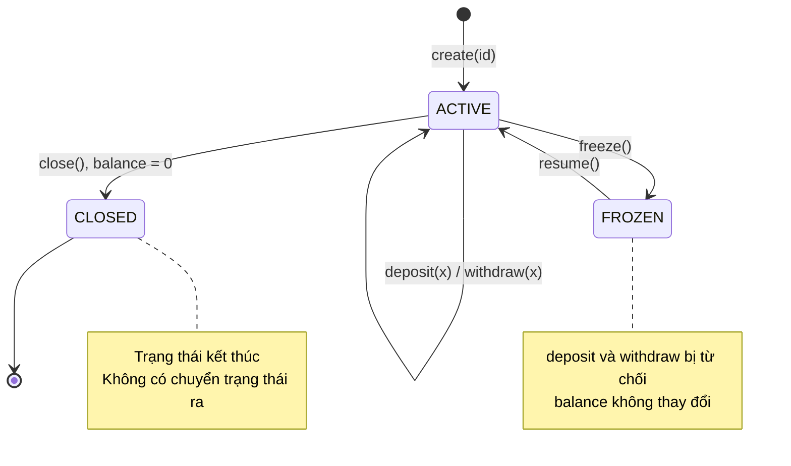
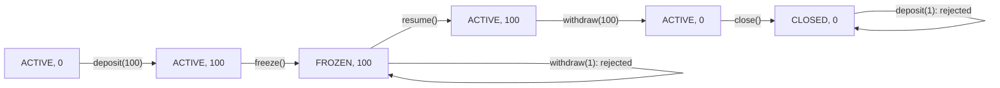
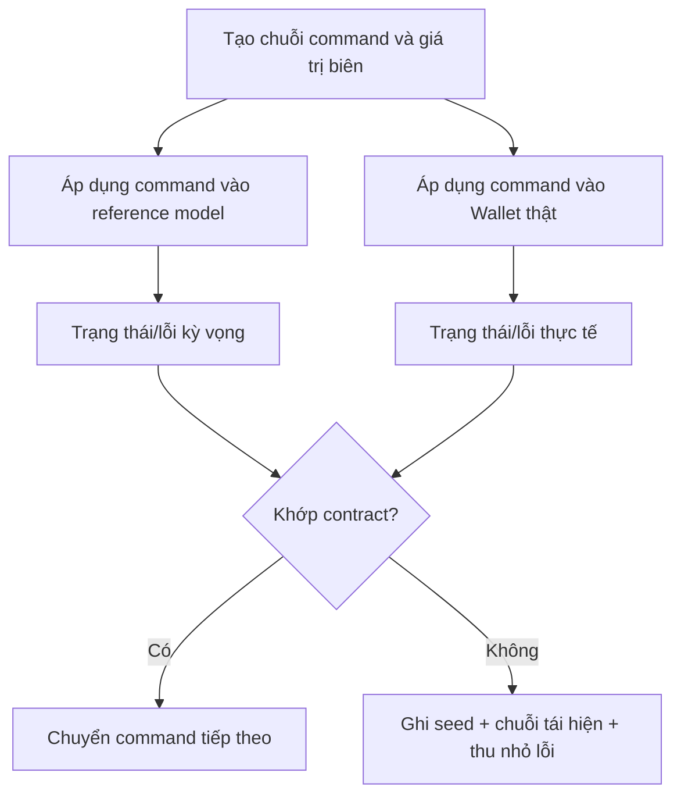

<a id="back-to-top"></a>

# Kiểm thử

## Menu
- [Kiểm thử hành vi công khai và hợp đồng đối tượng](#testing-001)
- [Kiểm thử hàm khởi tạo và trạng thái không hợp lệ](#testing-002)
- [Kiểm thử điều kiện bất biến và chuyển trạng thái](#testing-003)
- [Kiểm thử các cách thực hiện cùng một giao diện](#testing-004)
- [Kiểm thử tính thay thế của kiểu con](#testing-005)
- [Fake, stub, mock và đối tượng cộng tác](#testing-006)
- [Thiết kế để thay thế phụ thuộc khi kiểm thử](#testing-007)
- [Tránh kiểm thử phụ thuộc quá chặt vào chi tiết bên trong](#testing-008)
- [Kiểm thử hồi quy khi thay đổi thiết kế](#testing-009)
- [Kiểm thử tương tác giữa nhiều đối tượng](#testing-010)

## <a id="testing-001">Kiểm thử hành vi công khai và hợp đồng đối tượng</a>

<details>
<summary>Xem chi tiết</summary>

# Kiểm thử hành vi công khai và hợp đồng đối tượng trong Java OOP

> **Chủ đề:** OOP → Kiểm thử → Kiểm thử hành vi công khai và hợp đồng đối tượng.  
> **Mục tiêu:** Viết kiểm thử theo những gì client thực sự nhìn thấy và được phép yêu cầu, thay vì bám vào field/private method; mô tả hợp đồng bằng tiền điều kiện, hậu điều kiện, bất biến và cách xử lý lỗi; dùng cùng một bộ test để kiểm tra nhiều implementation của một interface; phát hiện lỗi khi thay implementation mà vẫn biên dịch được.

## 1. Kiểm thử đối tượng là kiểm thử điều gì?

Một đối tượng không đơn thuần là tập hợp field. Nó đưa ra một **giao diện hành vi** cho bên ngoài: những thao tác có thể gọi, dữ liệu trả về, tác dụng phụ, trạng thái sau mỗi thao tác và trường hợp bị từ chối.

Giả sử một kho vé còn 10 chỗ. Client yêu cầu:

~~~text
Kho vé sức chứa 10
    ├─ tryReserve(4)  → true   → đã đặt 4, còn 6
    ├─ tryReserve(7)  → false  → vẫn đã đặt 4, còn 6
    └─ cancel(2)      → thành công → đã đặt 2, còn 8
~~~

Đây là **hành vi quan sát được**. Một bài test tốt không cần biết kho vé dùng `int reserved`, `AtomicInteger`, `HashMap` hay database; test cần xác nhận **kết quả và các quy tắc mà API đã cam kết**.

**Hợp đồng đối tượng (object contract)** mô tả nghĩa của API chứ không chỉ chữ ký Java. Ví dụ chữ ký `boolean tryReserve(int count)` chưa đủ để biết:

- `count = 0` có hợp lệ không?
- Không đủ chỗ thì trả `false` hay ném exception?
- Thất bại có làm thay đổi state không?
- Khi thành công, số vé đã đặt tăng chính xác bao nhiêu?
- Có cho phép nhiều thread đặt đồng thời không?
- Nếu một implementation mới thay cho implementation cũ, điều gì phải giữ nguyên?

Kiểm thử hợp đồng biến những cam kết này thành **các ví dụ có thể thực thi** và giúp phát hiện thay đổi phá vỡ tính thay thế (*substitutability*).

## 2. Public behavior khác implementation detail

| Nên kiểm thử qua hành vi công khai | Không nên phụ thuộc nếu không có lý do đặc biệt |
|---|---|
| `tryReserve(4)` trả `true` và snapshot phản ánh đúng 4 vé | Tên field nội bộ là `reserved` hay `taken` |
| `tryReserve(7)` trả `false` và không đổi trạng thái | Có gọi private method `hasEnoughSeats()` không |
| `cancel(2)` giảm số vé đã đặt từ 4 còn 2 | Cấu trúc source dùng một hay hai private helpers |
| Input không hợp lệ bị từ chối theo exception đã hứa | Dòng source nào ném exception |
| Hai implementation cùng thoả một bộ contract | Có dùng `synchronized`, CAS hay lock cụ thể trong nội bộ |
| Event/cộng tác viên bên ngoài được gọi theo hợp đồng, nếu đó là observable effect | Số lần một private helper bị gọi khi không ảnh hưởng kết quả |

Một phép refactor chỉ đổi `int reserved` thành `AtomicInteger reserved` mà **không đổi hành vi** đáng lẽ không làm phần lớn unit test thất bại. Nếu test luôn thất bại mỗi khi đổi cấu trúc nội bộ, chúng đang **couple với implementation** quá chặt.

**Không có nghĩa mọi test đều phải black-box tuyệt đối.** Unit test cho một thuật toán thuần hoặc adapter nội bộ vẫn hợp lý; integration test có thể xác nhận tương tác DB/HTTP. Nhưng test cho **hợp đồng đối tượng** nên dùng API mà client thật dùng và chỉ xác nhận những cam kết cần giữ ổn định.

## 3. Bốn phần của một hợp đồng có thể kiểm thử

Một hợp đồng thường được mô tả qua:

| Phần | Câu hỏi | Kho vé |
|---|---|---|
| **Precondition** | Người gọi cần đáp ứng điều gì? | Số lượng đặt/hủy phải dương |
| **Postcondition thành công** | Sau lời gọi thành công, điều gì đúng? | Đặt 3 vé thì số đã đặt tăng đúng 3 |
| **Postcondition thất bại** | Khi bị từ chối/lỗi, đối tượng còn hợp lệ thế nào? | Thiếu chỗ trả `false`, state không đổi |
| **Invariant** | Điều kiện nào phải luôn đúng ở ranh giới quan sát? | `0 ≤ reserved ≤ capacity` |

Trong chương trình thực tế còn có những **bảo đảm phi chức năng** cần chỉ rõ theo nhu cầu: thread safety, độ trễ, tính nhất quán khi ghi dữ liệu, idempotency, thứ tự callback hoặc ràng buộc quyền truy cập. Không phải mọi interface tự động cam kết mọi tính chất đó.

### Ví dụ đặc tả hợp đồng

Định nghĩa một interface quản lý số vé, với quy tắc như sau:

- Constructor của implementation yêu cầu `capacity > 0`.
- Ban đầu số vé đã đặt bằng `0`.
- `tryReserve(n)`: nếu `n <= 0`, ném `IllegalArgumentException`; nếu đủ chỗ, tăng số đã đặt lên `n` và trả `true`; nếu không đủ, trả `false` và giữ nguyên state.
- `cancel(n)`: yêu cầu `n > 0` và `n <= reserved`; nếu không đúng, ném `IllegalArgumentException` **không sửa state**; nếu đúng, trừ `n`.
- `snapshot()` trả ảnh chụp bất biến, nhất quán của `capacity` và `reserved` tại thời điểm method thực hiện.
- Mọi implementation có thể được gọi từ nhiều thread trong cùng JVM; mỗi lời gọi đặt/hủy phải hoạt động như một thay đổi nguyên tử trên **một instance**.

**Lưu ý:** Đây là hợp đồng được lựa chọn cho ví dụ, không phải luật bắt buộc của mọi hệ thống đặt vé. Có hệ thống chọn trả đối tượng `Result` thay vì boolean, hoặc xử lý hủy vượt số lượng như lỗi domain khác. Test phải theo hợp đồng thật, không theo sở thích tùy tiện của người viết test.

## 4. Java 17 hoàn chỉnh: một interface, hai implementation

Để thấy giá trị của contract test, ta xây dựng hai implementation có **cơ chế lưu state khác nhau**, nhưng dùng **cùng API công khai**:

- `MonitorSeatInventory` sử dụng `synchronized`.
- `AtomicSeatInventory` sử dụng `AtomicInteger` và vòng lặp compare-and-set (CAS).

Cả hai phải giữ được cùng quy tắc nghiệp vụ, bất kể cách đồng bộ.

Tạo tệp **`SeatInventoryDemo.java`**, chỉ dùng JDK 17+:

~~~java
import java.util.concurrent.atomic.AtomicInteger;

// Dữ liệu quan sát được, immutable nhờ record với thành phần primitive.
record SeatSnapshot(int capacity, int reserved) {
    SeatSnapshot {
        if (capacity <= 0 || reserved < 0 || reserved > capacity) {
            throw new IllegalArgumentException("Invalid seat snapshot");
        }
    }

    int available() {
        return capacity - reserved;
    }
}

// Hợp đồng mà client phụ thuộc: không tiết lộ cách lưu state.
interface SeatInventory {
    boolean tryReserve(int count);
    void cancel(int count);
    SeatSnapshot snapshot();
}

// Cách A: khóa bảo vệ toàn bộ check + update trên một instance.
final class MonitorSeatInventory implements SeatInventory {
    private final int capacity;
    private int reserved;

    MonitorSeatInventory(int capacity) {
        if (capacity <= 0) {
            throw new IllegalArgumentException("capacity must be positive");
        }
        this.capacity = capacity;
    }

    @Override
    public synchronized boolean tryReserve(int count) {
        requirePositive(count);

        if (count > capacity - reserved) {
            return false;
        }

        reserved += count;
        return true;
    }

    @Override
    public synchronized void cancel(int count) {
        requirePositive(count);

        if (count > reserved) {
            throw new IllegalArgumentException(
                    "Cannot cancel more than reserved");
        }

        reserved -= count;
    }

    @Override
    public synchronized SeatSnapshot snapshot() {
        return new SeatSnapshot(capacity, reserved);
    }

    private static void requirePositive(int count) {
        if (count <= 0) {
            throw new IllegalArgumentException("count must be positive");
        }
    }
}

// Cách B: CAS đảm bảo không làm mất cập nhật trên một biến.
final class AtomicSeatInventory implements SeatInventory {
    private final int capacity;
    private final AtomicInteger reserved = new AtomicInteger();

    AtomicSeatInventory(int capacity) {
        if (capacity <= 0) {
            throw new IllegalArgumentException("capacity must be positive");
        }
        this.capacity = capacity;
    }

    @Override
    public boolean tryReserve(int count) {
        requirePositive(count);

        while (true) {
            int current = reserved.get();

            // Trừ trước để không làm tràn số nguyên do cộng.
            if (count > capacity - current) {
                return false;
            }

            if (reserved.compareAndSet(current, current + count)) {
                return true;
            }
            // Có cập nhật cạnh tranh: đọc lại và thử.
        }
    }

    @Override
    public void cancel(int count) {
        requirePositive(count);

        while (true) {
            int current = reserved.get();

            if (count > current) {
                throw new IllegalArgumentException(
                        "Cannot cancel more than reserved");
            }

            if (reserved.compareAndSet(current, current - count)) {
                return;
            }
        }
    }

    @Override
    public SeatSnapshot snapshot() {
        // capacity không đổi; reserved.get là một phép đọc atomic.
        return new SeatSnapshot(capacity, reserved.get());
    }

    private static void requirePositive(int count) {
        if (count <= 0) {
            throw new IllegalArgumentException("count must be positive");
        }
    }
}

public class SeatInventoryDemo {
    public static void main(String[] args) {
        SeatInventory inventory = new MonitorSeatInventory(10);

        System.out.println("Start: " + inventory.snapshot());
        System.out.println("Reserve 4: " + inventory.tryReserve(4));
        System.out.println("Reserve 7: " + inventory.tryReserve(7));
        System.out.println("After refusal: " + inventory.snapshot());

        inventory.cancel(2);
        System.out.println("After cancel: " + inventory.snapshot());

        // Không sửa nghiệp vụ client khi đổi implementation:
        SeatInventory another = new AtomicSeatInventory(10);
        System.out.println("Atomic reserve 4: " + another.tryReserve(4));
        System.out.println("Atomic snapshot: " + another.snapshot());
    }
}
~~~

Chạy:

~~~bash
javac SeatInventoryDemo.java
java SeatInventoryDemo
~~~

Kết quả:

~~~text
Start: SeatSnapshot[capacity=10, reserved=0]
Reserve 4: true
Reserve 7: false
After refusal: SeatSnapshot[capacity=10, reserved=4]
After cancel: SeatSnapshot[capacity=10, reserved=2]
Atomic reserve 4: true
Atomic snapshot: SeatSnapshot[capacity=10, reserved=4]
~~~

**Điều quan trọng không nằm ở việc thuật toán lock hay CAS tốt hơn.** Ví dụ có hai giải pháp kỹ thuật khác nhau để test xác minh **một hành vi được cam kết duy nhất**.

### Sơ đồ nhìn từ phía client

~~~mermaid
classDiagram
    class SeatInventory {
        <<interface>>
        +tryReserve(count) boolean
        +cancel(count) void
        +snapshot() SeatSnapshot
    }
    class MonitorSeatInventory {
        -int reserved
        +tryReserve(count) boolean
        +cancel(count) void
        +snapshot() SeatSnapshot
    }
    class AtomicSeatInventory {
        -AtomicInteger reserved
        +tryReserve(count) boolean
        +cancel(count) void
        +snapshot() SeatSnapshot
    }
    class SeatSnapshot {
        <<record>>
        +capacity() int
        +reserved() int
        +available() int
    }

    SeatInventory <|.. MonitorSeatInventory
    SeatInventory <|.. AtomicSeatInventory
    SeatInventory ..> SeatSnapshot : công bố
~~~

## 5. Viết test từ hợp đồng trước, rồi áp dụng cho cả hai lớp

Nếu viết hai bộ test tách rời hoàn toàn, một implementation dễ bị bỏ quên test đường lỗi. Cách đáng học là viết **một bộ contract tests tái sử dụng**: test chỉ biết interface `SeatInventory`, còn lớp con của test cung cấp cách tạo implementation.

Trong JUnit Jupiter 5, các phương thức `@Test` ở lớp cha có thể được kế thừa bởi test subclass. Chúng ta tận dụng tính năng này để chạy cùng bộ luật cho cả Monitor và Atomic.

Tạo tệp **`SeatInventoryContractTest.java`** trong test source set, cùng package với `SeatInventoryDemo.java`:

~~~java
import static org.junit.jupiter.api.Assertions.*;

import org.junit.jupiter.api.Test;

// Abstract contract test: không biết field/lock/CAS của implementation.
abstract class SeatInventoryContractTest {
    protected abstract SeatInventory create(int capacity);

    @Test
    void startsEmptyAndExposesConsistentSnapshot() {
        SeatInventory inventory = create(10);

        SeatSnapshot initial = inventory.snapshot();

        assertEquals(10, initial.capacity());
        assertEquals(0, initial.reserved());
        assertEquals(10, initial.available());
    }

    @Test
    void acceptsReservationAndChangesObservableState() {
        SeatInventory inventory = create(10);

        assertTrue(inventory.tryReserve(4));

        SeatSnapshot snapshot = inventory.snapshot();
        assertEquals(4, snapshot.reserved());
        assertEquals(6, snapshot.available());
    }

    @Test
    void insufficientCapacityReturnsFalseWithoutMutation() {
        SeatInventory inventory = create(10);
        assertTrue(inventory.tryReserve(4));

        SeatSnapshot before = inventory.snapshot();
        assertFalse(inventory.tryReserve(7));
        SeatSnapshot after = inventory.snapshot();

        assertEquals(before, after); // So sánh record theo giá trị.
    }

    @Test
    void cancellationDecreasesReservation() {
        SeatInventory inventory = create(10);
        assertTrue(inventory.tryReserve(4));

        inventory.cancel(2);

        SeatSnapshot after = inventory.snapshot();
        assertEquals(2, after.reserved());
        assertEquals(8, after.available());
    }

    @Test
    void invalidArgumentsThrowAndDoNotChangeState() {
        SeatInventory inventory = create(10);
        assertTrue(inventory.tryReserve(3));

        SeatSnapshot before = inventory.snapshot();

        assertThrows(IllegalArgumentException.class,
                () -> inventory.tryReserve(0));
        assertThrows(IllegalArgumentException.class,
                () -> inventory.tryReserve(-1));
        assertThrows(IllegalArgumentException.class,
                () -> inventory.cancel(0));
        assertThrows(IllegalArgumentException.class,
                () -> inventory.cancel(4));

        assertEquals(before, inventory.snapshot());
    }

    @Test
    void exactCapacityAndReleaseAllAreAllowed() {
        SeatInventory inventory = create(2);

        assertTrue(inventory.tryReserve(2));
        assertFalse(inventory.tryReserve(1));
        assertEquals(0, inventory.snapshot().available());

        inventory.cancel(2);

        assertEquals(0, inventory.snapshot().reserved());
        assertEquals(2, inventory.snapshot().available());
    }

    @Test
    void invalidCapacityIsRejected() {
        assertThrows(IllegalArgumentException.class, () -> create(0));
        assertThrows(IllegalArgumentException.class, () -> create(-1));
    }
}

// Hai implementation được kiểm tra bằng CÙNG bộ @Test.
class MonitorSeatInventoryTest extends SeatInventoryContractTest {
    @Override
    protected SeatInventory create(int capacity) {
        return new MonitorSeatInventory(capacity);
    }
}

class AtomicSeatInventoryTest extends SeatInventoryContractTest {
    @Override
    protected SeatInventory create(int capacity) {
        return new AtomicSeatInventory(capacity);
    }
}
~~~

**Kết quả mong muốn:** JUnit chạy cùng các test được kế thừa cho cả hai lớp con. Mỗi implementation phải đáp ứng toàn bộ contract. Lớp cha abstract chỉ mô tả các yêu cầu quan sát được; không kiểm tra `reserved` có là `int` hay `AtomicInteger`.

Để chạy cần thêm JUnit Jupiter vào test dependencies và dùng test runner của Maven/Gradle/IDE. Hai class test cụ thể là **package-private**, hợp lệ trong JUnit Jupiter 5; tùy cấu hình discovery của công cụ build, bảo đảm source nằm trong test source set và được nhận diện đúng tên `*Test`.

### Vì sao test “đường lỗi không đổi trạng thái” quan trọng?

Một implementation sai có thể làm:

~~~java
// CỐ Ý SAI: tăng reserved trước rồi mới kiểm tra.
reserved += count;
if (reserved > capacity) {
    return false;
}
~~~

Test chỉ xác nhận `tryReserve(7) == false` **sẽ pass**, dù `reserved` đã bị làm hỏng. Khi kiểm tra **snapshot trước và sau**, contract test phát hiện lỗi đó. Tương tự, hủy quá số lượng phải ném exception **mà không để lại state nửa vời**.

## 6. Tổ chức test theo Given–When–Then

Một test về hành vi sẽ dễ đọc hơn nếu có ba phần rõ ràng:

- **Given:** trạng thái ban đầu và dữ liệu dùng để tạo đối tượng.
- **When:** một lời gọi công khai được thực hiện.
- **Then:** kết quả, exception, observable state hoặc side effect đúng hợp đồng.

Ví dụ:

~~~java
@Test
void rejectedReservationKeepsPreviousState() {
    // Given
    SeatInventory inventory = new MonitorSeatInventory(5);
    inventory.tryReserve(4);
    SeatSnapshot before = inventory.snapshot();

    // When
    boolean accepted = inventory.tryReserve(2);

    // Then
    assertFalse(accepted);
    assertEquals(before, inventory.snapshot());
}
~~~

Cách đặt tên `rejectedReservationKeepsPreviousState` nói rõ **quy tắc** bị kiểm chứng hơn tên `testReserve` hay `test1`. Phần “Then” nên dùng API quan sát hợp lệ. Không cần tạo setter chỉ để test được; làm vậy có thể làm yếu encapsulation.

## 7. Kiểm thử chuỗi trạng thái, không chỉ từng method đơn lẻ

Một đối tượng có trạng thái thường có **nhiều đường đi hợp lệ**. Test từng method độc lập có thể bỏ qua bug chỉ xuất hiện sau một chuỗi thao tác.

~~~mermaid
stateDiagram-v2
    [*] --> Empty : new(10)
    Empty --> Partial : reserve(4) = true
    Partial --> Partial : reserve(7) = false
    Partial --> Partial : cancel(2)
    Partial --> Full : reserve(8) = true
    Full --> Full : reserve(1) = false
    Full --> Empty : cancel(all)
~~~

Sơ đồ minh họa với sức chứa 10: sau khi đặt 4 rồi hủy 2 thì còn đặt 2, tiếp tục đặt 8 sẽ đầy. Đó là **hành vi nhiều bước** chứ không phải một method isolated.

### Kiểm thử theo bảng trạng thái

| Trạng thái trước | Lệnh | Kết quả | Trạng thái sau |
|---|---|---|---|
| capacity=10, reserved=0 | `tryReserve(4)` | `true` | reserved=4 |
| capacity=10, reserved=4 | `tryReserve(7)` | `false` | reserved=4 |
| capacity=10, reserved=4 | `cancel(2)` | Thành công | reserved=2 |
| capacity=10, reserved=2 | `tryReserve(8)` | `true` | reserved=10 |
| capacity=10, reserved=10 | `tryReserve(1)` | `false` | reserved=10 |
| capacity=10, reserved=10 | `cancel(10)` | Thành công | reserved=0 |

Dữ liệu biên `0`, `1`, `capacity`, `capacity + 1` và số âm cũng đáng kiểm thử. Khi có nhiều trạng thái/đường đi, lập bảng giúp tránh việc một test chỉ kiểm tra “happy path” rồi bỏ quên quy tắc từ chối.

### Kiểm thử bằng mô hình tham chiếu đơn giản

Với loại API có state, có thể viết một **model trong test** chỉ lưu giá trị mong đợi và thử nhiều chuỗi thao tác. Model nên đơn giản hơn implementation thật và không dùng cùng thuật toán tối ưu, để tránh copy chung lỗi.

Đoạn sau là một test bổ sung, dùng các class và import JUnit ở phần trước; thêm `import java.util.Random;`:

~~~java
@Test
void sequenceOfOperationsAlwaysMatchesSimpleModel() {
    SeatInventory inventory = create(20);
    Random random = new Random(2026L);
    int expectedReserved = 0;

    for (int step = 0; step < 500; step++) {
        int quantity = 1 + random.nextInt(7);

        if (random.nextBoolean()) {
            boolean shouldAccept = quantity <= 20 - expectedReserved;
            assertEquals(shouldAccept,
                    inventory.tryReserve(quantity));

            if (shouldAccept) {
                expectedReserved += quantity;
            }
        } else if (quantity <= expectedReserved) {
            inventory.cancel(quantity);
            expectedReserved -= quantity;
        } else {
            // Với precondition sai, exception không đổi trạng thái.
            assertThrows(IllegalArgumentException.class,
                    () -> inventory.cancel(quantity));
        }

        SeatSnapshot snapshot = inventory.snapshot();
        assertEquals(20, snapshot.capacity());
        assertEquals(expectedReserved, snapshot.reserved());
        assertEquals(20 - expectedReserved, snapshot.available());
    }
}
~~~

**Ưu điểm:** một seed cố định tạo một chuỗi dễ tái hiện; các trạng thái khác nhau được đi qua mà không phải viết tay 500 test case. **Giới hạn:** một seed và 500 bước không phải bằng chứng hình thức cho mọi chuỗi; cần kết hợp các boundary cases, nhiều seed hoặc property-based testing khi rủi ro cao.

**Lưu ý:** Nếu phương thức có tác dụng phụ khác (ghi DB, gửi sự kiện), model phải mô tả những observable effects đó; chỉ so sánh state trong memory sẽ chưa đủ.

## 8. Kiểm thử tính thay thế của implementation (LSP)

**Liskov Substitution Principle (LSP)** yêu cầu implementation có thể được dùng ở nơi mong đợi abstraction mà **không làm sai điều client dựa vào**. Test contract là một bằng chứng thực nghiệm rất hữu ích: cùng một test được chạy trên mọi implementation.

Giả sử một implementation mới quyết định:

~~~java
// Vi phạm hợp đồng ví dụ:
boolean tryReserve(int count) {
    if (count <= 0) {
        return false; // Sai: contract yêu cầu IllegalArgumentException.
    }
    // ...
}
~~~

Compiler **không báo lỗi** vì chữ ký vẫn đúng. Nhưng contract test `invalidArgumentsThrowAndDoNotChangeState` sẽ thất bại. Tương tự, nếu thiếu chỗ mà implementation ném `IllegalStateException` thay vì trả `false`, client đang dựa vào boolean sẽ hoạt động khác.

Một interface **không tự bảo đảm LSP**. Chữ ký là một phần hợp đồng; ngữ nghĩa đầu vào, đầu ra, exception, tính nhất quán và bảo đảm side effect cũng quan trọng.

Một số nguyên tắc thực hành:

- Implementation không nên đột ngột **siết tiền điều kiện** nếu abstraction cho phép nhiều input hơn.
- Implementation không nên **làm yếu hậu điều kiện** mà client được hứa.
- Mọi invariant cần bảo toàn khi client sử dụng qua abstraction.
- Với exception, phân biệt lỗi lập trình của caller, lỗi nghiệp vụ dự kiến và lỗi hạ tầng; không tự ý đổi failure mode mà không cập nhật hợp đồng.

**Contract tests không chứng minh toán học LSP hoàn toàn.** Chúng kiểm tra một tập tình huống được chọn. Review thiết kế vẫn cần xem quan hệ subtype và những bảo đảm chưa được test, đặc biệt các khía cạnh hiệu năng, concurrency, transactional behavior và bảo mật.

## 9. Kiểm thử bất biến của value object: `equals`, `hashCode` và `toString`

Trong Java, các phương thức kế thừa từ `Object` cũng có những hợp đồng đáng quan tâm. Tuy nhiên không phải class nào cũng override chúng. Hai nhóm test khác nhau:

1. **Hợp đồng nghiệp vụ:** `SeatInventory` giữ `0 ≤ reserved ≤ capacity`.
2. **Hợp đồng về giá trị:** một value object có `equals`/`hashCode` đúng và biểu diễn chẩn đoán phù hợp.

Trong ví dụ, `SeatSnapshot` là một `record` chứa primitive, Java tự cung cấp `equals` và `hashCode` theo các component. Ta có thể kiểm thử qua API công khai:

~~~java
import static org.junit.jupiter.api.Assertions.*;

import java.util.HashSet;
import java.util.Set;
import org.junit.jupiter.api.Test;

class SeatSnapshotValueTest {
    @Test
    void equalSnapshotsAreEqualAndHaveEqualHashCodes() {
        SeatSnapshot a = new SeatSnapshot(10, 4);
        SeatSnapshot b = new SeatSnapshot(10, 4);
        SeatSnapshot different = new SeatSnapshot(10, 5);

        assertEquals(a, b);
        assertEquals(a.hashCode(), b.hashCode());
        assertNotEquals(a, different);

        Set<SeatSnapshot> set = new HashSet<>();
        set.add(a);
        assertTrue(set.contains(b));
    }

    @Test
    void rejectsBrokenInvariant() {
        assertThrows(IllegalArgumentException.class,
                () -> new SeatSnapshot(10, 11));
        assertThrows(IllegalArgumentException.class,
                () -> new SeatSnapshot(0, 0));
    }
}
~~~

Đây là kiểm thử hợp đồng **giá trị**. Đối với entity có **identity**, hai object khác nhau nhưng cùng dữ liệu hiển thị có thể không được xem là bằng nhau; cần xác định rõ quan hệ `equals` mong muốn trước khi viết test.

### Những quy tắc `equals` thường cần biết

| Quy tắc | Diễn đạt | Test đơn giản |
|---|---|---|
| Phản xạ | `x.equals(x) == true` | `assertEquals(x, x)` |
| Đối xứng | `x.equals(y) == y.equals(x)` | So sánh cả hai chiều |
| Bắc cầu | Nếu `x==y` và `y==z`, thì `x==z` theo `equals` | Tạo ba instance tương đương |
| Nhất quán | Không thay dữ liệu dùng để so sánh thì kết quả không tự đổi | Gọi lặp lại trên state ổn định |
| Không bằng null | `x.equals(null) == false` | `assertNotEquals(null, x)` |
| Tương thích hash | Nếu `x.equals(y)` thì `x.hashCode()==y.hashCode()` | So sánh hash và dùng `HashSet` |

Không được suy luận ngược rằng **hash code bằng nhau ⇒ object bằng nhau**. Hai đối tượng khác nhau vẫn có thể có cùng hash.

`toString()` thường dùng để quan sát/debug, không phải định dạng API ổn định trừ khi class công bố hợp đồng cụ thể. Đừng tạo test khớp toàn bộ dấu câu của `toString()` nếu tài liệu không hứa format ấy. Với dữ liệu nhạy cảm, nên kiểm thử những thông tin **không được lộ**, đồng thời xem xét các đường log khác.

## 10. Không mở private field hay thêm setter chỉ để “test được”

Một kiểu test dễ gây hại:

~~~java
// Ý tưởng KHÔNG NÊN làm mặc định:
Field field = MonitorSeatInventory.class
        .getDeclaredField("reserved");
field.setAccessible(true);
field.setInt(inventory, 4);
~~~

Nếu test biết tên field và dùng reflection để thay đổi nó, bản thân test đã vượt qua ranh giới mà class cần bảo vệ. Refactor tên field hoặc chuyển sang `AtomicInteger` khiến test hỏng, dù client không bị ảnh hưởng.

Tương tự, thêm `setReserved(int)` chỉ để dựng trạng thái nhanh có thể làm API production yếu đi, cho phép client bỏ qua quy tắc đặt chỗ. Thay vào đó, dựng trạng thái hợp lệ bằng **public operations**:

~~~java
SeatInventory inventory = new MonitorSeatInventory(10);
assertTrue(inventory.tryReserve(4));
// Bây giờ có trạng thái reserved = 4, hợp lệ và tạo qua API thật.
~~~

Nếu setup quá dài vì mỗi test phải chạy qua nhiều hệ thống ngoài, cân nhắc **test fixture/builder** để tạo dependency hoặc dữ liệu phù hợp. Fixture không nên tạo ra những trạng thái bất khả thi mà hành vi thực không thể đạt được, trừ khi đang cố ý kiểm thử khả năng hồi phục từ dữ liệu legacy hỏng.

### Không bám quá mức vào số lần gọi nội bộ

Mock có ích khi một tương tác với dependency **là phần của hợp đồng**, chẳng hạn chỉ phát một sự kiện sau khi thanh toán thành công. Nhưng nếu chỉ kiểm tra `verify(calculator).calculate(...)` mà không khẳng định kết quả hoặc hệ quả quan sát được, test có thể pass ngay cả khi business result sai.

Phân biệt:

- **State-based test:** kiểm tra state/result được công bố.
- **Interaction-based test:** kiểm tra những tương tác với cộng tác viên có ý nghĩa ra bên ngoài, như gửi thông báo đúng một lần.
- **Implementation-coupled test:** kiểm tra thứ tự private helper hoặc số lần gọi một thuật toán thuần mà caller không biết tới.

Không phải interaction test luôn kém. Điều quan trọng là tương tác ấy **được hợp đồng yêu cầu hay chỉ là cách triển khai hiện tại**.

## 11. Kiểm thử lỗi và exception: kết quả thất bại cũng là hành vi

Một hợp đồng công khai tốt cần nói rõ input sai sẽ được xử lý thế nào:

| Tình huống | Hành vi theo ví dụ | Điều test cần xác nhận |
|---|---|---|
| Tạo kho `capacity = 0` | Ném `IllegalArgumentException` | Không tạo đối tượng hợp lệ giả |
| Đặt `0` hoặc số âm | Ném `IllegalArgumentException` | State không đổi |
| Đặt vượt số chỗ còn | Trả `false` | State không đổi |
| Hủy nhiều hơn số đã đặt | Ném `IllegalArgumentException` | State không đổi |
| Hủy đúng số đã đặt | Thành công | State quay về reserved=0 |
| Chuyển implementation Monitor sang Atomic | Giữ toàn bộ ngữ nghĩa công khai | Bộ contract test vẫn pass |

`assertThrows` kiểm tra đúng loại exception trong trường hợp contract hứa. Nếu exception message không được coi là API ổn định, không nên khóa cứng nguyên văn message trong test. Nếu mã lỗi là một phần hợp đồng giao tiếp, hãy kiểm tra mã lỗi có cấu trúc thay vì phụ thuộc câu chữ.

### Phạm vi nguyên tử của đường lỗi

Trong ví dụ, exception được ném **trước khi** state bị cập nhật khi số lượng không hợp lệ. Với các thao tác phức tạp hơn, nếu đã ghi database rồi mới ném exception do gửi email thất bại, "throw exception" không đồng nghĩa "mọi side effect đều rollback". Test cần định nghĩa trạng thái sau lỗi theo tính nhất quán thực tế: transaction, outbox, retry hoặc compensation.

## 12. Contract test và kiểm thử đồng thời

Nếu abstraction công bố rằng hai thread có thể gọi `tryReserve(1)` trên cùng instance, tính nguyên tử cũng là **một phần hợp đồng**, không chỉ chi tiết implement.

Ví dụ JUnit Jupiter 5 kiểm tra **một implementation bất kỳ** qua interface. Có thể đặt đoạn này trong `SeatInventoryContractTest` và thêm các import cần thiết:

~~~java
import java.util.ArrayList;
import java.util.List;
import java.util.concurrent.CountDownLatch;
import java.util.concurrent.ExecutorService;
import java.util.concurrent.Executors;
import java.util.concurrent.Future;
import java.util.concurrent.TimeUnit;

@Test
void concurrentReservationsNeverOversellOneInstance()
        throws Exception {
    SeatInventory inventory = create(5);
    int attempts = 12;

    CountDownLatch ready = new CountDownLatch(attempts);
    CountDownLatch start = new CountDownLatch(1);
    ExecutorService pool = Executors.newFixedThreadPool(attempts);

    try {
        List<Future<Boolean>> results = new ArrayList<>();

        for (int i = 0; i < attempts; i++) {
            results.add(pool.submit(() -> {
                ready.countDown();
                start.await();
                return inventory.tryReserve(1);
            }));
        }

        assertTrue(ready.await(5, TimeUnit.SECONDS));
        start.countDown();

        int accepted = 0;
        for (Future<Boolean> future : results) {
            if (future.get(5, TimeUnit.SECONDS)) {
                accepted++;
            }
        }

        assertEquals(5, accepted);
        assertEquals(5, inventory.snapshot().reserved());
        assertEquals(0, inventory.snapshot().available());
    } finally {
        start.countDown(); // Không để task chờ vô hạn nếu assert fail.
        pool.shutdownNow();
    }
}
~~~

Điều này kiểm tra **kết quả cuối cùng** sau khi mọi lời gọi hoàn tất và hai thread/nhóm thread cùng tranh chỗ. `CountDownLatch` giúp bắt đầu gần nhau, nhưng **không tạo bằng chứng toán học về mọi lịch thực thi**. Nếu rủi ro concurrency cao, cần kết hợp stress test, review memory model, công cụ kiểm thử concurrency chuyên biệt và/hoặc mô hình hóa.

Không nên dùng `Thread.sleep` với khoảng chờ tùy ý để quyết định test pass/fail. Cũng không nên kiểm tra `reserved + available == capacity` bằng **hai lời gọi snapshot ở hai thời điểm khác nhau** trong khi các thread còn đang cập nhật; hãy lấy **một snapshot nhất quán**, rồi tính từ dữ liệu của snapshot ấy.

### Giới hạn một JVM

Một contract về thread safety trên một Java object không tự bảo đảm điều kiện bán vé khi hai JVM cùng cập nhật **một bản ghi trong database**. Khi API triển khai trên nhiều node, contract ở cấp service cần được xác minh bằng transaction, update có điều kiện hoặc optimistic locking ở tầng persistence. Unit test của `AtomicSeatInventory` không thay thế integration test DB.

## 13. Các tầng kiểm thử: cùng một hợp đồng, bằng chứng khác nhau

| Tầng | Mục tiêu | Ví dụ |
|---|---|---|
| **Unit test đối tượng** | Hợp đồng hành vi công khai của một object | `tryReserve`, `cancel`, `snapshot` |
| **Contract test cho interface** | Mọi implementation giữ cùng ngữ nghĩa | Monitor và Atomic chạy chung bộ test |
| **Component/integration test** | Tương tác giữa nhiều class hoặc hệ thống thực | Kho vé lưu trong repository/JDBC |
| **API test** | Hợp đồng HTTP/JSON/status code | Hết vé trả mã lỗi nghiệp vụ phù hợp |
| **Concurrency test** | Tính nhất quán khi thao tác đan xen | Nhiều yêu cầu không thể cùng chiếm một chỗ |
| **End-to-end test** | Luồng người dùng qua nhiều thành phần | Chọn vé → đặt → xác nhận hiển thị |

Một bài unit test nhanh có thể chứng minh `SeatInventory` đúng logic trong memory, nhưng không chứng minh DB lock, rollback, API serializer hay trải nghiệm người dùng cuối đúng. Hãy chọn **mức kiểm thử tương ứng với ranh giới hợp đồng**.

## 14. Các lỗi thiết kế test thường làm giảm giá trị kiểm thử

### Lỗi A: Test implementation thay vì contract

~~~java
// Đáng ngờ:
assertEquals("java.util.concurrent.atomic.AtomicInteger",
        inventory.getClass()
                .getDeclaredFields()[0]
                .getType()
                .getName());
~~~

Test này không nói kho vé có đúng hay không, chỉ khóa lựa chọn triển khai. Đổi state từ atomic sang lock có thể là refactor hợp lý nhưng test sẽ hỏng vô ích.

### Lỗi B: Chỉ assert kết quả trả về, bỏ qua state

~~~java
assertFalse(inventory.tryReserve(100));
~~~

Nếu implementation vẫn tăng `reserved` rồi trả `false`, test sẽ không phát hiện. Nên lấy snapshot trước/sau và xác minh invariant.

### Lỗi C: Thử đường lỗi bằng cách làm hỏng private state

Nếu test đặt `reserved = -5` bằng reflection rồi yêu cầu `tryReserve` tự sửa, test đang áp đặt một trường hợp **không đi qua API hợp lệ**. Trừ khi yêu cầu thật là phục hồi dữ liệu cũ bị hỏng, tốt hơn nên kiểm tra tất cả **đường thay đổi công khai** không bao giờ tạo được trạng thái ấy.

### Lỗi D: Các test phụ thuộc thứ tự hoặc state chung

Một `static SeatInventory shared` được mọi test mutate khiến kết quả thay đổi khi JUnit chạy song song hoặc đổi thứ tự. Mỗi test nên có **fixture độc lập**, dựng một instance mới. Khi cần DB chung, phải có chiến lược cô lập/cleanup rõ ràng.

### Lỗi E: Mock chính đối tượng đang muốn kiểm chứng

Nếu mock toàn bộ `SeatInventory` và cấu hình `when(tryReserve(4)).thenReturn(true)`, ta chỉ kiểm tra hành vi do test **tự cài đặt**, chứ không kiểm tra implementation thật. Dùng mock/fake cho collaborator ngoài phạm vi test, không thay thế system under test khi mục tiêu là contract của chính nó.

### Lỗi F: Quá phụ thuộc implementation của logger, thời gian hay ngẫu nhiên

Nếu hợp đồng không yêu cầu ghi log một câu cụ thể, test nên xác nhận kết quả quan sát được thay vì nguyên văn log. Với đồng hồ/ngẫu nhiên thực sự là đầu vào nghiệp vụ, inject `Clock` hoặc random generator/fake có kiểm soát để test không flaky.

## 15. Viết contract tests cho adapter thực tế

Mẫu kiểm thử chung không chỉ áp dụng cho hai kiểu lưu state trong bộ nhớ. Ví dụ một `DocumentStore` có implementation dùng file hoặc database:

~~~java
interface DocumentStore {
    void save(String id, byte[] bytes);
    java.util.Optional<byte[]> find(String id);
}
~~~

Một hợp đồng có thể yêu cầu:

- Không nhận ID null hoặc rỗng.
- Lưu dữ liệu rồi tìm lại được cùng **nội dung byte**.
- Khi không có ID thì trả `Optional.empty()`.
- Sửa `byte[]` truyền vào sau `save` không được âm thầm sửa dữ liệu đã lưu.
- Sửa `byte[]` trả ra từ `find` không được âm thầm sửa dữ liệu được lưu, nếu API cam kết snapshot.
- Khi lưu trùng ID, phải có quy tắc rõ là **overwrite** hay **reject**; cả hai implementation phải thống nhất.

Với mảng `byte[]` mutable, cần **defensive copy** ở cả đường vào và đường ra nếu đó là cam kết của API. Một `InMemoryDocumentStore` giữ tham chiếu byte array gốc sẽ dễ vi phạm hợp đồng dù method có đúng chữ ký.

Đây là ví dụ vì sao **contract test chứa giá trị lớn hơn việc test có đúng số method**: nó giữ cả hành vi mà Java type system không biểu diễn trực tiếp, như **ownership của mutable buffer** và thất bại khi lưu trùng.

## 16. Checklist thiết kế kiểm thử hành vi công khai

Trước khi viết test, trả lời:

1. **Đối tượng hứa điều gì?** Viết precondition, postcondition, invariant, failure mode.
2. **API nào là public contract?** Đừng mở private field chỉ vì test setup khó.
3. **Trạng thái ban đầu là gì?** Mỗi test phải dựng fixture nhất quán, độc lập.
4. **Những observable results nào cần so sánh?** Return value, snapshot, exception, event, persisted data.
5. **Có đường từ chối không?** Khi thất bại, state và side effect phải ra sao?
6. **Đâu là trường hợp biên?** Zero, negative, max, empty, null, trùng lặp, overflow, chuyển trạng thái.
7. **Có nhiều implementation không?** Dùng cùng contract suite để kiểm tra khả năng thay thế.
8. **Có yếu tố thời gian/concurrency/I/O?** Dùng clock/fake/test fixture, integration tests và synchronization đúng phạm vi.
9. **Test có giòn khi refactor nội bộ không?** Xóa assert không thuộc hợp đồng, giữ những gì client cần.
10. **Thay đổi hợp đồng đã được phê duyệt chưa?** Khi business rule đổi, cập nhật đặc tả và test có chủ đích, không sửa test chỉ để đèn xanh.

Một kỹ thuật hữu ích là viết tên test thành câu **“Khi X, hệ thống phải Y”** rồi yêu cầu một reviewer không biết implementation vẫn hiểu được câu ấy. Nếu tên test chỉ nói `testPrivateHelperA`, có lẽ chưa nhắm đúng hành vi client quan tâm.

## 17. Bài tập thực hành: hợp đồng ví điện tử

Thiết kế một interface:

~~~java
interface Wallet {
    long balanceCents();
    void deposit(long amountCents);
    boolean tryWithdraw(long amountCents);
}
~~~

Các quy tắc giả định:

- Ví khởi tạo với số dư không âm.
- `deposit(n)` yêu cầu `n > 0`; khi thành công tăng đúng `n`.
- `tryWithdraw(n)` yêu cầu `n > 0`; khi đủ tiền, trừ đúng `n` và trả `true`; khi không đủ tiền, trả `false` và giữ nguyên số dư.
- Không bao giờ có số dư âm; xử lý overflow khi nạp tiền (`Math.addExact` hoặc kiểm tra trước).
- Các thao tác trên **một instance** hỗ trợ nhiều thread; hai lệnh rút tiền không thể cùng dùng một số dư cũ để đều thành công.
- Test nên dùng số nguyên biểu diễn **đơn vị tiền nhỏ nhất** để tránh sai số nhị phân trong phạm vi ví dụ.

Yêu cầu:

1. Viết `SynchronizedWallet` và `AtomicWallet`.
2. Viết một abstract contract test dùng cùng `@Test` cho cả hai implementation.
3. Có test cho `deposit(0)`, rút âm, rút vượt số dư, nạp tràn `long`, và xác nhận state giữ nguyên sau lỗi.
4. Có test cho chuỗi `deposit(100) → withdraw(30) → withdraw(80 bị từ chối)`.
5. Có test hai thread cùng rút 80 từ ví có 100; **chỉ một thành công**.
6. Giải thích tại sao unit test này chưa chứng minh tính đúng đắn của giao dịch tiền thật trên database hoặc dịch vụ thanh toán.

### Câu hỏi tự kiểm tra

1. “Kiểm thử hành vi công khai” khác kiểm tra private field ra sao?
2. Vì sao cùng một method signature không bảo đảm hai implementation có thể thay thế nhau?
3. Tiền điều kiện, hậu điều kiện và invariant khác nhau thế nào?
4. Tại sao chỉ assert `tryReserve(7) == false` là chưa đủ?
5. Vì sao nên chạy cùng contract suite cho mọi implementation của một interface?
6. Khi nào test `equals/hashCode` cần thiết, và vì sao không suy ra `hashCode` bằng nhau là object bằng nhau?
7. Có nên dùng reflection để thay private state chỉ nhằm rút ngắn test setup không?
8. Vì sao assert chính xác thông điệp log dễ làm test giòn nếu log không thuộc hợp đồng?
9. Test concurrency cùng JVM có đủ để chứng minh không bán quá số vé trong môi trường nhiều node không?
10. Những observable effects nào cần kiểm tra khi method vừa cập nhật DB vừa phát sự kiện?

**Ghi nhớ:** Kiểm thử tốt cho OOP trả lời câu hỏi **“Đối tượng có giữ lời hứa với client không?”**. Hãy mô tả hợp đồng một cách quan sát được, kiểm tra cả thành công lẫn thất bại, dùng state snapshots và test chuỗi thao tác, rồi áp dụng cùng bộ test cho những implementation thay thế. Việc tách test khỏi chi tiết nội bộ làm refactor dễ hơn **mà không giảm tiêu chuẩn đúng đắn của hành vi**.


</details>

- [Quay lại đầu trang](#back-to-top)

---

## <a id="testing-002">Kiểm thử hàm khởi tạo và trạng thái không hợp lệ</a>

<details>
<summary>Xem chi tiết</summary>

# Kiểm thử hàm khởi tạo và trạng thái không hợp lệ trong OOP

**Chủ đề:** OOP → Kiểm thử → **Kiểm thử hàm khởi tạo và trạng thái không hợp lệ**  
**Môi trường ví dụ:** Java 17+, JUnit Jupiter 5 (và `junit-jupiter-params` cho parameterized tests).

## 1. Vì sao cần kiểm thử constructor, khi nó “chỉ gán field”?

Xét một class biểu diễn hóa đơn. Để một hóa đơn có nghĩa, ta cần bảo đảm:

- Có **mã khách hàng không rỗng**.
- Có **ít nhất một dòng hàng**.
- Từng dòng có mã sản phẩm hợp lệ, đơn giá không âm và số lượng dương.
- **Tổng tiền hàng** được tính không tràn kiểu `long`.
- **Giảm giá** không âm và không vượt tổng tiền hàng.
- Sau khi tạo, người gọi không thể sửa danh sách đầu vào rồi làm thay đổi hóa đơn đã tạo.

Nếu constructor nhận mọi giá trị mà không kiểm tra, ta có thể tạo một object có `discountVnd > subtotalVnd`, danh sách hàng rỗng, thậm chí số tiền cuối cùng âm. Lỗi thường không xuất hiện ngay lúc `new`, mà lan tới bước lưu database, tính thuế hoặc hoàn tiền.

**Constructor là một ranh giới bảo vệ bất biến (invariant) của object.** Khi constructor trả về bình thường, caller có quyền tin object được tạo thỏa các bảo đảm đã công bố. Nếu dữ liệu không hợp lệ, constructor nên **từ chối tạo object** bằng một cơ chế lỗi rõ ràng.

Không phải constructor nào cũng phải làm nhiều việc: một value object có hai field đơn giản có thể cần rất ít validation. Nhưng một khi class công bố bất biến, **kiểm thử constructor chính là kiểm thử khả năng duy trì hợp đồng khi object bắt đầu tồn tại**.

### Ba câu hỏi cốt lõi

1. **Trường hợp hợp lệ:** tạo xong, các field đã đúng chưa; giá trị mặc định và chuẩn hóa có đúng không?
2. **Trường hợp không hợp lệ:** input nào phải bị từ chối; ngoại lệ thuộc loại nào; có tạo ra trạng thái quan sát được bị sai không?
3. **Sau khởi tạo:** object có tiếp tục hợp lệ khi input mutable hoặc reference được chia sẻ bị sửa không?

Một test chỉ kiểm tra `new Invoice(...)` “không ném exception” là chưa đủ nếu constructor còn có trách nhiệm tính tổng, chuẩn hóa hoặc chụp lại dữ liệu.

## 2. Phân biệt tiền điều kiện, hậu điều kiện và bất biến

| Khái niệm | Câu hỏi cần hỏi | Ví dụ |
| --- | --- | --- |
| **Precondition** | Đầu vào hợp lệ khi gọi constructor không? | `quantity > 0`; `customerId` không blank |
| **Postcondition** | Khi constructor thành công, object được thiết lập đúng chưa? | `total = subtotal - discount` |
| **Invariant** | Điều kiện nào phải luôn đúng khi object quan sát được? | `0 <= discount <= subtotal`, `total >= 0` |
| **Ownership/aliasing** | Object giữ một bản dữ liệu riêng hay dùng chung mutable reference? | Sửa `ArrayList` của caller không đổi hóa đơn |
| **Failure contract** | Khi vi phạm, constructor phản hồi thế nào? | `IllegalArgumentException` cho dữ liệu sai, `NullPointerException` cho tham chiếu bắt buộc null (nếu contract chọn vậy) |
| **Failure atomicity** | Nếu constructor thất bại, có side effect nào tồn tại không? | Không gửi email/ghi dữ liệu ngoài chỉ vì thử `new` |

Đặt ba tình huống cạnh nhau:

~~~text
Input hợp lệ:
  Invoice("CUS-01", [2 sách × 125000], discount=20000)
  → subtotal=250000, total=230000

Input không hợp lệ:
  Invoice("CUS-01", [2 sách × 125000], discount=300000)
  → ném IllegalArgumentException; không trả Invoice

Trạng thái bị phá sau tạo nếu thiết kế sai:
  Invoice giữ trực tiếp List mutable của caller
  → caller.clear() → hóa đơn trở thành rỗng
~~~

**“Không trả object” không đồng nghĩa Java tự rollback mọi side effect** đã xảy ra trong constructor. Nếu constructor đăng ký `this` với listener, phát event hoặc ghi DB trước khi validate xong, tác dụng phụ có thể còn tồn tại. Ta nên tránh làm như vậy và kiểm thử các ranh giới có side effect khi chúng thực sự cần thiết.

## 3. Lập ma trận kiểm thử trước khi viết test

Một ma trận tốt ghi rõ **điểm hợp lệ, điểm biên, trường hợp bị từ chối và kết quả sau lời gọi**:

| Nhóm | Đầu vào | Kỳ vọng |
| --- | --- | --- |
| Bình thường | ID hợp lệ, một/nhiều dòng hợp lệ | Tạo thành công, giữ đúng dữ liệu |
| Chuẩn hóa | ID `"  CUS-01  "` | Giá trị `customerId()` là `"CUS-01"` |
| ID sai | `null`, `""`, toàn khoảng trắng | `IllegalArgumentException` |
| Danh sách sai | `null` hoặc rỗng | Từ chối theo hợp đồng (ví dụ `NullPointerException`, `IllegalArgumentException`) |
| Phần tử sai | Danh sách có `null` | Từ chối; không tạo hóa đơn |
| Giá trị dòng hàng sai | Số lượng 0/âm, giá âm, SKU rỗng | `LineItem` từ chối |
| Giảm giá biên dưới | `discount = 0` | Hợp lệ |
| Giảm giá biên trên | `discount = subtotal` | Hợp lệ; tổng cuối = 0 |
| Giảm giá vượt biên | `discount = subtotal + 1` | `IllegalArgumentException` |
| Tính toán tràn số | `unitPrice × quantity` vượt `long` | `ArithmeticException` |
| Aliasing | Sửa danh sách nguồn sau tạo | Hóa đơn không thay đổi |
| Bảo vệ accessor | Gọi `invoice.lines().clear()` | `UnsupportedOperationException` |
| Trạng thái sau lỗi | Constructor thất bại hoặc operation bị từ chối | Không có object lỗi được trả về; state hiện có vẫn phù hợp hợp đồng |

**Chọn ngoại lệ theo hợp đồng**, không bắt buộc tất cả dữ liệu sai phải ném cùng một exception. Ví dụ `Objects.requireNonNull(...)` ném `NullPointerException`, còn số lượng âm thường được báo bằng `IllegalArgumentException`.

## 4. Ví dụ Java 17 hoàn chỉnh: constructor bảo vệ bất biến

Tạo file **ConstructorInvariantDemo.java**. Ví dụ dùng `record` cho một dòng hàng bất biến, một class `Invoice` có constructor kiểm soát các điều kiện liên trường, `Math.addExact/multiplyExact` để không tràn số âm thầm và `List.copyOf` để tách khỏi danh sách mutable của caller.

~~~java
import java.util.List;
import java.util.Objects;

public class ConstructorInvariantDemo {

    // Value object: không có setter; mỗi dòng được validate riêng.
    public record LineItem(
            String sku,
            long unitPriceVnd,
            int quantity) {

        public LineItem {
            sku = requiredText(sku, "sku");

            if (unitPriceVnd < 0) {
                throw new IllegalArgumentException(
                        "unitPriceVnd không được âm");
            }
            if (quantity <= 0) {
                throw new IllegalArgumentException(
                        "quantity phải dương");
            }
        }

        public long lineTotalVnd() {
            return Math.multiplyExact(unitPriceVnd, quantity);
        }
    }

    public static final class Invoice {
        private final String customerId;
        private final List<LineItem> lines;
        private final long subtotalVnd;
        private final long discountVnd;
        private final long totalVnd;

        public Invoice(
                String customerId,
                List<LineItem> lines,
                long discountVnd) {

            // Xác thực và tính toán trên biến cục bộ trước khi gán field.
            String normalizedId = requiredText(
                    customerId, "customerId");

            Objects.requireNonNull(lines, "lines");
            if (lines.isEmpty()) {
                throw new IllegalArgumentException(
                        "Hóa đơn cần ít nhất một dòng hàng");
            }

            // Tránh giữ tham chiếu tới ArrayList mutable của caller.
            // List.copyOf cũng từ chối phần tử null.
            List<LineItem> snapshot = List.copyOf(lines);

            long subtotal = 0;
            for (LineItem line : snapshot) {
                subtotal = Math.addExact(
                        subtotal, line.lineTotalVnd());
            }

            if (discountVnd < 0 || discountVnd > subtotal) {
                throw new IllegalArgumentException(
                        "Giảm giá phải nằm trong [0, subtotal]");
            }

            long total = Math.subtractExact(subtotal, discountVnd);

            // Chỉ thiết lập state sau khi toàn bộ điều kiện đã qua.
            this.customerId = normalizedId;
            this.lines = snapshot;
            this.subtotalVnd = subtotal;
            this.discountVnd = discountVnd;
            this.totalVnd = total;
        }

        public String customerId() {
            return customerId;
        }

        public List<LineItem> lines() {
            return lines;
        }

        public long subtotalVnd() {
            return subtotalVnd;
        }

        public long discountVnd() {
            return discountVnd;
        }

        public long totalVnd() {
            return totalVnd;
        }
    }

    private static String requiredText(String value, String field) {
        if (value == null || value.isBlank()) {
            throw new IllegalArgumentException(
                    field + " không được null/rỗng");
        }
        return value.trim();
    }

    public static void main(String[] args) {
        var invoice = new Invoice(
                "  CUS-01  ",
                List.of(
                        new LineItem("BOOK-1", 125_000L, 2),
                        new LineItem("PEN-1", 35_000L, 1)
                ),
                20_000L
        );

        System.out.println(invoice.customerId());
        System.out.println(invoice.subtotalVnd());
        System.out.println(invoice.totalVnd());
        System.out.println(invoice.lines().size());
    }
}
~~~

Chạy:

~~~bash
javac ConstructorInvariantDemo.java
java ConstructorInvariantDemo
~~~

Kết quả:

~~~text
CUS-01
285000
265000
2
~~~

### Vì sao đặt validation trước các phép gán field?

Trong `Invoice`, mã khách hàng được chuẩn hóa; danh sách được kiểm tra và sao chép; tổng tiền được tính; sau đó mới gán các field `final`. Nếu thiếu một dòng hàng hoặc giảm giá vượt tổng, không có `Invoice` được trả ra cho client.

Java không bắt buộc constructor phải gán field `final` đúng thứ tự minh họa, nhưng cách **tính và kiểm tra trên biến cục bộ trước khi publish object** giúp người đọc dễ kiểm chứng invariants và giảm nguy cơ để `this` thoát ra giữa quá trình khởi tạo. Không nên gọi virtual method overrideable, đăng ký listener hoặc chuyển `this` sang thread khác trong constructor.

Đối với các data structure mutable, `List.copyOf` tạo một danh sách không thể sửa qua reference được trả về và không giữ kết nối tới `ArrayList` mutable ban đầu. Đây là **bản sao nông về phần tử**: nếu `LineItem` chứa một object mutable, người gọi vẫn có thể sửa trạng thái phần tử đó qua reference khác. Trong ví dụ, `LineItem` dùng `String`, `long`, `int` nên không có vấn đề mutable element.

### Tại sao không chỉ dùng setter để hoàn tất?

Mẫu sau cho phép trạng thái trung gian sai:

~~~java
// Chỉ minh họa anti-pattern: không có validation tại ranh giới tạo.
Invoice invoice = new Invoice();
invoice.setCustomerId("CUS-01");
invoice.setDiscountVnd(500_000L);
// Ở đây chưa chắc tồn tại dòng hàng nào!
~~~

Lớp `Invoice` trong ví dụ hoàn chỉnh **không có constructor rỗng hay setter**; caller chỉ có thể nhận object khi đã đủ dữ liệu hợp lệ. Những object UI form hoặc entity do framework quản lý có thể cần lifecycle khác, nhưng khi đó trạng thái **chưa hoàn chỉnh** cần được tách khỏi trạng thái domain **đã hợp lệ**, không bị xem là tương đương.

## 5. JUnit 5: kiểm thử đường hợp lệ và giá trị biên

Tạo file **ConstructorInvariantDemoTest.java** (cùng package với class trên). Các test sử dụng JUnit Jupiter và module `junit-jupiter-params`.

~~~java
import static org.junit.jupiter.api.Assertions.*;

import java.util.ArrayList;
import java.util.List;

import org.junit.jupiter.api.Test;
import org.junit.jupiter.params.ParameterizedTest;
import org.junit.jupiter.params.provider.NullAndEmptySource;
import org.junit.jupiter.params.provider.ValueSource;

class ConstructorInvariantDemoTest {

    private static ConstructorInvariantDemo.LineItem item(
            long price, int quantity) {
        return new ConstructorInvariantDemo.LineItem(
                "BOOK-1", price, quantity);
    }

    private static ConstructorInvariantDemo.Invoice invoice(
            String customerId, List<ConstructorInvariantDemo.LineItem> lines,
            long discount) {
        return new ConstructorInvariantDemo.Invoice(
                customerId, lines, discount);
    }

    @Test
    void validInvoiceComputesTotalsAndNormalizesId() {
        var result = invoice(
                "  CUS-01 ",
                List.of(item(125_000L, 2), item(35_000L, 1)),
                20_000L);

        assertAll(
                () -> assertEquals("CUS-01", result.customerId()),
                () -> assertEquals(285_000L, result.subtotalVnd()),
                () -> assertEquals(20_000L, result.discountVnd()),
                () -> assertEquals(265_000L, result.totalVnd()),
                () -> assertEquals(2, result.lines().size())
        );
    }

    @ParameterizedTest
    @NullAndEmptySource
    @ValueSource(strings = {" ", "   ", "\t"})
    void invalidCustomerIdIsRejected(String invalidId) {
        assertThrows(IllegalArgumentException.class, () ->
                invoice(invalidId, List.of(item(100L, 1)), 0L));
    }

    @Test
    void emptyAndNullLinesAreRejected() {
        assertThrows(IllegalArgumentException.class, () ->
                invoice("CUS", List.of(), 0L));

        assertThrows(NullPointerException.class, () ->
                invoice("CUS", null, 0L));
    }

    @Test
    void nullElementIsRejected() {
        var source =
                new ArrayList<ConstructorInvariantDemo.LineItem>();
        source.add(item(10L, 1));
        source.add(null);

        assertThrows(NullPointerException.class, () ->
                invoice("CUS", source, 0L));
    }

    @Test
    void discountBoundariesAreClear() {
        var goods = List.of(item(100L, 2)); // subtotal = 200

        assertEquals(200L,
                invoice("CUS", goods, 0L).totalVnd());
        assertEquals(0L,
                invoice("CUS", goods, 200L).totalVnd());

        assertThrows(IllegalArgumentException.class, () ->
                invoice("CUS", goods, -1L));
        assertThrows(IllegalArgumentException.class, () ->
                invoice("CUS", goods, 201L));
    }

    @Test
    void invalidLineItemIsRejectedAtConstruction() {
        assertThrows(IllegalArgumentException.class, () ->
                item(-1L, 1));
        assertThrows(IllegalArgumentException.class, () ->
                item(100L, 0));
        assertThrows(IllegalArgumentException.class, () ->
                new ConstructorInvariantDemo.LineItem(
                        "  ", 100L, 1));
    }

    @Test
    void overflowIsRejectedInsteadOfWrapping() {
        assertThrows(ArithmeticException.class, () ->
                invoice("CUS", List.of(
                        item(Long.MAX_VALUE, 2)), 0L));

        assertThrows(ArithmeticException.class, () ->
                invoice("CUS", List.of(
                        item(Long.MAX_VALUE, 1),
                        item(1L, 1)), 0L));
    }

    @Test
    void sourceListMutationCannotChangeInvoice() {
        var source =
                new ArrayList<ConstructorInvariantDemo.LineItem>();
        source.add(item(100L, 1));
        var result = invoice("CUS", source, 0L);

        source.clear();
        assertEquals(1, result.lines().size());
        assertEquals(100L, result.totalVnd());

        assertThrows(UnsupportedOperationException.class, () ->
                result.lines().add(item(1L, 1)));
    }
}
~~~

Các test được đặt tên theo **hành vi**, không theo tên field nội bộ. Ví dụ `discountBoundariesAreClear` giúp nhận ra ngay quy tắc “0 và subtotal hợp lệ, ngoài khoảng thì từ chối”, thay vì chỉ là `testConstructor3`.

### Giải thích vì sao từng kiểu test quan trọng

- **Happy path:** kiểm tra output và chuẩn hóa, không chỉ “không ném”.
- **Null/empty/blank:** phân biệt null reference, chuỗi rỗng và chỉ có whitespace.
- **Boundary:** test chính xác ranh giới `0`, `subtotal`, `-1`, `subtotal + 1`, vì lỗi `<`/`<=` dễ xảy ra.
- **Nested invalid input:** một `Invoice` chỉ hợp lệ nếu `LineItem` hợp lệ. Validate ở từng lớp tạo nên một chuỗi hợp đồng.
- **Overflow:** `Math.multiplyExact` hoặc `Math.addExact` làm rõ điều mà phép số học `long` thông thường không bảo đảm.
- **Aliasing:** chứng minh object không bị thay đổi khi caller sửa danh sách nguồn.
- **Accessor:** chứng minh reference trả về không cho caller phá bất biến bằng thao tác trên list.

**Lưu ý:** unit test cho ví dụ chỉ cần JUnit Jupiter. JUnit không được JDK cung cấp mặc định, nên cần dependency test của dự án. Các file demo và test có thể đặt trong cùng package; nếu dùng package khác, cần điều chỉnh visibility/import.

## 6. Kiểm thử trạng thái không hợp lệ *sau* khi constructor thành công

Không chỉ constructor: nhiều object hợp lệ lúc đầu nhưng có thể bị sửa sai qua một method. Nếu object mutable, các phép cập nhật cũng phải giữ invariant.

Ví dụ lớp quản lý hạn mức đã có thể được tạo với số dư hợp lệ, nhưng một lệnh trừ quá hạn mức phải bị từ chối mà **không làm thay đổi số dư**:

~~~java
public final class Wallet {
    private long balanceVnd;

    public Wallet(long initialBalanceVnd) {
        if (initialBalanceVnd < 0) {
            throw new IllegalArgumentException(
                    "Số dư ban đầu không được âm");
        }
        this.balanceVnd = initialBalanceVnd;
    }

    public long balanceVnd() {
        return balanceVnd;
    }

    public void debit(long amountVnd) {
        if (amountVnd <= 0) {
            throw new IllegalArgumentException(
                    "Số tiền phải dương");
        }
        if (amountVnd > balanceVnd) {
            throw new IllegalStateException(
                    "Không đủ số dư");
        }

        balanceVnd = Math.subtractExact(balanceVnd, amountVnd);
    }
}
~~~

Đây là một class riêng, lưu trong **Wallet.java** nếu chạy độc lập. Để minh họa kiểm thử:

~~~java
@Test
void failedDebitMustPreserveValidState() {
    Wallet wallet = new Wallet(100L);

    assertThrows(IllegalStateException.class, () ->
            wallet.debit(101L));

    assertEquals(100L, wallet.balanceVnd());
}

@Test
void constructorRejectsNegativeInitialBalance() {
    assertThrows(IllegalArgumentException.class, () ->
            new Wallet(-1L));
}
~~~

Hai test trên là method đặt trong một JUnit test class có `import static org.junit.jupiter.api.Assertions.*;` và `import org.junit.jupiter.api.Test;`.

**Ý nghĩa:** thay vì ép một `Wallet` hợp lệ thành trạng thái âm bằng reflection rồi kiểm tra method khác, ta test **đường sử dụng công khai có khả năng tạo ra lỗi**. Nếu bất biến được bảo vệ đúng, không có public API nào tạo ra trạng thái âm.

Ví dụ Wallet chưa thread-safe; hai thao tác đồng thời có thể cạnh tranh trên `balanceVnd`. Đối với hệ thống tiền thật, phải có thêm cơ chế transaction, idempotency và quyền truy cập phù hợp. “Constructor test PASS” không chứng minh cả vòng đời object an toàn trước concurrency.

## 7. Không kiểm thử bằng cách phá bất biến một cách tùy tiện

Đôi khi ta muốn “tạo một object invalid rồi đưa vào service” để kiểm tra service có xử lý không. Nhưng nếu constructor từ chối object invalid, điều này là **thiết kế đúng**.

Ví dụ không nên làm trong unit test business thông thường:

~~~java
// Không nên dùng reflection chỉ để vượt constructor:
// Field f = Invoice.class.getDeclaredField("discountVnd");
// f.setAccessible(true);
// f.setLong(invoice, -99L);
~~~

Cách đó buộc test phụ thuộc cấu trúc private và làm hỏng chính bất biến mà class hứa bảo vệ. Sau refactor đổi tên field, test có thể gãy dù hành vi công khai không đổi.

**Thay vào đó, đặt lỗi tại đúng ranh giới:**

- Nếu người dùng gửi JSON sai, test bộ **request validation/deserialization**.
- Nếu database chứa dữ liệu cũ sai, test **persistence mapping/migration** hoặc adapter phục hồi trạng thái.
- Nếu service nhận một dependency có thể lỗi, dùng fake hoặc mock trả lỗi từ dependency theo contract.
- Nếu cần test logic khôi phục từ snapshot cũ, tạo **test fixture ở API nội bộ có kiểm soát** thay vì khai mở setter public trên domain object.

Điều quan trọng là **test đúng vị trí xuất hiện lỗi**, không phải cố tạo trạng thái mà API đã cấm.

## 8. Constructor có nhiều bước: bảo đảm lỗi không để lại tác dụng phụ

Một constructor nguy hiểm có thể làm việc ngoài phạm vi thiết lập state:

~~~java
// Anti-pattern minh họa: side effect trước khi validate xong.
class BadRegistration {
    BadRegistration(EventBus bus, String email) {
        bus.publish("RegistrationStarted");
        if (email == null || email.isBlank()) {
            throw new IllegalArgumentException("Email sai");
        }
    }
}
~~~

Nếu email sai, caller không nhận được `BadRegistration` hợp lệ, **nhưng event có thể đã phát**. Một listener có thể đã ghi dữ liệu, gửi mail hoặc tạo log nghiệp vụ sai.

Hướng thiết kế rõ hơn:

1. Constructor/factory tạo một value object **hợp lệ** và hạn chế side effect.
2. Application service phối hợp transaction, persistence, event/outbox theo nhu cầu.
3. Nếu thất bại ở bất cứ bước nào, thiết kế cách xử lý/rollback/compensation riêng.
4. Test side effect qua fake để xác nhận trường hợp input sai **không gọi collaborator**.

Ví dụ một service tạo yêu cầu đăng ký:

~~~java
record RegistrationRequest(String email) {
    RegistrationRequest {
        if (email == null || email.isBlank()) {
            throw new IllegalArgumentException("Email sai");
        }
        email = email.trim();
    }
}

interface RegistrationGateway {
    void submit(RegistrationRequest request);
}

final class RegistrationService {
    private final RegistrationGateway gateway;

    RegistrationService(RegistrationGateway gateway) {
        this.gateway = java.util.Objects.requireNonNull(gateway);
    }

    void register(String email) {
        RegistrationRequest request = new RegistrationRequest(email);
        gateway.submit(request);
    }
}
~~~

Bây giờ `RegistrationRequest` từ chối đầu vào trước khi `submit()` chạy. Kiểm thử có thể dùng fake đếm số lần gateway được gọi để bảo đảm input sai không tạo side effect. Tuy nhiên, code còn cần xử lý lỗi gateway và retry theo hợp đồng; việc chỉ validate trước chưa tự tạo transaction xuyên mạng.

## 9. Một ví dụ fake để kiểm tra “không gọi dependency khi input sai”

Các type ở phần trên có thể đặt chung package. JUnit test minh họa:

~~~java
@Test
void invalidRegistrationDoesNotCallGateway() {
    class RecordingGateway implements RegistrationGateway {
        int calls;

        @Override
        public void submit(RegistrationRequest request) {
            calls++;
        }
    }

    RecordingGateway fake = new RecordingGateway();
    RegistrationService service = new RegistrationService(fake);

    assertThrows(IllegalArgumentException.class, () ->
            service.register("  "));

    assertEquals(0, fake.calls);
}
~~~

Đoạn này nằm trong class test có JUnit import tương ứng. Nó đo **hành vi bên ngoài** (không gửi lệnh khi input sai), không test một field private chỉ vì field đó tồn tại.

## 10. Record, Builder và inheritance: không chỉ constructor thông thường

### 10.1. Compact constructor của record

Java `record` tự tạo canonical constructor, có thể thêm kiểm tra trong **compact constructor**:

~~~java
record Age(int years) {
    Age {
        if (years < 0 || years > 150) {
            throw new IllegalArgumentException("Tuổi không hợp lệ");
        }
    }
}
~~~

Test cần bao gồm `0`, `150` là hợp lệ; `-1`, `151` bị từ chối. Record **không tự validation** nếu không có code kiểm tra. Record cũng chỉ **shallowly immutable**: component chứa một `List` hoặc mảng mutable có thể làm biến đổi trạng thái quan sát được nếu không phòng vệ.

### 10.2. Builder không được bỏ qua invariant của Product

~~~java
Invoice invoice = Invoice.builder()
        .customerId("CUS-01")
        .addLine(...)
        .discountVnd(200_000L)
        .build();
~~~

Đây là **minh họa API Builder giả định**, không phải API hiện có của `ConstructorInvariantDemo.Invoice`. Nếu Builder tạo object, điều kiện `discount <= subtotal` vẫn phải được thực thi ở `build()` hoặc constructor/factory của Product. Test cả việc thiếu field, áp dụng default và các tổ hợp không hợp lệ; đừng tin Builder hợp lệ chỉ vì mỗi setter riêng lẻ hợp lệ.

### 10.3. Kế thừa và lời gọi phương thức có thể override

Gọi một method có thể override trong constructor có thể dẫn tới việc thực thi method của subclass **trước khi field riêng của subclass được khởi tạo đầy đủ**:

~~~java
class Base {
    Base() {
        initialize(); // Nguy cơ dispatch tới override.
    }

    void initialize() {}
}

class Child extends Base {
    private String name = "ready";

    @Override
    void initialize() {
        // Ở thời điểm Base() gọi, name chưa được gán "ready".
        System.out.println(name); // null
    }
}
~~~

Vì vậy, không nên thiết kế constructor dựa vào override của subclass để hoàn thiện invariant. Test object subclass có thể bắt lỗi đó, nhưng **giải pháp thiết kế tốt hơn** là giữ logic khởi tạo trong constructor/factory không cần virtual dispatch, rồi thực hiện các bước phụ thuộc subtype khi trạng thái đã hoàn chỉnh.

Đừng tạo object trong constructor rồi đăng ký `this` vào callback hoặc một thread: đối tượng có thể bị quan sát quá sớm, trước khi các field được thiết lập an toàn.

## 11. Kiểm thử tổ hợp trạng thái không hợp lệ

Một object có thể có từng field hợp lệ nhưng **tổ hợp** không hợp lệ. Ví dụ lịch hẹn:

- `start` và `end` khác null;
- `end` phải sau `start`;
- nếu chọn `REMOTE`, phải có liên kết họp;
- nếu chọn `ONSITE`, phải có địa điểm.

Một ma trận nhỏ:

| Hình thức | Link họp | Địa điểm | Kết quả |
| --- | --- | --- | --- |
| REMOTE | Có | Không | Hợp lệ |
| REMOTE | Không | Không | Sai: thiếu link |
| ONSITE | Không | Có | Hợp lệ |
| ONSITE | Không | Không | Sai: thiếu địa điểm |
| Bất kỳ | Có | Có | Tùy hợp đồng: có cho phép dữ liệu dư không? |
| Bất kỳ | Ngày kết thúc trước bắt đầu | Bất kỳ | Sai |

**Kiểm thử theo từng field đơn lẻ sẽ không phát hiện mọi vi phạm liên trường.** Đây là nơi nên phân loại equivalence classes và dùng parameterized tests hoặc test table-driven để giảm lặp, bảo đảm mọi tổ hợp quan trọng được thử.

Tuy nhiên, đừng cố kiểm thử mọi tích Descartes của 20 field nếu không có cơ sở rủi ro. Ưu tiên những tổ hợp ảnh hưởng invariant thật; dùng property-based testing khi miền giá trị lớn và có công cụ phù hợp.

## 12. Kiểm thử lỗi như một phần hợp đồng, không phụ thuộc câu chữ

Ví dụ:

~~~java
IllegalArgumentException failure =
        assertThrows(IllegalArgumentException.class,
                () -> new ConstructorInvariantDemo.LineItem(
                        "SKU", -1L, 1));
~~~

Test có thể kiểm tra `failure.getMessage()` nếu thông điệp là **hợp đồng công khai được thống nhất**, nhưng đừng đóng băng mọi câu chữ nội bộ chỉ để tăng assertion. Thay đổi ngôn ngữ, thêm ngữ cảnh hoặc chỉnh cách diễn đạt thường không phải lỗi domain.

Nếu caller phải phân biệt lỗi “giảm giá vượt tổng” với “mã khách hàng thiếu”, nên có **error code**, result type hoặc exception có ngữ nghĩa cụ thể. Không nên để caller parse chuỗi message để ra quyết định.

### `assertThrows` và `assertDoesNotThrow`

- `assertThrows(Expected.class, executable)` chấp nhận exception thuộc class mong đợi **hoặc subclass**. Nếu hợp đồng đòi **đúng loại** exception, có thể dùng `assertThrowsExactly` trong JUnit 5 hỗ trợ.
- `assertDoesNotThrow` hữu ích để chứng minh giá trị biên hợp lệ, nhưng thường nên **kiểm tra kết quả** của object được tạo, thay vì chỉ khẳng định không lỗi.
- `assertAll` gom một số khẳng định về cùng một object để người học nhìn rõ các postcondition; không dùng nó để che một phép khởi tạo thất bại.

Ví dụ:

~~~java
var invoice = assertDoesNotThrow(() ->
        new ConstructorInvariantDemo.Invoice(
                "CUS",
                List.of(new ConstructorInvariantDemo.LineItem(
                        "BOOK", 100L, 1)),
                100L));

assertEquals(0L, invoice.totalVnd());
~~~

## 13. Đối tượng bất biến và trạng thái không hợp lệ dưới tải đồng thời

Một object có field `private final`, thành phần immutable và không escape khỏi constructor thường dễ dùng an toàn hơn khi chia sẻ giữa thread. Nhưng **`final` không biến mọi object tham chiếu thành bất biến** và không thay thế được thiết kế đồng bộ cho mutable state.

Ví dụ `Wallet` trong phần trước không thread-safe. Hai thread cùng kiểm tra số dư 100 rồi mỗi thread trừ 80 có thể dẫn tới kết quả mất cập nhật hoặc khác mong muốn, tùy cách interleave. Constructor test không kiểm tra hiện tượng này.

Với entity lưu database, còn cần **transaction/locking/version** để tránh hai request đồng thời ghi đè nhau. Nhiều class có invariant hợp lệ trong RAM vẫn có thể sai khi persistence mapper bỏ qua constructor, hoặc dữ liệu DB chứa giá trị từ phiên bản cũ.

Phân tách trách nhiệm kiểm thử:

| Ranh giới | Nên chứng minh gì? |
| --- | --- |
| Constructor/record/builder | Input hợp lệ sinh object hợp lệ; invalid input bị từ chối |
| Public mutator | Thao tác sai không phá invariant; phép cập nhật đúng giữ hậu điều kiện |
| Serialization/deserialization | Dữ liệu từ JSON được xác thực/khôi phục đúng theo contract |
| Persistence mapper/ORM | Dữ liệu lưu và tải lại bảo toàn invariant, xử lý dữ liệu cũ sai |
| Application service | Trước lỗi không gửi side effect ngoài ý muốn, có phân quyền và state đúng |
| Concurrent/transaction boundary | Nhiều lệnh đồng thời không phá điều kiện bảo toàn ở nguồn dữ liệu thật |

Không cần chạy các integration test đắt cho từng điều kiện nhỏ đã được unit test; nhưng cũng không được dùng chỉ một unit test constructor để tuyên bố an toàn toàn hệ thống.

## 14. Những lỗi thường gặp khi viết test constructor

| Sai lầm | Vấn đề | Thay bằng |
| --- | --- | --- |
| Chỉ kiểm tra `assertNotNull(new Object(...))` | Không chứng minh giá trị, invariant hay failure | Assert các postcondition có ý nghĩa |
| Chỉ test happy path | Không phát hiện giá trị biên/không hợp lệ | Bảng valid, invalid và boundary |
| Mong mọi null đều trả cùng exception tùy ý | Không bám hợp đồng thực | Quy định rõ null policy và assert đúng |
| Tạo object invalid bằng reflection | Test bám implementation private | Test qua public constructor/mutator và boundary dữ liệu ngoài |
| Dùng `assertThrows(Exception.class, ...)` | Quá rộng, sai exception vẫn PASS | Kiểm tra loại exception dự kiến |
| Assert nguyên văn mọi message | Test dễ gãy vì wording | Chỉ assert message khi là API contract |
| Tin `final List` là immutable | Caller vẫn có thể sửa nội dung list | Defensive copy và test aliasing |
| Không kiểm tra `total` khi discount sát biên | Lỗi off-by-one dễ lọt | Test `0`, `subtotal`, `subtotal+1` |
| Để constructor làm I/O không cần thiết | Side effect khó rollback khi validation fail | Validate trước, phối hợp I/O tại service |
| Test riêng các setter nhưng không test tổ hợp | Các field đơn lẻ hợp lệ nhưng cùng nhau sai | Test invariant liên trường |
| Chỉ test một thread cho object mutable chia sẻ | Không bắt race/mất cập nhật | Test concurrency và bảo vệ ở đúng boundary nếu cần |

## 15. Checklist khi review một constructor

Dùng checklist này trước khi chốt test:

- [ ] Các tham số bắt buộc có được kiểm tra null/blank/range không?
- [ ] Các giới hạn **đúng biên** được test chưa (0, 1, max, max+1)?
- [ ] Có quy tắc **liên quan nhiều field** phải được xác nhận cùng nhau không?
- [ ] Có phép tính tràn số hoặc mất độ chính xác cần kiểm soát không?
- [ ] Khi thành công, các field được chuẩn hóa và derived values đúng chưa?
- [ ] Collection và các reference mutable có được sao chép hoặc bảo vệ phù hợp không?
- [ ] Có đường nào caller sửa object vượt qua validation không?
- [ ] Constructor có gọi code overrideable, publish `this` hoặc tạo side effect sớm không?
- [ ] Kiểu exception/result có rõ nghĩa với người dùng API không?
- [ ] ORM, serializer hay framework có thể xây dựng object bằng đường khác không?
- [ ] Với mutable object, các thao tác bị từ chối có giữ nguyên state hợp lệ không?

Checklist không thay thế suy luận về domain: test tốt nhất phải được rút từ những invariant thật, không phải từ một template chung.

## 16. Bài tập: tạo lịch hẹn an toàn

Thiết kế class `Appointment` trong Java với các trường:

- `appointmentId`: không được blank.
- `start` và `end`: kiểu `LocalDateTime`, không null và `end.isAfter(start)`.
- `channel`: enum `ONLINE` hoặc `OFFLINE`.
- `meetingLink`: bắt buộc khi `ONLINE`.
- `location`: bắt buộc khi `OFFLINE`.
- `participants`: danh sách mã người tham gia, phải có ít nhất một phần tử, không phần tử nào null/blank, không có mã trùng sau khi chuẩn hóa.
- Khi tạo thành công, đối tượng được dùng như một cấu hình bất biến.

**Yêu cầu thực hành:**

1. Thiết kế constructor (hoặc static factory) không cho tạo trạng thái sai.
2. Vẽ bảng các tổ hợp hợp lệ/không hợp lệ của `channel`, `meetingLink`, `location`.
3. Viết JUnit 5 parameterized tests cho null/blank ID; giá trị biên của `start/end`; thiếu trường theo loại `channel`.
4. Kiểm thử cả `participants` rỗng, có null, blank, trùng sau trim.
5. Kiểm thử sửa danh sách nguồn sau khi tạo không làm object thay đổi; accessor không trả danh sách mutable nội bộ.
6. Nếu app nhận dữ liệu từ JSON, giải thích boundary validation nào xảy ra trước khi gọi domain constructor.
7. Nếu lịch hẹn có phương thức `reschedule(newStart, newEnd)`, nên trả một object mới bất biến hay dùng mutation có kiểm soát? Chứng minh rằng input sai không để lại trạng thái bị phá.

**Tiêu chí đạt:** mọi đường xây dựng object đều bảo vệ invariant; test khẳng định cả kết quả hợp lệ và cách từ chối không hợp lệ; khi một tham số/tổ hợp bị lỗi, không có object sai được công bố; dữ liệu mutable bên ngoài không phá được đối tượng đã tạo.

---

**Ghi nhớ:** constructor không chỉ “đổ dữ liệu vào field” khi object mang bất biến nghiệp vụ. Kiểm thử constructor là kiểm thử lời hứa rằng **một object được tạo thành công đã ở trạng thái hợp lệ**; kiểm thử trạng thái không hợp lệ là chứng minh các con đường tạo hoặc sửa object **không thể âm thầm phá lời hứa đó**.

</details>

- [Quay lại đầu trang](#back-to-top)

---

## <a id="testing-003">Kiểm thử điều kiện bất biến và chuyển trạng thái</a>

<details>
<summary>Xem chi tiết</summary>

# Kiểm thử điều kiện bất biến và chuyển trạng thái trong OOP

> **Mục tiêu học tập:** Thiết kế kiểm thử cho những đối tượng **có trạng thái thay đổi theo thời gian**; phân biệt *invariant*, *precondition*, *postcondition* và *state transition*; kiểm tra cả hành vi thành công lẫn hành vi bị từ chối; chứng minh sau lỗi đối tượng vẫn hợp lệ. Ví dụ dùng Java 17 và JUnit 5, không cần Spring.

## 1. Vì sao chỉ kiểm tra kết quả của một phương thức là chưa đủ?

Một bài kiểm thử đơn giản có thể xác nhận:

```java
wallet.deposit(100_000);
assertEquals(100_000, wallet.balanceVnd());
```

Nhưng một đối tượng quản lý tiền còn nhiều điều phải bảo đảm:

- Số dư có được âm không?
- Có thể rút tiền nhiều hơn số dư không?
- Khi ví đã **đóng**, có thể nạp tiền lại không?
- Khi một thao tác bị từ chối, trạng thái có giữ nguyên không?
- Nếu cộng tiền bị tràn kiểu `long`, số dư có bị hỏng không?
- Hai lần gọi liên tiếp có tạo ra một chuỗi trạng thái hợp lệ không?

Một test chỉ xác nhận giá trị trả về của một lời gọi có thể bỏ sót cả **quy tắc của đối tượng qua nhiều lần tương tác**.

Trong OOP, một object không chỉ là dữ liệu + hàm. Nhiều object còn chịu trách nhiệm bảo vệ **những điều kiện luôn đúng** và điều khiển **cách trạng thái được phép thay đổi**. Kiểm thử phải nhìn vào các trách nhiệm đó.

**Tư duy quan trọng:** Không chỉ hỏi “phương thức có chạy đúng không?”, mà hỏi “trước, trong và sau từng hành động, object có luôn nằm trong các trạng thái được phép không?”.

## 2. Bốn khái niệm cần phân biệt

| Khái niệm | Ý nghĩa | Ví dụ với ví điện tử |
|---|---|---|
| **Invariant – điều kiện bất biến** | Điều phải đúng trong mọi trạng thái hợp lệ **có thể quan sát** của object | `balanceVnd >= 0` |
| **Precondition – điều kiện trước** | Điều kiện để một hành động được phép thực hiện | Rút tiền chỉ khi ví `ACTIVE` và số rút không vượt số dư |
| **Postcondition – điều kiện sau** | Điều phải đúng sau khi thao tác thành công | Nạp `x` làm số dư tăng đúng `x`, trạng thái vẫn `ACTIVE` |
| **Transition rule – quy tắc chuyển trạng thái** | Cạnh được phép giữa các trạng thái và điều kiện để đi qua cạnh | `ACTIVE → FROZEN`, `FROZEN → ACTIVE` |

**Invariant** không đơn thuần là “một field có `final`”. Một object có thể mutable nhưng luôn duy trì `balance >= 0`. Ngược lại, một field `final` chỉ ngăn gán lại tham chiếu hoặc primitive; nó không bảo đảm các object nằm phía sau tham chiếu là bất biến.

### State invariant khác quy tắc theo thời gian

- **State invariant:** nhìn vào *một snapshot* là đủ để kiểm tra, ví dụ `CLOSED ⇒ balance == 0`.
- **Temporal/transition property:** cần nhìn *hai trạng thái hoặc một chuỗi sự kiện*, ví dụ “khi ví `FROZEN`, thao tác rút tiền không làm thay đổi số dư”.

Một snapshot `FROZEN, balance=100000` **tự nó không vi phạm**. Lỗi chỉ xuất hiện nếu phương thức `withdraw` trong trạng thái `FROZEN` vẫn trừ tiền.

Vì vậy kiểm thử cần kết hợp **assert các điều kiện trên snapshot** và **assert hành vi của từng transition**.

## 3. Ví dụ nghiệp vụ xuyên suốt: Ví điện tử có trạng thái

Để tập trung vào OOP, ta xây một mô hình đơn giản, không kết nối ngân hàng hay database.

### Các trạng thái

- `ACTIVE`: ví hoạt động, cho phép `deposit` và `withdraw`.
- `FROZEN`: ví tạm khóa, không cho phép nạp/rút tiền.
- `CLOSED`: ví kết thúc vĩnh viễn, không cho phép nạp/rút, đóng băng hoặc mở khóa.

Ví mới được tạo ở trạng thái `ACTIVE` với số dư bằng 0. Chỉ cho **đóng ví đang ACTIVE khi số dư bằng 0**.

### Hành vi được phép

| Hành động | Trạng thái trước | Điều kiện khác | Trạng thái sau | Số dư sau |
|---|---|---|---|---|
| `deposit(x)` | ACTIVE | `x > 0`, không tràn `long` | ACTIVE | `balance + x` |
| `withdraw(x)` | ACTIVE | `x > 0` và `x <= balance` | ACTIVE | `balance - x` |
| `freeze()` | ACTIVE | Không | FROZEN | Không đổi |
| `resume()` | FROZEN | Không | ACTIVE | Không đổi |
| `close()` | ACTIVE | `balance == 0` | CLOSED | 0 |

Mọi trường hợp không khớp hàng tương ứng **bị từ chối**. Trong bài này, việc gọi `close()` hai lần là **lỗi trạng thái**, không phải no-op; đây là một lựa chọn hợp đồng rõ ràng. Một hệ thống khác có thể quy định đóng lại là thao tác idempotent, nhưng phải viết lại bảng và test theo quyết định đó.

### Các điều kiện bất biến

1. `id` phải tồn tại, không rỗng và không bị đổi sau khi tạo.
2. `status` luôn thuộc tập `ACTIVE`, `FROZEN`, `CLOSED` và không null.
3. `balanceVnd >= 0`.
4. `status == CLOSED ⇒ balanceVnd == 0`.
5. Các thao tác bị từ chối **không làm thay đổi snapshot**.

Điều kiện số 5 chính xác hơn là một **postcondition khi thất bại** hoặc một quy tắc về chuyển trạng thái, không phải state invariant đơn thuần. Chúng ta cố ý tách nó ra khi thiết kế test.

Các quy tắc trên là **giả định dạy học**. Ví thật còn có ledger, giao dịch, hạn mức, quyền truy cập, chống gian lận, đồng thời và quy định tài chính.

## 4. Vẽ máy trạng thái trước khi viết test



Từ sơ đồ này, lập test theo ba nhóm:

- **Cạnh hợp lệ:** chứng minh từng transition hợp lệ có thể xảy ra khi thỏa điều kiện.
- **Cạnh bị cấm:** chứng minh những transition không xuất hiện trên sơ đồ bị từ chối.
- **Điều kiện biên:** ví dụ `close()` được phép khi số dư 0, bị cấm khi số dư 1; `withdraw(balance)` được phép, `withdraw(balance + 1)` bị cấm.

Một state machine nhỏ giúp lộ những câu hỏi dễ bị quên, chẳng hạn “Có thể `resume()` từ `ACTIVE` không?” hoặc “`CLOSED` có mở lại được không?”.

## 5. Java 17 hoàn chỉnh: object tự bảo vệ trạng thái

Tạo file `WalletDemo.java`:

```java
import java.util.Objects;

public final class WalletDemo {

    enum Status { ACTIVE, FROZEN, CLOSED }

    // Snapshot bất biến để quan sát trước/sau thao tác.
    record Snapshot(Status status, long balanceVnd) {}

    static final class Wallet {
        private final String id;
        private Status status = Status.ACTIVE;
        private long balanceVnd = 0L;

        Wallet(String id) {
            Objects.requireNonNull(id, "id");
            if (id.isBlank()) {
                throw new IllegalArgumentException("id không được rỗng");
            }
            this.id = id;
        }

        String id() {
            return id;
        }

        Snapshot snapshot() {
            return new Snapshot(status, balanceVnd);
        }

        void deposit(long amountVnd) {
            requireActive();
            requirePositive(amountVnd);

            // Math.addExact ném lỗi trước khi phép gán thực hiện.
            balanceVnd = Math.addExact(balanceVnd, amountVnd);
        }

        void withdraw(long amountVnd) {
            requireActive();
            requirePositive(amountVnd);
            if (amountVnd > balanceVnd) {
                throw new IllegalStateException("Không đủ số dư");
            }
            balanceVnd -= amountVnd;
        }

        void freeze() {
            requireStatus(Status.ACTIVE, "freeze");
            status = Status.FROZEN;
        }

        void resume() {
            requireStatus(Status.FROZEN, "resume");
            status = Status.ACTIVE;
        }

        void close() {
            requireStatus(Status.ACTIVE, "close");
            if (balanceVnd != 0L) {
                throw new IllegalStateException(
                        "Chỉ đóng ví khi số dư bằng 0");
            }
            status = Status.CLOSED;
        }

        private void requireActive() {
            requireStatus(Status.ACTIVE, "money operation");
        }

        private void requireStatus(Status required, String operation) {
            if (status != required) {
                throw new IllegalStateException(
                        operation + " yêu cầu " + required
                        + ", trạng thái hiện tại " + status);
            }
        }

        private static void requirePositive(long amountVnd) {
            if (amountVnd <= 0L) {
                throw new IllegalArgumentException(
                        "Số tiền phải dương");
            }
        }
    }

    public static void main(String[] args) {
        Wallet wallet = new Wallet("W-100");
        wallet.deposit(150_000L);
        wallet.withdraw(40_000L);

        System.out.println(wallet.snapshot());
        // Snapshot[status=ACTIVE, balanceVnd=110000]

        wallet.freeze();
        System.out.println(wallet.snapshot());
        // Snapshot[status=FROZEN, balanceVnd=110000]

        try {
            wallet.withdraw(10_000L);
        } catch (IllegalStateException expected) {
            System.out.println("Ví FROZEN: không cho rút tiền");
        }

        wallet.resume();
        wallet.withdraw(110_000L);
        wallet.close();

        System.out.println(wallet.snapshot());
        // Snapshot[status=CLOSED, balanceVnd=0]
    }
}
```

Chạy với JDK 17:

```bash
javac WalletDemo.java
java WalletDemo
```

### Các quyết định thiết kế đáng chú ý

**Không có `setBalance` và `setStatus`.** Client không được tự đặt `balance=-1` hoặc `status=CLOSED` khi còn tiền. Các hành vi công khai đều diễn đạt một ý nghĩa nghiệp vụ.

**Validation trước mutation.** `withdraw` kiểm tra trạng thái, số tiền và số dư **trước khi** trừ. `close` kiểm tra số dư trước khi đặt `CLOSED`.

**Tràn số được kiểm soát.** Với `deposit`, `Math.addExact` ném `ArithmeticException` nếu tổng vượt giới hạn `long`. Vì vế phải được tính xong trước khi gán, lỗi tràn không làm thay đổi `balanceVnd`.

**Snapshot tách quan sát khỏi thay đổi.** `Snapshot` là record chứa enum và primitive, nên giá trị trả về không cho client sửa trạng thái nội bộ thông qua một reference mutable. Đây là một quan sát không có side effect.

**Trạng thái kết thúc được kiểm tra tại điểm đổi.** `CLOSED ⇒ balance == 0` không cần được kiểm tra lại trong từng getter nếu mọi đường thay đổi hợp lệ đều bảo đảm nó, nhưng test vẫn phải xác nhận invariant để chống lỗi khi refactor.

**Hợp đồng lỗi là cụ thể.** `IllegalArgumentException` cho số tiền không dương/ID không hợp lệ; `IllegalStateException` cho trạng thái không cho phép hoặc số dư không đủ; `ArithmeticException` khi tràn số. Production có thể dùng mã lỗi nghiệp vụ riêng, nhưng test phải rõ điều gì được hứa.

**Giới hạn ví dụ:** đây là object trong bộ nhớ, được sử dụng tuần tự. `Wallet` không thread-safe và không đại diện cho hệ thống tiền thật có ledger, transaction hay kiểm soát gian lận.

## 6. Chiến lược kiểm thử: nhìn trạng thái trước và sau

Với mỗi hành động, mô tả:

```text
Given: trạng thái và dữ liệu trước thao tác
When:  một hành động (hoặc chuỗi hành động)
Then:  trạng thái sau và bất biến cần bảo đảm
```

Ví dụ:

```text
Given: Wallet ACTIVE, balance = 100_000
When:  withdraw(30_000)
Then:  ACTIVE, balance = 70_000

Given: Wallet ACTIVE, balance = 100_000
When:  withdraw(120_000)
Then:  throw IllegalStateException
       trạng thái ACTIVE và balance 100_000 KHÔNG ĐỔI

Given: Wallet FROZEN, balance = 100_000
When:  deposit(10_000)
Then:  bị từ chối, snapshot giữ nguyên
```

**Điểm cần nhấn mạnh:** Test thất bại không chỉ dùng `assertThrows`. Nếu object đã bị sửa một phần rồi mới ném exception, `assertThrows` vẫn PASS. Vì vậy hãy assert **snapshot trước = snapshot sau** khi hợp đồng yêu cầu không có tác dụng phụ khi thất bại.

### Bảng test gợi ý

| Tình huống | Trạng thái đầu | Hành động | Mong đợi |
|---|---|---|---|
| Nạp hợp lệ | ACTIVE, 0 | `deposit(100)` | ACTIVE, 100 |
| Rút một phần | ACTIVE, 100 | `withdraw(30)` | ACTIVE, 70 |
| Rút đúng số dư | ACTIVE, 100 | `withdraw(100)` | ACTIVE, 0 |
| Rút quá số dư | ACTIVE, 100 | `withdraw(101)` | Exception; ACTIVE, 100 |
| Rút số 0/âm | ACTIVE, 100 | `withdraw(0)`/`withdraw(-1)` | Exception; không đổi |
| Nạp tràn | ACTIVE, MAX | `deposit(1)` | Exception; MAX không đổi |
| Khóa ví | ACTIVE, 100 | `freeze()` | FROZEN, 100 |
| Nạp/rút khi khóa | FROZEN, 100 | `deposit/withdraw` | Exception; không đổi |
| Mở lại ví | FROZEN, 100 | `resume()` | ACTIVE, 100 |
| Resume khi đang active | ACTIVE, 100 | `resume()` | Exception; không đổi |
| Đóng khi còn tiền | ACTIVE, 100 | `close()` | Exception; không đổi |
| Đóng khi hết tiền | ACTIVE, 0 | `close()` | CLOSED, 0 |
| Bất kỳ lệnh tiền sau đóng | CLOSED, 0 | `deposit/withdraw` | Exception; CLOSED, 0 |
| Mở lại sau đóng | CLOSED, 0 | `resume()` | Exception; CLOSED, 0 |

Không nhất thiết phải viết **một hàm test cho từng dòng**, nhưng các quan hệ khác nhau phải được kiểm tra một cách dễ nhận diện.

## 7. Bộ kiểm thử JUnit 5 có thể chạy

Tạo `WalletDemoTest.java` cùng package với `WalletDemo.java` và dùng dependency JUnit Jupiter của dự án. Các method/package-private class lồng của `WalletDemo` có thể được truy cập từ test cùng package.

```java
import static org.junit.jupiter.api.Assertions.*;
import org.junit.jupiter.api.Test;

class WalletDemoTest {

    @Test
    void newWalletStartsActiveAndEmpty() {
        var wallet = new WalletDemo.Wallet("W-1");

        assertEquals("W-1", wallet.id());
        assertEquals(new WalletDemo.Snapshot(
                WalletDemo.Status.ACTIVE, 0L), wallet.snapshot());
    }

    @Test
    void depositAndWithdrawPreserveNonNegativeBalance() {
        var wallet = new WalletDemo.Wallet("W-2");

        wallet.deposit(100L);
        wallet.withdraw(30L);

        assertEquals(new WalletDemo.Snapshot(
                WalletDemo.Status.ACTIVE, 70L), wallet.snapshot());
    }

    @Test
    void exactBalanceCanBeWithdrawn() {
        var wallet = new WalletDemo.Wallet("W-3");
        wallet.deposit(100L);

        wallet.withdraw(100L);

        assertEquals(new WalletDemo.Snapshot(
                WalletDemo.Status.ACTIVE, 0L), wallet.snapshot());
    }

    @Test
    void insufficientFundsRejectsWithoutMutation() {
        var wallet = new WalletDemo.Wallet("W-4");
        wallet.deposit(100L);
        var before = wallet.snapshot();

        assertThrows(IllegalStateException.class,
                () -> wallet.withdraw(101L));

        assertEquals(before, wallet.snapshot());
    }

    @Test
    void invalidAmountDoesNotChangeState() {
        var wallet = new WalletDemo.Wallet("W-5");
        var before = wallet.snapshot();

        assertThrows(IllegalArgumentException.class,
                () -> wallet.deposit(0L));
        assertThrows(IllegalArgumentException.class,
                () -> wallet.withdraw(-1L));

        assertEquals(before, wallet.snapshot());
    }

    @Test
    void frozenWalletRejectsMoneyOperations() {
        var wallet = new WalletDemo.Wallet("W-6");
        wallet.deposit(200L);
        wallet.freeze();
        var before = wallet.snapshot();

        assertThrows(IllegalStateException.class,
                () -> wallet.deposit(10L));
        assertThrows(IllegalStateException.class,
                () -> wallet.withdraw(10L));

        assertEquals(new WalletDemo.Snapshot(
                WalletDemo.Status.FROZEN, 200L), before);
        assertEquals(before, wallet.snapshot());
    }

    @Test
    void freezeAndResumeFormValidTransitions() {
        var wallet = new WalletDemo.Wallet("W-7");

        wallet.freeze();
        assertEquals(WalletDemo.Status.FROZEN,
                wallet.snapshot().status());

        wallet.resume();
        assertEquals(WalletDemo.Status.ACTIVE,
                wallet.snapshot().status());

        // Lặp lại resume không được phép theo contract ví dụ.
        var before = wallet.snapshot();
        assertThrows(IllegalStateException.class, wallet::resume);
        assertEquals(before, wallet.snapshot());
    }

    @Test
    void cannotCloseWalletWithFunds() {
        var wallet = new WalletDemo.Wallet("W-8");
        wallet.deposit(1L);
        var before = wallet.snapshot();

        assertThrows(IllegalStateException.class, wallet::close);

        assertEquals(before, wallet.snapshot());
    }

    @Test
    void closedWalletIsTerminalAndEmpty() {
        var wallet = new WalletDemo.Wallet("W-9");
        wallet.close();
        var closed = wallet.snapshot();

        assertEquals(new WalletDemo.Snapshot(
                WalletDemo.Status.CLOSED, 0L), closed);

        assertThrows(IllegalStateException.class,
                () -> wallet.deposit(1L));
        assertThrows(IllegalStateException.class, wallet::freeze);
        assertThrows(IllegalStateException.class, wallet::resume);
        assertThrows(IllegalStateException.class, wallet::close);

        assertEquals(closed, wallet.snapshot());
    }

    @Test
    void overflowRejectsWithoutMutation() {
        var wallet = new WalletDemo.Wallet("W-10");
        wallet.deposit(Long.MAX_VALUE);
        var before = wallet.snapshot();

        assertThrows(ArithmeticException.class,
                () -> wallet.deposit(1L));

        assertEquals(before, wallet.snapshot());
    }
}
```

Bộ test trên cố ý kết hợp **test trạng thái đơn lẻ** và **test một chuỗi hành động**. Nó kiểm tra những nhánh quan trọng, nhưng chưa phải bằng chứng hình thức cho mọi chuỗi vô hạn hay mọi trường hợp đồng thời.

## 8. Tại sao phải kiểm cả “sau khi thất bại”?

Xem một implementation nguy hiểm:

```java
// Phản ví dụ: mutate trước khi kiểm tra.
void withdrawWrong(long amountVnd) {
    balanceVnd -= amountVnd;
    if (balanceVnd < 0L) {
        throw new IllegalStateException("Không đủ tiền");
    }
}
```

Với `balance=100` và `withdrawWrong(120)`, method ném exception nhưng để lại `balance=-20`. Nếu test chỉ có:

```java
assertThrows(IllegalStateException.class,
        () -> wallet.withdraw(120));
```

thì test **không phát hiện object đã bị phá invariant**.

Thay vào đó:

```java
var before = wallet.snapshot();
assertThrows(IllegalStateException.class,
        () -> wallet.withdraw(120));
assertEquals(before, wallet.snapshot());
```

**Thông điệp quan trọng:** Kiểm thử lỗi không chỉ kiểm exception type; còn kiểm **postcondition của thất bại**.

Tuy nhiên, điều kiện “lỗi thì hoàn toàn không thay đổi” phải xuất phát từ **hợp đồng nghiệp vụ**. Một workflow có thể cố ý lưu trạng thái `FAILED` hoặc thêm bản ghi audit khi thao tác không thành công. Khi đó test phải xác nhận *những thay đổi được phép khi lỗi*, không áp quy tắc no-mutation lên mọi chức năng một cách máy móc.

## 9. Kiểm thử ranh giới: những giá trị nằm ngay sát điều kiện

Khi các quy tắc dùng dấu `>`, `>=`, `<`, `<=`, kiểm thử tại giá trị gần ranh giới dễ phát hiện off-by-one.

Với `withdraw(amount)` ở số dư 100:

| Giá trị rút | Mong đợi |
|---:|---|
| -1 | Từ chối vì âm |
| 0 | Từ chối vì không dương |
| 1 | Thành công, còn 99 |
| 99 | Thành công, còn 1 |
| 100 | Thành công, còn 0 |
| 101 | Từ chối vì vượt số dư |

Với `close()`:
- Balance = 0 → hợp lệ.
- Balance = 1 → bị từ chối.
- Balance âm → **không bao giờ phải xuất hiện** nếu invariant được bảo vệ bởi các operation công khai.

Với `deposit`:
- `Long.MAX_VALUE - 1` cộng 1 → hợp lệ.
- `Long.MAX_VALUE` cộng 1 → tràn số và phải bị từ chối mà không thay đổi số dư.

**Không tạo trạng thái bất hợp lệ chỉ để test method khác bằng cách dùng reflection sửa field private**, trừ khi bạn đang cố tình kiểm tra cơ chế phục hồi dữ liệu cũ. Thông thường nên tạo đối tượng qua API công khai và duy trì invariant trong toàn bộ quá trình sắp đặt test.

## 10. Bao phủ trạng thái khác với bao phủ chuyển trạng thái

Giả sử test đã tạo được cả ba trạng thái `ACTIVE`, `FROZEN`, `CLOSED`. Điều đó **không có nghĩa** đã kiểm được mọi hành vi chuyển giữa chúng.

### State coverage

Từng trạng thái xuất hiện ít nhất một lần trong các test. Ví dụ test `new Wallet` cho ACTIVE, test `freeze` cho FROZEN, test `close` cho CLOSED.

### Transition coverage

Từng **cạnh hợp lệ** trong sơ đồ được thực hiện ít nhất một lần:
- ACTIVE → FROZEN;
- FROZEN → ACTIVE;
- ACTIVE → CLOSED;
- ACTIVE → ACTIVE với nạp/rút hợp lệ.

### Invalid-transition coverage

Chọn các hành động bị cấm đáng quan tâm:
- `resume` từ ACTIVE;
- `freeze` từ FROZEN;
- `deposit`/`withdraw` từ FROZEN;
- mọi thao tác đổi trạng thái từ CLOSED;
- `close` từ ACTIVE khi số dư khác 0.

### Transition-pair / sequence coverage

Một số lỗi chỉ xuất hiện theo chuỗi: ACTIVE → FROZEN → ACTIVE rồi rút tiền; hoặc nạp → rút hết → đóng → thử nạp lại. Test hai thao tác riêng lẻ có thể không phát hiện lỗi lưu/khôi phục trạng thái liên quan đến chuỗi.



Ký hiệu mũi tên vòng lại với nhãn *rejected* biểu thị **không đổi trạng thái sau khi thao tác bị từ chối**, không phải một transition nghiệp vụ thành công.

### Không chạy mọi tổ hợp một cách vô hạn

Nếu có `n` trạng thái, `m` lệnh và vô số tham số, số chuỗi kiểm thử có thể tăng rất nhanh. Hãy ưu tiên:

- Những trạng thái/cạnh có rủi ro cao.
- Các giá trị biên.
- Các lệnh lặp, lệnh trái thứ tự, hành động sau trạng thái cuối.
- Những chuỗi có mutation và rollback.
- Những quy tắc dễ đổi trong sản phẩm thật.

Đo được state/branch coverage rất hữu ích, nhưng **tỷ lệ coverage cao không tự chứng minh invariant đúng** nếu assertions kém.

## 11. Model-based testing: dùng mô hình đơn giản để đối chiếu

Với nhiều trạng thái hoặc nhiều chuỗi lệnh, viết test thủ công cho từng đường đi rất tốn công. Một hướng là tạo **mô hình tham chiếu (reference model)** đơn giản, có luật tường minh, rồi phát sinh chuỗi lệnh và so sánh kết quả.

Ý tưởng:

1. **Reference model** lưu `status` và `balance`, xác định lệnh nào được phép và trạng thái dự kiến.
2. **System Under Test (SUT)** là `Wallet` thật.
3. Bộ sinh lệnh tạo các chuỗi như `deposit(100)`, `freeze()`, `withdraw(10)`, `resume()`, `close()`.
4. Sau mỗi lệnh, so sánh snapshot SUT với model; cả khi lệnh bị từ chối cũng phải kiểm tra không đổi nếu hợp đồng yêu cầu.
5. Nếu tìm thấy chuỗi làm sai, lưu seed/chuỗi và thu nhỏ (*shrinking*) để tạo test hồi quy ngắn.



**Quan trọng:** Reference model cần đủ **độc lập về cách cài đặt** để không chép nguyên lỗi của SUT. Nếu model copy y nguyên từng dòng code từ `Wallet`, cả hai có thể cùng mắc một lỗi và bài test vẫn PASS.

### Một mô hình test rất nhỏ bằng bảng

Với trạng thái ACTIVE:
- `freeze` luôn đến FROZEN.
- `resume` luôn bị từ chối.
- `close` thành công iff balance = 0.
- `withdraw(x)` thành công iff `x > 0 && x <= balance`.

Với FROZEN:
- Chỉ `resume` được phép trong các lệnh đã định nghĩa.

Với CLOSED:
- Không lệnh nào thay đổi được trạng thái.

Mô hình này có thể được mã hóa thành một bảng transition độc lập, sau đó cho test chạy qua nhiều chuỗi khác nhau.

## 12. Property-based testing: kiểm các tính chất thay vì chỉ ví dụ đơn

JUnit test truyền thống chỉ gọi vài input đã chọn. Với property-based testing, một thư viện như jqwik hoặc QuickTheories có thể tạo nhiều chuỗi giá trị hợp lệ và thử các tính chất tổng quát.

Các property phù hợp với `Wallet`:

**P1 – Số dư không âm:** sau mọi chuỗi lệnh hợp lệ, `balance >= 0`.

**P2 – Trạng thái kết thúc:** nếu `status == CLOSED` thì `balance == 0`, và không có thao tác nào làm trạng thái thoát khỏi CLOSED.

**P3 – Bảo toàn khi bị từ chối:** nếu thao tác bị từ chối theo hợp đồng demo, snapshot trước và sau phải bằng nhau.

**P4 – Nạp rồi rút cùng lượng:** từ ví ACTIVE có số dư `b`, với `x > 0` và `b+x` không tràn, nếu nạp `x` rồi rút `x` liên tiếp, số dư quay về `b` và status không đổi.

**P5 – Freeze/resume không đổi số dư:** từ ACTIVE, chuỗi `freeze(); resume();` trả về ACTIVE với balance không đổi.

**P6 – Rút luôn có giới hạn:** với `x > balance`, `withdraw(x)` bị từ chối và balance giữ nguyên.

Các property này cần **điều kiện đầu vào rõ**. Chẳng hạn P4 sai nếu ví đang FROZEN hoặc phép cộng tràn số; test property phải chỉ phát sinh trường hợp thỏa tiền đề hoặc xác nhận rằng khi tiền đề không thỏa thì thao tác bị từ chối đúng.

Không bắt buộc cài thêm thư viện cho ví dụ chính; bạn có thể bắt đầu bằng JUnit 5 và bảng trường hợp. Khi state space lớn, property-based testing giúp tìm các chuỗi khó đoán, nhưng vẫn cần test mẫu cụ thể để tài liệu hóa nghiệp vụ.

## 13. Precondition, invariant và postcondition trong một phương thức

Hãy phân tích `withdraw`:

```java
void withdraw(long amountVnd) {
    requireActive();                 // Precondition về status
    requirePositive(amountVnd);     // Precondition về input

    if (amountVnd > balanceVnd) {    // Precondition về state
        throw new IllegalStateException("Không đủ số dư");
    }

    balanceVnd -= amountVnd;         // Mutation được phép
}
```

Các test nên đặt theo ba lớp:

| Lớp | Test hỏi điều gì? | Assert |
|---|---|---|
| Precondition | `amount<=0` hoặc trạng thái không ACTIVE? | Bị từ chối và không đổi |
| Postcondition | Rút 30 từ số dư 100? | Số dư 70, trạng thái ACTIVE |
| Invariant | Sau bất kỳ rút hợp lệ nào? | Số dư không âm |

Nếu chỉ assert “rút 30 còn 70” thì chưa kiểm boundary và failed operation. Nếu chỉ assert số dư không âm thì có thể bỏ sót lỗi rút ít tiền hơn yêu cầu. Nếu chỉ assert exception thì có thể bỏ sót object bị sửa một phần.

**Phối hợp cả ba** mới tạo bộ kiểm thử có ý nghĩa.

## 14. Test double và ranh giới nghiệp vụ

Ví dụ `Wallet` không có dependency ngoài; test có thể tạo một Wallet thật trực tiếp. Đừng mock chính đối tượng đang cần kiểm tra invariant. Nếu dùng mock cho `Wallet` rồi kiểm `deposit` được gọi một lần, bạn chưa kiểm chứng `balance` thay đổi đúng.

Khi object nghiệp vụ cần cộng tác với dependency ngoài:

- Fake `Clock` để kiểm quy tắc hết hạn theo thời gian.
- Fake `ExchangeRateProvider` để kiểm cách chọn tỷ giá.
- Mock `NotificationGateway` để xác nhận ứng dụng gửi yêu cầu sau một chuyển trạng thái thành công.
- Repository in-memory hoặc transaction test để xác nhận state được lưu và đọc lại đúng.

**Phân biệt:** Unit test object kiểm tra quy tắc cục bộ. Integration test kiểm tra nhiều thành phần phối hợp (DB, transaction, message queue...). Không nên để thông báo/email quyết định trực tiếp trạng thái nội bộ của Wallet nếu không phải một phần invariant.

## 15. Test bất biến với object có collection nội bộ

Không phải invariant nào cũng chỉ liên quan một con số. Ví dụ giỏ hàng:

- Mỗi dòng hàng có quantity dương.
- Không được có dòng trùng SKU nếu nghiệp vụ quy định như vậy.
- Tổng tiền bằng tổng `unitPrice * quantity` của các dòng.
- Khi đơn đã xác nhận, không được thêm/xóa dòng.

Nếu API trả trực tiếp một `ArrayList` mutable:

```java
List<Line> lines = order.getLines();
lines.clear(); // Có thể qua mặt phương thức domain.
```

thì các test gọi `order.addLine` có thể PASS nhưng invariant vẫn bị phá qua đường getter. Vì vậy nên test thêm:

1. Client không thể sửa collection nội bộ qua giá trị trả về.
2. Constructor/setter không giữ tham chiếu tới mutable collection từ caller mà không phòng vệ.
3. Nếu trả record chứa list, danh sách và phần tử cần được bảo vệ đúng mức.
4. Những thay đổi hợp lệ phải đi qua phương thức có kiểm tra quy tắc.

`List.copyOf` bảo vệ **một snapshot nông**; nếu phần tử bên trong mutable, việc sao chép danh sách vẫn chưa bảo đảm invariant. Test các đường “escape reference” là một phần của kiểm thử bảo toàn trạng thái.

## 16. Điều kiện bất biến của hai đối tượng có liên hệ

Một object tự bảo đảm `balance >= 0` chưa đủ cho một nghiệp vụ **chuyển tiền giữa hai ví**:

```text
Nguồn: 100   Đích: 20
Chuyển 30
Sau thành công: Nguồn 70   Đích 50
Tổng hệ thống trước/sau: 120
```

Bất biến liên quan nhiều đối tượng có thể là **tổng tiền được bảo toàn** trong một phép chuyển nội bộ (không tính phí, không tạo/hủy tiền).

Nếu implementation gọi `source.withdraw(30)` thành công nhưng `target.deposit(30)` thất bại, ta có **mất cập nhật liên đối tượng** dù từng object riêng lẻ vẫn có số dư không âm.

Kiểm thử ở cấp use case phải kiểm:
- Cả hai ví cập nhật, hoặc không ví nào thay đổi theo hợp đồng atomicity.
- Chuyển tiền hai lần với cùng request ID được xử lý theo chính sách idempotency.
- Retry sau timeout không tạo chuyển tiền trùng.
- DB transaction/locking hoặc phương án phân tán tương ứng được sử dụng đúng.

**Tính nguyên tử của một thay đổi object không đồng nghĩa tính nguyên tử của cả workflow.** Nếu các ví nằm ở hai hệ thống khác nhau, cần thiết kế transaction/saga/ledger/compensation tùy yêu cầu thay vì mong một unit test object giải quyết được.

## 17. Concurrency: chuỗi test tuần tự không chứng minh thread-safe

Trong ví dụ, `balanceVnd` là một field `long` và thao tác nạp thực hiện:
`balanceVnd = Math.addExact(balanceVnd, amountVnd)`.

Nếu hai thread cùng chạy, mỗi thread có thể đọc cùng số dư cũ và ghi lại kết quả khác nhau, gây **lost update**. Các precondition nhìn đúng trong từng thread nhưng trạng thái cuối vẫn sai.

Tương tự:
- Hai request cùng rút 80 từ số dư 100 có thể đều đọc 100 trước khi ghi.
- Hai request cùng cố chuyển trạng thái từ ACTIVE sang FROZEN có thể cùng thấy tiền đề đúng.
- Một luồng đóng ví khi luồng khác đang nạp/rút có thể tạo trạng thái không nhất quán.

Test concurrency cần thêm cơ chế điều phối thử nghiệm:
- `CountDownLatch`/`CyclicBarrier` để tạo tình huống cạnh tranh có kiểm soát.
- Chạy nhiều lần với dữ liệu và kỳ vọng rõ ràng; không dựa vào `Thread.sleep` để “đợi đủ lâu”.
- Với DB, kiểm thử transaction isolation, row locks, optimistic locking/version và retry logic.
- Có thể dùng công cụ concurrency testing chuyên biệt cho các cấu trúc low-level khi phù hợp.

**Quan trọng:** Một concurrency test PASS một lần không chứng minh không tồn tại race. Test giúp tìm lỗi, còn thiết kế cần cung cấp cơ chế đồng bộ hoặc transaction thực sự.

Với ví tiền thật, đơn vị thao tác cập nhật phải nằm trong một ranh giới đồng thời rõ ràng; ví dụ dạy học **không nên được dùng nguyên xi trong hệ thống tài chính**.

## 18. Không ép test vào chi tiết triển khai

Một bộ test dễ vỡ có thể kiểm:
- Method đã gọi helper `validateBalance` bao nhiêu lần.
- Field `status` được gán đúng ở dòng nào.
- Internal collection là `ArrayList` hay `LinkedList`.
- Exception có đúng từng ký tự message không, dù message không phải public contract.

Những điều này thường không phải kết quả người dùng cần. Test nên kiểm hành vi qua API quan sát được:

```java
WalletDemo.Snapshot before = wallet.snapshot();
assertThrows(IllegalStateException.class, wallet::close);
assertEquals(before, wallet.snapshot());
```

Nếu sau này đổi cách lưu trạng thái, tối ưu việc tính số dư hoặc tách private helper, test vẫn bảo vệ quy tắc nghiệp vụ. Tuy nhiên nếu text lỗi/cấu trúc lỗi là **contract public** của một API, test chính xác mã lỗi và schema có thể cần thiết.

### Lựa chọn assertion đúng

| Nhu cầu | Assertion JUnit phù hợp |
|---|---|
| Giá trị số dư đúng | `assertEquals(expected, actual)` |
| Trạng thái enum đúng | `assertEquals(Status.ACTIVE, snapshot.status())` |
| Operation ném đúng loại lỗi | `assertThrows(ExpectedException.class, executable)` |
| Sau lỗi object không thay đổi | Lưu snapshot, rồi `assertEquals(before, after)` |
| Nhiều kết quả phải đồng thời đúng | `assertAll(...)` khi giúp chẩn đoán |
| Không ném lỗi với lệnh hợp lệ | `assertDoesNotThrow(...)` nếu có ích |
| So đúng instance | `assertSame(...)` – chỉ khi identity là contract |
| Danh sách/collection | Assert nội dung theo semantics của List/Set/Map |

**Đừng kiểm `==` trên những value objects khác instance** nếu domain muốn so sánh bằng giá trị; hãy dùng equality phù hợp.

## 19. Một chiến lược phủ từ mức nhỏ tới lớn

Có thể tổ chức các lớp kiểm thử theo chi phí và mục tiêu:

| Cấp kiểm thử | Chủ thể | Điều cần chứng minh | Rủi ro còn lại |
|---|---|---|---|
| Unit | `Wallet` thực trong bộ nhớ | Invariant, transition, lỗi và trạng thái sau lỗi | Không chứng minh DB/concurrency |
| Unit property/model-based | Nhiều chuỗi command | Tìm chuỗi mutation khó đoán | Model có thể sai hoặc chưa đủ |
| Integration | Repository + transaction | Tải/lưu trạng thái, version, rollback | Hệ thống ngoài vẫn có thể lỗi |
| Contract | API/port giữa module | Semantics lỗi, tính hợp lệ khi thay implementation | Chưa kiểm tất cả path end-to-end |
| End-to-end | Một luồng nghiệp vụ chính | Khách hàng thực hiện được tác vụ qua toàn hệ thống | Chậm, khó cô lập nguyên nhân |

Không nên bỏ unit test trạng thái chỉ vì đã có end-to-end tests. E2E thường tốn kém và khó phủ hết những chuyển trạng thái bị cấm. Ngược lại, chỉ có unit test Wallet không chứng minh rằng hai người dùng sửa cùng một record trong DB được xử lý đúng.

## 20. Những sai lầm kiểm thử thường gặp

| Sai lầm | Vì sao nguy hiểm | Cách cải thiện |
|---|---|---|
| Chỉ test “happy path” | Bỏ sót trạng thái và input bị cấm | Bảng transition hợp lệ/bất hợp lệ |
| Chỉ dùng `assertThrows` | Object có thể đã mutate một phần | Assert snapshot trước = sau khi lỗi |
| Kiểm trạng thái mà không kiểm invariant | Có thể tạo trạng thái mới nhưng số dư âm | Assert toàn bộ invariant liên quan |
| Chỉ test từng method độc lập | Bỏ sót lỗi do chuỗi thao tác | Test transition pairs và scenario |
| Dùng reflection để tự đặt field thành giá trị sai trong mọi test | Bỏ qua cơ chế bảo vệ domain, test không giống sử dụng thực | Tạo state qua API hợp lệ; dành reflection cho test phục hồi dữ liệu đặc biệt |
| Mock chính object domain | Không kiểm logic thật | Dùng domain object thật, fake dependency ngoài |
| Assert quá nhiều private call | Refactor hợp lệ làm test vỡ | Assert behavior và public contract |
| Bỏ qua overflow/biên số | Trạng thái có thể sai ở số rất lớn | Kiểm `0`, âm, balance, balance+1, MAX |
| Test giả định mọi exception phải rollback toàn bộ workflow | Bỏ qua hành vi audit/FAILED state hợp lệ | Xác định contract lỗi rõ theo tầng |
| Hiểu “invariant” là field `final` | Không phát hiện object mutable nhưng hợp lệ/sai quy tắc | Viết invariant thành điều kiện logic |
| Test không dùng version/lock nhưng kết luận thread-safe | Có thể lost update khi chạy thật | Bổ sung concurrency integration tests |
| Chỉ đo coverage % | Coverage cao vẫn có thể không assert điều quan trọng | Mapping invariant/transition → test |
| Copy cùng thuật toán vào model test | Test và production có thể cùng lỗi | Reference model độc lập, dựa trên spec |
| Quá nhiều chuỗi ngẫu nhiên không lưu seed | Lỗi khó tái hiện | Lưu seed, command sequence và shrink |

## 21. Quy trình thực hành khi nhận một lớp có trạng thái

1. **Liệt kê state variables**: `status`, `balance`, các dòng hàng, version, thời gian hết hạn…
2. **Viết invariant** thành công thức kiểm được, ví dụ `balance >= 0` và `CLOSED ⇒ balance == 0`.
3. **Liệt kê commands và queries**: command làm thay đổi trạng thái; query chỉ quan sát.
4. **Vẽ state diagram**, ghi các guard trên cạnh.
5. **Lập bảng transition** gồm trạng thái trước, input biên, thành công/thất bại và trạng thái sau.
6. **Chọn ca test ưu tiên**: từng cạnh hợp lệ, mỗi loại lỗi, các giá trị biên, ít nhất một chuỗi nhiều bước.
7. **Test no-mutation khi lỗi** nếu đó là hợp đồng, không chỉ assert exception.
8. **Bổ sung property/model-based tests** khi số chuỗi tăng và có nhiều biến đổi trạng thái.
9. **Xem xét reference escape**: getter có trả mutable collection/array khiến client vượt validation không?
10. **Kiểm tra riêng concurrency, persistence và transaction**: unit test tuần tự chưa đủ.
11. **Gắn từng invariant/transition với ít nhất một test** để nhìn ra vùng chưa được bảo vệ.
12. **Cập nhật bảng và test khi nghiệp vụ đổi**; đừng chỉ sửa code mà quên sửa contract.

## 22. Bài tập tự luyện

### Bài 1 – Đơn hàng

Thiết kế `Order` với `DRAFT`, `CONFIRMED`, `SHIPPED`, `CANCELLED`. Cho phép thêm dòng hàng khi DRAFT, xác nhận khi có sản phẩm, gửi khi CONFIRMED và cấm hủy khi SHIPPED. Vẽ sơ đồ trạng thái, viết ba invariant và ít nhất sáu test cho các chuyển trạng thái hợp lệ/bất hợp lệ.

### Bài 2 – Tài khoản có hạn mức

Bổ sung hạn mức số dư tối đa cho Wallet: `balance <= limit`, với `limit > 0` không đổi. Viết test cho nạp tới đúng limit và nạp vượt một đơn vị; khi từ chối, snapshot không đổi. Nếu limit có thể được giảm, cần quy định hành vi khi balance hiện tại đang cao hơn limit mới.

### Bài 3 – Làm lộ mutable state

Tạo `Order` với getter trả `List<OrderLine>` mutable và một invariant “đơn CONFIRMED không được sửa dòng hàng”. Viết test làm lộ bug qua getter, sau đó refactor dùng snapshot/unmodifiable API cùng domain method an toàn.

### Bài 4 – Sinh chuỗi lệnh

Viết mô hình trạng thái đơn giản cho Wallet và tạo ngẫu nhiên chuỗi dài tối đa 20 lệnh `deposit`/`withdraw`/`freeze`/`resume`/`close`. Sau mỗi lệnh đối chiếu status, số dư, loại lỗi với model. Lưu chuỗi lệnh khi phát hiện khác biệt. Không sao chép nguyên implementation của Wallet vào model.

### Bài 5 – Lỗi sau khi rút tiền

Phân tích một quy trình chuyển 100 VND từ ví A sang ví B. Nếu A đã rút nhưng B không nạp được, thiết kế test ở cấp application/transaction để bảo đảm nguyên tắc tổng tiền được bảo toàn hoặc workflow ghi rõ trạng thái chờ khắc phục. Giải thích vì sao hai ví riêng lẻ có thể đều thỏa invariant nhưng toàn bộ nghiệp vụ vẫn sai.

### Bài 6 – Hai request đồng thời

Hai thread cùng gọi `withdraw(80)` với balance ban đầu 100. Viết kỳ vọng nghiệp vụ (“chỉ một lần rút thành công, còn 20”) và phác thảo cách dùng transaction/optimistic locking để đạt kết quả; không coi test tuần tự hay một `Thread.sleep` là bằng chứng an toàn đồng thời.

## 23. Checklist trước khi kết luận test đã đủ

- [ ] Tôi phân biệt invariant, precondition, postcondition và transition rule.
- [ ] Tôi đã xác định các trạng thái hợp lệ và những cạnh chuyển trạng thái được phép.
- [ ] Có test cho **đúng trạng thái sau khi thao tác thành công**.
- [ ] Có test cho **thao tác bị cấm**, không chỉ đường đi bình thường.
- [ ] Sau lỗi, test kiểm tra **đối tượng không thay đổi** hoặc chỉ thay đổi theo contract.
- [ ] Các giá trị 0, âm, đúng ngưỡng, vượt ngưỡng và overflow được kiểm tra khi liên quan.
- [ ] Có test cho ít nhất một chuỗi nhiều bước dẫn tới trạng thái kết thúc.
- [ ] Không có đường mutation qua getter/reference khiến client phá invariant.
- [ ] Các assertion kiểm tra hành vi public thay vì chỉ chi tiết triển khai.
- [ ] Tôi biết phần nào còn cần integration/concurrency testing.
- [ ] Những hành vi có side effect xuyên nhiều object được kiểm thử ở đúng boundary.
- [ ] Test được cập nhật khi bảng chuyển trạng thái hoặc quy tắc nghiệp vụ thay đổi.

**Ghi nhớ:** Kiểm thử OOP có trạng thái không kết thúc ở việc “một phương thức trả đúng số”. Giá trị của test nằm ở việc chứng minh **đối tượng không đi vào trạng thái bất hợp lệ**, **mọi thay đổi phải tuân các cạnh chuyển trạng thái**, và **khi thao tác thất bại, hợp đồng về trạng thái sau lỗi vẫn được giữ**.


</details>

- [Quay lại đầu trang](#back-to-top)

---

## <a id="testing-004">Kiểm thử các cách thực hiện cùng một giao diện</a>

<details>
<summary>Xem chi tiết</summary>

# Kiểm thử các cách thực hiện cùng một giao diện trong Java

## 1. Vấn đề cần giải quyết

Trong lập trình hướng đối tượng, một **interface** có thể có nhiều lớp triển khai. Ví dụ, giao diện tập hợp số nguyên có thể được triển khai bằng HashSet, TreeSet hoặc một cấu trúc dữ liệu tự viết. Các lớp đó dùng thuật toán khác nhau, nhưng người gọi phải nhận được **cùng hành vi đã cam kết** qua interface.

Nếu chỉ kiểm thử từng lớp bằng những bộ test viết riêng, ta dễ bỏ sót một trường hợp ở một implementation hoặc vô tình chấp nhận hai cách xử lý mâu thuẫn nhau. **Contract test (kiểm thử hợp đồng)** giải quyết vấn đề đó: định nghĩa một bộ kiểm thử hành vi chung rồi chạy nguyên bộ trên mọi implementation.

Mục tiêu của bài:
- Phân biệt **hợp đồng quan sát được** với chi tiết hiện thực bên trong.
- Viết test dùng chung qua một **factory** tạo implementation.
- Kiểm thử trạng thái, kết quả trả về, ca biên và sự độc lập giữa các đối tượng.
- Biết nơi cần thêm test riêng, ngoài bộ test hợp đồng chung.

## 2. Xác định hợp đồng trước khi viết test

Ta tạo giao diện IntSet lưu các số nguyên, không cho phần tử trùng. Hợp đồng được quyết định ở cấp giao diện, nên HashIntSet và TreeIntSet đều phải tuân thủ.

| Thao tác | Hợp đồng chung có thể kiểm thử |
| --- | --- |
| new IntSet | Tập hợp ban đầu rỗng; size() = 0. |
| add(x) | Trả true nếu thêm mới; trả false nếu x đã tồn tại; không tăng size khi thêm trùng. |
| contains(x) | Cho biết x hiện có trong tập hay không, không thay đổi trạng thái. |
| remove(x) | Trả true nếu x đã bị xóa; trả false nếu không tìm thấy; cập nhật size chính xác. |
| size() | Luôn bằng số phần tử **phân biệt** hiện có; không âm. |
| Miền giá trị | Cho phép mọi giá trị int, kể cả số âm, 0, MIN_VALUE và MAX_VALUE. |
| Độc lập đối tượng | Thao tác trên một đối tượng không làm thay đổi đối tượng mới khác. |

**Không đưa vào hợp đồng** thứ tự duyệt phần tử, loại cây/bảng băm, thời gian thực thi hay chi tiết bộ nhớ vì interface hiện tại không công bố các đặc tính đó. Không viết assert dựa trên những điều chưa được cam kết.

Luồng kiểm thử:

~~~mermaid
flowchart TD
  A["Hợp đồng IntSet"] --> B["Bộ contract test JUnit 5"]
  B --> C["Factory: HashIntSet"]
  B --> D["Factory: TreeIntSet"]
  C --> E["Cùng các trường hợp kiểm thử"]
  D --> E
  E --> F{"Mọi implementation đều đạt?"}
  F -->|Có| G["Phù hợp với hợp đồng đã kiểm"]
  F -->|Không| H["Xác định implementation và ca vi phạm"]
~~~

## 3. Ví dụ chạy được: Java 17 + Maven + JUnit 5

Cấu trúc dự án:

~~~text
oop-contract-test/
├── pom.xml
└── src/
    ├── main/java/example/IntSet.java
    └── test/java/example/IntSetContractTest.java
~~~

### 3.1. pom.xml

~~~xml
<project xmlns="http://maven.apache.org/POM/4.0.0">
  <modelVersion>4.0.0</modelVersion>
  <groupId>example</groupId>
  <artifactId>oop-contract-test</artifactId>
  <version>1.0-SNAPSHOT</version>
  <properties>
    <maven.compiler.release>17</maven.compiler.release>
    <project.build.sourceEncoding>UTF-8</project.build.sourceEncoding>
  </properties>
  <dependencies>
    <dependency>
      <groupId>org.junit.jupiter</groupId>
      <artifactId>junit-jupiter</artifactId>
      <version>5.11.4</version>
      <scope>test</scope>
    </dependency>
  </dependencies>
  <build>
    <plugins>
      <plugin>
        <groupId>org.apache.maven.plugins</groupId>
        <artifactId>maven-surefire-plugin</artifactId>
        <version>3.5.2</version>
      </plugin>
    </plugins>
  </build>
</project>
~~~

### 3.2. src/main/java/example/IntSet.java

~~~java
package example;

import java.util.HashSet;
import java.util.Set;
import java.util.TreeSet;

/**
 * Tập hợp các giá trị int phân biệt.
 * Mỗi đối tượng mới phải rỗng; mọi giá trị int đều hợp lệ.
 */
public interface IntSet {
    /** true chỉ khi giá trị được thêm mới. */
    boolean add(int value);

    /** Không làm thay đổi tập hợp. */
    boolean contains(int value);

    /** true chỉ khi phần tử có tồn tại và đã bị xóa. */
    boolean remove(int value);

    /** Số phần tử phân biệt hiện đang có. */
    int size();
}

final class HashIntSet implements IntSet {
    private final Set<Integer> values = new HashSet<>();

    @Override
    public boolean add(int value) {
        return values.add(value);
    }

    @Override
    public boolean contains(int value) {
        return values.contains(value);
    }

    @Override
    public boolean remove(int value) {
        return values.remove(value);
    }

    @Override
    public int size() {
        return values.size();
    }
}

final class TreeIntSet implements IntSet {
    private final Set<Integer> values = new TreeSet<>();

    @Override
    public boolean add(int value) {
        return values.add(value);
    }

    @Override
    public boolean contains(int value) {
        return values.contains(value);
    }

    @Override
    public boolean remove(int value) {
        return values.remove(value);
    }

    @Override
    public int size() {
        return values.size();
    }
}
~~~

Để ví dụ gọn và biên dịch được từ một tệp, hai lớp triển khai ở đây có phạm vi package-private (không khai báo public). Trong ứng dụng thực tế, có thể tách mỗi lớp sang một tệp.

### 3.3. src/test/java/example/IntSetContractTest.java

~~~java
package example;

import static org.junit.jupiter.api.Assertions.*;

import java.util.function.Supplier;
import java.util.stream.Stream;

import org.junit.jupiter.params.ParameterizedTest;
import org.junit.jupiter.params.provider.Arguments;
import org.junit.jupiter.params.provider.MethodSource;

class IntSetContractTest {

    // Mỗi test nhận một nhà máy tạo đối tượng mới.
    static Stream<Arguments> variants() {
        return Stream.of(
            Arguments.of("HashIntSet", (Supplier<IntSet>) HashIntSet::new),
            Arguments.of("TreeIntSet", (Supplier<IntSet>) TreeIntSet::new)
        );
    }

    @ParameterizedTest(name = "{0}: tap moi phai rong")
    @MethodSource("variants")
    void initiallyEmpty(String name, Supplier<IntSet> factory) {
        IntSet set = factory.get();

        assertEquals(0, set.size());
        assertFalse(set.contains(5));
        assertFalse(set.remove(5));
        assertEquals(0, set.size());
    }

    @ParameterizedTest(name = "{0}: them trung khong tang size")
    @MethodSource("variants")
    void addIsIdempotent(String name, Supplier<IntSet> factory) {
        IntSet set = factory.get();

        assertTrue(set.add(7));
        assertTrue(set.contains(7));
        assertEquals(1, set.size());

        assertFalse(set.add(7));
        assertEquals(1, set.size());
    }

    @ParameterizedTest(name = "{0}: xoa va them lai")
    @MethodSource("variants")
    void removeAndReAdd(String name, Supplier<IntSet> factory) {
        IntSet set = factory.get();

        assertTrue(set.add(10));
        assertTrue(set.add(20));
        assertTrue(set.remove(10));
        assertFalse(set.contains(10));
        assertTrue(set.contains(20));
        assertEquals(1, set.size());

        assertFalse(set.remove(10));
        assertTrue(set.add(10));
        assertEquals(2, set.size());
    }

    @ParameterizedTest(name = "{0}: gia tri bien va so am")
    @MethodSource("variants")
    void acceptsAllIntValues(String name, Supplier<IntSet> factory) {
        IntSet set = factory.get();
        int[] inputs = {
            Integer.MIN_VALUE, -1, 0, Integer.MAX_VALUE
        };

        for (int x : inputs) {
            assertTrue(set.add(x));
            assertTrue(set.contains(x));
        }
        assertEquals(inputs.length, set.size());

        for (int x : inputs) {
            assertFalse(set.add(x));
        }
        assertEquals(inputs.length, set.size());
    }

    @ParameterizedTest(name = "{0}: cac doi tuong doc lap")
    @MethodSource("variants")
    void independentInstances(String name, Supplier<IntSet> factory) {
        IntSet first = factory.get();
        IntSet second = factory.get();

        assertTrue(first.add(42));
        assertTrue(first.contains(42));
        assertFalse(second.contains(42));
        assertEquals(0, second.size());
    }
}
~~~

Lưu ý cách vận hành:
1. Phương thức variants() liệt kê **tên implementation + Supplier**.
2. JUnit 5 gọi **mỗi phương thức @ParameterizedTest một lần cho từng dòng dữ liệu** từ @MethodSource.
3. Trong mỗi lần gọi, factory.get() sinh **đối tượng mới**; tránh việc test trước làm bẩn trạng thái test sau.
4. Cùng 5 trường hợp chạy trên 2 implementation: dự kiến **10 lượt kiểm thử**. Tên implementation xuất hiện trong kết quả khi một trường hợp thất bại.

Chạy tại thư mục chứa pom.xml:

~~~bash
mvn test
~~~

Với các lớp như mã nguồn trên, Maven Surefire phải kết thúc thành công với 10 lượt test không thất bại. Nếu một implementation trả kết quả khác hợp đồng, JUnit chỉ ra ca và biến thể liên quan.

## 4. Vì sao bộ test chung có giá trị?

Giả sử một implementation lỗi viết add như sau:

~~~java
@Override
public boolean add(int value) {
    values.add(value);
    return true; // Sai khi value đã tồn tại!
}
~~~

Bộ kiểm thử addIsIdempotent sẽ thất bại ở lần add(7) thứ hai, dù size vẫn bằng 1. Đây là lỗi **hợp đồng về giá trị trả về**, không phải lỗi cấu trúc lưu trữ.

Một lỗi khác: dùng chung biến static để lưu tập hợp giữa các đối tượng. Kiểm thử independentInstances sẽ bắt được việc hai đối tượng tác động lẫn nhau. Viết test chỉ cho từng thao tác riêng lẻ có thể bỏ sót lỗi dạng này.

| Trường hợp | Chỉ kiểm tra kết quả cuối | Contract test tốt hơn |
| --- | --- | --- |
| add cùng giá trị hai lần | Có thể vẫn thấy size = 1. | Kiểm tra cả hai giá trị boolean và size. |
| remove phần tử không tồn tại | Có thể không phát hiện lỗi trả về. | Yêu cầu false và trạng thái không đổi. |
| Thêm MIN_VALUE | Dễ bị quên trong bộ test thông thường. | Kiểm tra miền int đã công bố. |
| Hai instance cùng tồn tại | Dễ bỏ qua nếu chỉ tạo một object. | Bảo đảm không dùng trạng thái chia sẻ ngoài hợp đồng. |

## 5. Phân biệt contract test với test riêng

**Contract test** bảo vệ những gì mọi implementation đều phải làm: đầu vào hợp lệ, kết quả, ngoại lệ đã cam kết, bất biến trạng thái, hành vi khi gọi nhiều lần.

**Implementation-specific test** kiểm tra những yêu cầu chỉ một implementation có. Chẳng hạn một lớp dùng cơ sở dữ liệu còn cần test transaction, rollback, mapping và kết nối thật. Một lớp cache còn cần test TTL, eviction và thread-safety **nếu những đặc tính này thuộc yêu cầu của lớp**.

**Integration test** dùng cấu hình thật của hệ thống để kiểm chứng adapter kết nối tài nguyên bên ngoài. Contract test chạy trên fake hoặc bộ nhớ không đủ để khẳng định JDBC implementation hoạt động với database thật.

Ví dụ nếu giao diện Repository có các triển khai InMemoryRepository và JdbcRepository, có thể tái sử dụng bộ contract test bằng factory:

~~~java
// Ý tưởng tổ chức, không phải mã độc lập của dự án IntSet.
abstract class RepositoryContractTest {
    protected abstract Repository newRepository();

    // Các @Test chỉ gọi hàm trên Repository,
    // không phụ thuộc InMemoryRepository hay JdbcRepository.
}
~~~

Cần bảo đảm setup/cleanup tài nguyên (tạo schema, seed dữ liệu, rollback hoặc xóa theo test), không để test chạy song song cùng đụng dữ liệu. Dùng implementation thật trong CI để tránh tình huống fake vượt qua test nhưng SQL có hành vi khác.

## 6. Nguyên tắc viết hợp đồng đáng tin cậy

- **Xác định hành vi trước:** tài liệu interface/Javadoc và yêu cầu nghiệp vụ là nguồn quyết định. Hai implementation cùng trả một kết quả sai không làm kết quả đó thành đúng.
- **Kiểm tra từ góc nhìn người gọi:** gọi hàm public qua biến kiểu interface; tránh đọc các trường private hoặc ép kiểu về implementation chỉ để xác nhận cấu trúc nội bộ.
- **Giữ mỗi test độc lập:** tạo fixture mới cho từng ca, kiểm soát đồng hồ, random seed, thứ tự test và tài nguyên bên ngoài khi có liên quan.
- **Kiểm thử chuỗi thao tác:** thêm → tìm → thêm trùng → xóa → thêm lại thường phát hiện lỗi trạng thái tốt hơn chỉ kiểm thử một lệnh.
- **Bao phủ phân vùng và biên:** rỗng, tồn tại/không tồn tại, trùng, số âm, MIN_VALUE/MAX_VALUE; đối với interface nhận tham chiếu còn phải định nghĩa xử lý null.
- **Kiểm tra ngoại lệ có chủ đích:** nếu hợp đồng yêu cầu IllegalArgumentException cho đầu vào không hợp lệ, dùng assertThrows trên *mọi* implementation; không tự suy đoán ngoại lệ từ một lớp cụ thể.
- **Tránh assert chi tiết không hứa hẹn:** không so sánh thứ tự duyệt HashSet với TreeSet; nếu thứ tự là yêu cầu, phải ghi vào interface rồi test đúng yêu cầu đó.
- **Không lạm dụng mock:** mock hữu ích để cô lập dependency khi test một consumer; nó không thay thế được việc kiểm chứng implementation thật có thỏa hợp đồng.
- **Thêm implementation mới = đăng ký vào cùng test:** với ví dụ này, có thể tạo LinkedHashIntSet và bổ sung một Arguments.of vào variants(); không cần nhân bản năm phương thức test.
- **Hiểu giới hạn:** bộ test chung chứng minh những ca đã kiểm được đáp ứng, không phải chứng minh mọi đầu vào và mọi đặc tính phi chức năng đều đúng.

## 7. Thực hành tự kiểm tra

1. Thêm implementation LinkedHashIntSet dùng LinkedHashSet<Integer>, khai báo implements IntSet. Đăng ký factory vào variants() và chạy lại. Dự kiến 15 lượt test.
2. Cố tình sửa remove() để luôn trả false, chạy test xem trường hợp nào bắt lỗi; khôi phục mã đúng.
3. Bổ sung contract test cho chuỗi add(3), add(4), remove(3), add(3); xác nhận size và contains ở từng bước.
4. Nếu bổ sung phương thức values() trả Collection<Integer>, hãy quyết định rõ có cam kết thứ tự không. Sau đó viết test đúng hợp đồng, tránh phụ thuộc ngẫu nhiên vào cấu trúc dữ liệu.

**Tiêu chí hoàn thành:** bất cứ lớp nào khai báo implements IntSet đều có thể chạy cùng bộ test, và mỗi thất bại phải chỉ ra được hành vi nào của hợp đồng bị vi phạm.

</details>

- [Quay lại đầu trang](#back-to-top)

---

## <a id="testing-005">Kiểm thử tính thay thế của kiểu con</a>

<details>
<summary>Xem chi tiết</summary>

# Kiểm thử tính thay thế của kiểu con (Liskov Substitution Principle — LSP)

> **Bối cảnh:** OOP → Kiểm thử. Bài học này tập trung vào cách **chứng minh bằng kiểm thử rằng mọi kiểu con có thể thay thế kiểu cha/interface tại nơi sử dụng** mà không làm sai hành vi đã được cam kết.

## 1. Kết quả cần đạt

Sau bài này, bạn có thể:

- Diễn giải LSP bằng **hợp đồng hành vi** (behavioral contract), thay vì chỉ dựa vào quan hệ `extends`/`implements`.
- Tách các điều kiện cần kiểm tra thành **tiền điều kiện**, **hậu điều kiện**, **bất biến**, **ngoại lệ** và **tác dụng phụ**.
- Thiết kế **một bộ kiểm thử hợp đồng dùng chung** cho mọi implementation của cùng một abstraction.
- Tạo ca kiểm thử ở **biên miền dữ liệu**, kết hợp trường hợp đại diện và dữ liệu sinh có seed cố định.
- Phát hiện implementation vi phạm LSP; phân biệt **test pass** với việc đã chứng minh đúng cho mọi dữ liệu.

## 2. Thay thế kiểu con nghĩa là gì?

Giả sử mã khách hàng sử dụng kiểu trừu tượng `T`. Nếu `S` là kiểu con của `T`, thay một đối tượng `T` bằng đối tượng `S` **không được làm hỏng các kỳ vọng được ghi trong hợp đồng của `T`**.

~~~java
DiscountPolicy policy = new TenPercentDiscount(); // dùng qua interface
Checkout checkout = new Checkout(policy);
long payable = checkout.amountToPay(50_000);
~~~

`Checkout` chỉ phụ thuộc vào `DiscountPolicy`, nên mọi lớp triển khai interface phải giữ các cam kết chung của interface.

**Quan hệ kiểu trong Java chưa đủ để bảo đảm LSP.** Trình biên dịch xác nhận chữ ký phương thức và các ràng buộc kiểu; nó không thể tự xác nhận implementation trả kết quả đúng, tuân thủ bất biến, không phát sinh ngoại lệ trái hợp đồng hay không gây tác dụng phụ ngoài dự kiến.

| Thành phần hợp đồng | Kiểu con được phép | Dấu hiệu vi phạm cần kiểm thử |
|---|---|---|
| Tiền điều kiện (`precondition`) | Giữ nguyên hoặc **nới lỏng** | Yêu cầu thêm điều kiện cho đầu vào vốn hợp lệ ở kiểu cha |
| Hậu điều kiện (`postcondition`) | Giữ nguyên hoặc **mạnh hơn** | Trả kết quả ngoài miền cho phép, bỏ cam kết về giá trị |
| Bất biến (`invariant`) | Luôn giữ các bất biến chung | Để đối tượng rơi vào trạng thái mà abstraction cấm |
| Ngoại lệ | Chỉ phát sinh theo hợp đồng đã công bố | Ném lỗi mới trên dữ liệu hợp lệ, thay đổi ý nghĩa thất bại |
| Tác dụng phụ | Không phá các bảo đảm quan sát được | Tự thay đổi trạng thái, ghi dữ liệu hoặc gây hiệu ứng bị cấm |
| Quan sát của client | Giữ hành vi mà client có quyền trông đợi | Client phải `instanceof` rồi xử lý riêng một kiểu con |

Ví dụ: nếu kiểu cha chấp nhận mọi số tiền từ 0 đến 1.000.000 đồng xu (cent), kiểu con không được tự ý từ chối các đơn dưới 50.000 cent. Đó là **siết chặt tiền điều kiện**, dù chương trình vẫn biên dịch.

## 3. Chọn một hợp đồng có thể kiểm thử

Ta xây dựng chức năng tính giảm giá dùng đơn vị **cent** và `long` để minh họa mà không phải xử lý sai số dấu phẩy động.

Hợp đồng của `DiscountPolicy.discountCents(subtotalCents)`:

1. **Miền đầu vào hợp lệ:** `0 <= subtotalCents <= 1_000_000`.
2. **Hậu điều kiện:** `0 <= discountCents <= subtotalCents`.
3. Với đầu vào `0`, kết quả phải bằng `0`.
4. Cùng một đối tượng, cùng một đầu vào hợp lệ thì kết quả phải nhất quán; ví dụ này quy định policy **không có trạng thái thay đổi**.
5. Không ném `RuntimeException` cho bất kỳ đầu vào hợp lệ nào.
6. `Checkout` phải tính `payable = subtotal - discount` và giữ `payable` trong đoạn `[0, subtotal]`.

**Phạm vi hợp đồng phải rõ ràng.** Chúng ta không yêu cầu hành vi nào cho đầu vào âm hoặc vượt 1.000.000; kiểu con có thể từ chối hoặc hỗ trợ thêm các giá trị đó. Cũng không được tự thêm quy tắc “giảm giá luôn tăng khi subtotal tăng”, vì các chính sách giảm giá hợp lệ chưa hứa điều đó.

## 4. Ví dụ Java chạy được: một bộ kiểm thử, nhiều kiểu con

Yêu cầu: **JDK 17 trở lên**, không dùng thư viện ngoài. Tạo tệp `LspContractDemo.java` với toàn bộ mã sau:

~~~java
import java.util.List;
import java.util.Objects;
import java.util.Random;
import java.util.function.Supplier;

public class LspContractDemo {
    private static final long MAX_SUBTOTAL = 1_000_000L;

    /**
     * Hợp đồng:
     * - Với 0 <= subtotalCents <= MAX_SUBTOTAL:
     *   trả giá trị trong [0, subtotalCents], không ném RuntimeException.
     * - discountCents(0) == 0.
     * - Không phụ thuộc vào lịch sử gọi (stateless/deterministic).
     * - Không có tác dụng phụ quan sát được bởi client.
     */
    interface DiscountPolicy {
        long discountCents(long subtotalCents);
    }

    // Hợp lệ: không giảm giá.
    static final class NoDiscount implements DiscountPolicy {
        @Override
        public long discountCents(long subtotalCents) {
            return 0;
        }
    }

    // Hợp lệ: giảm 10%, làm tròn xuống tới cent.
    static final class TenPercentDiscount implements DiscountPolicy {
        @Override
        public long discountCents(long subtotalCents) {
            return subtotalCents / 10;
        }
    }

    // Hợp lệ: chỉ giảm 20% khi đủ ngưỡng.
    // Không giảm dưới ngưỡng vẫn hợp lệ vì hợp đồng cho phép trả 0.
    static final class TieredDiscount implements DiscountPolicy {
        @Override
        public long discountCents(long subtotalCents) {
            return subtotalCents >= 50_000 ? subtotalCents / 5 : 0;
        }
    }

    // CỐ Ý SAI: từ chối những subtotal hợp lệ dưới 50_000.
    static final class MinimumOnlyDiscount implements DiscountPolicy {
        @Override
        public long discountCents(long subtotalCents) {
            if (subtotalCents < 50_000) {
                throw new IllegalArgumentException("Minimum purchase is 50000");
            }
            return subtotalCents / 10;
        }
    }

    static final class Checkout {
        private final DiscountPolicy policy;

        Checkout(DiscountPolicy policy) {
            this.policy = Objects.requireNonNull(policy);
        }

        long amountToPay(long subtotalCents) {
            return subtotalCents - policy.discountCents(subtotalCents);
        }
    }

    // Factory tạo fixture độc lập, tránh dùng chung một object có state.
    record PolicyCase(String name, Supplier<DiscountPolicy> factory) {}

    // Đây chính là contract suite áp cho TẤT CẢ kiểu con.
    static void verifyContract(PolicyCase testCase) {
        DiscountPolicy policy = testCase.factory().get();

        // Biên dưới, biên trên, hai phía ngưỡng nghiệp vụ và lân cận.
        long[] boundaryValues = {
            0, 1, 9, 10, 49_999, 50_000, 50_001, 999_999, 1_000_000
        };

        for (long subtotal : boundaryValues) {
            checkOne(testCase.name(), policy, subtotal);
        }

        // Bổ sung các giá trị trong miền hợp lệ, có thể tái lập nhờ seed.
        Random random = new Random(205L);
        for (int i = 0; i < 500; i++) {
            long subtotal = random.nextInt(1_000_001);
            checkOne(testCase.name(), policy, subtotal);
        }
    }

    static void checkOne(String name, DiscountPolicy policy, long subtotal) {
        try {
            long first = policy.discountCents(subtotal);
            long second = policy.discountCents(subtotal);
            long payable = new Checkout(policy).amountToPay(subtotal);

            require(first >= 0 && first <= subtotal,
                name + ": discount outside [0, subtotal] for " + subtotal);
            require(first == second,
                name + ": same input produced different results at " + subtotal);
            require(subtotal != 0 || first == 0,
                name + ": discount(0) must be zero");
            require(payable == subtotal - first,
                name + ": Checkout cannot rely on stable policy at " + subtotal);
            require(payable >= 0 && payable <= subtotal,
                name + ": invalid amount to pay at " + subtotal);
        } catch (RuntimeException ex) {
            throw new AssertionError(
                name + ": threw exception for valid subtotal " + subtotal, ex
            );
        }
    }

    static void require(boolean ok, String message) {
        if (!ok) {
            throw new AssertionError(message);
        }
    }

    public static void main(String[] args) {
        List<PolicyCase> validPolicies = List.of(
            new PolicyCase("NoDiscount", NoDiscount::new),
            new PolicyCase("TenPercentDiscount", TenPercentDiscount::new),
            new PolicyCase("TieredDiscount", TieredDiscount::new)
        );

        // Thay thế các kiểu con qua CÙNG interface và CÙNG contract suite.
        for (PolicyCase testCase : validPolicies) {
            verifyContract(testCase);
            System.out.println("PASS: " + testCase.name());
        }

        // Demonstration: bộ kiểm thử phải bắt được implementation sai.
        PolicyCase broken = new PolicyCase(
            "MinimumOnlyDiscount", MinimumOnlyDiscount::new
        );
        boolean detected = false;
        try {
            verifyContract(broken);
        } catch (AssertionError error) {
            detected = true;
            System.out.println("EXPECTED FAIL: " + error.getMessage());
        }
        require(detected, "Broken implementation unexpectedly passed");
        System.out.println("DONE: contract tests detected the LSP violation");
    }
}
~~~

Mở terminal tại thư mục chứa tệp:

~~~powershell
javac LspContractDemo.java
java LspContractDemo
~~~

Kết quả kỳ vọng (rút gọn):

~~~text
PASS: NoDiscount
PASS: TenPercentDiscount
PASS: TieredDiscount
EXPECTED FAIL: MinimumOnlyDiscount: threw exception for valid subtotal 0
DONE: contract tests detected the LSP violation
~~~

**Vì sao đây là kiểm thử tính thay thế?** Bộ kiểm thử gọi mọi implementation **thông qua `DiscountPolicy`**, áp cùng tập kỳ vọng của interface và dùng chúng trong một client thật (`Checkout`). `MinimumOnlyDiscount` tuy khai báo `implements DiscountPolicy` nhưng ném ngoại lệ với `0`, một đầu vào hợp lệ theo hợp đồng. Vì vậy nó không thể thay thế kiểu cha một cách an toàn.

Việc bắt `AssertionError` ở cuối `main` chỉ để trình diễn một trường hợp **cố ý sai**. Trong CI và bộ kiểm thử của dự án, hãy để test thực tế báo **FAIL** khi implementation bất kỳ vi phạm; đừng nuốt lỗi và báo thành công.

## 5. Từ ví dụ sang bộ kiểm thử của dự án

Một thiết kế kiểm thử có thể tái sử dụng:

~~~mermaid
flowchart TD
    A["Hợp đồng của interface / lớp cha"] --> B["Bộ test chung"]
    C["Factory: implementation A"] --> B
    D["Factory: implementation B"] --> B
    E["Factory: implementation mới"] --> B
    B --> F["Kiểm tra tiền/hậu điều kiện, bất biến, ngoại lệ"]
    F --> G{"Mọi assertion đều đạt?"}
    G -->|Có| H["Đạt các ca đã kiểm tra"]
    G -->|Không| I["Phát hiện vi phạm hợp đồng"]
~~~

Trong dự án dùng **JUnit 5**, có thể đưa `verifyContract` thành hàm trợ giúp và chạy cùng bộ assertion qua các `@TestFactory`/`@ParameterizedTest`. Ví dụ sau đặt trong cùng package với `LspContractDemo` (đã cài JUnit Jupiter):

~~~java
import static org.junit.jupiter.api.DynamicTest.dynamicTest;
import java.util.stream.Stream;
import org.junit.jupiter.api.DynamicTest;
import org.junit.jupiter.api.TestFactory;

class DiscountPolicyContractTest {
    @TestFactory
    Stream<DynamicTest> everyImplementationRespectsContract() {
        return Stream.of(
            new LspContractDemo.PolicyCase(
                "NoDiscount", LspContractDemo.NoDiscount::new),
            new LspContractDemo.PolicyCase(
                "TenPercentDiscount", LspContractDemo.TenPercentDiscount::new),
            new LspContractDemo.PolicyCase(
                "TieredDiscount", LspContractDemo.TieredDiscount::new)
        ).map(item ->
            dynamicTest(item.name(), () -> LspContractDemo.verifyContract(item))
        );
    }
}
~~~

Khi thêm implementation mới, thêm **factory** tương ứng vào danh sách kiểm thử. Nếu interface được sử dụng bởi các hệ thống khác, bổ sung kiểm thử tích hợp tại ranh giới API/storage/network để xác nhận behavior quan sát được thực sự phù hợp; mock thuần túy có thể bỏ sót sai khác quan trọng.

## 6. Thiết kế bộ ca kiểm thử LSP đầy đủ hơn

| Nhóm ca | Ví dụ nên kiểm tra | Lỗi LSP có thể lộ ra |
|---|---|---|
| Giá trị biên | `0`, `1`, giá trị tối đa, ngay trước/sau ngưỡng | Kiểu con từ chối input hợp lệ, lỗi off-by-one |
| Hậu điều kiện | `discount >= 0` và `discount <= subtotal` | Trả số âm hoặc giảm nhiều hơn tiền hàng |
| Ngoại lệ | Mọi giá trị thuộc miền hợp lệ | Ném `IllegalArgumentException` trái hợp đồng |
| Chuỗi thao tác | Gọi cùng input 2 lần; gọi A–B–A | State ẩn làm kết quả phụ thuộc thứ tự |
| Bất biến trạng thái | Trước/sau từng thao tác; sau exception | Tổng tiền hoặc trạng thái trở nên không hợp lệ |
| Quan sát từ client | Dùng implementation qua interface trong `Checkout` | Client phải phân nhánh theo subtype |
| Tính độc lập | Tạo object mới cho từng test khi có state | Test rò rỉ trạng thái giữa các implementation |
| Tính mở rộng | Đăng ký mọi implementation có thể dùng khi runtime | Một kiểu con mới bỏ sót contract suite |

Cụ thể với abstraction **có thể thay đổi trạng thái**, cần kiểm tra thêm chuỗi lệnh và trạng thái sau lỗi. Ví dụ, nếu `Account.withdraw(x)` hứa rằng khi rút thất bại thì số dư không đổi, một subtype trừ tiền trước rồi mới ném lỗi là vi phạm bất biến/hậu điều kiện, dù chữ ký phương thức không khác.

Các ca kiểm thử không được yêu cầu hành vi **ngoài hợp đồng**. Ví dụ, không thể khẳng định mọi `DiscountPolicy` phải giảm 10%, hay kết quả của hai subtype phải bằng nhau. Cần kiểm tra từng kiểu con thỏa **cùng các bảo đảm** chứ không tạo ra **cùng kết quả cụ thể**.

## 7. Những lỗi phổ biến khi kiểm thử tính thay thế

**1. Chỉ kiểm tra `instanceof` hoặc ép kiểu.** Điều này chứng minh quan hệ kiểu, không chứng minh hành vi. Hãy kiểm tra qua biến `DiscountPolicy` và cùng assertion.

**2. Viết test riêng, khác chuẩn cho từng implementation.** Các test riêng có thể hữu ích cho quy tắc đặc thù, nhưng không thể thay thế **contract suite chung**. Nếu mọi loại có bộ điều kiện chấp nhận khác nhau, có thể bạn đã đánh mất abstraction chung.

**3. Nhầm input không hợp lệ của subtype với input không hợp lệ của kiểu cha.** Một kiểu con không thể bổ sung điều kiện tối thiểu 50.000 nếu hợp đồng chung chấp nhận cả 0.

**4. Test giá trị trả về nhưng quên ngoại lệ và trạng thái.** Một subclass có thể trả đúng trên đường đi thành công nhưng thay đổi dữ liệu sau lỗi hoặc phát sinh ngoại lệ ở nơi client không dự kiến.

**5. Kiểm thử ngẫu nhiên không cố định seed.** Lỗi khó tái lập. Dùng seed cố định cho CI, lưu lại input khi fail và kết hợp test biên có chủ đích. `500` input mẫu **không phải chứng minh toán học** cho tất cả đầu vào.

**6. Thay hợp đồng bằng chi tiết implementation.** Nếu test yêu cầu nội bộ phải dùng cấu trúc dữ liệu, thuật toán hoặc chính xác một mức giảm giá, bạn đang làm mất tính thay thế dù client không có quyền yêu cầu những điều đó.

**7. Làm yếu interface để hợp thức hóa subtype lỗi.** Đôi khi giải pháp đúng là **tách abstraction**: chẳng hạn một API bắt buộc có khả năng ghi không nên nhận subtype chỉ đọc rồi để nó ném `UnsupportedOperationException` với mọi lệnh ghi hợp lệ. Có thể dùng hai interface `ReadableRepository` và `WritableRepository` thay cho một hợp đồng mâu thuẫn.

## 8. Cách áp dụng trong code review và CI

1. **Viết hợp đồng bằng câu có thể kiểm chứng.** Mô tả chính xác miền input, output, ngoại lệ, bất biến, state và tác dụng phụ mà client trông đợi.
2. **Đưa các assertion chung vào một test suite.** Dùng interface hoặc lớp cha trong chữ ký helper, cung cấp factory cho từng implementation.
3. **Bao phủ giá trị biên và chuỗi thao tác.** Với lớp stateful, sử dụng từng đối tượng mới và kiểm tra cả khi thao tác thất bại.
4. **Chạy test khi thêm/sửa subtype.** Nếu test chung fail, điều tra subtype và hợp đồng, không tự động sửa assertion theo hành vi mới.
5. **Bổ sung kiểm thử tích hợp ở client tiêu biểu.** Đặc biệt khi vấn đề liên quan transaction, IO, cache, concurrency hoặc external API.
6. **Kiểm tra giới hạn của lời khẳng định.** Một bộ test pass chỉ cho biết những ca và thuộc tính đã đo được đều đạt; review thiết kế và phương pháp kiểm chứng khác vẫn cần thiết.

### Bài tập thực hành

- Thêm `NegativeDiscount` trả `-1`: xác định assertion hậu điều kiện nào fail.
- Thêm `MoreThanTotalDiscount` trả `subtotalCents + 1`: chỉ ra hậu điều kiện và hệ quả trong `Checkout`.
- Thêm policy dùng bộ đếm số lần gọi rồi thay đổi kết quả: xác định phép thử tính nhất quán nào bắt được lỗi.
- Sửa `MinimumOnlyDiscount` để chấp nhận mọi đầu vào hợp lệ mà vẫn không giảm cho các đơn nhỏ; chạy lại bộ contract test để thấy subtype đã phù hợp.
- Chọn một interface thực tế (repository, thanh toán, bộ đọc dữ liệu), viết các cam kết quan sát được và chạy cùng bộ test với ít nhất hai implementation khác nhau.

**Tiêu chí hoàn thành:** Bạn có thể thêm một subtype mới, đăng ký nó với bộ kiểm thử hợp đồng hiện có và biết chính xác điều kiện hành vi nào sẽ khiến nó bị từ chối, kể cả khi chữ ký Java vẫn hoàn toàn hợp lệ.


</details>

- [Quay lại đầu trang](#back-to-top)

---

## <a id="testing-006">Fake, stub, mock và đối tượng cộng tác</a>

<details>
<summary>Xem chi tiết</summary>

# Fake, stub, mock và đối tượng cộng tác trong kiểm thử OOP (Java)

## 1. Bối cảnh: vì sao cần đối tượng thay thế?

Một đối tượng trong OOP thường không làm việc một mình. Ví dụ **CheckoutService** xử lý đơn hàng bằng cách cộng tác với:
- **Inventory**: kiểm tra và trừ tồn kho.
- **PaymentGateway**: yêu cầu thanh toán.
- **ReceiptSender**: gửi biên nhận cho khách.

Ba thành phần này là **đối tượng cộng tác (collaborators)** của CheckoutService. Trong môi trường thật, chúng có thể dùng cơ sở dữ liệu, cổng thanh toán hoặc dịch vụ email. Nếu bài kiểm thử logic của CheckoutService trực tiếp gọi các dịch vụ đó, kết quả dễ phụ thuộc mạng, dữ liệu, phí giao dịch và cấu hình môi trường.

Một **test double** là đối tượng thay thế collaborator trong bài kiểm thử. Ta truyền nó vào đối tượng cần kiểm thử (**SUT — System Under Test**) thông qua constructor hoặc phương thức, nhờ đó có thể chủ động tạo tình huống và quan sát hành vi.

~~~mermaid
flowchart LR
    T["Bài kiểm thử"] --> S["CheckoutService (SUT)"]
    S --> I["Inventory interface"]
    S --> P["PaymentGateway interface"]
    S --> R["ReceiptSender interface"]
    I -. "trong test" .-> F["FakeInventory"]
    P -. "trong test" .-> ST["StubPaymentGateway"]
    R -. "trong test" .-> M["MockReceiptSender"]
~~~

Điểm mấu chốt: **collaborator** chỉ vai trò phụ thuộc trong thiết kế; **fake/stub/mock** chỉ cách đối tượng thay thế phục vụ mục đích kiểm thử. Một collaborator có thể được thay bằng đối tượng thật trong integration test, fake trong unit test hoặc mock khi cần kiểm tra tương tác.

## 2. Phân biệt fake, stub, mock, spy, dummy

| Loại | Đặc trưng | Dùng khi nào? | Ví dụ |
|---|---|---|---|
| **Dummy** | Chỉ truyền vào để thỏa tham số, bài test không dùng đến | Tham số bắt buộc nhưng không liên quan tình huống | Đối tượng Logger rỗng khi nhánh test không ghi log |
| **Stub** | Trả dữ liệu/kết quả đã lập trình trước cho lời gọi | Muốn chủ động điều khiển đầu vào gián tiếp của SUT | PaymentGateway luôn trả **true** hoặc **false** |
| **Fake** | Có logic hoạt động đơn giản nhưng thực sự dùng được, thường lưu trong bộ nhớ | Muốn kiểm tra trạng thái mà không dùng hạ tầng thật | Kho hàng Map trong RAM hỗ trợ đọc/trừ số lượng |
| **Mock** | Ghi nhận và/hoặc xác minh SUT đã gọi collaborator đúng cách | Cần khẳng định hiệu ứng bên ngoài đã được yêu cầu | Xác minh ReceiptSender được gọi đúng **một lần**, đúng người và số tiền |
| **Spy** | Quan sát lời gọi tới đối tượng thật hoặc đối tượng được bọc, có thể giữ hành vi thật | Muốn theo dõi tương tác mà vẫn chạy triển khai gốc | Spy bọc một repository in-memory và đếm lần gọi |

**Phân biệt theo mục đích, không theo tên class hay framework.** Chẳng hạn đối tượng tạo bằng Mockito.mock(...) có thể vừa trả giá trị đã cấu hình (**stubbing**), vừa được kiểm tra bằng verify(...) (**mock-style verification**). Một fake cũng có thể ghi lịch sử gọi và đảm nhiệm vai trò spy. Trong thuật ngữ kinh điển, **stub giúp định hình trạng thái/đầu ra**, còn **mock giúp khẳng định tương tác mong đợi**.

Hai cách khẳng định kết quả thường gặp:
- **State verification:** sau khi checkout thành công, tồn kho từ 3 còn 1.
- **Interaction verification:** biên nhận được yêu cầu gửi chính xác một lần với orderId, email và tổng tiền đúng.

Không phải test nào cũng cần mock. Kiểm tra kết quả hoặc trạng thái quan sát được thường ít gắn với chi tiết cài đặt hơn kiểm tra mọi lời gọi nội bộ.

## 3. Ví dụ Java hoàn chỉnh, chạy không cần thư viện kiểm thử

Ví dụ sau dùng Java 11 trở lên, một file duy nhất **CheckoutDemo.java**. Các interface mô tả hợp đồng collaborator; CheckoutService chỉ biết interface. Ba test double minh họa ba mục tiêu riêng: fake lưu kho trong RAM, stub quyết định thanh toán, mock ghi nhận yêu cầu gửi biên nhận.

~~~java
import java.util.ArrayList;
import java.util.HashMap;
import java.util.List;
import java.util.Map;
import java.util.Objects;

public class CheckoutDemo {
    // Hợp đồng của các collaborator
    interface Inventory {
        int available(String sku);
        void decrease(String sku, int quantity);
    }

    interface PaymentGateway {
        boolean charge(String orderId, long amountVnd);
    }

    interface ReceiptSender {
        void send(String email, String orderId, long amountVnd);
    }

    enum Result {
        SUCCESS, OUT_OF_STOCK, PAYMENT_DECLINED
    }

    // SUT: code nghiệp vụ, không biết test double đang được dùng
    static final class CheckoutService {
        private final Inventory inventory;
        private final PaymentGateway payments;
        private final ReceiptSender receipts;

        CheckoutService(Inventory inventory,
                        PaymentGateway payments,
                        ReceiptSender receipts) {
            this.inventory = Objects.requireNonNull(inventory);
            this.payments = Objects.requireNonNull(payments);
            this.receipts = Objects.requireNonNull(receipts);
        }

        Result checkout(String orderId, String sku, int quantity,
                        long unitPriceVnd, String email) {
            if (orderId == null || orderId.isBlank()
                    || sku == null || sku.isBlank()
                    || email == null || email.isBlank()
                    || quantity <= 0 || unitPriceVnd <= 0) {
                throw new IllegalArgumentException("Invalid checkout data");
            }

            if (inventory.available(sku) < quantity) {
                return Result.OUT_OF_STOCK;
            }

            long total = Math.multiplyExact(unitPriceVnd, (long) quantity);
            if (!payments.charge(orderId, total)) {
                return Result.PAYMENT_DECLINED;
            }

            inventory.decrease(sku, quantity);
            receipts.send(email, orderId, total);
            return Result.SUCCESS;
        }
    }

    // FAKE: có trạng thái và hành vi đọc/trừ tồn kho thực tế trong RAM
    static final class FakeInventory implements Inventory {
        private final Map<String, Integer> stock = new HashMap<>();

        void put(String sku, int quantity) {
            if (quantity < 0) {
                throw new IllegalArgumentException("Negative stock");
            }
            stock.put(sku, quantity);
        }

        @Override
        public int available(String sku) {
            return stock.getOrDefault(sku, 0);
        }

        @Override
        public void decrease(String sku, int quantity) {
            if (quantity <= 0 || available(sku) < quantity) {
                throw new IllegalStateException("Insufficient stock");
            }
            stock.put(sku, available(sku) - quantity);
        }
    }

    // STUB: điều khiển trước kết quả của cổng thanh toán
    static final class StubPaymentGateway implements PaymentGateway {
        private final boolean approved;

        StubPaymentGateway(boolean approved) {
            this.approved = approved;
        }

        @Override
        public boolean charge(String orderId, long amountVnd) {
            return approved;
        }
    }

    // MOCK thủ công: ghi nhận tương tác và cung cấp phương thức verify
    static final class MockReceiptSender implements ReceiptSender {
        private static final class Call {
            final String email;
            final String orderId;
            final long amountVnd;

            Call(String email, String orderId, long amountVnd) {
                this.email = email;
                this.orderId = orderId;
                this.amountVnd = amountVnd;
            }
        }

        private final List<Call> calls = new ArrayList<>();

        @Override
        public void send(String email, String orderId, long amountVnd) {
            calls.add(new Call(email, orderId, amountVnd));
        }

        void verifySentExactlyOnce(String email, String orderId,
                                   long amountVnd) {
            check(calls.size() == 1,
                    "Expected one receipt, got " + calls.size());

            Call actual = calls.get(0);
            check(Objects.equals(actual.email, email),
                    "Wrong receipt email");
            check(Objects.equals(actual.orderId, orderId),
                    "Wrong receipt orderId");
            check(actual.amountVnd == amountVnd,
                    "Wrong receipt amount");
        }

        void verifyNoCalls() {
            check(calls.isEmpty(), "No receipt should be sent");
        }
    }

    private static void check(boolean condition, String message) {
        if (!condition) {
            throw new AssertionError(message);
        }
    }

    private static void successfulCheckout() {
        FakeInventory inventory = new FakeInventory();
        inventory.put("BOOK", 3);
        StubPaymentGateway payments = new StubPaymentGateway(true);
        MockReceiptSender receipts = new MockReceiptSender();

        CheckoutService service =
                new CheckoutService(inventory, payments, receipts);
        Result actual = service.checkout(
                "ORD-01", "BOOK", 2, 250_000L, "buyer@example.test");

        check(actual == Result.SUCCESS, "Checkout should succeed");
        check(inventory.available("BOOK") == 1,
                "Inventory should decrease from 3 to 1"); // state
        receipts.verifySentExactlyOnce(
                "buyer@example.test", "ORD-01", 500_000L); // interaction
    }

    private static void declinedPayment() {
        FakeInventory inventory = new FakeInventory();
        inventory.put("BOOK", 3);
        StubPaymentGateway payments = new StubPaymentGateway(false);
        MockReceiptSender receipts = new MockReceiptSender();

        CheckoutService service =
                new CheckoutService(inventory, payments, receipts);
        Result actual = service.checkout(
                "ORD-02", "BOOK", 2, 250_000L, "buyer@example.test");

        check(actual == Result.PAYMENT_DECLINED,
                "Payment should be declined");
        check(inventory.available("BOOK") == 3,
                "Declined payment must not reduce inventory");
        receipts.verifyNoCalls();
    }

    private static void insufficientStock() {
        FakeInventory inventory = new FakeInventory();
        inventory.put("BOOK", 1);
        StubPaymentGateway payments = new StubPaymentGateway(true);
        MockReceiptSender receipts = new MockReceiptSender();

        CheckoutService service =
                new CheckoutService(inventory, payments, receipts);
        Result actual = service.checkout(
                "ORD-03", "BOOK", 2, 250_000L, "buyer@example.test");

        check(actual == Result.OUT_OF_STOCK,
                "Insufficient stock should block checkout");
        check(inventory.available("BOOK") == 1,
                "Stock must remain unchanged");
        receipts.verifyNoCalls();
    }

    public static void main(String[] args) {
        successfulCheckout();
        declinedPayment();
        insufficientStock();
        System.out.println("3 scenarios PASS");
    }
}
~~~

Chạy tại thư mục chứa file:

~~~bash
javac CheckoutDemo.java
java CheckoutDemo
~~~

Kết quả khi cả ba tình huống đạt yêu cầu:

~~~text
3 scenarios PASS
~~~

Chỉ cần sửa sai một điều kiện, ví dụ gửi email trước khi thanh toán được chấp thuận, bài test **declinedPayment** sẽ ném AssertionError. Không có email thật, giao dịch thật hay database thật nào được gọi.

### Điều đang được kiểm chứng

| Tình huống | Stub thanh toán | Trạng thái fake sau gọi | Mock gửi biên nhận | Kết quả |
|---|---|---|---|---|
| Còn 3 sản phẩm, mua 2 | Chấp thuận | Còn 1 | Đúng 1 lần, 500.000 VND | SUCCESS |
| Còn 3 sản phẩm, mua 2 | Từ chối | Vẫn 3 | Không gọi | PAYMENT_DECLINED |
| Chỉ còn 1, mua 2 | Không quyết định kết quả | Vẫn 1 | Không gọi | OUT_OF_STOCK |

Ở tình huống hết hàng, checkout trả về trước khi yêu cầu thanh toán; bài test hiện tại chỉ kiểm tra trạng thái kho và email. Nếu yêu cầu nghiệp vụ cần **chứng minh gateway tuyệt đối không được gọi**, hãy dùng một test double ghi số lần gọi hoặc Mockito.verifyNoInteractions(...), rồi xác minh riêng điều đó.

## 4. Cùng ý tưởng với JUnit 5 và Mockito

Khi dự án đã dùng **JUnit Jupiter** và **Mockito**, không nhất thiết phải tự viết MockReceiptSender. Ví dụ dưới đây giả định class CheckoutDemo ở phần trên có mặt trong cùng package và project đã khai báo dependency test của JUnit Jupiter + Mockito.

~~~java
import org.junit.jupiter.api.Test;
import static org.junit.jupiter.api.Assertions.assertEquals;
import static org.mockito.Mockito.*;

class CheckoutServiceTest {
    @Test
    void successfulCheckoutReducesStockAndSendsReceipt() {
        CheckoutDemo.Inventory inventory =
                mock(CheckoutDemo.Inventory.class);
        CheckoutDemo.PaymentGateway gateway =
                mock(CheckoutDemo.PaymentGateway.class);
        CheckoutDemo.ReceiptSender sender =
                mock(CheckoutDemo.ReceiptSender.class);

        // STUBBING: thiết lập kết quả collaborator trả về
        when(inventory.available("BOOK")).thenReturn(3);
        when(gateway.charge("ORD-01", 500_000L)).thenReturn(true);

        var service = new CheckoutDemo.CheckoutService(
                inventory, gateway, sender);

        var result = service.checkout(
                "ORD-01", "BOOK", 2, 250_000L, "buyer@example.test");

        // Kiểm tra giá trị trả về của SUT
        assertEquals(CheckoutDemo.Result.SUCCESS, result);

        // MOCK-STYLE VERIFICATION: xác minh hiệu ứng cộng tác
        verify(inventory).decrease("BOOK", 2);
        verify(gateway).charge("ORD-01", 500_000L);
        verify(sender, times(1)).send(
                "buyer@example.test", "ORD-01", 500_000L);
        verifyNoMoreInteractions(sender);
    }

    @Test
    void outOfStockDoesNotChargeOrSendReceipt() {
        CheckoutDemo.Inventory inventory =
                mock(CheckoutDemo.Inventory.class);
        CheckoutDemo.PaymentGateway gateway =
                mock(CheckoutDemo.PaymentGateway.class);
        CheckoutDemo.ReceiptSender sender =
                mock(CheckoutDemo.ReceiptSender.class);

        when(inventory.available("BOOK")).thenReturn(1);

        var service = new CheckoutDemo.CheckoutService(
                inventory, gateway, sender);

        var result = service.checkout(
                "ORD-03", "BOOK", 2, 250_000L, "buyer@example.test");

        assertEquals(CheckoutDemo.Result.OUT_OF_STOCK, result);
        verify(inventory, never()).decrease(anyString(), anyInt());
        verifyNoInteractions(gateway, sender);
    }
}
~~~

Chú ý: **verify(inventory).decrease(...) không chứng minh dữ liệu trong kho đã thực sự thay đổi**, vì Mockito mock mặc định không lưu trạng thái của Inventory. Muốn kiểm chứng số lượng thực còn lại, dùng FakeInventory hoặc bài integration test với repository thật. Đây là điểm khác nhau quan trọng giữa **tương tác** và **kết quả quan sát được**.

Các thao tác phổ biến trong Mockito:
- **when(...).thenReturn(...)**: định nghĩa đầu ra của stub.
- **verify(mock).method(...)**: xác minh có lời gọi phù hợp, mặc định đúng 1 lần.
- **times(n)**, **never()**, **verifyNoInteractions(...)**: kiểm tra số lần/không gọi.
- **ArgumentCaptor**: bắt tham số để kiểm tra nội dung khi cần.
- **spy(realObject)**: quan sát đối tượng có hành vi thật; cân nhắc tác dụng phụ và không mặc định coi spy an toàn.

## 5. Thiết kế đối tượng cộng tác để dễ kiểm thử

### Phụ thuộc vào hợp đồng, đưa dependency từ bên ngoài vào

~~~java
// Khó cô lập: tự tạo phụ thuộc trong hàm nghiệp vụ
// PaymentGateway gateway = new RealPaymentGateway(...);

// Dễ kiểm thử: nhận đối tượng thực thi interface từ constructor
CheckoutDemo.CheckoutService service =
        new CheckoutDemo.CheckoutService(inventory, gateway, sender);
~~~

Đây là **dependency injection** kết hợp **programming to an interface**. Mục đích không phải tạo interface cho mọi class, mà là tách những ranh giới có hành vi cần hoán đổi hoặc kiểm soát: dữ liệu, thời gian, mạng, hàng đợi thông điệp và dịch vụ bên ngoài.

### Nên kiểm thử điều gì?

1. **Quy tắc nghiệp vụ:** kết quả trả về, tồn kho, số tiền, tính hợp lệ của dữ liệu.
2. **Tương tác mang ý nghĩa nghiệp vụ:** khi thanh toán thành công, yêu cầu gửi biên nhận đúng thông tin; khi thất bại không gửi.
3. **Đường lỗi:** hết hàng, từ chối thanh toán, dữ liệu sai, lỗi ngoại vi.
4. **Hợp đồng giữa các thành phần:** fake có tuân thủ giả định của repository thật? Chữ ký phương thức và trường hợp lỗi có nhất quán?

Không nên xác minh mọi lời gọi getter, thứ tự các bước nội bộ hay cấu trúc private chỉ vì Mockito cho phép. Nếu refactor giữ nguyên hành vi mà hàng loạt unit test vô cớ thất bại, nhiều khả năng test đã phụ thuộc quá sâu vào implementation.

## 6. Sai lầm thường gặp và cách sửa

| Sai lầm | Hậu quả | Cách làm phù hợp |
|---|---|---|
| Dùng mock cho mọi object, kể cả value object thuần | Test dài, khó đọc, giòn khi refactor | Dùng object thật cho DTO/value object đơn giản |
| Stub trả kết quả mặc định nhưng quên nhánh lỗi | Thiếu coverage cho từ chối, timeout, hết hàng | Viết test riêng cho nhánh lỗi quan trọng |
| Chỉ verify lời gọi repository rồi kết luận trạng thái đã lưu đúng | Nhầm interaction với state | Dùng fake có lưu trạng thái hoặc integration test |
| Fake không giống ràng buộc của storage thật | Unit test xanh nhưng production lỗi | Contract/integration test các quy tắc: trùng khóa, transaction, concurrency |
| Mock chi tiết nội bộ như số lần gọi từng helper | Test gắn chặt cách triển khai | Verify đầu ra và hiệu ứng ngoài hệ thống |
| Dùng spy cho dịch vụ thật có side effect | Có thể thực thi thanh toán, gửi mail, ghi DB ngoài ý muốn | Chỉ spy đối tượng an toàn, không có side effect bất ngờ |
| Dùng unit test double thay cho toàn bộ kiểm thử tích hợp | Không phát hiện lỗi cấu hình, mạng, schema, giao thức | Bổ sung integration test cho adapter và luồng quan trọng |

**Giới hạn cố ý của ví dụ:** CheckoutService minh họa logic tuần tự. Hệ thống thật phải xử lý tính nguyên tử giữa thanh toán, tồn kho và gửi biên nhận (transaction, idempotency, outbox/saga, retry), đồng thời kiểm tra tranh chấp tồn kho khi có nhiều yêu cầu. FakeInventory trong RAM không tự mô phỏng những tính chất đó. Test double giúp cô lập trách nhiệm của SUT, không thay thế kiểm thử tích hợp/end-to-end.

## 7. Bài luyện tập

- Bổ sung tình huống **quantity = 0**: kỳ vọng IllegalArgumentException, không có biên nhận; cân nhắc cách chứng minh không gọi cổng thanh toán.
- Tạo **SpyPaymentGateway** bọc một StubPaymentGateway, đếm số lần charge và lưu orderId/amountVnd. Xác minh tình huống OUT_OF_STOCK có **0 lần charge**.
- Cố tình thay **inventory.decrease(sku, quantity)** bằng trừ 1 và kiểm tra test thành công phát hiện lỗi qua state verification.
- Bổ sung một bài integration test của Inventory thật (nếu dự án có database) để so sánh hợp đồng với FakeInventory.

**Ghi nhớ:** Fake trả lời “trạng thái thay đổi thế nào?”, Stub trả lời “collaborator sẽ trả gì?”, Mock trả lời “collaborator đã được gọi ra sao?”. Chọn test double theo điều thực sự cần chứng minh, giữ SUT phụ thuộc vào hợp đồng rõ ràng, và dùng integration test để xác nhận phần mà đối tượng thay thế không mô phỏng.

</details>

- [Quay lại đầu trang](#back-to-top)

---

## <a id="testing-007">Thiết kế để thay thế phụ thuộc khi kiểm thử</a>

<details>
<summary>Xem chi tiết</summary>

# Thiết kế để thay thế phụ thuộc khi kiểm thử (Java OOP)

## 1. Vì sao một lớp khó kiểm thử?

Giả sử CheckoutService xử lý thanh toán. Nếu bên trong lớp này tự tạo HTTP client, kết nối cổng thanh toán, gửi email và lấy thời gian hệ thống, mỗi lần chạy unit test có thể phải truy cập mạng, cần tài khoản thật hoặc phụ thuộc vào đồng hồ máy. Test vì vậy chậm, khó lặp lại và có thể tạo tác dụng phụ.

Giải pháp là thiết kế **điểm thay thế phụ thuộc (test seam)**: CheckoutService chỉ biết các **hợp đồng** mà nó cần, còn đối tượng cụ thể được truyền từ bên ngoài. Khi chạy thật, ứng dụng gắn adapter thực; khi kiểm thử, test gắn đối tượng giả có hành vi kiểm soát được.

Trong Java, cách thông dụng là **Dependency Injection (DI) qua constructor**, kết hợp **Dependency Inversion Principle (DIP)**. Interface giúp mô tả khả năng, còn constructor cho phép quyết định implementation lúc khởi tạo đối tượng. Không nhất thiết phải dùng Spring hay thư viện DI để áp dụng thiết kế này.

### Ranh giới cần tách

| Phụ thuộc | Khi chạy ứng dụng | Khi unit test | Lý do thay thế |
| --- | --- | --- | --- |
| Cổng thanh toán | Adapter gọi API bên ngoài | Stub trả thành công/thất bại/lỗi có chủ đích | Không gọi dịch vụ thật, kiểm soát kịch bản |
| Gửi thông báo | SMTP hoặc dịch vụ email | Spy ghi nhận các lần gửi | Kiểm chứng tương tác, tránh email thật |
| Đồng hồ | Clock.systemUTC() | Clock.fixed(...) | Thời điểm cố định, assert chính xác |
| Kho dữ liệu | JDBC/ORM | In-memory fake khi phù hợp | Cô lập business rule, chạy nhanh |

Cần phân biệt **hợp đồng của phụ thuộc** với **implementation cụ thể**. CheckoutService phải biết rằng PaymentGateway có thể charge, nhưng không cần biết nó dùng REST, gRPC hay một fake do test cung cấp.

~~~mermaid
flowchart LR
    T["JUnit test"] --> S["CheckoutService"]
    W["Ứng dụng chạy thật"] --> S
    S --> G["PaymentGateway"]
    S --> R["ReceiptSender"]
    S --> C["Clock"]
    G -. "khi chạy thật" .-> GA["Adapter API thanh toán"]
    G -. "trong test" .-> GS["StubGateway"]
    R -. "trong test" .-> RS["RecordingSender"]
    C -. "trong test" .-> FC["Clock.fixed"]
~~~

## 2. Thiết kế ví dụ: dịch vụ checkout

Hợp đồng nghiệp vụ được chọn cho bài:
1. Mã đơn hàng phải khác null và không chỉ chứa khoảng trắng; số tiền VND phải lớn hơn 0.
2. Dữ liệu không hợp lệ gây IllegalArgumentException **trước khi** gọi bất cứ phụ thuộc nào.
3. Cổng thanh toán trả true thì gửi một thông báo; trả false thì không gửi.
4. Kết quả chứa trạng thái được chấp nhận và thời điểm lấy từ Clock đã tiêm vào.
5. Nếu cổng thanh toán ném exception, lỗi được truyền ra và không gửi thông báo.

Đây là ví dụ dạy kỹ thuật kiểm thử; một hệ thống thanh toán thật phải giải quyết thêm tính idempotent, giao dịch, retry, và gửi thông báo đáng tin cậy để tránh tình huống thanh toán thành công nhưng gửi thông báo thất bại.

Ta xây dựng dự án **Java 17 + Maven + JUnit 5** với cấu trúc:

~~~text
replaceable-dependencies/
├── pom.xml
└── src/
    ├── main/java/vn/example/
    │   ├── PaymentGateway.java
    │   ├── ReceiptSender.java
    │   └── CheckoutService.java
    └── test/java/vn/example/
        └── CheckoutServiceTest.java
~~~

### 2.1. Maven: pom.xml

~~~xml
<project xmlns="http://maven.apache.org/POM/4.0.0">
    <modelVersion>4.0.0</modelVersion>
    <groupId>vn.example</groupId>
    <artifactId>replaceable-dependencies</artifactId>
    <version>1.0-SNAPSHOT</version>

    <properties>
        <maven.compiler.release>17</maven.compiler.release>
        <project.build.sourceEncoding>UTF-8</project.build.sourceEncoding>
    </properties>

    <dependencies>
        <dependency>
            <groupId>org.junit.jupiter</groupId>
            <artifactId>junit-jupiter</artifactId>
            <version>5.11.4</version>
            <scope>test</scope>
        </dependency>
    </dependencies>

    <build>
        <plugins>
            <plugin>
                <groupId>org.apache.maven.plugins</groupId>
                <artifactId>maven-surefire-plugin</artifactId>
                <version>3.5.2</version>
            </plugin>
        </plugins>
    </build>
</project>
~~~

### 2.2. Định nghĩa các hợp đồng (ports)

**src/main/java/vn/example/PaymentGateway.java**

~~~java
package vn.example;

/** Giao tiếp tối thiểu mà nghiệp vụ checkout cần. */
public interface PaymentGateway {
    /**
     * @return true nếu được chấp nhận; false nếu bị từ chối.
     * @throws RuntimeException khi dịch vụ phụ thuộc gặp sự cố.
     */
    boolean charge(String orderId, long amountVnd);
}
~~~

**src/main/java/vn/example/ReceiptSender.java**

~~~java
package vn.example;

/** Gửi thông báo cho đơn hàng đã được chấp nhận. */
public interface ReceiptSender {
    void send(String orderId);
}
~~~

Đặt interface gần **nhu cầu của lớp sử dụng** thay vì để lớp nghiệp vụ import trực tiếp SDK của bên thứ ba. Chúng ta vẫn có thể viết adapter thật triển khai PaymentGateway/ReceiptSender ở lớp hạ tầng.

### 2.3. Tiêm phụ thuộc qua constructor

**src/main/java/vn/example/CheckoutService.java**

~~~java
package vn.example;

import java.time.Clock;
import java.time.Instant;
import java.util.Objects;

public final class CheckoutService {
    private final PaymentGateway gateway;
    private final ReceiptSender sender;
    private final Clock clock;

    public CheckoutService(
            PaymentGateway gateway,
            ReceiptSender sender,
            Clock clock) {
        this.gateway = Objects.requireNonNull(gateway, "gateway");
        this.sender = Objects.requireNonNull(sender, "sender");
        this.clock = Objects.requireNonNull(clock, "clock");
    }

    public Result checkout(String orderId, long amountVnd) {
        // Xác thực trước khi tạo bất kỳ tác dụng phụ nào.
        if (orderId == null || orderId.isBlank()) {
            throw new IllegalArgumentException("orderId must not be blank");
        }
        if (amountVnd <= 0) {
            throw new IllegalArgumentException("amountVnd must be positive");
        }

        boolean accepted = gateway.charge(orderId, amountVnd);

        if (accepted) {
            sender.send(orderId);
        }

        return new Result(accepted, clock.instant());
    }

    public record Result(boolean accepted, Instant checkedAt) {}
}
~~~

Ba trường là final: dependency của một đối tượng được xác định khi khởi tạo. Objects.requireNonNull khiến lỗi lắp ghép xuất hiện sớm, không đợi đến lúc checkout thực sự được gọi. Clock là abstraction có sẵn trong Java; ta không cần tự thiết kế TimeProvider chỉ để thay thế Instant.now().

Điểm then chốt: CheckoutService **không gọi new đối với adapter**, không chọn môi trường trong mã nghiệp vụ và không tự tạo Clock.systemUTC(). Thành phần khởi tạo ứng dụng (**composition root**) sẽ cung cấp chúng. Chẳng hạn ở production, nơi dựng đối tượng truyền vào một PaymentGateway thật, ReceiptSender thật và Clock.systemUTC(); test có thể truyền các lớp giả ở dưới.

## 3. Viết unit test không cần mạng hay email thật

Ta dùng hai test double:
- **StubGateway**: cung cấp kết quả định trước (true/false/exception), đồng thời ghi nhận tham số và số lần gọi để kiểm tra.
- **RecordingSender**: spy tối giản lưu lại mã đơn hàng được yêu cầu gửi.
- **Clock.fixed(...)**: thay đồng hồ hệ thống bằng một thời điểm cố định.

**src/test/java/vn/example/CheckoutServiceTest.java**

~~~java
package vn.example;

import static org.junit.jupiter.api.Assertions.*;

import java.time.Clock;
import java.time.Instant;
import java.time.ZoneOffset;
import java.util.ArrayList;
import java.util.List;

import org.junit.jupiter.api.Test;

class CheckoutServiceTest {
    private static final Instant FIXED_TIME =
            Instant.parse("2026-01-02T03:04:05Z");

    private final StubGateway gateway = new StubGateway();
    private final RecordingSender sender = new RecordingSender();
    private final Clock clock = Clock.fixed(FIXED_TIME, ZoneOffset.UTC);

    private CheckoutService service() {
        return new CheckoutService(gateway, sender, clock);
    }

    @Test
    void successChargesOnceAndSendsOneReceipt() {
        gateway.approved = true;

        CheckoutService.Result result =
                service().checkout("ORD-001", 150_000);

        assertTrue(result.accepted());
        assertEquals(FIXED_TIME, result.checkedAt());
        assertEquals(1, gateway.calls);
        assertEquals("ORD-001", gateway.lastOrderId);
        assertEquals(150_000, gateway.lastAmount);
        assertEquals(List.of("ORD-001"), sender.sentOrderIds);
    }

    @Test
    void declinedPaymentDoesNotSendReceipt() {
        gateway.approved = false;

        CheckoutService.Result result =
                service().checkout("ORD-002", 80_000);

        assertFalse(result.accepted());
        assertEquals(FIXED_TIME, result.checkedAt());
        assertEquals(1, gateway.calls);
        assertTrue(sender.sentOrderIds.isEmpty());
    }

    @Test
    void invalidInputNeverCallsDependencies() {
        CheckoutService checkout = service();

        assertThrows(IllegalArgumentException.class,
                () -> checkout.checkout(null, 100));
        assertThrows(IllegalArgumentException.class,
                () -> checkout.checkout("  ", 100));
        assertThrows(IllegalArgumentException.class,
                () -> checkout.checkout("ORD-003", 0));
        assertThrows(IllegalArgumentException.class,
                () -> checkout.checkout("ORD-003", -10));

        assertEquals(0, gateway.calls);
        assertTrue(sender.sentOrderIds.isEmpty());
    }

    @Test
    void gatewayFailurePropagatesWithoutSending() {
        IllegalStateException failure =
                new IllegalStateException("Gateway unavailable");
        gateway.failure = failure;

        IllegalStateException actual = assertThrows(
                IllegalStateException.class,
                () -> service().checkout("ORD-004", 200_000));

        assertSame(failure, actual);
        assertEquals(1, gateway.calls);
        assertTrue(sender.sentOrderIds.isEmpty());
    }

    @Test
    void constructorRejectsMissingDependencies() {
        assertThrows(NullPointerException.class,
                () -> new CheckoutService(null, sender, clock));
        assertThrows(NullPointerException.class,
                () -> new CheckoutService(gateway, null, clock));
        assertThrows(NullPointerException.class,
                () -> new CheckoutService(gateway, sender, null));
    }

    // Stub có khả năng ghi lại tương tác: dùng trong phạm vi test.
    private static final class StubGateway implements PaymentGateway {
        boolean approved = true;
        RuntimeException failure;
        int calls;
        String lastOrderId;
        long lastAmount;

        @Override
        public boolean charge(String orderId, long amountVnd) {
            calls++;
            lastOrderId = orderId;
            lastAmount = amountVnd;

            if (failure != null) {
                throw failure;
            }
            return approved;
        }
    }

    // Spy ghi nhận tác dụng phụ thay vì gửi email.
    private static final class RecordingSender implements ReceiptSender {
        final List<String> sentOrderIds = new ArrayList<>();

        @Override
        public void send(String orderId) {
            sentOrderIds.add(orderId);
        }
    }
}
~~~

### 3.1. Chạy thử

Cài JDK 17 và Maven, mở terminal tại thư mục có pom.xml, chạy:

~~~bash
mvn test
~~~

Bộ mã trên có **5 phương thức @Test**; nếu biên dịch và chạy đúng, Maven báo 5 tests, 0 failures, 0 errors. Tất cả trường hợp thực hiện trong bộ nhớ, không có HTTP request hay email thật.

JUnit Jupiter mặc định tạo instance mới của lớp test cho từng phương thức @Test. Vì vậy StubGateway và RecordingSender được khởi tạo sạch giữa các ca; không phụ thuộc vào thứ tự thực thi.

### 3.2. Những gì test thực sự chứng minh

| Kiểm thử | Hành vi cần bảo vệ | Lỗi ví dụ mà test phát hiện |
| --- | --- | --- |
| successChargesOnceAndSendsOneReceipt | Lệnh charge đúng dữ liệu; chỉ gửi khi được chấp nhận; ghi đúng thời điểm | Gọi thanh toán hai lần; truyền sai số tiền; quên gửi |
| declinedPaymentDoesNotSendReceipt | Không gửi thông báo khi cổng từ chối | Gửi email bất kể kết quả |
| invalidInputNeverCallsDependencies | Xác thực đầu vào trước khi có tác dụng phụ | Gọi API với đơn hàng rỗng hoặc tiền âm |
| gatewayFailurePropagatesWithoutSending | Không tiếp tục gửi khi charge lỗi | Nuốt exception rồi gửi thông báo thành công |
| constructorRejectsMissingDependencies | Các cộng tác viên bắt buộc tồn tại | Lắp ghép đối tượng thiếu dependency |

Không nên viết test bằng cách truy cập trường private của CheckoutService qua reflection. Các assertion hiện tại quan sát kết quả public và tương tác được ghi bởi test double, nên không buộc code phải sử dụng một thuật toán nội bộ cụ thể.

## 4. Nhận diện các loại test double

| Loại | Công dụng | Ví dụ |
| --- | --- | --- |
| Dummy | Được truyền vào để thỏa chữ ký nhưng không được sử dụng trong test đó | Một sender rỗng khi kiểm tra validation |
| Stub | Cung cấp dữ liệu hoặc kết quả cố định/có cấu hình | StubGateway.approved = false |
| Fake | Implementation đơn giản nhưng hoạt động được, thường lưu dữ liệu trong bộ nhớ | InMemoryUserRepository |
| Spy | Ghi lại lời gọi để kiểm chứng sau khi chạy | RecordingSender.sentOrderIds |
| Mock | Đối tượng với kỳ vọng tương tác được định nghĩa và xác minh, thường do thư viện tạo | Mockito mock(PaymentGateway.class) và verify(...) |

Một test double có thể mang nhiều đặc tính. StubGateway vừa cung cấp kết quả định trước vừa ghi nhận số lần gọi. Đừng cố ép mọi đối tượng giả vào một nhãn cố định; hãy chọn công cụ giúp test thể hiện rõ hợp đồng cần kiểm chứng.

**Mock không đồng nghĩa với unit test.** Ví dụ trên dùng fake/spy viết tay, đủ để kiểm chứng các tương tác đơn giản mà không cần thêm Mockito. Với nhiều phương thức hay tương tác phức tạp, thư viện mocking có thể giảm mã lặp; nhưng lạm dụng verify cho từng lời gọi nội bộ sẽ khiến test dễ hỏng khi refactor hợp lệ.

## 5. Các điểm thay thế phụ thuộc trong thiết kế OOP

### Constructor injection (ưu tiên với dependency bắt buộc)

~~~java
// Ví dụ mẫu về cú pháp; các interface tương ứng phải được khai báo.
final class ReportService {
    private final ReportRepository repository;

    ReportService(ReportRepository repository) {
        this.repository = java.util.Objects.requireNonNull(repository);
    }
}
~~~

Lợi ích: rõ dependency bắt buộc; khó tạo đối tượng ở trạng thái chưa hợp lệ; dễ truyền implementation thật/fake; phù hợp với immutable collaborator. Constructor injection là lựa chọn tốt khi các phụ thuộc tồn tại suốt vòng đời đối tượng.

### Method injection (hữu ích khi dependency thay đổi theo từng lời gọi)

~~~java
import java.time.Clock;

final class DeadlinePolicy {
    boolean expired(java.time.Instant deadline, Clock clock) {
        return clock.instant().isAfter(deadline);
    }
}
~~~

Một policy nhỏ có thể nhận Clock như tham số vì thời gian là input cho thao tác. Tránh đẩy quá nhiều dependency xuống mọi phương thức nếu chúng thực sự thuộc về vòng đời lớp; khi đó constructor injection rõ ràng hơn.

### Adapter / Ports and Adapters

Trong kiến trúc hexagonal, interface PaymentGateway là **port** do nghiệp vụ cần; HTTP client thật và stub trong test đều là **adapter** cung cấp port đó. Luồng phụ thuộc ở cấp mã nguồn hướng về abstraction; lúc chạy có thể kết nối adapter phù hợp.

Điều này cũng giúp thay đổi nhà cung cấp dịch vụ mà không cần viết lại quy tắc checkout. Tuy nhiên, không phải mọi lớp đều cần interface riêng: nếu một phép tính thuần túy không có I/O và không có nhiều cách cung cấp hợp lý, việc trích xuất interface chỉ để mock thường làm thiết kế phức tạp hơn.

## 6. Các kiểu thiết kế làm test khó và cách cải thiện

| Dấu hiệu khó kiểm thử | Hậu quả | Cách chỉnh sửa |
| --- | --- | --- |
| Tự new HTTP client, repository hoặc SMTP client ngay trong lớp nghiệp vụ | Test buộc truy cập hệ thống thật hoặc hack thay object | Nhận port/interface qua constructor |
| Gọi Instant.now() / LocalDate.now() trực tiếp trong business rule | Kết quả không ổn định theo thời điểm | Nhận Clock và gọi clock.instant() / LocalDate.now(clock) |
| Gọi System.getenv() ở nhiều nhánh nghiệp vụ | Test lệ thuộc cấu hình máy | Đọc cấu hình tại composition root, truyền value/config bất biến |
| Dùng static mutable state hoặc singleton toàn cục | Test ảnh hưởng lẫn nhau, khó chạy song song | Giới hạn trạng thái theo instance, có lifecycle và cách reset rõ |
| Luồng nghiệp vụ gọi sâu nhiều API ngoài trong cùng một phương thức | Khó xác định đâu là nguyên nhân lỗi | Chia trách nhiệm, tách adapter và orchestration |
| Mock toàn bộ object nội bộ | Test gắn chặt thứ tự gọi và chi tiết implementation | Kiểm chứng kết quả quan sát được; mock tại ranh giới thực sự |

Đừng dùng interface để che giấu thiết kế có vấn đề. Nếu test phải dựng hàng chục mock mới gọi được một phương thức nhỏ, lớp có thể đang ôm quá nhiều trách nhiệm (vi phạm Single Responsibility Principle).

## 7. Phân biệt unit test và integration test

Các kiểm thử bên trên chứng minh CheckoutService ra quyết định đúng **khi các dependency tuân theo hợp đồng được giả lập**. Chúng chưa chứng minh adapter thanh toán thật định dạng payload đúng, email thật đến nơi, timeout được xử lý đúng hoặc hệ thống khôi phục được sau sự cố.

Phân tầng hữu ích:

~~~mermaid
flowchart TD
    U["Unit test: CheckoutService + test doubles"] --> C["Quy tắc nghiệp vụ"]
    I["Integration test: adapter + dịch vụ test/database"] --> K["Giao thức, serialization, giao dịch"]
    E["End-to-end test: luồng ứng dụng thực"] --> H["Cấu hình và phối hợp toàn hệ thống"]
~~~

Một PaymentGateway thực cần integration/contract test cho API của nhà cung cấp, nhất là mã lỗi, retry và timeout. Unit test vẫn có vai trò riêng là đưa ra phản hồi nhanh, tái lập được về các nhánh nghiệp vụ. Không nên dùng fake để kết luận adapter thực đã vận hành chính xác.

## 8. Những nguyên tắc quan trọng khi thay thế phụ thuộc

1. **Kiểm soát tính bất định:** đồng hồ, mạng, random, file, database là những ứng viên cần tách nếu ảnh hưởng tới test. Với random, có thể tiêm một Random hoặc nguồn sinh số với seed cố định nếu hợp đồng yêu cầu.
2. **Kiểm soát trạng thái:** mỗi test dùng đối tượng giả sạch; tránh chia sẻ static mutable fixture giữa test.
3. **Giữ fake khớp hợp đồng:** fake trả kết quả dễ dãi hơn API thật có thể khiến test xanh nhưng production lỗi. Hãy kiểm tra adapter bằng integration test và cập nhật fake khi hợp đồng thay đổi.
4. **Kiểm tra nhánh lỗi:** từ chối, exception, dữ liệu thiếu, timeout là những kịch bản không thể bỏ qua chỉ vì happy path đã chạy đúng.
5. **Không làm giả chính đối tượng cần kiểm thử:** muốn test CheckoutService thì tạo CheckoutService thật rồi thay các cộng tác viên phía ngoài.
6. **Ưu tiên assertion có ý nghĩa nghiệp vụ:** ví dụ không gửi biên nhận cho thanh toán bị từ chối; đừng mặc định verify mọi getter, setter hoặc thứ tự gọi nội bộ.
7. **Tách nơi dựng ứng dụng khỏi nghiệp vụ:** composition root giữ quyết định triển khai, cấu hình và vòng đời; service chỉ xử lý việc của mình.
8. **Không coi dependency injection framework là bắt buộc:** thao tác new CheckoutService(fakeGateway, recordingSender, fixedClock) đã là DI hợp lệ.

## 9. Bài tập ứng dụng

**Bài 1 — Thêm bước lưu giao dịch.** Tạo interface TransactionRepository với phương thức save(...); tiêm qua constructor. Dùng RecordingRepository trong test để xác nhận chỉ lưu khi gateway trả true. Quyết định rõ hành vi nếu lưu thất bại và test theo quy tắc đó.

**Bài 2 — Thời gian hết hạn.** Bổ sung giới hạn checkout chỉ được phép trước một hạn chót truyền vào. Dùng Clock.fixed(...) để kiểm tra thời điểm trước, bằng và sau hạn chót, làm rõ biên đúng/sai trong tài liệu.

**Bài 3 — Lỗi gửi thông báo.** Cho RecordingSender ném một exception. Quan sát trạng thái thanh toán có thể đã thành công dù checkout ném lỗi. Đề xuất thiết kế lưu trạng thái giao dịch và phát sự kiện hoặc transactional outbox để gửi lại an toàn, tránh charge thêm lần nữa.

**Tự đánh giá:** Nếu có thể dựng lớp nghiệp vụ bằng các dependency kiểm soát được, chạy được cả nhánh thành công/thất bại mà không cần dịch vụ thật, và vẫn dành kiểm thử riêng cho adapter thật, bạn đã tạo được điểm thay thế phụ thuộc đúng mục đích trong OOP.


</details>

- [Quay lại đầu trang](#back-to-top)

---

## <a id="testing-008">Tránh kiểm thử phụ thuộc quá chặt vào chi tiết bên trong</a>

<details>
<summary>Xem chi tiết</summary>

# Tránh kiểm thử phụ thuộc quá chặt vào chi tiết bên trong

> **Bối cảnh:** OOP → Kiểm thử. Mục tiêu là viết test phát hiện lỗi nghiệp vụ nhưng vẫn cho phép refactor implementation khi hành vi công khai không đổi.

## 1. Vấn đề: bài test có thể đúng hôm nay nhưng cản trở thay đổi ngày mai

Khi lớp được kiểm thử (SUT — System Under Test) dùng đối tượng cộng tác, những thứ ta *có thể* quan sát rất nhiều: giá trị trả về, exception, trạng thái, email được gửi, số lần gọi dependency, thứ tự gọi helper, tên private field, kiểu collection. Nhưng không phải điều nào cũng là **hợp đồng** với client.

Một test **gắn chặt chi tiết triển khai** (implementation-coupled test) thất bại khi lập trình viên đổi thuật toán, tách/gộp helper, thêm cache hoặc thay cấu trúc dữ liệu, dù kết quả được hứa với client vẫn đúng. Tình trạng đó gọi là *brittle test*.

Một test đáng tin nên hỏi: **Đầu vào này dẫn đến kết quả/tác dụng phụ nào theo yêu cầu?** Chỉ khi yêu cầu thật sự giới hạn một tương tác thì mới xác minh tương tác đó.

| Test quá chặt | Test bám hợp đồng |
|---|---|
| Dùng reflection gọi helper private calculateSubtotal | Gọi API báo giá rồi assert tổng tiền |
| Verify catalog.priceOf được gọi đúng 2 lần | Assert cùng SKU trên nhiều dòng vẫn được tính đúng |
| Assert implementation sử dụng HashMap | Assert kết quả nghiệp vụ với các bộ dữ liệu |
| Verify 5 helper được gọi theo thứ tự | Assert trạng thái cuối và tác dụng phụ có ý nghĩa |
| Assert thông điệp lỗi gắn số dòng/stack trace | Assert loại lỗi và thông tin đã được cam kết |

**Ngoại lệ quan trọng:** gửi mail, ghi database, trừ tiền, xuất event có thể là **tác dụng phụ quan sát được**. Verify rằng *không gửi mail sau khi thanh toán thất bại* hoàn toàn hợp lý, vì đó là quy tắc nghiệp vụ. Tương tác nội bộ chỉ là implementation detail khi nó không được cam kết.

## 2. Ví dụ tự chạy: hai thuật toán, một hợp đồng

Yêu cầu ứng dụng báo giá:
- Mỗi dòng có SKU và số lượng nguyên dương; giỏ hàng không rỗng.
- Thành tiền = tổng đơn giá nhân số lượng.
- Phí vận chuyển 30.000 VND khi thành tiền dưới 500.000 VND; từ 500.000 VND trở lên miễn phí.
- Trả ra thành tiền, phí giao hàng và tổng; số lần tra giá SKU **không phải** hợp đồng công khai.

Bản A tra giá mỗi dòng; bản B gộp số lượng cùng SKU trước, rồi tra giá. Refactor này có thể giảm số lần gọi collaborator **PriceCatalog** nhưng không làm thay đổi kết quả. Ta viết một bộ test chạy trên cả hai.

Lưu mã sau vào file **QuoteContractDemo.java**, dùng Java 11 trở lên, không cần JUnit:

~~~java
import java.util.LinkedHashMap;
import java.util.List;
import java.util.Map;

public class QuoteContractDemo {
    static final long FREE_SHIPPING_FROM = 500_000L;
    static final long SHIPPING_FEE = 30_000L;

    static final class Line {
        final String sku;
        final int quantity;
        Line(String sku, int quantity) {
            this.sku = sku;
            this.quantity = quantity;
        }
    }

    static final class Quote {
        final long subtotal;
        final long shipping;
        final long total;
        Quote(long subtotal, long shipping) {
            this.subtotal = subtotal;
            this.shipping = shipping;
            this.total = Math.addExact(subtotal, shipping);
        }
    }

    interface PriceCatalog {
        long priceOf(String sku);
    }

    interface QuoteService {
        Quote quote(List<Line> lines);
    }

    // Test fake: giá cố định trong RAM, không dùng API hay database.
    static final class FakeCatalog implements PriceCatalog {
        private final Map<String, Long> prices =
                Map.of("BOOK", 200_000L, "PEN", 50_000L);
        int lookups;

        @Override
        public long priceOf(String sku) {
            lookups++;
            Long price = prices.get(sku);
            if (price == null) {
                throw new IllegalArgumentException("Unknown SKU: " + sku);
            }
            return price;
        }
    }

    private static void validate(List<Line> lines) {
        if (lines == null || lines.isEmpty()) {
            throw new IllegalArgumentException("Empty cart");
        }
        for (Line line : lines) {
            if (line == null || line.sku == null
                    || line.sku.isBlank() || line.quantity <= 0) {
                throw new IllegalArgumentException("Invalid line");
            }
        }
    }

    private static Quote buildQuote(long subtotal) {
        return new Quote(subtotal,
                subtotal >= FREE_SHIPPING_FROM ? 0L : SHIPPING_FEE);
    }

    // Implementation A: tra giá một lần cho từng dòng.
    static final class PerLineService implements QuoteService {
        private final PriceCatalog catalog;
        PerLineService(PriceCatalog catalog) {
            this.catalog = catalog;
        }

        @Override
        public Quote quote(List<Line> lines) {
            validate(lines);
            long subtotal = 0L;
            for (Line line : lines) {
                long amount = Math.multiplyExact(
                        catalog.priceOf(line.sku), (long) line.quantity);
                subtotal = Math.addExact(subtotal, amount);
            }
            return buildQuote(subtotal);
        }
    }

    // Implementation B: gộp SKU, mỗi SKU chỉ tra giá một lần.
    // Tổng quantity dùng long vì nhiều dòng int dương có thể vượt int.
    static final class GroupedService implements QuoteService {
        private final PriceCatalog catalog;
        GroupedService(PriceCatalog catalog) {
            this.catalog = catalog;
        }

        @Override
        public Quote quote(List<Line> lines) {
            validate(lines);
            Map<String, Long> grouped = new LinkedHashMap<>();
            for (Line line : lines) {
                grouped.merge(line.sku, (long) line.quantity, Math::addExact);
            }

            long subtotal = 0L;
            for (Map.Entry<String, Long> entry : grouped.entrySet()) {
                long amount = Math.multiplyExact(
                        catalog.priceOf(entry.getKey()),
                        entry.getValue());
                subtotal = Math.addExact(subtotal, amount);
            }
            return buildQuote(subtotal);
        }
    }

    private static void check(boolean ok, String message) {
        if (!ok) throw new AssertionError(message);
    }

    private static void assertQuote(QuoteService service,
                                    List<Line> lines,
                                    long subtotal, long shipping, long total) {
        Quote actual = service.quote(lines);
        check(actual.subtotal == subtotal, "Wrong subtotal");
        check(actual.shipping == shipping, "Wrong shipping");
        check(actual.total == total, "Wrong total");
    }

    private static void expectInvalid(Runnable action) {
        try {
            action.run();
        } catch (IllegalArgumentException expected) {
            return;
        }
        throw new AssertionError("Expected invalid input rejection");
    }

    // Kiểm tra hợp đồng, không biết SUT dùng vòng lặp nào.
    private static void runContract(QuoteService service) {
        // 2 dòng trùng BOOK: 400.000 + 2 PEN: 100.000.
        assertQuote(service, List.of(
                new Line("BOOK", 1),
                new Line("BOOK", 1),
                new Line("PEN", 2)),
                500_000L, 0L, 500_000L);

        // Thấp hơn ngưỡng: vẫn tính phí.
        assertQuote(service,
                List.of(new Line("BOOK", 1)),
                200_000L, 30_000L, 230_000L);

        // Hai quantity int đều hợp lệ, nhưng cộng lại vượt Integer.MAX_VALUE.
        // Tổng tiền vẫn nằm trong miền long: hai implementation phải như nhau.
        assertQuote(service, List.of(
                new Line("BOOK", Integer.MAX_VALUE),
                new Line("BOOK", Integer.MAX_VALUE)),
                858_993_458_800_000L, 0L, 858_993_458_800_000L);

        expectInvalid(() -> service.quote(List.of()));
        expectInvalid(() ->
                service.quote(List.of(new Line("BOOK", 0))));
    }

    public static void main(String[] args) {
        FakeCatalog first = new FakeCatalog();
        FakeCatalog second = new FakeCatalog();

        runContract(new PerLineService(first));
        runContract(new GroupedService(second));

        System.out.println("Both implementations PASS");
        System.out.println("Per-line lookups: " + first.lookups);
        System.out.println("Grouped lookups: " + second.lookups);
    }
}
~~~

Chạy:

~~~bash
javac QuoteContractDemo.java
java QuoteContractDemo
~~~

Kết quả dự kiến:

~~~text
Both implementations PASS
Per-line lookups: 6
Grouped lookups: 4
~~~

Bộ test **PASS ở cả hai implementation**. Bộ đếm tra giá minh họa khác biệt implementation (6 so với 4 lần sau ba giỏ hợp lệ), không phải điều kiện PASS. Nếu buộc một test assert đúng bốn lần tra giá, test đó đỏ sau refactor dù giá tiền vẫn chính xác.

Các case được cố tình chọn để bắt lỗi nghiệp vụ thực sự: giỏ có SKU lặp, ngưỡng miễn phí **đúng bằng 500.000**, giỏ dưới ngưỡng, input rỗng, số lượng bằng 0 và tổng quantity vượt `int` nhưng tiền vẫn nằm trong `long`. Đổi điều kiện từ >= thành > sẽ khiến case ngưỡng đỏ: đây là regression có ý nghĩa.

## 3. Bài test Mockito dễ vỡ và bản thay thế

Ví dụ anti-pattern dưới đây giả định các lớp ở mục 2 nằm trong phạm vi import phù hợp và dự án có Mockito:

~~~java
PriceCatalog catalog = mock(PriceCatalog.class);
when(catalog.priceOf("BOOK")).thenReturn(200_000L);
when(catalog.priceOf("PEN")).thenReturn(50_000L);

QuoteService service = new PerLineService(catalog);
service.quote(List.of(
        new Line("BOOK", 1),
        new Line("BOOK", 1),
        new Line("PEN", 2)));

verify(catalog, times(2)).priceOf("BOOK");
verify(catalog, times(1)).priceOf("PEN");
~~~

Nếu thay PerLineService bằng GroupedService, lần gọi BOOK giảm từ 2 còn 1. Test hỏng dù hợp đồng không đổi.

Kiểu kiểm thử bền hơn (JUnit 5, trong cùng package với lớp mẫu):

~~~java
import java.util.List;
import org.junit.jupiter.api.Test;
import static org.junit.jupiter.api.Assertions.assertEquals;

class QuoteBehaviorTest {
    @Test
    void duplicateSkuKeepsCorrectTotals() {
        QuoteContractDemo.PriceCatalog catalog = sku -> {
            if (sku.equals("BOOK")) return 200_000L;
            if (sku.equals("PEN")) return 50_000L;
            throw new IllegalArgumentException("Unknown SKU");
        };
        QuoteContractDemo.QuoteService service =
                new QuoteContractDemo.GroupedService(catalog);

        QuoteContractDemo.Quote quote = service.quote(List.of(
                new QuoteContractDemo.Line("BOOK", 1),
                new QuoteContractDemo.Line("BOOK", 1),
                new QuoteContractDemo.Line("PEN", 2)));

        assertEquals(500_000L, quote.subtotal);
        assertEquals(0L, quote.shipping);
        assertEquals(500_000L, quote.total);
    }
}
~~~

Với PerLineService thay GroupedService, test này vẫn xanh. Cần cấu hình dependency JUnit Jupiter và chạy bằng test runner (Maven/Gradle/IDE); ví dụ standalone ở mục 2 là lựa chọn không cần dependency.

**Vì sao không verify lời gọi PriceCatalog?** Ở ví dụ này, lookup chỉ phục vụ tính giá. Nếu yêu cầu mới được bổ sung: "mỗi SKU được tra giá tối đa một lần trong mỗi lần báo giá", giới hạn lookup lập tức trở thành **hợp đồng có thể kiểm thử**. Chuyển assertion cũ thành test riêng có tên diễn đạt ràng buộc mới; khi đó implementation A không thỏa, B thỏa.

## 4. Khi interaction verification thực sự đúng

Các đối tượng cộng tác ở ranh giới ngoại vi như gửi mail, thanh toán, ghi event, database có thể mang **side effect**. Nếu quy tắc là "không gửi hóa đơn khi thanh toán bị từ chối", nên verify không có yêu cầu gửi hóa đơn sau thất bại. Ví dụ phác thảo Mockito (các kiểu này do ứng dụng định nghĩa):

~~~java
when(gateway.charge(orderId, totalVnd)).thenReturn(false);

CheckoutResult result = checkout.checkout(orderId);

assertEquals(CheckoutResult.PAYMENT_DECLINED, result);
verifyNoInteractions(receiptSender);
~~~

Trong trường hợp này, **không gọi ReceiptSender** là yêu cầu có ý nghĩa, khác với kiểm tra số lần helper private chạy. Tương tự, thứ tự xác thực trước thao tác nhạy cảm hoặc chỉ publish event sau commit có thể là hợp đồng. Không có quy tắc "tuyệt đối tránh mọi verify(mock)".

~~~mermaid
flowchart TD
    A["Muốn thêm một assertion"] --> B{"Nó bảo vệ yêu cầu quan sát được?"}
    B -- "Có" --> C["Assert kết quả, state, error hoặc side effect"]
    B -- "Không rõ" --> D{"Chỉ đổi thuật toán thì assertion đổi?"}
    D -- "Có" --> E["Xem lại và diễn đạt bằng hành vi nghiệp vụ"]
    D -- "Không" --> F["Xác định yêu cầu và cấp test thích hợp"]
    C --> G["Test ca biên, ca lỗi và ca bình thường"]
    E --> G
    F --> G
~~~

## 5. Những dạng phụ thuộc quá chặt thường gặp

**Reflection để gọi private method.** Khi đổi tên, gộp hoặc tách helper, test hỏng dù API vẫn đúng. Hãy test qua public API. Nếu logic quá lớn và độc lập, tách thành một thành phần có hợp đồng riêng và kiểm thử qua interface của nó.

**Assert private field hoặc cấu trúc collection.** Ví dụ mở trường cache qua reflection rồi kiểm tra HashMap có 3 phần tử. Chuyển cache thành LRU sẽ làm test đỏ. Nếu yêu cầu là TTL hoặc tránh gọi API quá ngưỡng, hãy kiểm tra yêu cầu bằng Clock giả và adapter có thể đếm cuộc gọi, không đóng băng loại Map.

**Mock mọi value object.** Đối với Money, Address, OrderLine, thường nên dùng đối tượng thật. Mock quá nhiều khiến phần lớn test chỉ xác minh những stub do chính test tạo ra.

**Verify toàn bộ thứ tự gọi.** Mockito InOrder nên dành cho thứ tự được cam kết (xác thực trước khi thanh toán; publish sau commit). Không nên verify mọi bước validate, parse, calculate, format nếu chúng chỉ là helper.

**Snapshot dữ liệu quá rộng.** ID ngẫu nhiên, timestamp, debug metadata và thứ tự thuộc tính JSON không được công bố có thể thay đổi. Assert các trường công khai quan trọng; chỉ snapshot nguyên cấu trúc nếu đó chính là hợp đồng của API.

**Dùng đồng hồ và số ngẫu nhiên thật.** Nếu quy tắc phụ thuộc thời gian, inject java.time.Clock; nếu phụ thuộc ID ngẫu nhiên, inject Supplier<UUID> hoặc generator interface. Chốt dữ liệu đầu vào phi xác định trong test, rồi assert kết quả nghiệp vụ. Đừng assert số lần gọi Instant.now() trong private helper.

**Chỉ dùng double mà không test tích hợp.** Fake catalog không mô phỏng timeout, cache consistency hoặc thay đổi schema. Unit test chứng minh logic ứng dụng khi collaborator đáp ứng giả định; integration test chứng minh adapter thực tế có thực hiện đúng hợp đồng đó.

## 6. Chọn cấp test đúng trách nhiệm

| Cấp | Điều cần chứng minh | Test double | Hạn chế |
|---|---|---|---|
| Unit | Hành vi một SUT | Có thể thay collaborator để kiểm soát đầu vào | Dễ bị over-mocking |
| Component | Quy tắc của nhiều lớp phối hợp | Dùng chọn lọc | Fake có thể thiếu transaction |
| Integration | API, SQL, mapping, giao dịch thật | Ít dùng ở ranh giới chính đang test | Chậm và cần môi trường |
| End-to-end | Luồng cuối cùng từ góc nhìn người dùng | Môi trường có kiểm soát | Đắt, dễ không ổn định nếu ôm quá nhiều ca |

Cũng cần phân biệt **hợp đồng công khai** với lựa chọn cài đặt: API có thể quy định thứ tự, tính idempotent, giới hạn số lần gọi, kiểu ngoại lệ, độ chính xác tiền tệ. Nếu những điều đó thực sự được cam kết, vẫn phải test. Private/public modifier tự nó không quyết định mọi thứ có phải chi tiết nội bộ hay không.

## 7. Checklist khi review test

1. Tên test diễn đạt yêu cầu (ví dụ: freeShippingAppliesAtThreshold) thay vì tên helper (testCallsPriceOfTwice).
2. Arrange chỉ tạo dữ liệu, stub và dependency thật sự liên quan.
3. Act gọi API công khai hoặc giao diện hợp đồng thích hợp.
4. Assert đúng outcome, trạng thái, lỗi và hiệu ứng ngoài đã được quy định.
5. Không ép implementation giữ số lời gọi, tên helper, kiểu collection hay thứ tự xử lý tùy ý.
6. Thêm ca bình thường, ca lỗi, boundary và integration test cho đường nối quan trọng.
7. Sau refactor, nếu test đỏ, xác định **hợp đồng thay đổi** hay test chỉ đang bắt chi tiết nội bộ.

## 8. Bài tập và cách tự đánh giá

**Bài 1:** Thay vòng lặp tính tổng trong PerLineService bằng Stream, giữ nguyên các assertion trong runContract. Kỳ vọng toàn bộ PASS.

**Bài 2:** Đổi điều kiện miễn phí giao hàng thành subtotal > 500_000. Ca bằng đúng 500.000 phải FAIL — một regression thật.

**Bài 3:** Viết verify(catalog, times(2)).priceOf("BOOK"), rồi đổi sang GroupedService. Giải thích vì sao đó là false alarm khi chưa có yêu cầu giới hạn số lần lookup.

**Bài 4:** Thêm yêu cầu "mỗi SKU chỉ được tra giá tối đa một lần cho mỗi báo giá". Viết test riêng cho ràng buộc mới; A không đạt, B đạt. Số lượt gọi lúc này đã trở thành điều kiện hợp đồng.

**Bài 5:** Bổ sung trường hợp SKU không tồn tại, Line null, số lượng âm và tổng tiền vượt long. Xác định loại exception nào cần cam kết, và tránh assert thông điệp/stack trace nội bộ nếu không được quy định.

**Ghi nhớ:** Một bộ test chất lượng nên cho phép refactor hợp lệ, đồng thời báo đỏ khi hành vi đã hứa bị phá vỡ. Hãy kiểm tra **kết quả và hiệu ứng có ý nghĩa**, dùng test double để cô lập phụ thuộc, và dành các assertion về tương tác cho những lời gọi thực sự thuộc yêu cầu.


</details>

- [Quay lại đầu trang](#back-to-top)

---

## <a id="testing-009">Kiểm thử hồi quy khi thay đổi thiết kế</a>

<details>
<summary>Xem chi tiết</summary>

# Kiểm thử hồi quy khi thay đổi thiết kế trong OOP

## 1. Vấn đề: đổi cấu trúc mã, giữ nguyên hành vi

Trong OOP, thiết kế có thể thay đổi từ một lớp lớn sang nhiều lớp nhỏ, tách interface, chuyển sang **Strategy**, thêm **Dependency Injection (DI)** hoặc đổi cách các đối tượng phối hợp. Những thay đổi này thường là **refactoring**: cải thiện cấu trúc nội bộ mà không chủ định đổi hành vi bên ngoài.

**Kiểm thử hồi quy (regression testing)** là chạy lại những kiểm thử đã có và bổ sung các ca cần thiết để phát hiện hành vi bị hỏng sau thay đổi. Câu hỏi cốt lõi:

> Sau khi đổi thiết kế, cùng một đầu vào và trạng thái hợp lệ có còn tạo ra kết quả, lỗi và tác dụng phụ đúng như hợp đồng đã công bố không?

Ví dụ, mã ban đầu dùng một phương thức tính tổng đơn hàng. Sau refactor, mã áp dụng mẫu thiết kế Strategy để tính phí vận chuyển. Client vẫn phải nhận đúng hóa đơn; đơn vừa chạm ngưỡng miễn phí phải được tính miễn phí; dữ liệu sai vẫn phải bị từ chối theo hợp đồng.

**Đạt mục tiêu bài học:**

- Xác định những **hành vi quan sát được** phải được giữ ổn định khi thay đổi thiết kế.
- Viết regression test dựa trên yêu cầu nghiệp vụ, với input/expected output rõ ràng.
- Chạy cùng bộ kiểm thử cho **thiết kế cũ và thiết kế mới** thông qua một interface.
- Phát hiện lỗi ở biên, ngoại lệ, trạng thái và tương tác giữa các đối tượng.
- Phân biệt **kiểm thử so sánh hai phiên bản** với **nguồn sự thật độc lập** là hợp đồng nghiệp vụ.
- Xây quy trình kiểm thử hồi quy trong review/CI trước và sau refactor.

## 2. Điều gì phải được giữ nguyên?

Giả sử một hệ thống báo giá đơn hàng có yêu cầu:

1. `subtotalCents` là số nguyên cent từ **0 đến 1.000.000**, tính cả hai đầu.
2. Khách hàng thành viên luôn được **miễn phí giao hàng**.
3. Khách thường có `subtotalCents >= 100_000` được miễn phí giao hàng; nhỏ hơn ngưỡng phải trả **15.000 cent**.
4. `totalCents = subtotalCents + shippingCents`.
5. Giá trị tiền hàng ngoài miền hợp lệ phải ném `IllegalArgumentException`.
6. Việc báo giá không thay đổi đơn hàng hoặc dữ liệu hệ thống.

Ở đây, cách tổ chức class là chi tiết triển khai. **Kết quả `Invoice`, lỗi và tác dụng phụ** mới là hành vi mà client trông đợi.

| Thành phần | Có thể thay đổi khi refactor | Hợp đồng phải giữ |
|---|---|---|
| Thiết kế class | Tách `Checkout` và `ShippingRule`, đổi tên class nội bộ | Client vẫn gọi dịch vụ báo giá được công bố |
| Thuật toán bên trong | Tách điều kiện, thay bằng Strategy | Quy tắc giá và phí vận chuyển không đổi |
| Phụ thuộc | Tiêm dependency qua constructor | Đầu vào hợp lệ vẫn xử lý thành công |
| Giá trị trả về | Cách dựng object | Các trường tiền trong `Invoice` đúng |
| Ngoại lệ | Nơi thực hiện validation | Input ngoài miền vẫn bị từ chối đúng hợp đồng |
| Trạng thái/tác dụng phụ | Cách lưu hoặc phối hợp component | Không phát sinh ghi dữ liệu bất ngờ |
| Hiệu năng | Tối ưu cache, thuật toán | Không phá SLA nếu SLA là phần yêu cầu |

**Lưu ý:** Không nhất thiết mọi chi tiết đều bất biến. Nếu yêu cầu nghiệp vụ cố ý thay đổi, test tương ứng cần được cập nhật có chủ đích và được review; đó không còn là refactor thuần túy.

## 3. Ba lớp bằng chứng cho regression test

Một bộ kiểm thử tốt không chỉ so sánh `before` và `after`:

- **Specification examples:** ca kiểm thử với kết quả kỳ vọng lấy từ yêu cầu nghiệp vụ. Các ví dụ này là oracle độc lập, giúp tránh sao chép lỗi cũ.
- **Differential testing:** chạy cùng input trên phiên bản cũ và mới, so sánh kết quả quan sát được. Cách này phát hiện chênh lệch ngoài các ví dụ cố định.
- **Invariant/contract tests:** kiểm tra các tính chất luôn đúng, chẳng hạn `total = subtotal + shipping`, tổng không âm, lỗi input nhất quán.

Không có cách nào riêng lẻ bảo đảm tuyệt đối. Chẳng hạn, nếu logic cũ tính sai ngay từ đầu thì việc hai phiên bản trả cùng một kết quả sai vẫn khiến phép so sánh `before/after` đi qua. Hãy ưu tiên **hợp đồng đã xác nhận** để quyết định đúng/sai.

## 4. Ví dụ Java chạy được: refactor Checkout sang Strategy

Dùng **JDK 17 trở lên**. Tạo tệp duy nhất `DesignRegressionDemo.java`, dán toàn bộ mã sau và chạy mà không cần thư viện ngoài:

~~~java
import java.util.Random;

public final class DesignRegressionDemo {
    private static final long MAX_SUBTOTAL = 1_000_000L;
    private static final long FREE_SHIPPING_AT = 100_000L;
    private static final long STANDARD_SHIPPING = 15_000L;

    // Hợp đồng chung mà các client sử dụng.
    interface PriceQuoteService {
        Invoice quote(long subtotalCents, boolean member);
    }

    // Value object bất biến, equals() so sánh theo giá trị.
    record Invoice(long shippingCents, long totalCents) {}

    private static void validateSubtotal(long subtotalCents) {
        if (subtotalCents < 0 || subtotalCents > MAX_SUBTOTAL) {
            throw new IllegalArgumentException("subtotalCents out of range");
        }
    }

    // BEFORE: nghiệp vụ và logic vận chuyển trong một class.
    static final class LegacyCheckout implements PriceQuoteService {
        @Override
        public Invoice quote(long subtotalCents, boolean member) {
            validateSubtotal(subtotalCents);
            long shipping = (member || subtotalCents >= FREE_SHIPPING_AT)
                    ? 0L : STANDARD_SHIPPING;
            return new Invoice(shipping, subtotalCents + shipping);
        }
    }

    // AFTER: tách chính sách giao hàng ra khỏi Checkout.
    interface ShippingRule {
        long shippingFor(long subtotalCents, boolean member);
    }

    static final class StandardShippingRule implements ShippingRule {
        @Override
        public long shippingFor(long subtotalCents, boolean member) {
            if (member || subtotalCents >= FREE_SHIPPING_AT) {
                return 0L;
            }
            return STANDARD_SHIPPING;
        }
    }

    static final class RefactoredCheckout implements PriceQuoteService {
        private final ShippingRule shippingRule;

        RefactoredCheckout(ShippingRule shippingRule) {
            this.shippingRule = java.util.Objects.requireNonNull(shippingRule);
        }

        @Override
        public Invoice quote(long subtotalCents, boolean member) {
            validateSubtotal(subtotalCents);
            long shipping = shippingRule.shippingFor(subtotalCents, member);
            return new Invoice(shipping, subtotalCents + shipping);
        }
    }

    // AFTER nhưng cố ý LỖI: > thay vì >= ở ngưỡng miễn phí.
    static final class BrokenShippingRule implements ShippingRule {
        @Override
        public long shippingFor(long subtotalCents, boolean member) {
            if (member || subtotalCents > FREE_SHIPPING_AT) {
                return 0L;
            }
            return STANDARD_SHIPPING;
        }
    }

    // Expected value đến từ đặc tả, không gọi production code để tự tính.
    record Example(long subtotal, boolean member, Invoice expected) {}

    private static final Example[] EXAMPLES = {
        new Example(0L,       false, new Invoice(15_000L,   15_000L)),
        new Example(0L,       true,  new Invoice(0L,             0L)),
        new Example(99_999L,  false, new Invoice(15_000L,  114_999L)),
        new Example(100_000L, false, new Invoice(0L,       100_000L)),
        new Example(100_001L, false, new Invoice(0L,       100_001L)),
        new Example(99_999L,  true,  new Invoice(0L,        99_999L)),
        new Example(1_000_000L, false, new Invoice(0L,   1_000_000L))
    };

    private static void require(boolean condition, String detail) {
        if (!condition) {
            throw new AssertionError(detail);
        }
    }

    // Chạy được cho mọi implementation của PriceQuoteService.
    static void verifyAgainstSpecification(
            String label, PriceQuoteService service) {
        for (Example example : EXAMPLES) {
            Invoice actual = service.quote(example.subtotal(), example.member());

            require(actual.equals(example.expected()),
                label + ": wrong quote at subtotal=" + example.subtotal()
                + ", member=" + example.member()
                + ", expected=" + example.expected()
                + ", actual=" + actual);

            require(actual.shippingCents() >= 0L,
                label + ": shipping cannot be negative");
            require(actual.totalCents()
                    == example.subtotal() + actual.shippingCents(),
                label + ": total must equal subtotal + shipping");
        }

        expectInvalid(label, service, -1L);
        expectInvalid(label, service, MAX_SUBTOTAL + 1L);
    }

    private static void expectInvalid(
            String label, PriceQuoteService service, long subtotal) {
        try {
            service.quote(subtotal, false);
            throw new AssertionError(label + ": accepted invalid subtotal " + subtotal);
        } catch (IllegalArgumentException expected) {
            // Đúng hợp đồng: từ chối input không hợp lệ.
        }
    }

    // So sánh hai thiết kế trên nhiều input có thể tái lập.
    static void verifySameBehavior(
            PriceQuoteService before, PriceQuoteService after) {
        Random random = new Random(209L);
        for (int i = 0; i < 1_000; i++) {
            long subtotal = random.nextInt(1_000_001);
            boolean member = random.nextBoolean();

            Invoice expectedFromOld = before.quote(subtotal, member);
            Invoice actualFromNew = after.quote(subtotal, member);
            require(expectedFromOld.equals(actualFromNew),
                "Behavior changed at subtotal=" + subtotal
                + ", member=" + member);
        }
    }

    public static void main(String[] args) {
        PriceQuoteService before = new LegacyCheckout();
        PriceQuoteService after =
            new RefactoredCheckout(new StandardShippingRule());

        verifyAgainstSpecification("LegacyCheckout", before);
        System.out.println("PASS specification: LegacyCheckout");

        verifyAgainstSpecification("RefactoredCheckout", after);
        System.out.println("PASS specification: RefactoredCheckout");

        verifySameBehavior(before, after);
        System.out.println("PASS differential: before vs after");

        // Minh họa khả năng phát hiện regression ở đúng điểm biên.
        PriceQuoteService broken =
            new RefactoredCheckout(new BrokenShippingRule());
        boolean regressionDetected = false;
        try {
            verifyAgainstSpecification("BrokenShippingRule", broken);
        } catch (AssertionError error) {
            regressionDetected = true;
            System.out.println("EXPECTED FAIL: " + error.getMessage());
        }
        require(regressionDetected, "The broken implementation was not detected");
        System.out.println("DONE: regression tests caught the design-change bug");
    }
}
~~~

Chạy bằng terminal:

~~~bash
javac DesignRegressionDemo.java
java DesignRegressionDemo
~~~

Đầu ra kỳ vọng (các dòng có thể dài hơn tùy `toString()` của record):

~~~text
PASS specification: LegacyCheckout
PASS specification: RefactoredCheckout
PASS differential: before vs after
EXPECTED FAIL: BrokenShippingRule: wrong quote at subtotal=100000, member=false, ...
DONE: regression tests caught the design-change bug
~~~

**Giải thích lỗi:** `BrokenShippingRule` dùng `subtotalCents > 100_000`. Khi tổng tiền **đúng bằng** 100.000 và không phải thành viên, nó tính phí 15.000 mặc dù hợp đồng yêu cầu miễn phí. Đây là lỗi **off-by-one ở ranh giới điều kiện**. Cả class cũ và mới đều implement `PriceQuoteService`, nhưng chỉ thiết kế mới đúng mới duy trì kết quả.

Trong ví dụ này, `main` bắt `AssertionError` của một implementation **cố tình sai** để minh họa. Ở bộ kiểm thử thực tế, regression phải làm job CI **FAIL**; không chuyển lỗi thành một kết quả PASS.

## 5. Vì sao phép kiểm thử này đáng tin hơn test chỉ kiểm tra nội bộ?

Nhìn vào quan hệ các lớp sau refactor:

~~~mermaid
classDiagram
    class PriceQuoteService {
      <<interface>>
      +quote(long, boolean) Invoice
    }
    class LegacyCheckout
    class RefactoredCheckout
    class ShippingRule {
      <<interface>>
      +shippingFor(long, boolean) long
    }
    class StandardShippingRule
    class BrokenShippingRule
    PriceQuoteService <|.. LegacyCheckout
    PriceQuoteService <|.. RefactoredCheckout
    RefactoredCheckout --> ShippingRule : sử dụng
    ShippingRule <|.. StandardShippingRule
    ShippingRule <|.. BrokenShippingRule
~~~

Bộ test gọi `quote()` thông qua **`PriceQuoteService`**, quan sát đối tượng `Invoice` trả về và các ngoại lệ công khai. Vì vậy, test tiếp tục có ý nghĩa khi code chuyển từ điều kiện `if` trong một class sang một Strategy được inject qua constructor.

**Không nên** khẳng định trong regression test rằng một lớp nhất định bắt buộc phải gọi `shippingRule.shippingFor()` đúng một lần, hoặc rằng implementation phải có một phương thức `private` cụ thể. Đó là chi tiết thiết kế có thể thay đổi mà không làm sai kết quả cuối. Chỉ xác nhận số lần gọi hoặc thứ tự tương tác khi nó **thực sự là một cam kết** (ví dụ không được charge thẻ hai lần).

## 6. Lập ma trận hồi quy trước khi refactor

| Nhóm kiểm thử | Ca mẫu | Sai sót thường bị phát hiện |
|---|---|---|
| Trường hợp thường | Thành viên/không thành viên, đơn nhỏ/đơn lớn | Nhánh logic bị đổi khi tách class |
| Giá trị biên | 0; 99.999; **100.000**; 100.001; 1.000.000 | `>`/`>=`, sai mức phí, tràn giá trị |
| Đầu vào không hợp lệ | -1; 1.000.001 | Validation bị bỏ sót hoặc đổi loại lỗi |
| Contract output | Tổng = subtotal + shipping | Kết quả không nhất quán giữa component |
| Trạng thái | Gọi nhiều lần, kiểm tra dữ liệu trước/sau | State bị thay đổi khi tách trách nhiệm |
| Side effect | Tạo báo giá không ghi DB, không charge tiền | Refactor gọi nhầm command có tác dụng phụ |
| Tích hợp | API → service → repository/payment gateway giả lập | Wiring/DI sai, transaction không đúng |
| Cạnh tranh | Nhiều request đồng thời trên đối tượng dùng chung | Cache hoặc shared mutable state gây race |
| Phi chức năng | Thời gian đáp ứng trong ngưỡng đã cam kết | Tăng truy vấn/IO ngoài dự kiến |

**Chọn ca theo rủi ro.** Nếu thay đổi chủ yếu ở tầng domain thuần Java, ưu tiên unit + contract + boundary tests. Nếu thay đổi wiring, transaction, dữ liệu hoặc serialization, thêm integration test. Nếu thay đổi giao diện API, thêm contract test theo payload hoặc kiểm tra tương thích ngược.

## 7. Áp dụng JUnit 5 vào dự án thực tế

Trong dự án Maven/Gradle đã khai báo phụ thuộc **JUnit Jupiter** và có class `DesignRegressionDemo` trong cùng package với test, có thể chuyển các kiểm tra sang `@Test`/`@TestFactory`. Ví dụ:

~~~java
import static org.junit.jupiter.api.Assertions.assertEquals;
import static org.junit.jupiter.api.Assertions.assertThrows;

import org.junit.jupiter.api.Test;

class CheckoutRegressionTest {
    @Test
    void minimumFreeShippingBoundaryMustRemainUnchanged() {
        DesignRegressionDemo.PriceQuoteService service =
            new DesignRegressionDemo.RefactoredCheckout(
                new DesignRegressionDemo.StandardShippingRule());

        assertEquals(
            new DesignRegressionDemo.Invoice(0, 100_000),
            service.quote(100_000, false)
        );
    }

    @Test
    void rejectsOutOfRangeSubtotals() {
        DesignRegressionDemo.PriceQuoteService service =
            new DesignRegressionDemo.RefactoredCheckout(
                new DesignRegressionDemo.StandardShippingRule());

        assertThrows(IllegalArgumentException.class,
            () -> service.quote(-1, false));
        assertThrows(IllegalArgumentException.class,
            () -> service.quote(1_000_001, false));
    }

    @Test
    void refactoringKeepsContractAndSampledBehavior() {
        DesignRegressionDemo.PriceQuoteService before =
            new DesignRegressionDemo.LegacyCheckout();
        DesignRegressionDemo.PriceQuoteService after =
            new DesignRegressionDemo.RefactoredCheckout(
                new DesignRegressionDemo.StandardShippingRule());

        DesignRegressionDemo.verifyAgainstSpecification("old", before);
        DesignRegressionDemo.verifyAgainstSpecification("new", after);
        DesignRegressionDemo.verifySameBehavior(before, after);
    }
}
~~~

Trong `src/test/java`, đặt test cùng package để truy cập các nested type không khai báo `public` trong ví dụ. Với ứng dụng production, thường tách mỗi type thành tệp và sử dụng modifier truy cập phù hợp với API công khai.

Khi chuyển sang JUnit, **đừng đưa implementation cố ý sai vào danh sách test phải PASS**. Nếu muốn khẳng định test bắt được lỗi mẫu thì dùng mutation testing hoặc một test minh họa riêng có điều khiển. Khi pipeline đang chạy, thất bại của implementation thật phải được giữ nguyên để chặn thay đổi lỗi.

## 8. Cách triển khai kiểm thử hồi quy theo từng bước

1. **Chốt hợp đồng hiện tại.** Viết yêu cầu, trường hợp mẫu, ranh giới, lỗi được phép, bất biến và side effect. Review với người hiểu nghiệp vụ khi hợp đồng chưa rõ.
2. **Tạo baseline trước khi đổi thiết kế.** Chạy bộ test trên mã hiện tại; ghi nhận những ca pass/fail và lỗi đã biết. Không coi kết quả của mã cũ là đúng tuyệt đối.
3. **Bổ sung test biên và test từng luồng quan trọng.** Mức độ ưu tiên phụ thuộc những đoạn code có nguy cơ thay đổi hành vi.
4. **Refactor từng phần nhỏ.** Tách abstraction, chuyển dependency, đổi cách khởi tạo object; giữ test chạy sau mỗi thay đổi.
5. **So sánh cả hợp đồng và hai phiên bản.** Dùng example-based tests độc lập trước, sau đó differential tests cho dải input rộng hơn.
6. **Chạy đúng tầng kiểm thử.** Unit test bắt lỗi logic; integration test xác nhận wiring, transaction và tác dụng phụ; end-to-end test kiểm tra luồng người dùng chính.
7. **Đưa vào CI và review.** Job chạy test tự động, báo tên ca/input gây lỗi; không bỏ qua test fail bằng cách sửa expected value tùy tiện.
8. **Xóa thiết kế cũ theo kế hoạch.** Sau khi refactor đã ổn định và được xác nhận, loại đường đi cũ; giữ **các test đặc tả** làm regression suite lâu dài. Differential test chỉ dựa vào implementation cũ có thể được bỏ khi không còn nhu cầu so sánh.

~~~mermaid
flowchart TD
    A["Chốt hợp đồng và baseline"] --> B["Viết test đặc tả + biên"]
    B --> C["Refactor từng bước nhỏ"]
    C --> D["Chạy unit/contract regression tests"]
    D --> E{"Các cam kết còn đúng?"}
    E -->|Không| F["Điều tra lỗi, sửa code hoặc làm rõ yêu cầu"]
    F --> D
    E -->|Có| G["Chạy integration + luồng quan trọng"]
    G --> H{"Đã xác minh thay đổi?"}
    H -->|Chưa| F
    H -->|Rồi| I["Merge và giữ regression suite trong CI"]
~~~

## 9. Những sai lầm cần tránh

**Chỉ chạy test của lớp mới.** Nếu refactor ảnh hưởng đến luồng ở nhiều nơi, một lớp mới pass unit test vẫn có thể làm hỏng transaction, serialization hoặc lỗi truyền lên API. Hãy chạy test ở các ranh giới mà client quan sát được.

**Chỉ test input “đẹp”.** Các lỗi dễ phát sinh ngay tại 0, ngưỡng, giá trị cực đại, object rỗng, `null` hoặc thứ tự thao tác bất thường. Chọn rõ miền input và kiểm tra ranh giới bên trong và ngoài.

**Lấy kết quả của implementation cũ làm đặc tả duy nhất.** Nếu mã cũ có bug, new code sao chép bug vẫn pass so sánh. Hãy bổ sung các ví dụ được chốt độc lập từ yêu cầu.

**Bắt test phụ thuộc cấu trúc class.** Refactor hợp lệ thường đổi số class, thứ tự lời gọi nội bộ hoặc mô hình injection. Nên kiểm tra giá trị, state, exception và hiệu ứng có ý nghĩa bên ngoài.

**Lạm dụng mock.** Mock mọi dependency theo đúng từng lời gọi khiến test dễ vỡ khi thay cách phối hợp lớp. Mock tại ranh giới IO không muốn thực thi thật, kết hợp integration test với cấu hình đại diện.

**Dùng dữ liệu ngẫu nhiên khó tái lập.** Với differential/property tests, sử dụng seed cố định, in input khi fail, thêm trường hợp sai vào bộ regression cố định; đừng phụ thuộc duy nhất vào dữ liệu random.

**Thấy xanh là coi như đã chứng minh không có regression.** Test chỉ đo những ca và thuộc tính đã mã hóa; coverage cao cũng không tự bảo đảm oracle đúng. Code review, test tích hợp và kiểm tra rủi ro còn cần thiết.

## 10. Bài tập thực hành

1. Thay `>=` thành `>` trong `StandardShippingRule`; dự đoán và chạy để xem test nào fail.
2. Chuyển validation từ `RefactoredCheckout` sang `ShippingRule` rồi cố ý quên một nhánh. Kiểm tra các input -1 và 1.000.001.
3. Tạo `PromotionShippingRule` mới: với giả định **yêu cầu nghiệp vụ không đổi**, viết cùng một bộ test và xác định implementation mới có tuân thủ hợp đồng hay không.
4. Bổ sung trường `discountCents` vào `Invoice` theo một **yêu cầu mới**; viết hợp đồng mới và cập nhật test có chủ đích, phân biệt thay đổi chức năng với refactor.
5. Áp dụng vào một repository hoặc service thật: chọn một public method, mô tả input/output/error/side effect, viết test đặc tả rồi refactor ít nhất hai class mà vẫn giữ test pass.

**Tiêu chí đạt:** Bạn thực hiện được một thay đổi thiết kế OOP, chứng minh kết quả từ client vẫn đúng qua test đặc tả, dữ liệu biên và ít nhất một phép so sánh trước/sau; nếu thay đổi gây regression, test phải chỉ ra input và cam kết nào bị phá vỡ.


</details>

- [Quay lại đầu trang](#back-to-top)

---

## <a id="testing-010">Kiểm thử tương tác giữa nhiều đối tượng</a>

<details>
<summary>Xem chi tiết</summary>

# Kiểm thử tương tác giữa nhiều đối tượng trong Java OOP

## 1. Vì sao phải kiểm thử sự phối hợp?

Một phương thức hướng đối tượng thường không tự làm mọi việc. Nó nhận yêu cầu, gọi nhiều đối tượng cộng tác, xử lý kết quả rồi quyết định bước tiếp theo. Trong ứng dụng bán hàng, dịch vụ checkout có thể phối hợp:

1. **Inventory** để giữ hàng.
2. **PaymentGateway** để thu tiền.
3. **ReceiptSender** để gửi biên nhận.

Từng lớp có thể hoạt động đúng khi kiểm thử riêng, nhưng cả quy trình vẫn sai: gửi biên nhận trước khi thanh toán, thu tiền khi không đủ hàng, quên trả lại hàng khi bị từ chối, hoặc gọi thu tiền hai lần. Đây là các lỗi **tương tác giữa đối tượng**.

**Kiểm thử tương tác (interaction testing)** xem các đối tượng có gọi cộng tác viên đúng điều kiện, đúng tham số, đúng số lần và đúng thứ tự cần thiết hay không. **Kiểm thử trạng thái/kết quả (state-based testing)** quan sát dữ liệu và kết quả cuối. Hai cách thường bổ sung cho nhau; không nên chỉ đếm lời gọi mà bỏ qua hành vi nghiệp vụ.

Sau bài này, bạn có thể:
- Nhận ra ranh giới đối tượng cần kiểm thử.
- Viết các test cho nhánh thành công, từ chối và lỗi.
- Dùng Mockito verify, never, verifyNoInteractions và InOrder.
- Viết một kiểm thử phối hợp bằng các đối tượng thật trong bộ nhớ.
- Hiểu lúc nào thứ tự gọi là yêu cầu nghiệp vụ, lúc nào nó chỉ là chi tiết hiện thực.

## 2. Đặt hợp đồng nghiệp vụ trước

Ta xây dựng CheckoutService. Mỗi đơn hàng có mã, mã sản phẩm, số lượng và tổng tiền VND dương. Các quy tắc:

| Tình huống | Các lời gọi phải xảy ra | Kết quả |
| --- | --- | --- |
| Không đủ hàng | inventory.reserve trả false; **không** gọi payment hoặc sender | OUT_OF_STOCK |
| Giữ hàng thành công, thanh toán thành công | reserve → charge → send, mỗi bước đúng một lần | PAID |
| Cổng thanh toán từ chối | reserve → charge → release; không gửi biên nhận | DECLINED |
| Cổng thanh toán ném RuntimeException | reserve → charge → release; không gửi; truyền lỗi lên | Exception |
| Đơn hàng null | Không gọi bất kỳ cộng tác viên nào | NullPointerException |
| Gửi biên nhận thất bại sau khi thu tiền | Exception được truyền lên; không tự thu tiền lại, không tự release | Exception (cần cơ chế gửi lại trong hệ thống thật) |

Điều kiện quan trọng: **không gọi charge nếu reserve thất bại**; **không gửi biên nhận nếu charge chưa được xác nhận thành công**.

Một mô tả trình tự:

~~~mermaid
sequenceDiagram
    actor Client
    participant C as CheckoutService
    participant I as Inventory
    participant P as PaymentGateway
    participant R as ReceiptSender
    Client->>C: checkout(order)
    C->>I: reserve(sku, quantity)
    alt Hết hàng
        I-->>C: false
        C-->>Client: OUT_OF_STOCK
    else Đã giữ hàng
        I-->>C: true
        C->>P: charge(orderId, amountVnd)
        alt Thanh toán bị từ chối
            P-->>C: false
            C->>I: release(sku, quantity)
            C-->>Client: DECLINED
        else Thanh toán thành công
            P-->>C: true
            C->>R: send(orderId)
            C-->>Client: PAID
        end
    end
~~~

Sơ đồ diễn tả luồng bình thường. Trường hợp ngoại lệ cần kiểm thử riêng vì mỗi phụ thuộc có thể thất bại theo cách khác.

## 3. Dự án Java 17 + Maven + JUnit 5 + Mockito

Dự án dùng Java 17 để có record, JUnit Jupiter để viết test, Mockito để xác minh lời gọi. Không cần Spring.

~~~text
oop-collaboration-tests/
├── pom.xml
└── src/
    ├── main/java/vn/example/
    │   ├── Inventory.java
    │   ├── PaymentGateway.java
    │   ├── ReceiptSender.java
    │   └── CheckoutService.java
    └── test/java/vn/example/
        ├── CheckoutServiceTest.java
        └── CheckoutCollaborationTest.java
~~~

### 3.1. pom.xml

~~~xml
<project xmlns="http://maven.apache.org/POM/4.0.0">
    <modelVersion>4.0.0</modelVersion>
    <groupId>vn.example</groupId>
    <artifactId>oop-collaboration-tests</artifactId>
    <version>1.0-SNAPSHOT</version>

    <properties>
        <maven.compiler.release>17</maven.compiler.release>
        <project.build.sourceEncoding>UTF-8</project.build.sourceEncoding>
    </properties>

    <dependencies>
        <dependency>
            <groupId>org.junit.jupiter</groupId>
            <artifactId>junit-jupiter</artifactId>
            <version>5.11.4</version>
            <scope>test</scope>
        </dependency>
        <dependency>
            <groupId>org.mockito</groupId>
            <artifactId>mockito-junit-jupiter</artifactId>
            <version>5.14.2</version>
            <scope>test</scope>
        </dependency>
    </dependencies>

    <build>
        <plugins>
            <plugin>
                <groupId>org.apache.maven.plugins</groupId>
                <artifactId>maven-surefire-plugin</artifactId>
                <version>3.5.2</version>
            </plugin>
        </plugins>
    </build>
</project>
~~~

### 3.2. Ba giao diện của các cộng tác viên

**src/main/java/vn/example/Inventory.java**

~~~java
package vn.example;

public interface Inventory {
    /** true nếu giữ đủ số lượng; false nếu không thể giữ. */
    boolean reserve(String sku, int quantity);

    /** Hoàn lại đúng số lượng đã giữ. */
    void release(String sku, int quantity);
}
~~~

**src/main/java/vn/example/PaymentGateway.java**

~~~java
package vn.example;

public interface PaymentGateway {
    /** true: chấp nhận thanh toán; false: từ chối. */
    boolean charge(String orderId, long amountVnd);
}
~~~

**src/main/java/vn/example/ReceiptSender.java**

~~~java
package vn.example;

public interface ReceiptSender {
    void send(String orderId);
}
~~~

Bộ interface này chỉ thể hiện các khả năng CheckoutService cần. Lớp sử dụng không cần biết kho hàng nằm ở SQL hay bộ nhớ, cổng thanh toán dùng HTTP hay hệ thống giả, sender dùng SMTP hay hàng đợi.

### 3.3. Lớp điều phối thật

**src/main/java/vn/example/CheckoutService.java**

~~~java
package vn.example;

import java.util.Objects;

public final class CheckoutService {
    private final Inventory inventory;
    private final PaymentGateway gateway;
    private final ReceiptSender sender;

    public CheckoutService(
            Inventory inventory,
            PaymentGateway gateway,
            ReceiptSender sender) {
        this.inventory = Objects.requireNonNull(inventory, "inventory");
        this.gateway = Objects.requireNonNull(gateway, "gateway");
        this.sender = Objects.requireNonNull(sender, "sender");
    }

    public record Order(
            String orderId,
            String sku,
            int quantity,
            long amountVnd) {

        public Order {
            if (orderId == null || orderId.isBlank()
                    || sku == null || sku.isBlank()
                    || quantity <= 0 || amountVnd <= 0) {
                throw new IllegalArgumentException("Invalid order");
            }
        }
    }

    public enum Outcome {
        OUT_OF_STOCK, DECLINED, PAID
    }

    public Outcome checkout(Order order) {
        Objects.requireNonNull(order, "order");

        if (!inventory.reserve(order.sku(), order.quantity())) {
            return Outcome.OUT_OF_STOCK;
        }

        final boolean accepted;
        try {
            accepted = gateway.charge(
                    order.orderId(), order.amountVnd());
        } catch (RuntimeException failure) {
            inventory.release(order.sku(), order.quantity());
            throw failure;
        }

        if (!accepted) {
            inventory.release(order.sku(), order.quantity());
            return Outcome.DECLINED;
        }

        sender.send(order.orderId());
        return Outcome.PAID;
    }
}
~~~

Các điểm cần chú ý:

- **CheckoutService là đối tượng thật cần kiểm thử**. Nó chỉ được tiêm ba cộng tác viên qua constructor.
- Đối tượng Order tự bảo vệ bất biến dữ liệu của mình; test không thể đưa số lượng âm vào một Order hợp lệ.
- Nếu hết hàng, trả kết quả ngay, nên PaymentGateway và ReceiptSender tuyệt đối không được gọi.
- Khi gateway từ chối, release xảy ra **sau** charge. Khi gateway ném RuntimeException, release cũng xảy ra rồi lỗi được truyền ra.
- Khối try chỉ bao quanh charge. Vì thế một exception từ release không bị bắt lại để release lần thứ hai.
- Một lỗi từ sender sau khi charge thành công được truyền ra; dịch vụ **không** cố hoàn tác thanh toán. Đây là sự giới hạn có chủ đích để bài tập làm rõ tính nhất quán giữa các hệ thống.

**Lưu ý nghiệp vụ thật:** sự cố mạng tại gateway không cho biết chắc chắn tiền đã bị trừ hay chưa. Quy tắc release khi gateway ném lỗi ở ví dụ là giả định đơn giản cho bài học, không phải quy trình thanh toán an toàn cho production. Hệ thống thực cần mã giao dịch idempotent, tra cứu trạng thái, xử lý bù và phối hợp trạng thái đơn hàng một cách đáng tin cậy.

## 4. Unit test tương tác bằng Mockito

Mockito tạo các cộng tác viên có thể điều khiển phản hồi và ghi nhận lời gọi. Test sẽ khởi tạo **CheckoutService thật**; không mock chính CheckoutService.

**src/test/java/vn/example/CheckoutServiceTest.java**

~~~java
package vn.example;

import static org.junit.jupiter.api.Assertions.*;
import static org.mockito.Mockito.*;

import org.junit.jupiter.api.BeforeEach;
import org.junit.jupiter.api.Test;
import org.junit.jupiter.api.extension.ExtendWith;
import org.mockito.InOrder;
import org.mockito.Mock;
import org.mockito.junit.jupiter.MockitoExtension;

@ExtendWith(MockitoExtension.class)
class CheckoutServiceTest {
    private static final CheckoutService.Order ORDER =
            new CheckoutService.Order("O-1", "SKU-1", 2, 100_000);

    @Mock Inventory inventory;
    @Mock PaymentGateway gateway;
    @Mock ReceiptSender sender;

    private CheckoutService service;

    @BeforeEach
    void setUp() {
        service = new CheckoutService(inventory, gateway, sender);
    }

    @Test
    void successCallsCollaboratorsInBusinessOrder() {
        when(inventory.reserve("SKU-1", 2)).thenReturn(true);
        when(gateway.charge("O-1", 100_000)).thenReturn(true);

        CheckoutService.Outcome result = service.checkout(ORDER);

        assertEquals(CheckoutService.Outcome.PAID, result);
        InOrder calls = inOrder(inventory, gateway, sender);
        calls.verify(inventory).reserve("SKU-1", 2);
        calls.verify(gateway).charge("O-1", 100_000);
        calls.verify(sender).send("O-1");
        calls.verifyNoMoreInteractions();
    }

    @Test
    void outOfStockStopsBeforePaymentAndReceipt() {
        when(inventory.reserve("SKU-1", 2)).thenReturn(false);

        CheckoutService.Outcome result = service.checkout(ORDER);

        assertEquals(CheckoutService.Outcome.OUT_OF_STOCK, result);
        verify(inventory).reserve("SKU-1", 2);
        verifyNoMoreInteractions(inventory);
        verifyNoInteractions(gateway, sender);
    }

    @Test
    void declinedPaymentReleasesInventoryWithoutReceipt() {
        when(inventory.reserve("SKU-1", 2)).thenReturn(true);
        when(gateway.charge("O-1", 100_000)).thenReturn(false);

        CheckoutService.Outcome result = service.checkout(ORDER);

        assertEquals(CheckoutService.Outcome.DECLINED, result);
        InOrder calls = inOrder(inventory, gateway);
        calls.verify(inventory).reserve("SKU-1", 2);
        calls.verify(gateway).charge("O-1", 100_000);
        calls.verify(inventory).release("SKU-1", 2);
        calls.verifyNoMoreInteractions();
        verifyNoInteractions(sender);
    }

    @Test
    void gatewayFailureReleasesInventoryAndPropagatesError() {
        when(inventory.reserve("SKU-1", 2)).thenReturn(true);
        IllegalStateException failure =
                new IllegalStateException("Gateway unavailable");
        when(gateway.charge("O-1", 100_000)).thenThrow(failure);

        IllegalStateException actual = assertThrows(
                IllegalStateException.class,
                () -> service.checkout(ORDER));

        assertSame(failure, actual);
        InOrder calls = inOrder(inventory, gateway);
        calls.verify(inventory).reserve("SKU-1", 2);
        calls.verify(gateway).charge("O-1", 100_000);
        calls.verify(inventory).release("SKU-1", 2);
        calls.verifyNoMoreInteractions();
        verifyNoInteractions(sender);
    }

    @Test
    void receiptFailureIsNotTreatedAsPaymentFailure() {
        when(inventory.reserve("SKU-1", 2)).thenReturn(true);
        when(gateway.charge("O-1", 100_000)).thenReturn(true);
        doThrow(new IllegalStateException("Mail unavailable"))
                .when(sender).send("O-1");

        assertThrows(IllegalStateException.class,
                () -> service.checkout(ORDER));

        InOrder calls = inOrder(inventory, gateway, sender);
        calls.verify(inventory).reserve("SKU-1", 2);
        calls.verify(gateway).charge("O-1", 100_000);
        calls.verify(sender).send("O-1");
        calls.verifyNoMoreInteractions();
        verify(inventory, never()).release(anyString(), anyInt());
    }

    @Test
    void nullOrderDoesNotTouchCollaborators() {
        assertThrows(NullPointerException.class,
                () -> service.checkout(null));
        verifyNoInteractions(inventory, gateway, sender);
    }

    @Test
    void constructorRequiresAllCollaborators() {
        assertThrows(NullPointerException.class,
                () -> new CheckoutService(null, gateway, sender));
        assertThrows(NullPointerException.class,
                () -> new CheckoutService(inventory, null, sender));
        assertThrows(NullPointerException.class,
                () -> new CheckoutService(inventory, gateway, null));

        verifyNoInteractions(inventory, gateway, sender);
    }
}
~~~

### Giải thích các lời xác minh

| API kiểm thử | Ý nghĩa | Khi dùng |
| --- | --- | --- |
| when(...).thenReturn(...) | Cho mock phản hồi theo kịch bản | Kho còn/hết hàng; thanh toán chấp nhận/từ chối |
| when(...).thenThrow(...) | Giả lập exception từ cộng tác viên | Dịch vụ thanh toán gặp sự cố |
| doThrow(...).when(sender).send(...) | Giả lập lỗi từ phương thức trả void | Gửi thông báo thất bại |
| verify(mock).method(args) | Mặc định yêu cầu lời gọi khớp đúng một lần | Tham số truyền sang kho và gateway |
| verify(mock, never()).method(...) | Xác minh lời gọi nhất định không xuất hiện | Không release khi đã thu tiền và chỉ lỗi gửi email |
| verifyNoInteractions(mock) | Không có lời gọi nào với mock | Nhánh thiếu hàng không chạm gateway/sender |
| inOrder(a, b, c) | Xác minh thứ tự những lời gọi nghiệp vụ cần thiết | Phải giữ hàng trước khi thu tiền, thu tiền trước khi gửi |
| assertEquals / assertThrows | Kiểm tra kết quả và ngoại lệ công khai | Tránh test chỉ có verify mà quên nghiệp vụ |

**Chú ý:** Mockito trả false mặc định cho boolean chưa stub. Vì vậy case kho hết hàng cũng sẽ xảy ra nếu quên stub Inventory, khiến test dễ xanh do vô tình. Hãy khai báo rõ phản hồi cần thiết của từng nhánh như trong ví dụ.

**Thứ tự xác minh là một quyết định thiết kế.** Nếu hai thao tác độc lập và không có hợp đồng về thứ tự, dùng verify thông thường thay vì InOrder. Chỉ ghim thứ tự cho các bước mà đổi thứ tự sẽ phá vỡ quy tắc nghiệp vụ.

## 5. Kiểm thử phối hợp với các đối tượng thật trong bộ nhớ

Mock có thể chứng minh CheckoutService **đã gọi** release, nhưng không chứng minh hàng tồn kho thật sự được hoàn lại. Để kiểm tra cả trạng thái sau một chuỗi lời gọi, ta có thể kết hợp các đối tượng thật và implementation bộ nhớ có hành vi rõ ràng.

**src/test/java/vn/example/CheckoutCollaborationTest.java**

~~~java
package vn.example;

import static org.junit.jupiter.api.Assertions.*;

import java.util.ArrayList;
import java.util.HashMap;
import java.util.List;
import java.util.Map;

import org.junit.jupiter.api.Test;

class CheckoutCollaborationTest {

    private static final CheckoutService.Order ORDER =
            new CheckoutService.Order("O-1", "SKU-1", 2, 100_000);

    @Test
    void successfulWorkflowUpdatesRealInMemoryState() {
        InMemoryInventory inventory = new InMemoryInventory();
        RecordingSender sender = new RecordingSender();

        // Hàm lambda này là implementation của PaymentGateway.
        PaymentGateway gateway = (orderId, amountVnd) -> true;
        CheckoutService service =
                new CheckoutService(inventory, gateway, sender);

        assertEquals(CheckoutService.Outcome.PAID,
                service.checkout(ORDER));
        assertEquals(3, inventory.available("SKU-1"));
        assertEquals(List.of("O-1"), sender.sent);
    }

    @Test
    void rejectedPaymentRestoresStockWithoutNotification() {
        InMemoryInventory inventory = new InMemoryInventory();
        RecordingSender sender = new RecordingSender();
        PaymentGateway gateway = (orderId, amountVnd) -> false;
        CheckoutService service =
                new CheckoutService(inventory, gateway, sender);

        assertEquals(CheckoutService.Outcome.DECLINED,
                service.checkout(ORDER));
        assertEquals(5, inventory.available("SKU-1"));
        assertTrue(sender.sent.isEmpty());
    }

    private static final class InMemoryInventory implements Inventory {
        private final Map<String, Integer> stock = new HashMap<>();

        InMemoryInventory() {
            stock.put("SKU-1", 5);
        }

        @Override
        public boolean reserve(String sku, int quantity) {
            int current = stock.getOrDefault(sku, 0);
            if (current < quantity) {
                return false;
            }
            stock.put(sku, current - quantity);
            return true;
        }

        @Override
        public void release(String sku, int quantity) {
            stock.merge(sku, quantity, Integer::sum);
        }

        int available(String sku) {
            return stock.getOrDefault(sku, 0);
        }
    }

    private static final class RecordingSender implements ReceiptSender {
        final List<String> sent = new ArrayList<>();

        @Override
        public void send(String orderId) {
            sent.add(orderId);
        }
    }
}
~~~

Ở ví dụ này, InMemoryInventory là một fake có hành vi lưu trữ; RecordingSender là spy ghi nhận tác dụng phụ. Không cần Mockito cho hai test này: state của kho và danh sách gửi là bằng chứng cuối cùng về sự phối hợp. Các test này vẫn không kết nối kho hàng thật hoặc cổng thanh toán thật, nên chưa phải integration test đầy đủ với hạ tầng production.

### 5.1. Chạy toàn bộ bài học

Trong thư mục chứa pom.xml, dùng JDK 17 hoặc mới hơn tương thích Maven:

~~~bash
mvn test
~~~

Hai lớp test gồm **9 phương thức @Test**: 7 kiểm thử tương tác mock và 2 kiểm thử phối hợp trong bộ nhớ. Khi nhập mã chính xác như trên và có các dependency Maven tương ứng, kỳ vọng 9 test qua, không failures/errors. Mỗi test được tạo với fixture riêng để không phụ thuộc vào thứ tự chạy.

## 6. Những mức kiểm thử cần phân biệt

| Cấp độ | Đối tượng được chạy thật | Phụ thuộc thay thế | Bảo đảm chính |
| --- | --- | --- | --- |
| Unit + interaction test | CheckoutService | Mock Inventory, Gateway, Sender | Điều kiện gọi, tham số, thứ tự, số lần, ngoại lệ |
| Unit/collaboration test | CheckoutService, InMemoryInventory, RecordingSender | Gateway trả kết quả cố định | Thay đổi trạng thái qua nhiều đối tượng trong bộ nhớ |
| Integration test | Adapter JDBC/API và dịch vụ test | Chỉ một số hệ thống ngoài | Mapping, transaction, cấu hình, hợp đồng với hạ tầng |
| End-to-end test | Luồng ứng dụng gần môi trường thật | Có thể dùng sandbox để tránh thu tiền thật | Các thành phần phối hợp từ đầu vào tới kết quả cuối |

Lưu ý: cách đặt tên cấp độ có thể khác nhau giữa các nhóm. Điều quan trọng hơn nhãn gọi là nói rõ test đã chạy thành phần nào thật, đã giả lập thành phần nào và không kiểm chứng được điều gì.

Trong sản phẩm thật, bạn còn phải kiểm thử adapter kho hàng trước cạnh tranh cập nhật, thanh toán khi timeout và hệ thống gửi thông báo khi hàng đợi chậm hoặc trùng. Mockito không thể tự chứng minh các hệ thống thật tuân theo hợp đồng.

## 7. Lỗi phổ biến khi kiểm thử nhiều đối tượng

### 7.1. Chỉ kiểm tra gọi phương thức, không kiểm tra kết quả

~~~java
// Chưa đủ: chỉ biết charge đã được gọi.
verify(gateway).charge("O-1", 100_000);
~~~

Cần kết hợp assertion của kết quả (PAID/DECLINED) và trạng thái còn lại (ví dụ tồn kho). Một lời gọi đúng tham số có thể vẫn dẫn đến kết quả sai nếu lớp điều phối bỏ qua giá trị trả về.

### 7.2. Mock cả đối tượng đang kiểm thử

Nếu mock CheckoutService rồi tự quy định checkout trả PAID, test sẽ kiểm chứng Mockito làm theo cấu hình, chứ không thực thi nhánh xử lý nghiệp vụ. Hãy tạo CheckoutService thật và thay thế các cộng tác viên bên ngoài ranh giới cần cô lập.

### 7.3. Xác minh mọi chi tiết nội bộ

Test quá chi tiết có thể gãy sau một lần refactor đúng. Ví dụ, nếu hệ thống thêm bước ghi log, việc yêu cầu mọi lời gọi xảy ra theo danh sách cứng có thể gây false alarm. Chỉ xác minh những tương tác thuộc **hợp đồng nghiệp vụ** hoặc những tương tác tránh hậu quả nguy hiểm như charge hai lần.

### 7.4. Test phụ thuộc dữ liệu dùng chung

Nếu kho fake là singleton chia sẻ trạng thái giữa nhiều test, test đầu sẽ giảm tồn kho của test sau. Khởi tạo fake mới cho từng test; ở integration test dùng database thật thì tách dữ liệu hoặc rollback/cleanup phù hợp.

### 7.5. Xử lý lỗi từ nhiều đối tượng một cách mơ hồ

PaymentGateway ném lỗi chưa chắc giao dịch bị từ chối: đôi khi gateway đã nhận tiền nhưng phản hồi bị mất. Không được suy luận nghiệp vụ từ một exception kỹ thuật nếu hợp đồng chưa định nghĩa rõ trạng thái. Với hệ thống thanh toán thật, cần cơ chế reconciliation, idempotency key, lưu tiến độ và retry an toàn.

Gửi biên nhận thất bại cũng không phải là lý do tự động thu tiền lại. Có thể cần transactional outbox hoặc sự kiện bền vững để gửi lại. Các quyết định đó phải được nêu thành hợp đồng rồi kiểm thử bằng kịch bản tương ứng.

## 8. Cách thiết kế để dễ kiểm thử tương tác

1. **Giao diện nhỏ theo vai trò**: Inventory, PaymentGateway, ReceiptSender chỉ khai báo thao tác mà quy trình cần.
2. **Constructor injection**: truyền cộng tác viên từ bên ngoài thay vì tự new hoặc tìm qua singleton toàn cục.
3. **Tách orchestration khỏi I/O**: CheckoutService quyết định thứ tự, adapter chịu trách nhiệm giao tiếp bên ngoài.
4. **Thiết kế kết quả rõ ràng**: enum Outcome giúp các nhánh thành công, hết hàng, từ chối khác nhau và test không phải đoán từ null.
5. **Phân biệt trả false với exception**: nhánh nghiệp vụ từ chối khác với lỗi kỹ thuật; cách phục hồi có thể khác.
6. **Nhìn vào ranh giới tác dụng phụ**: charge, release và send là các tương tác đặc biệt cần test tỉ mỉ vì thay đổi thế giới bên ngoài.
7. **Có test trạng thái ngoài test thứ tự**: phối hợp nhiều đối tượng chỉ thực sự đúng khi kết quả cuối cũng đúng.
8. **Dùng fake/mocks có chủ đích**: mock phù hợp để đo tương tác; fake hữu ích để mô phỏng thay đổi trạng thái; adapter thật cần integration test riêng.

## 9. Bài tập thực hành

**Bài 1 — Bắt lỗi thứ tự.** Cố tình chuyển dòng sender.send(...) lên trước gateway.charge(...). Chạy lại unit test và xác định ca nào thất bại. Khôi phục vị trí đúng và giải thích vì sao thứ tự này mang ý nghĩa nghiệp vụ.

**Bài 2 — Bắt lỗi số lần gọi.** Cố ý gọi gateway.charge(...) hai lần trên đường thành công. Kiểm tra InOrder/verifyNoMoreInteractions phát hiện lời gọi dư, rồi trả mã về đúng.

**Bài 3 — Thêm nhánh hết hàng trong test trạng thái.** Thêm test vào CheckoutCollaborationTest với đơn yêu cầu 6 sản phẩm khi kho chỉ còn 5. Kỳ vọng OUT_OF_STOCK, số lượng kho giữ nguyên 5 và không có biên nhận.

**Bài 4 — Thêm sự kiện bền vững.** Giả lập EventPublisher và mở rộng quy trình để công bố OrderPaid sau thanh toán thành công. Quy định rõ thứ tự giữa lưu trạng thái thanh toán và phát sự kiện; dùng mock để xác minh thứ tự, sau đó dùng fake repository để xác minh trạng thái cuối.

**Tiêu chí tự đánh giá:** Một test tốt về tương tác nhiều đối tượng chỉ ra được **ai gọi ai, khi nào, với dữ liệu gì, tác dụng phụ nào phải xảy ra hoặc bị cấm**, đồng thời chứng minh kết quả quan sát được từ phía người dùng hoặc trạng thái nghiệp vụ.


</details>

- [Quay lại đầu trang](#back-to-top)
