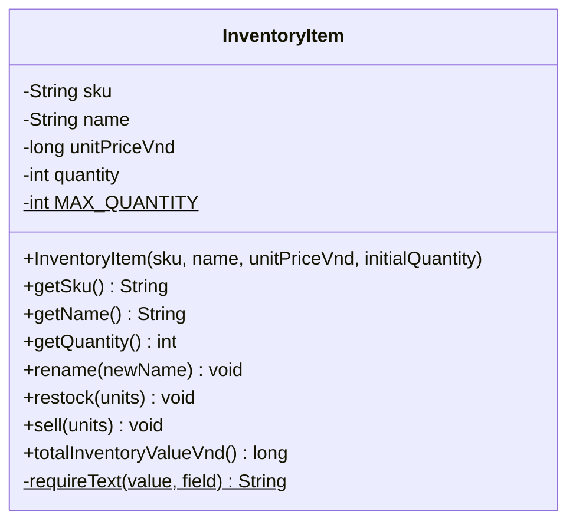
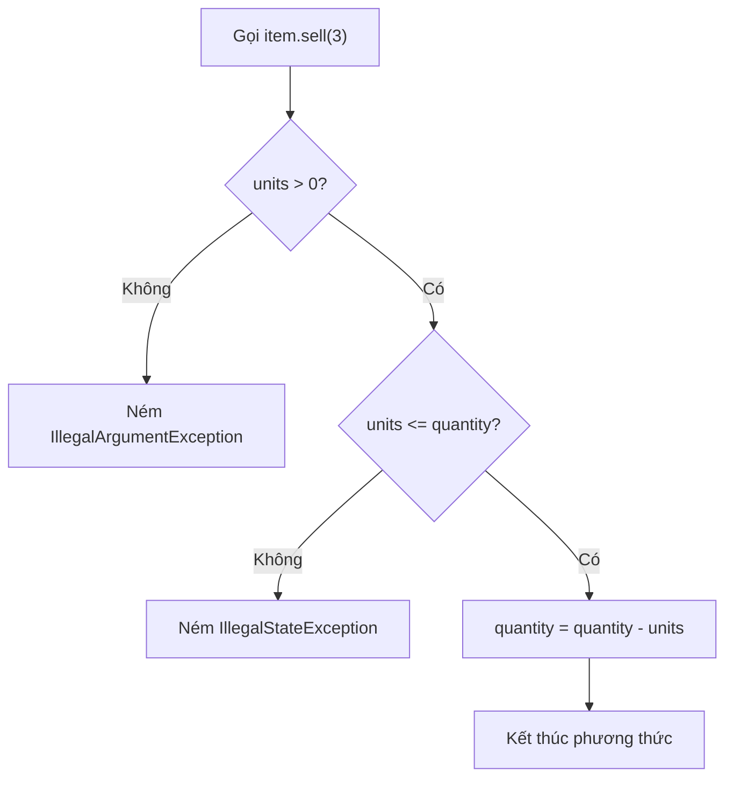
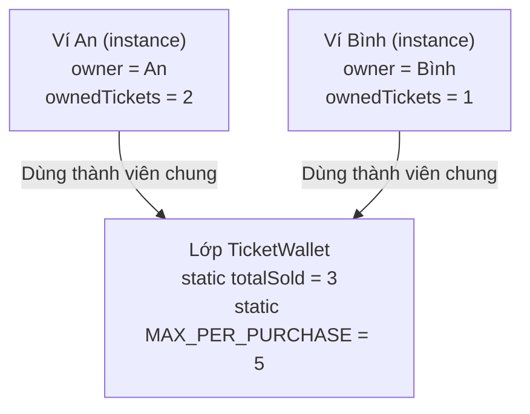
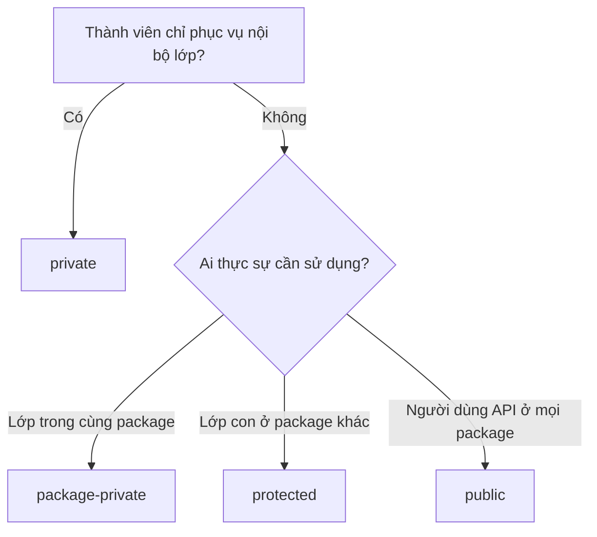
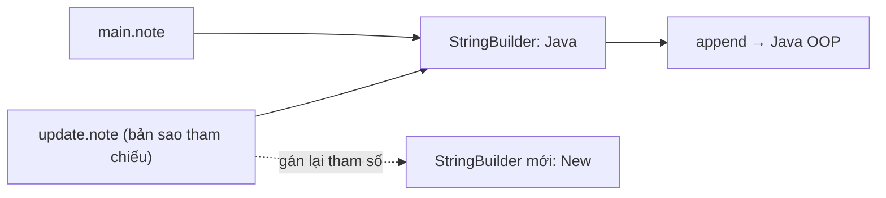
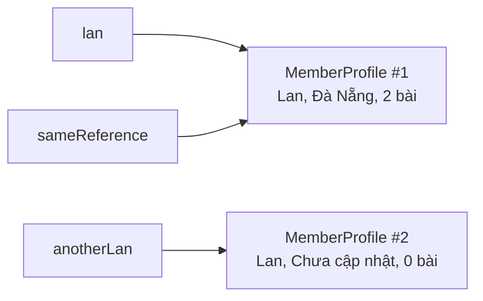
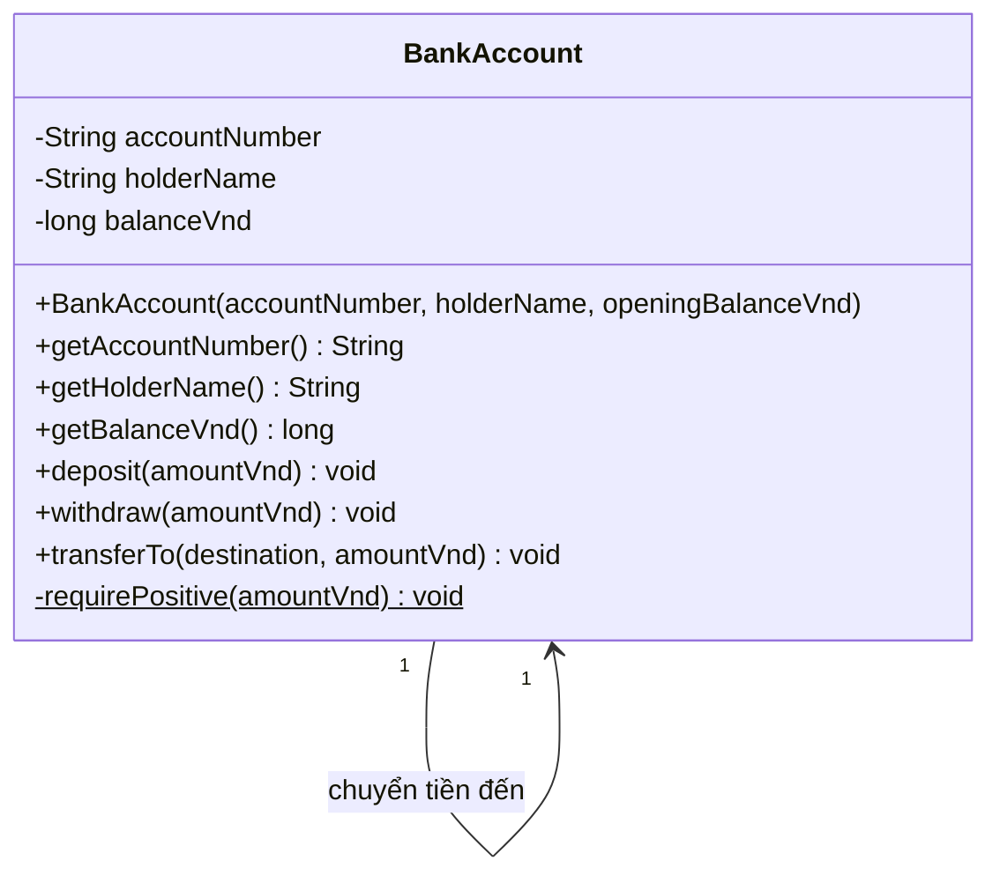
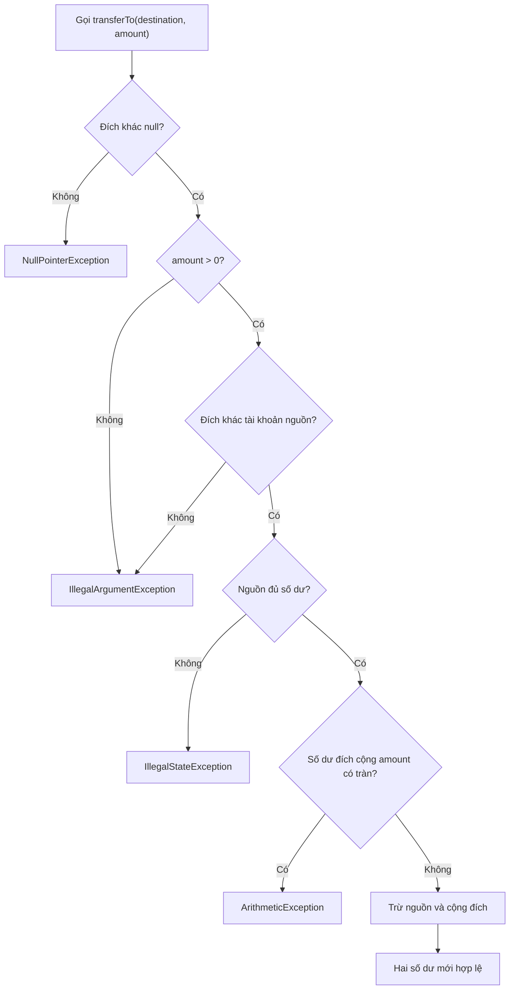

<a id="back-to-top"></a>

# Lớp

## Menu
- [Cấu trúc lớp: thuộc tính và phương thức](#class-001)
- [Khai báo lớp và tạo thể hiện](#class-002)
- [Thành viên của thể hiện và thành viên dùng chung](#class-003)
- [Phạm vi truy cập của thành viên](#class-004)
- [Tham số, giá trị trả về và tác động của phương thức](#class-005)
- [Thành viên chỉ đọc và thành viên có thể thay đổi](#class-006)
- [Tham chiếu đến đối tượng hiện tại](#class-007)
- [Thiết kế lớp qua ví dụ tài khoản ngân hàng](#class-008)

## <a id="class-001">Cấu trúc lớp: thuộc tính và phương thức</a>

<details>
<summary>Xem chi tiết</summary>

# Cấu trúc lớp trong Java: thuộc tính và phương thức

Một **lớp (class)** là bản mô tả cho các đối tượng cùng loại. Trong lớp, **thuộc tính (field)** lưu trạng thái và **phương thức (method)** định nghĩa những việc đối tượng có thể thực hiện. Hai phần này phối hợp với nhau: phương thức đọc hoặc thay đổi thuộc tính theo những quy tắc mà lớp chịu trách nhiệm bảo vệ.

Ví dụ, một mặt hàng trong kho có mã hàng, tên, đơn giá và số lượng tồn. Khi nhập hoặc bán hàng, số lượng thay đổi; mã hàng vẫn giữ nguyên. Thay vì cho mã bên ngoài sửa số lượng tùy ý, lớp `InventoryItem` cung cấp các phương thức `restock()` và `sell()` để kiểm tra trước khi thay đổi.

## 1. Nhìn tổng thể cấu trúc một lớp

```java
public class Product {
    // Thuộc tính: trạng thái của từng đối tượng
    private final String code;
    private String name;
    private long priceVnd;

    // Constructor: tạo đối tượng với trạng thái ban đầu hợp lệ
    public Product(String code, String name, long priceVnd) {
        this.code = code;
        this.name = name;
        this.priceVnd = priceVnd;
    }

    // Phương thức: đọc trạng thái
    public String getName() {
        return name;
    }

    // Phương thức: thay đổi trạng thái
    public void rename(String newName) {
        this.name = newName;
    }
}
```

Đây là một bản phác thảo cú pháp; ví dụ hoàn chỉnh ở phần sau bổ sung kiểm tra dữ liệu đầu vào.

| Thành phần | Ví dụ | Vai trò |
| --- | --- | --- |
| Khai báo lớp | `public class Product` | Định nghĩa kiểu đối tượng; tên lớp thường dùng PascalCase |
| Thuộc tính | `private String name;` | Giữ dữ liệu thuộc về đối tượng |
| Constructor | `public Product(...)` | Thiết lập trạng thái khi gọi `new Product(...)` |
| Phương thức | `public void rename(...)` | Cung cấp thao tác mà đối tượng cho phép |
| Tham số | `String newName` | Dữ liệu nhận vào khi gọi phương thức |
| Kiểu trả về | `String`, `long`, `void` | Quy định kết quả trả về, hoặc `void` nếu không trả kết quả |
| Bộ điều khiển truy cập | `private`, `public` | Quyết định nơi nào có thể sử dụng thành phần |
| `this` | `this.name = newName` | Tham chiếu đến chính đối tượng đang thực thi phương thức |

Sơ đồ lớp mô tả các thành phần mà chưa cần đi vào cách chúng được triển khai:



Trong ký hiệu UML, `+` là `public`, `-` là `private`; dấu `$` ở đây biểu thị thành phần `static`.

## 2. Thuộc tính lưu trạng thái như thế nào?

Một field được khai báo **trực tiếp trong thân lớp, bên ngoài các phương thức**:

```java
private final String sku;
private String name;
private final long unitPriceVnd;
private int quantity;
```

- `sku` nhận giá trị khi khởi tạo và không được gán lại sau đó vì có `final`.
- `name` có thể đổi thông qua phương thức được lớp kiểm soát.
- `unitPriceVnd` dùng `long` để lưu số tiền nguyên theo đơn vị đồng; không dùng `double` cho một ví dụ cần số tiền nguyên chính xác.
- `quantity` là trạng thái thay đổi khi nhập, bán hàng.

Mỗi lần `new InventoryItem(...)` tạo một đối tượng, đối tượng đó có **bộ giá trị riêng cho các instance field**. Bán hàng ở đối tượng A không tự làm giảm tồn kho của đối tượng B.

### Instance field, static field và biến cục bộ

| Loại | Nơi khai báo | Sở hữu / vòng đời |
| --- | --- | --- |
| Instance field | Trong lớp, không có `static` | Mỗi đối tượng giữ một giá trị riêng |
| Static field | Trong lớp, có `static` | Thuộc về lớp, được chia sẻ giữa các đối tượng |
| Local variable | Trong thân phương thức/khối lệnh | Chỉ tồn tại trong phạm vi thực thi của khối đó |
| Parameter | Trong danh sách tham số phương thức | Là biến cục bộ nhận giá trị lúc gọi |

Ví dụ `private static final int MAX_QUANTITY = 1_000_000;` là một hằng giới hạn chung của lớp, không cần mỗi đối tượng giữ một bản sao về mặt ngữ nghĩa. `int units` trong `sell(int units)` là tham số, còn `int remaining = quantity - units;` (nếu khai báo trong phương thức) là biến cục bộ.

`final` ngăn gán lại **biến/field đó** sau khi được khởi tạo, nhưng không có nghĩa mọi đối tượng được tham chiếu bởi field đều bất biến. `private` giới hạn quyền truy cập từ bên ngoài lớp; nó không tự động khiến dữ liệu hợp lệ, nên phương thức và constructor vẫn phải kiểm tra.

## 3. Phương thức xác định hành vi và giao diện sử dụng

Một khai báo phương thức có dạng:

```java
public void restock(int units) {
    // thân phương thức
}
```

Phân tích: `public` là mức truy cập; `void` là kiểu trả về; `restock` là tên; `int units` là tham số; phần trong `{ ... }` là logic thực thi. Một phương thức trả dữ liệu sẽ khai báo kiểu phù hợp và dùng `return`:

```java
public int getQuantity() {
    return quantity;
}
```

Có thể phân nhóm theo **trách nhiệm**:

- Phương thức truy vấn (`getQuantity()`, `totalInventoryValueVnd()`) cung cấp thông tin mà không chủ động sửa trạng thái.
- Phương thức tác động (`restock()`, `sell()`, `rename()`) thực hiện hành vi và có thể làm thay đổi trạng thái.
- Phương thức trợ giúp `private` tái sử dụng logic nội bộ, không trở thành API công khai của đối tượng.

Tên phương thức nên là động từ hoặc cụm mô tả kết quả rõ ràng. Một phương thức có thể nhận nhiều tham số; Java cũng hỗ trợ **overloading** (cùng tên, khác danh sách kiểu/số lượng tham số). Chỉ khác kiểu trả về thì chưa đủ để overload.

## 4. Ví dụ hoàn chỉnh: lớp quản lý tồn kho

Tạo file `InventoryItem.java`. Ví dụ dùng Java 11 trở lên vì có `String.isBlank()` và `String.strip()`.

```java
public final class InventoryItem {
    private static final int MAX_QUANTITY = 1_000_000;

    private final String sku;
    private String name;
    private final long unitPriceVnd;
    private int quantity;

    public InventoryItem(String sku, String name,
                         long unitPriceVnd, int initialQuantity) {
        this.sku = requireText(sku, "sku");
        this.name = requireText(name, "name");

        if (unitPriceVnd < 0) {
            throw new IllegalArgumentException("Giá không được âm");
        }
        if (initialQuantity < 0 || initialQuantity > MAX_QUANTITY) {
            throw new IllegalArgumentException("Số lượng ban đầu không hợp lệ");
        }

        this.unitPriceVnd = unitPriceVnd;
        this.quantity = initialQuantity;
    }

    public String getSku() {
        return sku;
    }

    public String getName() {
        return name;
    }

    public int getQuantity() {
        return quantity;
    }

    public void rename(String newName) {
        this.name = requireText(newName, "name");
    }

    public void restock(int units) {
        if (units <= 0) {
            throw new IllegalArgumentException("Số nhập phải dương");
        }
        if (units > MAX_QUANTITY - quantity) {
            throw new IllegalArgumentException("Vượt giới hạn tồn kho");
        }
        quantity += units;
    }

    public void sell(int units) {
        if (units <= 0) {
            throw new IllegalArgumentException("Số bán phải dương");
        }
        if (units > quantity) {
            throw new IllegalStateException("Không đủ hàng trong kho");
        }
        quantity -= units;
    }

    public long totalInventoryValueVnd() {
        return Math.multiplyExact(unitPriceVnd, (long) quantity);
    }

    private static String requireText(String value, String field) {
        if (value == null || value.isBlank()) {
            throw new IllegalArgumentException(field + " không được trống");
        }
        return value.strip();
    }
}
```

Điểm cần quan sát trong cấu trúc trên:

1. **Field `private`, phương thức `public`:** mã bên ngoài hỏi số lượng qua `getQuantity()` và thay đổi nó qua hành vi hợp lệ; không được thực hiện `item.quantity = -10`.
2. **Constructor không có kiểu trả về:** tên trùng tên lớp. Nó đảm bảo các đối tượng vừa tạo đã có mã, tên, giá và số lượng hợp lệ.
3. **`this.sku` và `sku`:** vế trái là field của đối tượng, vế phải là tham số constructor. `this` làm rõ hai biến trùng tên.
4. **Trạng thái nhất quán:** `restock()` kiểm tra số dương và giới hạn trước khi cộng; `sell()` kiểm tra số dương và còn đủ hàng trước khi trừ. Khi kiểm tra thất bại, `quantity` chưa bị thay đổi.
5. **Dữ liệu suy ra qua phương thức:** tổng giá trị kho bằng đơn giá nhân số lượng hiện tại nên được tính từ hai field. Không lưu thêm field `totalValue` dễ bị quên cập nhật. `Math.multiplyExact` báo lỗi nếu phép nhân `long` tràn số.
6. **`static`:** `MAX_QUANTITY` và `requireText()` gắn với lớp vì không cần trạng thái của một mặt hàng cụ thể. Ngược lại, `sell()` dùng `quantity` của từng đối tượng, nên là instance method.

### Chạy thử đối tượng

Tạo file `Main.java` cùng thư mục:

```java
public class Main {
    public static void main(String[] args) {
        InventoryItem item =
                new InventoryItem("KB-01", "Bàn phím", 129_000, 10);

        item.restock(5);               // 10 -> 15
        item.sell(3);                  // 15 -> 12
        item.rename("Bàn phím cơ");

        System.out.println(item.getSku());                    // KB-01
        System.out.println(item.getName());                   // Bàn phím cơ
        System.out.println(item.getQuantity());               // 12
        System.out.println(item.totalInventoryValueVnd());    // 1548000

        try {
            item.sell(20);
        } catch (IllegalStateException ex) {
            System.out.println(ex.getMessage()); // Không đủ hàng trong kho
        }

        System.out.println(item.getQuantity()); // Vẫn là 12
    }
}
```

Biên dịch và chạy bằng:

```bash
javac InventoryItem.java Main.java
java Main
```

Luồng xử lý của `item.sell(3)`:



Ngay trước lời gọi, `quantity = 15`. Điều kiện được thỏa mãn nên field thành `12`. Với `sell(20)`, điều kiện đủ hàng sai, ngoại lệ được ném ra và số lượng **vẫn là 12**. Đây là giá trị thực tế của việc đặt logic ở phương thức thay vì cho bên ngoài sửa field trực tiếp.

### Hai đối tượng từ cùng một lớp

```java
InventoryItem a = new InventoryItem("A", "Chuột", 200_000, 2);
InventoryItem b = new InventoryItem("B", "Bàn phím", 500_000, 4);

a.restock(3);

System.out.println(a.getQuantity()); // 5
System.out.println(b.getQuantity()); // 4
```

`InventoryItem` là lớp; `a` và `b` tham chiếu tới **hai đối tượng khác nhau**. Cả hai có cùng tập tên field/phương thức nhưng trạng thái độc lập.

## 5. Phân biệt field, property và phương thức

Trong cách nói phổ thông về OOP, “thuộc tính” thường chỉ dữ liệu đặc trưng của đối tượng. Trong Java cơ bản, trường dữ liệu khai báo bằng `private int quantity;` được gọi chính xác là **field**. Một “property” trong ngôn ngữ thiết kế có thể là giá trị được công bố qua `getQuantity()` hoặc được tính qua `totalInventoryValueVnd()`; Java không có cú pháp property tự động giống một số ngôn ngữ khác.

Không phải field nào cũng cần getter/setter. Nếu viết `setQuantity(int x)` công khai và chấp nhận mọi số nguyên, người dùng lớp có thể bỏ qua quy tắc nhập/bán hàng. Trong trường hợp này, hai hành vi `restock()` và `sell()` diễn tả nghiệp vụ và kiểm soát điều kiện tốt hơn. Tương tự, không cần setter cho `sku` vì danh tính mặt hàng đã được xác định lúc khởi tạo.

### Phạm vi truy cập thường gặp

| Modifier | Truy cập điển hình | Khi nào phù hợp |
| --- | --- | --- |
| `private` | Chỉ trong chính lớp khai báo | Field và chi tiết triển khai nội bộ |
| Không ghi modifier (package-private) | Trong cùng package | Cộng tác nội bộ giữa các lớp cùng package |
| `protected` | Cùng package và trong lớp con theo quy tắc Java | Thành phần dành cho mở rộng bằng kế thừa |
| `public` | Mọi nơi có quyền truy cập tới lớp | API mà nơi sử dụng lớp cần gọi |

Một lớp có nhiều field `private` nhưng vẫn thể hiện đầy đủ hành vi qua các phương thức `public`. Đây là nền tảng của **đóng gói (encapsulation)**: đối tượng giữ quyền kiểm soát trạng thái của chính nó.

## 6. Những lỗi thiết kế và lỗi Java dễ gặp

| Tình huống | Vì sao có vấn đề | Cách cải thiện |
| --- | --- | --- |
| `public int quantity;` | Mã bên ngoài có thể đặt số lượng âm | Giữ `private`, cung cấp hành vi có kiểm tra |
| Constructor gán trực tiếp tên rỗng | Đối tượng sinh ra ở trạng thái không hợp lệ | Kiểm tra tham số ngay khi tạo |
| `setQuantity(...)` cho mọi nghiệp vụ | Caller phải tự ghi nhớ quy tắc nhập/bán | Đặt tên `restock`, `sell` theo hành vi |
| Tạo field `totalValue` rồi quên đồng bộ | Dữ liệu dư thừa có thể sai | Tính bằng phương thức truy vấn |
| Trùng tên tham số và field nhưng quên `this` | Gán nhầm vào tham số hoặc không cập nhật field | Dùng `this.field = parameter` |
| Lầm `static` là dữ liệu của từng đối tượng | Mọi đối tượng cùng sử dụng một biến chung | Để dữ liệu riêng ở instance field |
| Gọi phương thức instance mà chưa có đối tượng | Không có trạng thái cụ thể để xử lý | Tạo đối tượng bằng `new` trước |
| Chỉ kiểm tra sau khi cập nhật field | Ngoại lệ có thể để lại trạng thái sai | Xác thực toàn bộ điều kiện trước khi thay đổi |

Cũng cần nhớ: method không nhất thiết phải sửa field; getter và các phép tính là hành vi hợp lệ. Ngược lại, một lớp có field và method chưa chắc đã được thiết kế tốt nếu trách nhiệm lộn xộn hoặc cho phép phá vỡ quy tắc dữ liệu.

## 7. Tự kiểm tra hiểu biết

Hãy thử thay đổi ví dụ theo ba yêu cầu sau:

1. Thêm `getUnitPriceVnd()` trả về đơn giá, không cho bên ngoài chỉnh giá.
2. Thêm `boolean canSell(int units)` để kiểm tra `units > 0 && units <= quantity` **mà không thay đổi** số lượng.
3. Thử gọi `restock(0)`, `sell(-1)`, `sell(999)` và xác định kiểu ngoại lệ; kiểm tra tồn kho trước/sau mỗi lần gọi.

Khi đọc một lớp Java bất kỳ, hãy tự hỏi: **Field nào biểu diễn trạng thái? Field nào thuộc lớp qua `static`? Constructor đảm bảo điều gì? Phương thức nào đọc hoặc thay đổi trạng thái? Quy tắc nào ngăn đối tượng trở nên không hợp lệ?** Trả lời được những câu hỏi này là đã nắm được cấu trúc cơ bản của lớp gồm thuộc tính và phương thức.


</details>

- [Quay lại đầu trang](#back-to-top)

---

## <a id="class-002">Khai báo lớp và tạo thể hiện</a>

<details>
<summary>Xem chi tiết</summary>

# Khai báo lớp và tạo thể hiện trong Java

Trong lập trình hướng đối tượng (OOP), **lớp** (*class*) mô tả dữ liệu và hành vi chung của một nhóm đối tượng. **Thể hiện** (*instance*, hay đối tượng) là một đối tượng cụ thể được tạo theo định nghĩa của lớp đó.

Ví dụ, lớp `Workshop` có thể mô tả một buổi học gồm tên, sức chứa và số người đã đăng ký. Từ cùng một lớp, chương trình tạo hai thể hiện độc lập: một buổi “Java cơ bản” có hai chỗ và một buổi “Spring Boot” có một chỗ.

## 1. Khai báo một lớp

Cú pháp cơ bản:

~~~java
class TenLop {
    // Các trường (fields): lưu trạng thái
    // Constructor: thiết lập trạng thái khi tạo đối tượng
    // Các phương thức (methods): mô tả hành vi
}
~~~

Một lớp Java thường có ba thành phần:

| Thành phần | Vai trò | Ví dụ trong `Workshop` |
| --- | --- | --- |
| Trường (*field*) | Lưu dữ liệu thuộc từng đối tượng | `name`, `capacity`, `registeredCount` |
| Constructor | Kiểm tra và khởi tạo đối tượng | `Workshop(String name, int capacity)` |
| Phương thức (*method*) | Cho phép đối tượng thực hiện hành vi | `register()`, `remainingSeats()` |

Từ khóa `class` định nghĩa kiểu đối tượng mới. Tên lớp theo quy ước Java viết kiểu `PascalCase` (`Workshop`, `OrderItem`). Từ khóa `public` quy định phạm vi truy cập; một file nguồn thường chứa một lớp top-level `public`, và tên file phải trùng tên lớp đó (chẳng hạn `Main.java` cho `public class Main`).

**Khai báo lớp chưa tạo ra các thể hiện của lớp.** Các thể hiện chỉ xuất hiện khi chương trình thực hiện thao tác tạo đối tượng, điển hình là dùng `new`.

## 2. Tạo thể hiện bằng `new`

Một biểu thức điển hình:

~~~java
Workshop java = new Workshop("Java cơ bản", 2);
~~~

Đọc từ trái sang phải:

1. `Workshop` là **kiểu của biến**.
2. `java` là **biến tham chiếu** dùng để truy cập đối tượng.
3. `new Workshop(...)` tạo một thể hiện của `Workshop` và gọi constructor phù hợp.
4. `"Java cơ bản"` và `2` là các đối số để khởi tạo tên và sức chứa.
5. Toán tử gán `=` lưu **tham chiếu đến đối tượng** vào biến `java`.

Ta có thể khai báo tham chiếu rồi mới tạo đối tượng:

~~~java
Workshop course;                         // Chưa tham chiếu đến đối tượng nào
course = new Workshop("Java cơ bản", 2); // Bắt đầu trỏ đến thể hiện mới
~~~

Biến cục bộ `course` phải được gán giá trị trước khi sử dụng. Khác với biến cục bộ, một **trường tham chiếu** chưa khởi tạo tường minh có giá trị mặc định là `null`. Việc gọi phương thức thông qua tham chiếu `null` gây `NullPointerException`.

## 3. Ví dụ hoàn chỉnh: đăng ký buổi học

Đặt toàn bộ mã sau trong file **`Main.java`**. Ví dụ dùng Java 11 trở lên, vì có `String.isBlank()`.

~~~java
class Workshop {
    private final String name;
    private final int capacity;
    private int registeredCount;

    // Constructor: cùng tên với lớp, không khai báo kiểu trả về.
    Workshop(String name, int capacity) {
        if (name == null || name.isBlank()) {
            throw new IllegalArgumentException("Tên buổi học không hợp lệ");
        }
        if (capacity <= 0) {
            throw new IllegalArgumentException("Sức chứa phải lớn hơn 0");
        }

        this.name = name;
        this.capacity = capacity;
        this.registeredCount = 0;
    }

    // Hành vi thay đổi trạng thái riêng của thể hiện hiện tại.
    boolean register() {
        if (registeredCount >= capacity) {
            return false;
        }
        registeredCount++;
        return true;
    }

    int remainingSeats() {
        return capacity - registeredCount;
    }

    String getName() {
        return name;
    }
}

public class Main {
    public static void main(String[] args) {
        Workshop java = new Workshop("Java cơ bản", 2);
        Workshop spring = new Workshop("Spring Boot", 1);

        System.out.println(java.getName());
        System.out.println(java.register());
        System.out.println(java.register());
        System.out.println(java.register());
        System.out.println(java.remainingSeats());
        System.out.println(spring.remainingSeats());

        Workshop alias = spring; // Thêm tham chiếu, không tạo đối tượng mới
        System.out.println(alias == spring);
        alias.register();
        System.out.println(spring.remainingSeats());

        Workshop separate = new Workshop("Spring Boot", 1);
        System.out.println(separate == spring);
        System.out.println(separate.remainingSeats());
    }
}
~~~

Chạy tại thư mục chứa `Main.java`:

~~~bash
javac Main.java
java Main
~~~

Kết quả:

~~~text
Java cơ bản
true
true
false
0
1
true
0
false
1
~~~

**Diễn giải:** Đối tượng `java` có hai chỗ, nên hai lần `register()` đầu thành công, lần thứ ba thất bại. Đối tượng `spring` vẫn còn một chỗ: trạng thái của `java` không làm thay đổi `spring`. Khi gọi `alias.register()`, số chỗ còn lại của `spring` thành 0 vì hai biến cùng tham chiếu một đối tượng. Sau đó, `new Workshop("Spring Boot", 1)` tạo một thể hiện *khác*, dù đối số giống lần tạo `spring`.

## 4. Constructor làm gì?

Constructor là điểm khởi tạo một thể hiện. Nó **cùng tên với lớp** và **không có kiểu trả về**, kể cả `void`. Trong ví dụ trên, constructor bắt buộc tên không trống và sức chứa dương, rồi gán các trường của thể hiện.

Từ khóa `this` chỉ đối tượng hiện tại. Ở câu lệnh `this.name = name;`, phía trái là trường `name` của đối tượng; phía phải là tham số `name` được truyền vào constructor. Cách viết này tránh nhầm lẫn khi tên trường và tên tham số trùng nhau.

Nếu không khai báo **bất kỳ constructor nào**, trình biên dịch cung cấp một constructor mặc định không tham số, với mức truy cập tương ứng mức truy cập của lớp. Nhưng **khi đã khai báo constructor có tham số**, Java không tự sinh thêm constructor không tham số:

~~~java
class Marker {
    String color;
}

Marker a = new Marker(); // Hợp lệ: constructor mặc định

// Với lớp Workshop ở ví dụ chính:
// new Workshop();        // Lỗi biên dịch: thiếu 2 đối số
~~~

Đoạn minh họa `Marker` là mã ví dụ độc lập, không chèn sau phần mã hoàn chỉnh bên ngoài phương thức `main`. Ta cũng có thể tự viết nhiều constructor khác chữ ký (*constructor overloading*) khi có nhiều cách khởi tạo hợp lệ, nhưng mỗi constructor phải bảo đảm trạng thái ban đầu hợp lệ.

## 5. Phân biệt lớp, thể hiện và tham chiếu

| Khái niệm | Ý nghĩa | Ví dụ |
| --- | --- | --- |
| Lớp | Bản định nghĩa về dữ liệu và hành vi | `class Workshop { ... }` |
| Thể hiện | Một đối tượng được tạo theo lớp | Đối tượng “Java cơ bản” |
| Biến tham chiếu | Biến dùng để truy cập đối tượng | `java`, `spring`, `alias` |
| `new` | Biểu thức tạo đối tượng và gọi constructor | `new Workshop("Spring Boot", 1)` |

Sau các phép gán trong ví dụ, quan hệ tham chiếu có thể hình dung như sau:

~~~mermaid
flowchart LR
    J["java"] --> W1["Workshop #1: Java cơ bản"]
    S["spring"] --> W2["Workshop #2: Spring Boot"]
    A["alias"] --> W2
    D["separate"] --> W3["Workshop #3: Spring Boot"]
~~~

Có ba đối tượng nhưng bốn biến tham chiếu. `spring` và `alias` cùng truy cập đối tượng #2; đối tượng #3 được tạo riêng.

- `Workshop alias = spring;` **không sao chép đối tượng**. Nó sao chép giá trị tham chiếu.
- `new Workshop(...)` thực hiện thêm một lần tạo thể hiện.
- `alias == spring` là `true` vì hai tham chiếu trỏ đến cùng đối tượng.
- `separate == spring` là `false` vì chúng là hai đối tượng khác nhau.
- Với đối tượng, `==` so sánh **đồng nhất tham chiếu**; `equals()` có thể biểu diễn bằng nhau theo nội dung nếu lớp định nghĩa lại nó. `Workshop` ở đây không định nghĩa lại `equals()`.

Không nên hình dung mỗi biến tham chiếu là một bản sao độc lập của đối tượng. Khi nhiều tham chiếu cùng trỏ đến một đối tượng có thể thay đổi, việc chỉnh sửa qua một tham chiếu sẽ được thấy qua các tham chiếu còn lại.

## 6. Phạm vi truy cập và tính đóng gói ngay từ lúc khai báo

Ba trường của `Workshop` được khai báo `private` để mã sử dụng không thể trực tiếp gán `registeredCount = 999` hoặc sửa sức chứa tùy tiện. Muốn đăng ký, chương trình gọi `register()`, nơi kiểm tra còn chỗ trước khi tăng số lượng.

`final` trên `name` và `capacity` buộc mỗi trường được gán một lần trong quá trình khởi tạo và không thể gán lại sau đó. Nó **không** có nghĩa toàn bộ đối tượng bất biến, bởi `registeredCount` vẫn có thể thay đổi.

Trong ví dụ, `Workshop` không có `public` nên chỉ truy cập được trong cùng package. Các phương thức cũng có quyền truy cập mặc định (package-private), đủ để `Main` sử dụng vì cả hai ở cùng file/package. Khi tổ chức dự án thành nhiều package, cần chọn mức truy cập `public` cho API cần sử dụng từ package khác.

## 7. Các lỗi thường gặp

| Tình huống | Nguyên nhân | Cách xử lý |
| --- | --- | --- |
| `new Workshop()` không biên dịch | Lớp chỉ có constructor nhận hai tham số | Truyền đủ đối số hoặc tự khai báo constructor không tham số nếu phù hợp |
| `Workshop x;` rồi gọi `x.register()` | Biến cục bộ chưa được gán | Khởi tạo bằng `new` hoặc gán tham chiếu hợp lệ trước khi dùng |
| `Workshop x = null;` rồi gọi phương thức | `null` không trỏ đến đối tượng | Kiểm tra luồng khởi tạo, không gọi phương thức qua `null` |
| Nghĩ `Workshop b = a;` sẽ nhân bản dữ liệu | Phép gán chỉ sao chép tham chiếu | Tạo đối tượng mới và sao chép dữ liệu có chủ đích nếu cần |
| Khai báo `public class Workshop` ngay trong `Main.java` | Tên file không khớp tên lớp `public` | Đặt `Workshop` vào `Workshop.java`, hoặc giữ nó không `public` trong `Main.java` |
| Viết `void Workshop(...)` | Đây là phương thức tên `Workshop`, không phải constructor | Bỏ kiểu trả về để khai báo constructor |

## 8. Tự kiểm tra hiểu bài

1. Nếu tạo `Workshop a = new Workshop("A", 3);` và `Workshop b = new Workshop("B", 3);`, gọi `a.register()` có làm thay đổi `b.remainingSeats()` không? **Không**: đó là hai thể hiện độc lập.
2. Nếu tiếp tục viết `Workshop c = a;`, thì `c == a` có giá trị gì? **`true`**, vì cả hai trỏ đến cùng một thể hiện.
3. Muốn bảo đảm không tạo được buổi học với sức chứa bằng 0, kiểm tra ở đâu? **Trong constructor**, để từ đầu mỗi đối tượng được tạo hợp lệ.
4. `new Workshop("A", 3)` tạo lớp mới hay đối tượng mới? **Đối tượng mới** của lớp `Workshop` đã được định nghĩa.
5. Nếu chỉ viết `class Workshop { ... }` mà không thực hiện `new Workshop(...)`, đã có thể hiện `Workshop` nào do dòng khai báo ấy tạo ra chưa? **Chưa**.

**Ghi nhớ khi viết Java:** Khai báo `class` để định nghĩa cấu trúc và hành vi; dùng `new` kèm constructor để tạo đối tượng; giữ tham chiếu để gọi phương thức; mỗi lần tạo thể hiện mới có trạng thái riêng, còn phép gán tham chiếu có thể khiến nhiều biến cùng truy cập một thể hiện.


</details>

- [Quay lại đầu trang](#back-to-top)

---

## <a id="class-003">Thành viên của thể hiện và thành viên dùng chung</a>

<details>
<summary>Xem chi tiết</summary>

# Thành viên của thể hiện và thành viên dùng chung trong Java

Trong lập trình hướng đối tượng, **lớp (class)** mô tả kiểu đối tượng; còn **thể hiện (instance)** là một đối tượng cụ thể được tạo từ lớp đó. Khi khai báo trường dữ liệu (field) và phương thức (method), Java cho phép chọn thành viên thuộc **từng đối tượng** hoặc thuộc **lớp và được dùng chung** bằng từ khóa `static`.

Sự phân biệt này trả lời hai câu hỏi rất thực tế:

- Dữ liệu này có thuộc riêng một đối tượng cụ thể không? Ví dụ: tên chủ tài khoản, số dư, trạng thái đơn hàng.
- Dữ liệu/hành vi này có ý nghĩa chung cho cả kiểu đối tượng không? Ví dụ: bộ đếm số tài khoản đã tạo, giới hạn cố định, hàm tiện ích không cần trạng thái của một tài khoản.

## 1. Hai loại thành viên

| Tiêu chí | Thành viên của thể hiện (*instance member*) | Thành viên dùng chung (*static member*) |
|---|---|---|
| Cách khai báo | Không có `static` | Có `static` |
| Gắn với | Từng đối tượng | Lớp (trong phạm vi class loader tương ứng) |
| Field được lưu | Mỗi đối tượng có một vị trí lưu riêng | Có một field dùng chung cho các đối tượng của lớp đó |
| Cách truy cập nên dùng | `doiTuong.tenThanhVien` | `TenLop.tenThanhVien` |
| Phương thức có thể truy cập trực tiếp | Field/phương thức instance và static | Thành viên static; muốn dùng instance phải có tham chiếu đối tượng |
| Sử dụng `this` | Được trong ngữ cảnh instance | Không được trong ngữ cảnh static |
| Trường hợp điển hình | `account.balance`, `account.deposit()` | `Account.getTotalCreated()`, `Math.max(a, b)` |

**Chú ý:** `static` không đồng nghĩa với `public` hay `final`. Đây là ba ý nghĩa khác nhau: `static` xác định nơi thành viên thuộc về; `public/private` quy định quyền truy cập; `final` hạn chế việc gán lại hoặc ghi đè tùy loại thành viên.

## 2. Ví dụ thực hành: ví lưu vé xem sự kiện

Đặt yêu cầu: mỗi khách hàng có một ví lưu vé và giữ số vé riêng của mình. Đồng thời, hệ thống cần đếm tổng số vé đã bán trên tất cả các ví trong chương trình đang chạy.

Tạo một tệp **Demo.java** và chạy với Java 17 trở lên:

```java
public class Demo {
    public static void main(String[] args) {
        TicketWallet an = new TicketWallet("An");
        TicketWallet binh = new TicketWallet("Bình");

        an.buyTickets(2);
        binh.buyTickets(1);

        System.out.println(an.getOwner() + ": " + an.getOwnedTickets());
        System.out.println(binh.getOwner() + ": " + binh.getOwnedTickets());
        System.out.println("Tổng vé đã bán: " + TicketWallet.getTotalSold());
    }
}

class TicketWallet {
    // Dùng chung cho mọi TicketWallet trong phạm vi lớp đã nạp.
    private static int totalSold = 0;

    // Hằng số dùng chung: không cần một bản sao ở mỗi ví.
    public static final int MAX_PER_PURCHASE = 5;

    // Mỗi đối tượng TicketWallet có trạng thái của riêng mình.
    private final String owner;
    private int ownedTickets;

    public TicketWallet(String owner) {
        if (owner == null || owner.isBlank()) {
            throw new IllegalArgumentException("Tên chủ ví không hợp lệ");
        }
        this.owner = owner;
        this.ownedTickets = 0;
    }

    // Phương thức instance: tác động lên chính ví được gọi.
    public void buyTickets(int quantity) {
        if (quantity <= 0 || quantity > MAX_PER_PURCHASE) {
            throw new IllegalArgumentException("Số vé mỗi lần mua phải từ 1 đến 5");
        }

        this.ownedTickets += quantity; // Chỉ thay đổi ví hiện tại.
        totalSold += quantity;         // Thay đổi bộ đếm chung.
    }

    public String getOwner() {
        return owner;
    }

    public int getOwnedTickets() {
        return ownedTickets;
    }

    // Phương thức static: không cần một ví cụ thể để trả lời.
    public static int getTotalSold() {
        return totalSold;
    }
}
```

Kết quả:

```text
An: 2
Bình: 1
Tổng vé đã bán: 3
```

Quan sát từng bước:

1. `new TicketWallet("An")` tạo ví An với `ownedTickets = 0`.
2. `new TicketWallet("Bình")` tạo ví Bình với `ownedTickets = 0`. Hai ví là hai đối tượng khác nhau.
3. `an.buyTickets(2)` làm `an.ownedTickets = 2` và `TicketWallet.totalSold = 2`.
4. `binh.buyTickets(1)` làm `binh.ownedTickets = 1` và `TicketWallet.totalSold = 3`. Số vé của An vẫn là 2.

Hình dung mối quan hệ:



Sơ đồ thể hiện **quyền sở hữu logic**, không phải bản đồ bố trí byte trong bộ nhớ JVM. Mỗi instance có các field riêng; cả hai nhìn thấy cùng một `TicketWallet.totalSold` trong phạm vi lớp được nạp đó.

## 3. Field instance: trạng thái của từng đối tượng

Một field khai báo không có `static` là field instance:

```java
class Lamp {
    private boolean on; // Mặc định là false cho mỗi đèn.

    public void turnOn() {
        this.on = true;
    }

    public boolean isOn() {
        return on;
    }
}
```

Sử dụng:

```java
Lamp bedroom = new Lamp();
Lamp kitchen = new Lamp();

bedroom.turnOn();

System.out.println(bedroom.isOn()); // true
System.out.println(kitchen.isOn()); // false
```

Cả hai cùng là `Lamp` nhưng bật đèn phòng ngủ không thể tự làm thay đổi trạng thái của đèn nhà bếp. Đây là khả năng **đóng gói trạng thái riêng** rất quan trọng của OOP.

Field instance có giá trị mặc định khi đối tượng được khởi tạo (ví dụ `int = 0`, `boolean = false`, tham chiếu `= null`), trừ khi code gán giá trị khác. Mỗi lần tạo một đối tượng mới, các field instance được khởi tạo cho đối tượng mới ấy. Nếu hai field tham chiếu cùng trỏ đến một đối tượng khác, đối tượng được trỏ tới vẫn có thể được chia sẻ; “field riêng” không có nghĩa toàn bộ đồ thị dữ liệu đều độc lập.

## 4. Field static: dữ liệu gắn với lớp

Khai báo `static` khi thông tin **thực sự áp dụng cho toàn lớp**:

```java
class Player {
    private static int createdCount;
    private final String nickname;

    public Player(String nickname) {
        this.nickname = nickname;
        createdCount++;
    }

    public static int getCreatedCount() {
        return createdCount;
    }

    public String getNickname() {
        return nickname;
    }
}
```

```java
Player p1 = new Player("Fox");
Player p2 = new Player("Bear");

System.out.println(p1.getNickname());     // Fox
System.out.println(p2.getNickname());     // Bear
System.out.println(Player.getCreatedCount()); // 2
```

`nickname` là thuộc tính của từng người chơi. `createdCount` là số lượng *lượt tạo instance* được constructor ghi nhận trong lần chạy hiện tại; không phải số người chơi còn sống, số bản ghi trong database hay số lượng trên tất cả máy chủ.

**Phân biệt `static` với hằng số:**

```java
class Pricing {
    public static final int MAX_DISCOUNT_PERCENT = 30;
    private static int successfulOrders = 0;
}
```

- `MAX_DISCOUNT_PERCENT` là hằng số kiểu nguyên, gắn với lớp, không thể gán lại.
- `successfulOrders` cũng gắn với lớp nhưng có thể đổi theo thời gian; nó là **trạng thái dùng chung có thể thay đổi**.
- `final` trên một biến tham chiếu chỉ ngăn biến trỏ sang đối tượng khác; không tự động làm đối tượng bên trong bất biến.

Ví dụ dễ nhầm:

```java
private static final java.util.List<String> NAMES =
        new java.util.ArrayList<>();

// NAMES = new java.util.ArrayList<>(); // Lỗi: không thể gán lại.
// NAMES.add("An");                       // Vẫn hợp lệ: nội dung list có thể đổi.
```

Nếu cần danh sách bất biến, có thể dùng `List.of("An", "Bình")` cùng quy tắc kiểm soát dữ liệu phù hợp.

## 5. Phương thức instance và phương thức static

Phương thức instance thực thi trong ngữ cảnh **một đối tượng nhận lời gọi**, nên có thể dùng `this`, đọc/sửa field instance, và gọi các phương thức instance khác.

```java
class Rectangle {
    private final double width;
    private final double height;

    Rectangle(double width, double height) {
        this.width = width;
        this.height = height;
    }

    public double area() {        // Instance method
        return width * height;
    }

    public static boolean isValidSize(double width, double height) {
        return width > 0 && height > 0; // Static method
    }
}
```

```java
Rectangle r = new Rectangle(3, 4);
System.out.println(r.area());                     // 12.0
System.out.println(Rectangle.isValidSize(3, 4));  // true
```

`area()` cần kích thước của **một hình chữ nhật cụ thể**. `isValidSize(width, height)` nhận đủ dữ liệu qua tham số, không cần biết một hình chữ nhật nào đang tồn tại; vì vậy có thể để `static`.

Một phương thức `static` **không được trực tiếp** đọc field instance hoặc sử dụng `this`:

```java
class Student {
    private String name;

    public static void printNameWrong() {
        // System.out.println(name); // Lỗi biên dịch:
        // non-static variable name cannot be referenced from a static context
        // System.out.println(this.name); // Cũng lỗi: không có this.
    }

    public static void printName(Student student) {
        System.out.println(student.name); // Hợp lệ nhờ đối tượng student.
    }

    public void printMyName() {
        System.out.println(this.name);    // Hợp lệ trong instance method.
    }
}
```

Điều quan trọng: phương thức static **vẫn có thể sử dụng dữ liệu của đối tượng** nếu được cung cấp tham chiếu tới đối tượng (ví dụ qua tham số). Nó chỉ không có một `this` ngầm định.

Về cú pháp, Java cho phép gọi một phương thức static qua biểu thức tham chiếu đối tượng, nhưng nên gọi qua **tên lớp**: `TicketWallet.getTotalSold()`. Điều đó truyền đạt đúng ý nghĩa và tránh hiểu nhầm rằng mỗi ví có bộ đếm riêng.

## 6. Khởi tạo và vòng đời: chuyện gì xảy ra khi tạo đối tượng?

Trong một tình huống đơn giản (không xét quan hệ kế thừa), trình tự khái quát như sau:

1. Khi lớp được sử dụng theo cách yêu cầu khởi tạo, JVM thực hiện khởi tạo lớp: chạy các phép gán field static và khối `static { ... }` theo thứ tự trong mã nguồn. Việc này xảy ra một lần cho **mỗi lần khởi tạo lớp trong một class loader**, chứ không lặp lại mỗi lần `new`.
2. Với mỗi lần `new`, Java cấp phát một instance, khởi tạo field instance và khối khởi tạo instance, rồi thực thi phần thân constructor.
3. Khi thay đổi field static, các instance cùng thuộc lớp được nạp ấy quan sát trạng thái chung. Khi thay đổi field instance, trạng thái gắn với instance nhận tác động.

Ví dụ:

```java
class Sample {
    static int shared = 10;
    int local = 1;

    Sample() {
        local++;
        shared++;
    }
}

Sample a = new Sample(); // a.local = 2; shared = 11
Sample b = new Sample(); // b.local = 2; shared = 12
a.local += 5;

System.out.println(a.local);      // 7
System.out.println(b.local);      // 2
System.out.println(Sample.shared); // 12
```

Không nên hình dung `static` là “một biến duy nhất toàn bộ thế giới”. Những JVM/process khác nhau có trạng thái riêng; ứng dụng nhiều máy chủ không tự đồng bộ các field static. Mỗi class loader cũng có thể nạp cùng một tên lớp như những lớp riêng. Ngoài ra, field static **không phải nơi lưu dữ liệu bền vững**: khởi động lại ứng dụng không đảm bảo giữ giá trị trước đó.

## 7. Kế thừa: override instance method khác với static method hiding

Các phương thức instance có thể tham gia **đa hình động**: phiên bản được gọi phụ thuộc kiểu đối tượng thực tế. Phương thức static không được override theo nghĩa đó; khi một lớp con khai báo phương thức static cùng chữ ký, đây là **method hiding**.

```java
class Animal {
    public static String group() {
        return "Animal";
    }

    public String sound() {
        return "...";
    }
}

class Dog extends Animal {
    public static String group() {
        return "Dog";
    }

    @Override
    public String sound() {
        return "Gâu";
    }
}

Animal pet = new Dog();
System.out.println(pet.sound());   // Gâu: đa hình instance.
System.out.println(pet.group());   // Animal: chọn static theo kiểu tham chiếu.
System.out.println(Dog.group());   // Dog: gọi rõ tên lớp.
```

Dòng `pet.group()` chỉ nhằm minh họa quy tắc ngôn ngữ; trong code thực tế nên viết `Animal.group()` hoặc `Dog.group()`. Không đặt `@Override` lên phương thức static và đừng dựa vào static dispatch để triển khai hành vi cần đa hình.

## 8. Rủi ro của trạng thái dùng chung: nhiều luồng và kiểm thử

Trường `static` có thể thay đổi giúp đếm hoặc chia sẻ cấu hình trong một JVM, nhưng cũng tạo ra điểm chung mà nhiều phần code có thể cùng tác động. Ví dụ `totalSold += quantity` là thao tác đọc–cộng–ghi, **không nguyên tử**. Nếu nhiều luồng mua vé cùng lúc, tổng có thể bị thiếu do cập nhật chồng lấn.

Khi thật sự cần một bộ đếm trong bộ nhớ JVM được nhiều luồng cập nhật, có thể dùng `AtomicInteger`:

```java
import java.util.concurrent.atomic.AtomicInteger;

class SalesMetrics {
    private static final AtomicInteger TOTAL_SOLD = new AtomicInteger();

    public static void recordSale(int quantity) {
        if (quantity <= 0) {
            throw new IllegalArgumentException("quantity phải > 0");
        }
        TOTAL_SOLD.addAndGet(quantity);
    }

    public static int getTotalSold() {
        return TOTAL_SOLD.get();
    }
}
```

`AtomicInteger` bảo đảm các thao tác nguyên tử **trên chính bộ đếm này**, nhưng không tự bảo đảm tính nhất quán của cả quy trình mua vé, lưu đơn hàng, hoàn tiền hay các máy chủ khác nhau. Trong hệ thống thực tế, tổng doanh số có thể cần được xác định từ database hoặc dịch vụ quản lý giao dịch, tùy yêu cầu chính xác.

Field static thay đổi được cũng có thể làm các bài kiểm thử ảnh hưởng lẫn nhau do trạng thái lưu lại giữa các test. Không nên biến mọi dữ liệu thành static chỉ để dễ truy cập.

## 9. Cách chọn trong thiết kế thực tế

| Nhu cầu | Nên chọn | Lý do |
|---|---|---|
| Tên, trạng thái, số dư của một tài khoản | Instance field | Mỗi tài khoản có dữ liệu riêng |
| `deposit(amount)`, `withdraw(amount)` | Instance method | Hành vi tác động lên một tài khoản xác định |
| Giới hạn cố định chung, ví dụ `MAX_RETRY` | `static final` | Một quy tắc chung, không cần sao chép theo đối tượng |
| Hàm thuần túy `Math.abs(x)` | Static method | Đầu ra chỉ phụ thuộc đầu vào, không cần `this` |
| Bộ đếm đối tượng tạo trong một JVM | Có thể là static field | Được chia sẻ trong phạm vi lớp được nạp; chú ý đồng thời |
| Số người dùng đăng ký trên toàn hệ thống | Kho dữ liệu/dịch vụ phù hợp | Phải đúng qua nhiều tiến trình, lần khởi động và máy chủ |
| Dữ liệu thay đổi theo từng request hoặc người dùng | Thường là instance / request scope | Tránh rò rỉ trạng thái giữa những người dùng |

**Quy tắc quyết định:** Nếu xóa một instance thì ý nghĩa dữ liệu của instance đó cũng biến mất, dữ liệu thường là instance field. Nếu hành vi không cần đối tượng nhận lời gọi, cân nhắc static method. Nếu dữ liệu phải dùng chung và thay đổi, hãy xét phạm vi chia sẻ, khả năng đồng thời, vòng đời và nhu cầu lưu trữ trước khi chọn static field.

## 10. Tự kiểm tra hiểu bài

**Câu 1.** Hai đối tượng `Counter` đều có field `int value` không static. Tăng `a.value` có làm `b.value` tăng?  
**Đáp án:** Không, trừ khi có logic khác chủ động cập nhật `b`.

**Câu 2.** `static int count` có được tạo lại mỗi lần `new Counter()`?  
**Đáp án:** Không. Nó thuộc lớp trong phạm vi class loader; constructor có thể cập nhật giá trị ấy nhưng không tạo một field static mới cho mỗi instance.

**Câu 3.** Một phương thức static có thể truy cập `user.name` không?  
**Đáp án:** Có, nếu nó có tham chiếu `user` hợp lệ và quyền truy cập cho phép. Điều bị cấm là truy cập `name` như thể đã có sẵn một `this`.

**Câu 4.** `static final List<String>` có luôn bất biến không?  
**Đáp án:** Không. `final` chỉ ngăn gán lại biến tham chiếu; danh sách vẫn có thể thay đổi nếu đối tượng cho phép.

**Câu 5.** Có nên dùng field static để lưu tổng tiền thanh toán của mọi khách hàng trên nhiều máy chủ?  
**Đáp án:** Không phù hợp làm nguồn dữ liệu chuẩn. Static field không đồng bộ xuyên JVM và không tự tồn tại bền vững sau khi khởi động lại.

**Ghi nhớ khi đọc code Java:** Hỏi thành viên được khai báo có `static` hay không, nó lưu trạng thái thuộc **ai**, có cần `this` hay không, và trạng thái ấy phải được chia sẻ trong **phạm vi nào**. Trả lời bốn câu hỏi này thường đủ để chọn giữa thành viên của thể hiện và thành viên dùng chung một cách đúng đắn.


</details>

- [Quay lại đầu trang](#back-to-top)

---

## <a id="class-004">Phạm vi truy cập của thành viên</a>

<details>
<summary>Xem chi tiết</summary>

# Phạm vi truy cập của thành viên trong Java

Khi thiết kế một lớp theo OOP, **phạm vi truy cập** (*access level*) xác định mã ở đâu được phép sử dụng thành viên của lớp đó: thuộc tính (*field*), phương thức (*method*), hàm tạo (*constructor*) và kiểu lồng nhau (*nested type*). Java kiểm soát quyền truy cập ngay lúc biên dịch, nhờ đó lớp có thể công khai các thao tác cần thiết nhưng giữ kín dữ liệu và chi tiết triển khai.

Ví dụ, đối tượng sinh viên có mã sinh viên cần được đọc từ bên ngoài, nhưng số tín chỉ không nên bị sửa tùy ý. Ta có thể công khai phương thức đọc, đồng thời hạn chế phương thức tăng tín chỉ để giữ các quy tắc nghiệp vụ.

## 1. Bốn mức truy cập thành viên

| Khai báo | Ý nghĩa | Trường hợp sử dụng |
|---|---|---|
| `private` | Chỉ truy cập trực tiếp bên trong lớp khai báo (kể cả các kiểu lồng nhau theo quy tắc Java) | Dữ liệu nội bộ, hàm hỗ trợ, kiểm tra đầu vào |
| *package-private* (không ghi từ khóa) | Các lớp thuộc **cùng package** truy cập được | Hàm hỗ trợ nội bộ của một package |
| `protected` | Các lớp cùng package truy cập được; lớp con ở package khác được truy cập với điều kiện riêng | Điểm mở rộng dành cho lớp kế thừa |
| `public` | Mã ở mọi package có thể truy cập nếu bản thân kiểu chứa thành viên cũng truy cập được | API mà lớp muốn cung cấp ra ngoài |

Trong Java, *package-private* là tên gọi của quyền truy cập mặc định khi **không viết access modifier**. Không có cú pháp `default int score;` cho field: `default` là từ khóa dùng trong những ngữ cảnh khác, chẳng hạn phương thức `default` của interface.

### Bảng quyền truy cập

Giả sử thành viên được khai báo trong một lớp `public`, và mã muốn sử dụng cũng nhìn thấy lớp đó:

| Vị trí mã truy cập | `private` | Không ghi modifier | `protected` | `public` |
|---|:---:|:---:|:---:|:---:|
| Bên trong chính lớp khai báo | ✅ | ✅ | ✅ | ✅ |
| Lớp khác, cùng package | ❌ | ✅ | ✅ | ✅ |
| Lớp con, khác package | ❌ | ❌ | ✅* | ✅ |
| Lớp không kế thừa, khác package | ❌ | ❌ | ❌ | ✅ |

**(*) Ngoại lệ quan trọng của `protected`:** Ở package khác, lớp con chỉ dùng thành viên kế thừa qua `this`, `super` hoặc biểu thức có kiểu phù hợp là lớp con đó (hay một lớp con của nó). Không thể lấy một tham chiếu có kiểu lớp cha bất kỳ rồi truy cập thành viên `protected` thông qua tham chiếu ấy.

## 2. Ví dụ thực tế: quản lý sinh viên

Xét cấu trúc package:

```text
vn.edu.school
├── domain
│   ├── Student.java
│   └── StudentAudit.java
├── exchange
│   └── ExchangeStudent.java
└── presentation
    └── StudentViewer.java
```

### 2.1. Khai báo các mức truy cập trong một lớp

**`domain/Student.java`**

```java
package vn.edu.school.domain;

public class Student {
    private final String studentId; // Chỉ Student trực tiếp sử dụng
    private int credits;            // Không cho bên ngoài sửa tùy ý
    String internalNote;            // Package-private: cùng package

    public Student(String studentId) {
        this.studentId = requireValidId(studentId);
    }

    public String getStudentId() {
        return studentId;
    }

    public int getCredits() {
        return credits;
    }

    protected void addCredits(int amount) {
        if (amount <= 0) {
            throw new IllegalArgumentException("Số tín chỉ phải dương");
        }
        credits += amount;
    }

    private static String requireValidId(String id) {
        if (id == null || id.isBlank()) {
            throw new IllegalArgumentException("Mã sinh viên không hợp lệ");
        }
        return id;
    }
}
```

Trong ví dụ này:

- `studentId` và `credits` là `private`, nên các lớp bên ngoài không thể trực tiếp sửa chúng.
- `getStudentId()`, `getCredits()` và constructor là `public`: mã khác có thể tạo và đọc thông tin đối tượng.
- `internalNote` không có modifier, chỉ các lớp thuộc `vn.edu.school.domain` được truy cập trực tiếp.
- `addCredits()` là `protected` để lớp con có thể mở rộng hành vi có kiểm tra.
- `requireValidId()` là `private`: người sử dụng `Student` không cần biết cách kiểm tra mã.

### 2.2. Lớp khác cùng package

**`domain/StudentAudit.java`**

```java
package vn.edu.school.domain;

class StudentAudit {
    void markReviewed(Student student) {
        student.internalNote = "Đã kiểm tra"; // Hợp lệ: cùng package
        student.addCredits(3);                // Hợp lệ: protected cũng mở cho package
        System.out.println(student.getCredits()); // public

        // student.credits = 99; // LỖI BIÊN DỊCH: credits là private
    }
}
```

Hai lớp được xem là cùng package khi khai báo **chính xác cùng tên package**; `vn.edu.school.domain` và `vn.edu.school.domain.audit` là hai package khác nhau. Tên package có quan hệ tiền tố không tạo quan hệ truy cập đặc biệt.

### 2.3. Lớp con thuộc package khác: điểm khó của protected

**`exchange/ExchangeStudent.java`**

```java
package vn.edu.school.exchange;

import vn.edu.school.domain.Student;

public class ExchangeStudent extends Student {
    public ExchangeStudent(String studentId) {
        super(studentId); // Gọi public constructor của Student
    }

    public void recognizeTransferredCredits(int amount) {
        addCredits(amount);       // Hợp lệ: gọi thành viên kế thừa trên this
        this.addCredits(1);       // Hợp lệ: this là ExchangeStudent

        Student other = new Student("S-02");

        // other.addCredits(1);   // LỖI: receiver có kiểu Student
        // other.internalNote = ""; // LỖI: package-private
        // other.credits = 100;   // LỖI: private
    }
}
```

Trong package `vn.edu.school.exchange`, lớp `ExchangeStudent` được dùng `addCredits()` vì kế thừa `Student`. Nhưng biến `other` có kiểu `Student`, nên câu lệnh `other.addCredits(1)` không hợp lệ dù đang viết bên trong lớp con. Đây là lý do không nên hiểu `protected` đơn giản là “lớp con có thể truy cập mọi đối tượng lớp cha”.

Lưu ý: ví dụ cộng thêm 1 tín chỉ ở dòng `this.addCredits(1)` chỉ nhằm minh họa cú pháp truy cập. Trong chương trình thật, mỗi lần cộng tín chỉ phải tuân theo quy trình nghiệp vụ rõ ràng.

### 2.4. Lớp thông thường ở package khác

**`presentation/StudentViewer.java`**

```java
package vn.edu.school.presentation;

import vn.edu.school.domain.Student;

public class StudentViewer {
    public String format(Student student) {
        // student.credits = 100;      // private: không được
        // student.internalNote = "";  // package-private: không được
        // student.addCredits(3);      // protected: không được

        return student.getStudentId() + " - " + student.getCredits();
    }
}
```

`StudentViewer` chỉ sử dụng được API `public` của `Student`. Những giới hạn này giúp giao diện không thể bỏ qua kiểm tra nghiệp vụ bằng cách thay đổi trực tiếp dữ liệu.

## 3. Phạm vi truy cập và tính đóng gói

**Đóng gói (*encapsulation*)** không chỉ là đổi tất cả field thành `private` rồi tạo getter/setter. Mục tiêu là bảo vệ trạng thái hợp lệ của đối tượng, đồng thời chỉ cung cấp thao tác thực sự cần thiết.

Một thiết kế dễ mắc lỗi:

```java
public class ExamResult {
    public int score; // Bất kỳ ai cũng có thể gán -5 hoặc 200
}
```

Thiết kế có kiểm soát:

```java
public class ExamResult {
    private int score;

    public ExamResult(int initialScore) {
        updateScore(initialScore);
    }

    public int getScore() {
        return score;
    }

    public void updateScore(int newScore) {
        if (newScore < 0 || newScore > 100) {
            throw new IllegalArgumentException("Điểm phải từ 0 đến 100");
        }
        this.score = newScore;
    }
}
```

`score` vẫn được đọc từ bên ngoài, nhưng việc sửa điểm bắt buộc đi qua `updateScore()`, nơi quy tắc từ 0 đến 100 luôn được áp dụng. Không nhất thiết tạo setter cho mọi field: với trạng thái không được sửa sau khởi tạo, có thể chỉ cần constructor và getter, kết hợp `private final`.

## 4. Một số quy tắc thường gặp

**Phạm vi của lớp và phạm vi của thành viên là hai chuyện khác nhau.** Một lớp cấp cao nhất (*top-level class*) chỉ có thể khai báo `public` hoặc không ghi modifier (*package-private*), không khai báo `private` hay `protected`. Lớp lồng nhau (*nested class*) có thể dùng cả bốn mức. Dù phương thức là `public`, mã ngoài package cũng không sử dụng được nó thông qua một top-level class mà mã đó không thể truy cập.

**Quy tắc áp dụng cho constructor.** Một constructor `private` thường dùng để kiểm soát cách tạo đối tượng (ví dụ static factory hoặc lớp tiện ích). Constructor `protected` có ích khi muốn hỗ trợ kế thừa. Nếu lớp không khai báo constructor nào, Java sinh constructor mặc định với mức truy cập tương ứng mức truy cập của lớp; đừng nhầm với việc tạo một constructor `public` thủ công.

**Ghi đè phương thức không được giảm quyền truy cập.** Nếu lớp cha khai báo phương thức `protected`, lớp con có thể ghi đè bằng `protected` hoặc `public`, nhưng không được đổi thành `private`.

```java
class Parent {
    protected void validate() {}
}

class Child extends Parent {
    @Override
    public void validate() {} // Hợp lệ: mở rộng quyền truy cập

    // private void validate() {} // Không hợp lệ nếu dùng để override
}
```

**`private` không trở thành quyền truy cập của lớp con.** Lớp con không được trực tiếp sử dụng field hay method `private` của lớp cha; nếu cần hành vi đó, lớp cha nên cung cấp phương thức `protected` hoặc `public` phù hợp.

**Trong interface:** Các field khai báo trong interface mặc nhiên là `public static final`; các abstract method thông thường mặc nhiên là `public`. Interface cũng hỗ trợ `private` method để tái sử dụng logic nội bộ (từ Java 9), nhưng không dùng `protected` hay package-private để khai báo method của interface.

## 5. Chọn mức truy cập thế nào?



Hãy chọn **mức truy cập hẹp nhất đáp ứng đúng nhu cầu**. Ưu tiên `private` cho dữ liệu; chỉ mở `package-private`, `protected` hoặc `public` khi có lý do thiết kế rõ ràng. Tránh công khai field có thể sửa trực tiếp khi lớp phải duy trì ràng buộc nghiệp vụ.

## 6. Tự kiểm tra

1. Lớp `A` có field `int count;`. Lớp `B` ở cùng package có đọc `count` được không? **Có**, vì field mặc định là package-private.
2. Lớp `C extends A` nằm ở package khác có đọc `count` không? **Không**, vì package-private không mở cho lớp con ở package khác.
3. Đổi `count` thành `protected`. Trong `C`, lệnh `this.count` có hợp lệ không? **Có**. Nhưng lệnh `new A().count` trong `C` vẫn **không hợp lệ** khi khác package.
4. Field `private` có bị thay đổi qua phương thức `public` không? **Có thể**, nếu chính lớp cung cấp phương thức công khai thực hiện thay đổi đó. Quyền truy cập kiểm soát *nơi được truy cập trực tiếp*, không có nghĩa trạng thái vĩnh viễn bất biến.

**Ghi nhớ:** `private` bảo vệ chi tiết trong lớp; *package-private* chia sẻ trong package; `protected` hỗ trợ package và kế thừa có điều kiện; `public` tạo giao diện truy cập từ bên ngoài. Hãy thiết kế API theo trách nhiệm của lớp và các bất biến cần bảo vệ.


</details>

- [Quay lại đầu trang](#back-to-top)

---

## <a id="class-005">Tham số, giá trị trả về và tác động của phương thức</a>

<details>
<summary>Xem chi tiết</summary>

# Tham số, giá trị trả về và tác động của phương thức trong Java

> **Ngữ cảnh:** OOP → Lớp (class). Phương thức mô tả hành vi của đối tượng. Khi gọi một phương thức, ta có thể truyền dữ liệu vào qua **tham số**, nhận **giá trị trả về** và quan sát các **tác động** lên trạng thái hoặc môi trường.

## 1. Đọc cấu trúc một phương thức

```java
public class Rectangle {
    public static double area(double width, double height) {
        if (width <= 0 || height <= 0) {
            throw new IllegalArgumentException("Kích thước phải dương");
        }
        return width * height;
    }

    public static void main(String[] args) {
        double result = area(3.5, 2.0);
        System.out.println(result); // 7.0
    }
}
```

Trong ví dụ:

- `area` là **tên phương thức**, cho biết thao tác được yêu cầu.
- `double width, double height` là **tham số hình thức** (parameters): tên và kiểu dữ liệu đầu vào được khai báo.
- `3.5, 2.0` là **đối số** (arguments): giá trị thực tế được truyền khi gọi.
- `double` trước `area` là **kiểu trả về**, còn `7.0` là **giá trị trả về** của lời gọi cụ thể.
- `return width * height;` đưa kết quả về vị trí gọi và kết thúc lần chạy hiện tại của phương thức.
- Phương thức `area` không sửa dữ liệu bên ngoài; việc `println` trong `main` mới có tác động in ra console.

| Khái niệm | Câu hỏi cần trả lời | Ví dụ |
|---|---|---|
| Tham số | Phương thức cần dữ liệu gì? | `width`, `height` |
| Đối số | Lúc gọi đã đưa giá trị nào vào? | `3.5`, `2.0` |
| Giá trị trả về | Người gọi nhận lại kết quả nào? | `7.0` |
| Tác động | Lời gọi đã làm thay đổi điều gì? | `area` không sửa trạng thái |

**Giá trị trả về khác với tác động:** một phương thức có thể trả kết quả mà không sửa trạng thái, thay đổi trạng thái mà không trả kết quả, hoặc làm cả hai.

## 2. Tham số: hợp đồng dữ liệu đầu vào

Một khai báo có hình thức:

```java
[accessModifier] ReturnType methodName(Type1 param1, Type2 param2) {
    // Thân phương thức
}
```

Các tham số nằm trong phạm vi phương thức; lời gọi phải cung cấp đối số tương thích về kiểu, số lượng và thứ tự (trừ một số trường hợp như varargs). Ví dụ:

```java
public static String formatUser(String name, int age, boolean active) {
    if (name == null || name.isBlank()) {
        throw new IllegalArgumentException("Tên không được để trống");
    }
    if (age < 0) {
        throw new IllegalArgumentException("Tuổi không hợp lệ");
    }
    return name + " (" + age + "), active=" + active;
}

String label = formatUser("An", 20, true);
```

Các lệnh kiểm tra đầu vào có ích vì thông tin hợp lệ là một phần của hợp đồng phương thức. Nếu một phương thức cần số tiền dương, kiểm tra điều kiện này trước khi sử dụng số tiền.

### Nạp chồng phương thức

Java cho phép nhiều phương thức cùng tên nếu **danh sách tham số** khác nhau:

```java
static int multiply(int a, int b) {
    return a * b;
}

static double multiply(double a, double b) {
    return a * b;
}
```

Trình biên dịch xác định phiên bản được gọi dựa vào đối số và quy tắc chọn phương thức. Chỉ thay đổi **kiểu trả về** không tạo thành một overload hợp lệ.

### Tham số mặc định và varargs

Java không có cú pháp tham số mặc định `method(int x = 10)`. Có thể dùng nạp chồng:

```java
static String greeting(String name) {
    return greeting(name, "Xin chào");
}

static String greeting(String name, String prefix) {
    return prefix + ", " + name;
}
```

Nếu số lượng đối số thay đổi, dùng varargs:

```java
static int sum(int... numbers) {
    int total = 0;
    for (int number : numbers) {
        total += number;
    }
    return total;
}

int x = sum();         // 0
int y = sum(2, 4, 6);  // 12
```

`int... numbers` được xử lý như một mảng bên trong phương thức. Tham số varargs phải đứng cuối danh sách tham số.

## 3. Java luôn truyền tham số theo giá trị

Trong Java, **mọi đối số đều được truyền theo giá trị (pass-by-value)**, kể cả khi đối số là một đối tượng. Điều được sao chép phụ thuộc kiểu dữ liệu:

| Tham số | Giá trị được sao chép | Hệ quả |
|---|---|---|
| `int`, `long`, `double`, `boolean`... | Dữ liệu nguyên thủy | Gán lại tham số không thay đổi biến gốc |
| `StringBuilder`, `List`, đối tượng lớp... | Giá trị tham chiếu tới đối tượng | Có thể sửa cùng một đối tượng mutable mà người gọi giữ |
| Tham chiếu được gán sang đối tượng mới | Chỉ bản sao tham chiếu trong phương thức | Biến tham chiếu của người gọi không bị đổi sang đối tượng mới |

Ví dụ Java chạy độc lập:

```java
public class ParameterDemo {
    static void update(int score, StringBuilder note) {
        score = 100;                       // Chỉ sửa bản sao của số
        note.append(" OOP");               // Sửa đối tượng đang được chia sẻ
        note = new StringBuilder("New");   // Chỉ gán lại tham số cục bộ
    }

    public static void main(String[] args) {
        int score = 10;
        StringBuilder note = new StringBuilder("Java");

        update(score, note);

        System.out.println(score); // 10
        System.out.println(note);  // Java OOP
    }
}
```



Ban đầu biến `note` ở `main` và tham số `note` cùng tham chiếu tới một đối tượng. Lệnh `append` thay đổi đối tượng đó nên người gọi nhìn thấy thay đổi. Còn phép gán `note = new StringBuilder(...)` chỉ thay đổi tham số nội bộ.

Với `String`, chuỗi là đối tượng **bất biến**:

```java
static void rename(String name) {
    name = name.toUpperCase();
}

String name = "Lan";
rename(name);
System.out.println(name); // Lan
```

Nếu cần nhận chuỗi mới, phải trả về rồi gán:

```java
static String normalize(String input) {
    return input.trim().toUpperCase();
}

name = normalize(name); // LAN
```

Điều cốt lõi: Java **không truyền biến tham chiếu theo tham chiếu**. Nó truyền **bản sao của giá trị tham chiếu**.

## 4. Giá trị trả về và câu lệnh return

Kiểu trả về nằm trước tên phương thức. Với phương thức có kiểu trả về khác `void`, mỗi đường đi kết thúc bình thường phải trả giá trị phù hợp.

```java
static String grade(int score) {
    if (score < 0 || score > 100) {
        throw new IllegalArgumentException("Điểm không hợp lệ");
    }
    if (score >= 85) return "Giỏi";
    if (score >= 70) return "Khá";
    if (score >= 50) return "Đạt";
    return "Chưa đạt";
}
```

Ở đây, `return` lập tức kết thúc phương thức. Nhánh `throw` kết thúc bất thường, chuyển điều khiển sang nơi xử lý ngoại lệ.

| Kiểu trả về | Ý nghĩa | Ví dụ |
|---|---|---|
| `int`, `long`, `double` | Giá trị số | `return total;` |
| `boolean` | Kết quả đúng/sai hoặc thành công/thất bại | `return balance >= amount;` |
| `String` hoặc đối tượng | Dữ liệu kết quả | `return user;` |
| `Optional<T>` | Có hoặc không có kết quả, với API lựa chọn cách biểu đạt này | `Optional<User>` |
| `void` | Không trả giá trị | `return;` (thoát sớm) |

`void` không đồng nghĩa với “không có tác động”. Phương thức `void` có thể cập nhật trạng thái, in thông tin hoặc lưu dữ liệu.

### Trả về đối tượng có thể làm lộ trạng thái nội bộ

```java
List<String> getNames() {
    return names; // Người gọi có thể sửa trực tiếp nếu names là danh sách mutable
}
```

Giả sử `names` là `ArrayList`, lời gọi `getNames().clear()` sẽ xóa nội dung danh sách mà lớp sở hữu. Một lựa chọn an toàn hơn cho danh sách chuỗi là:

```java
List<String> getNames() {
    return List.copyOf(names);
}
```

`List.copyOf` (Java 10+) tạo danh sách không thể sửa. Đây là bản sao **nông**: nếu các phần tử là đối tượng mutable, chúng vẫn có thể bị thay đổi thông qua tham chiếu khác. Vì vậy cần xét cả kiểu phần tử.

## 5. Tác động của phương thức là gì?

**Tác dụng phụ (side effect)** là thay đổi có thể quan sát được ngoài giá trị trả về: thay đổi trường của đối tượng, sửa collection đầu vào, ghi tệp, in ra console, cập nhật cơ sở dữ liệu, gửi yêu cầu mạng...

| Thao tác | Có thể thay đổi gì? | Ghi chú |
|---|---|---|
| `square(4)` trả `16` | Không có trạng thái ngoài | Ví dụ hàm thuần |
| `account.getBalance()` | Không sửa tài khoản | Kết quả phụ thuộc trạng thái hiện thời |
| `account.deposit(50)` | Trường `balance` | Tác động lên chính đối tượng |
| `items.add("Java")` | Nội dung danh sách | Người giữ cùng danh sách nhìn thấy thay đổi |
| `System.out.println(...)` | Console | I/O là tác dụng phụ |
| `repository.save(entity)` | Dữ liệu lưu trữ | Có thể liên quan giao dịch hoặc lỗi I/O |

**Hàm thuần (pure function)** cho cùng kết quả khi có cùng đầu vào và không có side effect quan sát được. Một hàm đọc `balance` có thể không sửa gì nhưng vẫn phụ thuộc trạng thái đối tượng, vì thế chưa hẳn là hàm thuần theo nghĩa chặt.

Ném ngoại lệ cũng làm thay đổi luồng điều khiển và là hành vi quan sát được. Khi thiết kế hợp đồng phương thức, cần nói rõ khả năng ném ngoại lệ bên cạnh giá trị trả về và các thay đổi trạng thái.

## 6. Ví dụ OOP thực tế: hợp đồng phương thức của bộ đếm tác vụ

Xét một bộ đếm số tác vụ đang chờ xử lý. Ví dụ này tách rõ **đầu vào**, **giá trị trả về** và **tác động lên trạng thái** ngay trong chữ ký và thân từng phương thức. Bộ đếm chỉ mô phỏng số lượng tác vụ, không thực thi công việc thật.

~~~java
public class MethodDemo {
    static final class JobCounter {
        private int pendingJobs;

        JobCounter(int initialJobs) {
            if (initialJobs < 0) {
                throw new IllegalArgumentException("Số tác vụ ban đầu không hợp lệ");
            }
            this.pendingJobs = initialJobs;
        }

        public int getPendingJobs() {
            return pendingJobs; // Chỉ đọc, trả về số tác vụ
        }

        public void addJobs(int count) {
            if (count <= 0) {
                throw new IllegalArgumentException("Số tác vụ thêm phải dương");
            }
            pendingJobs = Math.addExact(pendingJobs, count);
        }

        public boolean completeOne() {
            if (pendingJobs == 0) {
                return false; // Không có việc để hoàn tất, không thay đổi trạng thái
            }
            pendingJobs--;
            return true; // Đã giảm số tác vụ chờ đi một
        }
    }

    public static void main(String[] args) {
        JobCounter jobs = new JobCounter(1);
        jobs.addJobs(2);
        System.out.println(jobs.getPendingJobs()); // 3
        System.out.println(jobs.completeOne());     // true
        System.out.println(jobs.getPendingJobs()); // 2

        try {
            jobs.addJobs(-1);
        } catch (IllegalArgumentException ex) {
            System.out.println("Bị từ chối");
        }
        System.out.println(jobs.getPendingJobs()); // 2

        jobs.completeOne();
        jobs.completeOne();
        System.out.println(jobs.completeOne());     // false
        System.out.println(jobs.getPendingJobs()); // 0
    }
}
~~~

Biên dịch và chạy sau khi lưu thành `MethodDemo.java`:

~~~bash
javac MethodDemo.java
java MethodDemo
~~~

Kết quả:

~~~text
3
true
2
Bị từ chối
2
false
0
~~~

| Phương thức | Tham số | Giá trị trả về | Tác động hoặc lỗi |
| --- | --- | --- | --- |
| `getPendingJobs()` | Không có | `int`: số việc chờ | Không sửa bộ đếm |
| `addJobs(int count)` | Số tác vụ muốn thêm | `void` | Tăng số việc nếu `count > 0`; đối số sai gây `IllegalArgumentException`, tràn số gây `ArithmeticException` trước khi gán |
| `completeOne()` | Không có | `boolean` | Trả `true` và giảm một tác vụ khi còn việc; trả `false` và giữ nguyên khi hết việc |

~~~mermaid
flowchart TD
    A["completeOne()"] --> B{"pendingJobs > 0?"}
    B -->|Không| C["return false; không đổi"]
    B -->|Có| D["pendingJobs--"]
    D --> E["return true"]
~~~

Giả sử ban đầu có một tác vụ: `addJobs(2)` làm bộ đếm từ 1 thành 3. `completeOne()` lần đầu trả `true` **và** giảm bộ đếm còn 2. Khi hết việc, phương thức trả `false` và không giảm dưới 0. `addJobs(-1)` thất bại **trước khi thay đổi** bộ đếm.

`Math.addExact` giúp phát hiện tràn `int`, nhưng không biến phép kiểm tra–cập nhật thành thao tác an toàn giữa nhiều luồng. Ví dụ này giả định một luồng; chương trình thực tế cần thiết kế đồng bộ phù hợp nếu nhiều nơi cập nhật cùng một bộ đếm.

Ở đây, trả về `true` hay `false` chỉ báo **kết quả của thao tác**, còn giảm `pendingJobs` là **tác động lên đối tượng**. Đọc chữ ký thôi chưa đủ để biết cả hai; cần xác định hợp đồng và điều kiện lỗi của phương thức.

## 7. Trả đối tượng mới hay sửa đối tượng đầu vào?

Hai phiên bản sau có ý nghĩa API khác nhau. Các ví dụ cần `import java.util.*;`.

**Phiên bản A — trả danh sách mới:**

```java
static List<String> withAddedTag(List<String> original, String tag) {
    List<String> result = new ArrayList<>(original);
    result.add(tag);
    return result;
}

List<String> oldTags = new ArrayList<>(List.of("OOP"));
List<String> newTags = withAddedTag(oldTags, "Java");
// oldTags = [OOP]
// newTags = [OOP, Java]
```

**Phiên bản B — sửa ngay danh sách nhận được:**

```java
static void addTag(List<String> tags, String tag) {
    tags.add(tag);
}

List<String> tags = new ArrayList<>(List.of("OOP"));
addTag(tags, "Java");
// tags = [OOP, Java]
```

Cách A dễ dự đoán khi người gọi cần giữ nguyên đầu vào. Cách B thuận tiện khi thao tác chủ ý cập nhật danh sách. Không gọi `addTag` với `List.of(...)`, vì danh sách này không thể sửa; `add` sẽ ném `UnsupportedOperationException`.

Lưu ý: ở cách B, Java vẫn truyền một **bản sao tham chiếu** vào `addTag`. Hiệu ứng đến từ việc hai bên cùng nhìn thấy một đối tượng `ArrayList`, chứ không phải từ truyền biến theo tham chiếu.

## 8. Thiết kế phương thức có hợp đồng rõ ràng

Trước khi viết một phương thức, nên xác định bốn điều:

1. **Đầu vào:** cần những tham số nào, điều kiện hợp lệ là gì?
2. **Đầu ra:** trả kiểu nào, có thể vắng mặt hoặc thất bại không?
3. **Tác động:** sẽ sửa những trường nào, đối số nào, tài nguyên bên ngoài nào?
4. **Lỗi:** ném ngoại lệ khi nào và trạng thái có được giữ nhất quán không?

| Mục đích | Chữ ký gợi ý | Hợp đồng |
|---|---|---|
| Tính toán | `double calculateTotal(int quantity, double price)` | Trả kết quả |
| Hỏi trạng thái | `boolean isEmpty()` | Chỉ truy vấn |
| Thay đổi trạng thái | `void clear()` | Làm rỗng nội dung của đối tượng |
| Thay đổi có kết quả | `boolean remove(String key)` | Báo phần tử có được xóa không |
| Tìm kiếm có thể không thấy | `Optional<User> findUser(String id)` | Diễn đạt khả năng vắng mặt |

Một số quy tắc thực hành:

- **Tên phản ánh hành vi:** `calculate...`, `find...`, `get...` thường dùng cho truy vấn; `add...`, `update...`, `delete...` thường báo hiệu thay đổi. Đây là quy ước chứ không thay thế hợp đồng thực tế.
- **Kiểm tra bất biến trước khi cập nhật:** chẳng hạn số dư phải không âm. Cố gắng tránh cập nhật dở dang rồi mới phát hiện đầu vào không hợp lệ.
- **Không sửa ngầm dữ liệu của người gọi:** khi API cần sửa collection, hãy thể hiện trong tên, tài liệu và kiểm thử. Khi muốn độc lập, cân nhắc trả bản sao.
- **Không phơi bày trường mutable nội bộ:** giữ các trường `private`, chỉ cung cấp cách truy cập phù hợp.
- **Không lạm dụng `void` khi có kết quả cần báo:** phương thức rút tiền nên thể hiện rõ thành công, thất bại hoặc lỗi.
- **Giảm số tham số không liên quan:** có thể đưa nhóm thông tin thành lớp hoặc record có ý nghĩa. Thay `process(x, true)` bằng API giúp người đọc hiểu `true` tượng trưng cho gì.

Với hệ thống lớn, đôi khi nên tách **command** (thực hiện thay đổi) và **query** (chỉ trả dữ liệu). Đây là hướng thiết kế hữu ích, không phải luật cứng cho mọi lớp Java.

## 9. Những lỗi dễ gặp

```java
// Sai kỳ vọng 1: tưởng n thay đổi ở bên ngoài.
static void increment(int n) { n++; }

// Sai kỳ vọng 2: tưởng gán lại tham số là thay biến của người gọi.
static void replace(StringBuilder b) {
    b = new StringBuilder("X");
}

// Sai kỳ vọng 3: bỏ qua dữ liệu trả về của đối tượng bất biến.
String original = " java ";
original.trim(); // original vẫn là " java "

// Đúng: nhận và lưu kết quả trả về.
String cleaned = original.trim(); // "java"
```

Ngoài ra:

- `System.out.println(total)` chỉ in dữ liệu, còn `return total;` chuyển dữ liệu về vị trí lời gọi; hai thao tác có thể cùng tồn tại nhưng không thay thế nhau.
- Nếu `return` xảy ra trước một lệnh, lệnh đó không được thực thi trên nhánh tương ứng.
- Dùng `==` với hai tham chiếu đối tượng thường kiểm tra chúng có cùng trỏ tới một đối tượng không; nếu muốn so sánh nội dung `String`, thường dùng `equals`.
- Đừng giả định một phương thức `get...` luôn là hàm thuần: nó có thể phụ thuộc trạng thái đang thay đổi, hoặc có tác động phụ nếu thiết kế kém.

## 10. Bài tập tự kiểm tra

1. Viết `TemperatureConverter.toFahrenheit(double celsius)`: cho biết tham số, kiểu trả về, kết quả với `0`, và liệu phương thức có làm thay đổi trạng thái không.
2. Viết lớp `Counter` có trường `private int count`, hai phương thức `increment()` và `getCount()`. Giải thích đâu là hành vi cập nhật, đâu là truy vấn.
3. Dự đoán kết quả khi truyền `int`, `StringBuilder`, `ArrayList<String>` vào một phương thức, rồi phân biệt lệnh **gán lại tham số** với lệnh **sửa đối tượng**.
4. Cho lớp quản lý danh sách `tasks`, giải thích vì sao `return tasks;` có thể phá vỡ đóng gói và đề xuất phiên bản `getTasks()` an toàn hơn.

**Ghi nhớ:** **Tham số** mô tả dữ liệu đi vào; **return** đưa kết quả ra và kết thúc lời gọi; **tác động** mô tả những thay đổi có thể quan sát sau khi gọi. Muốn hiểu đúng một phương thức Java, luôn xét **cả giá trị nhận được lẫn trạng thái có thể bị thay đổi**.


</details>

- [Quay lại đầu trang](#back-to-top)

---

## <a id="class-006">Thành viên chỉ đọc và thành viên có thể thay đổi</a>

<details>
<summary>Xem chi tiết</summary>

# Thành viên chỉ đọc và thành viên có thể thay đổi trong lớp Java

Khi thiết kế một lớp (class), không phải dữ liệu nào của đối tượng cũng được phép sửa sau khi khởi tạo. Mã định danh sản phẩm thường cần giữ nguyên, còn tên hiển thị hoặc giá bán có thể thay đổi theo quy tắc nghiệp vụ. Java cho phép thiết kế hai nhóm thuộc tính này bằng cách kết hợp **đóng gói (encapsulation)**, từ khóa `final`, phương thức đọc (getter) và phương thức cập nhật (setter hoặc phương thức nghiệp vụ).

> **Ý chính:** “Chỉ đọc” có thể có nghĩa là *người dùng lớp chỉ được xem*, hoặc *giá trị không được gán lại sau khi khởi tạo*. Hai ý này liên quan nhưng không đồng nhất. Cần xác định rõ ta muốn bảo vệ **tham chiếu**, **trạng thái đối tượng** hay **quyền cập nhật từ bên ngoài**.

## 1. Phân biệt các kiểu thành viên

Trong Java, “thành viên của lớp” bao gồm trường dữ liệu (field), phương thức (method), lớp lồng nhau… Khi nói về thành viên “chỉ đọc/có thể thay đổi”, ta thường đang bàn về **thuộc tính/trạng thái** và API truy cập chúng.

| Cách khai báo hoặc cung cấp API | Bên ngoài đọc? | Bên ngoài sửa trực tiếp? | Bên trong lớp có thể thay đổi? |
| --- | --- | --- | --- |
| `private final String id` + `getId()` | Có | Không | Không thể gán lại `id` sau khi khởi tạo |
| `private String name` + `getName()`, `setName()` | Có | Qua setter | Có, theo kiểm tra của setter |
| `private int stock` + `getStock()`, `reserve()` | Có | Chỉ qua hành vi `reserve()` | Có, theo quy tắc nghiệp vụ |
| `public String name` | Có | Có, gán trực tiếp | Có, khó kiểm soát |
| `private final List<String> tags` + `getTags()` | Có | Tùy cách trả về danh sách | Tham chiếu không gán lại, phần tử có thể vẫn bị sửa nếu danh sách mutable |

**Đóng gói** thường bắt đầu từ khai báo field `private`, sau đó chỉ công khai những phương thức thật sự cần thiết. Getter và setter là lựa chọn thiết kế, không phải quy định rằng thuộc tính nào cũng cần cả hai.

## 2. Ví dụ thực tế: sản phẩm có thuộc tính chỉ đọc và thuộc tính được cập nhật

Giả sử hệ thống quản lý sản phẩm yêu cầu:

- **SKU**: mã sản phẩm, không được đổi sau khi tạo.
- **createdAt**: thời điểm tạo, không được đổi.
- **name**: tên hiển thị, được sửa nhưng không được rỗng.
- **price**: giá bán, được sửa nhưng không được âm.

`Product.java` (Java 11+):

~~~java
import java.math.BigDecimal;
import java.time.Instant;
import java.util.Objects;

public class Product {
    // Chỉ được gán trong quá trình khởi tạo đối tượng.
    private final String sku;
    private final Instant createdAt;

    // Có thể được gán lại thông qua các phương thức được kiểm soát.
    private String name;
    private BigDecimal price;

    public Product(String sku, String name, BigDecimal price) {
        this.sku = Objects.requireNonNull(sku, "sku").trim();
        if (this.sku.isEmpty()) {
            throw new IllegalArgumentException("SKU không được rỗng");
        }

        this.createdAt = Instant.now();
        setName(name);
        setPrice(price);
    }

    // API chỉ đọc.
    public String getSku() {
        return sku;
    }

    public Instant getCreatedAt() {
        return createdAt;
    }

    // API đọc/ghi có kiểm soát.
    public String getName() {
        return name;
    }

    public void setName(String name) {
        String value = Objects.requireNonNull(name, "name").trim();
        if (value.isEmpty()) {
            throw new IllegalArgumentException("Tên không được rỗng");
        }
        this.name = value;
    }

    public BigDecimal getPrice() {
        return price;
    }

    public void setPrice(BigDecimal price) {
        Objects.requireNonNull(price, "price");
        if (price.signum() < 0) {
            throw new IllegalArgumentException("Giá không được âm");
        }
        this.price = price;
    }
}
~~~

Cách sử dụng:

~~~java
import java.math.BigDecimal;

public class Main {
    public static void main(String[] args) {
        Product product = new Product(
                "BOOK-001", "Java căn bản", new BigDecimal("150000")
        );

        System.out.println(product.getSku());       // BOOK-001
        System.out.println(product.getCreatedAt()); // Thời điểm tạo
        System.out.println(product.getPrice());     // 150000

        product.setName("Java nâng cao"); // Hợp lệ
        product.setPrice(new BigDecimal("180000")); // Hợp lệ

        // product.setSku("BOOK-002"); // Lỗi biên dịch: không có setSku
        // product.sku = "BOOK-002";  // Lỗi biên dịch: sku là private

        // Ném IllegalArgumentException:
        // product.setPrice(new BigDecimal("-1000"));
    }
}
~~~

Điểm quan trọng là **quyền sửa thuộc tính là quyết định của lớp**. Người dùng `Product` có thể đọc `sku` nhưng không có đường cập nhật công khai; với `price`, người dùng chỉ thay đổi được thông qua kiểm tra giá hợp lệ. Cách này giúp các đối tượng không dễ rơi vào trạng thái sai nghiệp vụ.

## 3. `final` bảo vệ điều gì?

Một field `final` chỉ được **gán giá trị đúng một lần** trong quá trình khởi tạo: ngay tại chỗ khai báo, trong khối khởi tạo hoặc trong constructor phù hợp. Sau khi gán, không thể gán lại field đó.

~~~java
public class Customer {
    private final long id;
    private String email;

    public Customer(long id, String email) {
        this.id = id;
        this.email = email;
    }

    public long getId() { return id; }
    public String getEmail() { return email; }

    public void changeEmail(String email) {
        this.email = email;
    }

    // public void changeId(long newId) {
    //     this.id = newId; // LỖI: không thể gán lại final field
    // }
}
~~~

Tuy nhiên, **`final` trên biến tham chiếu không làm cho đối tượng được trỏ tới trở nên bất biến**:

~~~java
import java.util.ArrayList;
import java.util.List;

public class Basket {
    private final List<String> items = new ArrayList<>();

    public void add(String item) {
        items.add(item); // Hợp lệ: thay đổi nội dung List
    }

    public List<String> getItems() {
        return items; // Nguy hiểm: làm lộ List mutable
    }
}
~~~

Đoạn gọi sau có thể sửa dữ liệu nội bộ mà không thông qua `add`:

~~~java
Basket basket = new Basket();
basket.add("Sách");
basket.getItems().clear(); // Xóa dữ liệu nội bộ!
~~~

`items` không thể trỏ sang danh sách khác vì `final`, nhưng danh sách hiện tại vẫn có thể thay đổi. Tương tự, getter không có setter **chưa đủ** để đảm bảo đối tượng là bất biến.

## 4. Tạo API chỉ đọc an toàn với collection

Nếu trạng thái cần là danh sách chỉ đọc, có thể tạo **bản sao không thể chỉnh sửa** ngay khi khởi tạo:

~~~java
import java.util.List;
import java.util.Objects;

public class Course {
    private final String code;
    private final List<String> topics;

    public Course(String code, List<String> topics) {
        this.code = Objects.requireNonNull(code, "code");
        this.topics = List.copyOf(
                Objects.requireNonNull(topics, "topics")
        );
    }

    public String getCode() {
        return code;
    }

    public List<String> getTopics() {
        return topics;
    }
}
~~~

Kiểm chứng:

~~~java
import java.util.ArrayList;
import java.util.List;

List<String> input = new ArrayList<>(List.of("OOP", "Exception"));
Course course = new Course("JAVA-01", input);

input.add("Thread"); // Không ảnh hưởng topics của course

System.out.println(course.getTopics()); // [OOP, Exception]

// Ném UnsupportedOperationException:
course.getTopics().add("Spring");
~~~

`List.copyOf` (Java 10+) tạo danh sách không sửa được và không phụ thuộc vào các thay đổi tiếp theo trên danh sách đầu vào. Lưu ý: đây là **bất biến nông (shallow)**. Nếu các phần tử là đối tượng mutable, bản thân phần tử vẫn có thể bị sửa qua tham chiếu; ví dụ trên an toàn vì `String` là immutable. `List.copyOf` cũng không chấp nhận phần tử `null`.

So sánh nhanh:

| Cách trả về | Đặc điểm |
| --- | --- |
| `return internalList;` | Người gọi có thể thay đổi trực tiếp nếu là List mutable |
| `return Collections.unmodifiableList(internalList);` | Không sửa qua view được, nhưng vẫn nhìn thấy thay đổi do danh sách gốc tạo ra |
| `return List.copyOf(internalList);` | Danh sách kết quả không sửa được; tạo snapshot logic của các phần tử |
| `return new ArrayList<>(internalList);` | Người gọi sửa bản sao được nhưng không ảnh hưởng danh sách bên trong (nếu phần tử không bị chia sẻ trạng thái mutable) |

Nếu lớp **cần tiếp tục quản lý một danh sách mutable bên trong**, có thể trả về `List.copyOf(items)` từ getter để cung cấp snapshot chỉ đọc mỗi lần gọi, trong khi vẫn dùng phương thức nghiệp vụ để cập nhật nội bộ.

## 5. Chỉ đọc từ bên ngoài vẫn có thể thay đổi ở bên trong

Đôi khi giá trị được phép thay đổi nhưng **không nên có setter công khai**. Ví dụ lượng tồn kho chỉ giảm khi đặt hàng hợp lệ; nếu tạo `setStock(int)`, người gọi có thể bỏ qua quy trình đặt hàng.

~~~java
public class Inventory {
    private int available;

    public Inventory(int initialQuantity) {
        if (initialQuantity < 0) {
            throw new IllegalArgumentException("Tồn kho không được âm");
        }
        this.available = initialQuantity;
    }

    public int getAvailable() {
        return available; // Người ngoài chỉ đọc được con số
    }

    public void reserve(int quantity) {
        if (quantity <= 0 || quantity > available) {
            throw new IllegalArgumentException("Số lượng đặt không hợp lệ");
        }
        available -= quantity;
    }

    public void restock(int quantity) {
        if (quantity <= 0) {
            throw new IllegalArgumentException("Số lượng nhập phải dương");
        }
        available = Math.addExact(available, quantity);
    }
}
~~~

~~~java
Inventory inventory = new Inventory(10);
inventory.reserve(3);
System.out.println(inventory.getAvailable()); // 7

// inventory.setAvailable(999); // Không có API này
~~~

Ở đây `available` **không phải field final**, vì số lượng thay đổi sau mỗi giao dịch. Nhưng đối với mã nguồn gọi từ bên ngoài, đây vẫn là thuộc tính **chỉ có quyền đọc trực tiếp qua getter**; mọi thay đổi phải đi qua `reserve` hoặc `restock`.

Luồng trách nhiệm có thể hình dung như sau:

~~~mermaid
flowchart TD
    A["Code sử dụng Inventory"] --> B["getAvailable(): đọc tồn kho"]
    A --> C["reserve(quantity): yêu cầu đặt"]
    C --> D{"Số lượng hợp lệ?"}
    D -->|Có| E["Cập nhật available"]
    D -->|Không| F["Ném ngoại lệ"]
~~~

**Lưu ý về đồng thời:** ví dụ `Inventory` trên phù hợp để minh họa đóng gói trong môi trường đơn luồng. Nếu nhiều luồng hoặc nhiều request cùng đặt hàng, kiểm tra và trừ tồn kho phải được bảo vệ bằng cơ chế đồng bộ/giao dịch/locking thích hợp; `private`, getter hay `final` tự chúng không ngăn được race condition.

## 6. Thuộc tính chỉ đọc, hằng số và immutable object có giống nhau không?

| Khái niệm | Ý nghĩa chính | Ví dụ |
| --- | --- | --- |
| Read-only API | Bên ngoài chỉ quan sát trạng thái, không được gán tùy ý | `getAvailable()` mà không có `setAvailable()` |
| Final field | Không gán lại field sau khi khởi tạo | `private final String sku` |
| Constant | Hằng số thường dùng chung trên lớp, phổ biến với `static final` | `public static final int MAX_ITEMS = 100;` |
| Immutable object | Toàn bộ trạng thái quan sát được không thay đổi sau khi tạo | `String`, `BigDecimal`, lớp value object thiết kế đúng |
| Mutable object | Một phần trạng thái có thể thay đổi theo thời gian | `Product` với `setPrice()` |

Ví dụ hằng số:

~~~java
public final class CartRules {
    private CartRules() {
        // Không cho tạo instance của lớp tiện ích.
    }

    public static final int MAX_ITEMS = 100;
}

// Dùng: CartRules.MAX_ITEMS
~~~

Một `static final` tham chiếu tới đối tượng mutable vẫn **không tự biến đối tượng đó thành immutable**. Hằng số đối với kiểu nguyên thủy hoặc `String` là những trường hợp trực quan và an toàn hơn.

Java 16+ còn có **record**, giúp biểu diễn dữ liệu chỉ đọc đơn giản:

~~~java
import java.math.BigDecimal;
import java.util.Objects;

public record ProductSummary(String sku, BigDecimal price) {
    public ProductSummary {
        Objects.requireNonNull(sku, "sku");
        Objects.requireNonNull(price, "price");
        if (price.signum() < 0) {
            throw new IllegalArgumentException("Giá không được âm");
        }
    }
}
~~~

~~~java
ProductSummary summary =
        new ProductSummary("BOOK-001", new BigDecimal("200000"));

System.out.println(summary.sku());
System.out.println(summary.price());

// summary.price = ...; // Không thể gán: component thuộc record là final
// summary.setPrice(...); // Record không tự tạo setter
~~~

Với `String` và `BigDecimal` đều bất biến, `ProductSummary` là value object bất biến theo các thành phần này. **Record chỉ bảo đảm bất biến nông**: nếu thành phần là `List` hoặc một đối tượng mutable thì cần defensive copy, kiểm soát getter/accessor hoặc thiết kế thành phần bất biến phù hợp.

## 7. Chọn cách thiết kế theo nghiệp vụ

Trước khi khai báo field, hãy xác định **ai được phép thay đổi**, **thời điểm thay đổi** và **điều kiện hợp lệ**:

| Thuộc tính | Thiết kế thường phù hợp | Lý do |
| --- | --- | --- |
| Mã hóa đơn, mã sản phẩm | `private final` + getter | Danh tính ổn định sau khởi tạo |
| Tên hiển thị | `private` + getter + setter kiểm tra đầu vào | Được phép sửa nhưng phải hợp lệ |
| Số dư tài khoản | `private` + getter + `deposit()/withdraw()` | Tránh setter tùy ý làm mất quy tắc |
| Ngày tạo | `private final Instant` + getter | Là mốc lịch sử không cần sửa |
| Danh sách vai trò | Bản sao không sửa được hoặc API cập nhật có kiểm soát | Tránh người gọi can thiệp trực tiếp |
| Tổng tiền tính từ chi tiết | Getter tính toán, không lưu field nếu không cần | Tránh dữ liệu dẫn xuất bị lệch |

**Những lỗi hay gặp khi mới học:**

1. Mặc định sinh setter cho mọi field, kể cả mã định danh hoặc trạng thái nghiệp vụ quan trọng.
2. Cho rằng `private` đồng nghĩa với immutable. Thực tế `private` chỉ giới hạn quyền truy cập trực tiếp.
3. Cho rằng `final List<T>` khiến toàn bộ list và phần tử không thể sửa.
4. Trả về array, collection hoặc `Date` mutable nội bộ mà không tạo bản sao khi cần.
5. Chỉ kiểm tra giá trị trong constructor nhưng để setter ghi giá trị không hợp lệ.
6. Dùng getter/setter cho thao tác mang ý nghĩa nghiệp vụ rõ ràng, thay vì đặt tên `reserve`, `cancel`, `activate`…

## 8. Tự kiểm tra

**Câu 1.** Field `private final String id` có getter nhưng không có setter là chỉ đọc theo nghĩa nào?

Field `id` không được gán lại sau lúc khởi tạo; bên ngoài chỉ có thể xem giá trị thông qua getter. `String` cũng immutable nên không phát sinh vấn đề sửa trạng thái nội bộ của chuỗi.

**Câu 2.** Field `private int stock` có getter và `reserve(int)` nhưng không có setter có phải “chỉ đọc” không?

Chỉ đọc **đối với API truy cập trực tiếp từ bên ngoài**; trạng thái thật vẫn mutable và được cập nhật thông qua `reserve`. Đây là cách thường được ưu tiên khi thao tác phải tuân thủ quy tắc nghiệp vụ.

**Câu 3.** Vì sao getter trả về `List` có thể phá vỡ ý định chỉ đọc dù field là `final`?

Vì `final` khóa **việc gán lại tham chiếu**, không khóa **nội dung đối tượng**. Nếu getter lộ danh sách mutable, người gọi có thể sửa trực tiếp. Hãy dùng immutable collection, defensive copy hoặc API truy cập được kiểm soát.

**Câu 4.** Khi nào nên chọn một object bất biến hoàn toàn?

Khi dữ liệu mô tả một giá trị/snapshot cần ổn định (ví dụ thông tin tổng hợp dùng để truyền dữ liệu), ít có nhu cầu cập nhật từng field và có thể tạo object mới khi giá trị thay đổi. Với đối tượng có vòng đời và chuyển trạng thái nghiệp vụ, có thể chọn mutable có kiểm soát.

**Ghi nhớ:** Quyền đọc/ghi nên xuất phát từ quy tắc của đối tượng. `final` giúp cố định một phép gán; `private` và getter/setter giúp kiểm soát API; defensive copy giúp bảo vệ dữ liệu tham chiếu; immutable object giúp trạng thái không đổi. Kết hợp đúng các công cụ đó mới tạo nên một lớp dễ sử dụng và khó bị cập nhật sai.


</details>

- [Quay lại đầu trang](#back-to-top)

---

## <a id="class-007">Tham chiếu đến đối tượng hiện tại</a>

<details>
<summary>Xem chi tiết</summary>

# Tham chiếu đến đối tượng hiện tại trong Java: `this`

Trong Java, mỗi đối tượng có các trường lưu trạng thái và các phương thức thao tác trên trạng thái đó. Khi một **phương thức thể hiện** (*instance method*) hoặc **constructor** đang chạy, từ khóa `this` cho phép mã nguồn tham chiếu đến **chính đối tượng hiện tại**.

Ví dụ: nếu gọi `lan.completeLesson()` thì `this` trong phương thức `completeLesson()` chính là đối tượng mà biến `lan` đang tham chiếu. Nếu gọi cùng phương thức trên `minh`, `this` lại là đối tượng do `minh` tham chiếu.

```java
MemberProfile lan = new MemberProfile("Lan");
MemberProfile minh = new MemberProfile("Minh");

lan.completeLesson();  // this trong lời gọi này là đối tượng Lan
minh.completeLesson(); // this trong lời gọi này là đối tượng Minh
```

**Điểm cốt lõi:** `this` không tạo ra đối tượng mới. Nó là cách mã bên trong một thể hiện nói đến chính thể hiện đó.

## 1. Dùng `this.field` để truy cập trường của đối tượng hiện tại

Xét lớp `MemberProfile`:

```java
class MemberProfile {
    private String username;

    MemberProfile(String username) {
        this.username = username;
    }
}
```

Trong constructor, tên tham số `username` trùng với tên trường:

- `this.username` là **trường thuộc đối tượng hiện tại**.
- `username` ở vế phải là **tham số của constructor**.
- `this.username = username;` lưu dữ liệu được truyền vào trong trạng thái của đối tượng.

Nếu viết `username = username;`, cả hai vế đều trỏ đến biến tham số. Trường `username` không được gán và sẽ giữ giá trị mặc định `null`. Đây là lỗi rất dễ bỏ sót vì câu lệnh vẫn có thể biên dịch.

Quy tắc tương tự áp dụng khi biến cục bộ che khuất (*shadow*) một trường:

```java
class Counter {
    private int count = 10;

    void example() {
        int count = 3;
        System.out.println(count);      // 3: biến cục bộ
        System.out.println(this.count); // 10: trường của đối tượng
    }
}
```

Khi không có tên cục bộ hoặc tham số trùng với trường, có thể viết `count` thay cho `this.count` trong một phương thức thể hiện. Tuy nhiên, dùng `this.` có chủ đích giúp người đọc nhận ra đang thao tác trên trạng thái của đối tượng.

## 2. Ví dụ thực tế: một đối tượng hồ sơ học viên tự cập nhật trạng thái

Đặt toàn bộ đoạn sau trong file **`Main.java`** và chạy với Java 11 trở lên (vì sử dụng `String.isBlank()`):

```java
class MemberProfile {
    private final String username;
    private String city;
    private int completedLessons;

    // Constructor một tham số ủy quyền sang constructor hai tham số.
    MemberProfile(String username) {
        this(username, "Chưa cập nhật");
    }

    MemberProfile(String username, String city) {
        if (username == null || username.isBlank()) {
            throw new IllegalArgumentException("Tên không được trống");
        }
        if (city == null || city.isBlank()) {
            throw new IllegalArgumentException("Thành phố không được trống");
        }

        this.username = username;
        this.city = city;
        this.completedLessons = 0;
    }

    MemberProfile moveTo(String city) {
        if (city == null || city.isBlank()) {
            throw new IllegalArgumentException("Thành phố không được trống");
        }
        this.city = city;
        return this;
    }

    MemberProfile completeLesson() {
        this.completedLessons++;
        return this;
    }

    boolean isSameInstance(MemberProfile other) {
        return this == other;
    }

    void sendReport(Reporter reporter) {
        reporter.print(this);
    }

    String getUsername() {
        return username;
    }

    String getCity() {
        return city;
    }

    int getCompletedLessons() {
        return completedLessons;
    }
}

class Reporter {
    void print(MemberProfile member) {
        System.out.println(
            "Báo cáo: " + member.getUsername()
            + " - " + member.getCity()
            + " - " + member.getCompletedLessons()
        );
    }
}

public class Main {
    public static void main(String[] args) {
        MemberProfile lan = new MemberProfile("Lan");
        MemberProfile sameReference = lan;
        MemberProfile anotherLan = new MemberProfile("Lan");

        lan.moveTo("Đà Nẵng")
           .completeLesson()
           .completeLesson();

        System.out.println(lan.getCity());
        System.out.println(lan.getCompletedLessons());
        System.out.println(sameReference.getCompletedLessons());
        System.out.println(lan.isSameInstance(sameReference));
        System.out.println(lan.isSameInstance(anotherLan));

        lan.sendReport(new Reporter());
        System.out.println(anotherLan.getCity());
    }
}
```

Lệnh biên dịch và chạy:

```bash
javac Main.java
java Main
```

Kết quả:

```text
Đà Nẵng
2
2
true
false
Báo cáo: Lan - Đà Nẵng - 2
Chưa cập nhật
```

**Phân tích các vai trò của `this` trong cùng một ví dụ:**

| Mã nguồn | `this` đại diện hoặc thực hiện điều gì? |
| --- | --- |
| `this.username = username` | Phân biệt trường `username` với tham số cùng tên |
| `this(username, "Chưa cập nhật")` | Gọi một constructor khác của **cùng lớp** |
| `this.city = city` | Thay đổi trường `city` của đối tượng nhận lời gọi |
| `this.completedLessons++` | Tăng số bài học của chính đối tượng này |
| `return this` | Trả về tham chiếu tới chính đối tượng hiện tại để gọi tiếp phương thức |
| `this == other` | Kiểm tra hai tham chiếu có cùng trỏ đến một đối tượng hay không |
| `reporter.print(this)` | Truyền chính đối tượng hiện tại làm đối số cho một phương thức khác |

`sameReference = lan` **không** tạo hồ sơ mới, nên cả hai biến cùng thấy `completedLessons = 2`. Còn `new MemberProfile("Lan")` tạo một đối tượng khác dù tên học viên giống nhau. Vì vậy `lan.isSameInstance(anotherLan)` trả về `false`.

## 3. `this` phụ thuộc vào đối tượng đang nhận lời gọi

Sơ đồ sau biểu diễn mối quan hệ của các tham chiếu:



Trong lời gọi `lan.completeLesson()`, đối tượng #1 là đối tượng hiện tại. Nếu gọi `anotherLan.completeLesson()`, đối tượng #2 là đối tượng hiện tại. Cùng một phần mã phương thức có thể chạy với các giá trị `this` khác nhau.

Trong phương thức thể hiện, hai cách gọi sau thường tương đương:

```java
completeLesson();
this.completeLesson();
```

Cả hai đều gọi phương thức `completeLesson()` trên đối tượng hiện tại. `this.` giúp nhấn mạnh đối tượng nhận lời gọi, nhưng không bắt buộc trong mọi trường hợp.

Cần phân biệt:

- `this`: đối tượng hiện tại.
- `other` hoặc `member`: tham chiếu khác được truyền vào, có thể trỏ cùng đối tượng hoặc đối tượng khác.
- `new MemberProfile(...)`: tạo một đối tượng mới.
- `super`: dùng để truy cập thành phần của lớp cha hoặc gọi constructor lớp cha, không đồng nghĩa với `this`.

## 4. `this(...)` dùng để gọi constructor khác trong cùng lớp

Ngoài biểu thức `this.field` và `return this`, Java có cú pháp đặc biệt `this(...)`: **gọi một constructor khác trong cùng lớp** (*constructor chaining*).

```java
class ReportConfig {
    private final String language;
    private final int pageSize;

    ReportConfig() {
        this("vi", 20);
    }

    ReportConfig(String language) {
        this(language, 20);
    }

    ReportConfig(String language, int pageSize) {
        if (language == null || language.isBlank() || pageSize <= 0) {
            throw new IllegalArgumentException("Cấu hình không hợp lệ");
        }
        this.language = language;
        this.pageSize = pageSize;
    }
}
```

Với Java 17/21, lời gọi `this(...)` phải là **câu lệnh đầu tiên** của constructor gọi nó. Không được viết lệnh khác trước `this(...)` trong constructor này:

```java
// Ví dụ SAI trên Java 17/21:
ReportConfig() {
    System.out.println("Đang khởi tạo");
    this("vi", 20); // Lỗi biên dịch
}
```

Các constructor không được gọi vòng lặp lẫn nhau. Một constructor cũng không thể đồng thời chứa cả lời gọi constructor `this(...)` và `super(...)` tường minh. Nếu không có lời gọi constructor tường minh, Java sẽ gọi `super()` ngầm định khi phù hợp.

| Cú pháp | Ý nghĩa |
| --- | --- |
| `this.field` | Truy cập trường của đối tượng hiện tại |
| `this.method()` | Gọi phương thức trên đối tượng hiện tại |
| `this(...)` | Trong constructor: gọi constructor khác cùng lớp |
| `super(...)` | Trong constructor: gọi constructor của lớp cha |
| `super.method()` | Gọi cách cài đặt phương thức ở lớp cha khi phù hợp |

**Lưu ý:** Điều kiện “đầu tiên” ở trên được nêu theo Java 17/21, là các phiên bản thông dụng để học Spring/Java. Những phiên bản Java mới hơn có thay đổi về cấu trúc constructor; khi dùng chúng cần đối chiếu chính xác phiên bản biên dịch.

## 5. Trả về `this` để viết lời gọi nối tiếp

Một phương thức có thể trả lại đối tượng đang nhận lời gọi:

```java
MemberProfile moveTo(String city) {
    this.city = city;
    return this;
}
```

Nhờ vậy:

```java
lan.moveTo("Đà Nẵng").completeLesson().completeLesson();
```

Tương đương với:

```java
lan.moveTo("Đà Nẵng");
lan.completeLesson();
lan.completeLesson();
```

Đây là kỹ thuật *fluent API* / *method chaining*. **`return this` chỉ trả lại tham chiếu đến đối tượng hiện tại**, không sao chép đối tượng và không tạo bản bất biến mới. Trong ví dụ này, các lời gọi làm thay đổi trạng thái `lan`.

Không phải phương thức nào cũng nên trả về `this`. Phương thức truy vấn như `getCity()` nên trả dữ liệu cần đọc; phương thức cần báo lỗi hoặc kết quả giao dịch có thể trả một kiểu phù hợp hơn. Nếu thiết kế lớp bất biến (*immutable*), một thao tác thay đổi thường tạo và trả về **đối tượng mới** thay vì sửa đối tượng hiện tại.

## 6. Truyền `this` sang một đối tượng khác

Trong ví dụ chính:

```java
void sendReport(Reporter reporter) {
    reporter.print(this);
}
```

Lời gọi `reporter.print(this)` truyền tham chiếu đến chính `MemberProfile` đang thực hiện `sendReport()`. Nhờ đó `Reporter` có thể đọc thông tin từ đối tượng nhận được.

Một số tình huống tương tự:

- Đăng ký một đối tượng làm listener: `eventBus.register(this)`.
- Truyền một đối tượng cho bộ xử lý: `processor.process(this)`.
- Gọi helper cần biết đối tượng hiện tại: `validator.validate(this)`.

**Cẩn thận khi truyền `this` ra ngoài ngay trong constructor.** Nếu một listener, luồng chạy khác hoặc thành phần bên ngoài sử dụng đối tượng trước khi constructor hoàn tất, nó có thể quan sát trạng thái chưa khởi tạo đầy đủ. Nên hoàn tất khởi tạo trước rồi mới đăng ký hoặc công bố đối tượng.

## 7. Khi nào không được dùng `this`?

`this` gắn với một **thể hiện cụ thể**. Phương thức `static` thuộc cấp lớp và không có đối tượng nhận lời gọi ngầm định, nên không thể dùng `this` trong ngữ cảnh static:

```java
class MathHelper {
    static int doubleValue(int value) {
        // return this.value; // SAI: không có this trong static method
        return value * 2;
    }
}
```

Tương tự, không thể dùng `this` trực tiếp trong khối khởi tạo `static` hoặc trình khởi tạo trường `static`. Phương thức static vẫn có thể thao tác với một đối tượng nếu đối tượng được **truyền tường minh** qua tham số:

```java
class ProfilePrinter {
    static void print(MemberProfile member) {
        System.out.println(member.getUsername());
    }
}
```

Bảng ghi nhớ:

| Ngữ cảnh | Dùng `this` được không? | Vì sao? |
| --- | --- | --- |
| Phương thức instance | Có | Có đối tượng nhận lời gọi |
| Constructor | Có, theo quy tắc khởi tạo | Đang xây dựng đối tượng hiện tại |
| Khối khởi tạo instance | Có | Thuộc quá trình khởi tạo từng thể hiện |
| Phương thức static | Không | Không có đối tượng hiện tại |
| Khối hoặc trường khởi tạo static | Không | Thuộc lớp, không gắn với một thể hiện |

## 8. Trường hợp nâng cao: `OuterClass.this` trong inner class

Một **inner class không static** có đối tượng bao ngoài. Trong inner class, `this` tham chiếu đến **đối tượng inner class**, còn `OuterClass.this` tham chiếu đến đối tượng của lớp bao ngoài.

```java
class Classroom {
    private final String name;

    Classroom(String name) {
        this.name = name;
    }

    class Student {
        private final String name;

        Student(String name) {
            this.name = name;
        }

        String describe() {
            return this.name + " thuộc lớp " + Classroom.this.name;
        }
    }
}

public class InnerClassDemo {
    public static void main(String[] args) {
        Classroom room = new Classroom("Java OOP");
        Classroom.Student student = room.new Student("Mai");
        System.out.println(student.describe());
    }
}
```

Lưu đoạn ví dụ **riêng** vào `InnerClassDemo.java`, rồi chạy `javac InnerClassDemo.java` và `java InnerClassDemo`. Kết quả: `Mai thuộc lớp Java OOP`.

Ở đây `this.name` là tên học viên, còn `Classroom.this.name` là tên lớp học. Đây là trường hợp cần ghi rõ đối tượng bên trong hay đối tượng bao ngoài mà mình muốn tham chiếu.

## 9. Lỗi hiểu sai thường gặp

| Nhầm lẫn | Cách hiểu đúng |
| --- | --- |
| `this` là một đối tượng mới | `this` tham chiếu đến đối tượng đã nhận lời gọi / đang được khởi tạo |
| `this.username = username` và `username = username` luôn tương đương | Không khi tham số che khuất trường; câu sau chỉ tự gán tham số |
| `this(...)` là gọi phương thức có tên `this` | Không; đó là lời gọi constructor khác trong cùng lớp |
| `return this` tạo bản sao | Không; nó trả về cùng tham chiếu |
| Gán `b = a` thì `b` có đối tượng riêng | Không; với kiểu tham chiếu, phép gán sao chép tham chiếu |
| Có thể dùng `this` trong mọi hàm Java | Không; phương thức static không có `this` |
| `this == other` so sánh nội dung hai đối tượng | Không; nó kiểm tra hai tham chiếu có trỏ cùng một đối tượng |
| `OuterClass.this` và `this` luôn cùng đối tượng | Không; trong inner class, chúng có thể trỏ đến đối tượng khác nhau |

## 10. Tự kiểm tra

**Câu 1.** Cho:

```java
class Box {
    int value;

    Box(int value) {
        value = value;
    }
}
Box box = new Box(5);
System.out.println(box.value);
```

Kết quả là **`0`**, vì câu `value = value;` chỉ tác động lên tham số, trường `int value` vẫn nhận giá trị mặc định. Sửa thành `this.value = value;` thì kết quả là `5`.

**Câu 2.** Giả sử `MemberProfile a = new MemberProfile("A");` và `MemberProfile b = a;`. Nếu gọi `b.completeLesson()`, `a.getCompletedLessons()` là bao nhiêu? **`1`**, bởi `a` và `b` tham chiếu cùng đối tượng.

**Câu 3.** `this("vi", 20);` trong constructor khác `this.language = "vi";` ra sao? Câu đầu **ủy quyền cho constructor khác**, câu sau **gán trường** của đối tượng.

**Câu 4.** Có thể viết `static void hello() { System.out.println(this); }` không? **Không**, vì static method không có thể hiện hiện tại.

**Câu 5.** Sau `MemberProfile result = a.moveTo("Huế");`, `result == a` là gì? **`true`**, vì `moveTo()` trả về `this` và không tạo đối tượng mới.

Khi đọc hoặc viết mã Java, hãy tự hỏi: “Phương thức này đang chạy trên **đối tượng nào**?” Đối tượng đó chính là ý nghĩa của `this` tại vị trí tương ứng. Tư duy này giúp hiểu cách đối tượng giữ trạng thái riêng, cách constructor khởi tạo trạng thái và cách các lời gọi tác động lên cùng một thể hiện.


</details>

- [Quay lại đầu trang](#back-to-top)

---

## <a id="class-008">Thiết kế lớp qua ví dụ tài khoản ngân hàng</a>

<details>
<summary>Xem chi tiết</summary>

# Thiết kế lớp qua ví dụ tài khoản ngân hàng (Java OOP)

## Bài toán: một tài khoản ngân hàng cần biết gì và làm được gì?

Giả sử chúng ta xây dựng phần lõi cho một ứng dụng mô phỏng ngân hàng bằng Java. Mỗi tài khoản có **số tài khoản**, **tên chủ tài khoản** và **số dư**. Người sử dụng có thể nạp tiền, rút tiền, chuyển tiền sang tài khoản khác và tra cứu số dư.

Điểm quan trọng của thiết kế hướng đối tượng là: **dữ liệu và các thao tác liên quan được đặt trong cùng một lớp**, và lớp chịu trách nhiệm giữ dữ liệu hợp lệ. Nếu bất kỳ mã nào cũng sửa trực tiếp `balance`, chương trình rất dễ xuất hiện số dư âm hoặc chuyển tiền sai.

Bài này xây dựng một mô hình học tập có thể chạy bằng Java 11+, dùng tiền Việt Nam đồng (`VND`) dưới dạng số nguyên `long` để các ví dụ rõ ràng. Đây là mô hình trong bộ nhớ nhằm học **thiết kế lớp**, chưa phải hệ thống ngân hàng triển khai thực tế.

### Các yêu cầu nghiệp vụ

| Tình huống | Quy tắc cần giữ |
| --- | --- |
| Mở tài khoản | Có số tài khoản hợp lệ, tên chủ không rỗng và số dư ban đầu không âm |
| Nạp tiền | Số tiền nạp lớn hơn 0; không để phép cộng tràn `long` |
| Rút tiền | Số tiền rút lớn hơn 0 và không vượt quá số dư |
| Chuyển tiền | Tài khoản đích phải tồn tại, khác nguồn; nguồn đủ tiền, đích nhận được tiền mà không tràn số |
| Tra cứu | Đọc được thông tin cần thiết nhưng mã bên ngoài không được tự ý gán số dư |
| Thao tác thất bại | Các số dư phải giữ nguyên nếu điều kiện kiểm tra không đạt |

Một điều kiện luôn đúng của đối tượng sau khi khởi tạo và sau mỗi thao tác hợp lệ được gọi là **bất biến (invariant)**. Với lớp này, bất biến quan trọng nhất là `balanceVnd >= 0`. Các thông tin định danh đã thiết lập cũng không thay đổi trong vòng đời đối tượng.

## 1. Xác định lớp, thuộc tính và phương thức

Trước khi viết mã, chuyển câu mô tả nghiệp vụ thành các thành phần của lớp:

| Khái niệm nghiệp vụ | Thành phần Java đề xuất | Lý do |
| --- | --- | --- |
| Số tài khoản | `private final String accountNumber` | Định danh tài khoản; không cho gán lại sau khi tạo |
| Chủ tài khoản | `private final String holderName` | Tên được xác nhận lúc mở tài khoản trong mô hình này |
| Số dư (VND) | `private long balanceVnd` | Trạng thái riêng của mỗi đối tượng, thay đổi qua nghiệp vụ |
| Mở tài khoản | Constructor `BankAccount(...)` | Thiết lập trạng thái ban đầu, kiểm tra dữ liệu |
| Xem số dư | `getBalanceVnd()` | Cung cấp quyền đọc có kiểm soát |
| Nạp tiền | `deposit(long amountVnd)` | Kiểm tra và tăng số dư |
| Rút tiền | `withdraw(long amountVnd)` | Kiểm tra và giảm số dư |
| Chuyển khoản | `transferTo(BankAccount destination, long amountVnd)` | Điều phối thay đổi trên hai đối tượng |
| Kiểm tra số tiền | `requirePositive(long amountVnd)` | Logic kiểm tra dùng chung, chỉ dùng nội bộ |

**Tại sao chọn `private` cho các field?** Nếu khai báo `public long balanceVnd`, bên ngoài có thể làm điều này:

```java
// Ví dụ thiết kế SAI: giả sử balanceVnd được khai báo public
account.balanceVnd = -500_000;
```

Số dư lúc đó vi phạm quy tắc. Một setter tổng quát như `setBalanceVnd(-500_000)` cũng có thể gây cùng vấn đề nếu không có quy tắc nghiệp vụ. API `deposit`, `withdraw`, `transferTo` thể hiện **ý nghĩa hành động**, giúp tập trung kiểm tra vào một nơi.

Sơ đồ UML thể hiện phần cấu trúc chính:



Ký hiệu `-` là `private`, `+` là `public` và `$` biểu thị thành phần `static`. Đường liên hệ cho biết phương thức chuyển tiền làm việc với **một đối tượng BankAccount khác**, không có nghĩa tài khoản nào cũng cố định một tài khoản đích.

## 2. Hiện thực lớp BankAccount

Tạo tệp **`BankAccount.java`** như sau. Để ví dụ chạy độc lập, lớp không phụ thuộc framework, cơ sở dữ liệu hay thư viện ngoài JDK.

```java
import java.util.Objects;

public final class BankAccount {
    private final String accountNumber;
    private final String holderName;
    private long balanceVnd;

    // Constructor: tạo đối tượng ở trạng thái ban đầu hợp lệ
    public BankAccount(String accountNumber,
                       String holderName,
                       long openingBalanceVnd) {
        Objects.requireNonNull(accountNumber, "accountNumber");
        Objects.requireNonNull(holderName, "holderName");

        if (!accountNumber.matches("[A-Z0-9]{6,20}")) {
            throw new IllegalArgumentException(
                    "Số tài khoản phải gồm 6-20 chữ in hoa hoặc chữ số");
        }

        String normalizedName = holderName.strip();
        if (normalizedName.isBlank()) {
            throw new IllegalArgumentException(
                    "Tên chủ tài khoản không được rỗng");
        }

        if (openingBalanceVnd < 0) {
            throw new IllegalArgumentException(
                    "Số dư ban đầu không được âm");
        }

        this.accountNumber = accountNumber;
        this.holderName = normalizedName;
        this.balanceVnd = openingBalanceVnd;
    }

    // Các phương thức truy vấn: không thay đổi trạng thái
    public String getAccountNumber() {
        return accountNumber;
    }

    public String getHolderName() {
        return holderName;
    }

    public long getBalanceVnd() {
        return balanceVnd;
    }

    // Nạp tiền: validate trước, cập nhật sau
    public void deposit(long amountVnd) {
        requirePositive(amountVnd);
        balanceVnd = Math.addExact(balanceVnd, amountVnd);
    }

    // Rút tiền: không cho phép thấu chi trong ví dụ
    public void withdraw(long amountVnd) {
        requirePositive(amountVnd);

        if (amountVnd > balanceVnd) {
            throw new IllegalStateException("Số dư không đủ để rút");
        }

        balanceVnd -= amountVnd;
    }

    // Chuyển tiền giữa hai tài khoản trong chương trình đơn luồng
    public void transferTo(BankAccount destination, long amountVnd) {
        Objects.requireNonNull(destination, "destination");
        requirePositive(amountVnd);

        if (destination == this) {
            throw new IllegalArgumentException(
                    "Không chuyển tiền cho chính tài khoản nguồn");
        }

        if (amountVnd > balanceVnd) {
            throw new IllegalStateException("Số dư không đủ để chuyển");
        }

        // Tính trước số dư đích để bắt tràn số trước khi trừ tiền nguồn.
        long nextDestinationBalance =
                Math.addExact(destination.balanceVnd, amountVnd);

        // Cập nhật chỉ sau khi mọi kiểm tra đều thành công.
        this.balanceVnd -= amountVnd;
        destination.balanceVnd = nextDestinationBalance;
    }

    private static void requirePositive(long amountVnd) {
        if (amountVnd <= 0) {
            throw new IllegalArgumentException(
                    "Số tiền giao dịch phải lớn hơn 0");
        }
    }
}
```

### Phân tích lựa chọn thiết kế

**`public final class BankAccount`:** đây là một lớp cụ thể; `final` ngăn lớp khác kế thừa nó. Trong bài học này, ta chủ động không mở rộng qua kế thừa để tập trung vào hợp đồng của tài khoản. `final` trên lớp **không** làm đối tượng bất biến: `balanceVnd` vẫn có thể thay đổi qua phương thức.

**`private final String accountNumber`:** `private` ngăn mã bên ngoài truy cập trực tiếp, còn `final` cho biết field được gán một lần trong constructor. Ví dụ dùng số tài khoản chỉ gồm chữ in hoa/chữ số và dài 6–20 ký tự; đây là **quy tắc minh họa**, không phải chuẩn số tài khoản của mọi ngân hàng.

**`private long balanceVnd`:** không dùng `final` vì số dư phải thay đổi theo nạp/rút/chuyển tiền. Field là trạng thái riêng của từng đối tượng. Giá trị được biểu diễn theo **đơn vị đồng**, vì thế `125_000` nghĩa là 125.000 VND.

**Constructor `BankAccount(...)`:** không có kiểu trả về, có tên trùng với tên lớp và được gọi khi `new BankAccount(...)`. Constructor kiểm tra tất cả tham số trước khi gán field, ngăn tạo đối tượng có số dư âm hoặc tên không hợp lệ. `this.accountNumber` chỉ field của đối tượng; `accountNumber` bên phải là tham số.

**Getter:** `getBalanceVnd()` trả về `long`, là kiểu nguyên thủy, nên người gọi nhận được giá trị chứ không nhận quyền sửa field. Vì bài toán không cho tự ý chỉnh số dư, lớp **không có** `setBalanceVnd()`.

**`deposit()`:** dùng `Math.addExact` để phát hiện tràn số. Nếu phép cộng không thể biểu diễn trong `long`, Java ném `ArithmeticException` và phép gán không thực hiện, số dư giữ nguyên.

**`withdraw()`:** kiểm tra số tiền trước khi trừ; `IllegalArgumentException` cho đối số bằng 0/âm và `IllegalStateException` khi trạng thái tài khoản không đủ tiền. Trong thiết kế sản phẩm thật, có thể tạo kiểu ngoại lệ nghiệp vụ riêng như `InsufficientFundsException`.

**`transferTo()`:** nhận một tham chiếu tới đối tượng `BankAccount` khác. Java cho phép một phương thức của lớp truy cập field `private` của *đối tượng khác cùng lớp*, vì `private` áp dụng theo **lớp khai báo**, không phải theo từng instance. Phép cộng ở tài khoản đích được tính trước để tránh trừ tiền nguồn rồi mới phát hiện tràn số.

**`requirePositive()`:** là `private static` vì kiểm tra này chỉ phụ thuộc tham số, không cần `this` hay field của tài khoản. Phương thức trợ giúp vẫn là một phần của lớp, nhưng không được công khai ra ngoài.

## 3. Khởi tạo và sử dụng hai đối tượng

Tạo thêm tệp **`Main.java`** cùng thư mục:

```java
public class Main {
    public static void main(String[] args) {
        BankAccount an = new BankAccount(
                "ACC001", "Nguyễn An", 1_000_000);
        BankAccount binh = new BankAccount(
                "ACC002", "Trần Bình", 200_000);

        an.deposit(300_000);       // An: 1.000.000 -> 1.300.000
        an.withdraw(100_000);      // An: 1.300.000 -> 1.200.000
        an.transferTo(binh, 400_000);

        System.out.println("An: " + an.getBalanceVnd());
        System.out.println("Bình: " + binh.getBalanceVnd());

        try {
            an.withdraw(900_000);  // An còn 800.000: không đủ tiền
        } catch (IllegalStateException ex) {
            System.out.println("Bị từ chối: " + ex.getMessage());
        }

        System.out.println("An sau lỗi: " + an.getBalanceVnd());
    }
}
```

Chạy bằng terminal khi đã cài JDK 11 trở lên:

```bash
javac BankAccount.java Main.java
java Main
```

Kết quả dự kiến:

```text
An: 800000
Bình: 600000
Bị từ chối: Số dư không đủ để rút
An sau lỗi: 800000
```

Đối chiếu số dư từng bước:

| Thao tác | Tài khoản An | Tài khoản Bình |
| --- | ---: | ---: |
| Ngay sau khởi tạo | 1.000.000 | 200.000 |
| An nạp 300.000 | 1.300.000 | 200.000 |
| An rút 100.000 | 1.200.000 | 200.000 |
| An chuyển cho Bình 400.000 | **800.000** | **600.000** |
| An cố rút 900.000 (bị từ chối) | **800.000** | **600.000** |

Phép chuyển tiền bảo toàn tổng số dư của hai tài khoản trong tình huống này: trước chuyển là 1.400.000 VND, sau chuyển vẫn là 1.400.000 VND. Nạp/rút là các giao dịch thay đổi tổng tiền trong tập hai tài khoản đang xét, còn chuyển chỉ dịch chuyển tiền từ đối tượng này sang đối tượng khác.

## 4. Một lời gọi phương thức diễn ra ra sao?

Giả sử `an` và `binh` là tham chiếu đến hai đối tượng khác nhau. Khi gọi `an.transferTo(binh, 400_000)`:

```mermaid
sequenceDiagram
    participant Main
    participant An as an: BankAccount
    participant Binh as binh: BankAccount
    Main->>An: transferTo(binh, 400000)
    An->>An: Kiểm tra đích và số tiền dương
    An->>An: Kiểm tra đủ số dư
    An->>Binh: Đọc balanceVnd để tính số dư mới
    Note over An,Binh: Tính trước kết quả; kiểm tra tràn số
    An->>An: balanceVnd -= 400000
    An->>Binh: balanceVnd = số dư mới
    An-->>Main: Hoàn tất
```

Khi sai điều kiện, luồng xử lý dừng trước khi cập nhật:



Cơ chế này giữ nguyên số dư khi những phép kiểm tra thông thường thất bại **trong ví dụ đơn luồng**. Nó không bảo đảm giao dịch bền vững nếu máy bị tắt giữa lúc cập nhật hai biến, và cũng không an toàn khi nhiều luồng cùng sửa tài khoản.

## 5. Làm rõ các khái niệm OOP qua ví dụ

### Lớp và đối tượng

`BankAccount` là **lớp** (bản thiết kế). `an` và `binh` là các **biến tham chiếu** tới hai **đối tượng** được tạo bởi `new`. Mỗi đối tượng có riêng `accountNumber`, `holderName` và `balanceVnd`.

```java
BankAccount first = new BankAccount("ACC003", "Lan", 500_000);
BankAccount alias = first; // Hai biến cùng tham chiếu một đối tượng

alias.deposit(50_000);
System.out.println(first.getBalanceVnd()); // 550000
```

Phép gán `alias = first` **không tạo đối tượng mới**. Hai tên cùng nhìn thấy một số dư vì cùng tham chiếu một instance. Ngược lại, dùng `new BankAccount(...)` lần nữa sẽ tạo instance độc lập.

### Đóng gói (encapsulation)

Đóng gói kết hợp hai ý: giữ trạng thái bên trong lớp và cung cấp API có kiểm soát. `private` chỉ là công cụ giới hạn truy cập; thiết kế đúng còn cần các quy tắc ở constructor/phương thức.

```java
// Không biên dịch được vì balanceVnd là private:
an.balanceVnd = -1;

// Cũng không có phương thức setBalanceVnd:
an.setBalanceVnd(-1);

// Phải sử dụng hành vi đã được lớp định nghĩa:
an.withdraw(100_000);
```

Trong ví dụ này, không có nghĩa mọi field trong mọi lớp đều phải `private` một cách máy móc. Điều cần đạt là các bất biến được bảo vệ, trách nhiệm của lớp rõ ràng và API hợp lý.

### Trạng thái và hành vi

- **Trạng thái:** `balanceVnd` là số dư *hiện tại*.
- **Hành vi thay đổi trạng thái:** `deposit`, `withdraw` và `transferTo`.
- **Hành vi truy vấn:** `getAccountNumber`, `getHolderName`, `getBalanceVnd`.
- **Thông tin không đổi sau khởi tạo:** `accountNumber` và `holderName` trong phiên bản này, được đánh dấu `final`.

Như vậy, phương thức không nhất thiết phải làm thay đổi field. Một getter là hành vi truy vấn, còn một phương thức nghiệp vụ có thể tương tác với đối tượng khác.

### Tính trừu tượng ở cấp độ API

Nơi sử dụng chỉ cần biết `an.withdraw(100_000)` nghĩa là yêu cầu rút 100.000 đồng. Người gọi không phải tự tính số dư mới hoặc tự kiểm tra khoản tiền có hợp lệ. Nếu sau này có quy tắc giới hạn số tiền rút trong ngày, lớp hoặc dịch vụ nghiệp vụ thích hợp có thể đảm nhận quy tắc đó mà không bắt mọi nơi gọi tự lặp lại logic.

### Chia đúng trách nhiệm

Một lớp tài khoản **nên** biết trạng thái và quy tắc thay đổi trạng thái trong phạm vi mô hình. Nó **không nên** tự ôm mọi việc như đọc mật khẩu, gửi email, ghi dữ liệu SQL, tạo báo cáo PDF và vẽ giao diện. Trong hệ thống lớn, các trách nhiệm đó được phối hợp bởi các thành phần phù hợp.

| Thành phần trong ứng dụng lớn | Trách nhiệm ví dụ |
| --- | --- |
| `BankAccount` (domain model) | Trạng thái tài khoản và những quy tắc nghiệp vụ cục bộ |
| `TransferService` | Điều phối chuyển tiền, chính sách, phân quyền và giao dịch cơ sở dữ liệu |
| `BankAccountRepository` | Đọc/ghi tài khoản từ nơi lưu trữ |
| `TransactionRepository` | Lưu lịch sử giao dịch để truy vết |
| API/controller | Nhận yêu cầu, kiểm tra dữ liệu đầu vào ở biên hệ thống và trả phản hồi |

Đây là hướng mở rộng kiến trúc, chưa phải các lớp cần có để chạy ví dụ nhỏ.

## 6. Thử các tình huống biên

Một lớp tốt không chỉ chạy được ở tình huống thuận lợi; nó phải xác định rõ kết quả khi đầu vào không hợp lệ.

| Lời gọi | Kết quả mong đợi | Trạng thái |
| --- | --- | --- |
| `new BankAccount("ACC004", "Mai", -1)` | `IllegalArgumentException` | Không tạo đối tượng hợp lệ |
| `new BankAccount("A", "Mai", 0)` | `IllegalArgumentException` | Không tạo đối tượng hợp lệ |
| `new BankAccount("ACC004", "   ", 0)` | `IllegalArgumentException` | Không tạo đối tượng hợp lệ |
| `deposit(0)` / `deposit(-10)` | `IllegalArgumentException` | Số dư không đổi |
| `withdraw(0)` / `withdraw(-10)` | `IllegalArgumentException` | Số dư không đổi |
| `withdraw(x)` với `x > balanceVnd` | `IllegalStateException` | Số dư không đổi |
| `transferTo(null, 100)` | `NullPointerException` | Số dư không đổi |
| `transferTo(this, 100)` | `IllegalArgumentException` | Số dư không đổi |
| `deposit(Long.MAX_VALUE)` với số dư dương | `ArithmeticException` | Số dư không đổi |
| Chuyển vào tài khoản gần `Long.MAX_VALUE` gây tràn | `ArithmeticException` | Cả hai số dư không đổi |

Có thể kiểm tra các trường hợp lỗi mà không cần thêm thư viện:

```java
public class BoundaryCheck {
    public static void main(String[] args) {
        BankAccount account =
                new BankAccount("ACC005", "Hà", 100_000);

        try {
            account.withdraw(200_000);
            throw new AssertionError("Lẽ ra phải từ chối rút");
        } catch (IllegalStateException expected) {
            // Đúng: số dư không đủ
        }

        if (account.getBalanceVnd() != 100_000) {
            throw new AssertionError("Số dư đã bị thay đổi khi rút thất bại");
        }

        try {
            account.deposit(0);
            throw new AssertionError("Lẽ ra phải từ chối nạp 0 đồng");
        } catch (IllegalArgumentException expected) {
            // Đúng: số tiền phải dương
        }

        System.out.println("Kiểm tra biên thành công");
    }
}
```

Biên dịch và chạy:

```bash
javac BankAccount.java BoundaryCheck.java
java BoundaryCheck
```

Ví dụ kiểm tra trên minh họa hành vi. Khi phát triển ứng dụng thực tế, có thể chuyển các tình huống thành unit test với JUnit để chạy tự động.

## 7. Tại sao không dùng double để lưu số tiền?

`double` sử dụng biểu diễn dấu phẩy động nhị phân; nhiều số thập phân không thể biểu diễn chính xác tuyệt đối.

```java
System.out.println(0.1 + 0.2); // 0.30000000000000004
```

Với bài toán chỉ có **số tiền nguyên VND**, `long` là lựa chọn đơn giản: `500_000L` tương ứng 500.000 đồng. Khi phát triển hệ thống hỗ trợ số lẻ hoặc nhiều đơn vị tiền tệ, thường cần `BigDecimal` cùng một quy tắc về đơn vị, làm tròn và scale.

Ví dụ riêng về phép cộng thập phân chính xác:

```java
import java.math.BigDecimal;

BigDecimal amount = new BigDecimal("0.10")
        .add(new BigDecimal("0.20"));

System.out.println(amount); // 0.30
```

Lưu ý: `new BigDecimal("0.10")` nhận chuỗi thập phân; `new BigDecimal(0.1)` lấy một giá trị `double` đã có sai số biểu diễn. `BigDecimal` cũng không tự giải quyết mọi quy tắc tiền tệ: vẫn cần chọn đơn vị, số chữ số thập phân và cách làm tròn rõ ràng.

Trong hệ thống tài chính thực tế, có thể biểu diễn tiền bằng một kiểu giá trị `Money` gồm số tiền, loại tiền và các phép tính hợp lệ. Điều đó giúp tránh vô tình cộng VND với USD.

## 8. Giới hạn cố ý của mô hình và hướng phát triển

Mã `BankAccount` ở trên chạy tốt để học **lớp, đối tượng, thuộc tính, phương thức, constructor, truy cập, đóng gói và bất biến**. Tuy nhiên, ngân hàng thực tế đòi hỏi nhiều lớp bảo vệ và đảm bảo hơn:

**Đồng thời (concurrency).** Hai luồng rút tiền trên cùng tài khoản có thể cùng đọc số dư cũ rồi cùng trừ, làm sai kết quả. Bản mẫu chưa có khóa hay kiểm soát tranh chấp. Không thể dùng `Math.addExact` để thay cho đồng bộ hóa.

**Tính nguyên tử và bền vững khi chuyển tiền.** Trong ứng dụng thật, trừ bên nguồn và cộng bên đích phải nằm trong **một giao dịch dữ liệu nguyên tử**. Ghi vào hai field trong RAM không đủ: nếu tiến trình chết ở giữa, bộ nhớ mất hoặc cơ sở dữ liệu ghi dở, giao dịch không được bảo đảm. Có thể thiết kế `TransferService` kết hợp transaction của database và cơ chế chống xử lý trùng yêu cầu.

**Bảo mật.** Việc sở hữu một tham chiếu `BankAccount` và gọi `withdraw()` chỉ là cách diễn đạt hành vi trong bài học. Nó không xác nhận danh tính, không kiểm tra quyền truy cập và không thể hiện xác thực giao dịch. Trong hệ thống thực, người dùng không được tự gọi thao tác ghi số dư mà không có kiểm tra quyền phía máy chủ.

**Lưu vết và đối soát.** Số dư đơn lẻ không trả lời được “tiền đến từ đâu?”. Hệ thống vận hành cần bản ghi giao dịch, thời điểm, mã yêu cầu, khả năng kiểm toán và quy trình xử lý lỗi/hoàn tiền. Có thể dùng mô hình bút toán kép (double-entry ledger) khi phạm vi nghiệp vụ yêu cầu.

**Quy tắc thay đổi theo nghiệp vụ.** Chủ tài khoản có thể đổi tên hợp pháp, tài khoản có thể bị khóa, áp dụng hạn mức, phí hoặc nhiều loại tiền. Những nhu cầu đó đòi hỏi mở rộng mô hình; đừng thay đổi field một cách tùy tiện khi chưa có chính sách rõ ràng.

### Câu hỏi luyện tập

1. Vì sao `balanceVnd` không được khai báo `public`, trong khi `getBalanceVnd()` là `public`?
2. `final` trên `accountNumber` khác gì với `final` trên chính lớp `BankAccount`?
3. Nếu `deposit(-50_000)` bị từ chối, số dư trước và sau lời gọi phải thế nào?
4. Nếu tài khoản A có 300.000 đồng và tài khoản B có 200.000 đồng, kết quả `A.transferTo(B, 120_000)` là bao nhiêu? Điều gì xảy ra nếu yêu cầu chuyển 400.000?
5. Vì sao `transferTo()` được phép đọc `destination.balanceVnd` dù field này khai báo `private`?
6. Tại sao kiểm tra tràn ở tài khoản đích phải xảy ra **trước** khi trừ tài khoản nguồn?
7. Nếu cần lưu mọi giao dịch vào database, nên bổ sung trách nhiệm đó trực tiếp vào `BankAccount` hay phối hợp với service/repository? Giải thích theo nguyên tắc một lớp có trách nhiệm rõ ràng.

**Bài thực hành mở rộng:** Bổ sung trường `status` với hai trạng thái `ACTIVE` và `FROZEN`. Viết phương thức `freeze()`; chỉ tài khoản `ACTIVE` mới được rút hoặc chuyển tiền ra. Định nghĩa rõ tài khoản bị đóng băng có được nhận tiền hay không, rồi bổ sung kiểm tra ở đúng phương thức. Đây là cách thấy rõ lợi ích của thiết kế lớp: **quy tắc thay đổi tập trung tại nơi sở hữu trạng thái**.


</details>

- [Quay lại đầu trang](#back-to-top)
