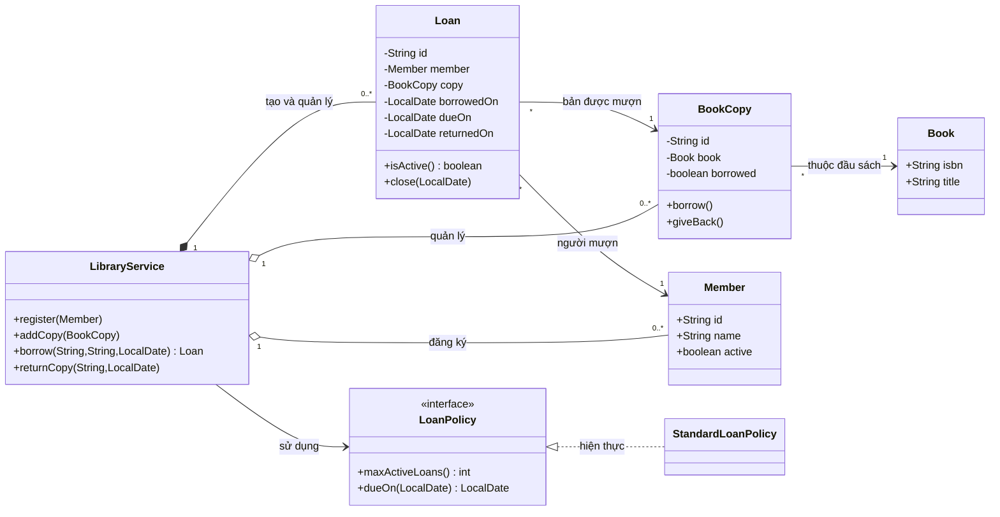
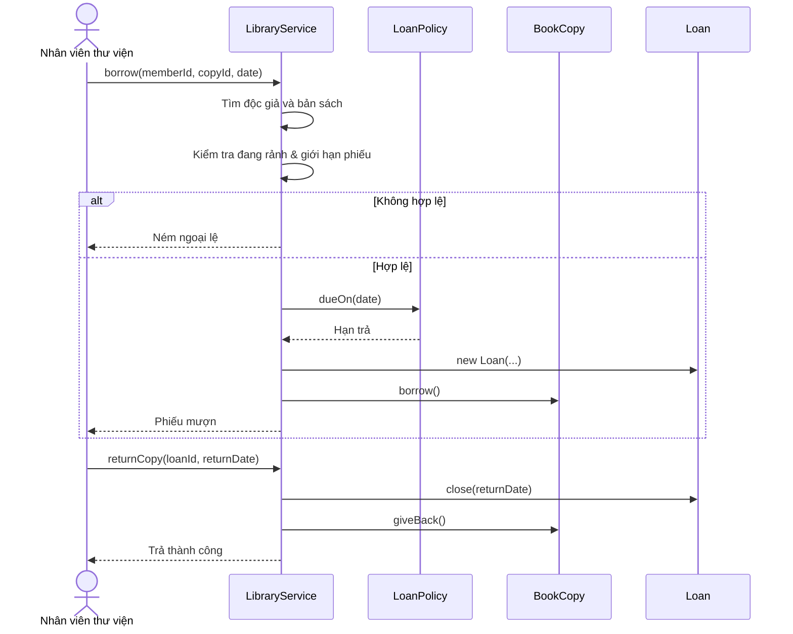

<a id="back-to-top"></a>

# Thực hành

## Menu
- [Bài tập lớp và đối tượng qua tài khoản ngân hàng](#practice-001)
- [Bài tập đóng gói quy tắc của đơn hàng](#practice-002)
- [Bài tập giao diện và đa hình thanh toán](#practice-003)
- [Bài tập chọn kế thừa hay kết hợp](#practice-004)
- [Bài tập đối tượng giá trị và so sánh bằng](#practice-005)
- [Bài tập nhận diện lỗi thiết kế](#practice-006)
- [Bài tập tái cấu trúc đoạn mã thủ tục thành mô hình đối tượng](#practice-007)
- [Dự án tổng hợp: phân tích yêu cầu và tình huống sử dụng](#practice-008)
- [Dự án tổng hợp: thiết kế lớp và quan hệ](#practice-009)
- [Dự án tổng hợp: hiện thực và kiểm thử hành vi](#practice-010)
- [Dự án tổng hợp: thay đổi yêu cầu và đánh giá thiết kế](#practice-011)

## <a id="practice-001">Bài tập lớp và đối tượng qua tài khoản ngân hàng</a>

<details>
<summary>Xem chi tiết</summary>

# Bài tập lớp và đối tượng qua tài khoản ngân hàng — Java OOP

## 1. Mục tiêu thực hành

Bài tập mô phỏng một tài khoản ngân hàng đơn giản để luyện cách biến yêu cầu nghiệp vụ thành **lớp (class)**, **đối tượng (object)**, **thuộc tính**, **phương thức**, **constructor** và **đóng gói dữ liệu (encapsulation)** trong Java.

Sau khi hoàn thành, bạn có thể:
- Mô tả một tài khoản bằng lớp BankAccount và tạo nhiều đối tượng độc lập bằng từ khóa new.
- Dùng các trường private để bảo vệ số dư, final cho thông tin không đổi sau khi khởi tạo.
- Viết constructor kiểm tra trạng thái đầu vào; cung cấp phương thức nạp, rút, chuyển tiền.
- Phân biệt biến tham chiếu, đối tượng thực tế, trạng thái và hành vi.
- Kiểm tra điều kiện biên, giao dịch bị từ chối và nguy cơ tràn số.
- Viết unit test để chứng minh quy tắc mà không cần kết nối ngân hàng thật.

Đây là chương trình **mô phỏng phục vụ học OOP**, không phải hệ thống ngân hàng thực. Dữ liệu chỉ ở bộ nhớ, không có đăng nhập, phân quyền, cơ sở dữ liệu, ghi sổ kế toán hay giao dịch phân tán.

## 2. Từ yêu cầu sang lớp và đối tượng

Giả sử cần quản lý hai tài khoản:

- Tài khoản A: mã TK001, chủ sở hữu An, số dư ban đầu 1.000.000 VND.
- Tài khoản B: mã TK002, chủ sở hữu Bình, số dư ban đầu 200.000 VND.
- Cho phép nạp tiền, rút tiền và chuyển tiền từ A sang B.
- Không cho số dư âm, không cho nạp/rút/chuyển số tiền bằng 0 hoặc âm.
- Phép toán làm số dư vượt miền long phải báo lỗi, không để tràn số âm thầm.

Các khái niệm:

| Khái niệm OOP | Áp dụng trong ví dụ | Ý nghĩa |
| --- | --- | --- |
| Class | BankAccount | Bản thiết kế chung cho một tài khoản |
| Object | accountA, accountB | Hai tài khoản cụ thể với trạng thái riêng |
| Field | accountNumber, ownerName, balanceVnd | Dữ liệu của mỗi đối tượng |
| Constructor | BankAccount(number, owner, initialBalance) | Khởi tạo đối tượng với trạng thái hợp lệ |
| Method | deposit, withdraw, transferTo | Hành vi được phép thao tác với số dư |
| Encapsulation | private balanceVnd và các phương thức public | Không cho mã bên ngoài gán số dư tùy ý |
| Reference | Biến accountA kiểu BankAccount | Tham chiếu đến đối tượng trong bộ nhớ |
| final field | accountNumber, ownerName | Không gán lại được từ sau constructor |

Mô hình lớp:

~~~mermaid
classDiagram
    class BankAccount {
        -String accountNumber
        -String ownerName
        -long balanceVnd
        +BankAccount(accountNumber, ownerName, initialBalanceVnd)
        +getAccountNumber() String
        +getOwnerName() String
        +getBalanceVnd() long
        +deposit(amountVnd) void
        +withdraw(amountVnd) void
        +transferTo(receiver, amountVnd) void
    }
    class BankDemo {
        +main(args) void
    }
    BankDemo --> BankAccount : tạo và gọi phương thức
    BankAccount --> BankAccount : transferTo(receiver)
~~~

Điểm quan trọng: **accountA và accountB được tạo từ cùng lớp BankAccount nhưng là hai đối tượng riêng**. Khi accountA.deposit(...), số dư của accountB không tự thay đổi.

## 3. Xác định hợp đồng cho từng thao tác

Ta dùng kiểu **long** để lưu số tiền nguyên theo VND, tránh dùng float/double cho ví dụ tính tiền nguyên. Nếu làm việc với tiền có phần thập phân hoặc nhiều loại tiền tệ, nên cân nhắc BigDecimal cùng mã đơn vị tiền; không dùng double để mô hình hóa số tiền chính xác.

| Thao tác | Điều kiện hợp lệ | Kết quả | Trường hợp sai |
| --- | --- | --- | --- |
| Tạo tài khoản | Mã và tên không trống, số dư đầu >= 0 | Đối tượng được tạo | IllegalArgumentException |
| deposit(amount) | amount > 0; tổng không tràn long | balance tăng amount | IllegalArgumentException hoặc ArithmeticException |
| withdraw(amount) | amount > 0 và amount <= balance | balance giảm amount | IllegalArgumentException hoặc IllegalStateException |
| transferTo(receiver, amount) | receiver khác null và không phải chính tài khoản; amount > 0; đủ tiền; người nhận không tràn | Bên gửi giảm, bên nhận tăng cùng amount | NullPointerException, IllegalArgumentException, IllegalStateException hoặc ArithmeticException |
| getBalanceVnd() | Không cần điều kiện | Trả số dư hiện tại | Không thay đổi trạng thái |

Quy ước của bài: thao tác không hợp lệ **ném exception và không thay đổi số dư**; phương thức giao dịch hợp lệ hoàn tất bình thường. Các điều kiện được kiểm tra trước khi sửa trạng thái.

Quy trình chuyển tiền trong một luồng:

~~~mermaid
flowchart TD
    A["accountA.transferTo(accountB, amount)"] --> B{"Người nhận hợp lệ và khác người gửi?"}
    B -->|Không| E["Ném lỗi, không đổi số dư"]
    B -->|Có| C{"Số tiền > 0 và bên gửi đủ tiền?"}
    C -->|Không| E
    C -->|Có| D{"Số dư bên nhận cộng amount có tràn long?"}
    D -->|Có| E
    D -->|Không| F["Giảm số dư bên gửi"]
    F --> G["Tăng số dư bên nhận"]
    G --> H["Hoàn tất"]
~~~

**Giới hạn có chủ đích:** phép chuyển tiền ở đây là thao tác đồng bộ trên hai đối tượng cùng tiến trình, giả định một luồng truy cập. Nó **không bảo đảm an toàn khi nhiều luồng thực hiện đồng thời** và không có giao dịch cơ sở dữ liệu; không được dùng logic này thay cơ chế giao dịch tài chính thực.

## 4. Viết chương trình hoàn chỉnh

Cấu trúc dự án Java 17 + Maven:

~~~text
bank-account-oop/
├── pom.xml
└── src/
    ├── main/java/vn/example/
    │   ├── BankAccount.java
    │   └── BankDemo.java
    └── test/java/vn/example/
        └── BankAccountTest.java
~~~

### 4.1. Cấu hình Maven

Tạo tệp pom.xml:

~~~xml
<project xmlns="http://maven.apache.org/POM/4.0.0">
    <modelVersion>4.0.0</modelVersion>
    <groupId>vn.example</groupId>
    <artifactId>bank-account-oop</artifactId>
    <version>1.0-SNAPSHOT</version>

    <properties>
        <maven.compiler.release>17</maven.compiler.release>
        <project.build.sourceEncoding>UTF-8</project.build.sourceEncoding>
    </properties>

    <dependencies>
        <dependency>
            <groupId>org.junit.jupiter</groupId>
            <artifactId>junit-jupiter</artifactId>
            <version>5.11.4</version>
            <scope>test</scope>
        </dependency>
    </dependencies>

    <build>
        <plugins>
            <plugin>
                <groupId>org.apache.maven.plugins</groupId>
                <artifactId>maven-surefire-plugin</artifactId>
                <version>3.5.2</version>
            </plugin>
        </plugins>
    </build>
</project>
~~~

### 4.2. Lớp BankAccount

Tạo tệp src/main/java/vn/example/BankAccount.java:

~~~java
package vn.example;

import java.util.Objects;

/**
 * Mô phỏng một tài khoản với tiền nguyên VND.
 * Phiên bản học tập: sử dụng trong một luồng, không lưu dữ liệu bền vững.
 */
public final class BankAccount {

    private final String accountNumber;
    private final String ownerName;
    private long balanceVnd;

    public BankAccount(
            String accountNumber,
            String ownerName,
            long initialBalanceVnd) {

        this.accountNumber = requireText(
                accountNumber, "accountNumber");
        this.ownerName = requireText(ownerName, "ownerName");

        if (initialBalanceVnd < 0) {
            throw new IllegalArgumentException(
                    "Initial balance must not be negative");
        }

        this.balanceVnd = initialBalanceVnd;
    }

    private static String requireText(String value, String field) {
        if (value == null || value.isBlank()) {
            throw new IllegalArgumentException(
                    field + " must not be blank");
        }
        return value.trim();
    }

    private static void requirePositive(long amountVnd) {
        if (amountVnd <= 0) {
            throw new IllegalArgumentException(
                    "Amount must be positive");
        }
    }

    public String getAccountNumber() {
        return accountNumber;
    }

    public String getOwnerName() {
        return ownerName;
    }

    public long getBalanceVnd() {
        return balanceVnd;
    }

    public void deposit(long amountVnd) {
        requirePositive(amountVnd);
        // Tính trước; nếu tràn long thì ném ArithmeticException.
        long newBalance = Math.addExact(balanceVnd, amountVnd);
        balanceVnd = newBalance;
    }

    public void withdraw(long amountVnd) {
        requirePositive(amountVnd);

        if (amountVnd > balanceVnd) {
            throw new IllegalStateException(
                    "Insufficient balance");
        }

        balanceVnd -= amountVnd;
    }

    public void transferTo(BankAccount receiver, long amountVnd) {
        Objects.requireNonNull(receiver, "receiver");

        if (receiver == this) {
            throw new IllegalArgumentException(
                    "Cannot transfer to the same object");
        }

        requirePositive(amountVnd);

        if (amountVnd > balanceVnd) {
            throw new IllegalStateException(
                    "Insufficient balance");
        }

        // Kiểm tra tràn số phía người nhận trước khi thay đổi hai tài khoản.
        long receiverNewBalance = Math.addExact(
                receiver.balanceVnd, amountVnd);

        balanceVnd -= amountVnd;
        receiver.balanceVnd = receiverNewBalance;
    }
}
~~~

**Đọc và giải thích từng thành phần quan trọng:**

- **private final String accountNumber, ownerName:** mã và tên gắn với tài khoản không được gán lại sau khi khởi tạo. final ở đây không bảo đảm tính duy nhất toàn hệ thống; ứng dụng thực cần nơi quản lý mã tài khoản.
- **private long balanceVnd:** trạng thái có thể thay đổi, nhưng lớp khác không thể gán trực tiếp một số âm hoặc một số bất kỳ.
- **constructor:** kiểm tra tất cả dữ liệu khởi tạo trước khi đối tượng được dùng.
- **getBalanceVnd:** cho phép đọc số dư nhưng không cung cấp phương thức setBalanceVnd tùy ý.
- **deposit:** gọi Math.addExact để lỗi tràn số được phát hiện trước khi cập nhật.
- **withdraw:** kiểm tra số tiền dương và đủ số dư trước khi trừ.
- **transferTo:** nhận một **đối tượng BankAccount khác**. Vì đang ở trong mã nguồn của cùng lớp, Java cho phép truy cập trường private balanceVnd của một instance BankAccount khác.
- **receiver == this:** so sánh danh tính đối tượng. Hai tham chiếu có thể cùng trỏ đến một đối tượng; kiểm tra này ngăn tài khoản tự chuyển cho chính mình.

Lưu ý: two objects cùng accountNumber vẫn có thể được tạo ra trong phiên bản này vì constructor chỉ xác thực định dạng không trống. Đó là giới hạn của mô hình học tập, cần repository/service quản lý danh tính và ràng buộc duy nhất trong hệ thống thực.

### 4.3. Lớp thực thi và tạo hai đối tượng

Tạo tệp src/main/java/vn/example/BankDemo.java:

~~~java
package vn.example;

public final class BankDemo {

    public static void main(String[] args) {
        BankAccount accountA =
                new BankAccount("TK001", "An", 1_000_000L);
        BankAccount accountB =
                new BankAccount("TK002", "Binh", 200_000L);

        accountA.deposit(200_000L);
        accountA.withdraw(50_000L);
        accountA.transferTo(accountB, 300_000L);

        System.out.println(
                accountA.getAccountNumber()
                + " - " + accountA.getOwnerName()
                + ": " + accountA.getBalanceVnd() + " VND");

        System.out.println(
                accountB.getAccountNumber()
                + " - " + accountB.getOwnerName()
                + ": " + accountB.getBalanceVnd() + " VND");
    }
}
~~~

Cách đọc biểu thức:

~~~java
BankAccount accountA = new BankAccount("TK001", "An", 1_000_000L);
~~~

- **BankAccount** bên trái là kiểu biến tham chiếu.
- **accountA** là tên biến, không phải toàn bộ đối tượng.
- **new BankAccount(...)** tạo một đối tượng BankAccount và gọi constructor.
- Dấu chấm trong **accountA.deposit(...)** dùng để gửi yêu cầu hành vi cho đối tượng mà biến đang tham chiếu.
- Hai đối tượng có số dư riêng; phép chuyển tiền cho thấy chúng có thể tương tác thông qua phương thức.

Chạy trong thư mục có pom.xml:

~~~bash
mvn test
mvn -q -DskipTests package
java -cp target/classes vn.example.BankDemo
~~~

Kết quả dự kiến:

~~~text
TK001 - An: 850000 VND
TK002 - Binh: 500000 VND
~~~

Kiểm tra bằng tay:

| Bước | Tài khoản A (VND) | Tài khoản B (VND) |
| --- | ---: | ---: |
| Ban đầu | 1.000.000 | 200.000 |
| A nạp 200.000 | 1.200.000 | 200.000 |
| A rút 50.000 | 1.150.000 | 200.000 |
| A chuyển B 300.000 | **850.000** | **500.000** |

Trong lần chuyển tiền, tổng số dư hai tài khoản trước và sau chuyển bằng nhau: 1.350.000 VND. Chuyển tiền không tạo thêm tiền hoặc làm mất tiền **khi thao tác hợp lệ hoàn tất trong mô hình đơn luồng này**.

## 5. Kiểm thử hành vi và bất biến bằng JUnit 5

Không chỉ chạy main một lần: mã hướng đối tượng tốt phải được kiểm tra với nhiều trạng thái, đặc biệt thao tác bị từ chối.

Tạo tệp src/test/java/vn/example/BankAccountTest.java:

~~~java
package vn.example;

import static org.junit.jupiter.api.Assertions.*;

import org.junit.jupiter.api.Test;

class BankAccountTest {

    @Test
    void newlyCreatedAccountsHaveIndependentState() {
        BankAccount a = new BankAccount("TK001", "An", 100L);
        BankAccount b = new BankAccount("TK002", "Binh", 50L);

        a.deposit(20L);

        assertEquals(120L, a.getBalanceVnd());
        assertEquals(50L, b.getBalanceVnd());
        assertEquals("TK001", a.getAccountNumber());
        assertEquals("Binh", b.getOwnerName());
    }

    @Test
    void depositIncreasesBalance() {
        BankAccount account = new BankAccount("A", "An", 100L);

        account.deposit(25L);

        assertEquals(125L, account.getBalanceVnd());
    }

    @Test
    void withdrawDecreasesBalance() {
        BankAccount account = new BankAccount("A", "An", 100L);

        account.withdraw(100L);

        assertEquals(0L, account.getBalanceVnd());
    }

    @Test
    void cannotWithdrawMoreThanAvailableBalance() {
        BankAccount account = new BankAccount("A", "An", 100L);

        assertThrows(IllegalStateException.class,
                () -> account.withdraw(101L));

        assertEquals(100L, account.getBalanceVnd());
    }

    @Test
    void transactionsRejectZeroAndNegativeAmounts() {
        BankAccount a = new BankAccount("A", "An", 100L);
        BankAccount b = new BankAccount("B", "Binh", 50L);

        assertThrows(IllegalArgumentException.class,
                () -> a.deposit(0L));
        assertThrows(IllegalArgumentException.class,
                () -> a.deposit(-2L));
        assertThrows(IllegalArgumentException.class,
                () -> a.withdraw(0L));
        assertThrows(IllegalArgumentException.class,
                () -> a.transferTo(b, -10L));

        assertEquals(100L, a.getBalanceVnd());
        assertEquals(50L, b.getBalanceVnd());
    }

    @Test
    void transferMovesMoneyBetweenTwoObjects() {
        BankAccount a = new BankAccount("A", "An", 200L);
        BankAccount b = new BankAccount("B", "Binh", 50L);

        a.transferTo(b, 80L);

        assertEquals(120L, a.getBalanceVnd());
        assertEquals(130L, b.getBalanceVnd());
        assertEquals(250L,
                a.getBalanceVnd() + b.getBalanceVnd());
    }

    @Test
    void failedTransferPreservesBothBalances() {
        BankAccount a = new BankAccount("A", "An", 40L);
        BankAccount b = new BankAccount("B", "Binh", 70L);

        assertThrows(IllegalStateException.class,
                () -> a.transferTo(b, 41L));

        assertEquals(40L, a.getBalanceVnd());
        assertEquals(70L, b.getBalanceVnd());
    }

    @Test
    void cannotTransferToSameAccountOrNull() {
        BankAccount account =
                new BankAccount("A", "An", 100L);

        assertThrows(IllegalArgumentException.class,
                () -> account.transferTo(account, 10L));
        assertThrows(NullPointerException.class,
                () -> account.transferTo(null, 10L));

        assertEquals(100L, account.getBalanceVnd());
    }

    @Test
    void overflowFailsWithoutChangingBalances() {
        BankAccount a = new BankAccount("A", "An", 100L);
        BankAccount b =
                new BankAccount("B", "Binh", Long.MAX_VALUE);

        assertThrows(ArithmeticException.class,
                () -> a.transferTo(b, 1L));

        assertEquals(100L, a.getBalanceVnd());
        assertEquals(Long.MAX_VALUE, b.getBalanceVnd());

        assertThrows(ArithmeticException.class,
                () -> b.deposit(1L));
        assertEquals(Long.MAX_VALUE, b.getBalanceVnd());
    }

    @Test
    void constructorRejectsInvalidInitialState() {
        assertThrows(IllegalArgumentException.class,
                () -> new BankAccount("", "An", 10L));
        assertThrows(IllegalArgumentException.class,
                () -> new BankAccount("A", " ", 10L));
        assertThrows(IllegalArgumentException.class,
                () -> new BankAccount("A", "An", -1L));
    }
}
~~~

Có **10 phương thức @Test**. Khi chạy mvn test, kỳ vọng 10 test chạy thành công trên đúng các tệp đã nêu, với 0 failures và 0 errors.

### Vì sao phải kiểm tra cả trạng thái sau khi thất bại?

Một triển khai sai có thể làm:

~~~java
// Ví dụ cố tình SAI, không dùng thay phương thức transferTo thật:
balanceVnd -= amountVnd;
receiver.deposit(amountVnd);
~~~

Nếu receiver.deposit(...) thất bại vì tràn long, bên gửi đã bị trừ trước đó. Kết quả là một nửa giao dịch được thực hiện. Mã đúng **tính trước số dư mới của người nhận, rồi mới thay đổi cả hai số dư** trong một luồng.

Bộ test overflowFailsWithoutChangingBalances bảo vệ chính bất biến này. Tuy nhiên, thao tác gồm hai phép gán vẫn chưa atomic trước truy cập đồng thời hoặc lỗi tiến trình; muốn giải quyết phải dùng đồng bộ hóa/transaction và thiết kế sổ cái phù hợp.

## 6. Câu hỏi tư duy OOP qua bài thực hành

**Lớp khác có thể gán account.balanceVnd = -5 không?** Không, vì trường private. Lớp khác phải sử dụng API public, nơi BankAccount kiểm tra các bất biến. Getter đọc số dư không trao quyền sửa trực tiếp.

**Tại sao không dùng static cho balanceVnd?** static tạo một trường chung ở cấp lớp, khiến các đối tượng có thể dùng chung số dư. Ở đây mỗi BankAccount có trạng thái riêng, nên balanceVnd là trường instance.

**Hai biến có thể trỏ cùng đối tượng không?** Có:

~~~java
BankAccount first = new BankAccount("A", "An", 100L);
BankAccount alias = first;
alias.deposit(50L);
System.out.println(first.getBalanceVnd()); // 150
~~~

Phép gán alias = first sao chép **tham chiếu**, không tạo đối tượng mới. Vì vậy cả hai biến cùng quan sát một số dư 150 VND.

**Vì sao không tạo setBalanceVnd?** Một setter tự do có thể bỏ qua kiểm tra nguồn tiền. Phương thức deposit, withdraw, transferTo biểu đạt ý nghĩa hành vi và kiểm soát các điều kiện trước khi cập nhật trạng thái.

**Vì sao transferTo có thể thay đổi balanceVnd của receiver dù là private?** Quyền private trong Java áp dụng ở cấp lớp. Mã bên trong lớp BankAccount có thể truy cập trường private của bất kỳ instance BankAccount nào. Mã trong BankDemo vẫn không thể làm vậy.

**Nạp/rút và chuyển tiền có cùng độ an toàn không?** Không. Nạp và rút thay trạng thái một đối tượng; chuyển tiền cần cập nhật hai đối tượng liên quan. Trong hệ thống đa luồng/phân tán, cần xử lý tranh chấp và trạng thái giao dịch bền vững.

## 7. Nhận diện lỗi phổ biến

| Lỗi | Nguyên nhân | Hướng sửa |
| --- | --- | --- |
| Đặt balanceVnd là public | Mã ngoài có thể phá bất biến | Dùng private, expose hành vi nghiệp vụ |
| Dùng static balanceVnd | Mọi đối tượng có chung số dư | Sử dụng instance field |
| Rút tiền rồi mới kiểm tra đủ tiền | Có thể âm số dư hoặc trạng thái sai | Kiểm tra trước khi trừ |
| Không kiểm tra amount <= 0 | Cho phép rút số âm gây cộng tiền | Kiểm tra số tiền dương ở mọi thao tác |
| Dùng double cho tiền | Có thể sai số nhị phân | Dùng long theo đơn vị nhỏ nhất hoặc BigDecimal |
| Không kiểm tra tràn số | long có thể wrap không cảnh báo | Math.addExact và kiểm thử giới hạn |
| Chuyển tiền cập nhật nguồn trước khi kiểm tra đích | Exception khiến trạng thái một phần | Tính/validate toàn bộ trước khi mutate |
| So sánh String bằng == | So sánh tham chiếu thay vì nội dung | Dùng equals khi kiểm tra giá trị String |
| Chỉ thử happy path | Lỗi phát sinh ở nhánh âm/tràn/thiếu tiền | Test bất biến và nhánh thất bại |
| Kết luận mô phỏng là hệ thống ngân hàng thật | Thiếu transaction, đồng thời, xác thực và audit | Bổ sung kiến trúc chuyên dụng khi triển khai thật |

## 8. Bài tập tự mở rộng

### Bài A — In thông tin tài khoản

Viết phương thức summary() trả một String gồm số tài khoản, tên và số dư. Không cho caller sửa số dư thông qua kết quả trả về. Gọi từ BankDemo để thấy hai đối tượng có thông tin độc lập.

### Bài B — Lịch sử giao dịch

Thêm một kiểu Transaction mô tả loại giao dịch, số tiền và thời điểm. Cân nhắc lưu danh sách giao dịch chỉ đọc với List.copyOf(...), và dùng Clock được tiêm vào constructor nếu muốn test thời gian một cách xác định. Quy định rõ có ghi nhận giao dịch bị từ chối hay không.

### Bài C — Hai loại tài khoản

Thêm SavingsAccount có tính lãi hoặc CheckingAccount có quy tắc rút khác. Cân nhắc dùng kế thừa chỉ khi tồn tại quan hệ is-a thực sự đúng hợp đồng; với chính sách tính phí/lãi thay đổi, có thể dùng composition qua interface InterestPolicy/FeePolicy. Không mở rộng BankAccount chỉ để kế thừa các trường private.

### Bài D — Bài toán chuyển tiền nâng cao

Giả lập nhiều yêu cầu chuyển đồng thời giữa hai tài khoản, phân tích tại sao việc kiểm tra số dư rồi cập nhật có thể sinh race condition. Đề xuất sử dụng locking theo thứ tự khóa ổn định hoặc database transaction; viết test concurrency riêng khi đã thiết kế đúng môi trường.

### Bài E — Tách trách nhiệm

Khi ứng dụng cần tìm tài khoản bằng số tài khoản và bảo đảm mã duy nhất, có nên đưa một danh sách static toàn cục vào BankAccount? Hãy đề xuất AccountRepository/BankService để quản lý kho tài khoản, rồi giải thích vì sao BankAccount vẫn nên tập trung vào bất biến và hành vi của chính tài khoản.

## 9. Checklist tự đánh giá

- [ ] Tạo được ít nhất hai object BankAccount độc lập bằng new.
- [ ] Trình bày được đâu là class, object, instance field, constructor và method.
- [ ] Giải thích được sự khác nhau giữa first và alias cùng trỏ một object.
- [ ] Số dư không thể bị sửa tùy ý từ bên ngoài lớp.
- [ ] Nạp/rút/chuyển tiền đúng số học và từ chối số tiền không hợp lệ.
- [ ] Khi giao dịch thất bại, các số dư liên quan giữ nguyên trong mô hình đơn luồng.
- [ ] Code được tổ chức thành các tệp Java hợp lệ, chạy được BankDemo và bộ test JUnit.
- [ ] Hiểu các giới hạn về đồng thời, tính bền vững và kiểm toán của mô hình.

**Kết quả mong đợi:** Bạn đã tạo một lớp mô tả đúng trách nhiệm của tài khoản, khởi tạo và tương tác giữa các đối tượng, kiểm soát dữ liệu bằng encapsulation, và dùng kiểm thử xác minh bất biến thay vì chỉ quan sát kết quả của một lần chạy main.


</details>

- [Quay lại đầu trang](#back-to-top)

---

## <a id="practice-002">Bài tập đóng gói quy tắc của đơn hàng</a>

<details>
<summary>Xem chi tiết</summary>

# Bài tập: Đóng gói quy tắc của đơn hàng bằng Java OOP

> **Bối cảnh:** Thực hành thiết kế một đối tượng `Order` (đơn hàng) có trách nhiệm tự bảo vệ trạng thái và các quy tắc nghiệp vụ. Mục tiêu không chỉ là giấu field bằng `private`, mà còn ngăn mọi đường sửa dữ liệu có thể tạo một đơn hàng sai.

## 1. Tình huống

Bạn tham gia xây dựng phần giỏ hàng/đặt hàng cho một cửa hàng trực tuyến. Thiết kế ban đầu có thể trông như sau:

~~~java
import java.util.ArrayList;
import java.util.List;

class OrderBad {
    public final List<OrderLineBad> lines = new ArrayList<>();
    public String status = "DRAFT";
}

class OrderLineBad {
    public String sku;
    public long priceCents;
    public int quantity;
}
~~~

Mã khác có thể làm tất cả những việc sau:

~~~java
OrderBad order = new OrderBad();
order.status = "PLACED";
order.lines.add(new OrderLineBad()); // sku null, quantity 0
order.lines.get(0).quantity = -5;
order.lines.clear();                 // xóa sau khi đã đặt hàng
~~~

Các lỗi này xảy ra vì **người sử dụng đối tượng có toàn quyền sửa trạng thái**, nên không ai bảo đảm bất biến nghiệp vụ. Việc đổi `public List` thành `private List` nhưng vẫn trả thẳng danh sách gốc từ getter cũng không giải quyết vấn đề.

**Nhiệm vụ:** thiết kế lại `Order` thành một *aggregate* đơn giản: `Order` sở hữu các dòng hàng, kiểm soát cập nhật, tự tính tổng tiền và quản lý vòng đời đơn hàng. Client chỉ gọi những hành vi được phép.

## 2. Đặc tả bắt buộc trước khi viết code

### Dữ liệu và quy tắc

Mỗi đơn hàng có một mã `orderId`, một trạng thái và tập các dòng hàng. Mỗi dòng hàng gồm mã sản phẩm `sku`, đơn giá `unitPriceCents` và số lượng `quantity`.

| Quy tắc | Hợp đồng cụ thể |
|---|---|
| Mã đơn hàng | Không `null`, không rỗng hoặc chỉ khoảng trắng; chuẩn hóa bằng `trim()` |
| Mã SKU | Không `null`/rỗng; sau `trim()` và chuyển chữ hoa, chỉ chấp nhận `A-Z`, `0-9`, dấu `-` |
| Trùng SKU | Mỗi SKU chuẩn hóa xuất hiện tối đa một dòng; `setLine` thay thế dòng đã có |
| Đơn giá | Đơn vị là **cent**, trong khoảng `1..1_000_000` |
| Số lượng | Mỗi dòng có `quantity` trong `1..100` |
| Tổng tiền hàng | `subtotal = Σ(unitPriceCents × quantity)`, không vượt `10_000_000` cent |
| Sửa số lượng | `changeQuantity(sku, 0)` xóa dòng; giá trị âm hoặc trên 100 là lỗi |
| Xóa SKU | `removeLine(sku)` trả `true` nếu có dòng được xóa; `false` nếu không tồn tại |
| Phí vận chuyển | Đơn rỗng: 0; đơn có `subtotal >= 100_000`: 0; còn lại: `15_000` cent |
| Giảm giá | Khi `subtotal >= 200_000`, giảm `5%` theo phép chia nguyên `subtotal / 20`; còn lại 0 |
| Phải trả | `payable = subtotal - discount + shipping` |
| Ngoại lệ | Đầu vào sai: `IllegalArgumentException`; SKU chưa tồn tại khi đổi số lượng: `NoSuchElementException`; trạng thái không cho phép thao tác: `IllegalStateException` |
| Hiệu ứng khi lỗi | Khi một thao tác bị từ chối, đơn hàng vẫn giữ trạng thái trước thao tác |

Quy tắc chính sách giá trên chỉ là giả định cho bài thực hành. Trong hệ thống thật, cần thống nhất rõ chính sách tiền, thuế, chiết khấu và làm tròn với bên nghiệp vụ.

### Vòng đời của đơn hàng

- **DRAFT:** thêm/thay thế dòng hàng, đổi số lượng và xóa dòng được phép.
- **PLACED:** đơn đã đặt; không được sửa dòng hàng hoặc đặt lại.
- **CANCELLED:** trạng thái kết thúc; không được thêm/sửa/xóa hoặc đặt hàng.
- `place()` chỉ đi từ `DRAFT` sang `PLACED` khi đơn có ít nhất một dòng.
- `cancel()` cho phép từ `DRAFT` hoặc `PLACED` sang `CANCELLED`; gọi lần hai bị từ chối.
- Việc hủy ở đây chỉ thay đổi trạng thái của ví dụ trong bộ nhớ; **không tự xử lý hoàn tiền hay gửi thông báo**.

~~~mermaid
stateDiagram-v2
    [*] --> DRAFT : tạo Order
    DRAFT --> DRAFT : setLine / changeQuantity / removeLine
    DRAFT --> PLACED : place() khi có dòng
    DRAFT --> CANCELLED : cancel()
    PLACED --> CANCELLED : cancel()
    CANCELLED --> [*]
~~~

### API mong muốn

~~~java
Order order = new Order("ORD-001");

order.setLine(" book ", 90_000, 1);
order.setLine("PEN", 10_000, 2);
order.changeQuantity("BOOK", 2);

List<OrderLine> snapshot = order.lines();  // chỉ đọc, không sửa đơn được
OrderSummary result = order.summary();     // do Order tự tính
order.place();                             // khóa các thao tác chỉnh dòng
~~~

API này cung cấp **hành động có ý nghĩa**, thay vì `setStatus("PLACED")`, `setSubtotal(...)` hoặc `getMutableLines()`. Điều đó giúp đặt quy tắc đúng nơi chịu trách nhiệm.

## 3. Gợi ý tự làm trước khi xem lời giải

Thử tự triển khai theo các điểm sau:

1. Tạo `enum OrderStatus { DRAFT, PLACED, CANCELLED }` để loại bỏ các chuỗi trạng thái tùy tiện.
2. Sử dụng `record OrderLine(...)` để mỗi dòng hàng không có setter và kiểm tra dữ liệu ngay khi khởi tạo.
3. Giữ các field của `Order` là `private`; dùng `Map<String, OrderLine>` để quản lý một dòng trên mỗi SKU.
4. Đưa nghiệp vụ vào các method `setLine`, `changeQuantity`, `removeLine`, `place`, `cancel`, `summary`.
5. Tính giá trị **dự kiến** của một lần sửa trước khi cập nhật vào đơn. Nếu vượt giới hạn tổng tiền, báo lỗi mà không để lại dữ liệu nửa chừng.
6. Trả `List.copyOf(lines.values())` làm snapshot; vì `OrderLine` chứa các component immutable, người gọi không thể sửa cấu trúc hoặc phần tử để tác động giỏ hàng.
7. Tạo test cho giá trị biên và các thao tác bị cấm sau `place()`.

Một cách chia trách nhiệm hợp lý:

| Thành phần | Chịu trách nhiệm | Không nên làm |
|---|---|---|
| `Order` | Kiểm soát trạng thái, các dòng hàng, bất biến và quy tắc tiền của đơn | Trả Map nội bộ, cho caller gán tổng tiền |
| `OrderLine` | Biểu diễn một dòng hàng hợp lệ, bất biến | Có setter thay số lượng hoặc đơn giá |
| `OrderStatus` | Tập trạng thái hợp lệ | Dùng chuỗi tùy ý để chứa trạng thái |
| `OrderSummary` | Kết quả tính tiền bất biến | Là nơi lưu tổng tiền có thể được sửa tự do |
| Client/UI/API | Gọi hành vi, hiển thị snapshot | Tính lại quy tắc kinh doanh rồi tự sửa field |

## 4. Lời giải tham khảo Java 17 — chạy độc lập

Tạo tệp **`OrderExercise.java`**. Đoạn mã dưới đây sử dụng duy nhất Java Standard Library và có phương thức `main` để tự kiểm tra nghiệp vụ.

~~~java
import java.util.LinkedHashMap;
import java.util.List;
import java.util.Locale;
import java.util.Map;
import java.util.NoSuchElementException;

public class OrderExercise {
    static final long MAX_UNIT_PRICE = 1_000_000L;
    static final long MAX_SUBTOTAL = 10_000_000L;
    static final int MAX_QUANTITY = 100;

    enum OrderStatus {
        DRAFT, PLACED, CANCELLED
    }

    static String normalizeSku(String sku) {
        if (sku == null) {
            throw new IllegalArgumentException("sku must not be null");
        }
        String normalized = sku.trim().toUpperCase(Locale.ROOT);
        if (!normalized.matches("[A-Z0-9-]+")) {
            throw new IllegalArgumentException("Invalid SKU: " + sku);
        }
        return normalized;
    }

    // Immutable value object. Bất biến được kiểm tra ngay khi khởi tạo.
    record OrderLine(String sku, long unitPriceCents, int quantity) {
        OrderLine {
            sku = normalizeSku(sku);
            if (unitPriceCents < 1 || unitPriceCents > MAX_UNIT_PRICE) {
                throw new IllegalArgumentException("Invalid unit price");
            }
            if (quantity < 1 || quantity > MAX_QUANTITY) {
                throw new IllegalArgumentException("Invalid quantity");
            }
        }

        long lineTotalCents() {
            return Math.multiplyExact(unitPriceCents, quantity);
        }
    }

    // Snapshot số tiền; caller chỉ đọc các component.
    record OrderSummary(
            long subtotalCents,
            long discountCents,
            long shippingCents,
            long payableCents) {
    }

    static final class Order {
        private final String orderId;
        private final Map<String, OrderLine> lines = new LinkedHashMap<>();
        private OrderStatus status = OrderStatus.DRAFT;

        Order(String orderId) {
            if (orderId == null || orderId.isBlank()) {
                throw new IllegalArgumentException("orderId is required");
            }
            this.orderId = orderId.trim();
        }

        String orderId() {
            return orderId;
        }

        OrderStatus status() {
            return status;
        }

        int lineCount() {
            return lines.size();
        }

        // Không trả Map hoặc collection mutable đang được giữ bên trong.
        List<OrderLine> lines() {
            return List.copyOf(lines.values());
        }

        private void ensureDraft() {
            if (status != OrderStatus.DRAFT) {
                throw new IllegalStateException(
                    "Order cannot be modified in state " + status
                );
            }
        }

        // Tính trước và từ chối ứng viên sai trước khi sửa state thật.
        private static long subtotalOf(Map<String, OrderLine> candidate) {
            long sum = 0;
            try {
                for (OrderLine line : candidate.values()) {
                    sum = Math.addExact(sum, line.lineTotalCents());
                }
            } catch (ArithmeticException overflow) {
                throw new IllegalArgumentException(
                    "Subtotal arithmetic overflow", overflow
                );
            }
            if (sum > MAX_SUBTOTAL) {
                throw new IllegalArgumentException(
                    "Subtotal exceeds " + MAX_SUBTOTAL
                );
            }
            return sum;
        }

        // Thêm SKU mới hoặc thay thế dòng của SKU đã có.
        void setLine(String sku, long unitPriceCents, int quantity) {
            ensureDraft();
            OrderLine newLine = new OrderLine(sku, unitPriceCents, quantity);

            Map<String, OrderLine> candidate = new LinkedHashMap<>(lines);
            candidate.put(newLine.sku(), newLine);
            subtotalOf(candidate);             // có thể ném lỗi

            lines.put(newLine.sku(), newLine); // commit sau validation
        }

        void changeQuantity(String sku, int newQuantity) {
            ensureDraft();
            String key = normalizeSku(sku);
            if (newQuantity < 0 || newQuantity > MAX_QUANTITY) {
                throw new IllegalArgumentException("Invalid quantity");
            }

            OrderLine current = lines.get(key);
            if (current == null) {
                throw new NoSuchElementException("Unknown SKU: " + key);
            }

            if (newQuantity == 0) {
                lines.remove(key);
                return;
            }

            // Giữ đơn giá cũ và kiểm tra tổng trước khi cập nhật.
            setLine(key, current.unitPriceCents(), newQuantity);
        }

        boolean removeLine(String sku) {
            ensureDraft();
            return lines.remove(normalizeSku(sku)) != null;
        }

        OrderSummary summary() {
            long subtotal = subtotalOf(lines);
            long discount = subtotal >= 200_000 ? subtotal / 20 : 0;
            long shipping = (lines.isEmpty() || subtotal >= 100_000)
                    ? 0 : 15_000;
            long payable = Math.addExact(
                Math.subtractExact(subtotal, discount), shipping);
            return new OrderSummary(
                subtotal, discount, shipping, payable
            );
        }

        void place() {
            ensureDraft();
            if (lines.isEmpty()) {
                throw new IllegalStateException("Cannot place empty order");
            }
            status = OrderStatus.PLACED;
        }

        void cancel() {
            if (status == OrderStatus.CANCELLED) {
                throw new IllegalStateException("Order already cancelled");
            }
            status = OrderStatus.CANCELLED;
        }
    }

    private static void require(boolean value, String message) {
        if (!value) {
            throw new AssertionError(message);
        }
    }

    // Mini assertion utility, không cần dependency ngoài JDK.
    private static void expectThrows(
            Class<? extends RuntimeException> type, Runnable action) {
        try {
            action.run();
        } catch (RuntimeException ex) {
            if (type.isInstance(ex)) {
                return;
            }
            throw new AssertionError(
                "Expected " + type.getSimpleName()
                    + " but caught " + ex.getClass().getSimpleName(),
                ex
            );
        }
        throw new AssertionError(
            "Expected exception " + type.getSimpleName()
        );
    }

    private static OrderLine findLine(List<OrderLine> snapshot, String sku) {
        return snapshot.stream()
            .filter(line -> line.sku().equals(sku))
            .findFirst()
            .orElseThrow();
    }

    public static void main(String[] args) {
        // 1) Chuẩn hóa SKU và tính tiền.
        Order order = new Order(" ORD-001 ");
        require(order.status() == OrderStatus.DRAFT, "initial status");
        require(order.summary().equals(
                new OrderSummary(0, 0, 0, 0)), "empty summary");

        order.setLine(" book ", 90_000, 1);
        order.setLine("PEN", 10_000, 2);
        require(order.lineCount() == 2, "two unique SKUs");
        require(order.summary().equals(
                new OrderSummary(110_000, 0, 0, 110_000)),
                "no discount, free shipping above 100000");

        // 2) Snapshot không thể sửa và không đổi theo update sau đó.
        List<OrderLine> before = order.lines();
        expectThrows(UnsupportedOperationException.class, before::clear);
        require(findLine(before, "BOOK").quantity() == 1,
                "old quantity");

        order.changeQuantity("BOOK", 2);
        require(order.summary().equals(
                new OrderSummary(200_000, 10_000, 0, 190_000)),
                "5% discount from 200000");

        require(findLine(before, "BOOK").quantity() == 1,
                "old snapshot remains unchanged");
        require(findLine(order.lines(), "BOOK").quantity() == 2,
                "new snapshot sees new state");

        // 3) Validation thất bại không làm hỏng đơn.
        OrderSummary goodState = order.summary();
        expectThrows(IllegalArgumentException.class,
            () -> order.setLine("BAD", -1, 1));
        expectThrows(IllegalArgumentException.class,
            () -> order.setLine("?", 100, 1));
        expectThrows(IllegalArgumentException.class,
            () -> order.changeQuantity("BOOK", -3));
        expectThrows(NoSuchElementException.class,
            () -> order.changeQuantity("UNKNOWN", 1));
        expectThrows(IllegalArgumentException.class,
            () -> order.setLine("EXPENSIVE", 1_000_000, 11));

        require(order.summary().equals(goodState),
                "failed mutations must not change totals");
        require(order.lineCount() == 2,
                "failed mutations must not add/remove lines");

        // 4) Kiểm thử cả hai phía của ngưỡng phí ship và giảm giá.
        Order boundaries = new Order("ORD-002");
        boundaries.setLine("A", 99_999, 1);
        require(boundaries.summary().equals(
                new OrderSummary(99_999, 0, 15_000, 114_999)),
                "shipping below threshold");

        boundaries.setLine("A", 100_000, 1);
        require(boundaries.summary().equals(
                new OrderSummary(100_000, 0, 0, 100_000)),
                "shipping free at threshold");

        boundaries.setLine("A", 199_999, 1);
        require(boundaries.summary().discountCents() == 0,
                "no discount below 200000");

        boundaries.setLine("A", 200_000, 1);
        require(boundaries.summary().equals(
                new OrderSummary(200_000, 10_000, 0, 190_000)),
                "discount at threshold");

        // 5) Trạng thái quản lý hành động được phép.
        expectThrows(IllegalStateException.class,
            () -> new Order("EMPTY").place());

        order.place();
        require(order.status() == OrderStatus.PLACED, "placed status");
        expectThrows(IllegalStateException.class,
            () -> order.setLine("NEW", 50, 1));
        expectThrows(IllegalStateException.class,
            () -> order.removeLine("BOOK"));
        expectThrows(IllegalStateException.class, order::place);

        order.cancel();
        require(order.status() == OrderStatus.CANCELLED, "cancelled status");
        expectThrows(IllegalStateException.class, order::cancel);
        expectThrows(IllegalStateException.class,
            () -> order.changeQuantity("BOOK", 1));

        System.out.println("PASS: SKU and business-rule validation");
        System.out.println("PASS: defensive snapshot and protected state");
        System.out.println("PASS: pricing thresholds and unchanged state on error");
        System.out.println("PASS: order lifecycle");
    }
}
~~~

Chạy:

~~~bash
javac OrderExercise.java
java OrderExercise
~~~

Kết quả kỳ vọng:

~~~text
PASS: SKU and business-rule validation
PASS: defensive snapshot and protected state
PASS: pricing thresholds and unchanged state on error
PASS: order lifecycle
~~~

**Giải thích thiết kế:** `Order` không có `setStatus` hay `setTotal`. Mã gọi `place()` hoặc `cancel()` theo quy tắc chuyển trạng thái; `summary()` luôn tính từ các dòng hiện hành. Phương thức `setLine()` tạo map ứng viên và kiểm tra giới hạn **trước** khi cập nhật map thật. Nhờ vậy, một thao tác vượt giới hạn tổng tiền không bỏ lại dòng hàng sai.

Mã ví dụ dùng `LinkedHashMap` để thuận tiện theo dõi dữ liệu, nhưng client không phụ thuộc trực tiếp loại map này. `OrderLine` là record chỉ chứa `String` và primitive nên snapshot không lộ mutable element; nếu record chứa `Date`, `List` hoặc mảng, chỉ dùng `record` thôi chưa bảo đảm bất biến sâu.

## 5. Các nguyên tắc OOP được thực hành

### Encapsulation: chủ thể sở hữu trạng thái

~~~mermaid
classDiagram
    class Order {
        -String orderId
        -Map~String,OrderLine~ lines
        -OrderStatus status
        +setLine(String,long,int)
        +changeQuantity(String,int)
        +removeLine(String) boolean
        +lines() List~OrderLine~
        +summary() OrderSummary
        +place()
        +cancel()
    }
    class OrderLine {
        <<record>>
        +sku() String
        +unitPriceCents() long
        +quantity() int
    }
    class OrderSummary {
        <<record>>
        +subtotalCents() long
        +discountCents() long
        +shippingCents() long
        +payableCents() long
    }
    class OrderStatus {
        <<enumeration>>
        DRAFT
        PLACED
        CANCELLED
    }
    Order "1" o-- "*" OrderLine : sở hữu
    Order --> OrderStatus : trạng thái
    Order --> OrderSummary : tạo bản đọc
~~~

Trong phạm vi bài tập, **`Order` là nơi duy nhất được cập nhật collection và trạng thái**. Client gọi API của `Order`, không chỉnh `Map` hay enum field trực tiếp.

### Invariant: kiểm tra ở mọi đường thay đổi

Không đủ nếu constructor kiểm tra đơn giá và số lượng nhưng một setter khác vẫn cho sửa chúng. Các quy tắc cần giữ đúng qua **mọi public mutation**, bao gồm:

- Thêm/thay thế một dòng.
- Đổi số lượng, nhất là `0` hoặc giá trị âm.
- Xóa dòng và xác nhận/đặt hàng.
- Thao tác thất bại do trạng thái hoặc giới hạn tổng tiền.

### Information hiding: giấu quyết định lưu trữ

Sử dụng `Map<String,OrderLine>` là một quyết định nội bộ; về sau có thể đổi sang một cấu trúc khác mà các thao tác nghiệp vụ công khai vẫn giữ nguyên. `Order.lines()` trả snapshot để UI hiển thị, không cho UI quản lý cách các dòng được lưu.

### Cohesion: logic nào thuộc trách nhiệm của Order?

Ví dụ này đưa **tổng tiền, trạng thái và quy tắc dòng hàng** vào `Order` vì chúng phụ thuộc trực tiếp đến một đơn. Nhưng `Order` không cần tự mở kết nối database, tự gửi email hay thực hiện yêu cầu thanh toán tới cổng ngoài. Các công việc có side effect này nên được điều phối ở tầng ứng dụng bằng service/port phù hợp.

## 6. Vì sao không nên dùng setter hoặc getter collection trực tiếp?

Một phương án thường gặp:

~~~java
class Order {
    private List<OrderLine> lines;
    private long totalCents;
    private String status;

    public void setLines(List<OrderLine> lines) {
        this.lines = lines;
    }
    public void setTotalCents(long totalCents) {
        this.totalCents = totalCents;
    }
    public void setStatus(String status) {
        this.status = status;
    }
}
~~~

Nó có thể tạo trạng thái trái hợp đồng như `status="PLACED"` với danh sách rỗng, tổng tiền không bằng tổng dòng hoặc dòng hàng thay đổi mà `totalCents` không được cập nhật. Để tránh:

- Cho phép **đặt hàng** bằng `place()`, không qua gán trạng thái tùy ý.
- Cho phép **đổi số lượng** bằng `changeQuantity()` để xử lý riêng trường hợp `0`.
- Cho phép **đọc tổng** qua `summary()`, không qua field tổng tiền mà client có thể gán.
- Cho phép **xem dòng hàng** qua snapshot chứa immutable value object, không trả tham chiếu mutable nội bộ.

Không có nghĩa mọi đối tượng đều phải tránh setter. DTO hoặc dữ liệu truyền qua API có thể dùng JavaBean/setter. Bài tập này nhắm tới **đối tượng miền có quy tắc cần được bảo vệ**.

## 7. Ma trận kiểm thử nghiệm thu

| Mã | Hành động | Kết quả đúng |
|---|---|---|
| TC01 | Tạo đơn mới | Trạng thái DRAFT, 0 dòng, tổng 0 |
| TC02 | Thêm `" book "` rồi `"BOOK"` | Chỉ một SKU chuẩn hóa; lần sau thay dòng trước |
| TC03 | Giá bằng 0, số âm, hơn 1.000.000 | Ném `IllegalArgumentException` |
| TC04 | Số lượng 0 tại `setLine`, số lượng 101 | Ném `IllegalArgumentException` |
| TC05 | `changeQuantity("BOOK", 0)` | Xóa BOOK nếu có; không giữ dòng quantity 0 |
| TC06 | Đổi số lượng SKU chưa tồn tại | Ném `NoSuchElementException` |
| TC07 | Tổng sau cập nhật vượt 10.000.000 | Từ chối; tổng và dòng cũ không đổi |
| TC08 | Lấy `lines()` rồi `clear()` | Bị từ chối bằng `UnsupportedOperationException` |
| TC09 | Lấy snapshot A rồi cập nhật đơn | A vẫn chứa dữ liệu cũ, snapshot B có dữ liệu mới |
| TC10 | Tổng 99.999 cent | Phí ship 15.000 |
| TC11 | Tổng đúng 100.000 cent | Miễn phí ship |
| TC12 | Tổng đúng 200.000 cent | Giảm 10.000 cent |
| TC13 | `place()` khi đơn rỗng | Ném `IllegalStateException`; vẫn DRAFT |
| TC14 | `place()` với đơn có dòng | Thành PLACED; cấm sửa dòng |
| TC15 | `cancel()`, rồi cố sửa/đặt/hủy lại | Ném `IllegalStateException` |
| TC16 | Mọi đầu vào không hợp lệ | Không để lại state thay đổi một phần |

Bạn có thể viết các test đó trước khi xem lời giải rồi dùng chúng làm tiêu chí tự chấm. Nếu thay đổi cách lưu collection, các test hành vi vẫn phải đúng.

### Một số kiểm thử JUnit 5

Với dự án đã có `JUnit Jupiter`, đặt tệp `OrderExerciseTest.java` **cùng package** với `OrderExercise`:

~~~java
import static org.junit.jupiter.api.Assertions.*;
import org.junit.jupiter.api.Test;

class OrderExerciseTest {
    @Test
    void duplicateSkuIsReplacedAfterNormalization() {
        var order = new OrderExercise.Order("ORD-1");
        order.setLine("book", 100, 2);
        order.setLine(" BOOK ", 150, 3);

        assertEquals(1, order.lineCount());
        assertEquals("BOOK", order.lines().get(0).sku());
        assertEquals(450, order.summary().subtotalCents());
    }

    @Test
    void invalidUpdateLeavesOrderUnchanged() {
        var order = new OrderExercise.Order("ORD-2");
        order.setLine("BOOK", 100, 2);
        var before = order.summary();

        assertThrows(IllegalArgumentException.class,
            () -> order.setLine("EXPENSIVE", 1_000_000, 11));

        assertEquals(before, order.summary());
        assertEquals(1, order.lineCount());
    }

    @Test
    void returnedLinesCannotBypassRules() {
        var order = new OrderExercise.Order("ORD-3");
        order.setLine("BOOK", 100, 2);
        var snapshot = order.lines();

        assertThrows(UnsupportedOperationException.class, snapshot::clear);

        order.changeQuantity("BOOK", 3);
        assertEquals(2, snapshot.get(0).quantity());
        assertEquals(3, order.lines().get(0).quantity());
    }

    @Test
    void placingFreezesMutations() {
        var order = new OrderExercise.Order("ORD-4");
        order.setLine("PEN", 99_999, 1);

        assertEquals(15_000, order.summary().shippingCents());
        order.place();

        assertThrows(IllegalStateException.class,
            () -> order.setLine("NEW", 10, 1));
        assertThrows(IllegalStateException.class,
            () -> order.removeLine("PEN"));
        assertEquals(OrderExercise.OrderStatus.PLACED, order.status());
    }
}
~~~

Trong ứng dụng thực tế, hãy tổ chức các type thành class/record ở các tệp phù hợp, chọn `public`/package-private theo ranh giới API; phần code trên chọn nested types để ví dụ có thể chạy bằng một tệp.

## 8. Thảo luận: các quyết định thiết kế và giới hạn của lời giải

**Vì sao dùng Map?** SKU là khóa duy nhất; map giúp biểu diễn trực tiếp bất biến không trùng SKU. Nhưng map không được trả trực tiếp; client không cần biết cấu trúc lưu trữ. `LinkedHashMap` giữ thứ tự chèn để dễ quan sát, nhưng nếu thứ tự giao diện là **hợp đồng**, cần viết rõ và kiểm thử riêng.

**Vì sao dùng cent và long?** Tránh biểu diễn tiền bằng `double` dễ có lỗi sai số nhị phân. Với tiền tệ có nhiều quy tắc precision/rounding, có thể dùng `BigDecimal` với scale, currency, rounding mode được đặc tả. `long` theo đơn vị nhỏ nhất chỉ phù hợp nếu hệ thống định nghĩa thống nhất đơn vị và giới hạn.

**Vì sao dùng record?** `OrderLine` và `OrderSummary` là những giá trị bất biến, không có danh tính độc lập trong ví dụ. Bản thân record **không tự bảo đảm deep immutability** nếu các component chứa mutable object; ở đây chúng dùng `String` và primitive nên an toàn theo ranh giới đã chọn.

**Vì sao kiểm tra tổng trước khi commit?** Nếu thêm dòng rồi mới tính tổng và phát hiện vượt giới hạn, map thật có thể chứa dữ liệu sai. Dựng candidate trước và kiểm tra trên candidate giúp thao tác thất bại không gây thay đổi một phần.

**Vì sao không đặt cờ `isPlaced` public?** Vì client có thể tự đánh dấu đã đặt mà không kiểm tra điều kiện đơn không rỗng. Enum trạng thái cùng các method chuyển trạng thái giúp biểu đạt quy tắc một cách tập trung.

**Vì sao không kết nối database trong Order?** Quy tắc miền và side effect hạ tầng có mức trách nhiệm khác nhau. Một application service có thể tải `Order` từ repository, gọi `order.place()` rồi lưu lại trong transaction, trong khi `Order` chỉ chịu trách nhiệm tính hợp lệ của thao tác.

### Giới hạn cần bổ sung khi đưa vào production

- **Đồng thời:** `LinkedHashMap` và `Order` hiện không thread-safe. Nếu nhiều request có thể chỉnh cùng đơn, sử dụng transaction, optimistic locking/version và chiến lược xử lý xung đột. Snapshot đọc an toàn không tự khiến cập nhật đồng thời trở nên an toàn.
- **Phí vận chuyển và chiết khấu:** Giá trị có thể phụ thuộc mã giảm giá, địa chỉ, phí từ bên giao hàng, ngày khuyến mãi; không nên nhét mọi phụ thuộc hạ tầng vào entity. Có thể đưa chính sách được cung cấp từ ngoài vào thao tác domain khi yêu cầu phát triển.
- **Tồn kho và thanh toán:** `place()` trong bài tập chỉ đổi trạng thái. Trừ kho, gọi payment gateway, gửi email và phát sự kiện phải được điều phối có kiểm soát; không kết luận tất cả những việc đó đã được hoàn tất sau `place()`.
- **Tính lịch sử:** Hệ thống thật có thể cần chốt snapshot tên sản phẩm/đơn giá tại thời điểm đặt, lịch sử chuyển trạng thái và tính tiền theo chính sách được phiên bản hóa.
- **Hủy sau thanh toán:** Bài tập cho phép `PLACED → CANCELLED` nhưng chưa có điều kiện thời gian giao hàng hay hoàn tiền. Khi nghiệp vụ thực tế có các trạng thái `PAID`, `SHIPPED`, cần thiết kế state machine và luật hủy chính xác.
- **API compatibility:** Khi thay entity kiểu anemic với getter/setter công khai bằng aggregate, mã bên ngoài có thể không biên dịch; cần cập nhật client, DTO mapping và các ràng buộc ORM/JPA tương ứng.

## 9. Bài tập mở rộng theo mức độ

**Mức 1 — Đóng gói chắc chắn:** Viết thêm các ca test về SKU rỗng, ký tự không hợp lệ, số lượng 101, thay dòng trùng SKU và `removeLine` không tồn tại. Chứng minh rằng mỗi lần lỗi không thay đổi `OrderSummary`, `lineCount` và `status`.

**Mức 2 — Bảo vệ quy tắc tiền:** Thử tổng tiền sát `10_000_000`; thay một dòng sao cho vượt giới hạn, xác nhận thao tác bị từ chối nhưng dòng cũ còn nguyên. Điều chỉnh giả định giới hạn và kiểm thử lại các ranh giới miễn phí ship/giảm giá.

**Mức 3 — Chính sách có biến thể:** Thêm khách VIP được miễn phí giao hàng. Cân nhắc nên lưu `CustomerType` trong `Order` hay truyền một chính sách giá có hợp đồng rõ. Nêu lý do chọn cách thiết kế dựa trên yêu cầu thật, tránh sinh interface chỉ để tăng số lớp.

**Mức 4 — Bảo vệ trạng thái:** Bổ sung `PAID` hoặc `SHIPPED` và quy tắc chuyển trạng thái tương ứng. Viết bảng chuyển trạng thái trước, sau đó code và test mọi chuyển trạng thái bị cấm.

**Mức 5 — Ứng dụng thực tế:** Viết `PlaceOrderUseCase` để lấy đơn từ repository, gọi `order.place()` rồi lưu. Dùng fake repository trong unit test; viết integration test để xác nhận transaction/optimistic locking khi hai yêu cầu cùng sửa một đơn.

### Rubric tự đánh giá (10 điểm)

| Tiêu chí | Điểm |
|---|---:|
| Trạng thái và dòng hàng được giấu, client không sửa trực tiếp | 2 |
| Input validation, SKU duy nhất, giới hạn số lượng và đơn giá | 2 |
| Quy tắc subtotal/discount/shipping/payable chính xác tại biên | 2 |
| Chuyển trạng thái DRAFT/PLACED/CANCELLED đúng | 2 |
| Test chống representation exposure và thao tác thất bại không làm hỏng state | 2 |

**Hoàn thành bài tập** khi tất cả test nghiệm thu phù hợp đặc tả đều PASS và một client chỉ dùng API công khai không thể tự ý tạo dòng hàng âm, vượt giới hạn, thay đổi đơn đã đặt hoặc sửa cấu trúc nội bộ để bỏ qua quy tắc. Đó là ý nghĩa thực hành của việc **đóng gói quy tắc của đơn hàng** trong OOP.


</details>

- [Quay lại đầu trang](#back-to-top)

---

## <a id="practice-003">Bài tập giao diện và đa hình thanh toán</a>

<details>
<summary>Xem chi tiết</summary>

# Bài tập giao diện và đa hình thanh toán trong Java OOP

## Mục tiêu

Xây dựng chức năng thanh toán cho cửa hàng với ba lựa chọn: **thẻ**, **chuyển khoản** và **ví điện tử**. Mỗi cách có quy tắc riêng nhưng bộ xử lý đơn hàng không cần biết chi tiết của từng loại.

Qua bài này, bạn luyện tập được:

- **Interface:** định nghĩa hợp đồng chung PaymentMethod.
- **Đa hình lúc chạy:** gọi cùng phương thức pay trên những đối tượng có kiểu thực tế khác nhau.
- **Đóng gói:** trạng thái của thẻ, ngân hàng, ví được quản lý bên trong từng lớp.
- **Composition và constructor injection:** PaymentProcessor nhận một PaymentMethod từ bên ngoài.
- **Kiểm thử:** xác minh phí, số tiền thanh toán, giao dịch bị từ chối và trạng thái số dư.

Đây là **bài mô phỏng** hoàn toàn trong bộ nhớ, không thực hiện giao dịch tài chính thật, không dùng thông tin thẻ thật và không kết nối ngân hàng.

## 1. Yêu cầu bài tập

Mỗi giao dịch có mã đơn hàng không rỗng và số tiền nguyên dương, tính bằng VND. Các mức phí chỉ là quy ước của bài tập.

| Phương thức | Điều kiện thành công | Phí | Tình huống từ chối |
|---|---|---|---|
| CardPayment | Thẻ hoạt động, tiền không vượt hạn mức mỗi giao dịch | 2% số tiền, làm tròn xuống VND | Thẻ khóa hoặc vượt hạn mức |
| BankTransferPayment | Tiền không vượt hạn mức mỗi giao dịch | 5.000 VND | Vượt hạn mức |
| EWalletPayment | Số dư ví ít nhất bằng tiền đơn hàng | 0 VND | Ví thiếu tiền |

Một PaymentResult gồm mã đơn hàng, tên phương thức, trạng thái SUCCESS/DECLINED, số tiền gốc, phí, số tiền đã trả và thông báo.

**Bất biến cần bảo vệ:**

1. Giao dịch bị từ chối không được ghi nhận là thành công; phí và tổng đã trả bằng 0.
2. Ví chỉ giảm số dư khi thanh toán thành công, đúng số tiền đã trả.
3. Dữ liệu đầu vào sai được phát hiện trước khi thực hiện hành vi thanh toán.
4. PaymentProcessor không dùng if, switch, instanceof để phân biệt ba lớp thanh toán.

## 2. Phân rã đối tượng

~~~mermaid
classDiagram
    class PaymentMethod {
        <<interface>>
        +label() String
        +pay(request) PaymentResult
    }
    class CardPayment {
        -active boolean
        -limit long
        +pay(request) PaymentResult
    }
    class BankTransferPayment {
        -bankName String
        -limit long
        +pay(request) PaymentResult
    }
    class EWalletPayment {
        -balance long
        +pay(request) PaymentResult
        +balanceVnd() long
    }
    class PaymentProcessor {
        -method PaymentMethod
        +process(request) PaymentResult
    }
    PaymentMethod <|.. CardPayment
    PaymentMethod <|.. BankTransferPayment
    PaymentMethod <|.. EWalletPayment
    PaymentProcessor --> PaymentMethod
~~~

**PaymentMethod** mô tả hành vi chung, không buộc các lớp triển khai phải có những field giống nhau. PaymentProcessor điều phối lời gọi; mỗi implementation tự quyết định điều kiện phê duyệt, tính phí và thay đổi trạng thái.

## 3. Lời giải Java 11 hoàn chỉnh

Tạo file **PaymentPolymorphismDemo.java**. Chương trình tự chạy bằng JDK 11 trở lên, không cần Spring, Maven hay thư viện bên ngoài.

~~~java
import java.util.List;
import java.util.Objects;

public class PaymentPolymorphismDemo {
    enum Status {
        SUCCESS, DECLINED
    }

    static final class PaymentRequest {
        final String orderId;
        final long amountVnd;

        PaymentRequest(String orderId, long amountVnd) {
            if (orderId == null || orderId.isBlank()
                    || amountVnd <= 0) {
                throw new IllegalArgumentException("Invalid order");
            }
            this.orderId = orderId;
            this.amountVnd = amountVnd;
        }
    }

    static final class PaymentResult {
        final String orderId;
        final String method;
        final Status status;
        final long originalAmountVnd;
        final long feeVnd;
        final long totalPaidVnd;
        final String message;

        private PaymentResult(String orderId, String method,
                Status status, long originalAmountVnd, long feeVnd,
                long totalPaidVnd, String message) {
            this.orderId = orderId;
            this.method = method;
            this.status = status;
            this.originalAmountVnd = originalAmountVnd;
            this.feeVnd = feeVnd;
            this.totalPaidVnd = totalPaidVnd;
            this.message = message;
        }

        static PaymentResult success(
                PaymentRequest request, String method, long fee) {
            if (fee < 0) {
                throw new IllegalArgumentException("Negative fee");
            }
            long total = Math.addExact(request.amountVnd, fee);
            return new PaymentResult(
                    request.orderId, method, Status.SUCCESS,
                    request.amountVnd, fee, total, "Approved");
        }

        static PaymentResult declined(
                PaymentRequest request, String method, String reason) {
            return new PaymentResult(
                    request.orderId, method, Status.DECLINED,
                    request.amountVnd, 0L, 0L, reason);
        }

        @Override
        public String toString() {
            return orderId + " | " + method + " | " + status
                    + " | fee=" + feeVnd
                    + " | paid=" + totalPaidVnd
                    + " | " + message;
        }
    }

    // Hợp đồng chung để thay thế đa hình.
    interface PaymentMethod {
        String label();
        PaymentResult pay(PaymentRequest request);
    }

    // Trả 2% làm tròn xuống; tránh nhân trực tiếp số lớn * 2.
    private static long cardFee(long amount) {
        long base = Math.multiplyExact(amount / 100L, 2L);
        long fraction = (amount % 100L) * 2L / 100L;
        return Math.addExact(base, fraction);
    }

    static final class CardPayment implements PaymentMethod {
        private final boolean active;
        private final long limit;

        CardPayment(boolean active, long limit) {
            if (limit <= 0) {
                throw new IllegalArgumentException("Invalid card limit");
            }
            this.active = active;
            this.limit = limit;
        }

        @Override
        public String label() {
            return "CARD";
        }

        @Override
        public PaymentResult pay(PaymentRequest request) {
            Objects.requireNonNull(request, "request");
            if (!active) {
                return PaymentResult.declined(
                        request, label(), "Inactive card");
            }
            if (request.amountVnd > limit) {
                return PaymentResult.declined(
                        request, label(), "Card limit exceeded");
            }
            return PaymentResult.success(
                    request, label(), cardFee(request.amountVnd));
        }
    }

    static final class BankTransferPayment implements PaymentMethod {
        private final String bankName;
        private final long limit;

        BankTransferPayment(String bankName, long limit) {
            if (bankName == null || bankName.isBlank() || limit <= 0) {
                throw new IllegalArgumentException("Invalid bank");
            }
            this.bankName = bankName;
            this.limit = limit;
        }

        @Override
        public String label() {
            return "BANK(" + bankName + ")";
        }

        @Override
        public PaymentResult pay(PaymentRequest request) {
            Objects.requireNonNull(request, "request");
            if (request.amountVnd > limit) {
                return PaymentResult.declined(
                        request, label(), "Transfer limit exceeded");
            }
            return PaymentResult.success(request, label(), 5_000L);
        }
    }

    static final class EWalletPayment implements PaymentMethod {
        private long balance;

        EWalletPayment(long initialBalance) {
            if (initialBalance < 0) {
                throw new IllegalArgumentException("Negative balance");
            }
            this.balance = initialBalance;
        }

        long balanceVnd() {
            return balance;
        }

        @Override
        public String label() {
            return "E_WALLET";
        }

        @Override
        public PaymentResult pay(PaymentRequest request) {
            Objects.requireNonNull(request, "request");
            if (balance < request.amountVnd) {
                return PaymentResult.declined(
                        request, label(), "Insufficient balance");
            }
            // Chỉ thay đổi trạng thái sau khi kết quả hợp lệ.
            PaymentResult result =
                    PaymentResult.success(request, label(), 0L);
            balance -= request.amountVnd;
            return result;
        }
    }

    // Không kiểm tra kiểu cụ thể: dynamic dispatch ở method.pay.
    static final class PaymentProcessor {
        private final PaymentMethod method;

        PaymentProcessor(PaymentMethod method) {
            this.method = Objects.requireNonNull(method, "method");
        }

        PaymentResult process(PaymentRequest request) {
            Objects.requireNonNull(request, "request");
            return method.pay(request);
        }
    }

    private static void check(boolean valid, String message) {
        if (!valid) {
            throw new AssertionError(message);
        }
    }

    private static void expectSuccess(PaymentResult result,
                                      long fee, long paid) {
        check(result.status == Status.SUCCESS, "Must succeed");
        check(result.feeVnd == fee, "Wrong fee");
        check(result.totalPaidVnd == paid, "Wrong total");
    }

    private static void expectDeclined(PaymentResult result) {
        check(result.status == Status.DECLINED, "Must decline");
        check(result.feeVnd == 0L, "Declined fee must be zero");
        check(result.totalPaidVnd == 0L,
                "Declined paid amount must be zero");
    }

    private static void expectInvalid(Runnable action) {
        try {
            action.run();
        } catch (IllegalArgumentException expected) {
            return;
        }
        throw new AssertionError("Expected invalid argument");
    }

    public static void main(String[] args) {
        PaymentRequest order =
                new PaymentRequest("ORD-101", 200_000L);

        CardPayment card = new CardPayment(true, 500_000L);
        BankTransferPayment bank =
                new BankTransferPayment("ABC", 1_000_000L);
        EWalletPayment wallet = new EWalletPayment(250_000L);

        // Một kiểu interface, nhiều implementation thực tế.
        List<PaymentMethod> methods = List.of(card, bank, wallet);
        long[] fees = {4_000L, 5_000L, 0L};
        long[] totals = {204_000L, 205_000L, 200_000L};

        for (int i = 0; i < methods.size(); i++) {
            PaymentProcessor processor =
                    new PaymentProcessor(methods.get(i));
            PaymentResult result = processor.process(order);
            expectSuccess(result, fees[i], totals[i]);
            check(result.orderId.equals("ORD-101"), "Wrong order ID");
            check(result.originalAmountVnd == 200_000L,
                    "Wrong original amount");
            System.out.println(result);
        }

        // Đã chi 200.000 từ số dư 250.000.
        check(wallet.balanceVnd() == 50_000L, "Wrong balance");

        // Yêu cầu thêm 60.000 bị từ chối, không được trừ ví.
        PaymentResult rejected = new PaymentProcessor(wallet)
                .process(new PaymentRequest("ORD-102", 60_000L));
        expectDeclined(rejected);
        check(wallet.balanceVnd() == 50_000L,
                "Rejected transaction changed wallet balance");

        // Thẻ không hoạt động và chuyển khoản vượt hạn mức.
        expectDeclined(new PaymentProcessor(
                new CardPayment(false, 500_000L)).process(order));
        expectDeclined(new PaymentProcessor(
                new BankTransferPayment("ABC", 100_000L))
                .process(order));

        // Không được tạo đơn không hợp lệ.
        expectInvalid(() -> new PaymentRequest(" ", 10_000L));
        expectInvalid(() -> new PaymentRequest("ORD-103", 0L));
        expectInvalid(() -> new PaymentRequest(null, 1L));

        System.out.println("All payment polymorphism tests: PASS");
    }
}
~~~

Biên dịch và chạy:

~~~bash
javac PaymentPolymorphismDemo.java
java PaymentPolymorphismDemo
~~~

Đầu ra khi mọi điều kiện đạt:

~~~text
ORD-101 | CARD | SUCCESS | fee=4000 | paid=204000 | Approved
ORD-101 | BANK(ABC) | SUCCESS | fee=5000 | paid=205000 | Approved
ORD-101 | E_WALLET | SUCCESS | fee=0 | paid=200000 | Approved
All payment polymorphism tests: PASS
~~~

Bộ test sử dụng AssertionError trực tiếp nên không phụ thuộc tùy chọn bật Java assert. Trong dự án thực tế, có thể chuyển các ca kiểm thử sang JUnit 5.

## 4. Giải thích cơ chế đa hình

Xét hai đoạn:

~~~java
PaymentMethod method = new CardPayment(true, 500_000L);
PaymentResult a = new PaymentProcessor(method)
        .process(new PaymentRequest("A", 100_000L));

method = new EWalletPayment(300_000L);
PaymentResult b = new PaymentProcessor(method)
        .process(new PaymentRequest("B", 100_000L));
~~~

Kiểu **khai báo** của biến method là PaymentMethod. Nhưng đối tượng mà nó trỏ tới là CardPayment hoặc EWalletPayment. Khi PaymentProcessor gọi method.pay(request), JVM thực thi phiên bản đã override trong lớp của đối tượng thực tế. Đó là **runtime polymorphism**.

Không phải mọi implementation đều cần giống nhau bên trong. Thẻ kiểm tra active/limit, chuyển khoản kiểm tra limit, ví kiểm tra và thay đổi balance. Interface chỉ yêu cầu **một hợp đồng hành vi chung**, không ép chúng dùng chung field hoặc công thức.

Constructor injection làm PaymentProcessor phụ thuộc vào hợp đồng. Khi bổ sung một phương thức thanh toán mới, logic process không phải thay đổi.

## 5. Kiến trúc trước và sau

Trước khi áp dụng đa hình, người mới học dễ viết một phương thức chứa toàn bộ nhánh:

~~~java
// Minh họa anti-pattern, không phải đoạn chạy độc lập:
if (type.equals("CARD")) {
    // Kiểm tra hạn mức, tính 2%.
} else if (type.equals("BANK")) {
    // Kiểm tra hạn mức, cộng 5.000.
} else if (type.equals("WALLET")) {
    // Kiểm tra số dư, trừ tiền.
}
~~~

Nếu code xử lý hoàn tiền hoặc lịch sử giao dịch cũng lặp lại các nhánh, việc bổ sung loại mới càng dễ bỏ sót. Sau khi tách, PaymentProcessor chỉ gọi:

~~~java
PaymentResult process(PaymentRequest request) {
    return method.pay(request);
}
~~~

~~~mermaid
sequenceDiagram
    participant Caller
    participant Processor as PaymentProcessor
    participant Method as PaymentMethod
    Caller->>Processor: process(request)
    Processor->>Method: pay(request)
    Note over Method: Runtime dispatch theo lớp thực tế
    Method-->>Processor: PaymentResult
    Processor-->>Caller: PaymentResult
~~~

Hệ thống vẫn có thể dùng factory hoặc registry để chuyển lựa chọn từ API (chẳng hạn mã CARD) thành đối tượng cụ thể. Bước **chọn implementation ở ranh giới tạo đối tượng** khác với việc nhét các nhánh tính phí và thay đổi trạng thái vào mọi nơi gọi thanh toán.

## 6. Các test tối thiểu và mở rộng

| Trường hợp | Kỳ vọng |
|---|---|
| Thẻ active, hạn mức 500.000, đơn 200.000 | SUCCESS, phí 4.000, tổng 204.000 |
| Thẻ inactive | DECLINED, không ghi nhận tiền đã trả |
| Thẻ vượt hạn mức | DECLINED |
| Ngân hàng hạn mức 1.000.000, đơn 200.000 | SUCCESS, phí 5.000 |
| Ngân hàng hạn mức 100.000, đơn 200.000 | DECLINED |
| Ví 250.000 trả 200.000 | SUCCESS, còn 50.000 |
| Ví còn 50.000 trả thêm 60.000 | DECLINED, vẫn còn 50.000 |
| Mã đơn hàng rỗng, amount bằng 0 hoặc âm | IllegalArgumentException |
| Thẻ trả 199 VND | Phí là 3 VND (2% làm tròn xuống) |
| Giao dịch vượt miền long khi cộng phí | Phát sinh ArithmeticException, không báo thành công |

Chương trình mẫu chạy những ca chính; hai ca cuối là bài tập tăng cường. Math.addExact và công thức cardFee đã chuẩn bị để bạn kiểm tra tràn số và làm tròn một cách tường minh.

## 7. Bài tập thực hành

**Phần A — Tự cài đặt:** Chỉ dựa trên đề bài và sơ đồ, hãy tự viết PaymentMethod, ba implementation, PaymentProcessor và PaymentResult. So sánh hành vi với phần lời giải.

**Phần B — Thêm QRPayment:** Giả định QR tính phí 1% và giới hạn 2.000.000 VND mỗi lần. Tạo lớp triển khai PaymentMethod, đưa nó vào danh sách và bổ sung test; không sửa code PaymentProcessor.

**Phần C — Chính sách phí:** Nếu cùng một loại thanh toán có biểu phí khác nhau theo chương trình khuyến mãi, thử đưa FeePolicy thành một collaborator. Giải thích khi nào nên tách trách nhiệm này khỏi PaymentMethod.

**Phần D — Bảo vệ trạng thái:** Với ví có số dư 100.000 VND, thử thanh toán 100.000 rồi thử thêm 1 VND. Giao dịch đầu thành công, giao dịch sau bị từ chối, số dư cuối bằng 0.

**Phần E — Kiểm tra lỗi:** Bổ sung ca thẻ hạn mức bằng đúng số tiền; tên ngân hàng rỗng; số dư khởi tạo âm; thẻ có giới hạn âm; dữ liệu PaymentRequest null.

## 8. Những lỗi thiết kế cần tránh

- **Dùng instanceof trong processor:** làm mất lợi ích đa hình vì processor lại phụ thuộc từng lớp cụ thể.
- **Nhét switch vào một lớp tiện ích:** chỉ di chuyển điều kiện, chưa phân phối trách nhiệm cho các đối tượng.
- **Trừ ví trước khi biết thanh toán thành công:** có nguy cơ thay đổi trạng thái sai khi từ chối hoặc phát sinh ngoại lệ.
- **Dùng double cho tiền:** tránh sai số dấu phẩy động. Bài này dùng long VND nguyên và Math.addExact; với đơn vị có phần thập phân hãy cân nhắc BigDecimal.
- **Chỉ trả boolean:** không đủ giải thích trạng thái, phí và lý do thất bại nếu ứng dụng cần những thông tin đó.
- **Cho rằng interface tự bảo đảm an toàn thanh toán:** thiết kế này chưa có database transaction, idempotency, bảo mật dữ liệu nhạy cảm, đối soát hoặc xử lý webhook. Đó là những mối quan tâm riêng trong hệ thống thật.
- **Tạo interface cho mọi class:** chỉ trừu tượng hóa khi có hợp đồng chung có ý nghĩa. PaymentRequest/PaymentResult là đối tượng dữ liệu, không cần nhiều implementation chỉ để chứng minh đa hình.

## 9. Tự đánh giá

1. Vì sao cùng một biến PaymentMethod có thể gọi những thuật toán trả phí khác nhau?
2. Tại sao CardPayment có field active nhưng BankTransferPayment không cần field này?
3. Nếu phương thức mới được thêm vào, class nào cần tạo và class nào có thể giữ nguyên?
4. Vì sao một giao dịch ví bị từ chối phải giữ nguyên số dư?
5. Một switch ở bước ánh xạ chuỗi nhập vào thành PaymentMethod có nhất thiết phải xóa không?
6. Sự khác nhau giữa interface, kế thừa lớp và sử dụng composition trong ví dụ này là gì?

Khi hoàn thành, bạn phải giải thích được **interface là hợp đồng**, **đa hình là cơ chế chọn hành vi theo đối tượng thực tế**, còn **composition** cho phép PaymentProcessor sử dụng các hành vi ấy mà không gắn với implementation cụ thể.


</details>

- [Quay lại đầu trang](#back-to-top)

---

## <a id="practice-004">Bài tập chọn kế thừa hay kết hợp</a>

<details>
<summary>Xem chi tiết</summary>

# Bài tập: Chọn kế thừa hay kết hợp trong Java OOP

## Mục tiêu

Khi thiết kế hướng đối tượng, hai cách rất phổ biến để các lớp phối hợp và tái sử dụng hành vi là **kế thừa (inheritance)** và **kết hợp (composition)**. Bài thực hành này yêu cầu bạn lựa chọn dựa trên bản chất quan hệ nghiệp vụ, sau đó chứng minh lựa chọn bằng chương trình Java và kiểm thử.

Hoàn thành bài học, bạn cần:
- Phân biệt quan hệ **is-a** (là một loại của) và **has-a/uses-a** (có hoặc sử dụng một thành phần).
- Biết khi nào một lớp con có thể **thay thế** lớp cha mà không phá hợp đồng hành vi.
- Dùng interface và constructor injection để lắp ghép các thành phần có thể thay thế.
- Nhận diện kế thừa chỉ để mượn code, phân cấp lớp phình to và sự phụ thuộc quá chặt vào lớp cha.
- Đưa ra lời giải thiết kế, viết Java chạy được và kiểm thử cả hợp đồng chung lẫn khả năng thay thế thành phần.

**Điểm cần nhớ:** Không có công thức "luôn dùng composition" hoặc "cứ có điểm chung thì dùng extends". Hãy dựa trên trách nhiệm, hợp đồng public, mức phụ thuộc và khả năng thay đổi của hệ thống.

## 1. Phân biệt bản chất hai lựa chọn

Kế thừa một lớp trong Java dùng cú pháp **extends**. Lớp con nhận hành vi có thể kế thừa từ lớp cha, có thể định nghĩa thêm hoặc ghi đè phương thức được phép override.

Kết hợp là việc một đối tượng **giữ tham chiếu tới đối tượng khác** và gọi các phương thức của đối tượng đó để thực hiện công việc. Tham chiếu có thể mang kiểu interface, nhờ vậy implementation cụ thể có thể thay đổi mà lớp sử dụng không cần biết chi tiết.

| Câu hỏi thiết kế | Kế thừa | Kết hợp |
| --- | --- | --- |
| Quan hệ mô hình | A **là một loại B** | A **có/dùng một B** |
| Biểu hiện trong Java | class A extends B | private final B b; |
| Mục tiêu thường gặp | Chuyên biệt hóa một hợp đồng chung ổn định | Ghép các năng lực hoặc cộng tác viên |
| Đổi cách thực hiện | Thay bằng một lớp con khác, phải theo hợp đồng lớp cha | Tiêm một implementation khác |
| Ràng buộc | Dễ phụ thuộc vào thiết kế của lớp cha | Có thể giảm coupling nếu dựa vào interface nhỏ |
| Kiểm thử | Chạy hợp đồng chung trên mọi lớp con | Thay collaborator bằng fake hoặc stub |
| Rủi ro | Lớp con làm yếu hợp đồng, kéo theo API không phù hợp | Quá nhiều lớp ủy quyền hoặc abstraction không cần thiết |

**Interface không phải composition.** Khi một lớp viết implements ReportFormatter, nó công bố rằng đối tượng đó thỏa hợp đồng ReportFormatter. Composition xuất hiện khi ReportPublisher **chứa** một trường kiểu ReportFormatter và **ủy quyền** tác vụ định dạng cho trường ấy. Hai kỹ thuật thường được dùng cùng nhau.

## 2. Bài tập phân loại trước khi xem đáp án

Với từng tình huống sau, hãy chọn **K (kế thừa), H (kết hợp)** hoặc **C (cần làm rõ thêm)**, rồi trả lời vì sao. Bạn nên thử tự làm trước khi đọc lời giải.

| Tình huống | Câu hỏi cần giải thích |
| --- | --- |
| A. Circle và Rectangle đều là Shape, mỗi loại có công thức area() khác nhau | Có hợp đồng Shape chung mà tất cả lớp con tuân thủ được không? |
| B. ReportPublisher cần xuất dữ liệu thành CSV, văn bản hoặc JSON | ReportPublisher có thật sự là một CSV formatter không? |
| C. Car có Engine và có thể dùng loại động cơ khác | Một chiếc ô tô có phải là một loại động cơ không? |
| D. SavingsAccount kế thừa BankAccount nhưng cấm hầu hết hành vi rút tiền vốn được lớp cha cho phép | Lớp con có còn thay được lớp cha không? |
| E. Một AlertService cần gửi qua EmailSender hoặc SmsSender | Hành vi gửi có thể cấu hình độc lập với quy tắc cảnh báo không? |
| F. Một framework cung cấp AbstractTask với hợp đồng execute() rõ ràng và các hook được thiết kế cho việc mở rộng | Lớp con được framework kỳ vọng tuân thủ điều gì? |

Trong phần mã, ta giải hai tình huống A và B thành một dự án chạy được. Những trường hợp còn lại được phân tích ở phần lời giải và bài tập mở rộng.

### Sơ đồ quyết định

~~~mermaid
flowchart TD
    A["Bạn muốn tạo quan hệ giữa A và B"] --> B{"A thực sự là một loại B?"}
    B -->|Không| C["Ưu tiên kết hợp / ủy quyền"]
    B -->|Có| D{"A thay được B theo hợp đồng?"}
    D -->|Không| E["Thiết kế lại hợp đồng hoặc tách vai trò"]
    D -->|Có| F{"Hợp đồng ổn định và cần chuyên biệt hóa?"}
    F -->|Có| G["Có thể dùng kế thừa"]
    F -->|Không| H["Xem xét interface + kết hợp"]
    C --> I["Kiểm tra trách nhiệm và coupling"]
    G --> I
    H --> I
    E --> I
~~~

Đây là câu hỏi gợi ý, không phải thuật toán đưa ra đáp án tuyệt đối. Ví dụ, dù có quan hệ is-a, một interface cùng các implementation độc lập có thể gọn hơn một abstract class mang nhiều state.

## 3. Bài A — Mô hình các hình học bằng kế thừa

**Yêu cầu:** Xây dựng một loại Shape có hợp đồng tính diện tích; Circle và Rectangle là các loại Shape cụ thể. Chương trình nhận một danh sách Shape mà không cần dùng if/else theo từng lớp để tính diện tích.

Ta chọn **abstract class Shape** vì các hình đều có hợp đồng area(), cùng có tên hiển thị và cùng được dùng như Shape. Hai lớp con phải trả diện tích không âm cho kích thước đã được kiểm tra.

~~~mermaid
classDiagram
    class Shape {
        <<abstract>>
        -String name
        +name() String
        +area() double*
    }
    class Circle {
        -double radius
        +area() double
    }
    class Rectangle {
        -double width
        -double height
        +area() double
    }
    Shape <|-- Circle
    Shape <|-- Rectangle
~~~

### 3.1. Shape.java

~~~java
package vn.example;

public abstract class Shape {
    private final String name;

    protected Shape(String name) {
        if (name == null || name.isBlank()) {
            throw new IllegalArgumentException("name must not be blank");
        }
        this.name = name;
    }

    public final String name() {
        return name;
    }

    /** Diện tích theo đơn vị bình phương; lớp con phải hiện thực. */
    public abstract double area();
}
~~~

Shape thiết lập một phần trạng thái dùng chung (name), bảo đảm tên không trống và quy định thao tác area(). Nếu các lớp không cần chia sẻ state hay implementation, dùng interface Shape với area() cũng là một phương án hợp lệ.

### 3.2. Circle.java

~~~java
package vn.example;

public final class Circle extends Shape {
    private final double radius;

    public Circle(double radius) {
        super("Circle");
        requirePositiveFinite(radius, "radius");
        this.radius = radius;
    }

    @Override
    public double area() {
        return Math.PI * radius * radius;
    }

    private static void requirePositiveFinite(double value, String field) {
        if (!Double.isFinite(value) || value <= 0) {
            throw new IllegalArgumentException(
                    field + " must be finite and positive");
        }
    }
}
~~~

### 3.3. Rectangle.java

~~~java
package vn.example;

public final class Rectangle extends Shape {
    private final double width;
    private final double height;

    public Rectangle(double width, double height) {
        super("Rectangle");
        requirePositiveFinite(width, "width");
        requirePositiveFinite(height, "height");
        this.width = width;
        this.height = height;
    }

    @Override
    public double area() {
        return width * height;
    }

    private static void requirePositiveFinite(double value, String field) {
        if (!Double.isFinite(value) || value <= 0) {
            throw new IllegalArgumentException(
                    field + " must be finite and positive");
        }
    }
}
~~~

**Vì sao kế thừa hợp lý ở đây?** Đối tượng Circle hay Rectangle được sử dụng ở bất kỳ vị trí nào cần Shape.area(), không buộc caller quan tâm công thức bên trong. Cả hai đều áp dụng cùng ý nghĩa của area(): diện tích hình. Điều này thể hiện **đa hình** và khả năng thay thế theo hợp đồng.

Với giá trị double rất lớn, phép nhân có thể trả Infinity dù các kích thước đầu vào hữu hạn. Bài tập chưa cam kết diện tích luôn hữu hạn; nếu hệ thống yêu cầu điều đó, phải bổ sung quy tắc kiểm soát tràn/sai số và test tương ứng.

## 4. Bài B — Xuất báo cáo bằng kết hợp

**Yêu cầu:** ReportPublisher nhận một báo cáo doanh thu, định dạng theo CSV hoặc văn bản rồi lưu nội dung qua một kênh xuất. Sau này có thể thêm JSON formatter và thay phương thức lưu sang file/database mà không thay đổi nghiệp vụ điều phối.

Thiết kế **không phù hợp**:

~~~java
// Mã gợi ý về mùi thiết kế; KHÔNG đưa vào dự án chạy bên dưới.
class CsvExporter {
    String toCsv(/* dữ liệu */) { return "..."; }
}

class ReportPublisher extends CsvExporter {
    // Kế thừa chỉ để dùng toCsv().
}
~~~

Một report publisher **không phải** là một loại CSV exporter. Khi hệ thống cần định dạng khác, mô hình kế thừa này ép thay đổi quan hệ lớp hoặc thêm nhánh điều kiện.

Thiết kế **hợp lý hơn**: ReportPublisher có một ReportFormatter và một ReportSink.

~~~mermaid
classDiagram
    class ReportPublisher {
        -ReportFormatter formatter
        -ReportSink sink
        +publish(SalesSummary) void
    }
    class ReportFormatter {
        <<interface>>
        +format(SalesSummary) String
    }
    class CsvFormatter {
        +format(SalesSummary) String
    }
    class TextFormatter {
        +format(SalesSummary) String
    }
    class ReportSink {
        <<interface>>
        +save(String) void
    }
    class SalesSummary {
        +period() String
        +revenueVnd() long
    }
    ReportPublisher --> ReportFormatter : sử dụng
    ReportPublisher --> ReportSink : sử dụng
    ReportPublisher --> SalesSummary : nhận đầu vào
    ReportFormatter <|.. CsvFormatter
    ReportFormatter <|.. TextFormatter
~~~

### 4.1. SalesSummary.java

~~~java
package vn.example;

/** Bản tóm tắt doanh thu cho một tháng, đơn vị tiền nguyên VND. */
public record SalesSummary(String period, long revenueVnd) {
    public SalesSummary {
        // Ví dụ chấp nhận dạng YYYY-MM với tháng từ 01 đến 12.
        if (period == null
                || !period.matches("[0-9]{4}-(0[1-9]|1[0-2])")) {
            throw new IllegalArgumentException("Invalid period");
        }
        if (revenueVnd < 0) {
            throw new IllegalArgumentException(
                    "revenueVnd must not be negative");
        }
    }
}
~~~

SalesSummary là một record bất biến giúp dễ truyền dữ liệu đầu vào. Quy tắc hợp lệ của kỳ báo cáo nằm ngay tại lớp mô hình, tránh việc formatter phải đoán dữ liệu đã đúng hay chưa.

### 4.2. ReportFormatter.java

~~~java
package vn.example;

@FunctionalInterface
public interface ReportFormatter {
    String format(SalesSummary summary);
}
~~~

### 4.3. CsvFormatter.java

~~~java
package vn.example;

public final class CsvFormatter implements ReportFormatter {
    @Override
    public String format(SalesSummary summary) {
        return summary.period() + "," + summary.revenueVnd();
    }
}
~~~

Dữ liệu period chỉ chứa chữ số và dấu gạch nối, revenueVnd chỉ chứa chữ số nên ví dụ không cần escape dấu phẩy. Một CSV formatter tổng quát phải xử lý dấu phẩy, dấu nháy kép và xuống dòng đúng chuẩn.

### 4.4. TextFormatter.java

~~~java
package vn.example;

public final class TextFormatter implements ReportFormatter {
    @Override
    public String format(SalesSummary summary) {
        return "Thang " + summary.period() + ": "
                + summary.revenueVnd() + " VND";
    }
}
~~~

CsvFormatter và TextFormatter cùng **implements ReportFormatter** để thay thế được cho nhau. Chúng không cần kế thừa một formatter cụ thể.

### 4.5. ReportSink.java

~~~java
package vn.example;

@FunctionalInterface
public interface ReportSink {
    void save(String content);
}
~~~

### 4.6. ReportPublisher.java

~~~java
package vn.example;

import java.util.Objects;

public final class ReportPublisher {
    private final ReportFormatter formatter;
    private final ReportSink sink;

    public ReportPublisher(ReportFormatter formatter, ReportSink sink) {
        this.formatter = Objects.requireNonNull(
                formatter, "formatter");
        this.sink = Objects.requireNonNull(sink, "sink");
    }

    public void publish(SalesSummary summary) {
        Objects.requireNonNull(summary, "summary");
        String content = formatter.format(summary);
        sink.save(content);
    }
}
~~~

ReportPublisher quyết định **trình tự công việc**: định dạng trước, lưu sau. Nó không chứa công thức CSV, không tự mở file và không tạo formatter bằng new. Những khả năng này được cung cấp từ ngoài thông qua constructor.

Nhờ vậy:
- Muốn thêm JSON thì tạo JsonFormatter implements ReportFormatter.
- Muốn lưu ra cơ sở dữ liệu thì tạo DatabaseReportSink implements ReportSink.
- Muốn kiểm thử mà không ghi ra hệ thống thật thì cung cấp một sink ghi nhận dữ liệu trong bộ nhớ.
- Không phải sửa ReportPublisher mỗi lần thêm format hay sink mới, miễn các collaborator tuân thủ hợp đồng đã định.

## 5. Ghép hai bài vào một chương trình Java chạy được

Cấu trúc dự án:

~~~text
oop-inheritance-or-composition/
├── pom.xml
└── src/
    ├── main/java/vn/example/
    │   ├── Shape.java
    │   ├── Circle.java
    │   ├── Rectangle.java
    │   ├── SalesSummary.java
    │   ├── ReportFormatter.java
    │   ├── CsvFormatter.java
    │   ├── TextFormatter.java
    │   ├── ReportSink.java
    │   ├── ReportPublisher.java
    │   └── Main.java
    └── test/java/vn/example/
        └── DesignChoiceTest.java
~~~

Tạo pom.xml cho Java 17 + JUnit Jupiter:

~~~xml
<project xmlns="http://maven.apache.org/POM/4.0.0">
    <modelVersion>4.0.0</modelVersion>
    <groupId>vn.example</groupId>
    <artifactId>oop-inheritance-or-composition</artifactId>
    <version>1.0-SNAPSHOT</version>
    <properties>
        <maven.compiler.release>17</maven.compiler.release>
        <project.build.sourceEncoding>UTF-8</project.build.sourceEncoding>
    </properties>
    <dependencies>
        <dependency>
            <groupId>org.junit.jupiter</groupId>
            <artifactId>junit-jupiter</artifactId>
            <version>5.11.4</version>
            <scope>test</scope>
        </dependency>
    </dependencies>
    <build>
        <plugins>
            <plugin>
                <groupId>org.apache.maven.plugins</groupId>
                <artifactId>maven-surefire-plugin</artifactId>
                <version>3.5.2</version>
            </plugin>
        </plugins>
    </build>
</project>
~~~

**src/main/java/vn/example/Main.java**

~~~java
package vn.example;

import java.util.List;

public final class Main {
    public static void main(String[] args) {
        // Bài A: cùng kiểu Shape, hai lớp con có cách tính riêng.
        List<Shape> shapes = List.of(
                new Circle(2),
                new Rectangle(3, 4));

        double totalArea = shapes.stream()
                .mapToDouble(Shape::area)
                .sum();

        System.out.println("Tong dien tich = " + totalArea);

        // Bài B: thay formatter và sink bằng cách lắp ghép object.
        SalesSummary report = new SalesSummary("2026-10", 1_500_000);
        ReportSink console = System.out::println;

        ReportPublisher csv = new ReportPublisher(
                new CsvFormatter(), console);
        ReportPublisher text = new ReportPublisher(
                new TextFormatter(), console);

        csv.publish(report);
        text.publish(report);
    }
}
~~~

Khi chạy Main, chương trình cộng diện tích của Circle và Rectangle qua cùng kiểu Shape, sau đó xuất cùng một báo cáo theo hai định dạng. Các lớp nghiệp vụ không phải sửa khi composition root đổi lựa chọn formatter.

Chạy từ thư mục gốc dự án:

~~~bash
mvn test
mvn -q -DskipTests package
java -cp target/classes vn.example.Main
~~~

Kết quả ví dụ:

~~~text
Tong dien tich = 24.566370614359172
2026-10,1500000
Thang 2026-10: 1500000 VND
~~~

Với số thực double, phần hiển thị có thể có sai biệt chữ số cuối theo môi trường tính toán hoặc thay đổi cách định dạng; trong test nên so sánh với sai số chấp nhận được.

## 6. Kiểm thử để kiểm chứng lựa chọn thiết kế

**src/test/java/vn/example/DesignChoiceTest.java**

~~~java
package vn.example;

import static org.junit.jupiter.api.Assertions.*;

import java.util.ArrayList;
import java.util.List;
import java.util.concurrent.atomic.AtomicInteger;
import org.junit.jupiter.api.Test;

class DesignChoiceTest {

    @Test
    void circleAndRectangleWorkThroughShapeContract() {
        Shape circle = new Circle(2);
        Shape rectangle = new Rectangle(3, 4);

        assertEquals(Math.PI * 4, circle.area(), 1e-9);
        assertEquals(12.0, rectangle.area(), 1e-9);

        List<Shape> mixed = List.of(circle, rectangle);
        double sum = mixed.stream().mapToDouble(Shape::area).sum();

        assertEquals(Math.PI * 4 + 12, sum, 1e-9);
        assertEquals("Circle", circle.name());
        assertEquals("Rectangle", rectangle.name());
    }

    @Test
    void shapeDimensionsMustBePositiveAndFinite() {
        assertThrows(IllegalArgumentException.class,
                () -> new Circle(0));
        assertThrows(IllegalArgumentException.class,
                () -> new Circle(Double.NaN));
        assertThrows(IllegalArgumentException.class,
                () -> new Rectangle(-1, 2));
        assertThrows(IllegalArgumentException.class,
                () -> new Rectangle(2, Double.POSITIVE_INFINITY));
    }

    @Test
    void publisherCanReplaceFormatterWithoutSubclassing() {
        List<String> saved = new ArrayList<>();
        ReportSink sink = saved::add;
        SalesSummary summary = new SalesSummary("2026-10", 1_500_000);

        new ReportPublisher(new CsvFormatter(), sink).publish(summary);
        new ReportPublisher(new TextFormatter(), sink).publish(summary);

        assertEquals(List.of(
                "2026-10,1500000",
                "Thang 2026-10: 1500000 VND"), saved);
    }

    @Test
    void publisherAllowsNewFormatterWithoutChangingItsCode() {
        List<String> saved = new ArrayList<>();
        ReportFormatter custom = summary ->
                "REPORT=" + summary.period();

        ReportPublisher publisher = new ReportPublisher(
                custom, saved::add);

        publisher.publish(new SalesSummary("2026-11", 500));

        assertEquals(List.of("REPORT=2026-11"), saved);
    }

    @Test
    void nullReportDoesNotCallCollaborators() {
        AtomicInteger saves = new AtomicInteger();
        ReportSink sink = ignored -> saves.incrementAndGet();
        ReportPublisher publisher = new ReportPublisher(
                new CsvFormatter(), sink);

        assertThrows(NullPointerException.class,
                () -> publisher.publish(null));
        assertEquals(0, saves.get());
    }

    @Test
    void publisherDoesNotSwallowStorageFailure() {
        ReportSink failing = content -> {
            throw new IllegalStateException("Storage unavailable");
        };

        ReportPublisher publisher = new ReportPublisher(
                new CsvFormatter(), failing);

        assertThrows(IllegalStateException.class,
                () -> publisher.publish(
                        new SalesSummary("2026-10", 10)));
    }

    @Test
    void constructorsValidateTheirContracts() {
        assertThrows(IllegalArgumentException.class,
                () -> new SalesSummary(" ", 20));
        assertThrows(IllegalArgumentException.class,
                () -> new SalesSummary("2026-13", 20));
        assertThrows(IllegalArgumentException.class,
                () -> new SalesSummary("2026-10", -1));

        assertThrows(NullPointerException.class,
                () -> new ReportPublisher(null, text -> {}));
        assertThrows(NullPointerException.class,
                () -> new ReportPublisher(new CsvFormatter(), null));
    }
}
~~~

Có **7 phương thức @Test** trong bộ test trên. Khi mã được chép đúng cấu trúc tệp và có JDK 17 + Maven, dự kiến các test chạy thành công với 0 failures và 0 errors.

Các phép assert thể hiện hai khía cạnh:

| Kiểm thử | Quyết định OOP đang được bảo vệ |
| --- | --- |
| circleAndRectangleWorkThroughShapeContract | Các lớp con thay thế được kiểu Shape và tuân thủ ý nghĩa chung của area() |
| shapeDimensionsMustBePositiveAndFinite | Lớp con tự bảo vệ bất biến riêng |
| publisherCanReplaceFormatterWithoutSubclassing | ReportPublisher sử dụng nhiều implementation cùng interface |
| publisherAllowsNewFormatterWithoutChangingItsCode | Bổ sung formatter mới mà không cần sửa lớp điều phối |
| nullReportDoesNotCallCollaborators | Không gọi phụ thuộc khi input không hợp lệ |
| publisherDoesNotSwallowStorageFailure | Kết quả lỗi từ phụ thuộc không bị che giấu |
| constructorsValidateTheirContracts | Đối tượng được tạo ở trạng thái hợp lệ |

Test cho thấy một lớp con thỏa một số ca của hợp đồng; không thể từ vài test kết luận mọi lớp con luôn thay thế được nhau trong tất cả tình huống. Khi thiết kế hierarchy lớn, cần viết thêm contract test dùng chung cho các lớp con và xác định rõ mọi điều kiện tiền/hậu.

## 7. Lời giải cho các tình huống ở đầu bài

| Tình huống | Lựa chọn gợi ý | Lập luận |
| --- | --- | --- |
| A. Circle / Rectangle / Shape | **K** (hoặc interface chung) | Cả hai thực sự là Shape và thực hiện hợp đồng diện tích chung |
| B. ReportPublisher và các formatter | **H** | Publisher sử dụng khả năng định dạng, không phải một formatter |
| C. Car và Engine | **H** | Car có engine; thay loại động cơ không biến car thành subclass của engine |
| D. SavingsAccount cấm rút trái hợp đồng BankAccount | **C: xem lại mô hình** | Lớp con có thể vi phạm nguyên tắc thay thế Liskov; cần điều chỉnh contract hoặc tách chính sách |
| E. AlertService gửi email/SMS | **H** | Tách nghiệp vụ cảnh báo khỏi phương tiện gửi; có thể tiêm interface MessageSender |
| F. AbstractTask và các task tuân thủ hook framework | **K khi hợp đồng rõ** | Abstract base class được thiết kế để subclass chuyên biệt hóa trong khuôn khổ đã định |

### Trường hợp D: đừng lạm dụng "is-a"

Một SavingsAccount ngoài đời có thể được gọi là một loại tài khoản ngân hàng, nhưng tên gọi **không đủ** để quyết định dùng kế thừa trong code. Nếu BankAccount cam kết rút một số tiền hợp lệ trong phạm vi số dư còn lại, mà SavingsAccount lại luôn ném UnsupportedOperationException, mã đang dựa vào hợp đồng lớp cha có thể bị phá.

Một số hướng thiết kế:
- Thu hẹp hợp đồng chung thành Account chỉ bảo đảm những hành vi mọi loại tài khoản đều thực sự hỗ trợ.
- Dùng các interface thể hiện năng lực như Withdrawable, nếu người dùng cần biết liệu một tài khoản có thể rút.
- Đưa chính sách rút tiền vào một WithdrawPolicy được **kết hợp** trong tài khoản, nếu sự khác biệt là quy tắc có thể thay đổi mà không làm mất hợp đồng chung.
- Với hierarchy hiện hữu, rà soát các method override xem có làm chặt hơn tiền điều kiện hoặc làm yếu hậu điều kiện của lớp cha không.

Chọn phương án cụ thể còn phụ thuộc yêu cầu nghiệp vụ. Không nên tự động giải bằng cách thêm nhiều lớp con hơn.

## 8. Tình huống lỗi thiết kế hay gặp

### Chỉ kế thừa để tiết kiệm vài dòng code

Ví dụ một lớp gửi hóa đơn kế thừa HttpClient chỉ để dùng post(). Quan hệ nghiệp vụ không đúng, đồng thời cả API kỹ thuật của HttpClient bị đưa vào lớp gửi hóa đơn. Kết hợp một HttpTransport interface sẽ thể hiện sự phụ thuộc tốt hơn.

### Quá nhiều tổ hợp lớp con

Nếu một hệ thống có 3 loại báo cáo, 4 định dạng và 2 cách lưu, mô hình một subclass cho mỗi tổ hợp có thể dẫn tới 3 × 4 × 2 = **24 lớp** chỉ để ghép tính năng. Khi các yếu tố thực sự độc lập, cấu hình ReportType, ReportFormatter và ReportSink bằng kết hợp giúp tránh tổ hợp kế thừa.

### Kế thừa nhưng lớp con phá bất biến lớp cha

Trong mô hình Rectangle có setter đổi width và height độc lập, Square extends Rectangle có thể phải sửa cả hai khi một setter được gọi. Nếu caller kỳ vọng setWidth không đổi height, Square không còn phù hợp với hợp đồng MutableRectangle. Lựa chọn tốt là mô hình bất biến hoặc hợp đồng Shape chung không có những setter mâu thuẫn.

### Composition nhưng quá nhiều abstraction

Một phép tính tổng thuần túy có thể chỉ cần phương thức trong lớp sở hữu dữ liệu. Không cần trích interface, factory và delegate chỉ để thực hiện phép cộng đơn giản. Composition có ích khi có trách nhiệm độc lập, sự thay thế có giá trị hoặc ranh giới với hệ thống bên ngoài.

### Nhầm đa hình với kế thừa lớp

Trong Java, đa hình có thể thể hiện qua **abstract class** hoặc **interface**. ReportFormatter là interface cho nhiều implementation; việc ReportPublisher dùng ReportFormatter qua một field mới tạo ra quan hệ composition. Bạn không cần extends một concrete formatter để có đa hình.

## 9. Bài tập nâng cao

### Bài 1 — Thay các định dạng mà không đổi code điều phối

Viết JsonFormatter implements ReportFormatter để xuất nội dung:

~~~json
{"period":"2026-10","revenueVnd":1500000}
~~~

Với chuỗi period bị giới hạn dạng YYYY-MM và số tiền là long không âm, ví dụ có thể tạo JSON tương đối đơn giản. Trong hệ thống thật, hãy dùng thư viện JSON để escape dữ liệu và kiểm tra tính hợp lệ. Thêm test kiểm chứng chuỗi JSON và bảo đảm không sửa ReportPublisher.

### Bài 2 — Thêm một sink khác

Viết InMemoryReportSink lưu danh sách String đã nhận. Truyền nó vào ReportPublisher và kiểm tra lần lượt hai báo cáo. Giải thích vì sao sink là collaborator phù hợp để thay thế, không phải lớp cha của publisher.

### Bài 3 — Phát hiện vi phạm hợp đồng

Thiết kế MutableRectangle với setWidth, setHeight và giả định hai kích thước thay đổi độc lập. Thử viết Square extends MutableRectangle, rồi xây một test dùng tham chiếu kiểu MutableRectangle. Xác định kỳ vọng nào bị phá và đề xuất thay đổi mô hình.

### Bài 4 — Kết hợp các chính sách

Một ứng dụng tính phí vận chuyển theo phương thức Standard, Express và International. Hãy quyết định nên:
- Tạo Shipment là base class cùng ba subclass; hay
- Để Shipment có ShippingPolicy, chọn chính sách qua constructor.

Nêu ít nhất hai yêu cầu nghiệp vụ khiến lựa chọn của bạn hợp lý. Ví dụ nếu một kiện hàng có thể đổi phương thức giao trong quá trình xử lý, chính sách là thành phần có thể thay đổi độc lập; nếu đó là các loại đối tượng có vòng đời và bất biến hoàn toàn khác, cần cân nhắc ranh giới các lớp.

### Bài 5 — Tự chấm lựa chọn

Với từng phương án mà bạn đã chọn, hãy viết ngắn:
1. Quan hệ chính xác giữa hai đối tượng là is-a hay has-a?
2. Có thể sử dụng A tại nơi kỳ vọng B mà không phá hợp đồng không?
3. Một yêu cầu mới sẽ buộc sửa những lớp nào?
4. Làm sao kiểm thử một implementation khác?
5. Điều gì trở nên phức tạp hơn khi dùng phương án đã chọn?

## 10. Tiêu chí hoàn thành

- [ ] Phân loại được 6 tình huống và giải thích từng quyết định.
- [ ] Có chương trình Java minh họa một trường hợp kế thừa **đúng ngữ nghĩa**, một trường hợp kết hợp **đúng trách nhiệm**.
- [ ] Chạy được chương trình với hai Shape khác nhau mà không rẽ nhánh theo kiểu cụ thể.
- [ ] Thay CsvFormatter bằng TextFormatter hoặc formatter mới mà không sửa ReportPublisher.
- [ ] Hiểu khác biệt giữa extends, implements và việc giữ tham chiếu tới collaborator.
- [ ] Có test cho hợp đồng, lỗi đầu vào và khả năng thay thành phần.
- [ ] Nhận ra trường hợp Liskov Substitution Principle bị ảnh hưởng bởi subclass hạn chế hành vi của lớp cha.
- [ ] Không lựa chọn inheritance chỉ vì muốn dùng lại một phương thức.

**Kết quả kỳ vọng:** Bạn có thể giải thích vì sao Shape được chuyên biệt hóa thành Circle/Rectangle, trong khi ReportPublisher sử dụng ReportFormatter/ReportSink như các thành phần độc lập. Chọn đúng quan hệ giúp code phản ánh nghiệp vụ, giữ hợp đồng rõ ràng và giảm chi phí sửa đổi về sau.


</details>

- [Quay lại đầu trang](#back-to-top)

---

## <a id="practice-005">Bài tập đối tượng giá trị và so sánh bằng</a>

<details>
<summary>Xem chi tiết</summary>

# Bài tập đối tượng giá trị và so sánh bằng trong Java OOP

> **Mục tiêu thực hành:** Thiết kế *value object* có dữ liệu hợp lệ ngay từ khi khởi tạo, bất biến trong suốt vòng đời, so sánh theo **giá trị** và hoạt động đúng làm khóa trong `HashMap`, phần tử `HashSet` hoặc `TreeSet`.

Giả sử cửa hàng cần định danh một sản phẩm bằng SKU và biểu diễn đơn giá bằng một số tiền có đơn vị tiền tệ. Hai biến chứa cùng SKU chuẩn hóa hoặc cùng số tiền và đơn vị tiền tệ phải được coi là **bằng nhau về ý nghĩa**, dù được tạo ở những thời điểm khác nhau.

Đây là bài tập kết hợp thiết kế đối tượng giá trị với kiểm thử các hợp đồng `equals`, `hashCode` và `compareTo`; nó không chỉ yêu cầu thêm hai phương thức so sánh vào một class.

## 1. Phân biệt identity và value equality

Một *entity* (ví dụ `Order` trong nghiệp vụ) thường có **danh tính riêng**: hai đơn hàng có tổng tiền bằng nhau vẫn có thể là hai đơn khác nhau. Một *value object* (ví dụ mã SKU chuẩn hóa hoặc số tiền) được nhận diện chủ yếu bằng **tập thuộc tính tạo ra ý nghĩa của nó**.

~~~java
String sku1 = new String("BOOK-1");
String sku2 = new String("BOOK-1");

System.out.println(sku1 == sku2);      // false: hai tham chiếu khác nhau
System.out.println(sku1.equals(sku2)); // true: cùng nội dung
~~~

Với các class tự định nghĩa:

- `==` kiểm tra cùng tham chiếu khi toán hạng là object.
- `Object.equals` mặc định chỉ trả `true` khi hai biến trỏ tới cùng object.
- Có thể override `equals`/`hashCode` trong class thường, hoặc dùng `record` để Java sinh hành vi so sánh theo component.
- `record` chỉ sinh so sánh theo giá trị của **các component**; nếu component chứa mảng hoặc object mutable, tính bất biến sâu và ngữ nghĩa so sánh chưa tự được giải quyết.

| Khái niệm | Entity | Value object |
|---|---|---|
| Điều quyết định “cùng một” | Định danh nghiệp vụ, ví dụ `orderId` | Giá trị các thuộc tính mang ý nghĩa |
| Ví dụ | Đơn hàng, tài khoản người dùng | SKU, Money, khoảng thời gian |
| Tính bất biến | Có thể thay đổi trạng thái theo nghiệp vụ | Nên bất biến để dễ chia sẻ và so sánh |
| Kết quả khi hai object có dữ liệu hiển thị giống nhau | Không nhất thiết là cùng entity | Bằng nhau nếu tất cả thành phần có ý nghĩa bằng nhau |
| Sử dụng trong collection dựa trên hash | Theo identity được thiết kế ổn định | Thích hợp nếu `equals` và `hashCode` nhất quán |

**Lưu ý:** Không gán `equals` của entity đơn thuần theo mọi field thay đổi được. Nếu entity được dùng làm khóa mà các field tham gia hash biến đổi, việc tra cứu có thể hỏng.

## 2. Đề bài và hợp đồng nghiệm thu

Hãy xây hai value object:

### A. `Sku` — mã sản phẩm

- Nhận chuỗi từ bên ngoài, `trim()` khoảng trắng ở đầu/cuối và chuyển thành chữ hoa bằng `Locale.ROOT`.
- Sau chuẩn hóa, độ dài **3–20 ký tự**, ký tự đầu/cuối là chữ cái Latin in hoa hoặc chữ số; giữa chuỗi cho phép `A-Z`, `0-9` và dấu `-`.
- Với null hoặc chuỗi không hợp lệ, ném `IllegalArgumentException`.
- `new Sku(" ab-01 ")` phải bằng `new Sku("AB-01")` và có cùng hash.
- Không có setter; cùng một SKU luôn giữ cùng mã sau khi tạo.

### B. `Money` — số tiền

Đơn giản hóa nghiệp vụ bài tập: chỉ hỗ trợ **USD** và **EUR**, cả hai có **2 chữ số thập phân** trong hệ thống này. Không thực hiện chuyển đổi tỷ giá.

- Chứa `Currency` là enum `USD` hoặc `EUR` và `BigDecimal amount`.
- Không chấp nhận `null`; số tiền phải **không âm**.
- Chuẩn hóa `BigDecimal` về **scale = 2** bằng `setScale(2, RoundingMode.UNNECESSARY)`. Cho phép bỏ chữ số 0 dư, không âm thầm làm tròn giá trị có chữ số thập phân thứ ba khác 0.
- `USD 12.3` bằng `USD 12.30` và có cùng hash.
- `USD 12.30` **không** bằng `EUR 12.30`: cùng con số nhưng khác tiền tệ.
- Phép `add` chỉ được cộng hai số tiền cùng loại; trộn USD với EUR phải bị từ chối.
- `compareTo` phải có thứ tự **nhất quán với equals**. Để sắp xếp kỹ thuật trong collection, so sánh **mã tiền tệ trước**, số tiền sau. Thứ tự này **không mang ý nghĩa quy đổi kinh tế**.
- Thao tác so sánh nghiệp vụ `greaterThan` chỉ nhận cùng tiền tệ và ném lỗi nếu khác.

### C. `ProductKey` và `ProductTags`

- `ProductKey(Sku, Money)` coi cặp SKU + đơn giá là một giá trị tổng hợp: hai object với cùng SKU, tiền tệ và số tiền được coi là bằng nhau.
- `ProductTags` chứa danh sách `List<String>`, phải sao chép để đối tượng nhận đầu vào không bị thay đổi khi caller sửa danh sách cũ; cũng không được trả list có thể sửa.
- Không cần ID ngẫu nhiên, thời điểm tạo hoặc bộ đếm để so sánh `ProductKey`; những giá trị đó sẽ làm hai “giá trị bằng nhau” trở thành khác nhau.

### Các ca nghiệm thu cốt lõi

| Mã | Ca kiểm thử | Kỳ vọng |
|---|---|---|
| EQ01 | Hai `Sku` từ `" ab-01 "` và `"AB-01"` | `equals = true`, hash bằng nhau |
| EQ02 | SKU khác nhau | `equals = false` |
| EQ03 | `Money(USD, 12.3)` và `Money(USD, 12.30)` | Bằng nhau, hash bằng nhau, `compareTo = 0` |
| EQ04 | `USD 12.30` và `EUR 12.30` | Khác nhau; `compareTo != 0` |
| EQ05 | `HashSet` chứa hai SKU tương đương | Chỉ có 1 phần tử |
| EQ06 | Dùng `Money` tương đương để `get` trong `HashMap` | Lấy được giá trị đã `put` |
| EQ07 | `TreeSet` chứa các `Money` tương đương | Không sinh phần tử trùng |
| EQ08 | Cộng USD với EUR | `IllegalArgumentException` |
| EQ09 | Amount âm hoặc cần làm tròn, ví dụ `1.234` | Bị từ chối |
| EQ10 | Sửa danh sách đầu vào sau khi tạo `ProductTags` | Không ảnh hưởng trạng thái trong value object |
| EQ11 | Sửa danh sách được trả từ `ProductTags` | Bị từ chối |
| EQ12 | `equals(null)` hoặc `equals` khác kiểu | `false` |

## 3. Bẫy thực tế: BigDecimal có hai định nghĩa “bằng”

`BigDecimal` dùng **giá trị số** cho `compareTo` nhưng dùng **cả giá trị và scale** cho `equals`:

~~~java
BigDecimal a = new BigDecimal("12.3");
BigDecimal b = new BigDecimal("12.30");

System.out.println(a.compareTo(b) == 0); // true
System.out.println(a.equals(b));         // false
~~~

Nếu viết `Money.equals` bằng `amount.compareTo(other.amount) == 0` nhưng lại viết `hashCode` bằng `amount.hashCode()`, bạn có nguy cơ tạo hai đối tượng **bằng nhau theo equals nhưng có hash khác nhau**. Điều đó vi phạm hợp đồng hash và có thể khiến `HashSet`/`HashMap` hoạt động trái mong đợi.

Trong bài này, cả hai amount đều được chuẩn hóa bằng `setScale(2, UNNECESSARY)` ngay trong constructor. Sau đó record có thể sinh `equals` và `hashCode` chính xác vì component `BigDecimal` đã có scale cố định. Đây là một ví dụ của **canonical representation** (biểu diễn chuẩn tắc): đầu vào khác cú pháp nhưng cùng ý nghĩa được đưa về cùng biểu diễn.

Không dùng `new BigDecimal(0.1)` nếu muốn biểu diễn số thập phân chính xác theo chuỗi nhập. Hãy sử dụng `new BigDecimal("0.1")` hoặc một phương thức tạo thích hợp như `BigDecimal.valueOf(0.1)`. Trong ví dụ, đầu vào tiền được lấy từ chuỗi.

## 4. Tự triển khai trước: khung bài tập

Trước khi xem lời giải, bạn có thể tự điền logic trong những kiểu sau:

~~~java
record Sku(String code) {
    Sku {
        // TODO: normalize + validate; gán ngược vào code
    }
}

enum Currency { EUR, USD }

record Money(Currency currency, BigDecimal amount)
        implements Comparable<Money> {
    Money {
        // TODO: validate currency và chuẩn hóa amount về scale 2
    }

    Money add(Money other) {
        // TODO: chỉ cộng khi cùng currency
        throw new UnsupportedOperationException();
    }

    @Override
    public int compareTo(Money other) {
        // TODO: thứ tự theo mã tiền tệ, sau đó theo amount
        throw new UnsupportedOperationException();
    }
}
~~~

Đặt các câu hỏi trước khi viết:

1. Có field nào sẽ bị đổi sau khi object đã được đưa vào `HashSet` hay làm key của `HashMap` không?
2. Hai object có cùng nội dung nhưng khác thứ tự constructor/biểu diễn chữ thường/chữ hoa nên bằng hay khác?
3. Phép so sánh thứ tự có yêu cầu tính `a.compareTo(b) == 0` đúng khi và chỉ khi `a.equals(b)` không?
4. Nếu chứa `List`, `Date` hoặc mảng, chỉ khai báo `final` có đủ đảm bảo không có mutable alias không?
5. Có phải các tiền tệ khác nhau được phép tính cộng hoặc so sánh giá trị kinh tế trực tiếp không?

## 5. Lời giải Java 17 chạy độc lập

Tạo một tệp **`ValueObjectPractice.java`**, dán toàn bộ mã sau và chạy bằng JDK 17 trở lên, không cần thư viện ngoài:

~~~java
import java.math.BigDecimal;
import java.math.RoundingMode;
import java.util.ArrayList;
import java.util.HashMap;
import java.util.HashSet;
import java.util.List;
import java.util.Locale;
import java.util.Map;
import java.util.Objects;
import java.util.Set;
import java.util.TreeSet;

public class ValueObjectPractice {

    // Chỉ hỗ trợ hai loại tiền tệ có hai chữ số thập phân.
    enum Currency { EUR, USD }

    // Value object cho mã SKU chuẩn hóa.
    record Sku(String code) {
        Sku {
            if (code == null) {
                throw new IllegalArgumentException("SKU is null");
            }
            code = code.trim().toUpperCase(Locale.ROOT);
            if (!code.matches("[A-Z0-9][A-Z0-9-]{1,18}[A-Z0-9]")) {
                throw new IllegalArgumentException("Invalid SKU: " + code);
            }
        }
    }

    // Cả currency và amount đều là các component bất biến trong bài này.
    record Money(Currency currency, BigDecimal amount)
            implements Comparable<Money> {

        Money {
            currency = Objects.requireNonNull(currency, "currency");
            amount = Objects.requireNonNull(amount, "amount")
                    .setScale(2, RoundingMode.UNNECESSARY);
            if (amount.signum() < 0) {
                throw new IllegalArgumentException("Money must be >= 0");
            }
        }

        static Money of(Currency currency, String decimal) {
            return new Money(currency, new BigDecimal(decimal));
        }

        private void requireSameCurrency(Money other) {
            Objects.requireNonNull(other, "other");
            if (currency != other.currency) {
                throw new IllegalArgumentException(
                    "Currency mismatch: " + currency + " vs " + other.currency
                );
            }
        }

        Money add(Money other) {
            requireSameCurrency(other);
            return new Money(currency, amount.add(other.amount));
        }

        // So sánh nghiệp vụ chỉ hợp lệ khi cùng đơn vị tiền tệ.
        boolean greaterThan(Money other) {
            requireSameCurrency(other);
            return amount.compareTo(other.amount) > 0;
        }

        // Thứ tự phục vụ sorted collections: currency trước, amount sau.
        // KHÔNG phải phép so sánh sức mua giữa USD và EUR.
        @Override
        public int compareTo(Money other) {
            Objects.requireNonNull(other, "other");
            int byCurrency = currency.name().compareTo(other.currency.name());
            return byCurrency != 0
                    ? byCurrency : amount.compareTo(other.amount);
        }
    }

    // Value object kết hợp: equals/hashCode do record sinh theo hai component.
    record ProductKey(Sku sku, Money unitPrice) {
        ProductKey {
            Objects.requireNonNull(sku, "sku");
            Objects.requireNonNull(unitPrice, "unitPrice");
        }
    }

    // Ví dụ value object có thành phần là một collection.
    // String immutable; List.copyOf loại bỏ alias mutable của danh sách.
    record ProductTags(List<String> values) {
        ProductTags {
            values = List.copyOf(Objects.requireNonNull(values, "values"));
            if (values.stream().anyMatch(String::isBlank)) {
                throw new IllegalArgumentException("Tag cannot be blank");
            }
        }
    }

    private static void check(boolean condition, String message) {
        if (!condition) {
            throw new AssertionError(message);
        }
    }

    private static void expect(
            Class<? extends RuntimeException> type, Runnable operation) {
        try {
            operation.run();
        } catch (RuntimeException ex) {
            if (type.isInstance(ex)) return;
            throw new AssertionError(
                "Expected " + type.getSimpleName()
                    + " but got " + ex.getClass().getSimpleName(), ex
            );
        }
        throw new AssertionError("Expected " + type.getSimpleName());
    }

    public static void main(String[] args) {
        // 1. Hai object khác tham chiếu nhưng bằng giá trị.
        Sku first = new Sku(" ab-01 ");
        Sku second = new Sku("AB-01");
        check(first != second, "Objects should be distinct references");
        check(first.equals(second), "SKU value equality");
        check(second.equals(first), "Symmetric equality");
        check(first.hashCode() == second.hashCode(), "Equal hash codes");
        check(!first.equals(null), "Not equal to null");
        check(!first.equals("AB-01"), "Not equal to different type");

        Set<Sku> skuSet = new HashSet<>();
        skuSet.add(first);
        skuSet.add(second);
        check(skuSet.size() == 1, "HashSet should deduplicate equal SKUs");
        expect(IllegalArgumentException.class, () -> new Sku("a"));
        expect(IllegalArgumentException.class, () -> new Sku("bad!"));
        System.out.println("PASS: SKU equality and HashSet");

        // 2. Chuẩn hóa BigDecimal: 12.3 và 12.30 có cùng biểu diễn.
        Money usd1 = Money.of(Currency.USD, "12.3");
        Money usd2 = Money.of(Currency.USD, "12.30");
        Money eur = Money.of(Currency.EUR, "12.30");

        check(usd1 != usd2, "Distinct Money instances");
        check(usd1.equals(usd2), "Numeric representation normalized");
        check(usd1.hashCode() == usd2.hashCode(), "Equal Money hash");
        check(usd1.compareTo(usd2) == 0, "Comparison consistent with equals");
        check(!usd1.equals(eur), "Currency belongs to value");
        check(usd1.compareTo(eur) != 0, "Currencies distinguish sort keys");

        Map<Money, String> descriptions = new HashMap<>();
        descriptions.put(usd1, "Twelve USD and thirty cents");
        check("Twelve USD and thirty cents".equals(descriptions.get(usd2)),
                "HashMap equivalent-key lookup");

        Set<Money> sorted = new TreeSet<>();
        sorted.add(usd1);
        sorted.add(usd2);
        sorted.add(eur);
        check(sorted.size() == 2, "TreeSet uses compareTo for duplicates");
        System.out.println("PASS: Money equality, HashMap and TreeSet");

        // 3. Phép toán phải tuân thủ miền và đơn vị tiền tệ.
        Money plus = usd1.add(Money.of(Currency.USD, "0.70"));
        check(plus.equals(Money.of(Currency.USD, "13.00")),
                "Currency-preserving addition");
        check(usd1.greaterThan(Money.of(Currency.USD, "12.29")),
                "Greater-than same currency");
        expect(IllegalArgumentException.class, () -> usd1.add(eur));
        expect(IllegalArgumentException.class, () -> usd1.greaterThan(eur));
        expect(IllegalArgumentException.class,
                () -> Money.of(Currency.USD, "-0.01"));
        expect(ArithmeticException.class,
                () -> Money.of(Currency.USD, "1.234"));
        System.out.println("PASS: currency-aware operations and validation");

        // 4. Giá trị tổng hợp: cùng SKU và Money thì cùng ProductKey.
        ProductKey key1 = new ProductKey(first, usd1);
        ProductKey key2 = new ProductKey(second, usd2);
        check(key1.equals(key2), "Composite value equality");
        check(key1.hashCode() == key2.hashCode(), "Composite hash");
        System.out.println("PASS: composite value object");

        // 5. Defensive copy: thay đổi list gốc không làm đổi value object.
        List<String> input = new ArrayList<>(List.of("sale", "book"));
        ProductTags tags = new ProductTags(input);
        input.set(0, "changed");
        check(tags.values().get(0).equals("sale"),
                "Input list must not alias internal state");
        expect(UnsupportedOperationException.class,
                () -> tags.values().add("hidden"));
        check(tags.equals(new ProductTags(List.of("sale", "book"))),
                "List components compare by contents");
        System.out.println("PASS: immutable composite data and defensive copy");

        // 6. Bẫy BigDecimal thuần: equals không giống compareTo.
        BigDecimal a = new BigDecimal("12.3");
        BigDecimal b = new BigDecimal("12.30");
        check(a.compareTo(b) == 0, "Numeric values match");
        check(!a.equals(b), "Raw BigDecimal scale differs");
        System.out.println("PASS: BigDecimal equality pitfall demonstrated");
    }
}
~~~

Chạy trong thư mục chứa tệp:

~~~bash
javac ValueObjectPractice.java
java ValueObjectPractice
~~~

Đầu ra dự kiến:

~~~text
PASS: SKU equality and HashSet
PASS: Money equality, HashMap and TreeSet
PASS: currency-aware operations and validation
PASS: composite value object
PASS: immutable composite data and defensive copy
PASS: BigDecimal equality pitfall demonstrated
~~~

### Giải thích thiết kế

**`Sku`:** Chuẩn hóa được thực hiện trong *compact constructor* của `record`. Việc gán lại tham số `code` cập nhật giá trị được lưu trong component record. Sau đó mỗi object có một biểu diễn chuẩn tắc.

**`Money`:** Vì mọi `amount` có `scale = 2`, record-generated `equals` và `hashCode` sẽ coi `12.3` và `12.30` tương đương sau chuẩn hóa. Đơn vị tiền tệ là một component nên cũng tham gia so sánh bằng.

**`ProductKey`:** Một khóa tổng hợp kết hợp hai value object bất biến. Nó không dùng thời điểm tạo, địa chỉ bộ nhớ hay random ID; do đó phù hợp làm khóa khi các quy tắc tạo object không đổi.

**`ProductTags`:** `List.copyOf` tạo danh sách không chỉnh sửa được và tách khỏi list nguồn mutable. Vì từng phần tử ở đây là `String` (immutable), không có đường sửa phần tử gián tiếp. Nếu phần tử là `StringBuilder` hoặc `Date` thì cần sao chép chính các phần tử, không chỉ sao chép list.

**`compareTo`:** Thứ tự được định nghĩa là (tên currency, amount). Nó hợp lệ cho `TreeSet`/`TreeMap` vì hai `Money` chỉ có `compareTo == 0` khi cả currency và amount giống nhau sau chuẩn hóa. Không thể suy ra EUR 10 có sức mua thấp hay cao hơn USD 11 dựa trên thứ tự đó.

## 6. Hợp đồng equals, hashCode và compareTo phải được kiểm tra như thế nào?

### Hợp đồng `equals`

Cho `a`, `b` và `c` là object không đổi trong suốt phép kiểm tra:

| Tính chất | Điều kiện cần đúng |
|---|---|
| Phản xạ (*reflexive*) | `a.equals(a) == true` |
| Đối xứng (*symmetric*) | `a.equals(b) == b.equals(a)` |
| Bắc cầu (*transitive*) | Nếu `a=b` và `b=c` theo equals thì `a=c` |
| Nhất quán (*consistent*) | Gọi lặp không đổi kết quả khi dữ liệu không đổi |
| So với null | `a.equals(null) == false` |

Khi `a.equals(b)` là `true`, **bắt buộc** `a.hashCode() == b.hashCode()`. Chiều ngược lại không bắt buộc: hai object khác nhau **có thể va chạm hash**.

### Hợp đồng `compareTo`

Java `Comparable` cần thứ tự nhất quán để sắp xếp. Các tính chất cốt lõi:

- Dấu của `a.compareTo(b)` ngược dấu của `b.compareTo(a)`.
- Nếu `a > b` và `b > c` theo so sánh thì `a > c`.
- Nếu `a.compareTo(b) == 0`, so sánh `a` và `b` với mọi phần tử khác phải có cùng dấu.
- **Rất nên** nhất quán với equals khi dùng cùng kiểu trong `TreeSet` hoặc `TreeMap`: `compareTo == 0` phải tương ứng với `equals == true`. Nếu chủ động không nhất quán phải tài liệu hóa vì sorted collections sẽ dựa vào `compareTo` để phân biệt phần tử.

Trong Java, `HashSet` dựa vào `hashCode` và `equals`; `TreeSet` (khi dùng natural ordering) dựa vào `compareTo`. Vì vậy một `Money` có so sánh thiếu tiền tệ hoặc không chuẩn hóa scale có thể dẫn đến tập hợp có kết quả khác nhau.

~~~mermaid
flowchart TD
    A["Tạo hai value object từ input"] --> B["Chuẩn hóa và validate trong constructor"]
    B --> C["Các component có ý nghĩa có cùng giá trị?"]
    C -->|Có| D["equals = true; hashCode bằng nhau"]
    C -->|Không| E["equals = false; hash có thể trùng"]
    D --> F["HashSet/HashMap nhận diện cùng khóa"]
    D --> G["Nếu Comparable: compareTo = 0"]
    E --> H["Nếu Comparable: compareTo khác 0"]
    G --> I["TreeSet/TreeMap nhận diện cùng phần tử"]
~~~

Sơ đồ giả định `compareTo` được thiết kế nhất quán với `equals` như trong lời giải. Hash collision không phải lỗi, miễn `equals` vẫn phân biệt đúng.

## 7. Tự viết equals/hashCode khi không dùng record

Trong dự án cũ hoặc class có mô hình riêng, có thể dùng một **final class** với field immutable và override thủ công:

~~~java
import java.util.Locale;
import java.util.Objects;

public final class ProductCode {
    private final String value;

    public ProductCode(String raw) {
        if (raw == null) {
            throw new IllegalArgumentException("raw cannot be null");
        }
        String normalized = raw.trim().toUpperCase(Locale.ROOT);
        if (normalized.isEmpty()) {
            throw new IllegalArgumentException("empty product code");
        }
        this.value = normalized;
    }

    public String value() {
        return value;
    }

    @Override
    public boolean equals(Object obj) {
        if (this == obj) return true;
        if (!(obj instanceof ProductCode other)) return false;
        return value.equals(other.value);
    }

    @Override
    public int hashCode() {
        return Objects.hash(value);
    }

    @Override
    public String toString() {
        return value;
    }
}
~~~

Hai instance `new ProductCode(" abc ")` và `new ProductCode("ABC")` bằng nhau và có cùng hash. Việc đặt class là `final` ở ví dụ này loại bỏ bài toán kế thừa có thể làm mất tính đối xứng của `equals` khi subclass bổ sung field mang ý nghĩa mới.

Một lỗi thường gặp:

~~~java
@Override
public boolean equals(Object obj) {
    // Sai: chỉ so sánh field "name" và bỏ qua currency.
    // Hoặc sai: equals dùng compareTo của BigDecimal,
    // nhưng hashCode vẫn dùng BigDecimal.hashCode() chưa chuẩn hóa.
}
~~~

Không override `equals` mà quên `hashCode`; không sử dụng field mutable tham gia hash khi object còn được lưu làm key.

## 8. Bẫy mutable value object và alias

### 8.1. Key thay đổi sau khi đưa vào HashMap

~~~java
class MutableKey {
    String code;

    MutableKey(String code) { this.code = code; }

    @Override
    public boolean equals(Object obj) {
        return obj instanceof MutableKey other
                && java.util.Objects.equals(code, other.code);
    }

    @Override
    public int hashCode() {
        return java.util.Objects.hashCode(code);
    }
}
~~~

Nếu bạn `put` một `MutableKey` vào `HashMap` rồi sửa `code`, hash của key có thể thay đổi. Tra cứu key sau đó có thể thất bại dù object vẫn tồn tại trong map. Không thể dựa vào kết quả cụ thể của một input may rủi; lỗi thiết kế là **dữ liệu dùng để so sánh/hash không ổn định trong khi lưu key**.

Cách sửa: giữ field `private final`, normalize ngay khi tạo và cung cấp **object mới** thay cho setter.

### 8.2. Record chứa mảng không tự thành deep value object

~~~java
record ArrayKey(byte[] bytes) {}
~~~

Mảng là mutable và `equals` của mảng là so sánh theo tham chiếu. Hai mảng khác nhau có cùng byte vẫn không được record coi là bằng nhau theo nội dung. Ngoài ra, caller có thể sửa mảng đầu vào sau khi truyền vào constructor.

Một hướng an toàn: biểu diễn bằng kiểu value object bất biến được thiết kế riêng, copy array khi vào/ra và override equals/hashCode với `Arrays.equals`/`Arrays.hashCode`; hoặc chọn cấu trúc immutable khác phù hợp. Không nên đưa thẳng array như một component rồi coi đó là deep immutable.

### 8.3. `Collections.unmodifiableList` và `List.copyOf` không tương đương

- `Collections.unmodifiableList(original)` tạo một **view** không sửa được qua wrapper, nhưng vẫn phản ánh các thay đổi do chủ sở hữu `original` thực hiện.
- `List.copyOf(original)` tạo một biểu diễn list bất biến theo API, dùng để giữ giá trị tại thời điểm nhận; nhưng nó **không deep-copy** từng element.
- Cần quyết định rõ: bạn muốn **live read-only view** hay **snapshot bất biến**? Đối tượng giá trị thường ưu tiên snapshot khi collection đầu vào có thể thay đổi.

## 9. Bài tập nâng cao: viết property-based test thủ công

Không cần thư viện, hãy sinh nhiều chuỗi số tiền có cùng giá trị nhưng khác scale, chẳng hạn `"12.3"` và `"12.30"`, rồi thử:

~~~java
Money a = Money.of(Currency.USD, "12.3");
Money b = Money.of(Currency.USD, "12.30");

assert a.equals(b);
assert b.equals(a);
assert a.hashCode() == b.hashCode();
assert a.compareTo(b) == 0;
~~~

**Chú ý:** Java `assert` bị tắt mặc định nếu không chạy với `-ea`. Để test có hiệu lực trong CI, dùng JUnit Assertions hoặc hàm `check` như ví dụ hoàn chỉnh; nếu dùng các câu `assert` trên, chạy `java -ea ...`.

Có thể tự động duyệt cặp giá trị:

~~~java
String[] inputs = {"0", "0.0", "0.00", "1.2", "1.20", "12.30"};

for (String x : inputs) {
    for (String y : inputs) {
        Money a = Money.of(Currency.USD, x);
        Money b = Money.of(Currency.USD, y);
        if (a.compareTo(b) == 0) {
            if (!a.equals(b) || a.hashCode() != b.hashCode()) {
                throw new AssertionError("Inconsistent Money: " + x + ", " + y);
            }
        }
    }
}
~~~

Trong ví dụ này, `Money` và `Currency` là các nested types bên trong `ValueObjectPractice`; nếu đặt đoạn test ở file khác, sử dụng `ValueObjectPractice.Money` và `ValueObjectPractice.Currency` (cùng package) hoặc import chúng phù hợp.

Đối với dự án có JUnit 5, thay khối lặp bằng `@ParameterizedTest`/`@MethodSource` và mở rộng tập biên: `0`, `0.01`, `999999.99`, số âm, scale 3 phải làm tròn và currency khác. Khi thất bại, in rõ input để có thể tái lập.

## 10. Bài tập mở rộng

1. **Nâng cấp `Sku`:** thêm điều kiện SKU không được có `"--"` liên tiếp. Viết test cho `"AB--01"` và chứng minh các SKU đã hợp lệ vẫn so sánh bằng đúng.
2. **Thêm phép trừ `Money.subtract`:** quyết định có cho phép âm không theo nghiệp vụ. Nếu không, phép trừ tạo số âm phải bị từ chối trước khi trả value object.
3. **Tạo `Percentage`:** chấp nhận 0–100% với scale cố định, không dùng `double` để lưu tỷ lệ. Đảm bảo `5.0%` và `5.00%` tương đương theo hợp đồng.
4. **Tạo `DateRange`:** hai ngày bắt đầu/kết thúc, bắt buộc `start <= end`, cung cấp `contains(LocalDate)`. Hai khoảng có cùng hai mốc phải bằng nhau và có cùng hash.
5. **Tạo `EmailAddress`:** quyết định quy tắc chuẩn hóa trước khi viết equals. Đừng mặc định toàn bộ phần local của email không phân biệt hoa/thường nếu hệ thống chưa quy định như vậy.
6. **Bỏ record để tự cài đặt class:** hiện thực `Money` bằng `final class` với `private final` fields, `equals`/`hashCode`/`compareTo` thủ công. Chạy lại cùng bộ test và so sánh độ dài/rủi ro bảo trì.
7. **Kiểm thử collection:** thêm 50 cách viết amount tương đương nhau, đếm số phần tử `HashSet` và `TreeSet` sau chuẩn hóa. Không dùng chỉ số hash để suy đoán nội dung bằng nhau.

### Rubric tự đánh giá — 10 điểm

| Tiêu chí | Điểm |
|---|---:|
| Dữ liệu được chuẩn hóa, validate và bất biến sau khởi tạo | 2 |
| Phân biệt đúng identity/value, cài đặt equals theo các component có ý nghĩa | 2 |
| hashCode nhất quán, HashSet/HashMap không tạo bản sao khóa bằng nhau | 2 |
| compareTo nhất quán với equals, TreeSet hoạt động đúng | 2 |
| Bắt được các bẫy BigDecimal scale, mutable alias và currency khác nhau | 2 |

**Tiêu chí hoàn thành:** Có thể tạo hai value object độc lập từ đầu vào khác cách viết nhưng cùng ý nghĩa và chứng minh chúng bằng nhau, có hash giống nhau, hành xử nhất quán trong hash/sorted collections, không bị thay đổi gián tiếp qua reference; đồng thời giải thích được vì sao entity và value object không nên có cùng chính sách so sánh một cách máy móc.


</details>

- [Quay lại đầu trang](#back-to-top)

---

## <a id="practice-006">Bài tập nhận diện lỗi thiết kế</a>

<details>
<summary>Xem chi tiết</summary>

# Bài tập nhận diện lỗi thiết kế trong Java OOP

## 1. Mục tiêu bài thực hành

Một chương trình có thể **biên dịch được, cho ra kết quả đúng với một vài đầu vào**, nhưng thiết kế vẫn khiến nó khó mở rộng, khó kiểm thử và dễ phát sinh lỗi khi yêu cầu thay đổi. Ngược lại, không phải đoạn mã dài hay có nhiều câu lệnh điều kiện đều là thiết kế kém.

Trong bài này, bạn sẽ đóng vai người review code: đọc một đoạn Java, xác định dấu hiệu bất ổn, giải thích hậu quả, phân loại mức độ ảnh hưởng, đề xuất chỉnh sửa phù hợp và viết kiểm thử để bảo vệ hành vi.

Kết quả cần đạt:

- Phân biệt **lỗi hành vi (bug)**, **mùi mã (code smell)**, **vi phạm hợp đồng** và **lựa chọn thiết kế có thể chấp nhận được**.
- Nhận diện những vấn đề OOP thường gặp: dữ liệu bị lộ, trách nhiệm quá nhiều, phụ thuộc trực tiếp implementation, lớp kế thừa sai quan hệ, mã trùng lặp, điều kiện phân nhánh theo loại đối tượng, trạng thái toàn cục và những phép toán tiền không an toàn.
- Đưa ra bằng chứng cụ thể từ mã thay vì chỉ gắn nhãn “vi phạm SOLID”.
- Tái cấu trúc một ví dụ thành các đối tượng có trách nhiệm rõ ràng.
- Viết JUnit test chứng minh logic nghiệp vụ còn đúng sau refactor.

**Nguyên tắc chấm bài:** Đừng dừng ở câu “đoạn này vi phạm SRP”. Hãy nêu **dòng nào**, **điều gì có thể sai**, **thay đổi nào sẽ làm mã dễ hỏng**, **cách cải thiện** và **test nào xác minh điều đó**.

## 2. Quy trình nhận diện lỗi thiết kế

Khi xem một class, hãy hỏi lần lượt:

1. **Nó có trách nhiệm gì?** Có bao nhiêu lý do độc lập khiến nó phải thay đổi?
2. **Ai sở hữu trạng thái?** Có ai bên ngoài được sửa dữ liệu mà bỏ qua bất biến không?
3. **Nó phụ thuộc vào gì?** Interface hay implementation cụ thể? Tự tạo HTTP client, repository, đồng hồ, file?
4. **Quy tắc nằm ở đâu?** Đối tượng tự xử lý dữ liệu mình sở hữu, hay lớp khác lấy nhiều getter rồi tính thay?
5. **Đa hình có được sử dụng đúng không?** Có chuỗi if/instanceof phân biệt loại đối tượng để tự quyết định hành vi?
6. **Có sự phụ thuộc ẩn không?** Static mutable state, singleton toàn cục, thứ tự gọi phương thức, thời gian hệ thống?
7. **Đâu là hành vi thực sự sai?** Tràn số, trạng thái không nhất quán, thiếu validation, lỗi trong nhánh thất bại?
8. **Cách sửa có xứng đáng với độ phức tạp mới không?** Một lớp đơn giản không cần bốn interface chỉ để làm phép cộng.

### Phân biệt mức độ

| Nhận định | Có nghĩa là gì? | Ví dụ |
| --- | --- | --- |
| Bug đã xác định | Một trường hợp cụ thể tạo kết quả sai hợp đồng | Số tiền kiểu long tràn số thành giá trị âm |
| Rủi ro thiết kế | Chưa chắc gây bug hôm nay nhưng thay đổi rất khó | Lớp nghiệp vụ tự new một adapter HTTP |
| Code smell | Dấu hiệu cần điều tra, chưa phải kết luận tuyệt đối | Phương thức dài, nhiều switch, nhiều tham số |
| Trade-off có chủ ý | Quyết định đơn giản với phạm vi và giới hạn rõ | Dùng một lớp nhỏ thay vì tạo hierarchy không cần thiết |

Không có quy tắc “cứ hơn 20 dòng là sai” hoặc “cứ thấy if là phải thay bằng đa hình”. Phải dựa trên trách nhiệm, nhu cầu thay đổi và bằng chứng.

## 3. Bài tập 1 — Đọc mã và tìm vấn đề

Giả sử ứng dụng bán hàng có đoạn Java sau. Đây là **mã cố ý có vấn đề để phân tích**; chưa có đủ validation và cơ chế an toàn tài chính.

~~~java
import java.util.List;

interface Gateway {
    boolean charge(String orderId, long amountVnd);
}

final class ConsoleGateway implements Gateway {
    @Override
    public boolean charge(String orderId, long amountVnd) {
        System.out.println("Charge " + orderId + ": " + amountVnd);
        return true;
    }
}

final class CheckoutManager {
    // Tất cả đối tượng CheckoutManager cùng dùng chung biến này.
    static long totalPaidVnd = 0;

    boolean checkout(
            String orderId,
            List<long[]> items,
            boolean vip) {

        long amount = 0;

        for (long[] item : items) {
            // item[0] = đơn giá; item[1] = số lượng
            amount += item[0] * item[1];
        }

        if (vip) {
            amount = amount - amount / 10;
        }

        if (amount <= 0) {
            return false;
        }

        Gateway gateway = new ConsoleGateway();
        boolean accepted = gateway.charge(orderId, amount);

        if (accepted) {
            totalPaidVnd += amount;
        }
        return accepted;
    }
}
~~~

### Yêu cầu tự làm trước khi xem lời giải

Ghi ít nhất sáu nhận xét theo mẫu:

| Vị trí | Dấu hiệu quan sát được | Hậu quả hoặc tình huống hỏng | Đề xuất | Test chứng minh |
| --- | --- | --- | --- | --- |
| Ví dụ: new ConsoleGateway() | Phụ thuộc trực tiếp implementation | Unit test luôn gọi adapter demo; khó mô phỏng bị từ chối | Inject Gateway qua constructor | Fake Gateway trả false; xác minh không ghi nhận thanh toán |

Bạn cần trả lời:

- Thông tin “đơn giá” và “số lượng” có đủ rõ ràng trong List<long[]> không? Điều gì xảy ra nếu phần tử chỉ có một số?
- Phép nhân/cộng có kiểm tra tràn long không?
- Nếu khách có hai đơn hàng khác nhau, phương thức có thể tái sử dụng quy tắc tính giá dễ dàng không?
- Phần nào là **nghiệp vụ của đơn hàng**, phần nào là **điều phối thanh toán**, phần nào là **ghi nhận doanh số**?
- Nếu hệ thống thêm một cổng thanh toán mới, có cần sửa CheckoutManager không?
- Nếu hai test chạy song song, totalPaidVnd có là dữ liệu đáng tin cậy không?
- Chương trình xử lý thế nào với items = null, phần tử null, số lượng âm, mã đơn trống?
- Có nhất thiết phải thay mọi đoạn mã bằng design pattern không?

### Gợi ý đáp án có giải thích

| Vấn đề | Bản chất | Vì sao đáng quan tâm | Hướng sửa |
| --- | --- | --- | --- |
| List<long[]> và các chỉ số 0, 1 | Primitive Obsession / dữ liệu khó hiểu | Dễ đảo đơn giá–số lượng, thiếu bất biến của dòng hàng | Tạo OrderLine với tên trường và validation |
| amount được tính trong CheckoutManager | Trách nhiệm lẫn lộn, có dấu hiệu Feature Envy | Dịch vụ thanh toán phải biết cách tính giá | Đưa phép tính dòng hàng vào OrderLine, tổng vào Order |
| amount += item[0] * item[1] | **Bug tiềm ẩn có thể tái hiện** khi overflow | long trong Java mặc định tràn mà không báo lỗi | Math.multiplyExact và Math.addExact |
| new ConsoleGateway() | Coupling với implementation | Test không thể điều khiển kết quả cổng thanh toán | Constructor injection với Gateway |
| static long totalPaidVnd | Shared mutable state | Các instance và test ảnh hưởng nhau; cập nhật không đồng bộ | Tách repository/ledger có vòng đời và cơ chế nhất quán rõ |
| Không kiểm tra đầu vào | Thiếu bảo vệ bất biến | Có thể NPE, ArrayIndexOutOfBoundsException hoặc giá trị sai | Constructor/value object validate |
| Một phương thức vừa định giá, gọi cổng, thống kê | Nhiều lý do thay đổi (SRP) | Đổi chính sách giá cũng phải sửa luồng thanh toán | Tách Order, CheckoutService và SalesLedger |
| Trả false cho amount <= 0 | Hợp đồng chưa rõ | Dữ liệu sai bị trộn với trường hợp thanh toán bị từ chối | Phân biệt validation exception và từ chối của gateway |

Vấn đề về overflow có thể minh họa độc lập:

~~~java
long wrong = Long.MAX_VALUE + 1;
System.out.println(wrong); // -9223372036854775808

Math.addExact(Long.MAX_VALUE, 1); // ArithmeticException
~~~

Lưu ý: **Không phải mọi mùi mã tự động là bug.** Ví dụ static có thể phù hợp với hằng số bất biến. Rủi ro ở đây là **static mutable** dùng để lưu trạng thái giao dịch. Cũng không nên khẳng định mọi class đặt tên Manager đều kém; phải xét nội dung.

## 4. Bài tập 2 — Refactor theo trách nhiệm OOP

Đề xuất tách thành ba phần:

- **OrderLine / Order:** sở hữu dữ liệu và quy tắc tính tiền.
- **PaymentGateway:** hợp đồng gửi yêu cầu thanh toán; có thể thay implementation khi kiểm thử.
- **SalesLedger:** hợp đồng ghi nhận kết quả thanh toán đã được chấp nhận.
- **CheckoutService:** điều phối, không tự duyệt đơn để tính tiền hoặc sở hữu tổng doanh số toàn cục.

~~~mermaid
classDiagram
    class OrderLine {
      +String sku
      +long unitPriceVnd
      +int quantity
      +subtotalVnd() long
    }
    class Order {
      -String orderId
      -List~OrderLine~ lines
      -boolean vip
      +payableVnd() long
      +id() String
    }
    class PaymentGateway {
      <<interface>>
      +charge(orderId, amountVnd) boolean
    }
    class SalesLedger {
      <<interface>>
      +recordPaid(orderId, amountVnd) void
    }
    class CheckoutService {
      -PaymentGateway gateway
      -SalesLedger ledger
      +checkout(order) boolean
    }
    Order "1" *-- "1..*" OrderLine
    CheckoutService --> Order
    CheckoutService --> PaymentGateway
    CheckoutService --> SalesLedger
~~~

Quy tắc ví dụ:
- Đơn có ít nhất một dòng hàng; đơn giá và số lượng phải dương; mã đơn và mã sản phẩm không trống.
- Tổng tiền bằng tổng của đơn giá × số lượng.
- Khách VIP giảm 10% trên tổng tiền; số tiền giảm được làm tròn xuống VND bằng chia số nguyên.
- Cổng thanh toán trả true thì ghi nhận thanh toán; trả false thì không ghi.
- Khi tính toán bị overflow phải dừng trước khi gửi yêu cầu thanh toán.

### 4.1. Dự án chạy được với Java 17 + Maven + JUnit 5

~~~text
design-review-lab/
├── pom.xml
└── src/
    ├── main/java/example/
    │   ├── OrderLine.java
    │   ├── Order.java
    │   ├── PaymentGateway.java
    │   ├── SalesLedger.java
    │   ├── CheckoutService.java
    │   └── Demo.java
    └── test/java/example/
        └── DesignReviewTest.java
~~~

**pom.xml**

~~~xml
<project xmlns="http://maven.apache.org/POM/4.0.0">
    <modelVersion>4.0.0</modelVersion>
    <groupId>example</groupId>
    <artifactId>design-review-lab</artifactId>
    <version>1.0-SNAPSHOT</version>
    <properties>
        <maven.compiler.release>17</maven.compiler.release>
        <project.build.sourceEncoding>UTF-8</project.build.sourceEncoding>
    </properties>
    <dependencies>
        <dependency>
            <groupId>org.junit.jupiter</groupId>
            <artifactId>junit-jupiter</artifactId>
            <version>5.11.4</version>
            <scope>test</scope>
        </dependency>
    </dependencies>
    <build>
        <plugins>
            <plugin>
                <groupId>org.apache.maven.plugins</groupId>
                <artifactId>maven-surefire-plugin</artifactId>
                <version>3.5.2</version>
            </plugin>
        </plugins>
    </build>
</project>
~~~

**src/main/java/example/OrderLine.java**

~~~java
package example;

public record OrderLine(String sku, long unitPriceVnd, int quantity) {
    public OrderLine {
        if (sku == null || sku.isBlank()) {
            throw new IllegalArgumentException("sku must not be blank");
        }
        if (unitPriceVnd <= 0 || quantity <= 0) {
            throw new IllegalArgumentException(
                    "Price and quantity must be positive");
        }
    }

    public long subtotalVnd() {
        return Math.multiplyExact(unitPriceVnd, (long) quantity);
    }
}
~~~

**src/main/java/example/Order.java**

~~~java
package example;

import java.util.List;
import java.util.Objects;

public final class Order {
    private final String id;
    private final List<OrderLine> lines;
    private final boolean vip;

    public Order(String id, List<OrderLine> lines, boolean vip) {
        if (id == null || id.isBlank()) {
            throw new IllegalArgumentException("id must not be blank");
        }
        Objects.requireNonNull(lines, "lines");
        if (lines.isEmpty()) {
            throw new IllegalArgumentException("Order must have lines");
        }
        this.id = id;
        this.lines = List.copyOf(lines);
        this.vip = vip;
    }

    public String id() {
        return id;
    }

    public long payableVnd() {
        long subtotal = 0;
        for (OrderLine line : lines) {
            subtotal = Math.addExact(subtotal, line.subtotalVnd());
        }
        long discount = vip ? subtotal / 10 : 0;
        return subtotal - discount;
    }
}
~~~

**src/main/java/example/PaymentGateway.java**

~~~java
package example;

@FunctionalInterface
public interface PaymentGateway {
    boolean charge(String orderId, long amountVnd);
}
~~~

**src/main/java/example/SalesLedger.java**

~~~java
package example;

@FunctionalInterface
public interface SalesLedger {
    void recordPaid(String orderId, long amountVnd);
}
~~~

**src/main/java/example/CheckoutService.java**

~~~java
package example;

import java.util.Objects;

public final class CheckoutService {
    private final PaymentGateway gateway;
    private final SalesLedger ledger;

    public CheckoutService(PaymentGateway gateway, SalesLedger ledger) {
        this.gateway = Objects.requireNonNull(gateway, "gateway");
        this.ledger = Objects.requireNonNull(ledger, "ledger");
    }

    public boolean checkout(Order order) {
        Objects.requireNonNull(order, "order");

        // Tính trước khi gọi phụ thuộc có tác dụng phụ.
        long amount = order.payableVnd();

        boolean approved = gateway.charge(order.id(), amount);
        if (approved) {
            ledger.recordPaid(order.id(), amount);
        }
        return approved;
    }
}
~~~

**src/main/java/example/Demo.java**

~~~java
package example;

import java.util.List;

public final class Demo {
    public static void main(String[] args) {
        Order order = new Order("DH-101", List.of(
                new OrderLine("BOOK", 100_000, 2),
                new OrderLine("PEN", 30_000, 1)), true);

        PaymentGateway gateway = (id, amount) -> {
            System.out.println("Charge " + id + ": " + amount);
            return true; // Adapter minh họa, không thu tiền thật.
        };

        SalesLedger ledger = (id, amount) ->
                System.out.println("Recorded " + id + ": " + amount);

        CheckoutService checkout = new CheckoutService(gateway, ledger);

        System.out.println("Payable: " + order.payableVnd());
        System.out.println("Accepted: " + checkout.checkout(order));
    }
}
~~~

Tại thư mục có pom.xml, chạy:

~~~bash
mvn test
mvn -q -DskipTests package
java -cp target/classes example.Demo
~~~

Đầu ra dự kiến:

~~~text
Payable: 207000
Charge DH-101: 207000
Recorded DH-101: 207000
Accepted: true
~~~

Các interface ở đây giúp tách việc **định giá**, **gọi cổng thanh toán** và **ghi nhận**. Trong sản phẩm thật, sự cố xảy ra sau khi thu tiền nhưng trước khi ghi vào ledger đòi hỏi cơ chế giao dịch bền vững, đối soát/idempotency hoặc transactional outbox; chỉ tách lớp không thể tự đảm bảo tính nhất quán phân tán.

## 5. Bài tập 3 — Viết test chứng minh cải thiện

Sau refactor, test nên xác minh **hành vi nhìn được từ phía caller** và **các tương tác có tác dụng phụ**. Không cần mock chính CheckoutService.

**src/test/java/example/DesignReviewTest.java**

~~~java
package example;

import static org.junit.jupiter.api.Assertions.*;

import java.util.ArrayList;
import java.util.List;
import java.util.concurrent.atomic.AtomicInteger;

import org.junit.jupiter.api.Test;

class DesignReviewTest {
    private Order regularOrder() {
        return new Order("DH-1", List.of(
                new OrderLine("BOOK", 100_000, 2),
                new OrderLine("PEN", 30_000, 1)), false);
    }

    @Test
    void lineOwnsItsSubtotal() {
        OrderLine line = new OrderLine("BOOK", 100_000, 2);
        assertEquals(200_000L, line.subtotalVnd());
    }

    @Test
    void orderOwnsPriceAndVipRule() {
        Order regular = regularOrder();
        Order vip = new Order("DH-2", List.of(
                new OrderLine("BOOK", 100_000, 2),
                new OrderLine("PEN", 30_000, 1)), true);

        assertEquals(230_000L, regular.payableVnd());
        assertEquals(207_000L, vip.payableVnd());
    }

    @Test
    void approvedPaymentIsRecordedExactlyOnce() {
        List<String> charges = new ArrayList<>();
        List<String> records = new ArrayList<>();

        PaymentGateway gateway = (id, amount) -> {
            charges.add(id + ":" + amount);
            return true;
        };
        SalesLedger ledger = (id, amount) ->
                records.add(id + ":" + amount);

        CheckoutService service = new CheckoutService(gateway, ledger);

        assertTrue(service.checkout(regularOrder()));
        assertEquals(List.of("DH-1:230000"), charges);
        assertEquals(List.of("DH-1:230000"), records);
    }

    @Test
    void rejectedPaymentMustNotBeRecorded() {
        AtomicInteger gatewayCalls = new AtomicInteger();
        AtomicInteger ledgerCalls = new AtomicInteger();

        PaymentGateway gateway = (id, amount) -> {
            gatewayCalls.incrementAndGet();
            return false;
        };
        SalesLedger ledger = (id, amount) ->
                ledgerCalls.incrementAndGet();

        CheckoutService service = new CheckoutService(gateway, ledger);

        assertFalse(service.checkout(regularOrder()));
        assertEquals(1, gatewayCalls.get());
        assertEquals(0, ledgerCalls.get());
    }

    @Test
    void invalidDataIsRejectedAtConstruction() {
        assertThrows(IllegalArgumentException.class,
                () -> new OrderLine("X", -1, 2));
        assertThrows(IllegalArgumentException.class,
                () -> new OrderLine("X", 100, 0));
        assertThrows(IllegalArgumentException.class,
                () -> new Order(" ", List.of(
                        new OrderLine("X", 100, 1)), false));
        assertThrows(IllegalArgumentException.class,
                () -> new Order("O-1", List.of(), false));
    }

    @Test
    void overflowIsReportedBeforeCallingGateway() {
        Order huge = new Order("DH-HUGE", List.of(
                new OrderLine("X", Long.MAX_VALUE, 2)), false);

        AtomicInteger calls = new AtomicInteger();
        PaymentGateway gateway = (id, amount) -> {
            calls.incrementAndGet();
            return true;
        };
        SalesLedger ledger = (id, amount) ->
                fail("Ledger should not be called");

        CheckoutService service = new CheckoutService(gateway, ledger);

        assertThrows(ArithmeticException.class,
                () -> service.checkout(huge));
        assertEquals(0, calls.get());
    }

    @Test
    void inputListChangesCannotModifyOrder() {
        List<OrderLine> input = new ArrayList<>();
        input.add(new OrderLine("X", 100, 1));
        Order order = new Order("DH-3", input, false);

        input.add(new OrderLine("Y", 200, 1));

        assertEquals(100L, order.payableVnd());
    }
}
~~~

Bộ ví dụ có **7 phương thức @Test**. Lệnh mvn test được kỳ vọng hoàn tất không có test thất bại khi sao chép đủ các tệp đã nêu.

### Các kiểm thử phản ánh mùi mã nào?

| Test | Bằng chứng mang lại |
| --- | --- |
| lineOwnsItsSubtotal | Phép tính dòng hàng nằm tại chính đối tượng chứa dữ liệu |
| orderOwnsPriceAndVipRule | Quy tắc định giá không bị lặp trong CheckoutService |
| approvedPaymentIsRecordedExactlyOnce | Hai dependency được gọi đúng dữ liệu khi thanh toán được chấp nhận |
| rejectedPaymentMustNotBeRecorded | Có thể chủ động mô phỏng cổng thanh toán từ chối |
| invalidDataIsRejectedAtConstruction | Trạng thái sai bị chặn ở ranh giới tạo đối tượng |
| overflowIsReportedBeforeCallingGateway | Lỗi số học không tạo yêu cầu thanh toán sai |
| inputListChangesCannotModifyOrder | Đối tượng không bị thay đổi gián tiếp qua List bên ngoài |

**Đừng suy luận quá mức từ test:** Các test này kiểm tra quy tắc nghiệp vụ và tính điều phối trong bộ nhớ. Chúng chưa xác minh một adapter thanh toán HTTP hay ledger database thật, càng không đảm bảo xử lý đúng concurrent updates hoặc giao dịch phân tán.

## 6. Bài tập 4 — Chọn giải pháp cho các đoạn mã ngắn

Hãy tự ghi vấn đề, ảnh hưởng và cách sửa trước khi đọc gợi ý. Mỗi trường hợp có thể có nhiều cách hợp lý tùy yêu cầu.

### Tình huống A — Đối tượng bị sửa trạng thái tùy ý

~~~java
class Customer {
    public String email;
    public boolean active;
}

class CustomerService {
    void activate(Customer customer) {
        customer.active = true;
    }
}
~~~

**Câu hỏi:** Nếu yêu cầu kích hoạt chỉ được thực hiện khi email hợp lệ, ai phải đảm bảo bất biến? Việc để public field khiến code bên ngoài có thể bỏ qua kiểm tra như thế nào?

**Gợi ý:** Chuyển field về private, thêm constructor hoặc phương thức thiết lập email có validation, và cân nhắc customer.activate() nếu hành vi thực sự thuộc về Customer. Không bắt buộc dùng setter cho mọi field.

### Tình huống B — Dùng kế thừa chỉ để tái sử dụng mã

~~~java
class EmailSender {
    void sendEmail(String to, String message) {}
}

class OrderService extends EmailSender {
    void confirm(String address) {
        sendEmail(address, "Order confirmed");
    }
}
~~~

**Câu hỏi:** “OrderService là một loại EmailSender” có đúng không? Nếu chuyển từ email sang SMS, ai sẽ phải thay đổi?

**Gợi ý:** Dùng kết hợp qua MessageSender interface; OrderService nhận đối tượng gửi thông điệp qua constructor. Điều này không có nghĩa kế thừa luôn sai; sai ở quan hệ phân loại thiếu ý nghĩa.

### Tình huống C — Kiểu con phá hợp đồng của kiểu cha

~~~java
class Bird {
    void fly() { System.out.println("Flying"); }
}
class Penguin extends Bird {
    @Override
    void fly() {
        throw new UnsupportedOperationException();
    }
}
~~~

**Câu hỏi:** Một hàm nhận Bird và gọi fly() có thể dùng Penguin an toàn không?

**Gợi ý:** Mô hình Bird chỉ chứa những hành vi chung thực sự; tách năng lực Flyable cho các loại có thể bay. Đây là tín hiệu của vi phạm Liskov Substitution Principle; sửa mô hình hợp đồng thay vì ép Penguin bay.

### Tình huống D — Tách loại đối tượng bằng instanceof

~~~java
interface Discount {}
class VipDiscount implements Discount {}
class HolidayDiscount implements Discount {}

long discountAmount(Discount d, long subtotal) {
    if (d instanceof VipDiscount) {
        return subtotal / 10;
    }
    if (d instanceof HolidayDiscount) {
        return subtotal / 5;
    }
    return 0;
}
~~~

**Câu hỏi:** Khi thêm loại giảm giá mới, phải sửa bao nhiêu nơi chứa instanceof? Có nên cho mỗi chiến lược tự tính?

**Gợi ý:** Nếu từng loại có cùng một hành vi biến thiên, khai báo method trên interface: long discount(long subtotal), rồi triển khai tại các loại. Tuy nhiên, một switch đơn giản cho đầu vào đóng/ổn định không tự động là lỗi; đánh giá tần suất mở rộng và vị trí sở hữu quy tắc.

### Tình huống E — Phụ thuộc ngầm qua thứ tự lời gọi

~~~java
class ReportBuilder {
    private String title;

    void setTitle(String title) { this.title = title; }

    String render() {
        return title.toUpperCase();
    }
}
~~~

**Câu hỏi:** Điều gì xảy ra nếu caller gọi render() trước setTitle()? Thiết kế có đang cho phép trạng thái chưa hợp lệ không?

**Gợi ý:** Yêu cầu title trong constructor, kiểm tra trước khi khởi tạo; hoặc xác định trạng thái “chưa thiết lập” và xử lý hợp lệ. Không phải mọi builder đều sai — builder có thể hữu ích cho đối tượng nhiều trường tùy chọn, miễn build() xác nhận bất biến.

### Tình huống F — Abstraction dư thừa

~~~java
interface AdditionStrategy {
    int add(int a, int b);
}

class StandardAddition implements AdditionStrategy {
    public int add(int a, int b) {
        return a + b;
    }
}
~~~

**Câu hỏi:** Khi nào interface này có giá trị? Nếu không có nhiều chiến lược cộng hoặc ranh giới thay thế cần thiết, có đáng tạo thêm abstraction không?

**Gợi ý:** Đơn giản hóa khi interface chỉ làm người đọc phải mở nhiều file mà không cung cấp lợi ích thực. “Nhiều abstraction” cũng là một dạng chi phí bảo trì.

## 7. Bài tập 5 — Phân biệt refactor với thay đổi hành vi

Một thay đổi **refactor** thường được kỳ vọng cải thiện cấu trúc trong khi giữ nguyên hành vi quan sát được theo hợp đồng hiện hành. Không nên âm thầm đổi luật nghiệp vụ dưới nhãn refactor.

Xem ba thay đổi:

| Thay đổi | Refactor thuần túy? | Vì sao? |
| --- | --- | --- |
| Di chuyển phép tính dòng hàng sang OrderLine nhưng kết quả như cũ | Có, nếu không đổi dữ liệu, rounding và lỗi được công bố | Chỉ đổi nơi đặt trách nhiệm |
| Đổi giảm VIP từ 10% sang 15% | Không | Đổi quy tắc nghiệp vụ |
| Thay phép cộng thường bằng Math.addExact | Có thể là sửa lỗi/siết hợp đồng, không mặc nhiên giữ nguyên hành vi với overflow | Trước đây overflow trả số sai; nay ném exception |
| Đổi trường public thành private và bỏ getter | Có thể là breaking change | Caller có thể không biên dịch |
| Inject PaymentGateway qua constructor | Thường là refactor trong phạm vi nội bộ | Nhưng signature khởi tạo thay đổi; phải kiểm tra caller |
| Đổi thứ tự xử lý các bước có tác dụng phụ | Cần xét hợp đồng | Có thể phá nghiệp vụ dù kết quả cuối giống nhau |

Với ví dụ của bài, ta **vừa refactor cấu trúc vừa cải thiện validation và xử lý overflow**. Vì vậy phải mô tả rõ sự thay đổi hợp đồng: dữ liệu không hợp lệ giờ bị từ chối sớm, overflow ném lỗi. Không được tuyên bố toàn bộ hành vi trước/sau giống nhau với mọi đầu vào.

Các test quan trọng trước khi sửa có thể gồm:
- Khách thường và khách VIP với giá trị tiền hợp lệ.
- Cổng thanh toán chấp nhận hoặc từ chối.
- Số tiền ghi nhận bằng số tiền đã gửi tới cổng.
- Lỗi về dữ liệu đầu vào và số học, khi đã thống nhất kết quả mong muốn.
- Cả hai trường hợp có và không có tác dụng phụ.

## 8. Bài tập 6 — Review yêu cầu mới trước khi viết code

Người quản lý muốn thêm ba tính năng:
1. Áp dụng mã khuyến mãi theo chiến dịch.
2. Đổi cổng thanh toán theo môi trường thử nghiệm và production.
3. Ghi lịch sử thành công/thất bại của các giao dịch.

**Nhiệm vụ:** Với thiết kế trước và sau khi refactor, hãy đề xuất nơi thay đổi. Đánh dấu những lớp hiện tại có nguy cơ trở thành **God Object** nếu đưa toàn bộ tính năng vào một nơi.

Một phương án:

| Yêu cầu | Lớp hoặc thành phần phù hợp | Vì sao? |
| --- | --- | --- |
| Khuyến mãi có chính sách độc lập, nhiều biến thể | DiscountPolicy/PricingService chuyên trách | Quy tắc thay đổi khác vòng đời Order |
| Cổng thanh toán theo môi trường | Composition root và các PaymentGateway adapter | CheckoutService không chọn implementation |
| Lịch sử giao dịch | TransactionRepository/PaymentRecorder | Trách nhiệm lưu trữ và truy xuất tách khỏi tính giá |
| Kiểm tra tính hợp lệ của từng dòng hàng | OrderLine | Bất biến gắn với chính dòng hàng |
| Kiểm soát thứ tự các bước thanh toán | CheckoutService hoặc application service | Đây là trách nhiệm điều phối use case |

Nếu một chức năng cần dữ liệu từ nhiều aggregate hoặc cần gọi dịch vụ ngoài, không nên ép hết vào entity chỉ để “đúng OOP”. Vị trí đúng là nơi có trách nhiệm và ranh giới thay đổi hợp lý.

## 9. Thang đánh giá bài làm

Đánh giá chất lượng review theo năm tiêu chí, mỗi tiêu chí từ 0 đến 2 điểm:

| Tiêu chí | 0 điểm | 1 điểm | 2 điểm |
| --- | --- | --- | --- |
| Nhận diện | Chỉ bình luận chung chung | Nêu vấn đề nhưng thiếu vị trí | Chỉ đúng vùng mã và dấu hiệu cụ thể |
| Hậu quả | Không có tình huống minh họa | Nêu rủi ro mơ hồ | Nêu được input, thay đổi hoặc caller gây lỗi |
| Giải pháp | Đề xuất mẫu thiết kế tùy tiện | Đúng hướng nhưng thêm phụ thuộc không cần thiết | Giải pháp rõ trách nhiệm, cân bằng độ phức tạp |
| Kiểm thử | Không có test | Chỉ happy path | Có happy path, biên, lỗi và bất biến |
| Đánh giá thay đổi | Tuyên bố mọi thay đổi đều là refactor | Nhìn thấy vài khác biệt | Phân biệt tương thích API, bug fix và đổi nghiệp vụ |

Tổng tối đa **10 điểm**. Điểm cao không phụ thuộc vào số lượng design pattern bạn sử dụng; mã đơn giản và giải thích rõ thường tốt hơn việc thêm lớp chỉ cho “đủ SOLID”.

### Checklist trước khi kết thúc review

- [ ] Tách được lỗi có thể chứng minh khỏi mùi mã cần cân nhắc.
- [ ] Với mỗi nhận xét, chỉ ra được bằng chứng trong Java code.
- [ ] Xác định đúng chủ sở hữu dữ liệu và quy tắc nghiệp vụ.
- [ ] Không tự động dùng kế thừa hoặc interface khi không cần.
- [ ] Có test bảo vệ nhánh thành công, từ chối và lỗi/biên.
- [ ] Không che giấu thay đổi hành vi dưới tên gọi refactor.
- [ ] Có cách kiểm tra tác động tới caller và hệ thống bên ngoài.
- [ ] Đánh giá được cái giá của lớp/interface mới trước khi quyết định tách.

**Kết quả học tập:** Khi gặp một class “chạy được nhưng khó sửa”, bạn có thể biến cảm giác khó chịu thành nhận xét kỹ thuật có bằng chứng, đề xuất thay đổi với phạm vi rõ ràng và dùng kiểm thử để đánh giá kết quả — đó là kỹ năng cốt lõi của việc nhận diện lỗi thiết kế OOP.


</details>

- [Quay lại đầu trang](#back-to-top)

---

## <a id="practice-007">Bài tập tái cấu trúc đoạn mã thủ tục thành mô hình đối tượng</a>

<details>
<summary>Xem chi tiết</summary>

# Bài tập thực hành: Tái cấu trúc mã thủ tục thành mô hình đối tượng (Java)

**Chủ đề:** OOP → Thực hành → Bài tập tái cấu trúc đoạn mã thủ tục thành mô hình đối tượng  
**Mức độ:** Trung cấp | **Yêu cầu:** Java 17 trở lên, JDK, terminal; không cần thư viện ngoài.

## 1. Bối cảnh và yêu cầu

Một ứng dụng bán hàng có hàm tính tiền đơn hàng. Phiên bản ban đầu dồn dữ liệu, kiểm tra loại khách hàng, tính giảm giá và phí giao hàng vào cùng một hàm thủ tục. Khi chính sách đổi hoặc cần tái sử dụng từng quy tắc, hàm khó kiểm thử và dễ phát sinh lỗi.

**Luật nghiệp vụ cần giữ nguyên đối với dữ liệu hợp lệ:**

1. Tạm tính = đơn giá × số lượng; mọi khoản tiền được biểu diễn bằng số nguyên VND.
2. Khách VIP được giảm **10% tạm tính**, phần lẻ VND bị bỏ (chia nguyên); khách REGULAR không giảm.
3. Sau khi giảm giá, nếu số tiền đạt **1.000.000 VND trở lên**, miễn phí giao hàng.
4. Nếu chưa đủ ngưỡng miễn phí: giao NORMAL = 20.000 VND, EXPRESS = 50.000 VND.
5. Tổng thanh toán = tạm tính − giảm giá + phí giao hàng.

**Kết quả mong đợi:** Tổ chức lại mô hình thành các đối tượng có trách nhiệm rõ ràng, giấu trạng thái nội bộ, thay chuỗi phân loại bằng kiểu an toàn, tách chính sách chiết khấu khỏi luồng thanh toán và chứng minh các kết quả tính tiền không đổi.

## 2. Đoạn mã thủ tục xuất phát

Giả sử mọi đầu vào đang hợp lệ và đây là logic ban đầu cần bảo toàn:

~~~java
public static long calculateTotal(
        String customerType, long unitPriceVnd,
        int quantity, String shippingMode) {

    long subtotal = Math.multiplyExact(unitPriceVnd, quantity);

    long discount = "VIP".equals(customerType)
            ? subtotal / 10 : 0;

    long afterDiscount = subtotal - discount;

    long shippingFee;
    if (afterDiscount >= 1_000_000L) {
        shippingFee = 0L;
    } else if ("EXPRESS".equals(shippingMode)) {
        shippingFee = 50_000L;
    } else {
        shippingFee = 20_000L;
    }

    return Math.addExact(afterDiscount, shippingFee);
}
~~~

**Nhận xét về thiết kế, không chỉ về cú pháp:**

- Hàm vừa nhận dữ liệu, vừa hiểu loại khách, vừa định giá, vừa chọn phí giao hàng; nhiều lý do có thể khiến nó thay đổi.
- Giá trị chuỗi dễ bị nhập sai: ví dụ "vip" sẽ bị xử lý như REGULAR; "EXPREES" sẽ bị xử lý như NORMAL mà không báo lỗi.
- Chính sách giảm giá bị gắn cứng vào hàm, nên thêm loại khách hàng sẽ phải sửa logic điều phối.
- Kết quả chỉ là một số tổng; màn hình hóa đơn không biết phần tiền giảm hoặc phí giao hàng riêng.
- Chưa có ranh giới rõ ràng cho dữ liệu không hợp lệ (đơn giá âm, số lượng bằng 0).

**Lưu ý:** Bài này cải thiện thiết kế và bổ sung kiểm tra hợp lệ. Việc từ chối đầu vào sai là thay đổi hành vi có chủ đích; chỉ kết quả cho đầu vào hợp lệ được yêu cầu giữ nguyên.

## 3. Nhiệm vụ tự thực hiện

Làm từng bước trước khi xem lời giải:

1. **Đóng gói dữ liệu:** tạo lớp Order giữ đơn giá, số lượng, loại khách, hình thức giao; không cho sửa tùy tiện sau khi tạo. Đưa việc tính tạm tính vào Order.
2. **Thay magic string:** dùng enum CustomerType { REGULAR, VIP } và ShippingMode { NORMAL, EXPRESS }.
3. **Tách chính sách:** khai báo DiscountPolicy và hai triển khai NoDiscount, VipDiscount. Mỗi chính sách chỉ trả về tiền giảm, không tự tính phí giao.
4. **Tách dịch vụ:** ShippingPolicy tính phí giao; CheckoutService phối hợp các đối tượng và trả về Receipt chứa từng khoản.
5. **Kiểm thử hồi quy:** so sánh kết quả của các ca REGULAR/VIP, NORMAL/EXPRESS, có/không miễn phí giao và ca sát ngưỡng 1.000.000 VND.
6. **Kiểm soát lỗi:** từ chối đơn giá âm, số lượng không dương, đối tượng bắt buộc bị null; không cho chính sách trả mức giảm âm hoặc vượt tạm tính.

Đừng tạo đối tượng chỉ để thay tên hàm. Hãy tự trả lời: mỗi đối tượng sở hữu dữ liệu/quy tắc gì, ai được quyền thay đổi nó và test nào xác nhận đúng trách nhiệm đó?

## 4. Phân chia trách nhiệm theo OOP

| Thành phần | Trách nhiệm duy nhất nổi bật | Điều cần tránh |
|---|---|---|
| Order | Nắm giữ dữ liệu đơn hàng hợp lệ, tính tạm tính | Biết cách tính giảm giá hoặc in hóa đơn |
| CustomerType, ShippingMode | Biểu diễn các lựa chọn nghiệp vụ hợp lệ | Truyền chuỗi tùy ý khắp hệ thống |
| DiscountPolicy | Hợp đồng tính tiền giảm trên tạm tính | Phụ thuộc trực tiếp vào giao hàng |
| NoDiscount, VipDiscount | Hiện thực hai quy tắc chiết khấu | Chèn if-else phân loại khách vào chính từng chính sách |
| ShippingPolicy | Tính phí từ số tiền sau giảm và hình thức giao | Tính lại tạm tính hoặc chiết khấu |
| CheckoutService | Điều phối, bảo vệ bất biến và tạo Receipt | Chứa chi tiết mọi chính sách |
| Receipt | Kết quả tính tiền có thể quan sát và kiểm thử | Âm thầm sửa số tiền trong lúc hiển thị |

~~~mermaid
classDiagram
    class Order {
      -CustomerType customerType
      -ShippingMode shippingMode
      -long unitPriceVnd
      -int quantity
      +subtotalVnd() long
    }
    class DiscountPolicy {
      <<interface>>
      +discountVnd(long) long
    }
    class NoDiscount
    class VipDiscount
    class ShippingPolicy {
      +feeVnd(long, ShippingMode) long
    }
    class CheckoutService {
      +checkout(Order) Receipt
    }
    class Receipt
    DiscountPolicy <|.. NoDiscount
    DiscountPolicy <|.. VipDiscount
    CheckoutService --> Order
    CheckoutService --> DiscountPolicy
    CheckoutService --> ShippingPolicy
    CheckoutService --> Receipt
~~~

**Ý đồ thiết kế:** Order bảo vệ trạng thái và cung cấp hành vi gắn với dữ liệu; DiscountPolicy dùng **đa hình** để chọn thuật toán tính giảm giá; CheckoutService dùng **composition** để phối hợp. ShippingPolicy hiện mới có một cách tính nên chưa cần tạo interface riêng.

## 5. Lời giải tham khảo hoàn chỉnh, chạy độc lập

Tạo một tệp **RefactorCheckout.java** và dán toàn bộ mã dưới đây. Các lớp lồng nhau chỉ giúp ví dụ nằm trong một tệp để chạy nhanh; trong dự án thực tế có thể tách thành các tệp cùng package.

~~~java
import java.util.Map;
import java.util.Objects;

public class RefactorCheckout {

    enum CustomerType { REGULAR, VIP }
    enum ShippingMode { NORMAL, EXPRESS }

    static final class Order {
        private final CustomerType customerType;
        private final ShippingMode shippingMode;
        private final long unitPriceVnd;
        private final int quantity;

        Order(CustomerType customerType, ShippingMode shippingMode,
              long unitPriceVnd, int quantity) {
            this.customerType =
                    Objects.requireNonNull(customerType, "customerType");
            this.shippingMode =
                    Objects.requireNonNull(shippingMode, "shippingMode");
            if (unitPriceVnd < 0) {
                throw new IllegalArgumentException("Unit price must be >= 0");
            }
            if (quantity <= 0) {
                throw new IllegalArgumentException("Quantity must be > 0");
            }
            this.unitPriceVnd = unitPriceVnd;
            this.quantity = quantity;
        }

        CustomerType customerType() {
            return customerType;
        }

        ShippingMode shippingMode() {
            return shippingMode;
        }

        long subtotalVnd() {
            return Math.multiplyExact(unitPriceVnd, quantity);
        }
    }

    interface DiscountPolicy {
        long discountVnd(long subtotalVnd);
    }

    static final class NoDiscount implements DiscountPolicy {
        @Override
        public long discountVnd(long subtotalVnd) {
            return 0L;
        }
    }

    static final class VipDiscount implements DiscountPolicy {
        @Override
        public long discountVnd(long subtotalVnd) {
            return subtotalVnd / 10L;  // 10%, làm tròn xuống 1 VND
        }
    }

    static final class ShippingPolicy {
        long feeVnd(long afterDiscountVnd, ShippingMode mode) {
            Objects.requireNonNull(mode, "mode");
            if (afterDiscountVnd >= 1_000_000L) {
                return 0L;
            }
            return mode == ShippingMode.EXPRESS ? 50_000L : 20_000L;
        }
    }

    record Receipt(long subtotalVnd, long discountVnd,
                   long shippingVnd, long totalVnd) { }

    static final class CheckoutService {
        private final Map<CustomerType, DiscountPolicy> discountPolicies;
        private final ShippingPolicy shippingPolicy;

        CheckoutService(
                Map<CustomerType, DiscountPolicy> discountPolicies,
                ShippingPolicy shippingPolicy) {
            this.discountPolicies =
                    Map.copyOf(Objects.requireNonNull(discountPolicies));
            this.shippingPolicy =
                    Objects.requireNonNull(shippingPolicy);
        }

        Receipt checkout(Order order) {
            Objects.requireNonNull(order, "order");

            long subtotal = order.subtotalVnd();
            DiscountPolicy policy =
                    discountPolicies.get(order.customerType());

            if (policy == null) {
                throw new IllegalStateException(
                        "Missing policy for " + order.customerType());
            }

            long discount = policy.discountVnd(subtotal);
            if (discount < 0 || discount > subtotal) {
                throw new IllegalStateException("Invalid discount");
            }

            long afterDiscount = Math.subtractExact(subtotal, discount);
            long shipping =
                    shippingPolicy.feeVnd(afterDiscount, order.shippingMode());
            if (shipping < 0) {
                throw new IllegalStateException("Invalid shipping fee");
            }

            long total = Math.addExact(afterDiscount, shipping);
            return new Receipt(subtotal, discount, shipping, total);
        }
    }

    private static void expectTotal(
            CheckoutService checkout, Order order, long expected) {
        Receipt receipt = checkout.checkout(order);
        if (receipt.totalVnd() != expected) {
            throw new AssertionError(
                    "Expected " + expected + ", actual " + receipt);
        }
    }

    private static void expectInvalid(Runnable action) {
        try {
            action.run();
            throw new AssertionError("Expected IllegalArgumentException");
        } catch (IllegalArgumentException expected) {
            // Đầu vào sai đã bị từ chối đúng dự kiến.
        }
    }

    public static void main(String[] args) {
        CheckoutService checkout = new CheckoutService(
                Map.of(
                        CustomerType.REGULAR, new NoDiscount(),
                        CustomerType.VIP, new VipDiscount()),
                new ShippingPolicy());

        // VIP: 1.200.000 - 120.000 = 1.080.000, miễn phí giao.
        expectTotal(checkout,
                new Order(CustomerType.VIP, ShippingMode.EXPRESS,
                        400_000L, 3),
                1_080_000L);

        // REGULAR: 400.000 + 20.000 phí giao thường.
        expectTotal(checkout,
                new Order(CustomerType.REGULAR, ShippingMode.NORMAL,
                        400_000L, 1),
                420_000L);

        // VIP: 400.000 - 40.000 + 50.000 giao nhanh.
        expectTotal(checkout,
                new Order(CustomerType.VIP, ShippingMode.EXPRESS,
                        400_000L, 1),
                410_000L);

        // Tính ngưỡng miễn phí theo giá SAU giảm: 990.000 < 1.000.000.
        expectTotal(checkout,
                new Order(CustomerType.VIP, ShippingMode.NORMAL,
                        1_100_000L, 1),
                1_010_000L);

        // Đúng ngưỡng: 1.000.000, giao thường miễn phí.
        expectTotal(checkout,
                new Order(CustomerType.REGULAR, ShippingMode.NORMAL,
                        1_000_000L, 1),
                1_000_000L);

        expectInvalid(() -> new Order(
                CustomerType.REGULAR, ShippingMode.NORMAL, -1L, 1));
        expectInvalid(() -> new Order(
                CustomerType.VIP, ShippingMode.EXPRESS, 10_000L, 0));

        Receipt receipt = checkout.checkout(
                new Order(CustomerType.VIP, ShippingMode.EXPRESS,
                        400_000L, 1));
        System.out.println(receipt);
        System.out.println("PASS: 5 business cases + 2 invalid inputs");
    }
}
~~~

Chạy bằng:

~~~bash
javac RefactorCheckout.java
java RefactorCheckout
~~~

Kết quả mẫu:

~~~text
Receipt[subtotalVnd=400000, discountVnd=40000, shippingVnd=50000, totalVnd=410000]
PASS: 5 business cases + 2 invalid inputs
~~~

Trong chương trình thực tế, mỗi loại chính sách có thể nằm ở một lớp riêng. Map cấu hình chính sách được đưa vào qua constructor, nên CheckoutService không phải biết triển khai cụ thể nào tương ứng với từng loại khách. Nếu sau này thêm loại khách hàng, đăng ký chính sách mới tại điểm cấu hình sau khi cập nhật enum; không cần sửa thuật toán checkout.

## 6. Bộ ca kiểm thử bắt buộc

| Khách | Đơn giá × SL | Giao | Giảm giá | Phí giao | Tổng kỳ vọng |
|---|---:|---|---:|---:|---:|
| REGULAR | 400.000 × 1 | NORMAL | 0 | 20.000 | **420.000** |
| VIP | 400.000 × 1 | EXPRESS | 40.000 | 50.000 | **410.000** |
| VIP | 400.000 × 3 | EXPRESS | 120.000 | 0 | **1.080.000** |
| VIP | 1.100.000 × 1 | NORMAL | 110.000 | 20.000 | **1.010.000** |
| REGULAR | 1.000.000 × 1 | NORMAL | 0 | 0 | **1.000.000** |

Làm thêm bảng đối chiếu kết quả **trước/sau refactor** cho từng đầu vào hợp lệ. Hai bên phải có cùng tổng. Test sát ngưỡng miễn phí đặc biệt quan trọng: nếu vô tình xét tạm tính 1.100.000 trước giảm, ca VIP ở hàng thứ tư sẽ miễn phí sai.

**Kiểm thử lỗi nên có:** null CustomerType/ShippingMode, số lượng 0 hoặc âm, giá âm, thiếu DiscountPolicy cho một loại khách, chính sách trả giá trị âm hoặc lớn hơn tạm tính, và phép nhân/cộng vượt giới hạn long. Đoạn mẫu dùng Math.multiplyExact/Math.addExact để báo ArithmeticException khi tràn số thay vì âm thầm trả kết quả sai. Không cần dùng double cho tiền VND; nếu xử lý tiền có phần thập phân hoặc nhiều đơn vị tiền tệ, cân nhắc BigDecimal kèm quy tắc làm tròn rõ ràng.

## 7. Cách refactor an toàn trên codebase thật

~~~mermaid
flowchart TD
    A[Chốt đầu vào và luật hiện hữu] --> B[Viết characterization tests]
    B --> C[Đưa dữ liệu vào Order]
    C --> D[Thay chuỗi phân loại bằng enum]
    D --> E[Tách DiscountPolicy và ShippingPolicy]
    E --> F[Đưa luồng điều phối vào CheckoutService]
    F --> G[So sánh đầu ra trước và sau]
    G --> H{Các ca đều khớp?}
    H -- Không --> I[Định vị khác biệt và sửa]
    I --> G
    H -- Có --> J[Xóa đường xử lý cũ, giữ test]
~~~

Đề xuất mỗi lần chỉ thực hiện một thay đổi có thể kiểm chứng: **Extract Class → Encapsulate Field → Extract Method → Introduce Strategy → Move Method**. Chạy test sau từng bước. Nếu hệ thống cũ cho phép giá âm hoặc tên loại khách tùy ý, ghi rõ quyết định siết validation thành thay đổi nghiệp vụ riêng và bổ sung test cho nó; không nhầm lỗi do refactor với hành vi mới.

### Dấu hiệu đã làm tốt

- Mỗi lớp có mục đích giải thích được trong một câu; các trường của Order là private final.
- Thêm một cách tính chiết khấu mới chủ yếu là thêm triển khai DiscountPolicy và đăng ký nó tại điểm cấu hình.
- Không có nhánh so sánh "VIP" hoặc "EXPRESS" rải rác trong CheckoutService.
- Đơn giá, số lượng và kiểu giao không bị người gọi chỉnh sửa trực tiếp sau khi tạo Order.
- Receipt cung cấp đầy đủ tạm tính, giảm, giao và tổng để xuất hóa đơn và kiểm thử.
- Test kiểm tra các kết quả nghiệp vụ, không chỉ kiểm tra tên lớp hoặc getter.

### Những lỗi thiết kế dễ gặp

- **God object:** chuyển nguyên hàm cũ vào Order rồi cho Order làm cả giảm giá, phí giao, in hóa đơn.
- **Anemic model cực đoan:** Order chỉ còn getter/setter công khai, toàn bộ hành vi liên quan dữ liệu lại nằm ở tiện ích static.
- **Đa hình hình thức:** tạo interface cho mọi lớp dù chỉ có một quy tắc ổn định; hãy thêm trừu tượng tại nơi có biến thể thật.
- **Dùng double cho tiền:** dễ có sai số biểu diễn số thực; bài này dùng long VND.
- **Chỉ kiểm thử happy path:** bỏ sót ngưỡng giao hàng và đầu vào không hợp lệ.
- **Đổi hành vi ngoài ý muốn:** tính ngưỡng trên tạm tính thay vì số tiền sau giảm, hoặc làm tròn 10% khác phiên bản cũ.

## 8. Bài tập mở rộng và tiêu chí nộp bài

**Bài A — Bronze:** Bỏ chuỗi loại khách/giao hàng; tách Order, CheckoutService và Receipt; giữ nguyên 5 kết quả trong bảng.

**Bài B — Silver:** Hoàn thiện DiscountPolicy, cho phép test CheckoutService với một chính sách giả trả tiền giảm tùy ý; kiểm tra chính sách trả tiền giảm sai.

**Bài C — Gold:** Thêm chính sách chiết khấu PREMIUM = 15% vào enum và cấu hình, không sửa phương thức CheckoutService.checkout. Viết test khẳng định giá sau giảm được dùng để xét miễn phí giao. Nếu thay đổi quy tắc làm tròn, mô tả rõ thay đổi và test giá trị lẻ.

**Nộp:** mã chạy được trên Java 17+, bảng các ca kiểm thử trước/sau có cùng kết quả, sơ đồ lớp hoặc bảng trách nhiệm và giải thích ngắn về encapsulation, composition, polymorphism. Hoàn thành khi mã cũ được thay thế an toàn, không còn logic trùng lặp và mọi ca hồi quy đều PASS.


</details>

- [Quay lại đầu trang](#back-to-top)

---

## <a id="practice-008">Dự án tổng hợp: phân tích yêu cầu và tình huống sử dụng</a>

<details>
<summary>Xem chi tiết</summary>

# Dự án tổng hợp: Phân tích yêu cầu và tình huống sử dụng (Java OOP)

> **Bối cảnh:** Đây là bước khởi đầu của một dự án hướng đối tượng. Trước khi tạo class hoặc viết Java, nhóm cần thống nhất **ai dùng hệ thống, cần làm gì, vì sao, khi nào thành công và những trường hợp nào phải từ chối**. Bài thực hành sử dụng hệ thống quản lý mượn sách thư viện làm ví dụ xuyên suốt. Các quy tắc cụ thể dưới đây là **giả định của bài tập**; khi làm dự án thật, phải xác nhận với người có quyền quyết định nghiệp vụ.

## 1. Kết quả cần đạt

Sau bài này, bạn có thể:

1. Chuyển một mô tả mơ hồ thành **phạm vi dự án**, danh sách bên liên quan, yêu cầu chức năng và phi chức năng.
2. Phân biệt **nhu cầu của người dùng**, **quy tắc nghiệp vụ**, **use case**, **tiêu chí nghiệm thu** và **thiết kế class**.
3. Viết đặc tả use case gồm tác nhân, kích hoạt, tiền điều kiện, luồng chính, luồng ngoại lệ, hậu điều kiện.
4. Phát hiện yêu cầu còn thiếu hoặc mâu thuẫn bằng cách đặt câu hỏi và khảo sát các tình huống biên.
5. Từ yêu cầu suy ra mô hình đối tượng Java sơ bộ, kiểm tra tính nhất quán và lập danh sách test trước khi lập trình.

**Đầu ra mong đợi:** tài liệu phạm vi, bảng yêu cầu có mã định danh, danh sách quy tắc nghiệp vụ, sơ đồ use case, ít nhất hai đặc tả use case chi tiết, mô hình miền sơ bộ, bảng truy vết yêu cầu–kiểm thử và các vấn đề cần xác nhận.

## 2. Bài toán và phạm vi

Thư viện của một trung tâm đào tạo đang ghi sổ giấy. Nhân viên khó biết một **bản sách cụ thể** còn cho mượn được hay không, người nào đang mượn và khi nào phải trả. Trung tâm muốn có một ứng dụng Java cơ bản để giảm việc ghi trùng và kiểm tra quy định mượn/trả thống nhất.

**Mục tiêu nghiệp vụ:** nhân viên có thể tra cứu bản sách; ghi nhận mượn và trả chính xác; xem danh sách khoản mượn còn hiệu lực. Mỗi giao dịch phải có kết quả rõ ràng và không làm mất lịch sử.

**Trong phạm vi phiên bản đầu tiên (MVP):**

- Tra cứu đầu sách, các bản sách và trạng thái sẵn có.
- Tra cứu thành viên đã đăng ký; kiểm tra trạng thái tài khoản.
- Tạo lượt mượn cho một bản sách; tính ngày hẹn trả.
- Trả sách; cập nhật trạng thái bản sách và đóng lượt mượn.
- Xem danh sách lượt mượn đang hoạt động của thành viên.

**Ngoài phạm vi phiên bản đầu:** thanh toán phí trễ, đặt chỗ, gửi email/SMS, nhập sách hàng loạt, đăng ký tài khoản trực tuyến, quản lý nhiều chi nhánh. Những mục này có thể được đưa vào backlog sau khi xác nhận nhu cầu.

**Dữ liệu mẫu:** có hai đầu sách “Java căn bản” và “OOP thực hành”; đầu sách đầu tiên có hai bản riêng biệt mang mã BS-001 và BS-002. Thành viên TV-001 đang hoạt động, TV-002 bị khóa. Tách *đầu sách* khỏi *bản sách* ngay từ bước phân tích để tránh nhầm lẫn: một đầu sách có thể có nhiều bản với trạng thái mượn khác nhau.

## 3. Xác định bên liên quan và khai thác yêu cầu

| Bên liên quan | Mục tiêu hoặc mối quan tâm | Câu hỏi nên phỏng vấn |
|---|---|---|
| Nhân viên thư viện (tác nhân chính) | Xử lý mượn/trả nhanh, biết vì sao giao dịch bị từ chối | Ai được tạo giao dịch? Khi mất mạng phải xử lý thế nào? |
| Thành viên (người hưởng lợi) | Biết sách có sẵn, hạn trả, lịch sử mượn | Được mượn tối đa bao nhiêu? Nếu trả trễ thì sao? |
| Quản lý thư viện | Bảo toàn dữ liệu, thống kê tình trạng mượn | Quy định nào được ưu tiên? Ai được phép thay đổi chính sách? |
| Người phát triển/kiểm thử | Có điều kiện rõ ràng để xây dựng và kiểm chứng | “Còn sách”, “quá hạn”, “trả thành công” nghĩa chính xác là gì? |
| Hệ thống lưu trữ/đồng hồ | Cung cấp trạng thái và ngày hiện tại | Ngày được tính theo múi giờ nào? Cần chống ghi trùng ra sao? |

Đừng hỏi chung chung “Anh/chị muốn chức năng gì?”. Hãy đề nghị nhân viên mô tả một giao dịch thực tế, trường hợp bị từ chối, cách sửa sai và chứng từ cần giữ. Quan sát quy trình hiện tại, kiểm tra biểu mẫu, rồi **ghi lại giả định chưa được xác nhận**. Kết quả phỏng vấn phải trở thành yêu cầu có thể kiểm tra, thay vì những tính từ mơ hồ như “nhanh”, “dễ dùng”, “ổn định”.

Ví dụ làm rõ yêu cầu: “Một người chỉ được mượn 3 cuốn” còn mơ hồ. Cần hỏi đó là **3 bản sách đang mượn cùng lúc** hay 3 lượt trong tháng; đúng 3 có được mượn cuốn thứ tư không; sách quá hạn có bị khóa mượn tiếp không. Trong ví dụ này, chọn tối đa 3 lượt **đang mở**, lượt thứ tư bị từ chối.

## 4. Đặc tả yêu cầu có thể kiểm chứng

### 4.1. Yêu cầu chức năng (Functional Requirements)

| ID | Yêu cầu | Điều kiện nghiệm thu cốt lõi | Ưu tiên |
|---|---|---|---|
| FR-01 | Tra cứu đầu sách và bản sách | Hiện đúng mã bản sách và trạng thái sẵn có | Must |
| FR-02 | Tra cứu thành viên | Tìm được thành viên theo mã, biết hoạt động/khóa | Must |
| FR-03 | Ghi nhận mượn một bản sách | Thỏa quy tắc thì tạo đúng một lượt mượn, đặt bản sách thành đang mượn | Must |
| FR-04 | Từ chối lượt mượn không hợp lệ | Trả lý do cụ thể; không thay đổi trạng thái hay tạo lượt mượn | Must |
| FR-05 | Ghi nhận trả sách | Đóng đúng lượt mượn, đặt bản sách thành sẵn có | Must |
| FR-06 | Xem lượt mượn đang mở | Hiển thị thành viên, mã bản sách, ngày mượn, hạn trả | Must |
| FR-07 | Xem lịch sử mượn/trả | Các giao dịch đã trả vẫn tra cứu được | Should |
| FR-08 | Báo cáo sách quá hạn | Lọc các lượt chưa trả có ngày hiện tại sau hạn trả | Could |

“Must / Should / Could” là thứ tự ưu tiên cho phạm vi thực hiện, **không phải** thứ tự gọi hàm Java. Mỗi yêu cầu nên có mã ổn định, người xác nhận và tiêu chí nghiệm thu đi kèm.

### 4.2. Quy tắc nghiệp vụ (Business Rules)

| ID | Quy tắc áp dụng cho bài tập | Ví dụ ranh giới |
|---|---|---|
| BR-01 | Chỉ thành viên đang hoạt động mới được mượn | TV-002 bị khóa → từ chối |
| BR-02 | Mỗi thành viên có tối đa 3 lượt mượn chưa trả tại một thời điểm | Có đúng 3 → từ chối lượt thứ tư |
| BR-03 | Chỉ bản sách trạng thái AVAILABLE mới được mượn | BS-001 đang được mượn → từ chối, dù BS-002 có thể còn |
| BR-04 | Không cho mượn mới nếu thành viên có ít nhất một lượt quá hạn | Hạn trả hôm qua, chưa trả → từ chối |
| BR-05 | Hạn trả = ngày mượn + 14 ngày theo lịch | Mượn ngày 01/03 → hạn 15/03 |
| BR-06 | Mỗi lượt mượn chỉ được trả thành công một lần | Nhấn trả lần hai → từ chối, không ghi trùng |
| BR-07 | Ngày trả không được trước ngày mượn | Ngày trả 05/03, ngày mượn 06/03 → lỗi |
| BR-08 | Quá hạn khi chưa trả và **ngày hiện tại > ngày hẹn trả** | Đúng ngày hẹn trả thì chưa quá hạn |

Các chính sách này cần xác nhận trước khi chuyển thành cấu hình cố định. Đừng tự ý quy định tiền phạt, ngày nghỉ, hoặc gia hạn khi người dùng chưa đưa ra yêu cầu.

### 4.3. Yêu cầu phi chức năng (Non-functional Requirements)

| ID | Thuộc tính chất lượng | Cách kiểm chứng đề xuất |
|---|---|---|
| NFR-01 | Toàn vẹn dữ liệu | Hai yêu cầu mượn đồng thời cùng một bản sách không thể đều thành công |
| NFR-02 | Tính nhất quán | Giao dịch thất bại không để bản sách ở trạng thái đang mượn mà thiếu lượt mượn |
| NFR-03 | Khả năng sử dụng | Lỗi hiển thị rõ mã thành viên/bản sách liên quan và lý do từ chối |
| NFR-04 | Khả năng kiểm thử | Logic chính sách tách khỏi giao diện; ngày hiện tại được truyền vào/qua Clock |
| NFR-05 | Tính bảo trì | Có thể đổi giới hạn mượn hoặc thời hạn mượn mà không sửa nhiều nơi |

**Lưu ý:** số mili giây đáp ứng, số người dùng đồng thời, cơ chế đăng nhập và thời gian lưu lịch sử phải do bên liên quan xác nhận, không nên tự đặt con số để tạo vẻ “đầy đủ”.

## 5. Nhận diện tác nhân và tình huống sử dụng

**Actor (tác nhân)** là vai trò tương tác với hệ thống, không nhất thiết tương đương một class Java. Trong MVP, **Nhân viên thư viện** là tác nhân chính thao tác giao dịch thay cho thành viên; **Thành viên** là người có dữ liệu được xử lý và người hưởng lợi. Nếu sau này có cổng tự phục vụ, Thành viên mới trở thành tác nhân trực tiếp.

| Mã | Use case | Tác nhân chính | Kết quả mong muốn |
|---|---|---|---|
| UC-01 | Tra cứu bản sách | Nhân viên | Biết bản nào hiện có thể cho mượn |
| UC-02 | Cho thành viên mượn sách | Nhân viên | Một lượt mượn được tạo hợp lệ |
| UC-03 | Nhận trả sách | Nhân viên | Đúng lượt mượn được đóng |
| UC-04 | Xem các lượt mượn còn mở | Nhân viên | Có danh sách và hạn trả chính xác |

~~~mermaid
flowchart LR
    NV["Nhân viên thư viện"]
    subgraph SYS["Hệ thống mượn/trả sách"]
        UC1(["UC-01 Tra cứu bản sách"])
        UC2(["UC-02 Mượn sách"])
        UC3(["UC-03 Trả sách"])
        UC4(["UC-04 Xem lượt mượn mở"])
    end
    NV --> UC1
    NV --> UC2
    NV --> UC3
    NV --> UC4
~~~

Sơ đồ thể hiện **mục tiêu người dùng và ranh giới hệ thống**, chưa phải sơ đồ các lớp, cũng không quy định màn hình hay API. Nên đặt tên use case theo **động từ + đối tượng**, tránh tên kỹ thuật như “gọi BorrowService” hoặc “ghi bảng loans”.

## 6. Đặc tả chi tiết UC-02 — Cho mượn bản sách

| Thuộc tính | Nội dung |
|---|---|
| ID / Tên | UC-02 — Cho thành viên mượn một bản sách |
| Tác nhân chính | Nhân viên thư viện |
| Kích hoạt | Thành viên yêu cầu mượn một bản có mã xác định |
| Đầu vào | memberId, copyId, ngày giao dịch |
| Tiền điều kiện | Nhân viên có quyền thao tác; mã thành viên và mã bản sách tồn tại |
| Hậu điều kiện thành công | Tạo một Loan đang mở; bản sách chuyển sang ON_LOAN; lưu hạn trả |
| Hậu điều kiện thất bại | Không tạo Loan; trạng thái bản sách và các lượt mượn không đổi |
| Quy tắc liên quan | BR-01 đến BR-05; NFR-01, NFR-02 |

**Luồng thành công:**

1. Nhân viên nhập mã thành viên và quét mã bản sách.
2. Hệ thống tìm thành viên và bản sách; cho xem thông tin để xác nhận.
3. Hệ thống kiểm tra thành viên đang hoạt động, số lượt mượn đang mở, lượt quá hạn và trạng thái của **đúng bản sách đó**.
4. Hệ thống tính ngày hẹn trả bằng ngày giao dịch cộng 14 ngày.
5. Hệ thống lưu lượt mượn, cập nhật trạng thái bản sách như **một giao dịch nhất quán**.
6. Hệ thống trả kết quả gồm mã lượt mượn, mã bản sách và ngày hẹn trả.

**Luồng thay thế và lỗi:**

- **A1 – Thành viên không tồn tại:** thông báo “Không tìm thấy thành viên”; không tạo dữ liệu.
- **A2 – Bản sách không tồn tại:** thông báo “Không tìm thấy bản sách”; không tạo dữ liệu.
- **A3 – Thành viên bị khóa (BR-01):** từ chối mượn.
- **A4 – Đã đủ 3 lượt đang mở (BR-02):** từ chối mượn.
- **A5 – Có lượt quá hạn (BR-04):** từ chối mượn, gợi ý xử lý khoản quá hạn.
- **A6 – Bản sách đang được mượn (BR-03):** từ chối; có thể tìm bản khác cùng đầu sách.
- **A7 – Hai nhân viên cùng mượn một bản:** chỉ một giao dịch được ghi thành công; giao dịch còn lại nhận lỗi xung đột.
- **A8 – Lỗi lưu trữ:** toàn bộ thay đổi phải được hủy; không để Loan và BookCopy lệch trạng thái.

~~~mermaid
sequenceDiagram
    actor NV as Nhân viên
    participant UI as Giao diện
    participant S as BorrowingService
    participant R as Kho dữ liệu
    NV->>UI: Yêu cầu mượn(memberId, copyId)
    UI->>S: borrow(memberId, copyId, ngày)
    S->>R: Đọc Member, BookCopy, Loan đang mở
    R-->>S: Dữ liệu hiện tại
    alt Tất cả quy tắc hợp lệ
        S->>R: Lưu Loan + đổi trạng thái bản sách (atomic)
        R-->>S: Thành công
        S-->>UI: Biên nhận và hạn trả
    else Vi phạm quy tắc hoặc xung đột
        S-->>UI: Mã lỗi và lý do
    end
    UI-->>NV: Hiển thị kết quả
~~~

**Điểm dễ sai:** nếu hệ thống đọc “AVAILABLE”, rồi hai luồng cùng ghi Loan mà không có kiểm soát đồng thời, một bản sách có thể bị cho mượn hai lần. Yêu cầu NFR-01 phải được giải quyết bằng transaction cùng ràng buộc dữ liệu/khóa hoặc cập nhật có điều kiện khi triển khai kho lưu trữ thật; kiểm tra bằng câu lệnh if trong RAM là chưa đủ.

## 7. Đặc tả chi tiết UC-03 — Nhận trả sách

| Thuộc tính | Nội dung |
|---|---|
| ID / Tên | UC-03 — Trả một lượt mượn |
| Tác nhân chính | Nhân viên thư viện |
| Đầu vào | loanId, ngày trả |
| Tiền điều kiện | Loan tồn tại, đang mở; ngày trả không trước ngày mượn |
| Hậu điều kiện thành công | Loan có returnedAt, bản sách AVAILABLE, lịch sử vẫn được giữ |
| Hậu điều kiện thất bại | Không thay đổi Loan hoặc BookCopy |
| Quy tắc liên quan | BR-06, BR-07; NFR-02 |

**Luồng chính:** (1) nhân viên xác định đúng lượt mượn đang mở; (2) hệ thống kiểm tra ngày trả và trạng thái; (3) hệ thống ghi ngày trả, chuyển bản sách về sẵn có trong cùng một giao dịch; (4) trả biên nhận thành công.

**Ngoại lệ:** mã lượt mượn không tồn tại; lượt đã trả; ngày trả trước ngày mượn; lỗi lưu trữ. Với lượt quá hạn, **vẫn cho trả** trong MVP; việc thu phí là ngoài phạm vi nên không chặn thao tác trả.

## 8. Từ ngôn ngữ nghiệp vụ đến mô hình đối tượng

Tách **danh từ miền** (Member, BookTitle, BookCopy, Loan) khỏi **hành vi phối hợp** (BorrowingService) và **hạ tầng** (LoanRepository, MemberRepository, CopyRepository). Một bản sách là đối tượng riêng; Loan đại diện cho một giao dịch cụ thể, không nên gắn ngày mượn trực tiếp lên BookTitle vì đầu sách có nhiều bản.

| Khái niệm | Thuộc tính trọng yếu | Trách nhiệm gợi ý |
|---|---|---|
| Member | id, active | Xác định thành viên và trạng thái tài khoản |
| BookTitle | isbn, title | Mô tả tác phẩm/đầu sách |
| BookCopy | id, bookTitle, status | Đại diện một bản vật lý, kiểm soát trạng thái |
| Loan | id, member, copy, borrowedOn, dueOn, returnedOn | Ghi vòng đời một lượt mượn |
| BorrowingPolicy | maxActiveLoans, loanDays | Cung cấp/chứng thực chính sách mượn |
| BorrowingService | repositories, policy, Clock | Thực thi UC-02 và UC-03, phối hợp lưu trữ |

~~~mermaid
classDiagram
    class Member {
        +String id
        +boolean active
    }
    class BookTitle {
        +String isbn
        +String title
    }
    class BookCopy {
        +String id
        +CopyStatus status
    }
    class Loan {
        +String id
        +LocalDate borrowedOn
        +LocalDate dueOn
        +LocalDate returnedOn
    }
    class BorrowingService {
        +borrow(memberId, copyId)
        +returnCopy(loanId)
    }
    BookTitle "1" --> "0..*" BookCopy : bao_gồm
    Member "1" --> "0..*" Loan : thực_hiện
    BookCopy "1" --> "0..*" Loan : lịch_sử
    BorrowingService ..> Loan : xử_lý
~~~

**Phân biệt use case với class:** UC-02 là một **mục tiêu nghiệp vụ có nhiều bước**; nó có thể cần tương tác giữa Member, BookCopy, Loan, Policy và Repository. Không nên tạo một class cho mỗi dòng bước đi, hoặc xem mọi danh từ trong mô tả là entity bắt buộc.

Thiết kế OOP sơ bộ có thể thay đổi khi xác thực yêu cầu. Chỉ khai báo thuộc tính thực sự cần cho hành vi; dùng **encapsulation** để tránh mã ngoài tự thay đổi trạng thái; phân chia trách nhiệm theo **single responsibility**; truy cập dữ liệu qua interface nếu ứng dụng cần thay được loại lưu trữ.

## 9. Mẫu Java 17 minh họa cách mã hóa quy tắc

Đây là **mô phỏng trong bộ nhớ** để thấy mối quan hệ giữa yêu cầu và kiểm tra nghiệp vụ. Nó chưa có xác thực nhân viên, cơ sở dữ liệu, transaction hoặc an toàn đồng thời. Lưu thành **LibraryDemo.java** và chạy bằng Java 17+.

~~~java
import java.time.LocalDate;
import java.util.ArrayList;
import java.util.List;
import java.util.Objects;

public class LibraryDemo {
    enum CopyStatus { AVAILABLE, ON_LOAN }

    static final class Member {
        final String id;
        final boolean active;

        Member(String id, boolean active) {
            this.id = Objects.requireNonNull(id);
            this.active = active;
        }
    }

    static final class BookCopy {
        final String id;
        private CopyStatus status = CopyStatus.AVAILABLE;

        BookCopy(String id) {
            this.id = Objects.requireNonNull(id);
        }

        boolean isAvailable() {
            return status == CopyStatus.AVAILABLE;
        }

        void checkOut() {
            if (!isAvailable()) throw new IllegalStateException("COPY_UNAVAILABLE");
            status = CopyStatus.ON_LOAN;
        }

        void checkIn() {
            if (status != CopyStatus.ON_LOAN)
                throw new IllegalStateException("COPY_NOT_ON_LOAN");
            status = CopyStatus.AVAILABLE;
        }
    }

    static final class Loan {
        final Member member;
        final BookCopy copy;
        final LocalDate borrowedOn;
        final LocalDate dueOn;
        private LocalDate returnedOn;

        Loan(Member member, BookCopy copy, LocalDate borrowedOn, int loanDays) {
            this.member = member;
            this.copy = copy;
            this.borrowedOn = borrowedOn;
            this.dueOn = borrowedOn.plusDays(loanDays); // BR-05
        }

        boolean isOpen() {
            return returnedOn == null;
        }

        boolean isOverdue(LocalDate today) {
            return isOpen() && today.isAfter(dueOn); // BR-08
        }

        void close(LocalDate date) {
            if (!isOpen()) throw new IllegalStateException("LOAN_ALREADY_RETURNED");
            if (date.isBefore(borrowedOn))
                throw new IllegalArgumentException("RETURN_BEFORE_BORROW");
            returnedOn = date;
        }
    }

    static final class BorrowingService {
        private static final int MAX_ACTIVE = 3;
        private static final int LOAN_DAYS = 14;
        private final List<Loan> loans = new ArrayList<>();

        Loan borrow(Member member, BookCopy copy, LocalDate today) {
            Objects.requireNonNull(member);
            Objects.requireNonNull(copy);
            Objects.requireNonNull(today);

            if (!member.active)                    // BR-01
                throw new IllegalStateException("MEMBER_INACTIVE");

            long activeCount = loans.stream()
                .filter(l -> l.member == member && l.isOpen())
                .count();
            if (activeCount >= MAX_ACTIVE)          // BR-02
                throw new IllegalStateException("LIMIT_REACHED");

            boolean hasOverdue = loans.stream()
                .anyMatch(l -> l.member == member && l.isOverdue(today));
            if (hasOverdue)                         // BR-04
                throw new IllegalStateException("OVERDUE_LOAN");

            if (!copy.isAvailable())                // BR-03
                throw new IllegalStateException("COPY_UNAVAILABLE");

            Loan loan = new Loan(member, copy, today, LOAN_DAYS);
            copy.checkOut();
            loans.add(loan);
            return loan;
        }

        void returnCopy(Loan loan, LocalDate returnedOn) {
            if (!loans.contains(loan))
                throw new IllegalArgumentException("LOAN_NOT_FOUND");
            Objects.requireNonNull(returnedOn);
            if (!loan.isOpen())
                throw new IllegalStateException("LOAN_ALREADY_RETURNED");
            if (returnedOn.isBefore(loan.borrowedOn))
                throw new IllegalArgumentException("RETURN_BEFORE_BORROW");

            loan.close(returnedOn);                // BR-06, BR-07
            loan.copy.checkIn();
        }
    }

    public static void main(String[] args) {
        Member member = new Member("TV-001", true);
        BookCopy copy = new BookCopy("BS-001");
        BorrowingService service = new BorrowingService();

        LocalDate borrowedOn = LocalDate.of(2026, 3, 1);
        Loan loan = service.borrow(member, copy, borrowedOn);
        System.out.println("Hạn trả: " + loan.dueOn);  // 2026-03-15
        System.out.println("Còn sách? " + copy.isAvailable()); // false

        service.returnCopy(loan, LocalDate.of(2026, 3, 15));
        System.out.println("Đã trả? " + !loan.isOpen()); // true
        System.out.println("Còn sách? " + copy.isAvailable()); // true
    }
}
~~~

**Tại sao mã ví dụ chưa phải sản phẩm hoàn chỉnh?** Nó so sánh Member bằng tham chiếu đối tượng vì dùng đúng instance trong bộ nhớ; dữ liệu thực cần so sánh bằng **id định danh ổn định**. Kho Loan trong RAM không bền sau khi tắt ứng dụng; cập nhật Loan rồi BookCopy có thể sai lệch nếu lỗi xảy ra giữa chừng. Khi triển khai thật, nên giao việc lưu cho repository, gói thay đổi vào transaction và đảm bảo chỉ một tác nhân đặt được bản sách từ AVAILABLE sang ON_LOAN. Các rủi ro này đã được đặt thành NFR ngay từ lúc phân tích.

## 10. Tình huống nghiệm thu và kiểm thử

Dưới đây là **đặc tả test từ nghiệp vụ**, có thể dùng cho JUnit sau này. Để test ổn định, truyền ngày kiểm thử cố định hoặc dùng Clock được tiêm vào, không phụ thuộc LocalDate.now() trực tiếp.

| Test ID | Yêu cầu liên quan | Given (ban đầu) | When (hành động) | Then (kỳ vọng) |
|---|---|---|---|---|
| T-01 | FR-03, BR-05 | TV-001 hoạt động, BS-001 AVAILABLE, không nợ sách | Mượn ngày 01/03/2026 | Loan mở, hạn 15/03/2026, bản ON_LOAN |
| T-02 | FR-04, BR-01 | Thành viên bị khóa | Mượn BS-001 | MEMBER_INACTIVE, không tạo Loan |
| T-03 | FR-04, BR-02 | Thành viên đã có đúng 3 Loan mở | Mượn thêm bản thứ tư | LIMIT_REACHED, mọi dữ liệu cũ giữ nguyên |
| T-04 | FR-04, BR-03 | BS-001 ON_LOAN | Mượn BS-001 lần nữa | COPY_UNAVAILABLE, không tạo Loan |
| T-05 | FR-04, BR-04, BR-08 | Có Loan mở hạn 14/03 | Mượn ngày 15/03 | OVERDUE_LOAN |
| T-06 | FR-03, BR-08 | Có Loan mở hạn 15/03, không có nợ khác | Mượn ngày 15/03 nếu chưa đạt giới hạn | Không bị chặn vì quá hạn |
| T-07 | FR-05, BR-06 | Loan đang mở | Trả ngày hợp lệ hai lần | Lần đầu thành công; lần sau LOAN_ALREADY_RETURNED |
| T-08 | FR-05, BR-07 | Loan mượn ngày 06/03 | Trả ngày 05/03 | RETURN_BEFORE_BORROW, Loan vẫn mở |
| T-09 | NFR-01 | Một bản AVAILABLE, hai yêu cầu đồng thời | Cùng mượn một copyId | Chính xác một Loan được ghi |
| T-10 | NFR-02 | Kho lưu xảy ra lỗi giữa quá trình mượn | Giao dịch thất bại | Không ghi Loan dở dang hay đổi trạng thái bản sách |

Một kịch bản viết theo cú pháp gần với **Gherkin**:

~~~gherkin
Feature: Cho mượn bản sách
  Scenario: Từ chối khi thành viên đã đạt giới hạn
    Given thành viên "TV-001" đang hoạt động
    And thành viên có đúng 3 lượt mượn chưa trả
    And bản sách "BS-004" đang sẵn có
    When nhân viên yêu cầu cho "TV-001" mượn "BS-004"
    Then hệ thống trả lỗi "LIMIT_REACHED"
    And không tạo thêm lượt mượn
    And bản sách "BS-004" vẫn sẵn có
~~~

Một test tốt kiểm tra **cả kết quả lẫn bất biến dữ liệu khi thất bại**. Đừng chỉ assert có exception: nếu hàm ném lỗi sau khi đã đổi trạng thái sách thì nghiệp vụ vẫn sai.

## 11. Truy vết yêu cầu → use case → lớp → kiểm thử

| Quy tắc/yêu cầu | Use case | Nơi dự kiến xử lý trong OOP | Test |
|---|---|---|---|
| FR-01 | UC-01 | BookTitle, BookCopy, CatalogService | Test tra cứu theo copyId |
| FR-03, BR-01, BR-02 | UC-02 | BorrowingService, Member, BorrowingPolicy | T-01, T-02, T-03 |
| FR-04, BR-03, BR-04 | UC-02 | BookCopy, Loan, BorrowingService | T-04, T-05, T-06 |
| FR-03, BR-05 | UC-02 | Loan, BorrowingPolicy | T-01 |
| FR-05, BR-06, BR-07 | UC-03 | Loan, BookCopy, BorrowingService | T-07, T-08 |
| NFR-01, NFR-02 | UC-02 / UC-03 | Repository, transaction, ràng buộc lưu trữ | T-09, T-10 |

Bảng truy vết giúp trả lời ba câu hỏi quan trọng: **Yêu cầu này được thực hiện ở đâu? Được kiểm tra bằng gì? Nếu đổi quy tắc, những thành phần nào bị ảnh hưởng?** Chẳng hạn, nếu giới hạn từ 3 lên 5, sửa chính sách và cập nhật T-03; không sửa hàng loạt class giao diện.

## 12. Quy trình thực hành theo nhóm

1. **Thu thập:** mỗi người phỏng vấn một vai trò; tổng hợp 5–10 tình huống mượn/trả thực tế, gồm trường hợp thất bại.
2. **Đặt phạm vi:** chốt MVP, ngoài phạm vi và giả định. Gắn mã FR, NFR, BR. Mỗi câu phải có tiêu chí kiểm chứng.
3. **Đặc tả:** vẽ sơ đồ use case và mô tả đầy đủ UC-02, UC-03. Kiểm tra tiền điều kiện, luồng ngoại lệ, hậu điều kiện.
4. **Phân tích đối tượng:** liệt kê entity, value object, service và kho dữ liệu; vẽ class diagram sơ bộ; gán trách nhiệm theo các quy tắc nghiệp vụ.
5. **Kiểm thử trước thiết kế chi tiết:** viết bảng Given–When–Then với ranh giới, dữ liệu sai, lặp giao dịch, đồng thời và lỗi lưu trữ.
6. **Review cùng bên liên quan:** trình bày ví dụ thực tế, xin xác nhận quy tắc và các quyết định còn mở; chỉ sau đó mới chia task triển khai.

**Checklist trước khi chuyển sang lập trình:**

- [ ] Mỗi yêu cầu chức năng có mã ID, tác nhân, đầu vào và kết quả quan sát được.
- [ ] “Đầu sách” và “bản sách” được phân biệt; mỗi Loan gắn đúng một bản sách.
- [ ] Giới hạn 3, hạn 14 ngày, định nghĩa quá hạn và trạng thái bị khóa đã được xác nhận.
- [ ] UC-02/UC-03 có cả luồng thành công, lỗi và hậu điều kiện không làm hỏng dữ liệu.
- [ ] Các trường hợp đúng giới hạn, vượt giới hạn và trả hai lần đều có test.
- [ ] Yêu cầu về lưu trữ, transaction và truy cập đồng thời đã được ghi rõ.
- [ ] Có bảng truy vết từ yêu cầu đến use case, thành phần dự kiến và kiểm thử.
- [ ] Không còn yêu cầu quan trọng chỉ mô tả bằng từ mơ hồ như “nhanh”, “tốt”, “an toàn”.

## 13. Bài tập mở rộng và tự đánh giá

**Bài A — Phân tích thay đổi:** quản lý cho phép mỗi thành viên mượn tối đa **5 bản**, nhưng tài liệu tham khảo chỉ mượn **7 ngày**. Hãy xác định các FR/BR, use case, lớp và test cần cập nhật. Thảo luận liệu thời hạn mượn nên là thuộc tính cố định của Loan hay do Policy tính khi tạo Loan (gợi ý: lưu **dueOn đã chốt** trong Loan để thay đổi chính sách về sau không tự thay đổi hạn trả của giao dịch cũ).

**Bài B — Làm rõ yêu cầu:** khi quá hạn, thành viên có được trả sách trực tiếp không? Khi trả vào đúng ngày hạn thì hệ thống báo quá hạn hay chưa? Nếu sách bị mất, hệ thống có cho “trả” không? Viết câu hỏi phỏng vấn thay vì tự suy diễn.

**Bài C — Phát hiện lỗi thiết kế:** có đề xuất đặt biến boolean borrowed vào BookTitle và tạo Loan mà không gắn copyId. Hãy nêu ít nhất ba tình huống khiến mô hình này thất bại, rồi chỉnh lại sơ đồ miền.

**Tiêu chí tự đánh giá:** người khác có thể đọc README, dựng lại đúng luồng nghiệp vụ, viết test mà không phải đoán ý; mỗi quy tắc có trường hợp biên; mô hình lớp phục vụ yêu cầu thực tế thay vì được tạo tùy tiện; những quyết định chưa được xác nhận được nêu minh bạch.

---

**Ghi nhớ:** phân tích yêu cầu trả lời **“hệ thống phải làm gì và thế nào là đúng”**; tình huống sử dụng trả lời **“ai tương tác, tương tác khi nào và những nhánh nào có thể xảy ra”**; thiết kế hướng đối tượng mới trả lời **“đối tượng nào giữ dữ liệu và chịu trách nhiệm thực hiện hành vi đó”**. Đi từ yêu cầu có thể kiểm thử đến use case rõ ràng sẽ giúp dự án Java OOP tránh được sai lệch nghiệp vụ ngay từ đầu.

</details>

- [Quay lại đầu trang](#back-to-top)

---

## <a id="practice-009">Dự án tổng hợp: thiết kế lớp và quan hệ</a>

<details>
<summary>Xem chi tiết</summary>

# Dự án tổng hợp OOP: Thiết kế lớp và quan hệ trong hệ thống mượn trả sách

> **Mục tiêu:** Từ một yêu cầu nghiệp vụ bằng ngôn ngữ tự nhiên, xác định đúng đối tượng, trách nhiệm, thuộc tính, hành vi và quan hệ giữa các lớp; hiện thực một phiên bản chạy được bằng Java 17; tự kiểm tra các bất biến và giải thích vì sao chọn quan hệ đó. Dự án tập trung vào **thiết kế lớp và quan hệ**, không tập trung vào giao diện hay cơ sở dữ liệu.

## 1. Bối cảnh và yêu cầu

Một thư viện nhỏ quản lý **đầu sách**, **bản sách vật lý**, **độc giả** và **phiếu mượn**.

- Mỗi đầu sách có ISBN và tên sách. Một đầu sách có thể có nhiều bản sách riêng biệt. Chẳng hạn, ba cuốn cùng tựa đề có chung ISBN nhưng có ba mã bản sách khác nhau.
- Mỗi độc giả được nhận diện bằng mã duy nhất.
- Chỉ được mượn bản sách AVAILABLE bởi độc giả đã đăng ký và đang hoạt động; thành viên có lượt quá hạn chưa trả không được mượn mới.
- Khi mượn, hệ thống tạo phiếu mượn ghi độc giả, bản sách, ngày mượn và hạn trả. Một bản sách không được thuộc hai phiếu mượn **đang hoạt động** cùng lúc.
- Mỗi độc giả được có tối đa ba phiếu đang hoạt động; phải từ chối phiếu thứ tư. Thời hạn mượn mặc định 14 ngày và một lượt quá hạn chỉ được tính khi còn mở và ngày hiện tại sau hạn trả. Con số này thuộc về chính sách, có thể thay đổi.
- Trả sách bằng mã phiếu: phải là phiếu đang hoạt động; ngày trả không thể trước ngày mượn; sau khi trả, bản sách lại sẵn sàng.
- Hệ thống từ chối mã trùng, mã không tồn tại và thao tác không hợp lệ bằng ngoại lệ rõ nghĩa.

**Ngoài phạm vi phiên bản đầu:** đăng nhập, đặt trước, tiền phạt, lưu dữ liệu lâu dài, giao diện đồ họa và nhiều người dùng ghi dữ liệu đồng thời. Việc chủ động giới hạn phạm vi giúp các quan hệ OOP dễ kiểm chứng.

### Tách danh từ và động từ

| Cụm trong yêu cầu | Mô hình đề xuất | Lý do |
|---|---|---|
| Đầu sách | `Book` | Thông tin mô tả sách; nhiều bản có thể dùng chung |
| Bản sách | `BookCopy` | Có mã riêng và trạng thái sẵn sàng/đang mượn |
| Độc giả | `Member` | Có định danh và tên |
| Phiếu mượn | `Loan` | Ghi nhận một lần mượn cụ thể |
| Quy định hạn trả và số lượng | `LoanPolicy` | Quy tắc có thể thay đổi độc lập với nghiệp vụ |
| Đăng ký, mượn, trả, tra cứu | `LibraryService` | Điều phối nhiều đối tượng để hoàn thành ca sử dụng |

Không nên máy móc biến mọi danh từ thành lớp. Ví dụ, “ngày trả” là dữ liệu kiểu `LocalDate`; “đang mượn” là trạng thái; “cho mượn” là hành vi liên quan đến nhiều đối tượng.

## 2. Thiết kế trách nhiệm trước khi viết mã

| Lớp/giao diện | Chịu trách nhiệm | Không nên chịu trách nhiệm |
|---|---|---|
| `Book` | Giữ ISBN và tiêu đề hợp lệ | Ghi nhận ai đang mượn từng cuốn |
| `BookCopy` | Giữ mã bản sách và trạng thái được mượn | Tự tìm độc giả hoặc quyết định giới hạn mượn |
| `Member` | Giữ thông tin định danh và cờ hoạt động của độc giả | Quản lý toàn bộ kho sách |
| `Loan` | Giữ lịch sử của **một** lượt mượn, bảo vệ quy tắc trả một lần | Tự quản lý danh sách tất cả độc giả |
| `LoanPolicy` | Xác định thời hạn và giới hạn số phiếu hoạt động | Đọc/ghi kho dữ liệu |
| `StandardLoanPolicy` | Hiện thực một chính sách cụ thể | Điều phối quy trình mượn trả |
| `LibraryService` | Tra cứu đối tượng, kiểm tra quy tắc liên đối tượng, tạo/đóng phiếu | Chứa chi tiết định dạng màn hình, SQL hay HTTP |

Câu hỏi kiểm tra **Single Responsibility**: “Nếu quy định hạn mượn thay đổi từ 14 lên 21 ngày, lớp nào phải sửa?” Câu trả lời tốt là thay cấu hình hoặc hiện thực `LoanPolicy`, không phải sửa `Book`, `Member` hay `Loan`.

### Sơ đồ quan hệ (UML)



Đọc đúng ý nghĩa ký hiệu:

- **Association (`-->`):** `Loan` tham chiếu `Member` và `BookCopy`. Hai đối tượng được tham chiếu vẫn có ý nghĩa riêng, không được tạo lại chỉ để lập phiếu.
- **Aggregation (`o--`):** `LibraryService` giữ danh sách độc giả và bản sách được đăng ký từ bên ngoài; các đối tượng này có thể được tạo độc lập với service.
- **Composition (`*--`):** trong thiết kế minh họa, service tạo và quản lý vòng đời phiếu `Loan` thuộc kho lịch sử của nó. Đây là **quan hệ sở hữu về mặt mô hình**; Java không tự hủy đối tượng theo UML và chương trình thực tế có thể cần kho lưu phiếu độc lập.
- **Realization (`<|..`):** `StandardLoanPolicy` *implements* `LoanPolicy`. Service phụ thuộc vào hợp đồng giao diện, nên có thể đổi chính sách mà không đổi quy trình.
- **Multiplicity:** `"*"` nghĩa là nhiều, `"1"` là một. Một đầu sách có nhiều bản; một phiếu gắn đúng một độc giả và đúng một bản sách.

**Không dùng `extends` chỉ vì hai lớp cùng có thuộc tính.** Chỉ dùng kế thừa khi quan hệ “là một loại của” thực sự đúng và việc thay thế đối tượng vẫn bảo toàn hợp đồng (Liskov Substitution). Với `Book` và `BookCopy`, một bản sách *thuộc* một đầu sách, chứ không phải một kiểu con của đầu sách; dùng tham chiếu phù hợp hơn kế thừa.

## 3. Luồng tương tác



**Bất biến cần bảo vệ:**

1. Mã bản sách và mã độc giả trong cùng service là duy nhất; thành viên bị khóa không được mượn.
2. Mọi phiếu tham chiếu tới một độc giả và một bản sách đã đăng ký.
3. `Loan.borrowedOn < Loan.dueOn`; ngày trả không sớm hơn ngày mượn.
4. Mỗi bản sách tối đa một phiếu đang hoạt động tại một thời điểm.
5. Số phiếu hoạt động của mỗi độc giả không vượt `LoanPolicy.maxActiveLoans()`; thành viên có một phiếu mở quá hạn bị chặn mượn tiếp.
6. Phiếu đã trả không thể trả thêm lần nữa.

Các bất biến 1, 2, 4, 5 đòi hỏi nhìn qua **nhiều đối tượng**, vì vậy service chịu trách nhiệm kiểm tra. Các bất biến nội tại của một phiếu nằm trong `Loan`. Trạng thái có thể mượn/trả nằm trong `BookCopy` và bị bảo vệ bằng phương thức, không để trường `borrowed` công khai.

## 4. Cài đặt Java 17 chạy được

Tạo **một file `LibraryDemo.java`**. Các kiểu khác ngoài lớp `public` là package-private để ví dụ chạy trong một file duy nhất; ở dự án thật hãy tách từng kiểu sang file riêng và tổ chức theo package.

```java
import java.time.LocalDate;
import java.util.HashMap;
import java.util.Map;
import java.util.Objects;
import java.util.UUID;

public class LibraryDemo {
    public static void main(String[] args) {
        LoanPolicy policy = new StandardLoanPolicy(14, 3);
        LibraryService library = new LibraryService(policy);

        Book book = new Book("978-0134685991", "Effective Java");
        BookCopy copy = new BookCopy("COPY-001", book);
        Member member = new Member("M-001", "Lan", true);

        library.addCopy(copy);
        library.register(member);

        Loan loan = library.borrow(
                "M-001", "COPY-001", LocalDate.of(2026, 10, 15));
        System.out.println("Hạn trả: " + loan.dueOn());
        System.out.println("Đang mượn: " + copy.isBorrowed());

        try {
            library.borrow(
                    "M-001", "COPY-001", LocalDate.of(2026, 10, 16));
        } catch (IllegalStateException expected) {
            System.out.println("Chặn mượn trùng bản sách");
        }

        library.returnCopy(loan.id(), LocalDate.of(2026, 10, 20));
        System.out.println("Đã trả: " + !copy.isBorrowed());
        System.out.println("Phiếu còn hoạt động: " + loan.isActive());
    }
}

final class Checks {
    private Checks() {}

    static String nonBlank(String value, String label) {
        if (value == null || value.isBlank()) {
            throw new IllegalArgumentException(label + " không được rỗng");
        }
        return value.trim();
    }
}

// Value objects: không có trạng thái biến đổi sau khi tạo.
record Book(String isbn, String title) {
    Book {
        isbn = Checks.nonBlank(isbn, "ISBN");
        title = Checks.nonBlank(title, "Tên sách");
    }
}

record Member(String id, String name, boolean active) {
    Member {
        id = Checks.nonBlank(id, "Mã độc giả");
        name = Checks.nonBlank(name, "Tên độc giả");
    }
}

final class BookCopy {
    private final String id;
    private final Book book;
    private boolean borrowed;

    BookCopy(String id, Book book) {
        this.id = Checks.nonBlank(id, "Mã bản sách");
        this.book = Objects.requireNonNull(book, "book");
    }

    String id() { return id; }
    Book book() { return book; }
    boolean isBorrowed() { return borrowed; }

    void borrow() {
        if (borrowed) {
            throw new IllegalStateException("Bản sách đã được mượn: " + id);
        }
        borrowed = true;
    }

    void giveBack() {
        if (!borrowed) {
            throw new IllegalStateException("Bản sách chưa được mượn: " + id);
        }
        borrowed = false;
    }
}

final class Loan {
    private final String id;
    private final Member member;
    private final BookCopy copy;
    private final LocalDate borrowedOn;
    private final LocalDate dueOn;
    private LocalDate returnedOn; // null nghĩa là đang mượn

    Loan(String id, Member member, BookCopy copy,
         LocalDate borrowedOn, LocalDate dueOn) {
        this.id = Checks.nonBlank(id, "Mã phiếu");
        this.member = Objects.requireNonNull(member, "member");
        this.copy = Objects.requireNonNull(copy, "copy");
        this.borrowedOn = Objects.requireNonNull(borrowedOn, "borrowedOn");
        this.dueOn = Objects.requireNonNull(dueOn, "dueOn");
        if (!dueOn.isAfter(borrowedOn)) {
            throw new IllegalArgumentException("Hạn trả phải sau ngày mượn");
        }
    }

    String id() { return id; }
    Member member() { return member; }
    BookCopy copy() { return copy; }
    LocalDate borrowedOn() { return borrowedOn; }
    LocalDate dueOn() { return dueOn; }
    LocalDate returnedOn() { return returnedOn; }
    boolean isActive() { return returnedOn == null; }

    boolean isOverdue(LocalDate day) {
        return isActive() && Objects.requireNonNull(day, "day").isAfter(dueOn);
    }

    void close(LocalDate date) {
        Objects.requireNonNull(date, "Ngày trả");
        if (!isActive()) {
            throw new IllegalStateException("Phiếu đã được trả: " + id);
        }
        if (date.isBefore(borrowedOn)) {
            throw new IllegalArgumentException("Ngày trả trước ngày mượn");
        }
        returnedOn = date;
    }
}

interface LoanPolicy {
    int maxActiveLoans();
    LocalDate dueOn(LocalDate borrowedOn);
}

final class StandardLoanPolicy implements LoanPolicy {
    private final int loanDays;
    private final int maxLoans;

    StandardLoanPolicy(int loanDays, int maxLoans) {
        if (loanDays <= 0 || maxLoans <= 0) {
            throw new IllegalArgumentException("Chính sách phải dương");
        }
        this.loanDays = loanDays;
        this.maxLoans = maxLoans;
    }

    @Override
    public int maxActiveLoans() {
        return maxLoans;
    }

    @Override
    public LocalDate dueOn(LocalDate borrowedOn) {
        return Objects.requireNonNull(borrowedOn).plusDays(loanDays);
    }
}

final class LibraryService {
    private final Map<String, Member> members = new HashMap<>();
    private final Map<String, BookCopy> copies = new HashMap<>();
    private final Map<String, Loan> loans = new HashMap<>();
    private final LoanPolicy policy;

    LibraryService(LoanPolicy policy) {
        this.policy = Objects.requireNonNull(policy, "policy");
    }

    void register(Member member) {
        Objects.requireNonNull(member, "member");
        if (members.putIfAbsent(member.id(), member) != null) {
            throw new IllegalArgumentException("Trùng mã độc giả: " + member.id());
        }
    }

    void addCopy(BookCopy copy) {
        Objects.requireNonNull(copy, "copy");
        if (copies.putIfAbsent(copy.id(), copy) != null) {
            throw new IllegalArgumentException("Trùng mã bản sách: " + copy.id());
        }
    }

    Loan borrow(String memberId, String copyId, LocalDate date) {
        Objects.requireNonNull(date, "Ngày mượn");
        Member member = members.get(memberId);
        BookCopy copy = copies.get(copyId);

        if (member == null) {
            throw new IllegalArgumentException("Không tìm thấy độc giả: " + memberId);
        }
        if (copy == null) {
            throw new IllegalArgumentException("Không tìm thấy bản sách: " + copyId);
        }
        if (!member.active()) {
            throw new IllegalStateException("Độc giả đã bị khóa: " + memberId);
        }
        if (copy.isBorrowed()) {
            throw new IllegalStateException("Bản sách đang được mượn: " + copyId);
        }

        long activeCount = loans.values().stream()
                .filter(l -> l.isActive() && l.member().id().equals(memberId))
                .count();
        if (activeCount >= policy.maxActiveLoans()) {
            throw new IllegalStateException("Độc giả đã đạt giới hạn mượn");
        }
        boolean hasOverdue = loans.values().stream()
                .anyMatch(l -> l.member().id().equals(memberId)
                        && l.isOverdue(date));
        if (hasOverdue) {
            throw new IllegalStateException("Độc giả có phiếu quá hạn");
        }

        LocalDate due = Objects.requireNonNull(policy.dueOn(date), "dueOn");
        Loan loan = new Loan(UUID.randomUUID().toString(),
                member, copy, date, due);
        copy.borrow();
        loans.put(loan.id(), loan);
        return loan;
    }

    void returnCopy(String loanId, LocalDate date) {
        Loan loan = loans.get(loanId);
        if (loan == null) {
            throw new IllegalArgumentException("Không tìm thấy phiếu: " + loanId);
        }
        loan.close(date);       // kiểm tra hợp lệ trước
        loan.copy().giveBack(); // mở bản sách cho lượt mượn sau
    }
}
```

Trong mã này:

- `Book` chính là *đầu sách* (`BookTitle` trong bài phân tích yêu cầu); `BookCopy` vẫn là từng bản vật lý riêng, không dùng ISBN làm mã bản.
- `Book` và `Member` là `record` bất biến, phù hợp cho thông tin định danh/mô tả. Java sinh accessors, `equals`, `hashCode` và `toString` theo giá trị.
- `BookCopy` và `Loan` là đối tượng có **trạng thái theo thời gian**. Hai bản sách cùng ISBN vẫn là hai thực thể riêng, nhờ mã `copy.id()`.
- Các trường dữ liệu đặt `private`, các phụ thuộc thiết yếu dùng `final`, quy tắc được kiểm tra ngay khi tạo hoặc thay đổi trạng thái: đó là **encapsulation**, không chỉ là viết getter/setter.
- `LibraryService` nhận `LoanPolicy` qua constructor (**dependency injection**); gọi qua giao diện (**polymorphism**). Không cần cây kế thừa phức tạp.
- `HashMap` dùng để tìm theo mã, `UUID` tạo mã phiếu minh họa; trong hệ thống thực cần quy tắc định danh, lưu trữ và giao dịch rõ ràng.

### Biên dịch và chạy

Yêu cầu **JDK 17 trở lên** vì có `record` và `String.isBlank()`.

```bash
javac -encoding UTF-8 LibraryDemo.java
java LibraryDemo
```

Đầu ra mong đợi:

```text
Hạn trả: 2026-10-29
Đang mượn: true
Chặn mượn trùng bản sách
Đã trả: true
Phiếu còn hoạt động: false
```

Ví dụ dùng ngày cố định để việc kiểm tra có thể lặp lại. `2026-10-15.plusDays(14)` là `2026-10-29`. Hạn trả không tự động đóng phiếu; người đọc vẫn được trả muộn vì phiên bản này chưa triển khai xử phạt.

## 5. Kiểm thử hành vi và quan hệ

Hãy chạy từng ca sau bằng một đối tượng `LibraryService` mới hoặc làm sạch trạng thái giữa các ca. Việc lặp lại trong cùng một kho đang có phiếu sẽ làm thay đổi tiền điều kiện.

| Ca kiểm thử | Thao tác | Kết quả đúng |
|---|---|---|
| Luồng chuẩn | Đăng ký độc giả, thêm bản sách, mượn và trả | Ngày hạn trả chính xác; trạng thái từ `false → true → false` |
| Mã độc giả trùng | `register` hai `Member` cùng mã | `IllegalArgumentException` |
| Mã bản sách trùng | `addCopy` hai bản cùng mã | `IllegalArgumentException` |
| Mã không tồn tại | `borrow("unknown", "COPY-001", date)` | `IllegalArgumentException` |
| Bản sách đang được mượn | Mượn cùng `copyId` lần hai khi chưa trả | `IllegalStateException` |
| Đạt giới hạn | Độc giả đã mượn ba bản, thử mượn bản thứ tư | `IllegalStateException` |
| Trả hai lần | Gọi `returnCopy` lần hai với cùng `loanId` | `IllegalStateException` |
| Thành viên bị khóa | `Member(..., false)` mượn bản sẵn có | `IllegalStateException`; không tạo phiếu |
| Có phiếu quá hạn | Phiếu mở hạn hôm qua, mượn bản khác hôm nay | `IllegalStateException`; không đổi dữ liệu |
| Đúng ngày đến hạn | Phiếu mở hạn hôm nay, mượn tiếp khi chưa đủ 3 | Không bị chặn do quá hạn |
| Ngày trả sai | Trả trước ngày mượn | `IllegalArgumentException`; phiếu vẫn đang hoạt động |
| Hạn trả tùy biến | Khởi tạo `StandardLoanPolicy(21, 5)` | Hạn trả cộng 21 ngày; giới hạn 5 phiếu |

Một kiểm thử quan trọng là **trạng thái sau ngoại lệ**: khi mượn trùng, không được sinh phiếu mới và bản sách vẫn đang được mượn bởi phiếu ban đầu; khi ngày trả sai, `Loan` phải còn hoạt động và `BookCopy` phải còn ở trạng thái đang mượn. Đừng chỉ kiểm tra loại ngoại lệ mà bỏ qua các hậu điều kiện này.

### Ví dụ kiểm tra nhanh không cần thư viện test

Thêm phương thức sau vào lớp `LibraryDemo`, rồi gọi `selfCheck()` cuối `main` nếu muốn thực hành. Mỗi lần tự tạo dữ liệu mới để tránh phụ thuộc lần chạy trước.

```java
private static void selfCheck() {
    LibraryService service = new LibraryService(new StandardLoanPolicy(14, 3));
    service.register(new Member("M2", "Minh", true));
    Book b = new Book("ISBN-2", "OOP");
    BookCopy c = new BookCopy("C2", b);
    service.addCopy(c);

    LocalDate start = LocalDate.of(2026, 10, 15);
    Loan loan = service.borrow("M2", "C2", start);
    if (!loan.dueOn().equals(LocalDate.of(2026, 10, 29))) {
        throw new AssertionError("Sai hạn trả");
    }

    try {
        service.returnCopy(loan.id(), start.minusDays(1));
        throw new AssertionError("Đã chấp nhận ngày trả sai");
    } catch (IllegalArgumentException expected) {
        if (!loan.isActive() || !c.isBorrowed()) {
            throw new AssertionError("Trạng thái bị thay đổi khi lỗi");
        }
    }

    service.returnCopy(loan.id(), start.plusDays(5));
    if (loan.isActive() || c.isBorrowed()) {
        throw new AssertionError("Trả sách chưa cập nhật trạng thái");
    }
}
```

Lưu ý phương thức trên **phải được đặt bên trong** cặp ngoặc của lớp `public class LibraryDemo` nếu thêm vào file mẫu. Các ví dụ mệnh đề `if` kiểm tra trạng thái trực tiếp; khi dự án lớn hơn, chuyển sang JUnit để có `assertThrows`, `assertEquals` và các bộ kiểm thử độc lập.

## 6. Nhìn lại quyết định thiết kế

**Vì sao phân biệt `Book` và `BookCopy`?** Nếu chỉ có một lớp `Book` với thuộc tính `borrowed`, thư viện có hai cuốn cùng ISBN sẽ không biết cuốn nào đang được mượn. Tách thông tin đầu sách khỏi bản sách giúp mô hình giữ đúng thực tế và tránh dữ liệu lặp.

**Vì sao `Loan` là một lớp thay vì lưu `memberId` trên `BookCopy`?** Mỗi bản sách có thể được mượn nhiều lần theo thời gian. Phiếu mượn ghi nhận sự kiện cùng ngày mượn, hạn trả và ngày trả, nên không làm mất lịch sử khi độc giả trả sách.

**Vì sao không để `Member.borrow(BookCopy)` tự sửa mọi dữ liệu?** Mượn phải đồng thời tra cứu đăng ký, kiểm tra giới hạn, kiểm tra trạng thái bản sách và tạo phiếu. Nếu rải việc này vào `Member` hoặc `BookCopy`, chúng sẽ phụ thuộc vào kho dữ liệu và chính sách toàn hệ thống. `LibraryService` giữ vai trò điều phối; các thực thể vẫn tự bảo vệ trạng thái riêng.

**Khi nào thêm lớp mới?** Khi có trách nhiệm độc lập và lý do thay đổi rõ ràng. Chẳng hạn, lưu dữ liệu thật → tách `MemberRepository`, `CopyRepository`, `LoanRepository`; gửi nhắc hạn → `ReminderService`; nhiều nhóm độc giả → các hiện thực `LoanPolicy`. Không tạo interface/repository trống từ đầu chỉ để tăng số lớp.

### Những giới hạn cần giải quyết khi triển khai thực tế

- **Đồng thời và tính nguyên tử:** nếu hai yêu cầu `borrow` chạy song song, kiểm tra “đang rảnh” rồi cập nhật có thể xảy ra đua dữ liệu. Bản minh họa giả định một luồng. Ứng dụng thật cần giao dịch, khóa phù hợp hoặc ràng buộc tại cơ sở dữ liệu; thao tác đóng phiếu và mở bản sách cũng phải nguyên tử.
- **Nguồn sự thật của trạng thái:** `BookCopy.borrowed` và `Loan.returnedOn` cùng biểu diễn một phần tình trạng mượn. Cần bảo đảm cập nhật nhất quán hoặc tính trạng thái bản sách từ phiếu hoạt động ở thiết kế lưu trữ khác.
- **Lưu trữ:** `HashMap` mất dữ liệu khi chương trình dừng. Đổi sang repository nhưng giữ các bất biến ở tầng nghiệp vụ.
- **Ranh giới quyền truy cập:** các phương thức thay đổi trạng thái ở đây là package-private để gói bài học trong một file. Trong ứng dụng thật, bố trí package/aggregate và API sao cho mã ngoài không tùy ý gọi `copy.borrow()` hay `loan.close()`, vượt qua service.
- **Dữ liệu:** kiểm tra ISBN thực tế, chuẩn hóa mã, xử lý timezone nếu ghi thời điểm, log/audit, tiền phạt và chính sách trả muộn sẽ cần mô hình bổ sung.

## 7. Bài tập mở rộng có tiêu chí rõ ràng

1. **Thêm gia hạn:** `extendLoan(loanId, days)`; không được gia hạn phiếu đã trả, không được nhập ngày âm; quyết định lớp giữ quyền thay đổi hạn trả. Cập nhật UML và kiểm thử.
2. **Đặt trước bản sách:** thêm `Reservation` chỉ khi bạn xác định được vòng đời, ai tạo/hủy và trường hợp mượn trùng. Giải thích vì sao reservation khác loan.
3. **Đổi chính sách mà không đổi service:** viết `ShortTermPolicy` trả hạn sau 7 ngày và tối đa 1 phiếu; dùng cùng `LibraryService` để chứng minh đa hình.
4. **Tách lớp ra nhiều file/package:** thực hành `public`/package-private và tránh để client thay đổi trạng thái mượn trả ngoài quy trình.
5. **Vẽ lại sơ đồ sau mở rộng:** với mỗi đường quan hệ, ghi rõ “giữ tham chiếu”, “sở hữu vòng đời”, “thực hiện hợp đồng” hoặc “kế thừa thật sự”; sửa sơ đồ nếu mã thực tế không chứng minh được đường đó.

**Tiêu chí hoàn thành:** giải thích được vì sao tồn tại từng lớp, mô tả đúng quan hệ và số lượng trong UML, chỉ ra nơi bảo vệ từng bất biến, biên dịch chạy ví dụ Java 17, và kiểm tra được cả trường hợp thành công lẫn thất bại mà trạng thái vẫn nhất quán.


</details>

- [Quay lại đầu trang](#back-to-top)

---

## <a id="practice-010">Dự án tổng hợp: hiện thực và kiểm thử hành vi</a>

<details>
<summary>Xem chi tiết</summary>

# Dự án tổng hợp: Hiện thực và kiểm thử hành vi mượn/trả sách (Java 17)

> **Vị trí trong chuỗi thực hành:** Tiếp nối bài phân tích yêu cầu (FR-01…FR-08, BR-01…BR-08) và bài thiết kế lớp–quan hệ. Bài này chuyển thiết kế `Book` (đầu sách), `BookCopy` (bản vật lý), `Member`, `Loan` và `BorrowingService` thành mã chạy được cùng kiểm thử hành vi. **Quy tắc giữ nguyên:** thành viên đang hoạt động, tối đa **3 phiếu mở**, không có phiếu quá hạn chưa trả; bản sách phải AVAILABLE, hạn trả **14 ngày**. Phiên bản này vẫn là ứng dụng in-memory, chưa có database.

## 1. Hợp đồng cần hiện thực

| ID | Given/When | Then – kết quả bắt buộc |
|---|---|---|
| BR-01 | Thành viên bị khóa yêu cầu mượn | Từ chối; không tạo Loan |
| BR-02 | Thành viên đã có 3 Loan mở, muốn mượn thêm | Từ chối phiếu thứ tư |
| BR-03 | Bản sách `BS-001` đã ON_LOAN | Không tạo Loan mới cho **BS-001**, dù bản `BS-002` cùng đầu sách còn sẵn |
| BR-04 | Có Loan mở với `today > dueOn` | Chặn mượn mới; đúng ngày hạn chưa là quá hạn |
| BR-05 | Mượn 01/03/2026 | `dueOn = 15/03/2026` |
| BR-06 | Trả một Loan hai lần | Lần hai bị từ chối, không ghi ngày trả mới |
| BR-07 | Trả ngày trước `borrowedOn` | Từ chối, Loan và BookCopy không đổi |
| BR-08 | Loan còn mở, `today == dueOn` | Chưa quá hạn; `today > dueOn` mới quá hạn |
| NFR-01/02 | Hai tác vụ cùng mượn một bản hoặc một thao tác lưu trữ lỗi | Chỉ một lượt thành công và không có trạng thái nửa chừng theo phạm vi bảo đảm của hệ thống |

`Book` ở ví dụ chính là đầu sách (`BookTitle` trong tài liệu yêu cầu). **Mượn theo `copyId`, tuyệt đối không dùng ISBN làm khóa mượn**, vì một đầu sách có thể có nhiều bản. `BorrowingPolicy` có vai trò cung cấp giới hạn và số ngày mượn; `Clock` được tiêm để test ngày chính xác.

### Luồng hành vi cần bảo vệ

~~~mermaid
sequenceDiagram
    actor Staff as Nhân viên
    participant S as BorrowingService
    participant P as BorrowingPolicy
    participant C as BookCopy
    participant L as Loan
    Staff->>S: borrow(memberId, copyId)
    S->>S: Tìm Member và BookCopy
    S->>P: terms()
    S->>S: Kiểm tra active, quota, overdue, available
    alt Hợp lệ
        S->>L: new Loan(... dueOn)
        S->>C: checkOut()
        S->>S: Ghi Loan
        S-->>Staff: Loan, copy ON_LOAN
    else Không hợp lệ
        S-->>Staff: Exception, giữ nguyên state
    end
~~~

## 2. Cấu trúc bài chạy độc lập

Dùng Java 17 và Maven, tạo:

~~~text
library-practice/
├── pom.xml
└── src/
    ├── main/java/vn/example/library/
    │   └── LibraryPractice.java
    └── test/java/vn/example/library/
        └── LibraryPracticeTest.java
~~~

`pom.xml`:

~~~xml
<project xmlns="http://maven.apache.org/POM/4.0.0">
    <modelVersion>4.0.0</modelVersion>
    <groupId>vn.example</groupId>
    <artifactId>library-practice</artifactId>
    <version>1.0.0</version>
    <properties>
        <maven.compiler.release>17</maven.compiler.release>
        <project.build.sourceEncoding>UTF-8</project.build.sourceEncoding>
    </properties>
    <dependencies>
        <dependency>
            <groupId>org.junit.jupiter</groupId>
            <artifactId>junit-jupiter</artifactId>
            <version>5.11.4</version>
            <scope>test</scope>
        </dependency>
    </dependencies>
    <build>
        <plugins>
            <plugin>
                <groupId>org.apache.maven.plugins</groupId>
                <artifactId>maven-surefire-plugin</artifactId>
                <version>3.5.2</version>
            </plugin>
        </plugins>
    </build>
</project>
~~~

Để dễ chép và chạy, các kiểu được khai báo **nested** trong một lớp công khai duy nhất. Khi dự án lớn hơn, tách chúng thành các file riêng theo cùng hợp đồng.

## 3. Code Java đầy đủ – `LibraryPractice.java`

~~~java
package vn.example.library;

import java.time.Clock;
import java.time.LocalDate;
import java.util.HashMap;
import java.util.Map;
import java.util.NoSuchElementException;
import java.util.Objects;

public final class LibraryPractice {
    private LibraryPractice() {}

    private static String nonblank(String value, String label) {
        if (value == null || value.isBlank()) {
            throw new IllegalArgumentException(label + " is required");
        }
        return value.trim();
    }

    // Book là ĐẦU sách; nhiều BookCopy có thể tham chiếu một Book.
    public record Book(String isbn, String title) {
        public Book {
            isbn = nonblank(isbn, "isbn");
            title = nonblank(title, "title");
        }
    }

    public record Member(String id, String name, boolean active) {
        public Member {
            id = nonblank(id, "memberId");
            name = nonblank(name, "name");
        }
    }

    public enum CopyStatus { AVAILABLE, ON_LOAN }

    public static final class BookCopy {
        private final String id;
        private final Book book;
        private CopyStatus status = CopyStatus.AVAILABLE;

        public BookCopy(String id, Book book) {
            this.id = nonblank(id, "copyId");
            this.book = Objects.requireNonNull(book, "book");
        }

        public String id() { return id; }
        public Book book() { return book; }
        public CopyStatus status() { return status; }

        private void checkOut() {
            if (status != CopyStatus.AVAILABLE) {
                throw new IllegalStateException("COPY_UNAVAILABLE");
            }
            status = CopyStatus.ON_LOAN;
        }

        private void checkIn() {
            if (status != CopyStatus.ON_LOAN) {
                throw new IllegalStateException("COPY_NOT_ON_LOAN");
            }
            status = CopyStatus.AVAILABLE;
        }
    }

    public static final class Loan {
        private final String id;
        private final String memberId;
        private final String copyId;
        private final LocalDate borrowedOn;
        private final LocalDate dueOn;
        private LocalDate returnedOn;

        private Loan(String id, String memberId, String copyId,
                LocalDate borrowedOn, LocalDate dueOn) {
            this.id = nonblank(id, "loanId");
            this.memberId = nonblank(memberId, "memberId");
            this.copyId = nonblank(copyId, "copyId");
            this.borrowedOn = Objects.requireNonNull(borrowedOn);
            this.dueOn = Objects.requireNonNull(dueOn);
            if (!dueOn.isAfter(borrowedOn)) {
                throw new IllegalArgumentException("INVALID_DUE_DATE");
            }
        }

        public String id() { return id; }
        public String memberId() { return memberId; }
        public String copyId() { return copyId; }
        public LocalDate borrowedOn() { return borrowedOn; }
        public LocalDate dueOn() { return dueOn; }
        public LocalDate returnedOn() { return returnedOn; }
        public boolean isOpen() { return returnedOn == null; }

        public boolean isOverdue(LocalDate today) {
            return isOpen() && Objects.requireNonNull(today)
                    .isAfter(dueOn);
        }

        private void close(LocalDate date) {
            Objects.requireNonNull(date, "date");
            if (!isOpen()) {
                throw new IllegalStateException("LOAN_ALREADY_RETURNED");
            }
            if (date.isBefore(borrowedOn)) {
                throw new IllegalArgumentException("RETURN_BEFORE_BORROW");
            }
            returnedOn = date;
        }
    }

    public record LoanTerms(int maxActive, int loanDays) {
        public LoanTerms {
            if (maxActive <= 0 || loanDays <= 0) {
                throw new IllegalArgumentException("INVALID_POLICY");
            }
        }
    }

    @FunctionalInterface
    public interface BorrowingPolicy {
        LoanTerms terms();
    }

    // Một implementation của hợp đồng, không cần factory/DI framework.
    public static final class FixedPolicy implements BorrowingPolicy {
        private final LoanTerms terms;

        public FixedPolicy(int maxActive, int loanDays) {
            terms = new LoanTerms(maxActive, loanDays);
        }

        @Override
        public LoanTerms terms() { return terms; }
    }

    public static final class BorrowingService {
        private final Map<String, Member> members = new HashMap<>();
        private final Map<String, BookCopy> copies = new HashMap<>();
        private final Map<String, Loan> loans = new HashMap<>();
        private final BorrowingPolicy policy;
        private final Clock clock;
        private long nextNumber = 1L;

        public BorrowingService(BorrowingPolicy policy, Clock clock) {
            this.policy = Objects.requireNonNull(policy, "policy");
            this.clock = Objects.requireNonNull(clock, "clock");
        }

        public synchronized void register(Member member) {
            Objects.requireNonNull(member, "member");
            if (members.putIfAbsent(member.id(), member) != null) {
                throw new IllegalArgumentException("DUPLICATE_MEMBER");
            }
        }

        public synchronized void addCopy(BookCopy copy) {
            Objects.requireNonNull(copy, "copy");
            if (copies.putIfAbsent(copy.id(), copy) != null) {
                throw new IllegalArgumentException("DUPLICATE_COPY");
            }
        }

        public synchronized Loan borrow(String memberId, String copyId) {
            String memberKey = nonblank(memberId, "memberId");
            String copyKey = nonblank(copyId, "copyId");
            Member member = members.get(memberKey);
            BookCopy copy = copies.get(copyKey);
            if (member == null) {
                throw new NoSuchElementException("MEMBER_NOT_FOUND");
            }
            if (copy == null) {
                throw new NoSuchElementException("COPY_NOT_FOUND");
            }

            LocalDate today = LocalDate.now(clock);
            LoanTerms terms = Objects.requireNonNull(
                    policy.terms(), "terms");
            if (!member.active()) {
                throw new IllegalStateException("MEMBER_INACTIVE");
            }

            long activeCount = loans.values().stream()
                    .filter(l -> l.isOpen()
                            && l.memberId().equals(memberKey))
                    .count();
            if (activeCount >= terms.maxActive()) {
                throw new IllegalStateException("LIMIT_REACHED");
            }

            boolean overdue = loans.values().stream()
                    .anyMatch(l -> l.memberId().equals(memberKey)
                            && l.isOverdue(today));
            if (overdue) {
                throw new IllegalStateException("OVERDUE_LOAN");
            }
            if (copy.status() != CopyStatus.AVAILABLE) {
                throw new IllegalStateException("COPY_UNAVAILABLE");
            }

            LocalDate due = today.plusDays(terms.loanDays());
            long next = Math.addExact(nextNumber, 1L);
            Loan loan = new Loan("L-" + nextNumber, member.id(),
                    copy.id(), today, due);

            // Một critical section trên service trong MỘT JVM.
            copy.checkOut();
            loans.put(loan.id(), loan);
            nextNumber = next;
            return loan;
        }

        public synchronized Loan returnLoan(String loanId) {
            Loan loan = loans.get(nonblank(loanId, "loanId"));
            if (loan == null) {
                throw new NoSuchElementException("LOAN_NOT_FOUND");
            }
            BookCopy copy = copies.get(loan.copyId());
            LocalDate today = LocalDate.now(clock);

            // Kiểm tra trước cả hai object để lỗi không ghi nửa chừng.
            if (!loan.isOpen()) {
                throw new IllegalStateException("LOAN_ALREADY_RETURNED");
            }
            if (today.isBefore(loan.borrowedOn())) {
                throw new IllegalArgumentException("RETURN_BEFORE_BORROW");
            }
            if (copy == null || copy.status() != CopyStatus.ON_LOAN) {
                throw new IllegalStateException("COPY_STATE_MISMATCH");
            }
            loan.close(today);
            copy.checkIn();
            return loan;
        }

        public synchronized int activeCount(String memberId) {
            return (int) loans.values().stream()
                    .filter(l -> l.isOpen()
                            && l.memberId().equals(memberId)).count();
        }

        public synchronized CopyStatus copyStatus(String copyId) {
            BookCopy copy = copies.get(copyId);
            if (copy == null) {
                throw new NoSuchElementException("COPY_NOT_FOUND");
            }
            return copy.status();
        }
    }

    public static void main(String[] args) {
        Clock clock = Clock.fixed(
                java.time.Instant.parse("2026-03-01T00:00:00Z"),
                java.time.ZoneOffset.UTC);
        BorrowingService service = new BorrowingService(
                new FixedPolicy(3, 14), clock);
        Book title = new Book("ISBN-1", "Java căn bản");
        service.register(new Member("TV-001", "An", true));
        service.addCopy(new BookCopy("BS-001", title));
        service.addCopy(new BookCopy("BS-002", title));

        Loan loan = service.borrow("TV-001", "BS-001");
        System.out.println("Hạn trả: " + loan.dueOn());
        System.out.println("BS-001: " + service.copyStatus("BS-001"));
        System.out.println("BS-002: " + service.copyStatus("BS-002"));
        service.returnLoan(loan.id());
        System.out.println("Đã trả? " + !loan.isOpen());
        System.out.println("BS-001: " + service.copyStatus("BS-001"));
    }
}
~~~

Biên dịch file chính (không cần JUnit):

~~~bash
javac -encoding UTF-8 -d out src/main/java/vn/example/library/LibraryPractice.java
java -cp out vn.example.library.LibraryPractice
~~~

Kết quả dự kiến:

~~~text
Hạn trả: 2026-03-15
BS-001: ON_LOAN
BS-002: AVAILABLE
Đã trả? true
BS-001: AVAILABLE
~~~

Điểm cần quan sát: `BS-001` và `BS-002` cùng một ISBN nhưng có trạng thái độc lập. Trong `borrow`, ngày trả được chốt ngay khi tạo Loan. `BorrowingService` điều phối ràng buộc giữa Member, Loan, BookCopy; `Loan` và `BookCopy` tự kiểm tra điều kiện nội tại. Caller không có setter công khai thay ngày/ trạng thái.

## 4. Kiểm thử nghiệm thu – `LibraryPracticeTest.java`

Dùng **JUnit Jupiter 5** cùng package, tạo `src/test/java/vn/example/library/LibraryPracticeTest.java`.

~~~java
package vn.example.library;

import static org.junit.jupiter.api.Assertions.*;
import java.time.Clock;
import java.time.Instant;
import java.time.LocalDate;
import java.time.ZoneId;
import java.time.ZoneOffset;
import org.junit.jupiter.api.BeforeEach;
import org.junit.jupiter.api.Test;
import vn.example.library.LibraryPractice.*;

class LibraryPracticeTest {
    // Đồng hồ thay đổi được trong test; app code chỉ biết Clock.
    static final class AdjustableClock extends Clock {
        private LocalDate day = LocalDate.of(2026, 3, 1);

        void on(int dayOfMonth) {
            day = LocalDate.of(2026, 3, dayOfMonth);
        }

        void setDate(LocalDate nextDay) {
            day = nextDay;
        }

        @Override public ZoneId getZone() { return ZoneOffset.UTC; }

        @Override public Clock withZone(ZoneId zone) {
            return Clock.fixed(instant(), zone);
        }

        @Override public Instant instant() {
            return day.atStartOfDay(ZoneOffset.UTC).toInstant();
        }
    }

    private AdjustableClock clock;
    private BorrowingService service;
    private Book book;

    @BeforeEach
    void setUp() {
        clock = new AdjustableClock();
        service = new BorrowingService(new FixedPolicy(3, 14), clock);
        book = new Book("ISBN-1", "Java căn bản");
        service.register(new Member("TV-001", "An", true));
        service.register(new Member("TV-002", "Bình", false));
        for (int i = 1; i <= 4; i++) {
            service.addCopy(new BookCopy("BS-00" + i, book));
        }
    }

    @Test
    void createsLoanForExactlyOneBookCopy() {
        Loan loan = service.borrow("TV-001", "BS-001");
        assertEquals(LocalDate.of(2026, 3, 15), loan.dueOn());
        assertEquals(CopyStatus.ON_LOAN, service.copyStatus("BS-001"));
        assertEquals(CopyStatus.AVAILABLE, service.copyStatus("BS-002"));
        assertEquals(1, service.activeCount("TV-001"));
    }

    @Test
    void inactiveMemberAndBorrowedCopyAreRejected() {
        assertThrows(IllegalStateException.class,
                () -> service.borrow("TV-002", "BS-001"));
        Loan first = service.borrow("TV-001", "BS-001");
        assertThrows(IllegalStateException.class,
                () -> service.borrow("TV-001", "BS-001"));
        assertEquals(1, service.activeCount("TV-001"));
        assertTrue(first.isOpen());
    }

    @Test
    void fourthOpenLoanIsRejected() {
        service.borrow("TV-001", "BS-001");
        service.borrow("TV-001", "BS-002");
        service.borrow("TV-001", "BS-003");
        assertThrows(IllegalStateException.class,
                () -> service.borrow("TV-001", "BS-004"));
        assertEquals(3, service.activeCount("TV-001"));
        assertEquals(CopyStatus.AVAILABLE, service.copyStatus("BS-004"));
    }

    @Test
    void overdueStartsAfterDueDateAndBlocksNewBorrow() {
        Loan first = service.borrow("TV-001", "BS-001");
        clock.on(15);
        assertFalse(first.isOverdue(LocalDate.now(clock)));
        service.borrow("TV-001", "BS-002"); // đúng ngày hạn không chặn
        clock.on(16);
        assertTrue(first.isOverdue(LocalDate.now(clock)));
        assertThrows(IllegalStateException.class,
                () -> service.borrow("TV-001", "BS-003"));
        assertEquals(CopyStatus.AVAILABLE, service.copyStatus("BS-003"));
    }

    @Test
    void invalidReturnPreservesStateAndSecondReturnFails() {
        Loan loan = service.borrow("TV-001", "BS-001");
        // Dùng cùng service/kho; lùi đồng hồ trước ngày mượn.
        clock.setDate(LocalDate.of(2026, 2, 28));
        assertThrows(IllegalArgumentException.class,
                () -> service.returnLoan(loan.id()));
        assertTrue(loan.isOpen());
        assertEquals(CopyStatus.ON_LOAN, service.copyStatus("BS-001"));

        clock.setDate(LocalDate.of(2026, 3, 1));
        service.returnLoan(loan.id());
        assertFalse(loan.isOpen());
        assertThrows(IllegalStateException.class,
                () -> service.returnLoan(loan.id()));
        assertEquals(CopyStatus.AVAILABLE, service.copyStatus("BS-001"));
    }

    @Test
    void duplicateMemberAndCopyIdsAreRejected() {
        assertThrows(IllegalArgumentException.class,
                () -> service.register(new Member("TV-001", "Khác", true)));
        assertThrows(IllegalArgumentException.class,
                () -> service.addCopy(new BookCopy("BS-001", book)));
    }
}
~~~

Test `invalidReturnPreservesStateAndSecondReturnFails` chủ động lùi đồng hồ trên **chính service đang giữ Loan**, xác nhận lỗi không thay đổi Loan/BookCopy, sau đó khôi phục ngày hợp lệ và thử trả hai lần.

Chạy toàn bộ với:

~~~bash
mvn clean test
~~~

Điều kiện PASS: exit code 0, mọi JUnit test xanh, 0 failures/0 errors. Có 6 test cốt lõi trong ví dụ; bổ sung test ngày trả sai và giao dịch đồng thời để bao phủ thêm NFR.

## 5. Vì sao thiết kế có giới hạn?

- **Một JVM / một service instance:** `synchronized` trên `BorrowingService` khiến hai request dùng đúng cùng instance không thể cùng vượt qua check-then-act tại một thời điểm. Nó **không bảo vệ** hai instance hoặc hai JVM có kho lưu khác nhau.
- **Chưa có database transaction:** trong demo, thay đổi `BookCopy` và lưu `Loan` là hai bước trên object ở RAM. Một lỗi nghiêm trọng giữa hai bước hoặc việc lưu vào DB thật đòi hỏi transaction/rollback và constraint thích hợp; tên method `borrow` không tạo atomicity phân tán.
- **Mã Loan tuần tự:** `nextNumber` chỉ duy nhất trong phạm vi một service; không dùng nó như mã toàn cục khi có nhiều tiến trình. Repository/DB cần khóa duy nhất và ID generator phù hợp.
- **Chưa có role cho nhân viên:** yêu cầu phân quyền thao tác mượn/trả thuộc boundary ứng dụng; không nên coi `Member.active` là phân quyền của người gọi.
- **Snapshot trạng thái BookCopy:** `Loan` và `BookCopy` cùng biểu diễn một phần vòng đời; nếu triển khai database, cần cập nhật trong một transaction hoặc chọn mô hình trạng thái suy ra từ Loan mở để tránh lệch.
- **Lỗi ngày giờ:** `Clock` giúp cố định thời điểm; hệ thống nhiều múi giờ phải thống nhất `ZoneId` và thời điểm chốt ngày giao dịch.
- **Giới hạn cố ý về hệ thống thực:** chưa có trả sách mất/hỏng, phạt quá hạn, email, đặt chỗ hoặc nhiều chi nhánh; không mở interface cho từng hành vi chỉ vì dự đoán tương lai.

## 6. Mở rộng kiểm thử và bàn giao

Đường lỗi ngày trả trước ngày mượn đã nằm trong `invalidReturnPreservesStateAndSecondReturnFails`. Hãy bổ sung ca trả quá hạn, mã phiếu không tồn tại, mượn lại sau trả, và hai bản cùng ISBN cùng được mượn bởi hai thành viên khác nhau.

Đối với concurrency cùng một `BorrowingService`, tạo hai task cùng gọi `borrow` trên một `BookCopy` đang AVAILABLE; kiểm tra **chỉ một** thành công và một bị từ chối. Khi thay backend bằng DB hoặc phân tán, chuyển test sang integration test xác nhận unique constraint/index cho Loan mở của mỗi `copyId`, transaction và xử lý xung đột đúng hợp đồng.

### Bảng truy vết nghiệm thu

| Yêu cầu | Đối tượng/method | Test |
|---|---|---|
| BR-01, FR-04 | `Member.active`, `BorrowingService.borrow` | `inactiveMemberAndBorrowedCopyAreRejected` |
| BR-02, FR-04 | `BorrowingService.activeCount` | `fourthOpenLoanIsRejected` |
| BR-03 | `BookCopy.checkOut` | `createsLoanForExactlyOneBookCopy` |
| BR-04, BR-08 | `Loan.isOverdue`, service borrow | `overdueStartsAfterDueDateAndBlocksNewBorrow` |
| BR-05 | `Loan.dueOn` | `createsLoanForExactlyOneBookCopy` |
| BR-06 | `Loan.close`, service return | `invalidReturnPreservesStateAndSecondReturnFails` |
| BR-07 | `Loan.close` | `invalidReturnPreservesStateAndSecondReturnFails` |
| NFR-01/02 | Lock/transaction tại kho | Integration test khi có DB; stress test cùng service |

**Tiêu chí hoàn thành:** `mvn clean test` chạy thành công; tạo được hai bản cùng ISBN với trạng thái độc lập; giới hạn 3, hạn 14 ngày, quy tắc khóa/quá hạn/trả được kiểm thử; mã không cho caller ghi trực tiếp Loan/BookCopy; và người học phân biệt rõ bảo đảm trong RAM một JVM với transaction dữ liệu lâu bền.

</details>

- [Quay lại đầu trang](#back-to-top)

---

## <a id="practice-011">Dự án tổng hợp: thay đổi yêu cầu và đánh giá thiết kế</a>

<details>
<summary>Xem chi tiết</summary>

# Dự án tổng hợp: Thay đổi yêu cầu và đánh giá thiết kế hệ thống thư viện (Java OOP)

> **Tình huống nối tiếp:** Ở ba bước trước, bạn đã phân tích UC mượn/trả, thiết kế `Book` (đầu sách), `BookCopy` (bản vật lý), `Member` và `Loan`, rồi hiện thực và kiểm thử hệ thống. Hiện tại chỉ thành viên đang hoạt động được mượn, giới hạn **3 phiếu mở**, thời hạn **14 ngày**, không cho mượn nếu có phiếu quá hạn chưa trả. Đây là bài thực hành **thay đổi yêu cầu trên cùng hệ thống**, không chuyển sang bài toán kinh doanh khác.

## 1. Yêu cầu thay đổi từ quản lý thư viện

Giả sử quản lý xác nhận hai yêu cầu mới, có hiệu lực từ một ngày triển khai định trước:

- **CR-01:** Tăng hạn mức từ **3 lên 5 lượt mượn đang mở** cho mỗi thành viên đang hoạt động. Thành viên có khoản quá hạn chưa trả vẫn bị chặn mượn mới.
- **CR-02:** Phân loại đầu sách thành **thông thường (NORMAL)** và **tham khảo (REFERENCE)**. Bản sách thuộc đầu sách tham khảo chỉ được mượn **7 ngày**; sách thông thường vẫn **14 ngày**.
- **CR-03 – tính lịch sử:** hạn trả của **Loan đã tạo trước khi đổi chính sách phải giữ nguyên**. Chính sách chỉ tác động đến Loan mới, không tính lại `dueOn` mỗi lần tra cứu.
- **CR-04 – dữ liệu và độ tin cậy:** cùng một bản sách không được có hai Loan mở; trả sách hai lần vẫn phải bị từ chối. Chính sách mới không làm mất quy tắc thành viên active, overdue và ngày trả hợp lệ.

Các quyết định này là giả định của bài tập. Với dự án thật phải xác nhận: “Tài liệu tham khảo có được đem ra khỏi thư viện không?”, “Chính sách mới có hồi tố không?”, “Ngày nào bắt đầu hiệu lực?”, “Tài liệu cũ chưa gán category thì xếp vào loại nào?”. Không được tự trả lời bằng code khi chưa có người chịu trách nhiệm phê duyệt.

### Tác động tới yêu cầu hiện hữu

| Mã | Trước | Sau khi đổi | Phạm vi tác động |
|---|---|---|---|
| BR-02 / CR-01 | Tối đa 3 Loan mở | Tối đa 5 Loan mở | Policy, test đúng 5/vượt 5 |
| BR-05 / CR-02 | Tất cả bản: 14 ngày | NORMAL: 14; REFERENCE: 7 | Book category, policy, test hạn |
| BR-05 / CR-03 | `dueOn` lưu trong Loan | Vẫn lưu, **không hồi tố** | Loan, dữ liệu lịch sử |
| BR-01,03,04,06,07,08 | Active, available, overdue, trả một lần và đúng ngày | **Giữ nguyên** | Regression tests |
| NFR-01/02 | Cần cập nhật nhất quán nhiều object | Không được nới lỏng | Transaction/locking khi dùng DB |

## 2. Phân tích trách nhiệm trước khi sửa

**Điểm thay đổi tự nhiên** là `BorrowingPolicy`: trong bản trước, `terms()` không nhận thông tin bản sách, vì mọi sách có thời hạn như nhau. Nay chính sách phải biết **loại đầu sách**. Ta sửa hợp đồng một cách có chủ đích thành `termsFor(Member, BookCopy)` và truyền thông tin **tối thiểu** mà policy cần.

~~~mermaid
classDiagram
    class Book {
        +isbn() String
        +title() String
        +kind() BookKind
    }
    class BookKind {
        <<enumeration>>
        NORMAL
        REFERENCE
    }
    class BookCopy {
        +id() String
        +book() Book
    }
    class LoanTerms {
        +maxActive() int
        +loanDays() int
    }
    class BorrowingPolicy {
        <<interface>>
        +termsFor(Member, BookCopy) LoanTerms
    }
    class LegacyPolicy
    class RevisedPolicy
    class BorrowingService {
        -BorrowingPolicy policy
        +borrow(memberId,copyId) Loan
        +changePolicy(policy) void
    }
    class Loan {
        +borrowedOn() LocalDate
        +dueOn() LocalDate
        +isOpen() boolean
    }
    BookCopy --> Book
    Book --> BookKind
    BorrowingPolicy <|.. LegacyPolicy
    BorrowingPolicy <|.. RevisedPolicy
    BorrowingService --> BorrowingPolicy
    BorrowingService --> Loan
~~~

**Không sửa `Loan.dueOn()` thành phép gọi policy tại thời điểm đọc.** Nếu làm vậy, một Loan mượn trước thay đổi từ 14 ngày có thể “bỗng dưng” đổi hạn còn 7 ngày. `dueOn` là snapshot giao kèo đã chốt lúc mượn. Cập nhật hợp đồng policy có thể làm caller/implementation cũ phải biên dịch lại: đây là một thay đổi API cần được nhận diện, kiểm thử và triển khai có kế hoạch.

Ta cũng không cần `ReferenceLoanService`, `NormalLoanService` và hai kho Loan riêng. Bản sách vẫn là cùng một loại entity, chỉ **chính sách thời hạn** thay đổi theo category; composition phù hợp hơn một cây subclass được tạo chỉ vì 7 hay 14 ngày.

## 3. Code Java 17 hoàn chỉnh: chính sách cũ và mới trên cùng dữ liệu

Tạo file **`LibraryChangeDemo.java`**, không cần thư viện thứ ba. Đoạn demo bảo toàn BR chính của dự án trong cùng một tiến trình, tập trung vào việc thay policy và giữ lịch sử.

~~~java
import java.time.Clock;
import java.time.Instant;
import java.time.LocalDate;
import java.time.ZoneOffset;
import java.util.HashMap;
import java.util.Map;
import java.util.Objects;

public class LibraryChangeDemo {
    enum BookKind { NORMAL, REFERENCE }

    record Book(String isbn, String title, BookKind kind) {
        Book {
            if (isbn == null || isbn.isBlank()
                    || title == null || title.isBlank()) {
                throw new IllegalArgumentException("Invalid book");
            }
            Objects.requireNonNull(kind, "kind");
        }
    }

    record BookCopy(String id, Book book) {
        BookCopy {
            if (id == null || id.isBlank()) {
                throw new IllegalArgumentException("Invalid copyId");
            }
            Objects.requireNonNull(book, "book");
        }
    }

    record Member(String id, boolean active) {
        Member {
            if (id == null || id.isBlank()) {
                throw new IllegalArgumentException("Invalid memberId");
            }
        }
    }

    record LoanTerms(int maxActive, int loanDays) {
        LoanTerms {
            if (maxActive <= 0 || loanDays <= 0) {
                throw new IllegalArgumentException("Invalid policy");
            }
        }
    }

    interface BorrowingPolicy {
        LoanTerms termsFor(Member member, BookCopy copy);
    }

    static final class LegacyPolicy implements BorrowingPolicy {
        public LoanTerms termsFor(Member member, BookCopy copy) {
            Objects.requireNonNull(member);
            Objects.requireNonNull(copy);
            return new LoanTerms(3, 14);
        }
    }

    static final class RevisedPolicy implements BorrowingPolicy {
        public LoanTerms termsFor(Member member, BookCopy copy) {
            Objects.requireNonNull(member);
            Objects.requireNonNull(copy);
            int days = copy.book().kind() == BookKind.REFERENCE ? 7 : 14;
            return new LoanTerms(5, days);
        }
    }

    static final class Loan {
        private final String id;
        private final String memberId;
        private final String copyId;
        private final LocalDate borrowedOn;
        private final LocalDate dueOn;
        private LocalDate returnedOn;

        Loan(String id, String memberId, String copyId,
             LocalDate borrowedOn, LocalDate dueOn) {
            this.id = Objects.requireNonNull(id);
            this.memberId = Objects.requireNonNull(memberId);
            this.copyId = Objects.requireNonNull(copyId);
            this.borrowedOn = Objects.requireNonNull(borrowedOn);
            this.dueOn = Objects.requireNonNull(dueOn);
            if (!dueOn.isAfter(borrowedOn)) {
                throw new IllegalArgumentException("Invalid due date");
            }
        }

        String id() { return id; }
        String memberId() { return memberId; }
        String copyId() { return copyId; }
        LocalDate borrowedOn() { return borrowedOn; }
        LocalDate dueOn() { return dueOn; }
        boolean isOpen() { return returnedOn == null; }

        boolean isOverdue(LocalDate day) {
            return isOpen() && Objects.requireNonNull(day).isAfter(dueOn);
        }

        void returnOn(LocalDate day) {
            Objects.requireNonNull(day);
            if (!isOpen()) {
                throw new IllegalStateException("ALREADY_RETURNED");
            }
            if (day.isBefore(borrowedOn)) {
                throw new IllegalArgumentException("RETURN_BEFORE_BORROW");
            }
            returnedOn = day;
        }
    }

    static final class BorrowingService {
        private final Map<String, Member> members = new HashMap<>();
        private final Map<String, BookCopy> copies = new HashMap<>();
        private final Map<String, Loan> loans = new HashMap<>();
        private BorrowingPolicy policy;
        private final Clock clock;
        private long sequence = 1;

        BorrowingService(BorrowingPolicy policy, Clock clock) {
            this.policy = Objects.requireNonNull(policy);
            this.clock = Objects.requireNonNull(clock);
        }

        synchronized void register(Member member) {
            Objects.requireNonNull(member);
            if (members.putIfAbsent(member.id(), member) != null) {
                throw new IllegalArgumentException("DUPLICATE_MEMBER");
            }
        }

        synchronized void addCopy(BookCopy copy) {
            Objects.requireNonNull(copy);
            if (copies.putIfAbsent(copy.id(), copy) != null) {
                throw new IllegalArgumentException("DUPLICATE_COPY");
            }
        }

        synchronized void changePolicy(BorrowingPolicy updated) {
            policy = Objects.requireNonNull(updated);
        }

        synchronized Loan borrow(String memberId, String copyId) {
            Member member = members.get(memberId);
            BookCopy copy = copies.get(copyId);
            if (member == null || copy == null) {
                throw new IllegalArgumentException("UNKNOWN_MEMBER_OR_COPY");
            }
            if (!member.active()) {
                throw new IllegalStateException("MEMBER_INACTIVE");
            }

            LocalDate today = LocalDate.now(clock);
            LoanTerms terms = Objects.requireNonNull(
                    policy.termsFor(member, copy));
            long active = loans.values().stream()
                    .filter(l -> l.memberId().equals(memberId) && l.isOpen())
                    .count();
            if (active >= terms.maxActive()) {
                throw new IllegalStateException("LIMIT_REACHED");
            }
            if (loans.values().stream().anyMatch(l ->
                    l.memberId().equals(memberId) && l.isOverdue(today))) {
                throw new IllegalStateException("OVERDUE_LOAN");
            }
            if (loans.values().stream().anyMatch(l ->
                    l.copyId().equals(copyId) && l.isOpen())) {
                throw new IllegalStateException("COPY_UNAVAILABLE");
            }

            LocalDate due = today.plusDays(terms.loanDays());
            long next = Math.addExact(sequence, 1L);
            Loan loan = new Loan("L-" + sequence,
                    memberId, copyId, today, due);
            loans.put(loan.id(), loan);
            sequence = next;
            return loan;
        }

        synchronized void returnLoan(String loanId) {
            Loan loan = loans.get(loanId);
            if (loan == null) {
                throw new IllegalArgumentException("LOAN_NOT_FOUND");
            }
            loan.returnOn(LocalDate.now(clock));
        }

        synchronized int activeCount(String memberId) {
            return (int) loans.values().stream()
                    .filter(l -> l.memberId().equals(memberId) && l.isOpen())
                    .count();
        }
    }

    private static void check(boolean condition, String message) {
        if (!condition) {
            throw new AssertionError(message);
        }
    }

    private static void rejected(Runnable action) {
        try {
            action.run();
        } catch (IllegalStateException expected) {
            return;
        }
        throw new AssertionError("Expected business rejection");
    }

    public static void main(String[] args) {
        Clock fixed = Clock.fixed(
                Instant.parse("2026-03-01T00:00:00Z"), ZoneOffset.UTC);
        BorrowingService service =
                new BorrowingService(new LegacyPolicy(), fixed);
        service.register(new Member("TV-001", true));

        Book normal = new Book("ISBN-N", "Java căn bản", BookKind.NORMAL);
        Book reference = new Book("ISBN-R", "OOP tham khảo",
                BookKind.REFERENCE);
        service.addCopy(new BookCopy("BS-001", normal));
        service.addCopy(new BookCopy("BS-002", reference));
        for (int i = 3; i <= 6; i++) {
            service.addCopy(new BookCopy("BS-00" + i, normal));
        }

        // Giao dịch trước lúc thay chính sách.
        Loan oldLoan = service.borrow("TV-001", "BS-001");
        check(oldLoan.dueOn().equals(LocalDate.of(2026, 3, 15)),
                "Old loan must have 14 days");

        // Chính sách mới có hiệu lực cho các giao dịch tiếp theo.
        service.changePolicy(new RevisedPolicy());
        Loan referenceLoan = service.borrow("TV-001", "BS-002");
        Loan standardLoan = service.borrow("TV-001", "BS-003");
        service.borrow("TV-001", "BS-004");
        service.borrow("TV-001", "BS-005");

        check(referenceLoan.dueOn().equals(
                LocalDate.of(2026, 3, 8)), "Reference = 7 days");
        check(standardLoan.dueOn().equals(
                LocalDate.of(2026, 3, 15)), "Normal = 14 days");
        check(oldLoan.dueOn().equals(
                LocalDate.of(2026, 3, 15)), "History unchanged");
        check(service.activeCount("TV-001") == 5, "Exactly five active");
        rejected(() -> service.borrow("TV-001", "BS-006"));

        System.out.println("Old due: " + oldLoan.dueOn());
        System.out.println("Reference due: " + referenceLoan.dueOn());
        System.out.println("Normal due: " + standardLoan.dueOn());
        System.out.println("Active loans: " + service.activeCount("TV-001"));
        System.out.println("PASS: change + backward compatibility");
    }
}
~~~

Chạy:

~~~bash
javac --release 17 LibraryChangeDemo.java
java LibraryChangeDemo
~~~

Kết quả kỳ vọng:

~~~text
Old due: 2026-03-15
Reference due: 2026-03-08
Normal due: 2026-03-15
Active loans: 5
PASS: change + backward compatibility
~~~

**Vì sao ví dụ này khác bước hiện thực trước?** Bài trước dạy cách giữ bất biến và viết test cho từng use case. Bài này đưa **hai chính sách có thời điểm hiệu lực khác nhau** vào cùng một kho Loan và quan sát giới hạn thay đổi: `dueOn` của Loan cũ không đổi, trong khi Loan mới nhận chính sách mới. Để tập trung vào tác động yêu cầu, ví dụ này **suy ra tính sẵn có của BookCopy từ các Loan đang mở**, thay vì đồng thời lưu cả cờ trạng thái trên BookCopy. Đây là một lựa chọn mô hình để tránh hai nguồn sự thật trong RAM; lúc đưa vào DB, tính hiệu năng và transaction phải được đánh giá lại.

## 4. Ma trận nghiệm thu trước/sau

| Test | Chính sách/điều kiện | Kỳ vọng |
|---|---|---|
| CH-01 | Trước thay đổi, NORMAL mượn 01/03 | Hạn 15/03 (14 ngày) |
| CH-02 | Sau thay đổi, REFERENCE mượn 01/03 | Hạn 08/03 (7 ngày) |
| CH-03 | Sau thay đổi, NORMAL mượn 01/03 | Hạn 15/03 |
| CH-04 | Một Loan cũ, đã áp chính sách mới | `dueOn` giữ nguyên |
| CH-05 | Thành viên có đúng 5 Loan mở, mượn bản thứ 6 | `LIMIT_REACHED`, không tạo Loan |
| CH-06 | Thành viên bị khóa | Từ chối, không thay đổi dữ liệu |
| CH-07 | Thành viên có Loan mở hạn hôm qua | Từ chối mượn do quá hạn |
| CH-08 | Trả Loan một lần rồi thử trả tiếp | Lần sau bị từ chối |
| CH-09 | Trả trước `borrowedOn` | Bị từ chối; Loan vẫn mở |
| CH-10 | Hai bản cùng ISBN, mỗi bản có mã riêng | Mượn độc lập; không nhầm book với copy |

Các kiểm thử CH-01 đến CH-05 đã được thể hiện trong `main`; các ca CH-06 đến CH-10 là phần bài tập bắt buộc để nghiệm thu hoàn chỉnh. Với JUnit 5, đưa mỗi ca vào một `@Test`, tạo service/kho mới cho mỗi test để tránh phụ thuộc thứ tự. Dùng `Clock.fixed` hoặc một test clock thay đổi được cho ranh giới ngày và trả sách.

### Kiểm thử quan hệ qua chính sách mới

Một `BorrowingPolicy` tốt nhận đúng dữ liệu nó cần, không đọc một singleton chứa `currentBook`. Có thể thay `RevisedPolicy` bằng fake trả `LoanTerms(1, 2)` để thử service chặn lượt thứ hai và tính hạn 2 ngày. Đây là **đa hình có lý do thực tế**, vì có hai chính sách đã được xác nhận chứ không phải một interface tạo ra chỉ để có interface.

Đừng quên rằng `changePolicy` trong demo là một thao tác được công bố cho người gọi trong RAM. Trong sản phẩm, **thay chính sách phải là hành động quản trị có phân quyền, được audit và gắn thời điểm hiệu lực**; không để bất kỳ HTTP client nào tùy ý đổi nó.

## 5. Chấm thiết kế bằng bằng chứng, không bằng số class

Chọn 5 tiêu chí, mỗi tiêu chí 0–2 điểm và nêu bằng chứng kiểm chứng được:

| Tiêu chí | Cần chứng minh | Bằng chứng trong ví dụ |
|---|---|---|
| **Đúng nghiệp vụ** | NFR/BR/CR được giữ; dữ liệu cũ không bị đổi | CH-01 đến CH-10, `Loan.dueOn` cố định |
| **Tính kết dính (cohesion)** | Loan giữ vòng đời, policy giữ quy tắc, service điều phối | `Loan.returnOn`, `RevisedPolicy.termsFor` |
| **Mức phụ thuộc (coupling/DIP)** | Service không biết cụ thể `LegacyPolicy`/`RevisedPolicy` | `BorrowingPolicy` được inject/đổi |
| **Khả năng kiểm thử** | Không cần thời gian thực, DB hay UI để tính ngày | `Clock.fixed`, Map in-memory |
| **Độ đơn giản (KISS/YAGNI)** | Không thêm factory/registry/class theo tên gọi mà không cần | Một interface policy, hai implementation |

Chấm **0** khi không đáp ứng hoặc không có bằng chứng; **1** khi có nhưng còn hạn chế cụ thể; **2** khi đạt với mã/test phù hợp. Điểm tối đa 10. Trong báo cáo nộp, ghi điểm và dẫn tên test, class hoặc thay đổi cụ thể; đừng tự cho điểm tối đa chỉ vì chương trình chạy một lần.

### Hai phương án cần phản biện

**Phương án A — rải `if (kind == REFERENCE)` vào mỗi nơi tạo Loan.** Ít lớp hơn, nhưng khi cần thay ngày hạn hoặc loại độc giả, những vị trí lặp quy tắc phải được sửa cùng nhau; trường hợp rải nhiều nơi là chi phí thật.

**Phương án B — dùng `BorrowingPolicy`.** Tăng một hợp đồng nhưng gom quyết định theo category vào một nơi, có thể test riêng, thay vào service mà không đổi luồng mượn. Đây là lựa chọn hợp lý khi đã có thay đổi thực tế; tuy nhiên nếu mã chỉ có đúng một call site và hai nhánh cố định, một hàm thuần có test cũng có thể đủ. Hãy nêu **vì sao lựa chọn đáng giá trong dự án cụ thể**.

Một lưu ý tương thích: thay chữ ký `terms()` thành `termsFor(member,copy)` **không phải** refactor giữ nguyên source compatibility. Cần cập nhật implementer, caller, test và tài liệu; khi phát hành thư viện công khai có thể phải cung cấp adapter/migration. Hợp đồng nghiệp vụ cũ vẫn được giữ bởi `LegacyPolicy`, nhưng bề mặt API đã thay đổi có chủ đích.

## 6. Lần thay đổi thứ hai và bài tập bàn giao

Quản lý hỏi tiếp: **“Sách tham khảo không được gia hạn, sách thường có thể gia hạn một lần tối đa 7 ngày.”**

**Việc cần làm:**

1. Làm rõ trường hợp đang quá hạn, sách bị đặt trước, giới hạn ngày tối đa và thời điểm chốt hạn mới. Không mở phương thức `setDueOn` công khai.
2. Thiết kế `extendLoan(loanId, days)` theo nghiệp vụ; nếu một Loan chỉ được gia hạn một lần, phải lưu việc đã gia hạn (`extensionCount`) hoặc lịch sử gia hạn có thể kiểm chứng.
3. `Loan` tự bảo vệ trạng thái “đang mở”, ngày hạn mới phải sau hạn cũ, và số lần gia hạn; một policy quyết định có được gia hạn theo loại sách hay không.
4. Viết bảng test: NORMAL gia hạn 7 ngày được; gia hạn 8 ngày bị từ chối; gia hạn hai lần bị từ chối; REFERENCE bị từ chối; Loan đã trả không được gia hạn; đường lỗi không đổi hạn cũ.
5. Truy vết thay đổi tới yêu cầu, UML, test và lớp chịu trách nhiệm; giải thích có cần thêm một interface khác hay chỉ mở rộng policy hiện tại.

**Nộp bài:** code Java, kết quả test, bảng so sánh thay đổi, sơ đồ lớp và đánh giá 5 trục có bằng chứng. Đối với codebase đã có database, bổ sung migration dữ liệu `kind`, version/effective date của policy và kiểm thử transaction. Khi ràng buộc vượt một Loan (ví dụ mượn bản đã có người khác giữ), tính nguyên tử phải được bảo vệ ở nơi sở hữu giao dịch.

### Checklist nghiệm thu cuối chương

- [ ] Cấu trúc học tập đi từ yêu cầu → class/quan hệ → hiện thực/test → thay đổi yêu cầu trên **cùng miền thư viện**.
- [ ] Giới hạn 3/14 ban đầu và 5/7–14 mới được phân biệt rõ theo thời điểm hiệu lực.
- [ ] Loan đã tạo không bị tính lại hạn do policy mới.
- [ ] Mượn theo `copyId`, một đầu sách có nhiều bản độc lập.
- [ ] Có ca kiểm thử giới hạn, overdue, inactive, trả hai lần và trả ngày sai.
- [ ] Lý giải được khi nào interface policy giúp giảm số nơi sửa, khi nào là thiết kế thừa.
- [ ] Biết phần nào chạy trong một JVM và phần nào đòi transaction/unique constraint khi dùng nhiều node.
- [ ] Đánh giá thiết kế từ bằng chứng và trade-off, không chỉ tên SOLID.

**Kết quả học tập:** Thay đổi yêu cầu không chỉ là thay con số 3 thành 5. Nó buộc bạn xác định dữ liệu nào thuộc giao dịch lịch sử, dữ liệu nào là chính sách có hiệu lực tại thời điểm mới, ai chịu trách nhiệm tính hạn, và phải kiểm thử cả behavior cũ lẫn mới. Đó là cách đánh giá chất lượng của một mô hình OOP sau khi nó gặp thay đổi thật.

</details>

- [Quay lại đầu trang](#back-to-top)
