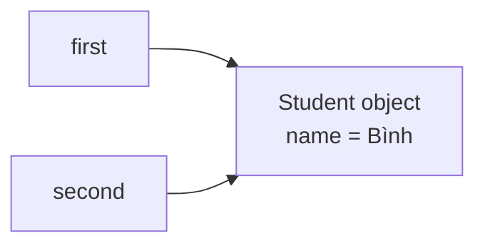
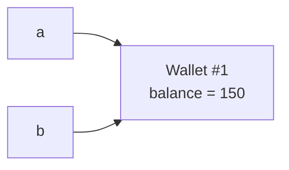
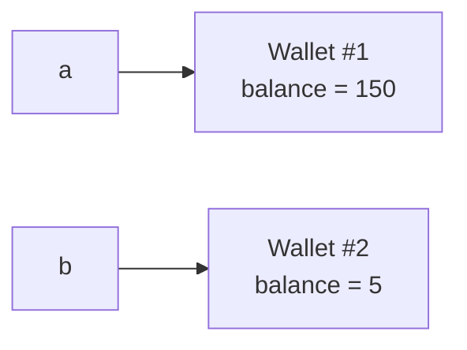
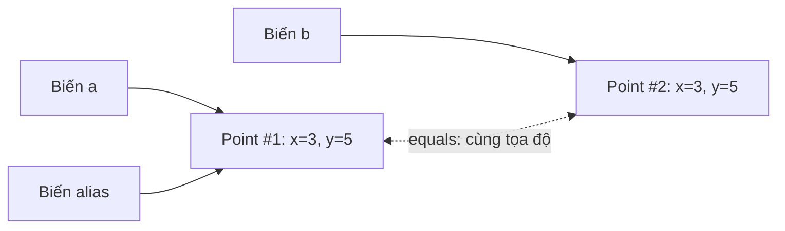
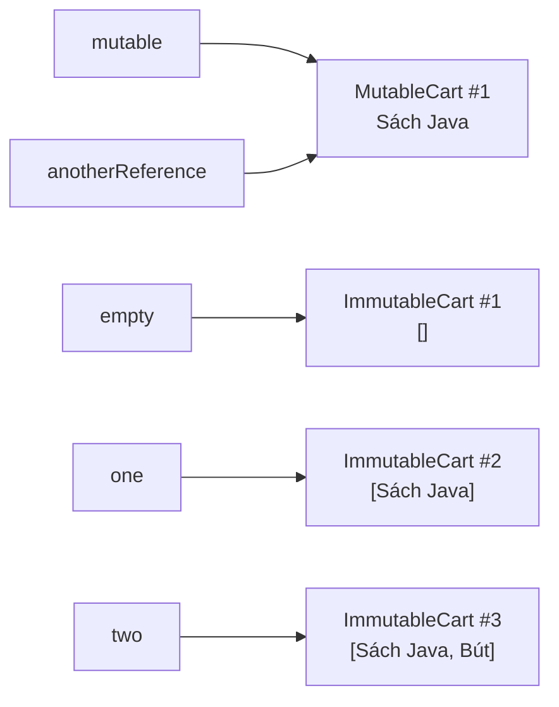
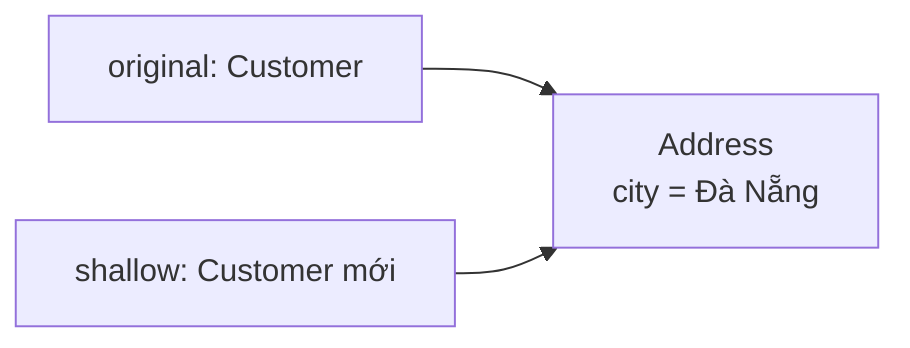
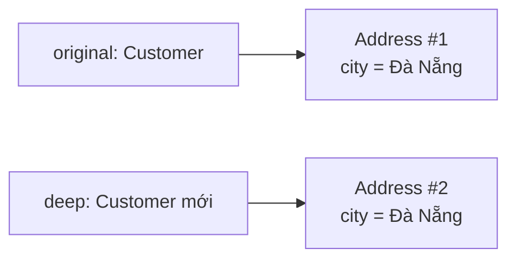

<a id="back-to-top"></a>

# Đối tượng

## Menu
- [Danh tính, trạng thái và hành vi của đối tượng](#object-001)
- [Tham chiếu, giá trị và cách truyền đối tượng](#object-002)
- [Nhiều tham chiếu cùng trỏ đến một đối tượng](#object-003)
- [Phân biệt cùng đối tượng với bằng nhau về giá trị](#object-004)
- [Đối tượng có thể thay đổi và đối tượng bất biến](#object-005)
- [Sao chép nông và sao chép sâu](#object-006)
- [Chia sẻ đối tượng và tác động của thay đổi trạng thái](#object-007)
- [Giá trị rỗng và đối tượng chưa tồn tại](#object-008)
- [Theo dõi tương tác của các đối tượng trong một tình huống](#object-009)

## <a id="object-001">Danh tính, trạng thái và hành vi của đối tượng</a>

<details>
<summary>Xem chi tiết</summary>

# Danh tính, trạng thái và hành vi của đối tượng trong Java

Khi nói **đối tượng (object)** trong lập trình hướng đối tượng (OOP), ta không chỉ nói về một tập hợp các biến và hàm. Một đối tượng là một thực thể cụ thể trong lúc chương trình chạy, có **danh tính**, có **trạng thái** và cung cấp **hành vi**. Ba khía cạnh này giúp ta mô hình hóa các thực thể như đơn hàng, tài khoản ngân hàng, giỏ hàng, người chơi hoặc thiết bị trong phần mềm.

Hãy hình dung hai đơn hàng cùng của khách Lan, cùng chứa một quyển sổ và đều có trạng thái “Đã xác nhận”. Chúng có thể trông hoàn toàn giống nhau về dữ liệu, nhưng vẫn là **hai đơn hàng khác nhau**. Ngược lại, cùng một đơn hàng lúc mới tạo có trạng thái “Nháp”, sau khi xác nhận chuyển thành “Đã xác nhận”, nhưng nó vẫn là **chính đơn hàng đó**.

Đó là sự khác biệt cốt lõi:

- **Danh tính (identity):** Đây là đối tượng nào? Nó có phải chính đối tượng đang được tham chiếu ở nơi khác không?
- **Trạng thái (state):** Tại thời điểm này đối tượng đang giữ những dữ liệu gì?
- **Hành vi (behavior):** Đối tượng có thể thực hiện những thao tác gì, trả lời được những câu hỏi gì, và được phép thay đổi trạng thái theo quy tắc nào?

## 1. So sánh ba khía cạnh

| Khía cạnh | Câu hỏi cần trả lời | Ví dụ với `Order` | Có thể thay đổi theo thời gian? |
|---|---|---|---|
| **Danh tính** | Đây có phải *cùng một đối tượng*? | Hai biến cùng trỏ đến một `Order` | Danh tính của một object không đổi trong thời gian nó tồn tại |
| **Trạng thái** | Object hiện có những dữ liệu nào? | Danh sách món, trạng thái `DRAFT`/`CONFIRMED` | Có thể thay đổi nếu thiết kế cho phép |
| **Hành vi** | Object có thể làm gì? | `addItem()`, `confirm()`, `cancel()` | Các phương thức được định nghĩa bởi kiểu; kết quả/hành động có thể phụ thuộc trạng thái |

Một cách nhìn khác: **danh tính** cho phép theo dõi *cùng một đối tượng qua thời gian*; **trạng thái** mô tả *nó đang như thế nào*; **hành vi** quy định *nó có thể phản ứng ra sao*.

### Ví dụ đời thường

Một chiếc thẻ ra vào có mã thẻ riêng. Hôm nay nó ở trạng thái hoạt động, ngày mai có thể bị khóa. Hành vi `unlock()` chỉ hợp lệ khi người thực hiện có quyền, và hành vi `enter()` phải kiểm tra trạng thái hiện hành. Việc khóa thẻ không biến nó thành một thẻ khác.

Trong hệ thống phần mềm, cần phân biệt hai loại danh tính:

1. **Danh tính của đối tượng Java:** một instance cụ thể đang tồn tại trong bộ nhớ JVM, được nhận biết khi so sánh tham chiếu bằng `==`.
2. **Danh tính nghiệp vụ:** mã đơn hàng, UUID, số tài khoản… dùng để theo dõi cùng thực thể nghiệp vụ giữa database, lần chạy ứng dụng và các dịch vụ. Hai đối tượng Java khác nhau vẫn có thể mô tả cùng một bản ghi nghiệp vụ.

Hai khái niệm này có liên quan nhưng **không tương đương**.

## 2. Đối tượng, lớp và tham chiếu

**Lớp (class)** mô tả kiểu dữ liệu và các thao tác; **đối tượng (object)** là instance cụ thể của kiểu đó; **biến tham chiếu (reference variable)** là cách mã Java trỏ tới đối tượng.

~~~java
Order first = new Order("Lan");
Order second = new Order("Lan");
Order alias = first;
~~~

Trong đoạn này:

- `new Order("Lan")` được gọi hai lần, tạo hai instance riêng biệt: `first` và `second`.
- `alias = first` chỉ sao chép **giá trị tham chiếu**. Không có `new`, nên không tạo đối tượng thứ ba.
- `first == second` là `false`; `first == alias` là `true`.
- Nếu `alias` gọi một phương thức làm đổi trạng thái, `first` cũng sẽ quan sát được sự thay đổi đó vì cả hai cùng trỏ đến **một object**.

~~~mermaid
flowchart LR
    F["Biến first"] --> A["Order object #1<br/>customer: Lan<br/>status: DRAFT"]
    AL["Biến alias"] --> A
    S["Biến second"] --> B["Order object #2<br/>customer: Lan<br/>status: DRAFT"]
~~~

Đây là mô hình quan hệ tham chiếu, không phải sơ đồ vị trí bộ nhớ vật lý của JVM. Số lượng biến tham chiếu **không bằng** số lượng đối tượng.

Lưu ý thêm: `Order x;` mới chỉ *khai báo* một biến tham chiếu cục bộ; nó chưa tạo đối tượng nào và phải được gán trước khi đọc. `Order x = null;` cũng không tạo đối tượng: `null` biểu thị hiện không trỏ tới đối tượng nào.

## 3. Ví dụ Java hoàn chỉnh: một đơn hàng có danh tính, trạng thái và hành vi

Ví dụ dưới đây mô hình hóa một đơn hàng với các quy tắc:

- Mỗi instance có một mã định danh `UUID` được tạo khi khởi tạo.
- Đơn hàng lưu tên khách hàng, danh sách mặt hàng và trạng thái hiện hành.
- Chỉ đơn hàng ở trạng thái nháp mới được thêm mặt hàng hoặc xác nhận.
- Đơn hàng rỗng không được xác nhận; chỉ đơn hàng đã xác nhận mới được hủy.

Lưu toàn bộ vào **`Demo.java`**, chạy bằng **Java 17+**:

~~~java
import java.util.ArrayList;
import java.util.List;
import java.util.UUID;

public class Demo {
    public static void main(String[] args) {
        Order first = new Order("Lan");
        Order second = new Order("Lan");
        Order alias = first;

        System.out.println("first == second: " + (first == second));
        System.out.println("first == alias: " + (first == alias));

        alias.addItem("Sổ tay");
        first.confirm();

        System.out.println("first status: " + first.getStatus());
        System.out.println("alias status: " + alias.getStatus());
        System.out.println("first items: " + first.getItems());
        System.out.println("second items: " + second.getItems());
        System.out.println("first.equals(second): " + first.equals(second));

        first.cancel();
        System.out.println("alias after cancel: " + alias.getStatus());
    }
}

enum OrderStatus {
    DRAFT, CONFIRMED, CANCELLED
}

final class Order {
    private final UUID id;
    private final String customer;
    private final List<String> items;
    private OrderStatus status;

    public Order(String customer) {
        if (customer == null || customer.isBlank()) {
            throw new IllegalArgumentException("Tên khách hàng không hợp lệ");
        }

        this.id = UUID.randomUUID();
        this.customer = customer;
        this.items = new ArrayList<>();
        this.status = OrderStatus.DRAFT;
    }

    public UUID getId() {
        return id;
    }

    public String getCustomer() {
        return customer;
    }

    public OrderStatus getStatus() {
        return status;
    }

    // Tạo một bản sao chỉ đọc để bên ngoài không sửa trực tiếp items.
    public List<String> getItems() {
        return List.copyOf(items);
    }

    public void addItem(String item) {
        ensureDraft();

        if (item == null || item.isBlank()) {
            throw new IllegalArgumentException("Tên mặt hàng không hợp lệ");
        }

        items.add(item);
    }

    public void confirm() {
        ensureDraft();

        if (items.isEmpty()) {
            throw new IllegalStateException(
                    "Đơn hàng phải có ít nhất một mặt hàng"
            );
        }

        status = OrderStatus.CONFIRMED;
    }

    public void cancel() {
        if (status != OrderStatus.CONFIRMED) {
            throw new IllegalStateException(
                    "Chỉ được hủy đơn hàng đã xác nhận"
            );
        }

        status = OrderStatus.CANCELLED;
    }

    private void ensureDraft() {
        if (status != OrderStatus.DRAFT) {
            throw new IllegalStateException(
                    "Thao tác chỉ hợp lệ khi đơn hàng là DRAFT"
            );
        }
    }
}
~~~

Chạy:

~~~bash
javac Demo.java
java Demo
~~~

Kết quả:

~~~text
first == second: false
first == alias: true
first status: CONFIRMED
alias status: CONFIRMED
first items: [Sổ tay]
second items: []
first.equals(second): false
alias after cancel: CANCELLED
~~~

### Phân tích từ ví dụ

**Danh tính:** `first` và `second` được tạo từ hai biểu thức `new`, nên chúng là hai instance khác nhau dù ban đầu có cùng tên khách hàng, trạng thái và danh sách mặt hàng trống. `alias` và `first` trỏ cùng một instance, bởi vậy `first == alias` là `true`. Mã `id` giúp nhận diện đơn hàng ở tầng nghiệp vụ, nhưng không phải nguyên nhân làm phép so sánh `==` đúng hay sai.

**Trạng thái:** bộ dữ liệu `id`, `customer`, `items` và `status` mô tả trạng thái của từng `Order`. Sau `alias.addItem("Sổ tay")`, danh sách mặt hàng của `first` thay đổi nhưng `second` vẫn giữ danh sách trống. Sau `first.confirm()`, biến `alias` đọc được trạng thái `CONFIRMED` vì cùng trỏ đến đối tượng ấy.

**Hành vi:** `addItem()`, `confirm()`, `cancel()` là những việc một đối tượng `Order` được phép thực hiện. Chúng áp dụng quy tắc nghiệp vụ trước khi sửa field. Các phương thức `getStatus()` và `getItems()` là hành vi truy vấn, không cần thay đổi trạng thái.

**Tính đóng gói:** các field được khai báo `private`; bên ngoài không thể viết `first.status = ...` hoặc trực tiếp chèn một phần tử vào danh sách nội bộ. Các phương thức công khai là cổng kiểm soát trạng thái hợp lệ. `final class` ở ví dụ giữ thiết kế đơn giản và ngăn lớp con thay đổi quy tắc bằng kế thừa.

### Hành vi tạo thành chuyển trạng thái

~~~mermaid
stateDiagram-v2
    [*] --> DRAFT: new Order(...)
    DRAFT --> DRAFT: addItem(item)
    DRAFT --> CONFIRMED: confirm() khi items không rỗng
    CONFIRMED --> CANCELLED: cancel()
~~~

Sơ đồ chỉ vẽ **các chuyển trạng thái hợp lệ được cài đặt**. Ví dụ, `cancel()` ở trạng thái `DRAFT` hoặc `addItem()` ở trạng thái `CONFIRMED` đều ném `IllegalStateException` và không thực hiện chuyển trạng thái mong muốn. Một đối tượng có thể giữ nguyên danh tính xuyên suốt các trạng thái `DRAFT → CONFIRMED → CANCELLED`.

## 4. Nhận diện đúng danh tính của đối tượng

Khi theo dõi một đối tượng qua các lần thay đổi trạng thái, cần đặt câu hỏi **“có còn là chính instance ấy không?”**. Với hai biến tham chiếu, Java dùng `==` để trả lời câu hỏi đó. Một phép so sánh **theo giá trị** lại phụ thuộc vào hợp đồng `equals()` của lớp:

~~~java
Order first = new Order("Lan");
Order alias = first;
Order another = new Order("Lan");

System.out.println(first == alias);   // true: cùng một instance
System.out.println(first == another); // false: hai instance
~~~

Ở lớp `Order` mẫu, `equals()` không được override nên mặc định cũng kiểm tra identity. Với một value object, chẳng hạn `record Point(int x, int y) {}`, hai instance khác nhau có cùng tọa độ lại có thể `equals()` bằng `true`.

**Danh tính nghiệp vụ** như `orderId` cũng là khái niệm riêng: hai đối tượng Java được nạp từ cùng một bản ghi có thể cùng ID nhưng không cùng instance. Đừng dùng `System.identityHashCode()` làm mã đơn hàng: nó không bảo đảm duy nhất hoặc bền vững. Khi cần so sánh theo giá trị và làm khóa collection, phải thiết kế `equals()/hashCode()` có hợp đồng nhất quán. Phần này được đào sâu ở bài về *cùng đối tượng và bằng nhau về giá trị*.

## 5. Trạng thái không chỉ là giá trị của một biến

Trạng thái của đối tượng có thể gồm:

- **Giá trị đơn giản:** `int quantity`, `boolean active`, `OrderStatus status`.
- **Tham chiếu tới các đối tượng khác:** `List<String> items`, `Customer customer`, `Address shippingAddress`.
- **Giá trị được suy ra:** `getItemCount()` có thể tính từ `items.size()` thay vì giữ một field đếm riêng.

Mỗi `Order` chứa một field `items` riêng. Tuy nhiên, tham chiếu là một phần của trạng thái: hai đối tượng *vẫn có thể cùng trỏ tới một danh sách* nếu chương trình cố tình chia sẻ nó. Vì thế, câu “mỗi đối tượng có field riêng” **không có nghĩa** mọi dữ liệu được tham chiếu bên trong đều tự động được sao chép sâu.

### Ví dụ rò rỉ trạng thái nội bộ

~~~java
class UnsafeCart {
    private final List<String> items = new ArrayList<>();

    public List<String> getItems() {
        return items; // Làm lộ danh sách có thể sửa.
    }
}
~~~

Khi đó code bên ngoài có thể gọi `cart.getItems().add("Mặt hàng bất kỳ")` mà không đi qua quy tắc `addItem()`. Đây là **representation exposure**: đối tượng mất quyền kiểm soát trạng thái của mình.

Trong `Order` mẫu, `List.copyOf(items)` cung cấp một snapshot không thể chỉnh sửa qua các thao tác của `List`. Do các phần tử của danh sách là `String` bất biến, nó phù hợp với ví dụ. Nếu danh sách chứa các đối tượng *có thể thay đổi*, sao chép danh sách vẫn chưa đủ để bảo đảm **deep immutability**; cần cân nhắc bản sao phòng vệ của cả phần tử hoặc thiết kế các phần tử bất biến.

### Bất biến của đối tượng (*invariant*)

Invariant là điều luôn phải đúng ở những điểm mà đối tượng được sử dụng hợp lệ. Với `Order`:

- `customer` không được `null` hoặc rỗng.
- `id` được thiết lập khi tạo và không bị gán lại.
- `items` không chứa tên mặt hàng rỗng hoặc `null`.
- Một đơn `CONFIRMED` phải có ít nhất một mặt hàng.
- Không được thêm mặt hàng sau khi rời trạng thái `DRAFT`.

Constructor thiết lập trạng thái ban đầu hợp lệ; các phương thức thay đổi trạng thái có trách nhiệm bảo vệ invariant. Nếu chỉ có dữ liệu mà không có hành vi kiểm tra, trạng thái sai có thể xuất hiện ở khắp nơi trong hệ thống.

### `final` không tự động khiến toàn bộ object bất biến

~~~java
final class Notebook {
    private final List<String> pages = new ArrayList<>();

    public void addPage(String text) {
        pages.add(text); // Vẫn được: nội dung List thay đổi.
    }
}
~~~

`final class` ngăn kế thừa, còn `final` trên field tham chiếu ngăn gán field đó sang đối tượng khác. Cả hai **không tự động** ngăn sửa nội dung của đối tượng được tham chiếu. Một immutable object cần thiết kế để không có cách quan sát thấy trạng thái của nó thay đổi sau khi tạo, đồng thời phải xét các tham chiếu tới dữ liệu mutable.

## 6. Hành vi là hợp đồng, không chỉ là một hàm có tên

Một phương thức đối tượng thường bao gồm:

1. **Điều kiện trước (precondition):** Khi nào lời gọi hợp lệ? Ví dụ `confirm()` chỉ chạy khi đơn ở `DRAFT` và có hàng.
2. **Tác động (effect):** Thay đổi trạng thái hoặc trả dữ liệu gì? Ví dụ chuyển `status` thành `CONFIRMED`.
3. **Điều kiện sau (postcondition):** Điều gì phải đúng khi thành công? Ví dụ đơn đã xác nhận và có ít nhất một mặt hàng.
4. **Xử lý tình huống sai:** Ném exception hoặc trả một kết quả lỗi có cấu trúc theo quy ước API.

**Hành vi thay đổi trạng thái** (command):

~~~java
order.addItem("Bút"); // Có thể làm thay đổi items.
order.confirm();       // Có thể đổi status.
~~~

**Hành vi truy vấn trạng thái** (query):

~~~java
OrderStatus current = order.getStatus();
List<String> lines = order.getItems();
~~~

Trong nhiều thiết kế, tách bạch “lệnh” và “truy vấn” giúp dễ kiểm thử và hiểu code: việc hỏi trạng thái không nên âm thầm thay đổi trạng thái quan sát được nếu không có lý do rõ ràng. Đây là hướng dẫn thiết kế, không phải hạn chế cú pháp Java.

### Vì sao `this` quan trọng?

Trong một instance method, `this` tham chiếu tới đối tượng nhận lời gọi:

~~~java
class Counter {
    private int value;

    public void increment() {
        this.value++;
    }

    public int getValue() {
        return this.value;
    }
}
~~~

~~~java
Counter a = new Counter();
Counter b = new Counter();

a.increment();
a.increment();
b.increment();

System.out.println(a.getValue()); // 2
System.out.println(b.getValue()); // 1
~~~

Phương thức có cùng mã cài đặt trong lớp, nhưng mỗi lời gọi tác động lên **đối tượng nhận lời gọi khác nhau**. Trong phương thức instance, có thể bỏ `this.` khi không gây mơ hồ tên biến; viết rõ `this.value` giúp nhấn mạnh field của object.

Phương thức `static` không có `this` ngầm định và thuộc về lớp. Ví dụ `main` là static vì JVM có thể gọi nó mà không cần tạo `Demo`. Khi học về danh tính và trạng thái của đối tượng, đừng nhầm field static dùng chung với trạng thái instance của từng đối tượng.

## 7. Cùng hành vi được gọi theo kiểu thực tế của đối tượng

OOP còn cho phép một biến có kiểu interface hoặc lớp cha tham chiếu những đối tượng thuộc các lớp cụ thể khác nhau. Lúc gọi instance method đã được override, Java chọn implementation theo **kiểu đối tượng thực tế** (*dynamic dispatch*).

~~~java
interface Notification {
    String message();
}

class EmailNotification implements Notification {
    @Override
    public String message() {
        return "Gửi email";
    }
}

class SmsNotification implements Notification {
    @Override
    public String message() {
        return "Gửi SMS";
    }
}

Notification channel = new SmsNotification();
System.out.println(channel.message()); // Gửi SMS.
~~~

Biến `channel` có kiểu khai báo `Notification`, nhưng tham chiếu một instance `SmsNotification`. Hành vi `message()` được triển khai bởi kiểu cụ thể. Cần phân biệt điều này với phương thức `static`: static method không tham gia override theo cơ chế dispatch này.

### Danh tính không được quyết định bởi hành vi giống nhau

Hai `SmsNotification` đều trả “Gửi SMS” nhưng vẫn là hai object độc lập nếu được tạo bằng hai lần `new`. Việc chúng phản hồi giống nhau không khiến `a == b` thành `true`. Ngược lại, một đối tượng có thể phản hồi khác nhau ở các thời điểm khác nhau do trạng thái thay đổi mà không mất danh tính.

## 8. Hành vi nhận đối tượng khác: biến tham số không phải biến của caller

Một hành vi có thể nhận tham chiếu tới đối tượng khác. Java **luôn truyền tham số theo giá trị**: khi đối số là một tham chiếu, phương thức nhận **bản sao giá trị tham chiếu** ấy. Ví dụ sau là các phương thức đặt trong lớp Java phù hợp:

~~~java
static void addOne(Counter counter) {
    counter.increment(); // Sửa object được chia sẻ.
}

static void replace(Counter counter) {
    counter = new Counter(); // Chỉ gán lại tham số cục bộ.
}
~~~

Khi người gọi truyền cùng một `Counter`, `addOne` có thể làm nó tăng; `replace` không tự đổi biến tham chiếu của người gọi. Cách truyền tham số, ví dụ thực thi và những trường hợp swap được giải thích kỹ ở bài *Tham chiếu, giá trị và cách truyền đối tượng*. Ở đây hãy gắn nguyên tắc đó với trách nhiệm của hành vi: **phương thức có được phép sửa đối tượng nhận vào không?**

## 9. Danh tính tồn tại trong vòng đời của instance

Đối tượng được tạo, khởi tạo trạng thái hợp lệ, nhận lời gọi và có thể đổi trạng thái nhiều lần mà vẫn là **cùng instance**. Khi nó không còn *reachable* từ các GC roots, bộ thu gom rác có thể thu hồi bộ nhớ vào một thời điểm không xác định. Gán một biến bằng `null` không xóa đối tượng nếu vẫn có đường tham chiếu khác tới nó.

Danh tính Java chỉ có ý nghĩa trong vòng đời instance ở JVM đang chạy. Để theo dõi một thực thể sau khi tải lại dữ liệu hoặc chạy chương trình lần khác, cần dùng **mã định danh nghiệp vụ** và dữ liệu được lưu rõ ràng. Các trường hợp `null`, biến chưa gán và object không còn truy cập được có phần phân tích riêng ở bài *Giá trị rỗng và đối tượng chưa tồn tại*.

## 10. Giữ trạng thái và hành vi nhất quán

Một đối tượng có hành vi tốt bảo đảm các *invariant* đã công bố. Khi kiểm tra thiết kế `Order`, hãy hỏi:

1. **Ai được đổi trạng thái?** Nếu trả thẳng `ArrayList` nội bộ, caller có thể bỏ qua kiểm tra `addItem()`. Trả snapshot hoặc hành vi công khai phù hợp sẽ tránh việc này.
2. **Điều kiện của phương thức có rõ không?** `confirm()` chỉ thành công khi đơn đang `DRAFT` và đã có mặt hàng; gọi sai phải có kết quả lỗi nhất quán.
3. **Thông tin quan sát được có khớp quy tắc không?** `getStatus()` không được ngầm thay đổi trạng thái trong ví dụ; `cancel()` phải chuyển đúng từ `CONFIRMED` sang `CANCELLED`.
4. **Có nhiều luồng cập nhật cùng instance không?** Kiểm tra rồi ghi ở các phương thức riêng lẻ không tự thành thao tác nguyên tử. Với truy cập đồng thời, cần ownership hoặc đồng bộ hóa phù hợp.

`private` che giấu field, `final` ngăn gán lại field tham chiếu, còn tính bất biến và an toàn đồng thời đòi hỏi thiết kế rộng hơn. Đây là các lựa chọn triển khai để phục vụ **hợp đồng hành vi**, không thay đổi danh tính của `Order`.

## 11. Cách nhận diện trong bài toán thực tế

Xét hệ thống quản lý máy bán hàng tự động:

| Thực thể | Danh tính | Trạng thái | Hành vi |
|---|---|---|---|
| `VendingMachine` | Mã máy duy nhất trong hệ thống | Hàng còn lại, tiền tạm giữ, chế độ bảo trì | `insertMoney()`, `selectProduct()`, `dispense()` |
| `BankAccount` | Số tài khoản nghiệp vụ | Số dư, trạng thái phong tỏa | `deposit()`, `withdraw()`, `freeze()` |
| `GameCharacter` | ID nhân vật | Máu, vị trí, trang bị | `move()`, `attack()`, `heal()` |
| `Order` | Mã đơn hàng | Mặt hàng, tình trạng xử lý | `addItem()`, `confirm()`, `cancel()` |

Khi thiết kế class, hãy đặt ba câu hỏi theo thứ tự:

1. **Đối tượng nào cần được theo dõi như một thực thể riêng?** Quyết định ranh giới danh tính và có cần ID nghiệp vụ không.
2. **Những dữ liệu nào mô tả trạng thái của chính đối tượng đó?** Xác định field, quan hệ tới đối tượng khác, và invariant cần duy trì.
3. **Những thao tác hợp lệ nào được phép với trạng thái ấy?** Xây dựng phương thức có ý nghĩa nghiệp vụ, kiểm tra precondition và bảo đảm postcondition.

Nếu một thao tác được đặt ở một lớp khác nhưng liên tục cần lấy toàn bộ dữ liệu nội bộ để ra quyết định, nên xem lại liệu hành vi ấy có thuộc trách nhiệm của đối tượng đang nắm giữ trạng thái hay không. Tuy nhiên, tương tác liên đối tượng, domain service và lưu trữ vẫn có chỗ đứng khi một quy tắc không thuộc riêng một thực thể.

## 12. Tự kiểm tra kiến thức

**Bài 1: Hai biến, mấy đối tượng?**

~~~java
Order x = new Order("Minh");
Order y = x;
Order z = new Order("Minh");
~~~

Hỏi: có bao nhiêu `Order` instance? `x == y` và `x == z` lần lượt bằng gì?

**Đáp án:** Có hai instance. `x == y` là `true` vì cùng tham chiếu; `x == z` là `false` vì hai lần tạo riêng.

**Bài 2: Thay đổi trạng thái có làm đổi danh tính?**

~~~java
Order order = new Order("Hà");
Order savedRef = order;

order.addItem("Balo");
order.confirm();
~~~

Hỏi: `savedRef == order` còn là `true` không? `savedRef.getStatus()` trả gì?

**Đáp án:** Vẫn `true`; trạng thái quan sát qua `savedRef` là `CONFIRMED`. Việc cập nhật trạng thái không sinh object mới trong ví dụ này.

**Bài 3: Hành vi và invariant**

Hỏi: `new Order("Hà").confirm()` có hợp lệ không?

**Đáp án:** Không. Đơn chưa có mặt hàng nên `confirm()` ném `IllegalStateException`. Hành vi bảo vệ invariant “đơn đã xác nhận phải có ít nhất một mặt hàng”.

**Bài 4: So sánh giá trị**

~~~java
record Size(int width, int height) {}
Size a = new Size(10, 20);
Size b = new Size(10, 20);
~~~

Hỏi: `a == b` và `a.equals(b)` trả gì?

**Đáp án:** `false` và `true`. Chúng là hai instance nhưng biểu diễn cùng giá trị.

**Bài 5: Mã nghiệp vụ có chứng minh hai biến trỏ cùng object?**

Hỏi: hai đối tượng `Order` khác nhau được nạp từ database với cùng một `orderId` thì phép `==` có nhất thiết trả `true` không?

**Đáp án:** Không. Cùng mã nghiệp vụ có thể là hai biểu diễn trong bộ nhớ khác nhau. Cần xác định quy tắc so sánh theo ID ở tầng nghiệp vụ, tránh nhầm với reference identity.

## Điểm cốt lõi cần ghi nhớ

Một **đối tượng Java** giữ danh tính xuyên suốt thời gian tồn tại, có trạng thái được biểu diễn bằng các field và các đối tượng liên quan, đồng thời cung cấp hành vi thông qua phương thức. Nhiều biến có thể trỏ cùng một đối tượng; nhiều đối tượng có thể mang trạng thái giống nhau. Hành vi tốt giúp chuyển trạng thái một cách có kiểm soát và duy trì invariant. Khi thiết kế OOP, phân biệt rõ **cùng object**, **cùng giá trị**, và **cùng thực thể nghiệp vụ** sẽ tránh rất nhiều lỗi trong thao tác dữ liệu, kiểm thử và tích hợp hệ thống.


</details>

- [Quay lại đầu trang](#back-to-top)

---

## <a id="object-002">Tham chiếu, giá trị và cách truyền đối tượng</a>

<details>
<summary>Xem chi tiết</summary>

# Tham chiếu, giá trị và cách truyền đối tượng trong Java

Trong Java, khi làm việc với **đối tượng (object)**, chúng ta thường gặp các câu hỏi:

- Vì sao `b = a` nhưng sửa `b` lại khiến dữ liệu đọc qua `a` thay đổi?
- Vì sao truyền một đối tượng vào phương thức rồi gán `obj = new ...` lại không thay thế được đối tượng ở nơi gọi?
- Java truyền tham số **theo giá trị (pass-by-value)** hay **theo tham chiếu (pass-by-reference)**?

Câu trả lời nằm ở sự phân biệt giữa **giá trị của biến**, **tham chiếu đến đối tượng** và **bản thân đối tượng**. Hiểu đúng ba khái niệm này giúp tránh lỗi khi thiết kế API, cập nhật trạng thái, xử lý collection và truyền dữ liệu giữa các lớp.

## 1. Giá trị của biến primitive và biến kiểu tham chiếu

Java có hai nhóm kiểu dữ liệu chính:

| Nhóm | Ví dụ | Giá trị lưu trong biến | Khi gán sang biến cùng kiểu |
|---|---|---|---|
| Kiểu nguyên thủy (*primitive*) | `int`, `long`, `boolean`, `double`, `char` | Giá trị nguyên thủy, ví dụ `42` | Sao chép giá trị đó |
| Kiểu tham chiếu (*reference type*) | `Student`, `String`, `int[]`, `List<String>` | Một giá trị tham chiếu chỉ đến đối tượng, hoặc `null` | Sao chép **giá trị tham chiếu**, không sao chép đối tượng |

Ví dụ với kiểu nguyên thủy:

```java
int a = 10;
int b = a;     // b nhận bản sao của giá trị 10
b = 20;

System.out.println(a); // 10
System.out.println(b); // 20
```

Mỗi biến có giá trị riêng, nên sửa `b` không làm `a` thay đổi.

Với đối tượng:

```java
class Student {
    String name;

    Student(String name) {
        this.name = name;
    }
}

Student first = new Student("An");
Student second = first; // Sao chép tham chiếu, không tạo Student mới

second.name = "Bình";

System.out.println(first.name);  // Bình
System.out.println(second.name); // Bình
```

`first` và `second` là **hai biến**, nhưng đang cùng tham chiếu đến **một đối tượng `Student`**. Việc thay đổi trường `name` của đối tượng ấy có thể quan sát từ cả hai biến.

### Hình dung quan hệ tham chiếu



Sơ đồ diễn tả quan hệ logic giữa biến và đối tượng; nó **không** phải cam kết chính xác về địa chỉ vật lý, bố trí stack/heap hoặc cách JVM tối ưu bộ nhớ.

> **Điểm cần nhớ:** `Student second = first;` tạo một biến tham chiếu mới cùng trỏ đến đối tượng hiện có. Chỉ lệnh `new Student(...)` trong ví dụ mới tạo đối tượng `Student` mới.

## 2. Phân biệt thay đổi đối tượng và gán lại tham chiếu

Đây là hai thao tác rất khác nhau.

```java
class Wallet {
    private int balance;

    Wallet(int balance) {
        this.balance = balance;
    }

    void deposit(int amount) {
        if (amount <= 0) {
            throw new IllegalArgumentException("Số tiền phải dương");
        }
        balance += amount;
    }

    int getBalance() {
        return balance;
    }
}

Wallet a = new Wallet(100);
Wallet b = a;

b.deposit(50);             // Sửa đối tượng được a và b cùng tham chiếu
System.out.println(a.getBalance()); // 150

b = new Wallet(5);         // Chỉ cho biến b tham chiếu đối tượng mới
System.out.println(a.getBalance()); // 150
System.out.println(b.getBalance()); // 5
```

**Trước khi `b = new Wallet(5)`:**



**Sau khi `b = new Wallet(5)`:**



`b.deposit(50)` gọi phương thức trên đối tượng `Wallet #1`, vì vậy `a` cũng quan sát được số dư mới. Còn phép gán `b = new Wallet(5)` chỉ thay đổi **đối tượng mà biến `b` tham chiếu**; nó không thay đổi `a`.

Tình huống nhiều biến cùng tham chiếu đến một đối tượng được gọi là **aliasing** (các bí danh/tham chiếu dùng chung). Aliasing không nhất thiết sai, nhưng cần kiểm soát nếu đối tượng có trạng thái thay đổi được.

## 3. Java luôn truyền tham số theo giá trị (*pass-by-value*)

**Trong Java, mọi đối số được truyền vào phương thức theo giá trị.** Điều đó có nghĩa: tham số của phương thức nhận một **bản sao giá trị** từ biểu thức đối số ở nơi gọi.

- Với `int`, bản sao là số nguyên.
- Với `Student`, bản sao là **giá trị tham chiếu đến đối tượng `Student`**.
- Java **không** hỗ trợ kiểu truyền tham số bằng cách tạo một biến tham số là bí danh trực tiếp của biến tham chiếu ở phía caller.

### 3.1. Truyền kiểu primitive: sửa tham số không tác động tới caller

```java
public class PrimitiveParameterDemo {
    static void increase(int number) {
        number += 10;
        System.out.println("Trong method: " + number);
    }

    public static void main(String[] args) {
        int value = 5;
        increase(value);

        System.out.println("Sau lời gọi: " + value);
    }
}
```

Kết quả:

```text
Trong method: 15
Sau lời gọi: 5
```

Tham số `number` bắt đầu bằng giá trị `5` do `value` cung cấp, sau đó được thay đổi thành `15`. Biến `value` bên ngoài vẫn là `5`.

### 3.2. Truyền đối tượng: có thể sửa trạng thái đối tượng dùng chung

Ví dụ hoàn chỉnh có thể chạy độc lập:

```java
public class ReferenceParameterDemo {

    static class Account {
        private int balance;

        Account(int balance) {
            this.balance = balance;
        }

        void deposit(int amount) {
            if (amount <= 0) {
                throw new IllegalArgumentException("amount must be positive");
            }
            balance += amount;
        }

        int getBalance() {
            return balance;
        }
    }

    static void depositTo(Account account) {
        account.deposit(20); // Sửa đối tượng qua bản sao tham chiếu
    }

    static void replaceLocally(Account account) {
        account = new Account(999); // Chỉ gán lại tham số cục bộ
    }

    public static void main(String[] args) {
        Account account = new Account(100);

        depositTo(account);
        System.out.println(account.getBalance()); // 120

        replaceLocally(account);
        System.out.println(account.getBalance()); // 120
    }
}
```

Ở `depositTo(account)`, tham số `account` bên trong phương thức và biến `account` ở `main` nhận các giá trị tham chiếu cùng chỉ đến một `Account`. Gọi `deposit(20)` làm thay đổi đối tượng dùng chung, nên `main` nhìn thấy số dư `120`.

Ở `replaceLocally(account)`, lệnh `account = new Account(999)` chỉ gán lại **biến tham số cục bộ**. Biến `account` trong `main` vẫn tham chiếu đến đối tượng có số dư `120`.

| Thao tác trong phương thức | Thay đổi biến tham chiếu ở caller? | Có thể làm caller nhìn thấy thay đổi trạng thái? |
|---|---|---|
| `account = new Account(...)` | Không | Không, nếu chỉ thực hiện phép gán này |
| `account = null` | Không | Không, nếu chỉ thực hiện phép gán này |
| `account.deposit(20)` | Không | Có, vì sửa đối tượng mà cả hai cùng tham chiếu |
| `account.balance = ...` (nếu field truy cập được) | Không | Có, vì sửa trạng thái đối tượng |
| `account = someOtherReference` | Không | Không, nếu chỉ gán lại tham số |

**Không nên kết luận “Java truyền đối tượng theo tham chiếu”** chỉ vì có thể sửa đối tượng qua tham số. Điều được sao chép chính là giá trị tham chiếu; phương thức không thể gán lại biến tham chiếu của caller.

## 4. Thử hoán đổi hai đối tượng qua phương thức

Một cách kiểm chứng quy tắc truyền theo giá trị là thử viết hàm `swap`:

```java
static void swap(Account left, Account right) {
    Account temp = left;
    left = right;
    right = temp;
}

// Giả sử Account có getBalance()
Account a = new Account(10);
Account b = new Account(20);

swap(a, b);

System.out.println(a.getBalance()); // 10
System.out.println(b.getBalance()); // 20
```

Phương thức `swap` chỉ hoán đổi **hai biến tham số cục bộ** `left` và `right`. Hai biến `a`, `b` ở caller không bị gán lại, nên thứ tự tham chiếu của chúng giữ nguyên.

Nếu mục đích là cập nhật đối tượng mà caller sẽ sử dụng, API nên **trả đối tượng mới**:

```java
static Account accountWithBonus(Account original, int bonus) {
    return new Account(original.getBalance() + bonus);
}

Account a = new Account(100);
a = accountWithBonus(a, 25);

System.out.println(a.getBalance()); // 125
```

Ở đây việc thay đổi biến `a` được thực hiện **tại nơi gọi**, nơi có quyền quyết định nhận kết quả trả về.

## 5. Biến tham chiếu không nhất thiết đang trỏ tới object

Giá trị `null` nghĩa là biến tham chiếu hiện không trỏ đến instance nào. Nó không phải một đối tượng rỗng; gọi phương thức instance qua `null` có thể gây `NullPointerException`.

~~~java
Student student = null;
if (student != null) {
    System.out.println(student.name);
}
~~~

Phải phân biệt `Student student;` là biến **cục bộ chưa được gán** (không được đọc trước khi gán) với `Student student = null;` là biến đã được gán giá trị `null`. Field kiểu tham chiếu nếu không khởi tạo tường minh có giá trị mặc định `null`. Bài *Giá trị rỗng và đối tượng chưa tồn tại* phân tích các trường hợp vắng mặt và cách xử lý API sâu hơn.

## 6. Giá trị tham chiếu được sao chép cho cả chuỗi, mảng và collection

`String`, mảng và `List` đều là kiểu tham chiếu; truyền chúng vào phương thức cũng là **truyền bản sao giá trị tham chiếu**, giống như với `Student`. Khả năng thấy thay đổi phụ thuộc **đối tượng đó có mutable hay không**:

~~~java
String text = "Java";
String aliasText = text;
aliasText = aliasText.concat(" OOP");
System.out.println(text);                 // Java

int[] scores = {7, 8};
int[] sharedScores = scores;
sharedScores[0] = 10;
System.out.println(scores[0]);            // 10
~~~

`String` bất biến nên phép nối không sửa chuỗi ban đầu; mảng mutable nên sửa phần tử qua alias được quan sát từ cả hai biến. Với `List<Student>`, các thao tác `add/get` truyền và trả tham chiếu đến `Student`, không tự động tạo bản sao sâu.

Điều này giải thích vì sao khi truyền dữ liệu cho thư viện, ta phải đọc hợp đồng xem phương thức chỉ đọc dữ liệu, sửa tại chỗ hay trả đối tượng mới. Bài *Mutable/Immutable* và *Sao chép nông/sâu* sẽ trình bày chi tiết hai thiết kế.

## 7. `final` chỉ kiểm soát phép gán lại tham chiếu

~~~java
final StringBuilder message = new StringBuilder("Xin chào");
message.append(" Java"); // Hợp lệ: sửa object.
 // message = new StringBuilder("Khác"); // Không hợp lệ: gán lại final.
~~~

`final` không biến object thành immutable. Đặt `final` cho tham số chỉ ngăn code trong phương thức gán lại **chính biến tham số**; bên trong vẫn có thể gọi hành vi làm đổi trạng thái đối tượng mutable mà nó tham chiếu.

## 8. Thiết kế API khi không muốn sửa đối tượng của caller

Một phương thức nhận object mutable có thể sửa object ấy dù caller không đổi biến tham chiếu. Vì vậy hợp đồng API cần nói rõ **có mutation hay không**. Nếu phải nhận và giữ mảng từ caller, có thể tạo bản sao phòng vệ:

~~~java
final class ScoreReport {
    private final int[] scores;

    ScoreReport(int[] input) {
        this.scores = java.util.Objects.requireNonNull(input).clone();
    }

    int[] getScores() {
        return scores.clone();
    }
}
~~~

`int[].clone()` tạo mảng mới, sao chép các phần tử nguyên thủy; caller sửa mảng cũ hay kết quả getter cũng không sửa được mảng nội bộ. Nếu phần tử là đối tượng mutable, việc clone mảng chỉ sao chép **tham chiếu phần tử**, cần chính sách sao chép phù hợp. Đây là hệ quả của quy tắc pass-by-value và ownership, không phải ngoại lệ đối với nó.

## 9. Đừng dùng phép so sánh tham chiếu để hỏi về nội dung

Với hai giá trị tham chiếu, `==` kiểm tra cùng instance (hoặc cùng `null`), còn `equals()` kiểm tra bình đẳng theo hợp đồng lớp:

~~~java
String a = new String("OOP");
String b = new String("OOP");
System.out.println(a == b);      // false
System.out.println(a.equals(b)); // true
~~~

Hợp đồng `equals/hashCode` được triển khai và kiểm chứng trong bài *Phân biệt cùng đối tượng với bằng nhau về giá trị*. Khi viết phương thức truyền đối tượng, hãy chỉ dùng loại so sánh đúng với yêu cầu nghiệp vụ.

## 10. Các lỗi tư duy hay gặp

| Nhận định | Đúng hay sai? | Giải thích |
|---|---|---|
| `obj2 = obj1` tạo bản sao đối tượng | Sai | Chỉ sao chép giá trị tham chiếu |
| Java truyền tham số đối tượng bằng pass-by-reference | Sai | Java truyền **bản sao giá trị tham chiếu** |
| Phương thức sửa field trên đối tượng truyền vào thì caller có thể thấy thay đổi | Đúng | Vì cùng đối tượng được tham chiếu |
| Phương thức gán lại tham số bằng `new` sẽ thay đổi biến tham chiếu của caller | Sai | Tham số là biến cục bộ độc lập |
| `final MyType x` đảm bảo đối tượng bất biến | Sai | Chỉ ngăn gán lại biến `x` |
| `new ArrayList<>(old)` sao chép sâu phần tử | Sai | Đây là bản sao nông |
| Mọi `equals()` đều so sánh nội dung | Sai | Phụ thuộc hợp đồng/triển khai của lớp |
| Một biến tham chiếu bằng `null` đang trỏ tới một đối tượng rỗng | Sai | `null` nghĩa là không có tham chiếu tới đối tượng nào |

## 11. Bài tập tự kiểm tra

### Bài 1 — Dự đoán kết quả

```java
class Box {
    int value;
    Box(int value) { this.value = value; }
}

static void modify(Box box) {
    box.value += 5;
    box = new Box(100);
    box.value++;
}

// Tại nơi gọi:
Box original = new Box(10);
modify(original);
System.out.println(original.value);
```

**Đáp án: `15`.** Lệnh `box.value += 5` sửa `Box(10)` ban đầu thành `15`. Sau đó `box = new Box(100)` chỉ làm tham số `box` tham chiếu đối tượng mới; lệnh `box.value++` chỉ sửa đối tượng mới thành `101`. Biến `original` vẫn trỏ đến đối tượng ban đầu.

### Bài 2 — Hai mảng có độc lập không?

```java
int[][] matrix = {{1, 2}, {3, 4}};
int[][] copy = matrix.clone();

copy[0][0] = 99;
System.out.println(matrix[0][0]);
```

**Đáp án: `99`.** `clone()` chỉ sao chép mảng ngoài; các phần tử `int[]` bên trong vẫn được dùng chung. Muốn sao chép từng hàng, cần tạo các mảng con mới, ví dụ lặp `copy[i] = matrix[i].clone()`.

### Bài 3 — Thiết kế API an toàn

Một lớp `Classroom` nhận `List<Student>` từ constructor và cung cấp `getStudents()`. Hãy xác định những đường nào khiến code bên ngoài có thể thay đổi trạng thái nội bộ. Gợi ý: kiểm tra tham chiếu `List` đầu vào, tham chiếu danh sách trả về và tham chiếu các phần tử `Student`. Đề xuất cách thiết kế: dùng bản sao danh sách, API truy vấn chỉ đọc, và cân nhắc kiểu phần tử bất biến hoặc sao chép dữ liệu cần thiết.

---

**Ghi nhớ:** Giá trị của biến kiểu đối tượng là một **tham chiếu**. Phép gán và lời gọi phương thức sao chép giá trị tham chiếu đó; chúng không tự động sao chép đối tượng. **Java luôn pass-by-value.** Một phương thức có thể sửa đối tượng dùng chung thông qua tham chiếu nhận được, nhưng việc gán lại tham số không thể gán lại biến của caller. Nắm vững điều này giúp xử lý đúng aliasing, immutable objects, mảng, collection và thiết kế API có kiểm soát.


</details>

- [Quay lại đầu trang](#back-to-top)

---

## <a id="object-003">Nhiều tham chiếu cùng trỏ đến một đối tượng</a>

<details>
<summary>Xem chi tiết</summary>

# Nhiều tham chiếu cùng trỏ đến một đối tượng trong Java

Trong lập trình hướng đối tượng (OOP), một **đối tượng (object)** có thể được truy cập thông qua **nhiều biến tham chiếu (reference variables)**. Điều này thường xảy ra khi gán một biến đối tượng cho biến khác, truyền đối tượng vào phương thức, lấy đối tượng từ collection hoặc trả về đối tượng qua getter.

Điểm quan trọng: **sao chép tham chiếu không tạo ra đối tượng mới**. Khi hai biến cùng tham chiếu đến một đối tượng có thể thay đổi (mutable), việc cập nhật trạng thái đối tượng qua một biến sẽ được nhìn thấy qua biến còn lại.

## 1. Tham chiếu khác với đối tượng như thế nào?

Với khai báo:

~~~java
Student student = new Student("An");
~~~

- `new Student("An")` tạo một đối tượng `Student` mới.
- `student` là biến tham chiếu dùng để truy cập đối tượng đó.
- Biến tham chiếu không chứa bản sao của toàn bộ `Student`; nó mang giá trị tham chiếu đến đối tượng.
- Nếu khai báo thêm `Student another = student;`, Java sao chép **giá trị tham chiếu**, không tạo `Student` thứ hai.

Ví dụ:

~~~java
Student a = new Student("An");
Student b = a;
~~~

~~~mermaid
flowchart LR
    A["Tham chiếu a"] --> O["Một đối tượng Student\nname = An"]
    B["Tham chiếu b"] --> O
~~~

Sơ đồ là **mô hình khái niệm** về quan hệ tham chiếu, không mô tả vị trí bộ nhớ vật lý hoặc địa chỉ thật. Cả `a` và `b` đều truy cập **cùng một instance**.

So sánh với kiểu nguyên thủy:

~~~java
int x = 10;
int y = x; // Sao chép giá trị số nguyên
y = 20;

System.out.println(x); // 10
System.out.println(y); // 20
~~~

Trong ví dụ `int`, thay đổi `y` không ảnh hưởng `x` vì chúng là hai biến chứa giá trị riêng. Với biến tham chiếu, hai biến có thể cùng dẫn đến một đối tượng nên kết quả phụ thuộc vào việc ta **thay đổi đối tượng** hay **gán lại biến tham chiếu**.

## 2. Ví dụ chạy được: hai tham chiếu cùng quan sát một thay đổi

`Main.java`:

~~~java
import java.util.Objects;

public class Main {
    static class Student {
        private String name;

        Student(String name) {
            setName(name);
        }

        String getName() {
            return name;
        }

        void setName(String name) {
            String checked = Objects.requireNonNull(name, "name").trim();
            if (checked.isEmpty()) {
                throw new IllegalArgumentException("Tên không được rỗng");
            }
            this.name = checked;
        }
    }

    public static void main(String[] args) {
        Student first = new Student("An");
        Student second = first; // Không gọi new

        System.out.println(first == second);  // true
        System.out.println(first.getName());   // An

        second.setName("Bình"); // Thay đổi đối tượng dùng chung

        System.out.println(first.getName());   // Bình
        System.out.println(second.getName());  // Bình
    }
}
~~~

Giải thích từng lệnh:

1. `new Student("An")` tạo **một** đối tượng, `first` trỏ đến nó.
2. `second = first` chép giá trị tham chiếu; vẫn chỉ có **một** đối tượng.
3. `second.setName("Bình")` thay đổi thuộc tính `name` trên đối tượng ấy.
4. Vì `first` trỏ đến cùng đối tượng, `first.getName()` cũng trả về `Bình`.

Điều này được gọi là **aliasing**: nhiều tham chiếu đóng vai trò các “tên” khác nhau để truy cập cùng một đối tượng.

## 3. Phân biệt thay đổi trạng thái và gán lại tham chiếu

Hai thao tác dưới đây tạo ra kết quả hoàn toàn khác nhau.

### Trường hợp A: thay đổi chính đối tượng

~~~java
Student a = new Student("An");
Student b = a;

b.setName("Chi");

System.out.println(a.getName()); // Chi
System.out.println(a == b);      // true
~~~

`b.setName(...)` tác động lên **đối tượng được trỏ tới**. Cả `a` và `b` vẫn cùng trỏ đến đối tượng ban đầu.

### Trường hợp B: gán lại biến tham chiếu

~~~java
Student a = new Student("An");
Student b = a;

b = new Student("Dung"); // Tạo đối tượng mới, thay tham chiếu ở b

System.out.println(a.getName()); // An
System.out.println(b.getName()); // Dung
System.out.println(a == b);      // false
~~~

~~~mermaid
flowchart LR
    A["a"] --> O1["Student #1\nname = An"]
    B["b"] --> O2["Student #2\nname = Dung"]
~~~

Phép gán `b = new Student(...)` chỉ thay **giá trị của biến b**. Nó không sửa `a` và cũng không xóa hay tự thay thế đối tượng mà `a` đang trỏ tới.

Một phép gán nữa có thể khiến hai biến lại trỏ chung:

~~~java
b = a;
System.out.println(a == b); // true
~~~

Bảng phân biệt:

| Câu lệnh | Có tạo đối tượng mới? | `a` có bị thay tham chiếu? | Có thể thấy thay đổi qua `a`? |
| --- | --- | --- | --- |
| `Student b = a;` | Không | Không | Hai biến đang chia sẻ cùng instance |
| `b.setName("Chi");` | Không | Không | Có, `a.getName()` cũng thấy “Chi” |
| `b = new Student("Dung");` | Có | Không | Không; `a` vẫn chỉ đến instance cũ |
| `b = null;` | Không | Không | Không; chỉ `b` thôi không còn trỏ đến instance |
| `a = b;` | Không | Có | `a` trỏ đến instance mà `b` đang trỏ tới |

**Quy tắc nhớ:** gọi phương thức làm thay đổi trạng thái qua một tham chiếu sẽ ảnh hưởng đến đối tượng chung; gán lại một biến tham chiếu chỉ tác động lên chính biến ấy.

## 4. Làm sao chứng minh có đúng cùng một instance?

Trong Java, `a == b` trên tham chiếu xác nhận hai biến cùng trỏ đến **một đối tượng** (hoặc đều là `null`). Nếu tạo hai instance chứa cùng dữ liệu, chúng vẫn khác identity:

~~~java
record Point(int x, int y) {}
Point a = new Point(3, 5);
Point b = new Point(3, 5);
Point alias = a;

System.out.println(a == alias); // true
System.out.println(a == b);     // false
System.out.println(a.equals(b)); // true: Point so sánh giá trị
~~~

`equals()` trả lời một câu hỏi **khác**: lớp có coi hai giá trị là tương đương không? Nó không phải phép thử alias. Hợp đồng `equals/hashCode`, `String` và các collection được đào sâu ở bài tiếp theo.

## 5. Aliasing có thể xảy ra bên trong cùng một lời gọi phương thức

Java truyền đối số **theo giá trị**. Khi đối số là object, tham số nhận bản sao giá trị tham chiếu, nên hai tham số còn có thể trỏ tới **cùng một object**:

~~~java
static void incrementBoth(Box x, Box y) {
    x.value++;
    y.value++;
}

Box box = new Box(0);
incrementBoth(box, box);
System.out.println(box.value); // 2
~~~

Đoạn này giả sử lớp `Box` có field `int value` và constructor nhận giá trị đầu. Dù phương thức khai báo **hai biến tham số**, caller truyền cùng một object hai lần. Khi phương thức làm thay đổi cả `x.value` và `y.value`, hai lệnh đều tác động lên `box`. Đây là hệ quả quan trọng khi thiết kế API nhận nhiều đối tượng và giả định sai rằng chúng độc lập.

Gán `x = new Box(...)` bên trong phương thức lại chỉ đổi tham số `x`; biến tham chiếu phía caller không bị gán lại. Bài *Tham chiếu, giá trị và cách truyền đối tượng* có ví dụ đầy đủ về pass-by-value và hoán đổi tham số.

## 6. Nhiều tham chiếu xuất hiện tự nhiên trong chương trình

### Qua collection

~~~java
import java.util.ArrayList;
import java.util.List;

Student student = new Student("An");
List<Student> students = new ArrayList<>();

students.add(student);          // List lưu tham chiếu đến student
Student fromList = students.get(0);

System.out.println(student == fromList); // true

fromList.setName("Hoa");
System.out.println(student.getName());   // Hoa
~~~

`List<Student>` giữ các phần tử dưới dạng tham chiếu đến đối tượng `Student`, không tự tạo bản sao sâu của từng đối tượng khi `add` hoặc `get`.

### Qua quan hệ giữa các đối tượng

~~~java
class Address {
    String city;

    Address(String city) {
        this.city = city;
    }
}

class Employee {
    Address address;

    Employee(Address address) {
        this.address = address;
    }
}

Address shared = new Address("Hà Nội");

Employee e1 = new Employee(shared);
Employee e2 = new Employee(shared);

e1.address.city = "Đà Nẵng";
System.out.println(e2.address.city); // Đà Nẵng
~~~

Ở ví dụ này, hai `Employee` là **hai đối tượng khác nhau**, nhưng trường `address` của chúng lại trỏ đến **cùng một đối tượng Address**. Đây là chia sẻ tham chiếu theo quan hệ đối tượng; không phải mọi thuộc tính của `e1` và `e2` đều chia sẻ.

Sơ đồ:

~~~mermaid
flowchart LR
    E1["Employee e1"] --> A["Address\ncity = Đà Nẵng"]
    E2["Employee e2"] --> A
~~~

Trong hệ thống thực tế, chia sẻ `Address` có thể đúng nếu hai nhân viên cùng tham chiếu một bản ghi địa chỉ chung; nhưng có thể là **bug** nếu mỗi người cần một địa chỉ độc lập.

## 7. Cần phân biệt alias với bản sao chứa các alias bên trong

~~~java
List<Student> original = new ArrayList<>();
original.add(new Student("An"));

List<Student> copied = new ArrayList<>(original);
System.out.println(original == copied);             // false
System.out.println(original.get(0) == copied.get(0)); // true
~~~

`copied` là **một đối tượng List khác**, nhưng phần tử `Student` vẫn là đối tượng được chia sẻ; gọi `copied.get(0).setName("Lan")` có thể làm `original.get(0).getName()` trả `"Lan"`. Ngược lại, thêm phần tử vào `copied` không tự thay đổi cấu trúc `original`.

Đây là lý do **“hai container khác nhau” không bảo đảm “mọi đối tượng bên trong khác nhau”**. Cách tạo bản sao nông, bản sao sâu, bảo toàn shared references và xử lý đồ thị vòng nằm ở bài *Sao chép nông và sao chép sâu*.

## 8. Chia sẻ đối tượng bất biến thì sao?

Một đối tượng immutable như `String` hoặc `LocalDate` vẫn có thể có nhiều alias. Điểm khác là nội dung của chính instance ấy không bị sửa qua alias. Ví dụ `String b = a; b = b.toUpperCase();` gán `b` sang chuỗi kết quả, không thay chuỗi mà `a` đang tham chiếu.

`final Student owner = new Student("An");` cũng không ngăn `Student alias = owner; alias.setName("Bình");`: `final` chỉ ngăn **gán lại biến `owner`**. Khi cần tránh tác dụng phụ do nhiều alias, phải xét khả năng thay đổi trạng thái và cách công khai tham chiếu, như trình bày ở bài *Mutable/Immutable*.

## 9. Khi một alias không còn giữ đối tượng

~~~java
Student first = new Student("An");
Student second = first;
first = null;

System.out.println(second.getName()); // An
~~~

Đặt `first = null` chỉ bỏ **một đường tham chiếu**. Đối tượng vẫn có thể truy cập qua `second`. Khi không còn đường tham chiếu mạnh có thể truy cập từ GC roots, object *có thể* đủ điều kiện thu gom rác; điều này không bảo đảm được thu gom ngay. Bài *Giá trị rỗng và đối tượng chưa tồn tại* phân biệt chi tiết `null`, biến chưa khởi tạo và sự tồn tại của thực thể.

## 10. Những lỗi thực tế và cách phòng tránh

**Lỗi 1 — Vô tình thay đổi dữ liệu gốc khi chỉ muốn thử nghiệm:**

~~~java
Student draft = originalStudent;
draft.setName("Tên thử"); // originalStudent cũng bị thay đổi
~~~

Nếu muốn một đối tượng độc lập, hãy tạo bản sao phù hợp (constructor sao chép, factory hoặc mapping có chủ đích), thay vì chỉ gán một biến tham chiếu.

**Lỗi 2 — Làm lộ mutable field qua getter:**

~~~java
class Team {
    private final List<Student> members = new ArrayList<>();

    List<Student> getMembers() {
        return members; // Caller có thể clear(), add(), remove() tự do
    }
}
~~~

Có thể trả về `List.copyOf(members)` nếu muốn bảo vệ cấu trúc danh sách khỏi việc sửa từ bên ngoài. Tuy nhiên, vì các phần tử `Student` vẫn mutable, người gọi **vẫn có thể** sửa tên của từng `Student` qua tham chiếu được trả về. Muốn read-only hoàn toàn, cần trả về các DTO/value object bất biến hoặc bản sao bảo vệ mọi trạng thái cần thiết.

**Lỗi 3 — Nhầm chia sẻ tham chiếu với lỗi đồng thời:**

Khi nhiều **luồng** cùng giữ tham chiếu đến một đối tượng mutable, có thể phát sinh data race, lost update hoặc trạng thái không nhất quán. Việc nhiều alias cùng tồn tại **không tự động tạo ra race condition**; vấn đề xuất hiện khi thao tác đồng thời không được phối hợp.

~~~java
class Counter {
    private int value;

    public synchronized void increment() {
        value++;
    }

    public synchronized int getValue() {
        return value;
    }
}
~~~

`synchronized` ở đây bảo vệ truy cập vào trạng thái `Counter` khi các luồng sử dụng cùng instance và các đường truy cập đều tuân thủ cùng cơ chế đồng bộ. Trong các hệ thống đa tiến trình hoặc nhiều service, cần cơ chế phối hợp phù hợp ở tầng dữ liệu/phân tán.

**Lỗi 4 — Đổi tham chiếu nhưng tưởng đã thay dữ liệu trong collection:**

~~~java
Student s = new Student("An");
List<Student> group = new ArrayList<>();
group.add(s);

s = new Student("Bình");

System.out.println(group.get(0).getName()); // An
System.out.println(group.get(0) == s);      // false
~~~

`group` vẫn chứa tham chiếu đến `Student("An")` ban đầu. Nếu muốn thay phần tử trong danh sách, cần thao tác trực tiếp trên danh sách, ví dụ `group.set(0, s)`.

## 11. Bộ câu hỏi tự kiểm tra

**Câu 1:** Nếu `Student b = a;`, trong bộ nhớ có bao nhiêu đối tượng `Student` mới được tạo bởi riêng câu lệnh này?

**Đáp án:** Không có. Đây là phép sao chép giá trị tham chiếu, không chứa `new`.

**Câu 2:** `a == b` là `true`. Nếu gọi `b.setName("Minh")`, kết quả `a.getName()` thay đổi không?

**Đáp án:** Có, nếu setter thay đổi thuộc tính `name` của đối tượng chung và lệnh thành công. Hai biến trỏ cùng instance.

**Câu 3:** Sau `b = new Student("Khác")`, liệu `a` tự trỏ đến đối tượng mới không?

**Đáp án:** Không. Chỉ `b` được gán lại; `a` vẫn giữ tham chiếu cũ.

**Câu 4:** `new ArrayList<>(oldList)` có tách biệt hoàn toàn mọi `Student` bên trong không?

**Đáp án:** Không. Nó tạo một List khác, song giữ cùng tham chiếu phần tử. Cần sao chép từng đối tượng mutable nếu cần trạng thái độc lập.

**Câu 5:** Java có truyền đối tượng theo tham chiếu (pass-by-reference) không?

**Đáp án:** Không. Java truyền **bản sao giá trị tham chiếu** theo cơ chế pass-by-value. Phương thức có thể sửa đối tượng chung nhưng không thể gán lại biến tham chiếu của người gọi chỉ bằng cách gán tham số.

**Câu 6:** Hai đối tượng khác instance nhưng có dữ liệu giống nhau có `== true` không?

**Đáp án:** Không, nếu thật sự là hai instance khác nhau. `equals()` có thể `true` nếu kiểu dữ liệu có định nghĩa bình đẳng theo nội dung.

Khi đọc hoặc viết code Java, hãy tự hỏi: **“Có bao nhiêu đối tượng đang tồn tại, biến nào đang giữ tham chiếu đến đối tượng nào, và câu lệnh sắp chạy đang sửa trạng thái đối tượng hay chỉ gán lại tham chiếu?”** Ba câu hỏi đó giúp giải thích phần lớn hiện tượng aliasing và tránh việc cập nhật dữ liệu ngoài ý muốn.


</details>

- [Quay lại đầu trang](#back-to-top)

---

## <a id="object-004">Phân biệt cùng đối tượng với bằng nhau về giá trị</a>

<details>
<summary>Xem chi tiết</summary>

# Phân biệt cùng đối tượng và bằng nhau về giá trị trong Java

> **Chủ đề:** OOP → Đối tượng. Hai biến tham chiếu có thể **trỏ đến cùng một đối tượng** hoặc trỏ đến **hai đối tượng khác nhau nhưng có dữ liệu tương đương**. Đây là hai câu hỏi độc lập. Phân biệt đúng giúp tránh lỗi khi so sánh `String`, thiết kế lớp, xử lý danh sách và dùng `HashSet`/`HashMap`.

## 1. Hai câu hỏi khác nhau: identity và equality

Giả sử tạo hai đối tượng đều chứa tọa độ `(3, 5)`:

```java
Point a = new Point(3, 5);
Point b = new Point(3, 5);
Point alias = a;
```

- **Cùng đối tượng (object identity):** `a` và `alias` cùng tham chiếu đến **một instance**. Khi đó `a == alias` là `true`.
- **Bằng nhau về giá trị (value equality):** `a` và `b` có thể là **hai instance** nhưng có cùng `x`, `y`. Nếu lớp `Point` cài đặt `equals()` để so sánh tọa độ, `a.equals(b)` là `true`.
- **Không cùng đối tượng** không đồng nghĩa **khác giá trị**. `a == b` thường là `false`, mặc dù nội dung hai đối tượng như nhau.



`a == alias` kiểm tra hai tham chiếu có cùng đích hay không. `a.equals(b)` hỏi lớp `Point` có coi hai instance là tương đương về mặt giá trị hay không.

| Phép so sánh | Câu hỏi được trả lời | Trường hợp |
|---|---|---|
| `a == b` khi `a`, `b` là tham chiếu | Có cùng instance không? | Object identity |
| `a != b` khi là tham chiếu | Có trỏ đến hai đối tượng khác nhau không? | Khác identity |
| `a.equals(b)` | Có bằng nhau theo quy tắc `equals` của lớp không? | Value/logical equality |
| `Objects.equals(a, b)` | Có bằng nhau mà xử lý an toàn cả `null` không? | Equality có thể null |
| `x == y` khi `x`, `y` là kiểu nguyên thủy | Hai **giá trị nguyên thủy** có bằng nhau không? | So sánh giá trị, không có identity đối tượng |

Cần nhớ: kiểu nguyên thủy như `int`, `boolean` không phải đối tượng; `==` với kiểu nguyên thủy là phép so sánh **giá trị**. Điểm khác biệt identity/value equality xuất hiện rõ khi so sánh **tham chiếu đối tượng**.

## 2. Vì sao hai đối tượng có cùng trường dữ liệu vẫn có thể `equals() == false`?

Mỗi lớp Java đều kế thừa `equals(Object)` từ `java.lang.Object`. Nếu lớp **không ghi đè**, cách cài đặt mặc định của `Object.equals` chỉ công nhận **cùng một instance**.

```java
class Book {
    String isbn;
    Book(String isbn) {
        this.isbn = isbn;
    }
}

Book first = new Book("978-000");
Book second = new Book("978-000");

System.out.println(first == second);      // false
System.out.println(first.equals(second)); // false
```

Hai đối tượng có giá trị trường `isbn` giống nhau, nhưng `Book` không định nghĩa equality theo `isbn`, nên `equals` thừa hưởng hành vi so sánh identity.

Ngược lại:

```java
Book sameBook = first;
System.out.println(first == sameBook);      // true
System.out.println(first.equals(sameBook)); // true
```

**Điều kiện quan trọng:** `equals()` không tự động so sánh tất cả trường dữ liệu của mọi lớp. Quy tắc equality là một phần của thiết kế lớp.

## 3. Ví dụ hoàn chỉnh: cài đặt `equals()` và `hashCode()` cho lớp giá trị

Ta xây dựng `Point` như một **value object**: hai điểm bằng nhau khi hai tọa độ bằng nhau. Lớp được khai báo `final` để không phải giải quyết thêm tình huống lớp con thay đổi quy tắc equality; trường `final` để giá trị không đổi sau khi khởi tạo.

Lưu đoạn mã dưới đây thành `EqualityDemo.java` (Java 17+):

```java
import java.util.HashMap;
import java.util.HashSet;
import java.util.Map;
import java.util.Objects;
import java.util.Set;

public class EqualityDemo {
    static final class Point {
        private final int x;
        private final int y;

        Point(int x, int y) {
            this.x = x;
            this.y = y;
        }

        @Override
        public boolean equals(Object obj) {
            if (this == obj) {
                return true;  // Cùng một instance luôn bằng nhau
            }
            if (!(obj instanceof Point other)) {
                return false; // Bao gồm cả null và loại khác
            }
            return x == other.x && y == other.y;
        }

        @Override
        public int hashCode() {
            return Objects.hash(x, y);
        }

        @Override
        public String toString() {
            return "Point(" + x + ", " + y + ")";
        }
    }

    public static void main(String[] args) {
        Point a = new Point(3, 5);
        Point b = new Point(3, 5);
        Point alias = a;
        Point c = new Point(4, 5);

        System.out.println(a == b);       // false
        System.out.println(a == alias);   // true
        System.out.println(a.equals(b));  // true
        System.out.println(a.equals(c));  // false
        System.out.println(a.hashCode() == b.hashCode()); // true

        Set<Point> points = new HashSet<>();
        points.add(a);
        points.add(b);
        points.add(c);
        System.out.println(points.size()); // 2

        Map<Point, String> labels = new HashMap<>();
        labels.put(a, "Điểm A");
        System.out.println(labels.get(b)); // Điểm A
    }
}
```

Kết quả mong đợi, đúng theo thứ tự các dòng `println`:

```text
false
true
true
false
true
2
Điểm A
```

Ở đây `a` và `b` được tạo bằng hai lần `new` nên là hai instance khác nhau. Nhưng chúng có cùng `x`, `y` nên `equals` trả `true` và `hashCode` trả cùng mã băm. `HashSet` chỉ giữ một phần tử tương đương trong `a` và `b`; `HashMap` có thể tìm giá trị đã lưu bằng một khóa tương đương.

### Đọc từng dòng trong `equals()`

```java
@Override
public boolean equals(Object obj) {
    if (this == obj) return true;
    if (!(obj instanceof Point other)) return false;
    return x == other.x && y == other.y;
}
```

1. `this == obj`: tối ưu trường hợp hai tham chiếu là cùng một đối tượng; chính nó phải bằng chính nó.
2. `instanceof Point other`: chỉ chấp nhận đối tượng thuộc loại được so sánh và gán tham chiếu đã kiểm tra vào `other` (pattern matching có từ Java 16); `null instanceof Point` là `false`.
3. So sánh **các trường tạo nên giá trị** của `Point`. Vì `x` và `y` là `int`, sử dụng `==` là đúng.

Đừng viết `public boolean equals(Point other)` khi mục đích là ghi đè `Object.equals(Object)`: đó chỉ là một phương thức **overload**, không thay thế `equals(Object)` mà các collection Java sử dụng. Hãy dùng `@Override` để trình biên dịch phát hiện sai chữ ký.

Lựa chọn `instanceof` hay `getClass()` cần xét inheritance. Với lớp `Point` ở trên đã `final`, không thể có lớp con nên không phát sinh vấn đề subclass. Với lớp có thể kế thừa, cần thiết kế equality sao cho **đối xứng** và **bắc cầu**, tránh để lớp cha và lớp con định nghĩa hai bộ tiêu chí khác nhau.

## 4. Hợp đồng `equals()`: không chỉ cần “so sánh đúng trường”

Java quy định một số tính chất của `equals()` cho các tham chiếu không null:

| Tính chất | Yêu cầu | Ví dụ |
|---|---|---|
| Phản xạ (reflexive) | `x.equals(x)` là `true` | Điểm bằng chính nó |
| Đối xứng (symmetric) | `x.equals(y)` và `y.equals(x)` cho cùng kết quả | Không được phụ thuộc chiều gọi |
| Bắc cầu (transitive) | Nếu `x.equals(y)` và `y.equals(z)` thì `x.equals(z)` | Bình đẳng phải nhất quán qua ba đối tượng |
| Nhất quán (consistent) | Không đổi kết quả khi dữ liệu dùng cho equality không thay đổi | Gọi lại không bất ngờ đổi kết quả |
| Với `null` | `x.equals(null)` phải là `false` | Null không là một Point |

Nếu quy tắc equality phụ thuộc vào trạng thái **mutable**, kết quả so sánh có thể đổi sau khi cập nhật trường. Điều đó không tự động vi phạm tính nhất quán (vì trạng thái đã đổi), nhưng là nguồn lỗi lớn khi đối tượng nằm trong collection dạng hash.

**Ví dụ vi phạm đối xứng:** lớp cha cho phép so sánh với mọi đối tượng con, trong khi lớp con đòi thêm trường phụ và chỉ bằng đối tượng cùng lớp con. Khi đó `parent.equals(child)` có thể là `true` còn `child.equals(parent)` là `false`. Không nên cài đặt quy tắc như vậy.

## 5. Vì sao phải ghi đè `hashCode()` cùng `equals()`?

`hashCode()` trả về một `int` dùng trong cấu trúc dữ liệu dạng hash. Hợp đồng cốt lõi:

> **Nếu `a.equals(b)` là `true`, thì `a.hashCode() == b.hashCode()` bắt buộc phải đúng.**

Chiều ngược lại **không** được đảm bảo: hai đối tượng **không bằng nhau** vẫn có thể trùng mã băm (hash collision). Một mã băm chỉ giúp tra cứu nhanh, không thay thế `equals()`.

| Tình huống | Hợp lệ? | Giải thích |
|---|---|---|
| `equals` true, hash code giống | Bắt buộc | Hợp đồng của `Object` |
| `equals` false, hash code giống | Có thể | Hash collision |
| `equals` false, hash code khác | Có thể | Trường hợp phổ biến |
| `equals` true, hash code khác | **Sai** | Phá hoạt động của `HashSet`/`HashMap` |

Khi ghi đè `equals`, gần như luôn cần ghi đè `hashCode` dựa trên **cùng bộ dữ liệu**. Ví dụ `Objects.hash(x, y)` phù hợp để học và cho các lớp nhỏ. Ở đường chạy rất nhạy hiệu năng, có thể tính hash thủ công để tránh chi phí không cần thiết.

```java
@Override
public int hashCode() {
    int result = Integer.hashCode(x);
    result = 31 * result + Integer.hashCode(y);
    return result;
}
```

Kết quả tính bằng công thức trên có thể khác với `Objects.hash(x, y)`, nhưng cả hai đều đúng nếu các đối tượng cùng `x`, `y` luôn có cùng hash code. Không bắt buộc các thuật toán băm khác nhau phải cho cùng số.

### Lỗi rất khó phát hiện: dùng đối tượng mutable làm key

```java
final class MutableKey {
    int code;

    MutableKey(int code) {
        this.code = code;
    }

    @Override
    public boolean equals(Object obj) {
        return obj instanceof MutableKey other && code == other.code;
    }

    @Override
    public int hashCode() {
        return Integer.hashCode(code);
    }
}

// Ví dụ sử dụng:
MutableKey key = new MutableKey(1);
Map<MutableKey, String> map = new HashMap<>();
map.put(key, "One");

key.code = 2; // Thay đổi trường quyết định equality/hashCode
String result = map.get(key); // Có thể không tìm được giá trị đã lưu
```

Bảng băm xác định vị trí dựa vào mã băm khi thêm phần tử. Đổi trường `code` có thể làm `hashCode()` đổi, khiến tra cứu dựa trên trạng thái mới không tìm đúng vị trí cũ. **Giải pháp:** dùng key bất biến hoặc bảo đảm không sửa trường tham gia equality/hashCode trong suốt thời gian làm key.

## 6. `String`: lỗi phổ biến nhất của toán tử `==`

`String` đã ghi đè `equals()` để so sánh **nội dung ký tự**. Cách viết đúng khi so sánh giá trị chuỗi là `equals`, hoặc `equalsIgnoreCase` nếu yêu cầu không phân biệt chữ hoa/chữ thường.

```java
String s1 = new String("Java");
String s2 = new String("Java");
String s3 = s1;

System.out.println(s1 == s2);       // false: hai đối tượng riêng
System.out.println(s1 == s3);       // true: cùng tham chiếu
System.out.println(s1.equals(s2));  // true: cùng nội dung
```

Với chuỗi literal:

```java
String left = "Java";
String right = "Java";
System.out.println(left == right); // true do cơ chế intern của literal
```

Java có **string pool/interning** giúp các literal tương đương tham chiếu cùng chuỗi đã intern. Vì vậy `==` trên chuỗi *đôi khi* trả `true`, khiến lỗi bị che giấu. **Không dùng `==` để kiểm tra nội dung chuỗi**, vì giá trị cũng có thể đến từ file, API, bàn phím, `new String(...)` hoặc một phép biến đổi.

```java
String status = null;

System.out.println(Objects.equals(status, "READY")); // false
System.out.println("READY".equals(status));           // false

// status.equals("READY") sẽ ném NullPointerException nếu status null.
```

`Objects.equals(a, b)` là null-safe: `true` khi cả hai cùng null, `false` khi chỉ một bên null, còn khi cả hai có giá trị sẽ gọi `a.equals(b)`.

## 7. Những loại đối tượng có quy tắc equality khác nhau

| Loại dữ liệu | `==` | `equals()` hoặc cách thích hợp |
|---|---|---|
| `int`, `boolean`... | So sánh giá trị nguyên thủy | Không gọi `equals` trên primitive |
| `String` | Cùng instance chuỗi | `String.equals` so sánh nội dung |
| `StringBuilder` | Cùng instance | Kế thừa `Object.equals`: không so sánh nội dung; dùng `toString().equals(...)` hoặc `contentEquals` khi phù hợp |
| `List<String>` | Cùng instance danh sách | `List.equals` so sánh phần tử theo thứ tự |
| `Set<String>` | Cùng instance tập hợp | `Set.equals` so sánh phần tử, không phụ thuộc thứ tự |
| `int[]`, `String[]` | Cùng instance mảng | `Arrays.equals` so sánh phần tử |
| Mảng lồng nhau | Cùng instance mảng ngoài | `Arrays.deepEquals` khi cần so sánh lồng nhau |
| `record` Java | Cùng instance record | `equals` được tạo từ các thành phần (components) |
| `enum` | So sánh hằng enum | `==` phù hợp vì mỗi enum constant là một instance duy nhất |

**Một số ví dụ cụ thể:**

```java
import java.util.Arrays;
import java.util.List;

int[] a = {1, 2, 3};
int[] b = {1, 2, 3};

System.out.println(a == b);             // false
System.out.println(a.equals(b));        // false
System.out.println(Arrays.equals(a, b));// true

int[][] x = {{1, 2}, {3, 4}};
int[][] y = {{1, 2}, {3, 4}};

System.out.println(Arrays.equals(x, y));     // false
System.out.println(Arrays.deepEquals(x, y)); // true

List<String> list1 = List.of("A", "B");
List<String> list2 = List.of("A", "B");
System.out.println(list1.equals(list2));      // true
```

`Arrays.equals(x, y)` ở ví dụ hai chiều so sánh các phần tử là **mảng con**, mà mảng con dùng identity khi gọi `equals`. `Arrays.deepEquals` đi sâu vào các mảng lồng nhau. Với mảng có phần tử là object, `Arrays.equals` áp dụng quy tắc equality của phần tử; với mảng nguyên thủy, nó so sánh từng giá trị.

### `BigDecimal`: cùng giá trị số học chưa chắc `equals` true

```java
import java.math.BigDecimal;

BigDecimal one = new BigDecimal("1.0");
BigDecimal another = new BigDecimal("1.00");

System.out.println(one.equals(another));       // false
System.out.println(one.compareTo(another) == 0);// true
```

`BigDecimal.equals` xét cả **giá trị không chia tỷ lệ (unscaled value)** và **scale**, nên `1.0` khác `1.00` về `equals`, dù so sánh độ lớn toán học bằng nhau qua `compareTo`. Đây là ví dụ cho thấy **“bằng nhau” tùy thuộc hợp đồng của kiểu dữ liệu**.

Khi dùng `BigDecimal` làm key trong hash collection, cần nhất quán cách chuẩn hóa scale hoặc hiểu rõ luật `equals`/`hashCode`. `TreeSet` mặc định dựa vào thứ tự `compareTo`, còn `HashSet` dựa vào `equals` và `hashCode`, nên hành vi loại trùng có thể khác nhau với những giá trị scale khác nhau.

## 8. `record`: cách diễn đạt value object ngắn gọn

Từ Java 16, `record` có thể dùng để mô tả một nhóm dữ liệu với các thành phần được xác định ngay trong khai báo. Java tự sinh constructor, accessor, `equals`, `hashCode` và `toString` tương ứng:

```java
record Coordinate(int x, int y) {}

Coordinate first = new Coordinate(3, 5);
Coordinate second = new Coordinate(3, 5);

System.out.println(first == second);      // false
System.out.println(first.equals(second)); // true
System.out.println(first.hashCode() == second.hashCode()); // true
```

Với record này, equality phù hợp với ý tưởng cùng tọa độ nghĩa là cùng giá trị. Nhưng lưu ý: record chỉ ngăn gán lại **tham chiếu trường**; nó không tự làm bất biến sâu các đối tượng mutable được chứa trong trường. Nếu một record có thành phần là mảng, equality mặc định của thành phần mảng vẫn là so sánh tham chiếu, không tự động so sánh nội dung mảng.

Ví dụ:

```java
record Bytes(byte[] data) {}

Bytes one = new Bytes(new byte[] {1, 2});
Bytes two = new Bytes(new byte[] {1, 2});

System.out.println(one.equals(two)); // false: mảng con khác identity
```

Do đó, trước khi chọn record, hãy xác định đúng **khái niệm giá trị** của từng thành phần; cân nhắc defensive copy và thiết kế equality riêng khi có collection hoặc mảng mutable.

## 9. Phân biệt entity với value object trong thiết kế OOP

Không phải mọi đối tượng cùng dữ liệu hiển thị đều nên coi là bằng nhau.

**Value object** có ý nghĩa chủ yếu bởi các thuộc tính cấu thành: `Coordinate(3,5)`, khoảng ngày tháng, một cặp tọa độ, hoặc một cấu trúc cấu hình. Hai instance với cùng giá trị có thể được coi là tương đương.

**Entity** có danh tính nghiệp vụ độc lập với thuộc tính thay đổi: hai tài khoản có thể cùng tên chủ tài khoản và cùng số dư nhưng **không phải cùng tài khoản**. Với entity, cần xác định identity nghiệp vụ, chẳng hạn mã tài khoản, thay vì so sánh tùy tiện mọi trường dữ liệu.

| Tình huống | Cùng object identity? | Equality mong muốn |
|---|---|---|
| Hai biến cùng trỏ tới một `BankAccount` | Có | Có |
| Hai `Coordinate(3,5)` tạo riêng | Không | Có, nếu theo tọa độ |
| Hai tài khoản cùng số dư 100.000 nhưng ID khác | Không | Thường không |
| Hai object biểu diễn cùng account ID qua hai lần tải | Không nhất thiết | Phụ thuộc hợp đồng entity trong ứng dụng |
| Hai DTO có trường giống nhau | Không nhất thiết | Phụ thuộc việc DTO có định nghĩa value equality hay không |

Đối với entity được lưu vào cơ sở dữ liệu, quy tắc `equals`/`hashCode` cần xử lý cả tình trạng ID chưa được gán, proxy của ORM và vòng đời thực thể; không nên áp dụng máy móc `Objects.equals(id, other.id)` vì hai entity mới đều có `id == null` có thể bị coi là bằng nhau. Chỉ cần nắm trong phạm vi OOP căn bản: **quy tắc equality là quyết định thiết kế dựa trên ý nghĩa của đối tượng**.

## 10. Kiểm tra null, wrapper và những bẫy thường gặp

**Không gọi `equals` trên tham chiếu null:**

```java
String input = null;

// input.equals("OK") -> NullPointerException
boolean ok = Objects.equals(input, "OK"); // false
boolean alsoOk = "OK".equals(input);      // false
```

**Tránh dùng `==` cho giá trị boxed như `Integer`:**

```java
Integer p = Integer.valueOf(1000);
Integer q = Integer.valueOf(1000);

System.out.println(p.equals(q)); // true
// p == q không phải hợp đồng so sánh giá trị; kết quả tùy identity.
```

Một số giá trị boxed nhỏ có thể được cache và làm `==` trả `true`; điều đó không chứng minh hai biến đều phải là cùng instance ở mọi trường hợp. Nếu cần so sánh nội dung, dùng `equals`; nếu một bên có thể null, dùng `Objects.equals`. Nếu ép kiểu tự động unbox `Integer` null sang `int`, có thể gặp `NullPointerException`.

**Không dựa vào mã băm để suy ra identity hoặc equality:**

```java
boolean equal = a.equals(b);                // Câu hỏi về equality
boolean same = a == b;                      // Câu hỏi về identity
boolean sameHash = a.hashCode() == b.hashCode(); // Chỉ câu hỏi về mã băm
```

`sameHash == true` **không** chứng minh `equal == true`. Còn `System.identityHashCode(obj)` cũng không phải địa chỉ bộ nhớ hay định danh duy nhất tuyệt đối: các đối tượng khác nhau vẫn có thể trùng số này.

## 11. Tự kiểm tra và bài tập

**Câu 1 — đoán kết quả:**

```java
String a = new String("oop");
String b = new String("oop");
String c = a;
System.out.println(a == b);
System.out.println(a.equals(b));
System.out.println(a == c);
```

Đáp án lần lượt: `false`, `true`, `true`. Hai `new String` tạo hai instance riêng, nhưng cùng nội dung; `c` tham chiếu lại đúng `a`.

**Câu 2 — sửa lỗi:** Một lớp `ProductCode` chỉ có trường `String code` nhưng `new ProductCode("P01").equals(new ProductCode("P01"))` đang là `false`. Hãy viết lại lớp sao cho equality dựa trên `code`, bổ sung `hashCode`, kiểm thử bằng `HashSet`.

**Câu 3 — giải thích:** Vì sao `Arrays.equals(new int[]{1,2}, new int[]{1,2})` là `true`, còn `new int[]{1,2}.equals(new int[]{1,2})` là `false`? Liên hệ với phương thức `equals` mặc định của `Object`.

**Câu 4 — thiết kế:** Hai `Customer` có cùng tên và ngày sinh nhưng ID khác nhau. Bạn có nên cho `equals` trả `true`? Hãy xác định đó là entity hay value object trước khi chọn các trường tham gia equality.

**Câu 5 — hash collections:** Dùng một đối tượng có trường mutable làm key `HashMap` rồi thay đổi trường tham gia `hashCode`. Hãy giải thích vì sao có thể không tra được giá trị và đề xuất cách sửa.

---

**Ghi nhớ:**

- Với **tham chiếu**, `==` hỏi **“có phải cùng instance?”**; với **kiểu nguyên thủy**, `==` so sánh **giá trị**.
- `equals` hỏi **“có bằng nhau theo hợp đồng của lớp?”**; nhiều lớp phải tự định nghĩa hợp đồng này.
- Ghi đè `equals` phải đồng bộ `hashCode`, nhất là khi sử dụng `HashSet` hoặc `HashMap`.
- Hai đối tượng bằng nhau về giá trị **không nhất thiết** là cùng một đối tượng. Quy tắc equality cần phù hợp với bản chất entity/value object của dữ liệu.


</details>

- [Quay lại đầu trang](#back-to-top)

---

## <a id="object-005">Đối tượng có thể thay đổi và đối tượng bất biến</a>

<details>
<summary>Xem chi tiết</summary>

# Đối tượng có thể thay đổi (Mutable) và đối tượng bất biến (Immutable) trong Java

Trong lập trình hướng đối tượng, **trạng thái của đối tượng** (*object state*) là những giá trị mà đối tượng đang giữ, chẳng hạn tên người dùng, danh sách sản phẩm hoặc số dư. Dựa vào khả năng thay đổi trạng thái **sau khi đã khởi tạo**, ta thường phân biệt:

- **Mutable object (đối tượng có thể thay đổi):** đối tượng cho phép thay đổi trạng thái quan sát được mà không cần tạo đối tượng thay thế.
- **Immutable object (đối tượng bất biến):** sau khi đối tượng được tạo hợp lệ, trạng thái quan sát được của chính đối tượng đó không thay đổi. Muốn có giá trị mới, chương trình thường tạo một đối tượng mới.

Điểm cần phân biệt: **thay đổi biến tham chiếu** khác với **thay đổi đối tượng mà biến đang tham chiếu**. Biến có thể được gán sang đối tượng khác, trong khi đối tượng cũ vẫn bất biến.

## 1. Nhìn nhanh qua `String` và `StringBuilder`

Java có hai kiểu quen thuộc minh họa rất rõ sự khác biệt:

```java
String title = "Java";
String updatedTitle = title.concat(" OOP");

System.out.println(title);        // Java
System.out.println(updatedTitle); // Java OOP

StringBuilder builder = new StringBuilder("Java");
builder.append(" OOP");

System.out.println(builder);      // Java OOP
```

- `String` là **immutable**: `concat()` tạo hoặc trả về một chuỗi khác; nội dung chuỗi `"Java"` ban đầu không đổi.
- `StringBuilder` là **mutable**: `append()` cập nhật trạng thái bên trong chính đối tượng `builder`.

Một trường hợp dễ nhầm:

```java
String message = "A";
message = message + "B";
System.out.println(message); // AB
```

Dòng gán không hề sửa chuỗi `"A"`. Biến `message` nhận tham chiếu đến chuỗi kết quả `"AB"`. **Có thể gán lại biến** không đồng nghĩa với **đối tượng có thể thay đổi**.

| Tiêu chí | Mutable object | Immutable object |
| --- | --- | --- |
| Trạng thái sau khởi tạo | Có thể thay đổi | Không thay đổi qua API và các tham chiếu được chia sẻ |
| Cách cập nhật | Thường sửa đối tượng hiện tại | Thường tạo đối tượng chứa giá trị mới |
| Tham chiếu cùng trỏ đến một đối tượng | Cùng quan sát các thay đổi | Cùng nhìn thấy một trạng thái cố định |
| Ví dụ Java | `StringBuilder`, `ArrayList`, `Date` | `String`, `Integer`, `LocalDate`, `BigDecimal` |
| Lợi thế thường gặp | Cập nhật liên tục, ít tạo bản sao | Dễ suy luận, chia sẻ và kiểm thử |
| Điều cần lưu ý | Trạng thái bị thay đổi ngoài dự kiến | Chi phí tạo giá trị mới và sao chép có thể tăng |

Các ví dụ bất biến trong bảng là các lớp thư viện được thiết kế bất biến. Một lớp tự viết chỉ bất biến nếu **toàn bộ trạng thái quan sát được** thật sự được bảo vệ, không đơn giản là có `final`.

## 2. Ví dụ Java hoàn chỉnh: giỏ hàng mutable và immutable

Ví dụ sau đặt cả hai thiết kế cạnh nhau. Lớp `MutableCart` bổ sung sản phẩm ngay trên đối tượng đang có. Lớp `ImmutableCart` trả về **một giỏ hàng mới** sau mỗi lần thêm sản phẩm.

Đặt toàn bộ mã vào **`Main.java`**; có thể biên dịch bằng Java 17 hoặc Java 21.

```java
import java.util.ArrayList;
import java.util.List;
import java.util.Objects;

final class MutableCart {
    private final List<String> products = new ArrayList<>();

    void addProduct(String product) {
        validateProduct(product);
        products.add(product);  // Thay đổi trạng thái bên trong đối tượng
    }

    int size() {
        return products.size();
    }

    List<String> products() {
        return List.copyOf(products); // Trả về snapshot để tránh lộ list nội bộ
    }

    private static void validateProduct(String product) {
        Objects.requireNonNull(product, "product");
        if (product.isBlank()) {
            throw new IllegalArgumentException("Tên sản phẩm không được trống");
        }
    }
}

final class ImmutableCart {
    private final List<String> products;

    ImmutableCart(List<String> products) {
        Objects.requireNonNull(products, "products");
        List<String> copy = List.copyOf(products); // Sao chép cấu trúc danh sách
        for (String product : copy) {
            if (product.isBlank()) {
                throw new IllegalArgumentException("Tên sản phẩm không được trống");
            }
        }
        this.products = copy;
    }

    ImmutableCart withAddedProduct(String product) {
        Objects.requireNonNull(product, "product");
        if (product.isBlank()) {
            throw new IllegalArgumentException("Tên sản phẩm không được trống");
        }

        List<String> updated = new ArrayList<>(products);
        updated.add(product);
        return new ImmutableCart(updated); // Không sửa this.products
    }

    int size() {
        return products.size();
    }

    List<String> products() {
        return products; // Danh sách đã không thể sửa cấu trúc
    }
}

public class Main {
    public static void main(String[] args) {
        MutableCart mutable = new MutableCart();
        MutableCart anotherReference = mutable;
        mutable.addProduct("Sách Java");
        System.out.println(anotherReference.size()); // 1

        ImmutableCart empty = new ImmutableCart(List.of());
        ImmutableCart one = empty.withAddedProduct("Sách Java");
        ImmutableCart two = one.withAddedProduct("Bút");
        System.out.println(empty.size());  // 0
        System.out.println(one.size());    // 1
        System.out.println(two.size());    // 2
        System.out.println(one == two);    // false

        List<String> source = new ArrayList<>(List.of("Vở"));
        ImmutableCart snapshot = new ImmutableCart(source);
        source.add("Thước");
        System.out.println(snapshot.products()); // [Vở]

        try {
            snapshot.products().add("Tẩy");
        } catch (UnsupportedOperationException ex) {
            System.out.println("Không thể sửa danh sách kết quả");
        }
    }
}
```

Chạy:

```bash
javac Main.java
java Main
```

Kết quả:

```text
1
0
1
2
false
[Vở]
Không thể sửa danh sách kết quả
```

**Điều cần quan sát:**

1. `mutable` và `anotherReference` cùng trỏ đến một `MutableCart`; `addProduct()` làm cả hai tham chiếu thấy số sản phẩm là 1.
2. `empty`, `one`, `two` lần lượt giữ **ba thể hiện `ImmutableCart`** với 0, 1, 2 sản phẩm. Mỗi lần `withAddedProduct()` tạo đối tượng mới, không sửa các giỏ cũ.
3. `one == two` bằng `false` vì chúng là hai đối tượng khác nhau.
4. Constructor `ImmutableCart` lấy bản sao danh sách đầu vào: sửa `source` sau đó không làm thay đổi `snapshot`.
5. `snapshot.products()` không cho phép `add()`, tránh sửa cấu trúc danh sách từ bên ngoài.

Sơ đồ minh họa sự khác nhau về tham chiếu:



**Không thể kết luận một lớp là immutable chỉ vì không có setter.** Nếu lớp trả trực tiếp một danh sách nội bộ có thể sửa, gọi `getItems().add(...)` cũng làm trạng thái thay đổi dù không có phương thức `setItems()`.

## 3. Vì sao `final` chưa đủ để tạo immutable object?

`final` được áp dụng ở nhiều vị trí, mỗi vị trí có ý nghĩa khác nhau:

| Khai báo | Điều `final` bảo đảm | Điều `final` không bảo đảm |
| --- | --- | --- |
| `final int count` | Trường không thể được gán lại sau khi khởi tạo đúng quy tắc | Không nói gì về các trường khác của đối tượng |
| `final List<String> items` | Trường `items` không được trỏ sang danh sách khác | Có thể vẫn gọi `items.add(...)` |
| `final class Cart` | Lớp không thể bị kế thừa | Trường và nội dung của đối tượng vẫn có thể thay đổi |
| `final Cart cart` | Biến `cart` không thể được gán lại | Bản thân đối tượng `cart` vẫn có thể mutable |

Ví dụ:

```java
final List<String> names = new ArrayList<>();
names.add("An");       // Hợp lệ: sửa nội dung của list
// names = new ArrayList<>(); // Lỗi biên dịch: không được gán lại biến final
```

Với một đối tượng **thực sự bất biến**, cần bảo vệ *đường truy cập đến mọi trạng thái có thể thay đổi*, gồm cả các đối tượng lồng bên trong.

## 4. Defensive copy: bảo vệ dữ liệu đầu vào và đầu ra

Giả sử ta viết như sau:

```java
final class UnsafeSchedule {
    private final List<String> lessons;

    UnsafeSchedule(List<String> lessons) {
        this.lessons = lessons;
    }

    List<String> lessons() {
        return lessons;
    }
}
```

Lớp có `final` và không có setter nhưng **không bất biến**:

```java
List<String> input = new ArrayList<>(List.of("OOP"));
UnsafeSchedule schedule = new UnsafeSchedule(input);

input.add("Concurrency");             // Sửa qua tham chiếu bên ngoài
schedule.lessons().add("Spring Boot"); // Sửa qua getter
System.out.println(schedule.lessons()); // [OOP, Concurrency, Spring Boot]
```

Cách sửa phù hợp với danh sách chứa các phần tử immutable, chẳng hạn `String`:

```java
final class Schedule {
    private final List<String> lessons;

    Schedule(List<String> lessons) {
        this.lessons = List.copyOf(lessons);
    }

    List<String> lessons() {
        return lessons;
    }
}
```

`List.copyOf(lessons)` cung cấp một danh sách **không thể sửa cấu trúc** và không bị ảnh hưởng bởi việc thêm, xóa phần tử vào danh sách đầu vào sau đó. Phương thức này không chấp nhận phần tử `null`. Vì `String` cũng immutable, mẫu `Schedule` có thể giữ trạng thái danh sách ổn định.

Tuy nhiên, `List.copyOf()` **không tự sao chép sâu các đối tượng phần tử**. Nếu phần tử là đối tượng mutable, một tham chiếu khác vẫn có thể chỉnh sửa phần tử đó.

```java
final class MutableTask {
    String status = "TODO";
}

MutableTask task = new MutableTask();
List<MutableTask> snapshot = List.copyOf(List.of(task));
task.status = "DONE";

System.out.println(snapshot.get(0).status); // DONE
// snapshot.add(new MutableTask());          // UnsupportedOperationException
```

Danh sách không thể thêm/xóa phần tử, nhưng trạng thái `MutableTask` vẫn đổi được. Khi cần bất biến xuyên suốt, hãy dùng phần tử immutable, thực hiện sao chép sâu phù hợp, hoặc thiết kế lại mô hình dữ liệu.

### `List.copyOf`, `List.of`, `Collections.unmodifiableList` khác nhau ra sao?

```java
List<String> original = new ArrayList<>(List.of("A"));
List<String> view = java.util.Collections.unmodifiableList(original);
List<String> snapshot = List.copyOf(original);
List<String> literal = List.of("A");

original.add("B");
System.out.println(view);     // [A, B]
System.out.println(snapshot); // [A]
System.out.println(literal);  // [A]
```

| API | Ý nghĩa chính | Có nhìn thấy sửa đổi danh sách gốc? |
| --- | --- | --- |
| `Collections.unmodifiableList(list)` | Tạo **view chỉ đọc** của list; chặn sửa qua view | **Có**, khi list gốc thay đổi |
| `List.copyOf(list)` | Tạo danh sách bất biến về cấu trúc, là snapshot của nội dung | **Không**, đối với thay đổi cấu trúc của list gốc |
| `List.of(...)` | Tạo trực tiếp danh sách không sửa được | Không có list gốc mutable cần theo dõi |

Cả ba không bảo đảm phần tử bên trong bất biến. Ngoài ra, `List.copyOf()` có thể tái sử dụng một danh sách vốn đã không thể sửa được; không nên dựa vào việc nó **luôn** tạo đối tượng list mới. “Snapshot” ở đây nói đến **nội dung quan sát được**, không cam kết danh tính đối tượng khác nhau.

## 5. `record` có tự động immutable không?

Java `record` thuận tiện để định nghĩa đối tượng dữ liệu: trình biên dịch sinh các trường `private final`, constructor chuẩn, accessor và các phương thức như `equals()`, `hashCode()`, `toString()`. Tuy nhiên, **record chỉ bảo đảm trường tham chiếu không bị gán lại, không tự bảo đảm bất biến sâu**.

Ví dụ chưa an toàn:

```java
record UnsafeInvoice(List<String> products) {}

List<String> data = new ArrayList<>(List.of("Sách"));
UnsafeInvoice invoice = new UnsafeInvoice(data);
data.add("Bút");

System.out.println(invoice.products()); // [Sách, Bút]
```

Một cách thiết kế tốt hơn khi từng sản phẩm được biểu diễn bởi dữ liệu bất biến:

```java
import java.util.List;
import java.util.Objects;

record LineItem(String sku, int quantity) {
    LineItem {
        Objects.requireNonNull(sku, "sku");
        if (sku.isBlank() || quantity <= 0) {
            throw new IllegalArgumentException("Dòng hàng không hợp lệ");
        }
    }
}

record Invoice(List<LineItem> lines) {
    Invoice {
        lines = List.copyOf(lines);
    }
}
```

Ở đây `LineItem` có `String` bất biến và số nguyên nguyên thủy; `Invoice` sao chép danh sách trong compact constructor. Vì các phần tử `LineItem` cũng bất biến, không có đường thông thường để sửa dữ liệu đã khởi tạo. Accessor `lines()` trả danh sách không cho phép thêm hoặc xóa.

**Lưu ý:** `record` không tự bảo vệ nếu thành phần của nó chứa `StringBuilder`, mảng, `Date`, `List<MutableTask>` hoặc đối tượng mutable khác. Cần xử lý các thành phần này riêng.

## 6. Immutable object không đồng nghĩa với không bao giờ có giá trị mới

Với đối tượng bất biến, một thao tác “cập nhật” thường có dạng:

```java
java.time.LocalDate original = java.time.LocalDate.of(2026, 10, 15);
java.time.LocalDate nextWeek = original.plusDays(7);

System.out.println(original); // 2026-10-15
System.out.println(nextWeek); // 2026-10-22
```

`original` không đổi; `plusDays(7)` trả về một giá trị mới. Tương tự, `BigDecimal.add()`, `String.replace()`, `ImmutableCart.withAddedProduct()` không làm thay đổi đối tượng nhận lời gọi.

Vì thế cần **giữ lại kết quả trả về**:

```java
String name = "java";
name.toUpperCase(); // Kết quả bị bỏ qua
System.out.println(name); // java

name = name.toUpperCase();
System.out.println(name); // JAVA
```

Đây là khác biệt đáng nhớ so với những API mutable trả về `void` hoặc trả `this` để thay đổi ngay trên đối tượng.

## 7. Ảnh hưởng đến chia sẻ tham chiếu và xử lý nhiều luồng

Khi nhiều thành phần cùng dùng một đối tượng mutable, thành phần này có thể quan sát trạng thái do thành phần khác vừa sửa:

```java
StringBuilder shared = new StringBuilder("A");
StringBuilder alias = shared;
alias.append("B");
System.out.println(shared); // AB
```

Đó là hệ quả của việc chia sẻ tham chiếu. Trong môi trường nhiều luồng, **cùng chỉnh sửa mutable state mà không đồng bộ đúng cách** có thể gây race condition và kết quả khó đoán. Bất biến giúp giảm đáng kể vấn đề này vì trạng thái sau khởi tạo không bị sửa.

Nhưng cần hiểu chính xác:

- **Immutable object** hữu ích khi chia sẻ dữ liệu đọc giữa nhiều luồng; không có thao tác cập nhật nội bộ để tranh chấp.
- Để quan sát được trạng thái khởi tạo đúng trong môi trường đa luồng, vẫn cần quan tâm đến quy tắc khởi tạo và **safe publication** của Java Memory Model. Việc phát tán `this` trước khi constructor hoàn thành là đặc biệt nguy hiểm.
- **Tham chiếu đến immutable object vẫn có thể thay đổi**: nếu nhiều luồng gán vào cùng một biến chia sẻ, cần cơ chế đồng bộ/visibility thích hợp như `volatile`, lock hoặc atomic reference tùy bài toán.
- **Immutable wrapper** không tự làm cho một phần tử mutable, dịch vụ ngoài hay toàn bộ quy trình nghiệp vụ trở nên thread-safe.

Ví dụ chia sẻ cấu hình immutable:

```java
record AppConfig(String endpoint, int timeoutSeconds) {
    AppConfig {
        if (endpoint == null || endpoint.isBlank() || timeoutSeconds <= 0) {
            throw new IllegalArgumentException("Cấu hình không hợp lệ");
        }
    }
}
```

Sau khi được khởi tạo và công bố an toàn, một `AppConfig` có thể được nhiều luồng đọc mà không cần khóa chỉ để ngăn việc sửa hai trường của nó. Nếu ứng dụng muốn đổi cấu hình, có thể tạo `AppConfig` mới rồi thay thế tham chiếu chia sẻ bằng cơ chế phù hợp.

## 8. Tại sao mutable object đôi khi nguy hiểm khi làm khóa của `HashMap`?

`HashMap` và `HashSet` dựa vào `hashCode()` và `equals()` để tìm khóa hoặc phần tử. Nếu một đối tượng mutable được dùng làm khóa, và các trường tham gia `hashCode()`/ `equals()` thay đổi sau khi đưa vào map/set, việc tìm lại có thể thất bại.

Ví dụ về thiết kế rủi ro:

```java
import java.util.Objects;

class MutableKey {
    String code;

    MutableKey(String code) {
        this.code = code;
    }

    @Override
    public boolean equals(Object obj) {
        return obj instanceof MutableKey other
                && Objects.equals(code, other.code);
    }

    @Override
    public int hashCode() {
        return Objects.hashCode(code);
    }
}
```

Nếu thêm một `MutableKey("A")` vào `HashSet` rồi gán `key.code = "B"`, hash dùng để tra cứu có thể khác hash khi chèn vào, nên `contains(key)` có thể trả về `false`. Giải pháp tốt là khóa có các giá trị tham gia so sánh **ổn định trong thời gian nằm trong map/set**; dùng immutable value object là lựa chọn phổ biến.

Trường hợp cần thay đổi khóa, nên xóa mục bằng giá trị khóa cũ khi còn tra cứu được và chèn lại với khóa mới, thay vì tự sửa trạng thái đã được dùng để phân vùng hash.

## 9. Chọn mutable hay immutable theo nhu cầu

Không có quy tắc “mọi đối tượng đều phải bất biến”. Tùy vào cách sử dụng:

| Tình huống | Thiết kế thường phù hợp | Lý do |
| --- | --- | --- |
| DTO chứa cấu hình, giá trị tiền, ngày giờ | Immutable | Giá trị có ngữ nghĩa ổn định, dễ chia sẻ |
| Value object như tọa độ, mã định danh, khoảng thời gian | Immutable | Tránh thay đổi bất ngờ, hỗ trợ so sánh theo giá trị |
| Bộ đệm để ghép chuỗi nhiều lần | Mutable, ví dụ `StringBuilder` | Cập nhật nhiều lần trong một vòng xử lý |
| Đối tượng quản lý trạng thái đang diễn ra, như giỏ hàng trong một phiên | Mutable có kiểm soát hoặc immutable có thao tác trả bản mới | Phụ thuộc tần suất cập nhật và yêu cầu chia sẻ |
| Snapshot sự kiện hoặc dữ liệu truyền giữa các thành phần | Immutable | Bảo vệ ảnh chụp dữ liệu tại thời điểm tạo |
| Cấu trúc lớn được cập nhật rất thường xuyên | Cân nhắc mutable hoặc persistent data structure | Tránh chi phí sao chép toàn bộ sau mỗi cập nhật |

**Chi phí:** Ví dụ `ImmutableCart` sao chép cả list mỗi lần thêm sản phẩm, có thể tốn thời gian và bộ nhớ khi list lớn. Những hệ thống cần cập nhật dữ liệu thường xuyên có thể dùng cấu trúc mutable được đóng gói kỹ, hoặc cấu trúc dữ liệu bất biến có **structural sharing** (tái sử dụng các phần không thay đổi) thay vì sao chép toàn bộ. Không nên mặc định rằng “immutable” luôn nhanh hơn hoặc luôn chậm hơn; phải nhìn vào thao tác và tải thực tế.

**Đóng gói vẫn cần thiết với mutable object.** Lớp mutable tốt nên giữ các trường `private`, kiểm soát thay đổi bằng phương thức có kiểm tra tính hợp lệ, và tránh trả các tham chiếu nội bộ có thể bị sửa tùy ý. Ví dụ `MutableCart.products()` trả snapshot, dù bản thân giỏ hàng vẫn mutable.

## 10. Những lỗi thường gặp và cách sửa

| Lỗi | Tác động | Cách khắc phục |
| --- | --- | --- |
| Nghĩ `final List` làm danh sách bất biến | Mã vẫn gọi `add/remove` được | Dùng `List.copyOf` khi cần snapshot; kiểm soát cách truy cập |
| Lưu trực tiếp mutable list do caller truyền vào | Caller sửa list làm đối tượng đổi trạng thái | Defensive copy trong constructor |
| Trả trực tiếp mutable list nội bộ | Caller sửa gián tiếp qua getter | Trả snapshot hoặc thiết kế API chỉ đọc phù hợp |
| Dùng `List.copyOf` rồi cho rằng phần tử cũng immutable | Phần tử mutable vẫn thay đổi | Dùng phần tử immutable hoặc sao chép sâu |
| Gọi phương thức của immutable object rồi bỏ kết quả | Giá trị ban đầu không thay đổi | Lưu giá trị được trả về |
| Cho rằng `record` luôn bất biến sâu | Thành phần record có thể vẫn mutable | Defensive copy, thiết kế thành phần bất biến |
| Dùng đối tượng mutable có hash thay đổi làm map key | Có thể không tìm thấy khóa đã thêm | Dùng khóa có `equals/hashCode` ổn định |
| Cho rằng immutable tự giải quyết mọi concurrency issue | Biến tham chiếu chung hoặc dependency khác vẫn có race | Kết hợp safe publication và đồng bộ nơi cần thiết |

## 11. Tự kiểm tra kiến thức

**Câu 1.** Kết quả là gì?

```java
String a = "Hi";
String b = a;
a = a.concat("!");
System.out.println(b);
```

**Đáp án:** `Hi`. `a` được gán sang chuỗi kết quả mới, còn `b` vẫn tham chiếu đến chuỗi ban đầu.

**Câu 2.** Nếu `List<String> input` được đưa vào constructor của lớp có trường `private final List<String> data;`, gán `this.data = input;` đã đủ bất biến chưa?

**Đáp án:** Chưa. Caller vẫn có thể sửa `input`, ảnh hưởng trực tiếp đến `data`. Có thể dùng `List.copyOf(input)` khi phần tử cũng immutable và yêu cầu là lưu snapshot.

**Câu 3.** Vì sao `return this` trong một phương thức thay đổi trường khác với `return new ImmutableCart(updated)`?

**Đáp án:** `return this` trả lại chính đối tượng nhận lời gọi (có thể đã thay đổi trạng thái), còn `return new ...` đưa ra một thể hiện khác, cho phép giữ đối tượng cũ nguyên trạng.

**Câu 4.** Một `record Event(List<MutableTask> tasks)` có bất biến sâu chỉ nhờ dùng `List.copyOf(tasks)` không?

**Đáp án:** Không. Danh sách không thêm/xóa được nhưng từng `MutableTask` vẫn có thể bị sửa thông qua tham chiếu khác.

**Câu 5.** Khi thiết kế một cấu hình được hàng chục luồng cùng đọc, nên chú ý điều gì?

**Đáp án:** Ưu tiên mô hình bất biến nếu phù hợp; khởi tạo đầy đủ; công bố đối tượng an toàn; đồng bộ khi thay thế tham chiếu chia sẻ nếu có cập nhật cấu hình. Bất biến của giá trị không thay thế mọi cơ chế đồng bộ trong toàn hệ thống.

**Ghi nhớ:** Mutable và immutable mô tả **khả năng thay đổi trạng thái của đối tượng**, không phải khả năng gán lại tên biến. Để tự thiết kế đối tượng bất biến trong Java, cần kiểm soát mọi đường thay đổi trạng thái: constructor, trường, phần tử lồng nhau, đối số nhận vào và dữ liệu trả ra. Còn khi chọn mutable, hãy đặt việc thay đổi trạng thái dưới các phương thức có quy tắc rõ ràng.


</details>

- [Quay lại đầu trang](#back-to-top)

---

## <a id="object-006">Sao chép nông và sao chép sâu</a>

<details>
<summary>Xem chi tiết</summary>

# Sao chép nông và sao chép sâu trong Java

Khi tạo một đối tượng mới từ một đối tượng có sẵn, câu hỏi quan trọng là: **đối tượng mới có chia sẻ những đối tượng con có thể thay đổi với đối tượng ban đầu hay không?** Đây là điểm phân biệt giữa **sao chép nông (shallow copy)** và **sao chép sâu (deep copy)**.

Một chương trình quản lý đơn hàng có thể cần tạo bản sao để tính phí vận chuyển thử nghiệm. Nếu bản sao vẫn chia sẻ địa chỉ giao hàng hoặc danh sách sản phẩm có thể thay đổi với đơn gốc, một thao tác tưởng chỉ sửa bản sao có thể vô tình sửa luôn đơn gốc.

## 1. Ba thao tác dễ nhầm lẫn

Xét lớp đơn giản:

```java
class Address {
    String city;

    Address(String city) {
        this.city = city;
    }
}

class Customer {
    String name;
    Address address;

    Customer(String name, Address address) {
        this.name = name;
        this.address = address;
    }
}
```

Giả sử đã có:

```java
Customer original = new Customer("Mai", new Address("Đà Nẵng"));
```

Có ba khả năng:

| Cách làm | Tạo `Customer` mới? | Tạo `Address` mới? | Có thể chia sẻ trạng thái có thể thay đổi? |
|---|:---:|:---:|:---:|
| `Customer alias = original;` | Không | Không | Có, chính cùng một đối tượng |
| `new Customer(original.name, original.address)` | Có | Không | Có, chung `Address` |
| `new Customer(original.name, new Address(original.address.city))` | Có | Có | Không, đối với đồ thị đối tượng cụ thể trong ví dụ |

**Gán tham chiếu không phải là sao chép đối tượng.** Phép gán `alias = original` chỉ sao chép giá trị tham chiếu và khiến hai biến trỏ đến cùng một đối tượng.

**Sao chép nông** tạo đối tượng ngoài (*outer object*) mới, nhưng các trường kiểu tham chiếu thường giữ cùng đối tượng bên trong. Những trường kiểu nguyên thủy, nếu có, nhận bản sao giá trị.

**Sao chép sâu** tạo đối tượng ngoài mới và sao chép tiếp những đối tượng con cần độc lập, để thao tác trên dữ liệu có thể thay đổi ở bản sao không ảnh hưởng đến đối tượng nguồn. Mức “sâu” cần được xác định theo ranh giới sở hữu dữ liệu, không nhất thiết sao chép mọi thứ mà đối tượng tham chiếu tới trong toàn hệ thống.

## 2. Nhìn bằng sơ đồ tham chiếu

**Sao chép nông:**



Hai đối tượng `Customer` khác nhau nhưng chung một đối tượng `Address`.

**Sao chép sâu đối với cấu trúc này:**



Các sơ đồ mô tả **quan hệ tham chiếu theo logic**; chúng không biểu diễn vị trí bộ nhớ vật lý mà JVM bắt buộc phải sử dụng.

## 3. Ví dụ Java chạy độc lập: hai kiểu sao chép

File `CopyDemo.java`:

```java
public class CopyDemo {
    static class Address {
        private String city;

        Address(String city) {
            this.city = city;
        }

        Address(Address source) {
            this.city = source.city;
        }

        String getCity() {
            return city;
        }

        void setCity(String city) {
            this.city = city;
        }
    }

    static class Customer {
        private String name;
        private Address address;

        Customer(String name, Address address) {
            this.name = name;
            this.address = address;
        }

        static Customer shallowCopy(Customer source) {
            return new Customer(source.name, source.address);
        }

        static Customer deepCopy(Customer source) {
            return new Customer(
                source.name,
                new Address(source.address)
            );
        }

        String getCity() {
            return address.getCity();
        }

        void moveTo(String city) {
            address.setCity(city);
        }

        Address getAddressForDemo() {
            return address;
        }
    }

    public static void main(String[] args) {
        Customer original = new Customer(
            "Mai", new Address("Đà Nẵng")
        );

        Customer shallow = Customer.shallowCopy(original);
        Customer deep = Customer.deepCopy(original);

        System.out.println(original == shallow); // false
        System.out.println(original == deep);    // false

        System.out.println(
            original.getAddressForDemo()
                == shallow.getAddressForDemo()
        ); // true

        System.out.println(
            original.getAddressForDemo()
                == deep.getAddressForDemo()
        ); // false

        original.moveTo("Hà Nội");

        System.out.println(original.getCity()); // Hà Nội
        System.out.println(shallow.getCity());  // Hà Nội
        System.out.println(deep.getCity());     // Đà Nẵng
    }
}
```

Giải thích:

1. `shallowCopy` khởi tạo `Customer` mới, nhưng đưa **chính tham chiếu** `source.address` vào constructor.
2. `deepCopy` khởi tạo `Customer` mới **và** một `Address` mới qua copy constructor.
3. Khi gọi `original.moveTo("Hà Nội")`, `shallow` nhìn thấy thay đổi vì chung `Address`; `deep` không bị ảnh hưởng.

Trong ví dụ trên, việc sao chép tham chiếu tới `String name` vẫn an toàn đối với nội dung tên vì `String` là immutable (không thay đổi nội dung sau khi được tạo). Nếu trường `name` được thay bằng một đối tượng tùy chỉnh có thể thay đổi, ta phải cân nhắc sao chép cả đối tượng đó.

**Lưu ý thực tế:** Phương thức `getAddressForDemo()` cố ý để lộ tham chiếu để quan sát sự khác biệt. Một API sản xuất nên cân nhắc không trả trực tiếp tham chiếu nội bộ nếu muốn giữ tính độc lập của trạng thái.

## 4. Bản sao nông bằng constructor và Object.clone()

Java không có cú pháp chung kiểu `deepcopy(object)` áp dụng đúng cho mọi đồ thị đối tượng.

Một cách minh bạch là viết **copy constructor** hoặc phương thức factory:

```java
class Point {
    int x;
    int y;

    Point(int x, int y) {
        this.x = x;
        this.y = y;
    }

    Point(Point other) {
        this.x = other.x;
        this.y = other.y;
    }
}
```

Vì `Point` chỉ chứa hai trường nguyên thủy, copy constructor này cho ra hai đối tượng độc lập về trạng thái. Không có tham chiếu đến đối tượng con mutable cần sao chép thêm.

### Object.clone() có phải sao chép sâu?

**Không.** Hành vi của `Object.clone()` mặc định tạo một đối tượng mới bằng cách sao chép các trường; với trường tham chiếu, nó sao chép **giá trị tham chiếu**. Vì vậy kết quả thường là **shallow copy**.

Ví dụ minh họa:

```java
class Inventory implements Cloneable {
    int[] quantities;

    Inventory(int[] quantities) {
        this.quantities = quantities;
    }

    @Override
    public Inventory clone() {
        try {
            return (Inventory) super.clone();
        } catch (CloneNotSupportedException ex) {
            throw new AssertionError(ex);
        }
    }
}

Inventory a = new Inventory(new int[] {3, 5});
Inventory b = a.clone();

System.out.println(a == b);                // false
System.out.println(a.quantities == b.quantities); // true

b.quantities[0] = 99;
System.out.println(a.quantities[0]);       // 99
```

`Cloneable` là giao diện đánh dấu cho cơ chế `Object.clone()`; bản thân nó **không định nghĩa** một phương thức `clone()` công khai. Nếu muốn sao chép sâu trường mảng, có thể thay đổi bản sao sau khi gọi `super.clone()`:

```java
@Override
public Inventory clone() {
    try {
        Inventory copy = (Inventory) super.clone();
        copy.quantities = this.quantities.clone();
        return copy;
    } catch (CloneNotSupportedException ex) {
        throw new AssertionError(ex);
    }
}
```

Với `int[]`, `clone()` của mảng tạo mảng mới và sao chép các giá trị nguyên thủy nên đủ độc lập. Với `Product[]` có các `Product` mutable, mảng mới vẫn giữ cùng tham chiếu đến từng `Product`: muốn bản sao sâu hơn, phải sao chép các phần tử tương ứng.

Do những yêu cầu đặc biệt và khả năng khó kiểm soát của `Object.clone()` trong hệ phân cấp kế thừa, copy constructor hoặc factory chuyên biệt thường dễ đọc, dễ kiểm tra hơn. Tuy nhiên, chọn cách nào còn tùy hợp đồng của lớp và API đang sử dụng.

## 5. List, Set, Map: sao chép collection chưa chắc sao chép phần tử

Đây là nguồn lỗi rất phổ biến trong Java.

```java
import java.util.ArrayList;
import java.util.List;

public class ListCopyDemo {
    static class Item {
        String name;

        Item(String name) {
            this.name = name;
        }

        Item(Item source) {
            this.name = source.name;
        }
    }

    public static void main(String[] args) {
        List<Item> original = new ArrayList<>();
        original.add(new Item("Bàn phím"));

        // Danh sách mới, phần tử Item vẫn là đối tượng cũ.
        List<Item> shallow = new ArrayList<>(original);

        // Danh sách mới với từng Item được tạo mới.
        List<Item> deep = new ArrayList<>();
        for (Item item : original) {
            deep.add(new Item(item));
        }

        original.get(0).name = "Chuột";

        System.out.println(shallow.get(0).name); // Chuột
        System.out.println(deep.get(0).name);    // Bàn phím

        shallow.add(new Item("Tai nghe"));
        System.out.println(original.size());    // 1
        System.out.println(shallow.size());     // 2
    }
}
```

Có **hai cấp độc lập** cần phân biệt:

- **Cấu trúc collection:** `new ArrayList<>(original)` tạo danh sách khác, nên `add` hoặc `remove` trên danh sách mới không tự thay đổi cấu trúc danh sách cũ.
- **Đối tượng phần tử:** các phần tử ban đầu có thể vẫn được chia sẻ. Sửa trạng thái của `Item` sẽ xuất hiện ở cả hai danh sách shallow.

Các thao tác `new HashSet<>(source)`, `new HashMap<>(source)` cũng cần được hiểu tương tự: chúng tạo container mới, nhưng thường vẫn giữ tham chiếu tới key, value hoặc element gốc.

### List.copyOf có phải deep copy?

`List.copyOf(source)` tạo ra danh sách có giao diện **không cho sửa cấu trúc** (và từ chối phần tử `null`). Điều đó **không** biến các phần tử mutable thành immutable và không tạo bản sao sâu cho chúng:

```java
List<StringBuilder> source = new ArrayList<>();
source.add(new StringBuilder("A"));

List<StringBuilder> snapshot = List.copyOf(source);
// snapshot.add(new StringBuilder("B")); // UnsupportedOperationException

source.get(0).append("!");
System.out.println(snapshot.get(0)); // A!
```

Tương tự, `Collections.unmodifiableList(source)` trả một **view không cho sửa qua view**, nhưng nó còn có thể phản ánh thay đổi cấu trúc của danh sách `source` bên dưới. Để chụp cấu trúc tại thời điểm hiện tại, có thể kết hợp sao chép container và bao không cho sửa; để cách ly trạng thái phần tử, vẫn cần giải pháp riêng.

## 6. Sao chép mảng một chiều và mảng nhiều chiều

### Mảng chứa kiểu nguyên thủy

```java
int[] scores = {8, 9, 10};
int[] copied = scores.clone();

copied[0] = 0;

System.out.println(scores[0]); // 8
System.out.println(copied[0]); // 0
```

Mảng đích là đối tượng mới. Vì các phần tử là `int`, việc sao chép trực tiếp từng giá trị đã bảo đảm độc lập về dữ liệu trong mảng.

### Mảng hai chiều

Java biểu diễn `int[][]` dưới dạng một **mảng chứa các tham chiếu đến mảng con**:

```java
int[][] grid = {{1, 2}, {3, 4}};

int[][] shallow = grid.clone();
shallow[0][0] = 99;

System.out.println(grid[0][0]); // 99
```

`grid.clone()` chỉ tạo mảng ngoài mới; cả hai mảng ngoài còn dùng chung các hàng `int[]`.

Sao chép từng hàng để tách biệt:

```java
int[][] deep = new int[grid.length][];
for (int i = 0; i < grid.length; i++) {
    deep[i] = grid[i] == null ? null : grid[i].clone();
}

deep[0][0] = 7;
System.out.println(grid[0][0]); // 99
System.out.println(deep[0][0]); // 7
```

Với mảng lồng sâu hơn hoặc các phần tử là đối tượng mutable, cần tiếp tục sao chép theo cấu trúc thực tế. Dấu ngoặc `[][]` không khiến Java tự động sao chép sâu.

## 7. Deep copy là sao chép đồ thị đối tượng

Một đối tượng có thể tham chiếu đến nhiều đối tượng con; các đối tượng con lại tham chiếu tới nhau. Khi đó, đơn giản gọi copy constructor đệ quy có thể chưa đủ.

Ví dụ:

```text
Department
  ├── leader ---> Employee #1
  └── staff[0] -> Employee #1
```

Nếu deep copy cả `leader` lẫn `staff[0]` bằng cách tạo hai `Employee` mới riêng rẽ, bản sao mất đi quan hệ **cả hai trường cùng trỏ đến một nhân viên** vốn tồn tại trong đối tượng nguồn.

Thực tế có hai đặc điểm cần cân nhắc:

1. **Shared references:** nhiều đường tham chiếu tới cùng một đối tượng nên tiếp tục trỏ tới cùng **một bản sao tương ứng**, nếu hợp đồng yêu cầu bảo toàn cấu trúc đồ thị.
2. **Cycles:** các đối tượng tham chiếu vòng (A → B → A). Đệ quy tạo mới ngây thơ có thể lặp vô hạn và gây `StackOverflowError`.

Cách sao chép đồ thị thường cần **bảng ánh xạ đối tượng nguồn → đối tượng đã sao chép**, dựa vào danh tính đối tượng, đồng thời ghi bản sao vào bảng **trước khi** đi sâu vào các tham chiếu con.

### Ví dụ xử lý vòng tham chiếu với IdentityHashMap

File `GraphCopyDemo.java`:

```java
import java.util.IdentityHashMap;
import java.util.Map;

public class GraphCopyDemo {
    static class Node {
        final String label;
        Node next;

        Node(String label) {
            this.label = label;
        }
    }

    static Node deepCopy(Node source, Map<Node, Node> seen) {
        if (source == null) {
            return null;
        }

        Node existing = seen.get(source);
        if (existing != null) {
            return existing;
        }

        Node copy = new Node(source.label);
        seen.put(source, copy); // Phải lưu trước khi đệ quy
        copy.next = deepCopy(source.next, seen);
        return copy;
    }

    static Node deepCopy(Node source) {
        return deepCopy(source, new IdentityHashMap<>());
    }

    public static void main(String[] args) {
        Node a = new Node("A");
        Node b = new Node("B");
        a.next = b;
        b.next = a; // Tạo vòng A -> B -> A

        Node copiedA = deepCopy(a);

        System.out.println(a == copiedA);          // false
        System.out.println(a.next == copiedA.next); // false
        System.out.println(copiedA.next.next == copiedA); // true
        System.out.println(copiedA.next.next == a); // false
    }
}
```

`IdentityHashMap` so sánh key theo **danh tính đối tượng (`==`)** thay vì hợp đồng `equals()`. Điều đó phù hợp cho bài toán bảo toàn cấu trúc đồ thị: hai đối tượng gốc khác nhau nhưng có nội dung bằng nhau vẫn cần hai bản sao khác nhau. Thuật toán trên phù hợp với `Node` chỉ có `label` là `String` immutable và tham chiếu `next`; lớp thực tế có thể cần sao chép thêm các field mutable khác.

Với đồ thị rất sâu, phiên bản đệ quy vẫn có nguy cơ tràn stack; có thể dùng thuật toán duyệt lặp với queue/stack nếu cần xử lý đồ thị lớn.

## 8. Defensive copy để bảo vệ trạng thái của lớp

Một trường hợp thường cần sao chép là **ranh giới API**: lớp nhận dữ liệu có thể sửa từ bên ngoài nhưng muốn giữ trạng thái của mình ổn định.

Giả sử báo cáo điểm chỉ lưu `int[]`:

```java
import java.util.Objects;

public final class ScoreReport {
    private final int[] scores;

    public ScoreReport(int[] source) {
        Objects.requireNonNull(source, "source");
        this.scores = source.clone(); // Sao chép khi nhận
    }

    public int[] getScores() {
        return scores.clone(); // Sao chép khi trả ra
    }

    public int total() {
        int result = 0;
        for (int score : scores) {
            result += score;
        }
        return result;
    }
}
```

Cách sử dụng:

```java
int[] input = {7, 8};
ScoreReport report = new ScoreReport(input);

input[0] = 0;                  // Không làm đổi report
int[] result = report.getScores();
result[1] = 0;                 // Không làm đổi report

System.out.println(report.total()); // 15
```

**Sao chép khi nhận** tránh đối tượng gọi sửa dữ liệu sau khi giao cho `ScoreReport`. **Sao chép khi trả** tránh bên ngoài sửa dữ liệu bên trong thông qua getter.

Vì `scores` là `int[]`, `clone()` là đủ. Nếu là `List<MutableStudent>`, chỉ sao chép list có thể vẫn lộ tham chiếu đến từng sinh viên mutable; cần tiếp tục sao chép phần tử, công khai DTO bất biến hoặc chỉ trả thông tin đã tính toán.

Từ khóa `final` trên field `scores` chỉ ngăn gán lại tham chiếu của field; nó **không** tự ngăn sửa phần tử mảng. Chính defensive copy và việc không cho truy cập trực tiếp mới giúp kiểm soát trạng thái ở ví dụ này.

## 9. Khi nào không cần deep copy?

Sao chép sâu không phải lựa chọn mặc định trong mọi trường hợp. Hãy xét **mục đích**, **quyền sở hữu dữ liệu** và **tính mutable**:

| Tình huống | Lựa chọn thường hợp lý | Lý do |
|---|---|---|
| Chỉ cần một tên khác cho cùng đối tượng | Gán tham chiếu | Cố ý chia sẻ dữ liệu; không tốn bản sao |
| Tạo collection mới nhưng chia sẻ phần tử bất biến | Shallow copy container | Rẻ và thường đủ an toàn |
| Tạo DTO độc lập khỏi đối tượng nghiệp vụ mutable | Deep copy các field cần độc lập | Sửa DTO không tác động dữ liệu nguồn |
| Lưu `int[]` vào lớp muốn bảo vệ bất biến | Sao chép mảng khi nhận và trả | Chặn sửa ngoài ý muốn |
| Đồ thị đối tượng có shared references hoặc cycles | Copy theo identity map có kiểm soát | Bảo toàn quan hệ và tránh lặp vô hạn |
| Đối tượng là immutable (ví dụ `String`, `Integer`) | Có thể chia sẻ tham chiếu | Không thể sửa trạng thái đối tượng đó |
| Đối tượng đại diện tài nguyên bên ngoài (socket, kết nối DB, lock) | Thiết kế lại hợp đồng, thường không deep copy | Không thể hoặc không nên nhân bản máy móc danh tính và tài nguyên |
| Thực thể ORM/JPA đang được quản lý | Thiết kế DTO/snapshot tách biệt tùy mục đích | Sao chép entity tùy tiện có thể gây nhầm lẫn identity, quan hệ, trạng thái persistence |

### Chi phí và giới hạn

Deep copy có thể tốn **thời gian và bộ nhớ**, đặc biệt khi đồ thị lớn. Nó còn đặt ra câu hỏi nghiệp vụ: trường nào thuộc dữ liệu sở hữu của đối tượng? Trường nào chỉ là tham chiếu tới một entity có danh tính riêng, tài nguyên dùng chung hoặc một service?

Một bản sao “sâu hơn” không nhất thiết “đúng hơn” nếu nó làm mất quan hệ dùng chung có chủ đích, nhân bản thực thể nghiệp vụ hoặc tạo dữ liệu độc lập ngoài mong muốn. Ngược lại, shallow copy dễ gây hiệu ứng phụ nếu code tưởng bản sao hoàn toàn độc lập.

Hãy định nghĩa rõ trong API: **những cấp dữ liệu nào được sao chép, những cấp nào vẫn được chia sẻ và phía nào được phép thay đổi chúng**.

## 10. Sai lầm thường gặp

| Nhận định | Kết luận | Giải thích |
|---|---|---|
| `b = a` là shallow copy | Sai | Đây chỉ là sao chép giá trị tham chiếu; không tạo đối tượng mới |
| `new ArrayList<>(oldList)` luôn là deep copy | Sai | Container mới thường vẫn chia sẻ phần tử |
| `Object.clone()` mặc định sao chép sâu | Sai | Bản sao các field tham chiếu vẫn trỏ tới đối tượng con gốc |
| `int[].clone()` đủ tách biệt giá trị phần tử | Đúng | Các phần tử là primitive |
| `Person[].clone()` làm bản sao `Person` mới | Sai | Các phần tử tham chiếu vẫn dùng chung |
| `List.copyOf()` làm các phần tử mutable trở nên bất biến | Sai | Nó hạn chế sửa collection qua danh sách kết quả, không đóng băng phần tử |
| Field `final` khiến đối tượng con bất biến | Sai | `final` chỉ giới hạn gán lại field đó |
| Deep copy nhất thiết sao chép mọi thứ vô điều kiện | Sai | Cần quy định ranh giới và tôn trọng danh tính, tài nguyên dùng chung |
| Có vòng tham chiếu thì copy đệ quy ngây thơ có thể lỗi | Đúng | Cần phát hiện đối tượng đã sao chép hoặc dùng thuật toán khác |

## 11. Bài tập thực hành

### Bài 1: Dự đoán kết quả

```java
class Category {
    String title;
    Category(String title) { this.title = title; }
}

class Product {
    Category category;
    Product(Category category) { this.category = category; }
}

Category category = new Category("Thiết bị");
Product p1 = new Product(category);
Product p2 = new Product(p1.category);

p2.category.title = "Phụ kiện";
System.out.println(p1.category.title);
System.out.println(p1 == p2);
System.out.println(p1.category == p2.category);
```

**Đáp án:** `Phụ kiện`, `false`, `true`. Hai `Product` khác nhau nhưng cùng tham chiếu một `Category`. Thao tác tạo `Product` mới ở đây mang tính chất sao chép nông đối với field `category`.

### Bài 2: Sao chép mảng hai chiều

```java
int[][] a = {{1}, {2}};
int[][] b = a.clone();
b[0] = new int[] {9};
b[1][0] = 7;

System.out.println(a[0][0]);
System.out.println(a[1][0]);
```

**Đáp án:** `1` và `7`. Việc gán `b[0]` chỉ thay tham chiếu hàng đầu trong mảng ngoài `b`; nhưng `b[1]` và `a[1]` vẫn cùng tham chiếu đến hàng thứ hai nên sửa phần tử là tác động dùng chung.

### Bài 3: Thiết kế hàm copy an toàn

Một đối tượng `Order` gồm `id: String`, `shippingAddress: Address`, `items: List<OrderItem>`, trong đó `Address` và `OrderItem` đều mutable. Yêu cầu tạo bản sao để người dùng chỉnh địa chỉ và số lượng sản phẩm thử nghiệm mà đơn gốc không thay đổi.

Gợi ý triển khai:

1. Tạo `Order` mới và giữ nguyên giá trị `id` nếu đặc tả cho phép giữ id; nếu đây là entity có danh tính nghiệp vụ, cân nhắc dùng id riêng hoặc DTO.
2. Tạo `Address` mới từ dữ liệu địa chỉ gốc.
3. Tạo `List` mới và từng `OrderItem` mới; tiếp tục sao chép các thành phần mutable được sở hữu bên trong mỗi item.
4. Kiểm tra bằng phép so sánh tham chiếu `==` và bằng cách sửa bản sao rồi xác nhận đơn gốc không đổi.

Tự hỏi thêm: nếu hai item ban đầu cùng tham chiếu đến một đối tượng `DiscountRule` mutable, có cần giữ việc dùng chung trong bản sao không? Câu trả lời phụ thuộc hợp đồng nghiệp vụ và là lý do phải xem dữ liệu như **một đồ thị**, không chỉ như cây đơn giản.

---

## Ghi nhớ

- **Gán tham chiếu:** không tạo đối tượng mới.
- **Shallow copy:** tạo đối tượng ngoài mới nhưng thường giữ tham chiếu tới các đối tượng con.
- **Deep copy:** tạo thêm các đối tượng con cần độc lập theo phạm vi đã xác định.
- `clone()`, copy constructor, tạo container mới hoặc `List.copyOf()` đều cần xét chính xác mức sao chép mà chúng thực sự thực hiện.
- Quyết định sao chép cần dựa vào khả năng thay đổi dữ liệu, ý định chia sẻ, danh tính đối tượng và ranh giới API; kiểm tra bằng việc sửa bản sao và quan sát đối tượng nguồn.


</details>

- [Quay lại đầu trang](#back-to-top)

---

## <a id="object-007">Chia sẻ đối tượng và tác động của thay đổi trạng thái</a>

<details>
<summary>Xem chi tiết</summary>

# Chia sẻ đối tượng và tác động của thay đổi trạng thái trong Java

Một đối tượng có thể được nhiều thành phần của chương trình **cùng sử dụng**. Điều này rất hữu ích khi tất cả cần làm việc trên một trạng thái chung; nhưng nếu đối tượng có thể thay đổi (*mutable*), thao tác ở một nơi có thể tạo ra kết quả bất ngờ ở nơi khác.

Bài này tập trung vào ba câu hỏi thực tế:

1. **Ai đang giữ tham chiếu tới đúng instance được thay đổi?**
2. **Ai có quyền cập nhật trạng thái, và các bên còn lại quan sát thay đổi khi nào?**
3. **Khi nào cần chia sẻ trạng thái đang sống (*live state*), khi nào cần một ảnh chụp (*snapshot*) độc lập?**

Phép gán `b = a` sao chép giá trị tham chiếu; nó không nhân bản object. Tuy nhiên, chỉ biết có nhiều alias là chưa đủ để thiết kế an toàn: cần hiểu **đường đi của tác động thay đổi** qua nhiều đối tượng và hợp đồng giữa các thành phần.

## 1. Một thay đổi có thể lan qua các thành phần mà không cần gọi trực tiếp nhau

Giả sử ứng dụng điều khiển nhiệt độ phòng có hai giao diện:

- `MobileControl` thay đổi nhiệt độ mục tiêu.
- `WallDisplay` hiển thị nhiệt độ mục tiêu hiện tại.
- Cả hai được khởi tạo với **cùng một `TemperaturePolicy`**, là đối tượng nắm trạng thái và kiểm tra giá trị hợp lệ.

Khi điện thoại thay đổi mục tiêu từ 22°C lên 24°C, màn hình tường **không cần được truyền một bản sao mới của policy**. Lần tiếp theo `WallDisplay` đọc đối tượng được chia sẻ, nó thấy 24°C.

Điểm tinh tế: việc thay đổi object **không tự động ép giao diện vẽ lại**. Trong ví dụ, `render()` phải được gọi lại; UI thực tế cần cơ chế thông báo, event, polling hoặc cập nhật trạng thái phù hợp để biết lúc nào render.

~~~mermaid
flowchart LR
    M["MobileControl"] -->|giữ tham chiếu| P["TemperaturePolicy<br/>target = 24"]
    W["WallDisplay"] -->|giữ tham chiếu| P
    M -. "changeTarget(24)" .-> P
    P -. "lần đọc tiếp theo" .-> W
~~~

Mũi tên biểu diễn **quan hệ tham chiếu và thao tác trên object**. Chúng không phải khẳng định về cách JVM bố trí bộ nhớ.

## 2. Ví dụ Java hoàn chỉnh: trạng thái sống, snapshot và gán lại tham chiếu

Lưu vào `SharingScenario.java`, chạy với JDK 17+:

~~~java
import java.util.ArrayList;
import java.util.List;
import java.util.Objects;

public class SharingScenario {
    static final class TemperaturePolicy {
        private int targetCelsius;
        private final List<String> history = new ArrayList<>();

        TemperaturePolicy(int initial) {
            validate(initial);
            targetCelsius = initial;
        }

        private static void validate(int value) {
            if (value < 16 || value > 30) {
                throw new IllegalArgumentException(
                        "Mục tiêu phải trong khoảng 16..30");
            }
        }

        void setTarget(int newValue) {
            validate(newValue);
            int oldValue = targetCelsius;
            targetCelsius = newValue;
            history.add(oldValue + " -> " + newValue);
        }

        int getTarget() {
            return targetCelsius;
        }

        List<String> getHistorySnapshot() {
            return List.copyOf(history);
        }
    }

    static final class MobileControl {
        private final TemperaturePolicy policy;

        MobileControl(TemperaturePolicy policy) {
            this.policy = Objects.requireNonNull(policy);
        }

        void changeTarget(int value) {
            policy.setTarget(value);
        }
    }

    static final class WallDisplay {
        private final TemperaturePolicy policy;

        WallDisplay(TemperaturePolicy policy) {
            this.policy = Objects.requireNonNull(policy);
        }

        String render() {
            return "Mục tiêu: " + policy.getTarget() + "°C";
        }

        boolean uses(TemperaturePolicy other) {
            return policy == other;
        }
    }

    public static void main(String[] args) {
        TemperaturePolicy shared = new TemperaturePolicy(22);
        MobileControl mobile = new MobileControl(shared);
        WallDisplay wall = new WallDisplay(shared);

        String oldRenderedText = wall.render(); // Ảnh chụp dạng String
        List<String> oldHistory = shared.getHistorySnapshot();

        mobile.changeTarget(24);

        System.out.println(wall.uses(shared)); // true
        System.out.println(oldRenderedText);
        System.out.println(wall.render());
        System.out.println(oldHistory);
        System.out.println(shared.getHistorySnapshot());

        // Gán lại biến cục bộ mobile không thay reference trong wall.
        TemperaturePolicy replacement = new TemperaturePolicy(18);
        mobile = new MobileControl(replacement);
        mobile.changeTarget(19);

        System.out.println(wall.render());
        System.out.println(replacement.getTarget());
    }
}
~~~

Chạy:

~~~bash
javac SharingScenario.java
java SharingScenario
~~~

Kết quả:

~~~text
true
Mục tiêu: 22°C
Mục tiêu: 24°C
[]
[22 -> 24]
Mục tiêu: 24°C
19
~~~

### Vì sao kết quả này đúng?

**Lần khởi tạo:** `shared`, field `policy` của `mobile` và field `policy` của `wall` đều trỏ tới cùng một `TemperaturePolicy`. Các đối tượng giao diện là hai instance khác nhau; **policy** mới là đối tượng được chia sẻ.

**Lần cập nhật đầu tiên:** `mobile.changeTarget(24)` gọi `setTarget(24)` trên chính policy ấy. `wall.render()` đọc trường mới, vì thế trả `"Mục tiêu: 24°C"`. Không có `new TemperaturePolicy` trong quá trình cập nhật này.

**Snapshot:** `oldRenderedText` là giá trị `String` đã được tạo lúc mục tiêu còn là 22. `String` bất biến, nên chuỗi này vẫn là `"Mục tiêu: 22°C"`. `oldHistory` là một snapshot cấu trúc của danh sách ở thời điểm còn trống, vì `List.copyOf` không phản ánh phần tử được thêm sau đó vào `history`. Các phần tử `String` ở đây cũng bất biến.

**Lần gán lại:** sau khi `mobile = new MobileControl(replacement)`, chỉ biến `mobile` ở `main` trỏ đến một bộ điều khiển khác. `wall` tiếp tục giữ policy cũ ở mức 24, còn policy mới tăng từ 18 lên 19. Việc gán lại một biến không cập nhật mọi tham chiếu khác trong chương trình.

## 3. Lập bảng tác động: đối tượng nào thật sự bị sửa?

| Thời điểm | Thao tác | Policy cũ mà `wall` giữ | Policy mới | Văn bản `oldRenderedText` |
|---|---|---:|---:|---|
| Khởi tạo | `new TemperaturePolicy(22)` | 22 | Chưa có | "Mục tiêu: 22°C" |
| Sau điện thoại đổi | `mobile.changeTarget(24)` | 24 | Chưa có | "Mục tiêu: 22°C" |
| Tạo bộ điều khiển khác | `mobile = new MobileControl(replacement)` | 24 | 18 | "Mục tiêu: 22°C" |
| Điện thoại đổi lần nữa | `mobile.changeTarget(19)` | 24 | 19 | "Mục tiêu: 22°C" |

Bảng này tách hai loại trạng thái:

- **Trạng thái đang sống:** `wall.render()` lấy dữ liệu từ đối tượng `TemperaturePolicy` đang được `wall` tham chiếu **tại thời điểm gọi**.
- **Giá trị đã chụp:** `oldRenderedText` và `oldHistory` giữ dữ liệu tại thời điểm lấy snapshot; chúng không tự cập nhật theo policy.

Khi debug, thay vì hỏi mơ hồ “vì sao màn hình sai?”, hãy xác định: **màn hình đang trỏ tới policy nào, đang dùng dữ liệu mới đọc hay dữ liệu được cache trước đó?**

## 4. Chia sẻ trực tiếp và chia sẻ qua cấu trúc lồng nhau

Chia sẻ không chỉ xảy ra qua `TemperaturePolicy b = a`. Một instance cũng có thể đi qua constructor, getter, tham số phương thức hoặc collection.

~~~java
final class Device {
    final TemperaturePolicy policy;

    Device(TemperaturePolicy policy) {
        this.policy = policy;
    }
}

TemperaturePolicy policy = new TemperaturePolicy(22);
Device heater = new Device(policy);
Device airConditioner = new Device(policy);

heater.policy.setTarget(23);
System.out.println(airConditioner.policy.getTarget()); // 23
~~~

Đoạn trên là minh họa ngắn đặt trong ngữ cảnh có thể truy cập các lớp ở ví dụ chính. **Hai `Device` khác nhau** vẫn giữ cùng đối tượng con `TemperaturePolicy`. Vì vậy không thể suy ra rằng “đã tạo hai đối tượng cha thì mọi trạng thái bên trong đều độc lập”.

Ngược lại, nếu mỗi thiết bị có một policy mới:

~~~java
Device heater = new Device(new TemperaturePolicy(22));
Device airConditioner = new Device(new TemperaturePolicy(22));
~~~

thì thay đổi policy của máy sưởi không làm đổi policy của máy lạnh. Hai đối tượng có cùng dữ liệu ban đầu vẫn có **danh tính khác nhau**.

### Collection và registry cũng có thể giữ alias

~~~java
Map<String, TemperaturePolicy> registry = new HashMap<>();
registry.put("living-room", policy);

TemperaturePolicy fromRegistry = registry.get("living-room");
System.out.println(fromRegistry == policy); // true
~~~

Đoạn này cần `import java.util.Map;` và `import java.util.HashMap;`, với biến `policy` đã khai báo. `Map.put/get` lưu và trả về **tham chiếu tới phần tử**, không tự nhân bản `TemperaturePolicy`.

Nếu sau đó `registry.put("living-room", new TemperaturePolicy(18))`, map trỏ sang policy mới tại key đó; một `WallDisplay` đã giữ tham chiếu tới policy cũ **không tự chuyển theo**. Đây là lỗi phổ biến khi thay đối tượng trong registry/cache nhưng các thành phần khác vẫn giữ tham chiếu cũ.

## 5. Ai sở hữu trạng thái? Hợp đồng quan trọng hơn cú pháp

Khi truyền một đối tượng mutable giữa các thành phần, hãy nói rõ **ai được sửa** và **ai chỉ được quan sát**.

| Kiểu hợp đồng | Ý nghĩa | Hệ quả người gọi cần biết |
|---|---|---|
| **Live shared object** | Hai bên giữ đúng một instance mutable | Mutation ở một bên có thể xuất hiện khi bên kia đọc lại |
| **Read-only API trên live object** | Bên nhận chỉ được gọi phương thức đọc; nơi khác vẫn có thể sửa object | Kết quả đọc ở hai thời điểm vẫn có thể khác |
| **Snapshot giá trị** | Bên nhận giữ dữ liệu tại một thời điểm | Giá trị cũ không tự phản ánh cập nhật mới |
| **Independent mutable copy** | Bên nhận sở hữu bản sao các thành phần mutable cần thiết | Mutation của bản sao không ảnh hưởng dữ liệu nguồn trong phạm vi đã tách |
| **Immutable value object** | Dữ liệu không thay đổi sau khởi tạo | An toàn hơn khi chia sẻ; cập nhật thường trả giá trị khác |

Ví dụ `getHistorySnapshot()` ở chương trình chính trả `List.copyOf(history)` vì lịch sử gồm `String` bất biến. Nếu lịch sử chứa đối tượng phần tử mutable, snapshot danh sách **không bảo đảm snapshot sâu của phần tử**. Muốn tách biệt hoàn toàn, cần một copy strategy phù hợp với các đối tượng con như bài *Sao chép nông và sao chép sâu* đã phân tích.

Hãy tránh tên API mơ hồ kiểu `getData()` nếu người dùng không biết nhận một view đang sống, một bản sao hay một giá trị bất biến. Có thể chọn tên thể hiện ý định như `getHistorySnapshot()`, `currentTarget()`, `withUpdatedTarget(...)` và ghi rõ khả năng mutation trong tài liệu.

## 6. Thay đổi trạng thái không đồng nghĩa tự động phát ra thông báo

Ví dụ `WallDisplay.render()` đọc dữ liệu hiện hành mỗi lần gọi; nhưng nếu màn hình chỉ render **một lần** và giữ chuỗi đó trong cache, thay đổi policy không khiến chuỗi cũ biến thành chuỗi mới.

Trong ứng dụng tương tác, có thể cần một trong những cơ chế sau:

- Giao diện chủ động **đọc lại** khi người dùng mở trang hoặc bấm Refresh.
- Bên cập nhật **phát sự kiện** chứa dữ liệu thay đổi, bên quan tâm đăng ký nhận.
- Một state manager quản lý subscription và thông báo khi state được cập nhật.
- Dịch vụ khác truy xuất trạng thái mới qua API hoặc message, thay vì dựa vào tham chiếu chung trong cùng JVM.

Chia sẻ tham chiếu chỉ cho phép nhiều thành phần **truy cập cùng trạng thái** trong một tiến trình; nó không tự tạo cơ chế reactive UI, không tự thông báo qua mạng và không làm hai JVM chia sẻ một Java object.

Khi dùng event, hãy xác định event mang một snapshot bất biến hay tham chiếu đến object mutable: nếu chỉ chuyển cùng tham chiếu, nội dung có thể thay đổi **sau thời điểm phát sự kiện**, khiến người nhận quan sát giá trị khác dự kiến.

## 7. Rủi ro ngoài ý muốn và cách giảm tác dụng phụ

Một số vấn đề phát sinh trực tiếp từ shared mutable state:

**Sửa dữ liệu mà caller không biết.** Một helper `normalize(profile)` nhận `Profile` rồi sửa trực tiếp field có thể khiến đoạn code gọi helper quan sát profile đổi trạng thái. Nếu helper thực sự có quyền sửa, nên ghi rõ trong API; nếu chỉ chuẩn hóa dữ liệu để kiểm tra, hãy trả giá trị mới hoặc thao tác trên bản sao.

**Rò rỉ tham chiếu nội bộ.** Getter trả thẳng `List` mutable khiến code ngoài bỏ qua quy tắc `addItem/removeItem`. Trả danh sách unmodifiable chỉ chặn thao tác qua view; nếu có tham chiếu khác sửa list gốc, view vẫn có thể đổi. Snapshot với dữ liệu bất biến hoặc API truy vấn chuyên biệt là lựa chọn khác.

**Thay reference ở một nơi nhưng không thay ở nơi khác.** `registry.put(key, replacement)` cập nhật registry; các object đã cache `oldReference` vẫn nhìn vào instance cũ. Cần chiến lược cập nhật tham chiếu nhất quán hoặc một holder/service ổn định mà các bên cùng truy vấn.

**Giữ chia sẻ không có chủ đích quá lâu.** Một thành phần còn giữ tham chiếu có thể khiến trạng thái vẫn reachable dù phần khác đã bỏ nó. Đây là vấn đề vòng đời/ownership, không nên cố “giải phóng object” bằng `a = null` và giả định mọi alias khác biến mất.

Cần chọn thiết kế dựa trên **ý định nghiệp vụ**. Chia sẻ cùng đối tượng cài đặt service/cấu hình có thể đúng; sao chép máy móc mọi object có thể vừa tốn bộ nhớ vừa phá hỏng quan hệ chia sẻ mà hệ thống cần.

## 8. Khi nhiều luồng cùng thay đổi một object

Các ví dụ trước thực thi tuần tự trong **một luồng**; aliasing và tác động lan truyền đã tồn tại. Khi hai luồng đồng thời cập nhật cùng đối tượng mutable, cần xét thêm **atomicity** và **visibility**.

~~~java
class UnsafeCounter {
    private int value;

    void increment() {
        value++; // Read -> calculate -> write, không nguyên tử.
    }

    int getValue() {
        return value;
    }
}
~~~

Nếu hai luồng đều gọi `increment()`, cả hai có thể đọc cùng giá trị cũ rồi ghi trùng kết quả, dẫn tới **lost update**. Từ khóa `private` không giải quyết race condition.

Với **một bộ đếm độc lập**, có thể dùng:

~~~java
import java.util.concurrent.atomic.AtomicInteger;

final class SafeCounter {
    private final AtomicInteger value = new AtomicInteger();

    void increment() {
        value.incrementAndGet();
    }

    int current() {
        return value.get();
    }
}
~~~

Nhưng với **nhiều field có invariant chung**, chỉ biến từng field thành atomic/volatile có thể vẫn để lộ trạng thái trung gian không hợp lệ. Ví dụ khoảng nhiệt độ phải thỏa `min <= max` có thể đóng gói như một giá trị bất biến rồi thay tham chiếu nguyên khối:

~~~java
record TemperatureRange(int min, int max) {
    TemperatureRange {
        if (min > max) {
            throw new IllegalArgumentException("min > max");
        }
    }
}

final class RangeConfiguration {
    private volatile TemperatureRange current =
            new TemperatureRange(18, 26);

    TemperatureRange snapshot() {
        return current;
    }

    void replace(int min, int max) {
        current = new TemperatureRange(min, max);
    }
}
~~~

Đây là một ví dụ về **đọc snapshot nhất quán của một cặp giá trị** nhờ đối tượng bất biến và phép gán tham chiếu `volatile`. Nếu nhiều người ghi cần tránh ghi đè nhau hoặc thực hiện update dựa trên giá trị cũ, vẫn cần đồng bộ hoặc compare-and-set phù hợp. Không suy ra mọi nghiệp vụ đa luồng đã an toàn chỉ vì dùng immutable record.

## 9. Phương pháp truy vết tác động trạng thái

Khi gặp bug “tôi chỉ sửa A mà B cũng thay đổi”, hãy ghi bốn cột sau:

| Bước | Ai thực hiện? | Tham chiếu đang trỏ tới instance nào? | Trạng thái quan sát được |
|---|---|---|---|
| T0 | `main` tạo `shared` | `wall.policy → Policy #1` | target = 22 |
| T1 | `mobile.changeTarget(24)` | `mobile.policy → Policy #1` | target = 24 |
| T2 | `wall.render()` | `wall.policy → Policy #1` | hiển thị 24 |
| T3 | `mobile` gán sang controller khác | controller mới → Policy #2 | Policy #1 vẫn 24 |
| T4 | controller mới thay Policy #2 | controller mới → Policy #2 | #2 = 19; #1 = 24 |

Sau đó kiểm tra lần lượt: (1) lệnh nào thực sự tạo `new` instance, (2) lệnh nào chỉ sao chép/gán lại tham chiếu, (3) phương thức nào sửa trạng thái, (4) ai đang giữ dữ liệu snapshot, (5) nếu có nhiều luồng, có thiếu cơ chế đồng bộ hay không.

Với debugger, có thể đặt breakpoint ở `TemperaturePolicy.setTarget` và `WallDisplay.render`; kiểm tra **identity** của object được gọi, call stack và các field trước/sau. Log nên ghi tên đối tượng nghiệp vụ hoặc correlation ID theo yêu cầu, không dựa vào `identityHashCode` như mã duy nhất.

## 10. Bài tập và đáp án

**Bài 1 — Hiệu ứng lên các thành phần:** Hai `WallDisplay` cùng nhận một `TemperaturePolicy`. Một `MobileControl` thay target từ 20 thành 25. Khi hai màn hình gọi `render()` lại, chúng hiển thị gì?

**Đáp án:** Cả hai hiển thị 25°C nếu vẫn tham chiếu đúng instance được thay đổi và không áp dụng logic biến đổi khác. Nội dung render đã lưu trước đó không tự đổi.

**Bài 2 — Snapshot có tự cập nhật không?** `List<String> history = policy.getHistorySnapshot();` được gọi khi lịch sử rỗng. Sau đó thêm một thay đổi vào policy. `history.size()` là bao nhiêu?

**Đáp án:** 0. Danh sách kết quả là snapshot cấu trúc tại thời điểm lấy, không phản ánh các phần tử thêm sau đó vào list nguồn.

**Bài 3 — Thay thế trong map:** `WallDisplay` đã lưu `Policy #1`; map `registry` thay key bằng `Policy #2`. Không thay field của `WallDisplay`. Màn hình đọc object nào?

**Đáp án:** Vẫn đọc `Policy #1`. Map và màn hình giữ **hai biến tham chiếu độc lập**; gán lại giá trị tại key của map không tự đổi field trong màn hình.

**Bài 4 — Thiết kế hợp đồng:** Một dịch vụ muốn cho các màn hình thấy thay đổi cấu hình mới nhất nhưng không được tự ý sửa cấu hình. Nên cung cấp API nào?

**Gợi ý:** Cung cấp một service/holder làm chủ mutation, API truy vấn trạng thái hiện hành hoặc snapshot bất biến, và cơ chế thông báo phù hợp để trigger refresh. Không công khai tham chiếu mutable cho mọi caller. Nếu nhiều luồng, kiểm soát visibility và tính nguyên tử của state.

**Bài 5 — Đồng thời:** Vì sao `volatile int count` chưa đủ làm cho `count++` nguyên tử?

**Đáp án:** `volatile` giúp visibility cho đọc/ghi field, nhưng `count++` gồm đọc, cộng và ghi riêng; hai luồng có thể chen ngang. Dùng atomic increment hoặc khóa khi cần tăng an toàn.

## Ghi nhớ

**Chia sẻ object** là nhiều thành phần có đường tham chiếu tới đúng một instance. Nếu instance mutable, thay đổi qua một đường có thể được quan sát qua đường khác khi đọc lại. Muốn quản lý tác động có chủ đích, cần xác định **owner của trạng thái**, hợp đồng live reference hay snapshot, thời điểm cập nhật giao diện và cơ chế đồng bộ khi nhiều luồng cùng làm việc.

</details>

- [Quay lại đầu trang](#back-to-top)

---

## <a id="object-008">Giá trị rỗng và đối tượng chưa tồn tại</a>

<details>
<summary>Xem chi tiết</summary>

# Giá trị rỗng và đối tượng chưa tồn tại trong Java

Trong Java, một **biến tham chiếu** có thể đang trỏ đến một đối tượng hoặc có giá trị `null`. Khi nó bằng `null`, ta **không có đối tượng nào để truy cập thông qua tham chiếu đó**. Điều này khác với một đối tượng đã tồn tại nhưng có dữ liệu rỗng, và cũng khác với một biến cục bộ chưa được gán giá trị.

Chẳng hạn, trong ứng dụng bán hàng:

- Khách hàng đã tồn tại, nhưng `phoneNumber` chưa được cung cấp: thuộc tính có thể được biểu diễn bằng `null` nếu mô hình cho phép.
- Khách hàng đã tồn tại và `phoneNumber = ""`: một đối tượng `String` có nội dung rỗng, không phải `null`.
- Tra cứu mã khách hàng không thấy kết quả: hệ thống không tìm được thực thể đáp ứng điều kiện; một API có thể biểu diễn điều này bằng `Optional.empty()` hoặc `null`.
- Khai báo `Customer customer;` trong phương thức mà chưa gán: **biến cục bộ chưa được khởi tạo**, không được phép đọc.
- Gán `customer = null` sau khi dùng: chỉ thay đổi biến tham chiếu; đối tượng cũ chưa chắc biến mất vì nơi khác vẫn có thể đang giữ tham chiếu.

Mục tiêu của bài là hiểu đúng **sự vắng mặt**, **vòng đời đối tượng** và **cách viết mã không bị lỗi truy cập `null`**.

## 1. `null` chính xác là gì?

`null` là giá trị đặc biệt của **null type** trong ngôn ngữ Java, có thể gán cho các kiểu tham chiếu thích hợp, chẳng hạn đối tượng, mảng, interface hay wrapper class. `null` không phải một instance được tạo bởi `new`.

~~~java
String title = null;
Customer customer = null;
int[] scores = null;
Runnable task = null;
~~~

Các khai báo trên hợp lệ về mặt kiểu dữ liệu. Không có một đối tượng `String`, `Customer`, mảng hay `Runnable` nào được tạo ra bởi những phép gán `null` này.

Ngược lại, kiểu nguyên thủy (primitive) như `int`, `long`, `double`, `boolean`, `char` không nhận được `null`:

~~~java
int quantity = 0;        // Hợp lệ: số nguyên có giá trị 0.
// int count = null;     // Lỗi biên dịch.
Integer optionalCount = null; // Hợp lệ: Integer là kiểu tham chiếu.
~~~

**Điểm mấu chốt:** `null` là một **giá trị của tham chiếu**, không phải một đối tượng “rỗng” có thể gọi phương thức. Khi viết `customer.getName()`, Java phải lấy đối tượng thông qua `customer`; nếu `customer == null`, phép gọi instance method này sẽ ném `NullPointerException`.

## 2. Bốn tình huống thường bị nhầm

| Tình huống | Ví dụ | Có đối tượng được tạo? | Điều cần hiểu |
|---|---|---|---|
| Biến cục bộ chưa gán | `Customer c;` | Chưa tạo do câu khai báo đó | Không thể đọc `c` cho đến khi được gán hợp lệ trên mọi nhánh cần thiết |
| Biến tham chiếu bằng `null` | `Customer c = null;` | Không tạo bởi phép gán này | `c` hiện không trỏ đến đối tượng |
| Tham chiếu trỏ đến object | `Customer c = new Customer("Lan");` | Có, nếu khởi tạo thành công | Có một instance và `c` tham chiếu tới nó |
| Đối tượng có dữ liệu rỗng | `String s = "";` hoặc `new ArrayList<>()` | Có một đối tượng tương ứng | Đối tượng tồn tại, chỉ nội dung đang rỗng |

Xem ví dụ:

~~~java
String a = null;
String b = "";
String c = " ";

System.out.println(a == null);     // true
System.out.println(b == null);     // false
System.out.println(b.isEmpty());   // true
System.out.println(c.isEmpty());   // false
System.out.println(c.isBlank());   // true (Java 11+)
~~~

- `null`: không có tham chiếu đến `String`.
- `""`: có chuỗi độ dài bằng 0.
- `" "`: có chuỗi chứa khoảng trắng; nó không rỗng theo `isEmpty()` nhưng được xem là blank theo `isBlank()`.

Tương tự với collection: `List<String> names = null` nghĩa là hiện không có danh sách để dùng qua biến ấy; `List<String> names = List.of()` nghĩa là **có một danh sách, kích thước bằng 0**. Hai trường hợp có ý nghĩa khác nhau và không nên hoán đổi tùy tiện.

## 3. Biến cục bộ chưa khởi tạo khác `null` ra sao?

Biến cục bộ trong phương thức phải được **definitely assigned** trước khi sử dụng. Java kiểm tra điều này lúc biên dịch:

~~~java
void demo() {
    String name;
    // System.out.println(name); // Lỗi: variable name might not have
    //                           // been initialized.
    name = "Lan";
    System.out.println(name);    // Hợp lệ.
}
~~~

Nếu ta gán `name = null;`, biến **đã được khởi tạo về mặt ngôn ngữ** nhưng giá trị tham chiếu của nó là `null`:

~~~java
void demo() {
    String name = null;
    System.out.println(name == null); // true
}
~~~

Với field của object, static field và phần tử mảng, Java cung cấp **giá trị mặc định** nếu chưa có phép gán khác:

| Kiểu dữ liệu | Giá trị mặc định của field/phần tử mảng |
|---|---|
| `byte`, `short`, `int`, `long` | Số 0 tương ứng |
| `float`, `double` | Số 0.0 tương ứng |
| `boolean` | `false` |
| `char` | Ký tự `'\u005Cu0000'` (U+0000) |
| Kiểu tham chiếu như `String`, `Customer`, mảng | `null` |

Ví dụ:

~~~java
class Profile {
    String email; // Mặc định null nếu không được gán.
    int points;   // Mặc định 0.
}

Profile profile = new Profile();
System.out.println(profile.email == null); // true
System.out.println(profile.points);        // 0

String[] labels = new String[2];
System.out.println(labels[0] == null);     // true
~~~

Giá trị mặc định **không áp dụng cho biến cục bộ thông thường**. Nên khởi tạo field có chủ đích qua constructor thay vì chỉ dựa vào mặc định, đặc biệt nếu `null` không phải trạng thái hợp lệ của đối tượng.

## 4. Phân biệt biến tham chiếu với chính đối tượng

Hãy tưởng tượng biến tham chiếu là một “đường dẫn” đến đối tượng. Có thể có nhiều đường dẫn cùng tới một object; bỏ một đường dẫn không tự động xóa object.

~~~java
class Box {
    int value;
}

Box first = new Box();
first.value = 42;

Box alias = first;
first = null;

System.out.println(first == null); // true
System.out.println(alias.value);   // 42
~~~

`new Box()` tạo một object, ban đầu cả `first` và `alias` đều có thể tham chiếu đến nó. Sau `first = null`, `alias` vẫn tham chiếu tới object ấy.

~~~mermaid
flowchart TD
    A["Biến first"] --> N["null<br/>Không trỏ đến object"]
    B["Biến alias"] --> O["Đối tượng Box<br/>value = 42"]
~~~

Sơ đồ biểu diễn tình huống **sau khi gán `first = null`**; không phải sơ đồ địa chỉ bộ nhớ thực tế.

Điều đó giải thích ba câu rất dễ nhầm:

1. **“Biến bằng null”** chỉ nói về giá trị hiện tại của biến tham chiếu ấy.
2. **“Đối tượng đã bị xóa”** không suy ra từ một phép gán `null`. Java không có lệnh `delete object` như cách một số ngôn ngữ quản lý tài nguyên.
3. **“Đối tượng không còn reachable”** là khi không còn đường đi tham chiếu từ các GC roots đến object. Khi ấy object *có thể đủ điều kiện* để garbage collector thu hồi, nhưng thời điểm thu hồi không được bảo đảm.

Đối tượng cũng có thể tồn tại trong bộ nhớ nhưng không còn tham chiếu mà mã chương trình có thể dùng để truy cập. Vì vậy cần phân biệt **khả năng truy cập** và **sự tồn tại vật lý trong bộ nhớ tại một thời điểm**.

## 5. Ví dụ Java hoàn chỉnh: khách hàng có thể tìm thấy hoặc không

Dưới đây là một chương trình chạy được với **Java 17+**. Repository lưu sẵn một khách hàng; truy vấn ID tồn tại trả về `Optional<Customer>` chứa khách hàng, ID không tồn tại trả về `Optional.empty()`.

Lưu vào **`Demo.java`**:

~~~java
import java.util.Map;
import java.util.Objects;
import java.util.Optional;

public class Demo {
    public static void main(String[] args) {
        CustomerRepository repository = new CustomerRepository();

        Optional<Customer> found = repository.findById("C01");
        Optional<Customer> missing = repository.findById("C99");

        System.out.println("Có C01: " + found.isPresent());
        System.out.println("Có C99: " + missing.isPresent());

        String name = found
                .map(Customer::getName)
                .orElse("Không tìm thấy");

        String absentName = missing
                .map(Customer::getName)
                .orElse("Không tìm thấy");

        System.out.println("Tên C01: " + name);
        System.out.println("Tên C99: " + absentName);

        Customer one = found.orElseThrow();
        Customer alias = one;

        System.out.println("Cùng object: " + (one == alias));
        System.out.println("Địa chỉ giao hàng: "
                + one.getShippingAddress()
                     .orElse("Chưa cung cấp"));

        try {
            repository.findById("C99")
                    .orElseThrow(() -> new IllegalArgumentException(
                            "Không có khách hàng C99"));
        } catch (IllegalArgumentException exception) {
            System.out.println(exception.getMessage());
        }

        // Objects.equals xử lý an toàn khi một hoặc cả hai vế null.
        String inputName = null;
        System.out.println("Tên khớp: "
                + Objects.equals(inputName, one.getName()));
    }

    static final class Customer {
        private final String id;
        private final String name;
        private String shippingAddress;

        Customer(String id, String name) {
            this.id = Objects.requireNonNull(id, "id không được null");
            this.name = Objects.requireNonNull(name, "name không được null");
            if (id.isBlank() || name.isBlank()) {
                throw new IllegalArgumentException(
                        "id và name không được rỗng");
            }
        }

        String getName() {
            return name;
        }

        Optional<String> getShippingAddress() {
            return Optional.ofNullable(shippingAddress);
        }

        void setShippingAddress(String address) {
            if (address != null && address.isBlank()) {
                throw new IllegalArgumentException(
                        "Địa chỉ không được chỉ chứa khoảng trắng");
            }
            this.shippingAddress = address;
        }
    }

    static final class CustomerRepository {
        private final Map<String, Customer> customers =
                Map.of("C01", new Customer("C01", "Lan"));

        Optional<Customer> findById(String id) {
            Objects.requireNonNull(id, "id không được null");
            return Optional.ofNullable(customers.get(id));
        }
    }
}
~~~

Chạy trong terminal:

~~~bash
javac Demo.java
java Demo
~~~

Kết quả:

~~~text
Có C01: true
Có C99: false
Tên C01: Lan
Tên C99: Không tìm thấy
Cùng object: true
Địa chỉ giao hàng: Chưa cung cấp
Không có khách hàng C99
Tên khớp: false
~~~

### Giải thích từng tình huống

**Trường hợp 1 — Khách hàng tồn tại:** repository có đối tượng `Customer("C01", "Lan")` và `findById("C01")` trả về `Optional` chứa tham chiếu đến đối tượng đó. `one` và `alias` được lấy từ cùng tham chiếu nên `one == alias` là `true`.

**Trường hợp 2 — Khách hàng không tìm thấy:** `Map.get("C99")` trả về `null` vì bản đồ không có khóa ấy. `Optional.ofNullable(...)` chuyển nó thành `Optional.empty()`. Không có **kết quả truy vấn phù hợp**; điều này chưa nói gì về việc ở đâu đó trong toàn hệ thống có thể có đối tượng khác cùng thông tin hay không.

**Trường hợp 3 — Khách hàng tồn tại nhưng chưa có địa chỉ:** đối tượng `Customer` vẫn tồn tại đầy đủ, nhưng field `shippingAddress` được phép ở trạng thái `null`. Getter bộc lộ khả năng thiếu dữ liệu bằng `Optional<String>`. Khách hàng “chưa cung cấp địa chỉ” không đồng nghĩa với “khách hàng không tồn tại”.

**Trường hợp 4 — Dữ liệu bắt buộc không được null:** constructor gọi `Objects.requireNonNull` để từ chối `id` hay `name` rỗng theo nghĩa `null` ngay từ đầu. Bước `isBlank()` kiểm tra thêm chuỗi rỗng/khoảng trắng. Nhờ đó một object được xây dựng thành công không có trạng thái sai ở hai trường bắt buộc.

Trong ứng dụng thật, repository có thể truy vấn database thay vì `Map`; nguyên tắc biểu diễn dữ liệu vắng mặt vẫn tương tự.

## 6. Vì sao xảy ra `NullPointerException`?

`NullPointerException` (NPE) là lỗi runtime thường gặp khi chương trình cần dùng một giá trị tham chiếu `null` như thể nó trỏ tới đối tượng hợp lệ.

Ví dụ:

~~~java
String title = null;
// System.out.println(title.length()); // NPE nếu bỏ comment.

Customer customer = null;
// customer.getName();                  // NPE nếu gọi.

int[] numbers = null;
// System.out.println(numbers.length);  // NPE nếu truy cập độ dài mảng.
~~~

Ở đây biến **có kiểu hợp lệ** nhưng không có object để truy cập. Compiler thường không chặn được các lời gọi ấy trong Java thông thường; lỗi phát sinh khi chạy đến câu lệnh.

Cần phân biệt với lỗi khác:

| Tình huống | Kết quả |
|---|---|
| Đọc biến cục bộ chưa được gán | Lỗi biên dịch |
| Gọi instance method trên `null` | `NullPointerException` |
| Truy cập field instance qua `null` | `NullPointerException` |
| Đọc phần tử mảng khi tham chiếu mảng là `null` | `NullPointerException` |
| Mảng có thật nhưng dùng chỉ số vượt giới hạn | `ArrayIndexOutOfBoundsException` |
| Gọi `Optional.empty().get()` | `NoSuchElementException` |
| Tự dùng `Objects.requireNonNull(null)` | `NullPointerException` có chủ đích để báo dữ liệu bắt buộc thiếu |

Một NPE không có nghĩa là “object đã bị garbage collector xóa giữa chừng”. Nó chỉ cho biết thao tác hiện tại đã cố sử dụng tham chiếu `null` theo cách không hợp lệ.

### Tự động unboxing cũng có thể gây NPE

Wrapper `Integer` có thể là `null`. Khi Java chuyển `Integer` sang `int` (auto-unboxing), nó cần lấy giá trị từ object:

~~~java
Integer quantity = null;
// int total = quantity + 1; // NPE do unboxing quantity.
~~~

Nếu một số lượng **bắt buộc phải có** thì thường dùng primitive `int` và quy tắc hợp lệ riêng. Nếu dữ liệu có thể vắng mặt, thiết kế cách biểu diễn sự vắng mặt rõ ràng và xử lý trước khi tính toán.

## 7. Các cách phòng tránh `null` đúng mục đích

Không có một cách duy nhất cho mọi bài toán. Trước khi xử lý, cần xác định: **được phép thiếu dữ liệu hay thiếu dữ liệu là một lỗi?**

### Cách 1 — Kiểm tra `null` tường minh

~~~java
String middleName = getMiddleName();

if (middleName != null) {
    System.out.println(middleName.toUpperCase());
} else {
    System.out.println("(không có tên đệm)");
}
~~~

Cách này phù hợp khi API đã định nghĩa giá trị `null` là hợp lệ. Kiểm tra nên đặt gần nơi dereference và cần áp dụng cho đúng biến đang được sử dụng.

Nếu chỉ muốn gọi hành vi khi có đối tượng:

~~~java
if (customer != null) {
    customer.sendWelcomeMessage();
}
~~~

Đoạn `customer.sendWelcomeMessage()` là mã minh họa cho một lớp `Customer` có phương thức tương ứng; nó không thuộc lớp `Customer` trong `Demo.java` ở trên.

### Cách 2 — Kiểm tra bằng `Objects.requireNonNull` cho dữ liệu bắt buộc

~~~java
import java.util.Objects;

class Product {
    private final String sku;

    Product(String sku) {
        this.sku = Objects.requireNonNull(sku, "SKU bắt buộc");
    }
}
~~~

Nếu `sku == null`, constructor ném NPE với thông báo rõ ràng ngay tại nơi vi phạm hợp đồng. Kiểm tra này **không** từ chối `""` hoặc chuỗi chỉ chứa khoảng trắng; cần quy tắc riêng cho nội dung nếu bài toán yêu cầu.

Có thể dùng `IllegalArgumentException` khi muốn phân loại đầu vào không hợp lệ theo quy ước ứng dụng. Điều quan trọng là hợp đồng đầu vào nhất quán và không để trạng thái bắt buộc bị thiếu đi sâu vào hệ thống.

### Cách 3 — Sử dụng `Optional<T>` để biểu diễn kết quả có thể vắng mặt

~~~java
Optional<Customer> result = repository.findById("C01");

result.ifPresent(c -> System.out.println(c.getName()));

String displayName = result.map(Customer::getName)
                           .orElse("Khách chưa xác định");

Customer required = result.orElseThrow(
        () -> new IllegalStateException("Khách hàng không tồn tại"));
~~~

`Optional<T>` là một object bao ngoài trạng thái **có giá trị** hoặc **không có giá trị**:

| API | Ý nghĩa |
|---|---|
| `Optional.of(value)` | Yêu cầu `value` khác `null`; nếu null sẽ ném NPE |
| `Optional.ofNullable(value)` | Có thể tạo `Optional.empty()` nếu value null |
| `Optional.empty()` | Không có giá trị |
| `map(fn)` | Biến đổi giá trị nếu có; mapper trả null sẽ cho empty |
| `orElse(defaultValue)` | Lấy giá trị hoặc giá trị mặc định |
| `orElseGet(supplier)` | Chỉ tạo giá trị mặc định nếu đang empty |
| `orElseThrow(...)` | Báo lỗi nếu không có giá trị |
| `ifPresent(action)` | Thực hiện hành động nếu có giá trị |

**Bẫy:** `orElse(expensiveCall())` gọi `expensiveCall()` để tính đối số **dù Optional đã có giá trị**. Nếu muốn chỉ gọi khi thiếu, dùng `orElseGet(() -> expensiveCall())`.

Không nên dùng `Optional.get()` thiếu kiểm tra trạng thái: `Optional.empty().get()` ném `NoSuchElementException`. Thường nên ưu tiên `orElse`, `orElseThrow`, `map` hoặc `ifPresent`.

**Thực hành:** `Optional` đặc biệt hữu ích làm **kiểu trả về** cho phương thức có thể không tìm thấy kết quả. Không nhất thiết thay mọi field, tham số, collection hoặc đối tượng bằng `Optional`. Tránh việc phương thức lúc trả `Optional.empty()`, lúc trả **chính `null` thay cho Optional**, vì người gọi lại phải xử lý thêm một tầng thiếu dữ liệu.

### Cách 4 — Trả collection rỗng khi hợp đồng là “có 0 hoặc nhiều phần tử”

~~~java
import java.util.List;

List<String> findTagsForProduct(String productId) {
    return List.of(); // Không có tag; vẫn là List hợp lệ.
}
~~~

Khi trả `List.of()` thay `null`, người gọi có thể xử lý thống nhất:

~~~java
for (String tag : findTagsForProduct("P01")) {
    System.out.println(tag);
}
~~~

Với các API tra cứu nhiều phần tử, danh sách rỗng thường tự nhiên hơn `null`: kết quả tìm kiếm có **0 phần tử**. Tuy nhiên nếu “chưa tải dữ liệu”, “bị lỗi khi tải” và “tải thành công nhưng không có phần tử” là các trạng thái nghiệp vụ khác nhau, cần mô hình rõ chúng thay vì gộp hết thành danh sách rỗng.

### Cách 5 — Viết so sánh chuỗi và đối tượng an toàn

~~~java
import java.util.Objects;

String status = null;

System.out.println("ACTIVE".equals(status)); // false
System.out.println(Objects.equals(status, "ACTIVE")); // false
System.out.println(Objects.equals(null, null)); // true
~~~

`status.equals("ACTIVE")` sẽ ném NPE nếu status null. Đối với so sánh nội dung object, dùng `equals()` theo hợp đồng của kiểu; `==` đối với hai tham chiếu kiểm tra **có cùng object không**, không so sánh nội dung thông thường.

## 8. Phát hiện `null` qua cú pháp Java và điều kiện an toàn

### So sánh `== null` / `!= null`

~~~java
if (customer == null) {
    System.out.println("Chưa có khách hàng");
} else {
    System.out.println(customer.getName());
}
~~~

So sánh với `null` bằng `==` là đúng. Không viết `customer.equals(null)`, vì có thể ném NPE khi customer null, và lại diễn tả sai mục đích kiểm tra tham chiếu.

### Toán tử logic short-circuit

Java đánh giá `&&` từ trái sang phải, và dừng khi điều kiện bên trái là `false`:

~~~java
if (customer != null && customer.isActive()) {
    System.out.println("Có khách hàng đang hoạt động");
}
~~~

`customer.isActive()` chỉ được gọi khi `customer != null`. Đây là mã minh họa cho lớp có phương thức `isActive()`.

Đổi chiều điều kiện có thể gây lỗi:

~~~java
// Sai: customer có thể bị dereference trước khi kiểm tra null.
// if (customer.isActive() && customer != null) { ... }
~~~

Tương tự, toán tử `||` dừng khi vế trái đúng, nên `customer == null || customer.isActive()` có thể chạy an toàn về mặt null dereference trong điều kiện đơn luồng và khi tham chiếu không bị thay đổi đồng thời. Tuy nhiên hãy viết điều kiện dễ đọc và tránh tác dụng phụ khi đánh giá.

### `instanceof` khi biến null

~~~java
Object value = null;

System.out.println(value instanceof String); // false
~~~

`instanceof` với toán hạng `null` trả về `false`, không ném NPE. Nhưng điều đó không biến `null` thành đối tượng `String`.

### Java không có toán tử `?.` như một số ngôn ngữ khác

Cú pháp `customer?.getName()` **không phải cú pháp truy cập an toàn hợp lệ trong Java 17**. Cần kiểm tra `null`, dùng Optional, hoặc dùng một API mô hình hóa sự thiếu dữ liệu rõ ràng. Không nhầm cú pháp của Kotlin, C# hoặc JavaScript với Java.

## 9. Khi nào một đối tượng “chưa tồn tại”?

Câu này có ít nhất ba ý nghĩa khác nhau:

| Ngữ cảnh | Ví dụ | Cách hiểu đúng |
|---|---|---|
| Trong mã Java | `User u = null;` | Chưa có object `User` để truy cập bằng `u`; ở nơi khác vẫn có thể có User |
| Trong kết quả truy vấn | `findById("C99")` trả empty | Không tìm thấy bản ghi theo điều kiện tại thời điểm truy vấn |
| Trong quy trình nghiệp vụ | Chưa có đơn hàng cho giỏ hàng | Một đơn hàng có thể chưa được tạo hoặc lưu; cần quy tắc nghiệp vụ xác định |
| Trong bộ nhớ JVM | Object không còn reachable | Có thể được GC thu hồi sau này; không suy ra ngay thời điểm |
| Trong luồng điều khiển | Constructor chưa được gọi | Code hiện tại chưa tạo instance theo con đường ấy |

Ví dụ:

~~~java
Order order = null;

// Sau thao tác hợp lệ nào đó:
order = new Order(); // Tạo một instance nếu constructor thành công.
~~~

Không thể nói từ `order == null` rằng “không tồn tại bất cứ Order nào trong chương trình”. Chỉ có thể nói **biến `order` hiện không trỏ tới một Order**.

Mặt khác, nếu thực thể chưa có trong database, việc tạo `new Order()` trong bộ nhớ cũng **không tự động** tạo bản ghi trong database. Đối tượng Java và sự tồn tại của thực thể trong hệ thống lưu trữ là hai tầng khác nhau.

### Một đối tượng có thật nhưng trạng thái có trường null

~~~java
class Employee {
    final String name;
    String managerName; // null nếu chưa có người quản lý.

    Employee(String name) {
        this.name = java.util.Objects.requireNonNull(name);
    }
}

Employee employee = new Employee("Mai");
System.out.println(employee == null);             // false
System.out.println(employee.managerName == null); // true
~~~

Đây là trường hợp rất thực tế: **đối tượng nhân viên tồn tại**, nhưng thông tin quản lý trực tiếp chưa có. Việc một field bằng `null` không làm toàn bộ object trở thành null.

## 10. Lựa chọn cách biểu diễn sự vắng mặt trong thiết kế OOP

Trước khi chọn `null`, hãy đặt câu hỏi **vắng mặt có nghĩa gì với nghiệp vụ?**

~~~mermaid
flowchart TD
    A["Cần biểu diễn dữ liệu có thể vắng mặt"] --> B{"Dữ liệu có bắt buộc không?"}
    B -->|Có| C["Kiểm tra ngay ở constructor / ranh giới API"]
    B -->|Không| D{"Kết quả có nhiều phần tử?"}
    D -->|Có| E["Thường trả collection rỗng khi 0 kết quả"]
    D -->|Không| F{"Là kết quả truy vấn đơn có thể không tìm thấy?"}
    F -->|Có| G["Cân nhắc Optional&lt;T&gt; làm kiểu trả về"]
    F -->|Không| H["Mô hình hóa nullable field hoặc trạng thái nghiệp vụ tường minh"]
~~~

Sơ đồ là gợi ý thiết kế, không phải quy tắc tuyệt đối. Ví dụ nếu `null` có nghĩa “chưa tải”, `List.of()` có nghĩa “đã tải nhưng không có dữ liệu”, thì đổi `null` thành danh sách rỗng làm mất thông tin. Khi có nhiều trạng thái nghiệp vụ, cân nhắc một kiểu riêng:

~~~java
sealed interface LoadResult<T>
        permits Loaded, NotFound, LoadFailed {}

record Loaded<T>(T value) implements LoadResult<T> {}
record NotFound<T>() implements LoadResult<T> {}
record LoadFailed<T>(String reason) implements LoadResult<T> {}
~~~

Các record trên minh họa rằng **“không tìm thấy” khác “không tải được”**. Với Java 17, sealed interface và record được hỗ trợ chính thức. Nếu cần trạng thái bất biến, nên kiểm tra các giá trị bắt buộc trong constructor của record tương ứng.

### Phân biệt lỗi và trường hợp bình thường

- **ID không tìm thấy** có thể là kết quả bình thường: dùng `Optional.empty()` hoặc một kiểu kết quả tường minh.
- **ID null khi hợp đồng yêu cầu bắt buộc** thường là lỗi từ người gọi: kiểm tra ngay, cung cấp thông báo phù hợp.
- **Database kết nối thất bại** không tương đương với “không có khách hàng”: phải báo lỗi, tránh trả `Optional.empty()` làm người gọi hiểu sai.
- **Danh sách tìm kiếm không có kết quả** thường được biểu diễn bằng collection rỗng.
- **Thuộc tính tùy chọn chưa có** có thể cho phép null nội bộ, nhưng API nên thể hiện rõ hợp đồng dùng và tính hợp lệ.

Trong hệ thống lớn, tài liệu API và kiểm thử giúp người dùng API biết khi nào cần xử lý sự vắng mặt.

## 11. Một số lỗi phổ biến cần tránh

| Lỗi | Vấn đề | Cách sửa |
|---|---|---|
| Gọi `obj.method()` khi `obj` có thể null | NPE lúc chạy | Kiểm tra null hoặc thiết kế kiểu trả về an toàn |
| Cho rằng `""` là `null` | Làm sai quy tắc dữ liệu | Phân biệt missing, empty và blank |
| Sử dụng `Integer` có thể null trong biểu thức số học | Auto-unboxing có thể ném NPE | Kiểm tra/đặt mặc định theo nghiệp vụ trước khi tính |
| Trả `null` thay vì danh sách không có phần tử | Người gọi phải phân nhánh ở nhiều nơi | Cân nhắc trả collection rỗng |
| Trả `null` thay cho `Optional<T>` | Vi phạm hợp đồng, làm `Optional` mất ý nghĩa | Trả `Optional.empty()` khi không có kết quả |
| Gọi `Optional.get()` thiếu kiểm tra | Có thể ném `NoSuchElementException` | Dùng `orElseThrow`, `orElse`, `map`… |
| Bắt mọi NPE rồi âm thầm bỏ qua | Che khuất lỗi lập trình hoặc dữ liệu | Sửa nơi tạo/đọc giá trị null, fail fast khi cần |
| Dùng `null` cho mọi trạng thái không rõ | Trộn “chưa nhập”, “không tồn tại”, “lỗi truy vấn” | Mô hình hóa rõ trạng thái nghiệp vụ |
| Gán `x = null` rồi tin đối tượng đã bị hủy | Có thể còn alias hoặc GC chưa thu hồi | Hiểu reachability; quản lý tài nguyên qua cơ chế phù hợp |
| Dùng `null` làm lý do bỏ qua đóng file/kết nối | Lộ tài nguyên bên ngoài heap | Dùng try-with-resources cho tài nguyên `AutoCloseable` |

**Lưu ý:** garbage collector chỉ quản lý bộ nhớ của các đối tượng Java theo mô hình của JVM; không bảo đảm tự đóng đúng hạn file, socket hay kết nối database. Vì vậy tránh xem phép gán `null` là hành động giải phóng mọi loại tài nguyên.

## 12. Tự luyện tập và kiểm tra

### Bài 1 — Dự đoán kết quả

~~~java
String first = null;
String second = "";
System.out.println(first == null);
System.out.println(second == null);
System.out.println(second.length());
~~~

**Đáp án:**

~~~text
true
false
0
~~~

`second` trỏ đến một chuỗi rỗng, nên `length()` hợp lệ và trả 0.

### Bài 2 — Hai tham chiếu đến một đối tượng

~~~java
class Note {
    String text = "Ban đầu";
}

Note one = new Note();
Note two = one;
one = null;
System.out.println(two.text);
~~~

**Đáp án:** in `Ban đầu`. Phép gán `one = null` không xóa đối tượng mà `two` đang trỏ tới.

### Bài 3 — Lỗi xuất hiện ở giai đoạn nào?

~~~java
String value;
// System.out.println(value);
~~~

**Đáp án:** nếu bỏ comment dòng đọc `value`, xảy ra **lỗi biên dịch**, vì biến cục bộ chưa được gán. Đây không phải NPE.

### Bài 4 — Wrapper và unboxing

~~~java
Integer score = null;
// int doubled = score * 2;
~~~

**Đáp án:** nếu bỏ comment biểu thức tính toán, có thể ném NPE khi Java tự unbox `score` thành `int`.

### Bài 5 — API tìm kiếm

Một phương thức `findUserById(id)` phải phân biệt “không tìm thấy” và “máy chủ database lỗi”. Có nên trả `Optional.empty()` cho cả hai?

**Đáp án:** Không. `Optional.empty()` có thể biểu diễn không tìm thấy. Lỗi truy cập database cần được báo theo hợp đồng API (ví dụ exception hoặc kết quả lỗi tường minh) để không bị hiểu nhầm thành vắng mặt bình thường.

### Bài 6 — Viết một phương thức an toàn

Yêu cầu: nhận `String name`, trả `"(chưa có tên)"` nếu `name` bằng null hoặc toàn khoảng trắng; ngược lại trả chuỗi đã `trim()`.

Gợi ý lời giải:

~~~java
static String displayName(String name) {
    if (name == null || name.isBlank()) {
        return "(chưa có tên)";
    }
    return name.trim();
}
~~~

Vế `name.isBlank()` chỉ được đánh giá nếu `name != null` nhờ cơ chế short-circuit của `||`, nên không gây NPE.

## Ghi nhớ

Trong Java, `null` biểu thị **không có đối tượng được tham chiếu qua giá trị tham chiếu hiện tại**; nó không phải đối tượng rỗng. Biến cục bộ chưa gán là một vấn đề *khởi tạo* được compiler kiểm tra. Chuỗi hoặc danh sách rỗng vẫn là **đối tượng có thật**. Một phép gán `null` không có nghĩa object đã bị hủy, và kết quả truy vấn vắng mặt không phải lúc nào cũng chứng minh thực thể chưa từng tồn tại.

Khi thiết kế lớp và API, hãy xác định dữ liệu **bắt buộc**, **có thể thiếu hợp lệ**, **không tìm thấy** hay **xảy ra lỗi**; từ đó chọn `requireNonNull`, kiểm tra `null`, `Optional`, collection rỗng hoặc kiểu kết quả nghiệp vụ phù hợp. Điều này giúp hạn chế `NullPointerException` và giữ ý nghĩa đối tượng rõ ràng trong thiết kế OOP.


</details>

- [Quay lại đầu trang](#back-to-top)

---

## <a id="object-009">Theo dõi tương tác của các đối tượng trong một tình huống</a>

<details>
<summary>Xem chi tiết</summary>

# Theo dõi tương tác của các đối tượng trong một tình huống (Java OOP)

Khi chương trình hướng đối tượng xử lý một yêu cầu, công việc thường được chia cho nhiều **đối tượng (object)**. Mỗi đối tượng giữ một phần trạng thái và đảm nhận một trách nhiệm. Để hiểu chương trình thực sự chạy như thế nào, ta cần theo dõi **đối tượng nào nhận lời gọi, gọi tiếp đối tượng nào, dữ liệu nào được truyền đi, kết quả nào trả về và trạng thái nào thay đổi**.

Bài này dùng một tình huống đặt hàng nhỏ để đi từ mã Java đến bảng diễn tiến và **UML sequence diagram**. Những kỹ năng đó hữu ích khi đọc code người khác, debug, giải thích luồng xử lý trong phỏng vấn và thiết kế hệ thống có nhiều lớp.

## 1. Theo dõi đối tượng là theo dõi điều gì?

Giả sử người dùng đặt mua **2 quyển sách**. Hệ thống cần:

1. Lấy tổng tiền từ giỏ hàng.
2. Kiểm tra và giữ số lượng trong kho.
3. Gọi bộ xử lý thanh toán.
4. Tạo thông tin đơn hàng nếu thanh toán thành công.
5. Gửi thông báo.
6. Trả đơn hàng cho đoạn code đã yêu cầu đặt hàng.

Các công việc này thuộc các đối tượng khác nhau:

| Đối tượng | Trách nhiệm | Trạng thái quan trọng |
| --- | --- | --- |
| `Cart` | Cung cấp mặt hàng, số lượng, đơn giá, tính tổng | SKU, số lượng, đơn giá |
| `Inventory` | Quản lý số lượng tồn của từng mã hàng | Bản đồ SKU → số lượng |
| `PaymentGateway` | Mô phỏng việc chấp nhận/từ chối thanh toán | Cấu hình kết quả mô phỏng |
| `OrderService` | Điều phối trình tự đặt hàng | Tham chiếu đến các đối tượng cộng tác |
| `Order` | Mang dữ liệu về đơn hàng đã tạo | Mã đơn, mặt hàng, số lượng, tiền, mã giao dịch |
| `Notifier` | Gửi thông báo về đơn hàng | Trong ví dụ chỉ in log |

**Lưu ý về cấp độ:** `Cart`, `Inventory` hay `OrderService` là *lớp* (class); `new Cart(...)`, `new Inventory(...)` là các *đối tượng cụ thể*. Các mũi tên trong sơ đồ tương tác diễn tả **lời gọi giữa những instance tại thời điểm chạy**, không phải quan hệ kế thừa giữa các class.

Một đoạn theo dõi tốt trả lời được năm câu hỏi:

- **Ai khởi phát?** Ví dụ `main` gọi `OrderService.checkout(cart)`.
- **Ai nhận?** Biến `service` đang trỏ tới một instance `OrderService`.
- **Thông điệp/lời gọi là gì?** Tên phương thức và đối số, ví dụ `inventory.reserve("BOOK", 2)`.
- **Kết quả nào được trả về?** Giá trị trả về hoặc ngoại lệ, ví dụ `"TX-001"`.
- **Sau lời gọi, điều gì thay đổi?** Tồn kho từ 5 xuống 3; một `Order` mới được tạo.

## 2. Ví dụ đầy đủ: đặt hàng có nhiều đối tượng cộng tác

Chạy bằng **Java 11 trở lên**. Lưu toàn bộ đoạn mã vào một tệp `ObjectInteractionDemo.java`; mã chỉ dùng thư viện chuẩn Java.

~~~java
import java.math.BigDecimal;
import java.util.HashMap;
import java.util.Map;
import java.util.Objects;

public class ObjectInteractionDemo {

    // Ghi lại thứ tự các sự kiện để quan sát luồng chạy.
    static class Trace {
        private static int step = 0;

        static void log(String message) {
            System.out.printf("%02d %s%n", ++step, message);
        }
    }

    // Giỏ hàng chứa một mặt hàng cho ví dụ dễ theo dõi.
    static class Cart {
        final String sku;
        final int quantity;
        final BigDecimal unitPrice;

        Cart(String sku, int quantity, BigDecimal unitPrice) {
            if (sku == null || sku.isBlank()) {
                throw new IllegalArgumentException("SKU không hợp lệ");
            }
            if (quantity <= 0) {
                throw new IllegalArgumentException("Số lượng phải dương");
            }
            Objects.requireNonNull(unitPrice, "unitPrice");
            if (unitPrice.signum() <= 0) {
                throw new IllegalArgumentException("Đơn giá phải dương");
            }
            this.sku = sku;
            this.quantity = quantity;
            this.unitPrice = unitPrice;
        }

        BigDecimal total() {
            BigDecimal amount = unitPrice.multiply(
                    BigDecimal.valueOf(quantity)
            );
            Trace.log("Cart.total() -> " + amount.toPlainString());
            return amount;
        }
    }

    // Chỉ Inventory có trách nhiệm thay đổi tồn kho.
    static class Inventory {
        private final Map<String, Integer> stock = new HashMap<>();

        Inventory(String sku, int initialQuantity) {
            if (initialQuantity < 0) {
                throw new IllegalArgumentException("Tồn kho âm");
            }
            stock.put(sku, initialQuantity);
        }

        int available(String sku) {
            return stock.getOrDefault(sku, 0);
        }

        void reserve(String sku, int quantity) {
            Trace.log("Inventory.reserve(" + sku + ", " + quantity + ")");
            if (quantity <= 0) {
                throw new IllegalArgumentException("Số lượng phải dương");
            }
            int before = available(sku);
            if (before < quantity) {
                throw new IllegalStateException("Không đủ hàng");
            }
            stock.put(sku, before - quantity);
            Trace.log("Inventory: " + sku + " từ " + before
                    + " còn " + available(sku));
        }

        void release(String sku, int quantity) {
            Trace.log("Inventory.release(" + sku + ", " + quantity + ")");
            stock.put(sku, available(sku) + quantity);
            Trace.log("Inventory: " + sku + " trở lại "
                    + available(sku));
        }
    }

    static class PaymentDeclinedException extends RuntimeException {
        PaymentDeclinedException() {
            super("Thanh toán bị từ chối");
        }
    }

    static class PaymentGateway {
        private final boolean approved;

        PaymentGateway(boolean approved) {
            this.approved = approved;
        }

        String pay(BigDecimal amount) {
            Trace.log("PaymentGateway.pay(" + amount.toPlainString() + ")");
            if (!approved) {
                Trace.log("PaymentGateway: từ chối");
                throw new PaymentDeclinedException();
            }
            Trace.log("PaymentGateway: thành công TX-001");
            return "TX-001";
        }
    }

    static class Order {
        final String id;
        final String sku;
        final int quantity;
        final BigDecimal amount;
        final String transactionId;

        Order(String id, Cart cart, BigDecimal amount,
              String transactionId) {
            this.id = id;
            this.sku = cart.sku;
            this.quantity = cart.quantity;
            this.amount = amount;
            this.transactionId = transactionId;
        }
    }

    static class Notifier {
        void send(Order order) {
            Trace.log("Notifier.send(" + order.id + ")");
        }
    }

    // OrderService phối hợp những đối tượng khác.
    static class OrderService {
        private final Inventory inventory;
        private final PaymentGateway payment;
        private final Notifier notifier;

        OrderService(Inventory inventory, PaymentGateway payment,
                     Notifier notifier) {
            this.inventory = inventory;
            this.payment = payment;
            this.notifier = notifier;
        }

        Order checkout(Cart cart) {
            Trace.log("OrderService.checkout()");

            BigDecimal total = cart.total();
            inventory.reserve(cart.sku, cart.quantity);

            final String transactionId;
            try {
                transactionId = payment.pay(total);
            } catch (PaymentDeclinedException ex) {
                inventory.release(cart.sku, cart.quantity);
                Trace.log("OrderService: hủy do thanh toán thất bại");
                throw ex;
            }

            Order order = new Order("ORD-001", cart, total, transactionId);
            Trace.log("OrderService: tạo " + order.id);
            notifier.send(order);
            return order;
        }
    }

    public static void main(String[] args) {
        Cart cart = new Cart("BOOK", 2, new BigDecimal("100000"));
        Inventory inventory = new Inventory("BOOK", 5);
        PaymentGateway payment = new PaymentGateway(true);
        Notifier notifier = new Notifier();

        OrderService service =
                new OrderService(inventory, payment, notifier);

        Trace.log("Main: gọi checkout(cart)");
        Order order = service.checkout(cart);
        Trace.log("Main: nhận " + order.id);

        System.out.println("Tồn cuối: " + inventory.available("BOOK"));
    }
}
~~~

Để chạy:

~~~bash
javac ObjectInteractionDemo.java
java ObjectInteractionDemo
~~~

Kết quả với `new PaymentGateway(true)`:

~~~text
01 Main: gọi checkout(cart)
02 OrderService.checkout()
03 Cart.total() -> 200000
04 Inventory.reserve(BOOK, 2)
05 Inventory: BOOK từ 5 còn 3
06 PaymentGateway.pay(200000)
07 PaymentGateway: thành công TX-001
08 OrderService: tạo ORD-001
09 Notifier.send(ORD-001)
10 Main: nhận ORD-001
Tồn cuối: 3
~~~

Ví dụ cố ý dùng một sản phẩm và mã đơn/giao dịch cố định để dễ quan sát. Trong ứng dụng thực, mã đơn và mã giao dịch cần được sinh hoặc nhận từ nguồn có bảo đảm phù hợp; tồn kho, thanh toán và thông báo thường cần cơ chế lưu trữ, xử lý lỗi, giao dịch và đồng thời phức tạp hơn.

## 3. Đọc diễn tiến thực thi từ đầu đến cuối

Bảng sau mô tả các **thông điệp chính** và sự thay đổi của mô hình, thay vì chỉ nhìn vào từng dòng code rời rạc.

| Bước | Bên gọi → bên nhận | Phương thức/hoạt động | Kết quả và tác động |
| --- | --- | --- | --- |
| 1 | `Main → OrderService` | `checkout(cart)` | Bắt đầu yêu cầu đặt hàng |
| 2 | `OrderService → Cart` | `total()` | Trả về `BigDecimal("200000")` |
| 3 | `OrderService → Inventory` | `reserve("BOOK", 2)` | Giảm tồn `BOOK` từ 5 xuống 3 |
| 4 | `OrderService → PaymentGateway` | `pay(200000)` | Trả mã giao dịch `"TX-001"` |
| 5 | `OrderService` | `new Order(...)` | Tạo một đối tượng `Order` mới |
| 6 | `OrderService → Notifier` | `send(order)` | Gửi thông báo (ở đây chỉ log) |
| 7 | `OrderService → Main` | `return order` | Trả tham chiếu đến `Order` đã tạo |

Một bước có thể có **nhiều dòng log**. Ví dụ lời gọi `Inventory.reserve` được log ở bước 04, còn bước 05 log trạng thái mới sau khi xử lý. Số thứ tự trong console biểu thị **thứ tự sự kiện được ghi lại**, không nhất thiết bằng số lượng đối tượng hoặc số lượng lần gọi phương thức.

Một cách hữu ích để tự kiểm tra là viết bảng trạng thái:

| Thời điểm | `cart.quantity` | `inventory.available("BOOK")` | Thanh toán | `order` |
| --- | ---: | ---: | --- | --- |
| Trước `checkout` | 2 | 5 | Chưa gọi | Chưa có |
| Sau `cart.total()` | 2 | 5 | Chưa gọi | Chưa có |
| Sau `reserve` | 2 | 3 | Chưa gọi | Chưa có |
| Sau `pay` thành công | 2 | 3 | Đã duyệt `TX-001` | Chưa được tạo |
| Sau `new Order` | 2 | 3 | Đã duyệt | `ORD-001` |
| Sau `return` | 2 | 3 | Đã duyệt | Biến `order` ở `main` trỏ đến đơn mới |

Lưu ý: `Cart.total()` chỉ tính và trả về một giá trị; nó **không** làm giảm tồn kho. Việc giảm tồn thuộc trách nhiệm của `Inventory.reserve`. Phân biệt như vậy giúp xác định đúng nơi phát sinh lỗi.

## 4. UML sequence diagram: ai gọi ai, theo thứ tự nào?

Sequence diagram mô tả sự tương tác theo **trục thời gian từ trên xuống dưới**. Mỗi cột đứng cho một đối tượng/actor; mũi tên ngang biểu diễn lời gọi hoặc phản hồi. Đối chiếu với nhánh thành công của chương trình:

~~~mermaid
sequenceDiagram
    actor Main
    participant Service as OrderService
    participant Cart
    participant Stock as Inventory
    participant Pay as PaymentGateway
    participant Notice as Notifier

    Main->>Service: checkout(cart)
    activate Service
    Service->>Cart: total()
    Cart-->>Service: 200000
    Service->>Stock: reserve("BOOK", 2)
    Stock-->>Service: hoàn tất, tồn còn 3
    Service->>Pay: pay(200000)
    Pay-->>Service: "TX-001"
    Note over Service: new Order("ORD-001", ...)
    Service->>Notice: send(order)
    Notice-->>Service: hoàn tất
    Service-->>Main: order
    deactivate Service
~~~

Cách đọc:

- **`Main → OrderService`**: đối tượng điều phối nhận yêu cầu từ code gọi.
- **`OrderService → Cart`**: hỏi dữ liệu/tổng tiền, nhận kết quả.
- **`OrderService → Inventory`**: yêu cầu thao tác trên trạng thái tồn kho.
- **`OrderService → PaymentGateway`**: yêu cầu thanh toán và nhận mã giao dịch.
- **`OrderService → Notifier`**: chuyển đối tượng đơn hàng cho bộ thông báo.
- **Mũi tên trả về `order`**: đối tượng `Order` không tự nhân đôi khi được trả về; phương thức trả lại một **giá trị tham chiếu**.

Các mũi tên trong ví dụ là **lời gọi đồng bộ**: bên gọi chờ phương thức được gọi hoàn tất rồi thực thi tiếp. Khi dùng hàng đợi, sự kiện bất đồng bộ, callback hoặc nhiều luồng, sơ đồ và cách lập luận về thứ tự cần được điều chỉnh theo cơ chế thực tế.

## 5. Các đối tượng giữ tham chiếu tới nhau ra sao?

Trong constructor:

~~~java
OrderService service =
        new OrderService(inventory, payment, notifier);
~~~

`service` là biến tham chiếu đến instance `OrderService`. Trong object đó có các field `inventory`, `payment` và `notifier` cũng giữ tham chiếu tới ba instance được tạo trong `main`.

~~~mermaid
flowchart LR
    M["Biến service ở main"] --> S["OrderService instance"]
    V["Biến inventory ở main"] --> I["Inventory instance"]
    S -->|inventory| I
    S -->|payment| P["PaymentGateway instance"]
    S -->|notifier| N["Notifier instance"]
~~~

Vì `service.inventory` và biến `inventory` ở `main` cùng trỏ tới một instance nên:

~~~java
inventory.reserve("BOOK", 1);
~~~

và:

~~~java
// Bên trong OrderService:
this.inventory.reserve("BOOK", 1);
~~~

đều thao tác trên **cùng kho** nếu được gọi trong trạng thái hợp lệ. Đây là ví dụ về **nhiều tham chiếu cùng trỏ đến một đối tượng** phát sinh tự nhiên trong luồng tương tác.

Khi `OrderService.checkout` gọi `notifier.send(order)`, tham số `order` của `send` cũng nhận một bản sao giá trị tham chiếu đến **cùng đối tượng Order** được tạo trong `checkout`. Java truyền đối số **theo giá trị (pass-by-value)**, kể cả khi giá trị được truyền là tham chiếu.

Hai tham chiếu trỏ cùng instance không có nghĩa là chúng là cùng một *biến*. Gán lại một biến tham chiếu không tự thay giá trị tham chiếu trong biến còn lại.

## 6. Theo dõi đường đi khi có ngoại lệ: thanh toán thất bại

Nếu thay trong `main`:

~~~java
PaymentGateway payment = new PaymentGateway(false);
~~~

`PaymentGateway.pay` sẽ ném `PaymentDeclinedException`. `OrderService.checkout` bắt đúng loại ngoại lệ này, gọi `inventory.release` để hoàn trả số hàng đã giữ, rồi ném lại ngoại lệ. Không tạo `Order`, không gọi `Notifier`.

Để quan sát kết quả mà chương trình không kết thúc bằng stack trace, trong `main` thay phần gọi `checkout` và in tồn cuối bằng:

~~~java
Trace.log("Main: gọi checkout(cart)");
try {
    Order order = service.checkout(cart);
    Trace.log("Main: nhận " + order.id);
} catch (PaymentDeclinedException ex) {
    Trace.log("Main: nhận lỗi " + ex.getMessage());
}
System.out.println("Tồn cuối: " + inventory.available("BOOK"));
~~~

Kết quả nhánh này:

~~~text
01 Main: gọi checkout(cart)
02 OrderService.checkout()
03 Cart.total() -> 200000
04 Inventory.reserve(BOOK, 2)
05 Inventory: BOOK từ 5 còn 3
06 PaymentGateway.pay(200000)
07 PaymentGateway: từ chối
08 Inventory.release(BOOK, 2)
09 Inventory: BOOK trở lại 5
10 OrderService: hủy do thanh toán thất bại
11 Main: nhận lỗi Thanh toán bị từ chối
Tồn cuối: 5
~~~

~~~mermaid
sequenceDiagram
    actor Main
    participant Service as OrderService
    participant Stock as Inventory
    participant Pay as PaymentGateway

    Main->>Service: checkout(cart)
    Note over Service: total = 200000
    Service->>Stock: reserve("BOOK", 2)
    Stock-->>Service: tồn còn 3
    Service->>Pay: pay(200000)
    Pay--xService: PaymentDeclinedException
    Service->>Stock: release("BOOK", 2)
    Stock-->>Service: tồn trở lại 5
    Service--xMain: ném lại ngoại lệ
~~~

Đối chiếu **đường thành công** và **đường thất bại**:

| Điều kiện | Gọi `release`? | Tạo `Order`? | Gọi `Notifier`? | Tồn cuối |
| --- | --- | --- | --- | ---: |
| Thanh toán được duyệt | Không | Có | Có | 3 |
| Thanh toán bị từ chối | Có | Không | Không | 5 |
| Không đủ tồn ngay khi `reserve` | Không trong nhánh catch này | Không | Không | Không giảm so với ban đầu |

**Giới hạn ví dụ:** hoàn trả tồn kho ở đây chỉ mô phỏng một nhánh thất bại cụ thể trong chương trình **đơn luồng, trong bộ nhớ**. Ứng dụng thực phải xét lỗi mạng, timeout, thanh toán thành công nhưng mất phản hồi, nhiều người mua đồng thời, tính idempotent và giao dịch bền vững. Việc gọi `release` sau mọi lỗi một cách máy móc có thể sai, đặc biệt khi không biết chắc phía thanh toán đã xử lý hay chưa. Thông báo cũng thường được gửi bất đồng bộ và có cơ chế thử lại sau khi đơn hàng được lưu thành công.

## 7. Call stack giúp giải thích thứ tự chạy

Giả sử đang đứng trong `Inventory.reserve` khi vừa được gọi từ `OrderService.checkout`:

~~~text
[Đỉnh call stack]
Inventory.reserve(...)
OrderService.checkout(...)
ObjectInteractionDemo.main(...)
[Đáy call stack]
~~~

Lúc phương thức `reserve` trả về, frame tương ứng kết thúc và luồng chạy tiếp ở `checkout` sau dòng gọi `reserve`. Sau đó `checkout` gọi `PaymentGateway.pay`; trên stack xuất hiện frame của `pay`, rồi quay về `checkout` khi `pay` hoàn tất.

Call stack trả lời câu hỏi **“hiện tại phương thức nào đang gọi phương thức nào?”**. Trong khi đó:

- **Object diagram** trả lời “những instance nào tồn tại và tham chiếu tới nhau?”.
- **Sequence diagram** trả lời “những lời gọi xảy ra theo trình tự nào?”.
- **Bảng trạng thái** trả lời “giá trị trong từng đối tượng đổi ra sao?”.
- **Log/breakpoint** cung cấp bằng chứng thực thi cụ thể để so với kỳ vọng.

Không nên lẫn lộn **một frame trên stack** với **một đối tượng**. Một phương thức có thể được gọi nhiều lần trên cùng instance, và nhiều phương thức khác nhau có thể tác động lên một instance được chia sẻ.

## 8. Thực hành debug một luồng tương tác

Trong IntelliJ IDEA, Eclipse hoặc VS Code có Java Debugger, hãy đặt breakpoint tại những điểm sau:

1. `OrderService.checkout`, ngay trước dòng `cart.total()`: kiểm tra tham số `cart` đang trỏ đến instance nào và có `quantity = 2` hay không.
2. `Inventory.reserve`, trước `stock.put(...)`: kiểm tra `sku`, `quantity`, `before = 5`.
3. Sau `inventory.reserve(...)` trong `checkout`: kiểm tra kho còn 3.
4. Trong `PaymentGateway.pay`: xem `amount = 200000` và biến `approved`.
5. Ngay trước `return order`: kiểm tra `order.id`, `order.amount`, `order.transactionId` cùng tồn kho cuối.

Khi debug, **Step Into** đi vào phương thức được gọi; **Step Over** thực thi lời gọi rồi quay lại dòng tiếp theo; **Step Out** chạy đến khi phương thức hiện tại trả quyền điều khiển cho bên gọi.

Một bảng ghi chép rất hiệu quả khi điều tra lỗi:

| Thời điểm | Đối tượng đang thực thi | Method | Input | Output/exception | Trạng thái trước → sau |
| --- | --- | --- | --- | --- | --- |
| T1 | `Cart` | `total` | Không có đối số | 200000 | Không đổi |
| T2 | `Inventory` | `reserve` | BOOK, 2 | Hoàn tất | 5 → 3 |
| T3 | `PaymentGateway` | `pay` | 200000 | TX-001 | Không đổi trong ví dụ |
| T4 | `OrderService` | `checkout` | `cart` | `order` | Tạo đối tượng đơn |
| T5 | `Notifier` | `send` | `order` | Hoàn tất | Chỉ log |

Trong ứng dụng lớn, hãy bổ sung **request ID/correlation ID** vào log để nối đúng các bước của cùng một yêu cầu; nếu nhiều request chạy đồng thời, chỉ dựa vào thứ tự các dòng log có thể dẫn đến kết luận sai. Tuy nhiên, không cần log mật khẩu, số thẻ hoặc dữ liệu nhạy cảm để hiểu lời gọi đối tượng.

## 9. Những nhầm lẫn dễ mắc

### Nhầm đối tượng chịu trách nhiệm cập nhật

Nếu giá trị tồn kho sai, cần kiểm tra nơi cập nhật `Inventory`, ví dụ `reserve` và `release`, thay vì chỉ nhìn nơi `main` in ra kết quả. `main` chỉ quan sát trạng thái.

### Nhầm lời gọi trả về với việc tạo đối tượng

~~~java
Order order = service.checkout(cart);
~~~

`checkout` tạo một `Order` và trả về tham chiếu tới nó. Câu lệnh ở `main` **không tự tạo thêm một Order thứ hai**. Tương tự, truyền `order` cho `Notifier.send` không tự nhân bản đối tượng.

### Nhầm thứ tự code trong một phương thức với toàn bộ luồng

Trong `checkout`, các dòng mã chạy tuần tự, nhưng mỗi lời gọi như `reserve` lại kích hoạt mã bên trong một đối tượng khác. Muốn biết trạng thái cuối phải đi **vào bên trong các phương thức nhận lời gọi**, không chỉ đọc tên phương thức.

### Chỉ vẽ nhánh thành công

Nếu `reserve` ném `IllegalStateException`, `payment.pay` và `new Order` sẽ không chạy. Nếu `pay` ném `PaymentDeclinedException`, nhánh `catch` chạy và `Order` chưa được tạo. Sơ đồ chỉ mô tả thành công mà bỏ qua ngoại lệ có thể che mất vấn đề rất quan trọng.

### Cho rằng diagram là bằng chứng đầy đủ

Sơ đồ là mô hình do người thiết kế hoặc người đọc lập ra. Muốn xác minh chương trình thực chạy đúng sơ đồ, cần đối chiếu **mã, breakpoint, log và trạng thái**. Với luồng bất đồng bộ hoặc nhiều luồng, trình tự hoàn thành có thể khác giả định ban đầu.

## 10. Bài luyện tập và đáp án

**Bài 1.** Giỏ có `quantity = 2`, tồn ban đầu `5`. Chạy nhánh thành công, sau `reserve` còn bao nhiêu và ai thực hiện cập nhật?

**Đáp án:** Còn 3. Instance `Inventory` cập nhật trạng thái khi `OrderService` gọi `reserve("BOOK", 2)`.

**Bài 2.** Vì sao `Main` quan sát được tồn bằng 3 dù thao tác trừ tồn xảy ra trong `OrderService`?

**Đáp án:** Biến `inventory` ở `main` và field `inventory` bên trong `service` trỏ đến **cùng một instance**. `Inventory.reserve` thay đổi trạng thái instance đó.

**Bài 3.** Nếu `new PaymentGateway(false)`, lời gọi `Notifier.send` có chạy không? Vì sao?

**Đáp án:** Không. `pay` ném `PaymentDeclinedException`, `catch` trả tồn và ném lại; luồng không đến phần tạo đơn/gửi thông báo.

**Bài 4.** `OrderService` gọi `notifier.send(order)`. `Notifier` có nhận bản sao độc lập của toàn bộ `Order` không?

**Đáp án:** Không. Java truyền bản sao **giá trị tham chiếu** vào tham số, ban đầu cả bên gọi và bên nhận đều trỏ cùng đối tượng `Order`.

**Bài 5.** Nếu muốn phân biệt hai lần checkout chạy đồng thời, điều gì cần bổ sung vào trace?

**Đáp án:** Một correlation/request ID gắn với từng checkout và được truyền theo các bước; trong chương trình nhiều luồng, cần thêm thông tin thread/request tùy hạ tầng. Counter `Trace.step` trong ví dụ đơn luồng không bảo đảm mô tả đúng nhiều request đồng thời.

**Bài 6.** Khi lỗi “đã thu tiền nhưng chưa tạo đơn”, nên theo dõi những tương tác nào?

**Gợi ý đáp án:** Bắt đầu từ `PaymentGateway.pay` trả gì, có timeout/ngoại lệ không, `OrderService` xử lý gì sau đó, có gọi `new Order`, lưu đơn bền vững (nếu hệ thống thực có repository), và có nhánh thử lại/bù trừ hay không. Không suy đoán chỉ từ một dòng log “pay called”.

## Tự hệ thống hóa

Muốn phân tích một tình huống OOP, có thể lần lượt: **liệt kê các instance → tìm điểm bắt đầu → lần theo các lời gọi và giá trị trả về → ghi trạng thái trước/sau → xét nhánh lỗi → kiểm chứng bằng debugger/log → biểu diễn lại bằng sequence diagram**.

Một sơ đồ tốt luôn gắn tên phương thức và đối tượng nhận lời gọi với **một tác động cụ thể**. Chính sự kết hợp giữa luồng gọi và trạng thái đối tượng mới giúp giải thích chính xác chương trình OOP vận hành.


</details>

- [Quay lại đầu trang](#back-to-top)
