<a id="back-to-top"></a>

# Vòng đời

## Menu
- [Tạo đối tượng và cấp phát tài nguyên](#lifecycle-001)
- [Hàm khởi tạo và thiết lập trạng thái hợp lệ](#lifecycle-002)
- [Khởi tạo mặc định, tham số và nhiều cách khởi tạo](#lifecycle-003)
- [Thứ tự khởi tạo trong quan hệ kế thừa](#lifecycle-004)
- [Hàm tạo tĩnh, Factory và Builder](#lifecycle-005)
- [Thời gian tồn tại, khả năng truy cập và giải phóng bộ nhớ](#lifecycle-006)
- [Thu gom rác và quản lý bộ nhớ thủ công](#lifecycle-007)
- [Đóng tài nguyên và giới hạn của hàm hủy](#lifecycle-008)
- [Tránh để đối tượng chưa khởi tạo xong bị sử dụng](#lifecycle-009)

## <a id="lifecycle-001">Tạo đối tượng và cấp phát tài nguyên</a>

<details>
<summary>Xem chi tiết</summary>

# Tạo đối tượng và cấp phát tài nguyên trong Java

> **Chủ đề:** OOP → Vòng đời. Khi viết `new Customer(...)`, chương trình tạo một **đối tượng Java** và khởi tạo trạng thái của nó. Khi đối tượng làm việc với file, socket hay kết nối cơ sở dữ liệu, chương trình có thể còn phải **cấp phát tài nguyên bên ngoài bộ nhớ Java**. Hai loại tài nguyên có vòng đời và cách giải phóng khác nhau.

## 1. Từ lớp đến đối tượng

**Lớp (class)** mô tả dữ liệu và hành vi; **đối tượng (object/instance)** là một thực thể được tạo từ lớp đó.

```java
public class CustomerDemo {
    static final class Customer {
        private final String id;
        private String name;

        Customer(String id, String name) {
            if (id == null || id.isBlank()) {
                throw new IllegalArgumentException("ID không hợp lệ");
            }
            if (name == null || name.isBlank()) {
                throw new IllegalArgumentException("Tên không hợp lệ");
            }
            this.id = id;
            this.name = name;
        }

        void rename(String newName) {
            if (newName == null || newName.isBlank()) {
                throw new IllegalArgumentException("Tên không hợp lệ");
            }
            this.name = newName;
        }

        String describe() {
            return id + ": " + name;
        }
    }

    public static void main(String[] args) {
        Customer first = new Customer("C01", "An");
        Customer second = new Customer("C02", "Bình");
        Customer alias = first;

        alias.rename("An Nguyễn");

        System.out.println(first.describe());  // C01: An Nguyễn
        System.out.println(second.describe()); // C02: Bình
        System.out.println(first == alias);     // true
        System.out.println(first == second);    // false
    }
}
```

Ở dòng `Customer first = new Customer("C01", "An");`:

- `Customer` là **kiểu của biến tham chiếu**.
- `first` là biến giữ **tham chiếu** tới đối tượng; nó không phải chính đối tượng.
- `new Customer(...)` tạo một instance rồi thực hiện quá trình khởi tạo.
- `"C01"` và `"An"` là các đối số được truyền vào constructor.
- `alias = first` sao chép tham chiếu, **không tạo thêm đối tượng**.
- `new Customer("C02", "Bình")` tạo một instance khác với trạng thái riêng.

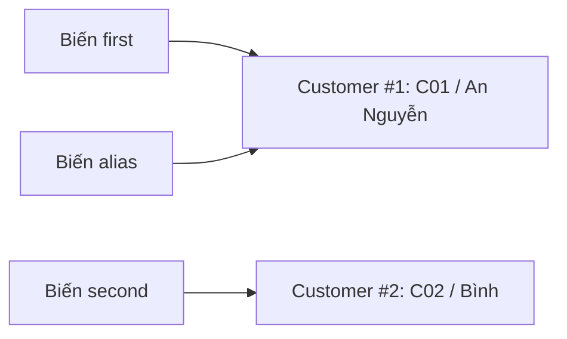

**Điểm mấu chốt:** khai báo một biến tham chiếu không tự tạo đối tượng:

```java
Customer a;              // Chỉ khai báo biến cục bộ; chưa được gán
Customer b = null;       // Có biến tham chiếu nhưng chưa trỏ tới Customer nào
Customer c = new Customer("C03", "Chi"); // Mới tạo instance
```

Không thể đọc `a` trước khi gán giá trị vì trình biên dịch Java yêu cầu biến cục bộ được khởi tạo trước khi sử dụng. Gọi `b.describe()` khi `b == null` sẽ ném `NullPointerException`.

## 2. Điều gì diễn ra khi gọi `new`?

Có thể hình dung quy trình ở mức khái niệm như sau:

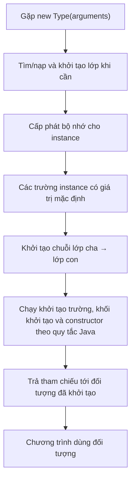

Sơ đồ tóm tắt ở cấp độ học OOP. Trên JVM, chi tiết nạp lớp, khởi tạo lớp, tối ưu hóa cấp phát và trình tự gọi constructor tuân theo những quy tắc cụ thể; **không được hiểu đây là các thao tác máy chạy tách biệt bắt buộc trong mọi lần gọi**.

Các điểm cần hiểu:

1. **Lớp và đối tượng khác nhau:** JVM quản lý thông tin lớp; mỗi lần `new` thông thường tạo một instance có các trường instance riêng.
2. **Trạng thái mặc định:** trước khi các initializer và constructor thiết lập dữ liệu, trường instance nhận giá trị mặc định: số là `0`, `boolean` là `false`, tham chiếu là `null`. Điều này **không áp dụng cho biến cục bộ chưa gán**.
3. **Constructor chạy khi tạo:** constructor dùng để bảo đảm đối tượng ở trạng thái hợp lệ, không có kiểu trả về, kể cả `void`.
4. **Chạy khởi tạo theo quy tắc kế thừa:** constructor lớp con gọi constructor phù hợp của lớp cha; các bộ khởi tạo instance của mỗi lớp được thực thi theo thứ tự khai báo trước phần thân constructor của lớp đó, sau bước gọi superclass theo quy tắc ngôn ngữ.
5. **Tham chiếu được trả về cho biểu thức `new`:** người gọi dùng tham chiếu này để gọi phương thức hoặc lưu vào cấu trúc dữ liệu.

### Giá trị mặc định, field initializer và constructor

```java
class Device {
    int attempts;                // Mặc định 0
    boolean active;              // Mặc định false
    String label;                // Mặc định null
    int priority = 5;            // Field initializer

    Device(String label) {
        this.label = label;      // Constructor gán trạng thái
        this.active = true;
    }
}
```

Sau `Device d = new Device("Printer");`, các giá trị quan sát được là `attempts == 0`, `active == true`, `label.equals("Printer")`, `priority == 5`. Tuy nhiên, **không nên dựa vào `null` mặc định để bỏ qua kiểm tra dữ liệu bắt buộc**; constructor nên thiết lập rõ các điều kiện hợp lệ.

## 3. Khởi tạo xong mới có một đối tượng dùng được

Sau khi cấp phát và gán giá trị mặc định, Java thực hiện các bước khởi tạo theo quy tắc của lớp và kế thừa. **Constructor** không có kiểu trả về; nó thiết lập dữ liệu bắt buộc và có thể từ chối đầu vào sai bằng exception:

~~~java
class Order {
    private final String code;

    Order(String code) {
        if (code == null || code.isBlank()) {
            throw new IllegalArgumentException("Mã đơn không hợp lệ");
        }
        this.code = code;
    }
}
~~~

`new Order("A01")` hoàn thành và trả tham chiếu; `new Order("")` ném exception, nên biểu thức không trả về đối tượng được khởi tạo thành công. Nếu constructor đã mở file hoặc cấp phát resource trước khi phát hiện lỗi, ứng dụng vẫn phải xử lý đóng tài nguyên đã sở hữu: lỗi constructor **không tự rollback side effect**.

Mỗi lối khởi tạo cần duy trì cùng một hợp đồng trạng thái. Cách kiểm tra invariant thuộc trọng tâm của bài *Hàm khởi tạo và thiết lập trạng thái hợp lệ*; overload và `this(...)` sẽ được học trong bài *Khởi tạo mặc định, tham số và nhiều cách khởi tạo*.

## 4. Bộ nhớ được cấp phát ở đâu? Heap, stack và tối ưu của JVM

Tại mức mô hình Java:

| Thành phần | Hiểu như thế nào? | Ví dụ |
|---|---|---|
| Đối tượng/array | Có vùng lưu trữ trạng thái; JVM thường quản lý trong heap | `new Customer(...)`, `new int[10]` |
| Biến tham chiếu cục bộ | Giữ một giá trị tham chiếu, không chứa toàn bộ object | `Customer c` trong `main` |
| Trường instance | Thuộc từng instance | `this.name` |
| Trường `static` | Thuộc lớp, được chia sẻ ở mức lớp | `static int createdCount` |
| Call stack | Liên quan ngữ cảnh thực thi lời gọi, biến cục bộ, địa chỉ quay lại... | `main()` gọi `rename()` |
| Tài nguyên ngoài JVM heap | File descriptor, socket, connection, native handle... | File đang mở, kết nối DB |

Thường nói “**object nằm trên heap, biến local nằm trên stack**” để dễ hình dung, nhưng đó **không phải cam kết bố trí vật lý tuyệt đối** của ngôn ngữ. JVM JIT có thể tối ưu escape analysis, scalar replacement và việc cấp phát; Java specification mô tả hành vi quan sát được thay vì bắt buộc một cách bố trí bộ nhớ cụ thể.

```java
Customer c = new Customer("C04", "Dũng");
Customer alsoC = c; // Hai biến cùng tham chiếu instance
c = null;           // Chỉ bỏ tham chiếu qua biến c
// alsoC vẫn tham chiếu được Customer("C04", "Dũng")
```

Gán `null` **không trực tiếp xóa đối tượng**. Chừng nào còn có đường tham chiếu đủ để JVM xác định đối tượng đang có thể được sử dụng, nó chưa đủ điều kiện thu hồi. Khi không còn đường tham chiếu tới nó từ các GC roots, đối tượng **có thể** được garbage collector thu hồi vào thời điểm do JVM lựa chọn.

## 5. Hai nghĩa khác nhau của “cấp phát tài nguyên”

`new Customer(...)` tạo một Java object, còn `Files.newBufferedReader(path)` có thể vừa cung cấp object Java vừa mở **file descriptor** do hệ điều hành quản lý.

| Loại | Ai hoàn trả? | Khi nào? |
|---|---|---|
| Bộ nhớ Java object không còn reachable | Garbage collector | JVM tự quyết định; không có mốc thu hồi tức thì |
| File, socket, DB connection, native handle | Bên sở hữu theo hợp đồng API | Chủ động `close()` hoặc cơ chế quản lý riêng khi xong việc |

Gán `reader = null` không bảo đảm đã đóng file. `System.gc()` cũng không tạo ra hợp đồng đóng tài nguyên. Khi mở resource, bước thiết kế quan trọng là xác định **ai sở hữu nó và khi nào phải kết thúc sử dụng**. Bài *Đóng tài nguyên và giới hạn của hàm hủy* phân tích sâu thứ tự đóng, exception và ownership.

## 6. Cách an toàn nhất với tài nguyên đóng được: try-with-resources

Từ Java 7, cú pháp `try-with-resources` tự động gọi `close()` khi rời khỏi phạm vi `try`, kể cả khi xảy ra exception. Đối tượng trong ngoặc phải thực thi `AutoCloseable` (hoặc `Closeable`).

### Ví dụ chạy thực tế: đọc file

```java
import java.io.BufferedReader;
import java.io.IOException;
import java.nio.charset.StandardCharsets;
import java.nio.file.Files;
import java.nio.file.Path;

public class ReadFileDemo {
    static void printFirstLine(Path path) throws IOException {
        try (BufferedReader reader =
                     Files.newBufferedReader(path, StandardCharsets.UTF_8)) {
            String line = reader.readLine();
            System.out.println(line == null ? "(file rỗng)" : line);
        } // Tự động gọi reader.close()
    }

    public static void main(String[] args) throws IOException {
        Path path = Files.createTempFile("oop-demo-", ".txt");
        try {
            Files.writeString(path, "Xin chào Java\nDòng thứ hai", StandardCharsets.UTF_8);
            printFirstLine(path); // Xin chào Java
        } finally {
            Files.deleteIfExists(path); // Dọn file tạm kể cả khi đọc lỗi
        }
    }
}
```

Để chạy, lưu thành `ReadFileDemo.java`:

```bash
javac ReadFileDemo.java
java ReadFileDemo
```

Ở ví dụ này:

1. `Files.createTempFile(...)` **tạo một file thực trên hệ thống**.
2. `Files.newBufferedReader(...)` mở tài nguyên đọc file.
3. `try (reader)` trao cho khối `try` trách nhiệm đóng `reader`.
4. Khi khối `try` kết thúc (thành công hoặc lỗi), `close()` được gọi.
5. Khối `finally` xóa file tạm do chương trình chủ động tạo; **đóng stream và xóa file là hai thao tác khác nhau**.

Không nhầm `newBufferedReader` chỉ là “tạo object” đơn giản: nó còn có thể mở file và tiêu thụ tài nguyên hệ điều hành. Khi mở file thất bại, API có thể ném `IOException`, và chương trình phải xử lý hoặc khai báo ngoại lệ đó.

### Điều gì xảy ra nếu lỗi phát sinh?

```java
try (BufferedReader reader = Files.newBufferedReader(path)) {
    throw new IOException("Lỗi xử lý");
}
```

Dù có lỗi trong thân `try`, JVM vẫn gọi `reader.close()` theo cú pháp try-with-resources. Nếu cả thân `try` lẫn `close()` cùng ném ngoại lệ, ngoại lệ từ thân `try` được giữ làm **primary exception**, còn lỗi khi đóng thường được ghi thành **suppressed exception** (xem `Throwable.getSuppressed()`). Nếu có nhiều tài nguyên khai báo trong cùng `try`, chúng được đóng theo **thứ tự ngược** với thứ tự khai báo.

## 7. Khi tạo object đồng nghĩa bắt đầu một vòng đời cần đóng

Một lớp tự viết có thể dùng `AutoCloseable` để mô tả trách nhiệm đóng tài nguyên. Ví dụ minh họa không mở socket thật:

~~~java
final class DemoSession implements AutoCloseable {
    private boolean closed;

    void send() {
        if (closed) throw new IllegalStateException("Đã đóng");
    }

    @Override
    public void close() {
        closed = true;
    }
}

try (DemoSession session = new DemoSession()) {
    session.send();
}
// Resource được yêu cầu đóng khi thoát try; object Java có thể còn tồn tại.
~~~

Trạng thái `closed` là **hợp đồng sử dụng resource**, không phải bằng chứng GC đã xóa object. `AutoCloseable` không bắt buộc mọi implementation phải an toàn khi đóng nhiều lần; lớp ví dụ chỉ đặt trạng thái đóng. Với tài nguyên thật cần xử lý lỗi `close()`, ngoại lệ bị suppressed, thứ tự đóng và chuyển giao ownership, xem bài *Đóng tài nguyên và giới hạn của hàm hủy*.

## 8. Không phải lúc nào vị trí sử dụng cũng gọi `new`

Một **static factory**, một factory service hay framework có thể cung cấp object mà caller không thấy constructor trực tiếp:

| Cách lấy object | Ví dụ | Điều cần nhớ |
|---|---|---|
| Constructor | `new Customer("C01", "An")` | Thông thường tạo một instance mới |
| Factory | `List.of("A")`, `Integer.valueOf(42)` | Có thể trả object đã tồn tại; không bảo đảm instance mới mỗi lần |
| API mở tài nguyên | `Files.newBufferedReader(path)` | Có thể mở file, cần xử lý IOException và đóng đúng lúc |
| Dependency injection | Constructor nhận `Repository` | Dependency được tạo/cung cấp ở nơi khác |
| Deserialization/reflection | API hoặc framework tạo instance | Tuân thủ hợp đồng riêng, không suy luận y hệt mọi lời gọi `new` |

Bài *Hàm tạo tĩnh, Factory và Builder* sẽ giúp lựa chọn cách tạo object có ý nghĩa, kiểm soát implementation và xử lý nhiều tham số. Bất kể cách tạo nào, **vòng đời bộ nhớ Java và vòng đời tài nguyên bên ngoài vẫn phải được xét riêng**.

## 9. Sau khi tạo, ai còn giữ object?

Một object có thể đã hết giá trị nghiệp vụ nhưng vẫn reachable nếu registry, cache hay listener giữ tham chiếu:

~~~java
static final List<Runnable> listeners = new ArrayList<>();

static void register(Runnable listener) {
    listeners.add(listener);
}

static void unregister(Runnable listener) {
    listeners.remove(listener);
}
~~~

Ví dụ đặt trong lớp đã import `java.util.List` và `java.util.ArrayList`. Khi `listener` vẫn nằm trong danh sách sống lâu, nó và những object nó tham chiếu có thể còn được giữ lại. Đăng ký cần có chính sách hủy; cache cần giới hạn/TTL theo nhu cầu. Những con đường từ GC roots và bài toán retention được phân tích đầy đủ tại *Thời gian tồn tại, khả năng truy cập và giải phóng bộ nhớ*.

## 10. Phân biệt các thời điểm trong vòng đời

| Sự kiện | Đối tượng Java | Tài nguyên ngoài JVM |
|---|---|---|
| `new`/factory trả thành công | Đối tượng có thể được sử dụng | Có thể đã mở, tùy API |
| Sử dụng phương thức | Trạng thái có thể thay đổi | Có thể đọc/ghi dữ liệu |
| `close()` | Đối tượng vẫn có thể tồn tại | Tài nguyên được yêu cầu hoàn trả |
| Mất mọi đường tham chiếu reachable | Có thể được GC thu hồi | Không được dựa vào GC để đóng kịp thời |
| GC chạy | Thu hồi bộ nhớ của các object đủ điều kiện | Không phải cơ chế quản lý tài nguyên có thời điểm xác định |

Ví dụ hay gây nhầm:

```java
BufferedReader reader = Files.newBufferedReader(path);
reader = null; // Không bảo đảm file đã được đóng!
```

Cách đúng khi chính đoạn mã mở và sở hữu reader:

```java
try (BufferedReader reader = Files.newBufferedReader(path)) {
    // Sử dụng reader
}
```

Nếu chương trình tạo liên tục object mà không còn tham chiếu, GC có thể thu hồi bộ nhớ của chúng. Nếu chương trình liên tục mở file mà không đóng, nó vẫn có thể hết file descriptors hoặc giới hạn tài nguyên hệ thống ngay cả khi heap chưa đầy.

## 11. Các lỗi thường gặp và cách sửa

| Lỗi | Vì sao nguy hiểm? | Cách xử lý |
|---|---|---|
| Gọi phương thức qua tham chiếu `null` | `NullPointerException` | Khởi tạo đúng, kiểm tra null ở ranh giới API |
| Cho rằng khai báo biến là đã tạo object | Biến local có thể chưa được gán | Dùng constructor/factory khi cần |
| Cho rằng `alias = original` tạo bản sao | Cùng tham chiếu một instance | Tạo bản sao rõ ràng khi cần trạng thái độc lập |
| Constructor mở resource rồi ném lỗi, không đóng | Rò rỉ tài nguyên | Dùng xử lý lỗi và `close` đúng ownership |
| Dùng GC hoặc `System.gc()` để “đóng” file | Không có thời điểm đóng bảo đảm | Try-with-resources |
| Quên `close()` với JDBC/file/socket | Tài nguyên hữu hạn bị giữ | Cấu trúc sở hữu và đóng rõ ràng |
| Đóng tài nguyên do caller quản lý | Làm hỏng luồng làm việc bên gọi | Thống nhất ownership qua hợp đồng |
| Lưu mọi object vào collection `static` | Object còn reachable không được GC | Giới hạn cache, unregister, xóa phần tử không dùng |
| Dùng object đã đóng | Lỗi trạng thái/IO | Kiểm soát trạng thái `closed` và phạm vi sử dụng |

## 12. Tự thực hành

1. Viết lớp `Student` có `id`, `name`; dùng constructor từ chối `id` rỗng, tạo hai đối tượng, thêm biến alias rồi dự đoán kết quả `==`.
2. Viết `Counter` với trường instance `count` và trường `static` đếm tổng số instance được tạo thành công. Hãy cân nhắc constructor có thể ném exception trước khi tăng biến đếm.
3. Tạo tệp tạm bằng `Files.createTempFile`, ghi và đọc một dòng, sau đó bảo đảm stream được đóng và tệp được xóa ngay cả khi có lỗi.
4. Viết lớp `FakeConnection implements AutoCloseable`: ghi log khi mở, thực thi một thao tác, và khi đóng; thử ném `RuntimeException` ở trong khối `try` để kiểm tra `close()` vẫn chạy.
5. Một service lưu mọi đối tượng `Request` vào `static List<Request>` mà không xóa. Giải thích vì sao GC không thể tự thu hồi các object vẫn được list tham chiếu.

**Điểm cần nhớ:** Tạo một đối tượng Java nghĩa là xây dựng instance và khởi tạo trạng thái hợp lệ. Việc giải phóng **bộ nhớ đối tượng** do GC đảm trách theo khả năng truy cập, còn việc giải phóng **tài nguyên có vòng đời đóng/mở** phải theo hợp đồng sở hữu của API — thường thông qua `AutoCloseable` và `try-with-resources`. 


</details>

- [Quay lại đầu trang](#back-to-top)

---

## <a id="lifecycle-002">Hàm khởi tạo và thiết lập trạng thái hợp lệ</a>

<details>
<summary>Xem chi tiết</summary>

# Hàm khởi tạo và thiết lập trạng thái hợp lệ trong Java

Một đối tượng không chỉ cần **được tạo ra**; nó cần ở trong **trạng thái hợp lệ** trước khi mã bên ngoài bắt đầu sử dụng. Trong Java, **constructor (hàm khởi tạo)** là nơi quan trọng để kiểm tra dữ liệu đầu vào, gán các trường và bảo đảm những quy tắc mà đối tượng luôn phải tuân theo.

Ví dụ, một lớp đăng ký khóa học chỉ hợp lệ khi mã khóa học có nội dung, sức chứa lớn hơn 0, số người đăng ký không vượt quá sức chứa và danh sách đăng ký không có phần tử trùng nhau. Nếu một trong những điều kiện này sai, constructor nên **từ chối tạo đối tượng dùng được** bằng ngoại lệ thích hợp.

## 1. Constructor nằm ở đâu trong vòng đời đối tượng?

Xét lời gọi:

```java
CourseEnrollment course = new CourseEnrollment("JAVA-01", 20);
```

Ở mức khái niệm, quá trình là:

1. Biểu thức `new` yêu cầu tạo một đối tượng thuộc lớp `CourseEnrollment`.
2. Java cấp phát bộ nhớ, gán giá trị mặc định cho các trường rồi thực hiện quá trình khởi tạo theo thứ tự của ngôn ngữ (gồm constructor của lớp cha, các bước khởi tạo trường/khối khởi tạo và thân constructor).
3. Constructor nhận tham số, xác thực các điều kiện và thiết lập trạng thái ban đầu.
4. Nếu khởi tạo hoàn tất bình thường, biểu thức `new` trả về tham chiếu đến đối tượng cho bên gọi.
5. Nếu constructor ném ngoại lệ, biểu thức tạo đối tượng **không hoàn thành bình thường**; bên gọi không nhận được tham chiếu kết quả từ biểu thức đó.

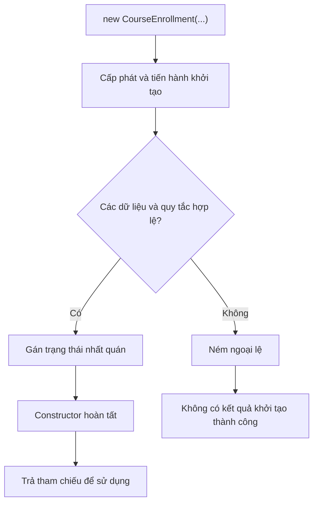

Sơ đồ diễn tả luồng kiểm tra của ví dụ; thứ tự chi tiết của những bước khởi tạo trường và lớp cha vẫn do Java quy định.

**Constructor không phải phương thức thông thường.** Tên constructor phải trùng tên lớp, không có kiểu trả về (kể cả `void`) và được gọi trong quá trình tạo đối tượng. Nó có thể nhận tham số, kiểm tra điều kiện, gán trường và ném ngoại lệ.

## 2. Trạng thái hợp lệ và bất biến của lớp (class invariant)

**Invariant** là một tập điều kiện phải đúng ở các thời điểm đối tượng được công bố và sử dụng hợp lệ.

Ví dụ một lớp `BankAccount` có quy tắc số dư không âm:

```java
class BankAccount {
    private long balance;

    BankAccount(long openingBalance) {
        if (openingBalance < 0) {
            throw new IllegalArgumentException("Số dư ban đầu không được âm");
        }
        this.balance = openingBalance;
    }

    void withdraw(long amount) {
        if (amount <= 0 || amount > balance) {
            throw new IllegalArgumentException("Số tiền rút không hợp lệ");
        }
        balance -= amount;
    }

    long getBalance() {
        return balance;
    }
}
```

Ở đây invariant là `balance >= 0`. Constructor bảo đảm nó đúng **sau khi tạo**, còn `withdraw()` phải tiếp tục duy trì nó **trong suốt quá trình sử dụng**.

Nếu chỉ kiểm tra trong constructor nhưng lại có setter `setBalance(-100)` không kiểm tra, invariant vẫn có thể bị phá vỡ. Vì vậy:

- Constructor phải đưa đối tượng vào trạng thái hợp lệ ban đầu.
- Các phương thức có thể thay đổi trạng thái phải duy trì tính hợp lệ đó.
- Trường nên được đóng gói bằng `private`; không mở khả năng gán tùy ý từ bên ngoài.
- Không cần setter cho mọi trường. Chỉ cung cấp thao tác nghiệp vụ mà đối tượng thực sự cho phép.

Một kiểm tra tốt thường gắn với **quy tắc miền nghiệp vụ**: số tiền không âm, khoảng thời gian bắt đầu trước kết thúc, mã định danh không trống, số lượng đặt hàng dương, hoặc danh sách thành viên không vượt sức chứa.

## 3. Ví dụ hoàn chỉnh: khởi tạo đăng ký khóa học hợp lệ

Ví dụ dưới đây tạo một lớp **bất biến**: mọi trạng thái được kiểm tra trong constructor, các trường không gán lại và thao tác thêm người học tạo ra đối tượng mới thông qua constructor. Cách làm này giúp nhìn rõ việc **kiểm tra lại invariant** mỗi lần cần trạng thái mới.

Đặt toàn bộ mã sau vào file `Main.java`. Chạy bằng **Java 17 hoặc Java 21**.

```java
import java.util.ArrayList;
import java.util.HashSet;
import java.util.List;
import java.util.Objects;
import java.util.Set;

final class CourseEnrollment {
    private final String courseCode;
    private final int capacity;
    private final List<String> studentEmails;

    // Constructor tiện lợi cho khóa học chưa có người đăng ký.
    CourseEnrollment(String courseCode, int capacity) {
        this(courseCode, capacity, List.of());
    }

    // Constructor thực hiện kiểm tra trạng thái đầy đủ.
    CourseEnrollment(String courseCode, int capacity, List<String> studentEmails) {
        if (courseCode == null || courseCode.isBlank()) {
            throw new IllegalArgumentException("Mã khóa học không được trống");
        }
        if (capacity <= 0) {
            throw new IllegalArgumentException("Sức chứa phải lớn hơn 0");
        }

        Objects.requireNonNull(studentEmails, "studentEmails");

        // Chụp dữ liệu đầu vào để caller không sửa được trạng thái bên trong.
        // List.copyOf cũng từ chối các phần tử null.
        List<String> copy = List.copyOf(studentEmails);

        if (copy.size() > capacity) {
            throw new IllegalArgumentException("Số học viên vượt sức chứa");
        }

        Set<String> unique = new HashSet<>();
        for (String email : copy) {
            if (email.isBlank()) {
                throw new IllegalArgumentException("Email không được trống");
            }
            if (!unique.add(email)) {
                throw new IllegalArgumentException("Email đã đăng ký trùng");
            }
        }

        // Sau khi đã kiểm tra xong, thiết lập trạng thái.
        this.courseCode = courseCode;
        this.capacity = capacity;
        this.studentEmails = copy;
    }

    CourseEnrollment withStudent(String email) {
        Objects.requireNonNull(email, "email");

        List<String> updated = new ArrayList<>(studentEmails);
        updated.add(email);

        // Constructor tiếp tục bảo vệ các invariant.
        return new CourseEnrollment(courseCode, capacity, updated);
    }

    String getCourseCode() {
        return courseCode;
    }

    int getCapacity() {
        return capacity;
    }

    int getRegisteredCount() {
        return studentEmails.size();
    }

    List<String> getStudentEmails() {
        return studentEmails;
    }
}

public class Main {
    public static void main(String[] args) {
        List<String> source = new ArrayList<>(List.of("lan@example.com"));
        CourseEnrollment first = new CourseEnrollment("JAVA-01", 2, source);

        source.add("minh@example.com"); // Sửa danh sách ngoài đối tượng
        System.out.println(first.getStudentEmails());

        CourseEnrollment second = first.withStudent("minh@example.com");
        System.out.println(first.getRegisteredCount());
        System.out.println(second.getRegisteredCount());
        System.out.println(first == second);

        try {
            new CourseEnrollment("JAVA-01", 1,
                    List.of("lan@example.com", "minh@example.com"));
        } catch (IllegalArgumentException ex) {
            System.out.println(ex.getMessage());
        }

        try {
            first.withStudent("lan@example.com");
        } catch (IllegalArgumentException ex) {
            System.out.println(ex.getMessage());
        }

        try {
            new CourseEnrollment(" ", 2);
        } catch (IllegalArgumentException ex) {
            System.out.println(ex.getMessage());
        }

        try {
            first.getStudentEmails().add("other@example.com");
        } catch (UnsupportedOperationException ex) {
            System.out.println("Không thể sửa danh sách đã trả về");
        }
    }
}
```

Biên dịch và chạy:

```bash
javac Main.java
java Main
```

Kết quả:

```text
[lan@example.com]
1
2
false
Số học viên vượt sức chứa
Email đã đăng ký trùng
Mã khóa học không được trống
Không thể sửa danh sách đã trả về
```

**Đọc kết quả:**

- Constructor đã chụp `List.copyOf(source)`, nên việc thêm phần tử vào `source` không làm thay đổi `first`.
- `first.withStudent(...)` gọi lại constructor để tạo `second`. `first` vẫn có 1 người đăng ký, `second` có 2; chúng là hai đối tượng khác nhau.
- Khi số người học lớn hơn sức chứa, trùng email hoặc mã khóa học rỗng, constructor ném `IllegalArgumentException`.
- Danh sách do `getStudentEmails()` trả về không cho thêm/xóa, tránh phá vỡ trạng thái đã kiểm tra.

Ví dụ kiểm tra email theo chuỗi chính xác và phân biệt chữ hoa/chữ thường; đây là quy tắc minh họa. Ứng dụng thực tế phải xác định chính sách chuẩn hóa và đối chiếu email riêng, đồng thời kiểm tra những ràng buộc nghiệp vụ khác khi cần.

## 4. Chọn thứ tự kiểm tra và gán trường

Một constructor dễ kiểm tra thường đi theo thứ tự:

1. Kiểm tra tham số `null` và giá trị đơn lẻ: `courseCode`, `capacity`.
2. Chuẩn hóa hoặc tạo bản sao dữ liệu ngoài nếu cần.
3. Kiểm tra ràng buộc giữa nhiều trường: số học viên không được vượt `capacity`.
4. Gán các trường một lần, theo trạng thái đã được kiểm tra.
5. Cho phép constructor hoàn tất khi mọi invariant đều đúng.

Cách này hạn chế việc đặt đối tượng vào trạng thái sai rồi mới phát hiện lỗi. Dù constructor ném ngoại lệ thì đối tượng chưa được công bố qua kết quả `new`; tuy nhiên, những **tác động bên ngoài** diễn ra trước khi ném lỗi (ghi file, gửi sự kiện, chuyển tiền, đăng ký listener...) **không được Java tự hoàn tác**. Vì vậy nên kiểm tra trước, tránh side effect không cần thiết trong constructor và tách các thao tác nghiệp vụ dài ra khỏi việc khởi tạo.

| Loại kiểm tra | Ví dụ | Vị trí thích hợp |
| --- | --- | --- |
| Không được `null` | Danh sách đầu vào bắt buộc | Constructor, bằng `Objects.requireNonNull` |
| Không rỗng | Mã khóa học, tên người học | Constructor, sau kiểm tra `null` |
| Khoảng giá trị | `capacity > 0` | Constructor |
| Ràng buộc giữa các trường | `students.size() <= capacity` | Constructor, sau khi có danh sách an toàn |
| Tính duy nhất | Không trùng email | Constructor hoặc lớp giá trị chuyên trách |
| Quy tắc khi cập nhật | Không rút vượt số dư | Phương thức thay đổi trạng thái |
| Quy tắc có dữ liệu ngoài | Khóa học còn mở trong hệ thống | Thường ở dịch vụ/luồng nghiệp vụ, trước khi tạo đối tượng phù hợp |

Không phải mọi phép xác thực đều nên nằm trong constructor. Ví dụ, kiểm tra một mã coupon còn hiệu lực trong cơ sở dữ liệu phụ thuộc vào thời điểm, kết nối và giao dịch. Đó thường là trách nhiệm của một service hoặc factory phối hợp hạ tầng; constructor vẫn nên tự bảo vệ những bất biến **nội tại** của đối tượng.

## 5. Mọi lối gọi constructor phải bảo vệ cùng invariant

Khi cần hỗ trợ nhiều tập dữ liệu đầu vào, các overload nên **ủy quyền** về cùng một điểm xác thực. Trong Java 17/21, lời gọi `this(...)` được đặt đầu constructor:

~~~java
class RetryPolicy {
    private final int attempts;

    RetryPolicy() {
        this(3);
    }

    RetryPolicy(int attempts) {
        if (attempts <= 0) throw new IllegalArgumentException();
        this.attempts = attempts;
    }
}
~~~

Hai lối gọi đều không thể tạo `RetryPolicy` có `attempts <= 0`. Đây là một ứng dụng của invariant trong constructor; bài *Khởi tạo mặc định, tham số và nhiều cách khởi tạo* sẽ phân biệt default/no-arg/parameterized constructors, lựa chọn overload và `this(...)`/`super(...)` kỹ hơn.

## 6. `final`, đóng gói và defensive copy

Một lớp có trường `private final` giúp hạn chế việc thay đổi tham chiếu hoặc giá trị trường sau khi gán:

```java
final class Schedule {
    private final List<String> lessons;

    Schedule(List<String> lessons) {
        this.lessons = List.copyOf(lessons);
    }

    List<String> getLessons() {
        return lessons;
    }
}
```

Dùng `final` trên trường **không tự làm cho đối tượng được tham chiếu bất biến**:

```java
class UnsafeSchedule {
    private final List<String> lessons;

    UnsafeSchedule(List<String> lessons) {
        this.lessons = lessons; // Vẫn chia sẻ list mutable với caller
    }
}
```

Với `UnsafeSchedule`, caller có thể sửa danh sách gốc và làm thay đổi trạng thái quan sát được của đối tượng. `Schedule` dùng `List.copyOf()` để giữ một danh sách không sửa được về cấu trúc và không bị ảnh hưởng bởi thao tác thêm/xóa trong danh sách đầu vào sau đó.

**Giới hạn quan trọng:** `List.copyOf()` sao chép cấu trúc danh sách, **không sao chép sâu** mọi phần tử. Nếu danh sách chứa phần tử mutable như `StringBuilder`, `Date` hoặc đối tượng nghiệp vụ có setter, cần thêm biện pháp để bảo đảm bất biến sâu. Trong ví dụ `Schedule`, các phần tử `String` vốn bất biến, nên phù hợp.

Nguyên tắc thực hành:

- Khai báo trường `private` để kiểm soát các đường cập nhật trạng thái.
- Dùng `final` cho dữ liệu phải được gán một lần.
- Sao chép dữ liệu mutable đầu vào nếu không muốn phụ thuộc vào thay đổi của caller.
- Không trả tham chiếu có thể sửa trực tiếp vào cấu trúc nội bộ cần bảo vệ.
- Chỉ cung cấp phương thức thay đổi trạng thái nếu đó là hành vi có ý nghĩa nghiệp vụ.

## 7. Khởi tạo hợp lệ khác với “tạm thời rồi sửa sau”

Hai phương án dưới đây khác nhau về cam kết của lớp:

```java
// Phương án dễ tạo trạng thái chưa hợp lệ:
class UnsafeUser {
    String email;

    UnsafeUser() {
    }
}

// Có thể tạo UnsafeUser mà email == null.
```

So với:

```java
final class User {
    private final String email;

    User(String email) {
        if (email == null || email.isBlank()) {
            throw new IllegalArgumentException("Email bắt buộc");
        }
        this.email = email;
    }

    String getEmail() {
        return email;
    }
}
```

Ở cách thứ hai, một đối tượng `User` được khởi tạo thành công **không ở trạng thái thiếu email**. Khi thiết kế API, điều này giúp bỏ nhiều câu `if (user.getEmail() == null)` rải rác ở nơi sử dụng.

Tuy nhiên, một hệ thống vẫn có thể cần các trạng thái nghiệp vụ khác nhau, ví dụ `DRAFT`, `PENDING`, `ACTIVE`. Các trạng thái này **không nhất thiết là trạng thái không hợp lệ**. Điều quan trọng là mô hình hóa rõ những trạng thái hợp lệ theo từng giai đoạn, và ngăn tổ hợp dữ liệu mâu thuẫn, ví dụ `ACTIVE` nhưng không có ngày kích hoạt khi chính sách yêu cầu phải có.

Một số mô hình có thể dùng factory tĩnh như `User.registered(email)`, `Order.draft(...)` hoặc các loại dữ liệu riêng để diễn đạt trạng thái khởi tạo. Factory là công cụ thiết kế bổ sung; các constructor được gọi phía sau vẫn cần bảo đảm invariant theo quyền truy cập và hợp đồng lớp.

## 8. Constructor ném ngoại lệ thì sao?

Ví dụ:

```java
class Seat {
    private final int number;

    Seat(int number) {
        if (number <= 0) {
            throw new IllegalArgumentException("Số ghế phải dương");
        }
        this.number = number;
    }
}
```

```java
Seat good = new Seat(5);   // Tạo thành công
Seat bad = new Seat(-1);  // Ném IllegalArgumentException
```

Ở dòng thứ hai, phép gán cho `bad` không hoàn tất. Nếu code bắt ngoại lệ thì có thể xử lý lỗi và tiếp tục luồng chương trình. Ngoại lệ không biến một đối tượng không hợp lệ thành giá trị `null`.

Thường dùng:

| Ngoại lệ | Tình huống phổ biến |
| --- | --- |
| `IllegalArgumentException` | Tham số không thỏa hợp đồng constructor (âm, trống, vượt ngưỡng) |
| `NullPointerException` | Tham số bắt buộc khác `null`, thường dùng `Objects.requireNonNull` |
| Ngoại lệ miền nghiệp vụ tùy chỉnh | Cần biểu diễn lỗi nghiệp vụ đặc thù, nhất quán trong API |

Không nên dùng `assert` để thay cho kiểm tra dữ liệu constructor. Assertion có thể không được bật khi chạy ứng dụng; validation của hợp đồng lớp phải hoạt động độc lập với cấu hình `-ea`.

Một constructor nên để lỗi **lộ rõ theo hợp đồng**, không nuốt ngoại lệ rồi khởi tạo đối tượng với giá trị mặc định tùy tiện, trừ khi giá trị mặc định đó đã được xác định là trạng thái hợp lệ.

## 9. Không làm lộ một đối tượng chưa hoàn tất constructor

Kiểm tra invariant đúng vẫn có thể thất bại nếu mã bên ngoài sử dụng `this` quá sớm. Hai đường thường gặp:

- **Constructor cha gọi phương thức được override:** Java có thể dispatch vào override của lớp con khi các field initializer của lớp con chưa chạy; kết quả là field còn mang giá trị mặc định `null`/`0`.
- **Đăng ký listener hoặc start task trong constructor:** callback hoặc thread khác có thể đọc field trước khi chúng được thiết lập; nếu constructor ném lỗi sau khi đăng ký, tham chiếu tới đối tượng dở dang còn có thể bị giữ.

Vì vậy, dùng các helper khởi tạo không thể override, validate trước side effect, và đăng ký/công bố object **sau khi constructor hoàn tất** theo cơ chế đồng bộ phù hợp. Trình tự chính xác của lớp cha và lớp con nằm ở bài *Thứ tự khởi tạo trong quan hệ kế thừa*; nguyên nhân, ví dụ callback và safe publication ở bài *Tránh để đối tượng chưa khởi tạo xong bị sử dụng*.

## 10. Constructor của `record` cũng có thể bảo vệ invariant

Từ Java 16, `record` cho phép biểu diễn các đối tượng dữ liệu gọn hơn. Với **compact constructor**, có thể xác thực và chuẩn hóa tham số trước khi Java tự gán vào các trường thành phần:

```java
import java.util.List;

record LessonBundle(String name, List<String> lessons) {
    LessonBundle {
        if (name == null || name.isBlank()) {
            throw new IllegalArgumentException("Tên bộ bài học không hợp lệ");
        }
        lessons = List.copyOf(lessons);
        if (lessons.isEmpty()) {
            throw new IllegalArgumentException("Cần ít nhất một bài học");
        }
    }
}
```

`name` và `lessons` được dùng làm tham số của constructor; trong compact constructor, việc gán `lessons = List.copyOf(lessons)` thay thế giá trị tham số bằng một danh sách đã bảo vệ. Sau thân constructor, Java tự gán các tham số đã xử lý vào trường tương ứng.

**Chú ý:** Trường của record là `final`, nhưng record không tự bất biến sâu. Nếu thành phần là đối tượng mutable, constructor vẫn cần kiểm soát việc chia sẻ tham chiếu và phần tử bên trong.

## 11. Checklist thiết kế constructor tốt

| Câu hỏi đánh giá | Mong đợi |
| --- | --- |
| Điều kiện nào khiến đối tượng hợp lệ? | Có danh sách invariant rõ ràng |
| Dữ liệu bắt buộc có được cung cấp khi tạo? | Không tạo đối tượng thiếu trường cần thiết |
| Mọi đường constructor có cùng quy tắc? | Ưu tiên ủy quyền về điểm kiểm tra chung |
| Tham số `null` hoặc sai khoảng có bị từ chối? | Lỗi rõ, nhất quán với hợp đồng |
| Có chia sẻ collection/mảng mutable của caller không? | Defensive copy nếu muốn bảo vệ |
| Getter có làm lộ trạng thái có thể sửa không? | Trả dữ liệu an toàn hoặc API được kiểm soát |
| Có gọi override, xuất bản `this`, thực hiện I/O quá sớm không? | Tránh sử dụng đối tượng chưa sẵn sàng và side effect khó hoàn tác |
| Phương thức thay đổi trạng thái có giữ invariant không? | Trạng thái hợp lệ từ đầu đến cuối |

## 12. Bài tập tự kiểm tra

**Bài 1:** Chuyện gì xảy ra?

```java
class Product {
    private final int quantity;

    Product(int quantity) {
        if (quantity <= 0) {
            throw new IllegalArgumentException("quantity phải dương");
        }
        this.quantity = quantity;
    }
}
// new Product(0);
```

**Đáp án:** Khi bỏ dấu chú thích và gọi `new Product(0)`, constructor ném `IllegalArgumentException`, không trả về một đối tượng `Product` được khởi tạo thành công.

**Bài 2:** Trong `CourseEnrollment`, tại sao phải kiểm tra `copy.size() > capacity` trong constructor ba tham số ngay cả khi constructor hai tham số luôn truyền `List.of()`?

**Đáp án:** Vì bên gọi có thể dùng trực tiếp constructor ba tham số, và `withStudent()` cũng đi qua nó. Mọi đường tạo đối tượng cần bảo vệ cùng invariant.

**Bài 3:** Nếu thay `this.studentEmails = copy;` thành `this.studentEmails = studentEmails;`, rủi ro gì?

**Đáp án:** Danh sách mutable do caller truyền vào vẫn có thể được sửa sau khi khởi tạo; số học viên có thể vượt sức chứa hoặc bị trùng dù constructor đã kiểm tra trước đó.

**Bài 4:** Vì sao `private final List<String> items` không tự bảo đảm invariant “danh sách không thay đổi”?

**Đáp án:** `final` chỉ chặn việc gán lại trường, không chặn `items.add(...)`. Cần kiểm soát đối tượng danh sách và các phần tử bên trong nếu chúng mutable.

**Bài 5:** Constructor của lớp cha gọi phương thức có thể override thì rủi ro gì?

**Đáp án:** Phần override ở lớp con có thể chạy trước khi phần khởi tạo lớp con hoàn tất, đọc phải các giá trị mặc định như `null` hoặc `0`.

**Điểm cần nhớ:** Một constructor tốt xác lập **hợp đồng trạng thái của đối tượng tại thời điểm khởi tạo thành công**. Hãy định nghĩa invariant, kiểm tra đầu vào và quan hệ giữa các trường, bảo vệ dữ liệu mutable được truyền vào, rồi chỉ công bố đối tượng sau khi mọi bước khởi tạo hoàn tất. Những phương thức thay đổi trạng thái về sau phải tiếp tục duy trì hợp đồng đó.


</details>

- [Quay lại đầu trang](#back-to-top)

---

## <a id="lifecycle-003">Khởi tạo mặc định, tham số và nhiều cách khởi tạo</a>

<details>
<summary>Xem chi tiết</summary>

# Khởi tạo mặc định, tham số và nhiều cách khởi tạo đối tượng trong Java

Một đối tượng chỉ thực sự có ý nghĩa khi trạng thái ban đầu của nó hợp lệ. Khi viết lớp `Student`, `BankAccount` hay `Order`, ta cần xác định dữ liệu nào bắt buộc phải có ngay lúc tạo, dữ liệu nào có giá trị mặc định và khi nào nên cung cấp nhiều cách tạo đối tượng.

Trong Java, công cụ trung tâm của bước này là **constructor (hàm tạo)**. Bên cạnh constructor, Java còn hỗ trợ khởi tạo trường, khối khởi tạo, static factory method và mô hình Builder. Mỗi lựa chọn giải quyết một nhu cầu khác nhau, không nên xem chúng như những cách viết thay thế hoàn toàn tương đương.

## 1. Constructor là gì?

Constructor được gọi khi khởi tạo một thể hiện lớp, thường thông qua biểu thức `new`:

```java
public class Student {
    private final String id;
    private final String name;

    public Student(String id, String name) {
        this.id = id;
        this.name = name;
    }

    public String getName() {
        return name;
    }

    public static void main(String[] args) {
        Student student = new Student("SV01", "An");
        System.out.println(student.getName()); // An
    }
}
```

Trong ví dụ:

1. `new Student("SV01", "An")` yêu cầu tạo một đối tượng `Student`.
2. Constructor `Student(String id, String name)` nhận dữ liệu đầu vào.
3. Các trường `id`, `name` được gán giá trị để đối tượng sẵn sàng sử dụng.
4. Biểu thức `new` có kết quả là tham chiếu đến đối tượng; biến `student` nhận giá trị tham chiếu đó.

**Đặc điểm của constructor:**

- Tên constructor trùng với **tên lớp**.
- Constructor **không khai báo kiểu trả về**, kể cả `void`.
- Có thể nhận tham số, overload và mang modifier truy cập (`public`, `protected`, package-private hoặc `private`).
- Không được khai báo `static`, `abstract`, `final`; constructor không được kế thừa hay ghi đè như phương thức.
- Nếu một phương thức có tên giống tên lớp nhưng khai báo kiểu trả về, nó vẫn là **phương thức**, không phải constructor.

Ví dụ cách viết **sai**:

```java
class Product {
    // public void Product(String name) { } // Đây là method tên Product
    // public static Product() { }           // Không thể dùng static cho constructor
}
```

Constructor là nơi phù hợp để bảo đảm **bất biến của đối tượng (object invariants)**, chẳng hạn giá không âm, tên không rỗng và mã định danh hợp lệ.

## 2. Constructor mặc định khác constructor không tham số

Hai khái niệm này thường bị gọi chung là “constructor mặc định”, nhưng khi học Java nên phân biệt rõ:

| Khái niệm | Nguồn gốc | Khi nào tồn tại? | Có thực hiện logic do ta viết? |
|---|---|---|---|
| **Default constructor** (constructor mặc định ngầm định) | Java compiler tự sinh | Chỉ khi lớp **không khai báo bất kỳ constructor nào** | Không có logic do lập trình viên tự viết; gọi `super()` |
| **No-argument constructor** (constructor không tham số) | Do lập trình viên khai báo | Khi viết `ClassName() { ... }` | Có thể chứa logic khởi tạo, kiểm tra, gán giá trị |
| **Parameterized constructor** (constructor có tham số) | Do lập trình viên khai báo | Khi viết constructor có ít nhất một tham số | Dùng dữ liệu đầu vào để tạo trạng thái theo yêu cầu |

### 2.1. Default constructor do trình biên dịch sinh

```java
public class Book {
    String title;
    int pages;

    // Không khai báo constructor nào

    public static void main(String[] args) {
        Book book = new Book();

        System.out.println(book.title); // null
        System.out.println(book.pages); // 0
    }
}
```

Vì `Book` không có constructor nào được khai báo, Java compiler cung cấp một constructor không tham số ngầm định. Trong lớp thông thường như trên, có thể hình dung gần tương đương:

```java
public Book() {
    super();
}
```

Điều này **không có nghĩa** mọi lớp đều mặc nhiên có `new ClassName()`; khi ta khai báo một constructor bất kỳ, compiler sẽ không tự bổ sung constructor không tham số nữa.

Các trường có giá trị mặc định theo kiểu khi một đối tượng được tạo (nếu không được gán bởi field initializer/constructor):

| Kiểu trường | Giá trị mặc định |
|---|---|
| `byte`, `short`, `int`, `long` | `0` (đúng kiểu) |
| `float`, `double` | `0.0` (đúng kiểu) |
| `boolean` | `false` |
| `char` | `'\u0000'` |
| Kiểu tham chiếu như `String`, `List` | `null` |

Các **biến cục bộ** trong phương thức/constructor không có cơ chế “đọc giá trị mặc định” như trường: chúng phải được gán trước khi đọc.

### 2.2. Constructor không tham số tự viết

```java
public class Counter {
    private int value;

    public Counter() {
        this.value = 100;
    }

    public int getValue() {
        return value;
    }

    public static void main(String[] args) {
        Counter counter = new Counter();
        System.out.println(counter.getValue()); // 100
    }
}
```

Ở đây `Counter()` **được viết tường minh** nên không phải constructor mặc định do compiler sinh. Constructor tự viết có thể đặt giá trị khác giá trị mặc định, gọi các phương thức hỗ trợ hoặc ủy quyền đến constructor khác.

### 2.3. Có constructor có tham số thì không tự có no-arg

```java
public class Device {
    private final String serial;

    public Device(String serial) {
        this.serial = serial;
    }
}

Device a = new Device("SN-001"); // Hợp lệ
// Device b = new Device();        // LỖI BIÊN DỊCH
```

Lý do: lớp đã khai báo `Device(String serial)`. Compiler sẽ **không** tự sinh `Device()`.

Nếu thực sự cần hai cách tạo, phải khai báo cả hai constructor:

```java
public class Device {
    private final String serial;

    public Device() {
        this("UNASSIGNED");
    }

    public Device(String serial) {
        this.serial = serial;
    }
}
```

Trong ví dụ này, `Device()` là constructor không tham số do lập trình viên khai báo; nó ủy quyền tới constructor nhận `String`.

**Lưu ý:** Một lớp cha không có constructor không tham số truy cập được cũng có thể khiến constructor ngầm định của lớp con gây lỗi biên dịch, vì việc khởi tạo lớp con phải gọi được constructor thích hợp của lớp cha.

## 3. Constructor có tham số: bảo đảm dữ liệu bắt buộc

Constructor có tham số phù hợp khi đối tượng **không nên tồn tại ở trạng thái thiếu thông tin**.

Ví dụ tài khoản ngân hàng có mã tài khoản bắt buộc và số dư ban đầu không được âm:

```java
import java.math.BigDecimal;
import java.util.Objects;

public class BankAccount {
    private final String accountNumber;
    private BigDecimal balance;

    public BankAccount(String accountNumber, BigDecimal openingBalance) {
        Objects.requireNonNull(accountNumber, "accountNumber");
        if (accountNumber.isBlank()) {
            throw new IllegalArgumentException("Mã tài khoản không được rỗng");
        }
        Objects.requireNonNull(openingBalance, "openingBalance");
        if (openingBalance.signum() < 0) {
            throw new IllegalArgumentException("Số dư mở tài khoản không được âm");
        }

        this.accountNumber = accountNumber;
        this.balance = openingBalance;
    }

    public BigDecimal getBalance() {
        return balance;
    }

    public static void main(String[] args) {
        BankAccount account =
                new BankAccount("ACC-01", new BigDecimal("100000"));

        System.out.println(account.getBalance()); // 100000
    }
}
```

Constructor xác nhận đầu vào hợp lệ **trước khi đối tượng được sử dụng bình thường**. Sử dụng `BigDecimal` thay vì `double` cho số tiền giúp tránh những lỗi thường gặp từ biểu diễn dấu phẩy động nhị phân; đây là lựa chọn thiết kế ví dụ, không phải quy tắc bắt buộc cho mọi loại dữ liệu.

Với thuộc tính bắt buộc, constructor có tham số thường rõ ràng hơn thiết kế tạo đối tượng trống rồi chờ chuỗi lời gọi setter:

```java
// Dễ gây trạng thái tạm thời chưa hợp lệ nếu thiếu thao tác:
Profile profile = new Profile();
profile.setEmail("an@example.com");
// Nếu quên setUserId(), đối tượng có thể vẫn thiếu dữ liệu bắt buộc.
```

Khi không thực sự cần tạo thể hiện “chưa hoàn tất”, nên thiết kế constructor để nhận đủ dữ liệu bắt buộc.

## 4. Constructor overloading: nhiều cách khởi tạo một lớp

**Overloading** là khai báo nhiều constructor cùng tên lớp nhưng khác **danh sách tham số** (khác số lượng, kiểu hoặc thứ tự kiểu). Phạm vi truy cập có thể khác nhau, nhưng chỉ thay access modifier không làm thành hai overload.

Ví dụ một đơn hàng có mã bắt buộc, phí vận chuyển và mức ưu đãi tùy chọn:

```java
public class Order {
    private final String code;
    private final long shippingFee;
    private final int discountPercent;

    public Order(String code) {
        this(code, 0L, 0);
    }

    public Order(String code, long shippingFee) {
        this(code, shippingFee, 0);
    }

    public Order(String code, long shippingFee, int discountPercent) {
        if (code == null || code.isBlank()) {
            throw new IllegalArgumentException("Mã đơn hàng bắt buộc");
        }
        if (shippingFee < 0) {
            throw new IllegalArgumentException("Phí vận chuyển không được âm");
        }
        if (discountPercent < 0 || discountPercent > 100) {
            throw new IllegalArgumentException("Ưu đãi phải từ 0 đến 100%");
        }
        this.code = code;
        this.shippingFee = shippingFee;
        this.discountPercent = discountPercent;
    }

    public String describe() {
        return code + " | shipping=" + shippingFee
                + " | discount=" + discountPercent + "%";
    }

    public static void main(String[] args) {
        System.out.println(new Order("ORD-01").describe());
        System.out.println(new Order("ORD-02", 25000L).describe());
        System.out.println(new Order("ORD-03", 25000L, 10).describe());
    }
}
```

Kết quả:

```text
ORD-01 | shipping=0 | discount=0%
ORD-02 | shipping=25000 | discount=0%
ORD-03 | shipping=25000 | discount=10%
```

Thay vì lặp lại toàn bộ code kiểm tra ở ba constructor, các overload ngắn **ủy quyền** về constructor đầy đủ. Điều này giữ quy tắc hợp lệ ở một nơi.

### Cách Java chọn overload

Trình biên dịch chọn constructor phù hợp tại **thời điểm biên dịch**, dựa trên số lượng và kiểu đối số cũng như những chuyển đổi hợp lệ. Nếu có nhiều overload không phân định được, lời gọi sẽ **mơ hồ (ambiguous)**.

```java
class Message {
    Message(String text) {}
    Message(Integer code) {}
}

// new Message(null); // LỖI: null phù hợp cả String lẫn Integer
new Message((String) null); // Chọn constructor String
```

Vì vậy không nên tạo quá nhiều overload dễ nhầm lẫn, đặc biệt khi có các tham số cùng kiểu hoặc có thể nhận `null`.

## 5. Constructor chaining với this() và super()

Khi một constructor gọi một constructor khác, đó là **constructor chaining**.

- `this(...)`: gọi một constructor **khác trong cùng lớp**.
- `super(...)`: gọi constructor của **lớp cha**.
- Trong mẫu tương thích rộng rãi, lệnh gọi constructor tường minh được đặt đầu thân constructor.
- Không thể gọi cả `this(...)` và `super(...)` như hai lời gọi constructor trực tiếp trong cùng một constructor; constructor được `this(...)` gọi sẽ tiếp tục chuỗi đến lớp cha.
- Không thể tạo vòng gọi `this(...)` (chẳng hạn A gọi B và B lại gọi A): compiler báo lỗi.

Sơ đồ luồng khởi tạo của `Order` ở phần trên:

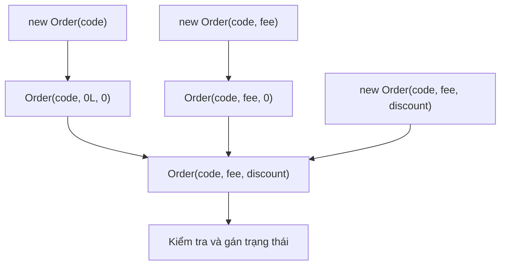

### Ví dụ lớp cha và lớp con

File `InheritanceInitDemo.java`:

```java
public class InheritanceInitDemo {
    static class Person {
        private final String name;

        Person(String name) {
            this.name = name;
            System.out.println("Person constructor: " + name);
        }

        String getName() {
            return name;
        }
    }

    static class Employee extends Person {
        private final String department;

        Employee(String name, String department) {
            super(name);
            this.department = department;
            System.out.println("Employee constructor: " + department);
        }

        String getDepartment() {
            return department;
        }
    }

    public static void main(String[] args) {
        Employee employee = new Employee("An", "Backend");
        System.out.println(employee.getName() + " - "
                + employee.getDepartment());
    }
}
```

Kết quả:

```text
Person constructor: An
Employee constructor: Backend
An - Backend
```

Constructor lớp cha được thực hiện trước phần thân constructor lớp con. Nếu constructor của `Employee` bỏ `super(name)`, trình biên dịch sẽ cố gọi `super()` ngầm định (trong ví dụ này, không tồn tại), và mã sẽ lỗi biên dịch.

**Không gọi trực tiếp constructor như phương thức bình thường**, ví dụ `employee.Person("An")`. Các lời gọi `this(...)` / `super(...)` thuộc cú pháp constructor invocation, có quy tắc riêng.

## 6. Constructor chaining trong kế thừa: điểm cần nhớ

Nếu `Child extends Parent`, constructor của `Child` cuối cùng phải đi qua một constructor hợp lệ của `Parent` (tường minh `super(...)` hoặc mặc định `super()` khi hợp lệ). Đây vẫn là **một đối tượng Child** có phần trạng thái do lớp cha khai báo; không tự tạo một instance `Parent` thứ hai.

~~~java
class Parent {
    Parent() { System.out.println("Parent"); }
}
class Child extends Parent {
    Child() {
        super();
        System.out.println("Child");
    }
}
// new Child() in "Parent", rồi "Child".
~~~

Thứ tự khởi tạo chi tiết hơn còn liên quan **static initializer**, field initializer và instance block của từng lớp. Các bước chạy theo chiều cha → con; code gọi override trong constructor cha có thể quan sát field của lớp con đang mang giá trị mặc định. Bài *Thứ tự khởi tạo trong quan hệ kế thừa* có một chương trình trace hoàn chỉnh và phân biệt thời điểm khởi tạo class với instance.

## 7. Khi overloaded constructor không còn dễ đọc

Overload phù hợp khi chỉ có vài tập tham số dễ phân biệt. Nhưng các yêu cầu khác có thể cần **phương thức tạo có tên** hoặc **Builder**:

~~~java
record Subscription(String plan, int months) {
    static Subscription trial() {
        return new Subscription("TRIAL", 1);
    }
    static Subscription paid(int months) {
        if (months <= 0) throw new IllegalArgumentException();
        return new Subscription("PAID", months);
    }
}

Subscription a = Subscription.trial();
Subscription b = Subscription.paid(12);
~~~

Đây là **static factory**: thay vì đưa boolean `isTrial` vào overload khiến lời gọi khó hiểu, tên `trial()` và `paid(...)` thể hiện mục đích. Static factory có thể trả đối tượng có sẵn; cách `trial()` ở ví dụ này tạo instance mới theo code của nó.

Nếu cấu hình cần nhiều trường tùy chọn, Builder thu thập tham số có tên rồi mới hoàn tất đối tượng bằng `build()`, giúp tránh quá nhiều overload cùng kiểu. Ví dụ một API được thiết kế theo Builder có thể dùng `MailOptions.builder(sender, recipient).subject("Báo cáo").retryCount(2).build()`; cách triển khai Builder, factory chọn implementation và giới hạn của hai mô hình được trình bày đầy đủ ở bài *Hàm tạo tĩnh, Factory và Builder*.

Điểm chung của mọi lối tạo là phải **bảo vệ invariant** trước khi trả đối tượng sẵn sàng được sử dụng.

## 8. So sánh các cách khởi tạo

| Cách tạo | Phù hợp khi | Điểm cần lưu ý |
|---|---|---|
| Constructor mặc định do compiler sinh | Lớp đơn giản không có constructor tự viết | Không tự kiểm tra dữ liệu; không còn được sinh khi khai báo constructor |
| Constructor không tham số tự viết | Muốn trạng thái khởi tạo chuẩn mà không cần đối số | Phải bảo đảm trạng thái không thiếu dữ liệu bắt buộc |
| Constructor có tham số | Cần dữ liệu bắt buộc và kiểm tra sớm | Nhiều tham số dễ gây gọi nhầm |
| Overloaded constructors | Có vài tập tham số hợp lý | Nên dùng `this(...)` để tập trung kiểm tra và tránh lặp |
| Static factory method | Muốn tên khởi tạo giàu ý nghĩa hoặc chính sách tạo linh hoạt | Không phải constructor và có thể trả về đối tượng khác/đã tồn tại |
| Builder | Nhiều tham số tùy chọn, cần lời gọi dễ đọc | Tăng số dòng mã và thường tạo đối tượng Builder trung gian |

**Nguyên tắc:** Hãy chọn cách đơn giản nhất giúp người dùng lớp tạo được một đối tượng hợp lệ. Tránh để đối tượng vừa tạo ở trạng thái thiếu thông tin nghiệp vụ quan trọng.

## 9. Các lỗi thường gặp

### 9.1. Tưởng constructor có tham số sẽ giữ no-arg ngầm định

```java
class Account {
    Account(String id) {}
}

// new Account(); // Lỗi: constructor Account() không tồn tại
```

Cách xử lý: khai báo `Account()` tường minh **nếu** không tham số là một trạng thái khởi tạo hợp lệ; không nhất thiết phải thêm no-arg chỉ để tránh lỗi.

### 9.2. Vô tình gán tham số cho chính nó

```java
class User {
    private String name;

    User(String name) {
        name = name;       // Sai logic: chỉ gán tham số cho chính nó
    }
}
```

Sửa bằng `this.name = name;` để phân biệt field với tham số.

### 9.3. Không gán đủ field final

```java
class Receipt {
    private final String number;

    // Receipt() {} // Lỗi: field number chưa được gán
    Receipt(String number) {
        this.number = number;
    }
}
```

Field `final` kiểu instance không có giá trị khởi tạo tại khai báo phải được **gán đúng một lần** trên mọi đường khởi tạo hợp lệ trước khi constructor hoàn thành. Có thể dùng constructor chaining để tránh lặp.

### 9.4. Hai overload gây mơ hồ

```java
class Job {
    Job(String id) {}
    Job(Integer priority) {}
}

// new Job(null); // Mơ hồ, compiler không chọn được overload
```

Nên tránh thiết kế nhiều overload kiểu tham chiếu không liên quan cùng số tham số nếu người dùng có thể truyền `null`; có thể dùng factory có tên hoặc ép kiểu rõ ràng khi phù hợp.

### 9.5. Constructor bị làm quá nhiều việc

Constructor mở kết nối mạng, ghi cơ sở dữ liệu hoặc thực hiện tác vụ chậm thường khó kiểm soát lỗi và làm đối tượng khó kiểm thử. Với công việc khởi tạo tài nguyên phức tạp, cân nhắc factory/service chuyên trách, trả lỗi rõ ràng và quản lý vòng đời đóng tài nguyên. Constructor vẫn có thể ném exception; nhưng đối tượng không nên bị xuất ra ngoài khi chưa hoàn tất khởi tạo.

### 9.6. Nhầm constructor với setter hoặc phương thức reset

Constructor thiết lập trạng thái lúc tạo; setter cập nhật trạng thái **sau khi đối tượng đã tồn tại**. Gọi setter không thể “chạy lại constructor” của một đối tượng. Nếu cần tạo lại với trạng thái mới, hãy tạo đối tượng mới hoặc định nghĩa hành vi cập nhật riêng có kiểm tra.

## 10. Tự kiểm tra

### Câu 1: Mã nào biên dịch được?

```java
class Ticket {
    Ticket(int price) {}
}

// Ticket t1 = new Ticket();   // A
Ticket t2 = new Ticket(100);  // B
```

**Đáp án:** Chỉ B. Việc khai báo `Ticket(int)` làm compiler không sinh `Ticket()` ngầm định.

### Câu 2: Kết quả constructor chaining?

```java
public class ChainQuiz {
    ChainQuiz() {
        this(5);
        System.out.println("A");
    }

    ChainQuiz(int number) {
        System.out.println("B" + number);
    }

    public static void main(String[] args) {
        new ChainQuiz();
    }
}
```

**Đáp án:**

```text
B5
A
```

Constructor `ChainQuiz()` ủy quyền đến `ChainQuiz(int)`, thực hiện xong constructor nhận `int` mới chạy phần còn lại của constructor không tham số.

### Câu 3: Thứ tự gọi cha - con?

```java
class Animal {
    Animal() {
        System.out.println("Animal");
    }
}
class Cat extends Animal {
    Cat() {
        System.out.println("Cat");
    }
}
```

Với `new Cat()`, kết quả là:

```text
Animal
Cat
```

`Cat()` không ghi `super()` nên trình biên dịch chèn lời gọi `super()` ngầm định; việc khởi tạo cha được thực hiện trước phần thân constructor con.

### Bài tập thiết kế

Hãy tự xây dựng lớp `CourseEnrollment` có:

- `studentId` và `courseId` là hai giá trị bắt buộc, không được `null` hoặc rỗng.
- `semester` là tùy chọn với giá trị mặc định `"2026-FALL"`.
- Một constructor nhận đủ ba tham số và một overload chỉ nhận hai tham số.
- Logic kiểm tra tập trung vào **một** constructor; những trường bắt buộc khai báo `private final`.
- Viết `main` minh họa hai cách tạo và kiểm tra dữ liệu không hợp lệ.

Gợi ý chữ ký:

```java
CourseEnrollment(String studentId, String courseId) {
    this(studentId, courseId, "2026-FALL");
}

CourseEnrollment(String studentId, String courseId, String semester) {
    // validate rồi gán các field
}
```

Một bước mở rộng: nếu về sau có thêm sáu tùy chọn đăng ký, hãy cân nhắc Builder thay vì tạo nhiều overload có tham số kiểu `String` dễ nhầm thứ tự.

---

**Ghi nhớ:** Java chỉ tự sinh **default constructor không tham số** khi lớp không khai báo constructor nào. Constructor có tham số giúp bảo đảm dữ liệu bắt buộc; overload tạo nhiều cách khởi tạo; `this(...)` tái sử dụng logic giữa các constructor và `super(...)` khởi tạo phần lớp cha. Khi số lượng lựa chọn tăng hoặc cách tạo mang ý nghĩa nghiệp vụ riêng, static factory và Builder có thể làm API dễ hiểu và an toàn hơn.


</details>

- [Quay lại đầu trang](#back-to-top)

---

## <a id="lifecycle-004">Thứ tự khởi tạo trong quan hệ kế thừa</a>

<details>
<summary>Xem chi tiết</summary>

# Thứ tự khởi tạo trong quan hệ kế thừa (Java OOP)

Khi tạo đối tượng từ một lớp **kế thừa** lớp khác, Java không chạy tất cả phần khởi tạo của lớp con trước rồi mới đến lớp cha. JVM phải chuẩn bị lớp, tạo đối tượng và xây dựng phần trạng thái của **lớp cha trước lớp con** theo những quy tắc xác định.

Hiểu đúng trình tự này giúp dự đoán kết quả khi có `static`, field initializer, initializer block, constructor, `super(...)`, `this(...)`, cũng như tránh lỗi khi một constructor gọi phương thức có thể bị ghi đè.

> Phạm vi: các ví dụ tương thích Java 11+. “Khởi tạo lớp” (`static`) và “khởi tạo đối tượng” (instance) là hai việc khác nhau; phần giải thích dưới đây phân biệt rõ chúng.

## 1. Thứ tự tổng quát khi chạy `new Child()`

Giả sử `Child extends Parent` và đây là lần đầu chương trình chủ động sử dụng `Child` theo cách đòi hỏi JVM khởi tạo lớp:

1. **Khởi tạo lớp `Parent`**, bao gồm static field initializer và static initialization block, theo thứ tự xuất hiện trong mã nguồn.
2. **Khởi tạo lớp `Child`**, chạy các phần `static` của lớp con theo thứ tự mã nguồn.
3. Cấp phát đối tượng `Child` và thiết lập giá trị **mặc định** cho tất cả instance field (ví dụ `0`, `false`, `null`). Các field khai báo ở phần lớp cha cũng nằm trong đối tượng này.
4. Thực hiện chuỗi constructor về phía lớp cha. Khi đến phần khởi tạo instance của `Parent`, Java chạy các instance field initializer và instance initialization block của `Parent` **theo thứ tự văn bản**, rồi thực thi thân constructor `Parent`.
5. Quay về `Child`, chạy instance field initializer và instance initialization block của `Child` **theo thứ tự văn bản**, rồi thực thi thân constructor `Child`.

Nếu có nhiều lớp kế thừa, quá trình bắt đầu từ lớp tổ tiên phía trên và tiến dần tới lớp cụ thể được `new`. Mỗi cấp lớp đóng góp phần khởi tạo instance của mình.

**Hai điểm dễ nhầm:**

- Khởi tạo `static` của một lớp thường diễn ra **một lần trong phạm vi class loader khởi tạo lớp đó**, chứ không lặp lại mỗi khi `new`. Việc nạp lớp (`loading`) và khởi tạo lớp (`initialization`) cũng không phải lúc nào xảy ra cùng thời điểm.
- Constructor của cha được **gọi trước phần khởi tạo instance của con**. Các field của con đã có giá trị **mặc định** do cấp phát đối tượng, nhưng các biểu thức khởi tạo cụ thể của chúng vẫn chưa chạy.

Sơ đồ thứ tự điển hình:

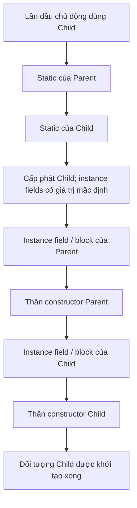

*Các biểu thức đối số của lời gọi constructor và chuỗi `this(...)`/`super(...)` được đánh giá khi xử lý lời gọi tương ứng; sơ đồ tập trung vào thứ tự chạy các phần khởi tạo và thân constructor trong các ví dụ thông thường.*

## 2. Ví dụ đầy đủ: quan sát tất cả các bước

Tạo file **`InitializationTrace.java`**:

```java
public class InitializationTrace {

    static int mark(String step) {
        System.out.println(step);
        return 1;
    }

    static class Parent {
        static int parentStatic = mark("1. Parent: static field");

        static {
            System.out.println("2. Parent: static block");
        }

        int parentValue = mark("5. Parent: instance field");

        {
            System.out.println("6. Parent: instance block");
        }

        Parent() {
            System.out.println("7. Parent: constructor");
        }
    }

    static class Child extends Parent {
        static int childStatic = mark("3. Child: static field");

        static {
            System.out.println("4. Child: static block");
        }

        int childValue = mark("8. Child: instance field");

        {
            System.out.println("9. Child: instance block");
        }

        Child() {
            super();
            System.out.println("10. Child: constructor");
        }
    }

    public static void main(String[] args) {
        System.out.println("=== ĐỐI TƯỢNG THỨ NHẤT ===");
        new Child();

        System.out.println("=== ĐỐI TƯỢNG THỨ HAI ===");
        new Child();
    }
}
```

Chạy:

```bash
javac InitializationTrace.java
java InitializationTrace
```

**Kết quả:**

```text
=== ĐỐI TƯỢNG THỨ NHẤT ===
1. Parent: static field
2. Parent: static block
3. Child: static field
4. Child: static block
5. Parent: instance field
6. Parent: instance block
7. Parent: constructor
8. Child: instance field
9. Child: instance block
10. Child: constructor
=== ĐỐI TƯỢNG THỨ HAI ===
5. Parent: instance field
6. Parent: instance block
7. Parent: constructor
8. Child: instance field
9. Child: instance block
10. Child: constructor
```

Phân tích:

- Trong lần tạo thứ nhất, `new Child()` yêu cầu khởi tạo `Child`. Vì `Child extends Parent`, các phần `static` của `Parent` được khởi tạo trước `Child`. **Trong từng lớp**, field và block `static` chạy theo thứ tự xuất hiện.
- Phần instance của `Parent` (dòng 5–7) chạy trước phần instance của `Child` (dòng 8–10).
- Lần `new Child()` thứ hai **không in lại dòng 1–4**, vì các lớp này đã được khởi tạo. Nhưng nó tạo instance mới, nên dòng 5–10 vẫn xuất hiện.
- Hai biến `parentValue` và `childValue` có giá trị `1` do `mark` trả về; mục đích của hàm là in dấu vết để dễ kiểm tra thứ tự.

**Một thay đổi để tự thử:** đổi vị trí static block và static field của cùng một lớp, rồi đổi vị trí instance block và instance field của lớp ấy. Thứ tự in tương ứng cũng sẽ đổi. Quy tắc “cha trước con” không có nghĩa field initializer luôn trước block initializer trong cùng lớp: **phụ thuộc thứ tự trong mã nguồn**.

## 3. Phân biệt khởi tạo lớp và khởi tạo đối tượng

| Thành phần | Khi nào chạy? | Liên quan đến lớp hay từng instance? |
| --- | --- | --- |
| `static int value = ...;` | Khi lớp được khởi tạo | Thuộc lớp |
| `static { ... }` | Khi lớp được khởi tạo | Thuộc lớp |
| `int value = ...;` | Khi tạo từng đối tượng, tới lượt lớp khai báo field | Thuộc đối tượng |
| `{ ... }` (instance initializer block) | Khi tạo từng đối tượng, tới lượt lớp khai báo block | Thuộc đối tượng |
| Constructor | Khi tạo đối tượng qua chuỗi constructor | Thuộc quá trình tạo đối tượng |
| Instance field có giá trị mặc định | Ngay sau cấp phát đối tượng, trước các initializer cụ thể | Thuộc đối tượng |

Trong Java, giá trị mặc định của instance field được thiết lập trước khi chạy các constructor:

| Kiểu field | Giá trị mặc định |
| --- | --- |
| `byte`, `short`, `int`, `long` | `0` |
| `float`, `double` | `0.0` |
| `boolean` | `false` |
| `char` | `'\u0000'` (ký tự NUL) |
| Kiểu tham chiếu như `String` hoặc `List` | `null` |

Điều này **khác biến cục bộ**: biến cục bộ không được tự động cấp giá trị mặc định để sử dụng; trình biên dịch yêu cầu gán giá trị trước khi đọc.

Một lớp có thể đã được JVM nạp hoặc liên kết mà **chưa** chạy initializer `static`. Việc truy cập một hằng số `static final` thuộc loại *compile-time constant* có thể không kích hoạt khởi tạo lớp định nghĩa hằng số, vì giá trị có thể được nội tuyến tại nơi sử dụng. Do đó đừng xem “có nhắc tới tên lớp” là điều kiện đủ để mọi static block chạy.

### Một lần `new` vẫn tạo một đối tượng có phần trạng thái của cha

```java
class Vehicle {
    String brand = "Generic";
}

class Car extends Vehicle {
    int doors = 4;
}

Car car = new Car();
System.out.println(car.brand); // Generic
System.out.println(car.doors); // 4
```

`Car` không “chứa một đối tượng `Vehicle` riêng biệt do tự động `new Vehicle()`”. Đối tượng `Car` có các thành phần instance kế thừa từ `Vehicle` và thành phần do `Car` khai báo. Chuỗi constructor đảm bảo việc khởi tạo chúng có thứ tự.

## 4. `super(...)` và constructor của lớp cha

Khi tạo `Child`, Java cần thực hiện một constructor thích hợp của `Parent`. Constructor của lớp cha **không được kế thừa** như một phương thức bình thường; lớp con chỉ gọi constructor cha thông qua `super(...)` trong chuỗi khởi tạo.

### Lớp cha có constructor không tham số

```java
class Device {
    Device() {
        System.out.println("Device()");
    }
}

class Phone extends Device {
    Phone() {
        super(); // Gọi constructor Device()
        System.out.println("Phone()");
    }
}
```

`new Phone()` in:

```text
Device()
Phone()
```

Nếu bỏ dòng `super();` trong ví dụ này, trình biên dịch Java 11 sẽ tự chèn lời gọi `super();` ngầm ở đầu constructor. Điều đó **không** có nghĩa JVM tự tìm một constructor cha bất kỳ phù hợp: trường hợp mặc định hướng đến **constructor không tham số**.

### Lớp cha chỉ có constructor có tham số

```java
class Account {
    private final String id;

    Account(String id) {
        if (id == null || id.isBlank()) {
            throw new IllegalArgumentException("ID không hợp lệ");
        }
        this.id = id;
        System.out.println("Account: " + id);
    }

    String getId() {
        return id;
    }
}

class SavingsAccount extends Account {
    private final int interestRatePercent;

    SavingsAccount(String id, int interestRatePercent) {
        super(id); // BẮT BUỘC chỉ rõ lời gọi này trong thiết kế này
        this.interestRatePercent = interestRatePercent;
        System.out.println("SavingsAccount: " + interestRatePercent);
    }
}
```

`new SavingsAccount("SV001", 5)` in:

```text
Account: SV001
SavingsAccount: 5
```

Nếu xóa `super(id)`, trình biên dịch Java 11 sẽ cố gọi `super()`, nhưng `Account` **không có** constructor không tham số, dẫn đến lỗi biên dịch. Java không tự tạo constructor không tham số cho một lớp đã khai báo constructor có tham số.

Trong các ví dụ Java 11, lời gọi constructor `super(...)` hoặc `this(...)` phải là câu lệnh đầu tiên của constructor khi được viết tường minh. Một số phiên bản Java mới hỗ trợ cú pháp constructor linh hoạt hơn, nhưng chuỗi khởi tạo và nhu cầu gọi constructor cha vẫn là cốt lõi để hiểu thứ tự.

### Các tham số của `super(...)`

Phần đối số `super(expression)` được đánh giá để lựa chọn và truyền giá trị cho constructor cha. Cần phân biệt **đánh giá biểu thức đối số** với **thực thi thân constructor cha**. Với bài tập dự đoán log, khi các biểu thức đối số có side effect, hãy xem xét chúng riêng thay vì áp dụng máy móc một danh sách log đơn giản.

Ví dụ dễ hiểu:

```java
class Parent {
    Parent(String value) {
        System.out.println("Parent: " + value);
    }
}

class Child extends Parent {
    Child(String input) {
        super(input.trim());
        System.out.println("Child");
    }
}
```

`new Child("  hello  ")` in `Parent: hello` rồi `Child`.

## 5. `this(...)`: nhiều constructor trong cùng một lớp

`this(...)` **gọi constructor khác của chính lớp hiện tại**. Nó giúp tái sử dụng logic khởi tạo và tránh lặp mã.

```java
public class ConstructorChainDemo {
    static class Base {
        Base() {
            System.out.println("Base constructor");
        }
    }

    static class Derived extends Base {
        int value = initialize();

        static int initialize() {
            System.out.println("Derived field initializer");
            return 10;
        }

        Derived() {
            this(99);
            System.out.println("Derived() constructor body");
        }

        Derived(int number) {
            super();
            System.out.println("Derived(int) constructor body: " + number);
        }
    }

    public static void main(String[] args) {
        new Derived();
    }
}
```

Kết quả:

```text
Base constructor
Derived field initializer
Derived(int) constructor body: 99
Derived() constructor body
```

Diễn giải:

1. `Derived()` chuyển việc khởi tạo đến `Derived(int)` bằng `this(99)`.
2. `Derived(int)` gọi `Base()` thông qua `super()`.
3. Sau khi constructor cha hoàn thành, các instance field initializer và instance block của `Derived` chạy **một lần**.
4. Thân `Derived(int)` chạy, sau đó chương trình quay lại thân `Derived()`.

**Không** xảy ra chuyện field `value` được khởi tạo hai lần chỉ vì có hai constructor trong cùng chuỗi `this(...)`. Mỗi lần tạo instance, chuỗi constructor rốt cuộc gọi constructor cha đúng một lần theo đường đi tương ứng.

Một constructor không được đồng thời viết hai lời gọi constructor `this(...)` và `super(...)` trong cùng nhánh khởi tạo; chuỗi `this(...)` sẽ kết thúc tại một constructor thực hiện lời gọi `super(...)` trực tiếp hoặc ngầm. Vòng lặp gọi constructor (ví dụ A gọi B, B gọi A qua `this(...)`) là lỗi biên dịch.

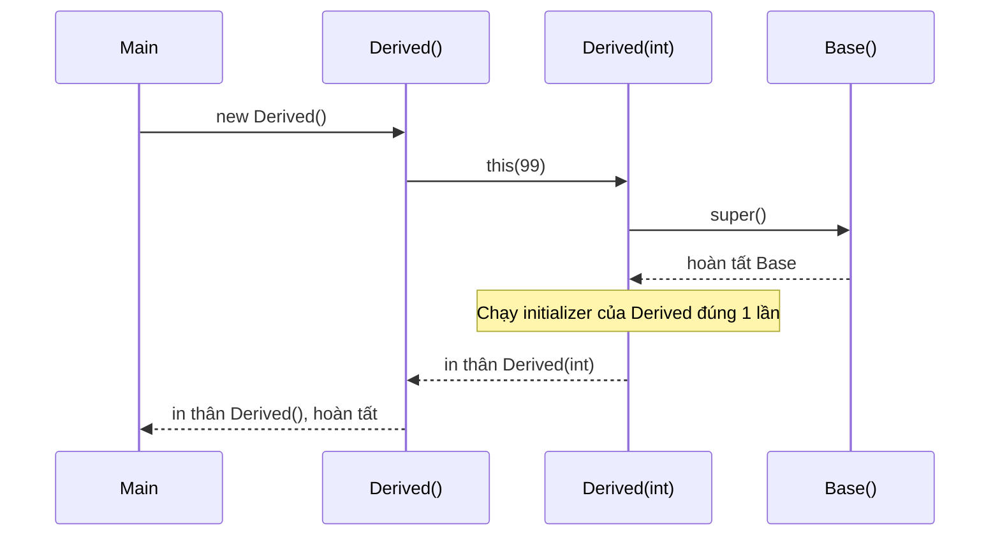

## 6. Bẫy quan trọng: gọi phương thức override trong constructor cha

Phương thức instance có thể dùng **dynamic dispatch**: dù được gọi từ code của lớp cha, lời gọi có thể chạy bản override của lớp con. Nhưng vào thời điểm constructor cha đang chạy, field initializer của lớp con **chưa chạy**.

Xem chương trình **`OverrideDuringConstruction.java`**:

```java
public class OverrideDuringConstruction {

    static class Base {
        Base() {
            System.out.println("Base bắt đầu");
            show(); // Phương thức có thể bị override
            System.out.println("Base kết thúc");
        }

        void show() {
            System.out.println("Base.show()");
        }
    }

    static class Derived extends Base {
        private String message = "Đã sẵn sàng";

        Derived() {
            System.out.println("Derived constructor: " + message);
        }

        @Override
        void show() {
            System.out.println("Derived.show(): " + message);
        }
    }

    public static void main(String[] args) {
        new Derived();
    }
}
```

Kết quả:

```text
Base bắt đầu
Derived.show(): null
Base kết thúc
Derived constructor: Đã sẵn sàng
```

**Tại sao in `null` chứ không phải “Đã sẵn sàng”?**

- Đối tượng được tạo là `Derived`, nên phương thức override `Derived.show()` được chọn khi `Base` gọi `show()`.
- Tại thời điểm gọi, toàn bộ instance field đã có giá trị mặc định, vì thế `message` là `null`.
- Biểu thức gán `message = "Đã sẵn sàng"` thuộc initializer của `Derived`, chỉ thực thi **sau khi constructor `Base` hoàn thành**.
- Sau đó thân constructor `Derived` mới thấy giá trị đã khởi tạo.

Nếu `show()` gọi `message.length()`, chương trình có thể ném `NullPointerException` trước khi constructor con hoàn tất.

### Thiết kế an toàn hơn

Không gọi phương thức có thể bị override từ constructor lớp cha khi phương thức đó phụ thuộc trạng thái của lớp con. Thay vào đó, constructor cha nên sử dụng dữ liệu của chính lớp mình và logic `private`, `final` hoặc `static` thích hợp; hoặc để bước khởi chạy cần đối tượng hoàn chỉnh diễn ra **sau khi** constructor trả về.

Ví dụ lớp cha giữ trách nhiệm riêng:

```java
class SafeBase {
    private final String id;

    SafeBase(String id) {
        if (id == null || id.isBlank()) {
            throw new IllegalArgumentException("ID trống");
        }
        this.id = id;
        System.out.println("Base đã nhận ID: " + id);
    }

    public final String getId() {
        return id;
    }
}

class SafeDerived extends SafeBase {
    private final String message = "Đã sẵn sàng";

    SafeDerived(String id) {
        super(id);
        System.out.println("Derived: " + message);
    }
}
```

Ngoài việc tránh gọi phương thức override, nên tránh **đưa `this` ra ngoài** trước khi constructor hoàn tất (ví dụ đăng ký callback để đối tượng khác có thể gọi lại ngay). Điều đó cũng có thể làm lộ đối tượng chưa được khởi tạo đầy đủ.

## 7. Trường hợp có nhiều cấp kế thừa

Giả sử `C extends B` và `B extends A`:

```java
public class ThreeLevels {
    static class A {
        static { System.out.println("A static"); }
        { System.out.println("A instance"); }
        A() { System.out.println("A constructor"); }
    }

    static class B extends A {
        static { System.out.println("B static"); }
        { System.out.println("B instance"); }
        B() { System.out.println("B constructor"); }
    }

    static class C extends B {
        static { System.out.println("C static"); }
        { System.out.println("C instance"); }
        C() { System.out.println("C constructor"); }
    }

    public static void main(String[] args) {
        new C();
    }
}
```

Kết quả:

```text
A static
B static
C static
A instance
A constructor
B instance
B constructor
C instance
C constructor
```

Trong lần tạo thứ hai của `C`, ba dòng `static` không chạy lại. Phần instance/constructor vẫn đi từ `A` sang `B` rồi `C`.

**Lưu ý:** khối `static` và khối instance trong mã ví dụ đều được viết ở dạng cú pháp hợp lệ:

- `static { ... }`: static initialization block, không có đối tượng làm receiver.
- `{ ... }`: instance initialization block, chạy khi tạo đối tượng tại vị trí tương ứng trong phần khởi tạo instance của lớp.

Không nên nhầm “constructor chạy từ cha đến con” với “tất cả câu lệnh trong constructor con được chạy trước vì ta gọi `new C()`”. `new C()` chọn kiểu đối tượng cần tạo, nhưng nội dung constructor cha sẽ được hoàn thành trước phần nội dung của constructor con.

## 8. Các lỗi thường gặp khi học thứ tự khởi tạo

| Nhận định hoặc cách viết | Kết luận đúng |
| --- | --- |
| “`new Child()` phải chạy constructor Child trước vì gọi Child” | Sai: thân constructor cha chạy trước thân constructor con |
| “Mọi `static` luôn chạy khi program khởi động” | Sai: lớp thường được khởi tạo khi có hành vi sử dụng chủ động yêu cầu điều đó |
| “Mỗi lần tạo instance đều chạy lại static block” | Sai: static initializer không lặp theo instance |
| “Instance field của Child đã có giá trị khởi tạo cụ thể khi Parent constructor chạy” | Sai trong trường hợp thông thường: lúc ấy field Child mới có giá trị mặc định |
| “`super()` tạo thêm một đối tượng Parent khác” | Sai: đó là một bước khởi tạo phần lớp cha trong cùng đối tượng Child |
| “Constructor của Parent được Child kế thừa như method” | Sai: constructor không được kế thừa |
| “Parent chỉ có constructor có tham số nhưng Child bỏ `super(args)` vẫn tự tìm được” | Sai: `super()` ngầm không khớp sẽ gây lỗi biên dịch |
| “`this(...)` làm field initializer của cùng lớp chạy nhiều lần” | Sai: chuỗi constructor khởi tạo instance phần lớp đó một lần |
| “Gọi phương thức override trong constructor cha chắc chắn dùng trạng thái Child đã khởi tạo” | Sai: override có thể chạy trước initializer của Child |
| “Trong một lớp, mọi field initializer luôn chạy trước mọi initializer block” | Sai: chúng thực thi theo thứ tự xuất hiện trong mã nguồn |
| “Truy cập một hằng `static final` kiểu nguyên thủy luôn kích hoạt static block” | Không luôn đúng đối với *compile-time constant* |

### Trường hợp việc khởi tạo thất bại

Nếu một static initializer ném ngoại lệ không được xử lý, quá trình khởi tạo lớp thất bại. Khi lỗi không phải `Error`, lần thất bại thường được biểu hiện bằng `ExceptionInInitializerError`; những lần cố sử dụng lớp sau đó có thể gặp `NoClassDefFoundError` vì lớp ở trạng thái khởi tạo lỗi. Điều này khác với ngoại lệ ném từ một constructor instance: đối tượng đang được tạo không hoàn tất, nhưng bản thân lớp không nhất thiết bị đánh dấu khởi tạo lỗi.

Một lưu ý khi kiểm tra thứ tự bằng `System.out.println`: bản thân logging cũng là hành động có side effect. Trong chương trình thực tế, tránh logic nghiệp vụ phức tạp, đọc dữ liệu môi trường dễ lỗi hay tự tạo luồng trong static initializer; nên kiểm soát lỗi tại các bước khởi tạo rõ ràng của ứng dụng.

## 9. Bài tập thực hành và đáp án giải thích

### Bài tập 1: đoán thứ tự

```java
class P {
    static { System.out.print("A "); }
    { System.out.print("B "); }
    P() { System.out.print("C "); }
}
class Q extends P {
    static { System.out.print("D "); }
    { System.out.print("E "); }
    Q() { System.out.print("F "); }
}

new Q();
new Q();
```

**Đáp án:** `A D B C E F B C E F`. `A` và `D` chỉ in trong lần khởi tạo lớp đầu tiên; mỗi lần tạo instance luôn khởi tạo phần của `P` rồi `Q`.

### Bài tập 2: constructor lớp cha không có mặc định

```java
class Animal {
    Animal(String name) { }
}

class Cat extends Animal {
    Cat() {
        // Thiếu lời gọi constructor của Animal
    }
}
```

**Câu hỏi:** Vì sao không biên dịch? Sửa thế nào?

**Đáp án:** Java 11 mặc định chèn `super()` vào `Cat()`, nhưng `Animal` chỉ khai báo `Animal(String)`. Sửa bằng cách gọi `super("Mèo");` trong `Cat()`; hoặc thiết kế thêm một constructor không tham số ở `Animal` nếu điều đó có ý nghĩa nghiệp vụ.

### Bài tập 3: giá trị field khi constructor cha gọi override

```java
class A {
    A() { print(); }
    void print() { System.out.println("A"); }
}
class B extends A {
    int number = 7;
    @Override
    void print() { System.out.println(number); }
}

new B();
```

**Đáp án:** `0`. Lời gọi động chọn `B.print()` trong lúc `A()` đang chạy, trước khi initializer `number = 7` được thực thi. Nếu chuyển lời gọi `print()` tới thời điểm sau `new B()` hoàn tất, kết quả sẽ là `7`.

### Bài tập 4: tự mở rộng

Hãy tạo ba lớp `Person`, `Employee`, `Manager` theo quan hệ `Manager extends Employee extends Person`; mỗi lớp có một static block, một instance field initializer và constructor in tên lớp. Sau đó:

1. Tạo lần lượt hai đối tượng `Manager`.
2. Dự đoán chính xác những dòng nào in một lần và những dòng nào in hai lần.
3. Thêm constructor `Manager()` dùng `this(String department)`; kiểm tra initializer của `Manager` có chạy lặp hay không.
4. Cho `Person` chỉ có constructor nhận `String name`; sửa các lớp con để truyền đủ thông tin bằng `super(...)`.
5. Thử đưa một phương thức `describe()` có thể override vào constructor `Person` và giải thích vì sao kết quả có thể chưa phản ánh trạng thái của `Manager`.

## Ghi nhớ để đọc một constructor trong hệ kế thừa

Khi nhìn thấy `new Subclass(...)`, hãy lần theo chuỗi `this(...)` và `super(...)` để xác định **constructor nào được gọi**. Sau đó tách biệt hai pha: **khởi tạo lớp (`static`, khi cần)** và **khởi tạo mỗi instance (giá trị mặc định, phần khởi tạo của cha, thân constructor cha, phần khởi tạo của con, thân constructor con)**. Cần đặc biệt thận trọng với những lời gọi phương thức bị override trong constructor vì tại thời điểm ấy đối tượng chưa được khởi tạo đầy đủ.


</details>

- [Quay lại đầu trang](#back-to-top)

---

## <a id="lifecycle-005">Hàm tạo tĩnh, Factory và Builder</a>

<details>
<summary>Xem chi tiết</summary>

# Hàm tạo tĩnh (Static Factory Method), Factory và Builder trong Java

Khi viết OOP, câu lệnh `new` không phải cách duy nhất để **lấy một đối tượng**. Ta có thể che constructor sau một phương thức tĩnh, giao việc chọn lớp cụ thể cho một Factory, hoặc thu thập tham số bằng Builder rồi mới tạo đối tượng. Ba cách này cùng liên quan tới **quá trình khởi tạo và vòng đời đối tượng**, nhưng giải quyết những vấn đề khác nhau.

> **Phân biệt ngay từ đầu:** Constructor là cú pháp khởi tạo đối tượng của Java; *static factory method* là phương thức `static` trả về một đối tượng; *Factory* thường là đối tượng/lớp chịu trách nhiệm chọn và cung cấp đối tượng; *Builder* là đối tượng hỗ trợ cấu hình từng bước rồi gọi `build()`. Không có nghĩa cứ gọi một factory là chắc chắn tạo một instance mới.

## 1. Bắt đầu từ constructor và vòng đời đối tượng

Đoạn Java cơ bản:

~~~java
public class User {
    private final String email;

    public User(String email) {
        if (email == null || email.isBlank()) {
            throw new IllegalArgumentException("Email không được rỗng");
        }
        this.email = email.trim();
    }

    public String getEmail() {
        return email;
    }
}
~~~

~~~java
User user = new User("hello@example.com");
System.out.println(user.getEmail());
~~~

Ở biểu thức `new User(...)`, JVM cấp phát/khởi tạo một instance theo quy tắc ngôn ngữ Java và chạy constructor sau bước khởi tạo thích hợp. Constructor có cùng tên lớp, **không có kiểu trả về**, có thể có nhiều phiên bản (overloading), và có thể kiểm tra tính hợp lệ của trạng thái ban đầu.

Tuy nhiên, khi có nhiều cách tạo dữ liệu, constructor bắt đầu bộc lộ nhược điểm về cách đặt tên:

~~~java
// Cùng nhận một double nên không thể khai báo cả hai constructor này:
// Temperature(double celsius)
// Temperature(double fahrenheit)
~~~

Hai constructor phía trên có **cùng chữ ký** `Temperature(double)`; Java không thể phân biệt chúng chỉ bằng tên tham số. Static factory method xử lý được trường hợp đó.

Trong mọi cách tạo đối tượng ở bài này, nhớ phân biệt:

- **Tạo instance:** constructor thực sự chạy cho một đối tượng mới (trực tiếp hoặc bên trong factory/builder).
- **Nhận instance:** phương thức trả về một đối tượng đã tồn tại, đối tượng cache, instance dùng chung, hoặc một implementation cụ thể.
- **Sử dụng và kết thúc sử dụng:** khi không còn tham chiếu mạnh có thể truy cập đến object, object có thể đủ điều kiện cho garbage collection. Factory/Builder không thay đổi nguyên tắc này; tài nguyên bên ngoài như file/socket vẫn phải được đóng đúng cách khi cần.

## 2. Static Factory Method: đặt tên cho các cách tạo

**Static factory method** là phương thức `static` trả về một đối tượng. Nó có thể gọi một constructor, xử lý/chuyển đổi dữ liệu trước khi tạo, hoặc quyết định trả về đối tượng có sẵn.

Ví dụ thực tế: một nhiệt độ có thể được cung cấp theo °C hoặc °F. Ta chỉ lưu **Celsius** làm dạng nội bộ chuẩn:

`Temperature.java` (Java 11+):

~~~java
public final class Temperature {
    private final double celsius;

    // Ẩn cách khởi tạo: bên ngoài phải chọn đơn vị rõ ràng.
    private Temperature(double celsius) {
        if (!Double.isFinite(celsius)) {
            throw new IllegalArgumentException("Nhiệt độ phải là số hữu hạn");
        }
        this.celsius = celsius;
    }

    public static Temperature celsius(double value) {
        return new Temperature(value);
    }

    public static Temperature fahrenheit(double value) {
        if (!Double.isFinite(value)) {
            throw new IllegalArgumentException("Nhiệt độ phải là số hữu hạn");
        }
        return new Temperature((value - 32.0) * 5.0 / 9.0);
    }

    public double inCelsius() {
        return celsius;
    }

    public double inFahrenheit() {
        return celsius * 9.0 / 5.0 + 32.0;
    }
}
~~~

~~~java
public class Main {
    public static void main(String[] args) {
        Temperature a = Temperature.celsius(30);
        Temperature b = Temperature.fahrenheit(86);

        System.out.println(a.inCelsius()); // 30.0
        System.out.println(b.inCelsius()); // 30.0

        // new Temperature(30); // Không biên dịch: constructor private
    }
}
~~~

Nhờ tên `celsius` và `fahrenheit`, chỗ gọi thể hiện **ý nghĩa** của tham số. Class chỉ công khai các cách tạo hợp lệ; instance không có setter nên không thể cập nhật trường `celsius` sau khi tạo. Dù vậy, hai lời gọi ở ví dụ trên tạo **hai đối tượng riêng**, vì mỗi factory đều gọi `new Temperature(...)`.

### Khi nào static factory hữu ích?

1. **Tên mô tả ý nghĩa:** `of(...)`, `from(...)`, `parse(...)`, `forGuest(...)`, `fromCsv(...)` giúp người đọc hiểu nguồn dữ liệu.
2. **Kiểm tra và chuẩn hóa đầu vào:** factory áp đặt quy tắc hợp lệ trước khi trả đối tượng.
3. **Ẩn implementation:** kiểu trả về có thể là interface/superclass, còn instance là một implementation cụ thể.
4. **Tái sử dụng/caching khi phù hợp:** factory có thể trả instance cũ, singleton hoặc object đã được cache thay vì tạo mới.
5. **Giữ API gọn:** có thể giấu constructor bằng `private`/package-private và tập trung các con đường tạo hợp lệ.

Một số tên thường gặp (chủ yếu là **quy ước**, không phải cú pháp đặc biệt của Java):

| Tên phương thức | Ý nghĩa hay được dùng | Ví dụ gần gũi |
| --- | --- | --- |
| `of(...)` | Tạo/nhận instance từ các tham số | `List.of("a", "b")` |
| `from(...)` | Chuyển dữ liệu/kiểu khác sang kiểu đích | `Instant.from(temporal)` |
| `valueOf(...)` | Lấy object từ giá trị tương ứng | `Integer.valueOf(42)` |
| `parse(...)` | Phân tích chuỗi để có giá trị kiểu đích | `LocalDate.parse("2026-10-15")` |
| `getInstance(...)` | Lấy một instance, có thể dùng chung | Tên do thư viện tự định nghĩa |
| `newInstance(...)` | Tên gợi ý tạo mới | Tên do thư viện tự định nghĩa |

Không suy ra hành vi cache/chắc chắn tạo mới **chỉ từ tên**. Luôn xem hợp đồng của API: chẳng hạn `Integer.valueOf` có thể trả object cache cho một số giá trị, còn `List.of` tạo/nhận một danh sách không sửa được và không bảo đảm danh tính instance.

### Static factory không phải “constructor static”

Java **không có static constructor** theo nghĩa khai báo `static User(...)` hoặc thêm `static` vào constructor. Một khối khởi tạo tĩnh `static { ... }` chạy khi lớp được khởi tạo theo quy tắc JVM; nó dùng để khởi tạo trạng thái tĩnh, **không phải** factory trả về object. Static factory method là phương thức bình thường có từ khóa `static` và có kiểu trả về.

~~~java
public class Config {
    private static final String DEFAULT_REGION;

    static {
        DEFAULT_REGION = "VN"; // Static initializer, không trả về object
    }

    private final String region;

    private Config(String region) {
        this.region = region;
    }

    public static Config defaultConfig() { // Static factory method
        return new Config(DEFAULT_REGION);
    }

    public String region() {
        return region;
    }
}
~~~

## 3. Factory: giao việc lựa chọn loại đối tượng cho một nơi riêng

Static factory ở ví dụ `Temperature` nằm **ngay trong lớp trả về**. Nhưng có hệ thống cần quyết định **loại implementation** dựa trên cấu hình, trường hợp nghiệp vụ hoặc môi trường chạy. Khi đó, một lớp/đối tượng Factory riêng giúp mã gọi không phải rải `new ConcreteType(...)` khắp nơi.

Ví dụ: chọn hình thức gửi thông báo. Để minh họa OOP, hai implementation chỉ in thông báo ra console, **không gửi email/SMS thật**.

`NotificationDemo.java` (Java 11+):

~~~java
interface Notifier {
    void send(String message);
}

final class EmailNotifier implements Notifier {
    @Override
    public void send(String message) {
        System.out.println("[EMAIL] " + message);
    }
}

final class SmsNotifier implements Notifier {
    @Override
    public void send(String message) {
        System.out.println("[SMS] " + message);
    }
}

enum Channel {
    EMAIL, SMS
}

final class NotifierFactory {
    private NotifierFactory() {
        // Không cho tạo instance của lớp tiện ích này.
    }

    public static Notifier create(Channel channel) {
        if (channel == null) {
            throw new IllegalArgumentException("Channel không được null");
        }

        switch (channel) {
            case EMAIL:
                return new EmailNotifier();
            case SMS:
                return new SmsNotifier();
            default:
                throw new IllegalArgumentException("Channel không hỗ trợ");
        }
    }
}

public class NotificationDemo {
    public static void main(String[] args) {
        Notifier notifier = NotifierFactory.create(Channel.EMAIL);
        notifier.send("Đơn hàng đã được xác nhận");
        // [EMAIL] Đơn hàng đã được xác nhận

        Notifier sms = NotifierFactory.create(Channel.SMS);
        sms.send("Mã OTP thử nghiệm");
        // [SMS] Mã OTP thử nghiệm
    }
}
~~~

Người gọi chỉ biết `Notifier` và lựa chọn `Channel`. Factory chịu trách nhiệm khởi tạo class thực tế; mã sử dụng interface để gọi `send`. Khi cần thay cách tạo `EmailNotifier` (ví dụ bổ sung các dependency hoặc cấu hình), phần thay đổi có thể được tập trung trong vùng xây dựng đối tượng.

~~~mermaid
flowchart LR
    Client["Client"] --> Factory["NotifierFactory.create(channel)"]
    Factory --> Decision{"Channel"}
    Decision -->|EMAIL| Email["new EmailNotifier()"]
    Decision -->|SMS| SMS["new SmsNotifier()"]
    Email --> Interface["Notifier"]
    SMS --> Interface
    Interface --> Use["Client gọi send(...)"]
~~~

### “Factory” và “Factory Method pattern” có giống nhau?

Không hoàn toàn. Các thuật ngữ dễ bị gọi lẫn nhau:

| Thuật ngữ | Đặc điểm | Ví dụ |
| --- | --- | --- |
| **Static factory method** | Phương thức `static` trả về object; thường nằm ở lớp sản phẩm | `Temperature.fahrenheit(86)` |
| **Simple Factory** | Một hàm/lớp tập trung logic lựa chọn và tạo implementation; không phải một trong 23 mẫu GoF được đặt tên riêng | `NotifierFactory.create(Channel)` ở trên |
| **Factory Method (GoF)** | Lớp cha định nghĩa điểm mở rộng tạo đối tượng, lớp con ghi đè phương thức tạo | `Creator.createProduct()` được subclass cài đặt |
| **Abstract Factory (GoF)** | Cung cấp interface tạo một **họ đối tượng liên quan** mà không buộc client gọi lớp cụ thể | `UiFactory.createButton()` và `createDialog()` cho từng giao diện |

Một ví dụ **Factory Method pattern** tối giản:

~~~java
interface Report {
    String render();
}

final class CsvReport implements Report {
    public String render() {
        return "name,quantity\nBook,2";
    }
}

final class JsonReport implements Report {
    public String render() {
        return "{\"name\":\"Book\",\"quantity\":2}";
    }
}

abstract class ReportService {
    // Thuật toán chung gọi điểm mở rộng do subclass cung cấp.
    public final void printReport() {
        Report report = createReport();
        System.out.println(report.render());
    }

    protected abstract Report createReport(); // Factory Method
}

final class CsvReportService extends ReportService {
    @Override
    protected Report createReport() {
        return new CsvReport();
    }
}

final class JsonReportService extends ReportService {
    @Override
    protected Report createReport() {
        return new JsonReport();
    }
}

// Cách dùng:
ReportService service = new CsvReportService();
service.printReport();
~~~

Ở đây `createReport()` là **instance method** được subclass ghi đè, không cần là `static`. Vì thế, “static factory method” và “Factory Method design pattern” là hai khái niệm khác nhau.

**Điểm cần cân nhắc:** Một factory dùng `switch` tập trung chỗ lựa chọn nhưng khi thêm kênh mới vẫn phải sửa `switch`, nên không tự động đạt nguyên tắc Open/Closed tuyệt đối. Với dự án lớn, có thể dùng đăng ký implementation qua `Map<Channel, Supplier<Notifier>>`, dependency injection hoặc chiến lược cấu hình phù hợp. Không nên áp dụng quá nhiều tầng Factory nếu chỉ có một loại đối tượng đơn giản.

## 4. Builder: cấu hình từng bước trước khi tạo đối tượng

Constructor với nhiều tham số dễ gây nhầm và khó thêm tùy chọn:

~~~java
// Người đọc khó biết 0, 20 và true tương ứng tham số nào:
SearchRequest request = new SearchRequest("java", 0, 20, true);
~~~

Nếu có thêm nhiều tham số không bắt buộc, cách tạo một “rừng constructor” (telescoping constructors) càng khó bảo trì. **Builder pattern** giải quyết bằng đối tượng trung gian có các phương thức đặt tên rõ ràng; chỉ khi gọi `build()` mới tạo đối tượng kết quả.

Ví dụ `SearchRequest` có từ khóa bắt buộc, các tùy chọn `page`, `pageSize` và nhãn lọc.

`SearchRequest.java` (Java 11+):

~~~java
import java.util.ArrayList;
import java.util.List;
import java.util.Objects;

public final class SearchRequest {
    private final String keyword;
    private final int page;
    private final int pageSize;
    private final List<String> tags;

    private SearchRequest(Builder builder) {
        this.keyword = builder.keyword;
        this.page = builder.page;
        this.pageSize = builder.pageSize;
        this.tags = List.copyOf(builder.tags); // Snapshot, không lộ List mutable
    }

    public static Builder builder(String keyword) {
        return new Builder(keyword);
    }

    public String getKeyword() { return keyword; }
    public int getPage() { return page; }
    public int getPageSize() { return pageSize; }
    public List<String> getTags() { return tags; }

    public static final class Builder {
        private final String keyword;
        private int page = 0;          // Giá trị mặc định
        private int pageSize = 20;     // Giá trị mặc định
        private final List<String> tags = new ArrayList<>();

        private Builder(String keyword) {
            String clean = Objects.requireNonNull(keyword, "keyword").trim();
            if (clean.isEmpty()) {
                throw new IllegalArgumentException("Keyword không được rỗng");
            }
            this.keyword = clean;
        }

        public Builder page(int page) {
            if (page < 0) {
                throw new IllegalArgumentException("Page phải >= 0");
            }
            this.page = page;
            return this;
        }

        public Builder pageSize(int pageSize) {
            if (pageSize < 1 || pageSize > 100) {
                throw new IllegalArgumentException("Page size phải trong [1, 100]");
            }
            this.pageSize = pageSize;
            return this;
        }

        public Builder addTag(String tag) {
            String clean = Objects.requireNonNull(tag, "tag").trim();
            if (clean.isEmpty()) {
                throw new IllegalArgumentException("Tag không được rỗng");
            }
            this.tags.add(clean);
            return this;
        }

        public SearchRequest build() {
            return new SearchRequest(this);
        }
    }
}
~~~

`SearchDemo.java`:

~~~java
public class SearchDemo {
    public static void main(String[] args) {
        SearchRequest request = SearchRequest.builder("  java oop  ")
                .page(2)
                .pageSize(25)
                .addTag("core")
                .addTag("interview")
                .build();

        System.out.println(request.getKeyword()); // java oop
        System.out.println(request.getPage());    // 2
        System.out.println(request.getPageSize()); // 25
        System.out.println(request.getTags());    // [core, interview]

        // Khi chỉ có tham số bắt buộc, dùng được giá trị mặc định:
        SearchRequest defaults = SearchRequest.builder("spring").build();
        System.out.println(defaults.getPageSize()); // 20
    }
}
~~~

Phân tích luồng:

~~~mermaid
flowchart TD
    A["SearchRequest.builder(keyword)"] --> B["Tạo Builder, kiểm tra keyword"]
    B --> C["page(), pageSize(), addTag()"]
    C --> D["Builder lưu cấu hình và trả this"]
    D --> E["build()"]
    E --> F["new SearchRequest(builder)"]
    F --> G["Sao chép List; đối tượng kết quả bất biến"]
~~~

- `builder(...)` là **static factory tạo Builder**, chưa tạo `SearchRequest`.
- `page(...), pageSize(...), addTag(...)` cập nhật trạng thái **mutable** của Builder và trả `this` để viết theo chuỗi (fluent API).
- `build()` gọi constructor `private SearchRequest(Builder)` và trả đối tượng đã cấu hình.
- `List.copyOf(builder.tags)` bảo vệ danh sách của `SearchRequest` khỏi các thay đổi sau đó trên Builder. Vì `String` bất biến, các phần tử cũng không bị cập nhật tại chỗ.

Kiểm chứng việc tái sử dụng Builder:

~~~java
SearchRequest.Builder builder = SearchRequest.builder("oop");
builder.addTag("basic");

SearchRequest first = builder.build();

builder.addTag("advanced");
SearchRequest second = builder.build();

System.out.println(first.getTags());  // [basic]
System.out.println(second.getTags()); // [basic, advanced]
System.out.println(first == second);  // false
~~~

**Chú ý:** Builder trong ví dụ là đối tượng mutable và **không được thiết kế thread-safe**; không nên chia sẻ Builder cho nhiều luồng sửa đồng thời. `build()` cũng **không bắt buộc phải tạo mới** theo mọi API Builder trên thế giới, nhưng trong implementation mẫu của chúng ta, mỗi lần gọi đều thực hiện `new SearchRequest(...)`.

## 5. Chọn cách tạo phù hợp với bài toán

| Tiêu chí | Constructor | Static Factory Method | Factory riêng | Builder |
| --- | --- | --- | --- | --- |
| Cú pháp điển hình | `new Order(...)` | `Order.from(...)` | `factory.create(...)` | `Order.builder().build()` |
| Mục tiêu chính | Khởi tạo trực tiếp | Đặt tên/chọn quy tắc trả object | Tập trung logic chọn implementation/tạo phụ thuộc | Cấu hình nhiều tham số rõ nghĩa |
| Có cần tạo instance mới mỗi lần? | Có, khi dùng `new` | Không nhất thiết | Không nhất thiết | Tùy hợp đồng của `build()` |
| Tham số tùy chọn | Dùng overload, đôi khi rối | Có thể có overload | Tùy API | Thuận tiện cho nhiều tùy chọn |
| Ẩn lớp triển khai cụ thể | Không khi gọi trực tiếp | Có thể | Thường có | Có thể |
| Chi phí thiết kế | Thấp | Thấp đến vừa | Vừa | Vừa đến cao |

Một số tình huống chọn nhanh:

- **`Point(int x, int y)`**: dữ liệu đơn giản, ít tham số, tạo rõ ràng → constructor thường đủ.
- **`Temperature.celsius(30)` / `fahrenheit(86)`**: cùng loại tham số nhưng khác ý nghĩa → static factory.
- **Chọn bộ mã hóa/gửi thông báo theo cấu hình** → Factory cung cấp interface thích hợp.
- **Cấu hình nhiều trường bắt buộc/tùy chọn, cần giá trị mặc định và validation** → Builder.
- **Tạo object rất phức tạp, cần cả chọn implementation và cấu hình từng bước** → có thể kết hợp Factory cung cấp một Builder, rồi gọi `build()`.

Các phương pháp **không loại trừ nhau**: class có thể dùng constructor `private`, static factory trả `Builder`, Factory khác quyết định triển khai, còn Builder gọi constructor để tạo kết quả.

## 6. Liên quan đến dependency injection và Spring

Trong ứng dụng Spring, container thường là bên chịu trách nhiệm khởi tạo/quản lý bean và tiêm dependency. Vì vậy, Factory trong dự án thật có thể cần **các dependency được inject**, thay vì tự `new` mọi dịch vụ.

Ví dụ tối giản:

~~~java
import org.springframework.stereotype.Component;

@Component
public class NotifierSelector {
    private final EmailService emailService;
    private final SmsService smsService;

    public NotifierSelector(EmailService emailService, SmsService smsService) {
        this.emailService = emailService;
        this.smsService = smsService;
    }

    public MessageSender select(Channel channel) {
        return switch (channel) {
            case EMAIL -> emailService;
            case SMS -> smsService;
        };
    }
}
~~~

Ở đây giả định `EmailService` và `SmsService` là bean đã tồn tại, cùng implement `MessageSender`, còn `Channel` là enum có `EMAIL`, `SMS`. Đoạn code mang tính minh họa **tích hợp Spring**; không phải chương trình Java độc lập như các ví dụ phía trên. Với selector này, `select` **trả về bean được quản lý sẵn**, không tạo service mới. Tránh `new EmailService()` trong logic nếu service cần Spring inject dependency, interceptor, transaction proxy hoặc lifecycle callback.

Trong Spring, annotation `@Bean` trên phương thức cấu hình có thể trả object để container quản lý, nhưng không đồng nghĩa mọi `@Bean` method đều là static factory method. Cần phân biệt **cơ chế quản lý bean của framework** và **mẫu tạo đối tượng trong Java thuần**.

## 7. Những lỗi và hiểu nhầm phổ biến

**1. Tưởng static factory luôn tạo mới**

~~~java
Integer a = Integer.valueOf(42);
Integer b = Integer.valueOf(42);

System.out.println(a.equals(b)); // true
// a == b không nên dùng để kiểm tra bằng nhau về giá trị.
~~~

`valueOf` có thể dùng cache; ứng dụng nên dựa vào **hợp đồng dữ liệu** (`equals` khi muốn so sánh giá trị), không phụ thuộc việc factory cấp phát instance nào. Với object mutable, dùng chung instance có thể gây sửa trạng thái ngoài ý muốn, nên chỉ cache/chia sẻ khi có chủ đích.

**2. Đưa logic nghiệp vụ hoặc I/O nặng vào mọi constructor/factory**

Constructor/factory nên đảm bảo trạng thái hợp lệ; các công việc I/O có thể cần thiết theo thiết kế nhưng phải minh bạch về lỗi, tài nguyên, thời gian và side effect. Không biến mỗi `new` hoặc `of` thành lời gọi mạng bất ngờ.

**3. Cho rằng Builder tự động đảm bảo immutable**

Builder thường mutable; object được xây dựng có thể vẫn mutable nếu field/setter/collection bị lộ. Muốn immutable, nên dùng field `private final`, validate đầu vào, defensive copy cho trạng thái mutable, tránh setter công khai và thận trọng với phần tử lồng nhau.

**4. Chỉ kiểm tra từng setter mà bỏ qua ràng buộc giữa các trường**

Nếu `startDate` phải trước `endDate`, riêng `startDate(...)` và `endDate(...)` có thể chưa đủ để xác thực. Kiểm tra ràng buộc chung ở `build()` hoặc constructor cuối:

~~~java
public TimeRange build() {
    if (start == null || end == null || !start.isBefore(end)) {
        throw new IllegalStateException("Khoảng thời gian không hợp lệ");
    }
    return new TimeRange(start, end);
}
~~~

Mã trên là phác thảo phần `build()` khi lớp Builder có các trường `start`, `end` kiểu `LocalDateTime` (hoặc kiểu thời gian so sánh tương đương); nó nhấn mạnh **thời điểm kiểm tra bất biến tổng thể**.

**5. Overengineering**

Một class hai tham số rõ ràng không cần Builder hàng trăm dòng. Không cần tạo `FactoryFactory` chỉ để bọc một câu lệnh `new`. Chọn abstraction khi nó thực sự cải thiện ý nghĩa lời gọi, mở rộng implementation hoặc kiểm soát khởi tạo.

**6. Hiểu sai khi kết hợp với kế thừa**

Constructor không được override. Static method trong Java có thể bị **method hiding**, không phải overriding đa hình theo instance; nó không đóng vai trò điểm mở rộng giống phương thức `protected createProduct()` trong GoF Factory Method. Với các hệ thống cần polymorphism ở bước tạo, cân nhắc Factory Method, Abstract Factory, hoặc injection.

## 8. Câu hỏi luyện tập

**Câu 1:** Tại sao hai constructor `Temperature(double celsius)` và `Temperature(double fahrenheit)` không thể cùng tồn tại?

**Đáp án:** Chúng có cùng chữ ký kiểu tham số. Tên biến tham số không tham gia phân biệt overload; các static factory được đặt tên `celsius` và `fahrenheit` giải quyết được.

**Câu 2:** Lời gọi `Temperature.fahrenheit(86)` có nhất thiết tạo object mới không?

**Đáp án:** Trong implementation mẫu, có vì nó gọi `new Temperature(...)`. Nhưng về khái niệm static factory method nói chung, không bắt buộc; factory có thể trả object đã tồn tại.

**Câu 3:** `NotifierFactory.create(Channel.EMAIL)` và `ReportService.createReport()` khác nhau điểm nào?

**Đáp án:** Ví dụ đầu là **Simple Factory**, dùng một static method với `switch` để chọn implementation; ví dụ sau là **Factory Method pattern**, để subclass override phương thức tạo `Report`.

**Câu 4:** Vì sao Builder hay dùng `return this`?

**Đáp án:** Để gọi nối tiếp `builder.page(1).pageSize(30).build()`. Đây là fluent API; các bước trước `build()` thay đổi **Builder**, chưa nhất thiết tạo object kết quả.

**Câu 5:** Vì sao `List.copyOf(builder.tags)` xuất hiện trong constructor của `SearchRequest`?

**Đáp án:** Để chụp trạng thái danh sách tại thời điểm tạo. Nếu Builder tiếp tục thêm tag, `SearchRequest` đã tạo không bị thay đổi theo; người dùng cũng không chỉnh sửa List trả từ getter bằng `add/remove`.

**Câu 6:** Nên chọn gì cho một immutable class chỉ có `id` và `name` bắt buộc?

**Đáp án:** Một constructor đơn giản có validation thường đã đủ; thêm static factory nếu cần tên mô tả một cách tạo đặc biệt. Không có lý do mặc định phải dùng Builder.

**Ghi nhớ:** Constructor tạo instance trực tiếp; static factory **đặt tên và kiểm soát cách lấy object**; Factory **chịu trách nhiệm chọn/cung cấp implementation**; Builder **tập hợp cấu hình rồi hoàn tất đối tượng**. Chọn đúng kỹ thuật từ nhu cầu tạo object và quy tắc bất biến của lớp, thay vì áp một mẫu thiết kế cho mọi tình huống.


</details>

- [Quay lại đầu trang](#back-to-top)

---

## <a id="lifecycle-006">Thời gian tồn tại, khả năng truy cập và giải phóng bộ nhớ</a>

<details>
<summary>Xem chi tiết</summary>

# Thời gian tồn tại, khả năng truy cập và giải phóng bộ nhớ trong Java

Trong Java, đối tượng được tạo ra trong quá trình chương trình chạy và thường được lưu trong vùng nhớ do JVM quản lý. Java có **garbage collector (GC)** để thu hồi bộ nhớ từ các đối tượng không còn được chương trình sử dụng theo tiêu chí *reachability* (khả năng truy cập).

Tuy nhiên, có ba vấn đề phải phân biệt:

1. **Thời gian tồn tại (lifetime):** Một đối tượng được tạo khi nào, còn được chương trình sử dụng khi nào và khi nào bộ nhớ dành cho nó thực sự có thể được thu hồi?
2. **Khả năng truy cập (reachability):** Có còn đường tham chiếu từ các điểm xuất phát mà GC xem là đang được sử dụng đến đối tượng hay không?
3. **Giải phóng bộ nhớ và tài nguyên:** JVM thu hồi bộ nhớ đối tượng khác với việc ứng dụng đóng file, kết nối mạng, kết nối cơ sở dữ liệu hay tài nguyên hệ điều hành.

Một lệnh `obj = null` **không phải** lệnh xóa đối tượng. Việc ra khỏi một phương thức cũng không bảo đảm GC chạy ngay. Ngược lại, một đối tượng tưởng như đã “dùng xong” vẫn có thể bị giữ trong bộ nhớ rất lâu nếu còn một tham chiếu mạnh từ nơi khác.

## 1. Phân biệt các khái niệm quan trọng

| Khái niệm | Bản chất | Ví dụ |
|---|---|---|
| **Tạo đối tượng** | Thực hiện thao tác tạo instance, thường là `new`, hoặc một cơ chế khác do API cung cấp | `new Book("Java")` |
| **Tham chiếu (reference)** | Giá trị cho phép mã Java truy cập tới đối tượng | `Book current = book;` |
| **Phạm vi biến (scope)** | Đoạn mã mà một tên biến có thể được sử dụng theo quy tắc ngôn ngữ | Biến cục bộ chỉ được gọi tên trong khối khai báo |
| **Khả năng truy cập** | Có đường đi tham chiếu từ các GC roots tới đối tượng hay không | Một field của singleton còn giữ `Book` |
| **Đủ điều kiện để thu gom** | GC không còn coi đối tượng là reachable theo mô hình xử lý tương ứng | Sau khi loại bỏ tham chiếu mạnh cuối cùng |
| **Thu hồi bộ nhớ** | JVM/GC thực sự tái sử dụng hoặc giải phóng bộ nhớ do đối tượng chiếm giữ | Không thể chọn chính xác thời điểm từ mã Java thông thường |
| **Đóng tài nguyên** | Kết thúc việc sở hữu file/socket/connection… theo hợp đồng API | `close()` hoặc `try-with-resources` |

Ba mệnh đề sau **không tương đương**:

- “Biến `x` ra khỏi scope”.
- “Đối tượng từng được `x` tham chiếu hiện không còn reachable”.
- “GC đã thu hồi bộ nhớ của đối tượng đó”.

Đây có thể là ba thời điểm khác nhau.

## 2. Tạo đối tượng và lưu giữ tham chiếu

Ví dụ:

~~~java
class Book {
    final String title;

    Book(String title) {
        this.title = title;
    }
}

Book a = new Book("Java");
Book b = a;
a = null;

System.out.println(b.title); // Java
~~~

Lúc đầu, `a` trỏ tới `Book`. Phép gán `b = a` sao chép **giá trị tham chiếu**, nên cả hai cùng trỏ đến *một* đối tượng. Sau `a = null`, chỉ có `a` không còn trỏ tới nó; `b` vẫn dùng được.

~~~mermaid
flowchart LR
    A["a"] --> N["null"]
    B["b"] --> O["Book object<br/>title = Java"]
~~~

Java **truyền tham số theo giá trị**. Khi truyền biến tham chiếu vào phương thức, Java sao chép giá trị tham chiếu. Phương thức có thể thay đổi trạng thái đối tượng được trỏ tới, nhưng gán lại tham số cục bộ không làm thay đổi biến tham chiếu của phía gọi.

~~~java
static void clearLocalReference(Book book) {
    book = null; // Chỉ gán lại tham số cục bộ.
}

Book myBook = new Book("OOP");
clearLocalReference(myBook);
System.out.println(myBook.title); // OOP
~~~

Đoạn trên minh họa phương thức đặt trong một lớp Java thích hợp. Đối tượng không bị xóa vì tham số `book` đã gán `null`.

## 3. Ví dụ thực hành hoàn chỉnh: vòng đời qua các tham chiếu

Chương trình dưới đây dùng một danh sách static để minh họa một tham chiếu có thể giữ đối tượng tiếp tục được truy cập, rồi loại bỏ đường tham chiếu đó. Phần đầu có đầu ra xác định; ví dụ **không cố ép GC chạy**.

Lưu thành **`Demo.java`** và chạy trên Java 17 trở lên:

~~~java
import java.util.ArrayList;
import java.util.List;

public class Demo {
    // Registry tồn tại cùng với lớp Demo khi lớp còn được nạp.
    private static final List<Document> registry = new ArrayList<>();

    public static void main(String[] args) {
        Document original = new Document("Hợp đồng số 1");
        Document alias = original;

        System.out.println(original == alias); // true

        original = null;
        System.out.println(alias.title()); // Hợp đồng số 1

        // Registry tiếp tục giữ tham chiếu mạnh đến Document.
        registry.add(alias);
        alias = null;

        System.out.println(registry.size()); // 1
        System.out.println(registry.get(0).title()); // Hợp đồng số 1

        // Bỏ đường tham chiếu từ registry tới Document.
        registry.clear();
        System.out.println(registry.size()); // 0

        // Từ đây không có lời hứa GC sẽ chạy hay object biến mất ngay.
    }

    private static final class Document {
        private final String title;

        private Document(String title) {
            this.title = title;
        }

        String title() {
            return title;
        }
    }
}
~~~

Thực thi:

~~~bash
javac Demo.java
java Demo
~~~

Kết quả:

~~~text
true
Hợp đồng số 1
1
Hợp đồng số 1
0
~~~

**Diễn giải:**

1. `new Document(...)` tạo một đối tượng `Document`.
2. `alias = original` thêm một biến tham chiếu tới cùng đối tượng; không tạo đối tượng mới.
3. `original = null` chỉ loại một đường tham chiếu. `alias` vẫn dùng được.
4. `registry.add(alias)` khiến danh sách static nắm giữ đối tượng qua tham chiếu mạnh.
5. `alias = null` không làm đối tượng đủ điều kiện thu gom vì danh sách còn giữ nó.
6. `registry.clear()` loại đường tham chiếu từ danh sách. Nếu không còn đường mạnh nào khác khiến đối tượng reachable, nó có thể trở thành đối tượng có thể thu gom. Điều này **không** đồng nghĩa GC đã thực sự thu hồi bộ nhớ ngay ở dòng đó.

Sơ đồ trước và sau khi xóa registry:

~~~mermaid
flowchart TB
    subgraph before["Trước registry.clear()"]
        R1["GC root: lớp đang được sử dụng"] --> S1["Demo.registry"]
        S1 --> L1["List"]
        L1 --> D1["Document<br/>Hợp đồng số 1"]
    end
    subgraph after["Sau registry.clear()"]
        R2["GC root: lớp đang được sử dụng"] --> S2["Demo.registry"]
        S2 --> L2["List rỗng"]
        D2["Document từng được giữ<br/>không còn cạnh từ List"]
    end
~~~

Hình vẽ mô tả **quan hệ tham chiếu có ý nghĩa logic**. Các JVM và thuật toán JIT/GC có thể sắp xếp bộ nhớ và tối ưu hóa mã khác nhau; sơ đồ không xác định vị trí vật lý của object trong RAM.

## 4. Scope của biến không phải lifetime của đối tượng

Một biến cục bộ có phạm vi theo khối lệnh. Nhưng đối tượng mà nó từng trỏ tới có thể tiếp tục sống nếu một field, phần tử collection hoặc đối tượng khác còn giữ tham chiếu.

~~~java
import java.util.ArrayList;
import java.util.List;

class Notebook {
    String title;

    Notebook(String title) {
        this.title = title;
    }
}

class NotebookStore {
    private final List<Notebook> books = new ArrayList<>();

    void addExample() {
        Notebook local = new Notebook("Ghi chú");
        books.add(local);
    } // Tên biến local ra khỏi scope.

    int count() {
        return books.size();
    }
}
~~~

Sau khi `addExample()` kết thúc, `local` không còn được dùng theo tên đó, nhưng `books` có thể tiếp tục giữ `Notebook`. Nếu `NotebookStore` vẫn reachable, đối tượng `Notebook` trong danh sách cũng có thể reachable.

Chiều ngược lại cũng đáng chú ý: một biến nằm trong scope về mặt mã nguồn **không đảm bảo** rằng GC phải giữ đối tượng tới hết khối lệnh nếu JVM chứng minh được object không còn được dùng. JIT và GC có thể tối ưu hóa vùng sống của tham chiếu dựa trên việc sử dụng thực tế.

Đối với code Java thông thường, hãy suy luận từ các đường tham chiếu mà chương trình thực sự còn cần và không dựa vào một thời điểm thu gom cụ thể. Với thư viện quản lý tài nguyên ngoài heap có yêu cầu sống chính xác tới cuối đoạn mã, `Reference.reachabilityFence(obj)` là công cụ chuyên biệt; nó không phải thay thế cho `close()`.

## 5. GC roots và đồ thị khả năng truy cập

JVM có các điểm xuất phát (*GC roots*) để tìm những đối tượng đang được sử dụng. Các loại roots cụ thể tùy JVM và cơ chế thu gom, nhưng thường liên quan đến:

- Tham chiếu còn sống trong các luồng Java đang thực thi, như đối tượng được giữ bởi biến cục bộ hoặc tham số cần thiết.
- Tham chiếu trong các field static của những lớp đang được giữ/nạp thích hợp.
- Các tham chiếu do JNI hoặc cơ chế runtime/native giữ.
- Một số cấu trúc runtime khác mà JVM coi là roots.

Từ roots, GC duyệt qua các field tham chiếu, phần tử mảng và quan hệ đối tượng để xác định các object còn reachable.

~~~mermaid
flowchart LR
    R1["GC root<br/>Luồng đang chạy"] --> A["Service"]
    R2["GC root<br/>Static field"] --> B["Cache"]
    A --> C["Order"]
    C --> D["Customer"]
    B --> E["Report"]
    X["Temporary X"] --> Y["Temporary Y"]
    Y --> X
~~~

Trong hình, `Service`, `Cache`, `Order`, `Customer`, `Report` có đường tới root. Cặp `Temporary X` và `Temporary Y` chỉ tham chiếu qua lại nhưng **không có đường từ root**, nên có thể được GC thu gom.

**Một chu trình tham chiếu không tự làm rò rỉ bộ nhớ trong Java.** JVM hiện đại chủ yếu dựa vào reachability, không yêu cầu lập trình viên phá mọi chu trình như trong một số hệ thống dùng reference counting đơn thuần.

### Strong reference là gì?

Tham chiếu bình thường bạn sử dụng khi viết:

~~~java
Order order = new Order();
List<Order> orders = new ArrayList<>();
orders.add(order);
~~~

là **strong reference**. Trong ví dụ, danh sách tiếp tục giữ strong reference đến `order`. Nếu danh sách còn reachable từ GC roots, bản thân đối tượng `Order` vẫn được giữ lại.

Ví dụ `Order` ở đây chỉ là lớp minh họa trong một ngữ cảnh có định nghĩa tương ứng.

Một đối tượng chỉ trở nên *không còn strong reachable* khi không còn đường strong reference thích hợp từ roots. Có thêm các mức reachability khác khi sử dụng `java.lang.ref`, sẽ bàn ở phần sau.

## 6. “Được GC thu gom” có nghĩa gì và khi nào xảy ra?

Một vòng đời được mô tả ở mức khái quát:

~~~mermaid
stateDiagram-v2
    [*] --> Allocated: Tạo đối tượng
    Allocated --> StronglyReachable: Có đường strong reference từ roots
    StronglyReachable --> StronglyReachable: Còn được giữ / sử dụng
    StronglyReachable --> NotStronglyReachable: Mất đường strong reference cuối
    NotStronglyReachable --> Reclaimed: GC có thể xử lý, thu hồi
~~~

Sơ đồ đơn giản hóa tình huống tham chiếu mạnh. Trong thực tế, đối tượng có thể trở lại strong reachable, có weak/soft/phantom references, và có các bước xử lý của GC tùy trạng thái. Không nên coi đây là state machine đầy đủ của garbage collector.

Ba điểm cần ghi nhớ:

**Thứ nhất:** trở thành không còn reachable không tự động tạo một lệnh giải phóng bộ nhớ ở dòng Java kế tiếp. JVM quyết định lúc nào thực hiện GC và thực hiện ra sao.

**Thứ hai:** bộ nhớ được thu hồi cho heap JVM có thể được **tái sử dụng cho đối tượng mới**. JVM không có nghĩa vụ lập tức trả lượng RAM đó về hệ điều hành.

**Thứ ba:** mục tiêu của GC là quản lý bộ nhớ đối tượng; GC không phải một cơ chế bảo đảm mọi tài nguyên bên ngoài bộ nhớ heap được đóng đúng hạn.

Bạn có thể gặp:

~~~java
System.gc();
~~~

Đây là **yêu cầu/gợi ý** để JVM cân nhắc thực hiện thu gom rác, không phải hợp đồng bảo đảm GC đã chạy xong hay mọi object đủ điều kiện đã bị thu hồi. Có thể có cấu hình JVM phớt lờ yêu cầu này. Không viết logic nghiệp vụ hoặc bài test mà tính đúng đắn phụ thuộc vào `System.gc()`.

## 7. Các loại tham chiếu: strong, soft, weak và phantom

Package `java.lang.ref` cung cấp cơ chế để làm việc với các mức reachability chuyên biệt.

| Loại | Cách tạo/biểu diễn | Vai trò | Lưu ý |
|---|---|---|---|
| **Strong reference** | Biến/field/thành phần collection tham chiếu bình thường | Giữ object có thể sử dụng như thường lệ | Nếu reachable từ root theo đường strong, GC không thu hồi object như rác |
| **Soft reference** | `SoftReference<T>` | Cho phép JVM thu hồi đối tượng khi cần bộ nhớ, từng được dùng cho cache nhạy áp lực bộ nhớ | Thời điểm thu hồi không bảo đảm; thường không nên dùng thay chính sách cache rõ ràng |
| **Weak reference** | `WeakReference<T>` | Không giữ object sống chỉ vì tham chiếu yếu | `get()` có thể trở thành `null` sau khi GC xử lý |
| **Phantom reference** | `PhantomReference<T>` với `ReferenceQueue` | Cơ chế theo dõi giai đoạn xử lý sau khi đối tượng không còn được sử dụng, phục vụ quản lý tài nguyên chuyên biệt | `get()` luôn trả `null`; cần thiết kế queue/cleanup đúng |

Strong reference thông thường là loại quan trọng nhất trong mã OOP hằng ngày. Weak, soft và phantom là **công cụ nâng cao**; chúng không nên xuất hiện chỉ vì muốn “tự động tối ưu bộ nhớ”.

### Ví dụ WeakReference không ràng buộc thời điểm GC

~~~java
import java.lang.ref.WeakReference;

class Payload {
    final String value = "data";
}

class WeakDemo {
    public static void main(String[] args) {
        Payload strong = new Payload();
        WeakReference<Payload> weak = new WeakReference<>(strong);

        System.out.println(weak.get() != null); // true tại đây:
                                                 // strong còn dùng được.

        strong = null; // Bỏ tham chiếu mạnh do biến strong giữ.

        Payload observed = weak.get();
        if (observed == null) {
            System.out.println("Đối tượng đã bị GC làm rỗng weak reference");
        } else {
            System.out.println(observed.value);
        }
    }
}
~~~

Sau `strong = null`, chương trình **không thể khẳng định** nhánh nào sẽ được chạy: nó phụ thuộc thời điểm GC và cách JVM xác định đối tượng còn được dùng. Nếu `weak.get()` trả về một tham chiếu khác `null`, biến `observed` tạm thời giữ một strong reference và có thể sử dụng giá trị đó.

**Không** viết bài kiểm thử trông đợi `weak.get() == null` ngay sau `strong = null`.

### ReferenceQueue dùng để làm gì?

Một `ReferenceQueue<T>` giúp mã quản lý nhận biết khi một đối tượng tham chiếu tương ứng đã được GC đưa vào hàng đợi theo quy tắc của loại reference.

~~~java
import java.lang.ref.Reference;
import java.lang.ref.ReferenceQueue;
import java.lang.ref.WeakReference;

class QueueDemo {
    static final class Session {}

    public static void main(String[] args) {
        ReferenceQueue<Session> queue = new ReferenceQueue<>();
        Session session = new Session();
        WeakReference<Session> weak =
                new WeakReference<>(session, queue);

        session = null;

        // Không được dựa vào việc queue đã có phần tử ngay lúc này.
        Reference<? extends Session> event = queue.poll();
        System.out.println("Có sự kiện đã enqueue: " + (event != null));

        // Giữ biến weak ở đây để minh họa đối tượng Reference.
        System.out.println("Tham chiếu weak còn được giữ: " + (weak != null));
    }
}
~~~

Kết quả dòng đầu **không cố định**. Để sử dụng queue trong ứng dụng thực tế, cần lập trình vòng xử lý và vòng đời phù hợp; ví dụ chỉ cho thấy API và lý do không được giả định GC xảy ra theo lịch.

### WeakHashMap không phải “bản đồ không rò rỉ”

`WeakHashMap<K,V>` giữ khóa theo tham chiếu yếu. Nếu không còn strong reference tới khóa từ nơi khác, entry có thể được dọn khi GC xử lý. Tuy nhiên:

- Đây không phải cache có TTL, giới hạn kích thước hay chính sách loại bỏ xác định.
- Nếu *value* giữ strong reference quay lại chính *key*, đối tượng key có thể vẫn còn reachable qua value và map, khiến mục tiêu dọn entry không đạt.
- Không dùng nó để bảo đảm dọn bản ghi đúng giờ hoặc giải quyết mọi trường hợp rò rỉ.

## 8. Một Java object có thể đã được đóng resource nhưng vẫn còn sống

Tình trạng **reachable/unreachable** nói về khả năng GC tìm thấy object từ các roots. Tình trạng **open/closed** nói về vòng đời tài nguyên ngoài heap mà object có thể đang đại diện. Hai trạng thái độc lập:

| Ví dụ | Object còn reachable? | Resource còn mở? |
|---|---|---|
| `BufferedReader` đang được dùng trong `try` | Có | Thường có |
| `BufferedReader` đã `close()` nhưng biến vẫn giữ tham chiếu | Có thể có | Đã yêu cầu đóng theo hợp đồng |
| Mã bỏ hết tham chiếu tới reader mà quên đóng | Có thể không | Không có bảo đảm đã đóng đúng lúc |

Khi chính phương thức mở file và sở hữu reader, nên dùng:

~~~java
try (BufferedReader reader = Files.newBufferedReader(path)) {
    System.out.println(reader.readLine());
} // Java gọi close() khi rời try.
~~~

Đoạn này cần các import `java.io.BufferedReader`, `java.nio.file.Files` và một `Path path` hợp lệ. `try-with-resources` bảo đảm gọi `close()` khi thoát khối theo luồng Java thông thường, kể cả khi gặp exception; không bảo đảm GC đã thu hồi object tại dấu ngoặc đóng. Với lỗi từ `close()`, tài nguyên lồng nhau, `AutoCloseable`, `finalize()` và ownership, xem bài *Đóng tài nguyên và giới hạn của hàm hủy*.

## 9. Khi nào vẫn xảy ra memory leak trong Java?

Trong Java, *memory leak* không nhất thiết là khối nhớ “mất địa chỉ” theo nghĩa của ngôn ngữ quản lý bộ nhớ thủ công. Nó thường có nghĩa **đối tượng không còn hữu ích với nghiệp vụ nhưng vẫn được tham chiếu mạnh từ một root**, làm GC không thể thu hồi nó.

Các trường hợp thường gặp:

| Nguồn giữ tham chiếu | Tình huống | Hậu quả | Cách kiểm soát |
|---|---|---|---|
| Static collection | Thêm mọi session vào `static List` và không xóa | Bộ nhớ tăng theo số request | Loại mục hết hạn, giới hạn cache, thiết kế ownership |
| Cache không giới hạn | `Map<Id, Value>` giữ mọi kết quả vĩnh viễn | Heap tăng không kiểm soát | Dùng cache có kích thước/TTL/eviction |
| Event listener | Đăng ký listener nhưng quên hủy | Publisher tiếp tục giữ subscriber | `unsubscribe` đúng vòng đời |
| Scheduled task | Task giữ closure tham chiếu tới đối tượng không còn cần | Đối tượng được giữ lâu hơn mong đợi | Hủy task, đóng executor theo ownership |
| ThreadLocal | Giá trị sống theo thread chạy dài hạn nếu không dọn đúng | Dữ liệu cũ còn bị giữ qua nhiều tác vụ | `remove()` trong `finally` |
| Collection / queue | Không xóa phần tử đã xử lý | Các phần tử vẫn reachable | `remove()`, `clear()` khi hợp lý |
| Object graph | Root giữ một object lớn và toàn bộ các con | Nhiều đối tượng được giữ gián tiếp | Rà soát cạnh tham chiếu và vòng đời của root |

### Ví dụ: bộ nhớ tăng vì cache không giới hạn

~~~java
import java.util.ArrayList;
import java.util.List;

class BadHistory {
    private static final List<byte[]> ALL_REQUESTS = new ArrayList<>();

    static void record(byte[] data) {
        ALL_REQUESTS.add(data); // Không có chính sách loại bỏ.
    }
}
~~~

Nếu `record` được gọi liên tục với các mảng lớn, `ALL_REQUESTS` giữ mọi mảng bằng strong reference. GC không thể tự biết mục nào “không còn có giá trị nghiệp vụ”.

Một phương án là thiết kế nơi lưu có **giới hạn** và cơ chế loại bỏ:

~~~java
import java.util.ArrayDeque;
import java.util.Deque;

class RecentMessages {
    private static final int MAX_SIZE = 100;
    private final Deque<String> messages = new ArrayDeque<>();

    public void add(String message) {
        if (message == null) {
            throw new IllegalArgumentException("message không được null");
        }
        if (messages.size() == MAX_SIZE) {
            messages.removeFirst();
        }
        messages.addLast(message);
    }

    public int size() {
        return messages.size();
    }
}
~~~

Bộ nhớ của cấu trúc giới hạn này vẫn phụ thuộc kích thước chuỗi đầu vào, vì `MAX_SIZE` chỉ giới hạn **số phần tử**, không giới hạn tổng byte. Nếu cần quota bộ nhớ, phải kiểm soát cả kích thước mỗi phần tử và tổng ngân sách.

### Ví dụ: ThreadLocal trong thread pool

~~~java
private static final ThreadLocal<String> CURRENT_USER = new ThreadLocal<>();

static void handleRequest(String userId) {
    CURRENT_USER.set(userId);
    try {
        // Xử lý request với thông tin người dùng hiện tại.
        System.out.println(CURRENT_USER.get());
    } finally {
        CURRENT_USER.remove();
    }
}
~~~

Đoạn này được đặt trong một lớp thích hợp. Với thread pool, luồng có thể được tái sử dụng cho request tiếp theo. `remove()` trong `finally` giúp tránh giữ dữ liệu cũ và rò rỉ ngữ cảnh giữa các request. Nếu code bất đồng bộ chuyển xử lý sang luồng khác, cần cơ chế truyền context phù hợp; ThreadLocal không tự di chuyển giá trị.

## 10. Đối tượng tham chiếu lẫn nhau có bị giữ mãi không?

Không nhất thiết. Xét:

~~~java
class Node {
    Node next;
}

Node first = new Node();
Node second = new Node();
first.next = second;
second.next = first;

first = null;
second = null;
~~~

Hai object `Node` tạo một chu trình. Nếu chúng không còn reachable từ bất cứ GC root nào thì chúng có thể được GC thu gom dù vẫn trỏ tới nhau.

~~~mermaid
flowchart LR
    R["GC root"] -.->|"Không còn đường tham chiếu"| A["Node A"]
    A --> B["Node B"]
    B --> A
~~~

Đường đứt nét biểu thị đường root đã bị mất, **không phải một cạnh tham chiếu thực tế**. GC dựa vào reachability có thể nhận ra cả nhóm đều không còn được chương trình dùng. Cần cẩn thận với chu trình khi một trong các node vẫn reachable qua root: lúc đó cả nhóm có thể tiếp tục được giữ.

## 11. Phạm vi vùng nhớ: heap, stack và static

Trong quá trình học Java thường gặp cách diễn đạt “object nằm trên heap, biến cục bộ nằm trên stack”. Đây là **mô hình học tập hữu ích**, nhưng chưa mô tả đầy đủ mọi tối ưu hóa JVM hiện đại.

| Khía cạnh | Hiểu ở mức lập trình | Lưu ý |
|---|---|---|
| Đối tượng và mảng | Có thể được cấp phát trong vùng nhớ đối tượng do JVM quản lý | JIT có thể loại bỏ/đổi cách cấp phát nhờ escape analysis |
| Biến cục bộ, tham số | Nằm trong khung thực thi logic của phương thức | JVM/JIT có thể dùng thanh ghi hoặc tối ưu hóa khác |
| Instance field | Thuộc trạng thái của từng đối tượng | Có thể giữ tham chiếu mạnh đến object khác |
| Static field | Thuộc về lớp được nạp, không phải một instance cụ thể | Có thể khiến object được giữ trong thời gian dài |
| Native/off-heap resources | Có thể được quản lý ngoài heap Java | Cần theo hợp đồng API, thường có cơ chế close/release |

Không nên dùng những khẳng định tuyệt đối như “mọi biến cục bộ luôn nằm trên stack vật lý”, “mọi đối tượng có địa chỉ cố định”, hay “biến static luôn nằm ở một vùng nhớ xác định”. Những chi tiết triển khai phụ thuộc JVM, collector và tối ưu hóa.

### Đối tượng bị di chuyển trong bộ nhớ có mất danh tính không?

Một số garbage collector có thể **di chuyển đối tượng** để gom bộ nhớ và giảm phân mảnh. Điều này không làm thay đổi danh tính logic mà mã Java quan sát qua phép `==` giữa các tham chiếu còn hợp lệ. Java không cho phép bạn dựa vào một địa chỉ bộ nhớ thô cố định của đối tượng như ID nghiệp vụ.

Nếu cần ID bền vững, sử dụng một định danh được quản lý theo yêu cầu ứng dụng, ví dụ `UUID`, khóa database hoặc mã nghiệp vụ, chứ không dựa vào `hashCode()` hay địa chỉ máy.

## 12. Chẩn đoán một đối tượng bị giữ ngoài dự kiến

Nếu heap tăng đều dù dữ liệu nghiệp vụ cũ đáng lẽ đã hết hạn, **đừng suy luận chỉ từ một lần đo RAM**. Đo xu hướng object còn sống sau các chu kỳ tải tương đương, rồi xem **đường giữ tham chiếu từ GC root tới object**.

Một ví dụ điều tra với profiler hoặc heap dump:

~~~text
GC root → Static field → Cache → Map entry → RequestData
~~~

Nếu `RequestData` đã hết hạn mà entry vẫn còn, cách sửa thường nằm ở **chính sách của cache** (giới hạn, TTL, xóa khi hết nhu cầu), không nằm ở dòng `new RequestData(...)`. Heap dump và dominator tree giúp xác định tập object bị giữ; JFR và GC metrics giúp đối chiếu xu hướng cấp phát/thu gom. Việc thu thập heap dump trên hệ thống thật có thể gây tải, nên chọn thời điểm thích hợp.

Công cụ chẩn đoán GC, phân biệt heap leak với native memory pressure và ví dụ lệnh JDK được tập trung ở bài *Thu gom rác và quản lý bộ nhớ thủ công*.

## 13. Vài tình huống thiết kế điển hình

| Tình huống | Cách xử lý phù hợp | Vì sao? |
|---|---|---|
| Một đối tượng dùng trong một lần tính toán | Để tham chiếu cục bộ và không lưu giữ ngoài nhu cầu | Khi không còn đường từ roots, GC có thể thu gom |
| Kết quả được cache | Cache có giới hạn/TTL và chính sách loại bỏ | Tránh giữ dữ liệu không còn hữu ích |
| Subscription/listener | Trả về handle hủy đăng ký hoặc quản lý `close()` | Tránh publisher giữ subscriber vô hạn |
| File, stream, database connection | Dùng `try-with-resources` theo ownership | Đóng tài nguyên đúng vòng đời |
| Cấu trúc graph có vòng tham chiếu | Không cần phá vòng chỉ để “cho GC chạy” | GC thu gom nhóm unreachable |
| Theo dõi object không được giữ sống bởi mã theo dõi | Cân nhắc `WeakReference`/queue nếu thực sự cần | Tránh quan sát tạo thêm strong retention |
| Giải phóng đối tượng ở một dòng mã xác định | Không xây thiết kế trên giả định này | Java không bảo đảm lịch GC |
| Session gắn với thread pool | Dọn ThreadLocal trong `finally` | Thread được tái sử dụng qua nhiều tác vụ |

### Cân nhắc thêm khi đối tượng quản lý tài nguyên

Một `Connection` hoặc `InputStream` có thể **đã được đóng nhưng vẫn là một đối tượng Java còn sống** nếu còn tham chiếu. Gọi `close()` không biến tham chiếu thành `null`, cũng không thu hồi heap ngay. Tương tự, một object chứa socket còn reachable không bảo đảm socket vẫn mở; trạng thái resource và reachability là hai trục khác nhau.

Một thiết kế tốt nên thể hiện rõ: ai **sở hữu** tài nguyên, ai được phép dùng, khi nào phải đóng và hành vi nào hợp lệ sau khi đóng.

## 14. Bài tập kiểm tra hiểu biết

### Bài 1 — `null` có xóa object?

~~~java
class Item { int count = 2; }

Item x = new Item();
Item y = x;
x = null;
System.out.println(y.count);
~~~

**Đáp án:** in `2`. Object vẫn có thể truy cập qua `y`.

### Bài 2 — Tham chiếu rời scope có đủ để GC thu hồi?

~~~java
class Service {
    static final List<Object> STORE = new ArrayList<>();

    static void run() {
        Object result = new Object();
        STORE.add(result);
    }
}
~~~

Giả sử đã import `java.util.List` và `java.util.ArrayList`. Sau khi `run()` trả về, `result` ra khỏi scope. Đối tượng mới tạo có chắc đủ điều kiện GC không?

**Đáp án:** Không. `STORE` còn giữ strong reference nếu field/list vẫn reachable. Phải loại đường tham chiếu này (và các đường khác nếu có) khi không còn cần dữ liệu.

### Bài 3 — Chu trình không có root

~~~java
Node a = new Node();
Node b = new Node();
a.next = b;
b.next = a;
a = null;
b = null;
~~~

**Đáp án:** Nếu không còn đường reachable nào khác tới hai node, cả hai có thể được GC thu gom. Chu trình đơn thuần không giữ chúng sống.

### Bài 4 — Có nên đợi GC đóng file?

**Đáp án:** Không. Sử dụng `try-with-resources` hoặc `close()` theo quy tắc sở hữu tài nguyên. GC không hứa đóng file đúng thời điểm.

### Bài 5 — Kết quả WeakReference sau khi bỏ strong reference

~~~java
WeakReference<Object> weak;
{
    Object o = new Object();
    weak = new WeakReference<>(o);
}
// Điều gì được đảm bảo về weak.get() tại đây?
~~~

**Đáp án:** Không thể khẳng định `weak.get()` chắc chắn `null` hay chắc chắn khác `null` chỉ từ việc ra khỏi khối. Nếu GC đã làm rỗng weak reference thì trả `null`; nếu object vẫn còn đó và chưa bị làm rỗng thì có thể nhận tham chiếu tới object.

### Bài 6 — Chọn cách sửa phù hợp

Một ứng dụng giữ tất cả lịch sử request trong `static ArrayList`; heap tăng khi lưu lượng tăng và dữ liệu cũ không được sử dụng nữa.

**Đáp án gợi ý:** Đặt giới hạn/chính sách vòng đời cho lịch sử, chỉ lưu những thông tin cần thiết, loại mục hết hạn và xác nhận bằng profiler/heap dump rằng không còn đường giữ tham chiếu ngoài ý muốn. Gọi `System.gc()` không giải quyết được nếu danh sách vẫn giữ object.

## 15. Checklist khi tự đánh giá một lớp Java

- Đối tượng được tạo khi nào và **ai** phải giữ tham chiếu tới nó?
- Object có được đặt vào field, collection, cache, callback, ThreadLocal hoặc singleton không?
- Nếu không còn dùng, đường tham chiếu mạnh nào phải bị loại bỏ?
- Có tài nguyên ngoài heap nào cần **đóng đúng lúc** không?
- Các sự kiện như request kết thúc, timeout, hủy subscription, shutdown đã được xử lý chưa?
- Có đoạn code nào đang mặc định `System.gc()` hoặc `finalize()` sẽ giải phóng tài nguyên đúng hạn không?
- Có thể chứng minh bằng số liệu và đường từ GC roots rằng đối tượng đang bị giữ ngoài dự kiến không?

**Nguyên tắc cần nhớ:** Java tự động quản lý việc thu hồi **bộ nhớ đối tượng** dựa trên khả năng truy cập; lập trình viên vẫn chịu trách nhiệm thiết kế **vòng đời dữ liệu, quan hệ tham chiếu và vòng đời tài nguyên**. Một đối tượng không còn có ích nhưng vẫn reachable có thể tiếp tục chiếm bộ nhớ; một object đã mất đường tham chiếu không biến mất tức thì; và `close()` giải quyết một trách nhiệm khác với GC.


</details>

- [Quay lại đầu trang](#back-to-top)

---

## <a id="lifecycle-007">Thu gom rác và quản lý bộ nhớ thủ công</a>

<details>
<summary>Xem chi tiết</summary>

# Thu gom rác và quản lý bộ nhớ thủ công trong Java

> **OOP → Vòng đời.** Trong Java, lập trình viên tạo đối tượng và sử dụng chúng, còn **Garbage Collector (GC)** giúp thu hồi bộ nhớ của các đối tượng không còn có thể được chương trình truy cập. Tuy nhiên, GC **không đồng nghĩa mọi tài nguyên đều tự được giải phóng đúng lúc**: file, socket, kết nối cơ sở dữ liệu hay vùng nhớ native vẫn cần cách quản lý vòng đời phù hợp.

## 1. Java tự động quản lý phần nào?

Xét đoạn mã:

```java
final class User {
    private final String name;

    User(String name) {
        this.name = name;
    }

    String name() {
        return name;
    }
}

static String loadName() {
    User user = new User("An");
    return user.name();
}
```

`new User("An")` tạo một instance. Trong suốt lúc `loadName()` thực thi, tham chiếu `user` cho phép sử dụng đối tượng. Khi phương thức trả về và không còn tham chiếu nào khác tới instance này, đối tượng có thể trở thành **đủ điều kiện để GC thu hồi**. JVM quyết định **khi nào** và **bằng cách nào** thu hồi; không có cam kết đối tượng được xóa ngay lúc phương thức kết thúc.

Nên phân biệt những thành phần sau:

| Thành phần | Chứa gì? | Cách quản lý |
|---|---|---|
| Java heap | Nhiều đối tượng và mảng Java | GC quản lý vùng nhớ của các đối tượng không còn reachable |
| Stack của luồng | Các frame thực thi, thông tin lời gọi, biến cục bộ theo mô hình JVM | Gắn với lời gọi/luồng; không phải khu vực mà ta `free()` từng biến |
| Metaspace (trên HotSpot hiện đại) | Metadata của các lớp | JVM quản lý; có thể tăng nếu nạp quá nhiều lớp/class loader |
| Native/off-heap memory | Bộ nhớ do API/native code sử dụng ngoài Java heap | Phụ thuộc API: GC, cơ chế scope/arena hoặc `close()` |
| File descriptor, socket, DB connection | Tài nguyên hệ điều hành/hệ thống ngoài | Phải hoàn trả theo hợp đồng của API, thường qua `close()` |

Mô hình “object ở heap, tham chiếu cục bộ ở stack” hữu ích để bắt đầu, nhưng **không phải cam kết vị trí vật lý tuyệt đối**. JVM có thể tối ưu hóa cấp phát hoặc thay object bằng các giá trị riêng khi hành vi quan sát được vẫn tương đương.

### GC khác với quản lý bộ nhớ thủ công như thế nào?

Trong những ngôn ngữ cho phép quản lý bộ nhớ thủ công, mã chương trình có thể xin bộ nhớ và chủ động trả lại, ví dụ cặp `malloc/free` trong C. Nếu dùng sai dễ dẫn đến **memory leak**, **double free** hoặc **use-after-free**.

Với **đối tượng heap Java thông thường**, ta không gọi `free(object)` hay `delete object`. Không có thao tác Java chuẩn cho phép lập trình viên quyết định thu hồi ngay bộ nhớ của một object cụ thể.

Tuy vậy, lập trình viên Java vẫn chịu trách nhiệm **kiểm soát số đối tượng còn được giữ lại**, giới hạn cache, giải phóng resource, tránh cấp phát quá mức và theo dõi mức sử dụng bộ nhớ.

## 2. GC xác định object còn cần giữ dựa vào reachability

GC bắt đầu từ các **GC roots** (tham chiếu đang cần bởi luồng thực thi, một số tham chiếu static/JNI/runtime...) rồi đi qua các field và phần tử mảng để tìm object còn reachable. Việc gán `x = null` chỉ bỏ **một** đường tham chiếu. Một object vẫn có thể được giữ bởi cache hoặc callback khác.

~~~mermaid
flowchart LR
    Root["GC root"] --> Cache["Cache"]
    Cache --> Data["RequestData"]
    A["Node A"] --> B["Node B"]
    B --> A
~~~

`RequestData` reachable qua `Cache`. Cặp `Node A ↔ Node B` không có đường từ root trong hình có thể được GC thu hồi dù tồn tại vòng tham chiếu: Java không cần chủ động `free` hay cắt mọi chu trình bằng tay. GC cũng không bảo đảm **khi nào** object mất đường tham chiếu sẽ thực sự được thu hồi.

Tham chiếu thông thường là **strong reference**; Java còn có `WeakReference`, `SoftReference` và `PhantomReference` cho mục đích chuyên biệt. Không suy ra chúng tạo thời điểm cleanup xác định. Phần mô hình GC roots và các mức reachability được trình bày sâu trong bài *Thời gian tồn tại, khả năng truy cập và giải phóng bộ nhớ*.

## 3. GC hoạt động như thế nào ở mức khái niệm?

Một mô hình dễ hiểu gồm ba công việc:

1. **Xác định object còn sống:** truy tìm từ GC roots để nhận biết các đối tượng vẫn reachable.
2. **Thu hồi vùng nhớ không còn được sử dụng:** lấy lại bộ nhớ gắn với object không còn reachable.
3. **Quản lý bố cục vùng nhớ:** một số collector có thể di chuyển/gom object để giảm phân mảnh hoặc tăng hiệu quả cấp phát.

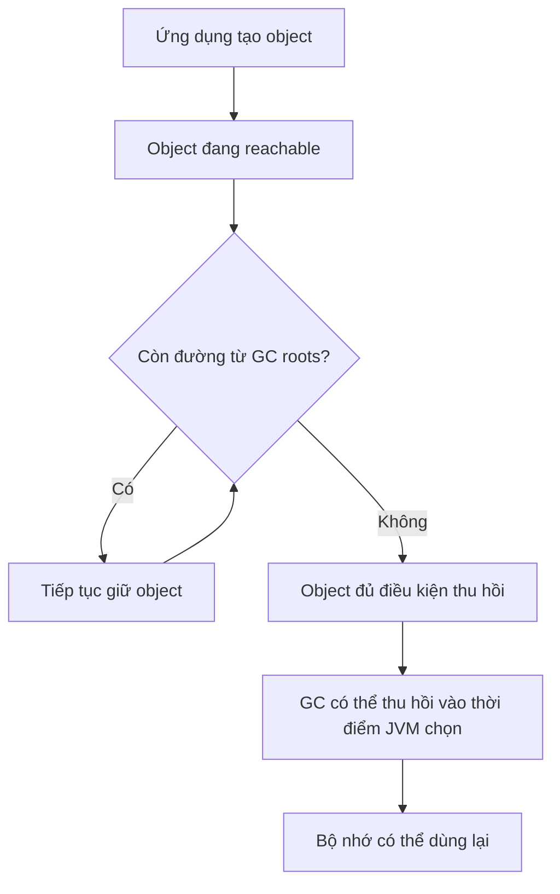

Nhiều bộ thu gom được thiết kế dựa trên quan sát rằng nhiều object sống rất ngắn. Chúng có thể sử dụng cơ chế **generational** (các thế hệ), kết hợp nhiều đợt thu gom. Những thuật ngữ như *minor GC*, *major GC*, *full GC*, *stop-the-world*, *concurrent marking* xuất hiện trong log và tài liệu, nhưng **ý nghĩa chính xác phụ thuộc collector/JDK đang sử dụng**.

| Khái niệm | Cách hiểu thực dụng |
|---|---|
| Young generation | Nơi nhiều object mới được phân bổ trong các collector phân thế hệ |
| Old generation | Thường chứa object tồn tại lâu hơn |
| Stop-the-world (STW) | Một giai đoạn tạm dừng thực thi ứng dụng để GC thực hiện công việc cần thiết |
| Concurrent GC | Một phần việc GC chạy đồng thời với thread ứng dụng |
| Compaction | Gom/di chuyển dữ liệu đang sống để giảm phân mảnh |

Không có một “thuật toán GC của Java” duy nhất. Ví dụ, HotSpot có những collector như G1, ZGC, Parallel GC; lựa chọn và hành vi phụ thuộc phiên bản JDK, mục tiêu độ trễ, dung lượng và cấu hình. Với bài OOP, điều quan trọng nhất là hiểu **reachability**, **không quyết định được thời điểm thu hồi**, và **GC không tự sửa thiết kế giữ tham chiếu sai**.

## 4. GC không biết khi nào dữ liệu đã hết giá trị nghiệp vụ

Một cache không giới hạn có thể giữ mọi payload dù chúng không còn hữu ích. Các object đó vẫn reachable từ map, nên GC **không coi chúng là rác**. Đây là một dạng *logical memory leak* của ứng dụng Java:

~~~java
static final Map<String, byte[]> payloads = new HashMap<>();

static void remember(String id, byte[] data) {
    payloads.put(id, data);
}
~~~

Đoạn minh họa đặt trong lớp có import `java.util.Map` và `java.util.HashMap`. Nếu tiếp tục thêm ID mới mà không đặt giới hạn, dung lượng có thể tăng theo tải. Cách chữa là xác định retention policy: TTL, số phần tử, ngân sách byte, xóa các entry không còn cần hoặc chọn cache library phù hợp.

GC có thể chạy rất thường xuyên mà không giảm được retained heap nếu mọi object cũ vẫn có đường strong reference từ root. Khi phân tích nguyên nhân, hãy dùng **heap dump và đường giữ tham chiếu** thay vì chỉ nhìn số lần GC. Bài *Thời gian tồn tại, khả năng truy cập và giải phóng bộ nhớ* có ví dụ registry/cache, listener, `ThreadLocal` và cách truy lần theo GC roots; bài này sẽ tập trung vào cơ chế GC và các loại bộ nhớ cần đo.

## 5. `null`, `System.gc()` và `finalize()`: những kỳ vọng sai

```java
User a = new User("An");
User b = a;

a = null;    // Không xóa object: b vẫn tham chiếu tới nó
// System.gc(); // Không phải cách đảm bảo xóa User
```

- **`a = null`** chỉ thay đổi biến `a`. Nếu còn `b` hoặc tham chiếu khác, đối tượng vẫn reachable.
- **`System.gc()`** là lời yêu cầu JVM cố gắng thực hiện GC; không phải mệnh lệnh đảm bảo GC diễn ra, cũng không trả bộ nhớ của từng object ngay lập tức.
- **`finalize()`** không phù hợp để dọn dẹp tài nguyên. Finalization đã bị deprecated for removal và có nhiều vấn đề về độ tin cậy, bảo mật, hiệu năng. Không dùng nó cho code mới.

Không cần gán `null` cho mọi biến cục bộ trước khi thoát phương thức. Thông thường, việc để biến hết phạm vi và tổ chức vòng đời đối tượng rõ ràng đã đủ. Việc chủ động xóa phần tử khỏi cache, unregister listener hoặc kết thúc một tác vụ sống lâu thường quan trọng hơn.

## 6. GC chỉ quyết định thu hồi heap object; resource có hợp đồng khác

Một `FileInputStream` có thể giữ file descriptor do hệ điều hành cấp, trong khi `Connection` có thể được quản lý bởi connection pool. Object Java wrapper bị GC thu hồi **không bảo đảm** những tài nguyên ấy đã được trả về đúng thời điểm.

| Thứ cần hoàn trả | Cơ chế nên dựa vào | Điểm cần nhớ |
|---|---|---|
| Bộ nhớ của object unreachable trên heap | GC của JVM | Không thể `free(obj)` bằng cú pháp Java chuẩn |
| File/socket/connection | `close()` theo ownership, thường dùng `try-with-resources` | Đóng resource không đồng nghĩa xóa Java object |
| Bộ nhớ native/off-heap có scope | Hợp đồng API, chẳng hạn `Arena.close()` | Cần đúng phiên bản JDK và quy tắc sở hữu |

~~~java
try (BufferedReader reader = Files.newBufferedReader(path)) {
    System.out.println(reader.readLine());
}
~~~

Ví dụ trên giả sử `path` là `java.nio.file.Path` hợp lệ và đã import `java.io.BufferedReader`, `java.nio.file.Files`. Java gọi `reader.close()` khi rời khối `try` theo semantics ngôn ngữ, kể cả khi đọc ném exception. Về đóng nhiều resource, suppressed exceptions, `AutoCloseable`, `Cleaner` và `finalize()`, bài *Đóng tài nguyên và giới hạn của hàm hủy* giữ nơi giảng giải và ví dụ chạy đầy đủ.

## 7. Khi nào Java thực sự cho phép quản lý native memory thủ công?

Với Java heap object thông thường, không có `free(object)`. Nhưng các API cấp phát bộ nhớ ngoài heap có thể yêu cầu quản lý **ownership** và **lifetime** rõ ràng.

Ví dụ tiêu biểu ở **Java 22+** là Foreign Function & Memory API (FFM) với `Arena` và `MemorySegment`:

```java
import java.lang.foreign.Arena;
import java.lang.foreign.MemorySegment;
import java.lang.foreign.ValueLayout;

public class NativeMemoryDemo {
    public static void main(String[] args) {
        try (Arena arena = Arena.ofConfined()) {
            MemorySegment segment = arena.allocate(16);
            segment.set(ValueLayout.JAVA_INT, 0, 42);

            int number = segment.get(ValueLayout.JAVA_INT, 0);
            System.out.println(number); // 42
        } // close() trên arena giải phóng allocations thuộc arena
    }
}
```

Lưu thành `NativeMemoryDemo.java` và biên dịch/chạy với **JDK 22 trở lên**:

```bash
javac NativeMemoryDemo.java
java NativeMemoryDemo
```

Ở đây:

- `arena.allocate(16)` xin 16 byte bộ nhớ native gắn với arena.
- `MemorySegment` biểu diễn vùng nhớ có kích thước và giới hạn truy cập; không phải một `byte[]` thông thường trong Java heap.
- `Arena.ofConfined()` tạo arena có **quyền truy cập giới hạn ở luồng sở hữu**.
- Khi khối `try` kết thúc, `arena.close()` giải phóng allocations gắn với arena. Sau đó, cố truy cập segment đã bị vô hiệu hóa sẽ phát sinh lỗi theo hợp đồng API.

Lưu ý phiên bản: FFM API được chuẩn hóa ở Java 22; các phiên bản JDK trước có dạng incubator/preview với API và cách bật khác nhau, nên không sao chép máy móc ví dụ Java 22 sang Java 17.

`ByteBuffer.allocateDirect(...)` cũng cho phép làm việc với buffer trực tiếp ngoài heap, nhưng **không cung cấp một `free()` chuẩn trên chính ByteBuffer** để lập trình viên quyết định thu hồi ngay. Đừng dùng reflection hoặc các API nội bộ để ép giải phóng buffer; khi cần vòng đời native memory xác định, chọn API có contract quản lý vòng đời rõ ràng như FFM `Arena`, hoặc dùng thư viện được thiết kế cho việc đó.

## 8. Lỗi thiếu bộ nhớ không phải lúc nào cũng là heap leak

Ví dụ những nguyên nhân cần phân biệt:

| Triệu chứng hoặc lỗi | Khả năng liên quan | Hướng xem xét |
|---|---|---|
| `OutOfMemoryError: Java heap space` | Heap không đáp ứng thêm cấp phát | Object nào còn sống, cache/list, heap limit |
| `OutOfMemoryError: Metaspace` | Metadata lớp chiếm nhiều native memory | Dynamic class loading, class loader leak |
| `OutOfMemoryError: Direct buffer memory` | Giới hạn bộ nhớ direct buffer bị chạm | Số lượng/vòng đời direct buffers |
| Không thể tạo native thread mới | Thiếu thread/native resources hoặc giới hạn hệ điều hành | Thread count, thread pool, stack size |
| Process RSS tăng nhưng heap ổn định | Native memory, stacks, mmap, các vùng khác | Native memory metrics/profiler |

Thông báo lỗi cụ thể phụ thuộc JVM, phiên bản và cách lỗi phát sinh; bảng trên là **định hướng điều tra**, không phải chẩn đoán chắc chắn.

Vấn đề có thể là:

- **Memory leak:** dữ liệu bị giữ lại vô hạn, tăng theo thời gian.
- **Memory pressure bình thường:** ứng dụng xử lý lô dữ liệu lớn, heap nhỏ so với tải; GC vẫn thu hồi được.
- **Excess allocation:** tạo quá nhiều object ngắn hạn làm tăng tần suất GC và CPU.
- **Native resource leak:** file descriptor, socket, direct/native memory hoặc thread bị giữ quá lâu.

Không nên kết luận “GC lỗi” chỉ vì RAM process tăng. JVM có thể **giữ lại bộ nhớ đã dành cho heap** để tái sử dụng; heap đã commit không bắt buộc được trả ngay cho hệ điều hành sau GC.

## 9. Kiểm tra bộ nhớ và GC ở môi trường thực tế

Ví dụ với HotSpot/JDK hiện đại:

```bash
# Chạy chương trình với giới hạn heap rõ ràng (ví dụ 256 MiB).
java -Xms64m -Xmx256m -Xlog:gc* -cp . MyApp

# Xem danh sách tiến trình Java.
jcmd -l

# Kiểm tra thông tin heap của process đang chạy.
jcmd <pid> GC.heap_info

# Thống kê loại đối tượng đang tồn tại.
jcmd <pid> GC.class_histogram

# Kiểm tra Native Memory Tracking nếu đã bật lúc khởi động.
jcmd <pid> VM.native_memory summary
```

`<pid>` là số PID thực, cần thay bằng giá trị tương ứng trong lệnh thực thi. `-Xmx` quy định giới hạn **Java heap**; nó không phải giới hạn toàn bộ RAM của tiến trình vì còn native memory, thread stacks, metaspace, code cache, v.v.

Để thu thập số liệu native memory bằng Native Memory Tracking (NMT) trên HotSpot, có thể bật từ lúc khởi động:

```bash
java -XX:NativeMemoryTracking=summary -Xmx256m -cp . MyApp
```

Sau đó chạy `jcmd <pid> VM.native_memory summary`. NMT không nhất thiết phản ánh mọi phần bộ nhớ do thư viện native cấp phát ngoài khả năng theo dõi của JVM.

Các công cụ hữu ích khác gồm **Java Flight Recorder (JFR)** để xem cấp phát và GC, **VisualVM** để quan sát heap và tham chiếu, cùng **heap dump** để xác định retention paths và dominators. Tạo heap dump hoặc thống kê class histogram trên hệ thống lớn có thể gây chi phí và tạm dừng, nên đo có chủ đích ở môi trường phù hợp.

### Thứ tự xử lý một nghi vấn leak

1. Đo heap sử dụng **sau GC** theo thời gian, cùng mức traffic/tải và số lượng object.
2. Nếu lượng object sống tăng đều, thu thập heap dump hoặc allocation profile ở thời điểm thích hợp.
3. Xem **retained size** và đường tham chiếu tới GC root của các object chiếm nhiều bộ nhớ.
4. Tìm cấu trúc nào giữ chúng: collection, singleton, cache, `ThreadLocal`, listener, hàng đợi...
5. Sửa thiết kế vòng đời/giới hạn dữ liệu; kiểm tra lại dưới tải tương đương.

Việc tăng `-Xmx` đôi khi cần thiết cho tải hợp lệ, nhưng **không giải quyết nguyên nhân leak** nếu chương trình cứ giữ thêm dữ liệu mãi mãi.

## 10. Nguyên tắc thiết kế OOP giúp quản lý bộ nhớ

- **Quy định owner của resource:** lớp nào mở file hoặc sở hữu socket/connection phải có quy tắc chuyển giao hoặc đóng rõ ràng.
- **Dùng `try-with-resources` cho resource `AutoCloseable`:** đóng theo phạm vi là lựa chọn mặc định khi phù hợp.
- **Giới hạn lifetime của dữ liệu:** cache, listener, queue và session phải có chính sách hết hạn/dỡ bỏ.
- **Không đưa object sống ngắn vào phạm vi sống quá lâu:** một trường `static` dễ giữ cả đồ thị tham chiếu lớn.
- **Tránh giữ graph quá lớn không cần thiết:** khi bỏ một entry khỏi collection, object chỉ trở thành eligible cho GC nếu không còn reachable qua đường khác.
- **Hiểu mục tiêu tối ưu:** nhiều object nhỏ sống ngắn không nhất thiết là vấn đề; tránh tối ưu quá sớm nếu chưa đo.
- **Xem xét cả heap và native memory:** GC chỉ giải một phần của bài toán tài nguyên.

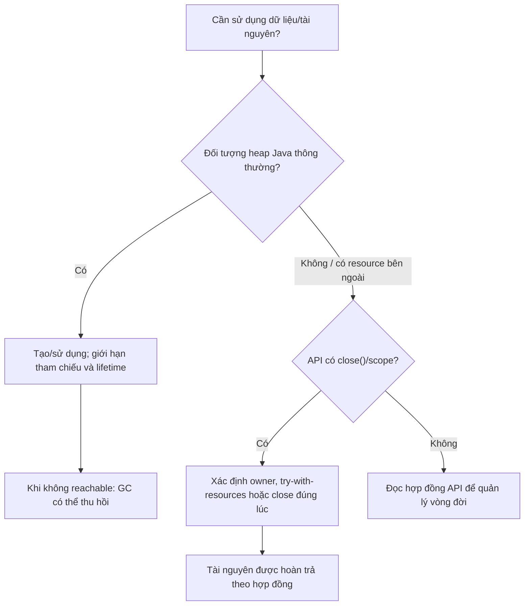

## 11. Bài tập và câu hỏi tự kiểm tra

**Bài 1 — reachability.** Hãy vẽ đường tham chiếu từ một `static Map<String, User>` tới các đối tượng `User`. Nếu một biến cục bộ trở thành `null` nhưng `Map` vẫn chứa `User`, GC có thu hồi được object đó không? Giải thích bằng GC roots.

**Bài 2 — vòng tham chiếu.** Tạo hai `Node` trỏ qua lại. Khi không còn đường từ GC root tới chúng, liệu vòng tham chiếu này có tự giữ chúng sống mãi không?

**Bài 3 — phát hiện leak.** Chuyển `RequestHistory` không giới hạn thành cache chỉ giữ 50 mục gần nhất. Kiểm tra `size()` không vượt quá 50 sau 10.000 lần gọi `record`.

**Bài 4 — quản lý thủ công.** Viết lớp `ReportWriter` sở hữu một `BufferedWriter`, implement `AutoCloseable`, rồi dùng trong `try-with-resources`. Khi constructor hoặc ghi dữ liệu ném exception, những tài nguyên nào cần được đóng? Ai sở hữu chúng?

**Bài 5 — chẩn đoán.** Một service có heap ổn định nhưng RSS process tăng. Hãy liệt kê ít nhất ba khu vực cần kiểm tra ngoài heap. Vì sao chỉ xem `-Xmx` là chưa đủ?

### Tự kiểm tra nhanh

| Nhận định | Đúng/Sai | Giải thích |
|---|---|---|
| Đối tượng Java tự bị hủy ngay khi biến cục bộ hết scope | **Sai** | Thời điểm GC không xác định, có thể còn tham chiếu khác |
| Object trỏ qua lại luôn không bao giờ được GC | **Sai** | Reachability từ GC roots mới là trọng tâm |
| `System.gc()` bảo đảm giải phóng ngay một object | **Sai** | Chỉ là yêu cầu tới JVM |
| GC tự đóng file, socket đúng thời điểm mong muốn | **Sai** | Cần hợp đồng đóng/quyền sở hữu |
| Một `static List` tăng mãi có thể gây memory leak | **Đúng** | Các phần tử còn reachable |
| `try-with-resources` gọi `close()` kể cả khi có lỗi trong thân `try` | **Đúng** | Đây là hành vi của cú pháp Java |

**Ghi nhớ:** Với bộ nhớ heap Java, hãy quản lý **tham chiếu và vòng đời sử dụng**, để GC quyết định thu hồi object không còn reachable. Với file, socket, database connection và vùng nhớ native có phạm vi sở hữu rõ ràng, hãy **đóng hoặc giải phóng đúng hợp đồng API**. Biết phân biệt hai trách nhiệm này là nền tảng để ứng dụng Java chạy ổn định trong thời gian dài.


</details>

- [Quay lại đầu trang](#back-to-top)

---

## <a id="lifecycle-008">Đóng tài nguyên và giới hạn của hàm hủy</a>

<details>
<summary>Xem chi tiết</summary>

# Đóng tài nguyên và giới hạn của hàm hủy trong Java

Trong Java, **đối tượng** được cấp phát và quản lý bộ nhớ bởi JVM, nhưng nhiều đối tượng còn đại diện cho **tài nguyên cần được giải phóng đúng lúc**: tệp đang mở, kết nối cơ sở dữ liệu, socket, luồng đọc/ghi, bộ nhớ ngoài heap hoặc một đối tượng giữ khóa. Vì vậy, cần phân biệt hai việc:

- **Thu hồi bộ nhớ của đối tượng:** Garbage Collector (GC) xử lý khi đối tượng không còn được truy cập theo các quy tắc của JVM.
- **Đóng tài nguyên mà đối tượng đang sở hữu:** ứng dụng phải chủ động thực hiện vào thời điểm không còn sử dụng, thường bằng `close()` và `try-with-resources`.

**Thông điệp quan trọng:** Trong Java, không có “hàm hủy” (*destructor*) chạy tự động, có thời điểm xác định giống destructor của C++. Cơ chế `finalize()` cũ không đáng tin để đóng tài nguyên và đã bị đánh dấu **deprecated for removal**; mã Java mới không nên dùng nó.

## 1. Vì sao thu gom rác không thay thế việc đóng tài nguyên?

Xét mã đọc một tệp:

```java
BufferedReader reader = Files.newBufferedReader(path);
String line = reader.readLine();
// Không đóng reader
```

Biến `reader` giữ tham chiếu đến một đối tượng Java, còn `BufferedReader` gián tiếp sử dụng tài nguyên hệ điều hành liên quan đến tệp. Khi biến không còn được dùng, JVM **không bảo đảm** tài nguyên sẽ được đóng ngay. Nếu lặp lại thao tác mở tệp mà bỏ qua `close()`, ứng dụng có thể cạn file descriptor hoặc gặp lỗi mở tệp mới.

| Thứ được quản lý | Ví dụ | Ai chịu trách nhiệm chính? | Khi nào giải phóng? |
| --- | --- | --- | --- |
| Bộ nhớ heap Java | Đối tượng `Customer`, `StringBuilder` | JVM/GC | Khi JVM quyết định thu gom đối tượng không còn được truy cập |
| Tài nguyên tệp | `BufferedReader`, `FileInputStream` | Mã sử dụng và lớp API sở hữu tài nguyên | Chủ động `close()`, lý tưởng ngay khi xong việc |
| Kết nối cơ sở dữ liệu | JDBC `Connection`, `PreparedStatement`, `ResultSet` | Mã ứng dụng phối hợp với driver/pool | Đóng theo phạm vi sử dụng; `Connection.close()` có thể trả kết nối về pool |
| Socket mạng | `Socket`, các stream liên quan | Mã sở hữu kết nối | Đóng khi trao đổi xong hoặc khi hủy yêu cầu |
| Executor/luồng chạy | Executor và tác vụ | Thành phần quản lý vòng đời | Tắt bằng API phù hợp, chờ hoàn tất khi cần; chi tiết khác theo phiên bản Java |

Một đối tượng có thể đã không còn tham chiếu từ mã nghiệp vụ nhưng tài nguyên hệ điều hành chưa được đóng đúng lúc. Ngược lại, một đối tượng Java **vẫn đang tồn tại** hoàn toàn có thể đã đóng tài nguyên và tiếp tục được truy cập để kiểm tra trạng thái.

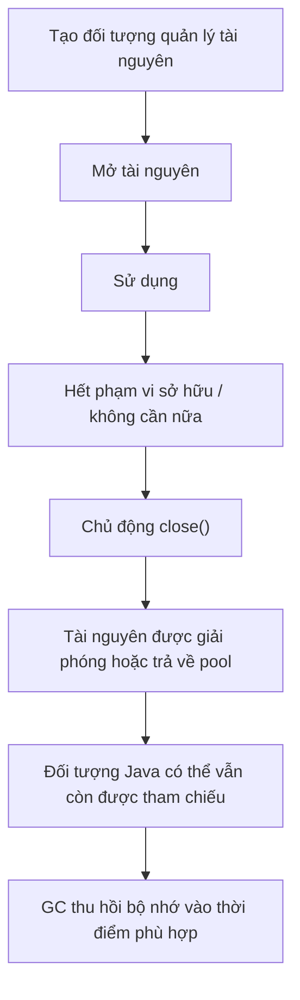

Sơ đồ mô tả vòng đời mong muốn. Lệnh `close()` có thể phát sinh lỗi và một số tài nguyên có semantics riêng; việc “đóng thành công” phải tuân theo hợp đồng của API cụ thể.

## 2. Cách chuẩn: `try-with-resources`

Từ Java 7, `try-with-resources` tự động gọi `close()` đối với các tài nguyên khai báo trong phần `try (...)` khi rời khỏi khối, kể cả khi thân `try` ném ngoại lệ.

```java
import java.io.BufferedReader;
import java.io.IOException;
import java.nio.charset.StandardCharsets;
import java.nio.file.Files;
import java.nio.file.Path;

class ReaderExample {
    static String readFirstLine(Path path) throws IOException {
        try (BufferedReader reader =
                 Files.newBufferedReader(path, StandardCharsets.UTF_8)) {
            return reader.readLine();
        } // reader.close() được gọi khi rời khối try
    }
}
```

`BufferedReader` là tài nguyên có thể đóng. Khi `readLine()` hoàn tất, `return` không làm mất bước đóng; Java vẫn gọi `close()` trước khi phương thức thực sự trả kết quả cho caller.

Nếu `Files.newBufferedReader(...)` không mở được tệp, lời gọi tạo tài nguyên ném ngoại lệ và không có `reader` được khởi tạo thành công để đóng. Nếu tài nguyên đã mở thành công nhưng đọc thất bại, cơ chế của `try-with-resources` vẫn thực hiện đóng.

**Quy tắc:** Đối tượng trong danh sách `try (...)` phải là kiểu triển khai `AutoCloseable` (hoặc `Closeable`, vốn kế thừa `AutoCloseable`).

## 3. Ví dụ hoàn chỉnh: quản lý vòng đời tài nguyên

Ví dụ sau cho thấy hai hành vi: tài nguyên tự định nghĩa được đóng **theo thứ tự ngược với thứ tự khởi tạo** và việc đọc/ghi tệp đóng stream ngay sau khi dùng.

Lưu toàn bộ mã vào file **`Main.java`**, dùng Java 17 hoặc Java 21:

```java
import java.io.BufferedReader;
import java.io.BufferedWriter;
import java.io.IOException;
import java.nio.charset.StandardCharsets;
import java.nio.file.Files;
import java.nio.file.Path;
import java.util.Objects;

public class Main {
    static final class Session implements AutoCloseable {
        private final String name;
        private boolean closed;

        Session(String name) {
            this.name = Objects.requireNonNull(name, "name");
            System.out.println("Mở " + name);
        }

        void use() {
            if (closed) {
                throw new IllegalStateException("Session đã đóng");
            }
            System.out.println("Dùng " + name);
        }

        @Override
        public void close() {
            // Đây là lựa chọn thiết kế của Session, không phải
            // lời bảo đảm áp dụng cho mọi AutoCloseable.
            if (closed) {
                return;
            }
            closed = true;
            System.out.println("Đóng " + name);
        }
    }

    public static void main(String[] args) throws IOException {
        try (Session first = new Session("A");
             Session second = new Session("B")) {
            first.use();
            second.use();
        }

        Path file = Files.createTempFile("oop-resource-", ".txt");
        try {
            try (BufferedWriter writer = Files.newBufferedWriter(
                    file, StandardCharsets.UTF_8)) {
                writer.write("Xin chào Java");
            }

            try (BufferedReader reader = Files.newBufferedReader(
                    file, StandardCharsets.UTF_8)) {
                System.out.println(reader.readLine());
            }
        } finally {
            // File tạm cũng là một tài nguyên tồn tại trên đĩa:
            // xóa khi không cần nữa, dù có lỗi đọc/ghi.
            Files.deleteIfExists(file);
        }
    }
}
```

Chạy:

```bash
javac Main.java
java Main
```

Đầu ra:

```text
Mở A
Mở B
Dùng A
Dùng B
Đóng B
Đóng A
Xin chào Java
```

**Điều gì xảy ra?**

1. `Session("A")` được tạo trước, rồi `Session("B")`.
2. Trong thân `try`, chương trình dùng cả hai tài nguyên.
3. Khi hết khối, Java tự gọi `second.close()` trước, sau đó `first.close()`.
4. Ở phần tệp, writer đóng trước khi reader bắt đầu đọc. Khi đọc xong, reader đóng; `finally` xóa tệp tạm.
5. Phương thức `Session.use()` chặn việc thao tác sau khi tài nguyên đã đóng.

Lệnh `Files.deleteIfExists(file)` có thể tự ném `IOException`; trong ứng dụng thật, cần quyết định cách báo cáo lỗi xóa tệp, đặc biệt nếu trước đó đã có lỗi đọc/ghi. Ví dụ này phù hợp để thấy các phạm vi sở hữu riêng: **đóng luồng I/O** và **xóa đường dẫn tệp tạm** là hai việc khác nhau.

## 4. `AutoCloseable` và `Closeable`

Hai giao diện cơ bản thường gặp:

```java
public interface AutoCloseable {
    void close() throws Exception;
}
```

```java
public interface Closeable extends AutoCloseable {
    void close() throws java.io.IOException;
}
```

| Tiêu chí | `AutoCloseable` | `Closeable` |
| --- | --- | --- |
| Mục đích | Hợp đồng tổng quát cho tài nguyên cần đóng | Hợp đồng đóng tài nguyên I/O |
| Ngoại lệ được khai báo trong `close()` | `Exception` | `IOException` |
| Có dùng trong `try-with-resources`? | Có | Có |
| Đóng nhiều lần | Không được bảo đảm an toàn chung cho mọi triển khai | Hợp đồng `Closeable` quy định việc đóng một tài nguyên đã đóng không gây tác dụng |
| Ví dụ | `java.sql.Connection`, đối tượng khóa hoặc transaction scope do ứng dụng viết | `BufferedReader`, `InputStream`, `OutputStream` |

Khi tự triển khai, có thể khai báo `close()` không `throws` hoặc khai báo ngoại lệ cụ thể hẹp hơn. Ví dụ `Session.close()` ở trên không ném checked exception.

**Lưu ý về idempotence:** Tự tạo lớp có `close()` an toàn khi được gọi lặp lại thường rất có ích, nhưng `AutoCloseable` **không bắt buộc** mọi lớp triển khai đều phải idempotent. Không nên giả định có thể đóng hai lần hoặc dùng lại mọi tài nguyên sau khi đóng.

## 5. `try-with-resources` bảo đảm những gì?

Có hai điều đặc biệt quan trọng:

### 5.1. Đóng theo thứ tự ngược

```java
try (Resource a = openA();
     Resource b = openB();
     Resource c = openC()) {
    process(a, b, c);
}
```

Java đóng theo thứ tự `c`, `b`, `a`. Nếu khởi tạo `b` thất bại thì `a` (đã tạo thành công) vẫn được đóng; `c` chưa được tạo.

Điều này rất phù hợp với các tài nguyên phụ thuộc nhau, ví dụ một `ResultSet` sử dụng `PreparedStatement`, còn statement được tạo từ `Connection`.

### 5.2. Ngoại lệ khi đóng có thể bị *suppressed*

Giả sử cả phần xử lý và bước đóng đều ném lỗi. Java cần giữ được nguyên nhân quan trọng nhất thay vì để lỗi đóng che mất lỗi xử lý.

Lưu ví dụ độc lập thành **`SuppressedDemo.java`**:

```java
import java.io.IOException;

public class SuppressedDemo {
    static final class FailingResource implements AutoCloseable {
        @Override
        public void close() throws IOException {
            throw new IOException("Lỗi khi đóng");
        }
    }

    public static void main(String[] args) {
        try (FailingResource resource = new FailingResource()) {
            throw new IllegalStateException("Lỗi xử lý");
        } catch (Exception ex) {
            System.out.println("Chính: " + ex.getMessage());
            for (Throwable suppressed : ex.getSuppressed()) {
                System.out.println("Kèm theo: " + suppressed.getMessage());
            }
        }
    }
}
```

Kết quả:

```text
Chính: Lỗi xử lý
Kèm theo: Lỗi khi đóng
```

Trong `try-with-resources`, ngoại lệ từ thân `try` là ngoại lệ chính; lỗi `close()` được đính kèm vào `getSuppressed()`. Nếu thân `try` không lỗi mà `close()` lỗi, ngoại lệ đóng có thể được ném ra trực tiếp.

Không nên tự ý bỏ qua lỗi đóng vì một số API có thể chỉ phát hiện lỗi ghi/flush khi đóng. Khi ghi log, cân nhắc cả nguyên nhân chính lẫn các ngoại lệ suppressed để không mất thông tin điều tra.

## 6. Vì sao không dùng `finalize()` như một hàm hủy?

Một số tài liệu cũ có thể cho thấy lớp override phương thức `protected void finalize() throws Throwable` của `Object`. Đây là cơ chế **finalization**, từng được xem như một cách xử lý trước khi bộ nhớ đối tượng bị thu hồi.

Không nên dùng cách này trong Java hiện đại:

- Không thể biết chính xác **khi nào** JVM có thể chạy finalizer.
- Không có cam kết finalizer sẽ chạy trước khi chương trình kết thúc; một đối tượng có thể không được finalize.
- Finalizer có thể chạy trên luồng không do mã nghiệp vụ kiểm soát, gây khó khăn về đồng bộ và xử lý lỗi.
- Việc giữ hoặc “hồi sinh” tham chiếu từ finalizer làm vòng đời phức tạp, gây rủi ro hiệu năng, bảo mật và tính đúng đắn.
- `Object.finalize()` và finalization đã được **deprecated for removal** trong những phiên bản Java hiện đại (JEP 421). Tính năng này có thể bị vô hiệu hóa hoặc bị loại bỏ trong tương lai.

Đặc biệt, **`System.gc()` chỉ là một yêu cầu/gợi ý cho JVM**, không phải cam kết sẽ thu gom ngay, càng không phải một phương thức đóng file/socket/connection. Không bao giờ dùng `System.gc()` để cố ép một finalizer chạy.

| Cơ chế | Mục đích | Thời điểm dự đoán được? | Có phù hợp để đóng tài nguyên chính? |
| --- | --- | --- | --- |
| `try-with-resources` | Đóng `AutoCloseable` khi rời phạm vi | Có, theo luồng thực thi bình thường hoặc ném ngoại lệ | **Có: ưu tiên** |
| `close()` gọi tường minh | Đóng theo quyết định nghiệp vụ | Có, tại lời gọi | Có, nếu quản lý ngoại lệ và phạm vi sở hữu |
| `finally` | Luôn cố thực thi mã dọn dẹp khi rời khối | Theo luồng Java, trừ các tình huống kết thúc bất thường của tiến trình/JVM | Có khi cần quản lý thủ công |
| `Cleaner` | Dọn dẹp dự phòng phụ thuộc vào GC | Không | Chỉ là phương án dự phòng phù hợp, không thay thế đóng tường minh |
| `finalize()` | Cơ chế finalization cũ | Không | **Không dùng cho mã mới** |
| GC | Quản lý bộ nhớ heap | Không | Không phải công cụ đóng tài nguyên nghiệp vụ |

**Không có cơ chế nào bảo đảm mã Java tùy ý sẽ chạy khi tiến trình bị kill đột ngột, máy mất điện hoặc JVM crash.** Vì vậy, phần lớn tài nguyên cần thiết phải được đóng sớm ở những ranh giới nghiệp vụ có kiểm soát.

## 7. `Cleaner` có phải là destructor mới?

`java.lang.ref.Cleaner` cho phép đăng ký một hành động dọn dẹp khi đối tượng được đánh giá là có thể thu gom. Nó hữu ích trong **một số thiết kế chuyên sâu**, thường để có cơ chế dự phòng cho tài nguyên native mà ứng dụng quên đóng.

Nhưng `Cleaner` **không biến việc dọn dẹp thành tất định**:

1. Không biết chính xác khi nào GC sẽ làm đối tượng đủ điều kiện để cleanup.
2. Không nên mong đợi cleanup chạy đúng lúc hoặc chắc chắn trước khi tiến trình kết thúc.
3. Nếu hành động cleanup vô tình giữ tham chiếu mạnh đến chính đối tượng cần dọn, nó có thể ngăn đối tượng trở thành ứng viên được thu gom.
4. Mã cleanup chạy trong bối cảnh khác với code nghiệp vụ, nên phải thiết kế cho thread-safety và ngoại lệ.

Cách tư duy đúng: API công khai vẫn có `close()` để caller chủ động đóng; `Cleaner` chỉ là **lưới an toàn dự phòng**, và chỉ nên thêm khi thật sự cần. Đối với kết nối JDBC, tệp và socket thông thường, `try-with-resources` là giải pháp cơ bản, rõ ràng hơn.

## 8. Ai sở hữu tài nguyên và ai phải đóng?

Một bug phổ biến là “thấy đối tượng triển khai `AutoCloseable` thì tự đóng” mà không xét ai sở hữu nó.

**Nguyên tắc ownership:** Thành phần **tạo ra hoặc nhận quyền sở hữu** tài nguyên có trách nhiệm đóng ở cuối phạm vi sử dụng đã thỏa thuận. Thành phần chỉ **mượn** tài nguyên thường không đóng nó, trừ khi hợp đồng API nói rõ.

Ví dụ:

```java
class TextService {
    // Chỉ mượn reader từ caller, không nhận ownership.
    static String readOneLine(java.io.BufferedReader reader)
            throws java.io.IOException {
        return reader.readLine();
    }
}
```

Caller sẽ quyết định phạm vi:

```java
try (BufferedReader reader = Files.newBufferedReader(path)) {
    String line = TextService.readOneLine(reader);
    // Có thể tiếp tục sử dụng reader nếu cần.
}
```

Nếu `readOneLine()` tự đóng reader, caller sẽ bị bất ngờ khi không thể đọc thêm.

Trong các framework, vòng đời còn được điều phối bởi container: ví dụ tài nguyên của một request, transaction hay bean do framework quản lý có thể cần để container tự đóng tại thời điểm quy định. Nếu code tự gọi `close()` lên đối tượng do container quản lý, có thể khiến thành phần khác dùng lỗi. Cần đọc hợp đồng của loại tài nguyên cụ thể.

## 9. Đóng kết nối JDBC và tài nguyên lồng nhau

Mẫu dưới đây minh họa JDBC: chỉ để học cấu trúc, cần `DataSource`, bảng `students` và dữ liệu thật của ứng dụng để chạy.

```java
import java.sql.Connection;
import java.sql.PreparedStatement;
import java.sql.ResultSet;
import java.sql.SQLException;
import javax.sql.DataSource;

class StudentRepository {
    private final DataSource dataSource;

    StudentRepository(DataSource dataSource) {
        this.dataSource = dataSource;
    }

    String findName(long id) throws SQLException {
        String sql = "SELECT name FROM students WHERE id = ?";

        try (Connection connection = dataSource.getConnection();
             PreparedStatement statement =
                 connection.prepareStatement(sql)) {
            statement.setLong(1, id);

            try (ResultSet rs = statement.executeQuery()) {
                return rs.next() ? rs.getString("name") : null;
            }
        }
    }
}
```

Phạm vi kết nối nằm ở `try` ngoài. `ResultSet` đóng khi khối trong kết thúc; sau đó statement và connection được đóng khi rời khối ngoài.

Với connection pool, `Connection.close()` thường **trả kết nối về pool** thay vì đóng vật lý kết nối TCP tới máy chủ ngay. Do đó, bỏ qua `close()` có thể làm hết kết nối trong pool dù GC vẫn còn hoạt động bình thường.

Khi giao dịch cần `commit()` hoặc `rollback()`, **việc đóng connection không thể thay thế quản lý transaction đúng cách**. Cần tuân thủ hợp đồng của driver, pool hoặc transaction manager.

## 10. Tự triển khai `AutoCloseable` sao cho có ích

Một lớp sở hữu tài nguyên nên định nghĩa rõ trạng thái sống/đã đóng. Ví dụ lớp bọc một `BufferedReader`:

```java
import java.io.BufferedReader;
import java.io.IOException;
import java.nio.charset.StandardCharsets;
import java.nio.file.Files;
import java.nio.file.Path;

final class LineSource implements AutoCloseable {
    private final BufferedReader reader;
    private boolean closed;

    LineSource(Path path) throws IOException {
        this.reader = Files.newBufferedReader(
            path, StandardCharsets.UTF_8);
    }

    String nextLine() throws IOException {
        if (closed) {
            throw new IllegalStateException("LineSource đã đóng");
        }
        return reader.readLine();
    }

    @Override
    public void close() throws IOException {
        if (!closed) {
            // Đặt closed trước khi gọi xuống tài nguyên
            // để chặn thao tác qua wrapper sau yêu cầu đóng.
            closed = true;
            reader.close();
        }
    }
}
```

Caller dùng:

```java
try (LineSource source = new LineSource(path)) {
    String line;
    while ((line = source.nextLine()) != null) {
        System.out.println(line);
    }
}
```

Mẫu này phù hợp cho đối tượng được sử dụng **tuần tự**. Trường `closed` không tự làm API thread-safe; nếu nhiều luồng đồng thời gọi `nextLine()` và `close()`, cần một chiến lược đồng bộ hoặc tài liệu hóa rõ rằng không hỗ trợ gọi đồng thời.

Khi `close()` có thể lỗi, cần quyết định hợp đồng về thử đóng lại và trạng thái sau lỗi. Trong ví dụ, wrapper được coi là **không thể dùng tiếp** ngay khi quá trình đóng bắt đầu; đây là lựa chọn thiết kế có chủ đích, không phải quy tắc bắt buộc cho mọi tài nguyên.

Một lời gọi `close()` không có nghĩa có thể sử dụng lại tài nguyên sau đó. Nhiều stream/socket không cho phép mở lại cùng một thể hiện; muốn dùng lần nữa thường phải **tạo đối tượng tài nguyên mới**.

## 11. `finally` so với `try-with-resources`

Trước Java 7, mã đóng tài nguyên thường đặt trong `finally`:

```java
BufferedReader reader = null;
try {
    reader = Files.newBufferedReader(path);
    System.out.println(reader.readLine());
} finally {
    if (reader != null) {
        reader.close();
    }
}
```

Phần trên minh họa cú pháp dọn dẹp thủ công, cần đặt trong phương thức khai báo hoặc xử lý `IOException`. Nó ngắn nhưng dễ phát sinh lỗi khi có nhiều tài nguyên: quên kiểm tra `null`, quên đóng một tài nguyên hoặc vô tình để lỗi đóng che mất lỗi xử lý.

Với đối tượng triển khai `AutoCloseable`, ưu tiên:

```java
try (BufferedReader reader = Files.newBufferedReader(path)) {
    System.out.println(reader.readLine());
}
```

Tuy nhiên, `finally` **vẫn hữu ích** cho những hành động dọn dẹp không nằm trong hợp đồng `AutoCloseable`, chẳng hạn xóa tệp tạm, trả lại trạng thái hay giải phóng một khóa theo API riêng. Trong mọi trường hợp, `finally` không nên được hiểu là chạy bất chấp mọi sự cố bên ngoài JVM.

## 12. Những lỗi thường gặp

| Lỗi | Hậu quả có thể xảy ra | Cách làm phù hợp |
| --- | --- | --- |
| Không gọi `close()`, trông chờ GC | Tài nguyên mở lâu, cạn handle/pool | `try-with-resources` |
| Override `finalize()` để đóng socket/file | Thời điểm dọn dẹp không bảo đảm | Bỏ finalization; dùng `close()` |
| Gọi `System.gc()` sau mỗi request | Không bảo đảm đóng tài nguyên, ảnh hưởng hiệu năng | Quản lý vòng đời rõ ràng |
| Tự đóng tài nguyên chỉ đang mượn | Caller không thể tiếp tục sử dụng | Thống nhất hợp đồng ownership |
| Chỉ đóng khi chạy thành công | Ngoại lệ khiến tài nguyên bị bỏ mở | `try-with-resources` hoặc `finally` phù hợp |
| Quên lỗi khi `close()` thất bại | Không thấy lỗi flush/ghi/chuyển trạng thái | Ghi log, xem `getSuppressed()` khi cần |
| Cho rằng `close()` luôn có thể gọi nhiều lần | Một số API không hỗ trợ | Đọc hợp đồng tài nguyên; thiết kế wrapper rõ ràng |
| Gọi tài nguyên sau khi đóng | `IOException` hoặc `IllegalStateException` tùy API | Kiểm soát trạng thái và phạm vi sử dụng |
| Tự đóng connection do transaction manager kiểm soát | Phá hỏng vòng đời transaction | Để container quản lý đúng hợp đồng |
| Tin `Cleaner` sẽ chạy trước shutdown | Dọn dẹp bị trễ hoặc không thực hiện | Chỉ dùng Cleaner làm fallback |

## 13. Bài tập tự kiểm tra

**Câu 1.** Đoạn nào đúng hơn cho một tệp được mở trong một phương thức ngắn?

```java
// A
BufferedReader reader = Files.newBufferedReader(path);
return reader.readLine();

// B
try (BufferedReader reader = Files.newBufferedReader(path)) {
    return reader.readLine();
}
```

**Đáp án:** **B**. Java vẫn gọi `close()` khi thoát bằng `return` hoặc khi gặp ngoại lệ sau khi mở thành công.

**Câu 2.** Hai tài nguyên mở theo thứ tự `A`, `B` trong cùng danh sách `try (...)`. Chúng đóng theo thứ tự nào?

**Đáp án:** **B rồi A**, vì `try-with-resources` đóng theo thứ tự ngược.

**Câu 3.** Thân `try` ném `IllegalStateException`, còn `close()` ném `IOException`. Ngoại lệ nào thường là ngoại lệ chính?

**Đáp án:** Lỗi của thân `try` là ngoại lệ chính; lỗi `close()` được lưu trong `getSuppressed()`.

**Câu 4.** Một `Connection` lấy từ connection pool được `close()`. Có chắc kết nối TCP vật lý tới database bị đóng ngay không?

**Đáp án:** **Không.** Với pool, `close()` thường trả kết nối về pool cho request khác dùng; đó vẫn là hành động bắt buộc để trả quyền sử dụng.

**Câu 5.** Khi GC thu hồi một đối tượng Java, có thể kết luận file descriptor mà nó từng giữ đã được đóng đúng lúc không?

**Đáp án:** **Không.** Tài nguyên ngoài bộ nhớ heap cần được đóng chủ động; không thể dựa vào thời điểm GC.

**Câu 6.** Có nên dùng `finalize()` hoặc `Cleaner` làm bước dọn dẹp chính cho kết nối mạng không?

**Đáp án:** **Không.** Ưu tiên hợp đồng sở hữu rõ ràng, `AutoCloseable.close()` và `try-with-resources`. `Cleaner` chỉ có thể là giải pháp dự phòng trong các trường hợp phù hợp, còn `finalize()` không dùng cho mã mới.

**Ghi nhớ:** GC quản lý **bộ nhớ đối tượng**, còn `close()` quản lý **tài nguyên có vòng đời nghiệp vụ**. Một lớp quản lý tài nguyên tốt định nghĩa rõ quyền sở hữu, thời điểm đóng, cách xử lý lỗi và hành vi sau khi đóng. Trong Java hiện đại, hãy dùng `try-with-resources` bất cứ khi nào API hỗ trợ `AutoCloseable`, thay vì trông đợi “hàm hủy” hoặc GC xử lý hộ.


</details>

- [Quay lại đầu trang](#back-to-top)

---

## <a id="lifecycle-009">Tránh để đối tượng chưa khởi tạo xong bị sử dụng</a>

<details>
<summary>Xem chi tiết</summary>

# Tránh để đối tượng chưa khởi tạo xong bị sử dụng trong Java

Trong Java, **constructor** chịu trách nhiệm thiết lập trạng thái ban đầu của đối tượng. Nếu tham chiếu đến đối tượng bị đưa ra bên ngoài **trước khi constructor và chuỗi khởi tạo liên quan hoàn tất**, mã khác có thể gọi phương thức hoặc đọc field khi đối tượng mới ở trạng thái dở dang. Hiện tượng này thường gọi là **this escape** (*tham chiếu `this` thoát khỏi quá trình khởi tạo*).

Vấn đề không chỉ xảy ra trong chương trình đa luồng. Một callback được gọi ngay trong lúc đăng ký listener cũng có thể dùng đối tượng quá sớm, ngay trên cùng thread. Trong chương trình đa luồng, sự cố còn khó tái hiện hơn do thời điểm thực thi và khả năng nhìn thấy dữ liệu giữa các thread.

Bài này giải thích tình huống gây lỗi, lý do gây lỗi và cách thiết kế để một đối tượng chỉ được sử dụng khi nó đã sẵn sàng.

## 1. Một đối tượng đi qua những giai đoạn nào?

Khi thực hiện `new SomeClass(...)`, JVM và ngôn ngữ Java thực hiện quá trình khởi tạo đối tượng theo quy tắc của Java, bao gồm thiết lập giá trị mặc định cho các field, chạy chuỗi constructor lớp cha, thực hiện field initializer/instance initializer của các lớp theo thứ tự phù hợp rồi chạy phần thân constructor.

Một đặc điểm cần nhớ: **đối tượng có thể đã tồn tại trong khi constructor chưa hoàn thành**. Một tham chiếu đến đối tượng đó có thể bị lộ trong giai đoạn này, ví dụ qua `this`.

Giả sử có lớp:

```java
public final class Session {
    private final String sessionId;
    private final String owner;

    public Session(String sessionId, String owner) {
        this.sessionId = sessionId;
        this.owner = owner;
    }

    public String displayName() {
        return sessionId + " - " + owner;
    }
}
```

Trong đường sử dụng bình thường, caller chỉ nhận tham chiếu từ biểu thức `new Session(...)` **sau khi constructor hoàn thành thành công**. Nhưng constructor có thể làm rò rỉ `this` bằng cách lưu nó vào nơi khác hoặc chuyển nó cho một callback.

### Phân biệt hai rủi ro

| Rủi ro | Điều gì xảy ra? | Ví dụ |
|---|---|---|
| **Dùng sớm (premature use)** | Mã khác truy cập đối tượng khi quá trình khởi tạo chưa xong | Listener được gọi ngay khi đăng ký từ constructor |
| **Công bố không an toàn (unsafe publication)** | Một thread khác nhận tham chiếu mà không có quan hệ đồng bộ phù hợp, nên khả năng nhìn thấy trạng thái có thể không được bảo đảm | Gán đối tượng vào field dùng chung thông thường rồi để thread khác đọc không đồng bộ |

Hai vấn đề có liên quan nhưng không đồng nhất. Ngay cả khi việc công bố tham chiếu có cơ chế đồng bộ, **công bố trước khi khởi tạo xong vẫn cho phép mã khác sử dụng một đối tượng chưa hoàn chỉnh**.

## 2. this escape là gì?

Trong phương thức instance và constructor, `this` tham chiếu tới chính đối tượng hiện tại. **This escape** xảy ra khi trong lúc xây dựng, tham chiếu tới đối tượng này trở nên truy cập được từ một nơi có thể sử dụng nó trước khi quá trình khởi tạo kết thúc.

Những đường làm rò rỉ `this` thường gặp:

- Đăng ký listener hoặc callback vào một event bus, registry hay service dùng chung ngay trong constructor.
- Lưu `this` vào field `static` hoặc một collection do thành phần khác có quyền truy cập nắm giữ.
- Truyền `this` cho mã không kiểm soát được, đặc biệt nếu mã đó gọi ngược hoặc giữ lại tham chiếu.
- Khởi chạy thread hoặc asynchronous task dùng `this` trong constructor.
- Đưa ra bên ngoài lambda/method reference/đối tượng inner class có giữ tham chiếu tới `this`.

Việc truyền `this` cho một phương thức hỗ trợ nội bộ mà bạn kiểm soát và không giữ hoặc đưa tham chiếu ra ngoài **không nhất thiết** gây this escape. Yếu tố quan trọng là liệu tham chiếu có thể được dùng từ bên ngoài ranh giới khởi tạo sớm hay không.

## 3. Ví dụ lỗi xác định: đăng ký callback quá sớm

Ví dụ dưới đây cố tình mô phỏng registry gọi callback **ngay trong lúc đăng ký**. Không cần thread phụ nên lỗi có thể dự đoán được.

File `UnsafeListenerDemo.java`:

```java
public class UnsafeListenerDemo {
    interface Listener {
        void onEvent();
    }

    static class EventRegistry {
        void register(Listener listener) {
            listener.onEvent(); // Callback chạy đồng bộ ngay lúc đăng ký
        }
    }

    static class ReportListener {
        private final String reportName;

        ReportListener(EventRegistry registry) {
            registry.register(this::onEvent);
            this.reportName = "Báo cáo tháng";
        }

        private void onEvent() {
            System.out.println("Tên báo cáo: " + reportName);
        }
    }

    public static void main(String[] args) {
        new ReportListener(new EventRegistry());
    }
}
```

Kết quả:

```text
Tên báo cáo: null
```

Mặc dù `reportName` được khai báo `final` và được gán trong constructor, callback chạy **trước câu lệnh gán**. Lúc đó field tham chiếu vẫn mang giá trị mặc định `null`. Nếu `onEvent()` gọi `reportName.length()`, chương trình sẽ ném `NullPointerException`.

Đây không phải lỗi của từ khóa `final`; lỗi là do việc gọi mã có thể quan sát đối tượng trước khi trạng thái hợp lệ được thiết lập.

### Luồng gây lỗi

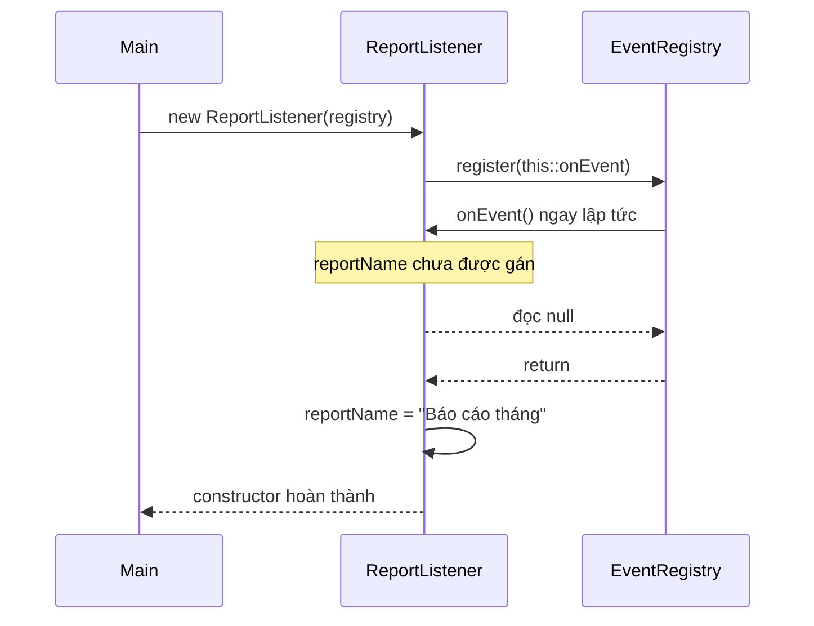

Một số thư viện chỉ lưu listener và không gọi callback ngay, nhưng vẫn có nguy cơ nếu thread khác phát sự kiện trước khi constructor kết thúc. Không nên phụ thuộc vào giả định “listener sẽ chưa được gọi đâu” khi API không bảo đảm điều đó.

## 4. Cách sửa: xây dựng xong rồi mới đăng ký

Cách thiết kế rõ ràng là **tách việc khởi tạo trạng thái khỏi việc đưa đối tượng vào hệ thống bên ngoài**.

Ví dụ dùng static factory để caller chỉ nhận đối tượng sau khi các bước tạo và đăng ký đã hoàn tất:

```java
import java.util.Objects;

public final class SafeListenerDemo {
    interface Listener {
        void onEvent();
    }

    static class EventRegistry {
        void register(Listener listener) {
            listener.onEvent(); // Cố ý gọi ngay để kiểm chứng
        }
    }

    static final class ReportListener {
        private final String reportName;

        private ReportListener(String reportName) {
            this.reportName = Objects.requireNonNull(reportName);
            if (reportName.isBlank()) {
                throw new IllegalArgumentException("Tên báo cáo không được rỗng");
            }
        }

        static ReportListener createAndRegister(
                EventRegistry registry, String reportName) {
            Objects.requireNonNull(registry);

            ReportListener listener = new ReportListener(reportName);
            registry.register(listener::onEvent);
            return listener;
        }

        private void onEvent() {
            System.out.println("Tên báo cáo: " + reportName);
        }
    }

    public static void main(String[] args) {
        ReportListener listener = ReportListener.createAndRegister(
            new EventRegistry(), "Báo cáo tháng"
        );
        // Callback in: Tên báo cáo: Báo cáo tháng
    }
}
```

Tại thời điểm `registry.register(...)` chạy, constructor `ReportListener(String)` đã **trả về thành công** và đối tượng có trạng thái hợp lệ. Ngay cả callback đồng bộ trong `register` cũng thấy tên báo cáo đúng.

Mô hình này áp dụng tốt khi phải gắn một đối tượng vào event bus, message handler, cache, scheduler hay hệ thống plugin.

**Lưu ý về lỗi đăng ký:** Nếu `register` ném exception, factory ở trên cũng không trả thành công. Tuy nhiên registry có thể đã lưu listener trước khi ném lỗi. Với hệ thống thực, cần định nghĩa rõ việc đăng ký có nguyên tử hay không, có cách hủy đăng ký không, và cách xử lý rollback/cleanup.

### Nếu bắt buộc có bước activate riêng?

Có thể thiết kế hai giai đoạn:

```java
final class Consumer {
    private final String id;
    private boolean activated;

    Consumer(String id) {
        if (id == null || id.isBlank()) {
            throw new IllegalArgumentException("id không hợp lệ");
        }
        this.id = id;
    }

    void activate(EventRegistry registry) {
        if (activated) {
            throw new IllegalStateException("Đã activate");
        }
        // Chỉ đăng ký sau khi constructor hoàn thành.
        registry.register(() -> System.out.println(id));
        activated = true;
    }
}
```

Ví dụ trên minh họa ý tưởng tách hai giai đoạn trong **môi trường gọi tuần tự**. Nó chưa phải API thread-safe: nếu `activate` có thể bị gọi đồng thời hoặc `register` gọi callback tái nhập, cần thiết kế lại trạng thái/khoá và xử lý lỗi một cách rõ ràng. Factory thường giảm khả năng caller quên gọi `activate`.

## 5. Không gọi phương thức có thể bị override trong constructor

Một nguyên nhân khác của việc dùng đối tượng quá sớm là **dynamic dispatch** trong lúc constructor lớp cha còn chạy. Java có thể gọi phương thức override của lớp con **trước khi các field initializer và constructor của lớp con hoàn tất**.

Ví dụ chạy độc lập:

```java
public class OverrideDuringConstruction {
    static class Parent {
        Parent() {
            printStatus(); // Nguy hiểm: phương thức có thể override
        }

        void printStatus() {
            System.out.println("Parent initialized");
        }
    }

    static class Child extends Parent {
        private String label = "Ready";

        Child() {
            System.out.println("Child constructor");
        }

        @Override
        void printStatus() {
            System.out.println("Child label = " + label);
        }
    }

    public static void main(String[] args) {
        new Child();
    }
}
```

Kết quả:

```text
Child label = null
Child constructor
```

Tại sao? Khi `new Child()`:

1. Các field instance nhận giá trị mặc định (với `label` là `null`).
2. Constructor lớp cha `Parent()` chạy.
3. Lệnh `printStatus()` được dispatch động đến `Child.printStatus()`.
4. Field initializer `label = "Ready"` của `Child` **chưa chạy**.
5. Sau khi constructor cha xong, phần khởi tạo riêng của `Child` mới diễn ra.

Thứ tự quan trọng có thể hình dung:

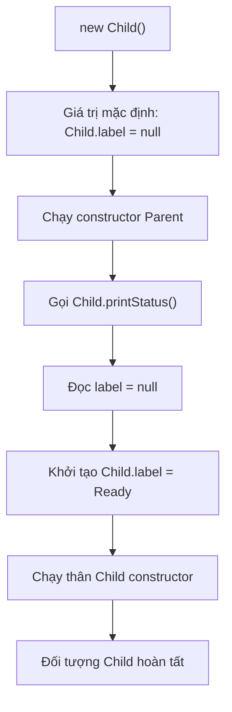

### Thiết kế an toàn hơn

- Trong constructor, chỉ gọi các phương thức **`private`, `final` hoặc `static`** phù hợp, khi cần tránh việc subclass ghi đè làm thay đổi luồng khởi tạo. Phương thức `private` không override được; `final` khóa việc override.
- Tốt hơn nữa, kiểm tra đầu vào và thiết lập dữ liệu cần thiết trực tiếp qua các helper không thể override.
- Nếu logic cần dữ liệu của lớp con, thực hiện **sau khi toàn bộ constructor kết thúc**, thông qua phương thức được caller gọi hoặc qua factory kiểm soát vòng đời.

Ví dụ:

```java
class Parent {
    private final String id;

    Parent(String id) {
        this.id = validate(id);
    }

    private static String validate(String id) {
        if (id == null || id.isBlank()) {
            throw new IllegalArgumentException("id không hợp lệ");
        }
        return id;
    }

    public final String getId() {
        return id;
    }
}

final class Child extends Parent {
    private final String label;

    Child(String id, String label) {
        super(id);
        this.label = java.util.Objects.requireNonNull(label);
    }

    void printStatus() {
        System.out.println(getId() + ": " + label);
    }
}

// Dùng sau khi khởi tạo hoàn tất:
Child child = new Child("C01", "Ready");
child.printStatus(); // C01: Ready
```

Ở ví dụ này, constructor cha không gọi phương thức mà lớp con có thể override; `printStatus()` chỉ chạy sau khi `new Child(...)` hoàn thành.

## 6. Không khởi chạy thread dùng this ngay trong constructor

Một lỗi đặc biệt nguy hiểm:

```java
class UnsafeWorker {
    private int threshold;

    UnsafeWorker() {
        new Thread(() -> System.out.println(threshold)).start();
        threshold = 10;
    }
}
```

Lambda ở đây tham chiếu field instance, tức giữ tham chiếu tới `this`. Sau `Thread.start()`, thread mới **có thể** chạy trước câu lệnh `threshold = 10`, nên có thể in `0`; kết quả phụ thuộc lịch chạy. Việc thử nhiều lần mà luôn thấy `10` **không chứng minh chương trình đúng**.

Quan hệ *happens-before* giữa các hành động ở thread gọi **trước** `Thread.start()` và hành động ở thread mới không bảo đảm một phép gán được thực hiện **sau** `start()` sẽ xuất hiện trước lần đọc trên worker.

### Tạo xong rồi mới start

Một thiết kế phù hợp với công việc chạy nền:

```java
public final class SafeWorker {
    private final int threshold;
    private final Thread thread;

    private SafeWorker(int threshold) {
        if (threshold <= 0) {
            throw new IllegalArgumentException("threshold phải dương");
        }
        this.threshold = threshold;
        this.thread = new Thread(this::runTask, "safe-worker");
    }

    public static SafeWorker createAndStart(int threshold) {
        SafeWorker worker = new SafeWorker(threshold);
        worker.thread.start();
        return worker;
    }

    private void runTask() {
        System.out.println("Threshold = " + threshold);
    }

    public static void main(String[] args) {
        SafeWorker.createAndStart(10);
    }
}
```

Tại thời điểm `start()` được gọi, constructor `SafeWorker` đã trả về, toàn bộ field đã được thiết lập. Các hành động được thực hiện trước `Thread.start()` *happen-before* hành động của thread mới; trường hợp này không để thread chạy trước khi khởi tạo xong.

Điều đó không tự biến mọi truy cập về sau thành thread-safe. Nếu thread đọc/ghi **trạng thái mutable** được chia sẻ với thread khác, vẫn cần cơ chế đồng bộ tương ứng.

Trong ứng dụng thực, nên cân nhắc **`ExecutorService`** để quản lý công việc, đồng thời có bước dừng/hủy theo vòng đời. Nguyên tắc vẫn là: **submit task tham chiếu tới đối tượng sau khi constructor trả về**, và quản lý đóng tài nguyên rõ ràng.

## 7. Constructor exception và đối tượng dở dang

Một constructor có thể ném exception khi kiểm tra dữ liệu:

```java
public final class EmailAddress {
    private final String value;

    public EmailAddress(String value) {
        if (value == null || !value.contains("@")) {
            throw new IllegalArgumentException("Email không hợp lệ");
        }
        this.value = value;
    }

    public String value() {
        return value;
    }
}
```

Nếu `new EmailAddress("invalid")` ném exception, biểu thức tạo đối tượng không trả một tham chiếu hợp lệ cho caller theo đường thực thi bình thường.

Tuy nhiên, nếu constructor **đã lưu `this` vào một biến dùng chung trước khi ném lỗi**, tham chiếu đến đối tượng dở dang vẫn có thể tồn tại ngoài constructor:

```java
import java.util.ArrayList;
import java.util.List;

class UnsafeRegistration {
    static final List<UnsafeRegistration> REGISTRY = new ArrayList<>();
    private final String value;

    UnsafeRegistration(String input) {
        REGISTRY.add(this); // Rò rỉ this
        if (input == null) {
            throw new IllegalArgumentException("input null");
        }
        this.value = input;
    }

    String value() {
        return value;
    }
}
```

`REGISTRY` trong ví dụ chỉ minh họa vấn đề dùng sớm, **không thread-safe**. Nếu gọi `new UnsafeRegistration(null)` rồi bắt exception, registry vẫn giữ tham chiếu đến đối tượng mà field `value` chưa được gán.

Sửa bằng cách chỉ đăng ký **sau khi tạo thành công**:

```java
static UnsafeRegistration createAndRegister(String input) {
    UnsafeRegistration result = new UnsafeRegistration(input);
    REGISTRY.add(result);
    return result;
}
```

Khi áp dụng cách này, cần **bỏ `REGISTRY.add(this)` khỏi constructor**. Trong hệ thống nhiều thread, registry cũng phải có chiến lược đồng bộ phù hợp. Nếu đăng ký có thể lỗi sau khi tạo, cần quy định hành vi xử lý lỗi hoặc hủy đăng ký.

## 8. Safe publication không đồng nghĩa chỉ dùng volatile

Với ứng dụng đa luồng, sau khi đối tượng hoàn thành khởi tạo, còn phải **công bố tham chiếu** theo cách để thread khác quan sát được trạng thái theo Java Memory Model.

### Một ví dụ công bố không an toàn

```java
class Config {
    final int port;
    int timeoutMs;

    Config(int port, int timeoutMs) {
        this.port = port;
        this.timeoutMs = timeoutMs;
    }
}

class Holder {
    Config current; // Field dùng chung, không volatile, không đồng bộ
}

// Thread A:
// holder.current = new Config(8080, 5000);

// Thread B:
// Config config = holder.current;
// if (config != null) { use(config); }
```

Nếu hai thread truy cập `current` mà không có *happens-before* thích hợp, chúng có **data race**. Thread B không được bảo đảm khi nào sẽ thấy tham chiếu mới; các giá trị trường cũng phải xét quy tắc Java Memory Model. Trường `final` như `port` có những bảo đảm đặc biệt khi đối tượng được xây dựng đúng (không để `this` escape), nhưng không thay thế yêu cầu công bố và đồng bộ toàn bộ trạng thái mutable.

### Công bố sau khi khởi tạo qua volatile

```java
class Holder {
    private volatile Config current;

    void update(int port, int timeoutMs) {
        Config newConfig = new Config(port, timeoutMs);
        current = newConfig; // Volatile write sau khi constructor xong
    }

    Config current() {
        return current; // Volatile read
    }
}
```

Một phép ghi `volatile` *happens-before* những lần đọc `volatile` về sau nhìn thấy giá trị được ghi theo thứ tự đồng bộ. Các ghi trạng thái trước khi công bố có thể được quan sát đúng qua đường đồng bộ này.

**Quan trọng:** `volatile` trên biến giữ tham chiếu không làm các thay đổi tùy ý **sau khi công bố** trên các trường mutable của đối tượng tự trở nên an toàn. Cũng không khắc phục được việc truyền `this` ra ngoài khi constructor vẫn đang chạy.

Ngoài `volatile`, có thể công bố bằng khóa `synchronized` phù hợp, concurrent collection có hợp đồng đồng bộ thích hợp, hoặc thông qua quá trình khởi tạo lớp (ví dụ field `static final`) và các cơ chế đồng bộ hợp lệ khác. Cần đọc và ghi qua **cùng hợp đồng đồng bộ**, tránh chỉ đồng bộ một phía.

### Bảng phân biệt

| Tình huống | Khởi tạo hoàn tất trước khi đối tượng được dùng? | Công bố an toàn giữa thread? |
|---|---|---|
| Gọi callback đồng bộ trong constructor trước khi gán field | Không | Không liên quan; đã lỗi ngay cùng thread |
| `new Thread(this::task).start()` trước khi constructor xong | Không được bảo đảm | `start()` không bảo vệ các thao tác xảy ra sau nó |
| Factory tạo xong rồi đăng ký callback, chạy tuần tự | Có | Không cần đồng bộ nếu chỉ cùng thread; nhiều thread phải xét registry |
| Factory tạo xong rồi start thread đọc trạng thái đã gán | Có | Có quan hệ happens-before từ hành động trước `start()` tới worker |
| Tạo xong rồi gán field dùng chung thông thường giữa thread | Có | Không mặc nhiên |
| Tạo xong rồi công bố qua `volatile` đúng cách | Có | Có bảo đảm visibility cho trạng thái trước publication qua giao thức này |

## 9. final field giúp gì và không giúp gì?

Field `final` chỉ được gán trong quá trình khởi tạo theo các quy tắc của Java và giúp thể hiện các thành phần không được gán lại. Java Memory Model có **final field semantics**, đem lại bảo đảm đặc biệt về giá trị field `final` khi đối tượng đã được xây dựng đúng và **tham chiếu `this` không thoát ra trong quá trình xây dựng**.

Ví dụ thiết kế đơn giản:

```java
public final class PaymentRequest {
    private final String orderId;
    private final long amount;

    public PaymentRequest(String orderId, long amount) {
        if (orderId == null || orderId.isBlank()) {
            throw new IllegalArgumentException("orderId rỗng");
        }
        if (amount <= 0) {
            throw new IllegalArgumentException("amount phải dương");
        }
        this.orderId = orderId;
        this.amount = amount;
    }

    public String orderId() {
        return orderId;
    }

    public long amount() {
        return amount;
    }
}
```

Ở đây đối tượng không lộ `this` trong constructor, hai field được thiết lập và không đổi sau đó. Thiết kế như vậy dễ kiểm tra và giảm nhu cầu đồng bộ trạng thái bên trong.

Nhưng cần nhớ:

- `final` trên field tham chiếu chỉ ngăn **gán lại field**, không khiến đối tượng được tham chiếu bất biến.
- `final List<Item> items` vẫn có thể chứa `List` hoặc `Item` mutable. Nếu cần tính bất biến sâu hơn, phải kiểm soát aliasing/defensive copy.
- `final` không có tác dụng chữa tình trạng gọi callback sớm khi field khác vẫn chưa được gán.
- Với trạng thái được cập nhật sau khi tạo, vẫn cần thiết kế đồng bộ cho các thread liên quan.

## 10. Factory và đối tượng immutable: cách giảm rủi ro

Một mẫu API hiệu quả là **validate → tạo đủ dữ liệu → trả đối tượng hoàn chỉnh**. Với dữ liệu có tham chiếu tới collection, còn phải xử lý sao chép và chia sẻ.

Ví dụ cấu hình immutable, Java 11+:

```java
import java.util.List;
import java.util.Objects;

public final class JobConfig {
    private final String jobName;
    private final List<String> recipients;

    private JobConfig(String jobName, List<String> recipients) {
        if (jobName == null || jobName.isBlank()) {
            throw new IllegalArgumentException("jobName rỗng");
        }
        this.jobName = jobName;
        this.recipients = List.copyOf(
            Objects.requireNonNull(recipients, "recipients")
        );
    }

    public static JobConfig of(String jobName, List<String> recipients) {
        return new JobConfig(jobName, recipients);
    }

    public String jobName() {
        return jobName;
    }

    public List<String> recipients() {
        return recipients;
    }
}
```

`List.copyOf` tạo hoặc trả về một danh sách không thể thay đổi qua giao diện `List`, đồng thời từ chối phần tử `null`. Ở ví dụ này các phần tử là `String` immutable, nên thiết kế tránh được đường sửa trạng thái thông qua danh sách. Với kiểu phần tử mutable, `List.copyOf` **không deep copy** các phần tử.

Không có lệnh đăng ký sự kiện, đưa `this` vào vùng dùng chung hay khởi động tác vụ trong constructor. Sau khi `JobConfig.of(...)` trả về, người gọi mới sở hữu tham chiếu đến đối tượng hoàn chỉnh. Nếu đưa cấu hình cho thread khác, vẫn cần cơ chế công bố phù hợp.

## 11. Checklist kiểm tra constructor và vòng đời

Khi review một lớp có hành vi khởi tạo phức tạp, hãy kiểm tra:

1. **Constructor đã thiết lập đủ trạng thái bắt buộc chưa?** Có kiểm tra tham số và bất biến trước khi công khai đối tượng không?
2. **Có lộ `this` trước khi kết thúc constructor không?** Tìm việc đăng ký listener, gọi callback, thêm vào global registry, submit task, tạo thread hoặc chuyển `this` cho mã ngoài.
3. **Constructor cha có gọi phương thức có thể override không?** Subclass có thể bị gọi trước khi field initializer của nó chạy.
4. **Có thể khởi tạo thất bại giữa chừng không?** Nếu có, registry/callback/tài nguyên đã giữ tham chiếu tới đối tượng lỗi chưa?
5. **Sau constructor, đối tượng được công bố sang thread khác thế nào?** Cần quan hệ happens-before đúng cho trường hợp sử dụng.
6. **Có trạng thái mutable chia sẻ không?** Tách vấn đề khởi tạo an toàn và truy cập đồng thời trong suốt vòng đời.

Có thể tổ chức các bước:

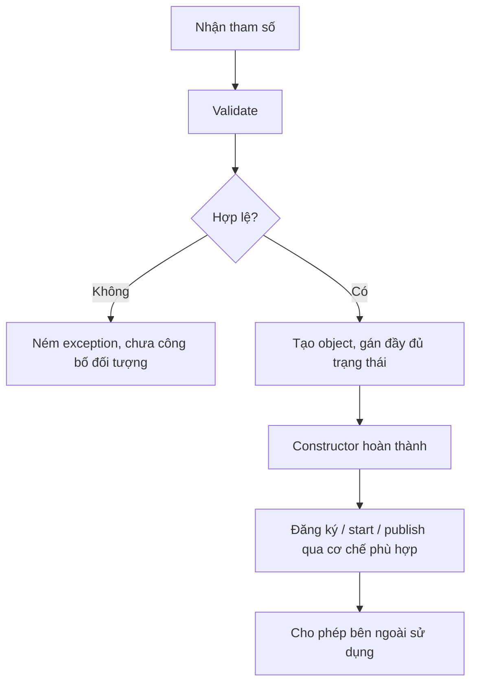

**Không nên hiểu sơ đồ như yêu cầu mọi lớp đều phải có factory hoặc đăng ký sự kiện.** Đối với lớp dữ liệu đơn giản, chỉ cần constructor thiết lập đầy đủ trạng thái là đủ; bước publish chỉ xuất hiện khi thực sự có tương tác bên ngoài hoặc nhiều thread.

## 12. Bài tập tự kiểm tra

### Bài 1 — Dự đoán đầu ra

```java
class Base {
    Base() {
        describe();
    }

    void describe() {
        System.out.println("Base");
    }
}

class Child extends Base {
    private int count = 7;

    @Override
    void describe() {
        System.out.println(count);
    }
}

// new Child();
```

**Đáp án: `0`.** `describe()` dispatch tới override của `Child` trong constructor `Base`, khi `count` mới nhận giá trị mặc định `0`; field initializer `count = 7` sẽ chạy sau đó.

### Bài 2 — Vì sao final vẫn chưa đủ?

```java
class Store {
    static Store published;
    final String code;

    Store() {
        published = this;  // This escape
        code = "READY";
    }
}
```

**Câu hỏi:** Có thể dựa vào `final` để khẳng định mọi mã thấy `published` sẽ luôn quan sát trạng thái hoàn tất không?

**Đáp án: Không.** `this` đã bị công bố trong khi constructor chưa hoàn tất. Nếu có mã khác đọc và sử dụng sớm, nó có thể quan sát trạng thái chưa gán. Ngoài ra field `published` cũng không có đồng bộ phù hợp cho chia sẻ giữa thread. Cách làm đúng là tạo xong, rồi công bố qua cơ chế thích hợp.

### Bài 3 — Refactor thành factory

Cho lớp:

```java
class ChatConsumer {
    private final String channel;

    ChatConsumer(EventBus bus, String channel) {
        bus.subscribe(this::onMessage); // Rủi ro this escape
        this.channel = channel;
    }

    void onMessage(String message) {
        System.out.println(channel + ": " + message);
    }
}
```

Hãy sửa thành:

- Constructor `private` nhận `channel`, kiểm tra và gán field.
- Phương thức `public static ChatConsumer createAndSubscribe(EventBus bus, String channel)` tạo xong đối tượng rồi gọi `bus.subscribe(consumer::onMessage)`.
- Nếu `subscribe` có thể lỗi hoặc registry yêu cầu hủy đăng ký, bổ sung cơ chế cleanup phù hợp; khi nhiều thread phát sự kiện, `EventBus` cần quy tắc đồng bộ rõ ràng.

### Bài 4 — Nhận diện hành vi nguy hiểm

Đánh dấu những hành động cần xem xét khi xuất hiện **trong constructor**:

| Hành động | Đánh giá |
|---|---|
| Gán `this.id = validatedId` | Thông thường an toàn |
| Gọi `private static String normalize(String)` | Thông thường an toàn nếu không lộ `this` |
| `eventBus.register(this)` | Rủi ro this escape |
| `executor.submit(this::process)` | Rủi ro this escape |
| Gọi `public void initialize()` có thể bị subclass override | Rủi ro dùng dữ liệu subclass chưa khởi tạo |
| Sau khi factory tạo xong, gọi `register(instance)` | An toàn hơn về thời điểm; vẫn xét đồng bộ/lỗi đăng ký |

---

## Ghi nhớ

Một đối tượng có thể đã được cấp phát nhưng **chưa được khởi tạo xong**. Tránh để `this` thoát khỏi constructor qua listener, registry, callback, thread hay tác vụ bất đồng bộ; tránh gọi phương thức có thể override trong constructor vì lớp con có thể chưa sẵn sàng. Khi cần đăng ký hoặc khởi chạy, hãy **khởi tạo hoàn chỉnh trước**, sau đó mới kích hoạt hoặc công bố đối tượng qua cơ chế phù hợp. Đối với nhiều thread, phân biệt rõ *tránh dùng sớm* với *safe publication*: xử lý tốt cả hai mới giảm được lỗi vòng đời khó tái hiện.


</details>

- [Quay lại đầu trang](#back-to-top)
