<a id="back-to-top"></a>

# Đóng gói

## Menu
- [Ẩn thông tin và ranh giới của đối tượng](#encapsulation-001)
- [Điều kiện bất biến của đối tượng](#encapsulation-002)
- [Kiểm soát truy cập và thay đổi trạng thái](#encapsulation-003)
- [Getter, setter và phương thức thể hiện ý định](#encapsulation-004)
- [Kiểm tra đầu vào tại ranh giới đối tượng](#encapsulation-005)
- [Ngăn lộ dữ liệu nội bộ có thể thay đổi](#encapsulation-006)
- [Sao chép phòng vệ và biểu diễn bất biến](#encapsulation-007)
- [Đóng gói hành vi thay vì chỉ bao bọc dữ liệu](#encapsulation-008)
- [Ví dụ bảo vệ số dư và trạng thái đơn hàng](#encapsulation-009)

## <a id="encapsulation-001">Ẩn thông tin và ranh giới của đối tượng</a>

<details>
<summary>Xem chi tiết</summary>

# Ẩn thông tin và ranh giới của đối tượng trong Java OOP

## 1. Tại sao đối tượng cần có ranh giới?

Khi thiết kế một đối tượng, ta không chỉ quyết định **nó lưu những dữ liệu gì** mà còn phải quyết định **mã bên ngoài được phép biết và làm những gì** với dữ liệu đó.

Ví dụ, một giỏ hàng có các dòng sản phẩm, đơn giá và số lượng. Nếu mã bên ngoài có thể sửa trực tiếp danh sách, đặt số lượng âm hay thay đơn giá không qua kiểm tra, đối tượng giỏ hàng sẽ không còn tự bảo vệ được quy tắc của mình. Lỗi có thể xuất hiện ở bất kỳ nơi nào sử dụng giỏ hàng.

**Ẩn thông tin (information hiding)** là nguyên tắc chỉ công khai những gì người sử dụng lớp cần biết, đồng thời giấu các quyết định triển khai mà họ không cần phụ thuộc vào. **Ranh giới đối tượng (object boundary)** là tập những thao tác và dữ liệu được phép đi qua giao diện của đối tượng, cùng các quy tắc kiểm soát sự tương tác ấy.

Hãy hình dung:

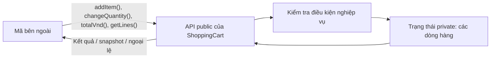

Mã bên ngoài yêu cầu **thêm hàng** hoặc **đổi số lượng**; nó không cần biết lớp sử dụng `ArrayList`, `LinkedHashMap` hay một cơ chế lưu trữ khác. Đối tượng giữ quyền quyết định khi nào trạng thái hợp lệ để thay đổi.

Đây là trọng tâm của **encapsulation (đóng gói)** trong OOP: đưa trạng thái và hành vi liên quan vào cùng lớp, kiểm soát truy cập và bảo vệ các điều kiện luôn đúng của đối tượng.

## 2. Phân biệt ẩn thông tin, đóng gói và phạm vi truy cập

Ba khái niệm này liên quan nhưng không đồng nghĩa hoàn toàn:

| Khái niệm | Câu hỏi nó giải quyết | Ví dụ |
| --- | --- | --- |
| **Đóng gói (encapsulation)** | Trạng thái và hành vi nào thuộc về cùng một đối tượng? | Giỏ hàng tự chứa danh sách mặt hàng và phương thức thêm/đổi số lượng |
| **Ẩn thông tin (information hiding)** | Chi tiết nào người sử dụng lớp không cần biết? | Không lộ loại collection, cách tra cứu và cách tính trung gian |
| **Kiểm soát truy cập (access control)** | Mã ở đâu được phép truy cập thành phần nào? | `private` cho field, `public` cho API, package-private cho thành phần nội bộ package |

`private` là công cụ quan trọng, nhưng **chỉ đặt field thành `private` chưa đủ để ẩn thông tin tốt**. Nếu getter trả thẳng một danh sách có thể sửa và caller thay đổi danh sách đó, trạng thái vẫn bị lộ qua tham chiếu.

### Các mức truy cập trong Java

| Modifier | Lớp khai báo | Cùng package | Lớp con ở package khác | Mã bất kỳ ở package khác |
| --- | --- | --- | --- | --- |
| `private` | Có | Không | Không | Không |
| Không ghi (package-private) | Có | Có | Không | Không |
| `protected` | Có | Có | Có, theo quy tắc truy cập của Java dành cho kế thừa | Không |
| `public` | Có | Có | Có | Có |

Bảng mô tả quyền truy cập tới **thành phần của lớp**, giả sử bản thân lớp bao ngoài có thể được truy cập. Với `protected`, lớp con ở package khác không được truy cập tùy ý thông qua một tham chiếu bất kỳ của lớp cha; Java có quy tắc chặt chẽ hơn ở trường hợp đó.

Thông thường:
- Field chứa trạng thái nội bộ được để `private`.
- Những thao tác dành cho người dùng lớp được mở `public`.
- Logic trợ giúp không cần công khai thì để `private`.
- `protected` và package-private chỉ dùng khi có nhu cầu mở rộng hoặc cộng tác trong package rõ ràng.

Ẩn thông tin **không phải** cơ chế bảo mật để ngăn người có quyền chạy mã tùy ý hoặc sử dụng reflection. Nó là công cụ thiết kế API và giới hạn sự phụ thuộc giữa các phần mềm. Xác thực, phân quyền, bảo vệ dữ liệu nhạy cảm vẫn cần cơ chế riêng.

## 3. Thiết kế sai: đối tượng để bên ngoài tùy ý sửa

Ví dụ sau minh họa một mô hình dễ hỏng:

```java
import java.util.ArrayList;
import java.util.List;

class BadCart {
    public List<String> productCodes = new ArrayList<>();
    public int itemCount;
}

BadCart cart = new BadCart();
cart.productCodes.add("KB01");
cart.itemCount = -100;                 // Dữ liệu không hợp lệ
cart.productCodes.clear();            // Xóa hàng mà không qua quy tắc
```

Vấn đề không chỉ là `public`. Nếu đổi sang field `private` nhưng vẫn cung cấp getter trả trực tiếp `List` mutable, caller vẫn có thể thay đổi:

```java
class LeakyCart {
    private final List<String> productCodes = new ArrayList<>();

    public List<String> getProductCodes() {
        return productCodes; // Làm lộ tham chiếu tới danh sách nội bộ
    }
}

// Mã bên ngoài:
LeakyCart cart = new LeakyCart();
cart.getProductCodes().add("KB01"); // Bỏ qua nghiệp vụ thêm sản phẩm
```

Ranh giới bị phá vỡ vì caller có quyền ghi vào đối tượng mà lớp đang sở hữu, dù field đã được khai báo `private`.

Một cách thiết kế tốt hơn là hỏi: *“Người dùng lớp thực sự muốn thực hiện thao tác gì?”* Với giỏ hàng, câu trả lời là **thêm một mặt hàng hợp lệ**, **đổi số lượng hợp lệ**, **xem danh sách hàng** và **xem tổng tiền**, chứ không phải “lấy collection nội bộ để tùy ý sửa”.

## 4. Ví dụ hoàn chỉnh: đối tượng ShoppingCart tự bảo vệ trạng thái

Các quy tắc thiết kế:

1. Mỗi mã sản phẩm `sku` chỉ xuất hiện một lần trong giỏ.
2. `sku` không rỗng; đơn giá tính bằng VND không âm; số lượng là số nguyên dương.
3. Tổng giá trị giỏ luôn nằm trong giới hạn biểu diễn của `long`.
4. Mã bên ngoài chỉ thay đổi giỏ qua phương thức công khai có kiểm tra.
5. Khi một thao tác bị từ chối, dữ liệu hiện có phải giữ nguyên.
6. Getter trả dữ liệu chỉ đọc ở dạng snapshot, không làm lộ collection có thể sửa.

Tạo file **`ShoppingCart.java`** (Java 11 trở lên):

```java
import java.util.ArrayList;
import java.util.LinkedHashMap;
import java.util.List;
import java.util.Map;
import java.util.Objects;

public final class ShoppingCart {
    // Quyết định lưu trữ là chi tiết nội bộ.
    private final Map<String, CartLine> lines = new LinkedHashMap<>();

    public void addItem(String sku, long unitPriceVnd, int quantity) {
        String normalizedSku = normalizeSku(sku);

        if (lines.containsKey(normalizedSku)) {
            throw new IllegalArgumentException("Sản phẩm đã có trong giỏ");
        }

        // Constructor của CartLine tự kiểm tra giá và số lượng.
        CartLine candidate = new CartLine(
                normalizedSku, unitPriceVnd, quantity);

        // Kiểm tra tràn trước khi thay đổi giỏ hàng.
        Math.addExact(totalVnd(), candidate.subtotalVnd());
        lines.put(normalizedSku, candidate);
    }

    public void changeQuantity(String sku, int newQuantity) {
        String normalizedSku = normalizeSku(sku);
        CartLine current = lines.get(normalizedSku);

        if (current == null) {
            throw new IllegalArgumentException("Không tìm thấy sản phẩm");
        }

        CartLine replacement = new CartLine(
                current.sku, current.unitPriceVnd, newQuantity);

        // Mọi phép tính/kiểm tra diễn ra trước khi thay đổi trạng thái.
        long withoutCurrent = Math.subtractExact(
                totalVnd(), current.subtotalVnd());
        Math.addExact(withoutCurrent, replacement.subtotalVnd());

        lines.put(normalizedSku, replacement);
    }

    public long totalVnd() {
        long total = 0L;
        for (CartLine line : lines.values()) {
            total = Math.addExact(total, line.subtotalVnd());
        }
        return total;
    }

    public List<CartLine> getLines() {
        // Snapshot cấu trúc; CartLine cũng bất biến.
        return List.copyOf(lines.values());
    }

    private static String normalizeSku(String sku) {
        Objects.requireNonNull(sku, "sku");
        String result = sku.strip();
        if (result.isBlank()) {
            throw new IllegalArgumentException("Mã sản phẩm không được rỗng");
        }
        return result;
    }

    // Kiểu công khai dùng để đọc một dòng hàng; không có setter.
    public static final class CartLine {
        private final String sku;
        private final long unitPriceVnd;
        private final int quantity;

        private CartLine(String sku, long unitPriceVnd, int quantity) {
            if (unitPriceVnd < 0) {
                throw new IllegalArgumentException("Đơn giá không được âm");
            }
            if (quantity <= 0) {
                throw new IllegalArgumentException("Số lượng phải dương");
            }
            this.sku = sku;
            this.unitPriceVnd = unitPriceVnd;
            this.quantity = quantity;

            // Không chấp nhận dòng hàng có thành tiền tràn long.
            Math.multiplyExact(unitPriceVnd, (long) quantity);
        }

        public String getSku() {
            return sku;
        }

        public long getUnitPriceVnd() {
            return unitPriceVnd;
        }

        public int getQuantity() {
            return quantity;
        }

        public long subtotalVnd() {
            return Math.multiplyExact(unitPriceVnd, (long) quantity);
        }
    }
}
```

### Vì sao thiết kế này giữ được ranh giới?

**Field `lines` là `private`:** caller không cần biết giỏ sử dụng `Map`. Lựa chọn `LinkedHashMap` giúp quản lý sản phẩm theo mã và giữ thứ tự thêm vào khi lấy danh sách. Đây là chi tiết triển khai; nếu tài liệu API cam kết thứ tự thì thứ tự cũng trở thành một phần của hợp đồng cần duy trì.

**`addItem()` và `changeQuantity()` thay cho setter tùy ý:** thao tác nào làm biến đổi giỏ đều có ngữ nghĩa rõ ràng. Caller không thể chèn trực tiếp `null` hay số lượng âm vào collection nội bộ.

**Kiểm tra trước, cập nhật sau:** `Math.multiplyExact` và `Math.addExact` phát hiện phép tính tràn số. Trong các thao tác ở trên, tất cả kiểm tra có thể thất bại đều được thực hiện trước lệnh `put`, nên những lỗi kiểm tra thông thường không để lại giỏ ở trạng thái cập nhật dở.

**`CartLine` là kiểu dữ liệu đọc bất biến:** các field của một dòng hàng có `private final`, toàn bộ là `String` bất biến hoặc kiểu nguyên thủy, constructor được kiểm soát, không có setter. Thay vì sửa `quantity` trong một `CartLine` cũ, `changeQuantity()` tạo một dòng mới rồi thay thế sau khi kiểm tra.

**Getter trả snapshot:** `List.copyOf(lines.values())` trả một danh sách không cho thêm/xóa/thay thế phần tử qua tham chiếu trả về, và danh sách đó giữ nội dung ở thời điểm gọi. Các `CartLine` cũng bất biến nên không thể sửa gián tiếp các field của giỏ qua phần tử. Nếu phần tử là đối tượng mutable, riêng `List.copyOf` sẽ không tạo deep copy.

**`private static normalizeSku()`:** đây là bước xử lý nội bộ, không nằm trong API công khai. Phương thức không cần trạng thái của một giỏ cụ thể nên sử dụng `static`.

### Chạy thử hành vi

Tạo file **`Main.java`**:

```java
import java.util.List;

public class Main {
    public static void main(String[] args) {
        ShoppingCart cart = new ShoppingCart();

        cart.addItem("KB-01", 250_000, 2);
        cart.addItem("MS-01", 100_000, 1);
        System.out.println(cart.totalVnd()); // 600000

        List<ShoppingCart.CartLine> before = cart.getLines();
        cart.changeQuantity("KB-01", 3);

        System.out.println(cart.totalVnd()); // 850000
        System.out.println(before.get(0).getQuantity()); // 2
        System.out.println(cart.getLines().get(0).getQuantity()); // 3

        try {
            cart.changeQuantity("KB-01", -5);
        } catch (IllegalArgumentException ex) {
            System.out.println("Từ chối: " + ex.getMessage());
        }
        System.out.println(cart.totalVnd()); // Vẫn 850000

        try {
            before.clear();
        } catch (UnsupportedOperationException ex) {
            System.out.println("Snapshot không cho phép sửa");
        }
    }
}
```

Chạy từ thư mục chứa hai file:

```bash
javac ShoppingCart.java Main.java
java Main
```

Kết quả:

```text
600000
850000
2
3
Từ chối: Số lượng phải dương
850000
Snapshot không cho phép sửa
```

Chú ý hai đối tượng `CartLine` trước và sau khi đổi số lượng là **hai instance khác nhau**. Biến `before` vẫn thấy số lượng `2`, trong khi giỏ hiện tại trả số lượng `3`. Snapshot cũ ổn định, không cho caller tự sửa trạng thái của giỏ.

Lưu ý kỹ thuật: mã minh họa cách bảo vệ bất biến **trong chương trình đơn luồng**. Giỏ hàng này chưa được thiết kế cho nhiều luồng đồng thời sửa; `LinkedHashMap` và chuỗi thao tác kiểm tra/cập nhật không tự an toàn khi có race condition.

## 5. Ranh giới được quyết định bằng hợp đồng public

Một lớp tốt công khai **hành vi hữu ích và ổn định**, không bắt mã bên ngoài phụ thuộc vào chi tiết nội bộ.

Xét sự khác biệt:

| API làm lộ triển khai | API che giấu triển khai |
| --- | --- |
| `getInternalMap().put(sku, line)` | `addItem(sku, price, quantity)` |
| `setTotalVnd(value)` | `totalVnd()` tính kết quả từ các dòng hàng |
| `getMutableLines().clear()` | Cung cấp `removeItem(sku)` nếu nghiệp vụ cần |
| Caller tự kiểm tra giá/số lượng | Lớp tự kiểm tra tại mọi lối vào có thể thay đổi trạng thái |
| Caller biết `LinkedHashMap` hay chỉ số phần tử | Caller biết mã sản phẩm và tác vụ nghiệp vụ |

Việc công khai từng getter/setter cho mọi field thường biến lớp thành “túi dữ liệu” với quy tắc bị phân tán ra ngoài. Không phải mọi setter đều sai: setter hợp lý khi chính nó thể hiện quyền thay đổi hợp lệ, có kiểm tra rõ ràng và không làm rò rỉ trạng thái. Ví dụ `changeDisplayName(String name)` có thể phù hợp hơn setter tổng quát cho cả đối tượng cấu hình.

### Bất biến: điều kiện nào phải luôn đúng?

Trong `ShoppingCart`:

- Không có dòng hàng với `quantity <= 0`.
- Không có dòng hàng với `unitPriceVnd < 0`.
- Các mã hàng trong giỏ không trùng nhau.
- Tổng tiền có thể được biểu diễn bằng kiểu `long`.
- Mã ngoài lớp không thể thêm dòng hàng mà bỏ qua kiểm tra.

Bất biến được thiết lập trong constructor hoặc thao tác tạo dòng hàng, sau đó được giữ trong mọi phương thức thay đổi trạng thái. Một phương thức mới trong tương lai, chẳng hạn `applyDiscount()` hoặc `removeItem()`, cũng phải tuân theo cùng các quy tắc liên quan.

Điều này quan trọng vì **một đối tượng có thể bị gọi từ nhiều nơi**: controller, service, test hoặc thành phần khác. Nếu quy tắc chỉ tồn tại ở controller, caller khác có thể bỏ qua. Lớp nên giữ các quy tắc cốt lõi của chính trạng thái mà nó sở hữu.

## 6. Ba con đường rò rỉ tham chiếu cần nhận diện

Một field `private final` chỉ che tên field và ngăn gán lại tham chiếu, chứ không khóa đối tượng mutable bên dưới. Khi xem API, hãy lần theo **quyền sở hữu tham chiếu** ở cả hai chiều:

| Đường rò rỉ | Hành vi caller có thể thực hiện | Hướng bảo vệ |
| --- | --- | --- |
| Getter trả `List`/mảng nội bộ | `getItems().clear()` đi vòng qua `removeItem()` | Snapshot, bản sao hoặc API truy vấn hẹp |
| Constructor giữ collection do caller đưa | Caller giữ biến `input` rồi sửa sau khi khởi tạo | Sao chép lúc nhận nếu lớp cần quyền sở hữu độc lập |
| List chỉ đọc nhưng chứa phần tử mutable | `getItems().get(0).setPrice(...)` | Bất biến hóa phần tử hoặc tạo snapshot giá trị |

Ví dụ `List.copyOf(items)` không cho sửa cấu trúc list qua kết quả, nhưng **không sao chép sâu** phần tử. Còn `Collections.unmodifiableList(items)` chỉ là view, vẫn phản ánh thay đổi của list gốc. Vì vậy cần quyết định caller được quan sát *ảnh chụp tại thời điểm gọi* hay *dữ liệu đang sống*, và phần tử bên trong có an toàn để chia sẻ không.

Đối với `ShoppingCart`, các dòng hàng là `CartLine` bất biến nên `getLines()` có thể trả snapshot mà không làm lộ đường sửa giỏ. Với mảng, `Date` hoặc đồ thị đối tượng mutable, cần chiến lược sao chép phù hợp tại từng ranh giới.

## 7. Ranh giới đối tượng cũng là ranh giới trách nhiệm

Ẩn thông tin không có nghĩa dồn mọi việc vào một lớp.

Một `ShoppingCart` nên giữ các quy tắc cục bộ như số lượng dương, mã sản phẩm không trùng, và cách tính tổng từ các dòng hàng. Nhưng nó không nhất thiết nên tự thực hiện các công việc:

- Đọc giá mới nhất từ cơ sở dữ liệu hoặc dịch vụ giá.
- Kiểm tra token đăng nhập và quyền của người dùng.
- Gửi email sau khi đặt hàng.
- Gọi cổng thanh toán hoặc kiểm soát giao dịch phân tán.
- Trả JSON hay hiển thị HTML.

Những công việc đó có thể thuộc về service, repository, controller hoặc adapter. Ranh giới tốt là **mỗi thành phần sở hữu đúng dữ liệu và quyết định mà nó có trách nhiệm**, rồi giao tiếp với thành phần khác bằng API rõ ràng.

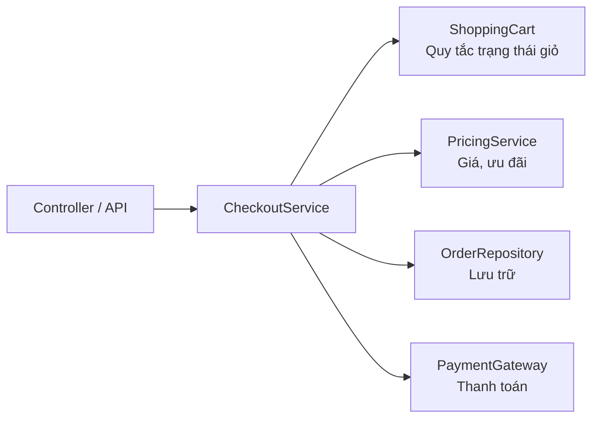

Trong sơ đồ, giỏ hàng không cần biết HTTP request, database hay hệ thống thanh toán được triển khai thế nào. Tương tự, lớp khác không cần biết giỏ hàng dùng `Map`, cách kiểm tra dữ liệu hay tính tổng ra sao. Đây là lợi ích của việc giữ **ranh giới API** rõ ràng ở nhiều cấp độ.

Một điểm cần phân biệt: field `private` vẫn có thể bị các phương thức trong **cùng lớp** thay đổi, kể cả thông qua tham chiếu tới instance khác của cùng lớp. Truy cập theo mức `private` được áp dụng cho mã của lớp khai báo, không được giới hạn riêng từng instance.

## 8. Ranh giới tốt giúp đổi triển khai mà ít ảnh hưởng nơi gọi

Giả sử lúc đầu giỏ lưu dòng hàng bằng `List<CartLine>`, sau này đổi sang `Map<String, CartLine>` để tra cứu theo mã nhanh hơn.

Nếu API bên ngoài chỉ sử dụng:

```java
cart.addItem("KB-01", 250_000, 2);
cart.changeQuantity("KB-01", 3);
long total = cart.totalVnd();
```

thì nhiều thay đổi bên trong sẽ không buộc caller sửa mã. Tuy nhiên, bất cứ hành vi nào đã được công bố trong hợp đồng, như thứ tự dòng hàng, cách xử lý trùng mã hoặc loại ngoại lệ, đều phải được cân nhắc khi thay đổi triển khai.

Điều này thường gọi là **giảm sự phụ thuộc (coupling)** giữa client và chi tiết bên trong lớp. Lợi ích thực tế gồm:
- Dễ thay cấu trúc dữ liệu hoặc thuật toán.
- Dễ kiểm thử vì hành vi quan sát được có đầu vào, đầu ra và ngoại lệ rõ ràng.
- Dễ tìm nguồn lỗi, vì trạng thái được thay đổi tại một số phương thức xác định.
- Khó vô tình phá hỏng bất biến từ mã bên ngoài.

**Ẩn thông tin không đồng nghĩa giấu hết mọi thứ.** Nếu không công khai hành vi nào có ích, lớp cũng khó sử dụng. Điểm cân bằng là API đủ biểu đạt nhu cầu nghiệp vụ, còn các quyết định triển khai không cần thiết được giữ riêng.

## 9. Các sai lầm khi thiết kế ranh giới

| Sai lầm | Vì sao có vấn đề | Hướng sửa |
| --- | --- | --- |
| Cho field trạng thái thành `public` | Caller thay đổi mà không qua kiểm tra | `private`, cung cấp hành vi có kiểm soát |
| Thêm getter/setter cho toàn bộ field theo thói quen | Caller bị buộc biết cấu trúc nội bộ | Chỉ công khai dữ liệu và thao tác thực sự cần |
| Getter trả danh sách mutable nội bộ | Caller có thể bỏ qua quy tắc cập nhật | Snapshot, immutable view hoặc copy phù hợp |
| Dùng `final List<T>` rồi coi cả list bất biến | `final` chỉ cố định tham chiếu | Xác định tính mutable của collection và phần tử |
| Constructor nhận list rồi giữ nguyên tham chiếu | Caller tiếp tục có thể thay đổi dữ liệu | Copy khi nhận nếu cần sở hữu độc lập |
| Kiểm tra điều kiện sau khi đã ghi field | Ngoại lệ có thể để lại trạng thái không hợp lệ | Validate/compute trước, mutate sau |
| Đưa truy vấn DB và HTTP vào domain object | Trộn nhiều trách nhiệm và tăng coupling | Tách service/repository/adapter |
| Coi `private` là bảo mật dữ liệu | Access modifier không thay xác thực/phân quyền | Áp dụng bảo mật ở biên hệ thống và các lớp phù hợp |
| Cho rằng lớp tốt mặc nhiên thread-safe | Ẩn dữ liệu không tạo sự đồng bộ | Thiết kế concurrency riêng khi có chia sẻ đa luồng |

## 10. Tự luyện và kiểm tra

### Câu 1: vì sao getter sau đây nguy hiểm?

```java
public List<CartLine> getLines() {
    return internalLines;
}
```

**Gợi ý:** Nếu `internalLines` là một `ArrayList` mutable do lớp sở hữu, caller có thể `clear()` hoặc `add()` vào danh sách mà không qua nghiệp vụ. Nếu `CartLine` cũng mutable, chỉ sửa kiểu trả về thành một view không sửa được vẫn chưa đủ để ngăn caller thay đổi phần tử.

### Câu 2: thế nào là ranh giới hợp lý?

Cho một đối tượng tài khoản có field `balance`. Chọn API phù hợp hơn:

```java
// Phương án A
account.setBalance(-500_000);

// Phương án B
account.withdraw(500_000);
```

**Giải thích:** phương án B diễn đạt hành vi rút tiền và là chỗ thích hợp kiểm tra số tiền dương, đủ số dư hoặc các quy tắc khác. Một setter tự do thường không thể hiện mục đích thay đổi trạng thái và có thể phá bất biến.

### Câu 3: phân biệt snapshot và live view

```java
List<String> source = new ArrayList<>();
source.add("A");

List<String> liveView =
        java.util.Collections.unmodifiableList(source);
List<String> snapshot = List.copyOf(source);

source.add("B");

System.out.println(liveView); // ?
System.out.println(snapshot); // ?
```

**Đáp án:** `liveView` in `[A, B]` vì là view phản ánh `source`; `snapshot` in `[A]` vì được tạo tại thời điểm trước khi thêm `"B"`. Cả hai không cho phép thêm phần tử qua chính tham chiếu đó, nhưng **không cùng ngữ nghĩa về khả năng quan sát thay đổi**.

### Câu 4: mở rộng lớp ShoppingCart

Hãy viết `removeItem(String sku)` với các yêu cầu: chuẩn hóa mã theo `normalizeSku`, báo lỗi khi mã không tồn tại và xóa đúng một dòng hàng. Sau đó viết một chương trình kiểm tra:
1. Thêm hai sản phẩm, lưu snapshot từ `getLines()`.
2. Xóa một sản phẩm qua `removeItem`.
3. Kiểm tra số dòng và tổng tiền hiện tại.
4. Kiểm tra snapshot cũ vẫn giữ các dòng hàng tại thời điểm chụp.
5. Thử xóa một mã không tồn tại và kiểm tra giỏ không thay đổi.

Bài tập này buộc bạn suy nghĩ về **đường cập nhật trạng thái hợp lệ**, **API công khai** và **hành vi quan sát được** thay vì sửa trực tiếp collection.

## Các câu hỏi cốt lõi khi thiết kế lớp

Khi đọc một lớp Java, hãy tự hỏi: (1) đối tượng này **sở hữu** trạng thái nào; (2) những điều kiện nào phải luôn đúng; (3) ai có thể thay đổi trạng thái, qua phương thức nào; (4) đầu vào/đầu ra có làm rò rỉ tham chiếu mutable không; và (5) nếu đổi triển khai bên trong, những caller nào buộc phải thay đổi?

Thiết kế ranh giới đúng giúp đối tượng có thể **tự bảo vệ trạng thái**, thể hiện hành vi bằng API rõ ràng và cho phép các thành phần khác cộng tác mà không lệ thuộc vào chi tiết triển khai.


</details>

- [Quay lại đầu trang](#back-to-top)

---

## <a id="encapsulation-002">Điều kiện bất biến của đối tượng</a>

<details>
<summary>Xem chi tiết</summary>

# Điều kiện bất biến của đối tượng trong Java OOP

Trong lập trình hướng đối tượng, một đối tượng có thể thay đổi trạng thái qua nhiều lời gọi phương thức. Tuy nhiên, **không phải mọi tổ hợp giá trị của các thuộc tính đều hợp lệ**. Ví dụ: số lượng hàng đã giữ để giao không thể âm hoặc lớn hơn tổng hàng hiện có. Những quy tắc phải luôn được bảo đảm tại các thời điểm đối tượng có thể được quan sát và sử dụng hợp lệ được gọi là **điều kiện bất biến của đối tượng** (*object invariants*).

Thiết kế lớp tốt không chỉ là khai báo `private` cho field; lớp cần **kiểm soát quá trình hình thành và thay đổi trạng thái** để các điều kiện bất biến luôn được duy trì.

## 1. Điều kiện bất biến là gì?

**Object invariant** là một tập điều kiện logic mô tả trạng thái hợp lệ của **một instance**, phải đúng sau khi khởi tạo thành công và sau mỗi thao tác công khai hoàn thành bình thường. Với các phương thức có thể thất bại, thiết kế vững chắc thường yêu cầu trạng thái vẫn hợp lệ và, khi phù hợp, không thay đổi nếu thao tác bị từ chối.

Ví dụ với sản phẩm trong kho:

- `sku` không được `null` hoặc rỗng.
- `unitPrice` phải lớn hơn 0.
- `onHand` (hàng vật lý còn trong kho) không âm.
- `reserved` (hàng đã giữ cho các đơn đang xử lý) không âm và **không vượt quá** `onHand`.
- `available` (hàng còn có thể đặt) luôn bằng `onHand - reserved`, nên phải không âm.

Diễn đạt toán học:

\[
\text{onHand} \ge 0,\quad 0 \le \text{reserved} \le \text{onHand}
\]

\[
\text{available} = \text{onHand} - \text{reserved} \ge 0
\]

Các điều kiện liên quan giữa **nhiều field** (như `reserved <= onHand`) thường là lý do quan trọng để **không cung cấp setter tùy ý cho từng field**.

### Phân biệt những khái niệm dễ nhầm

| Khái niệm | Câu hỏi nó trả lời | Ví dụ |
| --- | --- | --- |
| **Invariant** | Trạng thái nào của đối tượng là hợp lệ? | `0 <= reserved <= onHand` |
| **Precondition** (tiền điều kiện) | Điều gì phải đúng trước khi gọi thao tác? | `quantity > 0`, đủ hàng còn bán được |
| **Postcondition** (hậu điều kiện) | Sau thao tác thành công, kết quả phải thế nào? | Đặt giữ 2 sản phẩm làm `reserved` tăng 2 |
| **Immutability** (tính không thể thay đổi) | Trạng thái quan sát được có bị thay đổi sau khi tạo không? | `String`, `LocalDate`, value object bất biến |
| **Encapsulation** (đóng gói) | Ai được quyền đọc/sửa và bằng cách nào? | Field `private`, cập nhật qua `reserve()` |

**Invariant không đồng nghĩa với immutable.** Một đối tượng có thể *mutable* nhưng vẫn duy trì invariant qua mọi thao tác hợp lệ. Ngược lại, đối tượng immutable cũng cần được kiểm tra để **trạng thái ban đầu** của nó hợp lệ.

## 2. Vì sao setter độc lập có thể phá vỡ invariant?

Giả sử một lớp cung cấp hai setter:

~~~java
class BadStock {
    private int onHand;
    private int reserved;

    public void setOnHand(int onHand) {
        if (onHand < 0) {
            throw new IllegalArgumentException("Âm");
        }
        this.onHand = onHand;
    }

    public void setReserved(int reserved) {
        if (reserved < 0) {
            throw new IllegalArgumentException("Âm");
        }
        this.reserved = reserved;
    }
}
~~~

Mỗi setter chỉ kiểm tra field của chính mình, nên vẫn cho phép:

~~~java
BadStock stock = new BadStock();
stock.setOnHand(2);
stock.setReserved(5); // Hai giá trị đều không âm, nhưng trạng thái sai!
~~~

Điều kiện `reserved <= onHand` bị phá vỡ. Chỉ thêm kiểm tra cho từng field là **chưa đủ**; những thay đổi có quan hệ phải được điều phối cùng nhau. Nếu kiểm tra `reserved <= onHand` bên trong từng setter, còn cần nghĩ về **thứ tự cập nhật** khi đổi từ một trạng thái hợp lệ sang trạng thái hợp lệ khác, đặc biệt trong chương trình đồng thời.

Hướng thiết kế tốt hơn là thể hiện các **hành vi nghiệp vụ** có ý nghĩa: `reserve`, `release`, `ship` và `restock`. Mỗi hành vi kiểm tra điều kiện phù hợp và cập nhật trạng thái một cách nhất quán.

## 3. Ví dụ Java hoàn chỉnh: đối tượng kho luôn hợp lệ

Ví dụ sau chạy với **Java 11+**. Tạo tệp `InvariantDemo.java`.

~~~java
import java.math.BigDecimal;
import java.util.Objects;

public class InvariantDemo {

    static final class StockItem {
        private final String sku;
        private final BigDecimal unitPrice;
        private int onHand;
        private int reserved;

        public StockItem(String sku, BigDecimal unitPrice,
                         int initialOnHand) {
            String normalizedSku =
                    Objects.requireNonNull(sku, "sku").trim();
            Objects.requireNonNull(unitPrice, "unitPrice");

            if (normalizedSku.isEmpty()) {
                throw new IllegalArgumentException("SKU không được rỗng");
            }
            if (unitPrice.signum() <= 0) {
                throw new IllegalArgumentException("Giá phải lớn hơn 0");
            }
            if (initialOnHand < 0) {
                throw new IllegalArgumentException("Tồn kho không được âm");
            }

            this.sku = normalizedSku;
            this.unitPrice = unitPrice;
            this.onHand = initialOnHand;
            this.reserved = 0;
        }

        public String getSku() {
            return sku;
        }

        public BigDecimal getUnitPrice() {
            return unitPrice;
        }

        public int getOnHand() {
            return onHand;
        }

        public int getReserved() {
            return reserved;
        }

        // Dữ liệu dẫn xuất: không lưu một field available riêng.
        public int getAvailable() {
            return onHand - reserved;
        }

        public void reserve(int quantity) {
            requirePositive(quantity);
            if (quantity > getAvailable()) {
                throw new IllegalStateException("Không đủ hàng để giữ");
            }
            reserved += quantity;
        }

        public void release(int quantity) {
            requirePositive(quantity);
            if (quantity > reserved) {
                throw new IllegalStateException("Không thể trả quá số đã giữ");
            }
            reserved -= quantity;
        }

        public void ship(int quantity) {
            requirePositive(quantity);
            if (quantity > reserved) {
                throw new IllegalStateException("Chưa giữ đủ hàng để giao");
            }
            // Hàng được giao rời kho và hết trạng thái giữ chỗ.
            reserved -= quantity;
            onHand -= quantity;
        }

        public void restock(int quantity) {
            requirePositive(quantity);
            // Nếu overflow, Math.addExact ném ngoại lệ trước khi gán.
            int nextOnHand = Math.addExact(onHand, quantity);
            onHand = nextOnHand;
        }

        public String snapshot() {
            return "onHand=" + onHand
                    + ", reserved=" + reserved
                    + ", available=" + getAvailable();
        }

        private static void requirePositive(int quantity) {
            if (quantity <= 0) {
                throw new IllegalArgumentException("Số lượng phải dương");
            }
        }
    }

    public static void main(String[] args) {
        StockItem item = new StockItem(
                "BOOK-01", new BigDecimal("120000"), 10
        );

        System.out.println("Ban đầu: " + item.snapshot());

        item.reserve(4);
        System.out.println("Giữ 4: " + item.snapshot());

        try {
            item.reserve(7); // Còn bán được 6, thao tác thất bại.
        } catch (IllegalStateException ex) {
            System.out.println("Từ chối: " + ex.getMessage());
        }
        System.out.println("Sau lỗi: " + item.snapshot());

        item.ship(3);
        System.out.println("Giao 3: " + item.snapshot());

        item.release(1);
        System.out.println("Hủy giữ 1: " + item.snapshot());

        item.restock(5);
        System.out.println("Nhập 5: " + item.snapshot());
    }
}
~~~

Chạy:

~~~bash
javac InvariantDemo.java
java InvariantDemo
~~~

Kết quả:

~~~text
Ban đầu: onHand=10, reserved=0, available=10
Giữ 4: onHand=10, reserved=4, available=6
Từ chối: Không đủ hàng để giữ
Sau lỗi: onHand=10, reserved=4, available=6
Giao 3: onHand=7, reserved=1, available=6
Hủy giữ 1: onHand=7, reserved=0, available=7
Nhập 5: onHand=12, reserved=0, available=12
~~~

### Tại sao từng phương thức giữ được invariant?

| Hành vi | Điều kiện trước khi thay đổi | Công thức cập nhật | Vì sao vẫn hợp lệ? |
| --- | --- | --- | --- |
| Tạo đối tượng | `sku` hợp lệ, giá dương, hàng đầu kỳ ≥ 0 | `reserved = 0` | `0 <= 0 <= onHand` |
| `reserve(q)` | `q > 0` và `q <= onHand - reserved` | `reserved += q` | Giá trị mới của `reserved` không vượt `onHand` |
| `release(q)` | `q > 0` và `q <= reserved` | `reserved -= q` | `reserved` mới không âm |
| `ship(q)` | `q > 0` và `q <= reserved` | `reserved -= q; onHand -= q` | Cả hai giảm cùng lượng, `onHand` vẫn ≥ `reserved` |
| `restock(q)` | `q > 0` và tổng không tràn số nguyên | `onHand += q` | Chỉ tăng tổng hàng, không giảm số còn bán được |

Mỗi phép cập nhật đều **xuất phát từ một trạng thái hợp lệ**. Nếu `reserve(7)` bị từ chối khi còn 6 hàng có thể đặt, phương thức ném ngoại lệ **trước bất kỳ thay đổi nào** nên trạng thái cũ được giữ nguyên.

Đặc biệt, `Math.addExact` giúp tránh overflow khi thêm hàng vào `int`. Nếu cộng vượt `Integer.MAX_VALUE`, một phép cộng `int` thông thường có thể cho kết quả âm; `addExact` ném `ArithmeticException` trước khi field bị cập nhật. Đây cũng là bảo vệ invariant.

## 4. Nhìn invariant dưới dạng luồng kiểm tra

Đối với thao tác `reserve(q)`:

~~~mermaid
flowchart TD
    A["Gọi reserve(q)"] --> B{"q > 0?"}
    B -->|Không| E["IllegalArgumentException\nKhông đổi trạng thái"]
    B -->|Có| C{"q <= available?"}
    C -->|Không| F["IllegalStateException\nKhông đổi trạng thái"]
    C -->|Có| D["reserved = reserved + q"]
    D --> G["Trạng thái hợp lệ\n0 <= reserved <= onHand"]
~~~

Luồng lý tưởng là **kiểm tra → tính kết quả → cập nhật**. Khi một phương thức phải thay đổi nhiều field, hãy tránh để ngoại lệ có thể xảy ra *giữa các phép cập nhật* khiến đối tượng tồn tại ở trạng thái dở dang.

Ví dụ với phép chuyển số tiền giữa hai ví, không nên trừ ví A trước rồi mới kiểm tra có thể cộng vào ví B hay không. Với xử lý đơn luồng trong bộ nhớ, có thể **kiểm tra cả hai điều kiện**, tính trước số dư mới, rồi mới gán. Với cập nhật qua database, nhiều service hoặc xử lý đồng thời, cần transaction/locking hoặc cơ chế phù hợp để bảo đảm cập nhật nhóm.

## 5. Invariant, constructor và vòng đời đối tượng

Một invariant không tự nhiên đúng chỉ vì các field được khai báo `private`. Lớp phải chủ động thiết lập nó khi khởi tạo.

~~~java
public final class TemperatureRange {
    private final int min;
    private final int max;

    public TemperatureRange(int min, int max) {
        if (min > max) {
            throw new IllegalArgumentException("min phải <= max");
        }
        this.min = min;
        this.max = max;
    }

    public int getMin() { return min; }
    public int getMax() { return max; }
}
~~~

Ở đây invariant là `min <= max`. Constructor kiểm tra trước khi cung cấp một đối tượng được khởi tạo thành công. Việc hai field đều `final` **không tự động kiểm chứng** mối quan hệ giữa chúng.

Nếu constructor nhận những collection hay đối tượng mutable, nó cũng phải tránh để bên ngoài thay đổi “lén” trạng thái sau khi xây dựng.

~~~java
import java.util.List;
import java.util.Objects;

public final class StudyPlan {
    private final List<String> topics;

    public StudyPlan(List<String> topics) {
        Objects.requireNonNull(topics, "topics");
        if (topics.isEmpty()) {
            throw new IllegalArgumentException("Phải có ít nhất một chủ đề");
        }
        for (String topic : topics) {
            if (topic == null || topic.isBlank()) {
                throw new IllegalArgumentException("Chủ đề không hợp lệ");
            }
        }
        this.topics = List.copyOf(topics);
    }

    public List<String> getTopics() {
        return topics;
    }
}
~~~

~~~java
import java.util.ArrayList;
import java.util.List;

List<String> external = new ArrayList<>(List.of("OOP"));
StudyPlan plan = new StudyPlan(external);

external.clear();                    // Không làm rỗng plan
System.out.println(plan.getTopics()); // [OOP]

// Ném UnsupportedOperationException:
plan.getTopics().clear();
~~~

Invariant của `StudyPlan`: danh sách chủ đề không rỗng và mỗi phần tử là chuỗi hợp lệ. `List.copyOf` tạo danh sách không thể sửa, tách khỏi những thay đổi sau đó của collection nguồn. Vì các phần tử là `String` bất biến, đây là lựa chọn an toàn cho ví dụ. Với danh sách chứa **phần tử mutable**, `List.copyOf` chỉ sao chép **tham chiếu đến phần tử**, không bảo vệ toàn bộ object graph; cần bản sao sâu phù hợp hoặc các value object bất biến.

**Tránh làm lộ `this` trong constructor**, ví dụ đăng ký đối tượng đang xây dựng vào một listener toàn cục trước khi mọi field/invariant được thiết lập. Thành phần khác có thể quan sát instance chưa hoàn tất, đặc biệt trong chương trình nhiều luồng.

## 6. Khi đối tượng thay đổi, điều kiện vẫn phải đúng

Trở lại `StockItem`, xét hai trạng thái:

- Trước `reserve(4)`: `onHand=10`, `reserved=0`, `available=10`.
- Sau `reserve(4)`: `onHand=10`, `reserved=4`, `available=6`.

**Cả hai trạng thái đều hợp lệ.** Đây là điểm phân biệt rõ với immutable object: giá trị của field thay đổi nhưng invariant được bảo toàn.

Một setter đặt số hàng đã giữ một cách tùy ý sẽ phá vỡ ranh giới này. Thay vì:

~~~java
// Thiết kế dễ bị dùng sai:
public void setReserved(int newReserved) {
    reserved = newReserved;
}
~~~

hãy cho phép thao tác theo ý nghĩa của miền nghiệp vụ:

~~~java
item.reserve(4);
item.release(1);
item.ship(3);
~~~

Một API có ý nghĩa thường khiến **trạng thái không hợp lệ khó biểu diễn và khó đạt tới hơn**. Cách đặt tên phương thức cũng giúp đọc code rõ hơn: “giao 3 đơn vị đã giữ” chính xác hơn “đặt reserved thành 1 và onHand thành 7”.

### Có nên gọi `checkInvariant()` sau mọi phương thức?

Có thể dùng một hàm nội bộ để phát hiện sai sót trong quá trình phát triển:

~~~java
private void checkInvariant() {
    if (onHand < 0 || reserved < 0 || reserved > onHand) {
        throw new IllegalStateException("Vi phạm invariant của kho");
    }
}
~~~

Nhưng hàm kiểm tra **không thay thế** thiết kế đúng. Nếu code đã ghi một phần trạng thái sai rồi mới ném ngoại lệ, kiểm tra ở cuối phương thức sẽ phát hiện vi phạm nhưng **không tự khôi phục** dữ liệu. Ưu tiên kiểm tra điều kiện và tính giá trị mới **trước khi ghi**.

Lệnh `assert` của Java cũng không nên là cơ chế duy nhất xác thực dữ liệu nghiệp vụ: các assertion thường bị tắt nếu chương trình không chạy với tùy chọn `-ea`. Dữ liệu đầu vào sai nên bị từ chối qua logic kiểm tra rõ ràng, thường với `IllegalArgumentException` hoặc ngoại lệ miền nghiệp vụ phù hợp.

## 7. Ngoại lệ, thay đổi từng phần và tính nguyên tử

Một phương thức tốt thường hướng tới nguyên tắc: **thành công thì chuyển sang trạng thái hợp lệ mới; thất bại thì đối tượng vẫn hợp lệ**. Đối với nhiều thao tác, ta còn mong **thất bại không làm thay đổi trạng thái** (*strong exception guarantee*), nhưng không phải API nào cũng bảo đảm mức này.

Ví dụ sai:

~~~java
public void unsafeReserve(int quantity) {
    reserved += quantity; // Đã thay đổi!
    if (reserved > onHand) {
        throw new IllegalStateException("Không đủ hàng");
    }
}
~~~

Nếu ban đầu `onHand=10, reserved=4`, gọi `unsafeReserve(7)` khiến `reserved=11`, rồi ném ngoại lệ; invariant đã bị phá vỡ.

Cách đúng:

~~~java
public void safeReserve(int quantity) {
    if (quantity <= 0) {
        throw new IllegalArgumentException("Số lượng phải dương");
    }
    if (quantity > onHand - reserved) {
        throw new IllegalStateException("Không đủ hàng");
    }
    reserved += quantity;
}
~~~

Tại thời điểm từ chối, chưa field nào bị sửa. Điều này rất quan trọng với service có nhiều bước, bởi **ném exception không tự động hoàn tác những phép gán Java đã thực hiện**.

Cần phân biệt ba phạm vi:

| Phạm vi | Biện pháp thường dùng | Điều cần nhớ |
| --- | --- | --- |
| Một đối tượng trong một luồng | Guard condition, tính trước, gán hợp lệ | Có thể chứng minh invariant theo từng phương thức |
| Nhiều luồng cùng dùng một đối tượng | Khóa/synchronization, cấu trúc dữ liệu đồng thời hoặc mô hình immutable | Kiểm tra và cập nhật phải được phối hợp như một thao tác |
| Nhiều bảng/bản ghi hoặc hệ thống | Transaction, constraint, versioning/locking, idempotency, xử lý bù trừ | Kiểm tra riêng trong Java không đủ bảo đảm trạng thái dữ liệu chung |

## 8. Invariant và vấn đề đồng thời

Đoạn `StockItem` chính phía trên cố ý minh họa logic OOP trong **môi trường đơn luồng**. Nếu nhiều thread cùng gọi `reserve`, chúng có thể đồng thời nhìn thấy cùng số `available`, khiến điều kiện được kiểm tra trên trạng thái cũ rồi đều cập nhật.

Ví dụ: còn 1 sản phẩm, hai luồng đều muốn giữ 1. Nếu mỗi luồng độc lập đọc `available=1` trước khi ghi, quyết định “đủ hàng” có thể được đưa ra hai lần. `private` hoặc `final` **không tự tạo tính an toàn luồng**.

Trong một đối tượng Java dùng chung, có thể bảo vệ toàn bộ thao tác đọc/ghi với cùng một khóa, chẳng hạn:

~~~java
public synchronized void reserve(int quantity) {
    requirePositive(quantity);
    if (quantity > getAvailable()) {
        throw new IllegalStateException("Không đủ hàng");
    }
    reserved += quantity;
}

public synchronized int getAvailable() {
    return onHand - reserved;
}
~~~

Đây chỉ là hai phương thức **minh họa** của cùng lớp `StockItem`. Để thread-safe hoàn chỉnh, **mọi đường đọc/ghi trạng thái chia sẻ** (bao gồm `release`, `ship`, `restock`, `getOnHand`, `getReserved` và snapshot có nhiều field) cũng phải tuân thủ chiến lược đồng bộ nhất quán. Với truy cập qua database hoặc nhiều instance server, `synchronized` trong một JVM không đủ; cần cơ chế điều phối tại nguồn dữ liệu.

Một invariant có thể đúng ở đầu và cuối phương thức nhưng tạm thời không đúng giữa các câu lệnh. Nếu code khác có thể quan sát trạng thái trung gian, đó vẫn là lỗi thiết kế. Tránh làm lộ trạng thái trung gian, gọi callback ra bên ngoài trong lúc đang cập nhật, hoặc nhả khóa giữa chừng mà chưa khôi phục invariant.

## 9. Kiểm thử invariant theo biên và sau thất bại

Không chỉ kiểm thử nhánh thành công: các ca vượt giới hạn, giá trị âm, bằng 0, và cập nhật bị từ chối thường là nơi lộ bug. Ví dụ với **JUnit 5** (lớp `StockItem` của chương trình phía trên):

~~~java
import static org.junit.jupiter.api.Assertions.*;
import java.math.BigDecimal;
import org.junit.jupiter.api.Test;

class StockItemTest {

    @Test
    void reserveCannotExceedAvailableAndKeepsStateOnFailure() {
        InvariantDemo.StockItem item =
                new InvariantDemo.StockItem(
                        "BOOK-01", new BigDecimal("120000"), 5
                );
        item.reserve(3);

        assertThrows(IllegalStateException.class, () -> item.reserve(3));

        assertEquals(5, item.getOnHand());
        assertEquals(3, item.getReserved());
        assertEquals(2, item.getAvailable());
    }

    @Test
    void shipNeverMakesStockNegative() {
        InvariantDemo.StockItem item =
                new InvariantDemo.StockItem(
                        "BOOK-01", new BigDecimal("120000"), 2
                );
        item.reserve(2);
        item.ship(2);

        assertEquals(0, item.getOnHand());
        assertEquals(0, item.getReserved());
        assertEquals(0, item.getAvailable());

        assertThrows(IllegalStateException.class, () -> item.ship(1));
    }

    @Test
    void constructorRejectsInvalidInitialState() {
        assertThrows(IllegalArgumentException.class, () ->
                new InvariantDemo.StockItem(
                        "BOOK-01", BigDecimal.ONE, -1
                ));
        assertThrows(IllegalArgumentException.class, () ->
                new InvariantDemo.StockItem(
                        "   ", BigDecimal.ONE, 1
                ));
    }

    @Test
    void overflowDoesNotCorruptState() {
        InvariantDemo.StockItem item =
                new InvariantDemo.StockItem(
                        "BOOK-01", BigDecimal.ONE, Integer.MAX_VALUE
                );
        assertThrows(ArithmeticException.class, () -> item.restock(1));
        assertEquals(Integer.MAX_VALUE, item.getOnHand());
        assertEquals(0, item.getReserved());
    }
}
~~~

Lưu ý: file test yêu cầu dependency JUnit Jupiter/Test runner tương ứng. Mã `InvariantDemo.java` ở phần 3 **không phụ thuộc JUnit** và chạy độc lập bằng `javac`/`java`. Trong dự án thực tế, có thể dùng **property-based testing** để sinh nhiều chuỗi thao tác `reserve → release → ship → restock` và khẳng định sau mỗi thao tác hợp lệ rằng `0 <= reserved <= onHand`.

## 10. Các lỗi thiết kế phổ biến

| Sai lầm | Hậu quả | Cách xử lý |
| --- | --- | --- |
| Chỉ kiểm tra từng field riêng lẻ | Bỏ sót quan hệ giữa các field | Viết invariant của **toàn bộ đối tượng** trước khi thiết kế API |
| Cho setter công khai không ràng buộc | Caller tạo trạng thái sai | Dùng thao tác có ý nghĩa nghiệp vụ với guard |
| Kiểm tra sau khi đã ghi field | Ngoại lệ để lại trạng thái hỏng | Validate và tính trước, sau đó mới cập nhật |
| Xem `final` đồng nghĩa “mọi thứ hợp lệ” | Quan hệ logic ban đầu vẫn có thể sai | Constructor phải xác thực |
| Trả mutable collection nội bộ | Caller vượt qua quy tắc của lớp | Defensive copy, immutable view/value object khi phù hợp |
| Dùng `assert` thay kiểm tra input | Kiểm tra có thể không chạy | Dùng exception/validation trong runtime bình thường |
| Chỉ kiểm thử ca hợp lệ | Không phát hiện lỗi tại giới hạn | Kiểm thử biên, ngoại lệ, trạng thái sau thất bại |
| Bỏ qua chia sẻ giữa các thread | Race condition phá invariant | Đồng bộ trọn thao tác hoặc dùng transaction đúng phạm vi |

## 11. Câu hỏi luyện tập

**1.** Với `onHand=8, reserved=5`, `reserve(3)` có được phép không? Sau thành công, các giá trị là gì?

**Đáp án:** Có vì `available = 8 - 5 = 3`. Sau đó `onHand=8, reserved=8, available=0`: invariant vẫn đúng tại biên.

**2.** Nếu đang `onHand=8, reserved=5`, gọi `ship(6)` nên xảy ra điều gì?

**Đáp án:** Bị từ chối vì chỉ 5 đơn vị đang được giữ. Trạng thái nên không đổi, không trừ `onHand` trước.

**3.** `private final List<OrderLine> lines` có bảo đảm đối tượng chứa danh sách bất biến không?

**Đáp án:** Không. `final` chỉ ngăn gán lại tham chiếu field. Danh sách và từng `OrderLine` có thể mutable; cần kiểm soát mọi đường sửa hoặc dùng bản sao/vật chứa/phần tử bất biến.

**4.** Vì sao một đối tượng mutable vẫn có thể duy trì invariant?

**Đáp án:** Invariant ràng buộc **tập trạng thái được phép**, chứ không cấm chuyển trạng thái. Phương thức được thiết kế để mọi lần chuyển trạng thái thành công đều kết thúc ở một trạng thái hợp lệ.

**5.** Có cần khóa nếu hệ thống dùng nhiều luồng cùng đặt một món hàng không?

**Đáp án:** Cần một chiến lược phối hợp các thao tác kiểm tra/cập nhật: khóa, xử lý tuần tự, atomic/transaction hoặc cơ chế nhất quán tương ứng với nơi lưu trạng thái. Nếu trạng thái được lưu trong database có nhiều instance ứng dụng, chỉ khóa một object trong một JVM là không đủ.

Khi đọc hoặc viết một lớp Java, hãy tự hỏi: **“Điều kiện nào phải đúng đối với mọi instance hợp lệ? Constructor bảo đảm nó ra sao? Mỗi phương thức giữ được điều kiện ấy như thế nào, kể cả khi gặp lỗi?”** Ba câu hỏi này giúp biến nguyên tắc đóng gói thành những quy tắc thiết kế và kiểm thử cụ thể.


</details>

- [Quay lại đầu trang](#back-to-top)

---

## <a id="encapsulation-003">Kiểm soát truy cập và thay đổi trạng thái</a>

<details>
<summary>Xem chi tiết</summary>

# Kiểm soát truy cập và thay đổi trạng thái trong Java

> **OOP → Đóng gói (Encapsulation).** Một đối tượng không chỉ lưu dữ liệu: nó phải bảo vệ **những quy tắc luôn đúng** về dữ liệu đó. Java cung cấp các phạm vi truy cập (`private`, package-private, `protected`, `public`) để giới hạn mã nào được nhìn thấy hoặc gọi thành phần của lớp. Phần còn lại thuộc về thiết kế: chỉ cho phép thay đổi trạng thái qua những hành vi hợp lệ.

## 1. Vì sao không nên để ai cũng sửa trường dữ liệu?

Xét một tài khoản đơn giản:

```java
class UnsafeAccount {
    public long balanceCents;
}

UnsafeAccount account = new UnsafeAccount();
account.balanceCents = 100_000;
account.balanceCents = -9_999; // Biên dịch hợp lệ nhưng vi phạm quy tắc số dư
```

Người sử dụng lớp có thể gán tùy ý, kể cả âm, dù ứng dụng quy định số dư không được âm. Khi nhiều nơi cùng sửa trực tiếp, lớp không kiểm soát được ai sửa, khi nào sửa và có kiểm tra dữ liệu hay không.

Đóng gói giải quyết bằng cách tách:

- **Trạng thái nội bộ (state)**: các trường mà đối tượng quản lý, ví dụ `balanceCents`.
- **Giao diện công khai (public API)**: những thao tác bên ngoài được phép gọi, ví dụ `deposit(amount)`, `withdraw(amount)`, `getBalance()`.
- **Bất biến (invariant)**: điều kiện phải được giữ sau mỗi thao tác hợp lệ, ví dụ `balanceCents >= 0`.
- **Trách nhiệm kiểm tra**: chính lớp sở hữu dữ liệu kiểm tra trước khi thay đổi dữ liệu.

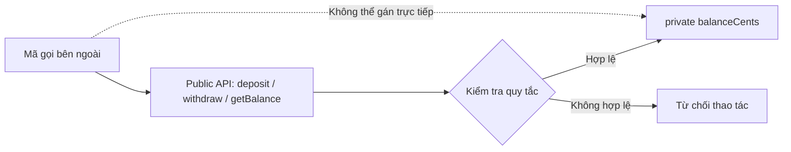

**Đóng gói không có nghĩa mọi lớp đều phải có getter và setter cho từng trường.** Nếu viết `private long balance` rồi cung cấp `public void setBalance(long value)` không giới hạn, mã bên ngoài vẫn có thể phá quy tắc nghiệp vụ. Điểm quan trọng là **kiểm soát đường đi của thay đổi trạng thái**.

## 2. Các mức truy cập trong Java

Java có bốn mức truy cập thường dùng cho thành phần của lớp:

| Modifier | Trong chính lớp | Lớp khác cùng package | Lớp con khác package | Lớp không liên quan khác package |
|---|---|---|---|---|
| `private` | Có | Không | Không | Không |
| Không ghi modifier (**package-private**) | Có | Có | Không | Không |
| `protected` | Có | Có | Có, với giới hạn truy cập kế thừa | Không |
| `public` | Có | Có | Có | Có |

Ví dụ:

```java
package shop;

public class Product {
    private int stock;            // Chỉ mã có quyền private access của Product
    String internalCode;          // Package-private
    protected void validate() {}  // Cùng package và lớp con theo quy tắc protected
    public int getStock() {       // Phần API công khai
        return stock;
    }
}
```

Một số điểm cần tránh hiểu nhầm:

- **`private`** giới hạn quyền truy cập ở mức khai báo lớp/những phạm vi được Java cho phép, kể cả mối quan hệ giữa lớp ngoài và lớp lồng nhau; không phải “chỉ đúng một phương thức”.
- **Package-private** là trạng thái *không có từ khóa truy cập*, không phải từ khóa `default`. Các lớp trong cùng package có thể sử dụng thành phần đó nếu các điều kiện truy cập khác phù hợp.
- **`protected`** cho phép truy cập từ cùng package; với subclass ở package khác, còn có những quy tắc hạn chế về đối tượng tham chiếu dùng để truy cập thành viên kế thừa.
- **`public`** cho phép mã khác truy cập, miễn là lớp chứa nó cũng truy cập được và các ràng buộc về module (nếu dùng Java Module System) cho phép.
- Lớp **top-level** thông thường chỉ được khai báo `public` hoặc package-private; `private` và `protected` không áp dụng trực tiếp cho top-level class.

Phạm vi càng rộng càng tạo nhiều điểm phụ thuộc. Thực tế thường bắt đầu bằng `private` cho trường dữ liệu, chỉ công khai những hành vi bên ngoài thật sự cần dùng. Không cần mặc định đặt tất cả phương thức là `public`.

## 3. Kiểm soát thay đổi bằng phương thức có ý nghĩa nghiệp vụ

Ví dụ hoàn chỉnh sau đây sử dụng đơn vị **cent** dưới dạng `long` để tránh lỗi nhị phân của `double` khi minh họa tiền tệ. Đây là ví dụ OOP trong bộ nhớ, chưa phải hệ thống giao dịch ngân hàng.

Lưu thành `WalletDemo.java` và chạy bằng **Java 17+**:

```java
import java.util.ArrayList;
import java.util.List;

public class WalletDemo {
    public record Movement(String type, long amountCents, long balanceAfter) {}

    public static final class Wallet {
        private final String owner;
        private long balanceCents;
        private final List<Movement> movements = new ArrayList<>();

        public Wallet(String owner, long openingBalanceCents) {
            if (owner == null || owner.isBlank()) {
                throw new IllegalArgumentException("Chủ ví không hợp lệ");
            }
            if (openingBalanceCents < 0) {
                throw new IllegalArgumentException("Số dư đầu kỳ không thể âm");
            }
            this.owner = owner;
            this.balanceCents = openingBalanceCents;
        }

        public String owner() {
            return owner;
        }

        public long balanceCents() {
            return balanceCents;
        }

        public List<Movement> history() {
            return List.copyOf(movements);
        }

        public void deposit(long amountCents) {
            requirePositive(amountCents);
            long newBalance = Math.addExact(balanceCents, amountCents);
            balanceCents = newBalance;
            movements.add(new Movement("DEPOSIT", amountCents, newBalance));
        }

        public boolean withdraw(long amountCents) {
            requirePositive(amountCents);
            if (amountCents > balanceCents) {
                return false;
            }
            balanceCents -= amountCents;
            movements.add(new Movement("WITHDRAW", amountCents, balanceCents));
            return true;
        }

        private static void requirePositive(long amountCents) {
            if (amountCents <= 0) {
                throw new IllegalArgumentException("Số tiền phải dương");
            }
        }
    }

    public static void main(String[] args) {
        Wallet wallet = new Wallet("An", 100_000);

        wallet.deposit(50_000);
        System.out.println(wallet.withdraw(20_000));  // true
        System.out.println(wallet.balanceCents());     // 130000
        System.out.println(wallet.withdraw(200_000)); // false
        System.out.println(wallet.balanceCents());     // 130000

        List<Movement> snapshot = wallet.history();
        System.out.println(snapshot.size());          // 2

        try {
            snapshot.clear();
        } catch (UnsupportedOperationException ex) {
            System.out.println("Không thể sửa lịch sử từ bên ngoài");
        }

        System.out.println(wallet.history().size());  // 2
    }
}
```

Chạy:

```bash
javac WalletDemo.java
java WalletDemo
```

Kết quả mong đợi:

```text
true
130000
false
130000
2
Không thể sửa lịch sử từ bên ngoài
2
```

### Bất biến được bảo vệ ra sao?

Lớp `Wallet` có bất biến: `balanceCents >= 0`.

| Thao tác | Điều kiện đầu vào | Khi thành công | Khi thất bại |
|---|---|---|---|
| `new Wallet(owner, opening)` | `owner` không rỗng; `opening >= 0` | Khởi tạo trạng thái hợp lệ | Ném `IllegalArgumentException` |
| `deposit(amount)` | `amount > 0`; phép cộng không tràn `long` | Tăng số dư, ghi lịch sử | Đầu vào sai: `IllegalArgumentException`; tràn số: `ArithmeticException` |
| `withdraw(amount)` | `amount > 0` | Đủ tiền: giảm số dư và trả `true` | Không đủ tiền: trả `false` mà không giảm số dư |
| `balanceCents()` | Không có | Trả số dư hiện tại | Không thay đổi trạng thái |
| `history()` | Không có | Trả bản sao danh sách không sửa được | Mã ngoài không thể `clear()` lịch sử nội bộ |

Các phương thức thay đổi trạng thái dựa trên **ý nghĩa hành vi**: nạp và rút tiền. Lớp không cung cấp `setBalanceCents`, vì thao tác “đặt số dư bất kỳ” có thể bỏ qua kiểm tra nghiệp vụ và lịch sử.

`Math.addExact` giúp phát hiện tràn `long`: nếu số dư đang gần `Long.MAX_VALUE`, phép cộng không âm thầm trở thành số âm. Các quy tắc kiểm tra này làm cho API khó bị dùng sai.

### Luồng rút tiền

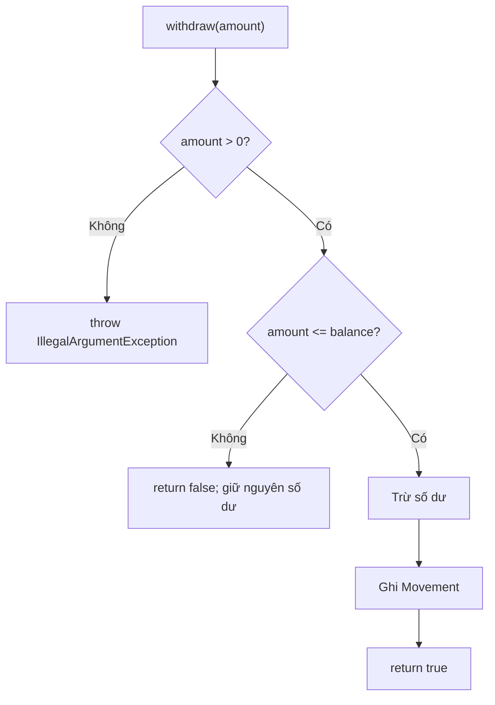

Sơ đồ giúp thấy rõ **mỗi đường thay đổi trạng thái phải đi qua một quyết định hợp lệ**. Không phải mọi phương thức đều cần ném exception cho tất cả tình huống không thành công: “không đủ tiền” có thể là kết quả nghiệp vụ bình thường, nên ví dụ trả `false`.

**Giới hạn của ví dụ:** các thao tác trên `Wallet` chưa được đồng bộ cho nhiều luồng. Nếu nhiều thread có thể cùng nạp/rút, cần cơ chế bảo đảm tính nguyên tử và hiển thị bộ nhớ (ví dụ khóa phù hợp, hoặc giao dịch ở tầng lưu trữ). `private` **không tự mang lại thread safety**.

## 4. Quyền truy cập tên field khác quyền sửa đối tượng được tham chiếu

Ngay cả khi danh sách là `private final`, getter trả trực tiếp `ArrayList` vẫn trao cho caller quyền thêm/xóa phần tử. Đây là một **đường vòng qua phương thức kiểm tra**:

```java
private final List<String> members = new ArrayList<>();

public List<String> getMembers() {
    return List.copyOf(members); // Snapshot cấu trúc; String bất biến
}
```

Nếu constructor nhận danh sách từ bên ngoài, lớp còn phải quyết định việc sao chép **lúc nhận** để caller không tiếp tục sửa cùng instance. Khi phần tử là object mutable, `List.copyOf` chưa đủ để bảo vệ trạng thái sâu. Những rủi ro đó thuộc trách nhiệm thiết kế API, dù modifier của field đã đúng.

## 5. Accessor không được vô hiệu hóa quy tắc cập nhật

Getter phục vụ nhu cầu **quan sát**; setter chỉ phù hợp nếu thuộc tính thật sự có thể thay đổi độc lập. Ví dụ đổi tên hiển thị có thể dùng `setDisplayName(name)` kèm kiểm tra `null`/chuỗi rỗng. Ngược lại, setter `setStatus("SHIPPED")` cho một đơn chưa thanh toán có thể bỏ qua quy trình nghiệp vụ dù field `status` là `private`.

```java
// Trích các phương thức trong một Order có status kiểu enum.
public void pay() {
    if (status != Status.NEW) {
        throw new IllegalStateException("Chỉ đơn NEW được thanh toán");
    }
    status = Status.PAID;
}

public void ship() {
    if (status != Status.PAID) {
        throw new IllegalStateException("Chỉ đơn PAID được giao");
    }
    status = Status.SHIPPED;
}
```

`pay()` và `ship()` biểu đạt ý định và giữ kiểm tra ở nơi sở hữu dữ liệu. Trong một ứng dụng thực, việc xác nhận thanh toán từ hệ thống ngoài vẫn cần service đáng tin cậy; riêng tên phương thức không xác thực thanh toán. Tên getter/setter là quy ước Java, **không phải bằng chứng cho đóng gói đúng**.

## 6. Bất biến cần đúng từ lúc khởi tạo tới sau mỗi thao tác

Một đối tượng có thể được đặt ở trạng thái sai **ngay trong constructor** nếu constructor bỏ qua kiểm tra. Đóng gói chỉ có tác dụng khi mọi đường tạo và sửa đối tượng đều giữ quy tắc.

Ví dụ `Wallet` kiểm tra opening balance trong constructor, còn `deposit` và `withdraw` kiểm tra trước khi cập nhật số dư. Điều đó tránh trạng thái âm trong các đường thực thi bình thường.

Một quy trình thiết kế đơn giản:

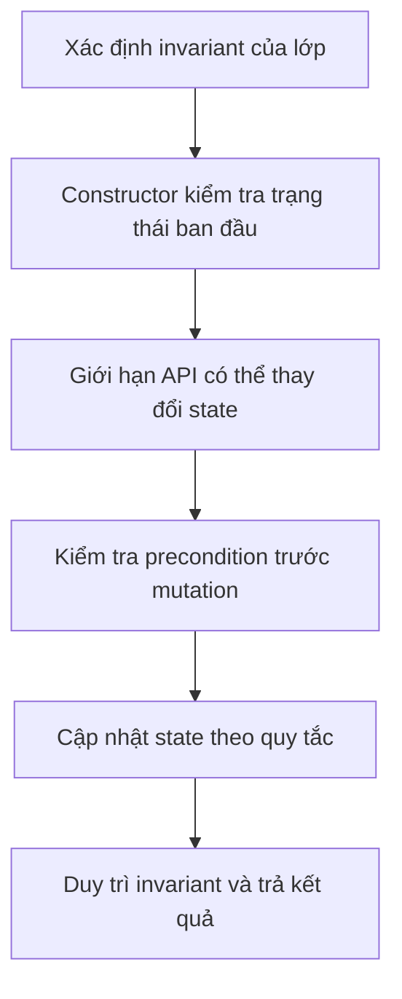

| Quy tắc thiết kế | Lý do |
|---|---|
| Trường dữ liệu nội bộ thường `private` | Ngăn gán trực tiếp tùy tiện |
| Dữ liệu bắt buộc kiểm tra tại constructor | Đối tượng hợp lệ từ khi bắt đầu sử dụng |
| Mỗi phương thức sửa state kiểm tra điều kiện | Không phá invariant |
| Ưu tiên phương thức có tên theo hành vi | Hạn chế thao tác sai trình tự |
| Không để lộ collection/array mutable nội bộ | Bên ngoài không bỏ qua validation |
| Chọn kết quả lỗi nhất quán | Người gọi biết khi nào thao tác bị từ chối |
| Giữ đối tượng bất biến khi phù hợp | Giảm số trạng thái cần quản lý |

### Tránh “thay đổi nửa chừng”

Giả sử một thao tác phải kiểm tra nhiều điều kiện:

```java
void updateLimit(long newLimit) {
    if (newLimit < 0) {
        throw new IllegalArgumentException("Giới hạn không hợp lệ");
    }
    if (newLimit < currentUsage) {
        throw new IllegalStateException(
            "Giới hạn mới thấp hơn mức đang sử dụng"
        );
    }
    limit = newLimit;
}
```

Kiểm tra trước khi gán tránh để `limit` nhận giá trị sai rồi mới ném ngoại lệ. Nếu một nghiệp vụ thay đổi **nhiều đối tượng** hoặc có ghi database/API ngoài, cần cơ chế giao dịch/rollback phù hợp; riêng `private` và một phương thức Java không tự tạo tính nguyên tử giữa nhiều tài nguyên.

## 7. Kiểm soát truy cập khác với bất biến (immutability)

Đóng gói và bất biến có liên quan nhưng không đồng nhất:

| Khái niệm | Ý nghĩa | Ví dụ |
|---|---|---|
| Encapsulation | Mã bên ngoài chỉ tương tác qua API được phép | `Wallet.deposit()`, `Wallet.withdraw()` |
| Mutable object | Trạng thái có thể thay đổi, nhưng qua quy tắc | `Wallet` sau khi nạp/rút |
| Immutable object | Trạng thái quan sát được không đổi sau khi tạo | `String`, một value object thiết kế đúng |
| `final` field | Trường không thể gán lại sau khởi tạo theo quy tắc Java | `private final List<String> names` |
| Unmodifiable collection | Không thể thay đổi collection qua các thao tác sửa của nó | Kết quả `List.copyOf(...)` |

`private` **không có nghĩa immutable**; `final` **không làm bất biến sâu**; và một getter cũng không tự là read-only nếu nó trả tham chiếu tới object mutable.

Ví dụ value object đơn giản:

```java
public record RectangleSize(int width, int height) {
    public RectangleSize {
        if (width <= 0 || height <= 0) {
            throw new IllegalArgumentException("Kích thước phải dương");
        }
    }

    public long area() {
        return (long) width * height;
    }
}
```

`record` (Java 16+) tự tạo các thành phần `private final` và accessor `width()`, `height()`. **Compact constructor** kiểm tra invariant trước khi record được dùng. Với hai thành phần kiểu nguyên thủy, `RectangleSize` có trạng thái giá trị bất biến và rất phù hợp để truyền giữa các đối tượng.

## 8. Đóng gói theo phạm vi trách nhiệm

Không phải cứ khai báo `private` là thiết kế tốt. Một lớp có thể có 20 trường `private` và 20 setter `public` để mã ngoài tự ghép logic nghiệp vụ. Khi đó, quy tắc vẫn bị phân tán.

Ví dụ một API yếu yêu cầu caller tự kiểm tra:

```java
if (account.getBalance() >= amount) {
    account.setBalance(account.getBalance() - amount);
}
```

Có ít nhất ba vấn đề: logic kiểm tra nằm ngoài lớp; mã khác có thể quên kiểm tra; hai bước đọc và ghi không nguyên tử nếu truy cập đồng thời.

API có hành vi `account.withdraw(amount)` giữ logic bên trong, nơi lớp sở hữu dữ liệu và biết invariant. Tuy nhiên, để an toàn khi nhiều thread cùng thao tác, phương thức đó vẫn phải được triển khai với cơ chế đồng bộ/giao dịch thích hợp.

**Cấp quyền nhỏ nhất (least visibility):** chỉ công khai những gì là hợp đồng của lớp. Một helper như `requirePositive` trong `Wallet` được để `private`, vì người gọi không cần biết chi tiết kiểm tra. Khi hai lớp hợp tác chặt trong cùng package, package-private có thể phù hợp hơn `public`. Không tăng phạm vi truy cập chỉ để “dễ gọi” nếu có cách thiết kế API rõ ràng hơn.

### Đặt tên theo ý định

| Tên có thể gây hiểu sai | Tên thể hiện hành vi rõ hơn | Khi nào hữu ích? |
|---|---|---|
| `setBalance(500)` | `deposit(500)` / `withdraw(500)` | Có quy tắc nạp/rút |
| `setStatus(PAID)` | `pay()` | Có chuyển đổi trạng thái hợp lệ |
| `setQuantity(q)` | `increaseStock(q)` / `reserve(q)` | Có điều kiện tồn kho |
| `getInternalList()` | `listItems()` trả snapshot | Muốn đọc mà không sửa nội bộ |

Tên phương thức không tự thi hành quy tắc: **implementation và kiểm thử** phải bảo đảm hành vi đúng.

## 9. Kiểm thử hành vi và ranh giới truy cập

Một bài kiểm thử tốt không chỉ kiểm tra đầu ra bình thường. Nó còn cần kiểm tra **những trạng thái không được phép xuất hiện** và khả năng mã gọi can thiệp trái phép.

Với `Wallet`, có thể xác minh bằng các tình huống sau:

| Tình huống | Kết quả mong đợi |
|---|---|
| Khởi tạo ví với số dư âm | `IllegalArgumentException` |
| `deposit(0)` hoặc `deposit(-1)` | `IllegalArgumentException`; số dư không đổi |
| `deposit(Long.MAX_VALUE)` khi số dư dương | `ArithmeticException`; số dư không đổi |
| `withdraw(amount)` lớn hơn số dư | `false`; không ghi giao dịch rút |
| Rút số tiền hợp lệ, đủ số dư | `true`; số dư giảm đúng |
| `wallet.history().clear()` | `UnsupportedOperationException`; lịch sử nội bộ vẫn nguyên |
| `wallet.balanceCents = -10` từ mã ngoài | Lỗi biên dịch vì trường là `private` |

**Cần phân biệt kiểm tra quyền truy cập tại thời điểm biên dịch với xác thực quyền của người dùng.** `private`/`public` là quy tắc về khả năng mã Java truy cập thành phần lớp; chúng **không thay thế kiểm tra authentication/authorization** khi nhiều tài khoản người dùng truy cập một dịch vụ. Ví dụ, một phương thức `public withdraw(...)` vẫn cần lớp nghiệp vụ hoặc tầng API xác nhận đúng chủ tài khoản nếu chạy trong hệ thống đa người dùng.

## 10. Lỗi phổ biến cần tránh

**Lỗi 1 — Trường public mutable**

```java
public int stock; // Ai cũng có thể gán giá trị âm
```

Sửa bằng trường `private` và hành vi có kiểm tra, như `restock(int quantity)`, `reserve(int quantity)`.

**Lỗi 2 — Trường private nhưng setter không kiểm tra**

```java
private int stock;
public void setStock(int stock) {
    this.stock = stock; // Vẫn có thể âm
}
```

Nếu nghiệp vụ yêu cầu tồn kho không âm, ít nhất phải kiểm tra và nên cân nhắc API hành vi.

**Lỗi 3 — Getter trả collection mutable nội bộ**

```java
public List<String> getNames() {
    return names; // Caller có thể add/remove bất kỳ phần tử
}
```

Sửa bằng snapshot `List.copyOf(names)` khi phần tử thích hợp, hoặc cung cấp giao diện chỉ đọc với hợp đồng rõ ràng; nhớ rằng unmodifiable view và snapshot không hoàn toàn giống nhau.

**Lỗi 4 — Tin rằng `final` khiến toàn bộ object bất biến**

```java
private final List<String> names = new ArrayList<>();
// final ngăn: names = new ArrayList<>(); sau khi khởi tạo
// Nhưng vẫn cho phép: names.add("An");
```

Muốn bất biến sâu, cần xem xét cả những object mà trường tham chiếu tới.

**Lỗi 5 — Trộn đọc/kiểm tra/ghi ở ngoài lớp**

```java
if (wallet.balanceCents() >= amount) {
    // Không thể bảo đảm việc thay đổi an toàn chỉ từ bước đọc này
}
```

Hãy đưa logic thay đổi vào phương thức của đối tượng có trách nhiệm; khi có đồng thời, cần thêm cơ chế nguyên tử phù hợp.

## 11. Bài tập tự luyện

1. Tạo lớp `InventoryItem` với `private int stock` và constructor từ chối tồn kho âm. Viết `restock(int amount)`, `reserve(int amount)`, `getStock()`; không cung cấp setter đặt tồn kho tùy ý.
2. Thêm trạng thái `RETURNED` cho `Order`. Định nghĩa chuyển đổi nào hợp lệ từ `SHIPPED`, kiểm tra điều kiện trong phương thức `returnOrder()` và cập nhật Mermaid.
3. Cho một lớp nhận `List<String>` từ constructor rồi lưu thẳng tham chiếu. Hãy chứng minh bằng code rằng caller có thể sửa danh sách sau khi tạo lớp và viết bản defensive copy để ngăn hành vi đó.
4. Nếu thay `String` trong `Team.members` bằng `Employee` có setter, `List.copyOf` đã đủ đóng gói chưa? Giải thích và đề xuất cách không làm lộ đối tượng mutable.
5. Cho một dịch vụ có hai thread cùng rút từ một ví. Mô tả vì sao `private balanceCents` không ngăn race condition và cơ chế nào phải bổ sung để thao tác an toàn.

**Ghi nhớ:** Đóng gói tốt nghĩa là **che giấu trạng thái cần bảo vệ, công khai hành vi phù hợp, kiểm tra trước khi sửa và không làm lộ đường vòng qua tham chiếu mutable**. Trường `private` là công cụ; invariant và hợp đồng phương thức mới quyết định đối tượng có luôn giữ được trạng thái hợp lệ hay không.


</details>

- [Quay lại đầu trang](#back-to-top)

---

## <a id="encapsulation-004">Getter, setter và phương thức thể hiện ý định</a>

<details>
<summary>Xem chi tiết</summary>

# Getter, setter và phương thức thể hiện ý định trong Java

Trong lập trình hướng đối tượng, **đóng gói (encapsulation)** là cách một đối tượng kiểm soát việc bên ngoài đọc và thay đổi trạng thái của nó. Thay vì cho mọi nơi tùy ý sửa field, lớp cung cấp một **giao diện công khai (public API)** với những thao tác có ý nghĩa.

Ba công cụ thường gặp:

- **Getter:** trả về thông tin mà người gọi được phép đọc, chẳng hạn `getBalance()` hoặc `isActive()`.
- **Setter:** thay đổi một thuộc tính theo một hợp đồng đã xác định, chẳng hạn `setDisplayName(...)`.
- **Phương thức thể hiện ý định:** mô tả *hành động nghiệp vụ* mà người gọi muốn làm, chẳng hạn `deposit(...)`, `withdraw(...)`, `confirm()`, `cancel()` hoặc `reschedule(...)`.

Điểm quan trọng là **không phải cứ khai báo field `private` rồi tạo getter/setter cho mọi field là đã thiết kế đóng gói tốt**. Đóng gói tốt bảo vệ các *bất biến (invariant)* của đối tượng: những điều kiện phải luôn đúng sau khi đối tượng được tạo và sau mỗi thao tác thành công.

Ví dụ, tài khoản ngân hàng không nên cho gọi `setBalance(-500)` hay `setBalance(999999)` từ bất kỳ đâu. API `deposit()` và `withdraw()` diễn tả rõ mục đích và là nơi kiểm tra điều kiện hợp lệ.

## 1. Phân biệt getter, setter và phương thức có ý nghĩa nghiệp vụ

| Thành phần | Mục đích | Ví dụ | Điều cần cân nhắc |
|---|---|---|---|
| Getter | Cho phép quan sát thông tin | `getName()`, `getBalance()` | Giá trị trả về có làm lộ dữ liệu có thể sửa không? |
| Setter | Cho phép gán/đổi một thuộc tính | `setNickname("An")` | Giá trị mới có cần được xác thực? |
| Phương thức thể hiện ý định | Thực hiện một hành động có quy tắc | `withdraw(500)`, `confirm()` | Điều kiện trước/sau của hành động là gì? |
| Constructor/factory | Tạo đối tượng ở trạng thái hợp lệ | `new Account("A01")` | Có bắt buộc dữ liệu nào ngay từ đầu? |
| Phương thức truy vấn suy ra | Trả lời câu hỏi từ trạng thái hiện có | `hasEnoughBalance(500)` | Có cần lưu thêm một field hay tính khi được hỏi? |

Một tên phương thức diễn tả ý định giúp code gọi tự đọc được:

~~~java
account.deposit(200_000);
account.withdraw(75_000);
~~~

So sánh với cách gọi không nêu rõ nghiệp vụ:

~~~java
account.setBalance(account.getBalance() + 200_000);
account.setBalance(account.getBalance() - 75_000);
~~~

Ở cách dùng setter, người gọi tự quyết định công thức, điều kiện hợp lệ và cách thay đổi tiền. Mỗi nơi có thể tính khác nhau, dẫn tới lỗi âm số dư, bỏ qua phí hoặc cập nhật sai khi nhiều thao tác cùng lúc.

## 2. Vì sao một lớp có toàn getter/setter vẫn có thể đóng gói kém?

Giả sử có lớp đơn hàng:

~~~java
public class Order {
    private String status;
    private int itemCount;

    public String getStatus() {
        return status;
    }

    public void setStatus(String status) {
        this.status = status;
    }

    public int getItemCount() {
        return itemCount;
    }

    public void setItemCount(int itemCount) {
        this.itemCount = itemCount;
    }
}
~~~

Code bên ngoài có thể tạo những trạng thái không hợp lệ:

~~~java
Order order = new Order();
order.setItemCount(-3);
order.setStatus("CONFIRMED");  // Có thể xác nhận đơn hàng âm số lượng.
order.setStatus("UNKNOWN");    // Không có trạng thái nghiệp vụ tương ứng.
~~~

Field vẫn `private`, nhưng mọi quy tắc đã bị chuyển sang người gọi. Getter/setter dạng này gần giống truy cập field công khai, chỉ khác cú pháp.

Các vấn đề có thể phát sinh:

1. Không có nơi thống nhất kiểm tra giá trị đầu vào.
2. Setter cho phép thay đổi trạng thái ở bất kỳ thời điểm nào, kể cả khi thao tác không hợp lệ.
3. Hai thuộc tính phụ thuộc lẫn nhau có thể tạm thời rơi vào trạng thái mâu thuẫn.
4. Tên `setStatus("CONFIRMED")` không nói vì sao chuyển trạng thái, ai được phép chuyển, hay cần điều kiện gì.
5. Nếu nghiệp vụ đổi, rất khó tìm hết nơi đang sử dụng setter để bổ sung logic.

**Giải pháp không phải cấm mọi setter.** Setter vẫn phù hợp khi một thuộc tính thật sự được phép đổi độc lập và việc đổi đó không làm phá vỡ invariant của đối tượng. Vấn đề là chọn đúng quyền thay đổi và hợp đồng API.

## 3. Ví dụ hoàn chỉnh: getter để đọc, hành vi để kiểm soát trạng thái

Ví dụ này triển khai tài khoản ngân hàng đơn giản. Để tập trung vào nguyên tắc OOP, số tiền được biểu diễn bằng **`long` theo đơn vị đồng**, không dùng số thực để cộng trừ tiền. Chương trình không xử lý ngân hàng thật, giao dịch phân tán hoặc cập nhật đồng thời.

Lưu thành **`Demo.java`** (Java 17+):

~~~java
public class Demo {
    public static void main(String[] args) {
        BankAccount account = new BankAccount("A-101", "Lan");

        account.deposit(500_000);
        account.withdraw(125_000);
        account.renameOwner("Lan Nguyễn");

        System.out.println("Tài khoản: " + account.getAccountNumber());
        System.out.println("Chủ tài khoản: " + account.getOwnerName());
        System.out.println("Số dư: " + account.getBalance());
        System.out.println("Đủ tiền trả 400000? "
                + account.hasEnoughBalance(400_000));

        try {
            account.withdraw(500_000);
        } catch (IllegalStateException ex) {
            System.out.println("Bị từ chối: " + ex.getMessage());
        }

        try {
            account.close();
        } catch (IllegalStateException ex) {
            System.out.println("Không thể đóng: " + ex.getMessage());
        }
        account.withdraw(account.getBalance());
        account.close();
        System.out.println("Đã đóng: " + account.isClosed());
    }
}

final class BankAccount {
    private final String accountNumber;
    private String ownerName;
    private long balance;
    private boolean closed;

    public BankAccount(String accountNumber, String ownerName) {
        this.accountNumber = requireText(
                accountNumber, "Mã tài khoản");
        this.ownerName = requireText(ownerName, "Tên chủ");
        this.balance = 0;
        this.closed = false;
    }

    // Getter: quan sát trạng thái, không tự thay đổi tài khoản.
    public String getAccountNumber() {
        return accountNumber;
    }

    public String getOwnerName() {
        return ownerName;
    }

    public long getBalance() {
        return balance;
    }

    public boolean isClosed() {
        return closed;
    }

    public boolean hasEnoughBalance(long amount) {
        return amount > 0 && !closed && balance >= amount;
    }

    // Hành vi: nạp tiền theo quy tắc.
    public void deposit(long amount) {
        requireOpen();
        requirePositive(amount);
        balance = Math.addExact(balance, amount);
    }

    // Hành vi: chỉ trừ khi đủ tiền.
    public void withdraw(long amount) {
        requireOpen();
        requirePositive(amount);

        if (amount > balance) {
            throw new IllegalStateException("Không đủ số dư");
        }

        balance -= amount;
    }

    // Hành vi: đổi tên và duy trì điều kiện tên hợp lệ.
    public void renameOwner(String newName) {
        requireOpen();
        ownerName = requireText(newName, "Tên chủ");
    }

    // Hành vi: chuyển trạng thái sang đã đóng.
    public void close() {
        requireOpen();
        if (balance != 0) {
            throw new IllegalStateException(
                    "Phải tất toán số dư trước khi đóng");
        }
        closed = true;
    }

    private void requireOpen() {
        if (closed) {
            throw new IllegalStateException(
                    "Tài khoản đã đóng");
        }
    }

    private static void requirePositive(long amount) {
        if (amount <= 0) {
            throw new IllegalArgumentException(
                    "Số tiền phải lớn hơn 0");
        }
    }

    private static String requireText(
            String value, String fieldName) {
        if (value == null || value.isBlank()) {
            throw new IllegalArgumentException(
                    fieldName + " không được để trống");
        }
        return value.strip();
    }
}
~~~

Chạy:

~~~bash
javac Demo.java
java Demo
~~~

Kết quả:

~~~text
Tài khoản: A-101
Chủ tài khoản: Lan Nguyễn
Số dư: 375000
Đủ tiền trả 400000? false
Bị từ chối: Không đủ số dư
Không thể đóng: Phải tất toán số dư trước khi đóng
Đã đóng: true
~~~

Dòng `Không thể đóng` minh họa quy tắc tài khoản còn 375.000 đồng thì `close()` từ chối **trước khi đổi trạng thái**. Sau đó chương trình rút hết số dư, đóng tài khoản thành công và in `Đã đóng: true`. Như vậy cùng một lần chạy kiểm chứng được cả đường từ chối lẫn đường thành công.

Ví dụ này thể hiện ba điểm:

- **Getter** chỉ cho phép đọc dữ liệu mà lớp quyết định công khai. Không có `setAccountNumber()`, bởi vì mã tài khoản không được phép đổi trong vòng đời đối tượng.
- **Phương thức thể hiện ý định** như `deposit()`, `withdraw()`, `renameOwner()`, `close()` kiểm soát những thay đổi hợp lệ. Ví dụ `withdraw()` kiểm tra số tiền và số dư *trước* khi trừ; trường hợp thiếu tiền không làm thay đổi trạng thái.
- **Invariant** như `balance >= 0` và “không được giao dịch sau khi đóng” được tập trung kiểm tra trong lớp. `Math.addExact()` cũng tránh lỗi tràn `long` âm thầm khi cộng tiền.

> Trong phần mềm tài chính thực tế, một đối tượng trong bộ nhớ chưa bảo đảm giao dịch an toàn khi nhiều luồng hoặc nhiều máy chủ truy cập. Việc kiểm tra số dư, ghi nhận giao dịch và chống cập nhật trùng phải được thiết kế ở tầng lưu trữ/giao dịch phù hợp.

### Sơ đồ quyền điều khiển trạng thái

~~~mermaid
flowchart LR
    U["Code bên ngoài"] --> G["Getter<br/>getBalance()"]
    G --> R["Quan sát số dư"]
    U --> D["Hành vi<br/>withdraw(amount)"]
    D --> V{"Kiểm tra điều kiện"}
    V -->|Hợp lệ| S["Thay đổi field private"]
    V -->|Không hợp lệ| E["Báo lỗi, giữ nguyên trạng thái"]
    X["setBalance(value)"] -.->|"Không cung cấp"| S
~~~

Code bên ngoài chỉ đề nghị một **hành động**; lớp quyết định liệu hành động có được phép và cập nhật dữ liệu nội bộ ra sao. Nhờ đó, khi điều kiện nghiệp vụ thay đổi, chỉ cần điều chỉnh hành vi ở nơi sở hữu trạng thái.

## 4. Getter không nhất thiết trả về field nguyên xi

Getter có thể trả về:

- Một **field** có thể quan sát an toàn.
- Giá trị **được tính toán** từ các field khác.
- Một **bản sao** hoặc dạng đọc được của trạng thái.
- Một kiểu biểu diễn rõ sự vắng mặt của dữ liệu.

Ví dụ, không cần lưu thêm `itemCount` nếu có thể tính từ danh sách:

~~~java
import java.util.ArrayList;
import java.util.List;

class ShoppingCart {
    private final List<String> items = new ArrayList<>();

    public int getItemCount() {
        return items.size();
    }

    public boolean isEmpty() {
        return items.isEmpty();
    }

    public void addItem(String item) {
        if (item == null || item.isBlank()) {
            throw new IllegalArgumentException(
                    "Tên sản phẩm không hợp lệ");
        }
        items.add(item);
    }
}
~~~

`getItemCount()` là một **phương thức truy vấn**, không cần có field `itemCount`. Cách tính trực tiếp tránh phải đồng bộ hai giá trị `items.size()` và `itemCount` sau mỗi lần thêm/xóa.

Một getter mang tên `getTotalPrice()` cũng có thể tính từ các mặt hàng, miễn là hợp đồng rõ ràng. Tuy nhiên, getter có truy vấn mạng/database tốn thời gian hoặc thay đổi trạng thái đáng kể có thể gây bất ngờ: nên đặt tên rõ ý định, chẳng hạn `fetchLatestPrice()` hoặc `refreshCache()`, nếu thao tác thực sự làm việc đó.

### Không phải dữ liệu nội bộ nào cũng cần getter

Ngay cả khi chỉ cho đọc, việc công khai toàn bộ dữ liệu nội bộ làm tăng sự phụ thuộc của code bên ngoài vào cấu trúc lớp. Nếu code ngoài chỉ cần biết “đơn hàng có thể thanh toán chưa?”, một API `canCheckout()` thường rõ ý nghĩa hơn việc yêu cầu người gọi lấy `status`, `items`, `shippingAddress` rồi tự kiểm tra cùng một quy tắc ở nhiều nơi.

Tuy vậy, các màn hình hiển thị, công cụ báo cáo và hệ thống serialization vẫn cần một số dữ liệu đọc được; getter là công cụ phù hợp khi thông tin đó thực sự thuộc giao diện lớp.

## 5. Getter trả tham chiếu mutable phải có hợp đồng rõ ràng

Một getter có thể làm lộ trạng thái dù field là `private`:

```java
class UnsafeBasket {
    private final java.util.List<String> items =
            new java.util.ArrayList<>();

    public java.util.List<String> getItems() {
        return items; // Caller có thể gọi getItems().add("")
    }
}
```

Nếu lớp yêu cầu mỗi tên mặt hàng không rỗng, caller gọi `getItems().add("")` sẽ bỏ qua mọi kiểm tra của `addItem()`. Với `List<String>`, getter có thể dùng `List.copyOf(items)` để trả snapshot cấu trúc không sửa được; `String` bất biến nên an toàn để chia sẻ phần tử.

Chọn cách trả theo nhu cầu: `Collections.unmodifiableList(items)` là view chỉ đọc nhưng phản ánh thay đổi từ list gốc; `List.copyOf(items)` là snapshot cấu trúc; `new ArrayList<>(items)` là bản sao caller có thể sửa riêng. **Cả ba đều không tự deep-copy phần tử mutable**. Nếu getter trả mảng, `Date` hoặc đối tượng con có setter, cần bảo vệ tham chiếu sâu hơn.

## 6. Setter thích hợp trong trường hợp nào?

Một setter có thể phù hợp khi:

1. Thuộc tính thực sự được phép thay đổi độc lập.
2. Cập nhật chỉ có một ý nghĩa rõ ràng.
3. Có thể kiểm tra giá trị hợp lệ ngay trong setter.
4. Không làm đối tượng rơi vào trạng thái sai hoặc mở ra thao tác bị cấm theo vòng đời.

Ví dụ người dùng đổi tên hiển thị:

~~~java
public final class Profile {
    private String displayName;

    public Profile(String displayName) {
        setDisplayName(displayName);
    }

    public String getDisplayName() {
        return displayName;
    }

    public void setDisplayName(String displayName) {
        if (displayName == null || displayName.isBlank()) {
            throw new IllegalArgumentException(
                    "Tên hiển thị không được trống");
        }
        this.displayName = displayName.strip();
    }
}
~~~

Ở đây `setDisplayName()` phù hợp vì đổi tên hiển thị là một cập nhật độc lập, quy tắc giá trị được kiểm soát tại cùng một điểm. Không có nghĩa setter phải cho phép mọi giá trị truyền vào.

Tùy ngữ cảnh nghiệp vụ, một tên `renameTo(...)` hoặc `changeDisplayName(...)` cũng có thể truyền đạt ý định tốt hơn, nhất là khi đổi tên cần kiểm tra quyền, lưu lịch sử hoặc phát sinh sự kiện.

### Setter không nhất thiết là public

Java cho phép:

~~~java
class Task {
    private String title;

    public String getTitle() {
        return title;
    }

    private void setTitle(String title) {
        this.title = title;
    }
}
~~~

`private` setter có thể chỉ dùng nội bộ lớp. Ngoài ra có thể dùng package-private hoặc `protected` khi có nhu cầu thiết kế cụ thể. **Không có quy tắc bắt buộc getter và setter phải cùng mức truy cập**, hay cứ có getter thì phải có setter.

Với đối tượng bất biến (immutable), ta thường không cung cấp setter:

~~~java
public record Coordinates(int latitude, int longitude) {}
~~~

`record` này là ví dụ cú pháp về một kiểu dữ liệu mang giá trị; component accessor có tên `latitude()` và `longitude()`, không phải `getLatitude()`. Mọi field component là final; nhưng record chứa tham chiếu tới dữ liệu mutable vẫn cần thiết kế bảo vệ sâu thêm nếu muốn bất biến thực sự.

## 7. Khi nhiều field phụ thuộc nhau, dùng một hành vi nguyên khối

Giả sử lịch đặt phòng có `start` và `end`. Cho gọi hai setter độc lập có thể tạo trạng thái trung gian sai:

~~~java
booking.setStart(newStart);
booking.setEnd(newEnd);
~~~

Nếu `newStart` đến sau `end` cũ, setter thứ nhất có thể khiến lịch không hợp lệ dù cặp giờ mới là hợp lệ. Nếu setter nào cũng tự kiểm tra toàn bộ invariant, cách cập nhật lần lượt có thể không thực hiện được.

API mang ý định cho phép kiểm tra hai thông số **cùng lúc**:

~~~java
import java.time.LocalDateTime;
import java.util.Objects;

public final class Booking {
    private LocalDateTime start;
    private LocalDateTime end;

    public Booking(LocalDateTime start, LocalDateTime end) {
        reschedule(start, end);
    }

    public LocalDateTime getStart() {
        return start;
    }

    public LocalDateTime getEnd() {
        return end;
    }

    public void reschedule(
            LocalDateTime newStart, LocalDateTime newEnd) {
        Objects.requireNonNull(newStart, "start");
        Objects.requireNonNull(newEnd, "end");

        if (!newStart.isBefore(newEnd)) {
            throw new IllegalArgumentException(
                    "Giờ bắt đầu phải trước giờ kết thúc");
        }

        // Chỉ cập nhật sau khi đã kiểm tra toàn bộ đầu vào.
        this.start = newStart;
        this.end = newEnd;
    }
}
~~~

Ví dụ này bảo vệ invariant theo luồng thực thi tuần tự. Nếu nhiều luồng đồng thời đọc/sửa `Booking`, cần có chiến lược đồng bộ hoặc tính bất biến thích hợp để không quan sát cặp giá trị cập nhật dở dang.

Ưu điểm của `reschedule(start, end)`:

- API thể hiện rõ nghiệp vụ **đổi lịch**.
- Kiểm tra tính hợp lệ của cả hai tham số trước khi sửa.
- Người gọi không cần biết thứ tự gán từng field.
- Sau này có thể thêm điều kiện “không được đổi lịch khi đã hoàn thành” ở cùng một hành vi.

## 8. Đặt tên theo chuyển trạng thái hợp lệ

Khi đối tượng có vòng đời, tránh `setStatus(anyValue)`. API như `confirm()`, `ship(trackingCode)`, `cancel()` cho biết **hành động** đang được yêu cầu và là nơi kiểm tra trạng thái hiện tại. Ví dụ một đơn nháp chỉ xác nhận được khi có dòng hàng; một đơn đã hủy không tự quay lại trạng thái mới nếu quy trình không cho phép.

```java
// Bên trong lớp Order, với enum Status { DRAFT, CONFIRMED, CANCELLED }.
public void confirm() {
    if (status != Status.DRAFT || itemCount <= 0) {
        throw new IllegalStateException("Đơn chưa thể xác nhận");
    }
    status = Status.CONFIRMED;
}
```

Điểm khác với setter là **người gọi không chọn đích chuyển trạng thái tùy ý**. Tính idempotent (ví dụ gọi `cancel()` lần hai nên được chấp nhận hay từ chối) phải do hợp đồng nghiệp vụ quyết định; tên hành động không tự trả lời câu hỏi đó.

## 9. Getter và setter có nhất thiết “đơn giản” không?

Một getter thường nên có ý nghĩa **quan sát**, dễ dự đoán và không gây thay đổi nghiệp vụ bất ngờ. Setter có thể kiểm tra, chuẩn hóa dữ liệu, hoặc cập nhật thuộc tính khác khi thực sự cần duy trì invariant. Tuy nhiên, đặt các hành vi lớn hoặc tác dụng phụ khó thấy trong `setX()` có thể gây khó hiểu:

~~~java
// Dễ gây bất ngờ nếu setter này âm thầm gửi email,
// trừ tiền, gọi API ngoài hoặc phát sự kiện nghiệp vụ.
customer.setEmail("new@example.com");
~~~

Nếu đổi email phải trải qua xác minh, hãy thể hiện quy trình bằng các hành vi cụ thể:

~~~java
customer.requestEmailChange("new@example.com");
// Sau khi nhận và xác minh mã:
// customer.confirmEmailChange(verificationCode);
~~~

Các tên trên chỉ minh họa thiết kế API: để chạy được phải có cài đặt lớp, quy trình xác minh và dữ liệu liên quan. Điểm thiết kế là **người đọc code hiểu điều gì đang được yêu cầu**, đồng thời các quy tắc quan trọng tập trung trong object hoặc service chịu trách nhiệm.

### Tách command và query theo ý nghĩa

- **Query:** `getBalance()`, `isClosed()`, `canWithdraw(amount)` — cung cấp thông tin.
- **Command:** `deposit(amount)`, `close()`, `renameOwner(name)` — yêu cầu thay đổi trạng thái.

Phân biệt này là hướng dẫn thiết kế hữu ích, không phải quy tắc cú pháp bắt buộc của Java. Nếu query phải tính toán tốn kém, cache hoặc truy cập hệ thống bên ngoài, hợp đồng và tên phương thức nên giúp người gọi dự đoán chi phí.

Cũng đừng dựa hoàn toàn vào `canWithdraw()` rồi mới gọi `withdraw()` trong mã đa luồng: trạng thái có thể thay đổi giữa hai lần gọi (*time-of-check to time-of-use*). Chính lệnh `withdraw()` vẫn phải kiểm tra điều kiện tại thời điểm cập nhật.

## 10. Getter/setter theo JavaBeans và nhu cầu framework

JavaBeans là một quy ước phổ biến cho tên accessor:

~~~java
public class PersonBean {
    private String name;
    private boolean active;

    public String getName() {
        return name;
    }

    public void setName(String name) {
        this.name = name;
    }

    public boolean isActive() {
        return active;
    }

    public void setActive(boolean active) {
        this.active = active;
    }
}
~~~

Theo quy ước thường thấy, `getName()/setName()` ứng với property `name`, `isActive()/setActive()` ứng với boolean property `active`. Đây là **quy ước đặt tên/khám phá property** chứ không phải cú pháp đặc biệt. Java vẫn cho phép phương thức tên khác.

Một số thư viện/framework (như công cụ bean introspection, binding dữ liệu, serialization hoặc ORM) có thể dựa trên getter, setter, field access, constructor, record hoặc annotation tùy phiên bản/cấu hình. Vì vậy:

- Kiểm tra **hợp đồng thật** của framework trước khi mở thêm setter chỉ để “cho framework chạy”.
- Không tự động kết luận mọi domain entity cần public setter cho tất cả field.
- Nếu framework cần tạo object và gán field, có thể tách **DTO/binding model** với **domain model** thay vì làm lộ toàn bộ hành vi sửa trạng thái của domain.
- Validation ở ranh giới API (ví dụ DTO) vẫn không thay thế các invariant phải luôn được bảo vệ bên trong domain object.

### DTO có thể đơn giản, domain object cần luật

**DTO (Data Transfer Object)** dùng để chở dữ liệu qua lớp ứng dụng hoặc qua mạng. Nếu DTO chỉ chứa dữ liệu đầu vào/đầu ra, các accessor hoặc record thường đủ:

~~~java
public record ChangeDisplayNameRequest(String displayName) {}
~~~

Tầng xử lý phải kiểm tra và dùng hành vi trên domain model:

~~~java
// Ví dụ minh họa trong ứng dụng có User và UserRepository:
ChangeDisplayNameRequest request =
        new ChangeDisplayNameRequest("Minh");

user.changeDisplayName(request.displayName());
repository.save(user);
~~~

Hai dòng cuối phụ thuộc vào `user`, `repository` và lớp được định nghĩa trong dự án thật. Mục đích là phân biệt **dữ liệu được yêu cầu** với **hành động được phép trên domain object**.

## 11. Không lộ dữ liệu nhạy cảm qua getter

Việc một field `private` không có nghĩa nó nên được công khai bằng getter.

Ví dụ:

~~~java
final class UserCredentials {
    private final String passwordHash;

    UserCredentials(String passwordHash) {
        this.passwordHash =
                java.util.Objects.requireNonNull(passwordHash);
    }

    // Không tự tạo public getPasswordHash()
    // nếu bên ngoài không có nhu cầu hợp lệ để biết giá trị.
}
~~~

Nếu có dữ liệu phải dùng cho logic xác thực, cung cấp một phương thức hoặc dịch vụ thích hợp cho thao tác xác thực thay vì bộc lộ dữ liệu nội bộ tùy tiện. Mức truy cập là một phần của thiết kế an toàn, nhưng an toàn thực tế còn phụ thuộc xử lý dữ liệu nhạy cảm, kiểm soát quyền và cơ chế xác thực.

Cùng nguyên tắc áp dụng với token, khóa bí mật, dữ liệu cá nhân và thông tin triển khai nội bộ.

## 12. Setter và đối tượng bất biến

Không phải mọi object đều cần thay đổi trạng thái sau khi tạo. Với kiểu dữ liệu biểu diễn giá trị, **immutable object** có nhiều lợi ích: dễ suy luận, dễ dùng làm value object, giảm rủi ro bị sửa từ nơi khác.

~~~java
import java.util.Objects;

public record Money(String currency, long minorUnits) {
    public Money {
        Objects.requireNonNull(currency, "currency");
        if (currency.isBlank()) {
            throw new IllegalArgumentException("Thiếu đơn vị tiền");
        }
        if (minorUnits < 0) {
            throw new IllegalArgumentException("Giá trị âm");
        }
    }

    public Money plus(Money other) {
        Objects.requireNonNull(other, "other");
        if (!currency.equals(other.currency)) {
            throw new IllegalArgumentException(
                    "Không thể cộng khác đơn vị tiền");
        }
        return new Money(currency,
                Math.addExact(minorUnits, other.minorUnits));
    }
}
~~~

`Money` này không có setter. `plus()` trả về **giá trị mới**, không sửa đối tượng hiện có:

~~~java
Money price = new Money("VND", 50_000);
Money fee = new Money("VND", 5_000);
Money total = price.plus(fee);

System.out.println(price.minorUnits()); // 50000
System.out.println(total.minorUnits()); // 55000
~~~

`minorUnits` là đơn vị tiền nhỏ nhất do hệ thống quy định; ví dụ dùng VND minh họa. Trong ứng dụng đa tiền tệ, cần quy ước rõ quy mô tiền tệ, làm tròn, giới hạn nghiệp vụ và xử lý số âm tùy loại giao dịch.

Một hành vi có ý nghĩa không nhất thiết phải **thay đổi** trạng thái của object; nó có thể trả về object mới như `plus()`.

## 13. Chọn thiết kế theo nhu cầu

| Nhu cầu | API thường phù hợp | Vì sao |
|---|---|---|
| Đọc tên chủ tài khoản | `getOwnerName()` | Chỉ cần quan sát |
| Đổi nickname cho phép tự do trong giới hạn | `setNickname(...)` hoặc `renameTo(...)` | Một thuộc tính, có validation |
| Cộng tiền vào tài khoản | `deposit(amount)` | Bảo vệ quy tắc và số dư |
| Trừ tiền | `withdraw(amount)` | Kiểm tra số dư/điều kiện giao dịch |
| Chuyển trạng thái đơn hàng | `confirm()`, `cancel()` | Ngăn chuyển trạng thái trái phép |
| Đổi hai thời điểm phụ thuộc nhau | `reschedule(start, end)` | Kiểm tra trọn cặp dữ liệu |
| Lấy danh sách mặt hàng | `getItems()` trả snapshot/read-only | Không làm lộ collection nội bộ |
| Đọc số lượng phần tử | `getItemCount()` | Có thể tính, không cần field dư thừa |
| Value object bất biến | Constructor + accessor + phương thức tạo giá trị mới | Không có lý do sửa tại chỗ |
| Truyền dữ liệu qua API | DTO/record hoặc bean theo framework | Giao diện dữ liệu phù hợp nhiệm vụ |
| Dữ liệu bí mật không cần công khai | Không cung cấp getter tùy tiện | Giảm bề mặt lộ dữ liệu |

Không nên xem tên phương thức là tiêu chí duy nhất. Ví dụ `setBalance()` có thể đúng cho một công cụ quản trị hoặc dữ liệu mô phỏng với quyền hạn cụ thể, nhưng là API nguy hiểm nếu ai cũng được gọi vào một tài khoản đang hoạt động. Quyết định phụ thuộc **vai trò của lớp, hợp đồng và người gọi**.

## 14. Tự kiểm tra kiến thức

### Bài 1 — Phát hiện điểm yếu

~~~java
class InventoryItem {
    private int stock;

    public int getStock() {
        return stock;
    }

    public void setStock(int stock) {
        this.stock = stock;
    }
}
~~~

**Câu hỏi:** Có gì nguy hiểm nếu mọi module được gọi setter? Bạn sẽ thiết kế lại thế nào?

**Gợi ý:** Setter có thể đặt tồn kho âm hoặc thay số lượng mà không có lý do nghiệp vụ. Cân nhắc `receive(quantity)`, `reserve(quantity)`, `releaseReservation(quantity)` hay `ship(quantity)`, tùy quy trình. Mỗi hành vi phải xác thực số lượng và cập nhật theo quy tắc tồn kho.

### Bài 2 — Tại sao phải sao chép dữ liệu?

~~~java
import java.util.ArrayList;
import java.util.List;

class Course {
    private final List<String> students = new ArrayList<>();

    public List<String> getStudents() {
        return students;
    }
}
~~~

**Đáp án:** Getter trả chính list mutable, người gọi có thể `add/remove` bỏ qua quy tắc đăng ký lớp học. Nên trả snapshot chỉ đọc hoặc một kiểu dữ liệu quan sát phù hợp. Nếu phần tử mutable, xét thêm sao chép/bảo vệ phần tử.

### Bài 3 — Setter có phải luôn sai?

**Đáp án:** Không. `setDisplayName()` có thể là API đơn giản và hợp lệ nếu việc đổi tên độc lập, có validation và không vi phạm vòng đời. Không cần tạo một lớp phức tạp chỉ để thay một trường dữ liệu đơn giản.

### Bài 4 — Thiết kế lịch hẹn

Có `start` và `end` với điều kiện `start < end`. Nên cung cấp `setStart()` và `setEnd()` độc lập không?

**Đáp án:** Có nguy cơ tạo trạng thái trung gian không hợp lệ. `reschedule(start, end)` nhận cùng lúc hai giá trị, xác thực cả cặp rồi mới cập nhật sẽ phù hợp hơn.

### Bài 5 — Getter và đa luồng

Trong một ứng dụng có nhiều luồng, nếu gọi `if (account.hasEnoughBalance(100))` rồi `account.withdraw(100)`, kiểm tra ban đầu có bảo đảm lệnh rút chắc chắn thành công không?

**Đáp án:** Không. Có thể có một giao dịch khác thay đổi số dư giữa hai lời gọi. `withdraw()` cần tự kiểm tra điều kiện cùng cập nhật trạng thái một cách an toàn theo mô hình đồng thời đã chọn.

### Bài 6 — Value object

Một đối tượng `Coordinates` bất biến cần dịch chuyển 5 đơn vị theo trục x. Nên viết `setX(x + 5)` không?

**Đáp án gợi ý:** Không cần setter; có thể cung cấp `translate(dx, dy)` trả về một `Coordinates` mới. Điều này giữ nguyên value object ban đầu và thể hiện ý định.

## Cách suy nghĩ khi thiết kế API của một đối tượng

Trước khi thêm getter, setter hoặc phương thức mới, hãy hỏi:

1. **Người gọi có thực sự cần đọc dữ liệu này không?** Có thể trả thông tin ít hơn hoặc kết quả suy ra thay vì toàn bộ trạng thái nội bộ?
2. **Có được phép sửa thuộc tính ấy độc lập không?** Nếu có, setter kèm validation là lựa chọn hợp lý.
3. **Đây có phải một hành động nghiệp vụ?** Nếu có, đặt tên theo hành động như `confirm()`, `withdraw()`, `reschedule()`.
4. **Có những điều kiện nào phải luôn đúng?** Đặt việc kiểm tra gần nơi cập nhật trạng thái và tránh làm lộ tham chiếu mutable.
5. **Đối tượng có cần mutable không?** Nếu không, cân nhắc immutable class/record và phương thức trả về giá trị mới.

**Thông điệp chính:** Getter và setter là **công cụ**, còn đóng gói là **nguyên tắc thiết kế**. Hãy công khai đúng những gì người gọi cần biết và những hành động họ được phép yêu cầu; giữ việc bảo vệ trạng thái và quy tắc nghiệp vụ ở nơi sở hữu chúng.


</details>

- [Quay lại đầu trang](#back-to-top)

---

## <a id="encapsulation-005">Kiểm tra đầu vào tại ranh giới đối tượng</a>

<details>
<summary>Xem chi tiết</summary>

# Kiểm tra đầu vào tại ranh giới đối tượng trong Java

Trong lập trình hướng đối tượng (OOP), **đóng gói (encapsulation)** không dừng ở việc đặt field là `private`. Một lớp còn phải kiểm soát **những giá trị nào được phép đi vào đối tượng**, và **những thay đổi trạng thái nào được phép xảy ra**.

Nếu đối tượng `BankAccount` có số dư không được âm, hoặc `Enrollment` chỉ nhận số tín chỉ từ 1 đến 30, các quy tắc này phải được bảo vệ ngay tại các điểm tạo và sử dụng đối tượng, kể cả khi dữ liệu không đến từ giao diện web.

**Ranh giới đối tượng** là nơi dữ liệu hoặc yêu cầu thay đổi đi từ mã bên ngoài vào trạng thái do đối tượng sở hữu: constructor, static factory, setter, phương thức nghiệp vụ, phương thức nhận collection, v.v.

## 1. Vì sao phải kiểm tra ngay tại ranh giới?

Xét lớp chưa được bảo vệ:

```java
class CourseEnrollment {
    private int credits;

    public CourseEnrollment(int credits) {
        this.credits = credits;
    }

    public void setCredits(int credits) {
        this.credits = credits;
    }

    public int getCredits() {
        return credits;
    }
}
```

Caller có thể tạo hoặc thay đổi đối tượng thành trạng thái vô nghĩa:

```java
CourseEnrollment enrollment = new CourseEnrollment(-5);
enrollment.setCredits(999);
System.out.println(enrollment.getCredits()); // 999
```

Dù `credits` là `private`, lớp vẫn cho phép dữ liệu không hợp lệ đi qua API công khai. Vì vậy **`private` là công cụ giới hạn truy cập, còn kiểm tra đầu vào là công cụ bảo vệ quy tắc trạng thái**.

Một đối tượng được thiết kế tốt cần duy trì các **bất biến (invariants)**: điều kiện phải đúng với trạng thái đối tượng ở những thời điểm có thể quan sát và sử dụng hợp lệ.

Ví dụ quy tắc:

- Mã khóa học không được `null` hoặc rỗng sau khi bỏ khoảng trắng đầu/cuối.
- Số tín chỉ phải nằm trong khoảng `1..30`.
- Một lần cập nhật không được làm đối tượng chuyển sang trạng thái có số tín chỉ ngoài khoảng cho phép.

## 2. Kiểm tra trong constructor và khi cập nhật

Một cách triển khai trực tiếp:

```java
public final class CourseEnrollment {
    private final String courseCode;
    private int credits;

    public CourseEnrollment(String courseCode, int credits) {
        this.courseCode = requireCourseCode(courseCode);
        this.credits = requireCredits(credits);
    }

    public void changeCredits(int newCredits) {
        this.credits = requireCredits(newCredits);
    }

    public String getCourseCode() {
        return courseCode;
    }

    public int getCredits() {
        return credits;
    }

    private static String requireCourseCode(String code) {
        if (code == null || code.isBlank()) {
            throw new IllegalArgumentException("Mã khóa học không được rỗng");
        }
        return code.strip();
    }

    private static int requireCredits(int value) {
        if (value < 1 || value > 30) {
            throw new IllegalArgumentException(
                "Số tín chỉ phải nằm trong khoảng 1..30"
            );
        }
        return value;
    }

    public static void main(String[] args) {
        CourseEnrollment course = new CourseEnrollment(" JAVA101 ", 3);
        System.out.println(course.getCourseCode()); // JAVA101
        System.out.println(course.getCredits());    // 3

        course.changeCredits(5);
        System.out.println(course.getCredits());    // 5

        try {
            course.changeCredits(-1);
        } catch (IllegalArgumentException ex) {
            System.out.println(ex.getMessage());
        }

        System.out.println(course.getCredits());    // 5
    }
}
```

Ở đây, **cả hai đường nhận dữ liệu** đều dùng chung quy tắc:

- Constructor gọi `requireCourseCode` và `requireCredits` để chỉ tạo đối tượng với giá trị hợp lệ.
- Phương thức `changeCredits` kiểm tra giá trị mới trước khi gán; nếu tham số sai, field `credits` **giữ nguyên**.

Có thể dùng phương thức trả về giá trị đã chuẩn hóa như `requireCourseCode` thay vì chỉ kiểm tra rồi trả `void`. Cách này bảo đảm giá trị được lưu chính là giá trị đã kiểm tra.

**Lưu ý:** `String.isBlank()` có từ Java 11; `String.strip()` cũng từ Java 11. Nếu dùng phiên bản Java cũ hơn, cần áp dụng API tương thích.

## 3. Phân loại quy tắc kiểm tra

Không phải mọi phép kiểm tra đều có cùng mục đích.

| Loại kiểm tra | Ví dụ | Vị trí thích hợp |
|---|---|---|
| **Không null** | `customerId` bắt buộc | Constructor, factory, method nhận dữ liệu |
| **Cấu trúc/định dạng** | Mã sản phẩm không rỗng, mã đơn theo mẫu | Value object hoặc lớp sở hữu thuộc tính |
| **Phạm vi giá trị** | `quantity > 0`, `discountPercent` trong `0..100` | Constructor và mutator |
| **Quan hệ giữa các field** | `reservedSeats <= capacity` | Phương thức quản lý cả hai field |
| **Trạng thái hiện tại** | Đơn hàng đã hủy không được thanh toán | Phương thức nghiệp vụ có quyền chuyển trạng thái |
| **Quy tắc ngoài đối tượng** | Mã người dùng phải duy nhất trong DB | Service/repository và ràng buộc dữ liệu có thẩm quyền |

Cần tách:

1. **Đầu vào không hợp lệ:** tham số tự nó sai (ví dụ `quantity = -1`).
2. **Thao tác không hợp lệ ở trạng thái hiện tại:** tham số đúng nhưng không thể áp dụng lên đối tượng hiện tại (ví dụ đặt 5 chỗ khi chỉ còn 3 chỗ).

Sự phân biệt này giúp đặt tên phương thức, chọn exception và viết kiểm thử rõ ràng.

## 4. Kiểm tra toàn bộ điều kiện trước khi thay đổi trạng thái

Khi một thao tác cập nhật **nhiều field**, hãy bảo đảm không làm đối tượng dở dang nếu điều kiện thất bại.

### Thiết kế dễ gây trạng thái không nhất quán

```java
class UnsafeReservation {
    private int capacity = 10;
    private int reserved = 2;

    void reconfigure(int newCapacity, int newReserved) {
        capacity = newCapacity; // Đã thay đổi trạng thái!
        if (newReserved < 0 || newReserved > newCapacity) {
            throw new IllegalArgumentException("Dữ liệu đặt chỗ sai");
        }
        reserved = newReserved;
    }
}
```

Lời gọi `reconfigure(1, 5)` sẽ ném exception **sau khi** gán `capacity = 1`, để lại `reserved = 2` lớn hơn sức chứa mới. Lớp không còn bảo đảm invariant.

### Kiểm tra trước, cập nhật sau

File `Reservation.java` có thể chạy độc lập:

```java
public final class Reservation {
    private int capacity;
    private int reserved;

    public Reservation(int capacity, int reserved) {
        validateState(capacity, reserved);
        this.capacity = capacity;
        this.reserved = reserved;
    }

    public void reconfigure(int newCapacity, int newReserved) {
        validateState(newCapacity, newReserved);

        // Chỉ ghi khi mọi điều kiện đã đạt.
        this.capacity = newCapacity;
        this.reserved = newReserved;
    }

    public void reserve(int amount) {
        if (amount <= 0) {
            throw new IllegalArgumentException("Số chỗ phải dương");
        }
        if (amount > capacity - reserved) {
            throw new IllegalStateException("Không đủ chỗ trống");
        }
        reserved += amount;
    }

    private static void validateState(int capacity, int reserved) {
        if (capacity <= 0) {
            throw new IllegalArgumentException("Sức chứa phải dương");
        }
        if (reserved < 0 || reserved > capacity) {
            throw new IllegalArgumentException(
                "Số chỗ đã đặt phải thuộc 0..capacity"
            );
        }
    }

    public String summary() {
        return "capacity=" + capacity + ", reserved=" + reserved;
    }

    public static void main(String[] args) {
        Reservation r = new Reservation(10, 2);

        try {
            r.reconfigure(1, 5);
        } catch (IllegalArgumentException ex) {
            System.out.println("Từ chối: " + ex.getMessage());
        }

        System.out.println(r.summary()); // capacity=10, reserved=2

        r.reserve(3);
        System.out.println(r.summary()); // capacity=10, reserved=5
    }
}
```

**Quy tắc quan trọng:** Thực hiện các phép kiểm tra có thể thất bại trước khi bắt đầu thay đổi những field liên quan, nếu thiết kế yêu cầu giữ nguyên trạng thái khi lỗi xảy ra (*strong exception safety* ở mức đối tượng).

Đoạn mã này giả định đối tượng được truy cập tuần tự. **Kiểm tra đầu vào không thay thế đồng bộ đa luồng.** Nếu nhiều thread được phép cập nhật cùng `Reservation`, phép kiểm tra và cập nhật phải được phối hợp bằng cơ chế đồng bộ thích hợp, nếu không hai thao tác hợp lệ riêng lẻ vẫn có thể vi phạm sức chứa khi chạy đồng thời.

## 5. Kiểm tra tại mọi đường thay đổi trạng thái, không chỉ setter

Đôi khi một lớp không có setter nhưng vẫn có thể trở nên không hợp lệ qua các phương thức nghiệp vụ.

```java
public final class InventoryItem {
    private final String sku;
    private int stock;

    public InventoryItem(String sku, int initialStock) {
        if (sku == null || sku.isBlank()) {
            throw new IllegalArgumentException("sku rỗng");
        }
        if (initialStock < 0) {
            throw new IllegalArgumentException("Tồn kho âm");
        }
        this.sku = sku.strip();
        this.stock = initialStock;
    }

    public void receive(int amount) {
        if (amount <= 0) {
            throw new IllegalArgumentException("amount phải dương");
        }
        if (stock > Integer.MAX_VALUE - amount) {
            throw new IllegalStateException("Tràn phạm vi tồn kho");
        }
        stock += amount;
    }

    public void dispatch(int amount) {
        if (amount <= 0) {
            throw new IllegalArgumentException("amount phải dương");
        }
        if (stock < amount) {
            throw new IllegalStateException("Không đủ tồn kho");
        }
        stock -= amount;
    }

    public int getStock() {
        return stock;
    }
}
```

Ở đây, không có `setStock(int)`. Caller chỉ được thực hiện hành vi **receive** hoặc **dispatch**, và đối tượng kiểm tra ý nghĩa của từng thao tác. Đây là đóng gói hành vi: API chỉ cho phép những chuyển đổi trạng thái hợp lệ.

Kiểm tra tràn số trong `receive` rất cần thiết vì với `int`, phép cộng vượt giới hạn có thể quay vòng sang số âm mà **không tự ném exception**. Một cách khác là dùng `Math.addExact` và xử lý `ArithmeticException`.

## 6. Không tin dữ liệu mutable chỉ vì đã kiểm tra một lần

Một lỗi kín đáo xảy ra khi constructor **kiểm tra đối tượng đầu vào rồi giữ nguyên tham chiếu tới dữ liệu có thể thay đổi**. Caller có thể sửa dữ liệu đó về sau, đi vòng qua API kiểm tra.

### Ví dụ lỗi với mảng

```java
public class UnsafeScores {
    private final int[] scores;

    public UnsafeScores(int[] scores) {
        for (int score : scores) {
            if (score < 0 || score > 100) {
                throw new IllegalArgumentException("Điểm không hợp lệ");
            }
        }
        this.scores = scores; // Lưu tham chiếu ngoài
    }

    public int[] getScores() {
        return scores; // Trả lại tham chiếu nội bộ
    }
}
```

Vì đối tượng giữ mảng của caller, quy tắc điểm từ 0 đến 100 có thể bị phá vỡ:

```java
int[] input = {80, 90};
UnsafeScores result = new UnsafeScores(input);

input[0] = -10;               // Đi vòng qua constructor
result.getScores()[1] = 500; // Đi vòng qua getter
```

### Defensive copy tại ranh giới vào và ra

```java
import java.util.Objects;

public final class Scores {
    private final int[] scores;

    public Scores(int[] source) {
        Objects.requireNonNull(source, "source");
        int[] candidate = source.clone();

        for (int score : candidate) {
            if (score < 0 || score > 100) {
                throw new IllegalArgumentException(
                    "Điểm phải nằm trong 0..100"
                );
            }
        }
        this.scores = candidate;
    }

    public int[] getScores() {
        return scores.clone();
    }

    public int total() {
        int total = 0;
        for (int score : scores) {
            total += score;
        }
        return total;
    }

    public static void main(String[] args) {
        int[] input = {80, 90};
        Scores result = new Scores(input);

        input[0] = -10;
        result.getScores()[1] = 500;

        System.out.println(result.total()); // 170
    }
}
```

**Thứ tự `clone()` rồi validate trên bản sao** cũng có ý nghĩa: dữ liệu được kiểm tra là đúng dữ liệu lớp sắp lưu. Nếu caller có thể sửa mảng từ thread khác trong lúc thao tác, vẫn cần quy định rõ trách nhiệm đồng bộ khi chuyển giao dữ liệu; sao chép một mảng bị thay đổi đồng thời không mặc nhiên tạo snapshot nhất quán của toàn bộ dữ liệu.

Với `List<String>`, có thể dùng `List.copyOf(input)` để lấy danh sách không sửa được qua API `List` và tách việc sửa cấu trúc qua danh sách đầu vào. Tuy nhiên nếu phần tử là đối tượng mutable (ví dụ `List<Address>`), `List.copyOf` **không sao chép sâu** từng phần tử. Cần tự bảo vệ các thành phần mutable do đối tượng sở hữu.

## 7. Chuẩn hóa dữ liệu và kiểm tra định dạng: làm đúng mức cần thiết

Dữ liệu hợp lệ không nhất thiết phải giống nguyên văn dữ liệu đầu vào. Ví dụ mã khóa học có thể cho phép bỏ khoảng trắng đầu/cuối:

```java
private static String normalizeCode(String input) {
    if (input == null) {
        throw new IllegalArgumentException("code không được null");
    }

    String code = input.strip();
    if (code.isEmpty()) {
        throw new IllegalArgumentException("code không được rỗng");
    }
    return code;
}
```

Một số nguyên tắc:

- **Chuẩn hóa có chủ đích:** bỏ khoảng trắng hoặc chuẩn hóa mã theo hợp đồng nghiệp vụ. Không tự động viết thường toàn bộ thông tin nếu việc phân biệt chữ hoa/chữ thường có ý nghĩa.
- **Validate đúng giá trị được lưu:** nếu chuẩn hóa, kiểm tra kết quả sau chuẩn hóa và chỉ lưu kết quả đó.
- **Không kiểm tra giả tạo:** ví dụ kiểm tra email bằng `contains("@")` không phải giải pháp xác thực địa chỉ email đầy đủ. Nếu nghiệp vụ yêu cầu định dạng chặt chẽ, phải xác định quy tắc rõ và dùng giải pháp phù hợp.
- **Thông báo lỗi cụ thể:** nêu field và quy tắc bị vi phạm để người gọi biết cách khắc phục, nhưng tránh nhúng dữ liệu nhạy cảm vào exception/log.

Đối với Java `String`, `isBlank` xét ký tự khoảng trắng theo quy tắc Java; `strip` hỗ trợ loại bỏ whitespace Unicode tốt hơn `trim` trong nhiều trường hợp. Vẫn phải chọn chính sách chuẩn hóa theo sản phẩm và loại dữ liệu.

## 8. Value object: đặt quy tắc ở nơi có trách nhiệm sở hữu

Nếu mã khóa học xuất hiện ở nhiều nơi và luôn có cùng quy tắc, hãy gói nó trong một **value object** thay vì lặp kiểm tra ở nhiều lớp.

Ví dụ Java 17+ với `record`:

```java
public record CourseCode(String value) {
    public CourseCode {
        if (value == null || value.isBlank()) {
            throw new IllegalArgumentException("Mã khóa học rỗng");
        }
        value = value.strip();
        if (!value.matches("[A-Z]{2,8}[0-9]{3}")) {
            throw new IllegalArgumentException(
                "Mã phải gồm 2-8 chữ in hoa và 3 chữ số"
            );
        }
    }
}
```

Cách dùng:

```java
CourseCode code = new CourseCode(" JAVA101 ");
System.out.println(code.value()); // JAVA101

// new CourseCode("abc"); // Ném IllegalArgumentException
```

Trong **compact constructor** của record, Java tự gán các tham số thành component field sau phần thân constructor nếu hoàn thành bình thường. Vì thế việc gán lại tham số `value = value.strip()` tại đây hợp lệ và dẫn đến field lưu giá trị đã chuẩn hóa.

Có thể dùng record để tránh lặp nhiều điều kiện liên quan đến một giá trị. Nhưng record chỉ phù hợp khi mô hình dữ liệu và ngữ nghĩa value object thích hợp. Record có thể chứa reference tới đối tượng mutable; việc dùng `record` tự nó không tạo tính bất biến sâu.

## 9. Boundary của DTO, controller và domain có giống nhau?

Trong ứng dụng Java/Spring, dữ liệu đi qua nhiều ranh giới:

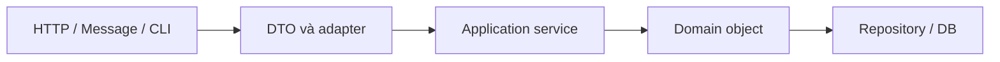

Mỗi nơi có trách nhiệm riêng:

| Lớp/ranh giới | Kiểm tra điển hình | Mục đích |
|---|---|---|
| **DTO/controller** | Field bắt buộc ở request, kiểu/format dữ liệu, phản hồi lỗi cho client | Phản hồi người dùng sớm, rõ ràng |
| **Application service** | Quyền thao tác, dữ liệu từ repository, điều phối nhiều đối tượng | Điều kiện sử dụng theo ca nghiệp vụ |
| **Domain object** | Quy tắc để chính đối tượng luôn hợp lệ | Chặn mọi đường tạo/cập nhật sai, kể cả gọi trực tiếp |
| **Repository/DB** | Unique constraint, foreign key, check constraint, tính nhất quán giao dịch | Bảo vệ sự thật dữ liệu qua nhiều tiến trình |

Ví dụ với Spring Boot và Bean Validation (giả sử project đã khai báo phụ thuộc Jakarta Validation):

```java
import jakarta.validation.constraints.Max;
import jakarta.validation.constraints.Min;
import jakarta.validation.constraints.NotBlank;

public record EnrollRequest(
    @NotBlank String courseCode,
    @Min(1) @Max(30) int credits
) {}
```

Controller có thể kích hoạt validation:

```java
import jakarta.validation.Valid;
import org.springframework.web.bind.annotation.PostMapping;
import org.springframework.web.bind.annotation.RequestBody;
import org.springframework.web.bind.annotation.RestController;

@RestController
class EnrollmentController {
    @PostMapping("/enrollments")
    public void create(@Valid @RequestBody EnrollRequest request) {
        CourseEnrollment enrollment =
            new CourseEnrollment(request.courseCode(), request.credits());
        // Giao cho service/repository theo kiến trúc ứng dụng
    }
}
```

`@Valid` giúp phản hồi request không hợp lệ tại HTTP boundary khi có integration Bean Validation thích hợp. Nhưng việc gọi trực tiếp:

```java
new CourseEnrollment("JAVA101", -3);
```

vẫn phải bị domain object từ chối, vì đối tượng có thể được khởi tạo từ message consumer, batch job, unit test hoặc một service khác mà **không đi qua HTTP controller**.

**Không nên coi mọi validation đều phải lặp giống hệt ở tất cả các lớp.** Ở DTO có thể kiểm tra yêu cầu dữ liệu đầu vào; ở domain bắt buộc giữ invariant; ở database bảo vệ các ràng buộc cần tính nhất quán toàn cục. Mỗi lớp bảo vệ trách nhiệm của mình.

## 10. Chọn loại exception cho đúng ý nghĩa

Java không bắt buộc một loại exception duy nhất cho mọi kiểm tra, nhưng một số quy ước thường dễ hiểu:

| Tình huống | Exception thường phù hợp | Ví dụ |
|---|---|---|
| Tham số không được `null` | `NullPointerException` qua `Objects.requireNonNull` hoặc `IllegalArgumentException` theo API | `Objects.requireNonNull(name, "name")` |
| Đối số có giá trị không hợp lệ | `IllegalArgumentException` | `credits = -1` |
| Thao tác không hợp lệ với trạng thái hiện tại | `IllegalStateException` hoặc exception nghiệp vụ chuyên biệt | Thanh toán đơn đã hủy |
| Truy cập phần tử ngoài giới hạn | `IndexOutOfBoundsException` | Chỉ số mảng/list sai |
| Vi phạm quy tắc nghiệp vụ cần báo lỗi có cấu trúc | Exception nghiệp vụ riêng | `InsufficientStockException` |

Một ví dụ rõ ràng:

```java
public void withdraw(long amount) {
    if (amount <= 0) {
        throw new IllegalArgumentException("Số tiền phải dương");
    }
    if (amount > balance) {
        throw new IllegalStateException("Số dư không đủ");
    }
    balance -= amount;
}
```

Ở đây giả sử `balance` là `long` không âm đã được constructor bảo vệ. `amount <= 0` là lỗi tham số; `amount > balance` là xung đột với trạng thái tài khoản hiện tại. Nếu cùng một thông tin được dùng để tạo phản hồi HTTP, lớp controller/exception handler có thể **ánh xạ lỗi** sang thông báo hoặc mã trạng thái thích hợp mà không đặt phụ thuộc HTTP vào domain object.

## 11. Kiểm tra đầu vào khác đồng bộ và transaction

Kiểm tra tại ranh giới giúp bảo vệ trạng thái **trong một luồng thực thi đã được phối hợp đúng**. Nó không tự giải quyết mọi vấn đề đồng thời hay nhất quán phân tán.

Ví dụ hai thread cùng thực hiện:

```java
if (available >= 1) {
    available--;
}
```

Nếu không có đồng bộ, hai thread có thể cùng nhìn thấy `available = 1` và cùng cho phép đặt chỗ. Quy tắc “không đặt vượt số chỗ” có thể bị phá vỡ ở cấp nghiệp vụ dù mỗi thread đã kiểm tra riêng.

Khi trạng thái được chia sẻ đồng thời, cần kết hợp validation với **khóa/đồng bộ/atomic operation** thích hợp. Khi trạng thái nằm trong cơ sở dữ liệu hoặc nhiều service, có thể cần transaction, optimistic/pessimistic locking, unique constraint hoặc các cơ chế nhất quán khác tùy tình huống.

Tương tự, một constructor có thể kiểm tra `userId` không rỗng, nhưng không thể tự khẳng định mã đó là duy nhất trong toàn bộ database chỉ bằng cách kiểm tra field. Ràng buộc duy nhất phải được xác nhận tại nguồn dữ liệu có thẩm quyền.

## 12. Những sai lầm dễ gặp

| Sai lầm | Vì sao nguy hiểm? | Cách sửa |
|---|---|---|
| Để field `private` rồi cho setter nhận mọi giá trị | Caller vẫn có thể tạo trạng thái sai | Validate ở từng mutator hoặc cung cấp operation theo nghiệp vụ |
| Chỉ validate ở controller | Các đường tạo object khác có thể bỏ qua controller | Domain tự bảo vệ invariant |
| Chỉ validate constructor, quên phương thức update | Đối tượng có thể hợp lệ lúc tạo nhưng sai sau đó | Tái sử dụng invariant khi đổi trạng thái |
| Gán field trước rồi mới validate field khác | Exception có thể để lại trạng thái dở dang | Validate toàn bộ phương án mới trước khi commit |
| Validate `List`/mảng rồi giữ nguyên tham chiếu mutable | Caller có thể sửa sau lúc kiểm tra | Defensive copy và kiểm soát getter |
| Dùng `final` với `List` và tưởng list bất biến | `final` không ngăn sửa nội dung được tham chiếu | Immutable collection, defensive copy hoặc thiết kế API hẹp |
| Chỉ kiểm tra số âm, không xét overflow | Tính toán có thể vượt miền giá trị | Kiểm tra điều kiện trước phép tính hoặc dùng `Math.*Exact` |
| Lặp regex/logic kiểm tra ở nhiều nơi | Dễ lệch quy tắc giữa các đường sử dụng | Value object/helper với hợp đồng thống nhất |
| Cho rằng validation loại bỏ race condition | Check và update có thể xen kẽ giữa thread | Đồng bộ nguyên tử theo invariant |

## 13. Bài tập tự kiểm tra

### Bài 1 — Tìm lỗi về tính nhất quán

```java
class Account {
    private long balance = 100;

    void transferOut(long amount) {
        balance -= amount;
        if (amount <= 0 || balance < 0) {
            throw new IllegalArgumentException("Transfer không hợp lệ");
        }
    }

    long balance() {
        return balance;
    }
}
```

**Câu hỏi:** Với `transferOut(200)`, sau khi ném exception, `balance` là bao nhiêu?

**Đáp án:** `-100`. Vì phép trừ xảy ra trước khi kiểm tra. Sửa bằng cách kiểm tra `amount <= 0` và `amount > balance` **trước** khi gán `balance -= amount`.

### Bài 2 — Kiểm tra cả quan hệ giữa các field

Cho lớp `DateRange` lưu `LocalDate start` và `LocalDate end`, với bất biến `start <= end`. Hãy thiết kế constructor và phương thức `changeRange(start, end)` sao cho:

1. Không chấp nhận `null`.
2. Không chấp nhận `start` sau `end`.
3. Nếu đầu vào sai, đối tượng giữ nguyên cả hai giá trị cũ.

Gợi ý:

```java
import java.time.LocalDate;
import java.util.Objects;

public final class DateRange {
    private LocalDate start;
    private LocalDate end;

    public DateRange(LocalDate start, LocalDate end) {
        changeRange(start, end);
    }

    public void changeRange(LocalDate newStart, LocalDate newEnd) {
        Objects.requireNonNull(newStart, "start");
        Objects.requireNonNull(newEnd, "end");
        if (newStart.isAfter(newEnd)) {
            throw new IllegalArgumentException("start phải <= end");
        }
        this.start = newStart;
        this.end = newEnd;
    }

    public LocalDate start() { return start; }
    public LocalDate end() { return end; }
}
```

`LocalDate` là kiểu giá trị immutable, nên trả trực tiếp tham chiếu tới `start`/`end` trong ví dụ không làm lộ đối tượng mutable. Khi cần an toàn trong đa luồng, vẫn phải xử lý cập nhật hai field như một thay đổi nhất quán trước các reader khác.

### Bài 3 — Ranh giới đối tượng ở đâu?

Một chương trình nhận `CreateUserRequest` từ REST API, tạo `User` rồi lưu xuống DB. REST đã dùng `@NotBlank` cho `username`.

**Hỏi:** Có cần kiểm tra `username` trong chính `User` không?

**Đáp án:** Có, nếu “username không rỗng” là **bất biến** của `User`. Đối tượng `User` có thể được tạo từ các đường khác ngoài REST. Trong khi đó, điều kiện “username duy nhất trong hệ thống” cần repository/DB hoặc cơ chế nhất quán phù hợp để bảo vệ cạnh tranh giữa nhiều yêu cầu.

---

**Ghi nhớ:** Bảo vệ đóng gói bằng cách **kiểm tra đầu vào tại mọi ranh giới có thể tạo hoặc thay đổi trạng thái**, tập trung vào invariant do đối tượng sở hữu. Chuẩn hóa và kiểm tra trước khi lưu; nếu cập nhật nhiều field, kiểm tra toàn bộ trước khi commit; nếu nhận dữ liệu mutable, kiểm soát tham chiếu bằng defensive copy. Với quy tắc liên quan nhiều đối tượng, database hoặc nhiều thread, kết hợp cơ chế ở đúng tầng chịu trách nhiệm.


</details>

- [Quay lại đầu trang](#back-to-top)

---

## <a id="encapsulation-006">Ngăn lộ dữ liệu nội bộ có thể thay đổi</a>

<details>
<summary>Xem chi tiết</summary>

# Ngăn lộ dữ liệu nội bộ có thể thay đổi trong Java

Trong lập trình hướng đối tượng, **đóng gói (encapsulation)** nghĩa là đối tượng kiểm soát cách trạng thái của chính nó được truy cập và thay đổi. Một lỗi phổ biến là khai báo trường `private` nhưng lại trả trực tiếp đối tượng mutable đang nằm trong trường đó hoặc giữ nguyên tham chiếu mutable mà bên ngoài truyền vào.

Ví dụ, một lớp có quy tắc “danh sách học viên không vượt sức chứa” sẽ mất quyền kiểm soát nếu bên ngoài có thể gọi `getStudents().add(...)` mà không đi qua phương thức đăng ký có kiểm tra.

**Mục tiêu của bài:** nhận diện khi nào một tham chiếu làm lộ trạng thái nội bộ; sử dụng defensive copy, các giá trị bất biến và API có kiểm soát để bảo vệ invariant của đối tượng.

## 1. Vì sao `private` vẫn có thể không an toàn?

Xét lớp sau:

```java
import java.util.List;

class UnsafeClassroom {
    private final List<String> students;

    UnsafeClassroom(List<String> students) {
        this.students = students;
    }

    List<String> getStudents() {
        return students;
    }
}
```

Trường `students` là `private final`, nhưng **đối tượng danh sách** vẫn có thể thay đổi. Có hai đường làm thay đổi dữ liệu bên trong mà không cần một setter nào:

```java
List<String> input = new java.util.ArrayList<>(List.of("An"));
UnsafeClassroom room = new UnsafeClassroom(input);

input.add("Bình");             // Đường 1: sửa qua tham chiếu gốc
room.getStudents().clear();    // Đường 2: sửa qua tham chiếu getter trả ra

System.out.println(input);     // []
System.out.println(room.getStudents()); // []
```

Cùng một danh sách được giữ bởi `input`, trường `students` và kết quả `getStudents()`. Phép gán tham chiếu không sao chép đối tượng.

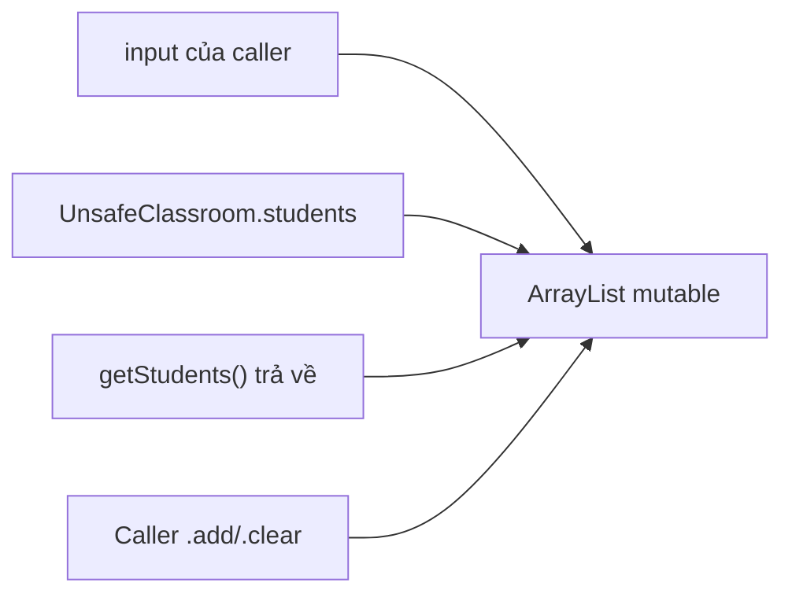

Dữ liệu bị lộ ở cả hai chiều:

- **Đầu vào (inbound aliasing):** constructor hoặc setter lưu nguyên tham chiếu của caller; caller còn giữ nó và có thể sửa về sau.
- **Đầu ra (outbound aliasing):** getter hay một phương thức trả trực tiếp tham chiếu nội bộ; caller sửa được đối tượng qua kết quả trả về.

Điều này không chỉ làm hỏng quy tắc nghiệp vụ. Nó còn gây lỗi khó tái hiện khi có nhiều thành phần cùng giữ tham chiếu, dẫn đến dữ liệu bị sửa ngoài dự kiến.

## 2. Một thiết kế an toàn: sửa qua hành vi, đọc qua snapshot

Lớp dưới đây cho phép **thay đổi danh sách học viên có kiểm soát** qua `enroll()`, nhưng giữ quyền quyết định mọi thay đổi nội bộ. Constructor sao chép đầu vào; getter trả về **snapshot không thể sửa cấu trúc**.

Lưu toàn bộ mã sau trong **`Main.java`**, chạy với Java 17 hoặc Java 21:

```java
import java.util.ArrayList;
import java.util.Arrays;
import java.util.HashSet;
import java.util.List;
import java.util.Objects;
import java.util.Set;

final class EnrollmentBook {
    private final int capacity;
    private final List<String> students;

    EnrollmentBook(int capacity, List<String> initialStudents) {
        if (capacity <= 0) {
            throw new IllegalArgumentException("Sức chứa phải dương");
        }
        Objects.requireNonNull(initialStudents, "initialStudents");

        // 1. Sao chép tham chiếu list của caller.
        List<String> copied = new ArrayList<>(initialStudents);
        if (copied.size() > capacity) {
            throw new IllegalArgumentException("Vượt sức chứa");
        }

        // 2. Kiểm tra dữ liệu trước khi công bố đối tượng.
        Set<String> unique = new HashSet<>();
        for (String student : copied) {
            validateName(student);
            if (!unique.add(student)) {
                throw new IllegalArgumentException("Học viên trùng");
            }
        }

        this.capacity = capacity;
        this.students = copied;
    }

    void enroll(String student) {
        validateName(student);
        if (students.size() >= capacity) {
            throw new IllegalStateException("Lớp đã đủ chỗ");
        }
        if (students.contains(student)) {
            throw new IllegalArgumentException("Học viên đã tồn tại");
        }
        students.add(student);
    }

    List<String> getStudents() {
        return List.copyOf(students);
    }

    int size() {
        return students.size();
    }

    private static void validateName(String student) {
        if (student == null || student.isBlank()) {
            throw new IllegalArgumentException("Tên học viên không hợp lệ");
        }
    }
}

final class Attachment {
    private final byte[] data;

    Attachment(byte[] original) {
        this.data = Objects.requireNonNull(original, "original").clone();
    }

    byte[] getData() {
        return data.clone();
    }
}

public class Main {
    public static void main(String[] args) {
        List<String> input = new ArrayList<>(List.of("An"));
        EnrollmentBook book = new EnrollmentBook(3, input);

        input.add("Bình"); // Chỉ thay đổi input của caller
        System.out.println(book.getStudents()); // [An]

        List<String> firstSnapshot = book.getStudents();
        try {
            firstSnapshot.add("Cường");
        } catch (UnsupportedOperationException ex) {
            System.out.println("Không thể sửa snapshot");
        }

        book.enroll("Bình"); // Thay đổi qua API kiểm soát
        System.out.println(firstSnapshot);      // [An]
        System.out.println(book.getStudents()); // [An, Bình]
        System.out.println(book.size());        // 2

        byte[] original = {1, 2, 3};
        Attachment attachment = new Attachment(original);
        original[0] = 9; // Không sửa dữ liệu đã lưu
        byte[] exposed = attachment.getData();
        exposed[1] = 8;  // Không sửa dữ liệu đã lưu
        System.out.println(Arrays.toString(attachment.getData()));
    }
}
```

Chạy:

```bash
javac Main.java
java Main
```

Kết quả:

```text
[An]
Không thể sửa snapshot
[An]
[An, Bình]
2
[1, 2, 3]
```

Lưu ý về ý nghĩa của ví dụ:

- `new ArrayList<>(initialStudents)` tách **danh sách nội bộ** khỏi danh sách mà caller còn giữ.
- `List.copyOf(students)` trả về danh sách không thể sửa cấu trúc với nội dung tại thời điểm gọi. Khi `book.enroll(...)` chạy, snapshot cũ `firstSnapshot` vẫn giữ `[An]`.
- Những người học trong ví dụ được biểu diễn bằng `String`, vốn bất biến, nên không có đường sửa thêm qua từng phần tử.
- `Attachment` cần `clone()` **cả khi nhận lẫn khi trả** mảng, vì `byte[]` luôn mutable.
- Lớp `EnrollmentBook` **vẫn là mutable**: điều được bảo vệ là quyền thay đổi qua API kiểm soát, không phải cấm mọi thay đổi.

## 3. Defensive copy ở đầu vào và đầu ra

**Defensive copy** là tạo bản sao dữ liệu ở ranh giới tin cậy, để mã khác không thể sửa trạng thái mà đối tượng cần sở hữu độc lập.

| Ranh giới | Mã dễ làm lộ dữ liệu | Cách bảo vệ điển hình |
| --- | --- | --- |
| Constructor nhận list | `this.items = items;` | `this.items = List.copyOf(items);` hoặc `new ArrayList<>(items)` |
| Setter nhận list | `this.items = items;` | Kiểm tra và sao chép trước khi lưu |
| Getter trả list mutable | `return items;` | `return List.copyOf(items);` hoặc `new ArrayList<>(items)` |
| Constructor nhận mảng | `this.bytes = bytes;` | `this.bytes = bytes.clone();` |
| Getter trả mảng | `return bytes;` | `return bytes.clone();` |
| Getter trả `Date` mutable | `return createdAt;` | Trả bản sao `new Date(createdAt.getTime())` hoặc thiết kế dùng `Instant` |
| Trả `Map` nội bộ | `return scores;` | `Map.copyOf(scores)` nếu dữ liệu bên trong an toàn |
| Trả object mutable lồng nhau | `return settings;` | Bản sao sâu phù hợp hoặc value object bất biến |

**Không phải trường hợp nào cũng dùng `List.copyOf`.** Nếu lớp muốn sửa collection nội bộ, có thể lưu `new ArrayList<>(input)` và chỉ sao chép khi trả ra. Nếu bản thân collection nội bộ phải bất biến, có thể lưu `List.copyOf(input)`. Lựa chọn tùy vào hành vi mà lớp cần hỗ trợ.

`List.copyOf`, `Set.copyOf`, `Map.copyOf` không chấp nhận phần tử hoặc khóa/giá trị `null` tương ứng theo hợp đồng. Khi dữ liệu có `null` hợp lệ, cần chọn một cấu trúc và cách sao chép phù hợp khác, với hợp đồng API rõ ràng.

## 4. Unmodifiable view không giống snapshot

Java có nhiều cách trả về dữ liệu chỉ đọc, nhưng hai cách sau không có cùng ý nghĩa:

```java
import java.util.ArrayList;
import java.util.Collections;
import java.util.List;

List<String> backing = new ArrayList<>(List.of("A"));

List<String> view = Collections.unmodifiableList(backing);
List<String> snapshot = List.copyOf(backing);

backing.add("B");

System.out.println(view);     // [A, B]
System.out.println(snapshot); // [A]
```

| Cơ chế | Caller có `add/remove` qua kết quả? | Thay đổi cấu trúc của list gốc có hiện ra? |
| --- | --- | --- |
| `return internalList;` | Có, nếu list mutable | Có; caller còn sửa được trực tiếp |
| `Collections.unmodifiableList(internalList)` | Không | **Có**: đây là view bám theo list gốc |
| `List.copyOf(internalList)` | Không | **Không**: giữ nội dung snapshot tại lúc sao chép |
| `new ArrayList<>(internalList)` | Có, trên bản sao riêng | **Không**: sửa bản sao không ảnh hưởng list gốc |

`Collections.unmodifiableList` rất hữu ích nếu chủ ý cho người dùng **quan sát trạng thái đang thay đổi** mà không cho sửa trực tiếp qua view. Tuy nhiên, nếu yêu cầu là “dữ liệu nhận được phải cố định sau lời gọi”, cần snapshot.

Một số lưu ý:

- `List.copyOf` có thể tái sử dụng một list vốn đã không thể sửa được, nên đừng giả định nó luôn tạo **một đối tượng list mới**.
- Cả unmodifiable view và snapshot **đều không tự biến phần tử mutable thành bất biến**.
- `new ArrayList<>(...)` tạo list độc lập về cấu trúc nhưng caller **được phép sửa bản sao**. Điều này có thể là hợp đồng API hợp lệ nếu người nhận cần thao tác trên dữ liệu riêng.

## 5. Một snapshot list vẫn có thể làm lộ phần tử

Khi phần tử mutable, `List.copyOf` và `new ArrayList<>(...)` chỉ sao chép **cấu trúc hoặc tham chiếu**, không tạo bản sao trạng thái từng phần tử:

```java
class MutableLesson {
    String title;
    MutableLesson(String title) { this.title = title; }
}

MutableLesson lesson = new MutableLesson("OOP");
java.util.List<MutableLesson> snapshot =
        java.util.List.copyOf(java.util.List.of(lesson));
lesson.title = "Đã đổi";
System.out.println(snapshot.get(0).title); // Đã đổi
```

Vậy phải kiểm tra **quyền sửa phần tử** chứ không chỉ `add/remove` của container. Nếu cần giữ lịch sử hoặc bản chụp ổn định, hãy chuyển mỗi phần tử thành value object bất biến (ví dụ `record Lesson(String title)` với kiểm tra trong constructor) hoặc copy những thành phần mutable cần thiết. Chiến lược deep copy theo đồ thị và biểu diễn immutable được phân tích riêng ở bài kế tiếp.

## 6. Thiết kế API đóng gói: chỉ công bố hành vi cần thiết

Thay vì trả thẳng `List<OrderLine>` mutable để bên gọi có thể tăng số lượng tùy ý, một lớp giỏ hàng nên cung cấp các hành vi:

```java
void addItem(String sku, int quantity);
void changeQuantity(String sku, int newQuantity);
void removeItem(String sku);
List<ItemView> getItems();  // ItemView là value object bất biến
```

Bên trong mỗi phương thức, lớp kiểm tra các quy tắc như `quantity > 0`, không trùng mã hoặc không vượt giới hạn đặt hàng. Getter chỉ trả dữ liệu cần hiển thị, không trao cho caller quyền phá vỡ quy tắc nghiệp vụ.

Không phải lúc nào getter cũng cần tạo toàn bộ bản sao lớn. Một API có thể trả:

- Giá trị nguyên thủy hoặc immutable value (`int`, `String`, `LocalDate`).
- Snapshot bất biến gồm các phần tử cũng bất biến.
- Kết quả tính toán hoặc DTO chỉ chứa dữ liệu cần thiết.
- Read-only view **nếu đã chủ đích chấp nhận dữ liệu thay đổi theo thời gian**.
- Trình lặp/luồng dữ liệu có hợp đồng rõ về khả năng thay đổi và vòng đời.

Đừng công bố một trường `public final List<...>` chỉ vì trường đó không thể gán lại. Chính list vẫn có thể bị thêm, xóa hoặc sửa phần tử.

## 7. Nhận diện rò rỉ theo loại dữ liệu

| Kiểu dữ liệu | Đường rò rỉ phổ biến | Cách quan sát/phòng vệ |
| --- | --- | --- |
| `byte[]`, `int[]` | Constructor giữ mảng, getter trả thẳng mảng | `clone()` ở cả hai chiều (phần tử nguyên thủy) |
| `MutableItem[]` | Clone mảng nhưng phần tử vẫn chia sẻ | Xem tiếp trạng thái của từng phần tử |
| `java.util.Date` | Caller gọi `setTime()` trên tham chiếu chung | Copy `new Date(date.getTime())`, hoặc dùng `Instant` |
| `List<T>` | Getter trả `ArrayList`; constructor giữ input list | Snapshot/copy với chính sách phần tử phù hợp |
| `Map<K,V>`, `Set<T>` | Trả nội bộ hoặc chia sẻ key/value mutable | `copyOf` chỉ bảo vệ cấu trúc; vẫn xét object lồng nhau |

Ví dụ `Collections.unmodifiableMap(internal)` chỉ là view, vẫn nhìn thấy cập nhật của map nội bộ. Ngược lại, `Map.copyOf(internal)` tạo snapshot cấu trúc theo hợp đồng nhưng không sao chép sâu key/value. Đặc biệt tránh thay đổi field tham gia `equals/hashCode` của key trong `HashMap`, vì tra cứu có thể hỏng.

Đối với API cũ buộc dùng `Date` và mảng, sao chép tại ranh giới thường cần thiết. Đối với mô hình mới, `Instant`, value object bất biến và API truy vấn hẹp thường làm quyền sở hữu dữ liệu dễ hiểu hơn.

## 8. Giới hạn của defensive copy và những lỗi cần tránh

| Nhầm lẫn | Hậu quả | Cách nghĩ đúng |
| --- | --- | --- |
| Trường `private` đồng nghĩa không thể sửa từ bên ngoài | Vẫn lộ nếu giữ/trả tham chiếu mutable | Kiểm tra mọi đường vào/ra của tham chiếu |
| Có `final` là dữ liệu bất biến | Chỉ chặn gán lại biến/trường | Bảo vệ chính đối tượng được tham chiếu |
| `Collections.unmodifiableList()` tạo snapshot | Thấy thay đổi của backing list | Dùng `List.copyOf()` nếu cần nội dung cố định |
| `List.copyOf()` sao chép luôn phần tử | Phần tử mutable vẫn bị sửa | Chọn immutable element hoặc deep copy |
| Sao chép chỉ trong getter | Caller vẫn sửa qua tham chiếu constructor nhận | Phòng vệ cả đầu vào và đầu ra |
| Sao chép chỉ trong constructor | Getter vẫn trả mảng/list nội bộ mutable | Không trả trực tiếp tham chiếu mutable |
| Getter trả bản sao rồi sửa bản sao để cập nhật đối tượng | Thay đổi không tác động tới trạng thái thật | Cập nhật bằng phương thức nghiệp vụ |
| Gọi `clone()` ở mọi nơi | Sao chép nông hoặc không hỗ trợ | Chọn chiến lược sao chép theo kiểu dữ liệu |
| Copy collection trong lúc luồng khác đang sửa | Snapshot có thể lỗi hoặc không nhất quán | Phối hợp đồng bộ phù hợp trước khi chụp snapshot |
| Tạo bản sao rất lớn cho mỗi lần đọc | Tăng CPU, bộ nhớ và áp lực GC | Xem xét immutable model, view có hợp đồng rõ hoặc API truy vấn hẹp |

**Defensive copy không tự làm lớp thread-safe.** Nếu một luồng cập nhật `ArrayList` trong khi luồng khác gọi `List.copyOf`, vẫn có thể có race condition, dữ liệu không nhất quán hoặc ngoại lệ. Khi nhiều luồng truy cập cùng trạng thái mutable, cần đồng bộ hoặc chọn cấu trúc dữ liệu phù hợp; snapshot phải được tạo dưới cơ chế bảo vệ trạng thái nhất quán.

Một vấn đề tương tự có thể xuất hiện nếu caller đồng thời sửa collection trong lúc constructor đang sao chép nó. Nếu đầu vào được chia sẻ giữa nhiều luồng, bên gọi và bên nhận cần thỏa thuận về đồng bộ/ownership thay vì kỳ vọng `new ArrayList<>(input)` tự khắc phục tranh chấp.

## 9. Chi phí hiệu năng và quyết định thiết kế

Sao chép một list có `n` phần tử thường cần **O(n)** thời gian và bộ nhớ cho cấu trúc list sao chép. Nếu gọi một getter snapshot hàng nghìn lần trên collection rất lớn, chi phí có thể đáng kể. Nhưng bỏ phòng vệ chỉ để giảm cấp phát có thể phá invariant và gây lỗi khó kiểm soát.

Có thể cân nhắc:

- Chụp snapshot một lần ở ranh giới request hoặc transaction thay vì mỗi thao tác đọc nhỏ.
- Trả về **dữ liệu tối thiểu** thực sự cần, như `size()`, `containsStudent(id)` hoặc một DTO được tính sẵn.
- Mô hình dữ liệu bất biến, cache snapshot được cập nhật khi trạng thái thay đổi, hoặc persistent collection khi ứng dụng có yêu cầu rõ.
- Giữ mutable state bên trong lớp và dùng thao tác nghiệp vụ để chỉnh sửa, thay vì trao trực tiếp collection cho mọi caller.

Bảo vệ trạng thái nên là **hợp đồng thiết kế có chủ đích**: caller được quyền quan sát gì, có được giữ kết quả lâu dài không, có được sửa bản trả ra không, và khi dữ liệu nội bộ thay đổi thì kết quả cũ có phản ánh thay đổi hay không?

## 10. Kiểm thử rò rỉ trạng thái nội bộ

Có thể kiểm thử trực tiếp hai chiều rò rỉ dữ liệu cho một lớp như `EnrollmentBook`:

```java
List<String> input = new ArrayList<>(List.of("An"));
EnrollmentBook book = new EnrollmentBook(2, input);

// Thử thay đổi dữ liệu caller đã đưa vào.
input.add("Bình");
if (book.size() != 1) {
    throw new AssertionError("Constructor làm lộ trạng thái");
}

// Thử thay đổi dữ liệu do getter trả về.
List<String> snapshot = book.getStudents();
try {
    snapshot.add("Cường");
    throw new AssertionError("Getter cho phép sửa snapshot");
} catch (UnsupportedOperationException expected) {
    // Đúng hợp đồng: kết quả không cho sửa cấu trúc.
}

// Thay đổi qua API chính thức không làm đổi snapshot cũ.
book.enroll("Bình");
if (!snapshot.equals(List.of("An"))) {
    throw new AssertionError("Snapshot cũ bị thay đổi");
}
```

Đoạn kiểm thử này dùng riêng trong một phương thức, ví dụ `main`, khi lớp `EnrollmentBook` đã được khai báo. Với trường chứa phần tử mutable, kiểm thử cần tiến thêm một bước: thay đổi trường của **phần tử** thông qua tham chiếu bên ngoài rồi xác nhận trạng thái bên trong vẫn được bảo vệ.

## 11. Câu hỏi tự kiểm tra

**1.** `private final List<String> students;` rồi `return students;` đã đảm bảo đóng gói chưa?

**Trả lời:** Chưa, nếu list là mutable. Caller có thể `add/remove/clear` trực tiếp qua tham chiếu được trả về.

**2.** Constructor dùng `this.students = List.copyOf(input)` nhưng getter trả `students`. Điều này có ổn không?

**Trả lời:** Có thể ổn khi các phần tử cũng bất biến (như `String`) và lớp giữ list không thể sửa cấu trúc. Tuy nhiên cần kiểm tra các đối tượng phần tử trước khi kết luận lớp bất biến sâu.

**3.** `Collections.unmodifiableList(internal)` có ngăn người đang giữ `internal` sửa nó không?

**Trả lời:** Không. Nó chỉ ngăn thay đổi **qua view**; các cập nhật trên backing list vẫn được phản ánh trong view.

**4.** `byte[] getBytes() { return bytes.clone(); }` có đủ nếu constructor gán `this.bytes = input;` không?

**Trả lời:** Chưa. Caller còn giữ `input` và có thể sửa mảng nội bộ. Phải sao chép cả khi nhận vào.

**5.** Một `List<MutableLesson>` đã `List.copyOf` có thể bị thay đổi tiêu đề một phần tử không?

**Trả lời:** Có, nếu bên ngoài vẫn giữ tham chiếu đến chính `MutableLesson`. Cần phần tử bất biến hoặc sao chép sâu theo hợp đồng.

**6.** Nếu lớp cần cập nhật học viên, có bắt buộc biến nó thành immutable không?

**Trả lời:** Không. Lớp có thể mutable nhưng trạng thái được đóng gói: dùng `enroll/remove` để kiểm tra quy tắc, và chỉ trả snapshot hoặc kết quả đọc an toàn.

**Ghi nhớ:** Quyền truy cập `private` che tên trường, nhưng **không tự che đối tượng mutable** được trường tham chiếu. Để ngăn lộ dữ liệu nội bộ, kiểm soát tham chiếu ở **cả đầu vào và đầu ra**, cân nhắc trạng thái của các phần tử lồng nhau và công bố hành vi nghiệp vụ thay vì phát tán trực tiếp cấu trúc dữ liệu có thể sửa.


</details>

- [Quay lại đầu trang](#back-to-top)

---

## <a id="encapsulation-007">Sao chép phòng vệ và biểu diễn bất biến</a>

<details>
<summary>Xem chi tiết</summary>

# Sao chép phòng vệ và biểu diễn bất biến trong Java

Trong OOP, **đóng gói** không dừng ở việc khai báo field là `private`. Nếu một đối tượng giữ tham chiếu đến dữ liệu *có thể thay đổi* (mutable) do nơi khác sở hữu, hoặc trả tham chiếu mutable nội bộ qua getter, mã bên ngoài vẫn có thể phá vỡ trạng thái của đối tượng mà không cần gọi setter.

**Sao chép phòng vệ (defensive copying)** là tạo bản sao tại ranh giới nhận/trả dữ liệu để ngăn thay đổi ngoài ý muốn. **Biểu diễn bất biến (immutable representation)** là lựa chọn cách lưu và công bố trạng thái sao cho sau khi tạo xong, trạng thái có thể quan sát của đối tượng không đổi.

Hai kỹ thuật liên quan nhưng khác nhau:

- Defensive copy kiểm soát **chia sẻ tham chiếu** với dữ liệu mutable.
- Immutable representation kiểm soát **khả năng thay đổi trạng thái**; nó thường dùng kiểu bất biến, giá trị nguyên thủy và các collection snapshot của phần tử bất biến.
- Có trường hợp cần bản sao khi nhận **và** khi trả; chỉ bảo vệ một chiều không đủ.
- Một đối tượng có `private final` field vẫn có thể thay đổi trạng thái quan sát được nếu field ấy tham chiếu đối tượng mutable.

Bài này sử dụng Java 11+ (để dùng `String.isBlank()` và `List.copyOf()`). Ví dụ thực tế là chụp lại lịch sự kiện để lưu bản ghi cố định, ngay cả khi màn hình nhập liệu tiếp tục chỉnh sửa danh sách người tham gia.

## 1. Vì sao `private final` chưa đảm bảo bất biến?

Ví dụ sau có hai đường “rò rỉ” tham chiếu:

```java
import java.util.Date;

public final class UnsafeReminder {
    private final Date remindAt;

    public UnsafeReminder(Date remindAt) {
        this.remindAt = remindAt; // Giữ đúng đối tượng Date bên ngoài truyền vào
    }

    public Date getRemindAt() {
        return remindAt; // Trả đúng Date nội bộ ra ngoài
    }
}
```

Đoạn sử dụng:

```java
Date supplied = new Date(1_000L);
UnsafeReminder reminder = new UnsafeReminder(supplied);

supplied.setTime(2_000L); // Sửa qua tham chiếu mà constructor nhận
System.out.println(reminder.getRemindAt().getTime()); // 2000

reminder.getRemindAt().setTime(3_000L); // Sửa qua tham chiếu getter làm lộ
System.out.println(reminder.getRemindAt().getTime()); // 3000
```

Không có phương thức `setRemindAt` và field là `private final`, nhưng thời điểm nhắc vẫn thay đổi. `final` chỉ cấm gán lại biến `remindAt` thành một tham chiếu khác; nó **không đóng băng đối tượng `Date`** đang được tham chiếu.

Có hai đường cần kiểm soát:

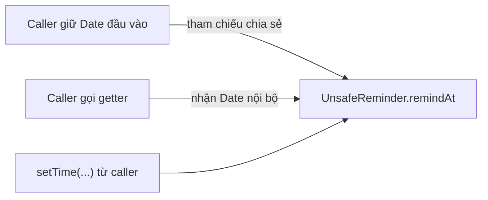

Với đối tượng mutable, đóng gói bị phá vỡ ngay cả khi không nhìn thấy field trực tiếp.

## 2. Defensive copy ở cả constructor và getter

Thay vì chia sẻ cùng một `Date`, lớp tạo bản sao khi nhận đầu vào và khi trả kết quả:

```java
import java.util.Date;
import java.util.Objects;

public final class SafeReminder {
    private final Date remindAt;

    public SafeReminder(Date remindAt) {
        Objects.requireNonNull(remindAt, "remindAt");
        this.remindAt = new Date(remindAt.getTime());
    }

    public Date getRemindAt() {
        return new Date(remindAt.getTime());
    }
}
```

Kiểm chứng:

```java
Date source = new Date(1_000L);
SafeReminder reminder = new SafeReminder(source);

source.setTime(2_000L);
Date returned = reminder.getRemindAt();
returned.setTime(3_000L);

System.out.println(reminder.getRemindAt().getTime()); // 1000
```

| Ranh giới | Cách làm | Lỗi được ngăn |
| --- | --- | --- |
| **Đầu vào** | `new Date(remindAt.getTime())` | Caller sửa `source` sau khi truyền vào |
| **Đầu ra** | `return new Date(remindAt.getTime())` | Caller sửa `Date` lấy qua getter |
| Trạng thái nội bộ | `private final Date remindAt`; không cung cấp thao tác tự sửa | Mã bên ngoài không thay đổi thời điểm đã chụp |

Lớp này **bất biến theo hành vi có thể quan sát** nếu chính lớp không sửa `remindAt`: mọi lần gọi getter đều thể hiện một thời điểm. Tuy nhiên, biểu diễn bên trong vẫn dùng một đối tượng `Date` vốn mutable. Có cách biểu diễn đơn giản hơn ở phần tiếp theo.

### Chọn biểu diễn thực sự bất biến thay vì cứ sao chép

Nếu mục đích chỉ là lưu một thời điểm, Java có kiểu `Instant` bất biến (`java.time`):

```java
import java.time.Instant;
import java.util.Objects;

public final class Reminder {
    private final Instant remindAt;

    public Reminder(Instant remindAt) {
        this.remindAt = Objects.requireNonNull(remindAt, "remindAt");
    }

    public Instant getRemindAt() {
        return remindAt; // Chia sẻ kiểu bất biến là an toàn
    }

    public Reminder reschedule(Instant newTime) {
        return new Reminder(newTime); // Trả instance mới
    }
}
```

Gọi `remindAt.plusSeconds(60)` trả một `Instant` mới; đối tượng `Instant` cũ không bị sửa. Vì thế không cần copy mỗi khi getter trả `Instant`. Một lựa chọn khác là lưu `private final long epochMillis` và chuyển đổi tại ranh giới API; primitive `long` không chứa tham chiếu tới trạng thái mutable.

**Nguyên tắc:** ưu tiên kiểu bất biến phù hợp nếu có. Defensive copy có ý nghĩa khi vẫn cần tương tác với API cung cấp kiểu mutable như `Date`, array hoặc collection có phần tử mutable.

## 3. Bản sao nông (shallow copy) khác bản sao sâu (deep copy)

Hãy xem một danh sách chứa các đối tượng mutable:

```java
import java.util.ArrayList;
import java.util.List;

class GuestDraft {
    String name;

    GuestDraft(String name) {
        this.name = name;
    }
}

List<GuestDraft> input = new ArrayList<>();
input.add(new GuestDraft("An"));

List<GuestDraft> copy = new ArrayList<>(input);

System.out.println(input == copy);            // false
System.out.println(input.get(0) == copy.get(0)); // true

copy.get(0).name = "Bình";
System.out.println(input.get(0).name);        // Bình
```

`new ArrayList<>(input)` tạo danh sách mới, nhưng chỉ **sao chép các tham chiếu phần tử**. Do đó hai danh sách có cấu trúc riêng, còn phần tử `GuestDraft` đầu tiên vẫn chia sẻ.

| Cách làm | Container có độc lập? | Phần tử mutable có độc lập? |
| --- | --- | --- |
| `List<T> b = a` | Không | Không |
| `new ArrayList<>(a)` | Có | Không |
| `List.copyOf(a)` | Có snapshot cấu trúc về mặt ngữ nghĩa, không sửa được | Không, nếu phần tử mutable |
| Tạo list mới và copy mỗi phần tử mutable | Có | Có, đối với các phần tử đã sao chép đúng |
| Tạo list mới chứa các giá trị vốn bất biến | Có | An toàn khi chia sẻ các giá trị bất biến |

“Deep copy” không có nghĩa Java tự động sao chép toàn bộ mọi đối tượng có thể truy cập. Cần **xác định đồ thị đối tượng nào thuộc sở hữu của lớp**, phần nào mutable và phần nào phải tách khỏi caller. Với đồ thị có chu trình, quan hệ tham chiếu chung, tài nguyên ngoài hoặc thực thể định danh, deep copy tổng quát vừa khó vừa có thể sai ngữ nghĩa nghiệp vụ.

Ví dụ, sao chép một `BankAccount` “sâu” có thể làm xuất hiện hai instance cùng đại diện một tài khoản thật, gây hiểu nhầm rằng hai số dư độc lập là hợp lệ. Khi muốn lưu thông tin tài khoản tại một thời điểm, nên tạo **snapshot giá trị** (mã tài khoản, số dư đã quan sát, thời điểm), thay vì tự nhân bản thực thể nghiệp vụ.

## 4. Ví dụ hoàn chỉnh: lịch sự kiện có bản chụp bất biến

Yêu cầu: form đăng ký sự kiện sử dụng `Date` mutable và danh sách `AttendeeDraft` có thể sửa tên. Sau khi xác nhận, tạo `EventSnapshot` giữ **thời điểm và danh sách người tham gia như ở lúc xác nhận**. Mọi thay đổi từ form sau đó không được làm biến đổi bản chụp.

Điều kiện thiết kế:

1. Thời điểm sự kiện đã chụp không đổi.
2. Danh sách tham gia không thể bị thêm/xóa qua API snapshot.
3. Từng người tham gia trong snapshot cũng phải bất biến, không chỉ riêng list.
4. Dữ liệu không hợp lệ bị từ chối lúc xây dựng; không lưu danh sách dở dang có thể bị caller sửa tiếp.
5. Có thể đọc snapshot mà không cần caller sao chép thêm đối tượng.

### Tệp `EventSnapshot.java`

```java
import java.util.ArrayList;
import java.util.Date;
import java.util.List;
import java.util.Objects;

public final class EventSnapshot {
    private final Date startsAt;
    private final List<Attendee> attendees;

    public EventSnapshot(Date startsAt, List<AttendeeDraft> drafts) {
        Objects.requireNonNull(startsAt, "startsAt");
        Objects.requireNonNull(drafts, "drafts");

        // Sao chép Date của caller trước khi giữ lại.
        Date startCopy = new Date(startsAt.getTime());

        // Sao chép *từng phần tử mutable* thành giá trị bất biến.
        List<Attendee> values = new ArrayList<>();
        for (AttendeeDraft draft : drafts) {
            Objects.requireNonNull(draft, "draft");
            values.add(new Attendee(draft.getId(), draft.getName()));
        }

        this.startsAt = startCopy;
        this.attendees = List.copyOf(values);
    }

    public Date getStartsAt() {
        return new Date(startsAt.getTime());
    }

    public List<Attendee> getAttendees() {
        // An toàn vì list không sửa được và Attendee bất biến.
        return attendees;
    }

    // Giá trị bất biến bên trong snapshot.
    public static final class Attendee {
        private final String id;
        private final String name;

        private Attendee(String id, String name) {
            this.id = requireText(id, "id");
            this.name = requireText(name, "name");
        }

        public String getId() {
            return id;
        }

        public String getName() {
            return name;
        }
    }

    // Chỉ dùng làm dữ liệu nhập, cố ý cho phép đổi tên.
    public static final class AttendeeDraft {
        private final String id;
        private String name;

        public AttendeeDraft(String id, String name) {
            this.id = requireText(id, "id");
            this.name = requireText(name, "name");
        }

        public String getId() {
            return id;
        }

        public String getName() {
            return name;
        }

        public void rename(String newName) {
            name = requireText(newName, "name");
        }
    }

    private static String requireText(String value, String field) {
        Objects.requireNonNull(value, field);
        String text = value.strip();
        if (text.isBlank()) {
            throw new IllegalArgumentException(field + " không được trống");
        }
        return text;
    }
}
```

Quan sát cấu trúc:

- `EventSnapshot` là `final` và không cung cấp setter; hai field của nó là `private final`.
- `Date` được copy ở constructor **và** getter. Nếu chỉ copy ở constructor nhưng getter trả thẳng field, caller vẫn sửa được; nếu chỉ copy ở getter, đối tượng đầu vào vẫn có thể tác động tới snapshot.
- `List.copyOf(values)` tạo snapshot cấu trúc list không sửa được, trong khi các `Attendee` bên trong có `String` bất biến và field `final`.
- `AttendeeDraft` là đối tượng mutable của bước nhập liệu. Constructor tạo **`Attendee` mới cho từng draft**, không giữ tham chiếu tới `AttendeeDraft`.
- `requireText` kiểm tra dữ liệu tại thời điểm tạo. Mã bên ngoài không có cách sửa `id` hoặc `name` bên trong một `Attendee` đã chụp.
- Mã lớp chính không trả thẳng một `ArrayList` mutable. Trả list bất biến chứa phần tử bất biến được vì caller không thể làm thay đổi trạng thái snapshot qua đường này.

### Tệp `Demo.java`

```java
import java.util.ArrayList;
import java.util.Date;
import java.util.List;

public class Demo {
    public static void main(String[] args) {
        Date dateFromForm = new Date(1_000L);
        EventSnapshot.AttendeeDraft an =
                new EventSnapshot.AttendeeDraft("U01", "An");

        List<EventSnapshot.AttendeeDraft> formAttendees =
                new ArrayList<>();
        formAttendees.add(an);

        EventSnapshot snapshot =
                new EventSnapshot(dateFromForm, formAttendees);

        // Form được sửa sau lúc xác nhận.
        dateFromForm.setTime(2_000L);
        an.rename("Bình");
        formAttendees.add(
                new EventSnapshot.AttendeeDraft("U02", "Chi"));

        // Caller thử sửa Date lấy từ getter.
        snapshot.getStartsAt().setTime(3_000L);

        System.out.println(snapshot.getStartsAt().getTime());
        System.out.println(snapshot.getAttendees().size());
        System.out.println(snapshot.getAttendees().get(0).getName());

        try {
            snapshot.getAttendees().clear();
        } catch (UnsupportedOperationException expected) {
            System.out.println("Không cho sửa danh sách snapshot");
        }
    }
}
```

Biên dịch/chạy bằng JDK 11+:

```bash
javac EventSnapshot.java Demo.java
java Demo
```

Kết quả:

```text
1000
1
An
Không cho sửa danh sách snapshot
```

Sự khác biệt của ba loại dữ liệu rõ ràng:

| Dữ liệu | Sau khi sửa form | Snapshot trả về |
| --- | --- | --- |
| `dateFromForm` | 2000 | `getStartsAt().getTime() == 1000` |
| `an.name` | Bình | `getAttendees().get(0).getName()` là An |
| `formAttendees.size()` | 2 | `getAttendees().size()` là 1 |
| `Date` trả từ getter | Caller đổi thành 3000 | Lần getter kế tiếp vẫn 1000 |
| List từ getter | `clear()` ném ngoại lệ | Dữ liệu snapshot giữ nguyên |

### Đường đi của dữ liệu

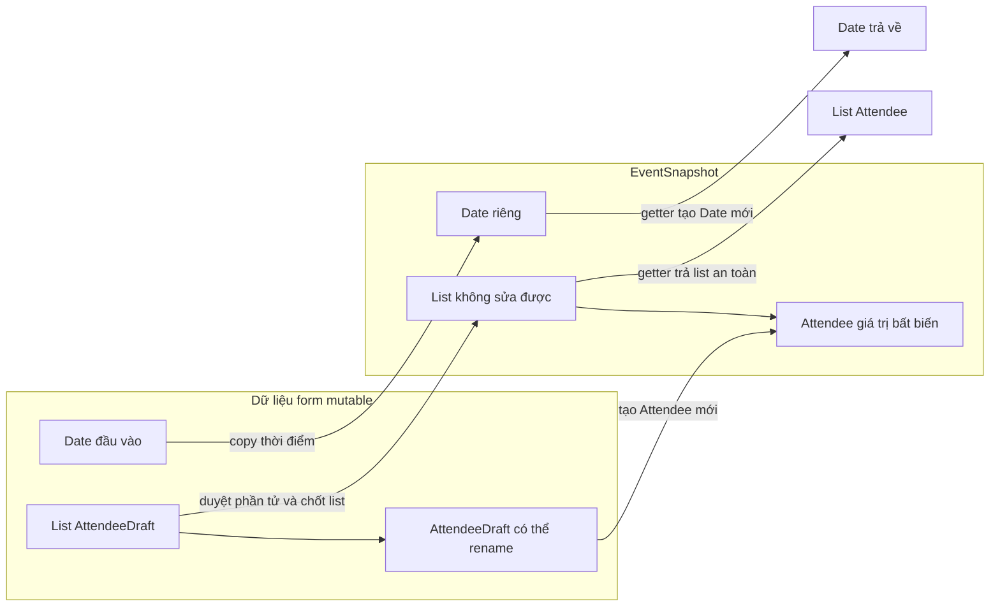

Sơ đồ minh họa ý nghĩa sở hữu dữ liệu, không mô tả địa chỉ bộ nhớ hay cấu trúc nội bộ của các lớp collection.

## 5. `Collections.unmodifiableList` và `List.copyOf` khác nhau ở điểm nào?

Hai API đều có thể làm caller không sửa list thông qua tham chiếu nhận được, nhưng **không bảo vệ cùng một kiểu thay đổi**.

```java
import java.util.ArrayList;
import java.util.Collections;
import java.util.List;

List<String> source = new ArrayList<>();
source.add("A");

List<String> view = Collections.unmodifiableList(source);
List<String> snapshot = List.copyOf(source);

source.add("B");

System.out.println(view);     // [A, B]
System.out.println(snapshot); // [A]
```

- `Collections.unmodifiableList(source)` tạo **view không cho sửa qua view**, nhưng vẫn theo dõi các thay đổi từ `source`.
- `List.copyOf(source)` có ngữ nghĩa **snapshot cấu trúc** tại thời điểm gọi (có thể tái sử dụng một instance vốn đã không sửa được). Thêm/xóa vào list gốc sau đó không làm thay đổi list kết quả.
- **Cả hai đều không tự deep copy các phần tử mutable.** Nếu list chứa `AttendeeDraft`, gọi `rename()` trên phần tử được chia sẻ vẫn có thể làm thay đổi dữ liệu quan sát qua list.
- `List.copyOf` từ chối phần tử `null`. Khi cần giữ `null`, phải chọn biểu diễn hoặc chính sách validation khác một cách có chủ đích.

Với dữ liệu `List<String>` hoặc `List<Attendee>` bất biến như ví dụ trên, `List.copyOf` là lựa chọn gọn và an toàn để công bố snapshot; với `List<MutableItem>` phải xử lý phần tử trước.

### Phương án getter trả bản sao của list mutable

Nếu không thể thay thế element type, có thể cần copy mỗi phần tử cả khi nhận và khi trả:

```java
import java.util.ArrayList;
import java.util.List;

static List<java.util.Date> copyDates(List<java.util.Date> input) {
    List<java.util.Date> result = new ArrayList<>();
    for (java.util.Date date : input) {
        result.add(new java.util.Date(date.getTime()));
    }
    return result;
}
```

Khi lưu `private final List<Date> dates = copyDates(input)`, getter nên trả `copyDates(dates)` nếu muốn tránh lộ từng `Date` mutable. Nhưng thiết kế này phải sao chép lặp lại và dễ quên ranh giới. Nếu chuyển sang `List<Instant>`, vừa gọn hơn vừa dễ giữ bất biến.

## 6. Array, map, set và dữ liệu lồng nhau

### Array

Một array có thể thay đổi từng phần tử hoặc vị trí:

```java
public final class TagSet {
    private final String[] tags;

    public TagSet(String[] tags) {
        this.tags = tags.clone(); // Copy khi nhận
    }

    public String[] getTags() {
        return tags.clone();      // Copy khi trả
    }
}
```

Với `String[]`, clone đủ cho mục tiêu này vì mỗi `String` bất biến. Với `Date[]`, clone chỉ sao chép **các tham chiếu phần tử**, vẫn phải copy từng `Date` nếu cần độc lập hoàn toàn. Array đa chiều cũng tương tự: `matrix.clone()` chỉ tạo outer array mới.

Nên kiểm tra `null` và các bất biến của từng phần tử trong constructor của lớp dùng trong sản phẩm; ví dụ `TagSet` tập trung vào hành vi clone để dễ quan sát.

### Map và Set

`Map.copyOf(map)` và `Set.copyOf(set)` tạo container không sửa được và tách cấu trúc khỏi các thay đổi tiếp theo của đầu vào; chúng **không tự deep copy** key/value/element mutable. Với `HashMap`, không nên dùng đối tượng làm key rồi thay đổi field tham gia `equals`/`hashCode`: thao tác tra cứu có thể không còn hoạt động đúng vì vị trí băm được quyết định theo hash cũ.

### Object graph

Nếu một `Order` giữ `List<OrderLine>`, mỗi `OrderLine` lại giữ `Product` có thể đổi giá, việc chỉ copy `Order` và `List` không đảm bảo tổng giá trị chụp vẫn cố định.

Trong trường hợp cần báo cáo cố định, hãy lưu:

```java
final class OrderLineSnapshot {
    final String productCode;
    final long unitPriceVnd;
    final int quantity;

    OrderLineSnapshot(String productCode, long unitPriceVnd,
                      int quantity) {
        this.productCode = productCode;
        this.unitPriceVnd = unitPriceVnd;
        this.quantity = quantity;
    }
}
```

Các field ở đây là giá trị nguyên thủy hoặc `String` bất biến; không giữ đối tượng `Product` mutable. Trong sản phẩm thực tế cần bổ sung validation cho giá/số lượng và các chính sách số học. Ý tưởng quan trọng là **chụp những giá trị nghiệp vụ cần bất biến**, thay vì cố sao chép toàn bộ đồ thị đối tượng một cách mù quáng.

## 7. Phân biệt “bất biến” với “không sửa được qua một tham chiếu”

| Thuật ngữ | Ý nghĩa | Ví dụ |
| --- | --- | --- |
| **Mutable object** | Trạng thái của instance có thể thay đổi | `Date`, `ArrayList`, `StringBuilder` |
| **Immutable object** | Trạng thái có thể quan sát không đổi sau khi tạo | `String`, `Instant`, một snapshot được thiết kế đúng |
| **Unmodifiable view** | Không sửa container thông qua view, nhưng nguồn có thể thay đổi | `Collections.unmodifiableList(source)` |
| **Structural snapshot** | Tách cấu trúc container ở thời điểm chụp | `List.copyOf(source)` |
| **Shallow copy** | Copy lớp vỏ/container, giữ tham chiếu các phần tử | `new ArrayList<>(source)` |
| **Defensive copy** | Copy ở ranh giới để bảo vệ quyền sở hữu và bất biến | `new Date(input.getTime())` trong constructor/getter |
| **Deep copy theo phạm vi cần thiết** | Copy cả phần mutable bên trong cần tách khỏi bên ngoài | Đổi mỗi `AttendeeDraft` thành `Attendee` mới |

Một lớp không tự động bất biến vì nó có tên `ImmutableSomething`, dùng `final class`, mọi field `private final`, hoặc getter trả collection không sửa được. Muốn kết luận bất biến phải xét **toàn bộ đường mà caller có thể sửa dữ liệu** và mọi tham chiếu mutable lồng nhau.

Trong Java 16+ có `record` giúp viết đối tượng chứa dữ liệu ngắn gọn, nhưng record cũng **không deep copy tự động**:

```java
// Java 16+
import java.util.List;

public record TeamSnapshot(List<String> members) {
    public TeamSnapshot {
        members = List.copyOf(members);
    }
}
```

Ở đây record chụp lại cấu trúc `List<String>` trong canonical constructor; accessor trả về list đã không sửa được. Nếu thay `String` bằng đối tượng mutable, phải xử lý cả phần tử và có thể cần constructor/accessor tùy chỉnh. Cú pháp `record` chỉ giúp giảm boilerplate, không thay thế thiết kế quyền sở hữu dữ liệu.

## 8. Đưa việc sao chép vào đúng ranh giới

Không phải mọi thứ đều cần sao chép. Copy tốn thời gian và bộ nhớ, nhất là với đồ thị lớn hoặc dữ liệu mà ứng dụng **cố ý chia sẻ**. Hãy chọn theo hợp đồng API.

| Tình huống | Lựa chọn hợp lý |
| --- | --- |
| Field nhận đối tượng mutable mà lớp muốn sở hữu độc lập | Defensive copy ở constructor/setter thích hợp |
| Getter không được làm lộ đối tượng mutable nội bộ | Copy ở getter hoặc trả kiểu bất biến |
| Danh sách giá trị bất biến cần snapshot | `List.copyOf` hoặc cách chụp tương đương |
| Danh sách chứa phần tử mutable cần snapshot độc lập | Copy hoặc biến đổi từng phần tử thành giá trị bất biến |
| Nhiều thành phần *cố ý* dùng chung một đối tượng nghiệp vụ | Định nghĩa rõ quyền sửa, đồng bộ và vòng đời; không copy tùy tiện |
| Dữ liệu đã vốn bất biến như `String`, `Instant` | Chia sẻ tham chiếu thường an toàn |
| Giao dịch lớn hoặc dữ liệu khối lượng cao | Cân nhắc cost copy, thiết kế value object/snapshot theo phạm vi cần thiết |

Cần phân biệt **snapshot giá trị** với **identity của entity**. Một bản ghi giao dịch bất biến có thể lưu tài khoản nguồn/đích dưới dạng mã tài khoản và số tiền; không nhất thiết phải clone cả đối tượng tài khoản. Copy một thực thể định danh có thể tạo ra hai phiên bản trạng thái độc lập nhưng trùng ID, gây nhầm lẫn.

## 9. Bất biến và đồng thời: lợi ích, nhưng không phải toàn bộ giải pháp

Đối tượng thực sự bất biến thường dễ chia sẻ giữa các luồng vì không có thao tác làm biến đổi trạng thái nội bộ sau khi tạo. Tuy vậy:

- Trong khi **đang dựng snapshot**, nếu luồng khác sửa `List` hoặc từng `AttendeeDraft` cùng lúc, kết quả copy có thể không nhất quán hoặc phép duyệt có thể lỗi. Cần lấy dữ liệu dưới khóa phù hợp, snapshot từ dữ liệu ổn định hoặc dùng quy trình đồng bộ ở nơi sở hữu dữ liệu.
- Nếu ứng dụng có biến `currentSnapshot` bị thay thế liên tục bởi các luồng, việc **công bố tham chiếu mới** vẫn cần cơ chế hiển thị phù hợp như `volatile`, lock hoặc cấu trúc concurrent tương ứng. Bất biến của từng snapshot không tự đồng bộ việc gán tham chiếu.
- Bất biến của một đối tượng không thay thế giao dịch database khi phải bảo đảm các bản ghi khác nhau thay đổi nguyên tử.

Ví dụ `EventSnapshot` giả định form không bị một luồng khác sửa đồng thời trong lúc constructor đang sao chép. Nó cung cấp trạng thái ổn định **sau** khi tạo thành công.

## 10. Những lỗi hay gặp khi kiểm tra tính bất biến

| Cách viết hoặc nhận định | Rủi ro | Cách xử lý |
| --- | --- | --- |
| `this.date = inputDate;` | Caller có thể sửa đối tượng nội bộ | Copy khi nhận hoặc chuyển sang kiểu bất biến |
| `return date;` với `date` là `Date` | Getter lộ tham chiếu mutable | Copy khi trả |
| `private final List<Item> items` | `final` không ngăn sửa list hoặc item | Xem rõ khả năng mutable của container và phần tử |
| `Collections.unmodifiableList(input)` | Thay đổi từ `input` vẫn hiện qua view | Snapshot cấu trúc khi cần |
| `List.copyOf(listOfMutableItems)` | Các phần tử còn chia sẻ | Chụp/copy từng phần tử |
| `array.clone()` cho array đối tượng lồng nhau | Chỉ copy một tầng array | Copy đúng các tầng dữ liệu mutable cần cách ly |
| Copy entity rồi giữ cùng định danh | Có thể tạo trạng thái trùng ID không nhất quán | Tạo value snapshot thay cho nhân bản entity |
| Getter trả kiểu bất biến nhưng constructor giữ dữ liệu mutable | Thay đổi qua tham chiếu đầu vào vẫn lọt vào | Phòng vệ cả inbound lẫn outbound |
| “Object đã immutable nên việc tạo nó từ dữ liệu đang bị thay đổi là an toàn” | Có thể chụp trạng thái không nhất quán | Đồng bộ quá trình đọc/chụp dữ liệu |

## 11. Bài tập ứng dụng

**Bài 1 — sửa lỗi rò rỉ tham chiếu**

Cho lớp:

```java
public final class ExamSession {
    private final java.util.Date beginsAt;

    public ExamSession(java.util.Date beginsAt) {
        this.beginsAt = beginsAt;
    }

    public java.util.Date getBeginsAt() {
        return beginsAt;
    }
}
```

Hãy viết lại constructor và getter để caller không sửa được `beginsAt` sau khi tạo, đồng thời từ chối `null`.

*Hướng dẫn:* dùng `Objects.requireNonNull`; tạo `new Date(input.getTime())` ở cả hai ranh giới.

**Bài 2 — chọn đúng mức sao chép**

Giả sử có `List<StringBuilder> notes`. Bạn cần trả một snapshot mà bên ngoài không thể làm đổi nội dung ghi chú trong đối tượng nguồn. Viết phương thức chuyển từng `StringBuilder` thành `String` và trả `List.copyOf` kết quả. Giải thích tại sao `List.copyOf(notes)` riêng lẻ không đáp ứng yêu cầu.

**Bài 3 — đọc hiểu output**

```java
java.util.List<String> original =
        new java.util.ArrayList<>(java.util.List.of("A"));

java.util.List<String> view =
        java.util.Collections.unmodifiableList(original);
java.util.List<String> snapshot =
        java.util.List.copyOf(original);

original.add("B");

System.out.println(view);
System.out.println(snapshot);
```

**Đáp án:** `view` in `[A, B]`, `snapshot` in `[A]`. Cả hai có thể ném `UnsupportedOperationException` khi caller cố `add(...)` qua chúng, nhưng view không tách cấu trúc khỏi list nguồn.

**Bài 4 — thiết kế hệ thống**

Bạn có `Order` mutable và yêu cầu lập hóa đơn đã phát hành không thay đổi khi giá sản phẩm được cập nhật về sau. Hãy xác định dữ liệu nào nên chụp vào `InvoiceSnapshot` (mã hàng, tên, giá tại thời điểm bán, số lượng, thành tiền...), dữ liệu nào nên lưu bằng định danh tham chiếu, và ai chịu trách nhiệm bảo đảm snapshot được tạo từ một trạng thái giao dịch nhất quán.

*Gợi ý:* không sao chép cả entity `Product` mutable vào hóa đơn rồi hy vọng nó mãi giữ giá cũ. Biến thông tin cần thiết thành các giá trị bất biến và chốt chúng trong giao dịch nghiệp vụ phù hợp.

### Tự kiểm tra khi thiết kế một lớp

Khi một lớp cần giữ trạng thái ổn định, hãy trả lời:

1. Trạng thái nào là **bất biến về nghiệp vụ**; trạng thái nào cần thay đổi có kiểm soát?
2. Có field nào giữ `Date`, array, collection hoặc object mutable từ bên ngoài không?
3. Caller còn giữ tham chiếu nào để sửa dữ liệu **sau khi đưa vào constructor**?
4. Getter có trả ra trực tiếp một đối tượng mutable nội bộ không?
5. Nếu collection đã snapshot, **các phần tử** có thật sự bất biến không?
6. Có thể dùng `Instant`, `String`, kiểu giá trị riêng hay primitive thay cho một cấu trúc mutable không?
7. Có cần copy đồng thời nhất quán và công bố an toàn giữa nhiều luồng không?

**Điểm cốt lõi:** sao chép phòng vệ tạo ranh giới sở hữu dữ liệu; biểu diễn bất biến giúp đối tượng giữ nguyên ý nghĩa theo thời gian. Khi phối hợp chúng đúng chỗ, lớp Java giữ được bất biến của mình mà vẫn cung cấp API dễ sử dụng và kiểm thử.


</details>

- [Quay lại đầu trang](#back-to-top)

---

## <a id="encapsulation-008">Đóng gói hành vi thay vì chỉ bao bọc dữ liệu</a>

<details>
<summary>Xem chi tiết</summary>

# Đóng gói hành vi thay vì chỉ bao bọc dữ liệu trong Java OOP

**Đóng gói (encapsulation)** không dừng ở việc đặt các field thành `private` rồi tạo đủ getter/setter. Giá trị lớn hơn của đóng gói là để **đối tượng chịu trách nhiệm thực hiện những thao tác hợp lệ trên chính trạng thái của nó**. Code bên ngoài đưa ra một *ý định* như “xác nhận đơn hàng” hoặc “thêm sản phẩm”; đối tượng tự quyết định thao tác đó có được phép hay không và cập nhật những thuộc tính liên quan một cách nhất quán.

Ví dụ, thay vì yêu cầu bên gọi tự kiểm tra các điều kiện rồi `order.setStatus(CONFIRMED)`, hãy cho `Order` phương thức `confirm()`. Khi quy tắc xác nhận thay đổi, ta sửa tại nơi chịu trách nhiệm về đơn hàng.

## 1. Vì sao chỉ bao bọc dữ liệu là chưa đủ?

Xét một lớp đơn hàng đơn giản:

~~~java
import java.math.BigDecimal;

public class OrderData {
    private String status;
    private BigDecimal total;

    public String getStatus() {
        return status;
    }

    public void setStatus(String status) {
        this.status = status;
    }

    public BigDecimal getTotal() {
        return total;
    }

    public void setTotal(BigDecimal total) {
        this.total = total;
    }
}
~~~

Dù các field đều `private`, lớp này vẫn cho phép:

~~~java
OrderData order = new OrderData();

order.setStatus("CONFIRMED");
order.setTotal(new BigDecimal("-90000"));
~~~

Không có gì ngăn đơn hàng được xác nhận dù chưa có sản phẩm hoặc có tổng tiền âm. Toàn bộ hiểu biết về trạng thái hợp lệ có thể bị đẩy ra ngoài:

~~~java
// Mỗi đoạn code gọi tới OrderData có nguy cơ phải kiểm tra lại:
if (order.getTotal() != null &&
        order.getTotal().signum() > 0 &&
        !"CANCELLED".equals(order.getStatus())) {
    order.setStatus("CONFIRMED");
}
~~~

Nếu hệ thống có thêm quy tắc như “không thể thêm sản phẩm sau khi xác nhận”, “đơn hủy không thể xác nhận lại”, nhiều nơi sẽ phải tự nhớ và tự áp dụng. Cách thiết kế này thường được gọi là **anemic domain model** (mô hình miền chủ yếu chứa dữ liệu, ít hành vi nghiệp vụ).

Vấn đề không nằm ở bản thân getter/setter. Chúng hoàn toàn phù hợp với nhiều kiểu dữ liệu truyền tải hoặc cấu hình đơn giản. Vấn đề xuất hiện khi **trạng thái mang quy tắc nghiệp vụ** nhưng mọi nơi đều được phép điều khiển nó thông qua các setter không có ràng buộc.

| Câu hỏi | Lớp chỉ bao bọc dữ liệu | Đối tượng đóng gói hành vi |
| --- | --- | --- |
| Ai quyết định trạng thái hợp lệ? | Thường là code gọi bên ngoài | Đối tượng sở hữu trạng thái |
| Bên ngoài yêu cầu thay đổi thế nào? | `setStatus(...)`, `setTotal(...)` | `confirm()`, `addLine(...)`, `cancel()` |
| Quy tắc nằm ở đâu? | Dễ bị lặp ở controller/service/UI | Tập trung quanh hành vi cần bảo vệ |
| Khi có thêm quy tắc? | Phải tìm nhiều chỗ gán field | Cập nhật các phương thức liên quan |
| Nguy cơ trạng thái sai? | Cao nếu quên kiểm tra | Giảm nếu mọi đường thay đổi được kiểm soát |

Một tên phương thức mô tả **hành động nghiệp vụ** thường truyền đạt ý định tốt hơn tên setter mô tả cách lưu dữ liệu.

## 2. Ví dụ Java hoàn chỉnh: để Order tự quản lý vòng đời

Giả sử có các quy tắc sau:

- Đơn hàng mới ở trạng thái `DRAFT`.
- Khi còn `DRAFT`, có thể thêm sản phẩm với SKU không rỗng, đơn giá dương và số lượng dương.
- Chỉ xác nhận được một đơn `DRAFT` có ít nhất một dòng hàng.
- Sau khi xác nhận, không thể thêm dòng hàng.
- Chỉ đơn `CONFIRMED` mới có thể bị hủy; sau khi hủy, không thể xác nhận lại.
- Tổng tiền được **tính từ các dòng hàng**, không cho code bên ngoài tự gán.

Đây là một mô hình minh họa độc lập, chưa tích hợp thanh toán, vận chuyển hoặc cơ sở dữ liệu. Chạy trên **Java 11+**; lưu toàn bộ vào tệp `EncapsulatedOrderDemo.java`.

~~~java
import java.math.BigDecimal;
import java.util.ArrayList;
import java.util.List;
import java.util.Objects;

public class EncapsulatedOrderDemo {

    enum Status {
        DRAFT, CONFIRMED, CANCELLED
    }

    // Dòng hàng là một value object: không có setter.
    static final class OrderLine {
        private final String sku;
        private final BigDecimal unitPrice;
        private final int quantity;

        OrderLine(String sku, BigDecimal unitPrice, int quantity) {
            String checkedSku =
                    Objects.requireNonNull(sku, "sku").trim();
            Objects.requireNonNull(unitPrice, "unitPrice");

            if (checkedSku.isEmpty()) {
                throw new IllegalArgumentException("SKU không được rỗng");
            }
            if (unitPrice.signum() <= 0) {
                throw new IllegalArgumentException("Giá phải dương");
            }
            if (quantity <= 0) {
                throw new IllegalArgumentException("Số lượng phải dương");
            }

            this.sku = checkedSku;
            this.unitPrice = unitPrice;
            this.quantity = quantity;
        }

        String getSku() {
            return sku;
        }

        BigDecimal subtotal() {
            return unitPrice.multiply(BigDecimal.valueOf(quantity));
        }
    }

    static final class Order {
        private final String id;
        private final List<OrderLine> lines = new ArrayList<>();
        private Status status = Status.DRAFT;

        Order(String id) {
            String checkedId =
                    Objects.requireNonNull(id, "id").trim();
            if (checkedId.isEmpty()) {
                throw new IllegalArgumentException("Mã đơn không được rỗng");
            }
            this.id = checkedId;
        }

        public String getId() {
            return id;
        }

        public Status getStatus() {
            return status;
        }

        public List<OrderLine> getLines() {
            // Bản sao không thể sửa cấu trúc; OrderLine cũng bất biến.
            return List.copyOf(lines);
        }

        public BigDecimal getTotal() {
            BigDecimal total = BigDecimal.ZERO;
            for (OrderLine line : lines) {
                total = total.add(line.subtotal());
            }
            return total;
        }

        public void addLine(String sku, BigDecimal price, int quantity) {
            requireDraft();
            // Kiểm tra xong trước khi cập nhật danh sách.
            OrderLine candidate = new OrderLine(sku, price, quantity);
            lines.add(candidate);
        }

        public void confirm() {
            requireDraft();
            if (lines.isEmpty()) {
                throw new IllegalStateException(
                        "Không thể xác nhận đơn hàng rỗng"
                );
            }
            status = Status.CONFIRMED;
        }

        public void cancel() {
            if (status != Status.CONFIRMED) {
                throw new IllegalStateException(
                        "Chỉ đơn đã xác nhận mới được hủy"
                );
            }
            status = Status.CANCELLED;
        }

        private void requireDraft() {
            if (status != Status.DRAFT) {
                throw new IllegalStateException(
                        "Chỉ được sửa đơn ở trạng thái DRAFT"
                );
            }
        }
    }

    public static void main(String[] args) {
        Order order = new Order("ORD-101");

        try {
            order.confirm();
        } catch (IllegalStateException ex) {
            System.out.println("Từ chối: " + ex.getMessage());
        }

        order.addLine("BOOK-01", new BigDecimal("80000"), 2);
        order.addLine("PEN-01", new BigDecimal("50000"), 1);

        System.out.println("Tổng tiền: "
                + order.getTotal().toPlainString());

        order.confirm();
        System.out.println("Trạng thái: " + order.getStatus());

        try {
            order.addLine("BOOK-02", new BigDecimal("90000"), 1);
        } catch (IllegalStateException ex) {
            System.out.println("Từ chối: " + ex.getMessage());
        }

        order.cancel();
        System.out.println("Sau hủy: " + order.getStatus());
        System.out.println("Số dòng hàng: " + order.getLines().size());
    }
}
~~~

Biên dịch và chạy:

~~~bash
javac EncapsulatedOrderDemo.java
java EncapsulatedOrderDemo
~~~

Kết quả:

~~~text
Từ chối: Không thể xác nhận đơn hàng rỗng
Tổng tiền: 210000
Trạng thái: CONFIRMED
Từ chối: Chỉ được sửa đơn ở trạng thái DRAFT
Sau hủy: CANCELLED
Số dòng hàng: 2
~~~

Điểm đáng chú ý: `Order` tự thực thi quy tắc ở đúng nơi thay đổi trạng thái. Code gọi **không cần biết** cần gán field `status` ra sao hoặc nên cập nhật `total` cùng lúc với `lines` như thế nào.

### Vì sao thiết kế này an toàn hơn?

**Không có `setStatus()`.** Người gọi chỉ thể hiện ý định `confirm()` hoặc `cancel()`; các trạng thái chuyển tiếp được kiểm tra.

**Không có `setTotal()`.** `getTotal()` tính từ dữ liệu nguồn, nên không có tình huống tổng đã được gán nhưng danh sách sản phẩm chưa thay đổi tương ứng.

**Không trả ra danh sách mutable nội bộ.** `getLines()` cung cấp snapshot cấu trúc dưới dạng `List.copyOf(lines)`. Nếu trả thẳng `lines`, code bên ngoài có thể gọi `clear()` để xóa sản phẩm khỏi một đơn đã xác nhận, vượt qua `requireDraft()`. Trong ví dụ, `OrderLine` cũng bất biến nên không thể lách quy tắc bằng cách sửa phần tử.

**Kiểm tra trước khi ghi.** `addLine()` tạo và kiểm tra `OrderLine` trước khi thêm vào danh sách; `confirm()` và `cancel()` chỉ gán `status` sau khi các điều kiện được thỏa mãn. Khi bị từ chối, thao tác không để lại cập nhật dở dang.

## 3. Theo dõi trạng thái bằng sơ đồ và bảng

Các bước chuyển trạng thái hợp lệ của `Order`:

~~~mermaid
stateDiagram-v2
    [*] --> DRAFT : new Order(...)
    DRAFT --> DRAFT : addLine(...)
    DRAFT --> CONFIRMED : confirm() khi có dòng hàng
    CONFIRMED --> CANCELLED : cancel()
~~~

Những chuyển trạng thái **không có mũi tên** (như `CANCELLED → CONFIRMED` hoặc `CONFIRMED → DRAFT`) không được API trong ví dụ cho phép.

| Trạng thái hiện tại | Lệnh gọi | Kết quả |
| --- | --- | --- |
| `DRAFT`, chưa có dòng hàng | `confirm()` | Ném `IllegalStateException`; vẫn `DRAFT` |
| `DRAFT`, có sản phẩm hợp lệ | `addLine(...)` | Thêm dòng hàng, vẫn `DRAFT` |
| `DRAFT`, có sản phẩm | `confirm()` | Chuyển `CONFIRMED` |
| `CONFIRMED` | `addLine(...)` | Bị từ chối; không thêm sản phẩm |
| `CONFIRMED` | `cancel()` | Chuyển `CANCELLED` |
| `CANCELLED` | `confirm()` hoặc `cancel()` | Bị từ chối |

**Invariant** (điều kiện cần luôn đúng với đối tượng ở trạng thái quan sát hợp lệ) của mô hình này bao gồm: mã đơn không rỗng; mọi `OrderLine` có SKU hợp lệ, giá và số lượng dương; danh sách không thể bị sửa trực tiếp từ code ngoài; trạng thái thuộc một trong ba giá trị enum; khi trạng thái là `CONFIRMED` hoặc `CANCELLED` thì đơn đã trải qua bước xác nhận với ít nhất một dòng hàng.

Một phương thức có hành vi tốt nên giữ invariant trước và sau mỗi thao tác thành công. Với thao tác thất bại, nên từ chối **trước khi thay đổi trạng thái** khi điều đó khả thi.

## 4. “Tell, Don't Ask”: yêu cầu đối tượng làm việc thay vì lấy dữ liệu để tự làm

Nguyên tắc **Tell, Don't Ask** khuyến khích gửi một yêu cầu nghiệp vụ tới đối tượng đang sở hữu dữ liệu, thay vì liên tục đọc trạng thái của nó rồi thao tác từ bên ngoài.

**Cách dễ phân tán quy tắc:**

~~~java
// Chỉ minh họa phong cách code: một kiểu Order khác có các setter này.
if (order.getStatus() == Status.DRAFT
        && !order.getLines().isEmpty()) {
    order.setStatus(Status.CONFIRMED);
}
~~~

**Cách thể hiện ý định:**

~~~java
order.confirm();
~~~

Phương thức `confirm()` chính là nơi định nghĩa các điều kiện và chuyển trạng thái. Khi quy tắc mới xuất hiện, ví dụ cần kiểm tra địa chỉ giao hàng trước khi xác nhận, hành vi xác nhận hoặc đối tượng cộng tác phù hợp có thể được mở rộng mà không phải tìm các lệnh `setStatus` trên khắp ứng dụng.

Điều này **không có nghĩa getter là xấu**. Getter rất hữu ích khi hiển thị, ghi log hoặc lập báo cáo:

~~~java
System.out.println(order.getStatus());
System.out.println(order.getTotal());
~~~

Khác biệt nằm ở **mục đích**: *đọc để trình bày* là hợp lý; *đọc toàn bộ trạng thái để quyết định rồi tự gán các field mang nghiệp vụ* thường là tín hiệu cần xem lại trách nhiệm.

## 5. Giao diện hành vi tốt nên giấu cái gì?

Một API của đối tượng nên bộc lộ **những thao tác có nghĩa với miền nghiệp vụ**, đồng thời che giấu các chi tiết có thể thay đổi.

| Thông tin / thao tác | Nên công khai? | Lý do |
| --- | --- | --- |
| `getStatus()` | Có thể | Người dùng giao diện cần biết trạng thái |
| `getTotal()` | Có thể | Hiển thị tổng tiền và đối soát |
| `addLine(...)` | Có | Nói rõ hành động thêm sản phẩm, cho phép kiểm soát |
| `confirm()`, `cancel()` | Có | Biểu đạt chuyển trạng thái theo nghiệp vụ |
| `setStatus(Status)` | Không trong ví dụ | Cho phép bỏ qua quy trình xác nhận/hủy |
| `setTotal(BigDecimal)` | Không | Có thể làm tổng tiền lệch khỏi dòng hàng |
| `getMutableLines()` trả `ArrayList` nội bộ | Không | Caller có thể sửa danh sách mà không qua quy tắc |
| Hàm trợ giúp `requireDraft()` | `private` | Là chi tiết thực thi quy tắc nội bộ |

Cũng cần tránh một thiết kế ngược lại: tạo phương thức như `setDataWithValidation()` chỉ đổi tên setter, trong khi bên ngoài vẫn quyết định toàn bộ luồng và trạng thái. Hãy đặt câu hỏi: **“Thao tác này đại diện cho hành động thực tế nào của đối tượng?”**

Với đối tượng phức tạp, không nhất thiết mỗi câu lệnh đều trở thành một phương thức công khai. Chỉ bộc lộ các hành vi có ích đối với bên sử dụng và giữ chi tiết nội bộ ở mức `private` thích hợp.

## 6. Phân định trách nhiệm giữa Entity và Service

Đóng gói hành vi **không có nghĩa nhồi mọi logic của ứng dụng vào một entity**. Cần phân biệt:

- **Entity / domain object**: bảo vệ trạng thái và quy tắc liên quan trực tiếp đến nó, ví dụ `Order.confirm()`, `Order.addLine()`, `Order.cancel()`.
- **Application service**: điều phối một use case, kết hợp repository, cổng thanh toán, dịch vụ vận chuyển hoặc gửi thông báo.
- **Infrastructure adapter**: thực hiện kết nối HTTP, database, message broker, v.v.

Ví dụ một luồng xác nhận đơn hàng **chỉ ở mức minh họa kiến trúc**:

~~~java
// Pseudocode: minh họa trách nhiệm, không phải đoạn chạy độc lập.
public void confirmOrder(String orderId) {
    Order order = repository.findById(orderId);

    order.confirm();            // Quy tắc của chính Order
    repository.save(order);     // Lưu trữ qua repository
    eventPublisher.publishOrderConfirmed(order.getId());
}
~~~

`Order` không cần biết cách kết nối database hay gửi email. `OrderService` (hoặc use-case service) không cần tự cài lại điều kiện “đơn hàng không rỗng và đang DRAFT” bằng cách đọc nhiều field của `Order`.

**Lưu ý về tính nhất quán:** đoạn pseudo trên chỉ để minh họa phân chia trách nhiệm. Trong hệ thống thực, lưu đơn và phát sự kiện có thể thất bại ở các thời điểm khác nhau; có thể cần transaction, transactional outbox, retry hoặc cơ chế thích hợp. Chuyển quy tắc vào entity **không tự giải quyết** toàn bộ vấn đề giao dịch và hệ thống phân tán.

Một dấu hiệu rõ ràng về vị trí logic:

| Logic cần đặt | Nơi thường phù hợp |
| --- | --- |
| “Chỉ đơn nháp mới được thêm hàng” | `Order` |
| “Không xác nhận đơn rỗng” | `Order` |
| “Số tiền một dòng = giá × số lượng” | `OrderLine` |
| “Tìm đơn trong database” | Repository |
| “Gọi ngân hàng để thu tiền” | Payment gateway / service |
| “Phối hợp xác nhận, lưu, phát sự kiện” | Application service |
| “Quy tắc liên quan nhiều entity, không thuộc riêng entity nào” | Domain service hoặc quy trình nghiệp vụ thích hợp |

Ranh giới này phụ thuộc miền nghiệp vụ; không phải một công thức bắt buộc cho mọi ứng dụng.

## 7. Tại sao dữ liệu cần được bảo vệ cả khi trả về?

Chỉ `private List<OrderLine> lines` **không đủ** nếu getter trả thẳng danh sách đó:

~~~java
class UnsafeOrder {
    private final List<String> skus = new ArrayList<>();

    List<String> getSkus() {
        return skus; // Trả về danh sách mutable bên trong
    }
}
~~~

Đoạn gọi có thể sửa trạng thái đối tượng mà không thông qua hành vi đã thiết kế:

~~~java
UnsafeOrder order = new UnsafeOrder();
order.getSkus().add("ITEM-001");
~~~

Các lựa chọn thường dùng:

| Cách cung cấp dữ liệu | Tác động |
| --- | --- |
| `return lines;` | Lộ collection mutable nếu `lines` là mutable |
| `return Collections.unmodifiableList(lines);` | View không thể sửa qua getter nhưng sẽ phản ánh các thay đổi sau đó của danh sách nội bộ |
| `return List.copyOf(lines);` | Snapshot cấu trúc không thể sửa, nhưng **không deep copy** phần tử |
| Trả DTO/value object bất biến | Có thể bảo vệ cả trạng thái phần tử tùy thiết kế |

Trong `EncapsulatedOrderDemo`, `OrderLine` có field `private final` chứa `String`, `BigDecimal`, `int` (đều không có nội dung mutable có thể bị lộ) và không có setter. Do đó, kết hợp với `List.copyOf(lines)` là đủ cho yêu cầu bảo vệ danh sách trong ví dụ. Nếu phần tử chứa `List` hay `Date` mutable, cần tiếp tục xét defensive copy ở cấp sâu hơn.

## 8. Kiểm thử hành vi thay vì chỉ kiểm tra getter/setter

Một bài test tốt nên diễn đạt **luật nghiệp vụ**, bao gồm kết quả khi thao tác bị từ chối.

Ví dụ sử dụng **JUnit 5**, đặt test ở cùng package với `EncapsulatedOrderDemo`:

~~~java
import static org.junit.jupiter.api.Assertions.*;
import java.math.BigDecimal;
import org.junit.jupiter.api.Test;

class OrderBehaviorTest {

    @Test
    void cannotConfirmEmptyOrder() {
        EncapsulatedOrderDemo.Order order =
                new EncapsulatedOrderDemo.Order("ORD-101");

        assertThrows(IllegalStateException.class, order::confirm);
        assertEquals(EncapsulatedOrderDemo.Status.DRAFT,
                order.getStatus());
    }

    @Test
    void confirmedOrderCannotBeEdited() {
        EncapsulatedOrderDemo.Order order =
                new EncapsulatedOrderDemo.Order("ORD-102");

        order.addLine("BOOK", new BigDecimal("100000"), 2);
        order.confirm();

        assertThrows(IllegalStateException.class,
                () -> order.addLine("PEN", BigDecimal.TEN, 1));

        assertEquals(new BigDecimal("200000"), order.getTotal());
        assertEquals(1, order.getLines().size());
    }

    @Test
    void callerCannotModifyInternalLines() {
        EncapsulatedOrderDemo.Order order =
                new EncapsulatedOrderDemo.Order("ORD-103");
        order.addLine("BOOK", BigDecimal.TEN, 1);

        assertThrows(UnsupportedOperationException.class,
                () -> order.getLines().clear());
        assertEquals(1, order.getLines().size());
    }

    @Test
    void cannotConfirmAgainAfterCancellation() {
        EncapsulatedOrderDemo.Order order =
                new EncapsulatedOrderDemo.Order("ORD-104");

        order.addLine("BOOK", BigDecimal.TEN, 1);
        order.confirm();
        order.cancel();

        assertThrows(IllegalStateException.class, order::confirm);
        assertEquals(EncapsulatedOrderDemo.Status.CANCELLED,
                order.getStatus());
    }
}
~~~

Ví dụ test cần dependency và test runner JUnit Jupiter phù hợp; chương trình `EncapsulatedOrderDemo.java` ở phần 2 **chạy độc lập** với thư viện chuẩn Java.

Các test này không cố chứng minh setter hoạt động; chúng bảo đảm rằng **đối tượng từ chối những hành vi không hợp lệ** và vẫn giữ trạng thái đúng sau khi từ chối. Đây chính là giá trị cần bảo vệ khi refactor.

## 9. Khi nào mô hình giàu hành vi là lựa chọn tốt?

Ưu tiên đưa hành vi về đối tượng khi:

- Một trường dữ liệu có **quy tắc chuyển trạng thái** hoặc ràng buộc kết hợp với các trường khác.
- Nhiều nơi đang lặp lại cùng chuỗi `get... → if... → set...`.
- Việc cập nhật sai có thể tạo dữ liệu nghiệp vụ không hợp lệ.
- Đối tượng có các hành động tự nhiên như `approve`, `reserve`, `withdraw`, `activate`, `close`.
- Bạn muốn kiểm thử nghiệp vụ qua API rõ ràng, không phụ thuộc trực tiếp cấu trúc field.

Không nhất thiết làm như vậy cho mọi đối tượng:

- **DTO/request/response** chủ yếu dùng để truyền hoặc hiển thị dữ liệu có thể chỉ cần constructor, getter, mapping/validation ở ranh giới.
- **Value object bất biến** có thể tập trung vào việc kiểm tra ở constructor và những phép biến đổi trả về object mới.
- **Tác vụ tích hợp hoặc quy trình xuyên nhiều đối tượng** thường cần service để điều phối.
- Những kiểu dữ liệu chỉ có cấu hình đơn giản và không có invariant phức tạp không cần bị ép thành state machine.

Một ví dụ tốt về thay đổi từ thiết kế hướng dữ liệu sang hướng hành vi là:

| Cách suy nghĩ thiên về field | Cách suy nghĩ thiên về hành động |
| --- | --- |
| “Cho phép sửa `status`” | “Cho phép xác nhận/hủy trong điều kiện nào?” |
| “Cần setter để sửa `balance`” | “Cho phép nạp, rút, chuyển tiền bằng luật gì?” |
| “Thay `reserved` từ 2 thành 5” | “Yêu cầu giữ thêm 3 đơn vị có hợp lệ không?” |
| “Sửa `isActive`” | “Ai được kích hoạt hoặc vô hiệu hóa và khi nào?” |
| “Tổng tiền là số được lưu” | “Tổng tiền được hình thành từ dữ liệu nguồn nào?” |

## 10. Các lỗi dễ mắc khi chuyển sang đóng gói hành vi

**1. Chỉ đổi tên setter.** `updateStatus(CONFIRMED)` vẫn cho caller quyết định trạng thái trực tiếp. Hãy thiết kế `confirm()` mang điều kiện cụ thể.

**2. Kiểm tra ở controller nhưng entity vẫn cho sửa tùy ý.** Một API khác, batch job hoặc test có thể bỏ qua controller. Quy tắc cốt lõi của entity cần nằm tại API thay đổi trạng thái của entity (trừ khi có lý do kiến trúc rõ ràng).

**3. Phơi bày collection mutable.** Getter trả tham chiếu tới collection nội bộ tạo một con đường thay đổi không qua các hành vi.

**4. Cập nhật một nửa rồi mới ném lỗi.** Validate tất cả điều kiện và dữ liệu cần thiết trước khi gán nếu có thể; đối với giao dịch nhiều đối tượng cần phương án nhất quán phù hợp.

**5. Dồn mọi logic vào một lớp cực lớn.** Chia trách nhiệm theo dữ liệu mà đối tượng thực sự sở hữu và để service điều phối tương tác bên ngoài.

**6. Cho rằng đóng gói tự bảo đảm an toàn đồng thời.** Nếu nhiều thread đồng thời gọi `addLine()` hoặc `confirm()` trên cùng một `Order`, bản mẫu dùng `ArrayList` và field thường ở đây **không thread-safe**. Cần phân định ranh giới request/aggregate và dùng synchronization, transaction, optimistic locking hoặc cơ chế tương ứng trong hệ thống thực.

## 11. Tự luyện tập

**Bài 1.** Một lớp `BankAccount` có `getBalance()` và `setBalance(BigDecimal)`. Hãy đề xuất API biểu đạt nghiệp vụ tốt hơn.

**Gợi ý:** `deposit(amount)`, `withdraw(amount)`, có thể `transferTo(target, amount)` nếu thiết kế bảo vệ được cả hai tài khoản. Đặt quy tắc số tiền dương, đủ số dư, hạn mức và tính nhất quán ở các phương thức thích hợp; chuyển giữa hai tài khoản có thể cần transaction/locking.

**Bài 2.** Khi thêm chức năng “không hủy đơn đã giao”, nên kiểm tra ở đâu?

**Gợi ý:** Hành vi hủy trên đối tượng `Order` (hoặc mô hình vòng đời/phân quyền liên quan) phải biết trạng thái vận chuyển cần thiết. Tránh chỉ kiểm tra ở màn hình rồi vẫn để `setStatus(CANCELLED)` từ nơi khác.

**Bài 3.** Có nên xóa mọi getter trên `Order` để tuân theo Tell, Don't Ask?

**Đáp án:** Không. Đọc thông tin để hiển thị, truy vấn, báo cáo là nhu cầu hợp lý. Cảnh báo chỉ xuất hiện khi bên ngoài liên tục đọc trạng thái để **ra quyết định thay đối tượng** rồi trực tiếp thay nhiều field.

**Bài 4.** Nếu `Order.getLines()` trả `List.copyOf(lines)` nhưng từng `OrderLine` lại có `setPrice()`, đối tượng có được bảo vệ hoàn toàn chưa?

**Đáp án:** Chưa. Collection không thể sửa cấu trúc, nhưng từng phần tử mutable vẫn có thể bị người gọi cập nhật qua tham chiếu. Cần thiết kế `OrderLine` bất biến, defensive copy phù hợp hoặc chỉ trả dữ liệu quan sát an toàn.

**Bài 5.** Khi xác nhận đơn hàng cần thanh toán qua API và lưu vào database, có nên gọi HTTP trực tiếp bên trong `Order.confirm()`?

**Gợi ý:** Thường không. Hãy để `Order` quyết định tính hợp lệ của chuyển trạng thái; application service điều phối cổng thanh toán, lưu dữ liệu và phát sự kiện. Thiết kế phải xét trạng thái khi một phần thao tác ngoài hệ thống thất bại.

Điểm cần nhớ khi thiết kế lớp: **“Đối tượng này chịu trách nhiệm bảo vệ điều gì, và người dùng cần yêu cầu nó thực hiện những hành động nào?”** Khi API mô tả được hành động thay vì chỉ phơi ra dữ liệu, lớp thường dễ dùng đúng hơn, khó bị sửa sai hơn và dễ kiểm thử quy tắc nghiệp vụ hơn.


</details>

- [Quay lại đầu trang](#back-to-top)

---

## <a id="encapsulation-009">Ví dụ bảo vệ số dư và trạng thái đơn hàng</a>

<details>
<summary>Xem chi tiết</summary>

# Ví dụ bảo vệ số dư và trạng thái đơn hàng trong Java

**Chủ đề:** OOP → Đóng gói (Encapsulation) → Ví dụ bảo vệ số dư và trạng thái đơn hàng.

Hai bài toán dễ gặp khi thiết kế đối tượng: **số dư tài khoản không được âm** và **đơn hàng không thể chuyển tùy ý giữa các trạng thái**. Cả hai đều cần nhiều hơn một trường `private`: đối tượng phải kiểm tra điều kiện trước khi thực hiện thay đổi, chỉ công khai thao tác có ý nghĩa và bảo đảm trạng thái hợp lệ sau thao tác.

## 1. Vấn đề: khi bên ngoài có thể sửa trạng thái tùy ý

Hãy xem thiết kế ban đầu:

```java
class UnsafeAccount {
    public long balanceCents;
}

class UnsafeOrder {
    public String status;
}
```

Mã gọi có thể thực hiện:

```java
UnsafeAccount account = new UnsafeAccount();
account.balanceCents = -50_000;       // Số dư âm

UnsafeOrder order = new UnsafeOrder();
order.status = "SHIPPED";             // Giao hàng dù chưa thanh toán
order.status = "SOMETHING_ELSE";      // Trạng thái không thuộc nghiệp vụ
```

Các phép gán này hợp lệ về cú pháp, nhưng phá **bất biến (invariant)** của đối tượng:

| Đối tượng | Bất biến phải giữ | Ví dụ vi phạm |
|---|---|---|
| Tài khoản | Số dư không âm; thao tác với số tiền hợp lệ | Rút vượt số dư hoặc nạp số tiền âm |
| Đơn hàng | Trạng thái phải thuộc tập cho phép; chuyển trạng thái đúng thứ tự | Từ CREATED chuyển thẳng sang SHIPPED |
| Cả hai | Dữ liệu chỉ đổi qua những hành vi được kiểm tra | Mã ngoài gán trực tiếp trường |

Thiết kế tốt cho người dùng lớp **yêu cầu hành động** (`deposit`, `withdraw`, `markPaid`, `ship`), còn đối tượng **quyết định hành động đó có hợp lệ hay không**.

## 2. Ví dụ Java hoàn chỉnh: Account và Order

Ví dụ chạy được bằng **Java 17 trở lên**, không cần thư viện bên ngoài. Lưu toàn bộ mã sau vào `EncapsulationDemo.java`.

```java
import java.util.List;
import java.util.Objects;

public class EncapsulationDemo {

    // ---------- BẢO VỆ SỐ DƯ ----------
    public static final class Account {
        private final String accountNumber;
        private long balanceCents;

        public Account(String accountNumber, long initialCents) {
            if (accountNumber == null || accountNumber.isBlank()) {
                throw new IllegalArgumentException("Mã tài khoản không hợp lệ");
            }
            if (initialCents < 0) {
                throw new IllegalArgumentException("Số dư ban đầu không thể âm");
            }
            this.accountNumber = accountNumber;
            this.balanceCents = initialCents;
        }

        public String accountNumber() {
            return accountNumber;
        }

        public synchronized long balanceCents() {
            return balanceCents;
        }

        public synchronized void deposit(long amountCents) {
            requirePositive(amountCents);

            // Nếu cộng tràn long, Math.addExact ném ArithmeticException.
            // Phép gán chưa chạy nên số dư cũ không bị thay đổi.
            long nextBalance = Math.addExact(balanceCents, amountCents);
            balanceCents = nextBalance;
        }

        public synchronized boolean withdraw(long amountCents) {
            requirePositive(amountCents);

            if (amountCents > balanceCents) {
                return false; // Không đủ tiền: giữ nguyên số dư
            }

            balanceCents -= amountCents;
            return true;
        }

        private static void requirePositive(long amountCents) {
            if (amountCents <= 0) {
                throw new IllegalArgumentException("Số tiền phải lớn hơn 0");
            }
        }
    }

    // ---------- BẢO VỆ TRẠNG THÁI ĐƠN HÀNG ----------
    public enum OrderStatus {
        CREATED, PAID, SHIPPED, CANCELLED
    }

    // Record Java 16+: đối tượng dòng hàng chỉ có dữ liệu đọc được.
    public record OrderItem(String sku, int quantity) {
        public OrderItem {
            if (sku == null || sku.isBlank()) {
                throw new IllegalArgumentException("SKU không hợp lệ");
            }
            if (quantity <= 0) {
                throw new IllegalArgumentException("Số lượng phải dương");
            }
        }
    }

    public static final class Order {
        private final String orderId;
        private final List<OrderItem> items;
        private OrderStatus status;

        public Order(String orderId, List<OrderItem> items) {
            if (orderId == null || orderId.isBlank()) {
                throw new IllegalArgumentException("Mã đơn hàng không hợp lệ");
            }
            Objects.requireNonNull(items, "items");
            if (items.isEmpty()) {
                throw new IllegalArgumentException("Đơn hàng cần có sản phẩm");
            }

            this.orderId = orderId;
            this.items = List.copyOf(items);
            this.status = OrderStatus.CREATED;
        }

        public String orderId() {
            return orderId;
        }

        public List<OrderItem> items() {
            return items; // Danh sách không sửa được, item là record bất biến
        }

        public synchronized OrderStatus status() {
            return status;
        }

        // Chỉ gọi khi tầng nghiệp vụ đã xác thực thanh toán thành công.
        public synchronized void markPaid() {
            requireStatus(OrderStatus.CREATED, "thanh toán");
            status = OrderStatus.PAID;
        }

        public synchronized void ship() {
            requireStatus(OrderStatus.PAID, "giao hàng");
            status = OrderStatus.SHIPPED;
        }

        public synchronized void cancel() {
            requireStatus(OrderStatus.CREATED, "hủy");
            status = OrderStatus.CANCELLED;
        }

        private void requireStatus(OrderStatus expected, String action) {
            if (status != expected) {
                throw new IllegalStateException(
                    "Không thể " + action + " khi đơn ở trạng thái " + status
                );
            }
        }
    }

    public static void main(String[] args) {
        Account account = new Account("ACC-001", 100_000);
        account.deposit(50_000);

        System.out.println("Rút 25.000: " + account.withdraw(25_000));
        System.out.println("Số dư: " + account.balanceCents());
        System.out.println("Rút 200.000: " + account.withdraw(200_000));
        System.out.println("Số dư sau khi rút thất bại: " + account.balanceCents());

        try {
            account.deposit(-1);
        } catch (IllegalArgumentException ex) {
            System.out.println("Nạp tiền âm bị từ chối");
        }

        Order order = new Order(
            "ORD-001",
            List.of(new OrderItem("BOOK-JAVA", 2))
        );

        System.out.println("Trạng thái đầu: " + order.status());
        order.markPaid();
        order.ship();
        System.out.println("Trạng thái cuối: " + order.status());

        try {
            order.cancel();
        } catch (IllegalStateException ex) {
            System.out.println("Không thể hủy: " + order.status());
        }

        System.out.println("Số dòng hàng: " + order.items().size());
    }
}
```

Biên dịch và chạy trong thư mục chứa tệp:

```bash
javac EncapsulationDemo.java
java EncapsulationDemo
```

Kết quả mong đợi:

```text
Rút 25.000: true
Số dư: 125000
Rút 200.000: false
Số dư sau khi rút thất bại: 125000
Nạp tiền âm bị từ chối
Trạng thái đầu: CREATED
Trạng thái cuối: SHIPPED
Không thể hủy: SHIPPED
Số dòng hàng: 1
```

Ví dụ trên chỉ mô phỏng **trạng thái trong bộ nhớ**. Chức năng `markPaid()` đánh dấu thanh toán đã được xác thực ở bên ngoài; nó **không thực hiện thanh toán thật** hay tự kiểm tra giao dịch từ cổng thanh toán.

## 3. Bảo vệ số dư bằng bất biến và phương thức có kiểm tra

Hợp đồng của `Account` là:

```text
Đối tượng hợp lệ: balanceCents >= 0
Tiền nạp/rút hợp lệ: amountCents > 0
```

Số dư là `private`, nên đoạn này **không biên dịch** từ mã ngoài `Account`:

```java
Account account = new Account("ACC-002", 0);
// account.balanceCents = -10; // Lỗi: balanceCents has private access
```

Bên ngoài chỉ có thể dùng những hành vi đã cho phép:

| Phương thức | Đầu vào | Thành công | Bị từ chối |
|---|---|---|---|
| `new Account(id, initial)` | ID không rỗng, số dư đầu kỳ không âm | Tạo đối tượng hợp lệ | `IllegalArgumentException` |
| `deposit(amount)` | Số tiền dương, phép cộng không tràn | Tăng số dư | `IllegalArgumentException` hoặc `ArithmeticException` |
| `withdraw(amount)` | Số tiền dương | Đủ tiền: giảm số dư, trả `true` | Không đủ: trả `false`, không đổi số dư |
| `balanceCents()` | Không có | Đọc giá trị hiện tại | Không cấp quyền ghi |

### Tại sao kiểm tra phải xảy ra trước phép gán?

```java
public synchronized void deposit(long amountCents) {
    requirePositive(amountCents);
    long nextBalance = Math.addExact(balanceCents, amountCents);
    balanceCents = nextBalance;
}
```

Trình tự này tạo một điểm cập nhật rõ ràng:

1. Từ chối số tiền không dương.
2. Tính kết quả mới bằng `Math.addExact`; nếu phép cộng tràn `long`, ngoại lệ xảy ra **trước phép gán**.
3. Chỉ khi mọi kiểm tra đã thành công mới cập nhật `balanceCents`.

Trong `withdraw`, điều kiện `amountCents > balanceCents` được kiểm tra trước phép trừ nên số dư không bao giờ âm do rút vượt hạn mức:

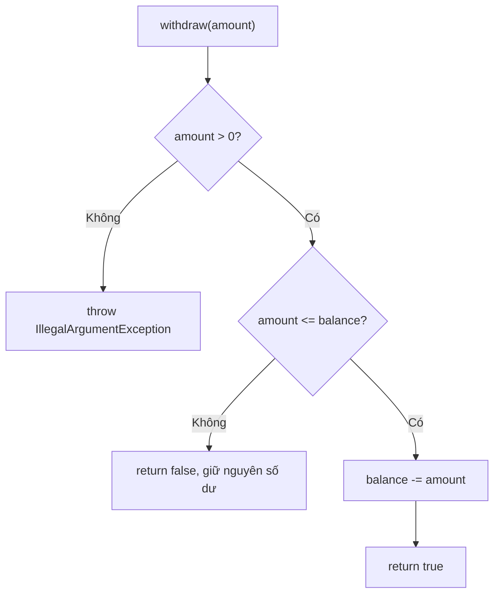

Trả `false` cho việc thiếu tiền là một lựa chọn API: đây có thể là kết quả nghiệp vụ thông thường. Nếu yêu cầu sử dụng rõ nguyên nhân, có thể thiết kế kết quả kiểu enum như `SUCCESS`, `INSUFFICIENT_FUNDS` thay cho `boolean`. Dữ liệu đầu vào không hợp lệ, chẳng hạn tiền âm, được xử lý bằng ngoại lệ.

### Vì sao dùng `long` với đơn vị nhỏ nhất?

Lưu tiền theo đơn vị nguyên (`balanceCents`) giúp ví dụ tránh biểu diễn không chính xác của `double` với nhiều số thập phân nhị phân. Trong hệ thống thật cần quy định đồng tiền, đơn vị nhỏ nhất, làm tròn, hạn mức và định dạng; có thể dùng `BigDecimal` phù hợp với nghiệp vụ. **Không nên chỉ đổi tên từ `double balance` sang `long balance` mà bỏ qua quy tắc tiền tệ.**

## 4. Bảo vệ trạng thái đơn hàng bằng chuyển đổi hợp lệ

Đơn hàng có bốn trạng thái:

| Trạng thái | Ý nghĩa |
|---|---|
| `CREATED` | Vừa tạo, chưa được xác nhận đã thanh toán |
| `PAID` | Đã ghi nhận thanh toán thành công |
| `SHIPPED` | Đã thực hiện bước gửi hàng trong ví dụ |
| `CANCELLED` | Bị hủy trước khi thanh toán |

Trong phiên bản nghiệp vụ minh họa này, các chuyển đổi hợp lệ chỉ gồm:

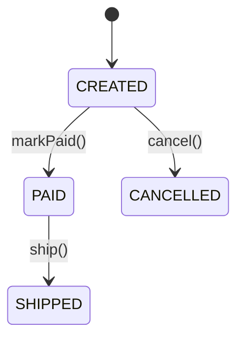

| Trạng thái hiện tại | Hành động | Trạng thái tiếp theo | Kết quả |
|---|---|---|---|
| `CREATED` | `markPaid()` | `PAID` | Hợp lệ |
| `CREATED` | `cancel()` | `CANCELLED` | Hợp lệ |
| `PAID` | `ship()` | `SHIPPED` | Hợp lệ |
| `CREATED` | `ship()` | Không đổi | `IllegalStateException` |
| `SHIPPED` | `cancel()` | Không đổi | `IllegalStateException` |
| `CANCELLED` | `markPaid()` | Không đổi | `IllegalStateException` |

Từ khóa `enum` giới hạn tập trạng thái, tránh lỗi viết chuỗi tự do như `"SHIPED"`. Nhưng **enum chưa đủ**: nếu công khai `setStatus(OrderStatus status)`, người gọi vẫn có thể nhảy từ `CREATED` sang `SHIPPED`.

Thay vào đó, các phương thức có tên theo hành động:

```java
public synchronized void ship() {
    requireStatus(OrderStatus.PAID, "giao hàng");
    status = OrderStatus.SHIPPED;
}
```

Thao tác này vừa đọc trạng thái hiện tại, vừa kiểm tra, rồi mới thay đổi. Nếu đơn hàng chưa thanh toán hoặc đã hủy, lời gọi bị từ chối mà không cập nhật `status`.

Lưu ý: trong một hệ thống thực, có thể phải hỗ trợ hoàn tiền, trả hàng, hủy sau thanh toán hoặc nhiều trạng thái vận chuyển hơn. Sơ đồ trên là **quy tắc do ví dụ đặt ra**, không phải một danh sách trạng thái chuẩn dùng cho mọi ứng dụng thương mại điện tử.

## 5. Giữ các đường truy cập khác không phá đóng gói

Đóng gói bị phá nếu một getter trả thẳng collection nội bộ còn có thể sửa:

```java
class UnsafeOrder {
    private final List<String> items = new java.util.ArrayList<>();

    public List<String> items() {
        return items;
    }
}

UnsafeOrder order = new UnsafeOrder();
order.items().add(""); // Bên ngoài bỏ qua mọi validation
```

Trong `Order` hoàn chỉnh, dữ liệu đầu vào được sao chép:

```java
this.items = List.copyOf(items);
```

Kết quả `items()` có thể được trả ra bởi vì danh sách đó không hỗ trợ các phép sửa như `add`, `clear`, `set`. Ngoài ra, `OrderItem` là `record` có thành phần `String` và `int`, nên không có phần tử mutable mà người gọi có thể thay đổi để lách validation.

```java
List<OrderItem> source = new java.util.ArrayList<>();
source.add(new OrderItem("BOOK-JAVA", 2));

Order order = new Order("ORD-002", source);
source.clear();                    // Không xóa item đã lưu trong order
System.out.println(order.items().size()); // 1

// order.items().clear();         // Ném UnsupportedOperationException
```

**Quan trọng:** `List.copyOf` tạo danh sách không sửa được, nhưng chỉ là bảo vệ **nông (shallow)**. Nếu phần tử là đối tượng có setter, mã bên ngoài vẫn có thể sửa chính phần tử đó qua tham chiếu chung. Khi đó cần thiết kế phần tử bất biến hoặc tạo defensive copy cả phần tử.

Tương tự, trường `private final List<T>` không làm nội dung danh sách tự bất biến: `final` ngăn gán lại tham chiếu của trường, không ngăn `add` hay `remove` trên đối tượng danh sách.

## 6. Vì sao `synchronized` xuất hiện trong hai lớp?

Nếu có nhiều thread cùng cập nhật một đối tượng, `private` ngăn truy cập trực tiếp **nhưng không tự loại bỏ race condition**.

Ví dụ phương thức rút tiền kiểu:

```java
if (balanceCents >= amount) {
    balanceCents -= amount;
}
```

Nếu hai thread đều đọc được số dư cũ trước khi một thread cập nhật, kết quả có thể không tương ứng với thứ tự giao dịch hợp lệ. Vì thế ví dụ dùng các phương thức `synchronized` cho thao tác đọc/ghi số dư, và cho các chuyển trạng thái đơn hàng:

```java
public synchronized boolean withdraw(long amountCents) { /* ... */ }
public synchronized long balanceCents() { /* ... */ }
public synchronized void markPaid() { /* ... */ }
```

Với **cùng một instance**, `synchronized` bảo đảm tại một thời điểm chỉ một thread thực thi một phương thức synchronized khóa trên instance đó. Nó cũng thiết lập quan hệ hiển thị bộ nhớ phù hợp giữa các lần khóa/mở khóa. Điều này giúp phép kiểm tra và cập nhật trạng thái trong phương thức không bị chồng chéo trên cùng object.

Những giới hạn cần nhớ:

- `synchronized` trên một đối tượng **không đồng bộ hai instance khác nhau**, kể cả hai instance biểu diễn cùng tài khoản trong cơ sở dữ liệu.
- Việc chuyển tiền qua **hai tài khoản** hoặc phối hợp thanh toán với **đơn hàng** cần một thiết kế giao dịch rõ ràng; chỉ khóa từng instance chưa đủ để bảo đảm một thao tác xuyên nhiều đối tượng là nguyên tử.
- Ứng dụng nhiều tiến trình hoặc nhiều máy cần biện pháp ở tầng lưu trữ như transaction, locking, optimistic version hoặc cơ chế điều phối thích hợp.
- Phạm vi `private/public` là kiểm soát truy cập **mã nguồn Java**, không phải kiểm tra quyền người dùng. Một API cho rút tiền vẫn cần xác thực và phân quyền ở tầng dịch vụ.

## 7. Thiết kế lỗi: từ chối thay đổi nhưng giữ nguyên trạng thái

Trong ví dụ, có hai loại lỗi chủ yếu:

| Tình huống | Cách báo | Trạng thái sau |
|---|---|---|
| Tạo account với số dư âm | `IllegalArgumentException` | Không có account hợp lệ được tạo |
| Nạp `0` hoặc số tiền âm | `IllegalArgumentException` | Số dư cũ |
| Nạp làm tràn `long` | `ArithmeticException` | Số dư cũ |
| Rút vượt số dư | `false` | Số dư cũ |
| Giao hàng khi chưa thanh toán | `IllegalStateException` | `CREATED` |
| Hủy đơn đã giao | `IllegalStateException` | `SHIPPED` |

Việc “giữ nguyên trạng thái nếu thao tác bị từ chối” làm cho hành vi dễ dự đoán và dễ kiểm thử. Với hai ví dụ trên, kiểm tra xảy ra trước phép gán; không có các tác động mạng/cơ sở dữ liệu nên việc từ chối rất rõ ràng.

Tuy nhiên, trong ứng dụng thật, thao tác có thể vừa sửa database vừa gọi API bên ngoài. Khi thất bại sau một phần tác động, cần transaction, idempotency, retry hoặc cơ chế bù trừ phù hợp. **Một phương thức Java đơn lẻ không tự bảo đảm rollback những hệ thống ngoài nó.**

## 8. Cách kiểm tra ví dụ bằng các trường hợp biên

Ngoài kết quả từ `main`, hãy dùng bảng sau để chủ động thử các trường hợp sai:

| Trường hợp kiểm tra | Thao tác | Điều mong đợi |
|---|---|---|
| Số dư khởi tạo âm | `new Account("A", -1)` | Ném `IllegalArgumentException` |
| Nạp số 0 | `deposit(0)` | Ném `IllegalArgumentException`, số dư giữ nguyên |
| Rút số âm | `withdraw(-1)` | Ném `IllegalArgumentException` |
| Rút bằng số dư | `withdraw(balance)` | Trả `true`, số dư về 0 |
| Rút nhiều hơn số dư | `withdraw(balance + 1)` với giá trị không tràn | Trả `false`, số dư không đổi |
| Cộng số dư tràn | Số dư gần `Long.MAX_VALUE`, nạp thêm | Ném `ArithmeticException`, số dư giữ nguyên |
| Giao hàng quá sớm | `ship()` trên đơn `CREATED` | Ném `IllegalStateException` |
| Thanh toán đơn đã hủy | `markPaid()` trên `CANCELLED` | Ném `IllegalStateException` |
| Sửa danh sách mặt hàng đầu vào | `source.clear()` sau khi tạo order | Đơn hàng vẫn giữ mặt hàng |
| Sửa danh sách mặt hàng trả về | `order.items().clear()` | `UnsupportedOperationException` |

Có thể thử một trường hợp đơn giản ngay trong `main`:

```java
Account zero = new Account("ZERO", 5);
try {
    zero.withdraw(-10);
    throw new AssertionError("Phải từ chối tiền âm");
} catch (IllegalArgumentException expected) {
    if (zero.balanceCents() != 5) {
        throw new AssertionError("Số dư đã bị sửa khi thao tác thất bại");
    }
}
```

Đoạn kiểm tra này dùng `AssertionError` do mã tự ném, nên không phụ thuộc tùy chọn `-ea` của JVM.

## 9. Bài tập mở rộng đúng hai tình huống

**Bài 1 — Hạn mức rút.** Thêm `dailyWithdrawnCents` và `dailyLimitCents` cho `Account`. Khi rút, kiểm tra cùng lúc số dư và hạn mức còn lại; chỉ cập nhật hai trường nếu mọi điều kiện đều hợp lệ. Xử lý phép cộng số tiền đã rút để tránh overflow. Viết trường hợp thử rằng giao dịch bị từ chối **không thay đổi trường nào**.

**Bài 2 — Luồng đơn hàng.** Thêm trạng thái `DELIVERED` vào enum và phương thức `confirmDelivery()`, chỉ hợp lệ từ `SHIPPED`. Vẽ lại Mermaid và thử gọi `confirmDelivery()` từ `CREATED` để kiểm tra lớp từ chối.

**Bài 3 — Hủy sau thanh toán.** Giả sử nghiệp vụ cho hủy đơn `PAID` nhưng yêu cầu hoàn tiền. Đề xuất trách nhiệm giữa `Order`, dịch vụ thanh toán và database transaction để tránh đơn bị hủy trong khi hoàn tiền thất bại. Không nên chỉ thêm phép gán `status = CANCELLED` rồi coi như mọi tác động bên ngoài đã hoàn tất.

**Bài 4 — Ranh giới API.** Giải thích vì sao `private balanceCents`, `private status`, `List.copyOf(items)` và các phương thức `withdraw/ship` lần lượt bảo vệ những đường truy cập nào. Nếu đổi `items` sang danh sách phần tử mutable, phải thay đổi cách thiết kế ra sao?

---

**Kết luận:** Với tài khoản, đóng gói giúp **bảo vệ bất biến số dư** qua nạp/rút hợp lệ. Với đơn hàng, đóng gói giúp **bảo vệ luồng trạng thái** qua các chuyển đổi có điều kiện. Trường `private` chặn gán trực tiếp, nhưng tính đúng đắn thực sự đến từ **constructor kiểm tra đầu vào, phương thức có ý nghĩa nghiệp vụ, cập nhật sau khi kiểm tra và không làm lộ dữ liệu mutable**.


</details>

- [Quay lại đầu trang](#back-to-top)
