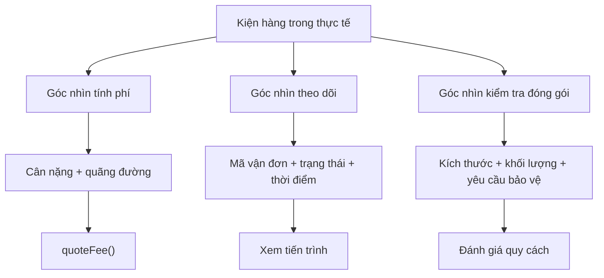
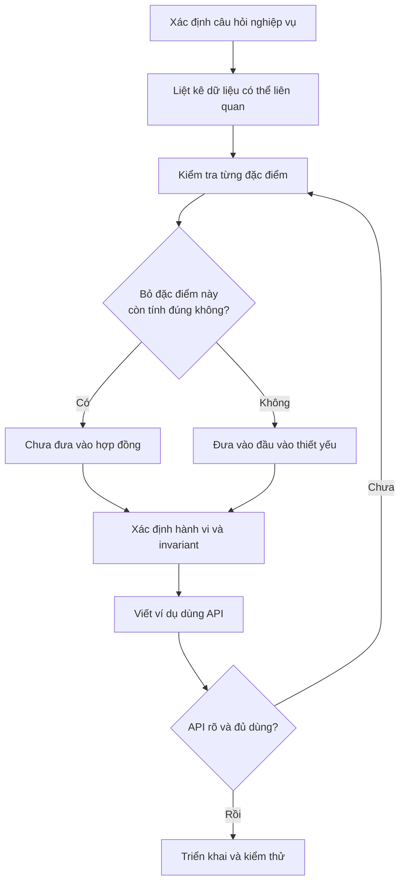
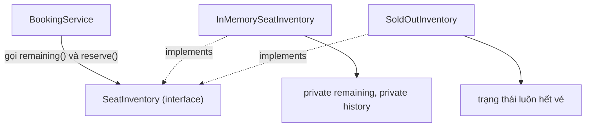
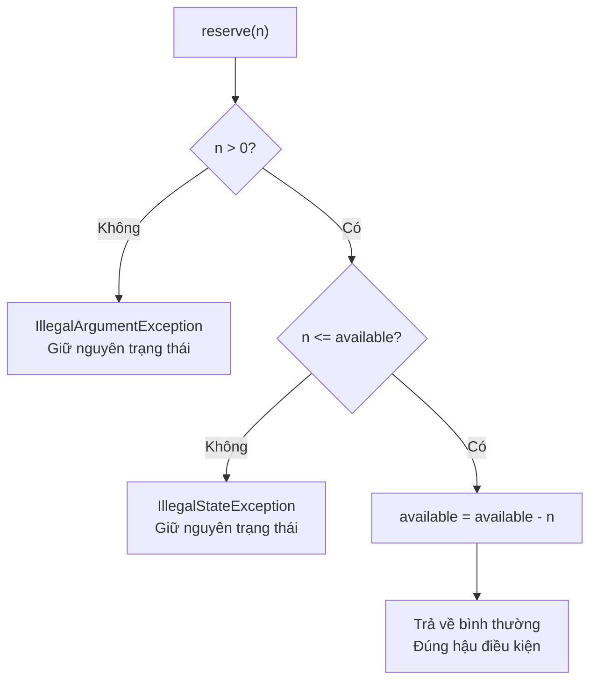
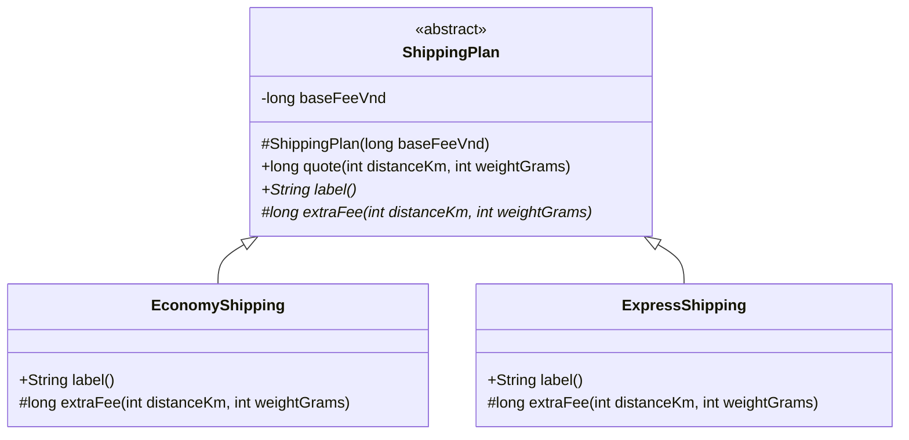
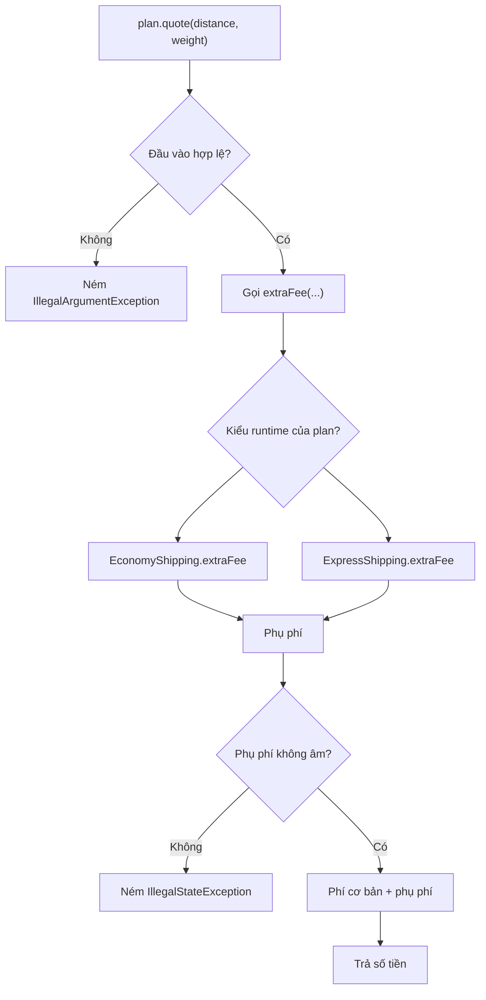
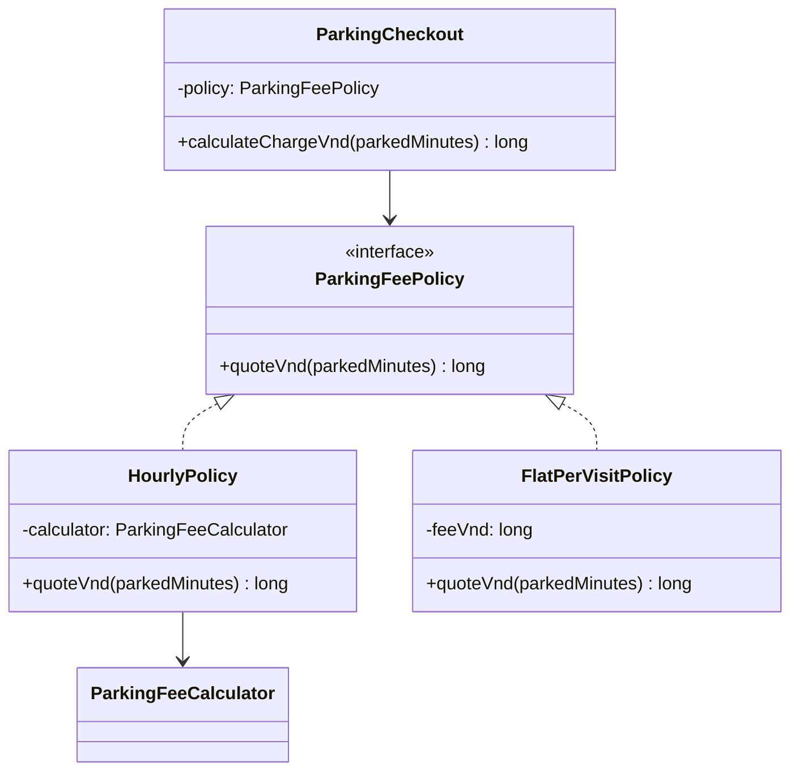
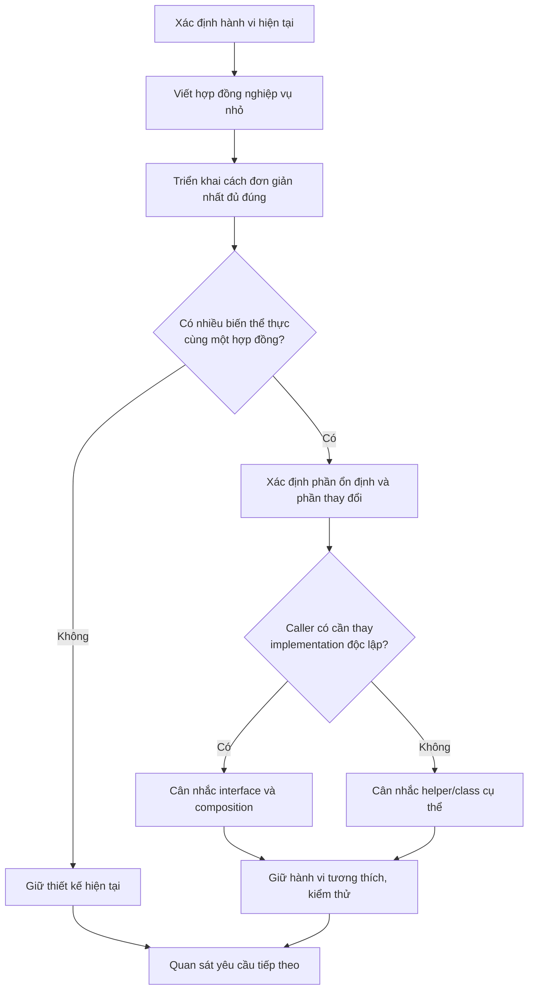
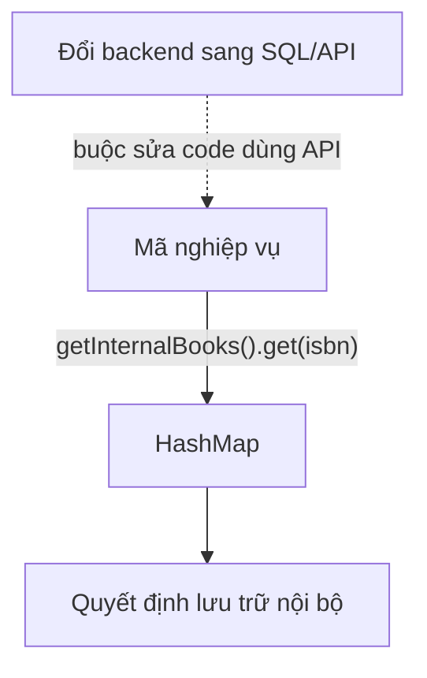
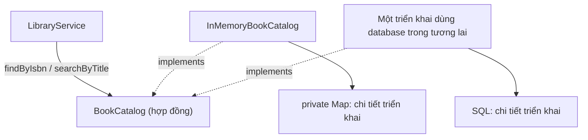

<a id="back-to-top"></a>

# Trừu tượng

## Menu
- [Trừu tượng hóa và chọn đặc điểm thiết yếu](#abstraction-001)
- [Phân biệt trừu tượng với đóng gói](#abstraction-002)
- [Hợp đồng sử dụng và chi tiết thực hiện](#abstraction-003)
- [Tiền điều kiện, hậu điều kiện và cam kết hành vi](#abstraction-004)
- [Lớp trừu tượng và phương thức trừu tượng](#abstraction-005)
- [Phân biệt lớp cụ thể với lớp trừu tượng](#abstraction-006)
- [Mức trừu tượng phù hợp với bài toán](#abstraction-007)
- [Rò rỉ chi tiết thực hiện qua giao diện sử dụng](#abstraction-008)

## <a id="abstraction-001">Trừu tượng hóa và chọn đặc điểm thiết yếu</a>

<details>
<summary>Xem chi tiết</summary>

# Trừu tượng hóa và chọn đặc điểm thiết yếu trong OOP (Java)

**Trừu tượng hóa (abstraction)** là quá trình xác định những đặc điểm và hành vi **cần thiết cho một mục đích cụ thể**, đồng thời tạm bỏ qua những chi tiết không ảnh hưởng đến mục đích đó. Trong lập trình hướng đối tượng, ta sử dụng kết quả của quá trình ấy để thiết kế lớp, đối tượng, interface và các hợp đồng tương tác.

Điểm mấu chốt: **không tồn tại một danh sách đặc điểm “thiết yếu” đúng cho mọi bài toán**. Một thông tin quan trọng với bộ phận giao hàng có thể hoàn toàn không cần thiết cho bộ phận tính giá hoặc báo cáo.

## 1. Từ đối tượng ngoài đời đến mô hình phần mềm

Xét một **kiện hàng** trong hệ thống thương mại điện tử. Ngoài thực tế, kiện hàng có thể có hàng chục thông tin: mã vận đơn, cân nặng, kích thước, màu hộp, địa chỉ lấy hàng, người gửi, người nhận, đơn vị vận chuyển, trạng thái, lịch sử quét mã, ảnh chụp và nhiều thông tin khác.

Nếu đang xây dựng chức năng **báo phí giao hàng theo cân nặng và quãng đường**, ta có thể chỉ cần:

- `weightGrams`: cân nặng tính bằng gram;
- `distanceKm`: quãng đường tính bằng kilomet;
- hành vi `quoteFee(...)`: tính và trả về mức phí dự kiến.

Những thông tin như màu hộp, ảnh chụp hay người đang cầm kiện hàng **không tham gia công thức tính phí của ví dụ này**, nên không cần xuất hiện trong API tính phí.

Nhưng với chức năng **theo dõi vận chuyển**, mô hình phù hợp lại khác: mã vận đơn, trạng thái hiện tại và thời điểm cập nhật là các yếu tố thiết yếu; cân nặng có thể không cần.

| Ngữ cảnh sử dụng | Đặc điểm thiết yếu | Hành vi/câu hỏi cần trả lời | Chi tiết có thể bỏ qua |
|---|---|---|---|
| Ước tính phí vận chuyển | Cân nặng, quãng đường, chính sách dịch vụ | “Phí dự kiến bao nhiêu?” | Màu hộp, ảnh chụp kiện hàng |
| Theo dõi kiện hàng | Mã vận đơn, trạng thái, thời điểm cập nhật | “Hàng đang ở đâu trong quy trình?” | Công thức tính cước |
| Kiểm tra đóng gói | Kích thước, cân nặng, yêu cầu dễ vỡ | “Có phù hợp quy cách đóng gói?” | Lịch sử thanh toán |
| Chăm sóc khách hàng | Mã đơn, trạng thái, thông tin liên hệ cần thiết | “Khách đang gặp vấn đề gì?” | Thuật toán nội bộ tối ưu tuyến đường |

Các cột “có thể bỏ qua” là **phụ thuộc yêu cầu đang xét**. Nếu phí vận chuyển thực tế có phụ thu hàng dễ vỡ, đặc điểm `fragile` trở thành đầu vào thiết yếu của tính phí; khi đó mô hình phải được thay đổi theo quy tắc nghiệp vụ.

### Trừu tượng hóa không phải sao chép toàn bộ thực tế

Một lớp `Shipment` chứa mọi dữ liệu mà mọi bộ phận có thể dùng thường trở thành mô hình quá lớn. Thay vào đó, ta có thể xác định **các góc nhìn hoặc hợp đồng riêng cho từng nhu cầu**, rồi chỉ chia sẻ dữ liệu khi có lý do thiết kế.



Sơ đồ này chỉ diễn tả cách **phân tích yêu cầu để chọn mô hình**, không nhất thiết là sơ đồ kế thừa giữa các lớp Java.

## 2. Trừu tượng hóa cần trả lời những câu hỏi nào?

Khi biến một khái niệm trong bài toán thành lớp hoặc interface, nên trả lời theo thứ tự:

1. **Mục đích là gì?** Chức năng đang cần quyết định hoặc tính toán điều gì?
2. **Thông tin nào bắt buộc để đưa ra kết quả đúng?** Nếu bỏ trường này, chức năng có còn thực hiện chính xác không?
3. **Hành vi nào thuộc trách nhiệm của đối tượng?** Ví dụ “báo phí” thuộc chính sách tính cước, không thuộc màu sắc giao diện.
4. **Quy tắc nào phải luôn đúng?** Cân nặng phải dương, quãng đường không âm, trạng thái phải nằm trong tập cho phép.
5. **Chi tiết nào có thể thay đổi mà người dùng API không cần biết?** Ví dụ bảng giá, cách tính phụ phí và nguồn cấu hình.
6. **Có bao nhiêu tình huống thực tế đang được yêu cầu?** Đừng tạo trước hàng loạt kiểu lớp cho những tính năng chưa tồn tại.

Nếu không thể mô tả rõ **người dùng mô hình cần làm gì** bằng một vài câu, thường vẫn quá sớm để chốt danh sách field và phương thức.

## 3. Ví dụ Java hoàn chỉnh: trừu tượng hóa chức năng báo phí

Để minh họa, ta thiết kế một API chỉ nhận những dữ liệu cần để **ước tính phí giao hàng**. Hai chính sách tính phí khác nhau sẽ tuân thủ cùng một hợp đồng.

Quy tắc minh họa, **không phải bảng giá của hãng vận chuyển**:

- Phí cơ bản: 12.000 VND.
- Mỗi kilomet: 1.000 VND.
- Mỗi kilogram được tính phí (làm tròn cân nặng lên kilogram tiếp theo): 2.000 VND.
- Giao nhanh: phụ thu 18.000 VND so với phí tiêu chuẩn.

File `ShippingAbstractionDemo.java` (Java 17+):

```java
import java.util.Objects;

public class ShippingAbstractionDemo {

    // Dữ liệu tối thiểu mà phép báo phí trong ví dụ cần biết.
    record QuoteInput(int weightGrams, int distanceKm) {
        QuoteInput {
            if (weightGrams <= 0) {
                throw new IllegalArgumentException(
                    "Cân nặng phải lớn hơn 0 gram"
                );
            }
            if (distanceKm < 0) {
                throw new IllegalArgumentException(
                    "Quãng đường không được âm"
                );
            }
        }
    }

    // Hợp đồng: ai tính phí cũng phải trả về số tiền VND.
    interface ShippingPricing {
        long quoteFee(QuoteInput input);
    }

    static final class StandardPricing implements ShippingPricing {
        @Override
        public long quoteFee(QuoteInput input) {
            Objects.requireNonNull(input, "input");

            long chargedKg = ((long) input.weightGrams() + 999) / 1_000;
            return 12_000L
                + input.distanceKm() * 1_000L
                + chargedKg * 2_000L;
        }
    }

    static final class ExpressPricing implements ShippingPricing {
        private final ShippingPricing basePricing;

        ExpressPricing(ShippingPricing basePricing) {
            this.basePricing =
                Objects.requireNonNull(basePricing, "basePricing");
        }

        @Override
        public long quoteFee(QuoteInput input) {
            return Math.addExact(basePricing.quoteFee(input), 18_000L);
        }
    }

    static void printQuote(
            String serviceName,
            QuoteInput input,
            ShippingPricing pricing) {

        System.out.println(
            serviceName + ": " + pricing.quoteFee(input) + " VND"
        );
    }

    public static void main(String[] args) {
        QuoteInput input = new QuoteInput(1_500, 5);

        ShippingPricing standard = new StandardPricing();
        ShippingPricing express = new ExpressPricing(standard);

        printQuote("Tiêu chuẩn", input, standard);
        printQuote("Giao nhanh", input, express);
    }
}
```

Kết quả:

```text
Tiêu chuẩn: 21000 VND
Giao nhanh: 39000 VND
```

Giải thích phép tính:

- `1_500` gram được làm tròn lên **2 kg tính cước**.
- Phí tiêu chuẩn = `12_000 + 5 × 1_000 + 2 × 2_000 = 21_000` VND.
- Phí giao nhanh = `21_000 + 18_000 = 39_000` VND.

### Các quyết định trừu tượng hóa trong ví dụ

| Thành phần | Vai trò | Vì sao được chọn? |
|---|---|---|
| `QuoteInput` | Chứa dữ liệu đầu vào thiết yếu | Thuật toán ví dụ chỉ cần cân nặng và quãng đường |
| `ShippingPricing` | Hợp đồng tính phí | Nơi gọi yêu cầu kết quả phí, không cần biết thuật toán cụ thể |
| `StandardPricing` | Một cách thực hiện hợp đồng | Chứa công thức cước tiêu chuẩn |
| `ExpressPricing` | Một chính sách phụ thu dựa trên chính sách nền | Tái sử dụng hành vi tính phí thay vì sao chép công thức |
| `printQuote(...)` | Nơi sử dụng hợp đồng | Làm việc với `ShippingPricing` mà không phân biệt lớp triển khai |

`ShippingPricing` diễn đạt **đối tượng có thể làm gì**: báo phí từ đầu vào hợp lệ. Công thức chi tiết được đặt trong implementation. Nếu có chính sách giao hàng mới, code gọi `quoteFee` vẫn có thể làm việc với implementation mới, miễn là hợp đồng không đổi.

Ví dụ dùng `long` để biểu diễn **đơn vị VND nguyên**. Trong hệ thống thực, các loại tiền tệ khác nhau, phí có phần thập phân hoặc yêu cầu làm tròn đặc biệt có thể cần kiểu tiền tệ riêng hay `BigDecimal`. Tương tự, tính cước thực tế có thể cần thể tích, vùng giao, giới hạn cân nặng và phụ phí khác; khi yêu cầu đổi, phải điều chỉnh mô hình đầu vào phù hợp.

**Ý nghĩa chính không nằm ở công thức vận chuyển**, mà ở cách ta chỉ đưa các yếu tố cần cho hành vi được yêu cầu vào API.

## 4. Tại sao không đưa mọi chi tiết vào một lớp?

Một thiết kế ban đầu có thể trông như sau:

```java
class EverythingShipment {
    String trackingId;
    String senderName;
    String recipientName;
    String boxColor;
    String vehicleLicense;
    int weightGrams;
    int distanceKm;
    String status;
    int retryCount;
    String supportAgent;
    // ... rất nhiều trường không cùng trách nhiệm
}
```

Nếu API tính phí nhận toàn bộ `EverythingShipment`, caller phải hiểu và phụ thuộc vào một mô hình lớn ngay cả khi chỉ cần hai con số. Về sau, việc thay đổi thông tin vận hành khác cũng dễ tác động dây chuyền đến code tính cước.

Để mô hình tốt hơn, có thể tách một dữ liệu đầu vào phục vụ **riêng cho báo phí**:

```java
record QuoteInput(int weightGrams, int distanceKm) {
    QuoteInput {
        if (weightGrams <= 0 || distanceKm < 0) {
            throw new IllegalArgumentException("Thông số không hợp lệ");
        }
    }
}
```

Với chức năng theo dõi, lại có thể chọn những đặc điểm khác:

```java
import java.time.Instant;
import java.util.Objects;

enum DeliveryStatus {
    CREATED, PICKED_UP, IN_TRANSIT, DELIVERED
}

record TrackingSnapshot(
    String trackingId,
    DeliveryStatus status,
    Instant updatedAt
) {
    TrackingSnapshot {
        if (trackingId == null || trackingId.isBlank()) {
            throw new IllegalArgumentException("Thiếu mã vận đơn");
        }
        Objects.requireNonNull(status, "status");
        Objects.requireNonNull(updatedAt, "updatedAt");
    }
}
```

Đây là **hai mô hình dữ liệu riêng theo nhu cầu**, không nhất thiết phải là hai lớp con của một lớp `Shipment`. Trong ứng dụng thực, service có thể lấy dữ liệu từ cùng một đối tượng nghiệp vụ hoặc nguồn lưu trữ rồi tạo các góc nhìn phù hợp.

Không nên tách lớp một cách máy móc chỉ để giảm số field. Nếu một thực thể nghiệp vụ thực sự có trách nhiệm quản lý toàn bộ vòng đời giao hàng, lớp domain đó vẫn có thể chứa nhiều thông tin. Điều cần tránh là **ép mọi đối tượng sử dụng phải phụ thuộc vào tất cả chi tiết của nó**.

## 5. Abstraction khác gì encapsulation?

Hai khái niệm phối hợp với nhau nhưng không đồng nghĩa:

| Khía cạnh | Trừu tượng hóa (*abstraction*) | Đóng gói (*encapsulation*) |
|---|---|---|
| Câu hỏi chính | **Cần nhìn thấy đặc điểm, hành vi nào?** | **Ai được truy cập và thay đổi trạng thái bằng cách nào?** |
| Trọng tâm | Chọn bản chất phù hợp một mục đích | Bảo vệ dữ liệu, che giấu chi tiết triển khai qua ranh giới API |
| Ví dụ | `ShippingPricing.quoteFee(input)` | Giữ field nội bộ `private`, kiểm tra đầu vào trước khi lưu |
| Lợi ích | Giảm độ phức tạp mà caller phải hiểu | Duy trì invariant, ngăn sửa trạng thái không kiểm soát |

Một lớp có toàn bộ field là `private` vẫn có thể là **trừu tượng hóa kém** nếu cung cấp 30 getter/setter không liên quan đến trách nhiệm của nó.

Ngược lại, một interface nhỏ có thể diễn đạt **trừu tượng hóa tốt**, nhưng implementation bên dưới vẫn cần đóng gói để ngăn trạng thái nội bộ bị thay đổi sai.

Một cách ghi nhớ thực tế:

- **Abstraction:** chọn *cái gì quan trọng và hệ thống có thể làm gì*.
- **Encapsulation:** kiểm soát *làm thế nào để sử dụng đúng những khả năng đó*.

## 6. Có bắt buộc dùng abstract class hay interface mới là trừu tượng hóa?

**Không.** Trừu tượng hóa là hoạt động **tư duy và thiết kế mô hình**; `abstract class` và `interface` chỉ là các cơ chế ngôn ngữ giúp thể hiện hợp đồng hoặc chia sẻ một phần thiết kế.

Ví dụ `QuoteInput` ở trên cũng là một trừu tượng hóa: record chỉ giữ thông tin thiết yếu cho việc báo giá. Nó không có từ khóa `abstract`.

Trong Java, có thể lựa chọn:

| Cơ chế | Khi hữu ích | Lưu ý |
|---|---|---|
| Lớp cụ thể (*concrete class*) | Có một trách nhiệm rõ và implementation trực tiếp | Vẫn là trừu tượng hóa nếu mô hình loại bỏ chi tiết không cần |
| `record` | Mô hình dữ liệu mang ngữ nghĩa giá trị, giữ tập component gọn | Record không mặc nhiên bất biến sâu nếu chứa field tham chiếu tới object mutable |
| `interface` | Nhiều implementation cần chung hợp đồng hành vi | Không cần tạo interface cho mọi lớp khi chưa có nhu cầu rõ |
| `abstract class` | Muốn kết hợp hợp đồng với hành vi/trạng thái chung có chủ đích | Kế thừa lớp tạo ràng buộc mạnh hơn; tránh dùng chỉ để “cho đúng OOP” |
| Composition | Cấu thành hành vi từ các đối tượng khác | Có thể tránh các hệ phân cấp kế thừa phức tạp |

Ví dụ `ExpressPricing` **chứa một** `ShippingPricing` thay vì sao chép thuật toán hoặc kế thừa `StandardPricing`. Đây là composition: giao nhanh bổ sung chính sách trên một hành vi báo phí đã có.

**Trừu tượng hóa tốt không được đo bằng số interface hoặc tầng kế thừa**, mà bằng mức độ mô hình phục vụ đúng nhu cầu và giúp code thay đổi dễ dàng.

## 7. Chọn đặc điểm thiết yếu bằng một quy trình có thể áp dụng

Giả sử cần thiết kế API “Báo phí vận chuyển dự kiến”.



Có thể dùng bảng kiểm tra nhỏ trong bước phân tích:

| Đặc điểm ứng viên | Có tác động đến báo phí trong yêu cầu hiện tại? | Quyết định |
|---|---|---|
| Cân nặng | Có, thay đổi phí theo mức kg tính cước | Giữ lại |
| Quãng đường | Có, quyết định phí theo km | Giữ lại |
| Màu hộp | Không | Loại khỏi API báo phí |
| Tên người nhận | Không dùng trong công thức phí | Loại khỏi API báo phí |
| Chính sách tiêu chuẩn/giao nhanh | Có, tác động mức phí | Thể hiện qua implementation/chọn policy |
| Vùng giao hàng | Chưa có quy tắc theo vùng | Hoãn; bổ sung khi có yêu cầu được xác nhận |

Cần phân biệt **thiết yếu cho phiên bản bài toán hiện tại** với **có thể quan trọng trong tương lai**. Trừu tượng hóa không yêu cầu dự đoán mọi thay đổi sẽ xảy ra; nếu phát sinh quy tắc mới, mô hình có thể được mở rộng hoặc tái cấu trúc trên cơ sở nhu cầu thực.

## 8. Chọn hành vi, không chỉ chọn dữ liệu

Một lỗi thường gặp là chỉ hỏi “Đối tượng có những thuộc tính gì?” mà quên “Đối tượng chịu trách nhiệm làm gì?”.

Ví dụ mô hình phí kiểu chứa số liệu và để caller tự tính:

```java
class RawRate {
    long baseFee;
    long perKm;
    long perKg;
}

// Caller phải tự biết cách tính, cách làm tròn kg,
// giới hạn đầu vào và logic phụ thu.
```

Với kiểu thiết kế đó, nhiều caller có thể tự nhân chia khác nhau, khiến quy tắc bị lặp và dễ sai.

Hợp đồng như:

```java
interface ShippingPricing {
    long quoteFee(QuoteInput input);
}
```

giữ **hành vi báo phí** ở nơi chịu trách nhiệm. Caller nhận một kết quả theo đơn vị được quy định, thay vì bắt buộc biết thuật toán nội bộ. Đây là một mức trừu tượng hữu ích khi nhiều phần của hệ thống cùng cần báo phí.

Dĩ nhiên nếu ứng dụng chỉ dùng một công thức cố định trong một chỗ, một lớp cụ thể với phương thức `quoteFee` cũng có thể đủ. Interface có ích khi hợp đồng được dùng bởi nhiều implementation, cần thay thế policy hoặc giảm phụ thuộc của caller vào cách tính.

## 9. Một trừu tượng hóa cần hợp đồng và giới hạn rõ ràng

Đặt tên đẹp chưa đủ. API phải giải thích rõ **đầu vào, đầu ra, đơn vị, lỗi và giới hạn**.

Với `ShippingPricing.quoteFee(QuoteInput)`:

| Câu hỏi về hợp đồng | Quyết định của ví dụ |
|---|---|
| Đầu vào gồm gì? | Cân nặng tính bằng gram và quãng đường tính bằng km |
| Giá trị hợp lệ? | Cân nặng dương, quãng đường không âm |
| Đầu ra có nghĩa gì? | Số tiền phí dự kiến tính bằng VND nguyên |
| Làm tròn ra sao? | Cân nặng tính cước làm tròn lên kg |
| Hệ thống có cam kết giá thực tế cuối cùng không? | Không; đây chỉ là mô hình ví dụ báo giá |
| Nếu truyền `null`? | Implementation trong ví dụ từ chối với `NullPointerException` qua `Objects.requireNonNull` |

Khi hợp đồng mơ hồ, người dùng API có thể hiểu sai: `weight` là gram hay kilogram? `distance` là km hay mét? Phí có bao gồm phụ thu chưa?

Một trừu tượng hóa **quá chung** như `Calculator.calculate(Object input)` có thể khiến caller phải ép kiểu và đoán ý nghĩa. Tên, kiểu dữ liệu và quy tắc nên thể hiện đúng điều người dùng API cần biết.

Trong ứng dụng lớn, có thể dùng kiểu chuyên biệt (`Weight`, `Distance`, `Money`) nếu đơn vị và phép toán phức tạp. Nhưng việc tạo nhiều kiểu mới cũng có chi phí; chỉ nên thực hiện khi chúng thực sự giúp giảm lỗi hoặc thể hiện quy tắc quan trọng.

## 10. Nhận biết mô hình thiếu hoặc thừa trừu tượng

| Dấu hiệu | Vấn đề | Hướng điều chỉnh |
|---|---|---|
| Một lớp chứa mọi dữ liệu của nhiều nhóm nghiệp vụ | Quá nhiều trách nhiệm, caller phụ thuộc dư thừa | Phân tích các góc nhìn và hợp đồng theo use case |
| Hàm nhận cả entity lớn nhưng chỉ dùng hai field | Dữ liệu đầu vào không phản ánh nhu cầu | Xem xét dùng kiểu đầu vào gọn, phù hợp |
| Lặp công thức tính phí ở nhiều màn hình | Thiếu trừu tượng hành vi chung | Đưa chính sách tính phí vào một API chịu trách nhiệm |
| `interface` chỉ có một implementation và không có nhu cầu thay thế/hợp đồng rõ | Có thể trừu tượng quá sớm | Cân nhắc bắt đầu từ lớp cụ thể |
| Có `BaseAbstractManager` cùng nhiều tầng kế thừa chỉ để chia sẻ vài dòng | Kế thừa ràng buộc quá nhiều | Cân nhắc composition hoặc phương thức hỗ trợ |
| API dùng `Object`, `Map<String,Object>` cho dữ liệu ổn định | Hợp đồng kiểu dữ liệu mờ, lỗi chỉ xuất hiện lúc chạy | Dùng DTO/record có kiểu và validation |
| Bỏ qua đặc điểm ảnh hưởng trực tiếp tới quy tắc | Mô hình chưa đủ | Bổ sung dữ liệu hoặc hành vi theo yêu cầu đã xác nhận |

Mục tiêu là **đủ cụ thể để tránh hiểu sai, đủ gọn để loại bỏ chi tiết không cần thiết**. Đây là một quyết định thiết kế theo ngữ cảnh, không phải một công thức cố định.

## 11. Tự kiểm tra

### Bài 1 — Chọn dữ liệu thiết yếu

Một hệ thống cần quyết định **vé xem phim có được giảm giá học sinh hay không** dựa trên hai điều kiện: người mua có tình trạng học sinh hợp lệ và suất chiếu diễn ra vào ngày ưu đãi.

Dữ liệu ứng viên: họ tên, mã ghế, `isStudent`, ngày suất chiếu, màu giao diện, số điện thoại.

**Gợi ý đáp án:** `isStudent` và ngày suất chiếu là hai yếu tố cần thiết theo quy tắc được nêu. Mã ghế hay số điện thoại không ảnh hưởng đến quyết định ưu đãi trong bài toán hiện tại. Có thể dùng API như:

```java
boolean eligibleForDiscount(boolean isStudent, java.time.LocalDate showDate);
```

Nếu quy tắc sau này yêu cầu kiểm tra hiệu lực thẻ học sinh hoặc loại suất chiếu, cần bổ sung dữ liệu/hành vi tương ứng.

### Bài 2 — Dự đoán kết quả từ hợp đồng

Với `ShippingAbstractionDemo` ở trên:

```java
QuoteInput input = new QuoteInput(1_001, 0);
ShippingPricing pricing = new StandardPricing();
System.out.println(pricing.quoteFee(input));
```

**Đáp án: `16000`** vì `1_001` gram được làm tròn lên `2` kg, phí là `12_000 + 0 + 2 × 2_000`. Kết quả cho thấy chính sách làm tròn là một phần quan trọng của hợp đồng, dù caller không cần tự tính.

### Bài 3 — Phản biện thiết kế

Một lập trình viên đề xuất interface:

```java
interface AnythingService {
    Object execute(Object input);
}
```

**Câu hỏi:** Interface này có luôn tốt hơn một class cụ thể vì nó “trừu tượng hơn” không?

**Đáp án:** Không. Đây là hợp đồng quá mơ hồ: không cho biết đầu vào là kiểu nào, thao tác cụ thể là gì, kết quả mang ý nghĩa gì. Trong trường hợp báo phí, `ShippingPricing.quoteFee(QuoteInput)` diễn đạt nhu cầu rõ hơn nhiều và cho phép compiler kiểm tra kiểu.

### Bài 4 — Tự thiết kế

Hãy chọn một trong hai use case cho cùng đối tượng “sách thư viện”:

- **Tra cứu sách:** tìm theo tên, tác giả và mã ISBN.
- **Mượn sách:** kiểm tra số bản có thể cho mượn và cập nhật trạng thái mượn.

Với use case đã chọn, hãy viết danh sách **đặc điểm thiết yếu**, **hành vi** và **invariant**. Sau đó phác thảo một class hoặc record Java có API nhỏ nhất đáp ứng yêu cầu. Giải thích vì sao một số dữ liệu của use case còn lại không cần đặt vào API này.

---

**Ghi nhớ:** Trừu tượng hóa là **chọn đúng đặc điểm và hành vi cho một mục đích**, chứ không phải đưa càng nhiều thuộc tính vào lớp càng tốt hoặc dùng thật nhiều `abstract class`. Hãy bắt đầu từ câu hỏi nghiệp vụ, xác định dữ liệu đủ để trả lời, thiết kế hành vi có hợp đồng rõ ràng, rồi giữ các chi tiết triển khai ra khỏi phần API mà caller không cần biết.


</details>

- [Quay lại đầu trang](#back-to-top)

---

## <a id="abstraction-002">Phân biệt trừu tượng với đóng gói</a>

<details>
<summary>Xem chi tiết</summary>

# Phân biệt trừu tượng (Abstraction) với đóng gói (Encapsulation) trong Java

**Trừu tượng** và **đóng gói** đều là nguyên lý quan trọng của lập trình hướng đối tượng (OOP), nhưng giải quyết hai vấn đề khác nhau:

- **Trừu tượng (abstraction):** chọn và công bố những **khả năng cần thiết** của một đối tượng, giúp mã sử dụng tập trung vào *đối tượng làm được gì* mà không phải phụ thuộc vào chi tiết thực hiện.
- **Đóng gói (encapsulation):** tổ chức dữ liệu cùng các thao tác liên quan và **kiểm soát cách trạng thái nội bộ được truy cập hoặc thay đổi**, giúp đối tượng tự bảo vệ các quy tắc của mình.

Ví dụ, hệ thống bán vé cần thao tác `reserve(2)` mà không cần biết số ghế đang lưu trong `HashMap`, cơ sở dữ liệu hay dịch vụ khác: đó là góc nhìn **trừu tượng**. Hệ thống cũng phải ngăn mã bên ngoài tự sửa số ghế thành `-10` hoặc bỏ qua điều kiện còn chỗ: đó là mục tiêu **đóng gói**.

Hai nguyên lý thường bổ trợ nhau, nhưng **không đồng nghĩa**. Một lớp có thể dùng `private` để đóng gói tốt mà không cần khai báo `interface`; ngược lại, có `interface` chưa bảo đảm mọi đối tượng triển khai đều bảo vệ trạng thái đúng cách.

## 1. So sánh từ mục tiêu đến cách thực hiện

| Góc nhìn | Trừu tượng (Abstraction) | Đóng gói (Encapsulation) |
| --- | --- | --- |
| Câu hỏi chính | “Người dùng cần biết và sử dụng **khả năng nào**?” | “Ai được **đọc/sửa trạng thái** và qua con đường nào?” |
| Mục tiêu | Giảm phụ thuộc vào chi tiết triển khai; thể hiện hợp đồng dễ hiểu | Bảo vệ tính nhất quán của dữ liệu và các quy tắc nghiệp vụ |
| Phần được che giấu | Chi tiết thuật toán, cấu trúc lưu trữ, cách triển khai không thuộc hợp đồng | Quyền truy cập trực tiếp vào trường và cấu trúc nội bộ cần kiểm soát |
| Công cụ Java thường gặp | `interface`, `abstract class`, tham số theo kiểu interface, API công khai được thiết kế gọn | `private`, phương thức có validation, defensive copy, immutable value, giới hạn quyền truy cập |
| Dấu hiệu ở phía sử dụng | Code gọi `inventory.reserve(2)`, không biết đối tượng lưu kho thế nào | Code không thể tự gán `inventory.remaining = -10` |
| Lỗi khi thiết kế kém | Code nghiệp vụ phụ thuộc nhiều lớp cụ thể hoặc chi tiết lưu trữ | Caller sửa dữ liệu nội bộ mà không qua kiểm tra |
| Tiêu chí đánh giá | Hợp đồng có đủ khả năng cần thiết và giấu chi tiết không liên quan không? | Có đường nào từ bên ngoài phá vỡ bất biến (*invariant*) của đối tượng không? |

Không nên hiểu “trừu tượng chỉ dùng interface” hay “đóng gói chỉ dùng private”. Một lớp thông thường với một số phương thức công khai có thể là một **abstraction tốt**; ngược lại, một trường `private final List<...>` vẫn có thể bị sửa gián tiếp nếu lớp trả ra danh sách mutable đó.

## 2. Ví dụ hoàn chỉnh: cùng một bài toán, hai nguyên lý

Ta thiết kế một chức năng đặt chỗ:

- `SeatInventory` mô tả **hợp đồng** tồn kho ghế: xem số chỗ còn lại và yêu cầu giữ chỗ.
- `InMemorySeatInventory` là một cách thực hiện, giữ số ghế trong trường `private` và kiểm tra trước khi giảm.
- `SoldOutInventory` là một cách thực hiện khác, luôn thông báo hết vé.
- `BookingService` chỉ phụ thuộc vào **`SeatInventory`**, nên không phải biết đối tượng cụ thể bên dưới.

Đặt toàn bộ mã sau trong file **`Main.java`**, chạy với Java 11 trở lên:

```java
import java.util.ArrayList;
import java.util.List;
import java.util.Objects;

// TRỪU TƯỢNG: mô tả hợp đồng mà code đặt vé cần.
interface SeatInventory {
    int remaining();

    // Số ghế yêu cầu phải > 0.
    // Trả true nếu giữ chỗ thành công; false nếu không đủ chỗ.
    boolean reserve(int seats);
}

// Một triển khai lưu trạng thái trong bộ nhớ.
final class InMemorySeatInventory implements SeatInventory {
    private int remaining;
    private final List<Integer> successfulReservations =
            new ArrayList<>();

    InMemorySeatInventory(int initialSeats) {
        if (initialSeats < 0) {
            throw new IllegalArgumentException(
                    "Số ghế ban đầu không được âm");
        }
        this.remaining = initialSeats;
    }

    @Override
    public int remaining() {
        return remaining;
    }

    @Override
    public boolean reserve(int seats) {
        if (seats <= 0) {
            throw new IllegalArgumentException(
                    "Số ghế đặt phải lớn hơn 0");
        }
        if (seats > remaining) {
            return false;
        }

        // ĐÓNG GÓI: chỉ logic bên trong được phép giảm số ghế.
        remaining -= seats;
        successfulReservations.add(seats);
        return true;
    }

    // Trả snapshot, không trao list mutable nội bộ cho caller.
    List<Integer> reservationHistory() {
        return List.copyOf(successfulReservations);
    }
}

// Một triển khai hợp đồng khác: địa điểm đã hết vé.
final class SoldOutInventory implements SeatInventory {
    @Override
    public int remaining() {
        return 0;
    }

    @Override
    public boolean reserve(int seats) {
        if (seats <= 0) {
            throw new IllegalArgumentException(
                    "Số ghế đặt phải lớn hơn 0");
        }
        return false;
    }
}

// Code nghiệp vụ làm việc qua kiểu trừu tượng.
final class BookingService {
    private final SeatInventory inventory;

    BookingService(SeatInventory inventory) {
        this.inventory = Objects.requireNonNull(
                inventory, "inventory");
    }

    boolean book(int seats) {
        return inventory.reserve(seats);
    }

    int availableSeats() {
        return inventory.remaining();
    }
}

public class Main {
    public static void main(String[] args) {
        InMemorySeatInventory warehouse =
                new InMemorySeatInventory(5);
        BookingService service = new BookingService(warehouse);

        System.out.println(service.book(2));          // true
        System.out.println(service.availableSeats()); // 3
        System.out.println(service.book(4));          // false
        System.out.println(service.availableSeats()); // 3

        List<Integer> snapshot = warehouse.reservationHistory();
        System.out.println(snapshot); // [2]
        try {
            snapshot.add(100);
        } catch (UnsupportedOperationException ex) {
            System.out.println("Không sửa được lịch sử bên ngoài");
        }

        // Không đổi BookingService khi đổi cách triển khai.
        BookingService soldOutService =
                new BookingService(new SoldOutInventory());
        System.out.println(soldOutService.book(1)); // false

        // warehouse.remaining = -10;
        // Dòng trên không biên dịch: remaining là private.
    }
}
```

Biên dịch và chạy:

```bash
javac Main.java
java Main
```

Kết quả:

```text
true
3
false
3
[2]
Không sửa được lịch sử bên ngoài
false
```

### Phân tích: phần nào là trừu tượng?

`SeatInventory` cung cấp hai khả năng rõ ràng là `remaining()` và `reserve(int)`. `BookingService` được viết theo hợp đồng đó và có thể nhận bất kỳ triển khai **tuân thủ cùng ngữ nghĩa**: đối tượng lưu trong bộ nhớ, đối tượng làm việc với kho dữ liệu, hoặc đối tượng phục vụ kiểm thử.

Sự phụ thuộc thể hiện như sau:



`BookingService` không cần `instanceof InMemorySeatInventory`, không đọc trường `remaining`, không quyết định cách lưu dữ liệu. Nếu sau này có `DatabaseSeatInventory`, ta có thể truyền một triển khai mới mà giữ nguyên giao diện sử dụng của `BookingService`, miễn là nó đáp ứng hợp đồng.

**Có interface không tự động làm mọi thiết kế trở nên trừu tượng tốt.** Nếu interface để lộ chi tiết như `getInternalHashMap()`, `getJdbcConnection()` trong một API đặt vé thông thường, code sử dụng vẫn bị kéo vào chi tiết triển khai. Ngược lại, các phương thức công khai của một lớp cụ thể vẫn có thể tạo một abstraction phù hợp nếu chúng che giấu chi tiết tốt.

### Phân tích: phần nào là đóng gói?

`InMemorySeatInventory` giữ `remaining` và `successfulReservations` bên trong đối tượng. Caller không thể làm `remaining = -10` hoặc xóa lịch sử trực tiếp. Thay vào đó, caller gọi `reserve(seats)`, nơi lớp tự kiểm tra:

1. Số ghế yêu cầu phải lớn hơn 0.
2. Không được đặt quá số ghế còn lại.
3. Chỉ khi hợp lệ mới giảm `remaining` và ghi nhận lịch sử.

Các quy tắc đó là **bất biến của đối tượng**: `remaining` không âm, số lượng giữ chỗ ghi lại là số dương và phép đặt quá tồn kho không tự ý làm số dư âm. Constructor thiết lập trạng thái hợp lệ ban đầu, còn phương thức cập nhật tiếp tục duy trì nó.

Dù danh sách lịch sử là `private`, lớp còn trả `List.copyOf(successfulReservations)` để caller không sửa collection nội bộ qua một tham chiếu được chia sẻ. Vì các phần tử là `Integer` bất biến, snapshot này không có vấn đề phần tử mutable.

Ví dụ trên giả định sử dụng tuần tự. **`private` không làm thao tác kiểm tra rồi cập nhật trở nên an toàn khi nhiều luồng cùng đặt vé**; hệ thống đồng thời cần đồng bộ hoặc cơ chế nguyên tử thích hợp.

## 3. Vì sao hai nguyên lý thường đi cùng nhau nhưng vẫn khác nhau?

Hãy xét hai câu hỏi độc lập với lớp đặt chỗ:

**Câu hỏi A — API có che được chi tiết không?**

Code nghiệp vụ chỉ cần `book(2)` và `availableSeats()`. Nó không cần biết ứng dụng dùng `ArrayList`, JDBC hay hệ thống phân tán. Thiết kế này tập trung vào **trừu tượng** và khả năng thay thế cách thực hiện.

**Câu hỏi B — dữ liệu có được bảo vệ không?**

Nếu một phương thức của lớp trả ra `ArrayList` nội bộ rồi code khác gọi `clear()`, trạng thái bị thay đổi ngoài quy trình nghiệp vụ. Thiết kế này tập trung vào **đóng gói** và kiểm soát trạng thái.

Hai vấn đề có thể xảy ra riêng rẽ:

| Tình huống | Trừu tượng | Đóng gói |
| --- | --- | --- |
| Service sử dụng `SeatInventory`; lớp triển khai giữ trường `private`, chỉ sửa qua API có kiểm tra | Tốt | Tốt |
| Lớp `SimpleCounter` có `private count` và `increment()`, được sử dụng trực tiếp trong một chương trình nhỏ | Vẫn có API trừu tượng ở mức lớp; không có interface riêng | Có thể tốt |
| Một interface trả ra collection nội bộ mutable để caller sửa tự do | Có biểu hiện interface nhưng hợp đồng có thể rò chi tiết | Kém |
| Service đọc thẳng trường public của một triển khai cụ thể | Phụ thuộc cách biểu diễn trạng thái | Kém nếu trạng thái cần bảo vệ |

Sự khác biệt có thể gói trong một câu để nhớ: **trừu tượng quyết định đối tượng công bố *khả năng gì*; đóng gói quyết định đối tượng duy trì *quyền kiểm soát trạng thái* như thế nào.**

Tuy nhiên, cả hai đều có khía cạnh “che giấu chi tiết”. Để không nhầm, hãy xem **mục đích của việc che giấu**: che chi tiết triển khai để khách hàng dùng một hợp đồng rõ ràng, hay chặn đường can thiệp phá vỡ quy tắc nội bộ.

## 4. Không bắt buộc có `interface` mới gọi là trừu tượng

Trừu tượng là một hoạt động **thiết kế**: chọn những khái niệm quan trọng và bỏ đi chi tiết không cần thiết ở một tầng sử dụng cụ thể. Java có nhiều công cụ hỗ trợ:

| Công cụ | Điều nó giúp diễn đạt | Khi phù hợp |
| --- | --- | --- |
| Phương thức `public` trong lớp thường | Một tập hành vi mà caller được phép dùng | Đối tượng đơn giản, không cần nhiều triển khai |
| `interface` | Hợp đồng chung cho những triển khai khác nhau | Client cần phụ thuộc vào khả năng thay vì lớp cụ thể |
| `abstract class` | Hợp đồng chung kèm trạng thái/cài đặt chia sẻ cho lớp con | Các triển khai có mối quan hệ kế thừa và quy tắc chung thực sự |
| Value object / API dịch vụ | Một khái niệm nghiệp vụ rõ ràng | Che thao tác tính toán, kiểm tra, hoặc công nghệ lưu trữ |

Ví dụ một lớp cụ thể vẫn có trừu tượng ở API của nó:

```java
final class Thermostat {
    private int targetCelsius = 24;

    void increaseTarget() {
        if (targetCelsius >= 30) {
            throw new IllegalStateException("Đã đạt giới hạn");
        }
        targetCelsius++;
    }

    int targetCelsius() {
        return targetCelsius;
    }
}
```

Caller chỉ cần biết `increaseTarget()` và `targetCelsius()`, không cần điều khiển trực tiếp giá trị trường hay hiểu các bước kiểm tra. Đây là một API trừu tượng có ích **ngay cả khi không có interface/abstract class riêng**. Trường `private` và kiểm tra giới hạn đồng thời thực hiện đóng gói.

Trong Java, từ khóa `abstract` có ý nghĩa cú pháp riêng: `abstract class` không thể được khởi tạo trực tiếp, và phương thức `abstract` chưa có thân cần được triển khai bởi lớp con cụ thể (trừ trường hợp kế thừa vẫn trừu tượng). **Đừng đồng nhất từ khóa `abstract` với toàn bộ nguyên lý abstraction**.

## 5. Đóng gói không chỉ là thêm `private` và getter/setter

Kiểu viết sau làm yếu ranh giới kiểm soát:

```java
class WeakAccount {
    private int balance;

    public int getBalance() {
        return balance;
    }

    public void setBalance(int balance) {
        this.balance = balance;
    }
}
```

`balance` đúng là `private`, nhưng bất kỳ caller nào cũng có thể gọi `setBalance(-1_000)`. Nếu quy tắc nghiệp vụ là số dư không âm, setter tự do khiến lớp không duy trì được invariant.

Một API có hành vi phù hợp hơn:

```java
final class SafeAccount {
    private long balance;

    SafeAccount(long openingBalance) {
        if (openingBalance < 0) {
            throw new IllegalArgumentException("Số dư âm");
        }
        this.balance = openingBalance;
    }

    void deposit(long amount) {
        if (amount <= 0 || amount > Long.MAX_VALUE - balance) {
            throw new IllegalArgumentException("Số tiền nạp không hợp lệ");
        }
        balance += amount;
    }

    boolean withdraw(long amount) {
        if (amount <= 0) {
            throw new IllegalArgumentException("Số tiền rút phải dương");
        }
        if (amount > balance) {
            return false;
        }
        balance -= amount;
        return true;
    }

    long getBalance() {
        return balance;
    }
}
```

`SafeAccount` buộc mọi thay đổi số dư đi qua hành vi có kiểm tra. Trong chương trình thực tế, tiền tệ thường cần mô hình đơn vị/kiểu tiền chính xác hơn; `long` ở đây chỉ minh họa nguyên lý đóng gói trạng thái. Lớp chưa bảo đảm an toàn khi nhiều luồng cùng truy cập.

Nguyên tắc là: **cho caller quyền thực hiện thao tác hợp lệ, không trao quyền tự ý phá trạng thái**.

## 6. Mức truy cập trong Java liên quan gì tới đóng gói?

Java dùng access modifier để thiết lập phạm vi hiển thị của lớp, trường, constructor và phương thức.

| Mức truy cập | Phạm vi chính |
| --- | --- |
| `private` | Chỉ bên trong lớp khai báo (theo các quy tắc truy cập của Java đối với nested classes) |
| Không ghi modifier (*package-private*) | Trong cùng package |
| `protected` | Trong cùng package và qua quan hệ lớp con ở những trường hợp truy cập Java cho phép |
| `public` | Có thể truy cập từ các vị trí phù hợp; còn chịu ảnh hưởng của hệ thống module nếu có |

Lựa chọn modifier theo hợp đồng của đối tượng, không phải chỉ để tránh lỗi biên dịch:

- Trường lưu invariant thường nên để `private`.
- API công khai chỉ cần chứa các thao tác mà bên dùng thực sự được phép thực hiện.
- Mở `protected` cho trường mutable có thể khiến lớp con can thiệp vào invariant; hãy cân nhắc cung cấp phương thức mở rộng được kiểm soát.
- `public` không sai: chính các hành vi công khai là bề mặt mà abstraction cần công bố.

Các modifier là **cơ chế kỹ thuật**. Đóng gói tốt còn phụ thuộc vào thiết kế phương thức, các ràng buộc được thực thi và cách đối tượng tham chiếu đến dữ liệu mutable khác.

## 7. Những lỗi thiết kế dễ nhầm lẫn

**Lỗi 1: “Có interface là đã đóng gói.”**

```java
interface Basket {
    void add(String sku);
}

class LeakyBasket implements Basket {
    public final List<String> internalItems = new ArrayList<>();

    @Override
    public void add(String sku) {
        internalItems.add(sku);
    }
}
```

Đoạn này là ví dụ minh họa, cần các `import java.util.List;` và `import java.util.ArrayList;` nếu biên dịch riêng. `Basket` cung cấp một giao diện sử dụng, nhưng một caller đang giữ tham chiếu kiểu `LeakyBasket` có thể sửa `internalItems` trực tiếp. Khai báo `final` chỉ chặn gán lại trường, không chặn chỉnh sửa `ArrayList`.

**Lỗi 2: “Có `private` thì không cần trừu tượng.”**

Một dịch vụ phụ thuộc trực tiếp vào `MySqlSeatInventory` có thể vẫn nhìn thấy API đóng gói tốt, nhưng nếu nhu cầu là chuyển sang PostgreSQL hoặc giả lập khi kiểm thử thì phụ thuộc loại cụ thể có thể gây khó. Tạo `SeatInventory` giúp thể hiện hợp đồng ổn định khi thực sự có nhiều triển khai. Không nên tạo interface chỉ vì quy tắc máy móc “lớp nào cũng cần interface”.

**Lỗi 3: “Getter luôn an toàn vì nó chỉ đọc.”**

```java
private final List<String> names = new ArrayList<>();

List<String> getNames() {
    return names; // Trả tham chiếu mutable nội bộ.
}
```

Caller có thể gọi `getNames().clear()`. Có thể trả `List.copyOf(names)` khi muốn snapshot bất biến về cấu trúc, hoặc dùng read-only view nếu đã chủ đích cho người dùng quan sát danh sách đang thay đổi. Với phần tử mutable, sao chép collection mới chỉ là sao chép nông.

**Lỗi 4: “Giấu hết mọi thứ sẽ tạo API tốt.”**

Nếu một lớp không cung cấp thao tác mà client cần, client sẽ tìm đường vòng: ép kiểu, dùng reflection, sửa cơ sở dữ liệu trực tiếp hoặc nhân bản logic. Abstraction tốt cần công bố **đủ khả năng có ý nghĩa**; encapsulation tốt cần kiểm soát những thay đổi quan trọng, chứ không phải giấu mọi hành vi.

**Lỗi 5: “Một tầng abstraction tốt tự động bảo đảm nghiệp vụ đúng.”**

`SeatInventory` mô tả khả năng đặt ghế nhưng không tự thực thi đồng bộ, lưu bền vững hay tính nguyên tử. Mỗi triển khai phải giữ ngữ nghĩa đã cam kết. Ví dụ dữ liệu bị hai request đồng thời sửa có thể vượt khả năng đặt vé nếu không có transaction/lock thích hợp dù code dùng interface đúng.

## 8. Cách tự đánh giá một thiết kế OOP

Khi review một lớp, thử trả lời hai nhóm câu hỏi:

| Câu hỏi về abstraction | Câu hỏi về encapsulation |
| --- | --- |
| Caller cần khả năng nào? | Những trạng thái nào phải luôn hợp lệ? |
| Hợp đồng có nói rõ kết quả, lỗi và điều kiện đầu vào? | Những đường cập nhật nào có thể phá invariant? |
| Có thể đổi cách triển khai mà không sửa code nghiệp vụ? | Có lộ mảng/list/map hoặc object mutable nội bộ không? |
| API có tránh lộ chi tiết công nghệ không cần thiết? | Constructor và mỗi thao tác sửa có kiểm tra điều kiện không? |
| Có tạo quá nhiều tầng interface không mang lại giá trị? | Quyền truy cập có được giới hạn đúng mức không? |

Nếu lớp chỉ có một cách dùng và một cách triển khai ổn định, một public API rõ ràng trên lớp cụ thể có thể là đủ. Nếu nhiều module cần dùng chung một hợp đồng và có khả năng thay đổi triển khai, interface hoặc abstract class thường giúp cách ly phụ thuộc tốt hơn.

Dù theo cách nào, quy tắc dữ liệu vẫn phải nằm ở nơi có thể kiểm soát nó. Đừng chuyển trách nhiệm kiểm tra số dư, sức chứa hoặc tính nhất quán cho mọi caller bên ngoài chỉ vì đã đặt tên phương thức đẹp.

## 9. Bài tập nhanh

**Bài 1.** Một lớp có trường `private List<String> items` và getter trả trực tiếp list đó. Vấn đề chính liên quan đến nguyên lý nào?

**Đáp án:** **Đóng gói**: caller có thể sửa nội bộ qua alias. Sửa bằng API chỉ đọc phù hợp hoặc defensive copy, tùy hợp đồng.

**Bài 2.** `BookingService` tự viết SQL `SELECT ... FOR UPDATE` để trừ ghế. Muốn hỗ trợ hai loại kho dữ liệu mà không viết lại nghiệp vụ, nên chú ý nguyên lý nào?

**Đáp án:** **Trừu tượng**: định nghĩa hợp đồng `SeatInventory`, chuyển xử lý SQL vào triển khai tương ứng. Vẫn phải bảo đảm transaction/tính nguyên tử ở triển khai.

**Bài 3.** Có phải `interface PaymentGateway` chắc chắn đóng gói an toàn dữ liệu thẻ?

**Đáp án:** **Không**. Interface không tự quyết định cách lưu trữ, bảo vệ hay công bố dữ liệu. Việc giữ bí mật và kiểm soát trạng thái phụ thuộc vào thiết kế và triển khai cụ thể.

**Bài 4.** Một lớp `Thermostat` không khai báo interface nhưng có `increaseTarget()` và trường `private targetCelsius`. Nó có thể thể hiện cả hai nguyên lý không?

**Đáp án:** **Có**. Hai phương thức tạo API ở mức trừu tượng hợp lý; trường riêng tư và kiểm tra giới hạn bảo vệ trạng thái.

**Bài 5.** Nếu thay `InMemorySeatInventory` bằng `SoldOutInventory` mà `BookingService` không cần đổi, điều gì được minh họa?

**Đáp án:** Code sử dụng được lập trình theo **hợp đồng trừu tượng**. Từng lớp triển khai vẫn phải tự bảo đảm các quy tắc trạng thái và hành vi đã cam kết.

**Ghi nhớ:** Khi thiết kế OOP, hãy xác định **khả năng cần công bố cho bên sử dụng** (trừu tượng) và **ranh giới kiểm soát trạng thái bên trong** (đóng gói). Hai việc này cùng giúp code dễ hiểu, dễ thay đổi và ít lỗi, nhưng mỗi việc xử lý một loại rủi ro thiết kế khác nhau.


</details>

- [Quay lại đầu trang](#back-to-top)

---

## <a id="abstraction-003">Hợp đồng sử dụng và chi tiết thực hiện</a>

<details>
<summary>Xem chi tiết</summary>

# Hợp đồng sử dụng và chi tiết thực hiện trong Java OOP

Một đối tượng có thể thay đổi thuật toán, cách lưu dữ liệu hay nhà cung cấp bên ngoài mà người sử dụng **không phải đổi cách gọi**. Điều này chỉ an toàn khi ta phân biệt rõ hai thứ:

- **Hợp đồng sử dụng (*contract*):** người gọi được yêu cầu hành vi gì, đầu vào nào hợp lệ, nhận loại kết quả nào, lỗi và tác dụng phụ nào có thể xảy ra.
- **Chi tiết thực hiện (*implementation*):** đối tượng dùng thuật toán, cấu trúc dữ liệu, thư viện hay kết nối bên ngoài nào để thực hiện các cam kết ấy.

Trong Java, `interface`, `abstract class` và public API đều có thể thể hiện một phần hợp đồng. Nhưng **chữ ký phương thức không phải toàn bộ hợp đồng hành vi**. Một implementation vẫn có thể biên dịch mà trả kết quả sai ý nghĩa.

Bài này dùng **chính sách đánh giá đơn xin nghỉ phép** để đi từ việc định nghĩa hợp đồng, triển khai hai quy tắc khác nhau, thay thế provider, kiểm thử và quản lý thay đổi. Đây là ví dụ độc lập, không cần Spring Boot.

## 1. Nhìn từ phía người gọi: họ thực sự cần biết gì?

Một dịch vụ nhân sự cần đánh giá sơ bộ đơn xin nghỉ. Dữ liệu cần cho chính sách minh họa là mã nhân viên, số ngày xin nghỉ và số ngày phép còn lại tại thời điểm kiểm tra. Có hai loại chính sách:

- **Chính sách thông thường:** cho kết quả đủ điều kiện nếu số ngày xin nghỉ không vượt số ngày phép còn lại.
- **Chính sách thử việc:** ngoài điều kiện số dư, mỗi đơn chỉ được xin tối đa hai ngày.

Hai cách thực hiện có thể cho **kết quả khác nhau với cùng đầu vào** mà vẫn tuân thủ cùng một hợp đồng. Người gọi chỉ cần yêu cầu `evaluate(request)` và nhận quyết định có lý do, không cần biết việc xét thử việc đặt trong `if`, bảng quy tắc hay hệ thống HR.

| Hợp đồng cần công bố | Ví dụ |
| --- | --- |
| Khả năng | Đánh giá khả năng chấp nhận một yêu cầu nghỉ |
| Dữ liệu đầu vào | `LeaveRequest` có mã nhân viên, `requestedDays`, `remainingDays` |
| Miền giá trị | Mã không trắng, số ngày xin > 0, số dư ngày phép >= 0 |
| Kết quả | `LeaveDecision` với mã quyết định và giải thích |
| Quy tắc chung | Không được phê duyệt nếu ngày xin vượt số dư |
| Lỗi | `null` bị từ chối; dữ liệu không hợp lệ bị từ chối lúc tạo request |
| Tác dụng phụ | Chỉ **đánh giá**, không trừ ngày phép, không ghi cơ sở dữ liệu |
| Giới hạn | Quyết định dựa trên snapshot; chưa có nghĩa là đơn đã được duyệt/lưu |

**Hợp đồng càng rõ thì càng ít chỗ để mỗi implementation tự hiểu một kiểu.** Ví dụ, nếu một lớp trả `null` cho đơn bị từ chối, lớp khác trả đối tượng có mã từ chối, caller buộc phải có nhánh riêng cho từng nhà cung cấp.

## 2. Ví dụ Java chạy độc lập: hai implementation, một hợp đồng

Lưu thành `LeaveContractDemo.java`, biên dịch bằng **JDK 17 trở lên**. `record` là các kiểu giá trị gọn và có constructor kiểm tra dữ liệu. Trong ví dụ này, record chỉ chứa `String`, số nguyên và enum nên không lộ tham chiếu mutable.

~~~java
import java.util.Objects;

public class LeaveContractDemo {

    record LeaveRequest(
            String employeeId, int requestedDays, int remainingDays) {
        LeaveRequest {
            if (employeeId == null || employeeId.isBlank()) {
                throw new IllegalArgumentException("Employee ID is required");
            }
            if (requestedDays <= 0 || remainingDays < 0) {
                throw new IllegalArgumentException("Invalid day count");
            }
        }
    }

    enum DecisionCode {
        APPROVED, INSUFFICIENT_BALANCE,
        EXCEEDS_TRIAL_LIMIT, REJECTED_BY_POLICY
    }

    record LeaveDecision(DecisionCode code, String explanation) {
        LeaveDecision {
            Objects.requireNonNull(code, "code");
            if (explanation == null || explanation.isBlank()) {
                throw new IllegalArgumentException("Explanation is required");
            }
        }

        boolean approved() {
            return code == DecisionCode.APPROVED;
        }
    }

    /**
     * Đánh giá một request hợp lệ, khác null.
     * Trả LeaveDecision khác null.
     * Không APPROVED khi requestedDays > remainingDays.
     * Không sửa request hay số dư; không lưu/phê duyệt đơn thật.
     * Null input -> NullPointerException.
     */
    interface LeavePolicy {
        LeaveDecision evaluate(LeaveRequest request);
    }

    static final class StandardLeavePolicy implements LeavePolicy {
        @Override
        public LeaveDecision evaluate(LeaveRequest request) {
            Objects.requireNonNull(request, "request");
            if (request.requestedDays() > request.remainingDays()) {
                return new LeaveDecision(
                        DecisionCode.INSUFFICIENT_BALANCE,
                        "Số ngày phép còn lại không đủ");
            }
            return new LeaveDecision(
                    DecisionCode.APPROVED, "Đủ ngày phép");
        }
    }

    static final class TrialLeavePolicy implements LeavePolicy {
        @Override
        public LeaveDecision evaluate(LeaveRequest request) {
            Objects.requireNonNull(request, "request");
            if (request.requestedDays() > request.remainingDays()) {
                return new LeaveDecision(
                        DecisionCode.INSUFFICIENT_BALANCE,
                        "Số ngày phép còn lại không đủ");
            }
            if (request.requestedDays() > 2) {
                return new LeaveDecision(
                        DecisionCode.EXCEEDS_TRIAL_LIMIT,
                        "Giới hạn thử việc là 2 ngày");
            }
            return new LeaveDecision(
                    DecisionCode.APPROVED, "Đạt quy tắc thử việc");
        }
    }

    static final class LeaveReviewService {
        private final LeavePolicy policy;

        LeaveReviewService(LeavePolicy policy) {
            this.policy = Objects.requireNonNull(policy, "policy");
        }

        LeaveDecision review(LeaveRequest request) {
            return policy.evaluate(request);
        }
    }

    static void print(
            String name, LeavePolicy policy, LeaveRequest request) {
        LeaveDecision result =
                new LeaveReviewService(policy).review(request);
        System.out.println(name + ": " + result.code()
                + " - " + result.explanation());
    }

    public static void main(String[] args) {
        LeaveRequest request = new LeaveRequest("NV-01", 3, 5);
        print("Thông thường", new StandardLeavePolicy(), request);
        print("Thử việc", new TrialLeavePolicy(), request);

        LeaveRequest insufficient = new LeaveRequest("NV-02", 6, 5);
        print("Thiếu phép", new StandardLeavePolicy(), insufficient);
    }
}
~~~

Chạy:

~~~bash
javac LeaveContractDemo.java
java LeaveContractDemo
~~~

Kết quả:

~~~text
Thông thường: APPROVED - Đủ ngày phép
Thử việc: EXCEEDS_TRIAL_LIMIT - Giới hạn thử việc là 2 ngày
Thiếu phép: INSUFFICIENT_BALANCE - Số ngày phép còn lại không đủ
~~~

**Giải thích theo trình tự:**

1. Request đầu có 3 ngày xin, 5 ngày còn lại; đây là đầu vào hợp lệ.
2. `StandardLeavePolicy` kiểm tra ngày xin không vượt số dư, trả `APPROVED`.
3. `TrialLeavePolicy` cùng được gọi qua `LeavePolicy.evaluate`, nhưng bổ sung giới hạn 2 ngày, nên trả `EXCEEDS_TRIAL_LIMIT`.
4. Request thứ hai xin 6 ngày khi còn 5, nên chính sách thường trả `INSUFFICIENT_BALANCE`.
5. Không có dòng nào trừ số dư. `remainingDays` là **snapshot đầu vào** và `APPROVED` ở đây chỉ có nghĩa “vượt qua bước đánh giá theo chính sách”, chưa phải phê duyệt giao dịch nghỉ phép cuối cùng.

Khác biệt kết quả không đồng nghĩa vi phạm hợp đồng. Chính sách đã được chủ đích cho phép các tiêu chí bổ sung, nhưng mọi implementation đều phải giữ **quy tắc chung: không phê duyệt khi thiếu số dư**.

## 3. Bản đồ phụ thuộc và phân vai

~~~mermaid
classDiagram
    class LeavePolicy {
        <<interface>>
        +evaluate(LeaveRequest) LeaveDecision
    }
    class StandardLeavePolicy {
        +evaluate(LeaveRequest) LeaveDecision
    }
    class TrialLeavePolicy {
        +evaluate(LeaveRequest) LeaveDecision
    }
    class LeaveReviewService {
        -LeavePolicy policy
        +review(LeaveRequest) LeaveDecision
    }
    LeavePolicy <|.. StandardLeavePolicy
    LeavePolicy <|.. TrialLeavePolicy
    LeaveReviewService --> LeavePolicy
~~~

**`LeaveReviewService` là client:** nó chỉ biết kiểu `LeavePolicy` và kết quả `LeaveDecision`. Phần tạo đối tượng hay nơi cấu hình quyết định chính sách nào được truyền vào constructor. Interface **không tự chọn** chính sách đúng theo nhân viên.

**`LeavePolicy` là hợp đồng:** công bố khả năng đánh giá, kiểu đầu vào/đầu ra và lời hứa về hành vi. Nó không nêu chi tiết thuật toán.

**`StandardLeavePolicy` và `TrialLeavePolicy` là implementation:** mỗi lớp tự chịu trách nhiệm thực hiện đúng phần việc của mình, kể cả từ chối `null` và không phê duyệt khi ngày xin vượt số dư.

Constructor injection trong ví dụ là cách truyền phụ thuộc từ ngoài vào. Không cần DI container để thực hiện điều này. Nếu thay bằng một implementation mới hợp lệ, `LeaveReviewService.review` vẫn không cần biết tên lớp mới.

## 4. Phân biệt chữ ký phương thức với hợp đồng hành vi

Chữ ký Java:

~~~java
LeaveDecision evaluate(LeaveRequest request);
~~~

giúp trình biên dịch biết tên method, kiểu tham số và kiểu trả về. Nó **không tự cưỡng chế** mọi cam kết như “không trả null”, “không ghi database” hay “không phê duyệt vượt phép”.

| Nội dung | Java compiler kiểm tra được? | Điều còn phải xác minh |
| --- | --- | --- |
| Có method `evaluate(LeaveRequest)` | Có | Ý nghĩa nghiệp vụ |
| Trả kiểu `LeaveDecision` | Có | Có trả `null` khi không được phép không |
| Request tạo qua constructor hợp lệ | Constructor runtime kiểm tra | Các đường tạo khác và quy tắc nguồn dữ liệu |
| Không duyệt khi thiếu phép | Không bằng chữ ký | Kiểm thử với ngày xin > ngày còn |
| Không gây side effect | Không bằng chữ ký | Review mã/test/tài liệu |
| Mã quyết định đúng ngữ nghĩa | Không bằng chữ ký | Test tình huống và quy ước chung |

Ví dụ một implementation sai dù vẫn biên dịch:

~~~java
static final class BrokenLeavePolicy implements LeavePolicy {
    @Override
    public LeaveDecision evaluate(LeaveRequest request) {
        return null; // Vi phạm cam kết kết quả khác null.
    }
}
~~~

Đoạn này có thể đặt làm lớp lồng trong `LeaveContractDemo` để quan sát. `@Override` chỉ giúp compiler xác minh đang triển khai đúng chữ ký; nó không chứng minh hành vi đã đúng.

### Những điều caller cần biết, không được “giấu” nhầm

Một hợp đồng thực tế có thể phải nói rõ thời điểm lấy số dư ngày phép, cách xử lý dữ liệu quá hạn, phân quyền người duyệt, trạng thái lưu trữ, lỗi mạng và điều kiện đồng thời. Nếu một implementation từ chỗ tính trong bộ nhớ chuyển sang gọi API HR, timeout và khả năng dữ liệu không còn mới **có thể quan sát được**. Không nên hứa “hành vi hoàn toàn y hệt” chỉ vì tên method không đổi.

Trong ví dụ hiện tại, `evaluate` cố ý chỉ đánh giá theo dữ liệu đưa vào. Việc cập nhật ngày phép cần thuộc **một use case/giao dịch khác** có kiểm soát cạnh tranh dữ liệu. Nếu hai nhân viên hoặc hai request sử dụng cùng snapshot số dư, hai kết quả `APPROVED` chưa bảo đảm hệ thống có đủ phép để thực hiện cả hai yêu cầu cùng lúc.

## 5. Khả năng thay thế dựa trên hợp đồng, không chỉ interface

Nguyên tắc thay thế Liskov (LSP) ở đây là: một implementation có thể thay thế implementation khác mà không làm hỏng những **lời hứa chung** client được quyền dựa vào.

Đừng hiểu sai rằng hai chính sách phải trả cùng quyết định. Bài toán đã quy định chính sách thử việc có thể nghiêm hơn về ngày nghỉ; nhưng không chính sách nào được trả `APPROVED` khi `requestedDays > remainingDays`.

| Hành vi implementation | Phù hợp với hợp đồng ví dụ? | Vì sao |
| --- | --- | --- |
| Chính sách thường duyệt 3/5 ngày | Có | Quy tắc thông thường cho phép |
| Chính sách thử việc từ chối 3/5 ngày | Có | Giới hạn 2 ngày của chính sách này |
| Một implementation trả `APPROVED` cho 6/5 ngày | Không | Phá cam kết chung về số dư |
| Một implementation trả `null` khi đơn không hợp lệ | Không | Hợp đồng yêu cầu kết quả khác null với request hợp lệ |
| Một implementation trừ ngày phép ngay khi chỉ đánh giá | Không | Vi phạm cam kết không có side effect |
| Dùng cấu trúc dữ liệu/thuật toán khác | Có | Chi tiết thực hiện có quyền thay đổi |
| Thay đổi thông báo giải thích nhưng giữ đúng mã | Thường có | Trừ khi văn bản giải thích chính xác là một phần API đã cam kết |

Một quy tắc thực hành khác: implementation không được **siết tiền điều kiện chung** theo cách khiến những lời gọi hợp lệ của contract trở thành lỗi bất ngờ; cũng không được **làm yếu hậu điều kiện chung**. Trong ví dụ, các chính sách được phép *trả kết quả từ chối hợp lệ*, khác với *ném lỗi mới mà contract không mô tả*.

LSP không bắt buộc mọi chính sách phải chấp nhận đơn giống nhau; chính **ý nghĩa của các kết quả khác nhau** phải nhất quán.

## 6. Kiểm thử hợp đồng và kiểm thử client là hai việc khác nhau

### A. Test chung cho các implementation

Có thể thêm method sau vào `LeaveContractDemo`:

~~~java
static void verifyContract(LeavePolicy policy) {
    LeaveRequest insufficient = new LeaveRequest("NV-X", 6, 5);
    LeaveDecision rejected = policy.evaluate(insufficient);

    if (rejected == null || rejected.approved()) {
        throw new AssertionError("Policy approved excessive leave");
    }
    if (policy.evaluate(new LeaveRequest("NV-Y", 1, 3)) == null) {
        throw new AssertionError("Policy returned null");
    }

    try {
        policy.evaluate(null);
        throw new AssertionError("Null must be rejected");
    } catch (NullPointerException expected) {
        // Đúng hợp đồng về null.
    }
}
~~~

Gọi `verifyContract(new StandardLeavePolicy())` và `verifyContract(new TrialLeavePolicy())` để kiểm tra **cam kết chung**. Không nên viết test chung kiểu “mọi policy luôn duyệt 3 ngày” vì giới hạn thử việc đã quy định ngoại lệ hợp lệ.

Đây chỉ là test mẫu, không chứng minh đúng với mọi đầu vào. Trong ứng dụng thực, bổ sung các ca biên về số dư bằng 0, thời điểm cập nhật, lỗi provider và kiểm thử tích hợp.

### B. Test client bằng implementation giả

Nếu chỉ muốn kiểm tra `LeaveReviewService` **chuyển đúng request và nhận đúng kết quả**, ta không cần áp dụng chính sách thật:

~~~java
static final class FixedRejectPolicy implements LeavePolicy {
    @Override
    public LeaveDecision evaluate(LeaveRequest request) {
        Objects.requireNonNull(request, "request");
        return new LeaveDecision(
                DecisionCode.REJECTED_BY_POLICY, "Kết quả giả lập");
    }
}
~~~

Đây là một *test double* tuân thủ hợp đồng: từ chối là một kết quả hợp lệ, input vẫn được kiểm tra và không có side effect. Nó giúp kiểm tra client mà không phụ thuộc thuật toán chính sách thật.

**Test double không thay thế contract test của provider.** Một client chạy đúng khi dùng fake chưa chứng minh implementation dùng database hay HTTP giữ đúng ngữ nghĩa.

## 7. Interface, abstract class và public method: mức nào là đủ?

Trừu tượng hóa là một quyết định thiết kế, không đồng nghĩa bắt buộc viết `interface`. Một lớp cụ thể công bố `evaluate` rõ ràng, giấu cách tính bên trong cũng có thể cung cấp API tốt.

| Khi cần | Gợi ý |
| --- | --- |
| Một chính sách duy nhất, đơn giản và ổn định | Lớp cụ thể với public method có hợp đồng rõ |
| Nhiều chính sách cùng một tập hành vi; client cần thay chúng độc lập | Interface nhỏ như `LeavePolicy` |
| Một họ lớp thật sự chia sẻ trạng thái instance, constructor và phần lớn quy trình | Cân nhắc `abstract class` |
| Chỉ muốn tái sử dụng một phép kiểm tra/thuật toán | Hàm hỗ trợ hoặc composition, chưa chắc cần kế thừa |
| Nhiều interface chỉ chuyển tiếp y nguyên một lời gọi | Xem xét bỏ tầng không có trách nhiệm |

`interface` không có constructor hay instance field; `abstract class` có thể giữ trạng thái và phần triển khai chung nhưng Java chỉ cho phép một superclass trực tiếp. Nội dung chi tiết về cú pháp `abstract` được học trong bài dành riêng cho lớp/phương thức trừu tượng; ở đây tiêu chí chính là **client cần phụ thuộc vào hợp đồng nào**.

Nguyên tắc đảo ngược phụ thuộc (DIP) gợi ý để module điều phối dựa vào hợp đồng ổn định thay vì tạo cứng nhiều provider cụ thể. Nó **không** đòi mọi lớp nhỏ đều phải tạo một interface tương ứng.

## 8. Khi implementation nằm sau hệ thống bên ngoài

Một chính sách thực tế có thể hỏi dịch vụ nhân sự qua REST API hoặc SDK. Không nhất thiết để `LeaveReviewService` phải biết URL, JSON field, HTTP header hay mã lỗi của provider.

Có thể tổ chức theo ranh giới:

~~~mermaid
flowchart LR
    A["LeaveReviewService"] --> C["LeavePolicy<br/>Hợp đồng ứng dụng"]
    P["RemoteHrPolicyAdapter"] -. "implements" .-> C
    P --> H["SDK / HTTP HR"]
    H --> P
    P --> R["LeaveDecision"]
~~~

Một adapter có nhiệm vụ chuyển `LeaveRequest` sang dữ liệu provider, gọi dịch vụ, ánh xạ phản hồi về `LeaveDecision`, và biểu diễn lỗi theo hợp đồng của ứng dụng. Cần phân biệt **bị từ chối theo chính sách** với **không thể kiểm tra do hệ thống gặp lỗi**.

Ví dụ về ranh giới lỗi (mã minh họa, không phải một file đầy đủ):

~~~java
try {
    // Gọi provider và chuyển phản hồi thành LeaveDecision.
} catch (java.io.IOException ex) {
    throw new HrPolicyUnavailableException(
            "Không thể đánh giá lúc này", ex);
}
~~~

`HrPolicyUnavailableException` là kiểu exception ứng dụng phải tự khai báo và quyết định cách xử lý. Đây chỉ là mẫu mô tả; không phải mọi lỗi đều hợp lý để chuyển thành cùng một exception. Trong thực tế cần quy định timeout, retry, idempotency, khả năng trả dữ liệu cũ và những lỗi nào ảnh hưởng đến caller.

**Đặc biệt, không được biến lỗi mạng thành `APPROVED` hoặc `INSUFFICIENT_BALANCE`** chỉ để luôn có một kết quả. Như vậy vừa làm sai ngữ nghĩa, vừa tạo cảm giác quy tắc đã được kiểm tra thành công.

## 9. Hợp đồng có thể thay đổi mà vẫn ảnh hưởng client

Giữ nguyên tên `evaluate` không có nghĩa không thể phá vỡ hợp đồng.

| Thay đổi | Đánh giá |
| --- | --- |
| Tối ưu private helper nhưng giữ ngữ nghĩa | Thường không ảnh hưởng caller |
| Đổi thuật toán của một chính sách trong phạm vi đã công bố | Caller không cần sửa cách gọi, nhưng cần kiểm thử nghiệp vụ |
| Đổi tên `evaluate` hoặc kiểu trả về | Thường gây lỗi biên dịch ở caller/implementation |
| Thêm abstract method vào `LeavePolicy` | Các implementation cũ phải triển khai |
| Thêm default method | Có thể tương thích hơn, nhưng phải xét xung đột và ý nghĩa |
| Đổi `remainingDays` sang giờ nhưng giữ tên trường | Phá ngữ nghĩa/đơn vị dù kiểu vẫn là `int` |
| Tự động trừ ngày phép trong `evaluate` | Phá cam kết không có side effect |
| Trả `null` thay cho quyết định từ chối | Phá lời hứa kết quả non-null |
| Ném exception mới khi input hợp lệ mà trước đây trả từ chối | Có thể phá logic caller |
| Chuyển từ tính nội bộ sang gọi mạng | Cần xét timeout, lỗi tạm thời và hiệu lực snapshot |

Nếu bắt buộc đổi hợp đồng, cần phân tích tương thích nguồn, nhị phân và hành vi theo phạm vi ứng dụng, version API nếu cần, nâng cấp caller/implementation và duy trì contract test.

**Điểm khác biệt với refactor nội bộ:** sửa một công thức private có thể giữ nguyên API; đổi ý nghĩa một tham số, thời điểm cam kết hoặc loại lỗi có thể là **breaking change** dù chữ ký Java trông giống hệt.

## 10. Khi nào hợp đồng trở nên quá rộng hoặc rò rỉ triển khai?

Hai thiết kế đều có thể làm người dùng khó hiểu:

~~~java
// Quá mơ hồ: caller phải đoán ngữ nghĩa và ép kiểu.
interface GenericOperation {
    Object execute(Object input);
}

// Rò rỉ hạ tầng: nghiệp vụ bị ép hiểu cách truy xuất cụ thể.
interface RawHrConnector {
    java.sql.ResultSet queryVacationBalance(String employeeId)
            throws java.sql.SQLException;
}
~~~

Hợp đồng `LeavePolicy.evaluate(LeaveRequest)` rõ hơn vì công bố đúng hành vi và kiểu dữ liệu cần thiết. Tuy nhiên, nếu ứng dụng cố ý cung cấp thư viện truy vấn JDBC cấp thấp, `ResultSet` có thể chính là hợp đồng phù hợp. “Rò rỉ” phụ thuộc **ai là người sử dụng và họ cần biết gì**.

Khi API phình thành hàng chục phương thức không liên quan, một số implementation phải ném `UnsupportedOperationException` cho các thao tác không hỗ trợ. Đây là dấu hiệu hợp đồng cần được tách theo khả năng có ý nghĩa, thay vì bắt mọi provider giả vờ có cùng mọi chức năng.

Một API tốt không giấu đi **những thuộc tính quan sát được mà caller phải biết**. Đầu vào, kết quả, lỗi, độ mới dữ liệu, thời điểm cam kết, side effect đều có thể là phần thiết yếu. Chi tiết đáng che là quyết định triển khai *không cần thiết cho việc dùng đúng hợp đồng*.

## 11. Luyện tập: tự kiểm tra khả năng đọc hợp đồng

**Câu 1.** `LeaveReviewService` khai báo field `LeavePolicy` thay vì `TrialLeavePolicy`. Lợi ích là gì?

**Gợi ý:** Client chỉ phụ thuộc khả năng đánh giá, thay policy tại nơi cấu hình mà không phải sửa method `review`.

**Câu 2.** Một `LeavePolicy` trả `null` khi đơn thiếu phép. Code vẫn biên dịch. Đã đúng hợp đồng chưa?

**Gợi ý:** Chưa. Với request hợp lệ, phải trả `LeaveDecision` không null; thiếu phép là một quyết định từ chối, không phải “không có kết quả”.

**Câu 3.** Tại sao `StandardLeavePolicy` và `TrialLeavePolicy` được phép trả quyết định khác nhau cho cùng một request?

**Gợi ý:** Hợp đồng cho phép chính sách cụ thể áp dụng quy tắc riêng. Chúng vẫn phải giữ quy tắc chung, nhất là không phê duyệt vượt số dư và không sửa input.

**Câu 4.** Provider đổi sang HTTP nhưng vẫn trả `LeaveDecision`. Có cần xét lại hợp đồng?

**Gợi ý:** Có thể có, vì timeout, lỗi tạm thời, độ mới dữ liệu và tính xác định theo thời điểm đều ảnh hưởng người gọi. Chữ ký không tự cam kết những thuộc tính này.

**Câu 5.** `@Override` chứng minh được số dư phép đã được kiểm tra đúng không?

**Gợi ý:** Không. Nó chỉ xác nhận quan hệ override ở mức compiler; phải kiểm thử hậu điều kiện và các ngữ nghĩa đã hứa.

**Câu 6.** Có nên thêm `ILeaveReviewService` cho mỗi class để “đạt chuẩn OOP”?

**Gợi ý:** Không có quy tắc như vậy. Chỉ thêm một tầng hợp đồng khi có ranh giới phụ thuộc, nhu cầu thay thế hoặc nhóm hành vi thực sự độc lập.

**Câu 7.** Cùng một `LeavePolicy` có được vừa đánh giá vừa trừ quota không?

**Gợi ý:** Không theo hợp đồng đang nêu. Muốn thực hiện cấp phép và ghi sổ ngày phép phải thiết kế use case riêng, transaction và kiểm tra đồng thời. Không được âm thầm thay đổi trách nhiệm của `evaluate`.

## Checklist thiết kế hợp đồng dùng được lâu dài

Trước khi chốt một API, hãy hỏi: **Ai gọi?**; **input/output và đơn vị có rõ không?**; **điều kiện trước/sau nào caller được dựa vào?**; **lỗi, side effect, thời điểm và đồng thời được hứa đến đâu?**; **hai implementation có thay thế hợp lệ không?**; **có contract test chung không?**; **lộ chi tiết hạ tầng nào không cần thiết không?**

Hợp đồng là **đường biên tin cậy** giữa code sử dụng và cách thực hiện. Trừu tượng tốt cho phép bên trong được thay đổi có kiểm soát mà không bắt bên ngoài đoán ý nghĩa của mỗi implementation.


</details>

- [Quay lại đầu trang](#back-to-top)

---

## <a id="abstraction-004">Tiền điều kiện, hậu điều kiện và cam kết hành vi</a>

<details>
<summary>Xem chi tiết</summary>

# Tiền điều kiện, hậu điều kiện và cam kết hành vi trong OOP (Java)

Khi làm việc với một đối tượng, câu hỏi quan trọng không chỉ là **“phương thức này làm gì?”** mà còn là: **“Phải đúng điều gì trước khi gọi, và người gọi được bảo đảm điều gì sau khi gọi?”**. Đây là cách nhìn theo **hợp đồng hành vi** (*behavioral contract*), thường gắn với tư tưởng *Design by Contract*.

Trong thiết kế trừu tượng, người sử dụng một interface nên có thể dựa vào những cam kết đó mà không cần biết bên trong triển khai bằng mảng, database hay bộ đếm. Nếu hai lớp cùng quảng cáo một interface nhưng lại có quy tắc hành vi khác nhau, kiểu dữ liệu có vẻ tương thích vẫn có thể gây lỗi.

Bài học xây dựng một ví dụ Java về **quản lý số ghế còn trống**. Từ đó phân biệt rõ tiền điều kiện, hậu điều kiện, bất biến và cách kiểm chứng một triển khai có giữ đúng hợp đồng hay không.

## 1. Ba khái niệm chính

| Khái niệm | Câu hỏi cần trả lời | Ví dụ với thao tác đặt ghế |
| --- | --- | --- |
| **Tiền điều kiện** (*precondition*) | Phải đúng **trước khi** thực hiện thao tác hợp lệ? | Số ghế muốn đặt > 0 và không vượt số ghế còn trống |
| **Hậu điều kiện** (*postcondition*) | Nếu thao tác **hoàn thành bình thường**, điều gì phải đúng? | Số ghế còn trống giảm đúng bằng số đã đặt |
| **Bất biến** (*invariant*) | Điều gì phải luôn đúng tại các trạng thái công khai hợp lệ của đối tượng? | `0 <= available <= capacity` |

Ta có thể diễn đạt bằng ký hiệu gần với logic Hoare:

```text
{ P }  operation  { Q }
```

Ở đây:

- `P` là tiền điều kiện;
- `operation` là phép toán/phương thức;
- `Q` là hậu điều kiện khi phép toán kết thúc bình thường.

Ví dụ, với `reserve(2)`, nếu trước lời gọi còn 5 ghế, tiền điều kiện được đáp ứng thì khi phương thức trả về bình thường phải còn đúng 3 ghế.

**Lưu ý:** công thức trên không tự quy định chuyện gì xảy ra khi `P` sai hoặc có ngoại lệ. Nếu muốn caller biết phương thức xử lý lỗi thế nào, phải mô tả thêm **hợp đồng thất bại**: loại ngoại lệ, giá trị trả về và trạng thái đối tượng có thay đổi hay không.

### Bất biến và điều kiện cục bộ khác nhau

Bất biến không chỉ là “điều kiện kiểm tra input”. Với một bộ đếm ghế:

- `capacity` là tổng số ghế, cố định và dương.
- `available` là số ghế có thể đặt, thay đổi sau giao dịch.
- Bất biến `0 <= available <= capacity` phải được giữ khi đối tượng vừa được tạo và sau mỗi phương thức công khai kết thúc, kể cả đường thất bại được bảo đảm giữ nguyên trạng thái.

Một triển khai có thể tạm sử dụng các biến trung gian trong thân phương thức. Điều quan trọng là trạng thái được quan sát qua API tại các điểm hợp lệ luôn tuân thủ bất biến; mô hình đa luồng còn cần quy tắc đồng bộ riêng.

## 2. Từ yêu cầu nghiệp vụ đến hợp đồng

Giả sử một phòng có `capacity = 10` và ban đầu `available = 10`. Người dùng có thể đặt hoặc trả lại ghế.

| Thao tác | Tiền điều kiện thành công | Hậu điều kiện khi trả về bình thường |
| --- | --- | --- |
| `new InMemorySeatInventory(capacity)` | `capacity > 0` | `capacity() == capacity` và `available() == capacity` |
| `reserve(n)` | `n > 0` và `n <= available_before` | `available_after = available_before - n` |
| `release(n)` | `n > 0` và `n <= capacity - available_before` | `available_after = available_before + n` |
| `capacity()` | Không có điều kiện đặc biệt | Trả tổng số ghế không đổi |
| `available()` | Không có điều kiện đặc biệt | Trả số ghế còn trống hiện tại; không tự thay đổi trạng thái |

`available_before` biểu thị số ghế ngay **trước** khi phương thức xử lý; `available_after` là số ghế ngay **sau** khi phương thức trả về bình thường. Java không có cú pháp đặc biệt tên `old(...)` để lấy trạng thái cũ: trong kiểm thử, ta thường lưu giá trị trước lời gọi vào biến.

Đây là mô hình **đếm ghế tổng hợp**; `release(n)` hiểu là trả lại `n` ghế đã được đặt trên hệ thống, không xác thực người nào đã đặt. Muốn kiểm soát quyền hủy từng vé, cần một mô hình có mã đặt chỗ và chủ sở hữu; không nên suy diễn quyền đó chỉ từ bộ đếm.

## 3. Đặt cam kết vào interface

Interface diễn tả **khả năng được cung cấp và những bảo đảm được mong đợi**, thay vì chỉ liệt kê tên phương thức. Java không cưỡng chế mọi tiền/hậu điều kiện ở mức kiểu dữ liệu, vì vậy tài liệu API và kiểm thử hợp đồng rất quan trọng.

Tệp `SeatInventory.java`:

```java
/**
 * Bộ đếm số ghế cho một phòng có sức chứa cố định.
 *
 * Bất biến: capacity() > 0 và 0 <= available() <= capacity().
 * Không có bảo đảm thread-safe ở interface này.
 */
public interface SeatInventory {

    /** Tổng số ghế, không đổi trong vòng đời đối tượng. */
    int capacity();

    /** Số ghế còn có thể đặt tại thời điểm gọi. */
    int available();

    /**
     * Đặt đúng n ghế.
     *
     * Tiền điều kiện để thành công:
     * n > 0 và n <= available() trước lời gọi.
     *
     * Hậu điều kiện khi thành công:
     * available() mới = available() cũ - n;
     * capacity() không đổi.
     *
     * Khi n <= 0, ném IllegalArgumentException.
     * Khi số ghế không đủ, ném IllegalStateException.
     * Khi thất bại theo hai trường hợp này, trạng thái giữ nguyên.
     */
    void reserve(int n);

    /**
     * Trả lại đúng n ghế đã đặt (theo tổng số lượng).
     *
     * Tiền điều kiện để thành công:
     * n > 0 và n <= capacity() - available() trước lời gọi.
     *
     * Hậu điều kiện khi thành công:
     * available() mới = available() cũ + n;
     * capacity() không đổi.
     *
     * Khi n <= 0, ném IllegalArgumentException.
     * Khi trả vượt số ghế đang được đặt, ném IllegalStateException.
     * Khi thất bại theo hai trường hợp này, trạng thái giữ nguyên.
     */
    void release(int n);
}
```

Ví dụ này cố ý **quy định cả kết quả thành công lẫn lỗi thường gặp**. Một caller biết rõ rằng:

- Gọi `reserve(3)` hợp lệ khi còn ít nhất 3 ghế.
- Nếu thành công, *đúng 3 ghế* đã bị trừ; không thể chỉ trừ 1 và coi là hoàn thành.
- Nếu yêu cầu không hợp lệ hoặc thiếu ghế, phương thức ném ngoại lệ đã mô tả, **không trừ ghế một phần**.
- Tổng sức chứa không thay đổi.

Đó chính là ý nghĩa của **cam kết hành vi**. Chỉ khai báo `void reserve(int n);` chưa cho biết những điều trên.

## 4. Triển khai Java giữ đúng hợp đồng

Tệp `InMemorySeatInventory.java`:

```java
public final class InMemorySeatInventory implements SeatInventory {
    private final int capacity;
    private int available;

    public InMemorySeatInventory(int capacity) {
        if (capacity <= 0) {
            throw new IllegalArgumentException(
                    "capacity phải lớn hơn 0");
        }

        this.capacity = capacity;
        this.available = capacity;
    }

    @Override
    public int capacity() {
        return capacity;
    }

    @Override
    public int available() {
        return available;
    }

    @Override
    public void reserve(int n) {
        requirePositive(n);

        if (n > available) {
            throw new IllegalStateException("Không đủ ghế");
        }

        // Mọi kiểm tra đã thành công mới thay đổi trạng thái.
        available -= n;
    }

    @Override
    public void release(int n) {
        requirePositive(n);

        int reserved = capacity - available;
        if (n > reserved) {
            throw new IllegalStateException(
                    "Số ghế trả vượt số đã đặt");
        }

        available += n;
    }

    private static void requirePositive(int n) {
        if (n <= 0) {
            throw new IllegalArgumentException(
                    "Số ghế phải lớn hơn 0");
        }
    }
}
```

Vì `capacity > 0`, `0 <= available <= capacity` và `n` đã được kiểm tra, các phép trừ/cộng trong phiên bản **đơn luồng** này đều nằm trong phạm vi `int` hợp lệ:

- `reserve` chỉ trừ khi `n <= available`, nên không tạo số âm.
- `release` chỉ cộng khi `n <= capacity - available`, nên không vượt `capacity`.
- Trong các nhánh ném ngoại lệ thông thường, field `available` chưa bị sửa.

### Chạy ví dụ

Tệp `Main.java`:

```java
public class Main {
    public static void main(String[] args) {
        SeatInventory seats = new InMemorySeatInventory(10);

        seats.reserve(3);
        System.out.println(seats.available()); // 7

        seats.release(1);
        System.out.println(seats.available()); // 8

        try {
            seats.reserve(9);
        } catch (IllegalStateException ex) {
            System.out.println("Bị từ chối: " + ex.getMessage());
        }

        System.out.println(seats.available()); // Vẫn là 8
        System.out.println(seats.capacity());  // 10
    }
}
```

Chạy bằng JDK 11 trở lên (ví dụ này cũng dùng được với nhiều JDK cũ hơn):

```bash
javac SeatInventory.java InMemorySeatInventory.java Main.java
java Main
```

Kết quả:

```text
7
8
Bị từ chối: Không đủ ghế
8
10
```

Đối tượng `seats` được khai báo với **kiểu interface**, còn kiểu thực tế là `InMemorySeatInventory`. Caller sử dụng **hợp đồng**, không cần biết field `available` được lưu ở đâu.

### Sơ đồ kiểm tra khi đặt ghế



Thứ tự kiểm tra **trước khi thay đổi** giúp bảo đảm lỗi thông thường không làm đối tượng ở trạng thái nửa chừng.

## 5. Tiền điều kiện: trách nhiệm của caller và kiểm tra của callee

Một cách nhìn hữu ích:

- **Caller** chịu trách nhiệm yêu cầu một hành vi trong miền hợp lệ do hợp đồng công bố.
- **Callee** (đối tượng triển khai) chịu trách nhiệm đáp ứng hậu điều kiện nếu lời gọi hợp lệ và hoàn thành bình thường.
- Hợp đồng có thể quy định callee **kiểm tra và từ chối** một số lời gọi sai; không nên mặc định mọi input sai đều ném đúng một loại ngoại lệ nếu tài liệu API chưa hứa điều đó.

Ví dụ `reserve(3)` khi còn 5 ghế là lời gọi hợp lệ. Nếu implementation giảm xuống còn 4, đó là **lỗi của implementation** dù không có exception. Ngược lại, `reserve(8)` khi còn 5 ghế vi phạm tiền điều kiện thành công; ở API ví dụ, hợp đồng bổ sung rằng nó phải ném `IllegalStateException` và giữ nguyên trạng thái.

**Không nên dùng `assert` làm cơ chế duy nhất kiểm tra dữ liệu đầu vào công khai:**

```java
// Không phù hợp làm bảo vệ duy nhất của API public:
assert n > 0;
```

Java assertions thường **bị tắt mặc định** khi chạy nếu không bật tùy chọn `-ea`. Assertions thích hợp để phát hiện giả định nội bộ trong phát triển/kiểm thử; với đầu vào API quan trọng, dùng kiểm tra chạy ổn định như:

```java
if (n <= 0) {
    throw new IllegalArgumentException("n phải dương");
}
```

Tương tự, `Objects.requireNonNull(value, "value")` hữu ích để bảo đảm tham số tham chiếu không `null`, nhưng bản thân nó không kiểm tra mọi quy tắc nghiệp vụ như “số lượng phải nằm trong khoảng cho phép”.

## 6. Hậu điều kiện: phải cụ thể và kiểm chứng được

Xét mô tả mơ hồ:

> “Đặt ghế thành công thì số ghế được cập nhật.”

Câu này chưa đủ: tăng hay giảm? Giảm bao nhiêu? Có ảnh hưởng đến sức chứa không?

Hợp đồng tốt hơn ghi:

```text
Trước reserve(n):
    1 <= n <= available_before

Sau khi trả về bình thường:
    available_after == available_before - n
    capacity_after == capacity_before
```

Nếu một phương thức còn trả kết quả, hậu điều kiện có thể mô tả **quan hệ giữa kết quả và trạng thái**:

```java
/**
 * Thử đặt n ghế.
 * Yêu cầu: n > 0.
 *
 * Trả true nếu đã đặt thành công và available giảm đúng n.
 * Trả false nếu không đủ ghế và available giữ nguyên.
 */
boolean tryReserve(int n);
```

So với `reserve(n)`, `tryReserve(n)` cho phép trường hợp thiếu ghế như **một kết quả bình thường (`false`)**. Đây là **hợp đồng khác**, không phải cách viết ngẫu nhiên cùng một ý. Việc chọn trả `boolean`, kết quả có kiểu riêng hay ném ngoại lệ tùy ứng dụng; điều cần thiết là nhất quán giữa API, triển khai và caller.

### Hậu điều kiện không chỉ là giá trị trả về

Ngoài kết quả, cam kết hành vi có thể bao gồm:

- Field/đối tượng nào được phép thay đổi và phần nào phải giữ nguyên.
- Dữ liệu nào được lưu bền vững hoặc sự kiện nào đã được phát ra nếu API quy định.
- Thứ tự thao tác có thể quan sát (nếu thật sự là một phần của hợp đồng).
- Ngoại lệ và hiệu ứng phụ khi lỗi.
- Điều kiện thời gian, thứ tự hoặc thread-safety **nếu đã được ghi rõ**.

Không nên hứa những bảo đảm chưa được thiết kế, ví dụ “đã ghi thành công xuống database” khi phương thức thực chất mới chỉ sửa field trong bộ nhớ.

## 7. Bất biến đối tượng: cam kết xuyên suốt vòng đời

Với `SeatInventory`:

```text
I: capacity > 0
   0 <= available <= capacity
```

Để giữ `I`, cần xem **cả constructor và mọi phương thức có thể thay đổi trạng thái**.

| Giai đoạn | Điều phải chứng minh |
| --- | --- |
| Constructor | Đối tượng khi tạo xong thỏa `I` |
| `reserve(n)` thành công | Nếu `I` đúng trước gọi và tiền điều kiện đúng, `I` vẫn đúng sau cập nhật |
| `release(n)` thành công | Nếu `I` đúng trước gọi và tiền điều kiện đúng, `I` vẫn đúng sau cập nhật |
| Thao tác bị từ chối | Trạng thái giữ nguyên theo hợp đồng, vì thế vẫn thỏa `I` |
| Getter | Không gây thay đổi làm hỏng `I` |

Bất biến sẽ trở nên khó đảm bảo nếu cho phép mã ngoài chỉnh trực tiếp field:

```java
// Thiết kế không nên cho phép:
inventory.available = -100;
```

Vì vậy `private`, constructor có kiểm tra và API có quy tắc cùng hỗ trợ việc bảo vệ bất biến. Đó là một liên hệ trực tiếp giữa **đóng gói** và **trừu tượng**: chi tiết triển khai bị giấu, còn người dùng thấy cam kết ổn định.

## 8. Hợp đồng và tính thay thế (Liskov Substitution Principle)

Trừu tượng chỉ hữu ích khi một implementation có thể thay thế implementation khác mà **không làm sai kỳ vọng của client**.

Giả sử `SeatInventory` bảo đảm `reserve(1)` thành công khi còn ít nhất 1 ghế. Một triển khai “chỉ chấp nhận đặt tối thiểu 2 ghế” nhưng vẫn tuyên bố implement `SeatInventory` đã **tăng yêu cầu tiền điều kiện** một cách không được hợp đồng cho phép.

Ví dụ phản ví dụ (mã Java minh họa lỗi thiết kế):

```java
public final class BatchOnlySeatInventory implements SeatInventory {
    private final SeatInventory delegate;

    public BatchOnlySeatInventory(int capacity) {
        this.delegate = new InMemorySeatInventory(capacity);
    }

    public int capacity() {
        return delegate.capacity();
    }

    public int available() {
        return delegate.available();
    }

    public void reserve(int n) {
        if (n < 2) { // SAI hợp đồng: loại cả reserve(1) hợp lệ
            throw new IllegalArgumentException("Phải đặt ít nhất 2 ghế");
        }
        delegate.reserve(n);
    }

    public void release(int n) {
        delegate.release(n);
    }
}
```

Nếu người dùng chỉ biết kiểu `SeatInventory`, họ có quyền viết:

```java
SeatInventory seats = new BatchOnlySeatInventory(10);
seats.reserve(1); // Theo hợp đồng interface là hợp lệ.
```

Nhưng lớp trên ném ngoại lệ, nên **vi phạm cam kết**, dù mã vẫn biên dịch.

Nguyên tắc trong thiết kế kiểu con:

| Khía cạnh | Khi thay thế một implementation bằng kiểu con/implementation khác |
| --- | --- |
| Tiền điều kiện | Không được **mạnh hơn** cam kết gốc đối với những lời gọi client hợp lệ |
| Hậu điều kiện | Không được **yếu hơn** cam kết gốc |
| Bất biến | Vẫn phải tôn trọng các bất biến quan sát được của hợp đồng |
| Kết quả lỗi | Phải giữ đúng các bảo đảm lỗi đã công bố |
| Hiệu ứng phụ | Không phát sinh những tác động trái với những gì hợp đồng đã cam kết |

Một implementation được phép hỗ trợ **thêm** đầu vào nếu không làm sai lời gọi cũ, hoặc đưa ra **bảo đảm mạnh hơn** khi thành công mà vẫn giữ các bảo đảm chung. Nhưng không được âm thầm từ chối một trường hợp hợp lệ mà interface đã cho phép.

Nếu thực sự có quy tắc “bắt buộc đặt theo lô từ 2 ghế”, hãy thiết kế **hợp đồng khác** rõ ràng hoặc để dịch vụ nghiệp vụ riêng kiểm tra chính sách đó trước khi dùng bộ đếm; không nên áp yêu cầu bổ sung không được công bố lên implementation của cùng interface.

## 9. Kiểm thử hợp đồng độc lập với chi tiết triển khai

Một bài test chỉ kiểm tra “method được gọi” sẽ bỏ lỡ lỗi hậu điều kiện. Cần so sánh **trạng thái trước/sau** và hành vi khi input sai.

Tạo tệp `ContractTest.java` không cần thư viện ngoài:

```java
public class ContractTest {

    public static void main(String[] args) {
        // Có thể đổi sang một implementation hợp lệ khác.
        SeatInventory seats = new InMemorySeatInventory(5);

        check(seats.capacity() == 5, "Sai capacity ban đầu");
        check(seats.available() == 5, "Sai available ban đầu");

        int before = seats.available();
        seats.reserve(2);

        check(seats.available() == before - 2,
                "Sai hậu điều kiện reserve");
        check(seats.capacity() == 5,
                "reserve làm đổi capacity");

        before = seats.available();
        seats.release(1);

        check(seats.available() == before + 1,
                "Sai hậu điều kiện release");

        int preserved = seats.available();
        try {
            seats.reserve(99);
            throw new AssertionError(
                    "Phải từ chối yêu cầu đặt vượt số ghế");
        } catch (IllegalStateException expected) {
            // Đúng kiểu ngoại lệ đã hứa
        }
        check(seats.available() == preserved,
                "Thất bại mà số ghế lại thay đổi");

        try {
            seats.reserve(0);
            throw new AssertionError("reserve(0) phải bị từ chối");
        } catch (IllegalArgumentException expected) {
            // Đúng kiểu ngoại lệ đã hứa
        }
        check(seats.available() == preserved,
                "reserve(0) không được thay đổi số ghế");

        try {
            seats.release(99);
            throw new AssertionError(
                    "Phải từ chối trả vượt số ghế đã đặt");
        } catch (IllegalStateException expected) {
            // Đúng kiểu ngoại lệ đã hứa
        }
        check(seats.available() == preserved,
                "release lỗi nhưng làm đổi số ghế");

        check(seats.available() >= 0
                        && seats.available() <= seats.capacity(),
                "Bất biến số ghế bị phá vỡ");

        System.out.println("PASS: Hợp đồng được giữ");
    }

    private static void check(boolean ok, String message) {
        if (!ok) {
            throw new AssertionError(message);
        }
    }
}
```

Biên dịch/chạy:

```bash
javac SeatInventory.java InMemorySeatInventory.java ContractTest.java
java ContractTest
```

Kết quả:

```text
PASS: Hợp đồng được giữ
```

Trong dự án thực tế, có thể chuyển các kiểm tra này sang **JUnit**, rồi áp dụng cùng một bộ test cho nhiều implementation thông qua factory. Đây được gọi là **contract test**: kiểm tra sự tuân thủ lời hứa từ interface, không phụ thuộc cách lưu dữ liệu.

### Có thể mở rộng kiểm thử thế nào?

- Kiểm tra constructor nhận `capacity = 0` hoặc âm phải bị từ chối.
- Đặt đúng toàn bộ số ghế còn trống (trường hợp biên), sau đó kiểm tra `available() == 0`.
- Trả đúng toàn bộ số ghế đã đặt rồi kiểm tra `available() == capacity()`.
- Tạo nhiều chuỗi đặt/trả hợp lệ và sau mỗi bước kiểm tra bất biến.
- Chạy chung bộ kiểm tra với implementation mới sử dụng database hoặc dữ liệu phân tán, đồng thời tách những cam kết về lỗi mạng/transaction khỏi mô hình bộ nhớ nếu có khác biệt được công bố.

Test minh họa trên **không chứng minh đúng với mọi đầu vào**; nó xác nhận một số kịch bản điển hình và biên. Thiết kế có thể kết hợp test sinh dữ liệu (*property-based testing*) hay lập luận từ bất biến để tăng độ tin cậy.

## 10. Những giới hạn quan trọng của hợp đồng

### Ngoại lệ và trạng thái sau khi lỗi

Trong ví dụ, yêu cầu không hợp lệ hoặc không đủ ghế phải để nguyên trạng thái. Đây là một cam kết mạnh: **không cập nhật một phần** trong các nhánh thất bại đã biết.

Một phương thức khác có thể chỉ hứa “không làm mất tính hợp lệ của đối tượng” khi lỗi, dù trạng thái đã thay đổi một phần. Nếu ứng dụng đòi trạng thái y nguyên sau mọi lỗi, phải ghi rõ và thiết kế để đáp ứng (ví dụ transaction/rollback khi thao tác trải qua nhiều bước). **Không được tự suy ra rằng mọi exception luôn rollback toàn bộ.**

### Giao diện đồng bộ hay bất đồng bộ

Nếu `reserve` chỉ gửi yêu cầu đến hàng đợi, hậu điều kiện “đã giảm số ghế” **không thể mặc nhiên áp dụng ngay khi method trả về**. API bất đồng bộ có thể hứa “yêu cầu đã được chấp nhận để xử lý”, còn cam kết cập nhật số ghế gắn với một kết quả hoàn tất sau đó. Hãy viết hợp đồng phù hợp với thời điểm thực sự bảo đảm được kết quả.

### Đa luồng: không dùng check-then-act thiếu đồng bộ

`InMemorySeatInventory` hiện tại **không thread-safe**. Nếu hai luồng cùng gọi `reserve(1)` khi còn một ghế, cả hai có thể cùng qua điều kiện kiểm tra trước khi cập nhật. Bất biến hoặc hậu điều kiện có thể bị phá vỡ do race condition.

Nếu yêu cầu đặt ghế đồng thời trong một tiến trình, cần bảo vệ **toàn bộ thao tác kiểm tra và thay đổi trạng thái** bằng đồng bộ hóa thích hợp. Trong ví dụ đơn giản, có thể khai báo các phương thức đọc/ghi trạng thái là `synchronized` để bảo vệ cùng một monitor, với phạm vi hợp đồng đa luồng được thiết kế rõ ràng. Với nhiều tiến trình hoặc nhiều máy, `synchronized` ở JVM không thay thế khóa/giao dịch hoặc cơ chế nhất quán ở nơi lưu trữ chung.

Đặc biệt tránh dựa vào:

```java
if (seats.available() >= 1) {
    seats.reserve(1);
}
```

như một bảo đảm thành công trong môi trường đồng thời. Giữa lời gọi `available()` và `reserve(1)`, luồng khác có thể đặt hết ghế. Hãy để **phương thức đặt ghế tự thực hiện kiểm tra và cập nhật nguyên tử** theo mô hình đồng thời đã cam kết.

### Annotation không tự biến tài liệu thành kiểm tra

`@NotNull`, các annotation validation hoặc đặc tả hợp đồng có thể hỗ trợ công cụ, framework và static analysis, nhưng **không tự bảo đảm mọi caller luôn được kiểm tra** nếu không có cơ chế thực thi phù hợp. Java cũng không có sẵn cú pháp `requires`/`ensures` áp dụng tự động cho mọi interface.

Với mọi ràng buộc quan trọng, xác định rõ nơi kiểm tra chạy thật (constructor, phương thức, validator, transaction boundary) và nơi ghi tài liệu.

## 11. Luyện tập: tìm lỗi vi phạm hợp đồng

**Bài 1 — hậu điều kiện sai**

```java
public void reserve(int n) {
    if (n <= 0) {
        throw new IllegalArgumentException();
    }
    if (n > available) {
        throw new IllegalStateException();
    }
    available--; // Sai khi n > 1
}
```

Vì sao sai? Dù `reserve(3)` thành công, số ghế chỉ giảm 1, trái hậu điều kiện `available_after = available_before - 3`. Sửa thành `available -= n`.

**Bài 2 — bất biến bị phá vỡ**

```java
public void release(int n) {
    if (n <= 0) {
        throw new IllegalArgumentException();
    }
    available += n; // Chưa kiểm tra n <= capacity - available
}
```

Nếu chỉ có một ghế đang được đặt nhưng gọi `release(3)`, số ghế trống có thể vượt tổng sức chứa. Hãy bổ sung kiểm tra `n > capacity - available` trước khi cộng và báo `IllegalStateException`.

**Bài 3 — tiền điều kiện bị siết chặt**

Một lớp triển khai `SeatInventory` lại chỉ cho phép đặt tối thiểu 5 ghế. Khi còn 10 ghế, `reserve(2)` thuộc miền hợp lệ của interface nhưng bị lớp này từ chối. Hãy chỉ ra nguyên tắc bị vi phạm và đề xuất tách quy tắc đặt tối thiểu ra chính sách riêng.

**Bài 4 — thiết kế phương thức mới**

Bổ sung hợp đồng cho:

```java
boolean tryReserve(int n);
```

Yêu cầu: `n > 0`; khi đủ ghế trả `true` và giảm đúng `n`; khi thiếu ghế trả `false` và giữ nguyên trạng thái; khi `n <= 0` ném `IllegalArgumentException` và cũng không thay đổi trạng thái. Tự triển khai và viết test cho cả ba đường đi.

**Bài 5 — thuộc tính không thay đổi**

Thêm phương thức `int reserved()` mà không giữ field mới. Định nghĩa hậu điều kiện cho getter mới bằng công thức `reserved() == capacity() - available()`. Giải thích vì sao đây là giá trị suy ra, và test rằng tổng `reserved() + available()` luôn bằng `capacity()` ở các trạng thái hợp lệ.

## Checklist khi viết hợp đồng hành vi

Trước khi công bố một interface hoặc phương thức quan trọng, hãy tự hỏi:

1. **Tiền điều kiện** gồm yêu cầu gì về tham số, trạng thái hiện tại, quyền truy cập hoặc tài nguyên?
2. **Hậu điều kiện** mô tả được bằng quan hệ cụ thể nào giữa giá trị trước/sau và kết quả trả về?
3. **Bất biến** nào phải luôn được giữ bởi constructor và các phương thức sửa trạng thái?
4. Khi tiền điều kiện không đạt hoặc thao tác thất bại, **loại lỗi và trạng thái còn lại** được cam kết đến đâu?
5. Có implementation nào siết chặt tiền điều kiện hoặc giảm cam kết của interface, làm mất khả năng thay thế không?
6. Hợp đồng áp dụng khi **method trả về ngay**, khi một tác vụ async hoàn thành, hay sau commit transaction?
7. Các thuộc tính về thread-safety, độ bền dữ liệu và side effect có được công bố chính xác với thực tế triển khai không?
8. Có test chạy lại được trên nhiều implementation để bảo vệ các cam kết không?

**Ghi nhớ:** Trừu tượng tốt là một lời hứa có thể kiểm chứng. Tiền điều kiện xác định phạm vi yêu cầu hợp lệ; hậu điều kiện nói rõ kết quả được bảo đảm; bất biến giữ đối tượng nhất quán; hợp đồng lỗi và khả năng thay thế giúp người dùng API dự đoán đúng hành vi mà không cần mở mã nguồn triển khai.


</details>

- [Quay lại đầu trang](#back-to-top)

---

## <a id="abstraction-005">Lớp trừu tượng và phương thức trừu tượng</a>

<details>
<summary>Xem chi tiết</summary>

# Lớp trừu tượng và phương thức trừu tượng trong Java

> **OOP → Trừu tượng.** Khi nhiều đối tượng có chung một bản chất và quy trình xử lý, nhưng một số bước phải khác nhau ở từng loại, Java cho phép định nghĩa **lớp trừu tượng** (`abstract class`) làm nền và **phương thức trừu tượng** (`abstract method`) làm những điểm mà lớp con phải triển khai. Người sử dụng chỉ cần biết hợp đồng chung; mỗi lớp con tự thực hiện phần đặc thù của mình.

## 1. Lớp trừu tượng giải quyết vấn đề gì?

Giả sử hệ thống có hai cách vận chuyển: tiết kiệm và hỏa tốc. Cả hai đều phải:

- Nhận khoảng cách và khối lượng hợp lệ.
- Có một khoản phí cơ bản.
- Tính một khoản phụ phí theo chính sách của từng loại.
- Trả tổng phí vận chuyển.

Nếu sao chép toàn bộ quy trình vào từng lớp, những bước kiểm tra chung dễ bị viết khác nhau hoặc bỏ sót. Một lớp trừu tượng có thể định nghĩa quy trình thống nhất và chỉ yêu cầu lớp con tính phần phụ phí.



Trong sơ đồ, dấu `*` đánh dấu các phương thức trừu tượng theo quy ước chú thích của bài này.

**Lớp trừu tượng** là lớp có từ khóa `abstract`. Không thể tạo instance trực tiếp bằng `new`, nhưng vẫn có thể khai báo biến kiểu lớp trừu tượng để giữ tham chiếu tới instance của lớp con.

**Phương thức trừu tượng** chỉ khai báo tên, tham số, kiểu trả về và quy tắc truy cập; nó **không có thân phương thức**. Lớp con cụ thể (`concrete class`) phải cung cấp triển khai thích hợp nếu còn kế thừa phương thức trừu tượng chưa được triển khai.

## 2. Cú pháp cơ bản

```java
abstract class Shape {
    private final String color;

    protected Shape(String color) {
        this.color = color;
    }

    public String color() {           // Phương thức thường, có thân
        return color;
    }

    public abstract double area();    // Chỉ có khai báo, kết thúc bằng ;
}

final class Circle extends Shape {
    private final double radius;

    Circle(String color, double radius) {
        super(color);                 // Gọi constructor của lớp cha
        if (radius <= 0) {
            throw new IllegalArgumentException("Bán kính phải dương");
        }
        this.radius = radius;
    }

    @Override
    public double area() {
        return Math.PI * radius * radius;
    }
}
```

Sử dụng:

```java
Shape shape = new Circle("Đỏ", 2.0);
System.out.println(shape.color());  // Đỏ
System.out.println(shape.area());   // 12.566370614359172

// Shape invalid = new Shape("Xanh"); // Lỗi biên dịch
```

Lớp `Shape` cung cấp trạng thái `color`, constructor, phương thức thường `color()` và một yêu cầu `area()`. `Circle` thừa hưởng phần chung, đồng thời phải viết cách tính diện tích.

**Không được nhầm:**

| Cú pháp | Hợp lệ? | Ý nghĩa |
|---|---|---|
| `abstract class Shape { ... }` | Có | Lớp nền không được khởi tạo trực tiếp |
| `abstract double area();` | Có, trong lớp trừu tượng | Hợp đồng chưa có implementation |
| `double area() { return 0; }` | Có | Phương thức cụ thể, có thân |
| `abstract double area() { return 0; }` | Không | `abstract` không được có thân phương thức |
| `new Shape(...)` khi `Shape` abstract | Không | Không thể tạo trực tiếp instance lớp abstract |
| `Shape s = new Circle(...)` | Có | Đa hình: tham chiếu kiểu cha trỏ tới đối tượng lớp con |

Một lớp trừu tượng **có thể không chứa phương thức abstract nào**. Khi đó, `abstract` vẫn ngăn tạo instance trực tiếp, thường để thể hiện rằng lớp chỉ nên dùng làm lớp nền.

## 3. Ví dụ thực tế hoàn chỉnh: tính phí vận chuyển

Lưu vào tệp `AbstractClassDemo.java` và chạy bằng **Java 17+**:

```java
import java.util.List;

public class AbstractClassDemo {

    static abstract class ShippingPlan {
        private final long baseFeeVnd;

        protected ShippingPlan(long baseFeeVnd) {
            if (baseFeeVnd < 0) {
                throw new IllegalArgumentException("Phí cơ bản không thể âm");
            }
            this.baseFeeVnd = baseFeeVnd;
        }

        // Quy trình chung; final để lớp con không bỏ qua bước kiểm tra.
        public final long quote(int distanceKm, int weightGrams) {
            if (distanceKm <= 0 || weightGrams <= 0) {
                throw new IllegalArgumentException(
                    "Khoảng cách và khối lượng phải dương"
                );
            }

            long extra = extraFee(distanceKm, weightGrams);
            if (extra < 0) {
                throw new IllegalStateException("Phụ phí không thể âm");
            }

            return Math.addExact(baseFeeVnd, extra);
        }

        public abstract String label();

        // Mỗi phương án tự định nghĩa cách tính phụ phí.
        protected abstract long extraFee(int distanceKm, int weightGrams);
    }

    static final class EconomyShipping extends ShippingPlan {
        EconomyShipping() {
            super(10_000); // Phí cơ bản 10.000 VND
        }

        @Override
        public String label() {
            return "Tiết kiệm";
        }

        @Override
        protected long extraFee(int distanceKm, int weightGrams) {
            // 1.000 VND mỗi km
            return Math.multiplyExact(1_000L, distanceKm);
        }
    }

    static final class ExpressShipping extends ShippingPlan {
        ExpressShipping() {
            super(20_000); // Phí cơ bản 20.000 VND
        }

        @Override
        public String label() {
            return "Hỏa tốc";
        }

        @Override
        protected long extraFee(int distanceKm, int weightGrams) {
            // 2.000 VND mỗi km, cộng 3.000 VND mỗi kg (làm tròn lên).
            long feeByDistance = Math.multiplyExact(2_000L, distanceKm);
            long billedKg = (weightGrams - 1L) / 1_000L + 1L;
            long feeByWeight = Math.multiplyExact(3_000L, billedKg);
            return Math.addExact(feeByDistance, feeByWeight);
        }
    }

    public static void main(String[] args) {
        List<ShippingPlan> plans = List.of(
            new EconomyShipping(),
            new ExpressShipping()
        );

        for (ShippingPlan plan : plans) {
            System.out.println(
                plan.label() + ": " + plan.quote(5, 1_500) + " VND"
            );
        }

        // ShippingPlan plan = new ShippingPlan(10_000); // Không hợp lệ
    }
}
```

Chạy trong thư mục chứa file:

```bash
javac AbstractClassDemo.java
java AbstractClassDemo
```

Kết quả:

```text
Tiết kiệm: 15000 VND
Hỏa tốc: 36000 VND
```

Phép tính cụ thể:

| Gói | Phí cơ bản | Phụ phí | Tổng |
|---|---:|---:|---:|
| Tiết kiệm | 10.000 VND | 5 km × 1.000 = 5.000 VND | **15.000 VND** |
| Hỏa tốc | 20.000 VND | 5 km × 2.000 + 2 kg × 3.000 = 16.000 VND | **36.000 VND** |

Khoảng cách và khối lượng được kiểm tra một lần ở lớp nền. Ví dụ gọi `quote(0, 1500)` bị từ chối bằng `IllegalArgumentException` trước khi thực hiện phép tính phụ phí.

`Math.multiplyExact` và `Math.addExact` giúp phát hiện tràn kiểu `long` bằng `ArithmeticException`; nhờ vậy không âm thầm xuất ra mức phí vô lý khi số đầu vào quá lớn. Đây là mô hình minh họa phí trong bộ nhớ, không biểu diễn toàn bộ quy tắc định giá thực tế.

### Vì sao `abstract` và `final` được dùng cùng nhau ở đây?

`ShippingPlan` là lớp `abstract` để các lớp cụ thể kế thừa. Trong lớp đó, `quote(...)` là phương thức **concrete** và được gắn `final`: không lớp con nào được ghi đè toàn bộ quy trình kiểm tra và cộng phí.

Trong khi đó, `extraFee(...)` là **abstract**: mỗi loại vận chuyển bắt buộc cung cấp cách tính riêng.



Đây là một dạng **Template Method**: lớp cha giữ bộ khung thuật toán, còn lớp con triển khai một bước thay đổi. Nhờ thế, đoạn mã gọi `plan.quote(...)` không cần biết cách tính nội bộ của từng loại vận chuyển.

## 4. Đa hình với tham chiếu kiểu trừu tượng

```java
ShippingPlan plan = new ExpressShipping();
long fee = plan.quote(5, 1_500);
```

Biến `plan` có **kiểu tham chiếu** là `ShippingPlan`, trong khi instance thực tế là `ExpressShipping`.

- Mã gọi chỉ được sử dụng các thành viên có thể truy cập qua kiểu `ShippingPlan`.
- Khi `quote` gọi `extraFee`, Java chọn implementation dựa trên **kiểu thực tế của đối tượng** (`ExpressShipping`), theo cơ chế dynamic dispatch.
- Nếu thay bằng `new EconomyShipping()`, cùng dòng `quote` chạy phần phụ phí của Economy mà không cần sửa logic phía người dùng.

Điểm quan trọng: từ khóa `abstract` không tự tạo đa hình; chính **kế thừa và ghi đè phương thức instance** tạo ra hành vi chọn implementation khi chạy. Lớp abstract giúp diễn đạt rõ những hành vi bắt buộc và phần dùng chung.

Đoạn mã nên phụ thuộc vào hợp đồng:

```java
static void printQuote(ShippingPlan plan) {
    System.out.println(plan.label() + ": " + plan.quote(3, 2_000));
}
```

Nếu sau này có `OvernightShipping extends ShippingPlan`, chỉ cần cài đặt những phương thức trừu tượng còn thiếu. Hàm `printQuote` không cần thêm chuỗi `if` hoặc `switch` để kiểm tra tên từng loại.

## 5. Constructor của lớp trừu tượng vẫn chạy

Lớp trừu tượng không thể được khởi tạo trực tiếp, **nhưng được phép có constructor** để thiết lập phần trạng thái chung khi một lớp con được tạo.

Trong ví dụ:

```java
protected ShippingPlan(long baseFeeVnd) {
    if (baseFeeVnd < 0) {
        throw new IllegalArgumentException("Phí cơ bản không thể âm");
    }
    this.baseFeeVnd = baseFeeVnd;
}
```

`EconomyShipping()` gọi `super(10_000)`. Constructor lớp cha khởi tạo `baseFeeVnd`, rồi quá trình khởi tạo lớp con tiếp tục. Nếu constructor lớp cha ném ngoại lệ, việc tạo instance lớp con không hoàn thành thành công.

Các quy tắc liên quan:

1. **Constructor không được khai báo `abstract`** vì constructor phải có phần thân và không được ghi đè như phương thức instance.
2. Nếu lớp cha không có constructor không tham số, lớp con cần gọi constructor phù hợp bằng `super(...)`.
3. Constructor của lớp trừu tượng có thể là `protected` để phục vụ các lớp con; không cần công khai constructor chỉ vì lớp có public API.
4. **Tránh gọi phương thức có thể bị override từ constructor**. Khi constructor lớp cha chạy, các trường riêng của lớp con có thể chưa được khởi tạo đầy đủ; lời gọi đa hình lúc này dễ gây lỗi trạng thái.

Ví dụ rủi ro:

```java
abstract class Base {
    Base() {
        initialize(); // Không nên: gọi phương thức override quá sớm
    }
    protected abstract void initialize();
}

final class Child extends Base {
    private String name = "Ready";

    @Override
    protected void initialize() {
        // Có thể thấy name == null vì initializer của Child chưa chạy.
        System.out.println(name);
    }
}
```

Hãy để constructor thiết lập trạng thái mà nó sở hữu. Việc gọi các hook mở rộng nên diễn ra sau khi đối tượng đã khởi tạo đầy đủ.

## 6. Quy tắc ghi đè phương thức trừu tượng

Một phương thức trừu tượng chỉ có phần khai báo:

```java
protected abstract long extraFee(int distanceKm, int weightGrams);
```

Lớp con cụ thể triển khai:

```java
@Override
protected long extraFee(int distanceKm, int weightGrams) {
    return Math.multiplyExact(1_000L, distanceKm);
}
```

Các quy tắc cốt lõi:

| Tình huống | Kết quả |
|---|---|
| Lớp concrete kế thừa phương thức abstract mà không cài đặt | Lỗi biên dịch |
| Lớp con vẫn `abstract` và chưa cài đặt phương thức | Hợp lệ, để lớp cháu tiếp tục triển khai |
| Ghi đè với cùng tên, tham số và kiểu trả về phù hợp | Hợp lệ |
| Đổi tham số thành chữ ký khác | Là overload, không thay thế yêu cầu override |
| Hạ phạm vi từ `protected` xuống `private` | Không hợp lệ |
| Dùng `@Override` khi chữ ký không thực sự ghi đè | Trình biên dịch báo lỗi, giúp phát hiện sai sót |

Java cho phép **kiểu trả về hiệp biến (covariant return type)** với các kiểu tham chiếu, ví dụ phương thức lớp cha trả `Animal` còn phương thức override trả `Dog extends Animal`. Không thể tùy tiện đổi kiểu trả về sang một kiểu nguyên thủy khác.

Phương thức abstract không được là `private`, `static` hay `final`, vì nó cần được lớp con **ghi đè**. Lớp `abstract` cũng không được đồng thời khai báo `final`: một từ khóa yêu cầu khả năng kế thừa để hoàn thiện hành vi, từ khóa kia cấm kế thừa.

### Khi lớp con vẫn còn trừu tượng

```java
abstract class Document {
    abstract String render();
}

abstract class PrintableDocument extends Document {
    void printInfo() {
        System.out.println("Document có thể được in");
    }
    // Chưa cần implement render() vì lớp này vẫn abstract.
}

final class Invoice extends PrintableDocument {
    @Override
    String render() {
        return "Hóa đơn";
    }
}
```

`Invoice` là lớp concrete nên phải hoàn thành `render()`. Lớp trung gian `PrintableDocument` có thể bổ sung hành vi chung mà tiếp tục để lớp cháu quyết định phần render.

## 7. Lớp trừu tượng khác gì interface?

Cả hai đều giúp **ẩn chi tiết triển khai đằng sau một hợp đồng**, nhưng có cách dùng khác nhau.

| Tiêu chí | `abstract class` | `interface` |
|---|---|---|
| Vai trò thường gặp | Lớp nền chia sẻ trạng thái và implementation | Hợp đồng về khả năng/hành vi |
| Trường instance | Có thể có, kể cả `private`, mutable hoặc `final` | Không có trường instance; các trường khai báo là hằng `public static final` |
| Constructor | Có, được gọi qua constructor lớp con | Không có constructor instance |
| Phương thức có thân | Có | Có thể có `default`, `static` và một số phương thức `private` hỗ trợ triển khai |
| Phương thức trừu tượng | Có thể có, không bắt buộc | Phương thức instance thông thường không có thân mặc định là `public abstract` |
| Kế thừa trong một lớp | Một lớp chỉ `extends` trực tiếp một lớp cha | Một lớp có thể `implements` nhiều interface |
| Khi phù hợp | Cùng họ đối tượng, cùng dữ liệu và quy trình xử lý | Nhiều loại đối tượng khác họ nhưng có chung khả năng |

Ví dụ một khả năng độc lập với họ lớp:

```java
interface Trackable {
    String trackingCode();
}

final class Parcel implements Trackable {
    private final String code;

    Parcel(String code) {
        this.code = code;
    }

    @Override
    public String trackingCode() {
        return code;
    }
}
```

Nếu chỉ cần nói một đối tượng có khả năng cung cấp mã theo dõi, interface có thể là lựa chọn đơn giản. Nếu các loại vận chuyển thật sự dùng chung phí nền, quy trình kiểm tra, constructor và logic tính tổng, lớp trừu tượng như `ShippingPlan` có cơ sở hợp lý.

Không phải lúc nào cũng cần cả interface lẫn abstract class. Hãy chỉ thêm tầng trừu tượng khi nó diễn đạt một hợp đồng có ích và giảm phụ thuộc vào chi tiết cụ thể.

## 8. Những lỗi thường gặp

**Lỗi 1 — Cố khởi tạo lớp trừu tượng**

```java
abstract class Vehicle {
    abstract void move();
}

// Vehicle v = new Vehicle(); // Không thể khởi tạo lớp abstract
```

Cần một lớp concrete triển khai hành vi:

```java
class Bicycle extends Vehicle {
    @Override
    void move() {
        System.out.println("Đạp xe");
    }
}

Vehicle v = new Bicycle(); // Hợp lệ
v.move();                  // Đạp xe
```

**Lỗi 2 — Thiếu `@Override` hoặc viết sai chữ ký**

```java
abstract class Processor {
    abstract void process(String value);
}

// Sai: process(int) không implement process(String).
// class MyProcessor extends Processor {
//     void process(int value) {}
// }
```

Lớp concrete phải cài đặt **đúng chữ ký** và phạm vi truy cập phù hợp. Dùng `@Override` để được trình biên dịch kiểm tra.

**Lỗi 3 — Đặt mọi thứ vào lớp cha trừu tượng**

Nếu hai loại đối tượng chỉ tình cờ có một phương thức giống tên nhưng không chia sẻ ý nghĩa và quy tắc, ép chúng vào cùng một abstract class tạo ra quan hệ kế thừa giả tạo. Ưu tiên quan hệ **“là một loại”** hợp lý; với khả năng độc lập, cân nhắc interface hoặc composition.

**Lỗi 4 — Lớp nền công khai quá nhiều trạng thái mutable**

```java
abstract class BadPlan {
    protected long fee; // Lớp con có thể đổi tùy ý, bỏ qua validation
}
```

Nên ưu tiên `private` và cung cấp các phương thức `protected` cần thiết, thay vì để lớp con trực tiếp sửa trường mà lớp nền có trách nhiệm bảo vệ.

**Lỗi 5 — Cho lớp con override cả quy trình chung**

Khi lớp cha cần bảo đảm một bước kiểm tra bắt buộc, cân nhắc để phương thức chứa quy trình là `final` và chỉ để các hook phù hợp là `abstract`, như `quote` và `extraFee` trong ví dụ.

## 9. Bài tập thực hành

**Bài 1 — Hệ thống tính lương.** Tạo `abstract class Employee` có `private final String id`, constructor kiểm tra ID, phương thức cụ thể `id()` và `public abstract long monthlyPay()`. Viết `FullTimeEmployee` trả lương cố định và `HourlyEmployee` tính theo giờ. Tạo `List<Employee>`, duyệt và in lương theo đa hình.

**Bài 2 — Bảo vệ quy trình.** Đưa bước kiểm tra số giờ làm không âm vào phương thức cụ thể `final` của lớp cha nếu mọi nhân viên đều cần quy tắc này. Xác định bước nào nên trừu tượng, bước nào không cần cho lớp con sửa.

**Bài 3 — Kế thừa nhiều tầng.** Tạo `abstract class Media` với `abstract int durationSeconds()`; thêm lớp trừu tượng trung gian `AudioMedia`, sau đó tạo lớp concrete `PodcastEpisode`. Xác định lớp nào được phép bỏ qua việc triển khai phương thức và tại sao.

**Bài 4 — Chọn công cụ phù hợp.** Hệ thống có `Invoice`, `Order`, `Shipment`, đều cần `exportCsv()` nhưng không cùng trạng thái hoặc quy trình xử lý. Bạn sẽ chọn interface hay abstract class? Giải thích dựa trên khả năng chia sẻ trạng thái/implementation và giới hạn đơn kế thừa.

**Tự kiểm tra nhanh:**

- Có thể khai báo `ShippingPlan plan` không? **Có**, vì đó là kiểu tham chiếu.
- Có thể viết `new ShippingPlan(...)` không? **Không**, vì lớp abstract.
- Abstract class có constructor, trường dữ liệu và phương thức có thân không? **Có**.
- Abstract class có nhất thiết phải khai báo ít nhất một phương thức abstract không? **Không**.
- Một lớp concrete kế thừa abstract method mà không implement được không? **Không**, trừ khi đã có implementation phù hợp được kế thừa từ lớp khác.
- `abstract` và `final` có thể cùng dùng trên một phương thức không? **Không**.

**Ghi nhớ:** **Lớp trừu tượng** lưu những điểm chung và đặt khung quy tắc cho một họ đối tượng; **phương thức trừu tượng** xác định phần lớp con phải thực hiện. Kết hợp kế thừa, `@Override` và đa hình giúp mã gọi làm việc với một hợp đồng ổn định, trong khi các lớp concrete cung cấp hành vi riêng.


</details>

- [Quay lại đầu trang](#back-to-top)

---

## <a id="abstraction-006">Phân biệt lớp cụ thể với lớp trừu tượng</a>

<details>
<summary>Xem chi tiết</summary>

# Phân biệt lớp cụ thể với lớp trừu tượng trong Java OOP

Một hệ thống có thể hỗ trợ nhiều cách gửi thông báo: email, SMS, thông báo trong ứng dụng. Chúng đều phải kiểm tra dữ liệu đầu vào, nhưng cách gửi thực tế khác nhau. Trong Java, **lớp trừu tượng (abstract class)** giúp mô tả phần chung và những hành vi mà lớp con phải hoàn thiện; **lớp cụ thể (concrete class)** có đủ triển khai để có thể tạo đối tượng và thực hiện công việc.

Điều cốt lõi không phải “lớp nào tốt hơn”, mà là **vai trò của từng lớp trong thiết kế**:

- Lớp trừu tượng mô tả một kiểu đối tượng còn *chưa hoàn chỉnh để dùng trực tiếp*; nó có thể cung cấp mã nguồn và trạng thái chung.
- Lớp cụ thể cung cấp triển khai hoàn chỉnh đối với mọi phương thức trừu tượng còn lại và có thể được khởi tạo bằng `new` nếu constructor có thể truy cập.
- Mã sử dụng có thể lập trình theo kiểu lớp cha trừu tượng, còn đối tượng thực tế là instance của lớp con cụ thể.

## 1. Nhận diện nhanh qua cú pháp

~~~java
// Lớp trừu tượng: không tạo instance trực tiếp bằng new Vehicle().
abstract class Vehicle {
    abstract void move(); // Chưa có phần thân
}

// Lớp cụ thể: đã triển khai hành vi còn thiếu.
class Bicycle extends Vehicle {
    @Override
    void move() {
        System.out.println("Đạp xe");
    }
}
~~~

~~~java
Vehicle vehicle = new Bicycle(); // Hợp lệ
vehicle.move();                   // In: Đạp xe

// Vehicle v = new Vehicle();     // Lỗi biên dịch
Bicycle bicycle = new Bicycle();  // Hợp lệ
~~~

`vehicle` có **kiểu khai báo** là `Vehicle`, nhưng đối tượng được tạo bằng `new Bicycle()` là một **Bicycle cụ thể**. Khi gọi phương thức instance được override, Java chọn cách triển khai thích hợp với kiểu thực tế của đối tượng (đa hình động).

Không cần có từ khóa `concrete` trong Java. Một lớp **không khai báo `abstract`**, đáp ứng đầy đủ hợp đồng các phương thức trừu tượng mà nó kế thừa và đủ điều kiện tạo instance, được gọi là lớp cụ thể.

| Tiêu chí | Lớp trừu tượng | Lớp cụ thể |
| --- | --- | --- |
| Khai báo | Có `abstract class` | `class` không có `abstract` |
| `new` trực tiếp tên lớp | Không | Có, nếu constructor/phạm vi truy cập cho phép |
| Có phương thức chưa triển khai (`abstract method`) | Có thể có hoặc không | Không thể còn phương thức abstract chưa triển khai |
| Có field/constructor/phương thức đã triển khai | Có | Có |
| Được kế thừa | Có, nếu không bị chặn bởi điều kiện khác | Có thể, trừ khi là `final` |
| Đóng vai trò kiểu tham chiếu | Có | Có |
| Dùng làm nền tảng cho đa hình | Thường xuyên | Có thể là lớp cha hoặc lớp con |

**Hai điểm hay bị hiểu sai:** lớp trừu tượng **không bắt buộc** phải chứa một phương thức `abstract`; và lớp cụ thể **không bắt buộc** có phương thức do chính nó khai báo nếu đã kế thừa đủ triển khai cần thiết.

## 2. Ví dụ hoàn chỉnh: chuẩn hóa hành vi gửi thông báo

Bài toán: mỗi kênh đều cần kiểm tra `recipientId` và `content` trước khi gửi. Email và SMS lại có cách xử lý riêng. Ta đặt quy trình chung ở lớp trừu tượng và yêu cầu từng lớp cụ thể cài đặt bước gửi.

Lưu vào **`NotificationDemo.java`**. Mã tương thích Java 11+, chỉ dùng thư viện chuẩn:

~~~java
import java.util.List;
import java.util.Objects;

public class NotificationDemo {

    // Abstract class: biểu diễn một kênh thông báo chưa xác định cách gửi.
    static abstract class NotificationChannel {
        private final String channelName;

        protected NotificationChannel(String channelName) {
            this.channelName = Objects.requireNonNull(
                    channelName, "channelName");
        }

        public final String getChannelName() {
            return channelName;
        }

        // Quy trình chung; final để lớp con không bỏ qua bước kiểm tra.
        public final void send(String recipientId, String content) {
            String id = Objects.requireNonNull(
                    recipientId, "recipientId").trim();
            String message = Objects.requireNonNull(
                    content, "content").trim();

            if (id.isEmpty() || message.isEmpty()) {
                throw new IllegalArgumentException(
                        "Người nhận và nội dung không được rỗng");
            }

            deliver(id, message); // Chọn triển khai của lớp con thực tế.
        }

        // Hợp đồng bắt buộc: lớp cụ thể phải triển khai.
        protected abstract void deliver(
                String recipientId, String content);
    }

    static final class EmailChannel extends NotificationChannel {
        EmailChannel() {
            super("EMAIL");
        }

        @Override
        protected void deliver(String recipientId, String content) {
            System.out.println("[EMAIL] tới " + recipientId
                    + ": " + content);
        }
    }

    static final class SmsChannel extends NotificationChannel {
        SmsChannel() {
            super("SMS");
        }

        @Override
        protected void deliver(String recipientId, String content) {
            System.out.println("[SMS] tới " + recipientId
                    + ": " + content);
        }
    }

    public static void main(String[] args) {
        List<NotificationChannel> channels = List.of(
                new EmailChannel(),
                new SmsChannel()
        );

        for (NotificationChannel channel : channels) {
            System.out.println("Đang dùng: "
                    + channel.getChannelName());
            channel.send("KH-001", "Đơn hàng đã xác nhận");
        }

        // new NotificationChannel("UNKNOWN"); // KHÔNG biên dịch
    }
}
~~~

~~~bash
javac NotificationDemo.java
java NotificationDemo
~~~

Kết quả:

~~~text
Đang dùng: EMAIL
[EMAIL] tới KH-001: Đơn hàng đã xác nhận
Đang dùng: SMS
[SMS] tới KH-001: Đơn hàng đã xác nhận
~~~

Ví dụ mô phỏng bằng console để quan sát OOP; `KH-001` là mã người nhận giả lập, chưa phải email/số điện thoại thực tế. Khi triển khai thật, lớp kênh sẽ ánh xạ mã người nhận sang thông tin liên hệ, gọi nhà cung cấp tương ứng và xử lý lỗi.

Trong đoạn mã, `NotificationChannel` cùng hai lớp con được đặt thành **lớp lồng `static`** để cả ví dụ nằm trong một file. Khi thiết kế dự án, chúng có thể tách thành các file riêng và vẫn giữ nguyên quan hệ kế thừa.

### Từng thành phần đang đóng vai trò gì?

**`NotificationChannel` là lớp trừu tượng:**

- Có field `private final String channelName` và constructor `protected` để lớp con khởi tạo phần chung.
- Định nghĩa đầy đủ `getChannelName()` và `send(...)`.
- `send(...)` chứa bước kiểm tra dữ liệu và gọi `deliver(...)`.
- Khai báo `protected abstract void deliver(...)`: biết *mỗi kênh phải gửi*, nhưng chưa biết *gửi bằng cách nào*.

**`EmailChannel` và `SmsChannel` là các lớp cụ thể:**

- Kế thừa dữ liệu và quy trình chung từ `NotificationChannel`.
- Gọi `super("EMAIL")` hoặc `super("SMS")` để khởi tạo phần lớp cha.
- Dùng `@Override` để triển khai `deliver(...)` theo cách của từng kênh.
- Có thể được tạo thành instance bằng `new EmailChannel()` và `new SmsChannel()`.

**`List<NotificationChannel>` thể hiện đa hình:**

- Danh sách giữ các tham chiếu khai báo theo **kiểu lớp cha trừu tượng**.
- Mỗi phần tử lại trỏ đến một đối tượng thuộc lớp con cụ thể.
- `channel.send(...)` gọi quy trình chung; bên trong, `deliver(...)` được dispatch tới `EmailChannel` hoặc `SmsChannel` tương ứng.

## 3. Theo dõi lời gọi bằng sequence diagram

~~~mermaid
sequenceDiagram
    actor App as Main
    participant Channel as NotificationChannel (API chung)
    participant Email as EmailChannel instance

    App->>Channel: send("KH-001", "Đơn hàng đã xác nhận")
    Note over Channel,Email: send() là phương thức chung final<br/>được thừa kế bởi EmailChannel
    Channel->>Channel: kiểm tra id và nội dung
    Channel->>Email: deliver(id, message) (dynamic dispatch)
    Email-->>Channel: hoàn tất
    Channel-->>App: hoàn tất
~~~

`Channel` trong sơ đồ là **vai trò lớp cha/API của lời gọi**; tại runtime, `send()` thực thi trên một đối tượng `EmailChannel` cụ thể. Không tồn tại một instance độc lập của `NotificationChannel` được tạo bởi `new NotificationChannel()`.

Đây là mẫu thiết kế **Template Method** ở dạng đơn giản: lớp cha sở hữu bộ khung quy trình (`send`), còn lớp con bổ sung một bước thay đổi (`deliver`). Không phải chương trình có lớp trừu tượng nào cũng bắt buộc áp dụng Template Method; đây chỉ là một cách sử dụng phù hợp.

## 4. “Abstract” ở cấp lớp và ở cấp phương thức

Cần tách hai khái niệm.

### Lớp abstract

~~~java
abstract class AuditService {
    void record(String message) {
        System.out.println("Audit: " + message);
    }
}
~~~

Lớp này **không có một phương thức abstract nào** nhưng vẫn là abstract vì đã được khai báo như vậy. Ta có thể muốn ngăn tạo một `AuditService` quá chung chung, chỉ cho phép khởi tạo các phiên bản có vai trò rõ ràng:

~~~java
class FileAuditService extends AuditService {
    // Kế thừa record(); không bắt buộc thêm phương thức mới.
}
~~~

`FileAuditService` là concrete dù không override gì:

~~~java
AuditService audit = new FileAuditService();
audit.record("Đăng nhập");
~~~

### Phương thức abstract

~~~java
abstract class Report {
    abstract String render(); // Không có phần thân phương thức.
}
~~~

Một lớp có phương thức instance `abstract` thì **bản thân lớp cũng phải khai báo `abstract`**. Lớp con có hai lựa chọn:

1. Triển khai tất cả phương thức abstract còn thiếu để trở thành lớp cụ thể.
2. Tiếp tục khai báo `abstract` nếu vẫn chưa triển khai đầy đủ.

~~~java
abstract class BaseReport {
    abstract String render();
}

abstract class BrandedReport extends BaseReport {
    // Vẫn chưa triển khai render(), nên phải là abstract.
}

class SalesReport extends BrandedReport {
    @Override
    String render() {
        return "Doanh thu tháng này";
    }
}
~~~

Cấp kế thừa có thể dài nhiều tầng; **chỉ những phương thức còn thiếu triển khai** mới là nghĩa vụ đối với lớp con concrete. Nếu một lớp cha khác đã cung cấp implementation hợp lệ, lớp con không phải viết lại bằng mọi giá.

## 5. Constructor và trạng thái chung trong lớp trừu tượng

Một hiểu nhầm phổ biến: “abstract class không tạo được đối tượng nên không có constructor”. Thực tế, **abstract class vẫn có constructor**; constructor của nó được gọi như một phần của việc tạo instance lớp con.

~~~java
abstract class Employee {
    private final String id;

    protected Employee(String id) {
        if (id == null || id.isBlank()) {
            throw new IllegalArgumentException("ID không hợp lệ");
        }
        this.id = id;
        System.out.println("Khởi tạo phần Employee");
    }

    public final String getId() {
        return id;
    }

    public abstract BigDecimal calculateSalary();
}

class SalariedEmployee extends Employee {
    private final BigDecimal monthlySalary;

    public SalariedEmployee(String id, BigDecimal salary) {
        super(id); // Phải khởi tạo phần Employee trước.
        this.monthlySalary = salary;
    }

    @Override
    public BigDecimal calculateSalary() {
        return monthlySalary;
    }
}
~~~

*Ví dụ này cần `import java.math.BigDecimal;` khi đặt trong file Java thực tế.*

Khi gọi `new SalariedEmployee("E001", ...)`, Java tạo **một đối tượng SalariedEmployee** có phần trạng thái được khai báo ở cả các lớp trong chuỗi kế thừa; constructor lớp cha chạy trước phần thân constructor lớp con. Nó **không tạo ra hai instance độc lập** gồm một `Employee` và một `SalariedEmployee`.

Field `private` của lớp cha không được lớp con truy cập trực tiếp, nhưng lớp con có thể sử dụng các phương thức `public`/`protected` phù hợp mà lớp cha công khai.

### Vì sao không nên gọi phương thức có thể override trong constructor?

Đối tượng lớp con có thể **chưa được khởi tạo đầy đủ** khi constructor lớp cha đang chạy. Nếu constructor cha gọi một phương thức overridable, Java vẫn có thể dispatch tới override ở lớp con trước khi các field của lớp con có giá trị mong muốn.

~~~java
abstract class Base {
    Base() {
        // Nguy hiểm nếu gọi overridableMethod() ở đây.
    }

    abstract void overridableMethod();
}
~~~

Trong thiết kế thực tế, hãy ưu tiên constructor xác lập invariant của phần chung, tránh để `this` thoát ra bên ngoài hoặc gọi hành vi lớp con khi đối tượng chưa hoàn thiện.

## 6. Các quy tắc Java thường gặp và lỗi biên dịch

| Quy tắc | Ví dụ không hợp lệ hoặc hợp lệ | Giải thích |
| --- | --- | --- |
| Không khởi tạo trực tiếp abstract class | `new NotificationChannel(...)` | Không có một lớp cụ thể để tạo instance |
| Abstract method phải có lớp chứa abstract | `class A { abstract void run(); }` | `A` phải thành `abstract class A` |
| Concrete class phải cài đặt abstract method còn lại | `class B extends A { }` khi `A.run()` abstract | Thiếu implementation |
| Abstract method không có body | `abstract void run() { }` | Khai báo abstract dùng dấu `;` |
| Không kết hợp `abstract` và `final` trên class | `abstract final class A` | Vừa yêu cầu lớp con, vừa ngăn kế thừa |
| Không kết hợp `abstract` với `private`, `static` hoặc `final` trên method | `private abstract void run();` | Abstract method phải có khả năng được override |
| Abstract class được có method `final` | `public final void send(...)` | Hợp lệ: cố định quy trình chung |
| Constructor không thể là abstract | `abstract A();` | Constructor dùng khởi tạo, không được override |
| Không giảm quyền truy cập khi override | Override `public` bằng `protected` | Bị lỗi vì làm hẹp hợp đồng |
| Concrete class có thể là `final` | `final class EmailChannel extends NotificationChannel` | Đã hoàn chỉnh và không cho kế thừa tiếp |

**Mẹo:** luôn đặt `@Override` trên phương thức định triển khai. Trình biên dịch sẽ phát hiện lỗi gõ sai tên hoặc chữ ký làm phương thức không thực sự override.

Ví dụ:

~~~java
abstract class Animal {
    abstract void makeSound();
}

// LỖI nếu bỏ comment và biên dịch:
// class Cat extends Animal {
//     void makesSound() { } // Sai tên; makeSound() vẫn chưa triển khai.
// }
~~~

Phiên bản đúng:

~~~java
class Cat extends Animal {
    @Override
    void makeSound() {
        System.out.println("Meo");
    }
}
~~~

Cẩn thận: không phải mọi `static` method trong một abstract class đều sai. Abstract class **có thể chứa phương thức static đã triển khai**. Điều không hợp lệ là khai báo một phương thức vừa `static` vừa `abstract`, vì static không tham gia override như phương thức instance.

## 7. Abstract class và interface khác nhau thế nào?

Để hiểu lý do cần abstract class, đôi khi cần đối chiếu với `interface`. Cả hai có thể mô tả một **hợp đồng** mà các lớp cụ thể phải đáp ứng, nhưng cơ chế kế thừa khác nhau.

| Tiêu chí | Abstract class | Interface |
| --- | --- | --- |
| Mục đích thường gặp | Chia sẻ trạng thái/cách triển khai giữa các lớp có quan hệ chặt | Mô tả năng lực mà nhiều lớp có thể cung cấp |
| Field của instance | Có thể giữ field mutable/immutable | Không có instance field; field khai báo trong interface là `public static final` |
| Constructor | Có | Không |
| Method đã triển khai | Có, mọi mức truy cập hợp lệ | Có `default`, `static`, `private` (tùy phiên bản Java) |
| Quan hệ một lớp Java | `extends` tối đa một class trực tiếp | `implements` nhiều interface |
| Tạo đối tượng trực tiếp | Không | Không |
| Khi cần chia sẻ mã chung | Phù hợp nếu có quan hệ kế thừa tự nhiên | Có thể dùng `default method`, hoặc composition với helper/service |

Ví dụ một năng lực độc lập:

~~~java
interface Trackable {
    String trackingCode();
}

abstract class Shipment {
    protected final String id;

    protected Shipment(String id) {
        this.id = id;
    }

    abstract int estimateDays();
}

class ExpressShipment extends Shipment implements Trackable {
    ExpressShipment(String id) {
        super(id);
    }

    @Override
    int estimateDays() {
        return 1;
    }

    @Override
    public String trackingCode() {
        return "EXP-" + id;
    }
}
~~~

`ExpressShipment` vừa kế thừa trạng thái chung của `Shipment`, vừa cam kết cung cấp năng lực `Trackable`. Nếu hai kiểu không thật sự có quan hệ “is-a” hợp lý, việc dùng composition (`has-a`) hoặc interface có thể linh hoạt hơn việc ép chúng kế thừa chung một abstract class.

## 8. Khi nào chọn lớp trừu tượng, khi nào chọn lớp cụ thể?

Cách lựa chọn thường đi từ **nhu cầu thật**:

- **Lớp cụ thể**: khi kiểu đã mô tả đủ hành vi và hợp lệ để tạo instance ngay. Ví dụ `EmailChannel` biết cách thực hiện `deliver`.
- **Lớp trừu tượng**: khi có các lớp con cùng bản chất, muốn chia sẻ trạng thái hoặc quy trình nhưng vẫn còn bước phải chuyên biệt hóa. Ví dụ `NotificationChannel` chứa quy trình `send` nhưng chưa biết `deliver`.
- **Interface**: khi muốn nhiều kiểu không nhất thiết cùng cây kế thừa cùng hỗ trợ một khả năng. Ví dụ `Trackable`.
- **Composition**: khi các chức năng cần thay đổi độc lập hoặc việc kế thừa dễ làm lớp cha/lớp con bị ràng buộc quá mức. Ví dụ `NotificationService` nhận một `NotificationChannel` qua constructor thay vì tự kế thừa lớp kênh.

Đặt một lớp thành `abstract` chỉ để “trông có vẻ OOP hơn” có thể khiến thiết kế phức tạp vô ích. Ngược lại, nếu nhiều lớp đang sao chép cùng một quy trình và chỉ thay một bước, một lớp trừu tượng rõ trách nhiệm có thể giảm lặp và tập trung quy tắc.

Một trường hợp đáng cân nhắc: nếu ứng dụng hiện chỉ có **một** loại thông báo và chưa có nhu cầu thay đổi, một lớp cụ thể đơn giản đôi khi đủ. Khi xuất hiện nhiều cách gửi với phần chung ổn định, mới cân nhắc trích xuất abstraction dựa trên sự giống nhau thực tế.

### Đa hình không đồng nghĩa “phải dùng abstract class”

Ví dụ:

~~~java
class Printer {
    void print() {
        System.out.println("Mặc định");
    }
}

class ColorPrinter extends Printer {
    @Override
    void print() {
        System.out.println("Có màu");
    }
}

Printer p = new ColorPrinter();
p.print(); // Có màu
~~~

`Printer` là lớp **cụ thể**, vẫn là kiểu cha để sử dụng đa hình. `abstract` chỉ thể hiện rằng bản thân lớp cha không được tạo instance trực tiếp hoặc có hợp đồng chưa hoàn chỉnh; không phải điều kiện bắt buộc để có kế thừa/override.

## 9. Bài tập xác định lỗi và giải thích kết quả

**Câu 1.** Đoạn sau có biên dịch không?

~~~java
abstract class A {
    void hello() { System.out.println("Hello"); }
}
class B extends A { }
~~~

**Đáp án:** Có. `B` kế thừa phương thức có triển khai `hello()` nên không có nghĩa vụ override; `B` là lớp cụ thể. `new B().hello()` in `Hello`.

**Câu 2.** Đoạn sau có biên dịch không?

~~~java
abstract class Shape {
    abstract double area();
}
class Square extends Shape { }
~~~

**Đáp án:** Không. `Square` chưa triển khai `area()` mà cũng không khai báo `abstract`. Cần override:

~~~java
class Square extends Shape {
    private final double side;

    Square(double side) {
        if (side <= 0) throw new IllegalArgumentException("side");
        this.side = side;
    }

    @Override
    double area() {
        return side * side;
    }
}
~~~

**Câu 3.** Trong `NotificationDemo`, `send()` là `final`. Tại sao `EmailChannel` vẫn thay đổi được cách gửi?

**Đáp án:** `send()` cố định các bước xử lý chung, nhưng gọi phương thức `deliver()` là abstract và được override ở lớp con. Gọi `deliver()` trên instance cụ thể sẽ dùng phần triển khai của lớp con tương ứng.

**Câu 4.** Biến `NotificationChannel channel = new SmsChannel();` có phải đang tạo một instance của lớp trừu tượng?

**Đáp án:** Không. Đối tượng thực tế là `SmsChannel`, còn biến tham chiếu `channel` được khai báo theo kiểu cha trừu tượng để dùng chung hợp đồng.

**Câu 5.** Một abstract class có field `private`, constructor, static method, final method và không có abstract method được không?

**Đáp án:** Được. `abstract` ở cấp lớp chỉ ngăn khởi tạo trực tiếp và cho phép nó là nền tảng của các lớp con; không bắt buộc phải có một phương thức abstract.

**Câu 6.** Thêm `PushChannel` cần thay đổi `NotificationChannel.send()` không?

**Gợi ý đáp án:** Thường không nếu quy trình chung vẫn đúng. Tạo lớp `PushChannel extends NotificationChannel`, gọi constructor cha và override `deliver()`. Đây là lợi ích của việc tách **phần chung ổn định** và **điểm mở rộng cụ thể**.

## Ghi nhớ để đọc thiết kế OOP

Hãy nhìn vào ba thứ: **`new` đang tạo đối tượng thuộc lớp nào**, **kiểu khai báo của biến tham chiếu là gì**, và **phương thức được gọi đã có implementation chung hay còn chờ override**.

Lớp trừu tượng cho phép tái sử dụng phần chung và áp đặt những điểm phải hoàn thiện; lớp cụ thể hiện thực hóa hợp đồng đó thành đối tượng chạy được. Thiết kế hiệu quả là tìm đúng nơi đặt hành vi chung, giữ phần thay đổi ở lớp triển khai và tránh tạo một cây kế thừa khi không có lý do rõ ràng.


</details>

- [Quay lại đầu trang](#back-to-top)

---

## <a id="abstraction-007">Mức trừu tượng phù hợp với bài toán</a>

<details>
<summary>Xem chi tiết</summary>

# Mức trừu tượng phù hợp với bài toán trong Java OOP

Một thiết kế OOP tốt không nhất thiết có nhiều `interface`, `abstract class` hay tầng kế thừa. Giá trị của **trừu tượng hóa (abstraction)** nằm ở việc chọn đúng lượng thông tin và hành vi mà người sử dụng cần biết để giải quyết bài toán.

Nếu trừu tượng **quá ít**, quy tắc nghiệp vụ rải rác ở nhiều nơi, caller phải biết cách tính và chi tiết triển khai. Nếu trừu tượng **quá nhiều**, một yêu cầu đơn giản có thể kéo theo hàng loạt interface, lớp trung gian và cấu hình khó theo dõi.

**Mức trừu tượng phù hợp** là mức giúp thể hiện rõ trách nhiệm, che được chi tiết có khả năng thay đổi và giữ luồng sử dụng dễ hiểu, với chi phí thiết kế tương xứng với nhu cầu thực tế.

## 1. Nhận biết ba mức thiết kế

Giả sử bãi gửi xe tính phí theo quy tắc:

- Miễn phí 15 phút đầu.
- Sau 15 phút, mỗi **giờ bắt đầu** được tính 5.000 VND.
- Thời gian gửi phải không âm; phép tính không được âm thầm tràn số.

Cùng một yêu cầu có thể được thể hiện ở những mức khác nhau:

| Cách thiết kế | Dấu hiệu | Hệ quả |
|---|---|---|
| **Quá thấp** | Mỗi màn hình tự tính `minutes`, làm tròn giờ, nhân tiền | Lặp quy tắc, dễ tính không nhất quán |
| **Phù hợp lúc đầu** | Một lớp `ParkingFeeCalculator` với phương thức `calculateVnd(...)` | Người dùng API chỉ cần đưa thời gian và nhận tiền |
| **Quá cao so với nhu cầu** | Tạo `AbstractFeeFactory`, `GenericRateResolver<T>`, hệ phân cấp nhiều tầng cho một công thức cố định | Tăng số khái niệm phải hiểu mà chưa có lợi ích rõ ràng |

Trừu tượng hóa ở đây không phải chọn giữa “có class” và “có interface”. Ngay một **class cụ thể với phương thức mang ý nghĩa nghiệp vụ** cũng là một sự trừu tượng hóa hữu ích.

## 2. Bắt đầu bằng hợp đồng nhỏ, rõ và đủ dùng

Khi chương trình chỉ có **một chính sách tính phí**, ta có thể bắt đầu bằng một lớp cụ thể.

File `ParkingFeeCalculator.java`:

```java
public final class ParkingFeeCalculator {
    private static final long FREE_MINUTES = 15;
    private static final long MINUTES_PER_HOUR = 60;
    private static final long PRICE_PER_HOUR_VND = 5_000;

    /**
     * Tính phí bằng VND.
     * parkedMinutes: thời gian gửi tính theo phút nguyên, >= 0.
     * Sau 15 phút miễn phí, làm tròn thời gian tính cước lên từng giờ.
     */
    public long calculateVnd(long parkedMinutes) {
        if (parkedMinutes < 0) {
            throw new IllegalArgumentException(
                "Thời gian gửi không được âm"
            );
        }

        if (parkedMinutes <= FREE_MINUTES) {
            return 0;
        }

        long chargedMinutes = parkedMinutes - FREE_MINUTES;

        // Tránh (chargedMinutes + 59) có thể tràn long.
        long fullHours = chargedMinutes / MINUTES_PER_HOUR;
        long extraHour = chargedMinutes % MINUTES_PER_HOUR == 0 ? 0 : 1;
        long chargedHours = fullHours + extraHour;

        return Math.multiplyExact(chargedHours, PRICE_PER_HOUR_VND);
    }

    public static void main(String[] args) {
        ParkingFeeCalculator pricing = new ParkingFeeCalculator();

        System.out.println(pricing.calculateVnd(15)); // 0
        System.out.println(pricing.calculateVnd(16)); // 5000
        System.out.println(pricing.calculateVnd(75)); // 5000
        System.out.println(pricing.calculateVnd(76)); // 10000
    }
}
```

Chạy:

```bash
javac ParkingFeeCalculator.java
java ParkingFeeCalculator
```

Tại sao mức trừu tượng này phù hợp?

1. **Tên phương thức nói lên hành vi**: `calculateVnd` trả phí theo VND.
2. **Đầu vào vừa đủ**: với chính sách được nêu, chỉ cần thời gian gửi theo phút; không bắt caller cung cấp biển số, chủ xe, màu xe.
3. **Chi tiết được giữ bên trong**: caller không cần biết thời gian miễn phí, làm tròn giờ hay nhân đơn giá.
4. **Bất biến được bảo vệ**: thời gian âm bị từ chối, phép nhân dùng `Math.multiplyExact` để phát hiện tràn số qua `ArithmeticException` thay vì trả kết quả sai.
5. **Không có lớp trung gian thừa**: chưa có nhiều thuật toán cần thay thế nên chưa cần interface.

Ở đây `long` là số tiền VND nguyên. Trong hệ thống hỗ trợ nhiều tiền tệ, tỷ giá hoặc quy tắc làm tròn phức tạp, một kiểu `Money` riêng có thể hợp lý hơn; với bài toán một mức phí VND cố định, nó chưa bắt buộc.

### Ranh giới hành vi quan trọng hơn số lớp

Một cách viết ít trừu tượng hơn là để caller tự xử lý:

```java
// Minh họa thiết kế không nên lặp ở nhiều caller.
long chargeable = Math.max(0, minutes - 15);
long hours = chargeable / 60 + (chargeable % 60 == 0 ? 0 : 1);
long fee = hours * 5_000L;
```

Nếu logic này xuất hiện trong UI, API, báo cáo và batch job, mỗi nơi phải tự biết cùng một quy tắc. Chỉ cần thay đổi thời gian miễn phí sẽ có nguy cơ quên cập nhật một chỗ.

`ParkingFeeCalculator.calculateVnd(...)` cung cấp **ranh giới trách nhiệm** đúng mức: caller biết *yêu cầu báo phí*, còn lớp tính phí biết *cách tính*.

## 3. Khi bài toán thực sự có nhiều chính sách, nâng mức trừu tượng

Một thời gian sau, yêu cầu thay đổi: hệ thống quản lý **nhiều bãi**, trong đó có bãi tính phí theo giờ và bãi tính **giá cố định 3.000 VND cho một lượt**. Cùng một chức năng checkout phải hỗ trợ hai chính sách được cấu hình theo từng bãi.

Đây là một **điểm biến thiên có thật**: thuật toán tính phí có thể thay đổi trong khi hành vi checkout vẫn giống nhau. Lúc này, tạo interface chung có mục đích rõ ràng.

File `ParkingEvolutionDemo.java` (đặt cùng thư mục với `ParkingFeeCalculator.java`):

```java
import java.util.Objects;

public class ParkingEvolutionDemo {

    interface ParkingFeePolicy {
        long quoteVnd(long parkedMinutes);
    }

    static final class HourlyPolicy implements ParkingFeePolicy {
        private final ParkingFeeCalculator calculator =
            new ParkingFeeCalculator();

        @Override
        public long quoteVnd(long parkedMinutes) {
            return calculator.calculateVnd(parkedMinutes);
        }
    }

    static final class FlatPerVisitPolicy implements ParkingFeePolicy {
        private final long feeVnd;

        FlatPerVisitPolicy(long feeVnd) {
            if (feeVnd < 0) {
                throw new IllegalArgumentException("Phí phải không âm");
            }
            this.feeVnd = feeVnd;
        }

        @Override
        public long quoteVnd(long parkedMinutes) {
            if (parkedMinutes < 0) {
                throw new IllegalArgumentException(
                    "Thời gian gửi không được âm"
                );
            }
            return feeVnd;
        }
    }

    static final class ParkingCheckout {
        private final ParkingFeePolicy policy;

        ParkingCheckout(ParkingFeePolicy policy) {
            this.policy = Objects.requireNonNull(policy, "policy");
        }

        long calculateChargeVnd(long parkedMinutes) {
            return policy.quoteVnd(parkedMinutes);
        }
    }

    public static void main(String[] args) {
        ParkingCheckout garageA =
            new ParkingCheckout(new HourlyPolicy());

        ParkingCheckout garageB =
            new ParkingCheckout(new FlatPerVisitPolicy(3_000));

        System.out.println(garageA.calculateChargeVnd(76)); // 10000
        System.out.println(garageB.calculateChargeVnd(76)); // 3000
    }
}
```

Chạy:

```bash
javac ParkingFeeCalculator.java ParkingEvolutionDemo.java
java ParkingEvolutionDemo
```

Kiến trúc lúc này:



**Điểm đáng chú ý:** `ParkingCheckout` sử dụng hợp đồng `ParkingFeePolicy` mà không biết bãi nào đang áp dụng công thức nào. Chính sách được truyền vào từ ngoài (*dependency injection* ở mức constructor), vì thế có thể cấu hình bãi A, bãi B hoặc thay chính sách mà không sửa logic checkout.

Ở phiên bản đầu, interface chưa tạo ra lợi ích rõ. Ở phiên bản có hai chính sách và một luồng checkout dùng chung, interface giảm phụ thuộc vào implementation thực tế.

Điều kiện để nâng mức trừu tượng **không phải** “đã có hai lớp thì bắt buộc phải tạo interface”. Câu hỏi cần đặt là: **Có một hợp đồng ổn định mà nhiều cách thực hiện cần tuân theo và có caller hưởng lợi từ việc không biết implementation không?**

## 4. Tránh những trừu tượng quá tổng quát

Có thể đẩy bài toán báo phí vào một hệ thống trừu tượng chung như:

```java
// Ví dụ minh họa thiết kế quá tổng quát đối với yêu cầu này:
interface UniversalOperation<I, C, R> {
    R execute(I input, C context);
}

interface GenericRule<T> {
    boolean matches(T data);
}

abstract class AbstractRateEngine<I, C, R> {
    abstract R run(I input, C context);
}
```

Các định nghĩa trên **không sai về cú pháp**, nhưng nếu chỉ để tính phí gửi xe, chúng buộc người đọc phải hiểu thêm nhiều khái niệm mà không diễn đạt trực tiếp ý nghĩa nghiệp vụ.

So với:

```java
interface ParkingFeePolicy {
    long quoteVnd(long parkedMinutes);
}
```

hợp đồng thứ hai cho biết rõ:

- Đối tượng chịu trách nhiệm về **phí gửi xe**.
- Dữ liệu đầu vào là **số phút gửi**.
- Kết quả là **số tiền VND**.
- Caller không cần ép kiểu `Object` hay biết cấu trúc `context` tùy ý.

**Generic không đồng nghĩa với trừu tượng tốt.** Generic có giá trị khi nhiều bài toán thực sự có cùng cấu trúc thuật toán, cần tái sử dụng kiểu an toàn. Nếu chỉ thấy các trường hợp “có vẻ giống nhau” về tên gọi, một bộ khung quá chung có thể che mờ sự khác biệt nghiệp vụ.

### Dấu hiệu “trừu tượng quá cao”

- Người đọc phải mở 5–7 file mới tìm thấy công thức báo phí.
- Để thêm một chính sách đơn giản, phải tạo factory, registry, handler, context và cấu hình mà không có lý do nghiệp vụ.
- Các hàm nhận `Object`, `Map<String, Object>` hoặc tham số không rõ đơn vị, rồi ép kiểu lúc chạy.
- Nhiều lớp chỉ chuyển tiếp lời gọi đến lớp tiếp theo mà không kiểm tra, chuyển đổi hoặc bảo vệ trách nhiệm nào.
- API công khai chứa chi tiết hạ tầng của một framework chung dù chức năng dùng nó không cần biết.
- Những khái niệm chỉ tồn tại vì “biết đâu tương lai sẽ dùng”.

Một mức trừu tượng cao **vẫn có thể hợp lý** nếu hệ thống thật sự là một engine áp dụng quy tắc được cấu hình động cho hàng trăm loại nghiệp vụ. Tuy nhiên, đó là **bài toán khác** và đòi hỏi hợp đồng, dữ liệu và yêu cầu vận hành riêng.

## 5. Tránh mức trừu tượng quá thấp

Ở chiều ngược lại, mã có thể dính chặt vào chi tiết đến mức caller phải chịu trách nhiệm thay cho domain.

Ví dụ dịch vụ báo phí trả thông số rồi để caller tự tính:

```java
class ParkingRateData {
    long freeMinutes = 15;
    long pricePerHour = 5_000;
}

// UI, REST controller, export CSV và batch job
// tự tính số giờ, tiền, kiểm tra đầu vào...
```

Các nơi sử dụng có thể làm tròn khác nhau hoặc bỏ qua kiểm tra tràn số. Khi đó, dù toàn bộ field có đặt `private` và thêm getter, mô hình vẫn **chưa trừu tượng hóa đúng hành vi cần thiết**.

Một thiết kế tốt có xu hướng công khai yêu cầu mang ý nghĩa nghiệp vụ, chẳng hạn `calculateVnd(parkedMinutes)`, thay vì bắt mọi caller thực hiện từng bước thuật toán.

Đừng hiểu điều này thành nguyên tắc “mọi phép toán đều phải chuyển vào class mới”. Phép cộng hai giá trị đơn giản không đòi hỏi một `AdditionService`. Hãy trừu tượng hóa khi có **quy tắc nghiệp vụ, trách nhiệm hoặc thay đổi cần gom lại**.

## 6. Những tiêu chí để chọn mức trừu tượng

Có thể đánh giá một thiết kế theo các tiêu chí sau.

| Tiêu chí | Câu hỏi thực hành | Dấu hiệu tốt |
|---|---|---|
| **Đúng ngôn ngữ nghiệp vụ** | Tên lớp/phương thức có nói đúng việc nó làm không? | `ParkingFeePolicy`, `quoteVnd` dễ hiểu hơn `UniversalProcessor` |
| **Một trách nhiệm rõ ràng** | Thay đổi quy tắc nào sẽ khiến lớp cần sửa? | Chính sách tính phí thay đổi trong policy; checkout xử lý checkout |
| **Số điểm biến thiên thực tế** | Có những implementation nào khác nhau đang được dùng? | Interface xuất hiện khi checkout thực sự cần thay policy |
| **Độ ổn định của hợp đồng** | Điều gì ít thay đổi hơn: đầu vào/đầu ra hay thuật toán? | `quoteVnd(minutes)` ổn định trong khi công thức có thể đổi |
| **Chi phí hiểu và điều hướng** | Để sửa một quy tắc phải đọc bao nhiêu lớp? | Có thể tìm điểm sửa từ một tên nghiệp vụ |
| **Kiểm thử** | Có kiểm tra được quy tắc mà không khởi động toàn hệ thống không? | Gọi trực tiếp calculator/policy bằng input xác định |
| **Phụ thuộc** | Caller có biết chi tiết implementation không? | Checkout phụ thuộc interface khi cần lựa chọn nhiều policy |
| **Khả năng mở rộng thực tế** | Thêm một biến thể đã được yêu cầu có cần sửa khắp nơi không? | Thêm implementation mới, thay cấu hình đúng chỗ |

Không có một thang điểm tuyệt đối. Khi hai thiết kế đều giải quyết đúng bài toán, hãy ưu tiên thiết kế **ít khái niệm hơn** cho đến khi có bằng chứng nhu cầu biến thiên hoặc tái sử dụng mới.

## 7. Trừu tượng theo trách nhiệm, không theo tên kỹ thuật

Một lỗi khác là tạo các tầng chung chỉ vì muốn sơ đồ lớp “đẹp”:

```text
BaseComponent
  └── AbstractComponent
        └── CommonComponent
              └── ParkingComponent
```

Hệ phân cấp này không nói lên “vì sao các lớp cần kế thừa” hay “hành vi nào chung”. Kế thừa còn tạo ràng buộc: lớp con phụ thuộc hành vi và hợp đồng lớp cha, trong khi nhiều nhu cầu biến thiên có thể dùng composition đơn giản hơn.

Trong ví dụ tính phí, `ParkingCheckout` **chứa** một `ParkingFeePolicy`. Điều đó phản ánh rõ quan hệ “checkout sử dụng một chính sách”, không ép checkout trở thành một loại policy.

Cân nhắc **composition** khi muốn lựa chọn hành vi khi chạy, và **kế thừa** khi thật sự có quan hệ *is-a* cùng hợp đồng thay thế được mà hệ phân cấp mang lại lợi ích thiết thực.

Trừu tượng hóa cũng không đồng nhất với **đóng gói**:

- Trừu tượng hóa quyết định **caller cần thấy khả năng nào**.
- Đóng gói quyết định **trạng thái và chi tiết được kiểm soát thế nào**.

Hai nguyên tắc bổ sung nhau. Đặt mọi field `private` không tự bảo đảm mức trừu tượng phù hợp nếu API vẫn buộc caller biết chi tiết công thức.

## 8. Điều chỉnh mức trừu tượng khi yêu cầu thay đổi

Nên tiến hóa thiết kế theo bằng chứng thay vì dự báo mọi tính năng tương lai.



### Một quy trình refactor an toàn

1. **Ghi rõ hành vi hiện tại.** Ví dụ 0, 15, 16, 75 và 76 phút phải ra bao nhiêu tiền; đầu vào âm bị từ chối.
2. **Xác định chỗ lặp hoặc chỗ biến thiên.** Nếu có hai thuật toán cùng được checkout sử dụng, ta có lý do tạo hợp đồng chung.
3. **Trích xuất interface hẹp.** Chỉ đưa vào những hành vi mà mọi implementation có ý nghĩa tuân theo, tránh phương thức “chưa hỗ trợ” hoặc ép kiểu.
4. **Di chuyển cách tính sau interface mà giữ kết quả.** Dùng cùng bộ ca kiểm tra nghiệp vụ trước và sau refactor.
5. **Giảm phụ thuộc tại caller.** Cho checkout nhận policy qua constructor hoặc cấu hình ở composition root.
6. **Đánh giá lại độ phức tạp.** Nếu tổng số lớp tăng nhiều nhưng code gọi và khả năng thay đổi không tốt hơn, xem xét thu hẹp hoặc loại bớt tầng trung gian.

Các ca thử quan trọng cho `ParkingFeeCalculator`:

| Phút gửi | Kết quả mong đợi | Ý nghĩa |
|---:|---:|---|
| 0 | 0 | Không gửi vẫn không âm |
| 15 | 0 | Đúng giới hạn miễn phí |
| 16 | 5.000 | Bắt đầu tính giờ đầu |
| 75 | 5.000 | Đủ 60 phút sau miễn phí |
| 76 | 10.000 | Bắt đầu giờ tiếp theo |
| -1 | Exception | Từ chối dữ liệu không hợp lệ |

Khi thiết kế thay đổi, các ca này giúp kiểm chứng rằng trừu tượng hóa mới **không làm đổi quy tắc cũ** ngoài ý muốn.

## 9. Các quyết định dễ gây tranh luận

**“Một class luôn phải có một interface?”** Không. Interface hữu ích khi có hợp đồng dùng chung, nhiều implementation, API cho bên ngoài, hoặc nhu cầu thay thế/giả lập rõ. Một class cụ thể nhỏ thường đơn giản hơn nếu chỉ có một cách triển khai.

**“Có hai đoạn code giống nhau thì phải gom ngay?”** Không nhất thiết. Hai đoạn giống cú pháp nhưng khác lý do thay đổi có thể thuộc hai trách nhiệm riêng. Gom quá sớm dễ tạo hàm chung đầy điều kiện. Cần phân biệt **trùng lặp thuật toán và quy tắc nghiệp vụ thật sự** với sự tương đồng tình cờ.

**“Dùng generic càng nhiều thì càng tái sử dụng tốt?”** Không. Generic cải thiện an toàn kiểu khi dùng đúng bài toán, nhưng một interface quá chung có thể khiến ý nghĩa nghiệp vụ bị mất. Tái sử dụng chỉ có giá trị khi làm chi phí thay đổi và hiểu hệ thống thấp hơn.

**“Trừu tượng hóa có phải giấu tất cả thông tin?”** Không. Một API vẫn cần thể hiện đầy đủ những gì caller phải biết: đơn vị đầu vào, ràng buộc hợp lệ, ý nghĩa đầu ra, lỗi có thể xảy ra. Che cả những điều này sẽ tạo ra hợp đồng mơ hồ.

**“Không tạo abstraction trước là vi phạm SOLID?”** Không. Các nguyên tắc thiết kế hỗ trợ quyết định theo bối cảnh; chúng không yêu cầu mỗi lớp phải phụ thuộc vào interface riêng ngay từ đầu. Phân tách phần ổn định và phần thay đổi khi có nhu cầu là một cách áp dụng có trách nhiệm.

## 10. Bài tập tự kiểm tra

### Bài 1: Thiết kế đang thiếu hay thừa abstraction?

Bạn được giao làm chương trình chỉ gửi email nội bộ bằng một nhà cung cấp cố định. Mã nguồn đề xuất có: `EmailProviderFactory`, `AbstractEmailAdapter`, `DefaultEmailAdapter`, `GenericMessageBus` và `EmailBridge`; tất cả chỉ dẫn đến một lời gọi gửi email.

**Gợi ý:** Có khả năng đây là mức trừu tượng quá cao cho yêu cầu hiện tại. Hãy bắt đầu từ một API `EmailSender.send(message)` với implementation cụ thể nếu đủ, đồng thời xác định rõ cần xử lý xác thực, retry và lỗi ở đâu. Nếu sau này có nhiều nhà cung cấp và cùng một caller cần thay implementation, khi đó mới cân nhắc hợp đồng đa implementation.

### Bài 2: Dự đoán kết quả

Dùng `ParkingFeeCalculator` ở phần 2:

```java
ParkingFeeCalculator calculator = new ParkingFeeCalculator();
System.out.println(calculator.calculateVnd(135));
```

**Đáp án: `10000`.** Sau 15 phút miễn phí, còn 120 phút tính cước, tương ứng đúng hai giờ. Hợp đồng làm tròn giờ nằm bên trong calculator, caller không tự lặp thuật toán.

### Bài 3: Chọn interface khi nào?

Một hệ thống đăng ký hội nghị mới có duy nhất cách xác nhận vé bằng QR. Sáu tháng sau, khách doanh nghiệp yêu cầu thêm cách xác nhận qua mã OTP, nhưng cả hai đều phải hỗ trợ `verify(ticket, proof)` và trả kết quả xác nhận.

Hãy nêu thời điểm thích hợp để cân nhắc hợp đồng `TicketVerifier`, ai sử dụng hợp đồng đó và những thông tin nào cần đưa vào API. Chú ý: nếu QR và OTP có loại chứng cứ khác nhau, hợp đồng đầu vào phải được thiết kế có kiểu rõ ràng; không nên dùng `Object proof` chỉ để giữ vẻ “tổng quát”.

### Bài 4: Chọn mô hình vừa đủ

Một ứng dụng nhỏ lưu lịch hẹn, mỗi lịch hẹn chỉ có thời điểm bắt đầu và thời điểm kết thúc. Yêu cầu hiện tại chỉ là kiểm tra `start < end` và hiển thị thời lượng.

Hãy đề xuất một `record Appointment(LocalDateTime start, LocalDateTime end)` có compact constructor kiểm tra đầu vào, cùng phương thức `duration()`. Giải thích vì sao chưa cần tạo `IAppointment`, `AbstractAppointment` hay registry chiến lược khi chưa có biến thể nào thật sự cần chúng.

---

**Ghi nhớ:** Mức trừu tượng phù hợp là mức **đủ để gom trách nhiệm, bảo vệ hợp đồng và giảm phụ thuộc không cần thiết**, đồng thời vẫn dễ đọc và sửa. Hãy bắt đầu từ nhu cầu cụ thể và API nhỏ nhất giải quyết đúng bài toán; nâng mức trừu tượng khi xuất hiện những biến thể hoặc nhu cầu phối hợp thực sự, và kiểm chứng việc nâng cấp không làm thay đổi hành vi nghiệp vụ.


</details>

- [Quay lại đầu trang](#back-to-top)

---

## <a id="abstraction-008">Rò rỉ chi tiết thực hiện qua giao diện sử dụng</a>

<details>
<summary>Xem chi tiết</summary>

# Rò rỉ chi tiết thực hiện qua giao diện sử dụng (Leaky Abstraction) trong Java

Trong OOP, **trừu tượng** giúp người sử dụng một đối tượng tập trung vào **hợp đồng và hành vi cần thiết**, thay vì phải hiểu toàn bộ cách triển khai bên trong. **Rò rỉ chi tiết thực hiện qua giao diện sử dụng** (*leaky abstraction*) xảy ra khi những yếu tố đáng lẽ chỉ thuộc bên trong lớp/module lại xuất hiện trong API hoặc hành vi quan sát được, khiến mã bên ngoài phải hiểu, phụ thuộc hay xử lý chúng.

Ví dụ: nghiệp vụ cần “tìm sách theo mã”, nhưng một API lại bắt bên gọi truy cập `HashMap` chứa sách, nhớ cấu trúc khóa, rồi tự kiểm tra `null`. Khi đổi cách lưu sách sang cơ sở dữ liệu, hợp đồng cũ trở thành vật cản.

> Không phải mọi chi tiết kỹ thuật đều là “rò rỉ”. Một API xử lý tệp **có thể hợp lý** khi nhận `Path` hoặc ném `IOException`. Cần đánh giá chi tiết nào thuộc **hợp đồng có chủ đích** của người dùng API, chi tiết nào chỉ là quyết định nội bộ không cần thiết.

## 1. Nhận diện qua một API rò rỉ

Giả sử có lớp lưu sách trong bộ nhớ:

```java
import java.util.HashMap;

record Book(String isbn, String title) {}

class LeakyBookStore {
    private final HashMap<String, Book> books = new HashMap<>();

    void add(Book book) {
        books.put(book.isbn(), book);
    }

    // Trả trực tiếp kiểu lưu trữ và dữ liệu bên trong.
    HashMap<String, Book> getInternalBooks() {
        return books;
    }
}
```

Người sử dụng bị đẩy vào chi tiết nội bộ:

```java
LeakyBookStore store = new LeakyBookStore();
store.add(new Book("J-01", "Java OOP"));

Book found = store.getInternalBooks().get("J-01");
store.getInternalBooks().clear(); // Bỏ qua toàn bộ quy tắc của store!
```

Ở đây có **hai vấn đề liên quan nhưng khác nhau**:

1. **Rò rỉ abstraction:** API buộc caller biết rằng dữ liệu nằm trong `HashMap<String, Book>` và phải gọi `get()`. Nếu backend đổi sang truy vấn SQL, caller không còn cách sử dụng phù hợp mà không sửa mã.
2. **Phá vỡ đóng gói:** Getter trả chính tham chiếu `HashMap` có thể thay đổi; caller có thể `clear()`, `put()` hoặc `remove()` mà không đi qua quy tắc nghiệp vụ.

Một API có thể rò rỉ chi tiết triển khai **ngay cả khi dữ liệu không sửa được**: ví dụ trả về `HashMap` được copy mỗi lần gọi thì caller vẫn biết kiểu lưu trữ và phải tự thực hiện thao tác tìm kiếm.



Nguyên tắc cần nhớ: **abstraction tốt che được quyết định có thể thay đổi mà caller không cần biết, đồng thời công bố đủ ngữ nghĩa để caller làm đúng công việc**.

## 2. Sửa bằng hợp đồng biểu đạt nghiệp vụ

Thay vì hỏi “dữ liệu đang nằm trong cấu trúc nào?”, người dùng nên hỏi “tôi có thể tìm sách này không?” và “tôi có thể tìm các sách theo từ khóa nào?”.

Một hợp đồng rõ ràng có thể là:

```java
interface BookCatalog {
    Optional<Book> findByIsbn(String isbn);
    List<Book> searchByTitle(String keyword, int limit);
}
```

Trong đó:

- `findByIsbn` trả `Optional.empty()` khi không có sách.
- `searchByTitle` trả tối đa `limit` sách có tên chứa từ khóa; danh sách kết quả chỉ phục vụ đọc.
- Caller không cần biết việc tìm kiếm sử dụng `Map`, SQL, cache hay HTTP.
- Các kiểu `Optional` và `List` là kiểu Java tổng quát được chọn theo **ngữ nghĩa kết quả**; API không buộc caller sử dụng một loại collection cụ thể.

### Ví dụ đầy đủ có thể biên dịch

Lưu toàn bộ vào **`Main.java`** và chạy với Java 17 hoặc Java 21:

```java
import java.util.ArrayList;
import java.util.HashMap;
import java.util.List;
import java.util.Locale;
import java.util.Map;
import java.util.Objects;
import java.util.Optional;

record Book(String isbn, String title) {
    Book {
        if (isbn == null || isbn.isBlank()) {
            throw new IllegalArgumentException("ISBN không được trống");
        }
        if (title == null || title.isBlank()) {
            throw new IllegalArgumentException("Tiêu đề không được trống");
        }
    }
}

interface BookCatalog {
    Optional<Book> findByIsbn(String isbn);

    // Kết quả có tối đa limit phần tử; limit phải dương.
    // Trong ví dụ, so khớp không phân biệt chữ hoa/chữ thường.
    List<Book> searchByTitle(String keyword, int limit);
}

final class InMemoryBookCatalog implements BookCatalog {
    // Quyết định lưu trữ này không xuất hiện trong BookCatalog.
    private final Map<String, Book> books = new HashMap<>();

    InMemoryBookCatalog(List<Book> initialBooks) {
        Objects.requireNonNull(initialBooks, "initialBooks");

        for (Book book : List.copyOf(initialBooks)) {
            if (books.putIfAbsent(book.isbn(), book) != null) {
                throw new IllegalArgumentException(
                        "Trùng ISBN: " + book.isbn());
            }
        }
    }

    @Override
    public Optional<Book> findByIsbn(String isbn) {
        validateIsbn(isbn);
        return Optional.ofNullable(books.get(isbn));
    }

    @Override
    public List<Book> searchByTitle(String keyword, int limit) {
        if (keyword == null || keyword.isBlank()) {
            throw new IllegalArgumentException("Từ khóa không hợp lệ");
        }
        if (limit <= 0) {
            throw new IllegalArgumentException("Giới hạn phải dương");
        }

        String needle = keyword.toLowerCase(Locale.ROOT);
        List<Book> result = new ArrayList<>();

        // Sắp xếp để thứ tự kết quả ổn định, không phụ thuộc HashMap.
        books.values().stream()
                .filter(book -> book.title()
                        .toLowerCase(Locale.ROOT).contains(needle))
                .sorted((a, b) -> a.isbn().compareTo(b.isbn()))
                .limit(limit)
                .forEach(result::add);

        return List.copyOf(result);
    }

    private static void validateIsbn(String isbn) {
        if (isbn == null || isbn.isBlank()) {
            throw new IllegalArgumentException("ISBN không hợp lệ");
        }
    }
}

final class LibraryService {
    private final BookCatalog catalog;

    LibraryService(BookCatalog catalog) {
        this.catalog = Objects.requireNonNull(catalog, "catalog");
    }

    void printBook(String isbn) {
        String title = catalog.findByIsbn(isbn)
                .map(Book::title)
                .orElse("Không tìm thấy");
        System.out.println(title);
    }

    void printMatches(String keyword, int limit) {
        for (Book book : catalog.searchByTitle(keyword, limit)) {
            System.out.println(book.isbn() + ": " + book.title());
        }
    }
}

public class Main {
    public static void main(String[] args) {
        BookCatalog catalog = new InMemoryBookCatalog(List.of(
                new Book("J-01", "Java OOP"),
                new Book("S-02", "Spring Data"),
                new Book("J-03", "Advanced Java")
        ));
        LibraryService service = new LibraryService(catalog);

        service.printBook("S-02");
        service.printBook("UNKNOWN");
        service.printMatches("java", 2);

        List<Book> snapshot = catalog.searchByTitle("java", 10);
        try {
            snapshot.clear();
        } catch (UnsupportedOperationException ex) {
            System.out.println("Kết quả không thể bị sửa từ caller");
        }
    }
}
```

Chạy:

```bash
javac Main.java
java Main
```

Kết quả:

```text
Spring Data
Không tìm thấy
J-01: Java OOP
J-03: Advanced Java
Kết quả không thể bị sửa từ caller
```

### Điều gì được cải thiện?



`LibraryService` chỉ dùng hợp đồng `BookCatalog`. Muốn thay thế `InMemoryBookCatalog` bằng triển khai dùng cơ sở dữ liệu, mã nghiệp vụ có thể giữ nguyên **nếu** triển khai mới bảo đảm cùng điều kiện đầu vào, ngữ nghĩa kết quả, thứ tự, giới hạn và chính sách lỗi.

Việc trả `List.copyOf(result)` tránh cho caller sửa collection kết quả. Vì `Book` là một record chứa hai `String` bất biến, phần tử không có trạng thái mutable lộ ra ngoài. Với record chứa `List`, mảng hoặc đối tượng mutable, cần phòng vệ thêm; `record` và `List.copyOf` không tự tạo bản sao sâu.

Lưu ý: `BookCatalog` là API đọc. Ví dụ chủ ý không định nghĩa thao tác thêm/sửa/xóa sách từ bên ngoài. Nếu có nhu cầu ghi, nên thiết kế các thao tác nghiệp vụ riêng cùng quy tắc bảo toàn dữ liệu thay vì mở một `Map` nội bộ để caller chỉnh sửa tùy ý.

## 3. Những kiểu rò rỉ thường gặp trong ứng dụng Java

Rò rỉ không chỉ xảy ra khi trả collection. Nó có thể xuất hiện ở **kiểu dữ liệu, ngoại lệ, vòng đời tài nguyên, thứ tự thao tác và hành vi ẩn**.

| API có dấu hiệu rò rỉ | Caller phải biết gì? | Hợp đồng có thể phù hợp hơn |
| --- | --- | --- |
| `HashMap<String, Book> getBooks()` | Cấu trúc lưu trữ và quy tắc khóa | `Optional<Book> findByIsbn(String)` |
| `ResultSet findStudent(long id)` | JDBC, con trỏ dòng và kết nối đang mở | `Optional<Student> findById(long)` |
| `EntityManager getManager()` | Cơ chế persistence của JPA | Phương thức truy vấn/thao tác nghiệp vụ |
| `boolean createOrder(Map<String,Object> rawRow)` | Tên cột hoặc cấu trúc bản ghi vật lý | `createOrder(CreateOrderCommand command)` |
| `void updateCacheKey(String redisKey)` | Quy ước khóa Redis | `invalidateProduct(ProductId id)` |
| `void setBalanceField(long rawValue)` | Chi tiết lưu trạng thái số dư | `deposit(amount)`, `withdraw(amount)` |
| Trả ORM entity có lazy association cho tầng web | Session còn mở và quy tắc lazy loading | DTO đã materialize hoặc query theo nhu cầu |
| Ném lỗi truy vấn SQL trực tiếp từ API miền nghiệp vụ | Driver/database và cách diễn giải lỗi | Lỗi có ngữ nghĩa của nghiệp vụ, giữ nguyên nhân gốc |
| Trả `Stream` đang phụ thuộc kết nối DB chưa đóng | Lifetime của connection và trách nhiệm đóng stream | Trả kết quả đã materialize hoặc tài liệu hóa rõ stream cần đóng |

Đây là các **dấu hiệu**, không phải quy tắc cấm tuyệt đối. Nếu đang viết một thư viện JDBC cấp thấp cho nhà phát triển database, trả `ResultSet` hoặc nhận `Connection` có thể là hợp đồng chính đáng. Câu hỏi quan trọng là: *đối tượng sử dụng thực sự cần biết chi tiết đó để thực hiện trách nhiệm của họ không?*

## 4. Ví dụ API dữ liệu: khi `SQLException` đi qua sai tầng

Giả sử dịch vụ ứng dụng có nhiệm vụ kiểm tra sách tồn tại:

```java
// Ví dụ thể hiện sự phụ thuộc không cần thiết vào JDBC:
interface LeakyAvailability {
    boolean isAvailable(String isbn) throws java.sql.SQLException;
}
```

Một controller hoặc một lớp tính phí sử dụng interface này phải xử lý `SQLException`, mặc dù nó chỉ quan tâm “sách có sẵn không?”. API này tiết lộ rằng hiện tại triển khai có thể dùng cơ sở dữ liệu quan hệ và có thể khiến việc chuyển backend khó khăn hơn.

Một hợp đồng miền nghiệp vụ có thể là:

```java
interface BookAvailability {
    boolean isAvailable(String isbn);
}

// Ví dụ lỗi do ứng dụng định nghĩa:
class CatalogUnavailableException extends RuntimeException {
    CatalogUnavailableException(String message, Throwable cause) {
        super(message, cause);
    }
}
```

Tầng adapter dùng JDBC có thể bắt `SQLException` rồi ném `CatalogUnavailableException` với **cause gốc** để giữ khả năng chẩn đoán. Caller cần phân biệt được `false` (tra cứu thành công nhưng không có sách) với **thất bại hệ thống** (không thể tra cứu). Không nên biến mọi ngoại lệ thành `false` vì như vậy sai ý nghĩa kết quả.

Mẫu minh họa chuyển lỗi:

```java
// Trong một JDBC adapter thực tế:
try {
    // Thực hiện truy vấn
} catch (java.sql.SQLException ex) {
    throw new CatalogUnavailableException(
            "Tạm thời không kiểm tra được danh mục", ex);
}
```

Đoạn trên mô tả **phần xử lý lỗi**, không phải một class hoàn chỉnh để biên dịch độc lập. Trong code sản xuất, hãy đặt nó trong phương thức adapter thực hiện JDBC và quy định rõ lỗi nào có thể retry, lỗi nào là không hợp lệ, lỗi nào cần trả thông báo cho người dùng.

Cũng không cần che giấu mọi ngoại lệ kỹ thuật bằng một loại ngoại lệ chung. Hợp đồng phải giữ đủ ý nghĩa để caller ra quyết định đúng (ví dụ kiểm tra đầu vào, xung đột, không tồn tại, không truy cập được dịch vụ) mà không bị ép hiểu tên driver hoặc SQL vendor.

## 5. Rò rỉ qua thời điểm thực thi và vòng đời tài nguyên

Giả sử một repository trả về `Stream<Book>` mà việc đọc từng phần tử vẫn cần `ResultSet` và `Connection` mở. Caller tưởng đang làm việc với collection Java thuần, nhưng khi duyệt stream ngoài transaction đã đóng sẽ gặp lỗi. Thứ bị rò rỉ là **điều kiện vòng đời** của chi tiết persistence.

Có hai lựa chọn hợp lệ, tùy yêu cầu:

**Đọc số lượng vừa phải và trả kết quả độc lập:**

```java
List<Book> findRecentBooks(int limit);
```

Implementation truy vấn, chuyển dữ liệu thành `Book`, đóng tài nguyên rồi trả một danh sách với hợp đồng rõ ràng.

**Xử lý streaming thật sự với dataset lớn:**

```java
// Hợp đồng phải nói rõ caller sở hữu Stream và cần đóng.
java.util.stream.Stream<Book> streamRecentBooks();
```

Nếu dùng phương án streaming, phải tài liệu hóa việc caller sử dụng `try-with-resources` khi stream sở hữu tài nguyên cần đóng; tránh để việc truy cập nguồn dữ liệu phụ thuộc vào một session “tình cờ còn mở”. Trả `Stream` **không tự bảo đảm** nó đóng connection khi duyệt xong; việc đóng phụ thuộc cách adapter triển khai `onClose` và hợp đồng API.

Ngoài kiểu dữ liệu, có thể rò rỉ qua những điều kiện thứ tự:

- Phải gọi `connect()` rồi mới được `find()`, dù trách nhiệm mở kết nối thuộc adapter.
- Phải gọi `flush()` sau mỗi cập nhật để dữ liệu “thật sự” tồn tại, mặc dù người dùng API chỉ muốn lưu một đơn hàng.
- Phải biết gọi `initializeLazyFields()` trước khi serialize một DTO.

Một API tốt cố gắng **quản lý điều kiện nội bộ trong phạm vi sở hữu của nó** hoặc biến những điều kiện thực sự cần thiết thành một hợp đồng rõ ràng, thay vì để caller phát hiện ngầm qua lỗi runtime.

## 6. Thiết kế để không vô tình lộ mô hình dữ liệu

Có những API không lộ `HashMap` hay JDBC nhưng vẫn làm lộ **cấu trúc bảng, tên trường hạ tầng hoặc cách ghép dữ liệu**:

```java
// Hợp đồng buộc caller biết cột storage và giá trị mã hóa:
Map<String, Object> loadRow(String tableName, long primaryKey);

// Hợp đồng hướng nghiệp vụ:
Optional<OrderSummary> findOrderSummary(OrderId orderId);
```

Ví dụ thứ hai sử dụng các kiểu miền nghiệp vụ như `OrderId`, `OrderSummary`. Bên ngoài không cần biết dữ liệu được lấy từ một bảng, nhiều bảng, cache hay HTTP. Mỗi kiểu miền nghiệp vụ cần được định nghĩa rõ: đơn hàng là gì, trường nào có giá trị gì, có được trả kết quả rỗng không.

Trong ứng dụng Spring, repository có thể cần `JpaRepository` ở adapter, nhưng không nhất thiết để mọi service/controller phụ thuộc trực tiếp các entity, lazy proxy và `EntityManager`. Điều này không có nghĩa **luôn phải tạo thêm một interface mới**. Hãy tạo ranh giới abstraction ở nơi có nhu cầu bảo vệ thay đổi hoặc chia trách nhiệm thực tế.

### `Page` / `Pageable` có phải luôn là rò rỉ?

Không. Nếu hợp đồng phục vụ tìm kiếm phân trang và người dùng hiểu rõ thứ tự, trang, số lượng, thì **phân trang là yêu cầu nghiệp vụ hoặc sản phẩm thực sự**. Tuy nhiên, buộc API lõi phụ thuộc vào `org.springframework.data.domain.Page` có thể không cần thiết nếu những caller cần dùng ngoài Spring.

Có thể chọn một kiểu kết quả độc lập khi ranh giới module thực sự cần:

```java
record SearchPage<T>(
        List<T> items, long totalItems, int page, int pageSize) {
    SearchPage {
        items = List.copyOf(items);
        if (totalItems < 0 || page < 0 || pageSize <= 0) {
            throw new IllegalArgumentException("Thông số trang không hợp lệ");
        }
    }
}
```

Nhưng không nên tạo `SearchPage` mới chỉ để “tránh dùng Spring” khi cả hệ thống cố ý xây trên Spring Data và hợp đồng hiện tại đã phù hợp. **Trừu tượng là lựa chọn ranh giới có giá trị**, không phải số lượng tầng wrapper.

## 7. Rò rỉ chi tiết thực hiện còn biểu hiện ở hành vi

API được khai báo bằng kiểu tổng quát chưa chắc thực sự độc lập với triển khai. Ví dụ:

```java
List<Book> searchByTitle(String keyword);
```

Nếu không có hợp đồng bổ sung, caller rất dễ vô tình dựa vào một đặc tính hiện tại:

- **Thứ tự:** kết quả từ `HashMap.values()` có thứ tự không cam kết. Khi chuyển sang PostgreSQL hoặc đổi cách duyệt, các phần tử đảo vị trí.
- **Phân biệt hoa/thường:** một backend so khớp `"java"` và `"Java"`, backend khác không so khớp.
- **Phân trang:** một triển khai tự giới hạn 100 kết quả, triển khai khác trả tất cả.
- **Độ mới dữ liệu:** cache có độ trễ cập nhật, còn truy vấn trực tiếp có thể phản ánh dữ liệu mới hơn.
- **Ngoại lệ:** “không tìm thấy” trả `null` ở nơi này nhưng ném lỗi ở nơi khác.
- **Chi phí:** một thao tác tưởng truy cập bộ nhớ hóa ra gọi HTTP trong mỗi vòng lặp.

Để abstraction thực sự đáng tin, **định nghĩa hành vi quan sát được**: điều kiện đầu vào, kết quả khi không tìm thấy, thứ tự, giới hạn, cách xử lý trùng lặp, lỗi và giới hạn hiệu năng có ý nghĩa. Không cần mô tả mỗi dòng triển khai; chỉ cần những gì caller phải có khả năng dựa vào.

Một ví dụ: `searchByTitle("java", 10)` trong bài quy định so khớp không phân biệt hoa/thường và sắp xếp theo ISBN tăng dần. Vì vậy các adapter tương lai phải tuân theo, không thể trả thứ tự tùy ý rồi cho rằng “cùng trả `List<Book>` là đủ”.

**Không che giấu vấn đề phân tán:** đọc từ remote service có timeout, lỗi mạng và độ trễ mà một truy cập memory thông thường không có. Một interface không thể xóa các thuộc tính đó. Hợp đồng nên biểu đạt timeout, retry hoặc lỗi sẵn có theo mức độ caller cần hiểu, tránh tạo kỳ vọng sai rằng mọi triển khai có đặc tính giống in-memory.

## 8. Cách refactor một API đã rò rỉ

Giả sử hệ thống đã có nhiều chỗ gọi `getInternalBooks().get(isbn)`. Có thể cải tiến theo thứ tự:

1. **Liệt kê hành vi caller đang thực sự cần:** tìm theo ISBN, kiểm tra tồn tại, tìm theo tiêu đề, xuất thống kê, có thật sự cần chỉnh trực tiếp dữ liệu không?
2. **Định nghĩa hợp đồng theo nhu cầu ấy:** `findByIsbn`, `searchByTitle`, `addBook` nếu cập nhật thuộc trách nhiệm của API. Ghi rõ kết quả và lỗi.
3. **Cài đặt hợp đồng trên cấu trúc hiện tại:** giữ `HashMap` riêng tư; chuyển logic tìm/kiểm tra vào bên trong.
4. **Di chuyển các caller sang API mới:** để chúng dùng hành vi thay vì thao tác dữ liệu thô.
5. **Ngừng công bố đường truy cập cũ** khi các caller đã được chuyển và tương thích phiên bản cho phép; với thư viện công khai, có thể cần giai đoạn `@Deprecated` và chính sách nâng cấp.
6. **Kiểm thử hợp đồng qua nhiều triển khai hoặc một fake độc lập:** caller không nên cần ép kiểu về `InMemoryBookCatalog`.

Không nên vội thiết kế interface quá tổng quát như:

```java
interface Repository {
    Object execute(String command, Object[] arguments);
}
```

API này không còn lộ `HashMap` nhưng lại **mất ngữ nghĩa nghiệp vụ** và chuyển gánh nặng parse, ép kiểu, kiểm tra lỗi sang caller. Đây không phải abstraction tốt. Hợp đồng nên đủ cụ thể để người dùng làm đúng công việc mà không biết chi tiết nội bộ.

Nếu thay đổi cách triển khai là nhu cầu chưa hề tồn tại, một class cụ thể với public API rõ ràng vẫn hoàn toàn có thể là abstraction phù hợp. Không bắt buộc dựng `interface` cho mỗi lớp.

## 9. Checklist khi review giao diện sử dụng

| Câu hỏi | Dấu hiệu cần điều chỉnh |
| --- | --- |
| Tên phương thức có mô tả hành vi mà caller cần? | `getRawRows`, `getInternalMap`, `executeSql` trong API miền nghiệp vụ |
| Kiểu tham số/kết quả có làm lộ framework/backend? | Controller phải cầm `EntityManager` hoặc `ResultSet` |
| Caller có thể thay đổi trạng thái nội bộ ngoài ý muốn? | Getter trả `List`/mảng mutable đang được lớp giữ |
| Kết quả “không tìm thấy” hoặc “lỗi hệ thống” có rõ? | Cùng `null` đại diện nhiều tình huống khác nhau |
| Có điều kiện ẩn về thời điểm hoặc thứ tự gọi? | Phải mở transaction thủ công để đọc DTO tưởng đã hoàn chỉnh |
| Có hành vi không được cam kết nhưng caller đang dựa vào? | Dựa vào thứ tự duyệt `HashMap` |
| Thay triển khai có buộc sửa caller? | Bên gọi dùng trực tiếp class/SQL/khóa cache thay vì hợp đồng |
| API có quá trừu tượng đến mức vô nghĩa không? | `Object execute(...)` và caller phải ép kiểu mọi nơi |
| API có bảo vệ điều kiện nghiệp vụ? | Caller bỏ qua validation bằng cách sửa dữ liệu thô |
| Ranh giới này có thật sự cần tách? | Tạo thêm nhiều lớp trung gian chỉ chuyển tiếp y nguyên lời gọi |

**Đừng đánh đồng “ẩn mọi thứ” với abstraction tốt.** Những lựa chọn ảnh hưởng hành vi người dùng (ví dụ thứ tự tìm kiếm, phân trang, thất bại truy vấn, quyền sửa dữ liệu) phải được mô tả rõ. Điều cần ẩn là chi tiết cài đặt không cần thiết để sử dụng hợp đồng.

## 10. Bài tập tự kiểm tra

**Câu 1.** `Map<String, Product> getInternalCache()` trong một service bán hàng có vấn đề gì?

**Đáp án:** Caller biết cấu trúc cache, quy tắc khóa và có thể sửa dữ liệu nếu map mutable. Khi thay cache bằng hệ thống khác, caller bị ảnh hưởng. Hãy cân nhắc `Optional<Product> findProduct(String id)` hoặc thao tác nghiệp vụ có ý nghĩa.

**Câu 2.** Đổi `HashMap` trả về thành `Collections.unmodifiableMap(internal)` đã xóa hoàn toàn rò rỉ abstraction chưa?

**Đáp án:** **Chưa chắc.** View ngăn sửa qua tham chiếu đó nhưng vẫn buộc caller hiểu map/khóa; hơn nữa backing map thay đổi thì view cũng phản ánh. Chặn sửa và che cấu trúc triển khai là hai vấn đề khác nhau.

**Câu 3.** Một API `readFile(Path path) throws IOException` có phải là leaky abstraction?

**Đáp án:** **Không nhất thiết.** Khi mục đích công khai là thao tác trực tiếp với file, `Path` và `IOException` chính là phần hợp đồng. Nếu API là `getCustomerProfile()` nhưng caller phải biết đường dẫn JSON và xử lý lỗi file thì có thể đó là rò rỉ không cần thiết.

**Câu 4.** Hai triển khai cùng `BookCatalog` nhưng một bên tìm kiếm phân biệt chữ hoa, một bên không. Thay thế cho nhau có an toàn không?

**Đáp án:** Nếu hợp đồng quy định không phân biệt hoa/thường, triển khai khác đã vi phạm hợp đồng. Trừu tượng tốt đòi hỏi tương thích **hành vi**, không chỉ tương thích chữ ký phương thức.

**Câu 5.** Dùng một interface `findById()` để bọc `HashMap` có tự bảo đảm an toàn nhiều luồng và transaction không?

**Đáp án:** **Không.** Interface chỉ biểu đạt hợp đồng; tính nguyên tử, visibility và transaction thuộc trách nhiệm triển khai và cần được quy định nếu caller phụ thuộc vào chúng.

**Câu 6.** Tại sao không nên đổi mọi API thành `Object execute(String command)` để giấu hoàn toàn cách thực hiện?

**Đáp án:** Vì caller phải biết chuỗi lệnh, parse dữ liệu và ép kiểu, tức chi tiết bị chuyển sang caller, còn hợp đồng kiểu dữ liệu và ngữ nghĩa trở nên khó kiểm chứng.

**Ghi nhớ:** Đánh giá một abstraction bằng việc code bên ngoài **cần biết những gì để dùng nó đúng**, và **mức độ ảnh hưởng khi cài đặt thay đổi**. API tốt công bố hành vi, dữ liệu và lỗi ở mức phù hợp với người dùng; giữ chi tiết lưu trữ, framework và trạng thái riêng ở nơi sở hữu chúng. Đồng thời, đừng che giấu các thuộc tính quan sát được mà caller thực sự cần dựa vào.


</details>

- [Quay lại đầu trang](#back-to-top)
