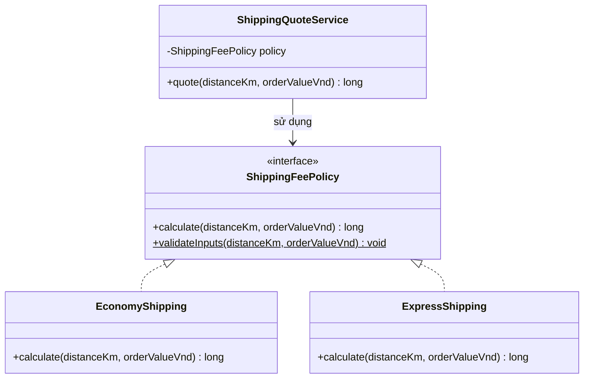
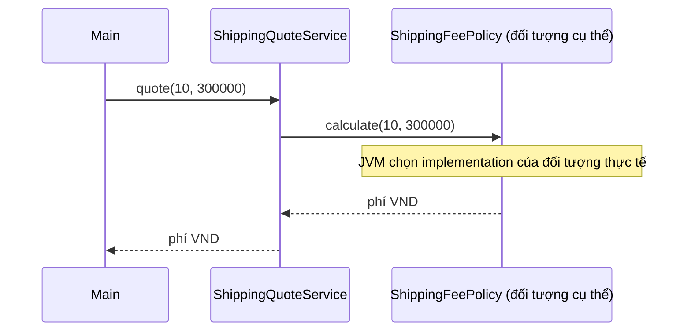
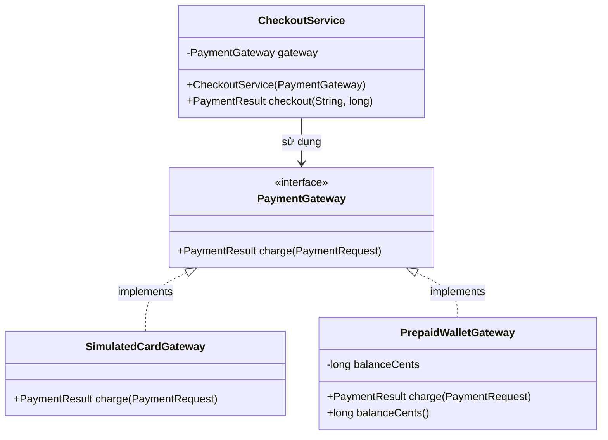
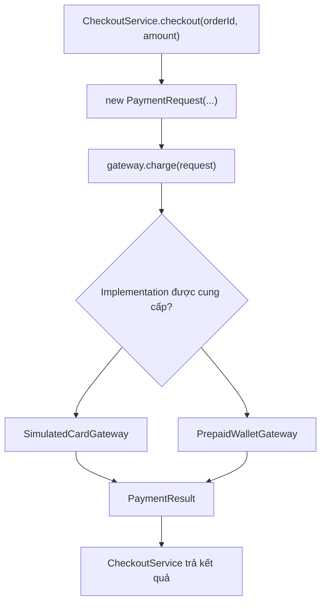
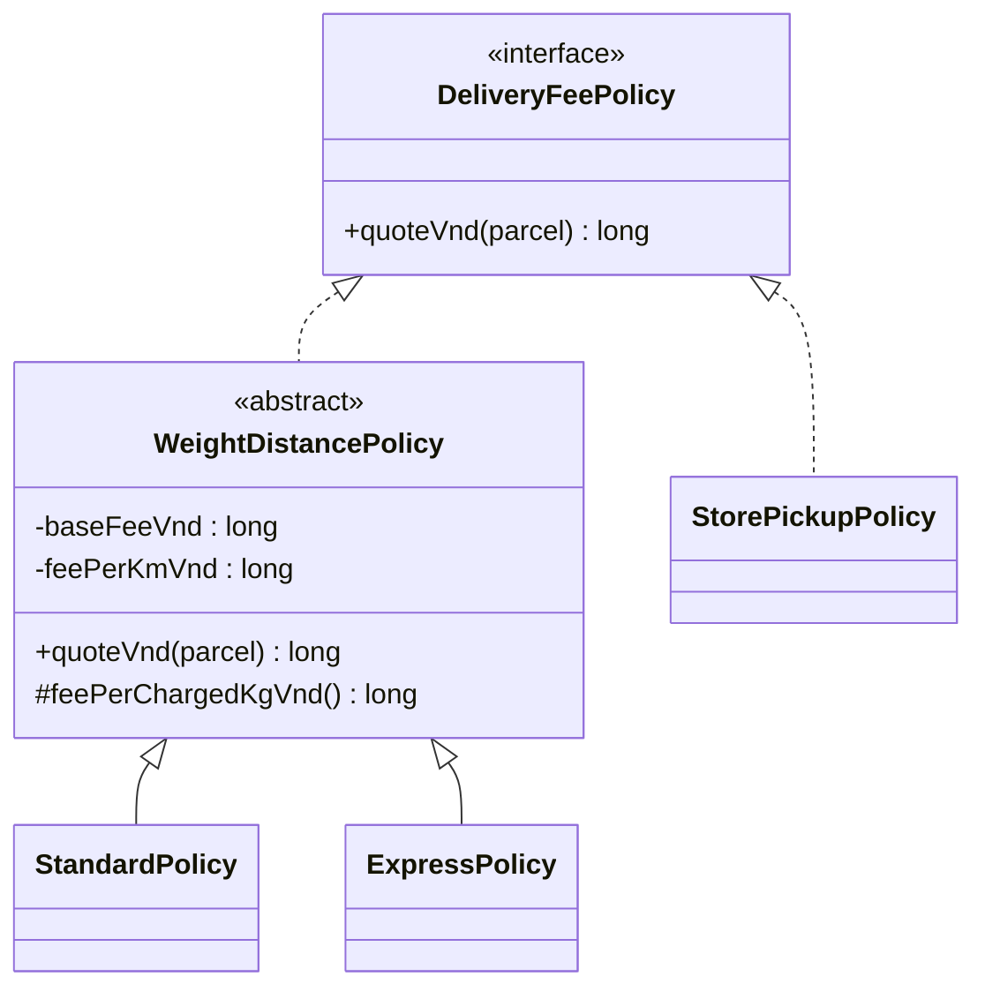
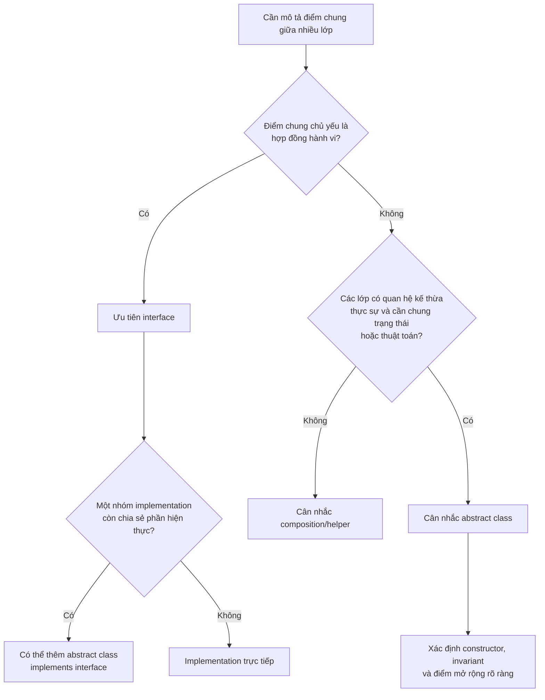
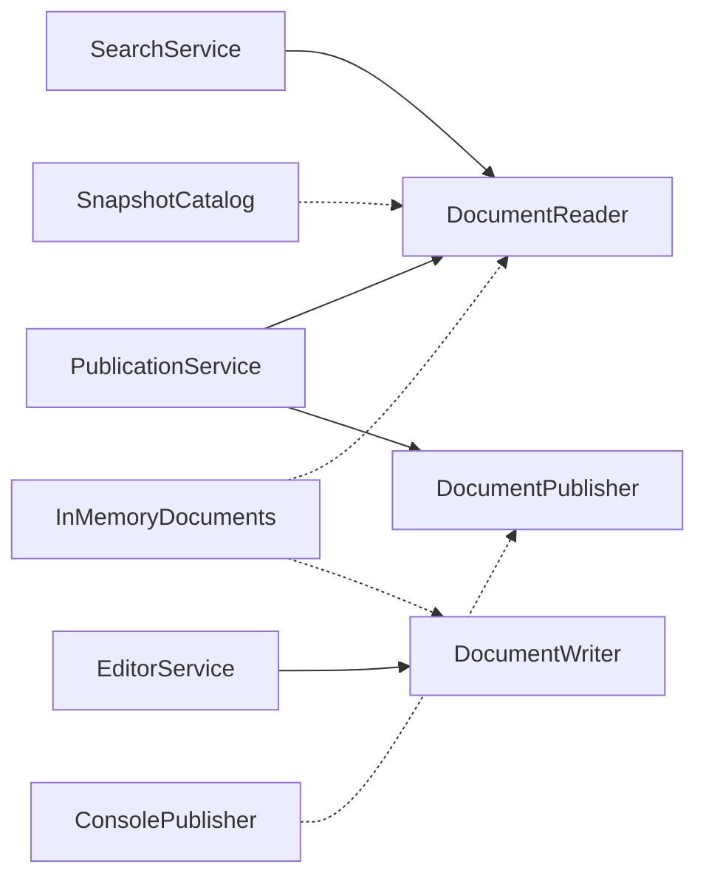
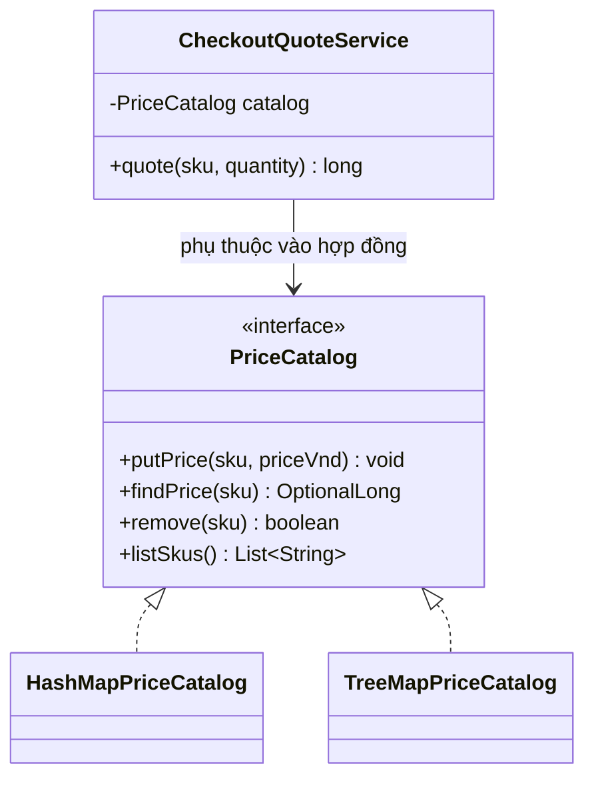
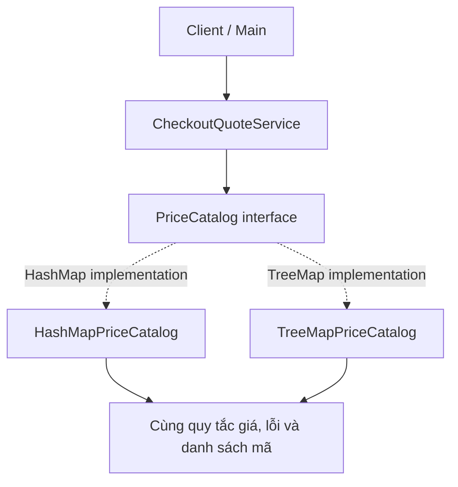
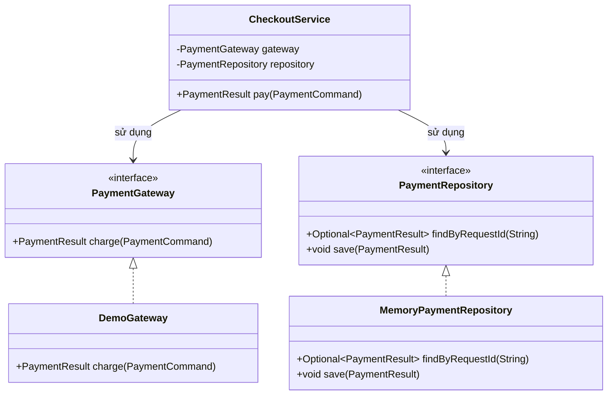

<a id="back-to-top"></a>

# Giao diện

## Menu
- [Giao diện như một hợp đồng và một vai trò](#interface-001)
- [Khai báo và thực hiện giao diện](#interface-002)
- [Lập trình dựa trên giao diện](#interface-003)
- [Một đối tượng đảm nhận nhiều giao diện](#interface-004)
- [Chọn giao diện hay lớp trừu tượng](#interface-005)
- [Giao diện nhỏ và phân tách vai trò](#interface-006)
- [Thành viên mặc định và giới hạn tùy ngôn ngữ](#interface-007)
- [Thay thế cách thực hiện mà giữ hợp đồng](#interface-008)
- [Thiết kế giao diện thanh toán hoặc lưu trữ](#interface-009)

## <a id="interface-001">Giao diện như một hợp đồng và một vai trò</a>

<details>
<summary>Xem chi tiết</summary>

# Giao diện như một hợp đồng và một vai trò trong Java

Trong Java, **giao diện (`interface`)** là một cách mô tả **khả năng mà một đối tượng cam kết cung cấp**, để mã sử dụng có thể gọi khả năng đó mà không cần biết đối tượng thuộc lớp cụ thể nào.

Hãy tưởng tượng ứng dụng cần gửi thông báo. Mã nghiệp vụ chỉ quan tâm việc **gửi một thông báo tới người nhận**. Nó không nên phải biết nơi gửi là email, SMS, thông báo trong ứng dụng, hay một phiên bản giả lập phục vụ kiểm thử. Ta có thể đặt tên chung cho khả năng đó là `DeliveryChannel`.

Hai cách nhìn bổ sung cho nhau:

- **Giao diện như hợp đồng:** nếu một lớp `implements DeliveryChannel`, lớp đó phải cung cấp các thao tác của giao diện và đáp ứng những quy tắc sử dụng đã công bố.
- **Giao diện như vai trò:** một đối tượng có thể được sử dụng *trong vai trò* kênh gửi thông báo, ngay cả khi bản chất của đối tượng còn có những khả năng khác. Một lớp có thể thực hiện nhiều vai trò thông qua nhiều interface.

Hợp đồng giúp các bên phối hợp ổn định. Vai trò giúp ta nói về **điều đối tượng làm được** thay vì hỏi **nó được tạo từ lớp nào**.

## 1. Interface định nghĩa những gì?

Ví dụ đơn giản:

~~~java
interface DeliveryChannel {
    DeliveryReceipt deliver(Notice notice);
}
~~~

Đối với Java compiler, giao diện này khai báo một thao tác có tên `deliver`, nhận `Notice` và trả về `DeliveryReceipt`.

Ở ngữ cảnh này, phương thức được hiểu là `public abstract` dù không viết rõ hai từ khóa đó. Một class cụ thể triển khai giao diện phải cung cấp phiên bản `public` tương ứng, trừ khi class cũng là abstract.

Tuy nhiên, **chữ ký phương thức chưa phải toàn bộ hợp đồng**. Người viết và người sử dụng giao diện còn phải thống nhất:

| Câu hỏi | Quy ước cần có |
|---|---|
| Ai được gọi? | Mã đang giữ một tham chiếu kiểu `DeliveryChannel` |
| Đầu vào nào hợp lệ? | `Notice` khác `null`, có người nhận và nội dung hợp lệ |
| Lời gọi thành công có ý nghĩa gì? | Trong ví dụ học tập: hoàn tất một lần **mô phỏng** gửi |
| Giá trị trả về nói gì? | `DeliveryReceipt` khác `null`, cho biết kênh và thông tin thao tác |
| Đầu vào có bị sửa không? | Không; `Notice` được thiết kế bất biến |
| Nếu không thực hiện được thì sao? | Thông báo lỗi theo quy ước, không tự ý trả `null` hoặc coi như thành công |
| Có gây tác dụng phụ không? | Phải nói rõ trong hợp đồng thực tế; ví dụ dưới chỉ mô phỏng, không gửi mạng thật |

Interface cung cấp **khung cú pháp được compiler kiểm tra**. Quy tắc như “không trả `null`”, “không âm thầm bỏ thông báo” hoặc “phải dùng đúng người nhận” là **hợp đồng hành vi**, được giữ bằng thiết kế, kiểm tra và kiểm thử.

## 2. Ví dụ Java hoàn chỉnh: cùng một vai trò, nhiều cách thực hiện

Tình huống: hệ thống gửi lời chào đến người dùng thông qua một kênh được cấu hình từ bên ngoài. Ta có một service chung, hai cách gửi mô phỏng và một vai trò phụ dùng để kiểm tra sức khỏe kênh.

Lưu toàn bộ vào **`Demo.java`**, chạy với Java 17 trở lên:

~~~java
import java.util.Objects;

public class Demo {
    public static void main(String[] args) {
        NotificationService byEmail = new NotificationService(
                new EmailChannel()
        );

        DeliveryReceipt emailReceipt = byEmail.sendWelcome("U-01");
        System.out.println(emailReceipt.channel()
                + " -> " + emailReceipt.detail());

        SmsChannel sms = new SmsChannel();

        // Cùng một đối tượng, nhìn qua hai vai trò.
        DeliveryChannel deliveryRole = sms;
        HealthCheck healthRole = sms;

        NotificationService bySms = new NotificationService(deliveryRole);
        DeliveryReceipt smsReceipt = bySms.sendWelcome("U-02");

        System.out.println(smsReceipt.channel()
                + " -> " + smsReceipt.detail());
        System.out.println("SMS sẵn sàng: " + healthRole.isHealthy());
    }
}

// Dữ liệu gửi đi: recipientId là mã người nhận logic,
// không phải địa chỉ email hay số điện thoại thực.
record Notice(String recipientId, String text) {
    Notice {
        Objects.requireNonNull(recipientId, "recipientId");
        Objects.requireNonNull(text, "text");

        if (recipientId.isBlank() || text.isBlank()) {
            throw new IllegalArgumentException(
                    "Người nhận và nội dung không được rỗng");
        }
    }
}

record DeliveryReceipt(String channel, String detail) {
    DeliveryReceipt {
        Objects.requireNonNull(channel, "channel");
        Objects.requireNonNull(detail, "detail");

        if (channel.isBlank()) {
            throw new IllegalArgumentException("Thiếu tên kênh");
        }
    }
}

/**
 * Hợp đồng mô phỏng gửi thông báo:
 * - notice phải khác null;
 * - trả về DeliveryReceipt khác null khi hoàn tất bình thường;
 * - không sửa notice;
 * - không có hoạt động gửi mạng thật trong bài minh họa.
 *
 * @throws NullPointerException nếu notice là null
 */
interface DeliveryChannel {
    DeliveryReceipt deliver(Notice notice);
}

// Cách thực hiện thứ nhất.
final class EmailChannel implements DeliveryChannel {
    @Override
    public DeliveryReceipt deliver(Notice notice) {
        Objects.requireNonNull(notice, "notice");

        return new DeliveryReceipt(
                "EMAIL",
                notice.recipientId() + ": " + notice.text()
        );
    }
}

// Một vai trò độc lập: kiểm tra sức khỏe.
interface HealthCheck {
    boolean isHealthy();
}

// Một lớp có thể đồng thời đảm nhiệm nhiều vai trò.
final class SmsChannel implements DeliveryChannel, HealthCheck {
    @Override
    public DeliveryReceipt deliver(Notice notice) {
        Objects.requireNonNull(notice, "notice");

        return new DeliveryReceipt(
                "SMS",
                notice.recipientId() + ": " + notice.text()
        );
    }

    @Override
    public boolean isHealthy() {
        return true; // Trạng thái giả lập cho mục đích học tập.
    }
}

// Client phụ thuộc vào hợp đồng, không phụ thuộc EmailChannel/SmsChannel.
final class NotificationService {
    private final DeliveryChannel channel;

    NotificationService(DeliveryChannel channel) {
        this.channel = Objects.requireNonNull(channel, "channel");
    }

    DeliveryReceipt sendWelcome(String recipientId) {
        Notice notice = new Notice(recipientId, "Chào mừng bạn!");
        return channel.deliver(notice);
    }
}
~~~

Chạy:

~~~bash
javac Demo.java
java Demo
~~~

Kết quả:

~~~text
EMAIL -> U-01: Chào mừng bạn!
SMS -> U-02: Chào mừng bạn!
SMS sẵn sàng: true
~~~

Các lớp `EmailChannel` và `SmsChannel` **chưa gửi email hoặc SMS thật**. Mục đích của ví dụ là để thấy cách tách giao diện và cách thực hiện. Trong hệ thống thật, mỗi adapter cần ánh xạ mã người nhận sang địa chỉ phù hợp, xử lý sự cố mạng, timeout và bảo đảm kết quả có ngữ nghĩa đã thống nhất.

### Đọc chương trình qua ba góc nhìn

**Góc nhìn của client:** `NotificationService` chỉ có field kiểu `DeliveryChannel`. Từ đó, nó được phép gọi `deliver(Notice)` mà không cần biết công thức hay quy trình nội bộ của từng kênh.

**Góc nhìn của implementation:** `EmailChannel` và `SmsChannel` khai báo `implements DeliveryChannel`, cung cấp `deliver()` công khai, kiểm tra đầu vào và trả kết quả theo hợp đồng chung.

**Góc nhìn vai trò:** đối tượng `sms` vừa là `DeliveryChannel`, vừa là `HealthCheck`. Hai biến `deliveryRole` và `healthRole` có thể giữ tham chiếu tới **cùng một đối tượng**, nhưng mỗi biến chỉ bộc lộ những thao tác thuộc kiểu giao diện được khai báo cho nó.

Không cần tạo hai đối tượng chỉ vì đối tượng đó có hai vai trò.

~~~mermaid
classDiagram
    class DeliveryChannel {
        <<interface>>
        +deliver(Notice) DeliveryReceipt
    }
    class HealthCheck {
        <<interface>>
        +isHealthy() boolean
    }
    class EmailChannel {
        +deliver(Notice) DeliveryReceipt
    }
    class SmsChannel {
        +deliver(Notice) DeliveryReceipt
        +isHealthy() boolean
    }
    class NotificationService {
        -DeliveryChannel channel
        +sendWelcome(String) DeliveryReceipt
    }
    DeliveryChannel <|.. EmailChannel
    DeliveryChannel <|.. SmsChannel
    HealthCheck <|.. SmsChannel
    NotificationService --> DeliveryChannel : phụ thuộc
~~~

## 3. “Là một vai trò” khác “là một loại thực thể” thế nào?

Một **class** thường chứa cách cài đặt và trạng thái cụ thể. Một **interface** thường nêu ra một khả năng mà nhiều kiểu đối tượng khác nhau có thể đảm nhiệm.

Ví dụ một ứng dụng có thể xác định:

~~~java
interface Printable {
    void print();
}

interface Exportable {
    byte[] export();
}
~~~

Một báo cáo có thể đóng vai `Printable` để in và `Exportable` để xuất file. Một hóa đơn cũng có thể đóng những vai trò đó, dù báo cáo và hóa đơn không cần có chung một lớp cha nghiệp vụ cụ thể.

Ngôn ngữ kiểu thể hiện rất rõ ý tưởng này:

~~~java
void printDocument(Printable document) {
    document.print();
}
~~~

Đoạn phương thức trên minh họa trong một lớp thích hợp. Người gọi chỉ cần một đối tượng làm được vai trò `Printable`. Hàm không cần nhận `Invoice`, `PdfReport`, hoặc kiểm tra từng kiểu bằng chuỗi `if/else`.

Trong Java, interface **cũng là một kiểu dữ liệu (reference type)**. Có thể dùng nó cho kiểu biến, tham số, kiểu trả về, tham số generic hoặc field. Nó không chỉ là tài liệu mô tả kiến trúc.

Ví dụ trong JDK:

| Interface | Vai trò được biểu diễn | Đối tượng cụ thể có thể thực hiện |
|---|---|---|
| `Runnable` | Có hành vi `run()` | Một tác vụ được đưa cho executor/thread |
| `Comparable<T>` | Có thứ tự tự nhiên để so sánh với kiểu phù hợp | `String`, `Integer`, nhiều value object |
| `Comparator<T>` | Có chiến lược so sánh hai giá trị | Comparator theo giá, ngày, tên |
| `Iterable<T>` | Có thể duyệt các phần tử | Một collection hoặc kiểu tùy biến |
| `AutoCloseable` | Có thể đóng tài nguyên | File stream, tài nguyên tùy biến |

Một đối tượng có thể triển khai nhiều interface mà không cần đi theo một cây phân cấp lớp duy nhất.

## 4. Kiểu khai báo quyết định thao tác có thể gọi

Xét phần này của ví dụ:

~~~java
SmsChannel sms = new SmsChannel();

DeliveryChannel channel = sms;
HealthCheck monitor = sms;

channel.deliver(new Notice("U-10", "Xin chào"));
System.out.println(monitor.isHealthy());
~~~

Khi biến `channel` có kiểu `DeliveryChannel`, ta **không thể** viết trực tiếp `channel.isHealthy()`, dù đối tượng thực tế cũng là `SmsChannel`:

~~~java
// channel.isHealthy(); // Lỗi biên dịch: phương thức không thuộc
//                     // kiểu DeliveryChannel.
~~~

Điều này là có chủ đích. Một phần của hệ thống chỉ cần khả năng gửi thì không nên phụ thuộc vô tình vào API giám sát.

Nếu thực sự cần giám sát, truyền một tham số `HealthCheck` riêng hoặc thiết kế dependency phù hợp. Đừng liên tục ép kiểu sang `SmsChannel` để “lấy thêm” các phương thức ngoài hợp đồng; ép kiểu như thế làm client phụ thuộc ngược lại implementation cụ thể.

**Đa hình (polymorphism)** xảy ra tại lời gọi `channel.deliver(...)`: Java thực hiện `deliver()` của class cụ thể đang được tham chiếu, chứ không thực hiện một “thuật toán mặc định” do tên biến quyết định.

## 5. Một contract tốt cần đi xa hơn compiler

Xét trường hợp một lớp khác khai báo:

~~~java
final class BrokenChannel implements DeliveryChannel {
    @Override
    public DeliveryReceipt deliver(Notice notice) {
        return null;
    }
}
~~~

Class này **biên dịch được**, vì trả về `null` là hợp lệ về mặt kiểu tham chiếu. Nhưng nó **vi phạm hợp đồng hành vi** đã nói rõ kết quả không được null.

Hoặc một class có thể:

- Trả receipt cho **người nhận khác** với đầu vào.
- Ném `UnsupportedOperationException` với mọi `Notice` hợp lệ.
- Trả kết quả “đã gửi” dù không thực hiện thao tác được quy định.
- Thay đổi dữ liệu đầu vào trái với cam kết.
- Bất ngờ yêu cầu người gọi truyền một kiểu con bí mật, dù giao diện chấp nhận kiểu cha rộng hơn.

Compiler không tự chứng minh những quy tắc đó.

### Các phần của hợp đồng hành vi

| Thành phần | Ý nghĩa | Ví dụ với `DeliveryChannel` |
|---|---|---|
| **Precondition** | Điều kiện người gọi cần đáp ứng | Truyền `Notice` khác null và hợp lệ |
| **Postcondition** | Cam kết sau khi hoàn thành bình thường | Trả `DeliveryReceipt` khác null |
| **Invariant** | Điều kiện đối tượng phải duy trì | Receipt có tên kênh hợp lệ |
| **Failure contract** | Khi nào, bằng cách nào thông báo lỗi | `NullPointerException` nếu truyền notice null |
| **Side-effect contract** | Trạng thái nào có thể bị tác động | Ví dụ mô phỏng không thực hiện gửi mạng thật |

Đừng tùy tiện thêm vào giao diện các cam kết mà mọi implementation không thể giữ. Chẳng hạn, nếu hứa “`deliver()` luôn hoàn thành trong 1 ms”, một adapter HTTP thực tế rất khó đáp ứng. Hợp đồng nên đủ mạnh để client dùng đúng, nhưng vẫn cho phép nhiều cách triển khai hợp lệ.

### Nguyên tắc thay thế

Một lớp triển khai giao diện phải được sử dụng thay cho các lớp triển khai khác **trong phạm vi hợp đồng** mà không làm client gặp bất ngờ trái với lời hứa chung. Điều này gần với **Liskov Substitution Principle (LSP)**.

Nhưng không có yêu cầu rằng:

- Hai kênh phải dùng cùng thuật toán.
- Hai receipt phải chứa cùng tên kênh.
- Hai provider có cùng hiệu năng nếu hợp đồng không quy định.
- Mọi implementation đều phải được tạo và quản lý theo một cách.

Phần khác biệt chính là chi tiết thực hiện. Phần ổn định là hợp đồng mà client dựa vào.

## 6. Hợp đồng giúp client độc lập với cách gửi

Đối tượng `NotificationService` trong ví dụ chính nhận `DeliveryChannel` qua constructor. Nơi tạo ứng dụng có thể truyền `new EmailChannel()` hoặc `new SmsChannel()`; mã `sendWelcome` chỉ biết `deliver(Notice)` và không cần sửa khi chuyển kênh.

~~~java
DeliveryChannel selected = new SmsChannel();
NotificationService service = new NotificationService(selected);
DeliveryReceipt result = service.sendWelcome("U-04");
~~~

Cách nhận một dependency đã có từ bên ngoài gọi là **constructor injection**. Nó giúp cô lập nơi lựa chọn implementation, nhưng không có nghĩa mỗi class phải tạo thêm một interface. Chọn hợp đồng khi nó phản ánh **khả năng mà client thực sự cần**; bài *Lập trình dựa trên giao diện* sẽ phân tích hướng phụ thuộc, composition root và fake test cụ thể hơn.

## 7. Một vai trò không nên hứa những khả năng không có

Nếu `DeliveryChannel` còn buộc mọi implementation phải `revoke(messageId)`, một kênh không thể thu hồi tin đã gửi sẽ phải viết method vô nghĩa hoặc luôn ném lỗi. Tốt hơn là tách hai vai trò độc lập:

~~~java
interface Sender {
    DeliveryReceipt deliver(Notice notice);
}

interface Revocable {
    void revoke(String messageId);
}
~~~

Một lớp chỉ nên `implements Revocable` khi có thể thực sự đáp ứng hợp đồng hủy. Client chỉ cần gửi thì yêu cầu `Sender`; client cần thu hồi mới yêu cầu `Revocable`. Đây là ý tưởng của **Interface Segregation Principle (ISP)**: giới hạn phụ thuộc theo nhu cầu, không phải tách máy móc một phương thức thành một interface. Bài *Giao diện nhỏ và phân tách vai trò* có quy trình refactor hợp đồng quá rộng.

## 8. Vai trò và họ lớp có triển khai chung là hai trục khác nhau

| Câu hỏi | Interface | Abstract class |
|---|---|---|
| Mục tiêu chủ yếu | Nêu hợp đồng hành vi của một vai trò | Chia sẻ trạng thái, constructor hoặc thuật toán của một họ lớp |
| Khả năng kết hợp | Class `implements` nhiều interface | Class trực tiếp `extends` tối đa một superclass |
| Trạng thái instance | Không khai báo field instance | Có thể giữ field instance và invariant |
| Constructor | Không có | Có |

Ví dụ `Invoice` và `AnalyticsReport` cùng có thể `implements Exportable` dù không có cùng superclass nghiệp vụ. Nếu một nhóm exporter thực sự cần cùng bộ nhớ đệm và constructor cấu hình, nhóm đó có thể dùng một abstract base class **đồng thời** implement `Exportable`; exporter khác có thể implement trực tiếp. Lựa chọn giữa kế thừa và composition được minh họa trọn vẹn ở bài *Chọn giao diện hay lớp trừu tượng*.

## 9. Một số thành viên Java interface có sẵn cách thực hiện

Mặc dù phần chính của `DeliveryChannel` là phương thức `public abstract` `deliver`, Java 17 còn cho interface chứa:

~~~java
interface Greeter {
    String greet(String name); // Ngầm public abstract

    default String greetEveryone() {
        return greet("mọi người");
    }

    static boolean hasName(String name) {
        return name != null && !name.isBlank();
    }

    private static String normalize(String name) {
        return name.strip();
    }
}
~~~

`default` có thân dùng chung cho implementation; `static` được gọi qua `Greeter.hasName(...)`, không phải instance; `private` là helper chỉ dùng **bên trong interface** (ví dụ trên chưa dùng đến `normalize`). Field trong interface luôn ngầm `public static final`, **không** tạo trạng thái riêng cho từng object. Nếu hai interface độc lập có default method cùng chữ ký, class có thể cần tự override để giải quyết. Bài *Thành viên mặc định và giới hạn tùy ngôn ngữ* giải thích đầy đủ modifier, xung đột, giới hạn `Object` và khác biệt phiên bản.

## 10. Interface như một vai trò có thể truyền vào callback

Một interface chỉ có **một abstract method** có thể được khai báo là *functional interface* và triển khai bằng lambda.

Ví dụ:

~~~java
@FunctionalInterface
interface PriceRule {
    long apply(long originalPriceVnd);
}
~~~

Sử dụng:

~~~java
PriceRule tenPercentOff = original -> original * 90 / 100;

System.out.println(tenPercentOff.apply(200_000)); // 180000
~~~

Biến `tenPercentOff` đảm nhiệm vai trò `PriceRule`, mặc dù ta không viết một class named implementation bằng tay. Lambda được Java chuyển thành một đối tượng có thể thực hiện hợp đồng functional interface.

Trong ví dụ này, công thức chỉ minh họa giảm giá 10% với số nguyên dương đủ nhỏ để không tràn `long`; hợp đồng tài chính thực tế phải nêu rõ kiểm tra số âm, làm tròn và xử lý overflow.

Các interface như `Runnable`, `Comparator<T>`, `Predicate<T>`, `Function<T,R>` là những ví dụ quen thuộc về cách **vai trò** cho phép truyền hành vi qua tham số.

`@FunctionalInterface` giúp compiler kiểm tra rằng interface vẫn có đúng một abstract method theo quy tắc áp dụng. Annotation hữu ích nhưng không bắt buộc để Java nhận diện functional interface hợp lệ.

## 11. Một hợp đồng rõ cho phép kiểm tra client bằng fake

Không cần gửi SMS thật để biết `NotificationService` tạo `Notice` đúng. Một test double có thể lưu thông báo nhận được:

~~~java
final class RecordingChannel implements DeliveryChannel {
    Notice last;

    @Override
    public DeliveryReceipt deliver(Notice notice) {
        last = java.util.Objects.requireNonNull(notice);
        return new DeliveryReceipt("FAKE", "Đã nhận");
    }
}

RecordingChannel fake = new RecordingChannel();
NotificationService service = new NotificationService(fake);
service.sendWelcome("U-03");
if (!"U-03".equals(fake.last.recipientId())) {
    throw new AssertionError("Sai người nhận");
}
~~~

Đoạn kiểm thử dùng lại `Notice`, `DeliveryReceipt` và `NotificationService` ở ví dụ chính. Nó chỉ xác nhận **client gọi đúng hợp đồng**, không chứng minh adapter email/SMS thật hoạt động. Phần kiểm thử nhiều implementation cùng một hợp đồng và phát hiện vi phạm semantics là trọng tâm của bài *Thay thế cách thực hiện mà giữ hợp đồng*.

## 12. Tiến hóa interface là thay đổi lời hứa với nhiều bên

Khi một interface được nhiều module sử dụng, việc thay đổi `deliver(Notice)` thành `deliver(String)` có thể khiến các class triển khai và client không biên dịch. Thêm abstract method cũng thường buộc các concrete implementer bổ sung mã; thêm default method giảm một số tác động về nguồn nhưng vẫn có thể gây xung đột và thay đổi hành vi.

Nguy hiểm hơn là **giữ nguyên chữ ký nhưng đổi ý nghĩa kết quả**. Ví dụ, nếu `DeliveryReceipt` trước đây có nghĩa *nhà cung cấp đã tiếp nhận*, không được âm thầm đổi thành *người nhận đã xem* mà vẫn gọi đó là cùng một cam kết. Caller có thể đưa ra quyết định sai dù mọi mã vẫn biên dịch.

Khi thay kênh, hãy giữ nhất quán điều kiện đầu vào, kết quả, lỗi và side effects đã hứa. Nếu cần đổi semantics, hãy công bố phiên bản hợp đồng mới hoặc chiến lược chuyển đổi rõ ràng, đồng thời chạy kiểm thử hành vi của mỗi implementation.

## 13. Khi nào không nên tạo interface mới?

Interface hữu ích nhưng cũng có chi phí bảo trì. Hãy cân nhắc không tạo thêm một interface nếu:

- Chỉ có một class đơn giản và chưa có ranh giới phụ thuộc cần ổn định.
- Interface phản chiếu gần như mọi public method của class mà không tạo ra vai trò rõ ràng.
- Các consumer liên tục ép kiểu sang implementation cụ thể để dùng những method bị bỏ ngoài interface.
- Interface chứa nhiều phương thức chỉ có một phần implementation hỗ trợ.
- API còn thay đổi nhanh, chưa rõ hợp đồng ổn định cho consumer.

Ngược lại, interface đặc biệt phù hợp với **adapter tích hợp bên ngoài, chiến lược có thể thay thế, plugin, callback, cộng tác giữa module và dependency injection**.

Một tiêu chí thực dụng: mô tả interface bằng một câu **“đối tượng này có thể…”**. Nếu câu ấy rõ ràng, có người dùng cụ thể và có cam kết kiểm chứng được, interface có cơ sở tốt để tồn tại.

## 14. Tình huống luyện tập

### Tình huống 1 — Thiết kế theo vai trò

Một hệ thống có `PdfReport`, `Invoice`, `EmailMessage`. `PdfReport` có thể in và xuất file; `Invoice` có thể in; `EmailMessage` có thể gửi. Nên ép tất cả `extends Document` có mọi phương thức `print()`, `export()`, `send()` không?

**Gợi ý:** không nhất thiết. Có thể dùng các interface theo vai trò `Printable`, `Exportable`, `Sendable`; mỗi lớp chỉ `implements` những khả năng thật sự cung cấp.

### Tình huống 2 — Nhận diện vi phạm hợp đồng

~~~java
class NullChannel implements DeliveryChannel {
    @Override
    public DeliveryReceipt deliver(Notice notice) {
        return null;
    }
}
~~~

**Đáp án:** class có thể biên dịch nhưng vi phạm hợp đồng `deliver` phải trả receipt khác null khi hoàn thành bình thường.

### Tình huống 3 — Vai trò khác kiểu thực tế

~~~java
SmsChannel sms = new SmsChannel();
DeliveryChannel sender = sms;
HealthCheck health = sms;
~~~

Hỏi: có bao nhiêu đối tượng `SmsChannel` được tạo? Có thể gọi `sender.isHealthy()` trực tiếp không?

**Đáp án:** một đối tượng; `sender.isHealthy()` không biên dịch được vì phương thức không thuộc interface `DeliveryChannel`, dù `health.isHealthy()` hợp lệ.

### Tình huống 4 — Client phụ thuộc implementation

~~~java
class Job {
    private final EmailChannel channel = new EmailChannel();
}
~~~

Hỏi: muốn kiểm thử `Job` bằng kênh giả thì nên thay đổi hướng phụ thuộc ra sao?

**Gợi ý:** cho `Job` nhận `DeliveryChannel` qua constructor; nơi tạo `Job` cung cấp `EmailChannel` thật hoặc `RecordingChannel` giả theo môi trường.

### Tình huống 5 — Interface quá rộng

Nếu mọi class thực hiện `StorageManager` phải có cả `upload()`, `read()`, `delete()`, nhưng một module chỉ được phép đọc, thiết kế nào dễ đảm bảo quyền hạn hơn?

**Gợi ý:** một vai trò `ReadableStorage` chỉ công khai `read()`, và các vai trò ghi/xóa chỉ được cấp cho nơi có quyền tương ứng. Phân tách vai trò cũng giúp giảm API mà code sử dụng có thể gọi nhầm.

### Tình huống 6 — Dùng interface để biểu thị thuật toán

Muốn sắp xếp danh sách nhân viên theo tên hoặc lương, bạn có cần sửa class `Employee` mỗi khi đổi tiêu chí?

**Gợi ý:** không. Có thể truyền một `Comparator<Employee>` khác nhau vào thao tác sắp xếp. `Comparator` biểu thị **vai trò chiến lược so sánh**, còn class `Employee` biểu thị thực thể dữ liệu. Khi tiêu chí đổi, client chọn một implementation hoặc lambda khác.

## Ghi nhớ khi thiết kế Java OOP

Hãy chọn giao diện bằng cách bắt đầu từ **người sử dụng**: họ cần đối tượng làm điều gì, đầu vào hợp lệ ra sao, kết quả nào có thể tin cậy và lỗi được xử lý như thế nào? Sau đó cho các class triển khai những hành vi đó bằng chi tiết riêng.

Một interface tốt mang tên một **vai trò có ý nghĩa**, bộc lộ các thao tác đủ nhỏ để client sử dụng độc lập, và có một **hợp đồng hành vi rõ ràng**. Class implement giao diện được thay đổi thuật toán, cấu trúc dữ liệu hoặc nhà cung cấp, nhưng phải tiếp tục thực hiện những cam kết mà client dựa vào. Nhờ thế, thiết kế OOP linh hoạt hơn mà vẫn dễ đọc, dễ thử nghiệm và có thể mở rộng có kiểm soát.


</details>

- [Quay lại đầu trang](#back-to-top)

---

## <a id="interface-002">Khai báo và thực hiện giao diện</a>

<details>
<summary>Xem chi tiết</summary>

# Khai báo và thực hiện giao diện (interface) trong Java

Trong lập trình hướng đối tượng, **giao diện (interface)** mô tả những hành vi mà một kiểu đối tượng cam kết cung cấp. Một lớp **thực hiện giao diện** (*implements*) bằng cách viết mã cho các phương thức thuộc hợp đồng đó.

Ví dụ: hệ thống bán hàng có nhiều cách tính phí giao hàng. Dịch vụ thanh toán chỉ cần yêu cầu “tính phí giao cho quãng đường và giá trị đơn này”, không cần biết phí được tính theo gói tiết kiệm hay giao nhanh. Interface cho phép tách **điều người gọi cần** khỏi **cách từng lớp tính toán**.

Bài học dùng Java 11 trở lên, với các ví dụ tệp `.java` có thể biên dịch trực tiếp.

## 1. Cú pháp căn bản

Khai báo một giao diện:

```java
public interface Greeter {
    String greet(String name);
}
```

Khai báo một lớp thực hiện:

```java
public final class VietnameseGreeter implements Greeter {
    @Override
    public String greet(String name) {
        return "Xin chào, " + name;
    }
}
```

Sử dụng:

```java
Greeter greeter = new VietnameseGreeter();
System.out.println(greeter.greet("Lan")); // Xin chào, Lan
```

Các thành phần cần hiểu:

| Cú pháp | Ý nghĩa |
| --- | --- |
| `interface Greeter` | Khai báo kiểu giao diện có tên `Greeter` |
| `String greet(String name);` | Chữ ký phương thức; ở đây là phương thức abstract, chưa có thân |
| `class VietnameseGreeter implements Greeter` | Lớp cam kết thực hiện giao diện |
| `@Override` | Đề nghị trình biên dịch kiểm tra rằng phương thức thực sự override/implement một phương thức kế thừa |
| `public String greet(...)` | Cung cấp thân phương thức; `public` là bắt buộc vì hợp đồng interface là public |
| `Greeter greeter = new VietnameseGreeter()` | Biến có kiểu interface giữ tham chiếu tới đối tượng triển khai cụ thể |

Trong một interface, phương thức instance thông thường không có thân như `greet` ở trên **ngầm là `public abstract`**. Vì vậy:

```java
String greet(String name);
```

tương đương với:

```java
public abstract String greet(String name);
```

Lớp triển khai bắt buộc dùng phương thức `public`, không thể giảm mức truy cập thành `protected`, package-private hay `private`.

Điểm quan trọng: **interface là một kiểu dữ liệu**, nhưng không thể tạo trực tiếp bằng `new Greeter()`. Ta tạo đối tượng từ một lớp cụ thể thực hiện interface (hoặc từ một biểu thức/lớp ẩn danh phù hợp), rồi lưu tham chiếu của nó dưới kiểu giao diện.

## 2. Bài toán thực tế: thay đổi cách tính phí giao hàng

Giả sử một đơn hàng cần báo phí theo hai chính sách:

- **Tiết kiệm:** phí cơ bản 10.000 VND cộng 2.500 VND cho mỗi km; miễn phí khi giá trị hàng đạt từ 500.000 VND.
- **Giao nhanh:** phí cơ bản 20.000 VND cộng 5.000 VND cho mỗi km; không miễn phí theo giá trị hàng.

Quãng đường là số km nguyên không âm và giá trị đơn hàng là số tiền nguyên VND không âm. Với các giá trị lớn khiến phép tính `long` tràn số, ví dụ báo lỗi thay vì trả phí sai.

Ta muốn phần thanh toán không cần chứa một chuỗi `if (shippingType.equals(...))` để tự quyết định mọi công thức. Thay vào đó, dịch vụ thanh toán **phụ thuộc vào interface**.

### Bước 1: định nghĩa hợp đồng trong `ShippingFeePolicy.java`

```java
/**
 * Chính sách tính phí giao hàng.
 *
 * distanceKm >= 0 và orderValueVnd >= 0.
 * Kết quả là số tiền nguyên VND không âm.
 * Với đầu vào âm, ném IllegalArgumentException.
 * Nếu tính phí bị tràn long, có thể ném ArithmeticException.
 */
public interface ShippingFeePolicy {

    long calculate(int distanceKm, long orderValueVnd);

    // Phương thức static dùng chung để kiểm tra đầu vào.
    static void validateInputs(int distanceKm, long orderValueVnd) {
        if (distanceKm < 0 || orderValueVnd < 0) {
            throw new IllegalArgumentException(
                    "Quãng đường và giá trị đơn không được âm");
        }
    }
}
```

Ở đây `calculate(...)` là **điểm mở rộng**: mỗi chính sách tự đưa ra công thức, nhưng mọi chính sách đều phải giữ quy tắc đầu vào và kết quả đã mô tả. `validateInputs(...)` là phương thức `static` thuộc chính interface; các lớp triển khai có thể gọi nó trực tiếp qua `ShippingFeePolicy.validateInputs(...)`.

Về mặt thiết kế, không phải lúc nào cũng nên đặt logic dùng chung trong interface. Ở ví dụ này, việc kiểm tra hai tham số là một phần thống nhất của hợp đồng, nên phương thức `static` ngắn giúp minh họa khả năng của interface trong Java hiện đại.

### Bước 2: triển khai chính sách tiết kiệm

Tệp `EconomyShipping.java`:

```java
public final class EconomyShipping implements ShippingFeePolicy {

    private static final long FREE_SHIPPING_FROM_VND = 500_000L;
    private static final long BASE_FEE_VND = 10_000L;
    private static final long PER_KM_VND = 2_500L;

    @Override
    public long calculate(int distanceKm, long orderValueVnd) {
        ShippingFeePolicy.validateInputs(distanceKm, orderValueVnd);

        if (orderValueVnd >= FREE_SHIPPING_FROM_VND) {
            return 0L;
        }

        long distanceFee =
                Math.multiplyExact(PER_KM_VND, (long) distanceKm);
        return Math.addExact(BASE_FEE_VND, distanceFee);
    }
}
```

`EconomyShipping` dùng `implements ShippingFeePolicy`. Trình biên dịch kiểm tra lớp đã cung cấp phương thức `calculate(int, long)` với kiểu trả về phù hợp. Công thức và các hằng số nội bộ thuộc lớp cụ thể; caller dùng interface không cần biết chúng.

### Bước 3: triển khai chính sách giao nhanh

Tệp `ExpressShipping.java`:

```java
public final class ExpressShipping implements ShippingFeePolicy {

    private static final long BASE_FEE_VND = 20_000L;
    private static final long PER_KM_VND = 5_000L;

    @Override
    public long calculate(int distanceKm, long orderValueVnd) {
        ShippingFeePolicy.validateInputs(distanceKm, orderValueVnd);

        long distanceFee =
                Math.multiplyExact(PER_KM_VND, (long) distanceKm);
        return Math.addExact(BASE_FEE_VND, distanceFee);
    }
}
```

Hai lớp đều **đáp ứng cùng chữ ký**, nhưng triển khai hành vi khác nhau. Đó là nền tảng để chương trình sử dụng tính đa hình: lời gọi `policy.calculate(...)` chạy phương thức của lớp thực tế mà biến `policy` đang tham chiếu.

### Bước 4: dịch vụ sử dụng giao diện, không lệ thuộc lớp cụ thể

Tệp `ShippingQuoteService.java`:

```java
import java.util.Objects;

public final class ShippingQuoteService {
    private final ShippingFeePolicy policy;

    public ShippingQuoteService(ShippingFeePolicy policy) {
        this.policy = Objects.requireNonNull(policy, "policy");
    }

    public long quote(int distanceKm, long orderValueVnd) {
        return policy.calculate(distanceKm, orderValueVnd);
    }
}
```

`ShippingQuoteService` không viết `new EconomyShipping()` hay `new ExpressShipping()` bên trong. Đối tượng chính sách được đưa vào qua constructor. Đây là một ví dụ đơn giản của **dependency injection bằng constructor**: thành phần cấp cao nhận một dependency qua kiểu trừu tượng. Không cần framework để sử dụng cách thiết kế này.

### Bước 5: chạy ví dụ tổng hợp

Tệp `Main.java`, cùng thư mục với bốn tệp trên:

```java
public class Main {
    public static void main(String[] args) {
        ShippingFeePolicy economyPolicy = new EconomyShipping();
        ShippingFeePolicy expressPolicy = new ExpressShipping();

        ShippingQuoteService economyQuote =
                new ShippingQuoteService(economyPolicy);
        ShippingQuoteService expressQuote =
                new ShippingQuoteService(expressPolicy);

        System.out.println(economyQuote.quote(10, 300_000));
        System.out.println(economyQuote.quote(10, 600_000));
        System.out.println(expressQuote.quote(10, 300_000));

        try {
            expressQuote.quote(-1, 300_000);
        } catch (IllegalArgumentException ex) {
            System.out.println("Từ chối: " + ex.getMessage());
        }
    }
}
```

Chạy bằng terminal:

```bash
javac ShippingFeePolicy.java EconomyShipping.java ExpressShipping.java ShippingQuoteService.java Main.java
java Main
```

Kết quả:

```text
35000
0
70000
Từ chối: Quãng đường và giá trị đơn không được âm
```

Giải thích kết quả:

| Chính sách | Quãng đường | Giá trị hàng | Phí trả về |
| --- | ---: | ---: | ---: |
| Economy | 10 km | 300.000 VND | 10.000 + 2.500 × 10 = **35.000 VND** |
| Economy | 10 km | 600.000 VND | **0 VND** (đủ điều kiện miễn phí) |
| Express | 10 km | 300.000 VND | 20.000 + 5.000 × 10 = **70.000 VND** |

Dịch vụ chỉ biết `ShippingFeePolicy`. Khi bổ sung một chính sách thứ ba, ta tạo lớp khác thực hiện cùng interface rồi truyền vào dịch vụ; phần tính phí tại `ShippingQuoteService` không cần sửa.

## 3. Luồng đa hình nhìn từ interface



Mũi tên nét đứt với đầu tam giác rỗng biểu thị quan hệ **realization/implements**. `ShippingQuoteService` hợp tác với `ShippingFeePolicy` qua một field có kiểu interface.

Luồng thực hiện:



Trong một lời gọi cụ thể, `policy` có thể tham chiếu `EconomyShipping` hoặc `ExpressShipping`. Java quyết định **implementation của phương thức instance** tại thời điểm chạy dựa trên kiểu thực tế của đối tượng. Trình biên dịch vẫn dùng **kiểu của biến tham chiếu** để kiểm tra những phương thức có thể gọi.

Ví dụ:

```java
ShippingFeePolicy policy = new EconomyShipping();
long fee = policy.calculate(8, 200_000); // Hợp lệ

// policy.onlyEconomyFeature(); // Không hợp lệ nếu method
// này không được khai báo trong ShippingFeePolicy.
```

Nếu cần hành vi chỉ có ở một lớp cụ thể, hãy tự hỏi có nên thêm một hợp đồng riêng hay không. Ép kiểu liên tục từ interface xuống lớp triển khai thường là dấu hiệu phần trừu tượng chưa phù hợp.

## 4. Những quy tắc khi khai báo và thực hiện interface

### Phương thức abstract phải được thực hiện đầy đủ

```java
interface Printer {
    void print(String text);
    int pagesPrinted();
}
```

Một lớp **concrete** khai báo `implements Printer` phải cung cấp đầy đủ phương thức abstract chưa được kế thừa từ nơi khác:

```java
class ConsolePrinter implements Printer {
    private int pages;

    @Override
    public void print(String text) {
        System.out.println(text);
        pages++;
    }

    @Override
    public int pagesPrinted() {
        return pages;
    }
}
```

Nếu thiếu `pagesPrinted()`, lớp concrete sẽ không biên dịch. Lớp `abstract` có thể chọn chỉ triển khai một phần hợp đồng để lớp con hoàn thiện:

```java
abstract class BasePrinter implements Printer {
    @Override
    public int pagesPrinted() {
        return 0;
    }
    // Chưa định nghĩa print(String): được phép vì class abstract.
}
```

Chú ý `pagesPrinted()` của `BasePrinter` ở đây trả `0` cố định chỉ để minh họa cú pháp; nếu sử dụng thực tế, triển khai cần trả số trang chính xác theo hợp đồng mong muốn.

### Không thể thu hẹp quyền truy cập

```java
interface Task {
    void execute(); // implicit public abstract
}

class MyTask implements Task {
    @Override
    public void execute() { // Bắt buộc public
        System.out.println("Thực hiện");
    }
}
```

Viết `void execute()` thiếu `public` khi implement sẽ gây lỗi biên dịch vì đang cố giảm quyền truy cập của phương thức `public`.

### Chữ ký phải tương thích

Phương thức triển khai phải khớp tên và danh sách tham số; kiểu trả về phải tương thích, bao gồm quy tắc **covariant return type** với kiểu tham chiếu. Khai báo một overload có tham số khác không thay thế được phương thức phải implement.

```java
interface Parser {
    String parse(String input);
}

class TrimParser implements Parser {
    @Override
    public String parse(String input) {
        return input.trim();
    }

    // Đây là overload, không phải cách thay thế parse(String).
    public String parse(int value) {
        return Integer.toString(value);
    }
}
```

`@Override` rất hữu ích: nếu gõ nhầm `parse(Object)` thay cho `parse(String)`, trình biên dịch sẽ báo không có phương thức đúng để override.

## 5. Interface có thể khai báo cả phương thức có thân

Trong `ShippingFeePolicy` ở ví dụ chính, `calculate(int,long)` là phương thức **abstract** cần được lớp cụ thể hiện thực, còn `static validateInputs(...)` đã có thân và được gọi bằng tên interface. Java hiện đại còn cho phép:

~~~java
interface NamedTask {
    String name();                        // public abstract

    default String describe() {           // Java 8+
        return "Task: " + name();
    }

    static boolean isValid(String value) { // Java 8+
        return value != null && !value.isBlank();
    }

    private String normalized() {         // Java 9+
        return name().strip();
    }
}
~~~

`default` tạo hành vi instance có thể kế thừa/override; `static` không được gọi như phương thức instance; `private` là helper trong interface (ở ví dụ này chưa được gọi). Mọi field khai báo trực tiếp trong interface ngầm là `public static final`, không có state instance. Để học **đầy đủ** quy tắc modifier, field, xung đột default và tính tương thích ngôn ngữ, xem bài *Thành viên mặc định và giới hạn tùy ngôn ngữ*.

## 6. `implements` nhiều interface vẫn chỉ tạo một đối tượng

Một class có thể nhận nhiều hợp đồng qua danh sách phân cách bằng dấu phẩy:

~~~java
interface Printable { void print(); }
interface Exportable { String export(); }

class Report implements Printable, Exportable {
    public void print() { System.out.println("In báo cáo"); }
    public String export() { return "report"; }
}

Report report = new Report();
Printable printer = report;
Exportable exporter = report;
~~~

Hai biến interface `printer` và `exporter` tham chiếu **cùng một** `Report`; chúng không tạo thêm instance và mỗi biến chỉ cung cấp API của vai trò tương ứng. Một interface cũng có thể `extends` nhiều interface khác, còn class Java chỉ trực tiếp `extends` một class.

Nếu các interface độc lập có cùng default method, Java có quy tắc giải quyết xung đột, không chọn ngẫu nhiên. Bài *Một đối tượng đảm nhận nhiều giao diện* có trace thay đổi trạng thái qua nhiều tham chiếu và các trường hợp method collision.

## 7. Interface khác abstract class ở vai trò thiết kế

| Nhu cầu | Interface | Abstract class |
|---|---|---|
| Mở API cho nhiều loại class khác nhau | Khai báo hợp đồng qua `implements` | Ràng buộc vào một họ kế thừa |
| Dùng nhiều vai trò đồng thời | Cho phép `implements` nhiều interface | Class chỉ có một superclass trực tiếp |
| Chia sẻ constructor, field instance, thuật toán nền | Không có constructor/field instance | Hỗ trợ trạng thái và phần triển khai dùng chung |

Ví dụ `ShippingQuoteService` chỉ quan tâm `ShippingFeePolicy`; nó không cần biết các chính sách có chung superclass hay không. Nếu một nhóm chính sách thật sự dùng cùng công thức nền và trạng thái cấu hình, nhóm đó có thể kế thừa một abstract class `implements ShippingFeePolicy`, còn chính sách độc lập vẫn `implements` trực tiếp. Bài *Chọn giao diện hay lớp trừu tượng* triển khai minh họa đầy đủ cùng lựa chọn composition.

## 8. Kiểm tra hợp đồng của nhiều implementation

Dù cả `EconomyShipping` và `ExpressShipping` đều biên dịch, chương trình vẫn có thể sai nếu implementation trả phí âm hoặc bỏ qua yêu cầu dữ liệu không âm. Trình biên dịch kiểm tra **chữ ký**; các ràng buộc nghiệp vụ phải được giữ bằng code và kiểm thử.

Tệp `ContractCheck.java`:

```java
public class ContractCheck {
    public static void main(String[] args) {
        ShippingFeePolicy[] policies = {
            new EconomyShipping(),
            new ExpressShipping()
        };

        for (ShippingFeePolicy policy : policies) {
            long fee = policy.calculate(10, 300_000);
            if (fee < 0) {
                throw new AssertionError("Phí giao hàng bị âm");
            }

            boolean rejected = false;
            try {
                policy.calculate(-1, 300_000);
            } catch (IllegalArgumentException expected) {
                rejected = true;
            }

            if (!rejected) {
                throw new AssertionError("Không từ chối quãng đường âm");
            }
        }

        require(
                new EconomyShipping().calculate(10, 300_000) == 35_000,
                "Sai phí Economy");
        require(
                new EconomyShipping().calculate(10, 600_000) == 0,
                "Sai điều kiện miễn phí");
        require(
                new ExpressShipping().calculate(10, 300_000) == 70_000,
                "Sai phí Express");

        System.out.println("PASS: Các implementation giữ hợp đồng");
    }

    private static void require(boolean condition, String message) {
        if (!condition) {
            throw new AssertionError(message);
        }
    }
}
```

Chạy:

```bash
javac ShippingFeePolicy.java EconomyShipping.java ExpressShipping.java ContractCheck.java
java ContractCheck
```

Kết quả:

```text
PASS: Các implementation giữ hợp đồng
```

Trong dự án thực tế, những kiểm tra này có thể thành test JUnit chạy với nhiều implementation. Việc **dùng cùng một bộ kiểm tra hành vi** giúp phát hiện một lớp mới implement đúng chữ ký nhưng vi phạm quy tắc mà client đang dựa vào.

### Một vài lỗi biên dịch cần nhận diện

| Mã hoặc tình huống | Vấn đề | Cách sửa |
| --- | --- | --- |
| `new ShippingFeePolicy()` | Interface không có instance để khởi tạo trực tiếp | `new EconomyShipping()` hoặc một implementation khác |
| Class implement thiếu `calculate` | Class concrete chưa đáp ứng hợp đồng | Viết đủ phương thức hoặc khai báo class `abstract` |
| `long calculate(...)` thiếu `public` | Giảm quyền truy cập của phương thức interface | Thêm `public` |
| Viết `calculate(long, long)` thay vì `calculate(int, long)` | Overload khác chữ ký, không thực hiện phương thức yêu cầu | Khớp đúng danh sách kiểu tham số |
| Gọi `policy.specialFeature()` không thuộc interface | Kiểu biến không công bố phương thức đó | Thiết kế lại hợp đồng hoặc dùng đúng kiểu khi thật sự cần |
| Gọi `policy.validateInputs(...)` | Static method không là phương thức instance kế thừa | Dùng `ShippingFeePolicy.validateInputs(...)` |
| Hai default method xung đột | Không có implementation duy nhất được chọn | Override và phân giải xung đột |
| Dùng interface như kho field mutable | Field trong interface luôn là hằng `public static final` | Đặt trạng thái trong class hoặc đối tượng phù hợp |

## 9. Cách tổ chức tệp trong dự án thật

Ví dụ trên để các lớp trong cùng thư mục không khai báo package, thuận tiện cho người mới biên dịch bằng `javac`. Với ứng dụng lớn, hãy dùng package rõ ràng. Ví dụ:

```text
src/main/java/com/example/shipping/
├── ShippingFeePolicy.java
├── EconomyShipping.java
├── ExpressShipping.java
└── ShippingQuoteService.java
```

Mỗi tệp sẽ khai báo `package com.example.shipping;` ở đầu. `Main` hay một REST controller ở package khác sử dụng interface bằng `import` tương ứng. Khi có Spring, một bean thuộc lớp triển khai có thể được inject vào service qua constructor, nhưng **bản thân interface Java không phụ thuộc Spring**. Nếu nhiều bean cùng implement một interface, cấu hình cần làm rõ implementation nào được chọn; đó là việc của cơ chế DI, không phải quyết định tự động của Java interface.

Một cách thiết kế thường hiệu quả là cho domain/service phụ thuộc vào **giao diện nhỏ có mục đích rõ ràng**, thay vì gom mọi thao tác không liên quan vào một “siêu interface”. Nếu client chỉ cần tính phí, không nên buộc nó phải biết thêm giao diện lưu đơn hàng, gửi email và theo dõi bưu kiện.

## 10. Tự thực hành

**Bài tập A — thay công thức mà không sửa service.** Tạo `SameDayShipping implements ShippingFeePolicy` với phí 35.000 VND + 7.000 VND mỗi km, không miễn phí. Giữ nguyên kiểm tra đầu vào. Truyền vào `ShippingQuoteService` rồi tính phí cho 4 km. **Kết quả mong đợi: 63.000 VND**.

**Bài tập B — dự đoán lỗi biên dịch.**

```java
interface Reader {
    String read();
}

class FileReaderExample implements Reader {
    String read() {
        return "data";
    }
}
```

Lỗi nằm ở đâu? Phương thức của `Reader` ngầm là `public`, còn `FileReaderExample.read()` không có modifier nên là package-private. Sửa thành `public String read()` và nên thêm `@Override`.

**Bài tập C — interface nhiều phương thức.** Tạo `Resizable` với `void resize(int width, int height)` và `int area()`. Triển khai `Rectangle` sao cho chiều dài/rộng phải dương, `area()` trả diện tích và không làm đổi trạng thái. Hãy quyết định rõ xử lý trường hợp nhân số `int` bị tràn.

**Bài tập D — nhiều interface.** Viết `interface Identifiable { String id(); }` và `interface Printable { void print(); }`; tạo một lớp `Invoice` thực hiện cả hai. Dùng hai biến có kiểu interface để gọi hành vi tương ứng trên cùng một đối tượng.

**Bài tập E — default method.** Tạo `interface Named { String name(); default String displayName() { return name().trim(); } }`. Cài đặt một lớp sử dụng default method và một lớp override nó. Quan sát cách client gọi `displayName()` qua biến `Named`.

## Ghi nhớ khi đọc hoặc thiết kế interface

Một interface tốt trả lời được: **“Đối tượng triển khai phải cung cấp những hành vi nào, với dữ liệu vào và kết quả như thế nào?”**. Khi thực hiện interface, hãy kiểm tra chữ ký, quyền truy cập `public`, những cam kết nghiệp vụ và các trường hợp lỗi. Khi sử dụng interface, hãy tạo đối tượng triển khai rồi thao tác qua **kiểu giao diện** để giảm sự phụ thuộc vào chi tiết bên trong.

Ba dòng then chốt:

```java
interface Action { void run(); }       // Khai báo hợp đồng
class Job implements Action {          // Thực hiện hợp đồng
    @Override public void run() { System.out.println("Run"); }
}
```

Và:

```java
Action action = new Job(); // Biến theo interface, đối tượng theo class
action.run();              // Gọi implementation của Job
```

Khi đã phân biệt được **`interface` khai báo hợp đồng**, **`implements` cung cấp hành vi** và **biến kiểu interface gọi qua đa hình**, bạn có thể mở rộng ứng dụng bằng các triển khai mới mà vẫn giữ nguyên cách sử dụng từ phía client.


</details>

- [Quay lại đầu trang](#back-to-top)

---

## <a id="interface-003">Lập trình dựa trên giao diện</a>

<details>
<summary>Xem chi tiết</summary>

# Lập trình dựa trên giao diện (Programming to Interfaces) trong Java

> **Chủ đề:** OOP → Giao diện. Khi một thành phần chỉ cần biết **một khả năng/hợp đồng** của thành phần khác, hãy cho nó phụ thuộc vào `interface` thay vì lớp triển khai cụ thể. Nhờ vậy, mã nghiệp vụ có thể làm việc với nhiều implementation, thay đổi công nghệ phía sau và kiểm thử bằng fake mà không phải sửa logic chính.

## 1. Vấn đề khi phụ thuộc trực tiếp vào lớp cụ thể

Giả sử `CheckoutService` thực hiện thanh toán qua một bộ xử lý thẻ:

```java
class CardGateway {
    boolean charge(long amountCents) {
        // Ví dụ mô phỏng, không kết nối cổng thanh toán thật.
        return true;
    }
}

class CheckoutService {
    private final CardGateway gateway = new CardGateway();

    boolean checkout(long amountCents) {
        return gateway.charge(amountCents);
    }
}
```

Ở đây `CheckoutService` tự tạo và phụ thuộc trực tiếp vào `CardGateway`. Nếu muốn dùng ví trả trước, giả lập lỗi thanh toán khi kiểm thử hoặc thay nhà cung cấp, thường phải sửa `CheckoutService` hoặc thêm các nhánh `if` để lựa chọn loại gateway.

**Nguyên tắc lập trình dựa trên giao diện:** thay vì biết *ai* xử lý, `CheckoutService` chỉ cần biết *có thể yêu cầu thanh toán như thế nào*.

```java
interface PaymentGateway {
    PaymentResult charge(PaymentRequest request);
}
```

Giao diện mô tả **hành vi mà bên sử dụng được quyền dựa vào**. Những lớp khác nhau có thể `implements PaymentGateway` và tự quyết định cách thực hiện.

## 2. Mối quan hệ giữa người dùng giao diện và lớp triển khai



Mũi tên từ `CheckoutService` tới `PaymentGateway` là **phụ thuộc vào abstraction**. Các lớp gateway là **implementation** của hợp đồng. `CheckoutService` không cần ép kiểu hoặc kiểm tra `instanceof` để quyết định gửi yêu cầu tới lớp nào.

Ba vai trò thường gặp:

| Vai trò | Trong ví dụ | Trách nhiệm |
|---|---|---|
| Giao diện | `PaymentGateway` | Khai báo thao tác thanh toán |
| Thành phần sử dụng | `CheckoutService` | Điều phối checkout bằng hợp đồng chung |
| Lớp triển khai | `SimulatedCardGateway`, `PrepaidWalletGateway` | Thực hiện cách thanh toán cụ thể |

Hợp đồng không chỉ là **chữ ký hàm**. Nó nên mô tả ý nghĩa tham số, giá trị trả về, trường hợp thất bại, tác động lên hệ thống và việc một lời gọi có thể bị thực hiện lặp hay không.

## 3. Ví dụ Java hoàn chỉnh: thay implementation mà không sửa CheckoutService

Tạo tệp `InterfaceProgrammingDemo.java` (Java 17 trở lên):

```java
import java.util.Objects;

public class InterfaceProgrammingDemo {

    public record PaymentRequest(String orderId, long amountCents) {
        public PaymentRequest {
            if (orderId == null || orderId.isBlank()) {
                throw new IllegalArgumentException("Mã đơn hàng không hợp lệ");
            }
            if (amountCents <= 0) {
                throw new IllegalArgumentException("Số tiền phải dương");
            }
        }
    }

    public record PaymentResult(boolean successful, String description) {
        public PaymentResult {
            Objects.requireNonNull(description, "description");
        }
    }

    public interface PaymentGateway {
        PaymentResult charge(PaymentRequest request);
    }

    // Implementation A: giả lập một cổng thẻ luôn trả thành công.
    public static final class SimulatedCardGateway implements PaymentGateway {
        @Override
        public PaymentResult charge(PaymentRequest request) {
            Objects.requireNonNull(request, "request");
            return new PaymentResult(true, "Thẻ mô phỏng: " + request.orderId());
        }
    }

    // Implementation B: ví trả trước có số dư được quản lý trong bộ nhớ.
    public static final class PrepaidWalletGateway implements PaymentGateway {
        private long balanceCents;

        public PrepaidWalletGateway(long openingBalanceCents) {
            if (openingBalanceCents < 0) {
                throw new IllegalArgumentException("Số dư không thể âm");
            }
            this.balanceCents = openingBalanceCents;
        }

        @Override
        public synchronized PaymentResult charge(PaymentRequest request) {
            Objects.requireNonNull(request, "request");

            if (request.amountCents() > balanceCents) {
                return new PaymentResult(false, "Ví không đủ số dư");
            }

            balanceCents -= request.amountCents();
            return new PaymentResult(true, "Ví đã trừ tiền");
        }

        public synchronized long balanceCents() {
            return balanceCents;
        }
    }

    // Lớp nghiệp vụ chỉ phụ thuộc vào PaymentGateway.
    public static final class CheckoutService {
        private final PaymentGateway gateway;

        public CheckoutService(PaymentGateway gateway) {
            this.gateway = Objects.requireNonNull(gateway, "gateway");
        }

        public PaymentResult checkout(String orderId, long amountCents) {
            PaymentRequest request = new PaymentRequest(orderId, amountCents);
            return gateway.charge(request);
        }
    }

    public static void main(String[] args) {
        CheckoutService cardCheckout =
            new CheckoutService(new SimulatedCardGateway());

        PrepaidWalletGateway wallet = new PrepaidWalletGateway(50_000);
        CheckoutService walletCheckout = new CheckoutService(wallet);

        PaymentResult card = cardCheckout.checkout("ORD-01", 120_000);
        PaymentResult walletOk = walletCheckout.checkout("ORD-02", 30_000);
        PaymentResult walletFail = walletCheckout.checkout("ORD-03", 30_000);

        System.out.println("CARD: " + card.successful());
        System.out.println("WALLET 1: " + walletOk.successful());
        System.out.println("WALLET 2: " + walletFail.successful());
        System.out.println("WALLET BALANCE: " + wallet.balanceCents());
    }
}
```

Biên dịch và chạy:

```bash
javac InterfaceProgrammingDemo.java
java InterfaceProgrammingDemo
```

Kết quả mong đợi:

```text
CARD: true
WALLET 1: true
WALLET 2: false
WALLET BALANCE: 20000
```

`CheckoutService` có **một** constructor nhận `PaymentGateway` và **một** cách xử lý `checkout`. Dù được truyền cổng thẻ hay ví, nó vẫn gọi `gateway.charge(request)`. Lời gọi thực tế đến implementation phù hợp với đối tượng được truyền vào.

Trong ví dụ, `SimulatedCardGateway` luôn thành công để minh họa thay thế implementation; đây **không phải** tích hợp thẻ thật. `PrepaidWalletGateway` quản lý trạng thái trong một instance và đồng bộ lệnh trừ tiền bằng `synchronized`. Hệ thống thanh toán thật còn yêu cầu xác thực, idempotency, transaction, lưu trữ bền vững và xử lý kết quả không chắc chắn từ bên ngoài.

### Kiểu biến và đối tượng thực tế

```java
PaymentGateway gateway = new SimulatedCardGateway();
PaymentResult result =
    gateway.charge(new PaymentRequest("ORD-04", 10_000));
```

- Kiểu **khai báo** của `gateway` là `PaymentGateway`: người gọi chỉ có thể dựa vào các thành viên truy cập được từ hợp đồng này.
- **Đối tượng thực** là `SimulatedCardGateway`: việc gọi phương thức instance được triển khai trong lớp này.
- Thay bằng `new PrepaidWalletGateway(50_000)` vẫn hợp lệ về kiểu, vì lớp đó cũng `implements PaymentGateway`.
- Java chọn implementation của phương thức instance theo **kiểu runtime của đối tượng**, một biểu hiện của đa hình (polymorphism).



Chính bước **cung cấp đối tượng triển khai** quyết định hành vi. `interface` không tự biết cách tạo gateway nào, không tự kết nối dịch vụ ngoài và không tự xử lý cấu hình.

## 4. Dependency Injection bằng constructor

Trong ví dụ, `CheckoutService` nhận `PaymentGateway` từ bên ngoài:

```java
public CheckoutService(PaymentGateway gateway) {
    this.gateway = Objects.requireNonNull(gateway, "gateway");
}
```

Đây là **constructor injection**: phụ thuộc được cung cấp lúc tạo `CheckoutService`, giúp lớp không cần viết `new SimulatedCardGateway()` ở bên trong.

Có thể chọn implementation trong thành phần khởi tạo ứng dụng (*composition root*):

```java
PaymentGateway selected = new SimulatedCardGateway();
// Hoặc: new PrepaidWalletGateway(50_000);

CheckoutService service = new CheckoutService(selected);
```

Không cần Spring hay thư viện DI để sử dụng kỹ thuật này. Framework DI có thể tự cấu hình và cung cấp object, nhưng **nguyên tắc thiết kế** vẫn là cho mã nghiệp vụ nhận abstraction đã được tạo sẵn.

| Thiết kế | Hệ quả |
|---|---|
| `new CardGateway()` ngay trong `CheckoutService` | Gắn chặt lớp nghiệp vụ với một implementation và cách khởi tạo |
| Constructor nhận `CardGateway` cụ thể | Cho phép truyền từ ngoài nhưng vẫn ràng buộc vào một lớp |
| Constructor nhận `PaymentGateway` | Có thể truyền bất kỳ implementation tuân thủ hợp đồng |
| Tạo interface chỉ để bọc một helper đơn giản, không có nhu cầu thay đổi | Có thể thêm cấu trúc mà không mang lại lợi ích rõ ràng |

**Dependency Inversion Principle (DIP)** nói về hướng phụ thuộc giữa mã cấp cao và chi tiết triển khai: cả hai nên dựa trên abstraction phù hợp. **Dependency Injection (DI)** là một cách *cung cấp* phụ thuộc đó. Hai khái niệm có quan hệ nhưng không đồng nhất.

## 5. Kiểm thử không cần dùng dịch vụ thanh toán thật

Một lợi ích cụ thể của lập trình dựa trên giao diện là có thể thay gateway bằng **fake** đơn giản để kiểm tra logic sử dụng.

Giả sử vẫn dùng các kiểu `PaymentGateway`, `PaymentRequest`, `PaymentResult`, `CheckoutService` đã định nghĩa bên trong `InterfaceProgrammingDemo`. Ta có thể viết một lớp test độc lập `CheckoutContractCheck.java` như sau, đặt cùng thư mục:

```java
public class CheckoutContractCheck {
    static final class RecordingGateway
            implements InterfaceProgrammingDemo.PaymentGateway {

        InterfaceProgrammingDemo.PaymentRequest lastRequest;
        int calls;

        @Override
        public InterfaceProgrammingDemo.PaymentResult charge(
                InterfaceProgrammingDemo.PaymentRequest request) {
            calls++;
            lastRequest = request;
            return new InterfaceProgrammingDemo.PaymentResult(true, "fake-ok");
        }
    }

    public static void main(String[] args) {
        RecordingGateway fake = new RecordingGateway();
        InterfaceProgrammingDemo.CheckoutService checkout =
            new InterfaceProgrammingDemo.CheckoutService(fake);

        InterfaceProgrammingDemo.PaymentResult result =
            checkout.checkout("ORDER-T1", 25_000);

        if (!result.successful()
                || fake.calls != 1
                || !fake.lastRequest.orderId().equals("ORDER-T1")
                || fake.lastRequest.amountCents() != 25_000) {
            throw new AssertionError("Hợp đồng checkout không đúng");
        }

        System.out.println("PASS");
    }
}
```

Chạy sau khi đã tạo cả hai tệp:

```bash
javac InterfaceProgrammingDemo.java CheckoutContractCheck.java
java CheckoutContractCheck
```

Kết quả: `PASS`.

Ở đây, fake giúp quan sát rằng `CheckoutService` đã gửi đúng `orderId` và `amountCents`, chỉ gọi `charge` một lần, và chuyển kết quả về người gọi. Không cần mạng, credentials hay tài khoản thanh toán.

**Giới hạn:** test này chứng minh cách `CheckoutService` làm việc với giao diện, **không** chứng minh tích hợp cổng thanh toán thật đúng. Mỗi implementation thực tế vẫn cần kiểm thử riêng; giả lập không nên che mất lỗi về giao dịch, timeout hay trạng thái thanh toán không xác định.

## 6. Interface là hợp đồng hành vi, không chỉ là chữ ký

Một interface có thể biên dịch đúng nhưng các implementation vẫn có hành vi mâu thuẫn nếu hợp đồng thiếu rõ ràng.

Ví dụ với `PaymentGateway.charge`, cần định nghĩa:

| Khía cạnh | Câu hỏi hợp đồng cần trả lời |
|---|---|
| Đầu vào | Số tiền có phải dương? `orderId` có bắt buộc? |
| Kết quả | `successful=false` biểu thị điều gì? |
| Lỗi | Timeout, tham số sai hoặc lỗi kỹ thuật được báo bằng cách nào? |
| Tác dụng phụ | Một lời gọi có trừ tiền, lưu trạng thái hay gửi sự kiện không? |
| Gọi lặp | Nếu cùng `orderId` được gọi lại, giao dịch có thể bị thu tiền hai lần không? |
| Concurrency | Gateway có an toàn khi dùng chung giữa nhiều luồng không? |
| Vòng đời | Implementation có kết nối, thread hay resource cần đóng không? |

Trong mã minh họa, request tự kiểm tra dữ liệu; kết quả `successful` phân biệt thành công và không thành công ở mức đơn giản. Đây chưa phải thiết kế thanh toán sản xuất. Với một API thanh toán thật, thường cần mã giao dịch/idempotency key, phân biệt `DECLINED` với `UNKNOWN`, tránh coi timeout là thất bại chắc chắn và không tùy tiện retry lệnh thu tiền.

**Thay thế implementation** có ích khi các implementation giữ đúng **ngữ nghĩa mà người dùng giao diện kỳ vọng**. Nếu một gateway có thể trừ tiền hai lần cho cùng một yêu cầu còn gateway khác không, chỉ có cùng chữ ký Java là chưa đủ để xem chúng thay thế được trong mọi ngữ cảnh. Đây là phần thực tế của nguyên tắc thay thế Liskov (LSP).

## 7. Ngôn ngữ hỗ trợ nhiều dạng interface, nhưng không tự sinh implementation

Java cho interface chứa `public abstract` method, `default` method (Java 8+), `static` method (Java 8+) và helper `private` (Java 9+). Một lớp có thể implement nhiều interface; các field khai báo trong interface luôn là `public static final`, không phải trạng thái instance.

Ví dụ `PaymentGateway` ở bài này chỉ cần abstract method `charge`, vì mỗi loại gateway phải tự quyết định quy trình thanh toán. Thêm default `charge` trả “thành công” giả sẽ **che giấu việc triển khai chưa hoàn tất** và làm hợp đồng nguy hiểm hơn. Những default method hợp lý thường được xây dựng từ hành vi đã có của interface, không bịa ra thành công nghiệp vụ.

Nếu hai interface độc lập có default method cùng chữ ký, class triển khai có thể phải override để phân giải. Quy tắc cú pháp, thứ tự ưu tiên và hạn chế theo phiên bản được học tại bài *Thành viên mặc định và giới hạn tùy ngôn ngữ*; việc một đối tượng làm nhiều vai trò có bài riêng tiếp theo.

## 8. Lập trình dựa trên interface trong thư viện Java

Một ví dụ quen thuộc là khai báo theo interface của collection:

```java
import java.util.ArrayList;
import java.util.LinkedList;
import java.util.List;

List<String> names = new ArrayList<>();
names.add("An");
names.add("Bình");

names = new LinkedList<>(names);
System.out.println(names.size()); // 2
```

Biến `names` được khai báo `List<String>`, nên mã dùng các thao tác thuộc hợp đồng `List`, bất kể triển khai là `ArrayList` hay `LinkedList`.

Nhưng **không phải mọi implementation có hiệu năng hay hành vi bổ sung giống nhau**: một số danh sách không cho sửa, một số có đặc điểm truy cập ngẫu nhiên khác nhau. Lựa chọn implementation vẫn phải dựa vào nhu cầu thật.

Chữ ký API cũng nên diễn đạt yêu cầu tối thiểu:

```java
static void printAll(Iterable<String> values) {
    for (String value : values) {
        System.out.println(value);
    }
}
```

Nếu chỉ cần duyệt, `Iterable<String>` có thể diễn đạt nhu cầu tốt hơn `ArrayList<String>`. Nếu cần truy cập theo chỉ số và kích thước, `List<String>` là phù hợp hơn.

Tuy nhiên, **không nên tự động biến mọi kiểu thành `Object` hoặc `Iterable`**: hợp đồng quá chung khiến người gọi và người triển khai thiếu thông tin. Chọn abstraction **đủ hẹp về trách nhiệm và đủ mạnh để mô tả nghiệp vụ**.

## 9. Khi nào nên tạo interface riêng?

Một interface riêng mang lại giá trị khi:

- Có nhiều implementation với cùng một ý nghĩa nghiệp vụ.
- Một dependency là ranh giới hạ tầng dễ thay đổi: gửi thông báo, lưu trữ, thanh toán, đồng bộ dữ liệu.
- Thành phần nghiệp vụ cần test độc lập bằng fake, stub hoặc spy.
- Nhiều người cùng làm việc dựa trên một hợp đồng ổn định.
- Muốn một module cấp cao không phải import các chi tiết thư viện/kết nối của module cấp thấp.

Ngược lại, nếu chỉ có một helper nhỏ, không có hợp đồng thay thế hữu ích, tạo hàng loạt `IXxx`, `XxxImpl` chỉ thêm file và tầng gọi. Interface nên xuất phát từ **điều mà bên sử dụng thật sự cần**, không chỉ từ thói quen “mỗi class phải có một interface”.

### Lỗi thiết kế thường gặp

| Lỗi | Hệ quả | Cách sửa |
|---|---|---|
| Service giữ `new ConcreteGateway()` bên trong | Không thay gateway bằng injection | Nhận `PaymentGateway` qua constructor |
| API trả kiểu implementation không cần thiết | Lộ chi tiết cấu trúc | Trả interface/kiểu nghiệp vụ phù hợp |
| Dùng `instanceof` để chọn loại gateway | Service biết và phân nhánh theo mọi implementation | Đưa hành vi khác nhau vào implementation của interface |
| Interface quá lớn với nhiều phương thức không liên quan | Lớp triển khai bị ép thực hiện phần không cần | Tách các hợp đồng có trách nhiệm rõ (ISP) |
| Implementation làm sai ngữ nghĩa của interface | Lỗi chỉ xuất hiện khi thay implementation | Ghi rõ hợp đồng và dùng contract tests |
| Tạo interface chỉ để đủ mẫu code | Tăng độ phức tạp không có giá trị | Bắt đầu từ nhu cầu thay thế hoặc ranh giới phụ thuộc |
| Coi interface là cơ chế quản lý transaction | Thay implementation nhưng dữ liệu vẫn có thể không nhất quán | Thiết kế transaction, error handling, idempotency riêng |

## 10. Bài tập thực hành

**Bài 1 – Gửi thông báo.** Tạo `NotificationSender` với `void send(String destination, String message)`. Viết hai implementation `ConsoleSender` và `InMemorySender`, rồi tạo `OrderNotifier` nhận `NotificationSender` qua constructor. Dùng fake để xác nhận một thông báo đã được gửi đúng nội dung.

**Bài 2 – Thay gateway.** Thêm `RejectAllGateway` trả `PaymentResult(false, "...")` cho mọi yêu cầu. Tạo `CheckoutService` mới với gateway đó mà không sửa bất kỳ dòng nào trong `CheckoutService`.

**Bài 3 – Hợp đồng gọi lặp.** Chỉnh giao diện thanh toán để nhận một `idempotencyKey` và thiết kế implementation giả lập lưu kết quả theo key. Chứng minh hai yêu cầu trùng key không trừ tiền hai lần. Mô tả rủi ro khi lưu cache key chỉ trong RAM.

**Bài 4 – Chọn abstraction.** Một phương thức chỉ cần đọc các phần tử chuỗi từ cấu trúc dữ liệu. Nên nhận `ArrayList<String>`, `List<String>`, `Collection<String>` hay `Iterable<String>`? Giải thích khả năng nào thực sự cần thiết.

**Bài 5 – Phân biệt DI và interface.** Có thể làm constructor injection với một concrete class không? Có. Vậy khi nào thêm interface mới có lợi? Hãy trả lời bằng khả năng thay thế implementation và phạm vi phụ thuộc.

**Điểm cần nhớ:** Lập trình dựa trên giao diện giúp phần nghiệp vụ tập trung vào **hợp đồng nó cần**, trong khi các lớp khác thực hiện chi tiết cụ thể. Thực hành quan trọng nhất là xác định **đúng abstraction, đúng quyền sở hữu dependency và đúng ngữ nghĩa khi thay implementation** — không phải thêm interface cho mọi class.


</details>

- [Quay lại đầu trang](#back-to-top)

---

## <a id="interface-004">Một đối tượng đảm nhận nhiều giao diện</a>

<details>
<summary>Xem chi tiết</summary>

# Một đối tượng đảm nhận nhiều giao diện trong Java

Một thiết bị văn phòng có thể vừa **in**, vừa **quét tài liệu**, vừa **báo cáo trạng thái**. Người cần in chỉ quan tâm khả năng in; người cần quét chỉ quan tâm khả năng quét. Java cho phép **một đối tượng duy nhất thực hiện nhiều hợp đồng hành vi** bằng cách để lớp của nó `implements` nhiều `interface`.

Điểm quan trọng: mỗi `interface` mô tả một **vai trò hoặc năng lực**, không nhất thiết tương ứng với một đối tượng khác nhau. Một instance có thể được sử dụng đồng thời qua nhiều biến tham chiếu có kiểu interface khác nhau, và mọi thao tác vẫn tác động lên trạng thái của **cùng instance**.

## 1. Cú pháp cốt lõi

~~~java
interface Printable {
    void print(String document);
}

interface Scannable {
    String scan(String pageId);
}

class OfficeMachine implements Printable, Scannable {
    @Override
    public void print(String document) {
        System.out.println("In: " + document);
    }

    @Override
    public String scan(String pageId) {
        return "PDF:" + pageId;
    }
}
~~~

~~~java
OfficeMachine machine = new OfficeMachine();

Printable printer = machine;
Scannable scanner = machine;

printer.print("Báo cáo");
System.out.println(scanner.scan("HD-001")); // PDF:HD-001
~~~

Ở đây:

- `OfficeMachine` là **một lớp cụ thể** thực thi hai interface.
- `new OfficeMachine()` chỉ tạo **một đối tượng OfficeMachine**.
- `printer` và `scanner` là **hai biến tham chiếu**, mỗi biến quan sát đối tượng theo một hợp đồng khác nhau.
- Biến kiểu `Printable` chỉ cho phép gọi những hành vi công khai thuộc hợp đồng `Printable` (và những thành viên có thể gọi theo quy tắc của kiểu), dù đối tượng thực tế còn biết quét.
- Java chọn phần triển khai `print` hoặc `scan` của lớp thực tế tại thời điểm chạy.

Không tồn tại hai “nửa đối tượng” riêng biệt được tạo ra khi gán vào hai biến interface. Đây là **đa hình theo interface**: cùng một instance có thể được đối xử như nhiều kiểu hợp đồng.

## 2. Ví dụ hoàn chỉnh: một máy, nhiều vai trò

Tạo file **`MultipleInterfacesDemo.java`**. Ví dụ chạy trên Java 11+, chỉ dùng thư viện chuẩn Java.

~~~java
import java.util.Objects;

public class MultipleInterfacesDemo {

    interface Printable {
        void print(String document);
    }

    interface Scannable {
        String scan(String pageId);
    }

    interface StatusReadable {
        String status();
    }

    static final class OfficeMachine
            implements Printable, Scannable, StatusReadable {

        private final String machineId;
        private int printedPages;
        private int scannedPages;

        OfficeMachine(String machineId) {
            String checked = Objects.requireNonNull(
                    machineId, "machineId").trim();

            if (checked.isEmpty()) {
                throw new IllegalArgumentException(
                        "Mã máy không được rỗng");
            }
            this.machineId = checked;
        }

        @Override
        public void print(String document) {
            String checked = requireText(document, "document");
            printedPages++;
            System.out.println("[PRINT] " + checked);
        }

        @Override
        public String scan(String pageId) {
            String checked = requireText(pageId, "pageId");
            scannedPages++;
            return "PDF:" + checked;
        }

        @Override
        public String status() {
            return machineId + " | printed=" + printedPages
                    + " | scanned=" + scannedPages;
        }

        private static String requireText(String value, String name) {
            String checked = Objects.requireNonNull(
                    value, name).trim();
            if (checked.isEmpty()) {
                throw new IllegalArgumentException(
                        name + " không được rỗng");
            }
            return checked;
        }
    }

    // Thành phần chỉ yêu cầu năng lực in.
    static final class PrintDesk {
        private final Printable printer;

        PrintDesk(Printable printer) {
            this.printer = Objects.requireNonNull(printer);
        }

        void printReport(String report) {
            printer.print(report);
        }
    }

    // Thành phần chỉ yêu cầu năng lực quét.
    static final class ScanDesk {
        private final Scannable scanner;

        ScanDesk(Scannable scanner) {
            this.scanner = Objects.requireNonNull(scanner);
        }

        String digitize(String pageId) {
            return scanner.scan(pageId);
        }
    }

    public static void main(String[] args) {
        OfficeMachine machine = new OfficeMachine("OFFICE-01");

        Printable printPort = machine;
        Scannable scanPort = machine;
        StatusReadable monitorPort = machine;

        System.out.println("Cùng instance: "
                + ((Object) printPort == (Object) scanPort));

        PrintDesk printDesk = new PrintDesk(printPort);
        ScanDesk scanDesk = new ScanDesk(scanPort);

        printDesk.printReport("Báo cáo tháng");
        String file = scanDesk.digitize("HD-001");

        System.out.println("Kết quả quét: " + file);
        System.out.println("Trạng thái: " + monitorPort.status());
    }
}
~~~

Chạy:

~~~bash
javac MultipleInterfacesDemo.java
java MultipleInterfacesDemo
~~~

Kết quả:

~~~text
Cùng instance: true
[PRINT] Báo cáo tháng
Kết quả quét: PDF:HD-001
Trạng thái: OFFICE-01 | printed=1 | scanned=1
~~~

**Điều gì xảy ra?**

1. `machine` tham chiếu tới đối tượng `OfficeMachine` mới tạo.
2. Gán `printPort = machine`, `scanPort = machine` và `monitorPort = machine` **sao chép giá trị tham chiếu**; không gọi `new` lần nữa.
3. `PrintDesk` nhận đối tượng đó dưới vai trò `Printable`, gọi `print`, làm tăng `printedPages`.
4. `ScanDesk` nhận chính đối tượng ấy dưới vai trò `Scannable`, gọi `scan`, làm tăng `scannedPages`.
5. `monitorPort.status()` quan sát **cả hai bộ đếm trên cùng đối tượng**.

Lưu ý: trong một ví dụ sản xuất, việc tăng bộ đếm trước khi in/quét thành công có thể không phản ánh số tác vụ đã hoàn tất; ở đây các phương thức chỉ mô phỏng bằng chuỗi và console, nên không có thiết bị hay I/O thực.

## 3. Mô hình quan hệ class–interface và đối tượng tại runtime

Một lớp có thể `implements` nhiều giao diện bằng dấu phẩy:

~~~java
class OfficeMachine implements Printable, Scannable, StatusReadable {
    // ...
}
~~~

~~~mermaid
classDiagram
    class Printable {
        <<interface>>
        +print(String) void
    }
    class Scannable {
        <<interface>>
        +scan(String) String
    }
    class StatusReadable {
        <<interface>>
        +status() String
    }
    class OfficeMachine {
        -machineId String
        -printedPages int
        -scannedPages int
        +print(String) void
        +scan(String) String
        +status() String
    }
    Printable <|.. OfficeMachine
    Scannable <|.. OfficeMachine
    StatusReadable <|.. OfficeMachine
~~~

Sơ đồ lớp thể hiện **một kiểu cụ thể** hiện thực hóa **ba hợp đồng**. Còn sơ đồ tham chiếu bên dưới thể hiện **một instance đang tồn tại**:

~~~mermaid
flowchart LR
    P["printPort: Printable"] --> M["OfficeMachine instance\nOFFICE-01\nprinted=1, scanned=1"]
    S["scanPort: Scannable"] --> M
    R["monitorPort: StatusReadable"] --> M
~~~

Đừng nhầm ba **kiểu tham chiếu** với ba đối tượng. Khi một đối tượng triển khai nhiều interface, nó được phép xuất hiện ở nhiều API có yêu cầu kiểu khác nhau.

## 4. Kiểu khai báo quyết định thao tác nào có thể gọi

Giả sử:

~~~java
OfficeMachine machine = new OfficeMachine("OFFICE-02");
Printable printer = machine;
Scannable scanner = machine;
~~~

Các lời gọi hợp lệ:

~~~java
printer.print("Tài liệu A");
String result = scanner.scan("Trang B");

machine.print("Tài liệu C");
machine.scan("Trang D");
machine.status();
~~~

Nhưng:

~~~java
// printer.scan("Trang E"); // LỖI BIÊN DỊCH
// scanner.print("Tài liệu F"); // LỖI BIÊN DỊCH
~~~

Biến `printer` có **kiểu tĩnh** là `Printable`; compiler không cho phép gọi `scan` qua biến này vì hợp đồng `Printable` không khai báo `scan`. Điều đó **không có nghĩa** instance phía sau mất năng lực quét.

Nếu một API thực sự cần cả hai vai trò, có thể khai báo một kiểu hợp đồng bao gồm hai interface:

~~~java
interface MultiFunctionDevice extends Printable, Scannable {
    // Kế thừa hai hợp đồng; chưa cần khai báo thêm phương thức.
}

class FullOfficeMachine implements MultiFunctionDevice {
    @Override
    public void print(String document) {
        System.out.println("In: " + document);
    }

    @Override
    public String scan(String pageId) {
        return "PDF:" + pageId;
    }
}

MultiFunctionDevice device = new FullOfficeMachine();
device.print("Kế hoạch");
System.out.println(device.scan("Trang 01"));
~~~

Đây là **một interface kế thừa nhiều interface**, cũng hợp lệ trong Java. Nó khác với việc một class kế thừa nhiều class: Java **không hỗ trợ một class `extends` đồng thời nhiều class**.

Bảng đối chiếu:

| Khai báo | Hợp lệ? | Ý nghĩa |
| --- | --- | --- |
| `class X implements A, B` | Có | Một lớp hiện thực nhiều interface |
| `interface C extends A, B` | Có | Gộp/kế thừa nhiều hợp đồng |
| `class X extends Parent implements A, B` | Có | Một lớp cha trực tiếp, nhiều interface |
| `class X extends Parent1, Parent2` | Không | Java không cho đa kế thừa lớp |
| `Printable p = new OfficeMachine(...)` | Có | Dùng instance concrete qua tham chiếu interface |
| `new Printable()` | Không | Không khởi tạo interface trực tiếp |

## 5. Một client chỉ cần nhìn thấy vai trò nó sử dụng

`PrintDesk(Printable printer)` cho phép truyền `OfficeMachine` hoặc một máy chỉ hỗ trợ in. Nếu constructor nhận hẳn `OfficeMachine`, nó vô tình ràng buộc việc in với cả các chức năng quét và giám sát của một model cụ thể.

~~~java
class CloudPrinter implements Printable {
    @Override
    public void print(String document) {
        System.out.println("Đưa vào hàng đợi: " + document);
    }
}

// PrintDesk desk = new PrintDesk(new CloudPrinter());
~~~

Bài học ở đây là **một class có thể đáp ứng nhiều vai trò, nhưng mỗi client chỉ nên yêu cầu vai trò mình cần**. Nếu ép máy in một chức năng implement cả `Scannable` rồi ném `UnsupportedOperationException`, hợp đồng đã quá rộng. Bài *Giao diện nhỏ và phân tách vai trò* phân tích sâu Interface Segregation Principle và cách tách interface theo nhóm client.

## 6. Interface không chia sẻ các field instance

| Thành phần | Interface | Class |
|---|---|---|
| Hợp đồng phương thức | Có | Có thể khai báo/thực hiện |
| Field trạng thái riêng theo instance | Không | Có |
| Constructor | Không | Có |
| Kế thừa nhiều interface | Có, qua `extends` | Có thể `implements` nhiều interface |
| Kế thừa class | Không | Chỉ `extends` trực tiếp một class |

Bởi vậy `OfficeMachine` đặt `printedPages` và `scannedPages` trong **class**, còn `Printable`, `Scannable` chỉ công bố những thao tác mà client gọi được. Một phương thức abstract trong interface ngầm là `public`; class thực hiện không thể giảm quyền truy cập. Interface cũng có thể có `default`/`static`/`private` method nhưng không vì thế có state instance riêng.

So sánh khi nào nên dùng abstract class để dùng chung constructor, trạng thái và thuật toán được triển khai ở bài *Chọn giao diện hay lớp trừu tượng*.

## 7. Trùng tên phương thức giữa hai interface

Một lớp implement nhiều interface có thể gặp các phương thức cùng tên. Cần phân biệt **cùng hợp đồng abstract**, **overload khác tham số** và **xung đột default implementation**.

### Hai interface cùng yêu cầu một phương thức abstract

~~~java
interface Auditable {
    void log(String message);
}

interface Loggable {
    void log(String message);
}

class AuditConsole implements Auditable, Loggable {
    @Override
    public void log(String message) {
        System.out.println(message);
    }
}
~~~

Một implementation `log(String)` là đủ, vì cả hai giao diện yêu cầu cùng chữ ký với kiểu trả về tương thích. Hai interface **không tạo hai bản sao phương thức** trong đối tượng.

### Hai interface có phương thức overload

~~~java
interface TextWriter {
    void write(String text);
}

interface NumberWriter {
    void write(int number);
}

class Writer implements TextWriter, NumberWriter {
    @Override
    public void write(String text) {
        System.out.println(text);
    }

    @Override
    public void write(int number) {
        System.out.println(number);
    }
}
~~~

Hai `write` có danh sách tham số khác nhau, nên lớp triển khai cả hai dưới dạng **overloading**.

### Hai interface khai báo `default` method trùng chữ ký

Đây là trường hợp dễ gây nhầm:

~~~java
interface LocalLabel {
    default String label() {
        return "LOCAL";
    }
}

interface RemoteLabel {
    default String label() {
        return "REMOTE";
    }
}

// LỖI nếu bỏ override:
// class Hybrid implements LocalLabel, RemoteLabel { }
~~~

Java không tự chọn ngẫu nhiên một `default`. Lớp phải giải quyết xung đột, chẳng hạn tự cung cấp implementation:

~~~java
class Hybrid implements LocalLabel, RemoteLabel {
    @Override
    public String label() {
        return LocalLabel.super.label()
                + " + " + RemoteLabel.super.label();
    }
}
~~~

~~~java
Hybrid hybrid = new Hybrid();
System.out.println(hybrid.label()); // LOCAL + REMOTE
~~~

Bản `Hybrid.label()` là một phương thức duy nhất, chủ động kết hợp hai cách mặc định. Nếu logic miền nghiệp vụ cần chọn chỉ một bên, lớp có thể trả về một trong hai hoặc viết lại hoàn toàn.

**Quy tắc ưu tiên quan trọng:** nếu một superclass có phương thức instance phù hợp, phương thức của class thường được ưu tiên so với default method cùng chữ ký của interface; các xung đột default không phải lúc nào cũng cần override. Riêng trường hợp hai default không thể phân giải, compiler yêu cầu xử lý rõ.

**Không thể chỉ đổi kiểu trả về** để overload hai phương thức cùng tên/cùng tham số. Nếu hai interface yêu cầu return type không tương thích, có thể không tồn tại implementation hợp lệ; cần chỉnh lại thiết kế hợp đồng.

## 8. Một đối tượng, nhiều tham chiếu và việc ép kiểu

Trong chương trình chính:

~~~java
OfficeMachine machine = new OfficeMachine("OFFICE-03");
Printable a = machine;
Scannable b = machine;
StatusReadable c = machine;
~~~

`a`, `b`, `c` cùng tham chiếu **một** đối tượng, nhưng các thao tác có thể gọi qua từng biến là khác nhau. Phép gán không tạo bản sao của thiết bị hay trạng thái.

Ta có thể kiểm tra kiểu thực tế bằng `instanceof`:

~~~java
if (a instanceof Scannable) {
    Scannable scanner = (Scannable) a;
    System.out.println(scanner.scan("HD-002"));
}
~~~

Đoạn trên hợp lệ vì đối tượng mà `a` đang trỏ tới thực sự hỗ trợ `Scannable`. Nhưng không phải mọi `Printable` đều là `Scannable`: `new CloudPrinter()` ở ví dụ trên không tự hỗ trợ quét. Ép kiểu thiếu kiểm tra có thể gây `ClassCastException`.

Nếu một hàm **luôn cần cả in và quét**, nên khai báo tham số kiểu `MultiFunctionDevice` hoặc một abstraction phù hợp thay vì luôn nhận `Printable` rồi ép kiểu để tìm tính năng bổ sung. Dùng `instanceof` như cơ chế tùy chọn đôi khi hợp lý, nhưng lạm dụng sẽ làm giảm lợi ích của thiết kế dựa trên interface.

Lưu ý cách so sánh trong ví dụ chạy được:

~~~java
((Object) printPort == (Object) scanPort)
~~~

`==` với tham chiếu kiểm tra **cùng instance**, không kiểm tra nội dung hay hợp đồng. Việc ép hai phía sang `Object` ở đây chỉ để thể hiện rõ ta đang so sánh danh tính đối tượng.

## 9. Vai trò có thể cung cấp một thao tác mặc định nhỏ

Ví dụ interface in có thể định nghĩa hành vi in hai lần **dựa trên chính hợp đồng in**:

~~~java
interface RepeatablePrinter {
    void print(String document);

    default void printTwice(String document) {
        print(document);
        print(document);
    }
}
~~~

Lớp implement `RepeatablePrinter` chỉ cần định nghĩa `print` để dùng hành vi mặc định `printTwice`; các lần gọi vẫn chạy implementation của đối tượng thực. Nhưng default method **không cấp thêm field instance**, và phải thỏa semantics chung của mọi implementation (chẳng hạn “in hai bản” chỉ hợp lý khi gọi `print` hai lần là điều hợp lệ). Đối với quy tắc `static`/`private`, xung đột default và thay đổi interface theo phiên bản Java, xem bài *Thành viên mặc định và giới hạn tùy ngôn ngữ*.

## 10. Interface không phải là “đa kế thừa trạng thái”

Một lớp Java chỉ `extends` một superclass trực tiếp nhưng có thể `implements` nhiều interface:

~~~java
class Device {
    protected final String serial;

    Device(String serial) {
        this.serial = serial;
    }
}

interface Printable {
    void print(String text);
}

interface Scannable {
    String scan(String pageId);
}

class AllInOne extends Device implements Printable, Scannable {
    AllInOne(String serial) {
        super(serial);
    }

    @Override
    public void print(String text) {
        System.out.println(serial + " in: " + text);
    }

    @Override
    public String scan(String pageId) {
        return serial + "/PDF/" + pageId;
    }
}
~~~

`AllInOne` kế thừa trạng thái `serial` từ một superclass, đồng thời đáp ứng hai hợp đồng. Nó **không** nhận hai bộ field instance từ hai interface, vì interface không có field instance.

Khi một năng lực yêu cầu một thành phần độc lập phức tạp (ví dụ kết nối máy quét hoặc hàng đợi máy in), lớp có thể dùng **composition**:

~~~java
class PrintEngine {
    void execute(String text) {
        System.out.println("Print engine: " + text);
    }
}

class ScanEngine {
    String execute(String id) {
        return "PDF:" + id;
    }
}

class ComposedOfficeMachine implements Printable, Scannable {
    private final PrintEngine printEngine = new PrintEngine();
    private final ScanEngine scanEngine = new ScanEngine();

    @Override
    public void print(String document) {
        printEngine.execute(document);
    }

    @Override
    public String scan(String pageId) {
        return scanEngine.execute(pageId);
    }
}
~~~

Trong trường hợp này, **một đối tượng `ComposedOfficeMachine`** vẫn thực hiện hai interface, còn việc thực thi được ủy quyền cho hai đối tượng thành phần. Composition giúp giữ mã thiết bị riêng biệt mà không yêu cầu đa kế thừa class.

## 11. Khi nào nên yêu cầu hai vai trò trên cùng một đối tượng?

Nếu bộ phận in và quét hoạt động độc lập, hai dependency `Printable` và `Scannable` có thể được cung cấp bởi **hai thiết bị khác nhau**, linh hoạt hơn một siêu-interface. Nếu yêu cầu nghiệp vụ là in và quét **trên cùng thiết bị**, một hợp đồng `MultiFunctionDevice extends Printable, Scannable` diễn đạt ràng buộc đó ở cấp kiểu.

Dù một lớp tự `implements` nhiều interface, caller vẫn cần kiểm tra **hợp đồng hành vi**: `scan(pageId)` có trả đúng dữ liệu hay không, `print(document)` có bảo đảm điều đã hứa không, và các phương thức có trạng thái chia sẻ có tương tác ngoài dự kiến không. Trong ví dụ học tập, bộ đếm tăng một lần cho mỗi thao tác mô phỏng; hệ thống thật phải xác định thế nào mới tính là tác vụ hoàn tất.

Thiết kế đa vai trò có lợi khi mỗi giao diện có ý nghĩa độc lập với client, không phải để biến class thành nơi gom mọi tính năng.

## 12. Lỗi thường gặp và cách nhận diện

| Lỗi | Vì sao sai | Cách sửa |
| --- | --- | --- |
| Nghĩ `implements A, B` tạo hai đối tượng | Từ khóa `implements` chỉ công bố và đáp ứng hợp đồng ở cấp class | Theo dõi `new` để biết số instance thực được tạo |
| Gọi `scan()` qua biến `Printable` | Kiểu khai báo không có phương thức đó | Dùng `Scannable` hoặc kiểu hợp đồng gộp |
| Implement method interface với quyền truy cập mặc định | Giảm visibility của phương thức `public abstract` | Khai báo `public` khi override |
| Quên triển khai abstract method | Concrete class chưa đáp ứng đầy đủ hợp đồng | Implement đủ hoặc khai báo class `abstract` |
| Trùng `default` method nhưng không giải quyết | Java không chọn một implementation tùy ý | Override để phân giải |
| Ép mọi `Printable` sang `Scannable` | Có implementation chỉ biết in | Kiểm tra kiểu khi thật cần, hoặc thiết kế abstraction phù hợp |
| Tạo interface quá lớn | Lớp chỉ hỗ trợ một phần phải viết method vô nghĩa | Chia theo nhóm năng lực client dùng |
| Lưu trạng thái mutable vào hằng số interface | Field interface là `static final`, chia sẻ ở cấp kiểu | Đặt trạng thái instance trong class |
| Tạo interface cho mọi lớp mà không có vai trò rõ | Tăng số kiểu và độ phức tạp | Trích abstraction khi có nhu cầu thay thế/chia sẻ hợp đồng |

## 13. Thực hành tự kiểm tra

**Câu 1.** Đoạn sau tạo bao nhiêu đối tượng?

~~~java
OfficeMachine m = new OfficeMachine("A1");
Printable p = m;
Scannable s = m;
StatusReadable r = m;
~~~

**Đáp án:** Một `OfficeMachine`. Ba phép gán sau chỉ tạo các biến tham chiếu/chép giá trị tham chiếu, không tạo instance mới.

**Câu 2.** `Printable p = new OfficeMachine("A2"); p.scan("X");` có chạy được không?

**Đáp án:** Không biên dịch vì `Printable` không khai báo `scan()`. Instance có thể quét, nhưng compiler chỉ xét API có thể gọi theo kiểu tĩnh `Printable` của biến `p`.

**Câu 3.** Tại sao `PrintDesk` dùng tham số `Printable` thay vì `OfficeMachine`?

**Đáp án:** Nó chỉ cần chức năng in. Vì vậy có thể dùng `OfficeMachine`, `CloudPrinter` hay implementation phù hợp khác mà không gắn cứng vào một lớp cụ thể.

**Câu 4.** Hai interface có cùng `void reset()` abstract; lớp implement cả hai có phải viết hai phương thức `reset()` không?

**Đáp án:** Không. Nếu chữ ký và kiểu trả về tương thích, một implementation công khai `reset()` đáp ứng cả hai. Nếu hai default method `reset()` xung đột, lớp cần chủ động giải quyết.

**Câu 5.** Một interface kế thừa đồng thời `Printable` và `Scannable` có hợp lệ không? Còn class `extends` hai class?

**Đáp án:** `interface MultiFunctionDevice extends Printable, Scannable` hợp lệ. Class Java không được `extends` hai superclass trực tiếp.

**Câu 6.** `final class OfficeMachine implements Printable, Scannable` có hợp lệ không?

**Đáp án:** Có. `final` ngăn lớp khác kế thừa `OfficeMachine`, nhưng không ngăn chính `OfficeMachine` hiện thực nhiều interface. Các đối tượng của lớp vẫn dùng được như `Printable` hay `Scannable`.

**Câu 7.** Khi một phần mềm cần cả in và quét, nên truyền riêng `Printable` và `Scannable` hay dùng một kiểu gộp?

**Đáp án:** Phụ thuộc yêu cầu. Nếu hai chức năng có thể được cung cấp bởi **hai thiết bị khác nhau**, hai tham số độc lập linh hoạt hơn. Nếu nghiệp vụ bắt buộc cả hai khả năng thuộc **cùng một thiết bị**, một hợp đồng gộp như `MultiFunctionDevice` làm rõ ràng buộc đó ở cấp kiểu.

**Ghi nhớ:** Một object có thể đóng nhiều vai trò; interface mô tả **người khác có thể yêu cầu đối tượng làm gì**, còn class xác định **đối tượng thực hiện điều đó thế nào và quản lý trạng thái ra sao**. `implements` nhiều interface mở rộng các hợp đồng mà một instance đáp ứng, không nhân bản instance và cũng không cho class đa kế thừa trạng thái.


</details>

- [Quay lại đầu trang](#back-to-top)

---

## <a id="interface-005">Chọn giao diện hay lớp trừu tượng</a>

<details>
<summary>Xem chi tiết</summary>

# Chọn giao diện (interface) hay lớp trừu tượng (abstract class) trong Java

Khi nhiều đối tượng cung cấp hành vi giống nhau, Java cho phép mô tả điểm chung bằng **`interface`** hoặc **`abstract class`**. Cả hai đều hỗ trợ đa hình (*polymorphism*), nhưng giải quyết các nhu cầu thiết kế khác nhau:

- **Interface** phù hợp khi cần quy định **một hợp đồng hành vi** để các lớp, dù không cùng họ kế thừa, đều có thể thực hiện.
- **Abstract class** phù hợp khi các lớp con thực sự thuộc **một họ lớp**, cần kế thừa **trạng thái, constructor hoặc phần thuật toán đã triển khai chung**.

Hai lựa chọn có thể **phối hợp**: một abstract class có thể `implements` một interface và cung cấp phần triển khai dùng chung cho một số lớp con. Điểm xuất phát nên là trách nhiệm và mối quan hệ trong bài toán, không phải mong muốn tạo thêm tầng kiến trúc.

## 1. So sánh bản chất và giới hạn ngôn ngữ

| Tiêu chí | `interface` | `abstract class` |
|---|---|---|
| Mục đích chính | Khai báo hợp đồng/khả năng mà đối tượng cung cấp | Định nghĩa nền tảng chung cho các lớp có quan hệ kế thừa |
| Khai báo | `interface FeePolicy { ... }` | `abstract class BasePolicy { ... }` |
| Quan hệ với lớp cụ thể | `implements` | `extends` |
| Một lớp có thể sử dụng bao nhiêu? | Implement nhiều interface | Trực tiếp extends tối đa **một** lớp |
| Constructor | **Không có constructor** | Có constructor, thường dùng để khởi tạo trạng thái nền |
| Trạng thái instance | Không khai báo được instance field thông thường | Có thể có instance field, kể cả `private final` |
| Field khai báo trực tiếp | Mặc nhiên `public static final` | Có thể là instance/static, mang các access modifier phù hợp |
| Phương thức có phần thân | Có `default`, `static` và `private` (theo phiên bản Java) | Có phương thức thường, `static`, `final`, `private`... |
| Phương thức trừu tượng | Phương thức khai báo không có thân mặc nhiên `public abstract` (trừ các trường hợp đặc biệt như `private`/`static`/`default`) | Có thể khai báo `abstract` với mức truy cập thích hợp, nhưng không `private` |
| Trạng thái sử dụng | Diễn đạt “**có thể làm việc gì**” | Diễn đạt “**là một dạng của lớp nền**” và tái sử dụng phần chung |
| Thay đổi API | Thêm abstract method có thể làm các implementation phải cập nhật; `default` có thể hỗ trợ tiến hóa | Thay đổi trạng thái/hành vi được kế thừa có thể ảnh hưởng trực tiếp đến lớp con |

Điều quan trọng: **interface không chỉ chứa phương thức trừu tượng**, và **abstract class không bắt buộc phải có abstract method**. Một abstract class vẫn có thể được đánh dấu `abstract` chỉ để ngăn khởi tạo trực tiếp.

Một lớp không thể `new` trực tiếp interface hoặc abstract class:

```java
interface Exporter {
    void export();
}

abstract class AbstractExporter {
    abstract void export();
}

// new Exporter();         // Lỗi biên dịch
// new AbstractExporter(); // Lỗi biên dịch
```

Nhưng có thể tạo instance của lớp cụ thể implement/extends, kể cả anonymous class triển khai đủ phương thức cần thiết.

## 2. Câu hỏi quyết định: hợp đồng hay trạng thái chung?

Giả sử một hệ thống cần tính **phí giao hàng**. Mỗi chiến lược có thể trả lời cùng câu hỏi:

> Với một kiện hàng có cân nặng và quãng đường xác định, phí vận chuyển dự kiến bằng bao nhiêu VND?

Một số cách tính phụ thuộc cân nặng, quãng đường; cách khác có thể cho miễn phí khi nhận hàng tại điểm giao dịch. Với nơi sử dụng chức năng báo phí, điều quan trọng là **gọi được một thao tác thống nhất**.

Ta có thể định nghĩa:

```java
interface DeliveryFeePolicy {
    long quoteVnd(Parcel parcel);
}
```

Interface này không yêu cầu mọi cách tính phí phải kế thừa cùng một thuật toán hay có cùng trạng thái. Nó chỉ buộc chúng cung cấp kết quả báo phí theo hợp đồng.

Sau đó, nếu có **hai chính sách đều dựa trên phí nền + quãng đường + kilogram tính cước**, việc lặp lại phép tính ở cả hai là cơ hội cân nhắc một abstract class dùng chung. Một cách tính **nhận hàng tại cửa hàng** có thể trực tiếp implement interface mà không phải kế thừa công thức tính cước trên.

Đây là tình huống phối hợp `interface` và `abstract class` có lý do nghiệp vụ rõ ràng.

## 3. Ví dụ Java hoàn chỉnh: interface làm hợp đồng, abstract class chia sẻ thuật toán

File `DeliveryFeeDemo.java` (Java 17+):

```java
import java.util.Objects;

public class DeliveryFeeDemo {

    // Dữ liệu cần thiết cho bài toán báo phí trong ví dụ.
    record Parcel(int weightGrams, int distanceKm) {
        Parcel {
            if (weightGrams <= 0) {
                throw new IllegalArgumentException(
                    "Cân nặng phải lớn hơn 0 gram"
                );
            }
            if (distanceKm < 0) {
                throw new IllegalArgumentException(
                    "Quãng đường không được âm"
                );
            }
        }
    }

    // Hợp đồng chung: không áp đặt cách tính.
    interface DeliveryFeePolicy {
        long quoteVnd(Parcel parcel);
    }

    // Nền tảng chia sẻ thuật toán cho các cách tính theo cân nặng.
    static abstract class WeightDistancePolicy
            implements DeliveryFeePolicy {

        private final long baseFeeVnd;
        private final long feePerKmVnd;

        protected WeightDistancePolicy(
                long baseFeeVnd, long feePerKmVnd) {

            if (baseFeeVnd < 0 || feePerKmVnd < 0) {
                throw new IllegalArgumentException(
                    "Các mức phí không được âm"
                );
            }

            this.baseFeeVnd = baseFeeVnd;
            this.feePerKmVnd = feePerKmVnd;
        }

        @Override
        public final long quoteVnd(Parcel parcel) {
            Objects.requireNonNull(parcel, "parcel");

            // Làm tròn lên kg tính cước, tránh phép cộng int bị tràn.
            long chargedKg = ((long) parcel.weightGrams() + 999L) / 1_000L;

            long rate = feePerChargedKgVnd();
            if (rate < 0) {
                throw new IllegalStateException(
                    "Đơn giá theo kg không hợp lệ"
                );
            }

            long distanceFee =
                Math.multiplyExact(feePerKmVnd, parcel.distanceKm());
            long weightFee = Math.multiplyExact(rate, chargedKg);

            return Math.addExact(
                Math.addExact(baseFeeVnd, distanceFee),
                weightFee
            );
        }

        // Điểm khác biệt được lớp con quyết định.
        protected abstract long feePerChargedKgVnd();
    }

    static final class StandardPolicy extends WeightDistancePolicy {
        StandardPolicy() {
            super(10_000L, 1_000L);
        }

        @Override
        protected long feePerChargedKgVnd() {
            return 2_000L;
        }
    }

    static final class ExpressPolicy extends WeightDistancePolicy {
        ExpressPolicy() {
            super(18_000L, 1_500L);
        }

        @Override
        protected long feePerChargedKgVnd() {
            return 4_000L;
        }
    }

    // Một chính sách khác hẳn: không cần kế thừa thuật toán trên.
    static final class StorePickupPolicy implements DeliveryFeePolicy {
        @Override
        public long quoteVnd(Parcel parcel) {
            Objects.requireNonNull(parcel, "parcel");
            return 0L;
        }
    }

    static void show(
            String name, DeliveryFeePolicy policy, Parcel parcel) {
        System.out.println(name + ": " + policy.quoteVnd(parcel) + " VND");
    }

    public static void main(String[] args) {
        Parcel parcel = new Parcel(1_200, 5);

        show("Tiêu chuẩn", new StandardPolicy(), parcel);
        show("Giao nhanh", new ExpressPolicy(), parcel);
        show("Nhận tại cửa hàng", new StorePickupPolicy(), parcel);
    }
}
```

Chạy:

```bash
javac DeliveryFeeDemo.java
java DeliveryFeeDemo
```

Kết quả:

```text
Tiêu chuẩn: 19000 VND
Giao nhanh: 33500 VND
Nhận tại cửa hàng: 0 VND
```

Cách tính trong ví dụ:

- `1_200` gram được làm tròn thành **2 kg tính cước**.
- Tiêu chuẩn = `10_000 + 5 × 1_000 + 2 × 2_000 = 19_000` VND.
- Giao nhanh = `18_000 + 5 × 1_500 + 2 × 4_000 = 33_500` VND.
- Nhận tại cửa hàng: miễn phí theo quy tắc ví dụ.

Đây là công thức minh họa để thấy thiết kế OOP; không đại diện giá cước của bất kỳ hãng vận chuyển nào.

### Sơ đồ quan hệ



Từ ví dụ, có thể thấy hai mức trách nhiệm:

**`DeliveryFeePolicy` định nghĩa hợp đồng.** Phần code in báo phí chỉ biết một biến kiểu `DeliveryFeePolicy` và gọi `quoteVnd(...)`. Cách tính có thể là tiêu chuẩn, nhanh hoặc nhận tại cửa hàng. Caller không phải dùng `instanceof` để phân loại rồi tự tính.

**`WeightDistancePolicy` chia sẻ một phần hiện thực.** Nó sở hữu đơn giá nền và đơn giá theo kilomet, kiểm tra constructor, tính khối lượng làm tròn, kiểm tra kết quả, đồng thời cung cấp một bước mở rộng `feePerChargedKgVnd()`. Hai lớp con `StandardPolicy` và `ExpressPolicy` chỉ cung cấp phần khác nhau.

Phương thức `quoteVnd` trong abstract class được đánh dấu `final` để lớp con không vô tình phá vỡ luồng kiểm tra và tính phí chung; lớp con chỉ được tùy biến tại điểm mở rộng đã định nghĩa. Đây là một dạng *Template Method* đơn giản. Phương thức trừu tượng `feePerChargedKgVnd()` chỉ được gọi lúc báo phí, **không gọi trong constructor** khi lớp con chưa khởi tạo xong.

`StorePickupPolicy` không phải một dạng tính phí theo khối lượng, vì vậy nếu ép nó `extends WeightDistancePolicy` rồi trả về 0 ở các bước tính là đang tạo một quan hệ kế thừa gượng ép. Implement trực tiếp interface phản ánh nghiệp vụ chính xác hơn.

## 4. Những khác biệt thực sự ảnh hưởng đến quyết định

### 4.1. Nhiều vai trò không buộc phải chung một superclass

~~~java
interface Printable { void print(); }
interface Archivable { void archive(); }

class Invoice implements Printable, Archivable {
    public void print() { System.out.println("In hóa đơn"); }
    public void archive() { System.out.println("Lưu hóa đơn"); }
}
~~~

`Invoice` có thể đáp ứng **hai khả năng độc lập** mà không cần ép vào một class cha chứa cả hai. Nếu thật sự thuộc một họ `Document` có trạng thái chung, nó vẫn có thể `extends Document implements Printable, Archivable`. Java chỉ cho class trực tiếp `extends` **một** superclass; interface thì có thể `extends` nhiều interface. Bài *Một đối tượng đảm nhận nhiều giao diện* tập trung vào các biến tham chiếu, xung đột cùng chữ ký và sự phối hợp trạng thái khi một instance có nhiều vai trò.

### 4.2. Khi cần constructor và trạng thái dùng chung

Interface không có constructor và cũng không giữ instance field thông thường. Khai báo:

```java
interface Limits {
    int MAX_RETRIES = 3; // Mặc nhiên public static final
}
```

không có nghĩa mỗi implementation sở hữu một `MAX_RETRIES` riêng biệt. Đây là **hằng số static** gắn với interface.

Nếu nhiều lớp con thực sự phải chia sẻ trạng thái nền và các bước khởi tạo thống nhất, abstract class giúp đặt constructor và kiểm soát các field:

```java
abstract class BaseProcessor {
    private final int maxRetries;

    protected BaseProcessor(int maxRetries) {
        if (maxRetries < 0) {
            throw new IllegalArgumentException("maxRetries âm");
        }
        this.maxRetries = maxRetries;
    }

    protected final int maxRetries() {
        return maxRetries;
    }

    public abstract void process();
}
```

Lưu ý: dùng abstract class **chỉ để chia sẻ vài dòng mã** có thể tạo phụ thuộc kế thừa không đáng có. Một lớp helper hoặc một đối tượng được truyền vào theo **composition** đôi khi tốt hơn, đặc biệt khi các lớp cần dùng chung thuật toán nhưng không thực sự thuộc một họ kế thừa.

### 4.3. `default` method hỗ trợ chia sẻ hành vi, không chia sẻ trạng thái

~~~java
interface Named {
    String name();

    default String displayName() {
        return "[" + name() + "]";
    }
}
~~~

Lớp implement `Named` có thể dùng `displayName()` mà không tự viết lại, vì hành vi mặc định được suy ra từ method `name()` của hợp đồng. Nhưng interface vẫn **không có instance field hay constructor**. Khi thuật toán chung cần field cấu hình, invariant và điểm mở rộng của một họ class, abstract class hoặc composition vẫn là lựa chọn cần xét. Bài *Thành viên mặc định và giới hạn tùy ngôn ngữ* phân tích đầy đủ modifier và quy tắc kết hợp default method.

## 5. Xung đột `default` có thể làm đổi chi phí kết hợp các vai trò

Nếu hai interface **độc lập** đều khai báo `default String label()`, class implement cả hai không thể để Java tự chọn ngẫu nhiên. Nó phải override `label()` để cung cấp một hành vi thống nhất, có thể chủ động gọi `A.super.label()` hoặc `B.super.label()` khi hợp lệ.

Ngược lại, nếu superclass có một phương thức instance concrete cùng chữ ký tương thích, implementation của class thường được ưu tiên hơn default của interface. Đây là một giới hạn khi chia sẻ hành vi qua nhiều interface, không phải lý do mặc định để thay chúng bằng một abstract class duy nhất: quyết định còn phụ thuộc vào nhu cầu **trạng thái/constructor chung**. Bài chuyên sâu về *Thành viên mặc định và giới hạn tùy ngôn ngữ* có ví dụ Java chạy được cho từng quy tắc phân giải.

## 6. Chọn theo quan hệ nghiệp vụ và điểm thay đổi

Một cách ra quyết định có thể dùng trực tiếp trong review thiết kế:



Những câu hỏi thực tế nên đặt:

1. **Caller cần gì?** Nếu caller chỉ cần gọi `send()`, `quoteVnd()` hoặc `save()`, hãy bắt đầu từ hợp đồng hành vi gọn, bất kể implementation là loại đối tượng nào.
2. **Có trạng thái chung không?** Nếu cần constructor chung kiểm tra cấu hình, field dùng chung và một phần thuật toán ổn định, abstract class có giá trị.
3. **Có quan hệ “is-a” đúng nghĩa không?** Một `StandardPolicy` có thể là dạng đặc biệt của `WeightDistancePolicy`. Một `StorePickupPolicy` thì không, dù cùng trả phí.
4. **Lớp có cần kế thừa một superclass khác?** Nếu có, việc ràng buộc vào một abstract class mới có thể không khả thi vì Java chỉ hỗ trợ một superclass. Interface có tính kết hợp tốt hơn.
5. **Hành vi nào thật sự biến thiên?** Trừu tượng hóa nên phản ánh nhu cầu đã có hoặc biến thiên dự kiến có cơ sở, thay vì tạo nhiều tầng trước khi xác định trách nhiệm.

## 7. Khi nào nên chọn composition thay cho abstract class?

Giả sử hai lớp rất khác nhau đều cần một thuật toán kiểm tra mã số. Chúng không cùng họ nghiệp vụ, nên bắt cả hai `extends AbstractValidatorUser` chỉ để tái sử dụng đoạn code kiểm tra là gượng ép.

Một đối tượng hỗ trợ độc lập có thể được **kết hợp**:

```java
import java.util.Objects;

final class CodeValidator {
    String requireValid(String code) {
        Objects.requireNonNull(code, "code");
        if (code.isBlank()) {
            throw new IllegalArgumentException("Code không được rỗng");
        }
        return code.strip();
    }
}

final class GiftVoucher {
    private final String code;

    GiftVoucher(String code, CodeValidator validator) {
        this.code = validator.requireValid(code);
    }
}

final class EventTicket {
    private final String code;

    EventTicket(String code, CodeValidator validator) {
        this.code = validator.requireValid(code);
    }
}
```

`GiftVoucher` và `EventTicket` dùng lại `CodeValidator` nhưng không phải kế thừa nhau. Khi quy tắc kiểm tra chung phù hợp, composition cho phép tái sử dụng mà không chiếm mất quan hệ kế thừa của lớp.

Tùy quy mô bài toán, một phương thức utility `static` hoặc value object `Code` cũng có thể đơn giản hơn việc inject một validator riêng. **Không phải mọi chức năng dùng chung đều cần một interface hoặc abstract class.**

## 8. Những sai lầm thường gặp

| Thiết kế dễ mắc lỗi | Vì sao chưa phù hợp | Hướng cải thiện |
|---|---|---|
| Tạo interface cho mọi class dù chỉ có một implementation và không có nhu cầu hợp đồng | Tăng số file/tầng mà chưa có lợi ích rõ | Bắt đầu từ class cụ thể; trích interface khi có nhu cầu thực |
| Đưa tất cả implementation vào cùng một abstract class lớn | Lớp con bị ràng buộc vào dữ liệu/hành vi không phù hợp | Interface nhỏ theo khả năng; chia sẻ hiện thực bằng composition hoặc abstract base cho đúng nhóm |
| Dùng interface để chứa tập hằng số chung | Mượn interface cho mục đích không phải hợp đồng hành vi | Dùng class/enum chuyên trách cho hằng số |
| Tạo `abstract class` chỉ chứa một abstract method và không có logic/trạng thái dùng chung | Có thể tạo hạn chế single inheritance không cần thiết | Cân nhắc interface |
| Đưa nhiều `default method` có trạng thái giả lập qua getter vào interface | Làm hợp đồng phụ thuộc nhiều chi tiết và tăng nguy cơ xung đột | Chuyển thuật toán sang component hoặc base class nếu cùng họ |
| Cho subclass sửa tự do mọi bước của thuật toán nền | Dễ phá invariant, dẫn đến kết quả không nhất quán | Giữ phần thuật toán ổn định bằng `final`, chỉ mở điểm tùy biến cần thiết |
| Không bảo đảm các implementation tuân theo cùng hợp đồng | Caller phải kiểm tra kiểu cụ thể, mất đa hình | Nêu rõ điều kiện đầu vào, đầu ra, lỗi và quy tắc chung |

Một interface tốt không chỉ là “cùng tên phương thức”. Nếu `quoteVnd` ở policy A trả **VND**, nhưng policy B lại trả **nghìn VND**, cả hai có cùng chữ ký mà vẫn **vi phạm hợp đồng ý nghĩa**. Để dùng đa hình đúng, mọi implementation phải bảo toàn kỳ vọng của caller: đơn vị, phạm vi dữ liệu, lỗi và các quy tắc đã công bố.

## 9. Tự kiểm tra kiến thức

**Bài 1 — Nên chọn gì?**

Một ứng dụng cho phép xuất báo cáo ra CSV và PDF. Đầu ra khác nhau, nhưng người gọi chỉ muốn `export(report)`, không quan tâm định dạng cụ thể.

**Gợi ý:** Một `ReportExporter` interface là lựa chọn tự nhiên để thể hiện hợp đồng. Chỉ bổ sung abstract class nếu có phần xử lý chung thực sự đáng chia sẻ, chẳng hạn chính sách đặt tên file hoặc kiểm tra đầu vào thống nhất cho một nhóm exporter.

**Bài 2 — Kết quả nào xảy ra?**

```java
interface A {
    default String description() {
        return "A";
    }
}

interface B {
    default String description() {
        return "B";
    }
}

class C implements A, B {
    // Chưa override description()
}
```

**Đáp án:** Lớp `C` sẽ báo lỗi biên dịch vì xung đột hai default method; cần định nghĩa `description()` để giải quyết.

**Bài 3 — Vì sao abstract class có constructor?**

Hai lớp `StandardShipping` và `ExpressShipping` phải có cùng `regionCode` hợp lệ và dùng chung thuật toán xử lý vùng giao hàng. Hãy thiết kế `abstract class RegionShipping` nhận mã vùng trong constructor, gán field `private final`, triển khai một phần logic, đồng thời để một phương thức `protected abstract` cho lớp con tự tính phụ phí.

**Gợi ý:** Abstract class phù hợp nếu hai lớp thật sự cùng một họ chính sách và dùng chung bất biến/thuật toán. Nếu nhiều chính sách khác kiểu cũng phải dùng qua cùng service, có thể để `RegionShipping implements ShippingPolicy`, còn các chính sách không dùng vùng giao có thể implement `ShippingPolicy` trực tiếp.

**Bài 4 — Có thể implement nhiều interface không?**

```java
interface Searchable {
    void search();
}

interface Auditable {
    void audit();
}

class CatalogService implements Searchable, Auditable {
    public void search() {
        System.out.println("Searching");
    }

    public void audit() {
        System.out.println("Audit logged");
    }
}
```

**Đáp án:** Hợp lệ. `CatalogService` thực hiện hai hợp đồng. Vì các phương thức của interface là `public`, phương thức triển khai phải là `public`; không thể dùng quyền truy cập hẹp hơn.

---

**Ghi nhớ:** Chọn **`interface`** khi muốn mô tả **hợp đồng/khả năng có thể được nhiều loại đối tượng thực hiện**. Chọn **`abstract class`** khi có **họ lớp kế thừa hợp lý**, cần **constructor, trạng thái hoặc thuật toán dùng chung**. Có thể kết hợp cả hai, đồng thời ưu tiên **composition** nếu chỉ muốn tái sử dụng chức năng giữa những lớp không có quan hệ kế thừa thực sự. Tiêu chí cuối cùng là API rõ ràng, đúng nghiệp vụ và dễ thay đổi.


</details>

- [Quay lại đầu trang](#back-to-top)

---

## <a id="interface-006">Giao diện nhỏ và phân tách vai trò</a>

<details>
<summary>Xem chi tiết</summary>

# Giao diện nhỏ và phân tách vai trò trong Java

Khi thiết kế OOP, `interface` là nơi mô tả **hợp đồng sử dụng**: mã bên ngoài được phép yêu cầu đối tượng làm gì. Nếu đưa quá nhiều khả năng không liên quan vào một interface, các lớp và service sẽ phải biết hoặc triển khai cả những phương thức không phục vụ trách nhiệm của chúng.

**Interface Segregation Principle (ISP)** — nguyên tắc phân tách giao diện trong SOLID — phát biểu theo ý nghĩa thực hành: **client không nên bị buộc phụ thuộc vào những phương thức nó không sử dụng**.

Trong Java, “client” ở đây có thể là một lớp service, một module, một đối tượng phụ thuộc vào interface hoặc một lớp phải `implements` interface. Giải pháp thường là chia hợp đồng lớn thành **các interface nhỏ, gắn kết theo vai trò hoặc nhu cầu sử dụng**. “Nhỏ” là nhỏ về *trách nhiệm*, không phải một quy tắc cứng rằng mỗi interface chỉ được có một phương thức.

## 1. Dấu hiệu một interface quá rộng

Giả sử ứng dụng quản lý tài liệu khai báo:

```java
interface DocumentManager {
    String read(String id);
    void save(String id, String content);
    void delete(String id);
    void publish(String id);
}
```

Một công cụ tìm kiếm chỉ cần `read()`. Một kho tài liệu đã xuất bản chỉ cho phép đọc, nhưng nếu muốn triển khai `DocumentManager` thì vẫn phải cung cấp cả `save()`, `delete()`, `publish()`:

```java
final class ReadOnlyArchive implements DocumentManager {
    @Override
    public String read(String id) {
        return "Nội dung từ kho lưu trữ";
    }

    @Override
    public void save(String id, String content) {
        throw new UnsupportedOperationException("Chỉ đọc");
    }

    @Override
    public void delete(String id) {
        throw new UnsupportedOperationException("Chỉ đọc");
    }

    @Override
    public void publish(String id) {
        throw new UnsupportedOperationException("Không hỗ trợ");
    }
}
```

Đây là một **mùi thiết kế**: interface công bố những khả năng mà một số đối tượng tuân theo hợp đồng không thể thực hiện. Điều đó khiến caller dễ tưởng thao tác hợp lệ rồi gặp `UnsupportedOperationException` ở runtime.

Vấn đề còn xảy ra ở phía client. Nếu `SearchService` nhận một `DocumentManager`, mã tìm kiếm có thể bị ảnh hưởng bởi các thay đổi liên quan đến xuất bản, xóa hoặc ghi dữ liệu dù không sử dụng chúng. Việc thay đổi một giao diện rộng cũng kéo theo nhiều lớp triển khai và các fake/mock trong kiểm thử phải cập nhật.

## 2. Phân tách theo khả năng mà client thực sự cần

Thay vì một hợp đồng bao trùm, ta định nghĩa các vai trò độc lập:

```java
interface DocumentReader {
    Optional<Document> findById(String id);
}

interface DocumentWriter {
    void save(Document document);
}

interface DocumentPublisher {
    void publish(Document document);
}
```

Mỗi service chỉ nhận kiểu thể hiện khả năng cần thiết:

| Client hoặc triển khai | Phụ thuộc/triển khai | Lý do |
| --- | --- | --- |
| `SearchService` | `DocumentReader` | Chỉ tra cứu tài liệu |
| `EditorService` | `DocumentWriter` | Chỉ lưu bản nháp |
| `PublicationService` | `DocumentReader` và `DocumentPublisher` | Tìm tài liệu rồi xuất bản |
| `InMemoryDocuments` | `DocumentReader`, `DocumentWriter` | Có cả khả năng đọc và ghi |
| `SnapshotCatalog` | `DocumentReader` | Dữ liệu chỉ đọc |
| `ConsolePublisher` | `DocumentPublisher` | Chỉ xử lý hành vi xuất bản |

Một lớp **được phép triển khai nhiều interface nhỏ** khi thực sự cung cấp nhiều khả năng. ISP không đòi phải tạo đúng một class cho mỗi interface.



Các mũi tên liền chỉ sự phụ thuộc của client, mũi tên đứt biểu diễn các lớp triển khai hợp đồng. `SearchService` không cần biết lớp cung cấp dữ liệu có cho phép sửa hay không.

## 3. Ví dụ Java chạy được: đọc, ghi và xuất bản tài liệu

Đặt toàn bộ đoạn dưới đây vào file **`Main.java`**, biên dịch bằng **Java 17 hoặc Java 21**.

```java
import java.util.HashMap;
import java.util.List;
import java.util.Map;
import java.util.Objects;
import java.util.Optional;

// Value object đơn giản: các thành phần đều là String bất biến.
record Document(String id, String title, String content) {
    Document {
        if (id == null || id.isBlank()) {
            throw new IllegalArgumentException("ID không hợp lệ");
        }
        if (title == null || title.isBlank()) {
            throw new IllegalArgumentException("Tiêu đề không hợp lệ");
        }
        Objects.requireNonNull(content, "content");
    }
}

// Chỉ mô tả khả năng đọc.
interface DocumentReader {
    Optional<Document> findById(String id);
}

// Chỉ mô tả khả năng ghi.
interface DocumentWriter {
    void save(Document document);
}

// Vai trò công bố tài liệu ra một kênh.
interface DocumentPublisher {
    void publish(Document document);
}

// Một lớp có thể cung cấp cả hai khả năng đọc và ghi.
final class InMemoryDocuments implements DocumentReader, DocumentWriter {
    private final Map<String, Document> documents = new HashMap<>();

    @Override
    public Optional<Document> findById(String id) {
        Objects.requireNonNull(id, "id");
        return Optional.ofNullable(documents.get(id));
    }

    @Override
    public void save(Document document) {
        Objects.requireNonNull(document, "document");
        documents.put(document.id(), document);
    }
}

// Kho dữ liệu chỉ đọc: không có save(), delete() hay publish().
final class SnapshotCatalog implements DocumentReader {
    private final Map<String, Document> snapshot;

    SnapshotCatalog(Map<String, Document> source) {
        this.snapshot = Map.copyOf(
                Objects.requireNonNull(source, "source"));
    }

    @Override
    public Optional<Document> findById(String id) {
        Objects.requireNonNull(id, "id");
        return Optional.ofNullable(snapshot.get(id));
    }
}

// Một triển khai công bố đơn giản phục vụ ví dụ.
final class ConsolePublisher implements DocumentPublisher {
    @Override
    public void publish(Document document) {
        Objects.requireNonNull(document, "document");
        System.out.println("Xuất bản: " + document.title());
    }
}

// Client chỉ phụ thuộc vào khả năng đọc.
final class SearchService {
    private final DocumentReader reader;

    SearchService(DocumentReader reader) {
        this.reader = Objects.requireNonNull(reader, "reader");
    }

    String findTitle(String id) {
        return reader.findById(id)
                .map(Document::title)
                .orElse("Không tìm thấy");
    }
}

// Client chỉ phụ thuộc vào khả năng ghi.
final class EditorService {
    private final DocumentWriter writer;

    EditorService(DocumentWriter writer) {
        this.writer = Objects.requireNonNull(writer, "writer");
    }

    void saveDraft(Document document) {
        writer.save(document);
    }
}

// Client cần hai vai trò, nên khai báo rõ hai phụ thuộc.
final class PublicationService {
    private final DocumentReader reader;
    private final DocumentPublisher publisher;

    PublicationService(DocumentReader reader,
                       DocumentPublisher publisher) {
        this.reader = Objects.requireNonNull(reader, "reader");
        this.publisher = Objects.requireNonNull(publisher, "publisher");
    }

    boolean publishById(String id) {
        Optional<Document> found = reader.findById(id);
        if (found.isEmpty()) {
            return false;
        }
        publisher.publish(found.get());
        return true;
    }
}

public class Main {
    public static void main(String[] args) {
        InMemoryDocuments storage = new InMemoryDocuments();
        EditorService editor = new EditorService(storage);
        SearchService search = new SearchService(storage);

        editor.saveDraft(
                new Document("DOC-1", "Java ISP", "Nội dung bài học"));

        System.out.println(search.findTitle("DOC-1"));

        PublicationService publication =
                new PublicationService(storage, new ConsolePublisher());
        System.out.println(publication.publishById("DOC-1"));

        System.out.println(search.findTitle("UNKNOWN"));

        Map<String, Document> source = new HashMap<>();
        source.put("PUB-1",
                new Document("PUB-1", "Bản đã duyệt", "Nội dung"));
        DocumentReader readOnlyCatalog = new SnapshotCatalog(source);
        source.clear(); // Không thay đổi dữ liệu đã chụp.
        SearchService archiveSearch = new SearchService(readOnlyCatalog);

        System.out.println(archiveSearch.findTitle("PUB-1"));
    }
}
```

Chạy:

```bash
javac Main.java
java Main
```

Kết quả:

```text
Java ISP
Xuất bản: Java ISP
true
Không tìm thấy
Bản đã duyệt
```

**Giải thích thiết kế:**

1. `SearchService` biết đến `DocumentReader`, không biết `save()` hay `publish()`. Ta có thể cấp cho nó `InMemoryDocuments` hoặc `SnapshotCatalog` mà không thay đổi mã của service.
2. `EditorService` nhận `DocumentWriter`, không cần các phương thức tìm kiếm hay xuất bản.
3. `PublicationService` cần **hai khả năng**, nên phụ thuộc vào hai interface. Một client hoàn toàn có thể dùng nhiều interface; “phân tách” không có nghĩa cấm kết hợp.
4. `SnapshotCatalog` chỉ triển khai `DocumentReader`, vì vậy không phải ném `UnsupportedOperationException` cho các phương thức ghi/xóa mà nó không hỗ trợ.
5. `Map.copyOf(source)` bảo vệ snapshot trước thay đổi cấu trúc của map ngoài. Các `Document` trong ví dụ chứa `String` bất biến. Nếu giá trị map là những đối tượng mutable, cần xem xét sao chép sâu hay value object an toàn hơn.

Lỗi sử dụng sai vai trò được trình biên dịch phát hiện sớm. Ví dụ dưới đây **cố tình không hợp lệ**:

```java
DocumentReader catalog = new SnapshotCatalog(Map.of());
// new EditorService(catalog); // Lỗi biên dịch:
// EditorService cần DocumentWriter, catalog chỉ có kiểu DocumentReader.
```

Nếu một đối tượng cụ thể thực sự có cả khả năng đọc và ghi, caller có thể giữ tham chiếu theo từng interface ở nơi phù hợp. Thiết kế trên phân quyền **ở mức API kiểu dữ liệu**, không tự thay thế xác thực và phân quyền bảo mật khi triển khai hệ thống thực tế.

## 4. ISP khác gì “mỗi interface chỉ có một phương thức”?

Một interface có nhiều phương thức vẫn hợp lý nếu chúng phục vụ **cùng một vai trò gắn kết**.

Ví dụ:

```java
interface DocumentReader {
    Optional<Document> findById(String id);
    List<Document> findByTitle(String keyword);
    boolean existsById(String id);
}
```

Ba phương thức cùng hỗ trợ **tra cứu tài liệu**. Nếu mọi client đọc dữ liệu nhìn nhận đây là một nhóm hành vi phù hợp thì interface trên có thể là một thiết kế tốt. Ngược lại, nếu các client chỉ dùng từng phần độc lập và việc thêm/sửa hợp đồng khiến chúng phải phụ thuộc nhiều khả năng không liên quan, có thể tách tiếp.

Tiêu chí phân tách hiệu quả:

- Các phương thức có phục vụ cùng một **nhu cầu hoặc vai trò của client** không?
- Những nhóm client khác nhau có cần các tập phương thức khác nhau không?
- Một triển khai có phải cung cấp phương thức không có ý nghĩa hoặc chỉ ném `UnsupportedOperationException` không?
- Một thay đổi ở nhóm hành vi A có bắt nhóm client/triển khai chỉ sử dụng B phải chỉnh sửa không?
- Tên interface có diễn đạt được một khả năng rõ ràng (`Reader`, `Writer`, `Publisher`) hay chỉ là một cái tên tổng quát (`Manager`, `EverythingService`)?

**Không nên đếm số phương thức máy móc.** Hai phương thức không cùng trách nhiệm vẫn có thể tạo interface kém; năm phương thức cùng phục vụ một hợp đồng nhất quán có thể hoàn toàn phù hợp.

## 5. Kết hợp các vai trò khi thật sự cần

Java cho phép một interface kế thừa nhiều interface khác:

```java
interface DocumentEditor extends DocumentReader, DocumentWriter {
    // Có thể thêm hành vi thực sự thuộc vai trò biên tập.
}
```

`DocumentEditor` biểu thị vai trò có cả khả năng đọc và ghi. Hữu ích khi một client hoặc một nhóm triển khai **thật sự yêu cầu cả hai** như một hợp đồng thống nhất.

Tuy nhiên, cần hiểu hai điểm:

- Lớp `InMemoryDocuments implements DocumentReader, DocumentWriter` **không tự động trở thành một `DocumentEditor`**. Muốn dùng kiểu kết hợp, lớp phải khai báo `implements DocumentEditor` (hoặc một lớp con/adapter triển khai đúng interface ấy).
- Client chỉ cần đọc vẫn nên nhận `DocumentReader`. Không nên đổi mọi tham số thành `DocumentEditor` chỉ vì đã có giao diện kết hợp.

Khi làm việc với các capability có thể tổ hợp, không nhất thiết mọi cấu hình đều tồn tại. Ví dụ kho chỉ đọc có thể hỗ trợ `DocumentReader` mà không hỗ trợ `DocumentWriter`; công cụ xuất bản có thể nhận một `Document` mà không thể tự tìm kiếm dữ liệu.

## 6. ISP và các nguyên lý OOP liên quan

| Nguyên lý | Câu hỏi trọng tâm | Quan hệ với interface nhỏ |
| --- | --- | --- |
| **ISP** — Interface Segregation Principle | Client có bị phụ thuộc vào phương thức không dùng? | Chia hợp đồng theo nhu cầu sử dụng thực tế |
| **SRP** — Single Responsibility Principle | Module/lớp có một lý do chính để thay đổi? | Thường hỗ trợ cùng hướng phân chia nhưng áp dụng lên trách nhiệm của module/lớp |
| **DIP** — Dependency Inversion Principle | Thành phần nghiệp vụ phụ thuộc vào hợp đồng ổn định hay chi tiết cài đặt? | Interface theo vai trò tạo những abstraction phù hợp cho dependency injection |
| **LSP** — Liskov Substitution Principle | Triển khai có tuân thủ hành vi mà hợp đồng đã hứa? | Tránh interface bắt triển khai hỗ trợ thao tác vô nghĩa rồi ném lỗi không được cam kết |

Có thể hình dung: **SRP giúp phân định trách nhiệm**, **ISP giúp định hình bề mặt hợp đồng theo client**, **DIP giúp client phụ thuộc vào hợp đồng**, còn **LSP yêu cầu triển khai tôn trọng ngữ nghĩa hợp đồng đó**.

Ví dụ `ReadOnlyArchive` triển khai một `DocumentManager` công bố `save()` nhưng luôn ném `UnsupportedOperationException`. Đây là dấu hiệu trực tiếp của ISP kém và có thể tạo vấn đề về khả năng thay thế nếu hợp đồng `save()` hứa rằng các triển khai đều có thể lưu.

## 7. Tách giao diện mà vẫn giữ nguyên lớp triển khai

Một hiểu nhầm là phân tách interface đồng nghĩa phải chia một class thành nhiều class hoặc nhiều service nhỏ.

Thực tế, `InMemoryDocuments` trong ví dụ vẫn **một lớp** cung cấp hai vai trò. Việc tách interface chủ yếu cải thiện **quan hệ phụ thuộc của người sử dụng**:

```java
final class SearchService {
    private final DocumentReader reader;
    // ...
}
```

Nếu mã tìm kiếm được viết như sau, nó phụ thuộc nhiều khả năng hơn cần thiết:

```java
// Mẫu phụ thuộc rộng không cần thiết:
final class SearchServiceTooBroad {
    private final InMemoryDocuments storage;

    SearchServiceTooBroad(InMemoryDocuments storage) {
        this.storage = storage;
    }
}
```

Lúc này chỉ có thể truyền đúng `InMemoryDocuments` hoặc lớp con của nó (ở đây lớp là `final` nên không có lớp con); một nguồn dữ liệu chỉ đọc khác không thể thay thế dễ dàng. Dùng `DocumentReader` thể hiện rõ nhu cầu và cho phép các triển khai độc lập đáp ứng hợp đồng đó.

Tuy nhiên, **không phải lúc nào cũng cần tạo interface**. Trong phạm vi một ứng dụng nhỏ, nếu một loại đối tượng cụ thể là hợp đồng ổn định và không có nhiều vai trò khác nhau, phụ thuộc trực tiếp vào class đôi khi đơn giản hơn. ISP hướng dẫn cách tổ chức *khi đã có giao diện*, không yêu cầu “mỗi class phải có một interface”.

## 8. Kiểm thử dễ hơn nhờ vai trò nhỏ

Một service chỉ phụ thuộc vào `DocumentReader` có thể được kiểm thử bằng một fake rất nhỏ, không cần khởi tạo repository, kết nối DB hay giả lập phương thức ghi/xóa/xuất bản.

Đoạn dưới giả định các kiểu `Document`, `DocumentReader`, `SearchService` đã được định nghĩa như ví dụ chính; đặt trong một phương thức hoặc bài kiểm thử:

```java
DocumentReader fake = id -> {
    if ("DOC-1".equals(id)) {
        return Optional.of(new Document("DOC-1", "Bản mẫu", ""));
    }
    return Optional.empty();
};

SearchService service = new SearchService(fake);

if (!"Bản mẫu".equals(service.findTitle("DOC-1"))) {
    throw new AssertionError("Tìm tiêu đề sai");
}
if (!"Không tìm thấy".equals(service.findTitle("UNKNOWN"))) {
    throw new AssertionError("Xử lý tài liệu vắng mặt sai");
}
```

Interface `DocumentReader` chỉ có một phương thức trừu tượng nên là **functional interface** và có thể dùng lambda như trên. Nếu sau này ta thêm nhiều phương thức trừu tượng vào `DocumentReader`, đoạn lambda sẽ không còn hợp lệ: đó là một lý do thực tế để cân nhắc khả năng tương thích khi mở rộng hợp đồng.

Kiểm thử không phải lý do duy nhất để tách interface. Giá trị chính là code dùng API chỉ biết những khả năng nó cần; dễ tạo fake chỉ là một lợi ích đi kèm.

## 9. Những sai lầm khi áp dụng

| Sai lầm | Vì sao có vấn đề? | Cách xử lý |
| --- | --- | --- |
| Một interface `SuperService` chứa đọc, ghi, xuất báo cáo, gửi email | Client phụ thuộc nhiều vai trò không dùng | Tách theo nhóm nhu cầu của client |
| Phương thức không hỗ trợ chỉ `throw UnsupportedOperationException` | API hứa khả năng nhưng triển khai không thực hiện được | Không triển khai capability không có, hoặc định nghĩa rõ hỗ trợ tùy chọn |
| Tách một interface cho từng getter đơn lẻ | Tăng số loại không mang lại ranh giới có ý nghĩa | Nhóm theo vai trò gắn kết thay vì theo số phương thức |
| Client cần `read` nhưng nhận kiểu `DocumentEditor` | Client bị phụ thuộc cả quyền ghi | Dùng `DocumentReader` |
| Dùng `default` method rỗng để che khả năng không hỗ trợ | Thao tác trông thành công nhưng không thực hiện gì | Chỉ dùng default method khi có hành vi mặc định đúng hợp đồng |
| Một interface thay đổi liên tục, nhiều nơi phải sửa mock | Hợp đồng quá rộng hoặc thiếu ổn định | Phân tích nhóm client chịu ảnh hưởng rồi tách nếu có cơ sở |
| Chỉ tách chữ ký mà bỏ qua ngữ nghĩa | Triển khai có hành vi trái kỳ vọng | Ghi rõ tiền điều kiện, kết quả, lỗi, thứ tự và nhất quán |
| Coi interface là cơ chế phân quyền bảo mật | Caller có thể vượt ranh giới kiểu dữ liệu qua API khác | Vẫn phải có authorization tại tầng nghiệp vụ/hạ tầng |
| Tạo hàng loạt interface một cách máy móc | Khó điều hướng, nhiều lớp chuyển tiếp vô ích | Chỉ tách tại những ranh giới có nhu cầu thật |

**Về `default` method:** phương thức mặc định là tính năng hợp lệ của Java, rất hữu ích cho hành vi có thể suy ra từ hợp đồng hiện tại. Nhưng thêm một `default void publish() { }` vào interface chung chỉ để mọi triển khai “biên dịch được” sẽ che đi sự khác nhau về khả năng hỗ trợ, không giải quyết nguyên nhân của interface quá rộng.

## 10. Quy trình cải tiến một giao diện quá rộng

Giả sử hệ thống đang dùng `DocumentManager` lớn ở nhiều nơi:

1. **Xem từng nhóm client thực sự gọi phương thức nào.** Ví dụ service tìm kiếm chỉ gọi `read`, editor chỉ gọi `save`, publisher chỉ gọi `publish`.
2. **Xác định các vai trò ổn định.** Nhóm phương thức có ý nghĩa nhất quán theo client; tránh chia dựa trên số lượng cơ học.
3. **Tạo interface nhỏ có hợp đồng rõ.** Ví dụ `DocumentReader`, `DocumentWriter`, `DocumentPublisher` với quy tắc đầu vào/kết quả/lỗi được mô tả.
4. **Cho các triển khai khai báo đúng capability chúng có.** Lớp chỉ đọc không cần triển khai ghi/xóa.
5. **Chuyển client sang yêu cầu hẹp nhất phù hợp.** Constructor của `SearchService` nhận `DocumentReader` thay cho `DocumentManager`.
6. **Kiểm tra tương thích hành vi và kiểm thử.** Thay một implementation khác mà client vẫn chạy đúng hợp đồng; nếu đang duy trì thư viện công khai, lên kế hoạch tương thích API trước khi bỏ interface cũ.

Không bắt buộc xóa interface cũ ngay trong một hệ thống có nhiều client đang dùng. Có thể di chuyển từng client, dùng adapter ở ranh giới và loại bỏ hợp đồng rộng khi không còn phụ thuộc và việc thay đổi phiên bản cho phép.

## 11. Bài tập tự kiểm tra

**Câu 1.** Một `ReportService` chỉ cần xuất CSV, nhưng constructor nhận `OfficeSuite` có `exportCsv()`, `sendEmail()`, `manageUsers()`. Điều bất hợp lý là gì?

**Đáp án:** Client phụ thuộc vào những khả năng không dùng. Có thể định nghĩa vai trò `CsvExporter` và chỉ yêu cầu interface đó.

**Câu 2.** `ReadOnlyArchive` bắt buộc triển khai `save()` rồi ném `UnsupportedOperationException`. Nên xem xét điều gì?

**Đáp án:** Tách `Reader` và `Writer` để kho chỉ đọc chỉ triển khai khả năng đọc. Nếu không hỗ trợ là một phần hợp đồng tùy chọn được thiết kế rõ thì cần mô tả và xử lý riêng, không để caller bất ngờ.

**Câu 3.** `interface UserReader` có `findById`, `findByEmail`, `existsById`. Nó có vi phạm ISP vì chứa ba phương thức không?

**Đáp án:** Không thể kết luận chỉ từ số phương thức. Cần xem chúng có tạo thành vai trò tra cứu gắn kết và phù hợp nhu cầu của client hay không.

**Câu 4.** Một lớp có thể vừa `implements DocumentReader, DocumentWriter` vừa bảo đảm ISP không?

**Đáp án:** Có. Các client vẫn nhận từng interface theo nhu cầu của mình. Phân tách interface không cấm một lớp cung cấp nhiều vai trò.

**Câu 5.** Nếu `SearchService` chỉ nhận `DocumentReader`, có phải hệ thống đã ngăn tuyệt đối hành vi sửa dữ liệu?

**Đáp án:** Không. Nó chỉ hạn chế khả năng nhìn thấy qua kiểu tham chiếu đó trong Java. Phân quyền thực tế, cập nhật ở module khác và giới hạn an ninh vẫn phải được quản lý đúng.

**Ghi nhớ:** Thiết kế interface theo **vai trò của người sử dụng**, giữ các khả năng có liên quan trong cùng một hợp đồng, và để mỗi client phụ thuộc vào tập phương thức cần thiết. Sự phân tách hợp lý giảm phụ thuộc, tránh các phương thức “không hỗ trợ”, giúp thay thế triển khai và viết kiểm thử dễ dàng hơn — trong khi vẫn giữ API đủ rõ và không phát sinh quá nhiều interface vô nghĩa.


</details>

- [Quay lại đầu trang](#back-to-top)

---

## <a id="interface-007">Thành viên mặc định và giới hạn tùy ngôn ngữ</a>

<details>
<summary>Xem chi tiết</summary>

# Thành viên mặc định và giới hạn tùy ngôn ngữ của giao diện

Trong OOP, **giao diện (interface)** mô tả một khả năng hoặc hợp đồng mà những lớp khác nhau có thể thực hiện. Tuy nhiên, không phải ngôn ngữ nào cũng cho phép interface chứa cùng loại thành viên. Ngay trong Java, tập tính năng của interface cũng đã phát triển: ngoài phương thức trừu tượng, Java hiện đại còn hỗ trợ **phương thức mặc định (`default`)**, phương thức `static`, và phương thức hỗ trợ `private`.

Để hiểu đúng chủ đề, cần phân biệt hai nghĩa của từ *mặc định*:

- **Thành viên được ngầm gán modifier:** ví dụ, một phương thức thông thường chỉ có chữ ký trong Java interface được hiểu là `public abstract`; field của interface ngầm là `public static final`.
- **Phương thức `default`:** phương thức có **thân cài đặt sẵn** ngay trong interface, dùng từ khóa `default`. Lớp triển khai có thể kế thừa hoặc override cách cài đặt này theo quy tắc Java.

Không được nhầm **`default` trên interface method** với **quyền truy cập package-private** thường được gọi là “default access” ở Java. Hai khái niệm hoàn toàn khác nhau.

Bài sử dụng Java 17 để giải thích các quy tắc, ví dụ biên dịch được, những lỗi dễ mắc và điểm khác nhau khi chuyển ý tưởng sang các ngôn ngữ khác.

## 1. Thành viên nào được phép xuất hiện trong Java interface?

| Loại thành viên | Java 17 hỗ trợ? | Ý nghĩa, giới hạn |
|---|---|---|
| Phương thức `public abstract` | Có | Khai báo hành vi mà implementation phải đáp ứng |
| Phương thức `default` | Có (từ Java 8) | Có thân hàm; implementation có thể sử dụng hoặc override |
| Phương thức `public static` | Có (từ Java 8) | Tiện ích gắn với chính interface; gọi bằng `TenInterface.method()` |
| Phương thức `private`, `private static` | Có (từ Java 9) | Helper nội bộ cho các phương thức có thân của interface |
| Field/hằng số | Có | Mọi field đều ngầm là `public static final` và phải có initializer |
| Field instance có thể thay đổi | Không | Interface Java không lưu trạng thái instance trực tiếp |
| Constructor | Không | Không thể tạo trực tiếp instance của interface |
| Khối khởi tạo instance | Không | Không có đối tượng interface để khởi tạo |
| Phương thức `protected` / package-private | Không | Phương thức interface chỉ có các mức truy cập hợp lệ theo quy tắc `public` hoặc `private` |
| Interface lồng nhau | Có | Có thể định nghĩa kiểu lồng trong interface, với các quy tắc modifier tương ứng |
| Kế thừa nhiều interface | Có | Một interface có thể `extends` nhiều interface |
| Một class implements nhiều interface | Có | Nhưng phải giải quyết xung đột phương thức theo quy tắc Java |

Một vài quy tắc cú pháp cần nhớ:

~~~java
interface Auditable {
    String auditId();               // Ngầm là public abstract.
    int MAX_EVENTS = 100;           // Ngầm là public static final.

    default boolean canAudit() {    // Public default method.
        return !auditId().isBlank();
    }

    static boolean validId(String id) {
        return id != null && !id.isBlank();
    }

    private String normalizedId() {
        return auditId().strip();
    }
}
~~~

`normalizedId()` ở đây là private helper hợp lệ, dù ví dụ nhỏ chưa gọi đến nó. Các phương thức không có `private` trong interface thường là public; field không thể biến thành biến riêng theo từng đối tượng.

### Vì sao `default` quan trọng?

Trước Java 8, khi thêm một phương thức trừu tượng vào một interface đang có nhiều implementation, các lớp triển khai thường phải cập nhật mã. Phương thức `default` giúp interface đưa ra **một cách cài đặt chung hợp lệ**, để những lớp triển khai hiện có có thể dùng hành vi mới trong nhiều trường hợp.

Nhưng `default` không tự động bảo đảm mọi thay đổi đều tương thích: xung đột tên phương thức, kế thừa, ý nghĩa nghiệp vụ, hoặc mã đã biên dịch trước đó vẫn có thể gây vấn đề. Chỉ nên thêm default method khi có hành vi chung thực sự đúng cho mọi implementation mà nó áp dụng.

## 2. Ví dụ Java hoàn chỉnh: abstract, default, static và private

Hãy tưởng tượng ứng dụng có nhiều thực thể cần được hiển thị tên, chẳng hạn người dùng và hóa đơn. Interface `Named` quy định khả năng cung cấp tên, đồng thời có quy tắc chung để tạo nhãn hiển thị.

Một hóa đơn ngoài vai trò `Named` còn có vai trò `Loggable`; cả hai interface đều cung cấp `default label()`. Lớp hóa đơn phải giải quyết sự trùng lặp này.

Lưu toàn bộ thành **`Demo.java`**, dùng Java 17 trở lên:

~~~java
public class Demo {
    public static void main(String[] args) {
        User user = new User("  Lan  ");
        Invoice invoice = new Invoice("INV-07");

        System.out.println(user.label());
        System.out.println(user.shortLabel());
        System.out.println(invoice.label());
        System.out.println(Named.isValidName("  Mai  "));
        System.out.println(Named.MAX_NAME_LENGTH);
    }
}

// Hợp đồng: mọi đối tượng Named có thể trả về tên của nó.
interface Named {
    // Field của interface ngầm là public static final.
    int MAX_NAME_LENGTH = 40;

    // Phương thức trừu tượng ngầm là public abstract.
    String name();

    // Phương thức mặc định: có implementation chung.
    default String label() {
        return "Tên: " + normalize(name());
    }

    // Một default method có thể gọi abstract method và helper private.
    default String shortLabel() {
        String text = normalize(name());
        return text.length() <= 12
                ? text
                : text.substring(0, 12) + "...";
    }

    // Public static method: thuộc interface, không gắn với instance.
    static boolean isValidName(String candidate) {
        return candidate != null
                && !candidate.isBlank()
                && withinLimit(candidate.strip());
    }

    // Private instance method: helper cho default methods.
    private String normalize(String raw) {
        return raw.strip();
    }

    // Private static method: helper cho static method.
    private static boolean withinLimit(String text) {
        return text.length() <= MAX_NAME_LENGTH;
    }
}

// Một vai trò độc lập, tình cờ cũng có method label().
interface Loggable {
    default String label() {
        return "[log]";
    }
}

// Chỉ cần hiện thực abstract method name().
final class User implements Named {
    private final String displayName;

    User(String displayName) {
        if (!Named.isValidName(displayName)) {
            throw new IllegalArgumentException("Tên không hợp lệ");
        }
        this.displayName = displayName.strip();
    }

    @Override
    public String name() {
        return displayName;
    }
}

// Triển khai hai interface cùng có default label().
final class Invoice implements Named, Loggable {
    private final String number;

    Invoice(String number) {
        if (!Named.isValidName(number)) {
            throw new IllegalArgumentException("Mã không hợp lệ");
        }
        this.number = number;
    }

    @Override
    public String name() {
        return number;
    }

    // Bắt buộc giải quyết xung đột default label().
    @Override
    public String label() {
        return Named.super.label() + " | " + Loggable.super.label();
    }
}
~~~

Chạy:

~~~bash
javac Demo.java
java Demo
~~~

Kết quả:

~~~text
Tên: Lan
Lan
Tên: INV-07 | [log]
true
40
~~~

**Giải thích các vị trí đáng chú ý:**

1. `Named.name()` không có thân: `User` và `Invoice` phải hiện thực phương thức này.
2. `Named.label()` và `Named.shortLabel()` có thân: `User` sử dụng implementation mặc định mà không phải viết lại.
3. `Named.isValidName(...)` được gọi từ constructor của hai class. Nó là static method nên được gọi bằng **tên interface**.
4. `normalize()` và `withinLimit()` là private helper bên trong `Named`. Chúng không xuất hiện trong API mà client/implementation được phép gọi.
5. `MAX_NAME_LENGTH` là hằng số chung; không có bản sao field riêng cho từng `User` hoặc `Invoice`.
6. `Invoice` không thể kế thừa một cách mơ hồ cả hai default `label()`. Nó override và quyết định kết quả, có thể gọi `Named.super.label()` hoặc `Loggable.super.label()` để tận dụng hai implementation sẵn có.

Đây là ví dụ về **tái sử dụng hành vi mặc định mà không cần chia sẻ một lớp cha có trạng thái**.

## 3. Cơ chế giải quyết xung đột default method

Java cho phép một class implements nhiều interface, nhưng không cho chọn tùy tiện một implementation khi xảy ra xung đột cùng chữ ký.

Ba quy tắc thực dụng:

| Trường hợp | Quy tắc |
|---|---|
| Superclass có instance method phù hợp | Phương thức từ class thường được ưu tiên trước default method từ interface (*class wins*) |
| Một interface con cụ thể hơn override default của interface cha | Phương thức từ interface chuyên biệt hơn được chọn |
| Hai default method độc lập cùng chữ ký | Class triển khai phải override để giải quyết xung đột |

### Trường hợp 1: class thắng interface

~~~java
interface HasLabel {
    default String label() {
        return "interface";
    }
}

class Base {
    public String label() {
        return "class";
    }
}

class Derived extends Base implements HasLabel {}

class Test {
    public static void main(String[] args) {
        System.out.println(new Derived().label()); // class
    }
}
~~~

`Derived` thừa hưởng `label()` từ `Base`. Java không dùng default `HasLabel.label()` để ghi đè phương thức của superclass.

### Trường hợp 2: interface chuyên biệt hơn

~~~java
interface ParentRole {
    default String role() { return "parent"; }
}

interface ChildRole extends ParentRole {
    @Override
    default String role() { return "child"; }
}

class Agent implements ParentRole, ChildRole {}

class Test {
    public static void main(String[] args) {
        System.out.println(new Agent().role()); // child
    }
}
~~~

Trong trường hợp này `ChildRole` mở rộng `ParentRole` và định nghĩa hành vi chuyên biệt hơn; đó là implementation được kế thừa.

### Trường hợp 3: hai default độc lập

~~~java
interface A {
    default String message() { return "A"; }
}

interface B {
    default String message() { return "B"; }
}

// class C implements A, B {} // Lỗi biên dịch: xung đột default.
class C implements A, B {
    @Override
    public String message() {
        return A.super.message() + B.super.message();
    }
}
~~~

Khi override, class có thể viết logic hoàn toàn mới hoặc dùng cú pháp `InterfaceName.super.method()` để gọi một default method hợp lệ từ interface. Cú pháp này có các điều kiện về interface kế thừa trực tiếp/phương thức được phép gọi; không phải cách tùy ý gọi default của mọi tổ tiên trong hệ phân cấp.

Sơ đồ cách lựa chọn ở mức khái quát:

~~~mermaid
flowchart TD
    A["Lời gọi instance method"] --> B{"Superclass có method phù hợp?"}
    B -->|Có| C["Ưu tiên implementation từ class"]
    B -->|Không| D{"Có default từ interface chuyên biệt hơn?"}
    D -->|Có| E["Chọn implementation chuyên biệt"]
    D -->|Không| F{"Có hai default độc lập xung đột?"}
    F -->|Có| G["Class phải override và giải quyết"]
    F -->|Không| H["Dùng default method hợp lệ"]
~~~

Sơ đồ phục vụ nhận diện các tình huống thường gặp, không thay thế đầy đủ quy tắc phân giải phương thức trong Java Language Specification.

## 4. Các quy tắc modifier dễ hiểu sai

### 4.1. Phương thức chỉ có chữ ký là `public abstract`

Hai cách khai báo sau có ý nghĩa tương đương:

~~~java
interface Vehicle {
    void move();
    public abstract int speed();
}
~~~

Khi lớp không abstract triển khai, method phải được khai báo `public`:

~~~java
class Bicycle implements Vehicle {
    @Override
    public void move() {
        System.out.println("Đang di chuyển");
    }

    @Override
    public int speed() {
        return 12;
    }
}
~~~

Sai nếu viết:

~~~java
// class BrokenBicycle implements Vehicle {
//     void move() {}   // Lỗi: đang giảm quyền truy cập public.
//     public int speed() { return 12; }
// }
~~~

Không thể biến một phương thức của interface thành `protected` hay package-private chỉ vì class triển khai không muốn public.

### 4.2. `default` là một loại phương thức có thân

~~~java
interface Greeting {
    default String greet() {
        return "Xin chào";
    }
}
~~~

`default` ở đây **không** có nghĩa package-private. Phương thức có thể được client gọi công khai qua tham chiếu interface. Không thể kết hợp `default` với `abstract`, `static` hoặc `private` cho cùng một phương thức theo cách tùy ý: mỗi modifier có quy tắc hợp lệ riêng.

Một implementation có thể override:

~~~java
class FormalGreeting implements Greeting {
    @Override
    public String greet() {
        return "Kính chào quý khách";
    }
}
~~~

Khi override, vẫn phải giữ phạm vi truy cập phù hợp và tôn trọng hợp đồng hành vi.

### 4.3. Phương thức `static` phải gọi qua tên interface

~~~java
interface TextTools {
    static boolean isBlank(String text) {
        return text == null || text.isBlank();
    }
}

System.out.println(TextTools.isBlank("  ")); // true
~~~

Đoạn gọi `System.out.println` nằm trong phương thức Java thích hợp. Không dùng `new TextTools()` vì interface không có constructor. Static method của interface **không được kế thừa như instance method** vào class triển khai:

~~~java
class TextService implements TextTools {}

// TextService.isBlank("x"); // Không hợp lệ với static interface method.
// new TextService().isBlank("x"); // Cũng không hợp lệ.
~~~

Khác với instance default method, `static` method không tham gia đa hình override theo kiểu đối tượng. Nếu class khai báo phương thức static trùng tên/chữ ký, đó là một khai báo riêng, không phải override static method của interface.

### 4.4. Phương thức `private` là chi tiết nội bộ

~~~java
interface GreetingFactory {
    default String greetUser(String name) {
        return wrap("Xin chào " + normalize(name));
    }

    static String greetGuest() {
        return wrapStatic("Xin chào khách");
    }

    private String normalize(String name) {
        return name == null ? "bạn" : name.strip();
    }

    private String wrap(String value) {
        return "[" + value + "]";
    }

    private static String wrapStatic(String value) {
        return "[" + value + "]";
    }
}
~~~

Private method trong interface có thân và chỉ được dùng từ mã thích hợp **bên trong chính interface**, không thể được client gọi, không thể bị override như một phần của hợp đồng và không thể là abstract. Cả private instance method và private static method đều được Java 17 hỗ trợ.

Có thể dùng helper `private static` từ những method khác trong interface, trong khi private instance method cần ngữ cảnh instance của interface. Hai dạng có phạm vi mục đích khác nhau.

## 5. Field trong interface luôn là public static final

Đây là điểm đặc biệt quan trọng:

~~~java
interface Limits {
    int MAX_ITEMS = 100;
}
~~~

Trong Java, câu trên được hiểu tương đương:

~~~java
interface Limits {
    public static final int MAX_ITEMS = 100;
}
~~~

`MAX_ITEMS` là **một hằng số gắn với interface**, không phải số lượng mặt hàng của từng instance.

Bạn không thể viết:

~~~java
// interface Wrong {
//     private int count = 0;  // Lỗi: field không thể private.
//     int count;              // Lỗi: field cần initializer.
// }
~~~

Dù `final`, hằng tham chiếu vẫn có thể trỏ tới một đối tượng **mutable**:

~~~java
import java.util.ArrayList;
import java.util.List;

interface Settings {
    List<String> CODES = new ArrayList<>();
}

// Settings.CODES = new ArrayList<>(); // Lỗi: không gán lại field final.
// Settings.CODES.add("A1");          // Vẫn có thể sửa nội dung List!
~~~

Field này ngầm là `public static final`, **không có nghĩa danh sách bất biến**. Công khai mutable object dưới dạng hằng số là thiết kế nhiều rủi ro: người gọi có thể sửa trạng thái chung mà không qua kiểm soát.

Nên dùng bất biến phù hợp, ví dụ:

~~~java
interface SupportedCodes {
    List<String> VALUES = List.of("A1", "B2");
}
~~~

Trong dự án thực tế, nếu hằng số chỉ liên quan đến một nhóm chức năng, có thể dùng một lớp `final` hoặc cấu hình có tên rõ ràng thay vì biến một interface thành “kho hằng số” (*constant interface anti-pattern*).

Ngoài ra, **field của interface phải được khởi tạo**, nhưng không nhất thiết mọi initializer là compile-time constant theo nghĩa JLS. Ví dụ có thể là `new Object()`, dù làm vậy cần thận trọng về vòng đời và trạng thái dùng chung.

## 6. Interface không có trạng thái instance, constructor hoặc vòng đời riêng

Không thể khai báo một field thay đổi độc lập cho từng đối tượng triển khai ngay trong interface:

~~~java
// interface Session {
//     int requestCount = 0; // Đây vẫn là static final, không phải instance.
//     Session() {}          // Không có constructor interface.
// }
~~~

Nếu mỗi session phải có số lần request riêng, class cài đặt lưu field:

~~~java
interface SessionCounter {
    int getRequestCount();
    void recordRequest();
}

final class UserSession implements SessionCounter {
    private int requestCount;

    @Override
    public int getRequestCount() {
        return requestCount;
    }

    @Override
    public void recordRequest() {
        requestCount++;
    }
}
~~~

Interface quy định những việc có thể làm với một session; class giữ trạng thái và cài đặt hành vi. Các default method có thể gọi getter/abstract method để sử dụng trạng thái của đối tượng triển khai, nhưng bản thân interface **không cấp phát instance field riêng**.

Interface cũng không thể được tạo bằng `new SessionCounter()`. Bạn có thể tạo một instance của class implements interface, hoặc dùng anonymous class/lambda khi quy tắc loại interface cho phép.

## 7. Giới hạn đặc biệt: phương thức của `Object`

Mọi object Java có các phương thức công khai như `toString()`, `equals(Object)`, `hashCode()` từ `Object`. Interface được phép khai báo chữ ký trừu tượng tương ứng để nêu hợp đồng, nhưng không được cung cấp default implementation trực tiếp cho các phương thức khớp với các phương thức public non-static của `Object`.

Ví dụ không hợp lệ:

~~~java
// interface Described {
//     default String toString() { // Lỗi biên dịch.
//         return "Đối tượng";
//     }
// }
~~~

Muốn tùy chỉnh `toString()`, hãy override trong **class** cụ thể:

~~~java
interface Described {
    String description();
}

final class Note implements Described {
    private final String text;

    Note(String text) {
        this.text = text;
    }

    @Override
    public String description() {
        return text;
    }

    @Override
    public String toString() {
        return "Note[" + text + "]";
    }
}
~~~

Lý do là các quy tắc tương tác giữa `Object` và phương thức interface khác với việc cung cấp default của một phương thức nghiệp vụ thông thường. Đây là một giới hạn Java cụ thể; không nên suy ra mọi ngôn ngữ có interface đều áp dụng chính xác cùng quy tắc.

## 8. Interface có thể kế thừa interface, nhưng không kế thừa class

Một interface Java có thể mở rộng nhiều interface:

~~~java
interface Readable {
    String read();
}

interface Writable {
    void write(String text);
}

interface ReadWrite extends Readable, Writable {
    default boolean canEdit() {
        return true;
    }
}
~~~

Một class implements `ReadWrite` phải đáp ứng `read()` và `write()` trừ khi nó là abstract, hoặc các phương thức đó đã có implementation hợp lệ từ class cha.

`interface` không được `extends` một class:

~~~java
// class Base {}
// interface Wrong extends Base {} // Lỗi.
~~~

Một **class** chỉ được trực tiếp `extends` một class nhưng có thể `implements` nhiều interface:

~~~java
class BasicDocument {}

class EditableDocument extends BasicDocument
        implements Readable, Writable {
    @Override
    public String read() {
        return "Nội dung";
    }

    @Override
    public void write(String text) {
        // Implementation minh họa.
    }
}
~~~

Đó là cơ chế cho phép **nhiều vai trò** mà không đưa toàn bộ lớp vào một cây kế thừa implementation phức tạp.

### Default method không phải một cách kế thừa trạng thái

Việc nhiều interface có default implementation không biến Java thành ngôn ngữ cho phép một class kế thừa nhiều superclass có instance fields, constructors và initialization logic. Java vẫn giữ phân biệt **kế thừa implementation từ một class** với **triển khai nhiều hợp đồng giao diện**.

## 9. Interface và abstract class: phương thức mặc định khác gì phương thức thường?

Một default method trong interface và một concrete method trong abstract class đều có thân, nhưng vai trò thiết kế khác nhau.

| Tiêu chí | Interface có default method | Abstract class có concrete method |
|---|---|---|
| Có field instance | Không | Có |
| Có constructor | Không | Có |
| Một class kế thừa bao nhiêu | Implements nhiều interface | Extends trực tiếp tối đa một class |
| Thích hợp cho | Hành vi chung từ một khả năng/contract | Hành vi và trạng thái dùng chung của họ class |
| Xử lý trùng method | Có quy tắc default conflict, có thể phải override | Class method có thứ tự kế thừa class |
| Có thể dùng `protected` cho instance method | Không | Có |
| Có thể có `private` helper | Có | Có |

Ví dụ abstract class cho phép lưu trạng thái chung:

~~~java
abstract class BaseWorker {
    protected int completedJobs;

    protected BaseWorker() {
        completedJobs = 0;
    }

    public void markCompleted() {
        completedJobs++;
    }

    public abstract void perform();
}
~~~

Interface thuần túy có thể chỉ quy định:

~~~java
interface Worker {
    void perform();
    default boolean isAvailable() {
        return true;
    }
}
~~~

Nếu một nhóm class cần chung constructor, field và invariant, abstract class hoặc **composition** có thể hợp lý hơn. Nếu nhiều loại class khác nhau chỉ cần cùng một hành vi/khả năng, interface phù hợp hơn. Không có quy tắc “default method luôn tốt hơn abstract class”.

## 10. Java khác những ngôn ngữ khác ở đâu?

Ý tưởng “giao diện là một hợp đồng” có tính phổ quát, nhưng các hạn chế cú pháp và khả năng cung cấp implementation **phụ thuộc ngôn ngữ và phiên bản**.

| Ngôn ngữ | Có thể đặt implementation sẵn trong cấu trúc interface? | Trạng thái/khả năng đặc trưng |
|---|---|---|
| **Java 17** | Có, qua `default`; có `static` và `private` method | Không có instance field/constructor trong interface; field ngầm `public static final` |
| **C# hiện đại** | Có thể có default interface implementation | Hệ thống member, property và quy tắc triển khai khác Java; không bê nguyên quy tắc Java sang |
| **Kotlin** | Interface method có thể có thân | Interface có thể khai báo property với accessor nhưng không có backing field riêng |
| **TypeScript** | Interface là hợp đồng kiểu tĩnh, không mang phần cài đặt runtime của phương thức | Interface theo cơ chế structural typing và bị loại bỏ sau biên dịch sang JavaScript |

Ví dụ gần nghĩa trong TypeScript:

~~~typescript
interface Greeter {
  greet(name: string): string;
}

class FriendlyGreeter implements Greeter {
  greet(name: string): string {
    return "Hello " + name;
  }
}
~~~

Interface TypeScript không trực tiếp chứa mã chạy như Java `default method`. Muốn tái sử dụng implementation, TypeScript thường dùng class, function, mixin hoặc composition tùy trường hợp.

Trong Kotlin, một interface có thể có property khai báo bằng accessor, nhưng không thể lưu một backing field của property ấy bên trong interface như class thông thường. Trong C#, các tính năng interface và khả năng gắn implementation phụ thuộc phiên bản ngôn ngữ/runtime. Không nên giả định việc C# có một tính năng tương tự Java `default` thì mọi quy tắc xung đột, kế thừa và dispatch đều giống nhau.

Đặc biệt, **“interface” không đồng nghĩa với “một thứ bắt buộc chỉ có các chữ ký trống”** trong mọi ngôn ngữ và phiên bản. Khi chuyển dự án giữa Java, Kotlin, C# và TypeScript, cần đối chiếu tài liệu cú pháp, khả năng biểu diễn trạng thái và quy tắc thực thi cụ thể của công nghệ đang dùng.

## 11. Những thay đổi của Java qua phiên bản

| Giai đoạn | Năng lực đáng chú ý |
|---|---|
| Java trước 8 | Interface chủ yếu dùng abstract methods và các hằng số; chưa có default/static interface methods như cách hiện đại |
| Java 8 | Thêm `default` và `static` methods trong interface |
| Java 9 | Thêm private instance/static helper methods trong interface |
| Java 17 | Có đầy đủ các dạng trên; Java cũng hỗ trợ sealed classes/interfaces để kiểm soát những kiểu được phép mở rộng |

Một ví dụ sealed interface (Java 17):

~~~java
sealed interface PaymentResult permits Approved, Declined {}

record Approved(String transactionId) implements PaymentResult {}
record Declined(String reason) implements PaymentResult {}
~~~

Đây là một **giới hạn về tập lớp có thể triển khai interface**, không phải một dạng default method. `permits` xác định các lớp con trực tiếp được cho phép; các lớp đó tuân thủ những quy định tương ứng như `final`, `sealed` hoặc `non-sealed` theo ngữ cảnh.

Vì bài tập dựa trên Java 17, những ví dụ về `private` method trong interface hoặc sealed interface sẽ không biên dịch nếu đem nguyên xi sang phiên bản Java quá cũ.

## 12. Sử dụng default method có trách nhiệm

Default method không nên trở thành nơi giấu logic nghiệp vụ phức tạp hoặc trạng thái toàn cục. Một default method tốt thường:

- **Được diễn đạt dựa trên các phương thức đã có của hợp đồng**, giống `label()` gọi `name()`.
- Có cách thực hiện hợp lý cho **mọi implementation** chấp nhận hành vi mặc định ấy.
- Không giả định class triển khai có field, constructor hoặc cấu trúc nội bộ cụ thể.
- Giữ đúng ý nghĩa nghiệp vụ và rõ ràng về exception/side effect.
- Được kiểm tra khi có nhiều interface kế thừa hoặc triển khai giao nhau.

Ví dụ `label()` dựa trên `name()` khá tự nhiên. Nhưng đặt một default `saveToDatabase()` giả định tất cả lớp đều có connection, transaction và table sẽ là abstraction không đáng tin, trừ khi hợp đồng thực sự cung cấp đủ khả năng và quy tắc cần thiết.

### Interface evolution có rủi ro gì?

Giả sử interface công khai đã được nhiều plugin triển khai. Khi thêm một default method mới:

1. Các implementation cũ **có thể** dùng được mà không phải bổ sung phương thức.
2. Nếu class đã khai báo method cùng tên/chữ ký với quyền truy cập không phù hợp, mã nguồn có thể phát sinh lỗi tương thích.
3. Nếu plugin đồng thời triển khai interface khác có default method trùng chữ ký, có thể phát sinh xung đột.
4. Nếu default method giả định precondition mới hoặc thay đổi side effect, các client có thể gặp hành vi ngoài mong đợi.
5. Tương thích mã nguồn, nhị phân và hành vi là ba khái niệm khác nhau; cần kiểm tra theo phiên bản phân phối của thư viện.

Do đó `default` **giảm bớt một loại thay đổi bắt buộc** khi mở rộng interface; nó không phải tấm vé cho phép sửa public API mà không kiểm thử.

## 13. Các lỗi biên dịch và hiểu lầm thường gặp

| Sai lầm | Vì sao sai | Cách sửa |
|---|---|---|
| Cho rằng mọi interface method đều abstract | Java 8+ cho phép `default`/`static`, Java 9+ cho phép `private` | Phân biệt các dạng method theo modifier |
| Dùng `default` như quyền truy cập package-private | `default` trên interface method là implementation công khai mặc định | Phân biệt từ khóa `default` với việc bỏ access modifier ở class |
| Gọi static method qua đối tượng triển khai | Static interface method không được kế thừa như instance method | Dùng `InterfaceName.method()` |
| Viết `private int count` trong interface | Field luôn ngầm `public static final` | Đặt trạng thái instance trong class triển khai |
| Cho rằng field `final List` có nội dung bất biến | Final chỉ ngăn gán lại tham chiếu | Dùng dữ liệu/collection bất biến và quản lý state |
| Implements hai interface có default trùng chữ ký mà không override | Không có quy tắc chọn tự động giữa hai default độc lập | Override để giải quyết |
| Cài method interface với quyền truy cập package-private | Abstract interface method ngầm public | Override bằng `public` |
| Định nghĩa `default toString()` trong interface | Không được cung cấp default ghi đè phương thức public non-static của `Object` | Override `toString()` trong class |
| Coi private interface helper là API cho implementation | Private helper không thuộc hợp đồng được kế thừa | Công khai khả năng phù hợp hoặc giữ helper nội bộ |
| Dùng interface chỉ để thay mọi class | Tăng abstraction không cần thiết, thiếu trạng thái chung | Chọn interface, class, abstract class hoặc composition theo nhu cầu |
| Sao chép cách viết từ ngôn ngữ khác | Quy tắc interface khác nhau | Kiểm tra tính năng theo ngôn ngữ và phiên bản |

## 14. Tự kiểm tra kiến thức

**Câu 1.** Interface sau khai báo `int LIMIT = 10;`. `LIMIT` có phải là field riêng của mỗi instance không?

**Đáp án:** Không. Trong Java interface, field ngầm `public static final`; nó gắn với interface và được khởi tạo theo quy tắc của lớp/interface.

**Câu 2.** Một class implements interface có `default greet()` nhưng không override phương thức ấy. Code có thể gọi `greet()` trên instance class không?

**Đáp án:** Có, nếu không có xung đột và không có quy tắc khác ghi đè hành vi. Class có thể kế thừa default implementation hợp lệ.

**Câu 3.** Hai interface không liên quan đều có `default String message()`. Class implements cả hai có thể để trống phần thân không?

**Đáp án:** Không. Class phải override `message()` và chọn hoặc kết hợp hành vi phù hợp.

**Câu 4.** Viết `User.isValidName("Lan")` có thay được `Named.isValidName("Lan")` khi `User implements Named` không?

**Đáp án:** Không. Static method trong interface không được kế thừa sang class `User`; phải gọi qua tên interface khai báo.

**Câu 5.** Có thể khai báo `private String normalize(...)` có thân bên trong interface Java 17 không?

**Đáp án:** Có. Đây là private helper của interface, không phải một phương thức mà class implements được phép override hoặc client được phép gọi.

**Câu 6.** Có nên dùng `default` để triển khai một thao tác cần trực tiếp thay đổi field `balance` mà chỉ vài implementation có?

**Đáp án:** Không nên nếu interface không có hợp đồng và khả năng chung để làm việc đó. Đặt hành vi trong class phù hợp, hoặc thiết kế interface hẹp hơn cho những class thực sự có khả năng ấy.

**Câu 7.** Interface Java và TypeScript có nhất thiết giống nhau về hành vi runtime không?

**Đáp án:** Không. Java interface có thể cung cấp default method chạy được; TypeScript interface chủ yếu phục vụ kiểm tra kiểu tại thời điểm biên dịch và không tự sinh implementation runtime tương ứng.

## Nguyên tắc áp dụng

Khi thiết kế hoặc đọc một Java interface, hãy xác định rõ **phương thức nào là nghĩa vụ phải hiện thực**, **phương thức nào đã có implementation chung**, **thành viên nào thuộc chính interface**, và **trạng thái nào phải thuộc về class triển khai**.

Dùng `default` cho hành vi chung thực sự có ý nghĩa; dùng `static` cho tiện ích gắn với hợp đồng; dùng `private` để chia sẻ logic nội bộ mà không mở rộng public API. Khi kết hợp nhiều interface, kiểm tra xung đột default method và quy tắc kế thừa. Quan trọng hơn, khi làm việc với ngôn ngữ hoặc phiên bản khác, hãy đối chiếu giới hạn thực tế của nó thay vì coi “interface” ở mọi nơi đều có cùng quy tắc với Java.


</details>

- [Quay lại đầu trang](#back-to-top)

---

## <a id="interface-008">Thay thế cách thực hiện mà giữ hợp đồng</a>

<details>
<summary>Xem chi tiết</summary>

# Thay thế cách thực hiện mà giữ hợp đồng trong Java OOP

Một interface giúp mã sử dụng phụ thuộc vào **hành vi được hứa**, thay vì phụ thuộc trực tiếp vào thuật toán hoặc cấu trúc dữ liệu bên trong. Nhờ vậy, ta có thể đổi cách thực hiện (*implementation*) mà phần còn lại của chương trình vẫn hoạt động đúng.

Điều kiện để thay thế an toàn không chỉ là “hai lớp cùng `implements` một interface”. Chúng còn phải giữ **hợp đồng hành vi (behavioral contract)**: cùng ý nghĩa thao tác, cùng quy tắc đầu vào, kết quả, trạng thái, lỗi và các bảo đảm quan sát được đã công bố.

Ví dụ xuyên suốt: một hệ thống bán hàng cần tra cứu bảng giá sản phẩm theo mã SKU. Phiên bản đầu lưu giá bằng `HashMap`; phiên bản khác dùng `TreeMap`. Dịch vụ báo tiền thanh toán không cần biết cấu trúc nào đang được dùng.

## 1. “Thay implementation” nghĩa là gì?

Giả sử chương trình có phụ thuộc sau:

```java
HashMapPriceCatalog catalog = new HashMapPriceCatalog();
CheckoutQuoteService checkout = new CheckoutQuoteService(catalog);
```

Phía sử dụng hiện biết một lớp cụ thể `HashMapPriceCatalog`. Một thiết kế linh hoạt hơn khai báo phụ thuộc bằng interface:

```java
PriceCatalog catalog = new HashMapPriceCatalog();
CheckoutQuoteService checkout = new CheckoutQuoteService(catalog);
```

Khi cần cách lưu khác:

```java
PriceCatalog catalog = new TreeMapPriceCatalog();
CheckoutQuoteService checkout = new CheckoutQuoteService(catalog);
```

Đối tượng thực tế thay đổi nhưng **constructor và logic của `CheckoutQuoteService` không phải chỉnh sửa**. Đó là sử dụng *đa hình* và *lập trình hướng tới giao diện*.



Sự thay thế phải giữ những điều mà client có quyền kỳ vọng:

| Khía cạnh của hợp đồng | Ví dụ yêu cầu phải giữ |
| --- | --- |
| Chữ ký | `findPrice(String)` trả về `OptionalLong` |
| Đầu vào hợp lệ | SKU gồm 3–12 chữ in hoa/chữ số |
| Ngữ nghĩa dữ liệu | Giá có thể bằng 0, không được âm |
| Kết quả | SKU không tồn tại trả `OptionalLong.empty()` |
| Cập nhật | `putPrice` ghi đè giá trước đó cho cùng SKU |
| Thứ tự | `listSkus()` trả mã theo thứ tự từ điển tăng dần |
| Khả năng sửa | Danh sách trả về là snapshot không sửa được |
| Lỗi | SKU sai hoặc giá âm bị từ chối theo quy tắc đã hứa |

Những yêu cầu này **không được trình biên dịch tự kiểm tra hết** chỉ nhờ từ khóa `implements`. Cần tài liệu rõ ràng và kiểm thử trên từng cách thực hiện.

## 2. Định nghĩa hợp đồng trước khi chọn cấu trúc dữ liệu

Tạo tệp **`PriceCatalog.java`**:

```java
import java.util.List;
import java.util.OptionalLong;

/**
 * Bảng giá theo SKU, chạy trong bộ nhớ trong ví dụ này.
 *
 * Hợp đồng:
 * - SKU hợp lệ: 3..12 ký tự A-Z hoặc 0-9, giữ nguyên chữ hoa.
 * - Giá là số nguyên VND không âm; giá 0 là hợp lệ.
 * - Không có SKU trùng: putPrice ghi đè giá cũ.
 * - Không có SKU: findPrice trả OptionalLong.empty().
 * - listSkus trả snapshot không sửa được, sắp xếp tăng dần.
 * - Tham số không hợp lệ: IllegalArgumentException.
 * - Không cam kết an toàn khi nhiều luồng truy cập đồng thời.
 */
public interface PriceCatalog {

    void putPrice(String sku, long priceVnd);

    OptionalLong findPrice(String sku);

    /** true nếu thực sự xóa một SKU đã tồn tại. */
    boolean remove(String sku);

    List<String> listSkus();

    static void requireSku(String sku) {
        if (sku == null || !sku.matches("[A-Z0-9]{3,12}")) {
            throw new IllegalArgumentException(
                    "SKU phải gồm 3-12 ký tự A-Z hoặc 0-9");
        }
    }

    static void requirePrice(long priceVnd) {
        if (priceVnd < 0) {
            throw new IllegalArgumentException(
                    "Giá VND không được âm");
        }
    }
}
```

Hai phương thức `static` trong interface chỉ dùng để chia sẻ kiểm tra đầu vào của ví dụ. Chúng được gọi qua tên `PriceCatalog` và **không phải các phương thức instance được override**.

Chúng ta chủ động làm hợp đồng đủ chính xác để hai cách lưu trữ khác nhau vẫn cho kết quả giống nhau về hành vi. Ví dụ, không để `HashMap` trả thứ tự bất kỳ còn `TreeMap` trả thứ tự sắp xếp, vì khi đó mã in bảng giá có thể đổi kết quả chỉ do thay implementation.

## 3. Implementation A: lưu trữ bằng HashMap

Tạo **`HashMapPriceCatalog.java`**:

```java
import java.util.ArrayList;
import java.util.Collections;
import java.util.HashMap;
import java.util.List;
import java.util.Map;
import java.util.OptionalLong;

public final class HashMapPriceCatalog implements PriceCatalog {
    private final Map<String, Long> prices = new HashMap<>();

    @Override
    public void putPrice(String sku, long priceVnd) {
        PriceCatalog.requireSku(sku);
        PriceCatalog.requirePrice(priceVnd);
        prices.put(sku, priceVnd);
    }

    @Override
    public OptionalLong findPrice(String sku) {
        PriceCatalog.requireSku(sku);
        Long value = prices.get(sku);
        return value == null
                ? OptionalLong.empty()
                : OptionalLong.of(value);
    }

    @Override
    public boolean remove(String sku) {
        PriceCatalog.requireSku(sku);
        return prices.remove(sku) != null;
    }

    @Override
    public List<String> listSkus() {
        List<String> result = new ArrayList<>(prices.keySet());
        Collections.sort(result);
        return List.copyOf(result);
    }
}
```

`HashMap` không đảm bảo thứ tự duyệt khóa. Vì hợp đồng yêu cầu danh sách mã được sắp xếp, implementation này phải **tự sắp xếp** trước khi trả ra.

`List.copyOf` giúp tạo danh sách snapshot không sửa được; sửa catalog sau đó không làm danh sách kết quả thay đổi. Ở đây phần tử là `String` bất biến, nên không có vấn đề rò rỉ đối tượng phần tử mutable.

Lưu ý chi tiết quan trọng: khi giá bằng 0, `prices.get(sku)` trả `Long.valueOf(0)`, khác `null`. Vì thế `OptionalLong.of(0)` vẫn thể hiện **SKU có tồn tại với giá 0 VND**. Không được dùng kiểm tra `value == 0` để kết luận SKU vắng mặt.

## 4. Implementation B: lưu trữ bằng TreeMap

Tạo **`TreeMapPriceCatalog.java`**:

```java
import java.util.ArrayList;
import java.util.List;
import java.util.NavigableMap;
import java.util.OptionalLong;
import java.util.TreeMap;

public final class TreeMapPriceCatalog implements PriceCatalog {
    private final NavigableMap<String, Long> prices = new TreeMap<>();

    @Override
    public void putPrice(String sku, long priceVnd) {
        PriceCatalog.requireSku(sku);
        PriceCatalog.requirePrice(priceVnd);
        prices.put(sku, priceVnd);
    }

    @Override
    public OptionalLong findPrice(String sku) {
        PriceCatalog.requireSku(sku);
        Long value = prices.get(sku);
        return value == null
                ? OptionalLong.empty()
                : OptionalLong.of(value);
    }

    @Override
    public boolean remove(String sku) {
        PriceCatalog.requireSku(sku);
        return prices.remove(sku) != null;
    }

    @Override
    public List<String> listSkus() {
        return List.copyOf(new ArrayList<>(prices.navigableKeySet()));
    }
}
```

`TreeMap` duy trì thứ tự khóa theo quy tắc so sánh tự nhiên của `String`. Vì SKU chỉ dùng chữ in hoa và chữ số, thứ tự đó phù hợp quy định tăng dần trong ví dụ.

Hai lớp khác nhau về **cách tổ chức dữ liệu**:

| Chi tiết | `HashMapPriceCatalog` | `TreeMapPriceCatalog` |
| --- | --- | --- |
| Cấu trúc nội bộ | Bảng băm | Cây tìm kiếm có thứ tự |
| Tìm/thêm/xóa thông thường | Trung bình gần `O(1)` (không phải bảo đảm tuyệt đối) | `O(log n)` |
| Duyệt mã có thứ tự | Phải sắp xếp trước khi trả | Khóa vốn được duy trì có thứ tự |
| `listSkus()` | `O(n log n)` do sắp xếp trong trường hợp tổng quát | `O(n)` để tạo snapshot |
| Kiểu sử dụng từ client | `PriceCatalog` | `PriceCatalog` |

Độ phức tạp nói trên chỉ là đặc tính thuật toán khái quát; thời gian thực tế còn phụ thuộc dữ liệu, máy ảo và môi trường chạy. **Hiệu năng có thể khác**, nhưng đầu ra và quy tắc đã cam kết phải giữ nguyên.

## 5. Dịch vụ chỉ phụ thuộc vào giao diện

Tạo **`CheckoutQuoteService.java`**:

```java
import java.util.NoSuchElementException;
import java.util.Objects;

public final class CheckoutQuoteService {
    private final PriceCatalog catalog;

    public CheckoutQuoteService(PriceCatalog catalog) {
        this.catalog = Objects.requireNonNull(catalog, "catalog");
    }

    public long quote(String sku, int quantity) {
        if (quantity <= 0) {
            throw new IllegalArgumentException(
                    "Số lượng mua phải lớn hơn 0");
        }

        long priceVnd = catalog.findPrice(sku)
                .orElseThrow(() -> new NoSuchElementException(
                        "Không tìm thấy SKU: " + sku));

        return Math.multiplyExact(priceVnd, (long) quantity);
    }
}
```

Dịch vụ biết **kiểu trừu tượng `PriceCatalog`** và các hành vi được hứa của nó; không thao tác trực tiếp `HashMap`, `TreeMap` hoặc tên lớp triển khai. Constructor nhận dependency từ bên ngoài, là một hình thức *constructor injection* đơn giản, không cần framework.

`Math.multiplyExact` ném `ArithmeticException` nếu phép nhân giá với số lượng vượt miền `long`; tránh âm thầm tràn số và báo giá sai.

Dịch vụ có thể trông cậy vào các kết quả của hợp đồng:

- Giá bằng 0 vẫn là giá hợp lệ, nên đơn hàng miễn phí có tổng 0.
- SKU không có dẫn đến `OptionalLong.empty()` và dịch vụ chủ động ném `NoSuchElementException`.
- SKU sai cú pháp bị catalog từ chối bằng `IllegalArgumentException`.
- Không cần xét nhánh riêng cho từng implementation.

### Chạy hai cách thực hiện mà không sửa service

Tạo **`Main.java`**:

```java
public class Main {
    public static void main(String[] args) {
        // java Main       -> HashMap
        // java Main tree  -> TreeMap
        PriceCatalog catalog =
                args.length > 0 && args[0].equals("tree")
                ? new TreeMapPriceCatalog()
                : new HashMapPriceCatalog();

        catalog.putPrice("MS02", 250_000);
        catalog.putPrice("KB01", 150_000);

        CheckoutQuoteService checkout =
                new CheckoutQuoteService(catalog);

        System.out.println(catalog.listSkus());
        System.out.println(checkout.quote("KB01", 3));

        catalog.putPrice("KB01", 175_000);
        System.out.println(checkout.quote("KB01", 3));

        System.out.println(catalog.remove("MS02"));
        System.out.println(catalog.listSkus());
    }
}
```

Biên dịch:

```bash
javac PriceCatalog.java HashMapPriceCatalog.java TreeMapPriceCatalog.java CheckoutQuoteService.java Main.java
```

Chạy lần lượt:

```bash
java Main
java Main tree
```

**Cả hai lần đều cho kết quả:**

```text
[KB01, MS02]
450000
525000
true
[KB01]
```

Khi đổi cách lưu, chỉ có **chỗ cấu hình/tạo đối tượng** thay đổi, còn `CheckoutQuoteService` hoạt động như cũ.



Đây là ý nghĩa thực tế của **thay implementation mà giữ hợp đồng**. Hình thức lưu trữ thay đổi, còn client vẫn tương tác với cùng một khả năng ở mức nghiệp vụ.

## 6. Kiểm thử hợp đồng trên nhiều cách thực hiện

Chỉ kiểm tra mã biên dịch là chưa đủ. Java kiểm tra rằng lớp triển khai có đủ chữ ký tương thích; nó **không tự chứng minh** rằng `listSkus()` sắp xếp đúng, `putPrice()` ghi đè hay `findPrice()` phân biệt “không có” với “giá bằng 0”.

Một cách kiểm tra là chạy **cùng bộ test** trên các implementation khác nhau. Tạo **`PriceCatalogContractTest.java`**:

```java
import java.util.List;
import java.util.OptionalLong;

public class PriceCatalogContractTest {
    public static void main(String[] args) {
        verify(new HashMapPriceCatalog());
        verify(new TreeMapPriceCatalog());
        System.out.println("PASS: cả hai cách thực hiện giữ hợp đồng");
    }

    static void verify(PriceCatalog catalog) {
        check(catalog.listSkus().isEmpty(),
                "Catalog mới phải rỗng");

        check(catalog.findPrice("KB01").equals(OptionalLong.empty()),
                "SKU không có phải trả OptionalLong.empty()");

        // Thêm ngược thứ tự để phát hiện thứ tự liệt kê sai.
        catalog.putPrice("MS02", 200_000);
        catalog.putPrice("KB01", 100_000);
        catalog.putPrice("FR03", 0);

        check(catalog.listSkus()
                        .equals(List.of("FR03", "KB01", "MS02")),
                "SKU phải được sắp xếp tăng dần");

        check(catalog.findPrice("FR03").getAsLong() == 0,
                "Giá 0 vẫn là SKU tồn tại");

        // Snapshot giữ nguyên sau khi catalog bị thay đổi.
        List<String> before = catalog.listSkus();
        catalog.remove("MS02");
        check(before.equals(List.of("FR03", "KB01", "MS02")),
                "Snapshot không được đổi");

        expect(UnsupportedOperationException.class,
                () -> before.add("NEW1"));

        // Cập nhật SKU cũ không tạo bản ghi trùng.
        catalog.putPrice("KB01", 125_000);
        check(catalog.findPrice("KB01").getAsLong() == 125_000,
                "putPrice phải ghi đè giá cũ");
        check(catalog.listSkus().equals(List.of("FR03", "KB01")),
                "Không được sinh mã trùng");

        check(!catalog.remove("MS02"),
                "Xóa mã đã vắng mặt phải trả false");
        check(catalog.remove("FR03"),
                "Xóa mã tồn tại phải trả true");

        // Hai implementation phải từ chối cùng đầu vào sai.
        expect(IllegalArgumentException.class,
                () -> catalog.putPrice("bad", 10));
        expect(IllegalArgumentException.class,
                () -> catalog.putPrice("AA01", -1));
        expect(IllegalArgumentException.class,
                () -> catalog.findPrice(null));
        expect(IllegalArgumentException.class,
                () -> catalog.remove("!"));

        check(catalog.listSkus().equals(List.of("KB01")),
                "Lỗi input không được phá dữ liệu đã có");
    }

    static void expect(Class<? extends RuntimeException> type,
                       Runnable action) {
        try {
            action.run();
        } catch (RuntimeException ex) {
            if (type.isInstance(ex)) {
                return;
            }
            throw new AssertionError(
                    "Sai loại ngoại lệ: " + ex.getClass().getName(), ex);
        }
        throw new AssertionError("Thiếu ngoại lệ " + type.getName());
    }

    static void check(boolean passed, String message) {
        if (!passed) {
            throw new AssertionError(message);
        }
    }
}
```

Chạy:

```bash
javac PriceCatalog.java HashMapPriceCatalog.java TreeMapPriceCatalog.java PriceCatalogContractTest.java
java PriceCatalogContractTest
```

Kết quả dự kiến:

```text
PASS: cả hai cách thực hiện giữ hợp đồng
```

Test trên minh họa nhiều phần của hợp đồng: trạng thái ban đầu, sắp xếp, snapshot, giá 0, ghi đè, xóa và validation. Nó không chứng minh toán học mọi tình huống; khi mở rộng hệ thống, có thể chuyển thành JUnit parameterized tests và bổ sung kịch bản biên.

**Điểm đáng chú ý:** test nhận tham số `PriceCatalog`. Khi thêm cách thực hiện mới, ta chỉ cần tạo đối tượng mới rồi chạy `verify(...)`. Không nên sao chép một bộ test gần giống cho từng lớp, vì chúng dễ phát triển thành những định nghĩa hợp đồng không nhất quán.

## 7. Khi nào một lớp “implements đúng” nhưng vẫn vi phạm hợp đồng?

Giả sử có lớp sau:

```java
import java.util.List;
import java.util.OptionalLong;

public final class BrokenCatalog implements PriceCatalog {
    @Override
    public void putPrice(String sku, long priceVnd) {
        // Không lưu gì: vi phạm ý nghĩa của putPrice.
    }

    @Override
    public OptionalLong findPrice(String sku) {
        return OptionalLong.of(0); // Mọi SKU đều được báo có giá 0.
    }

    @Override
    public boolean remove(String sku) {
        return true; // Ngay cả khi SKU không tồn tại.
    }

    @Override
    public List<String> listSkus() {
        return List.of();
    }
}
```

Lớp này **có thể biên dịch** vì đủ phương thức theo cú pháp của `PriceCatalog`. Nhưng nó không giữ hợp đồng hành vi: sau `putPrice("KB01", 100_000)`, giá phải tra được là 100.000; mã không có phải trả `OptionalLong.empty()`; `remove` chỉ trả true khi thực sự xóa.

Vì vậy có hai lớp kiểm tra độc lập:

| Lớp kiểm tra | Công cụ hỗ trợ | Ví dụ |
| --- | --- | --- |
| **Tương thích kiểu** | Trình biên dịch Java | Đủ phương thức, tham số, kiểu trả về, phạm vi truy cập |
| **Tương thích hành vi** | Đặc tả, test, lập luận và quan sát thực thi | Ghi đè đúng, xử lý lỗi đúng, kết quả được sắp xếp |

Một subclass hoặc implementation có thể vượt qua phần đầu và vẫn thất bại ở phần sau.

## 8. Liên hệ nguyên lý thay thế Liskov (LSP)

**Liskov Substitution Principle** nói theo cách thực dụng: khi mã client được viết đúng theo hợp đồng của kiểu trừu tượng, thay đối tượng hiện tại bằng một kiểu con/implementation hợp lệ không làm phá vỡ tính đúng đắn mà client dựa vào.

Áp dụng vào `PriceCatalog`:

- **Không siết chặt tiền điều kiện:** nếu interface chấp nhận SKU `"KB01"`, một implementation không thể tự ý yêu cầu mã dài tối thiểu 8 ký tự rồi từ chối `"KB01"`.
- **Không làm yếu hậu điều kiện:** sau khi `putPrice("KB01", 100_000)` hoàn thành, implementation phải cho phép tìm thấy đúng giá đó; không được tùy ý cập nhật sau vài giây nếu hợp đồng hiện tại hứa có hiệu lực ngay.
- **Giữ bất biến:** số tiền lưu là `long >= 0` và chỉ có một giá hiện hành cho mỗi SKU.
- **Giữ các bảo đảm lỗi và hiệu ứng phụ đã công bố:** không âm thầm xóa cả catalog khi một yêu cầu bị từ chối.
- **Giữ các tính chất quan sát được:** danh sách mã được sắp xếp, không sửa được và là snapshot.

Những điểm này mạnh hơn sự giống nhau của tên phương thức. Nếu quy tắc thật sự khác, hãy **định nghĩa interface khác hoặc một chính sách nghiệp vụ riêng**, thay vì tự nhận cùng hợp đồng nhưng gây bất ngờ cho client.

### Điều gì *được phép* khác?

Giữa hai implementation, các chi tiết **không được hợp đồng cố định** có thể khác:

- Cấu trúc dữ liệu, thuật toán, cách cache.
- Mức sử dụng bộ nhớ, chi phí tìm kiếm, cách tổ chức nội bộ.
- Log kỹ thuật không thuộc API công khai.
- Cách triển khai validation miễn là đầu vào và lỗi quan sát được vẫn đúng như hợp đồng.

Ngược lại, nếu API đã cam kết thread-safe, lưu bền vững hay thao tác nguyên tử, implementation mới cũng phải giữ các bảo đảm đó. Chúng **không còn là chi tiết có thể bỏ qua**.

## 9. Đặt điểm thay thế ở ngoài mã nghiệp vụ

Nếu tạo implementation trực tiếp trong `CheckoutQuoteService`:

```java
// Thiết kế gắn chặt, khó đổi:
public CheckoutQuoteService() {
    this.catalog = new HashMapPriceCatalog();
}
```

thì dịch vụ phải sửa khi đổi sang `TreeMapPriceCatalog`. Phụ thuộc vào interface ở field chưa đủ nếu constructor vẫn quyết định lớp cụ thể.

Cách tốt hơn:

```java
public CheckoutQuoteService(PriceCatalog catalog) {
    this.catalog = java.util.Objects.requireNonNull(catalog);
}
```

Chỗ khởi tạo ứng dụng (composition root) chọn implementation và **tiêm phụ thuộc** vào service. Khi chạy thật với dependency injection framework, có thể dùng cấu hình để chọn bean nhưng nguyên lý Java vẫn vậy.

Cần phân biệt:

- **Thay thế triển khai ở lần khởi chạy tiếp theo:** đổi cấu hình/tạo đối tượng rồi tiêm vào service; không phải chỉnh thuật toán báo giá.
- **Thay thế động ngay khi đang chạy:** cần quyết định cách quản lý tham chiếu, trạng thái cũ, dữ liệu chuyển đổi và đồng thời. Tự đổi một biến cấu hình không làm mọi đối tượng đã tạo tự nhận implementation mới.

Trong ví dụ, hai catalog đều bắt đầu rỗng. Để chuyển từ một catalog đã có dữ liệu sang cái khác, phải **chuyển dữ liệu hiện có** theo cách bảo toàn hợp đồng. Chỉ đổi `new HashMapPriceCatalog()` thành `new TreeMapPriceCatalog()` không tự chuyển những giá đã lưu trong đối tượng cũ.

## 10. Khi thay bằng database, HTTP hoặc cache

Thay `HashMap` bằng repository dùng database nghe có vẻ chỉ là đổi nơi lưu. Nhưng độ trễ, giao dịch, lỗi mạng và khả năng đồng thời có thể làm **khác hợp đồng quan sát được**.

Ví dụ:

| Thay đổi implementation | Câu hỏi hợp đồng cần giải quyết |
| --- | --- |
| Dùng database | `putPrice` trả về sau khi ghi đã được commit hay chỉ gửi lệnh? |
| Dùng cache | Sau khi cập nhật, `findPrice` có thể trả giá cũ không? Trong bao lâu? |
| Dùng HTTP | Mạng lỗi được biểu diễn bằng ngoại lệ nào? Có retry hay không? |
| Dùng lưu trữ phân tán | Có đảm bảo đọc thấy ngay dữ liệu vừa ghi hay chỉ nhất quán sau một khoảng? |
| Chạy nhiều luồng | Hai lần cập nhật đồng thời được tuần tự hóa hay xử lý tranh chấp ra sao? |
| Lưu bản sao bất biến | Là snapshot tại thời điểm nào? Khi nguồn đổi thì bản sao có cập nhật không? |

Nếu API yêu cầu “`putPrice` hoàn thành thì `findPrice` trả giá mới”, triển khai có cache cũ hoặc ghi bất đồng bộ **không được tuyên bố thay thế tương đương** khi chưa có cơ chế đáp ứng yêu cầu ấy.

Khi yêu cầu sản phẩm thay đổi, có thể phải **điều chỉnh hợp đồng một cách công khai** (chẳng hạn chuyển sang `CompletionStage`, khai báo lỗi I/O, hoặc đưa vào cơ chế kiểm soát phiên bản). Đừng giấu những khác biệt có ý nghĩa sau một interface có chữ ký giống hệt rồi xem là tương thích.

## 11. Checklist đánh giá một cách thực hiện mới

Trước khi thay lớp đang chạy bằng lớp mới, kiểm tra các câu hỏi:

1. **Cùng chữ ký:** tên, tham số, kiểu trả về, khả năng truy cập có tương thích không?
2. **Cùng miền đầu vào:** dữ liệu trước đây hợp lệ có còn được chấp nhận không?
3. **Cùng ý nghĩa kết quả:** giá trị trả về, trạng thái và thứ tự quan sát có giống các cam kết không?
4. **Cùng hành vi lỗi:** ngoại lệ, rollback/giữ nguyên trạng thái và null/empty có đúng như tài liệu?
5. **Cùng bất biến:** các phương thức sửa dữ liệu có giữ đối tượng ở trạng thái hợp lệ?
6. **Cùng bảo đảm đã công bố:** thread-safety, tính nguyên tử, độ bền, tính nhất quán có bị giảm?
7. **Chuyển đổi trạng thái:** nếu implementation cũ đã có dữ liệu, việc thay thế có cần migration?
8. **Kiểm thử:** cùng một bộ test hợp đồng có chạy được với tất cả implementation hay không?

### Tự luyện tập

**Bài 1.** Tạo `LinkedHashMapPriceCatalog implements PriceCatalog`. Dùng `LinkedHashMap` để giữ thứ tự thêm, nhưng `listSkus()` vẫn phải **sắp xếp theo mã tăng dần** để giữ hợp đồng. Chạy lại `PriceCatalogContractTest.verify(...)` cho lớp mới.

**Bài 2.** Sửa `TreeMapPriceCatalog` để trả danh sách khóa theo thứ tự giảm dần. Mã có còn biên dịch? Có. Nó có tương thích hành vi? **Không**, vì vi phạm cam kết thứ tự `listSkus()`.

**Bài 3.** Giả sử SKU hợp lệ có giá bằng 0. Nếu một implementation viết `if (value == 0) return OptionalLong.empty();`, dịch vụ báo tiền có thể sai như thế nào? Hãy tạo test chứng minh giá 0 và “mã không tồn tại” là hai trạng thái khác nhau.

**Bài 4.** Nếu cần dùng cùng `CheckoutQuoteService` với một catalog từ database, hãy viết rõ ít nhất bốn cam kết bổ sung về lỗi truy cập dữ liệu, tính nhất quán sau cập nhật, thời điểm commit và xử lý đồng thời trước khi quyết định có thể dùng nguyên interface hay không.

**Điểm cần nhớ:** interface tạo **điểm có thể thay thế**, nhưng chỉ hợp đồng hành vi nhất quán mới biến sự thay thế thành an toàn. Thiết kế nên để client phụ thuộc vào trừu tượng, implementation chịu trách nhiệm tuân thủ lời hứa, và một bộ kiểm thử dùng chung kiểm chứng lời hứa đó.


</details>

- [Quay lại đầu trang](#back-to-top)

---

## <a id="interface-009">Thiết kế giao diện thanh toán hoặc lưu trữ</a>

<details>
<summary>Xem chi tiết</summary>

# Thiết kế giao diện thanh toán hoặc lưu trữ trong Java

**Chủ đề:** OOP → Giao diện (Interface) → Thiết kế giao diện thanh toán hoặc lưu trữ.

Khi xây dựng chức năng thanh toán, mã nghiệp vụ thường cần **gửi yêu cầu thu tiền** và **lưu kết quả giao dịch**. Đó là hai khả năng khác nhau. Chúng có thể được mô tả bằng hai giao diện nhỏ: `PaymentGateway` để xử lý thanh toán và `PaymentRepository` để truy xuất/lưu dữ liệu. Mã sử dụng chỉ biết **hợp đồng**, còn việc gọi API bên ngoài hay ghi cơ sở dữ liệu thuộc về lớp triển khai.

Bài học sử dụng Java 17 và một bộ xử lý thanh toán **mô phỏng**, chạy được mà không cần tài khoản hoặc dịch vụ bên ngoài.

## 1. Bắt đầu từ trách nhiệm, không bắt đầu từ tên thư viện

Một thiết kế phụ thuộc trực tiếp vào chi tiết có thể trông như sau:

```java
class CheckoutService {
    // Mã nghiệp vụ tự quyết định cách thanh toán và nơi lưu dữ liệu.
    private final VendorCardClient cardClient = new VendorCardClient();
    private final SqlPaymentDao dao = new SqlPaymentDao();

    void checkout(/* ... */) {
        // ... gọi cardClient rồi ghi dao
    }
}
```

`VendorCardClient` và `SqlPaymentDao` ở đây là **tên minh họa**, không phải lớp có sẵn trong JDK. Kiểu thiết kế này gây khó khi thay nhà cung cấp, đổi nơi lưu trữ, hoặc kiểm thử trường hợp lỗi vì `CheckoutService` gắn trực tiếp với các implementation.

Trước khi viết code, hãy xác định các hợp đồng:

| Thành phần | Câu hỏi cần trả lời | Hợp đồng nên thể hiện |
|---|---|---|
| Thanh toán | Làm sao gửi yêu cầu thu tiền và nhận kết quả? | `PaymentGateway.charge(...)` |
| Lưu trữ | Làm sao tìm kết quả theo mã yêu cầu và lưu kết quả mới? | `PaymentRepository.findByRequestId(...)`, `save(...)` |
| Nghiệp vụ | Ai kiểm tra yêu cầu, phối hợp thao tác, quyết định trả kết quả? | `CheckoutService.pay(...)` |
| Lắp ghép hệ thống | Ai tạo gateway và repository thực tế? | Mã khởi tạo ứng dụng / dependency injection |

Hai interface có cùng mục tiêu về **phân tách phụ thuộc**, nhưng không nên gộp vào một `PaymentManager` khổng lồ: thay cách lưu trữ không nhất thiết buộc phải thay cách thanh toán.



Mũi tên từ `CheckoutService` tới interface thể hiện **hướng phụ thuộc của mã nguồn**. Hai implementation hiện tại có thể được thay bằng lớp gọi cổng thanh toán hoặc database mà không phải thay đổi chữ ký của `CheckoutService`.

## 2. Thiết kế dữ liệu đi qua ranh giới interface

Một giao diện tốt không chỉ là tên phương thức. Dữ liệu đầu vào/đầu ra cần diễn đạt đúng nghiệp vụ và hạn chế trạng thái không hợp lệ.

Ví dụ:

```java
public enum PaymentStatus {
    APPROVED, DECLINED
}

public record PaymentCommand(
        String requestId,
        String orderId,
        long amountCents
) {
    public PaymentCommand {
        if (requestId == null || requestId.isBlank()) {
            throw new IllegalArgumentException("Thiếu mã yêu cầu");
        }
        if (orderId == null || orderId.isBlank()) {
            throw new IllegalArgumentException("Thiếu mã đơn hàng");
        }
        if (amountCents <= 0) {
            throw new IllegalArgumentException("Số tiền phải dương");
        }
    }
}

public record PaymentResult(
        String requestId,
        String orderId,
        long amountCents,
        PaymentStatus status,
        String providerReference
) {}
```

Trong đó:

- `requestId` xác định **một yêu cầu thanh toán logic**; khi gọi lại cùng yêu cầu, hệ thống cần có chính sách xử lý trùng lặp.
- `orderId` cho biết yêu cầu thuộc đơn hàng nào.
- `amountCents` là số tiền nguyên theo **đơn vị nhỏ nhất giả định** để tránh lỗi số thực khi minh họa. Hệ thống tiền tệ thật cần quy tắc currency/scale và làm tròn rõ ràng.
- `PaymentStatus` dùng enum thay cho chuỗi tự do như `"SUCCESSS"`.
- `providerReference` là mã tham chiếu từ nơi thực hiện giao dịch; ví dụ mô phỏng sẽ tự tạo một giá trị.

`record` được hỗ trợ ổn định từ Java 16, phù hợp để mô tả dữ liệu trao đổi bất biến ở mức các thành phần primitive/`String`/`enum`. Nó cũng sinh `equals`, `hashCode`, `toString` và accessor.

Ở ranh giới thật, trạng thái thanh toán có thể cần thêm `PENDING`, `UNKNOWN`, `REFUNDED` và mã lỗi. Hai trạng thái trên đủ để dạy thiết kế interface, **không đại diện đầy đủ cho mọi hệ thống thanh toán**.

## 3. Ví dụ hoàn chỉnh, có thể biên dịch và chạy

Lưu toàn bộ đoạn sau thành **`PaymentInterfacesDemo.java`**. Tất cả kiểu được đặt trong một lớp ngoài để ví dụ chạy độc lập.

```java
import java.util.Map;
import java.util.Objects;
import java.util.Optional;
import java.util.concurrent.ConcurrentHashMap;

public class PaymentInterfacesDemo {

    enum PaymentStatus {
        APPROVED, DECLINED
    }

    record PaymentCommand(
            String requestId, String orderId, long amountCents) {

        PaymentCommand {
            if (requestId == null || requestId.isBlank()) {
                throw new IllegalArgumentException("requestId không hợp lệ");
            }
            if (orderId == null || orderId.isBlank()) {
                throw new IllegalArgumentException("orderId không hợp lệ");
            }
            if (amountCents <= 0) {
                throw new IllegalArgumentException("Số tiền phải dương");
            }
        }
    }

    record PaymentResult(
            String requestId,
            String orderId,
            long amountCents,
            PaymentStatus status,
            String providerReference) {

        PaymentResult {
            Objects.requireNonNull(requestId);
            Objects.requireNonNull(orderId);
            Objects.requireNonNull(status);
            Objects.requireNonNull(providerReference);
        }
    }

    // Giao diện #1: thực hiện thanh toán.
    interface PaymentGateway {
        PaymentResult charge(PaymentCommand command);
    }

    // Giao diện #2: lưu và tìm kết quả thanh toán.
    interface PaymentRepository {
        Optional<PaymentResult> findByRequestId(String requestId);
        void save(PaymentResult result);
    }

    // Mô phỏng: duyệt giao dịch <= 100.000 cents.
    static final class DemoGateway implements PaymentGateway {
        private int chargeCalls;

        @Override
        public PaymentResult charge(PaymentCommand command) {
            Objects.requireNonNull(command, "command");
            chargeCalls++;

            PaymentStatus status = command.amountCents() <= 100_000
                    ? PaymentStatus.APPROVED
                    : PaymentStatus.DECLINED;

            String reference = status == PaymentStatus.APPROVED
                    ? "DEMO-" + command.requestId()
                    : "DECLINED";

            return new PaymentResult(
                    command.requestId(),
                    command.orderId(),
                    command.amountCents(),
                    status,
                    reference
            );
        }

        int chargeCalls() {
            return chargeCalls;
        }
    }

    // Bộ lưu trữ trong bộ nhớ; mất dữ liệu khi ứng dụng kết thúc.
    static final class MemoryPaymentRepository implements PaymentRepository {
        private final Map<String, PaymentResult> records =
                new ConcurrentHashMap<>();

        @Override
        public Optional<PaymentResult> findByRequestId(String requestId) {
            Objects.requireNonNull(requestId, "requestId");
            return Optional.ofNullable(records.get(requestId));
        }

        @Override
        public void save(PaymentResult result) {
            Objects.requireNonNull(result, "result");

            PaymentResult existing =
                    records.putIfAbsent(result.requestId(), result);

            if (existing != null && !existing.equals(result)) {
                throw new IllegalStateException(
                        "requestId đã có kết quả khác"
                );
            }
        }
    }

    // Mã nghiệp vụ chỉ phụ thuộc vào hai interface.
    static final class CheckoutService {
        private final PaymentGateway gateway;
        private final PaymentRepository repository;

        CheckoutService(
                PaymentGateway gateway,
                PaymentRepository repository) {
            this.gateway = Objects.requireNonNull(gateway, "gateway");
            this.repository = Objects.requireNonNull(
                    repository, "repository"
            );
        }

        // synchronized chỉ khóa trên CHÍNH instance service này.
        synchronized PaymentResult pay(PaymentCommand command) {
            Objects.requireNonNull(command, "command");

            Optional<PaymentResult> previous =
                    repository.findByRequestId(command.requestId());

            if (previous.isPresent()) {
                PaymentResult saved = previous.get();

                // Không cho dùng lại requestId với nội dung khác.
                if (!saved.orderId().equals(command.orderId())
                        || saved.amountCents() != command.amountCents()) {
                    throw new IllegalArgumentException(
                            "requestId đã dùng cho yêu cầu khác"
                    );
                }
                return saved;
            }

            PaymentResult result = gateway.charge(command);

            if (!result.requestId().equals(command.requestId())
                    || !result.orderId().equals(command.orderId())
                    || result.amountCents() != command.amountCents()) {
                throw new IllegalStateException(
                        "Gateway trả kết quả không khớp yêu cầu"
                );
            }

            repository.save(result);
            return result;
        }
    }

    public static void main(String[] args) {
        DemoGateway gateway = new DemoGateway();
        PaymentRepository repository = new MemoryPaymentRepository();

        CheckoutService checkout =
                new CheckoutService(gateway, repository);

        PaymentCommand request1 =
                new PaymentCommand("REQ-01", "ORDER-01", 50_000);

        PaymentResult first = checkout.pay(request1);
        PaymentResult repeated = checkout.pay(request1);

        PaymentResult rejected = checkout.pay(
                new PaymentCommand("REQ-02", "ORDER-02", 150_000)
        );

        System.out.println("REQ-01: " + first.status());
        System.out.println("REQ-01 lặp: " + repeated.status());
        System.out.println("REQ-02: " + rejected.status());
        System.out.println("Số lần gọi gateway: " + gateway.chargeCalls());
        System.out.println(
                "Có lưu REQ-01: " +
                repository.findByRequestId("REQ-01").isPresent()
        );
    }
}
```

Chạy:

```bash
javac PaymentInterfacesDemo.java
java PaymentInterfacesDemo
```

Kết quả:

```text
REQ-01: APPROVED
REQ-01 lặp: APPROVED
REQ-02: DECLINED
Số lần gọi gateway: 2
Có lưu REQ-01: true
```

**Giải thích:** có ba lần gọi `checkout.pay(...)`, nhưng lần thứ hai dùng lại `REQ-01` và được trả từ repository. Trong phạm vi **cùng instance `CheckoutService` đang chạy và cùng dữ liệu trong RAM**, gateway chỉ nhận hai lệnh mới.

Bài toán thanh toán thực tế không thể coi đoạn mã này là giải pháp chống thu tiền trùng ở môi trường production: nếu chương trình chết sau khi gateway đã thu tiền nhưng trước khi `repository.save`, lần gọi lại có thể gửi lệnh thu tiền lần nữa. Cần idempotency được bảo đảm ở phía gateway, trạng thái bền vững và cơ chế xử lý phục hồi.

## 4. Ý nghĩa của từng giao diện

### `PaymentGateway`: ranh giới hệ thống bên ngoài

```java
interface PaymentGateway {
    PaymentResult charge(PaymentCommand command);
}
```

Interface này cố ý không nhắc đến URL, JSON, thư viện HTTP, token hoặc tên nhà cung cấp. Những chi tiết ấy phải nằm trong adapter cụ thể.

Ví dụ một implementation thật trong tương lai có thể mang hình dạng:

```java
final class ExternalPaymentGateway implements PaymentGateway {
    private final ExternalPaymentClient client;

    ExternalPaymentGateway(ExternalPaymentClient client) {
        this.client = client;
    }

    @Override
    public PaymentResult charge(PaymentCommand command) {
        // 1. Ánh xạ PaymentCommand sang request của nhà cung cấp.
        // 2. Gửi request với idempotency key.
        // 3. Ánh xạ response và lỗi về hợp đồng ứng dụng.
        // Đây là phác thảo adapter; chưa có ExternalPaymentClient thật.
        throw new UnsupportedOperationException("Chưa tích hợp");
    }
}
```

Đoạn trên là **phác thảo thiết kế**, không phải phần của ví dụ chạy độc lập. Khi triển khai thật, phải xác định hành vi khi timeout, mạng gián đoạn, lỗi từ chối, phản hồi không xác định, thanh toán bất đồng bộ và khả năng retry. Không được coi mọi exception là “chưa trừ tiền”.

### `PaymentRepository`: ranh giới nơi lưu trữ

```java
interface PaymentRepository {
    Optional<PaymentResult> findByRequestId(String requestId);
    void save(PaymentResult result);
}
```

Mã nghiệp vụ chỉ yêu cầu **tìm theo mã** và **lưu kết quả**. Nó không phụ thuộc vào JDBC, JPA, MongoDB hay cấu trúc bảng cụ thể.

| Implementation | Cách lưu | Khi nào thích hợp? |
|---|---|---|
| `MemoryPaymentRepository` | `ConcurrentHashMap` trong RAM | Demo, test đơn giản |
| `JdbcPaymentRepository` | SQL và JDBC | Ứng dụng cần dữ liệu bền vững |
| `JpaPaymentRepository` | ORM/JPA | Dự án đã dùng JPA, entity và transaction |
| `RemotePaymentRepository` | API lưu trữ ở dịch vụ khác | Kiến trúc tách dịch vụ khi có lý do rõ ràng |

Tên implementation ở ba dòng cuối chỉ mô tả khả năng thiết kế, **không phải mã đã triển khai trong ví dụ này**. Để thay từ RAM sang database, cần thực hiện đúng semantics của `findByRequestId`/`save` và xử lý uniqueness/transaction/race condition.

Một nguyên tắc rất quan trọng: `Optional.empty()` có nghĩa “không tìm thấy”, **không nên che giấu lỗi kết nối database** bằng cách trả `Optional.empty()`. Lỗi hạ tầng nên được báo đúng để caller phân biệt “vắng dữ liệu” với “không truy vấn được”.

## 5. Constructor injection: cung cấp implementation từ bên ngoài

```java
CheckoutService checkout =
        new CheckoutService(
                new DemoGateway(),
                new MemoryPaymentRepository()
        );
```

`CheckoutService` nhận phụ thuộc qua constructor. Nó không biết, và không cần biết, hai đối tượng đó được tạo bằng cách nào.

Đó là **Dependency Injection (DI)** thực hiện thủ công. Không cần Spring để áp dụng. Khi dùng framework DI, việc lựa chọn bean/configuration thay cho đoạn `new` sẽ do cấu hình ứng dụng thực hiện, còn hợp đồng vẫn giữ nguyên.

Sự khác nhau cần ghi nhớ:

- **Interface** định nghĩa một tập hành vi mà implementation phải hỗ trợ.
- **Dependency Injection** là cách cung cấp phụ thuộc cho thành phần cần sử dụng.
- **Dependency Inversion Principle (DIP)** định hướng để logic cấp cao phụ thuộc vào abstraction phù hợp thay vì chi tiết triển khai.

Có thể constructor-inject cả concrete class, vì thế **DI không tự đồng nghĩa với sử dụng interface**. Interface hữu ích khi một ranh giới có nhiều implementation hoặc cần cô lập dependency trong kiểm thử.

## 6. Kiểm thử CheckoutService bằng fake thay vì cổng thật

Để kiểm tra logic phối hợp, có thể tạo một implementation rất nhỏ cho `PaymentGateway` và dùng `MemoryPaymentRepository`. Đặt đoạn sau trong file **`CheckoutServiceCheck.java`** cạnh `PaymentInterfacesDemo.java`:

```java
public class CheckoutServiceCheck {

    static final class FakeGateway
            implements PaymentInterfacesDemo.PaymentGateway {
        int calls;

        @Override
        public PaymentInterfacesDemo.PaymentResult charge(
                PaymentInterfacesDemo.PaymentCommand command) {
            calls++;
            return new PaymentInterfacesDemo.PaymentResult(
                    command.requestId(),
                    command.orderId(),
                    command.amountCents(),
                    PaymentInterfacesDemo.PaymentStatus.APPROVED,
                    "FAKE-" + command.requestId()
            );
        }
    }

    public static void main(String[] args) {
        FakeGateway fake = new FakeGateway();
        var repository =
                new PaymentInterfacesDemo.MemoryPaymentRepository();
        var checkout =
                new PaymentInterfacesDemo.CheckoutService(fake, repository);

        var request = new PaymentInterfacesDemo.PaymentCommand(
                "REQ-TEST", "ORDER-TEST", 25_000
        );

        var first = checkout.pay(request);
        var second = checkout.pay(request);

        if (first.status() !=
                    PaymentInterfacesDemo.PaymentStatus.APPROVED
                || !first.equals(second)
                || fake.calls != 1
                || repository.findByRequestId("REQ-TEST").isEmpty()) {
            throw new AssertionError("CheckoutService sai hợp đồng");
        }

        try {
            checkout.pay(new PaymentInterfacesDemo.PaymentCommand(
                    "REQ-TEST", "ORDER-KHAC", 25_000
            ));
            throw new AssertionError(
                    "Phải từ chối requestId trùng nội dung khác"
            );
        } catch (IllegalArgumentException expected) {
            // Hành vi đúng.
        }

        if (fake.calls != 1) {
            throw new AssertionError("Gateway bị gọi lại ngoài ý muốn");
        }

        System.out.println("PASS");
    }
}
```

Chạy:

```bash
javac PaymentInterfacesDemo.java CheckoutServiceCheck.java
java CheckoutServiceCheck
```

Kết quả mong đợi:

```text
PASS
```

Fake ghi nhận số lần gọi, cho phép kiểm tra checkout không gọi gateway khi request đã có kết quả lưu. Bài test này kiểm tra **mã nghiệp vụ với fake**, không xác minh tính đúng đắn của hệ thống thanh toán bên ngoài.

Có thể viết các bài test khác cho trường hợp gateway trả kết quả sai `orderId`, repository không lưu được hoặc `requestId` bị sử dụng lại với số tiền khác.

## 7. Những điều hợp đồng thanh toán phải nói rõ

Chữ ký `PaymentResult charge(PaymentCommand)` chỉ mô tả kiểu dữ liệu. Với hệ thống thật, phải bổ sung các quy tắc:

| Khía cạnh | Câu hỏi cần trả lời |
|---|---|
| Input | Số tiền dùng đơn vị nào, currency nào, phạm vi `requestId` ra sao? |
| Thành công | Khi nào một khoản tiền được coi là đã thu thành công? |
| Từ chối | `DECLINED` có nghĩa không thu được tiền hay chỉ chưa xác nhận? |
| Timeout | Không nhận được phản hồi thì có thể tiền đã bị trừ chưa? |
| Idempotency | Gửi lại cùng `requestId` có phát sinh khoản thu mới không? |
| Retry | Những lỗi nào được phép tự thử lại? |
| Persistence | Kết quả nào cần ghi bền vững trước khi thông báo thành công? |
| Concurrency | Có thể đồng thời xử lý cùng một yêu cầu ở nhiều instance không? |
| Security | Ai được phép yêu cầu thanh toán cho đơn hàng? |

**Đặc biệt:** `synchronized` trong `CheckoutService.pay` chỉ tuần tự hóa các lời gọi trên **một đối tượng service cụ thể**. Nó không khóa các instance khác, các tiến trình khác hoặc database. `ConcurrentHashMap` giúp các thao tác riêng lẻ của map an toàn hơn khi nhiều luồng dùng, nhưng **không biến chuỗi “tìm → gọi cổng → lưu” thành giao dịch nguyên tử**.

Ở môi trường thật, một hướng xử lý là:

1. Đảm bảo ràng buộc unique `requestId` tại tầng lưu trữ bền vững, hoặc quản lý một bản ghi yêu cầu có trạng thái.
2. Gửi **idempotency key** tới nhà cung cấp thanh toán theo hợp đồng của họ.
3. Lưu trạng thái/biên nhận giao dịch, phân biệt kết quả chắc chắn với trường hợp đang chờ/không xác định.
4. Thiết kế phục hồi khi tiến trình chết hoặc mạng đứt giữa các bước; retry có kiểm soát, reconciliation khi cần.
5. Không giữ lock database kéo dài một cách ngây thơ qua các lời gọi mạng chậm; chọn chiến lược transaction/state machine phù hợp.

Những điều này nằm ở yêu cầu nghiệp vụ/hạ tầng, không tự được giải quyết bằng việc khai báo `interface`.

## 8. Tránh thiết kế interface quá lớn hoặc quá phụ thuộc công nghệ

Một giao diện như sau làm lộ chi tiết SQL cho mọi mã nghiệp vụ:

```java
interface BadPaymentStore {
    java.sql.ResultSet runSql(String rawSql) throws java.sql.SQLException;
}
```

Nó cũng khiến mọi caller phải biết cấu trúc bảng, truy vấn và vòng đời `ResultSet`. Đây là abstraction quá thấp nếu mục tiêu chỉ là tìm/lưu thanh toán.

Giao diện phù hợp với nhu cầu nghiệp vụ hơn:

```java
interface PaymentRepository {
    Optional<PaymentResult> findByRequestId(String requestId);
    void save(PaymentResult result);
}
```

Nhờ vậy implementation có thể tự dùng SQL, nhưng người gọi không phải quản lý kết nối hoặc biết database.

Tương tự, tránh dồn quá nhiều hành vi không liên quan:

```java
interface EverythingPayment {
    void charge();
    void saveToDatabase();
    void sendEmail();
    void printReceipt();
    void exportCsv();
}
```

Một lớp chỉ cần lưu giao dịch sẽ bị ép biết về email, in ấn và xuất CSV. Nên tách hợp đồng nhỏ theo **trách nhiệm thực sự** — ứng dụng của Interface Segregation Principle (ISP). Tuy nhiên, cũng không cần tạo một interface cho từng phương thức nếu các hành vi thuộc cùng một trách nhiệm gắn kết.

### Quy tắc chọn interface hay abstract class

| Nhu cầu | Thường phù hợp |
|---|---|
| Nhiều adapter khác nhau cần cùng hợp đồng gọi thanh toán | `interface PaymentGateway` |
| Nhiều cách lưu trữ khác nhau với cùng thao tác dữ liệu | `interface PaymentRepository` |
| Một họ implementation có trạng thái chung, constructor và quy trình dùng chung | Cân nhắc `abstract class` |
| Chỉ có một thuật toán nhỏ, không có nhu cầu thay thế hoặc ranh giới đáng kể | Có thể dùng class đơn giản, chưa cần interface |

Lựa chọn dựa vào **điều mà client thật sự sử dụng**. Đừng tạo interface chỉ vì tên lớp có hậu tố `Impl` hoặc vì một mẫu kiến trúc bắt buộc mọi class phải có interface.

## 9. Bài tập thực hành

**Bài 1 — đổi cách lưu.** Viết `FilePaymentRepository implements PaymentRepository` hoặc phác thảo `JdbcPaymentRepository`. Chỉ thay phần khởi tạo trong `main`, giữ nguyên `CheckoutService`. Xác định cách lưu idempotency key và phòng ghi trùng.

**Bài 2 — thêm gateway.** Viết `RejectAllGateway implements PaymentGateway` luôn trả `DECLINED`. Xác nhận checkout vẫn hoạt động mà không sửa mã nghiệp vụ.

**Bài 3 — test kết quả bất thường.** Viết fake gateway trả `PaymentResult` với `orderId` khác yêu cầu. Dự đoán ngoại lệ mà `CheckoutService` ném, và xác nhận repository chưa lưu kết quả ấy.

**Bài 4 — sự cố giữa hai bước.** Mô phỏng gateway trả APPROVED nhưng repository ném lỗi khi `save`. Trả lời: tiền đã được thu hay chưa? Có an toàn khi gọi `charge` lại không? Đề xuất xử lý idempotency và trạng thái bền vững.

**Bài 5 — chọn hợp đồng tối thiểu.** Một màn hình chỉ cần đọc trạng thái thanh toán, không được phép tạo lệnh thu tiền. Nên cho màn hình nhận `PaymentGateway`, `PaymentRepository` hay một interface truy vấn chỉ đọc? Giải thích theo nguyên tắc cấp quyền/trách nhiệm tối thiểu.

**Ghi nhớ:** Thiết kế giao diện thanh toán hoặc lưu trữ bắt đầu từ **hợp đồng nghiệp vụ ổn định và ranh giới trách nhiệm rõ ràng**. `PaymentGateway` che cách giao tiếp nhà cung cấp; `PaymentRepository` che cách lưu trữ; `CheckoutService` điều phối thông qua các abstraction. Điều đó giúp thay implementation và kiểm thử dễ hơn, nhưng tính đúng đắn của thanh toán thật vẫn phụ thuộc vào idempotency, xử lý lỗi, transaction và lưu trữ bền vững.


</details>

- [Quay lại đầu trang](#back-to-top)
