<a id="back-to-top"></a>

# Kế thừa

## Menu
- [Lớp cha, lớp con và quan hệ kế thừa](#inheritance-001)
- [Kế thừa trạng thái và hành vi](#inheritance-002)
- [Mở rộng hành vi của lớp cha](#inheritance-003)
- [Ghi đè phương thức và gọi hành vi lớp cha](#inheritance-004)
- [Khả năng truy cập thành viên được kế thừa](#inheritance-005)
- [Khởi tạo lớp con và chuỗi khởi tạo lớp cha](#inheritance-006)
- [Thành viên không thể ghi đè và lớp không thể kế thừa](#inheritance-007)
- [Kế thừa đơn, kế thừa đa và xung đột hành vi](#inheritance-008)
- [Mixin, trait và tái sử dụng hành vi tùy ngôn ngữ](#inheritance-009)
- [Giới hạn và chi phí của cây kế thừa sâu](#inheritance-010)

## <a id="inheritance-001">Lớp cha, lớp con và quan hệ kế thừa</a>

<details>
<summary>Xem chi tiết</summary>

# Lớp cha, lớp con và quan hệ kế thừa trong Java OOP

**Kế thừa (inheritance)** cho phép một lớp mới **mở rộng hoặc chuyên biệt hóa** một lớp đã có. Trong quan hệ này, lớp được kế thừa gọi là **lớp cha** (*superclass/parent class*), lớp kế thừa gọi là **lớp con** (*subclass/child class*). Java dùng từ khóa `extends` để khai báo quan hệ kế thừa giữa hai lớp.

Kế thừa hữu ích khi các đối tượng thuộc những loại cụ thể khác nhau nhưng có **bản chất chung** và tuân thủ cùng một hợp đồng hành vi. Ví dụ, nhân viên hưởng lương cố định và nhân viên hưởng lương theo giờ đều là **nhân viên**, có mã, tên và có thể tính lương, nhưng công thức tính lương khác nhau.

Điểm quyết định không chỉ là giảm mã lặp. Kế thừa thiết lập một quan hệ **is-a**: một đối tượng thuộc lớp con phải có thể được sử dụng ở nơi chương trình kỳ vọng đối tượng thuộc lớp cha mà vẫn tôn trọng hợp đồng của lớp cha.

## 1. Nhận diện lớp cha và lớp con

Ví dụ ngắn:

~~~java
class Vehicle {
    void start() {
        System.out.println("Khởi động phương tiện");
    }
}

class Car extends Vehicle {
    void openTrunk() {
        System.out.println("Mở cốp xe");
    }
}
~~~

~~~java
Car car = new Car();
car.start();     // Phương thức kế thừa từ Vehicle
car.openTrunk(); // Phương thức riêng của Car

Vehicle vehicle = car; // Hợp lệ: Car là một Vehicle
vehicle.start();       // Hợp lệ
// vehicle.openTrunk(); // Không biên dịch: Vehicle không khai báo phương thức này
~~~

Ở đây:

- `Vehicle` là **superclass** của `Car`.
- `Car` là **subclass** của `Vehicle`.
- `Car extends Vehicle` mang ý nghĩa “`Car` là một loại `Vehicle`”.
- `Car` có thể dùng hành vi được kế thừa và tự bổ sung hành vi riêng.
- Biến tham chiếu `Vehicle` có thể trỏ đến một instance `Car`. Compiler quyết định **phương thức được phép gọi** dựa vào kiểu khai báo của biến; với instance method được override, runtime quyết định **triển khai nào chạy** theo kiểu thực tế của đối tượng.

Sơ đồ quan hệ giữa các kiểu:

~~~mermaid
classDiagram
    class Vehicle {
        +start() void
    }
    class Car {
        +openTrunk() void
    }
    Vehicle <|-- Car
~~~

Mũi tên tam giác rỗng chỉ từ **lớp con tới lớp cha**. Nó biểu diễn quan hệ kế thừa giữa *kiểu*, không phải hai đối tượng riêng biệt cùng tồn tại mỗi khi gọi `new Car()`.

## 2. Ví dụ thực tế: tính lương với hai loại nhân viên

Yêu cầu:

- Nhân viên nào cũng có mã định danh và họ tên.
- Nhân viên **hưởng lương cố định** có lương tháng.
- Nhân viên **hưởng lương theo giờ** có đơn giá giờ và số giờ làm.
- Hệ thống in phiếu lương mà không phải liên tục viết `if` kiểm tra nhân viên thuộc loại nào.

Thiết kế:

~~~mermaid
classDiagram
    class Employee {
        <<abstract>>
        -id String
        -fullName String
        +getId() String
        +getFullName() String
        +role() String
        +monthlyPay() BigDecimal*
        +printPayslip() void
    }
    class SalariedEmployee {
        -fixedSalary BigDecimal
        +role() String
        +monthlyPay() BigDecimal
    }
    class HourlyEmployee {
        -hourlyRate BigDecimal
        -hoursWorked int
        +role() String
        +monthlyPay() BigDecimal
    }
    Employee <|-- SalariedEmployee
    Employee <|-- HourlyEmployee
~~~

Trong bài này, `Employee` là **lớp cha trừu tượng** vì một “nhân viên chung chung” chưa có công thức tính lương cụ thể. Hai lớp con hoàn thiện phần đó.

### Mã Java chạy độc lập

Lưu toàn bộ đoạn sau vào `InheritanceDemo.java` (Java 11+):

~~~java
import java.math.BigDecimal;
import java.util.List;
import java.util.Objects;

public class InheritanceDemo {

    static abstract class Employee {
        private final String id;
        private final String fullName;

        protected Employee(String id, String fullName) {
            this.id = requireText(id, "id");
            this.fullName = requireText(fullName, "fullName");
        }

        public final String getId() {
            return id;
        }

        public final String getFullName() {
            return fullName;
        }

        public String role() {
            return "Nhân viên";
        }

        // Mỗi loại nhân viên có công thức lương riêng.
        public abstract BigDecimal monthlyPay();

        // Quy trình chung không thay đổi giữa các lớp con.
        public final void printPayslip() {
            System.out.println(role() + " | " + id + " | "
                    + fullName + " | "
                    + monthlyPay().toPlainString());
        }

        private static String requireText(String text, String field) {
            String result = Objects.requireNonNull(
                    text, field).trim();
            if (result.isEmpty()) {
                throw new IllegalArgumentException(
                        field + " không được rỗng");
            }
            return result;
        }
    }

    static final class SalariedEmployee extends Employee {
        private final BigDecimal fixedSalary;

        SalariedEmployee(String id, String name,
                         BigDecimal fixedSalary) {
            super(id, name); // Khởi tạo phần Employee trước.
            Objects.requireNonNull(fixedSalary, "fixedSalary");
            if (fixedSalary.signum() < 0) {
                throw new IllegalArgumentException(
                        "Lương cố định không được âm");
            }
            this.fixedSalary = fixedSalary;
        }

        @Override
        public String role() {
            return "Toàn thời gian";
        }

        @Override
        public BigDecimal monthlyPay() {
            return fixedSalary;
        }
    }

    static final class HourlyEmployee extends Employee {
        private final BigDecimal hourlyRate;
        private final int hoursWorked;

        HourlyEmployee(String id, String name,
                       BigDecimal hourlyRate, int hoursWorked) {
            super(id, name);
            Objects.requireNonNull(hourlyRate, "hourlyRate");
            if (hourlyRate.signum() < 0 || hoursWorked < 0) {
                throw new IllegalArgumentException(
                        "Đơn giá và số giờ không được âm");
            }
            this.hourlyRate = hourlyRate;
            this.hoursWorked = hoursWorked;
        }

        @Override
        public String role() {
            return "Theo giờ";
        }

        @Override
        public BigDecimal monthlyPay() {
            return hourlyRate.multiply(
                    BigDecimal.valueOf(hoursWorked));
        }
    }

    public static void main(String[] args) {
        Employee a = new SalariedEmployee(
                "E001", "An", new BigDecimal("15000000"));
        Employee b = new HourlyEmployee(
                "E002", "Bình", new BigDecimal("75000"), 80);

        List<Employee> staff = List.of(a, b);

        for (Employee employee : staff) {
            employee.printPayslip();
        }

        System.out.println("Tổng lương: "
                + staff.stream()
                        .map(Employee::monthlyPay)
                        .reduce(BigDecimal.ZERO, BigDecimal::add)
                        .toPlainString());
    }
}
~~~

Biên dịch và chạy:

~~~bash
javac InheritanceDemo.java
java InheritanceDemo
~~~

Kết quả:

~~~text
Toàn thời gian | E001 | An | 15000000
Theo giờ | E002 | Bình | 6000000
Tổng lương: 21000000
~~~

Để tập trung vào kế thừa, chương trình minh họa chỉ tính lương cơ bản, chưa tính thuế, bảo hiểm, làm thêm giờ, kỳ lương hoặc tiền tệ đa quốc gia. Trong hệ thống thực, các quy tắc đó cần được mô hình hóa và xác thực theo nghiệp vụ.

### Phân tích trách nhiệm

| Thành phần | Điều gì được đặt ở đây? | Vì sao? |
| --- | --- | --- |
| `Employee` | `id`, `fullName`, kiểm tra dữ liệu chung, `printPayslip()` | Mọi nhân viên đều cần các dữ liệu/hành vi này |
| `Employee.monthlyPay()` | Khai báo phương thức trừu tượng | Mọi nhân viên phải tính được lương, công thức chưa thống nhất |
| `SalariedEmployee` | `fixedSalary`, cách tính lương cố định | Chỉ nhân viên hưởng lương cố định cần |
| `HourlyEmployee` | `hourlyRate`, `hoursWorked`, phép nhân | Chỉ nhân viên hưởng lương theo giờ cần |
| `List<Employee>` | Chứa các instance thuộc nhiều lớp con | Dùng chung API của lớp cha và đa hình |

Không có lệnh `new Employee()`: lớp `Employee` đang được khai báo `abstract` nên **không thể khởi tạo trực tiếp**. Nếu một lớp cha có hành vi đầy đủ và không khai báo `abstract`, nó có thể là lớp cụ thể và vẫn có lớp con.

## 3. Một đối tượng lớp con có gì từ lớp cha?

Một instance `HourlyEmployee` có trạng thái được khai báo bởi **cả chuỗi lớp cha và lớp con**:

- Phần từ `Employee`: `id`, `fullName`.
- Phần riêng của `HourlyEmployee`: `hourlyRate`, `hoursWorked`.
- Các phương thức được kế thừa/công khai như `getId()`, `getFullName()`, `printPayslip()`.
- Các phương thức được override như `role()`, `monthlyPay()`.

~~~mermaid
flowchart TB
    R["Một instance HourlyEmployee"]
    R --> A["Phần trạng thái Employee\nid, fullName"]
    R --> B["Phần trạng thái HourlyEmployee\nhourlyRate, hoursWorked"]
    R --> C["Hành vi được chọn\nmonthlyPay() của HourlyEmployee"]
~~~

Đây là sơ đồ **khái niệm**, không phải bản đồ vị trí bộ nhớ của JVM. Tạo một đối tượng lớp con không đồng nghĩa với tạo hai đối tượng độc lập (một `Employee` và một `HourlyEmployee`).

Field `private` của lớp cha **vẫn tồn tại trong trạng thái của instance**, nhưng lớp con không được truy cập trực tiếp bằng tên field. Thay vì `this.id` trong `HourlyEmployee`, ta sử dụng getter `getId()` của lớp cha.

### Tại sao `private` vẫn có ích trong kế thừa?

Nếu cho lớp con tùy ý gán `id`, một subclass có thể làm sai quy tắc mã nhân viên. `Employee` sở hữu invariant và cách kiểm tra dữ liệu chung. Việc để `id` là `private final` và chỉ công khai getter giúp lớp cha giữ quyền kiểm soát.

Quyền truy cập thường gặp:

| Mức truy cập ở thành viên lớp cha | Trong lớp con |
| --- | --- |
| `public` | Truy cập qua quy tắc public |
| `protected` | Có thể truy cập từ subclass; ngoài package có quy tắc giới hạn về biểu thức nhận |
| Không ghi modifier (package-private) | Chỉ có thể truy cập trực tiếp nếu ở cùng package |
| `private` | Không thể truy cập trực tiếp từ mã của subclass |

`protected` không phải “public dành cho lớp con trong mọi hoàn cảnh”; Java áp dụng quy tắc quyền truy cập tương đối cụ thể, nhất là khi subclass ở package khác. Thường nên giữ field `private` và cung cấp phương thức có chủ đích thay vì công khai toàn bộ trạng thái cho cây kế thừa.

## 4. Constructor lớp con khởi tạo phần trạng thái của cha

Constructor không phải phương thức kế thừa. Khi tạo `HourlyEmployee`, lời gọi `super(id, name)` chọn constructor `Employee` để thiết lập dữ liệu chung, rồi constructor con kiểm tra `hourlyRate` và `hoursWorked`:

~~~java
HourlyEmployee(String id, String name,
               BigDecimal hourlyRate, int hoursWorked) {
    super(id, name); // Gọi constructor Employee(String, String).
    // Kiểm tra, sau đó gán các trường riêng của HourlyEmployee.
}
~~~

Với Java 11, lời gọi `super(...)`/`this(...)` tường minh phải đứng đầu constructor. Nếu bỏ `super(...)`, compiler thử gọi `super()`; điều này chỉ hợp lệ nếu có constructor cha không tham số và truy cập được. `new HourlyEmployee(...)` vẫn tạo **một đối tượng duy nhất**, không tạo một `Employee` riêng.

Cần tránh gọi một phương thức có thể bị override từ constructor cha: dynamic dispatch có thể dẫn tới phương thức con khi các trường của con còn ở giá trị mặc định. Thứ tự static initializer, field initializer, instance block và constructor được thực hành chi tiết ở bài **Khởi tạo lớp con và chuỗi khởi tạo lớp cha**.

## 5. Ghi đè phương thức (`@Override`) làm thay đổi hành vi

Kế thừa không có nghĩa “bắt buộc dùng nguyên mọi hành vi cha”. Lớp con có thể **ghi đè (override)** phương thức instance có thể được override để cung cấp hành vi chuyên biệt.

Trong ví dụ tính lương:

~~~java
@Override
public BigDecimal monthlyPay() {
    return hourlyRate.multiply(
            BigDecimal.valueOf(hoursWorked));
}
~~~

Hai lớp con có cùng **chữ ký phương thức** và kiểu trả về tương thích với hợp đồng `Employee.monthlyPay()`, nhưng thuật toán khác nhau.

Khi viết:

~~~java
Employee employee = new HourlyEmployee(
        "E003", "Hà", new BigDecimal("100000"), 20);

System.out.println(employee.monthlyPay()); // 2000000
~~~

Dù `employee` được khai báo theo kiểu `Employee`, Java gọi `HourlyEmployee.monthlyPay()` do **kiểu thực tế** của đối tượng là `HourlyEmployee`. Đây là **đa hình động (runtime polymorphism)** đối với phương thức instance được override.

Một lớp con cũng có thể gọi lại phiên bản của lớp cha bằng `super.method()` khi phương thức cha có implementation:

~~~java
class Person {
    String describe() {
        return "Một người";
    }
}

class Student extends Person {
    @Override
    String describe() {
        return super.describe() + " đang học";
    }
}
~~~

~~~java
Person p = new Student();
System.out.println(p.describe()); // Một người đang học
~~~

Ở đây `super.describe()` là lời gọi trực tiếp phương thức triển khai ở lớp cha từ mã của subclass; nó khác với `super(...)` là lời gọi constructor cha.

### `@Override` giúp phát hiện sai sót

~~~java
class Base {
    void calculate() {}
}

class Derived extends Base {
    @Override
    void calcuate() {} // LỖI: sai tên, không thực sự override
}
~~~

Annotation `@Override` khiến compiler báo lỗi thay vì âm thầm tạo một phương thức mới vì sai chính tả. Nên dùng khi chủ đích là override.

Quy tắc cơ bản khi override:

- Tên và danh sách tham số phải phù hợp với phương thức được override.
- Kiểu trả về phải tương thích (có thể covariant đối với kiểu tham chiếu).
- Không giảm mức độ truy cập; ví dụ không override phương thức `public` thành `protected`.
- Quy định về checked exception không được mở rộng tùy ý so với phương thức cha.
- Phương thức `final` không thể override.
- Phương thức `private` của lớp cha không được subclass override vì nó không được kế thừa theo nghĩa đó; phương thức `static` cùng chữ ký là **hiding**, không phải override đa hình.

## 6. Kế thừa + đa hình: cùng API, nhiều cách thực hiện

Trong vòng lặp:

~~~java
for (Employee employee : staff) {
    employee.printPayslip();
}
~~~

Đoạn code không kiểm tra nhân viên là `SalariedEmployee` hay `HourlyEmployee`, nhưng kết quả vẫn đúng cho từng loại.

Luồng gọi được thể hiện bằng sequence diagram:

~~~mermaid
sequenceDiagram
    actor App as Main
    participant E as Employee (API)
    participant H as HourlyEmployee

    App->>E: printPayslip()
    Note over E,H: Một instance HourlyEmployee<br/>đang được tham chiếu qua Employee
    E->>H: role()
    H-->>E: "Theo giờ"
    E->>H: monthlyPay()
    H-->>E: 6000000
    E-->>App: đã in phiếu
~~~

Trong sơ đồ, `Employee (API)` chỉ **vai trò đoạn mã được kế thừa**; không có một object `Employee` riêng biệt được tạo cùng với `HourlyEmployee`. Khi `printPayslip()` gọi `role()` và `monthlyPay()`, Java thực hiện dispatch tới override của instance cụ thể.

Ưu điểm: nếu thêm `ContractEmployee` với quy tắc tính lương mới, vòng lặp tổng hợp lương có thể không cần sửa, miễn lớp mới tuân thủ đúng hợp đồng `Employee`. Đây là một ví dụ thực tế về khả năng mở rộng dựa trên đa hình.

## 7. Dùng tham chiếu lớp cha mà không ép kiểu tùy tiện

**Upcasting** là sử dụng biến kiểu cha cho một đối tượng con; Java thực hiện ngầm định:

~~~java
Employee employee = new HourlyEmployee(
        "E004", "Lan", new BigDecimal("90000"), 100);
System.out.println(employee.monthlyPay()); // 9000000
~~~

Gọi `monthlyPay()` hợp lệ vì nó thuộc API `Employee`, rồi Java chọn implementation của `HourlyEmployee`. Ngược lại, nếu muốn gọi một phương thức **chỉ có ở lớp con**, cần kiểm tra kiểu runtime trước khi downcast. Ép một `SalariedEmployee` sang `HourlyEmployee` sẽ gây `ClassCastException`.

~~~java
if (employee instanceof HourlyEmployee) {
    HourlyEmployee hourly = (HourlyEmployee) employee;
    System.out.println(hourly.monthlyPay());
}
~~~

Nên dùng đa hình qua `Employee` thay vì liên tục hỏi `instanceof` khi nghiệp vụ chỉ cần hợp đồng chung. Lưu ý `List<HourlyEmployee>` không tự là `List<Employee>`: generic `List<T>` của Java **không covariant**. Để đọc các phần tử con qua API nhận kiểu cha, có thể sử dụng `List<? extends Employee>` với giới hạn ghi phù hợp.

## 8. Quan hệ “is-a” khác “has-a”

Không phải cứ hai lớp cùng có dữ liệu hoặc dùng đến nhau thì nên dùng `extends`.

**Is-a (kế thừa):** một `ElectricCar` là một `Vehicle`. Khi hàm nhận `Vehicle`, nó có thể nhận `ElectricCar` nếu xe điện đáp ứng đúng những điều mà hợp đồng `Vehicle` cam kết.

**Has-a (thành phần):** một `Car` có một `Engine`. Xe hơi **không phải** là động cơ, nên viết `class Car extends Engine` chỉ để dùng lại `start()` là quan hệ sai.

~~~java
class Engine {
    void start() {
        System.out.println("Động cơ chạy");
    }
}

class Car {
    private final Engine engine;

    Car(Engine engine) {
        this.engine = engine;
    }

    void drive() {
        engine.start();
        System.out.println("Xe bắt đầu chạy");
    }
}
~~~

~~~java
Car car = new Car(new Engine());
car.drive();
~~~

Đây là **composition**: `Car` giữ tham chiếu đến `Engine` và ủy quyền một phần công việc. Nếu sau này đổi sang một loại động cơ khác, cấu trúc thành phần có thể linh hoạt hơn so với đưa mọi biến thể vào một cây kế thừa.

| Quan hệ | Câu hỏi kiểm tra | Java thường dùng |
| --- | --- | --- |
| **Is-a** | “X là một loại Y” và thay X vào vị trí Y vẫn hợp lệ? | `class X extends Y` hoặc `implements` hợp đồng kiểu phù hợp |
| **Has-a** | “X có/sử dụng Y để làm việc”? | Field tham chiếu, constructor injection, composition |
| **Uses-a** | “X chỉ dùng Y trong một thao tác”? | Tham số phương thức hoặc dependency ngắn hạn |

Một câu “X là Y” trong tiếng Việt có thể nghe hợp lý nhưng chưa đủ. **Hợp đồng hành vi** mới là tiêu chí quyết định: mọi yêu cầu hợp lệ đối với Y có còn thực hiện đúng trên X không?

## 9. Quy tắc kế thừa của Java cần nhớ

| Quy tắc | Ví dụ | Kết quả |
| --- | --- | --- |
| Mỗi class `extends` tối đa một class trực tiếp | `class C extends A, B` | Không hợp lệ |
| Một lớp có thể `implements` nhiều interface | `class C extends A implements X, Y` | Hợp lệ |
| Nếu không khai báo `extends`, lớp thông thường kế thừa `Object` | `class X {}` | Các phương thức phù hợp của `Object` có sẵn |
| Class `final` không được kế thừa | `final class Token {}` rồi `extends Token` | Lỗi biên dịch |
| Method `final` không được override | `final void run() {}` | Subclass không thể thay implementation |
| Abstract class không tạo instance trực tiếp | `new Employee()` trong ví dụ | Lỗi biên dịch |
| Subclass concrete phải hoàn thiện abstract methods còn thiếu | `class X extends Employee` nhưng không có `monthlyPay()` | Lỗi biên dịch |
| Constructor không được kế thừa | `super(id, name)` | Gọi constructor cha để khởi tạo |
| Kế thừa có tính bắc cầu | `C extends B` và `B extends A` | C cũng là subtype của A |

Java còn có **interface** cho quan hệ đa hình theo hợp đồng; cơ chế `implements` không giống với đa kế thừa class. Một class chỉ có một superclass trực tiếp, giúp tránh nhiều vấn đề khi thừa kế trạng thái và implementation từ nhiều class.

### Kế thừa không có nghĩa mọi thành viên đều dùng được

Các thành viên `private` vẫn bị giới hạn truy cập. Constructor không được kế thừa. Static method không tham gia dispatch động như override instance method. Field cùng tên ở lớp con có thể **che khuất (hide)** field của lớp cha; truy cập field được ràng buộc theo kiểu tham chiếu, khác với phương thức instance override. Vì thế nên hạn chế thiết kế dựa trên việc trùng tên field giữa cha và con.

Ví dụ phân biệt field và method:

~~~java
class Animal {
    String name = "Animal";

    String speak() {
        return "Âm thanh chung";
    }
}

class Dog extends Animal {
    String name = "Dog"; // Che khuất field cha.

    @Override
    String speak() {
        return "Gâu";
    }
}

Animal a = new Dog();

System.out.println(a.name);    // Animal (field theo kiểu tham chiếu)
System.out.println(a.speak()); // Gâu (method theo instance thực)
~~~

Ở đây, cả hai field `name` đều tồn tại như thành viên được khai báo ở hai cấp; vì cách truy cập gây nhầm lẫn, nên tránh field hiding trong thiết kế thông thường.

## 10. Tránh lạm dụng kế thừa và giữ hợp đồng của lớp cha

Một lớp con phải tôn trọng kỳ vọng hợp lệ của lớp cha. Điều này liên quan đến **Liskov Substitution Principle (LSP)**: mã dùng lớp cha không nên bị bất ngờ vì lớp con phá vỡ quy tắc quan trọng mà lớp cha cam kết.

Ví dụ thiết kế không tốt:

~~~java
class Bird {
    void fly() {
        System.out.println("Đang bay");
    }
}

class Penguin extends Bird {
    @Override
    void fly() {
        throw new UnsupportedOperationException("Không thể bay");
    }
}
~~~

Chim cánh cụt đúng là một loài chim về sinh học, nhưng **không phù hợp với hợp đồng “mọi Bird đều bay được”** do lớp `Bird.fly()` áp đặt. Mã nhận `Bird` và tin rằng `fly()` luôn làm việc sẽ thất bại với `Penguin`.

Một mô hình tốt hơn là tách năng lực:

~~~java
interface Flyable {
    void fly();
}

abstract class Bird {
    abstract void move();
}

class Sparrow extends Bird implements Flyable {
    @Override
    void move() {
        System.out.println("Chim sẻ di chuyển");
    }

    @Override
    public void fly() {
        System.out.println("Chim sẻ bay");
    }
}

class Penguin extends Bird {
    @Override
    void move() {
        System.out.println("Chim cánh cụt đi hoặc bơi");
    }
}
~~~

Ở đây, `Bird` chỉ cam kết hành vi chung cho tất cả loài chim; `Flyable` biểu diễn năng lực riêng. Kế thừa hợp lý dựa trên **hợp đồng nhất quán**, không phải chỉ dựa trên sự giống nhau về danh từ hay vài dòng code.

Khi quyết định thiết kế, nên tự hỏi:

1. Có quan hệ **is-a** đúng về hành vi, không chỉ giống dữ liệu?
2. Subclass có thể tôn trọng tiền điều kiện, hậu điều kiện và invariant của superclass?
3. Phần chung có thực sự ổn định, hay mỗi subclass sẽ liên tục phải override để chống lại lớp cha?
4. Liệu composition hoặc interface có đáp ứng nhu cầu với ít ràng buộc hơn?
5. Việc mở rộng lớp cha có vô tình thay đổi hành vi các lớp con hiện có không?

**Kế thừa là quan hệ chặt**: subclass phụ thuộc vào hợp đồng và cách tổ chức của superclass. Khi quan hệ “is-a” không rõ ràng hoặc chỉ muốn dùng lại một tiện ích, composition thường đơn giản và dễ bảo trì hơn.

## 11. Các lỗi thường gặp khi học

| Lỗi | Nguyên nhân | Cách sửa |
| --- | --- | --- |
| Nghĩ `extends` tạo một object cha và một object con độc lập | Nhầm cấp class với cấp instance | Một lần `new Subclass()` tạo một instance với các phần trạng thái kế thừa |
| Gọi `new Employee()` trong ví dụ | `Employee` là abstract | Tạo một subclass concrete |
| Quên `super(...)` khi cha không có constructor không tham số | Compiler không thể gọi constructor phù hợp | Gọi constructor cha tường minh |
| Override sai chữ ký | Tạo overload mới hoặc thiếu implementation | Dùng `@Override` để compiler hỗ trợ |
| Truy cập `private` field cha trực tiếp | Field không khả dụng qua tên ở subclass | Dùng API `public`/`protected` thích hợp |
| Ép mọi `Employee` sang `HourlyEmployee` | Runtime object có thể là kiểu con khác | Tránh downcast, dùng đa hình hoặc kiểm tra kiểu |
| Lạm dụng setter/override làm hỏng invariant cha | Subclass không tôn trọng hợp đồng | Thiết kế quy tắc chung ở cha, mở rộng tại điểm cho phép |
| Kế thừa chỉ để gọi một helper | Quan hệ “is-a” không đúng | Dùng composition/ủy quyền |
| Nhầm field hiding với method overriding | Java xử lý field và method khác nhau | Tránh trùng tên field, hiểu dispatch động |

## 12. Bài tập tự kiểm tra

**Bài 1.** `Vehicle v = new Car();` có hợp lệ không? `v.openTrunk()` có biên dịch không?

**Đáp án:** Phép gán hợp lệ vì `Car` kế thừa `Vehicle`. Nhưng `v.openTrunk()` không biên dịch nếu kiểu `Vehicle` không khai báo phương thức đó; phương thức hợp lệ dựa vào **kiểu tĩnh** của biến.

**Bài 2.** Với một `HourlyEmployee` có `hourlyRate=100000`, `hoursWorked=15`, gọi `monthlyPay()` qua biến `Employee` trả gì?

**Đáp án:** `1500000`. Java gọi override của `HourlyEmployee` theo instance runtime dù biến được khai báo là `Employee`.

**Bài 3.** Tại sao `HourlyEmployee` không thể tự truy cập `this.id` nếu `id` là `private` ở `Employee`?

**Đáp án:** Quyền `private` giới hạn mã trực tiếp truy cập field ở lớp khai báo (ngoại trừ cơ chế quyền truy cập đặc biệt giữa các lớp lồng/nestmates do Java quy định). Lớp con dùng API như `getId()` do lớp cha công khai.

**Bài 4.** `SalariedEmployee` và `HourlyEmployee` có phải là hai đối tượng khi chỉ gọi `new HourlyEmployee(...)` không?

**Đáp án:** Không. Chỉ một đối tượng `HourlyEmployee` được tạo, bao gồm cả phần trạng thái/hành vi được kế thừa từ `Employee`.

**Bài 5.** Một lớp con không override phương thức thường của lớp cha có được không?

**Đáp án:** Có. Nếu không có nghĩa vụ triển khai abstract method còn thiếu, lớp con có thể kế thừa toàn bộ implementation phù hợp. Override chỉ cần khi lớp con phải chuyên biệt hóa hành vi được phép thay đổi.

**Bài 6.** Khi ứng dụng có `Car` và `Engine`, nên chọn `Car extends Engine` hay `Car` giữ một `Engine`?

**Đáp án:** `Car` **có** động cơ, không phải **là** động cơ. Quan hệ composition (`Car` giữ tham chiếu `Engine`) hợp lý hơn.

**Bài 7.** Việc thêm `Penguin extends Bird` mà lớp `Bird` cam kết `fly()` luôn hoạt động gây nguy cơ gì?

**Đáp án:** Phá vỡ hợp đồng thay thế của `Bird` nếu `Penguin.fly()` ném lỗi không được kỳ vọng. Hãy mô hình hóa hành vi chung đúng với mọi lớp con và tách năng lực bay thành `Flyable` nếu thích hợp.

**Bài 8.** Nếu sau này có `ContractEmployee`, vòng lặp `List<Employee>` tính lương có cần thêm `if (e instanceof ContractEmployee)` không?

**Đáp án:** Thường không, nếu lớp mới triển khai đúng `monthlyPay()`. Đa hình giúp vòng lặp gọi API chung và để mỗi subclass quyết định công thức.

### Ghi nhớ

**Lớp cha** mô tả phần chung và hợp đồng cho một họ đối tượng; **lớp con** là một loại cụ thể hơn, kế thừa phần chung và có thể bổ sung hoặc override hành vi được cho phép. Quan hệ `extends` là cam kết “is-a”, không đơn thuần là mẹo sao chép mã.

Khi đọc code kế thừa, hãy lần lượt xác định: lớp nào là superclass, lớp nào là subclass, constructor cha nào chạy, phương thức nào được kế thừa/override, đối tượng runtime thuộc lớp nào, và liệu subclass có tôn trọng hợp đồng của superclass không.


</details>

- [Quay lại đầu trang](#back-to-top)

---

## <a id="inheritance-002">Kế thừa trạng thái và hành vi</a>

<details>
<summary>Xem chi tiết</summary>

# Kế thừa trạng thái và hành vi trong Java OOP

**Kế thừa (inheritance)** cho phép một lớp con (*subclass*) mở rộng một lớp cha (*superclass*), sử dụng những thành phần có thể truy cập từ lớp cha và định nghĩa thêm trạng thái hoặc hành vi riêng. Trong Java, quan hệ này được khai báo bằng từ khóa `extends`.

Khi gặp câu “lớp con kế thừa trạng thái và hành vi”, cần phân biệt hai việc:

- **Trạng thái (state)**: dữ liệu của đối tượng được biểu diễn bằng các field. Một đối tượng lớp con chứa phần trạng thái do lớp cha định nghĩa, cộng với các field mà lớp con tự khai báo.
- **Hành vi (behavior)**: các phương thức lớp cha cung cấp. Lớp con có thể sử dụng phương thức được kế thừa, bổ sung phương thức mới hoặc **ghi đè** (*override*) một phương thức instance được phép ghi đè.

Kế thừa không có nghĩa là tạo hai đối tượng riêng biệt (một “cha”, một “con”) rồi nối chúng lại. Với `new Child(...)`, đó là **một đối tượng** có kiểu thực tế `Child`; quá trình khởi tạo phần thuộc lớp cha và lớp con diễn ra theo chuỗi constructor.

## 1. Cú pháp và hình dung quan hệ is-a

```java
class Vehicle {
    private final String registration;

    Vehicle(String registration) {
        this.registration = registration;
    }

    public String registration() {
        return registration;
    }

    public String description() {
        return "Phương tiện " + registration;
    }
}

class ElectricCar extends Vehicle {
    private final int batteryPercent;

    ElectricCar(String registration, int batteryPercent) {
        super(registration); // Khởi tạo phần lớp cha
        this.batteryPercent = batteryPercent;
    }

    public int batteryPercent() {
        return batteryPercent;
    }
}
```

Một `ElectricCar` **là một** `Vehicle`: `ElectricCar extends Vehicle` biểu diễn quan hệ *is-a*. Đối tượng `ElectricCar` có thông tin đăng ký do phần `Vehicle` quản lý, đồng thời có mức pin riêng. Nó cũng sử dụng được `description()` và `registration()` của `Vehicle`.

```java
ElectricCar car = new ElectricCar("EV-001", 87);

System.out.println(car.registration());   // EV-001
System.out.println(car.description());    // Phương tiện EV-001
System.out.println(car.batteryPercent()); // 87
```

Sơ đồ lớp:

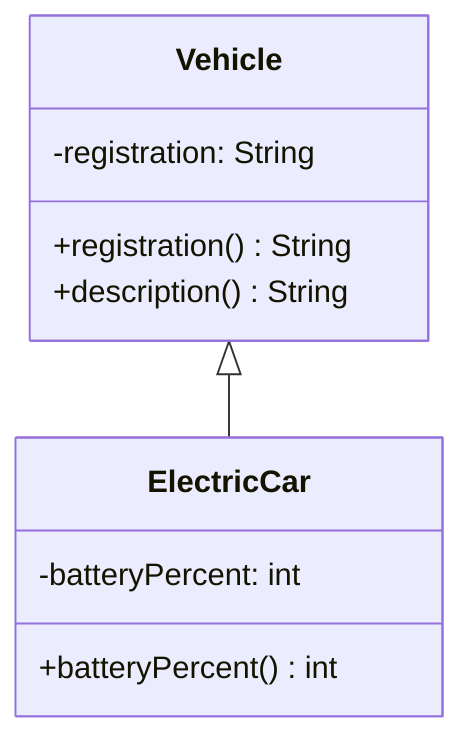

Mũi tên từ `ElectricCar` tới `Vehicle` là **quan hệ kế thừa**; nó không nói rằng có một object `Vehicle` độc lập được tạo bên cạnh object `ElectricCar`.

Java cho một lớp kế thừa trực tiếp **tối đa một lớp cha**. Nếu không viết `extends`, lớp thông thường mặc nhiên có superclass là `Object` (ngoại trừ chính `Object`). Một lớp vẫn có thể triển khai nhiều interface qua `implements`, nhưng đó không phải đa kế thừa trạng thái từ nhiều lớp cha.

## 2. Kế thừa trạng thái: field của cha nằm trong đối tượng con

Điểm dễ nhầm: lớp con có phần trạng thái do lớp cha khai báo, nhưng **không phải mọi field lớp cha đều có thể truy cập trực tiếp trong mã lớp con**.

Với field `private`:

```java
class Account {
    private long balance;

    Account(long openingBalance) {
        if (openingBalance < 0) {
            throw new IllegalArgumentException("Số dư ban đầu âm");
        }
        this.balance = openingBalance;
    }

    public final long balance() {
        return balance;
    }

    protected final void credit(long amount) {
        if (amount <= 0) {
            throw new IllegalArgumentException("Số tiền phải dương");
        }
        balance = Math.addExact(balance, amount);
    }
}

class RewardAccount extends Account {
    RewardAccount(long openingBalance) {
        super(openingBalance);
    }

    public void receiveReward(long rewardVnd) {
        credit(rewardVnd); // Dùng hành vi có kiểm tra của lớp cha
    }

    // Không thể viết: balance += rewardVnd;
    // Vì Account.balance là private.
}
```

`Account.balance` vẫn tồn tại như một phần trạng thái của đối tượng `RewardAccount`, dù mã lớp con **không có quyền truy cập trực tiếp** đến tên field `balance`. Lớp cha kiểm soát cách số dư thay đổi thông qua `credit(...)`; như vậy các quy tắc hợp lệ không bị lặp ở lớp con.

Một ví dụ sử dụng:

```java
RewardAccount account = new RewardAccount(100_000);
account.receiveReward(20_000);

System.out.println(account.balance()); // 120000
```

**Không nên chuyển toàn bộ field lớp cha thành `protected` chỉ vì muốn lớp con dùng được.** Việc cho phép lớp con sửa trực tiếp field có thể khiến lớp cha khó giữ bất biến. Thường nên giữ field `private` rồi cung cấp những phương thức `protected` hoặc `public` có ý nghĩa rõ và kiểm tra đầu vào.

### Các mức truy cập tác động ra sao?

| Thành phần khai báo ở lớp cha | Mã lớp con có thể dùng? | Ghi chú |
|---|---|---|
| `public` instance method/field | Có, ở nơi lớp con có quyền thấy lớp cha | Cẩn trọng với public mutable field |
| `protected` instance method/field | Có, theo quy tắc truy cập `protected` của Java | Khi khác package có giới hạn cụ thể về biểu thức nhận truy cập |
| Package-private (không ghi modifier) | Chỉ trong cùng package | Không nên dùng khi kỳ vọng subclass khác package gọi trực tiếp |
| `private` field/method | Không thể truy cập trực tiếp trong mã lớp con | Trạng thái private của cha vẫn có mặt trong đối tượng con; có thể tiếp cận qua API hợp lệ |
| `public final` instance method | Được sử dụng nhưng **không override** | Lớp cha cố định cách thực thi hành vi này |
| Constructor | **Không được kế thừa** | Lớp con khai báo constructor riêng, gọi constructor cha qua `super(...)` |

Theo nghĩa ngôn ngữ Java, **private members không được kế thừa như thành viên mà lớp con có thể sử dụng trực tiếp**. Đừng diễn giải điều này thành “field private của cha không có trong đối tượng con”.

## 3. Kế thừa hành vi: dùng lại, bổ sung và override

Giả sử trong hệ thống nhân sự, nhân viên bán hàng có lương cơ bản và thêm hoa hồng. Các nhân viên đều có mã định danh và cách trình bày phiếu lương giống nhau, nhưng công thức thu nhập có thể khác.

Dưới đây là **ví dụ Java chạy độc lập**, thể hiện rõ ba loại hành vi:

1. **Kế thừa nguyên vẹn** `id()`.
2. **Override** `monthlyPayVnd()`.
3. **Bổ sung** `commissionVnd()`.

File `InheritanceDemo.java`:

```java
public class InheritanceDemo {

    static class Employee {
        private final String id;
        private final long basePayVnd;

        Employee(String id, long basePayVnd) {
            if (id == null || id.isBlank()) {
                throw new IllegalArgumentException("Mã nhân viên rỗng");
            }
            if (basePayVnd < 0) {
                throw new IllegalArgumentException("Lương cơ bản âm");
            }

            this.id = id.strip();
            this.basePayVnd = basePayVnd;
        }

        // Phương thức kế thừa được, nhưng không cho override.
        public final String id() {
            return id;
        }

        // Lớp con có thể định nghĩa cách tính riêng.
        public long monthlyPayVnd() {
            return basePayVnd;
        }

        // Hành vi chung: gọi phương thức có thể override.
        public String paySlip() {
            return id() + ": " + monthlyPayVnd() + " VND";
        }
    }

    static final class SalesEmployee extends Employee {
        private final long commissionVnd;

        SalesEmployee(
                String id, long basePayVnd, long commissionVnd) {
            super(id, basePayVnd);

            if (commissionVnd < 0) {
                throw new IllegalArgumentException("Hoa hồng âm");
            }
            this.commissionVnd = commissionVnd;
        }

        @Override
        public long monthlyPayVnd() {
            return Math.addExact(
                super.monthlyPayVnd(), commissionVnd
            );
        }

        public long commissionVnd() {
            return commissionVnd;
        }
    }

    public static void main(String[] args) {
        Employee regular = new Employee("E01", 12_000_000L);
        SalesEmployee sales =
            new SalesEmployee("S01", 10_000_000L, 3_000_000L);

        System.out.println(regular.paySlip());
        System.out.println(sales.paySlip());

        Employee asParent = sales;
        System.out.println(asParent.monthlyPayVnd());
        System.out.println(asParent.id());
    }
}
```

Chạy bằng JDK 11+:

```bash
javac InheritanceDemo.java
java InheritanceDemo
```

Kết quả:

```text
E01: 12000000 VND
S01: 13000000 VND
13000000
S01
```

Phân tích:

- `SalesEmployee` **không khai báo lại** `id()` hoặc `paySlip()`; chúng là hành vi được dùng lại từ `Employee`.
- `SalesEmployee.monthlyPayVnd()` ghi đè phương thức cha. Từ khóa `@Override` để compiler kiểm tra xem chữ ký có thật sự override được không.
- `super.monthlyPayVnd()` gọi cách tính ở `Employee` rồi cộng hoa hồng. `super` không phải tên của một đối tượng cha riêng biệt.
- `Math.addExact` ném `ArithmeticException` nếu tổng vượt giới hạn `long`, tránh trả sai âm thầm.
- `commissionVnd()` là hành vi riêng của `SalesEmployee`; biến có **kiểu khai báo `Employee`** không gọi trực tiếp được phương thức này.

Ví dụ này minh họa một mô hình thu nhập đơn giản, không đại diện đầy đủ quy tắc lương, thuế hay hoa hồng của doanh nghiệp.

## 4. Đa hình: phương thức chạy theo loại đối tượng thực tế

Xem hai dòng:

```java
Employee asParent =
    new SalesEmployee("S02", 8_000_000L, 1_500_000L);

System.out.println(asParent.monthlyPayVnd()); // 9500000
```

Biến `asParent` có **kiểu khai báo** là `Employee`, nhưng đối tượng thực tế được tạo bởi `new SalesEmployee(...)`. Khi gọi một phương thức instance đã được override, Java sử dụng **dynamic dispatch** để thực hiện phiên bản phù hợp với kiểu runtime `SalesEmployee`.

Đây là lý do `Employee.paySlip()` có thể gọi `monthlyPayVnd()` mà không biết lớp con cụ thể: lần gọi tới đối tượng `SalesEmployee` vẫn chọn phương thức override.

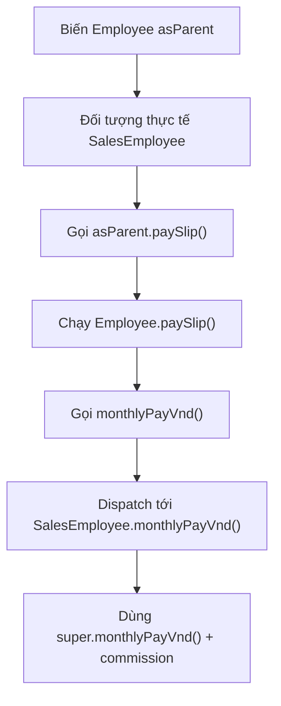

Tuy nhiên, **kiểu khai báo vẫn giới hạn những phương thức có thể gọi ở thời điểm biên dịch**:

```java
Employee employee =
    new SalesEmployee("S03", 5_000_000L, 2_000_000L);

employee.monthlyPayVnd();   // Hợp lệ
// employee.commissionVnd(); // Lỗi biên dịch
```

Nếu có nhu cầu làm việc trực tiếp với hành vi dành riêng cho subclass, nên xem lại kiểu biến/API. Ép kiểu xuống subclass chỉ khi đã có lý do thiết kế rõ và biết chắc kiểu runtime; không nên dựa vào chuỗi `instanceof` và cast chỉ để thay thế đa hình ở mọi nơi.

## 5. Phần trạng thái của cha được khởi tạo trước phần riêng của con

Một constructor con phải đi qua constructor cha, nhưng **constructor không được kế thừa** như phương thức. Ví dụ:

~~~java
class Parent {
    Parent(String code) {
        System.out.println("Parent: " + code);
    }
}
class Child extends Parent {
    Child() {
        super("A01");
        System.out.println("Child");
    }
}
~~~

`new Child()` in `Parent: A01` rồi `Child`. Nếu lớp cha chỉ có constructor có tham số thì không thể bỏ `super("A01")` và trông đợi compiler tự gọi một `Parent()` không tồn tại.

Phần khởi tạo field/instance block của lớp con chạy **sau** phần constructor cha. Vì thế constructor cha không nên gọi method overridable: lời gọi có thể dispatch vào lớp con khi field của con còn `null` hoặc `0`. Phần chi tiết về `this(...)`, static initialization, thứ tự initializer và thất bại constructor được triển khai bằng một chương trình truy vết riêng ở bài chuỗi khởi tạo.

## 6. Field là trạng thái, không được dispatch như method

**Override** thay implementation của một phương thức instance theo kiểu runtime. **Overload** là cùng tên nhưng khác danh sách tham số và được chọn chủ yếu tại biên dịch. **Field hiding** là lớp con khai báo lại field cùng tên; truy cập field dựa trên kiểu của biểu thức, không chọn động theo đối tượng.

~~~java
class Parent {
    String label = "parent";
    String label() { return "parent-method"; }
}
class Child extends Parent {
    String label = "child"; // Field hiding.
    @Override String label() { return "child-method"; }
}

Parent value = new Child();
System.out.println(value.label);   // parent
System.out.println(value.label()); // child-method
~~~

Hai field `label` cùng tồn tại trong một object `Child` nên dễ nhầm về dữ liệu nào đang được đọc. Trong mô hình thực, giữ field `private` rồi cung cấp API phù hợp thường an toàn hơn. Tương tự, phương thức `static` cùng chữ ký là *hiding*, không phải instance override; hãy gọi bằng tên lớp để tránh nhầm với dispatch động.

## 7. Những quy tắc override phải tôn trọng

Một phương thức override hợp lệ không chỉ là “viết lại tên giống nhau”.

| Quy tắc | Điều cần nhớ |
|---|---|
| Phương thức phải có thể override | Không override `private`, `final` hoặc `static` method theo nghĩa instance override |
| Danh sách tham số | Cùng chữ ký thích hợp; thay đổi danh sách tham số thành **overload** |
| Kiểu trả về | Có thể dùng kiểu trả về **covariant** khi phù hợp, không tùy tiện đổi kiểu |
| Quyền truy cập | Không được giảm mức truy cập của phương thức được override |
| Checked exceptions | Không khai báo checked exception mới/rộng hơn ngoài phạm vi cho phép của phương thức cha |
| Hợp đồng hành vi | Phải giữ kỳ vọng mà người dùng kiểu cha dựa vào |

Ví dụ khi cha công khai phương thức:

```java
class Parent {
    public Number amount() {
        return 1;
    }
}

class Child extends Parent {
    @Override
    public Integer amount() {
        return 2;
    }
}
```

`Integer` là subtype của `Number`, nên kiểu trả về trong ví dụ **covariant hợp lệ**.

Ngược lại:

```java
class WrongChild extends Parent {
    // @Override
    // protected Integer amount() { return 3; }
    // Sai vì giảm quyền truy cập public xuống protected.
}
```

Điểm thực hành quan trọng hơn cú pháp là **tính thay thế được (substitutability)**: nếu caller làm việc đúng với `Parent`, đưa một `Child` vào không nên bất ngờ phá những cam kết mà `Parent` đã thiết lập. Ví dụ nếu `Employee.monthlyPayVnd()` cam kết trả thu nhập không âm, subclass không nên tùy tiện trả giá trị âm để biểu diễn lỗi.

## 8. Kế thừa trạng thái có nguy cơ tạo phụ thuộc chặt

Khi subclass dựa vào nhiều chi tiết nội bộ của superclass, thay đổi superclass có thể làm hỏng subclass dù API công khai vẫn trông giống trước. Đây là một dạng vấn đề **fragile base class**.

Ví dụ thiết kế rủi ro:

```java
class MutableBalance {
    protected long balance; // Mọi subclass được phép sửa trực tiếp

    void deposit(long amount) {
        balance += amount; // Chưa kiểm tra dữ liệu hoặc tràn số
    }
}

class SpecialBalance extends MutableBalance {
    void applyBonus(long bonus) {
        balance += bonus; // Đi vòng qua mọi quy tắc mà cha có thể đặt ra
    }
}
```

Subclass phụ thuộc trực tiếp vào field `balance`. Nếu về sau lớp cha bổ sung giới hạn số dư, ghi audit log hay yêu cầu kiểm tra nghiệp vụ, `SpecialBalance` có thể tiếp tục bỏ qua các quy tắc đó.

Một thiết kế tốt hơn:

- Giữ field `private`.
- Cung cấp phương thức `protected final` có ý nghĩa như `creditValidated(...)` nếu subclass thật sự cần mở rộng.
- Xác định rõ **điểm được phép tùy biến** bằng phương thức protected hoặc interface có hợp đồng.
- Hạn chế gọi phương thức override trong quá trình constructor.
- Không để subclass phụ thuộc vào bố cục field hoặc thứ tự gọi phương thức nội bộ nếu không được cam kết.

Đây không có nghĩa mọi field `protected` đều sai, nhưng nên cân nhắc chi phí ràng buộc mà nó đặt lên hệ phân cấp.

## 9. Phần trạng thái chung chỉ nên có mặt ở superclass khi quan hệ is-a đúng

`SalesEmployee extends Employee` là một phân loại nghiệp vụ hợp lý nếu nhân viên bán hàng tôn trọng hợp đồng chung về nhân viên. Ngược lại, `OrderService` **sử dụng** một `PaymentGateway`, chứ không phải một loại gateway. Để dùng chức năng thanh toán, hãy giữ một `PaymentGateway` làm collaborator:

~~~java
interface PaymentGateway {
    void charge(long amountVnd);
}
final class OrderService {
    private final PaymentGateway gateway;
    OrderService(PaymentGateway gateway) {
        this.gateway = java.util.Objects.requireNonNull(gateway);
    }
    void pay(long amountVnd) {
        if (amountVnd <= 0) {
            throw new IllegalArgumentException("Số tiền phải dương");
        }
        gateway.charge(amountVnd);
    }
}
~~~

**Composition** giúp thay gateway hoặc phối hợp nhiều thành phần mà không làm phát sinh superclass giả. Với inheritance, subclass gắn trực tiếp vào hợp đồng và extension points của cha; với composition, việc cộng tác xảy ra thông qua field/interface. Quyết định nên dựa trên khả năng thay thế đúng ngữ nghĩa, không chỉ số dòng code có thể dùng lại.

## 10. Checklist kiểm tra thiết kế kế thừa

Trước khi cho một lớp `extends` lớp khác, hãy kiểm tra:

1. **Có quan hệ is-a thật không?** Lớp con được dùng thay lớp cha mà không phá hợp đồng?
2. **Trạng thái nào thuộc lớp cha?** Field chung có được khởi tạo và kiểm soát ở superclass?
3. **Phương thức nào được kế thừa nguyên vẹn?** Không cần override nếu hành vi cha đã đúng.
4. **Phương thức nào phải override?** Có lý do nghiệp vụ rõ và dùng `@Override`?
5. **Điểm mở rộng có an toàn không?** Có phương thức `final` hoặc `protected` phù hợp để bảo vệ invariant?
6. **Constructor có đúng chuỗi không?** `super(...)` nhận dữ liệu hợp lệ, không lộ đối tượng chưa khởi tạo?
7. **Có cách dùng composition đơn giản hơn không?** Tránh thừa kế thừa để tái sử dụng vài hàm.
8. **Kiểm thử có xác minh qua tham chiếu kiểu cha không?** Kiểm tra dynamic dispatch và tính thay thế được.

## 11. Bài tập tự kiểm tra

### Bài 1 — Dự đoán kết quả

```java
class Animal {
    String sound() {
        return "unknown";
    }

    String describe() {
        return "Sound: " + sound();
    }
}

class Cat extends Animal {
    @Override
    String sound() {
        return "meow";
    }
}

Animal a = new Cat();
System.out.println(a.describe());
```

**Đáp án:** `Sound: meow`. Phương thức `describe()` được dùng lại từ `Animal`, nhưng lời gọi `sound()` bên trong nó được dispatch tới `Cat.sound()`.

### Bài 2 — Có phải lớp con nhìn thấy mọi field?

```java
class Base {
    private int secret = 7;

    public int secret() {
        return secret;
    }
}

class Derived extends Base {
    int read() {
        // return secret; // Lỗi biên dịch
        return secret();
    }
}
```

**Đáp án:** `return secret()` hợp lệ, vì đây là public method của cha. `return secret` không hợp lệ vì `secret` là private field của `Base`.

### Bài 3 — Tìm chỗ không phải override

```java
class Base {
    void print(int value) {
        System.out.println("Base " + value);
    }
}

class Derived extends Base {
    void print(String value) {
        System.out.println("Derived " + value);
    }
}
```

**Đáp án:** `Derived.print(String)` là **overload**, không phải override `Base.print(int)`. Lớp con có thể gọi cả hai phương thức theo kiểu đối số tương ứng.

### Bài 4 — Thiết kế lớp con có kiểm tra

Hãy tạo `StudentAccount extends Account`, trong đó:

- `Account` giữ `private long balance`, không cho số dư âm.
- `Account` cung cấp `public final long balance()` và một phương thức bảo vệ để cộng tiền hợp lệ.
- `StudentAccount` có `private final String universityCode` được kiểm tra trong constructor.
- Phương thức `receiveScholarship(long amount)` cộng tiền thông qua API của lớp cha, không trực tiếp sửa field.
- Viết test: tạo `StudentAccount`, nhận học bổng, đọc số dư và thử truyền số tiền không hợp lệ.

Khi giải, hãy kiểm tra rằng **trạng thái chung vẫn do lớp cha bảo vệ**, còn lớp con chỉ bổ sung thông tin và hành vi chuyên biệt.

---

**Ghi nhớ:** Kế thừa cho phép lớp con **mang phần trạng thái được khai báo ở lớp cha** và **dùng lại hoặc ghi đè hành vi** theo các quy tắc truy cập, constructor và override của Java. Đối tượng con vẫn là **một đối tượng duy nhất**. Hãy giữ dữ liệu chung được đóng gói, phân biệt method overriding với field hiding, tôn trọng hợp đồng lớp cha và chỉ dùng kế thừa khi quan hệ *is-a* thực sự có ý nghĩa.


</details>

- [Quay lại đầu trang](#back-to-top)

---

## <a id="inheritance-003">Mở rộng hành vi của lớp cha</a>

<details>
<summary>Xem chi tiết</summary>

# Mở rộng hành vi của lớp cha trong Java

Khi một lớp con kế thừa lớp cha bằng từ khóa `extends`, nó có thể **dùng lại hành vi sẵn có** và bổ sung những phần đặc thù của mình. Một kỹ thuật quan trọng là **ghi đè phương thức (method overriding)**: lớp con cung cấp cách thực hiện mới cho một phương thức thể hiện mà lớp cha cho phép ghi đè.

Ví dụ, hệ thống vận chuyển có một quy tắc tính phí cơ bản. Giao hàng ưu tiên vẫn cần quy tắc ấy nhưng cộng thêm phụ phí. Thay vì chép toàn bộ công thức vào lớp con, ta gọi `super.calculate(...)` để tận dụng hành vi lớp cha rồi thêm phần riêng.

Bài này tập trung vào cách **mở rộng hành vi của lớp cha**, ý nghĩa của `super`, phương thức nào có thể ghi đè, cách bảo vệ quy tắc chung và lúc nào nên cân nhắc dùng composition thay cho kế thừa.

## 1. Kế thừa, ghi đè và mở rộng hành vi

Một lớp con khai báo:

```java
class Parent {
    void greet() {
        System.out.println("Xin chào");
    }
}

class Child extends Parent {
    @Override
    void greet() {
        super.greet();
        System.out.println("Rất vui được gặp bạn");
    }
}
```

Khi chạy:

```java
new Child().greet();
```

Kết quả:

```text
Xin chào
Rất vui được gặp bạn
```

Cách hoạt động:

1. `Child extends Parent`: `Child` là một lớp con của `Parent`.
2. `@Override` xác nhận `Child.greet()` ghi đè một phương thức có thể ghi đè của lớp cha. Nếu chữ ký không phù hợp, trình biên dịch sẽ báo lỗi.
3. `super.greet()` gọi **cách thực hiện của lớp cha** đối với phương thức đó.
4. Lớp con thực hiện thêm bước riêng sau lời gọi `super.greet()`.

Nếu lớp con **không ghi đè**, nó có thể gọi trực tiếp phương thức được kế thừa (tùy quyền truy cập). Nếu lớp con ghi đè nhưng **không gọi `super`**, nó sẽ thay thế toàn bộ hành vi của phương thức, và phải tự bảo đảm hợp đồng của lớp cha.

| Tình huống | Kết quả |
| --- | --- |
| Không override `greet()` | `Child` dùng hành vi được kế thừa từ `Parent` |
| Override và gọi `super.greet()` | Chạy hành vi lớp cha, sau đó thực hiện phần bổ sung |
| Override nhưng không gọi `super.greet()` | Chạy phần triển khai mới của lớp con |
| Viết `greet(String name)` thay vì `greet()` | Thường là **overloading** (thêm phương thức khác tham số), không ghi đè `greet()` |
| Viết `super.greet()` ngoài phương thức/constructor instance phù hợp | Không hợp lệ; `super` cần ngữ cảnh lớp con |

**Quan trọng:** Không phải lúc nào “mở rộng” cũng có nghĩa thêm lệnh sau `super`. Có trường hợp cần thao tác **trước**, **sau** hoặc **bao quanh** hành vi của lớp cha (kiểm tra, đo thời gian, logging, làm giàu kết quả). Thứ tự phải dựa trên hợp đồng thực tế.

## 2. Ví dụ Java hoàn chỉnh: giao hàng ưu tiên

Lưu toàn bộ mã sau vào file **`Main.java`** và chạy với Java 17 hoặc Java 21.

```java
import java.util.List;

class ShippingFee {
    private final long baseFeeVnd;

    ShippingFee(long baseFeeVnd) {
        if (baseFeeVnd < 0) {
            throw new IllegalArgumentException("Phí cơ bản không được âm");
        }
        this.baseFeeVnd = baseFeeVnd;
    }

    public long calculate(int distanceKm) {
        if (distanceKm <= 0) {
            throw new IllegalArgumentException("Quãng đường phải dương");
        }

        long distanceFee = Math.multiplyExact(2_000L, distanceKm);
        return Math.addExact(baseFeeVnd, distanceFee);
    }

    public String label() {
        return "Giao tiêu chuẩn";
    }
}

final class ExpressShippingFee extends ShippingFee {
    private final long priorityFeeVnd;

    ExpressShippingFee(long baseFeeVnd, long priorityFeeVnd) {
        super(baseFeeVnd);

        if (priorityFeeVnd < 0) {
            throw new IllegalArgumentException("Phụ phí không được âm");
        }
        this.priorityFeeVnd = priorityFeeVnd;
    }

    @Override
    public long calculate(int distanceKm) {
        // Giữ kiểm tra và công thức chuẩn của lớp cha.
        long standardFee = super.calculate(distanceKm);

        // Phần mở rộng dành riêng cho giao ưu tiên.
        return Math.addExact(standardFee, priorityFeeVnd);
    }

    @Override
    public String label() {
        return super.label() + " + ưu tiên";
    }
}

public class Main {
    public static void main(String[] args) {
        ShippingFee normal = new ShippingFee(10_000);
        ShippingFee express = new ExpressShippingFee(10_000, 15_000);

        List<ShippingFee> options = List.of(normal, express);
        for (ShippingFee option : options) {
            System.out.println(
                option.label() + ": " + option.calculate(3) + " VND"
            );
        }

        try {
            express.calculate(0);
        } catch (IllegalArgumentException ex) {
            System.out.println("Lỗi: " + ex.getMessage());
        }
    }
}
```

Biên dịch, chạy:

```bash
javac Main.java
java Main
```

Kết quả:

```text
Giao tiêu chuẩn: 16000 VND
Giao tiêu chuẩn + ưu tiên: 31000 VND
Lỗi: Quãng đường phải dương
```

Đối với quãng đường 3 km:

- Phí chuẩn: `10_000 + 2_000 × 3 = 16_000` VND.
- Phí ưu tiên: `16_000 + 15_000 = 31_000` VND.
- Lớp con không viết lại logic kiểm tra `distanceKm > 0`. Khi `ExpressShippingFee.calculate(0)` gọi `super.calculate(0)`, ngoại lệ của lớp cha tiếp tục được áp dụng.

`Math.addExact` và `Math.multiplyExact` giúp phát hiện tràn số `long` (ném `ArithmeticException`) thay vì âm thầm tạo phí sai. Đây là lựa chọn minh họa để công thức đơn giản vẫn có xử lý sai số nguyên.

### Thành phần nào thuộc lớp cha, lớp con?

| Thành phần | `ShippingFee` | `ExpressShippingFee` |
| --- | --- | --- |
| Phí cơ bản | Trường `private baseFeeVnd` | Kế thừa hành vi sử dụng trường nhưng không truy cập trực tiếp trường `private` |
| Tính phí cơ bản | `calculate(distanceKm)` | Dùng `super.calculate(distanceKm)` |
| Phụ phí ưu tiên | Không có | Trường `private priorityFeeVnd` |
| Tính phí tổng | Trả phí chuẩn | Override `calculate()` để cộng phụ phí |
| Tên phương thức hiển thị | `label()` | Override, nối mô tả bổ sung |
| Khởi tạo | `ShippingFee(long)` | `ExpressShippingFee(long, long)` gọi `super(...)` |

Lớp con mở rộng **hành vi có sẵn** và **trạng thái riêng**, chứ không sao chép tất cả trường của lớp cha thành các trường mới.

## 3. Đa hình: biến kiểu lớp cha có thể chạy phương thức lớp con

Hai biến trong ví dụ đều có kiểu khai báo `ShippingFee`:

```java
ShippingFee normal = new ShippingFee(10_000);
ShippingFee express = new ExpressShippingFee(10_000, 15_000);
```

Nhưng khi gọi `express.calculate(3)`, Java thực hiện **phiên bản override của `ExpressShippingFee`**, bởi đối tượng thực tế có kiểu `ExpressShippingFee`.

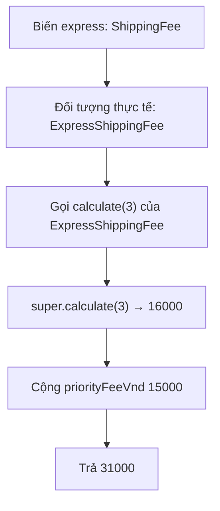

Hiện tượng lựa chọn phương thức **instance được override** dựa trên đối tượng thực tế được gọi là *dynamic dispatch*. Nhờ đó cùng một đoạn mã `option.calculate(distance)` có thể làm việc với nhiều lớp con của `ShippingFee`.

Lưu ý: kiểu khai báo của biến vẫn quyết định **những phương thức nào có thể gọi tại thời điểm biên dịch**. Nếu `ExpressShippingFee` có một phương thức riêng không khai báo trong `ShippingFee`, biến `ShippingFee express` không gọi trực tiếp phương thức đó nếu không có chuyển kiểu hợp lệ. Đa hình không tự thêm API của lớp con vào kiểu lớp cha.

## 4. Hai cách dùng `super` phục vụ hai mục tiêu

Trong ví dụ, `super(baseFeeVnd)` **khởi tạo phần superclass** khi tạo `ExpressShippingFee`; còn `super.calculate(distanceKm)` chạy **implementation của phương thức lớp cha** trên chính object hiện tại:

~~~java
ExpressShippingFee(long base, long priority) {
    super(base); // Chọn constructor cha.
    if (priority < 0) throw new IllegalArgumentException();
    this.priorityFeeVnd = priority;
}

@Override
public long calculate(int km) {
    return Math.addExact(super.calculate(km), priorityFeeVnd);
}
~~~

Constructor không được override. Trên Java 17/21, `super(...)` hoặc `this(...)` tường minh phải là câu lệnh đầu trong constructor, và nếu không ghi, compiler thử chèn `super()`. Quy tắc chuỗi khởi tạo cùng thứ tự field initializer được học riêng trong bài khởi tạo lớp con.

**Điểm tinh tế:** `super.calculate()` chọn thân phương thức cha tại điểm gọi; nếu thân ấy gọi một hook instance được override, hook vẫn dispatch tới implementation của lớp con. Vì vậy không nên xem `super` như một cơ chế bỏ qua mọi hành vi subclass.

## 5. Không nhầm override với overload hoặc static hiding

| Cơ chế | Nhận biết | Lựa chọn implementation |
| --- | --- | --- |
| **Overriding** | Instance method cùng chữ ký phù hợp ở subclass, thường có `@Override` | Theo kiểu runtime |
| **Overloading** | Phương thức cùng tên, khác danh sách tham số | Chọn chữ ký tại biên dịch |
| **Static method hiding** | Subclass khai báo static method cùng chữ ký hợp lệ | Theo lớp/kiểu của biểu thức, không theo runtime instance |
| **Field hiding** | Subclass khai báo field trùng tên | Theo kiểu tĩnh/ngữ cảnh truy cập |

~~~java
class Base {
    String sound() { return "base"; }
}
class Child extends Base {
    @Override String sound() { return "child"; }
    String sound(int volume) { return "volume=" + volume; } // Overload.
}

Base value = new Child();
System.out.println(value.sound()); // child
// value.sound(2); // Không biên dịch: Base không có sound(int).
~~~

Đặc biệt, **static method không được override**. Đừng dùng `@Override` để đánh dấu một static method trùng tên; nếu có nhu cầu đa hình runtime, dùng instance method và hợp đồng phù hợp.

## 6. Các điều kiện để override hợp lệ

- Phương thức cha phải là instance method có thể override; `private`, `final` và `static` không tham gia instance overriding.
- Tên và danh sách tham số phải tương ứng với chữ ký được override. Đổi `int` thành `long` tạo overload khác, và `@Override` sẽ giúp phát hiện nhầm.
- Kiểu trả về phải tương thích; Java cho phép **covariant return** khi kiểu trả về là reference subtype thích hợp.
- Không giảm access modifier; ví dụ phương thức cha `public` thì phương thức con cũng phải `public`.
- Không mở rộng checked exceptions vượt hợp đồng phương thức cha; unchecked exception không bị ràng buộc cú pháp tương tự nhưng vẫn phải tôn trọng hợp đồng hành vi.

Một override hợp lệ về cú pháp vẫn có thể sai nghiệp vụ nếu nó bỏ qua kiểm tra đầu vào, thay đổi bất biến hoặc khiến caller đang dùng kiểu cha nhận kết quả bất ngờ. Khi không cho lớp con thay toàn bộ quy trình, hãy cố định phương thức điều phối bằng `final` và công bố hook phù hợp như ví dụ **Template Method** bên dưới.

## 7. Khi nào phải gọi `super`, khi nào không?

Java **không bắt buộc** phương thức override phải gọi `super.method()`. Điều cần xem là *hợp đồng hành vi*.

### Phù hợp với `super`

Khi lớp con chỉ cần thêm một quy tắc nhưng vẫn giữ cách thực hiện cơ bản của cha. Trong ví dụ vận chuyển, phụ phí ưu tiên được cộng sau `super.calculate(distanceKm)`.

### Không nhất thiết gọi `super`

Khi hợp đồng cho phép thay thế toàn bộ thuật toán. Ví dụ, lớp cha mô tả một phương pháp vẽ cơ bản nhưng lớp con có một cách vẽ độc lập vẫn đáp ứng đầy đủ ngữ nghĩa.

### Cần cân nhắc trước khi gọi

- Gọi `super` hai lần có thể gây tác động lặp lại nếu phương thức cha thay đổi trạng thái hoặc gọi API bên ngoài.
- Gọi `super` trước hay sau phần bổ sung quyết định thứ tự side effect, kiểm tra điều kiện và lỗi.
- Bỏ lời gọi `super` có thể vô tình bỏ qua validation, ghi lịch sử hoặc duy trì invariant của lớp cha.
- Nếu `super.method()` ném ngoại lệ, các câu lệnh đặt sau sẽ không chạy trừ khi mã chủ động bắt hoặc xử lý lỗi.
- `super` chỉ gọi triển khai của cha tại vị trí đó; nó không “đóng băng” toàn bộ lời gọi động phát sinh bên trong. Nếu phương thức cha tiếp tục gọi một phương thức có thể override khác, phương thức đó vẫn có thể dispatch vào lớp con.

Không nên cố định một quy tắc “override nào cũng phải gọi `super`”. Hãy đọc hợp đồng được lớp cha công bố và thiết kế điểm mở rộng phù hợp.

## 8. Mở rộng an toàn bằng Template Method

Override cả một phương thức nghiệp vụ đôi khi khiến lớp con bỏ sót bước quan trọng, chẳng hạn kiểm tra dữ liệu trước khi xử lý. **Template Method** đặt quy trình chính trong một phương thức `final`; lớp con chỉ mở rộng phần được chỉ định qua `protected` hook.

Ví dụ độc lập, lưu trong **`TemplateDemo.java`**:

```java
import java.util.Locale;
import java.util.Objects;

abstract class TextJob {
    // Trình tự chung do lớp cha kiểm soát; lớp con không override.
    public final String execute(String input) {
        Objects.requireNonNull(input, "input");

        String normalized = input.trim();
        if (normalized.isEmpty()) {
            throw new IllegalArgumentException("Nội dung không được trống");
        }

        String transformed = transform(normalized);
        return "Đã xử lý: " + transformed;
    }

    // Điểm mở rộng mà lớp con phải cung cấp.
    protected abstract String transform(String normalized);
}

final class UppercaseJob extends TextJob {
    @Override
    protected String transform(String normalized) {
        return normalized.toUpperCase(Locale.ROOT);
    }
}

public class TemplateDemo {
    public static void main(String[] args) {
        TextJob job = new UppercaseJob();
        System.out.println(job.execute("  java oop  "));
    }
}
```

Chạy `javac TemplateDemo.java` và `java TemplateDemo`:

```text
Đã xử lý: JAVA OOP
```

Trong thiết kế này:

1. `execute()` là quy trình bắt buộc: kiểm tra `null`, chuẩn hóa, từ chối dữ liệu trống rồi tạo kết quả.
2. `final` chặn lớp con ghi đè `execute()` và vô tình bỏ qua các bước chung.
3. `transform()` là điểm mở rộng được chỉ định rõ; lớp con thay đổi thuật toán biến đổi, không thay đổi hợp đồng đầu vào của `execute()`.

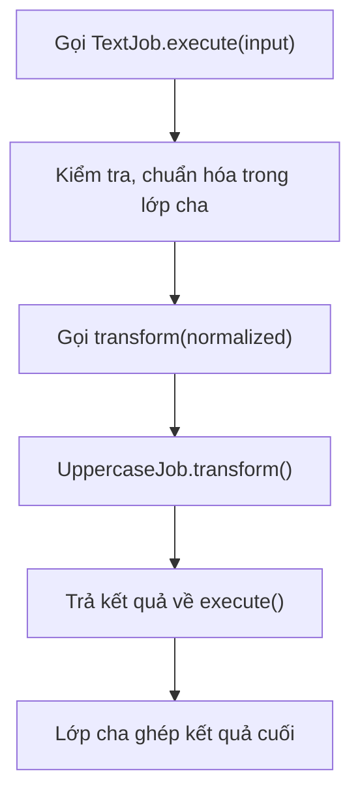

Template Method hữu ích khi nhiều lớp con dùng chung **thứ tự xử lý bất biến** nhưng thay đổi một vài bước. Không nên lạm dụng nếu chỉ để thêm một câu lệnh đơn giản hoặc khi các biến thể không có quan hệ kế thừa hợp lý.

## 9. Mở rộng hành vi sau khi khởi tạo xong

Trong khi `super(...)` chạy, field riêng của subclass có thể vẫn đang mang giá trị mặc định. Nếu constructor cha gọi method overridable, Java vẫn dispatch tới override của con:

~~~java
class Parent {
    Parent() { show(); }
    void show() { System.out.println("parent"); }
}
class Child extends Parent {
    String label = "Sẵn sàng";
    @Override void show() { System.out.println(label); }
}
// new Child() in null, vì initializer label chưa chạy.
~~~

Đây là hệ quả của **thứ tự khởi tạo**, không phải bug ngẫu nhiên hay race condition. Các hook cho subclass nên được gọi sau khi đối tượng hoàn tất khởi tạo. Bài về constructor chain sẽ lần theo thứ tự này cùng static block, instance block và ngoại lệ trong constructor.

## 10. Những trường hợp kế thừa không phải lựa chọn tốt

Kế thừa hợp lý khi lớp con thực sự là **một dạng chuyên biệt của lớp cha** và giữ được hợp đồng hành vi. Nếu chỉ muốn cộng một tính năng tùy chọn (log, metrics, retry, cache, phụ phí), **composition/decorator** đôi khi linh hoạt hơn:

```java
interface PriceCalculator {
    long calculate(int quantity);
}

final class SurchargeCalculator implements PriceCalculator {
    private final PriceCalculator delegate;
    private final long surcharge;

    SurchargeCalculator(PriceCalculator delegate, long surcharge) {
        this.delegate = java.util.Objects.requireNonNull(delegate);
        if (surcharge < 0) {
            throw new IllegalArgumentException("Phụ phí âm");
        }
        this.surcharge = surcharge;
    }

    @Override
    public long calculate(int quantity) {
        return Math.addExact(delegate.calculate(quantity), surcharge);
    }
}
```

Đây là ví dụ **thành phần có thể kết hợp**: `SurchargeCalculator` giữ một `PriceCalculator` khác rồi thêm phí. Khi cần nhiều biến thể kết hợp, không nhất thiết xây một cây lớp con như `ExpressInternationalDiscountedShipping`.

So sánh:

| Tiêu chí | `extends` / override | Composition / delegate |
| --- | --- | --- |
| Quan hệ | `is-a`: lớp con là một loại lớp cha | `has-a`: đối tượng chứa/tham chiếu một thành phần khác |
| Cách dùng lại hành vi | Gọi phương thức kế thừa hoặc `super.method()` | Gọi `delegate.method()` |
| Điểm mở rộng | Do lớp cha thiết kế; có thể bị ràng buộc bởi `protected` / `final` | Do interface và đối tượng delegate quyết định |
| Ghép nhiều tính năng | Có thể tạo nhiều lớp con và tổ hợp phức tạp | Thường dễ kết hợp nhiều wrapper |
| Rủi ro chính | Phụ thuộc chặt vào hợp đồng và chi tiết lớp cha | Có thêm đối tượng/ủy quyền và phải quản lý vòng đời thích hợp |

Không phải composition luôn tốt hơn: nếu mô hình có quan hệ phân cấp thực sự, các biến thể chia sẻ nhiều quy tắc cố định và lớp cha cung cấp hook rõ ràng, kế thừa vẫn rất hợp lý. Hãy chọn theo quan hệ miền nghiệp vụ và độ ổn định của hợp đồng.

## 11. Lỗi thường gặp và cách sửa

| Lỗi | Điều xảy ra | Cách sửa |
| --- | --- | --- |
| Override rồi gọi `calculate(...)` thay vì `super.calculate(...)` trong cùng phương thức | Có thể đệ quy vô hạn (`StackOverflowError`) | Gọi `super.calculate(...)` nếu cần triển khai của cha |
| Quên `@Override` và đổi kiểu tham số | Tạo overload, không ghi đè | Thêm `@Override` để trình biên dịch kiểm tra |
| Lớp con bỏ kiểm tra đầu vào vốn do cha bảo đảm | Đối tượng có thể vi phạm hợp đồng | Giữ validation hoặc đưa quy trình chung vào phương thức `final` |
| Override phương thức `final` hoặc `private` | Không được phép override theo quy tắc Java | Dùng điểm mở rộng mà lớp cha công bố |
| Nhầm `static` hiding với override | Lựa chọn theo kiểu tham chiếu/lớp, không đa hình instance | Dùng instance method khi cần dynamic dispatch |
| Lớp cha gọi hook override trong constructor | Lớp con được gọi khi chưa khởi tạo xong | Không gọi phương thức overridable trong constructor |
| Lớp con sử dụng trực tiếp trường `protected` mutable của cha | Dễ phá invariant của cha | Giữ trường `private`, cung cấp phương thức/hook kiểm soát |
| Dùng `extends` chỉ để tái sử dụng vài dòng code | Kết hợp tính năng khó, quan hệ `is-a` yếu | Cân nhắc composition/delegation |

## 12. Tự kiểm tra

**Câu 1.** Trong `ExpressShippingFee.calculate()`, vì sao gọi `super.calculate(distanceKm)` thay vì `calculate(distanceKm)`?

**Đáp án:** `super` chỉ định triển khai lớp cha. Gọi `calculate(...)` không có `super` ngay trong override thường quay lại phương thức của lớp con và gây đệ quy.

**Câu 2.** `ShippingFee shipping = new ExpressShippingFee(10000, 15000);` rồi `shipping.calculate(3)` chạy phương thức nào?

**Đáp án:** `ExpressShippingFee.calculate()`, vì đây là lời gọi phương thức instance được override và dispatch dựa trên kiểu đối tượng thực tế.

**Câu 3.** Lớp con có thể override constructor không?

**Đáp án:** Không. Constructor không được kế thừa. Lớp con gọi constructor lớp cha bằng `super(...)` trong quá trình khởi tạo.

**Câu 4.** `protected abstract String transform(...)` và `public final String execute(...)` trong Template Method phân chia trách nhiệm ra sao?

**Đáp án:** `execute()` giữ quy trình cố định và invariant; `transform()` cho lớp con triển khai biến thể được kiểm soát.

**Câu 5.** Có nên để lớp cha khai báo `protected List<Order> orders` để lớp con tùy ý chỉnh sửa không?

**Đáp án:** Không nên nếu lớp cha cần bảo vệ tính nhất quán của dữ liệu. Để trường `private` và cung cấp thao tác/hook có hợp đồng rõ ràng thường an toàn hơn.

**Câu 6.** Khi muốn bổ sung logging, cache và retry theo nhiều tổ hợp, kế thừa có luôn là lựa chọn dễ nhất không?

**Đáp án:** Không. Composition/decorator có thể ghép các khả năng linh hoạt hơn và giảm số lượng lớp con.

**Ghi nhớ:** Để mở rộng hành vi lớp cha, dùng `extends` khi quan hệ `is-a` và hợp đồng kế thừa hợp lý, `@Override` để thay hoặc bổ sung triển khai, `super.method()` để tái dùng hành vi cha và `super(...)` để khởi tạo phần lớp cha. Nếu cần bảo vệ một quy trình không cho lớp con bỏ qua, thiết kế `final` template method cùng điểm mở rộng `protected` rõ ràng.


</details>

- [Quay lại đầu trang](#back-to-top)

---

## <a id="inheritance-004">Ghi đè phương thức và gọi hành vi lớp cha</a>

<details>
<summary>Xem chi tiết</summary>

# Ghi đè phương thức và gọi hành vi lớp cha trong Java

**Method overriding (ghi đè phương thức)** cho phép lớp con cung cấp cách thực hiện riêng cho một **phương thức instance có thể kế thừa** từ lớp cha, trong khi mã sử dụng vẫn gọi qua hợp đồng của lớp cha. Khi lớp con muốn **giữ một phần xử lý của lớp cha rồi bổ sung hành vi**, Java cung cấp cú pháp `super.method(...)`.

Hai câu hỏi cần phân biệt:

- **Ghi đè:** “Khi đối tượng thực tế là lớp con, phương thức nào được chạy?”
- **Gọi `super`:** “Bên trong phương thức của lớp con, làm sao gọi phiên bản phù hợp được kế thừa từ lớp cha thay vì gọi lại chính phương thức vừa ghi đè?”

Bài này sử dụng Java 11 trở lên, minh họa bằng bài toán tính phí giao hàng với hai gói: giao thường và giao nhanh. Ví dụ được đặt trong **một tệp Java** để có thể biên dịch, chạy và tự kiểm tra kết quả ngay.

## 1. Nhận diện overriding bằng ví dụ tối giản

```java
class Notification {
    public void send() {
        System.out.println("Gửi thông báo thông thường");
    }
}

class EmailNotification extends Notification {
    @Override
    public void send() {
        System.out.println("Gửi qua email");
    }
}
```

Khi gọi:

```java
Notification message = new EmailNotification();
message.send(); // Gửi qua email
```

Biến `message` có **kiểu khai báo** là `Notification`, nhưng đối tượng thực tế được tạo bởi `new EmailNotification()`. Vì `send()` là phương thức instance được override, Java chọn phiên bản của **lớp đối tượng thực tế** khi chạy. Đây là **dynamic method dispatch** và là một dạng đa hình (polymorphism).

`@Override` không phải điều kiện khiến JVM thực hiện ghi đè; nó là annotation để **trình biên dịch xác nhận ý định ghi đè**. Nếu viết sai tên hoặc chữ ký, annotation giúp phát hiện lỗi sớm.

### Ghi đè khác việc khai báo phương thức mới

Hai phương thức cùng tên không nhất thiết là override. Để ghi đè đúng, phương thức ở lớp con phải phù hợp chữ ký phương thức kế thừa, tức là tên và danh sách kiểu tham số tương ứng theo quy tắc Java; kiểu trả về cũng phải tương thích.

```java
class Parent {
    public void process(String text) {
        System.out.println("Parent: " + text);
    }
}

class Child extends Parent {
    @Override
    public void process(String text) {
        System.out.println("Child: " + text);
    }

    public void process(int count) {
        System.out.println("Count: " + count);
    }
}
```

Ở đây `process(String)` là **override**, còn `process(int)` là **overload** (cùng tên nhưng tham số khác). Không thể ghi `@Override` trên `process(int)` trong trường hợp này vì lớp cha không có phương thức tương ứng để ghi đè.

## 2. Ví dụ hoàn chỉnh: mở rộng hành vi lớp cha bằng `super`

Yêu cầu:

- Gói **giao thường**: phí nền 12.000 VND và thêm 3.000 VND cho mỗi km.
- Gói **giao nhanh**: giữ phép tính của gói thường rồi cộng phụ phí ưu tiên 20.000 VND.
- Quãng đường phải là số nguyên không âm; nếu tính tiền `long` bị tràn, ném `ArithmeticException` thay vì trả sai.
- Một phương thức `printQuote` được định nghĩa ở lớp cha có thể sử dụng kết quả của phương thức `fee` đã được lớp con ghi đè.

Tệp **`OverrideAndSuperDemo.java`**:

```java
public class OverrideAndSuperDemo {

    static class DeliveryPlan {
        private static final long BASE_VND = 12_000L;
        private static final long PER_KM_VND = 3_000L;

        public String label() {
            return "Giao thường";
        }

        public long fee(int distanceKm) {
            if (distanceKm < 0) {
                throw new IllegalArgumentException(
                        "Quãng đường không được âm");
            }
            long distanceFee =
                    Math.multiplyExact(PER_KM_VND, (long) distanceKm);
            return Math.addExact(BASE_VND, distanceFee);
        }

        // Không override ở lớp con, nhưng gọi các method có thể override.
        public void printQuote(int distanceKm) {
            System.out.println(
                    label() + " (" + distanceKm + " km): "
                    + fee(distanceKm) + " VND");
        }
    }

    static final class ExpressPlan extends DeliveryPlan {
        private static final long PRIORITY_VND = 20_000L;

        @Override
        public String label() {
            return "Giao nhanh (nền: " + super.label() + ")";
        }

        @Override
        public long fee(int distanceKm) {
            // Gọi lại toàn bộ logic kiểm tra và tính phí của lớp cha.
            long standardFee = super.fee(distanceKm);
            return Math.addExact(standardFee, PRIORITY_VND);
        }
    }

    public static void main(String[] args) {
        DeliveryPlan standard = new DeliveryPlan();
        DeliveryPlan express = new ExpressPlan();

        standard.printQuote(5);
        express.printQuote(5);

        System.out.println(standard.fee(5)); // 27000
        System.out.println(express.fee(5));  // 47000

        try {
            express.fee(-1);
        } catch (IllegalArgumentException ex) {
            System.out.println("Từ chối: " + ex.getMessage());
        }
    }
}
```

Biên dịch và chạy:

```bash
javac OverrideAndSuperDemo.java
java OverrideAndSuperDemo
```

Kết quả dự kiến:

```text
Giao thường (5 km): 27000 VND
Giao nhanh (nền: Giao thường) (5 km): 47000 VND
27000
47000
Từ chối: Quãng đường không được âm
```

Phí của gói thường ở 5 km là 12.000 + 3.000 × 5 = **27.000 VND**. Gói nhanh gọi lại công thức của lớp cha và cộng thêm 20.000, cho kết quả **47.000 VND**.

### Vì sao `super.fee(distanceKm)` quan trọng?

Trong `ExpressPlan.fee`:

```java
@Override
public long fee(int distanceKm) {
    long standardFee = super.fee(distanceKm);
    return Math.addExact(standardFee, PRIORITY_VND);
}
```

`super.fee(distanceKm)` chọn phiên bản `fee` ở lớp cha `DeliveryPlan`, thực thi cả **kiểm tra quãng đường** lẫn **tính phí nền**, rồi lớp con bổ sung phụ phí. Nếu viết:

```java
@Override
public long fee(int distanceKm) {
    return Math.addExact(fee(distanceKm), PRIORITY_VND); // SAI
}
```

thì `fee(distanceKm)` không có `super` sẽ lại gọi `ExpressPlan.fee` trên cùng đối tượng, tiếp tục gọi chính nó và dẫn đến **đệ quy không có điểm dừng**, thường kết thúc bằng `StackOverflowError`. Điều này không có nghĩa mọi lời gọi method cùng tên đều là lỗi; lỗi cụ thể là tự gọi lại mà không có điều kiện dừng.

Chú ý: `super.fee` **không tạo thêm một đối tượng lớp cha**. Nó dùng chính đối tượng `ExpressPlan` hiện tại, nhưng chọn cách thực hiện của phương thức cha tại vị trí lời gọi.

## 3. Đa hình vẫn xảy ra bên trong phương thức của lớp cha

Điều thú vị trong ví dụ là `printQuote` **không được override**. Tuy vậy, thân của nó gọi:

```java
public void printQuote(int distanceKm) {
    System.out.println(
            label() + " (" + distanceKm + " km): "
            + fee(distanceKm) + " VND");
}
```

Khi `express.printQuote(5)` chạy trên đối tượng thực tế là `ExpressPlan`:

1. `printQuote` của `DeliveryPlan` chạy vì lớp con không override nó.
2. Lời gọi `label()` trong thân `printQuote` được phân giải động đến `ExpressPlan.label()`.
3. Lời gọi `fee(5)` được phân giải động đến `ExpressPlan.fee(5)`.
4. Trong `ExpressPlan.fee(5)`, `super.fee(5)` gọi logic của `DeliveryPlan`, rồi lớp con cộng phụ phí.

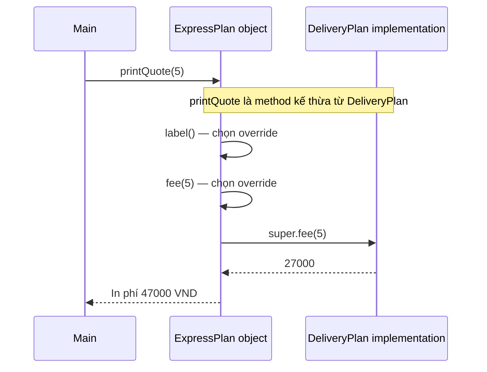

Sơ đồ mô tả logic gọi method, **không** có ý rằng một đối tượng `DeliveryPlan` riêng được tạo ra.

Điều này giải thích sức mạnh của overriding: lớp cha có thể định nghĩa một quy trình chung gọi các “điểm mở rộng” là phương thức có thể override; lớp con thay đổi các điểm đó mà không phải viết lại toàn bộ quy trình. Tuy nhiên, cần thận trọng khi gọi phương thức có thể override trong **constructor lớp cha** vì tại thời điểm đó field initializer của lớp con có thể chưa chạy.

## 4. `super.method()` và `super(...)` không giống nhau

Cả hai cùng dùng từ khóa `super` nhưng phục vụ hai mục đích khác nhau:

| Cú pháp | Mục đích | Được dùng ở đâu? |
| --- | --- | --- |
| `super.method(args)` | Gọi một phương thức instance phù hợp từ phần cài đặt của superclass | Trong ngữ cảnh instance của lớp con, khi phương thức đó có thể truy cập |
| `super(args)` | Gọi constructor của lớp cha trong chuỗi xây dựng đối tượng | Trong constructor của lớp con |
| `this.method(args)` hoặc `method(args)` | Gọi phương thức trên đối tượng hiện tại, có thể được phân giải động | Trong ngữ cảnh instance |
| `this(args)` | Gọi constructor khác của cùng lớp | Trong constructor, theo quy tắc constructor invocation |
| `super.field` | Truy cập field của lớp cha nếu mức truy cập cho phép và cần phân biệt tên | Trong ngữ cảnh instance |

Trong Java 11, lời gọi `super(args)` hoặc `this(args)` tường minh phải là câu lệnh đầu tiên của constructor. `super.method(args)` là lời gọi phương thức thông thường và **không có yêu cầu vị trí đầu tiên** như thế.

Ví dụ constructor:

```java
class Vehicle {
    private final String code;

    Vehicle(String code) {
        this.code = code;
    }

    public String code() {
        return code;
    }
}

class Car extends Vehicle {
    Car(String code) {
        super(code); // Constructor của Vehicle
    }

    @Override
    public String code() {
        return "CAR-" + super.code(); // Method của Vehicle
    }
}
```

Kết quả `new Car("42").code()` là `"CAR-42"`.

Một method của superclass được gọi qua `super` vẫn có thể tự gọi method khác theo cơ chế đa hình. `super` quyết định **phiên bản ở điểm gọi ban đầu**, chứ không làm mọi lời gọi sâu bên trong bị “khóa” thành bản cha.

## 5. Những quy tắc để ghi đè hợp lệ

### Cùng tên và tham số; kiểu trả về tương thích

```java
class Document {
    public Document copy() {
        return new Document();
    }
}

class PdfDocument extends Document {
    @Override
    public PdfDocument copy() {
        return new PdfDocument();
    }
}
```

Đây là ví dụ **covariant return type**: method lớp con được phép trả về kiểu tham chiếu cụ thể hơn, tức `PdfDocument` là kiểu con của `Document`.

Nhưng nếu lớp cha trả `int` thì lớp con không được đổi thành `long` khi override cùng chữ ký, vì kiểu trả về nguyên thủy phải tương thích theo quy tắc Java. Cũng không thể tạo một overload chỉ bằng việc thay đổi kiểu trả về.

### Không được giảm mức truy cập

```java
class BaseService {
    protected void execute() {
        System.out.println("Base");
    }
}

class PublicService extends BaseService {
    @Override
    public void execute() { // protected -> public: hợp lệ
        System.out.println("Child");
    }
}
```

Nếu lớp cha khai báo `public void execute()`, lớp con không được override thành `protected void execute()` hoặc package-private. Nếu method cha `protected`, method con có thể giữ `protected` hoặc mở rộng thành `public`.

### Checked exception không được mở rộng tùy tiện

```java
import java.io.IOException;
import java.io.FileNotFoundException;

class FileSource {
    public String read() throws IOException {
        return "data";
    }
}

class LocalFileSource extends FileSource {
    @Override
    public String read() throws FileNotFoundException {
        return "local";
    }
}
```

`FileNotFoundException` là loại con của `IOException`, vì vậy khai báo ở lớp con hợp lệ. Nếu method lớp cha không khai báo checked exception, override không được tự bổ sung một checked exception mới không tương thích. Với **unchecked exception** như `IllegalArgumentException`, Java không áp đặt cùng giới hạn về khai báo `throws`, nhưng lớp con vẫn nên tôn trọng hợp đồng hành vi của lớp cha.

### `@Override` giúp bắt lỗi sai chữ ký

```java
class BaseReport {
    public void export(String format) {}
}

class CsvReport extends BaseReport {
    // Ví dụ SAI nếu dùng @Override:
    // @Override
    // public void export(Object format) {}
}
```

`export(Object)` là overload khác tham số, không thay thế `export(String)`. Annotation `@Override` khiến trình biên dịch báo lỗi thay vì để lập trình viên tưởng đã ghi đè thành công.

## 6. Phương thức nào không thể được override theo cách thông thường?

| Loại method/đặc điểm | Hành vi thực tế |
| --- | --- |
| Instance method có thể kế thừa và không `final` | Có thể override nếu chữ ký, quyền truy cập, kiểu trả về và exception phù hợp |
| `final` instance method | **Không thể override**; dùng khi cần khóa hành vi ở cấp đó |
| `static` method | Không override; khai báo cùng tên/chữ ký ở lớp con là **method hiding** |
| `private` method | Không được kế thừa nên không override được; tên trùng ở lớp con là method riêng |
| Constructor | Không phải method được kế thừa, nên không override |
| Abstract method | Lớp con concrete phải cung cấp implementation nếu chưa có implementation kế thừa phù hợp |
| Interface default method | Lớp triển khai có thể override; có cú pháp gọi phiên bản default phù hợp qua `InterfaceName.super.method()` |

### `static`: method hiding khác overriding

```java
class Animal {
    static String category() {
        return "Động vật";
    }

    String sound() {
        return "Âm thanh chung";
    }
}

class Dog extends Animal {
    static String category() {
        return "Chó";
    }

    @Override
    String sound() {
        return "Gâu";
    }
}

Animal a = new Dog();

System.out.println(Animal.category()); // Động vật
System.out.println(Dog.category());    // Chó
System.out.println(a.sound());         // Gâu
```

`category()` là static, gọi qua tên lớp để thể hiện rõ method hiding; không có dynamic dispatch như `sound()`. Không thể dùng `@Override` cho `Dog.category()`.

### `private`: không có method nào để kế thừa

```java
class Parent {
    private void audit() {
        System.out.println("Audit nội bộ Parent");
    }

    public void run() {
        audit(); // Luôn là logic private của Parent
    }
}

class Child extends Parent {
    public void audit() {
        System.out.println("Audit của Child");
    }
}
```

`new Child().run()` in `"Audit nội bộ Parent"`. `Child.audit()` là method mới chứ không override `Parent.audit()`, bởi `private` method của cha không được kế thừa. Việc cho hai method trùng tên không khiến lời gọi bên trong `Parent.run()` trở thành dynamic dispatch tới method của con.

### `final`: cấm ghi đè

```java
class Transaction {
    public final void validateId() {
        System.out.println("Kiểm tra ID cố định");
    }
}

class Payment extends Transaction {
    // Không hợp lệ:
    // @Override public void validateId() {}
}
```

Từ khóa `final` trên một method ngăn subclass thay đổi cách thực hiện method đó. Điều này có thể bảo vệ một bước bắt buộc trong quy trình. Tuy nhiên, `final` không phải giải pháp thay cho thiết kế hợp đồng tốt.

## 7. `super`, field hiding và dynamic dispatch

Field không hoạt động như method override. Nếu hai lớp khai báo field trùng tên, tên field được chọn theo **kiểu tại thời điểm biên dịch** và ngữ cảnh truy cập.

```java
class Parent {
    public String name = "Parent";

    public String getName() {
        return name;
    }
}

class Child extends Parent {
    public String name = "Child";

    @Override
    public String getName() {
        return name;
    }

    public String parentField() {
        return super.name;
    }
}

Parent value = new Child();

System.out.println(value.name);               // Parent
System.out.println(value.getName());          // Child
System.out.println(((Child) value).parentField()); // Parent
```

Đây là **field hiding**, không phải đa hình field. Hai field trùng tên tạo ra hai trạng thái riêng trong cùng đối tượng, thường dễ gây nhầm lẫn. Trong thiết kế thực tế, nên giữ field `private` và truyền dữ liệu qua API phù hợp thay vì cố tình đặt field trùng tên để thay đổi hành vi.

`super.name` chọn field phù hợp được khai báo ở superclass và có thể truy cập từ lớp con; nó không phải cú pháp “gọi getter”.

## 8. Gọi hành vi cha hay thay thế hoàn toàn?

Có hai phương án phổ biến khi override:

**Phương án A — thay thế hoàn toàn**

```java
class TextFormatter {
    public String format(String text) {
        return text.trim();
    }
}

class UppercaseFormatter extends TextFormatter {
    @Override
    public String format(String text) {
        return text.strip().toUpperCase(java.util.Locale.ROOT);
    }
}
```

Ở đây lớp con định nghĩa toàn bộ hành vi mới; không gọi `super.format(...)`. Cần lưu ý `trim` và `strip` khác cách xử lý một số ký tự khoảng trắng Unicode, vì vậy nếu hợp đồng yêu cầu chuẩn hóa chính xác, phải chọn một quy tắc nhất quán. Đây là ví dụ cho thấy **override hợp lệ về cú pháp chưa chắc tương đương về hợp đồng**.

**Phương án B — giữ phần cha rồi bổ sung**

```java
class CheckedFormatter extends TextFormatter {
    @Override
    public String format(String text) {
        if (text == null) {
            throw new IllegalArgumentException("text không được null");
        }
        String base = super.format(text);
        return "[" + base + "]";
    }
}
```

Lớp con tái sử dụng bước chuẩn hóa của cha rồi thêm dấu ngoặc. Hợp đồng của kiểu cha phải cho phép định dạng mới này. Nếu phía sử dụng đòi kết quả là **chuỗi trim nguyên bản**, thêm dấu ngoặc có thể phá hợp đồng dù mã chạy đúng.

Do đó, trước khi override, hãy xác định: **điểm mở rộng mà lớp cha cho phép là gì?** Nếu thay đổi hành vi dẫn tới phá điều kiện đầu vào, đầu ra hoặc bất biến được công bố, tốt hơn nên dùng một interface/chiến lược khác thay vì subclass làm sai hợp đồng.

### Liên hệ Liskov Substitution Principle

Nếu `Parent` cho phép `process(1)` và cam kết đầu ra hợp lệ, `Child` không được bất ngờ từ chối `1` chỉ vì muốn quy tắc mới nghiêm hơn. Theo nguyên lý thay thế Liskov (LSP), lớp con không nên:

- **Siết chặt tiền điều kiện** đối với lời gọi hợp lệ của lớp cha.
- **Làm yếu hậu điều kiện** mà lớp cha hứa.
- **Phá bất biến** hoặc đưa thêm tác động phụ trái với cam kết quan sát được.
- **Làm thay đổi ngữ nghĩa lỗi** nếu đó là phần hợp đồng đã công bố.

Một method được override có thể gọi `super.method(...)` mà vẫn vi phạm LSP nếu phần bổ sung sau đó làm sai kết quả. Ngược lại, method thay thế hoàn toàn vẫn hợp lệ nếu giữ đúng hợp đồng.

## 9. Khi `super` không phải lựa chọn tốt nhất

Gọi `super.method()` có giá trị khi lớp con thực sự đang **mở rộng** cách thực hiện của lớp cha. Không nên dùng `super` chỉ để tránh sao chép code nếu quan hệ kế thừa về mặt nghiệp vụ không đúng.

Ví dụ: một lớp `AuditEmailSender extends EmailSender` chỉ để tận dụng mã gửi email, rồi override để log, có thể tạo quan hệ kế thừa dễ hỏng khi lớp cha thay đổi. Nếu nghiệp vụ cần bọc hành vi, **composition/decorator** thường diễn đạt rõ hơn: `AuditedSender` giữ một `Sender` bên trong và gọi `delegate.send(...)` rồi ghi log theo hợp đồng.

```java
interface Sender {
    void send(String message);
}

class AuditedSender implements Sender {
    private final Sender delegate;

    AuditedSender(Sender delegate) {
        this.delegate = java.util.Objects.requireNonNull(delegate);
    }

    @Override
    public void send(String message) {
        delegate.send(message);
        System.out.println("Đã yêu cầu gửi");
    }
}
```

Ở đây `delegate.send(...)` là **ủy quyền cho đối tượng khác**, còn `super.send(...)` là gọi implementation trong chuỗi kế thừa của **chính đối tượng hiện tại**. Hai kỹ thuật khác nhau về cấu trúc và mục đích.

Khi có nhiều tầng kế thừa `A <- B <- C`, phương thức `C.foo()` gọi `super.foo()` sẽ tìm implementation thích hợp theo chuỗi superclass bắt đầu từ `B`. Không có cú pháp Java thông thường `super.super.foo()` để tự bỏ qua trực tiếp một cấp. Nếu `B.foo()` cần hành vi của `A`, chính `B` quyết định việc gọi `super.foo()`.

## 10. Cẩn trọng khi constructor lớp cha gọi method override

Tình huống sau biên dịch được nhưng dễ gây lỗi:

```java
public class ConstructorTrap {
    static class Parent {
        Parent() {
            show(); // Gọi phương thức có thể override
        }

        void show() {
            System.out.println("Parent.show");
        }
    }

    static class Child extends Parent {
        private String value = "Đã sẵn sàng";

        Child() {
            System.out.println("Child constructor");
        }

        @Override
        void show() {
            System.out.println("Child.show: " + value);
        }
    }

    public static void main(String[] args) {
        new Child();
    }
}
```

Kết quả:

```text
Child.show: null
Child constructor
```

Nguyên nhân:

1. Khi tạo `Child`, Java cấp phát object và thiết lập giá trị mặc định cho các field.
2. Constructor `Parent` chạy **trước** các instance initializer/field initializer của `Child`.
3. Lời gọi `show()` từ `Parent` vẫn có **dynamic dispatch** đến `Child.show()`.
4. Vào thời điểm này `Child.value` đang là `null`; phép gán `"Đã sẵn sàng"` chưa thực hiện.

Nếu `Child.show()` gọi `value.length()`, có thể xảy ra `NullPointerException`. Vì vậy **tránh gọi method có thể override trong constructor** khi phụ thuộc trạng thái của subclass chưa hoàn tất. Constructor lớp cha nên chỉ dùng dữ liệu và hành vi mà nó kiểm soát an toàn; nếu cần thao tác dựa trên đối tượng hoàn chỉnh, hãy gọi sau khi khởi tạo xong.

## 11. Kiểm chứng kết quả ghi đè bằng một chương trình nhỏ

Tệp **`OverrideCheck.java`** dưới đây minh họa kiểm tra cả kiểu khai báo và kiểu thực tế; có thể biên dịch độc lập:

```java
public class OverrideCheck {
    static class Base {
        int compute(int x) {
            return x * 2;
        }

        String type() {
            return "Base";
        }
    }

    static final class Derived extends Base {
        @Override
        int compute(int x) {
            return super.compute(x) + 5;
        }

        @Override
        String type() {
            return "Derived";
        }
    }

    public static void main(String[] args) {
        Base base = new Base();
        Base childAsBase = new Derived();

        require(base.compute(3) == 6, "Base.compute sai");
        require(childAsBase.compute(3) == 11,
                "Override hoặc super.compute sai");

        require("Base".equals(base.type()), "Sai Base.type");
        require("Derived".equals(childAsBase.type()),
                "Không có dynamic dispatch");

        System.out.println("PASS: overriding và super hoạt động");
    }

    static void require(boolean condition, String error) {
        if (!condition) {
            throw new AssertionError(error);
        }
    }
}
```

Chạy:

```bash
javac OverrideCheck.java
java OverrideCheck
```

Kết quả:

```text
PASS: overriding và super hoạt động
```

Đây là kiểm tra khái niệm; với dự án lớn nên dùng JUnit để viết test cho **hành vi và hợp đồng** thay vì chỉ kiểm tra đã gọi phương thức cha hay chưa. Mã lớp con có thể biên dịch, in log như dự kiến, nhưng vẫn sai quy tắc nghiệp vụ trong tình huống biên.

## 12. Những lỗi thường gặp

| Cách viết / nhận định | Vấn đề | Cách sửa |
| --- | --- | --- |
| `super.method()` là một đối tượng cha riêng | Sai bản chất: vẫn là cùng một đối tượng subclass | Hiểu `super` là lựa chọn phần implementation được kế thừa |
| `method()` trong override muốn gọi bản cha | Có thể gọi lại chính override và đệ quy | Dùng `super.method()` nếu muốn bản cha |
| `@Override` trên overload có tham số khác | Không ghi đè method cha | Khớp chữ ký hoặc bỏ annotation nếu cố ý overload |
| Giảm `public` thành `protected` | Lỗi biên dịch | Giữ/mở rộng phạm vi truy cập |
| Ghi đè `final` method | Lỗi biên dịch | Dùng điểm mở rộng hợp lệ khác |
| Tưởng `static` chạy đa hình | Static method là hiding, không dynamic dispatch | Gọi static qua tên lớp |
| Tưởng method `private` của cha bị override | Private method không được kế thừa | Dùng API `protected`/`public` nếu thật sự cần mở rộng |
| Gọi `super.foo()` khi `foo` chỉ abstract, không có thân phù hợp | Không có implementation để gọi theo cách đó | Cài đặt hành vi ở lớp con hoặc thiết kế lại chuỗi kế thừa |
| Override để từ chối input mà cha cho phép | Có thể vi phạm LSP | Dùng hợp đồng riêng hoặc giữ nguyên miền hợp lệ |
| Constructor gọi method có thể override | Subclass có thể chưa khởi tạo field | Trì hoãn lời gọi tới sau khởi tạo |
| Tưởng field trùng tên cũng override | Field hiding dựa trên kiểu tĩnh | Tránh field trùng tên; dùng method khi cần đa hình |

## 13. Bài tập tự thực hành

**Bài tập 1 — dự đoán đầu ra**

```java
class A {
    String name() { return "A"; }
}
class B extends A {
    @Override
    String name() { return super.name() + "B"; }
}
class C extends B {
    @Override
    String name() { return super.name() + "C"; }
}

A ref = new C();
System.out.println(ref.name()); // ?
```

**Đáp án:** `ABC`. Lời gọi đầu tiên được phân giải tới `C.name()`, sau đó `C` gọi `B.name()`, `B` gọi `A.name()` rồi ghép lần lượt.

**Bài tập 2 — phân biệt override và overload**

```java
class Printer {
    void print(String s) { System.out.println("P:" + s); }
}
class ColoredPrinter extends Printer {
    void print(Object s) { System.out.println("C:" + s); }
}

Printer p = new ColoredPrinter();
p.print("hello"); // ?
```

**Đáp án:** `P:hello`. `print(Object)` của lớp con là overload; `print(String)` của lớp cha không bị override. Trình biên dịch chọn chữ ký dựa trên **kiểu tĩnh** của biểu thức và kiểu tham số; runtime chỉ dispatch động cho phương thức đã chọn khi có override hợp lệ.

**Bài tập 3 — mở rộng gói giao hàng**

Thêm lớp `DiscountedExpressPlan` theo cách kế thừa hoặc phối hợp phù hợp, giảm 5.000 VND từ phí của gói nhanh (không dưới 0). Nếu dùng kế thừa, lưu ý `ExpressPlan` trong ví dụ đang là `final`, do đó phải chủ động thiết kế lại điểm mở rộng hoặc chọn composition. Hãy giải thích lựa chọn theo **hợp đồng**, không chỉ theo lượng code có thể tái sử dụng.

**Bài tập 4 — bảo vệ quy tắc cha**

Cho lớp cha có phương thức `calculatePrice` kiểm tra giá không âm, lớp con cần cộng phụ phí nhưng không được bỏ qua validation. Hãy override bằng `super.calculatePrice(...)` rồi cộng phụ phí bằng phép tính kiểm soát tràn số. Viết kiểm tra cho input âm, giá bình thường và giá sát giới hạn `long`.

### Ghi nhớ

- **Override** làm thay đổi cách thực hiện phương thức instance được kế thừa, còn client vẫn có thể sử dụng kiểu lớp cha.
- **Dynamic dispatch** chọn bản override theo loại đối tượng thực tế.
- **`super.method(...)`** gọi phần thực hiện của superclass từ lớp con để kế thừa và mở rộng hành vi; **`super(...)`** là lời gọi constructor, không phải cùng cú pháp/ý nghĩa.
- Ghi đè đúng chữ ký chỉ là **đúng cú pháp**. Thiết kế tốt còn phải bảo vệ hợp đồng hành vi, trạng thái hợp lệ và kỳ vọng của mã sử dụng.


</details>

- [Quay lại đầu trang](#back-to-top)

---

## <a id="inheritance-005">Khả năng truy cập thành viên được kế thừa</a>

<details>
<summary>Xem chi tiết</summary>

# Khả năng truy cập thành viên được kế thừa trong Java

Khi một lớp **kế thừa** lớp khác bằng `extends`, lớp con có thể sử dụng những thuộc tính và phương thức được lớp cha cung cấp. Nhưng **không phải mọi thành viên của lớp cha đều được lớp con truy cập như nhau**. Quyền truy cập phụ thuộc vào modifier (`public`, `protected`, không ghi modifier hay `private`), vị trí package và đôi khi cả kiểu của biểu thức dùng để truy cập.

Đây là một điểm quan trọng của kế thừa trong OOP: **quan hệ “is-a” không đồng nghĩa với quyền nhìn thấy toàn bộ mã nội bộ của lớp cha**.

Ví dụ `PremiumAccount extends Account` nghĩa là tài khoản cao cấp cũng là một loại tài khoản, nhưng không có nghĩa `PremiumAccount` được đọc trực tiếp mã PIN `private` bên trong `Account`.

Bài học sử dụng **Java 17**. Các ví dụ về package được viết thành những tệp riêng biệt và có lệnh biên dịch để kiểm chứng.

## 1. Bảng quy tắc truy cập cần nhớ

| Modifier của thành viên lớp cha | Trong chính lớp khai báo | Lớp khác cùng package | Lớp con khác package | Code không liên quan ở package khác |
|---|---|---|---|---|
| `public` | Có | Có | Có | Có, nếu kiểu/API khả dụng |
| `protected` | Có | Có | Có, **theo giới hạn truy cập của lớp con** | Không |
| *Package-private* (không ghi modifier) | Có | Có | Không | Không |
| `private` | Có | Không\* | Không\* | Không\* |

`*` Java hiện đại cho phép một số truy cập `private` giữa các lớp **cùng nest** (ví dụ lớp lồng nhau và lớp bao), nhưng đó là ngoại lệ dựa trên *nestmate*, **không phải quyền kế thừa**. Trong trường hợp các lớp top-level thông thường ở ví dụ dưới, thành viên private không truy cập được từ lớp khác.

Một số điều kiện cần đọc cùng bảng:

- **Cùng package** nghĩa là cùng tên `package`, không phải chỉ nằm ở thư mục có tên giống nhau hoặc có cùng tiền tố (`demo.core` và `demo.core.sub` là **hai package khác nhau**).
- Một thành viên `protected` từ lớp cha **khác package** không tự nhiên trở thành public cho mọi biểu thức tham chiếu. Java còn kiểm tra truy cập qua đối tượng có kiểu phù hợp, sẽ trình bày tại phần 3.
- Bảng chủ yếu nói về **instance field và instance method**. Constructor, field static và một số quy tắc override có điểm khác.
- Quyền truy cập thành viên không khắc phục được việc **lớp chứa thành viên không truy cập được**. Ví dụ một top-level class package-private không thể được dùng từ package khác chỉ vì một method của nó khai báo public.
- Với ứng dụng Java modules (JPMS), việc package có được `exports` cho module dùng nó hay không cũng ảnh hưởng tới khả năng sử dụng public API xuyên module.

## 2. Bốn mức truy cập dưới góc nhìn kế thừa

### `public`: API được công khai

~~~java
package demo.core;

public class Document {
    public String getId() {
        return "DOC-01";
    }
}
~~~

Lớp con ở package khác hoặc code không phải lớp con có thể gọi `getId()`, miễn là chúng được phép nhìn thấy `Document`.

`public` nghĩa là phương thức thuộc giao diện công khai của lớp, nên việc sửa hành vi hoặc xóa phương thức có thể ảnh hưởng tới nhiều client. Không nhất thiết công khai field chỉ để lớp con sử dụng; thường nên ưu tiên phương thức mô tả hành vi và getter phù hợp.

### `protected`: dùng trong package và hỗ trợ lớp con

~~~java
package demo.core;

public class Account {
    protected long balance;

    protected void markUpdated() {
        System.out.println("Cập nhật");
    }
}
~~~

Code ở **cùng package `demo.core`** có thể truy cập `balance` và `markUpdated()` ngay cả khi không phải subclass.

Một subclass ở package khác có thể sử dụng hai thành viên đó trong phạm vi mà quy tắc `protected` cho phép, ví dụ `this.balance`, `super.markUpdated()`. Tuy nhiên, ngoài package, một subclass **không thể dùng protected member trên mọi đối tượng kiểu cha**; ví dụ đầy đủ ở phần kế tiếp.

### Không ghi modifier: *package-private*

~~~java
package demo.core;

public class Account {
    int retryCount;
    void resetRetryCount() {
        retryCount = 0;
    }
}
~~~

`retryCount` và `resetRetryCount()` chỉ được mã thuộc package `demo.core` truy cập. Một subclass nằm ở `demo.feature` không được quyền truy cập trực tiếp chỉ nhờ `extends Account`.

Đừng gọi mức này là `protected` hoặc “default method”: **package-private** là một kiểu quyền truy cập do không ghi access modifier, còn `default` trong interface là phương thức có sẵn implementation.

### `private`: phần cài đặt riêng của lớp khai báo

~~~java
package demo.core;

public class Account {
    private String pin = "****";

    public boolean verifyPin(String candidate) {
        return pin.equals(candidate);
    }
}
~~~

Một subclass không đọc trực tiếp được `pin`, nhưng vẫn có thể **sử dụng hành vi public/protected của lớp cha** như `verifyPin()`. Việc đóng gói chi tiết nội bộ giúp lớp cha có thể thay cách lưu trữ PIN mà lớp con không lệ thuộc vào cấu trúc dữ liệu ấy.

Không nên tạo một getter public cho mọi field private chỉ nhằm “để con nhìn thấy”. Hãy công khai khả năng mà đối tượng thực sự cần cung cấp.

## 3. Ví dụ chạy được: `protected` giữa các package

Đây là ví dụ quan trọng nhất của bài. Ta có lớp cha và một công cụ kiểm tra ở `demo.core`, một lớp con ở `demo.feature`, chương trình gọi ở `demo.app`.

Cấu trúc tệp:

~~~text
src/
└── demo/
    ├── core/
    │   ├── Document.java
    │   └── CoreInspector.java
    ├── feature/
    │   └── ManagedDocument.java
    └── app/
        └── Main.java
~~~

**Tệp `src/demo/core/Document.java`:**

~~~java
package demo.core;

import java.util.Objects;

public class Document {
    public final String id;
    protected String status;
    String internalNote;          // package-private
    private String accessToken;   // private

    public Document(String id) {
        this.id = Objects.requireNonNull(id, "id");
        this.status = "DRAFT";
        this.internalNote = "from core";
        this.accessToken = "secret-value";
    }

    protected void markReviewed() {
        status = "REVIEWED";
    }

    public String getStatus() {
        return status;
    }

    public String getMaskedToken() {
        return accessToken == null ? "" : "***";
    }
}
~~~

**Tệp `src/demo/core/CoreInspector.java`:**

~~~java
package demo.core;

public final class CoreInspector {
    public static void inspect(Document doc) {
        System.out.println(
                "core sees: " + doc.id
                + ", " + doc.status
                + ", " + doc.internalNote
        );

        // System.out.println(doc.accessToken);
        // Không hợp lệ: accessToken là private của Document.
    }
}
~~~

`CoreInspector` **không kế thừa** `Document`, nhưng vẫn đọc được `protected status` và package-private `internalNote` vì nó ở cùng package.

**Tệp `src/demo/feature/ManagedDocument.java`:**

~~~java
package demo.feature;

import demo.core.Document;

public final class ManagedDocument extends Document {
    public ManagedDocument(String id) {
        super(id); // Gọi constructor public của lớp cha.
    }

    public void review() {
        markReviewed(); // Hợp lệ: protected method được kế thừa.
        System.out.println("this.status: " + this.status);
        System.out.println("super.status: " + super.status);

        // System.out.println(internalNote);
        // Không hợp lệ: package-private ở package khác.

        // System.out.println(accessToken);
        // Không hợp lệ: private của lớp cha.
    }

    public void compare(ManagedDocument peer, Document base) {
        System.out.println("peer.status: " + peer.status);
        // Hợp lệ: peer có kiểu ManagedDocument.

        // System.out.println(base.status);
        // Lỗi biên dịch: protected member của lớp cha
        // không thể truy cập qua biểu thức kiểu Document
        // từ subclass ở package khác.
    }
}
~~~

**Tệp `src/demo/app/Main.java`:**

~~~java
package demo.app;

import demo.core.CoreInspector;
import demo.core.Document;
import demo.feature.ManagedDocument;

public class Main {
    public static void main(String[] args) {
        Document base = new Document("DOC-01");
        ManagedDocument child = new ManagedDocument("DOC-02");

        child.review();
        child.compare(new ManagedDocument("DOC-03"), base);
        CoreInspector.inspect(base);

        System.out.println("id: " + child.id);
        System.out.println("status: " + child.getStatus());
        System.out.println("token: " + child.getMaskedToken());

        // System.out.println(child.status);
        // Lỗi: Main không cùng package, không phải subclass.

        // System.out.println(child.internalNote);
        // Lỗi: internalNote chỉ thuộc phạm vi package demo.core.
    }
}
~~~

Biên dịch và chạy từ thư mục chứa `src`:

~~~bash
javac -d out src/demo/core/Document.java src/demo/core/CoreInspector.java src/demo/feature/ManagedDocument.java src/demo/app/Main.java
java -cp out demo.app.Main
~~~

Đầu ra:

~~~text
this.status: REVIEWED
super.status: REVIEWED
peer.status: DRAFT
core sees: DOC-01, DRAFT, from core
id: DOC-02
status: REVIEWED
token: ***
~~~

Ở đây cùng một field `status` có ba cách truy cập khác nhau:

- `ManagedDocument.review()` được phép dùng `this.status` và `super.status`, vì class con có quyền kế thừa protected.
- `ManagedDocument.compare(...)` được phép dùng `peer.status` vì biểu thức `peer` có kiểu `ManagedDocument`. Nhưng không được dùng `base.status` vì `base` có kiểu `Document` (lớp cha) trong ngữ cảnh package khác.
- `Main` ở package không liên quan không được đọc `child.status`, mặc dù runtime object thực tế là `ManagedDocument`. Nó có thể gọi public `child.getStatus()`.

### Tại sao quy tắc `protected` lại hạn chế kiểu biểu thức?

Java bảo vệ sự đóng gói của lớp cha. Một subclass ở package khác được phép thao tác phần protected **trong vai trò của chính nó và các đối tượng có kiểu lớp con phù hợp**, nhưng không được “mượn” đặc quyền lớp con để sửa mọi instance của lớp cha tồn tại trong hệ thống.

Theo cách diễn đạt đơn giản cho ví dụ trên: ở `ManagedDocument`, khi truy cập một protected **instance** member được khai báo trong `Document` qua biểu thức `qualifier.member`, kiểu biên dịch của qualifier phải là `ManagedDocument` hoặc kiểu con của nó. `this`, `super`, `peer` phù hợp trong cách gọi của ví dụ; `Document base` không phù hợp. Quy tắc đầy đủ cũng xét hình thức truy cập `super` và sự khác nhau giữa thành viên instance, static và constructor.

~~~mermaid
flowchart TD
    A["Member protected trong Document"] --> B{"Code truy cập ở demo.core?"}
    B -->|Có| C["Cho phép theo quyền cùng package"]
    B -->|Không| D{"Code nằm trong subclass ManagedDocument?"}
    D -->|Không| E["Không cho truy cập protected trực tiếp"]
    D -->|Có| F{"Truy cập instance qua this/super hoặc qualifier hợp lệ?"}
    F -->|Có| G["Cho phép"]
    F -->|Không| H["Lỗi biên dịch"]
~~~

Đừng coi protected là “public dành riêng cho tất cả đối tượng con”. Đây là quyền truy cập mang ngữ cảnh kế thừa, được compiler kiểm tra.

## 4. Kế thừa và khả năng truy cập là hai câu hỏi khác nhau

Hai câu hỏi dễ bị gộp thành một:

1. **Thành viên có thuộc tập thành viên được kế thừa của subclass không?**
2. **Một đoạn code cụ thể có được phép truy cập thành viên ấy không?**

Ví dụ, một field private của lớp cha vẫn **tồn tại bên trong trạng thái của đối tượng lớp con** theo mô hình đối tượng (lớp cha có phần dữ liệu riêng), nhưng Java không cho lớp con truy cập trực tiếp field đó. Nói “private bị xóa khỏi đối tượng con” là sai.

Theo quy tắc kế thừa thành viên của Java, các thành viên private của superclass **không được kế thừa** theo nghĩa thành viên có thể được lớp con sử dụng. Những phần private đó vẫn hoạt động thông qua phương thức của superclass trên một instance subclass.

Ví dụ:

~~~java
class Parent {
    private int counter;

    public void increase() {
        counter++;
    }

    public int value() {
        return counter;
    }
}

class Child extends Parent {}

class Demo {
    public static void main(String[] args) {
        Child child = new Child();
        child.increase();
        System.out.println(child.value()); // 1

        // System.out.println(child.counter); // Không hợp lệ.
    }
}
~~~

`Child` không có quyền truy cập trực tiếp `counter`, nhưng gọi được hành vi public kế thừa `increase()` và `value()`. Mã trong `Parent` vẫn quản lý field private trên đối tượng `Child`.

Với một superclass khác package, các package-private member không được sử dụng/kế thừa theo quy tắc thành viên hiện diện trong subclass ngoài package như public/protected. Đừng lẫn việc code runtime có thể gọi một implementation của superclass với khả năng class con được phép nhắc tới tên member không công khai ấy trong mã nguồn.

## 5. Lớp con có thể mở rộng quyền truy cập khi override, nhưng không được thu hẹp

Khi override một instance method, Java yêu cầu implementation lớp con không **giảm mức hiển thị** so với method mà nó override.

Ví dụ hợp lệ:

~~~java
class Parent {
    protected String label() {
        return "parent";
    }
}

class Child extends Parent {
    @Override
    public String label() { // Mở rộng protected thành public.
        return "child";
    }
}
~~~

Ví dụ không hợp lệ:

~~~java
class Parent {
    public void process() {}
}

class Child extends Parent {
    // @Override
    // protected void process() {} // Lỗi: giảm quyền public xuống protected.
}
~~~

Về mặt thiết kế, caller đã được hứa là có thể gọi một public method trên kiểu cha. Nếu một subclass được phép biến nó thành protected thì mã dùng object subclass sẽ mất quyền gọi, trái nguyên tắc thay thế.

**Chú ý thêm:**

- `protected` method có thể override thành `public` method; ngược lại không được.
- Public method phải tiếp tục public khi override.
- Method `final` không được override, bất kể mức truy cập.
- Instance method chỉ được override theo quy tắc của Java. Field **không override**; field trong subclass có thể *hide* field cùng tên của superclass.
- Method `private` của superclass không phải phương thức được subclass override. Subclass có thể khai báo phương thức cùng tên và chữ ký độc lập mà không dùng `@Override` cho phương thức private ấy.
- Package-private methods giữa các package cần được xem xét theo khả năng kế thừa/override thực tế; không thể suy ra một method cùng tên ở subclass khác package chắc chắn override method không công khai của superclass.

### Ví dụ field hiding khác method overriding

~~~java
class Parent {
    public String name = "Parent";

    public String who() {
        return "Parent";
    }
}

class Child extends Parent {
    public String name = "Child"; // Hides field Parent.name.

    @Override
    public String who() {
        return "Child";
    }
}

Parent value = new Child();

System.out.println(value.name);  // Parent
System.out.println(value.who()); // Child
~~~

Với field, Java chọn theo **kiểu tham chiếu ở lúc biên dịch**. Với instance method được override, Java chọn implementation dựa theo **kiểu object thực tế** (dynamic dispatch). Đừng dùng field hiding để thay thế đa hình của method.

## 6. Constructor được gọi khi tạo subclass, nhưng không được kế thừa

Dù lớp con có thể sử dụng nhiều member của lớp cha, **constructor không được kế thừa**.

~~~java
class Device {
    private final String serial;

    protected Device(String serial) {
        this.serial = java.util.Objects.requireNonNull(serial);
    }

    public String getSerial() {
        return serial;
    }
}

class Printer extends Device {
    public Printer(String serial) {
        super(serial); // Gọi constructor lớp cha, không kế thừa.
    }
}
~~~

Một caller ngoài package có thể tạo `new Printer("P-001")` nếu `Printer` và constructor của nó được phép truy cập; nhưng không mặc nhiên được gọi trực tiếp constructor protected của `Device` từ code ngoài package.

Trong subclass, `super(...)` phải tuân thủ các quy tắc constructor chaining của Java. Nếu constructor phù hợp của lớp cha là `private` và subclass không có quyền truy cập, compiler không thể dựng đối tượng lớp con qua constructor ấy.

Không nên thêm constructor `public` vào superclass chỉ để subclass có thể khởi tạo, nếu điều đó mở khả năng tạo superclass trực tiếp trái ý định. Một `protected` constructor thường là lựa chọn phù hợp cho abstract superclass hoặc superclass chỉ dùng thông qua lớp con.

## 7. `super` không phải “quyền truy cập đặc biệt vượt mọi giới hạn”

`super.method()` cho phép lớp con gọi một implementation được kế thừa/được phép gọi của superclass, hữu ích khi mở rộng hành vi:

~~~java
class Logger {
    protected void log(String message) {
        System.out.println("LOG: " + message);
    }
}

class TimestampLogger extends Logger {
    @Override
    protected void log(String message) {
        super.log("[EVENT] " + message);
    }
}
~~~

Lớp con có thể dùng `super.log()` vì phương thức protected được phép truy cập. Nhưng `super.privateField` không được quyền truy cập chỉ vì có từ khóa `super`, và `super` cũng không vượt qua giới hạn package-private ở package khác.

Một lớp con nên **hạn chế lệ thuộc vào field protected có thể thay đổi** nếu có thể thay bằng protected helper method hoặc public/protected API bảo vệ invariant. Field protected cho phép lớp con sửa trực tiếp dữ liệu, làm lớp cha khó thay đổi biểu diễn nội bộ.

## 8. Static member, field và nested type có quy tắc khác method động

Kế thừa không chỉ liên quan đến instance method. Một số thành viên `static` của lớp cha có thể được truy cập qua tên lớp con theo quy tắc Java; nhưng static method **không override theo đa hình runtime**, mà có thể bị *hide*.

~~~java
class Parent {
    protected static String category() {
        return "BASE";
    }
}

class Child extends Parent {
    public static String category() {
        return "CHILD";
    }
}
~~~

Ví dụ trong ngữ cảnh cùng package (hoặc phạm vi được truy cập), hai phương thức này hợp lệ nhưng không có `@Override` vì đây là static method hiding. Khi chọn phương thức static, Java dựa vào biểu thức/kiểu tại compile time theo quy tắc resolve method, khác với dynamic dispatch của instance method.

Một số nested classes và interface member cũng có thể được kế thừa hoặc dùng qua tên tương ứng, nhưng mức truy cập của kiểu lồng và lớp chứa vẫn phải được thỏa mãn.

### Interface có quy tắc truy cập khác class

Trong Java:

~~~java
interface Exportable {
    void export();
}

class PdfExport implements Exportable {
    @Override
    public void export() {
        System.out.println("Export PDF");
    }
}
~~~

Method thông thường chỉ khai báo chữ ký trong interface ngầm là **`public abstract`**. Implementation phải công khai `public`, không thể dùng package-private hoặc protected để “giấu bớt” phương thức đã được hứa công khai.

Interface không có instance fields; mọi field trong interface ngầm là `public static final`. Vì vậy đừng đem nguyên cách suy luận về field `protected` hoặc `private` của superclass sang interface.

## 9. Không lạm dụng `protected`: chọn điểm mở rộng đúng

Một protected field tiện cho subclass nhưng cũng làm subclass phụ thuộc vào cấu trúc dữ liệu lớp cha:

~~~java
class Account {
    protected long balance;
}
~~~

Giả sử sau này lớp cha muốn chuyển từ `long` sang một value object `Money`. Mọi lớp con đang đọc/sửa `balance` trực tiếp có thể phải thay đổi.

Một phương án kiểm soát tốt hơn là giữ field private và đưa ra hành vi có quy tắc:

~~~java
class Account {
    private long balance;

    protected final long currentBalance() {
        return balance;
    }

    protected final void credit(long amount) {
        if (amount <= 0) {
            throw new IllegalArgumentException("Số tiền phải dương");
        }
        balance = Math.addExact(balance, amount);
    }
}

class RewardAccount extends Account {
    public void receiveReward(long points) {
        credit(points);
    }

    public long availableBalance() {
        return currentBalance();
    }
}
~~~

`balance` private, nên subclass không tùy ý gán trực tiếp số âm. Hai protected methods thể hiện những thao tác mà lớp cha cho phép subclass thực hiện, đồng thời có thể kiểm soát invariant.

**Nhưng** `protected final credit(...)` cũng là một lời hứa API dành cho lớp con. Đừng tạo quá nhiều protected hooks khi không có nhu cầu mở rộng thực tế, vì chúng tạo thêm trách nhiệm giữ tương thích về sau.

Nếu subclass thường phải chạm sâu vào nhiều chi tiết nội bộ để hoạt động, hãy xem xét **composition**: đưa phần thay đổi hành vi ra một collaborator hoặc strategy, để giảm sự gắn kết giữa các thế hệ lớp.

## 10. Hệ quả của package và module khi phát hành thư viện

Khi tổ chức source code, package là ranh giới quyền truy cập quan trọng:

~~~text
com.example.core            // package A
com.example.core.internal   // package B khác A
com.example.plugin          // package C
~~~

Mặc dù có cùng tiền tố `com.example.core`, package `com.example.core.internal` **không được** truy cập thành viên package-private của `com.example.core`.

Nếu dùng Java Platform Module System (JPMS), thư viện còn có thể đóng package khỏi những module khác:

~~~java
module com.example.library {
    exports com.example.api;
}
~~~

Module khác có thể dùng public API trong package được `exports` nếu đáp ứng các điều kiện module liên quan. Public class trong package **không được export** không tự động trở thành public API sử dụng được từ module ngoài.

Điều này khác với modifier `protected` ở cấp member: quyền truy cập thành viên chỉ phát huy khi lớp/package chứa thành viên đã accessible trong ngữ cảnh của chương trình.

Không nên coi reflection hoặc `setAccessible(true)` là một quyền tự động vượt qua giới hạn `private`. Cơ chế reflection chịu kiểm tra quyền và ràng buộc mạnh của module; đồng thời việc phụ thuộc vào chi tiết không công khai làm mã dễ vỡ.

## 11. Bảng lỗi thường gặp khi làm việc với thành viên kế thừa

| Lỗi | Nguyên nhân | Cách suy nghĩ đúng |
|---|---|---|
| Subclass khác package gọi trực tiếp field package-private của cha | Package-private chỉ cho cùng package | Chuyển sang API `protected`/`public` cần thiết hoặc thay thiết kế |
| Subclass đọc `base.protectedField` với biến `Base base` từ package khác | Có thêm quy tắc kiểu qualifier trong protected access | Dùng `this`, `super`, tham chiếu kiểu subclass thích hợp hoặc public API |
| Code ngoài package gọi `child.protectedMethod()` | Không phải subclass, không cùng package | Cung cấp public hành vi thực sự cần |
| Gọi `super.privateMethod()` | Private của superclass không được kế thừa/truy cập kiểu này | Dùng hành vi public/protected do cha chủ động cung cấp |
| Override `public` method thành `protected` | Giảm visibility so với method cha | Giữ public hoặc thiết kế API khác |
| Thêm `@Override` cho method trùng tên private superclass | Private method không bị override | Hiểu đây là khai báo riêng trong subclass |
| Nhầm constructor superclass được kế thừa | Constructor không phải member được kế thừa | Dùng `super(...)` để khởi tạo phần superclass |
| Dùng protected field để subclass ghi tùy ý | Dễ phá invariant | Ưu tiên protected method có validation hoặc composition |
| Coi `subpackage` là cùng package | Package Java xác định bằng tên đầy đủ | Tách đúng ranh giới module/package |
| Cho rằng `public` vượt mọi ranh giới JPMS | Package/class còn phải accessible từ module dùng | Thiết kế public API và `exports` thích hợp |

## 12. Luyện tập

### Bài 1: dự đoán kết quả

~~~java
class Parent {
    private int value = 7;

    public int getValue() {
        return value;
    }
}

class Child extends Parent {}

Child child = new Child();
System.out.println(child.getValue());
~~~

**Đáp án:** in `7`. Field `value` là private, nhưng phương thức `getValue()` public được kế thừa, và mã của `Parent` đọc được field private của chính nó trên object `Child`.

### Bài 2: hai package

~~~java
// package alpha;
public class A {
    protected int number = 9;
}

// package beta;
public class B extends A {
    void print(A a, B b) {
        System.out.println(this.number);
        System.out.println(b.number);
        // System.out.println(a.number);
    }
}
~~~

Giả sử hai class được đặt trong các tệp/package hợp lệ. Dòng nào trong `print` sẽ không biên dịch nếu bỏ comment?

**Đáp án:** `a.number`. Bên trong `B` ở package khác, không được truy cập protected instance member từ biểu thức có kiểu `A` như vậy. `this.number` và `b.number` hợp lệ.

### Bài 3: override có thể tăng quyền không?

~~~java
class A {
    protected void run() {}
}

class B extends A {
    @Override
    public void run() {}
}
~~~

**Đáp án:** hợp lệ. `B.run()` tăng quyền từ protected lên public. Nếu đổi ngược public ở cha thành protected ở con thì không hợp lệ.

### Bài 4: constructor

~~~java
class Parent {
    protected Parent(int n) {}
}

class Child extends Parent {
    Child() {
        super(10);
    }
}
~~~

**Đáp án:** subclass `Child` có thể gọi constructor protected của superclass bằng `super(10)` theo quy tắc constructor invocation. Nó **không thừa hưởng** constructor `Parent(int)` như một constructor tên `Child(int)`.

### Bài 5: bảo vệ invariant

Một lớp cha có `protected int stock`; subclass có thể viết `stock = -50`. Bạn nên sửa thiết kế ra sao?

**Gợi ý:** đưa field thành private, cung cấp các phương thức `protected` hoặc public mang ý định như `receive(quantity)`, `reserve(quantity)`, `ship(quantity)` có validation. Lớp con chỉ thao tác qua hành vi được phép, tránh phá invariant.

### Bài 6: field hiding

~~~java
class P {
    public int number = 1;
}

class C extends P {
    public int number = 2;
}

P ref = new C();
System.out.println(ref.number);
~~~

**Đáp án:** in `1`. Field được chọn theo kiểu biên dịch `P` của `ref`. Không nên dùng field hiding làm cơ chế đa hình.

## 13. Quy trình xác định một truy cập có hợp lệ hay không

Khi đọc một biểu thức như `obj.someMember` hoặc `super.someMethod()`, hãy hỏi theo thứ tự:

1. **Thành viên được khai báo ở đâu?** Xác định superclass, member, modifier, và nó có bị hide/override không.
2. **Code hiện tại thuộc package và class nào?** Trùng package cho phép package-private và protected; subclass ở package khác có quy tắc riêng.
3. **Biểu thức nhận lời gọi có kiểu gì tại compile time?** Đặc biệt quan trọng đối với protected instance member từ superclass khác package.
4. **Thành viên là field, instance method, static method hay constructor?** Override và method dispatch chỉ áp dụng theo từng loại.
5. **Kiểu và module có accessible không?** Với JPMS hoặc package-private top-level class, member `public` chưa đủ để truy cập.
6. **Truy cập đó có đúng về thiết kế không?** Có thể biên dịch không đồng nghĩa nên mở field cho subclass sửa trực tiếp.

**Ghi nhớ:** kế thừa giúp lớp con sử dụng và mở rộng hành vi của lớp cha, nhưng `public`, `protected`, package-private và `private` xác định ranh giới truy cập. Trong Java, `protected` có quy tắc đặc biệt khi subclass nằm ngoài package; `private` không được kế thừa như một API truy cập được; constructor không được kế thừa. Thiết kế lớp cha với các phương thức có ý nghĩa và quyền truy cập vừa đủ sẽ giúp hệ kế thừa dễ dùng và ít phụ thuộc chi tiết nội bộ hơn.


</details>

- [Quay lại đầu trang](#back-to-top)

---

## <a id="inheritance-006">Khởi tạo lớp con và chuỗi khởi tạo lớp cha</a>

<details>
<summary>Xem chi tiết</summary>

# Khởi tạo lớp con và chuỗi khởi tạo lớp cha trong Java

> **OOP → Kế thừa.** Khi tạo một đối tượng thuộc lớp con, Java phải khởi tạo phần trạng thái được thừa hưởng từ lớp cha trước, rồi mới hoàn tất phần trạng thái của lớp con. Hiểu **chuỗi constructor**, `super(...)`, `this(...)` và thứ tự chạy các initializer giúp giải thích vì sao một đoạn mã in ra theo thứ tự tưởng như ngược với nơi ta viết `new Child()`.

## 1. Nhìn ngay vào lời gọi `new Child()`

Giả sử có quan hệ kế thừa:

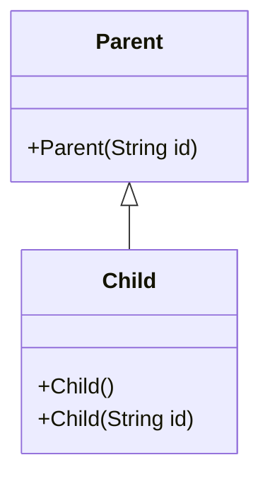

Một đối tượng `Child` **cũng chứa phần trạng thái do `Parent` định nghĩa**. Trước khi constructor `Child` hoàn tất, constructor `Parent` phải được thực thi trong chuỗi khởi tạo.

Ví dụ đơn giản:

```java
public class ConstructorChainDemo {
    static class Parent {
        Parent(String id) {
            System.out.println("Parent: " + id);
        }
    }

    static final class Child extends Parent {
        Child() {
            this("DEFAULT");
            System.out.println("Child()");
        }

        Child(String id) {
            super(id);
            System.out.println("Child(String): " + id);
        }
    }

    public static void main(String[] args) {
        new Child();
    }
}
```

Lưu thành `ConstructorChainDemo.java` và chạy:

```bash
javac ConstructorChainDemo.java
java ConstructorChainDemo
```

Kết quả:

```text
Parent: DEFAULT
Child(String): DEFAULT
Child()
```

Dù bắt đầu bằng `new Child()`, chương trình đi qua constructor `Child()` để chuyển sang `Child(String)`, rồi gọi `Parent(String)`. Các **phần thân constructor** được thực thi từ lớp cha trở xuống, sau đó quay về constructor đã gọi bằng `this(...)`.

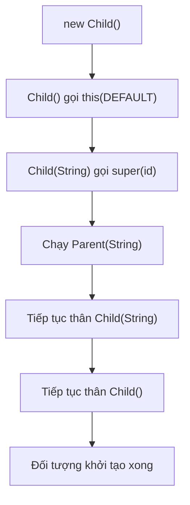

Điểm cần phân biệt: Java không tạo ra ba đối tượng riêng cho `Child()`, `Child(String)` và `Parent(String)`. Chuỗi constructor này khởi tạo **cùng một đối tượng Child**.

## 2. `super(...)` và `this(...)` làm gì?

| Cú pháp | Mục đích | Ví dụ |
|---|---|---|
| `super(args)` | Chọn và gọi một constructor của **lớp cha trực tiếp** | `super(id)` |
| `this(args)` | Chuyển sang một constructor khác trong **cùng lớp** | `this("DEFAULT")` |
| Không viết lời gọi nào | Trình biên dịch ngầm thêm lời gọi `super()` khi hợp lệ | Constructor không ghi `super(...)` |
| `super.someMethod()` | Gọi implementation của phương thức từ lớp cha | Không phải lời gọi constructor |
| `this.someMethod()` | Gọi phương thức trên đối tượng hiện tại | Không phải lời gọi constructor |

Với **Java 17**, lời gọi constructor tường minh bằng `this(...)` hoặc `super(...)` phải là **câu lệnh đầu tiên** trong constructor. Không thể gọi cả hai trực tiếp trong cùng một constructor, vì mỗi constructor chỉ có một đường chuyển tiếp khởi tạo phù hợp.

```java
class Base {
    Base(int code) {
        System.out.println("Base " + code);
    }
}

class Derived extends Base {
    Derived() {
        this(10);             // Chuyển sang constructor khác của Derived
    }

    Derived(int code) {
        super(code);          // Gọi constructor của Base
        System.out.println("Derived " + code);
    }
}
```

Constructor `Derived()` dùng `this(10)`; `Derived(int)` dùng `super(code)`. Chuỗi đó dẫn tới constructor của lớp cha. Nếu tạo vòng lặp constructor bằng các lời gọi `this(...)` quay về nhau, Java sẽ báo lỗi biên dịch vì recursive constructor invocation.

**Constructor không phải phương thức bình thường:** không có kiểu trả về, không được kế thừa và không được override. Một lớp con có thể định nghĩa constructor cùng danh sách tham số với lớp cha, nhưng đó là hai constructor độc lập.

### Lỗi thường gặp: lớp cha không có constructor không tham số

```java
class Parent {
    Parent(String id) {}
}

class Child extends Parent {
    Child() {
        // Trình biên dịch ngầm thử super(), nhưng Parent() không tồn tại.
    }
}
```

Ví dụ trên **không biên dịch**. Khi đã khai báo `Parent(String)`, Java không tự thêm constructor `Parent()`. Sửa bằng cách chọn constructor có sẵn:

```java
class Child extends Parent {
    Child() {
        super("C-001");
    }
}
```

Hoặc thêm constructor `Parent()` nếu thực sự phù hợp với quy tắc khởi tạo của lớp cha.

Constructor lớp cha phải **truy cập được** từ lớp con. Ví dụ một constructor `private` của lớp cha thông thường không thể được lớp con độc lập gọi trực tiếp. `protected` là lựa chọn thường gặp khi lớp được thiết kế để kế thừa và cần cho phép lớp con gọi constructor.

## 3. Thứ tự đầy đủ: static, instance field, initializer block, constructor

Đây là phần dễ gây nhầm nhất. Xét ba tầng kế thừa `Parent → Middle → Child`.

Lưu **toàn bộ** ví dụ thành `InitializationOrderDemo.java` (Java 17+):

```java
public class InitializationOrderDemo {
    private static void log(String text) {
        System.out.println(text);
    }

    private static int init(String label, int value) {
        log(label);
        return value;
    }

    static class Parent {
        static {
            log("Parent: static block");
        }

        private final int parentValue =
                init("Parent: instance field", 10);

        {
            log("Parent: instance block");
        }

        Parent(String source) {
            log("Parent: constructor, value=" + parentValue
                    + ", source=" + source);
        }
    }

    static class Middle extends Parent {
        static {
            log("Middle: static block");
        }

        private final int middleValue =
                init("Middle: instance field", 20);

        {
            log("Middle: instance block");
        }

        Middle() {
            super("Middle");
            log("Middle: constructor, value=" + middleValue);
        }
    }

    static final class Child extends Middle {
        static {
            log("Child: static block");
        }

        private final int childValue =
                init("Child: instance field", 30);

        {
            log("Child: instance block");
        }

        Child() {
            super();
            log("Child: constructor, value=" + childValue);
        }
    }

    public static void main(String[] args) {
        log("main: before new");
        new Child();
        log("main: after new");
    }
}
```

Biên dịch/chạy:

```bash
javac InitializationOrderDemo.java
java InitializationOrderDemo
```

Kết quả chính xác trong lần chạy chương trình này:

```text
main: before new
Parent: static block
Middle: static block
Child: static block
Parent: instance field
Parent: instance block
Parent: constructor, value=10, source=Middle
Middle: instance field
Middle: instance block
Middle: constructor, value=20
Child: instance field
Child: instance block
Child: constructor, value=30
main: after new
```

### Vì sao thứ tự như vậy?

Có **hai quá trình cần phân biệt**:

**A. Khởi tạo lớp (`static`) khi lớp được sử dụng chủ động lần đầu**

Trước khi tạo `Child`, JVM cần bảo đảm việc khởi tạo các lớp trong chuỗi kế thừa đã hoàn tất. Khi các lớp chưa từng được khởi tạo, các static initializer lần lượt chạy từ cha đến con:

```text
Parent static → Middle static → Child static
```

Static field initializer và static initializer block trong **cùng một lớp** được thực hiện theo thứ tự khai báo. Khởi tạo lớp thường chỉ chạy **một lần cho mỗi lần khởi tạo lớp trong class loader tương ứng**, không lặp mỗi khi gọi `new`.

**B. Khởi tạo một instance**

Sau bước cấp phát và thiết lập giá trị mặc định cho các trường instance, chuỗi constructor đi từ lớp con ngược lên cho tới lớp cha. Khi thực thi phần khởi tạo của từng lớp, thứ tự quan sát là:

```text
Parent instance fields/blocks → Parent constructor body
→ Middle instance fields/blocks → Middle constructor body
→ Child instance fields/blocks → Child constructor body
```

Trong **mỗi lớp**, các instance field initializer và instance initializer block chạy xen kẽ theo **thứ tự xuất hiện trong mã nguồn**, sau khi constructor lớp cha hoàn tất và trước phần thân constructor của lớp hiện tại.

Một chú ý quan trọng: đừng hiểu rằng *mọi* field initializer của tất cả các lớp luôn chạy trước *mọi* initializer block. Chúng đan xen theo thứ tự khai báo trong từng lớp.

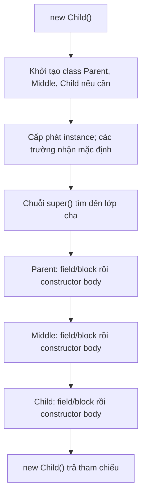

Sơ đồ mô tả hành vi quan sát ở mức học Java. JVM có thể tối ưu cách cấp phát vật lý, nhưng phải giữ ngữ nghĩa khởi tạo mà Java yêu cầu.

## 4. Giá trị mặc định xuất hiện trước field initializer

Java cấp phát đối tượng và thiết lập giá trị mặc định cho các trường instance trước khi chạy logic khởi tạo:

| Loại trường instance | Giá trị mặc định trước khi được khởi tạo |
|---|---|
| `byte`, `short`, `int`, `long` | `0` (theo kiểu tương ứng) |
| `float`, `double` | `0.0` |
| `boolean` | `false` |
| `char` | Ký tự `'\\u0000'` |
| Kiểu tham chiếu (`String`, `List`, object...) | `null` |

Ví dụ:

```java
class Counter {
    int count;              // Mặc định 0
    String label = "Ready"; // Field initializer thay null bằng "Ready"

    Counter() {
        count = 1;          // Constructor body thay 0 bằng 1
    }
}
```

Sau `new Counter()`, `count == 1` và `label.equals("Ready")`.

**Không suy từ đây rằng biến cục bộ cũng tự có giá trị mặc định:** biến local trong phương thức phải được gán trước khi đọc, nếu không sẽ lỗi biên dịch.

Các lớp con vẫn có các trường riêng của mình nhận giá trị mặc định trước khi constructor lớp cha thực thi. Điều này đặc biệt quan trọng nếu constructor lớp cha gọi đến một phương thức bị lớp con override.

## 5. Rủi ro: constructor lớp cha gọi phương thức có thể bị override

Đây là một tình huống kỹ thuật quan trọng. Khi constructor lớp cha gọi một phương thức instance bị lớp con override, **dynamic dispatch vẫn xảy ra**: phiên bản ở lớp con có thể chạy khi trường của lớp con chưa được khởi tạo bằng field initializer.

Ví dụ chạy độc lập, lưu `ConstructorOverrideTrap.java`:

```java
public class ConstructorOverrideTrap {
    static class Parent {
        Parent() {
            System.out.println("Parent sees: " + description());
        }

        String description() {
            return "Parent";
        }
    }

    static final class Child extends Parent {
        private String name = "Ready";

        @Override
        String description() {
            return name;
        }
    }

    public static void main(String[] args) {
        Child child = new Child();
        System.out.println("After construction: " + child.description());
    }
}
```

Kết quả:

```text
Parent sees: null
After construction: Ready
```

Lý do:

1. `new Child()` bắt đầu chuỗi khởi tạo.
2. `Parent()` chạy **trước** field initializer `name = "Ready"` của `Child`.
3. `Parent()` gọi `description()`, nhưng Java điều phối đến `Child.description()`.
4. Lúc đó `name` vẫn là giá trị mặc định `null`; chỉ sau khi trở về phần khởi tạo `Child`, trường mới nhận `"Ready"`.

Nếu `description()` gọi `name.length()` lúc đó, chương trình có thể ném `NullPointerException`.

**Quy tắc thiết kế:** tránh gọi phương thức có thể bị override từ constructor. Constructor nên thiết lập những trạng thái mà chính lớp đó sở hữu; hãy chạy các hook mở rộng sau khi toàn bộ đối tượng đã khởi tạo xong, hoặc thiết kế phương thức khởi tạo riêng không thể bị override khi phù hợp.

## 6. `this(...)` có khiến field initializer của lớp con chạy lại không?

**Không.** Khi một constructor chuyển sang constructor khác **trong cùng lớp** bằng `this(...)`, các instance initializer của lớp đó **không chạy lại lần nữa**. Chúng chỉ chạy một lượt cho object đang tạo.

Ví dụ:

```java
public class SameClassChainDemo {
    static class Item {
        int quantity = initialize();

        private int initialize() {
            System.out.println("field initializer");
            return 1;
        }

        Item() {
            this(5);
            System.out.println("Item()");
        }

        Item(int amount) {
            // super() ngầm định ở đây
            quantity = amount;
            System.out.println("Item(int)");
        }
    }

    public static void main(String[] args) {
        Item item = new Item();
        System.out.println(item.quantity);
    }
}
```

Kết quả:

```text
field initializer
Item(int)
Item()
5
```

`this(5)` không tạo object mới, chỉ chuyển sang một constructor khác để dùng chung đường khởi tạo. Nếu mỗi lần chuyển constructor đều chạy lại field initializer, kết quả sẽ không tương ứng với ngữ nghĩa của Java.

Lưu ý: `this(...)` có thể làm nhiều **thân constructor** trong cùng lớp chạy theo thứ tự ngược lại chuỗi lời gọi, nhưng không làm một object được cấp phát nhiều lần.

## 7. Khi có ngoại lệ trong chuỗi khởi tạo

Constructor có thể từ chối đầu vào hoặc thất bại trong khi khởi tạo.

```java
class Parent {
    Parent(int initial) {
        if (initial < 0) {
            throw new IllegalArgumentException("initial phải không âm");
        }
    }
}

class Child extends Parent {
    private final String name = createName();

    static String createName() {
        System.out.println("Child field initialized");
        return "OK";
    }

    Child(int initial) {
        super(initial);
        System.out.println("Child constructor body");
    }
}
```

Nếu gọi `new Child(-1)`, constructor `Parent(-1)` ném `IllegalArgumentException`, nên field initializer `name = createName()` và phần thân constructor `Child` **không được chạy**.

Điều này dẫn tới một nguyên tắc thực tế: nếu code tạo resource (file, socket, connection) trong quá trình khởi tạo mà bước sau có thể lỗi, phải tự thiết kế cách đóng resource đã mở trên đường thất bại. Java **không tự gọi `close()` cho một đối tượng đang được khởi tạo dở**.

Nếu một static initializer thất bại, đó là lỗi ở **khởi tạo lớp**, khác với lỗi ở constructor instance; JVM có các quy tắc đánh dấu lớp khởi tạo thất bại, và những lần sử dụng tiếp theo có thể ném `NoClassDefFoundError`. Vì vậy, tránh thực hiện quá nhiều I/O hoặc tác động khó phục hồi ngay trong static initializer.

## 8. Phân biệt constructor chaining với method overriding

| Cơ chế | Được chọn như thế nào? | Thời điểm có ý nghĩa |
|---|---|---|
| `this(...)` | Constructor overload của cùng lớp; chọn theo kiểu/đối số tại biên dịch | Khi tạo đối tượng |
| `super(...)` | Constructor của lớp cha trực tiếp, chọn theo tham số và quyền truy cập | Khi khởi tạo phần cha |
| Override method | Implementation instance được chọn theo kiểu runtime của object | Khi gọi phương thức |
| `super.method()` | Gọi implementation tương ứng ở lớp cha | Khi thực thi phương thức |
| Static initializer | JVM kích hoạt khi lớp được khởi tạo theo ngữ nghĩa Java | Thường trước lần tạo instance đầu tiên |

Không thể override constructor. Tên constructor trùng tên lớp vì cú pháp khởi tạo, không có nghĩa constructor được dispatch đa hình như phương thức instance.

Cũng không cần viết `super()` trong mọi constructor: nếu constructor không bắt đầu bằng `this(...)` hay `super(...)`, Java 17 tự thêm `super()` **chỉ khi** constructor không tham số ở lớp cha truy cập được.

## 9. Kinh nghiệm thiết kế cây kế thừa an toàn

1. **Để constructor lớp cha chịu trách nhiệm trạng thái của lớp cha.** Nếu lớp cha cần `id`, hãy nhận và kiểm tra `id` bằng `super(id)`. Lớp con tiếp tục kiểm tra trường của nó sau đó.
2. **Tránh gọi phương thức override được trong constructor.** Đừng để lớp cha phụ thuộc vào dữ liệu của lớp con chưa khởi tạo.
3. **Giữ constructor đơn giản.** Constructor nên thiết lập invariant rõ ràng, hạn chế I/O, gửi sự kiện hoặc đăng ký `this` ra bên ngoài quá sớm.
4. **Dùng `this(...)` để giảm trùng logic khởi tạo.** Tập trung kiểm tra đầu vào ở một constructor chính, tránh lặp một chuỗi câu lệnh ở nhiều overload.
5. **Không tự giả định lớp cha có constructor mặc định.** Đọc chữ ký constructor và quyền truy cập của lớp cha khi viết `extends`.
6. **Đặt phần chung ở lớp cha nhưng giữ quyền sở hữu hợp lý.** Không nên dùng kế thừa chỉ để tái sử dụng vài dòng nếu quan hệ “là một loại” không đúng về mặt mô hình.
7. **Kiểm tra cả trường hợp ngoại lệ.** Nếu constructor cha thất bại, các bước khởi tạo con sẽ không diễn ra; bảo đảm không để lại resource đã mở ở bước trước.

## 10. Bài tập tự kiểm tra

**Bài 1 — dự đoán kết quả:**

```java
class A {
    A() { System.out.print("A "); }
}

class B extends A {
    B() { System.out.print("B "); }
}

class C extends B {
    C() { System.out.print("C "); }
}

// new C(); sẽ in gì?
```

**Đáp án:** `A B C ` vì các constructor của lớp cha phải hoàn thành trước phần thân constructor lớp con.

**Bài 2 — sửa lỗi biên dịch.** Viết lớp `Person` chỉ có constructor `Person(String name)`. Viết `Student extends Person`, ban đầu không ghi `super(name)` để xem lỗi. Sau đó sửa constructor `Student(String name, int grade)` và thêm kiểm tra `grade` hợp lệ.

**Bài 3 — thứ tự trường và khối initializer.** Tạo `Base` và `Derived`, mỗi lớp có một field initializer, một instance block và một constructor in tên của bước. Dự đoán sáu dòng được in khi `new Derived()`, rồi chạy kiểm chứng.

**Bài 4 — lỗi override sớm.** Sửa ví dụ `ConstructorOverrideTrap` để constructor `Parent` không gọi `description()`. Chuyển lời gọi ra `main` sau khi khởi tạo và so sánh kết quả.

**Bài 5 — vòng `this(...)`.** Thử tạo hai constructor `Example()` và `Example(int)` sao cho mỗi constructor đều gọi constructor còn lại. Giải thích lỗi biên dịch và sửa để chuỗi kết thúc bằng một constructor gọi `super(...)`.

**Bài 6 — trường hợp lỗi.** Trong ví dụ `Parent/Child` ở mục 7, dự đoán có dòng `Child field initialized` xuất hiện không khi `new Child(-1)`. Giải thích dựa trên chuỗi khởi tạo.

**Ghi nhớ:** Khi `new Child()`, Java phải khởi tạo lớp cha và hoàn tất phần khởi tạo instance của lớp cha trước phần instance của lớp con. `super(...)` chuyển tới constructor lớp cha, `this(...)` nối các constructor cùng lớp, còn **field initializer/instance block của mỗi lớp chạy theo thứ tự khai báo trước thân constructor của chính lớp đó**. Đặc biệt, constructor lớp cha không nên gọi phương thức có thể bị lớp con override vì lúc ấy trường của lớp con chưa sẵn sàng.


</details>

- [Quay lại đầu trang](#back-to-top)

---

## <a id="inheritance-007">Thành viên không thể ghi đè và lớp không thể kế thừa</a>

<details>
<summary>Xem chi tiết</summary>

# Thành viên không thể ghi đè và lớp không thể kế thừa trong Java

Trong Java, từ khóa `final` có thể được dùng để **cố định một phần của thiết kế kế thừa**:

- Đặt `final` trên **phương thức** để lớp con không thể ghi đè (*override*) phương thức đó.
- Đặt `final` trên **lớp** để không lớp nào có thể `extends` lớp ấy.
- Đặt `final` trên **biến hoặc field** để không được gán lại giá trị sau khi đã gán hợp lệ.

Ba ý nghĩa này liên quan đến sự ổn định nhưng **không thay thế nhau**. Đặc biệt, `final class` không tự làm mọi dữ liệu bên trong bất biến; `final method` không ngăn phương thức thay đổi trạng thái; `final field` không khiến đối tượng được tham chiếu trở nên bất biến.

Mục tiêu của bài là hiểu chính xác **điều gì bị cấm tại lúc biên dịch**, điều gì vẫn có thể làm, và cách dùng `final` để giữ những quy tắc mà lớp con không được phá vỡ.

## 1. Phương thức `final`: kế thừa được nhưng không override được

Một phương thức instance được đánh dấu `final` vẫn có thể được **gọi và kế thừa** bởi lớp con, nhưng lớp con **không được cung cấp implementation mới với cùng chữ ký override**.

~~~java
class Account {
    private String owner;

    Account(String owner) {
        this.owner = owner;
    }

    public final String getOwner() {
        return owner;
    }
}

class SavingsAccount extends Account {
    SavingsAccount(String owner) {
        super(owner);
    }

    // Không hợp lệ:
    // @Override
    // public String getOwner() {
    //     return "Người khác";
    // }
}
~~~

~~~java
SavingsAccount account = new SavingsAccount("An");
System.out.println(account.getOwner()); // An
~~~

Mặc dù `SavingsAccount` không thể **override** `getOwner()`, nó vẫn được sử dụng phương thức được kế thừa. `final` ngăn thay phần triển khai của phương thức; nó **không** làm biến mất API khỏi lớp con.

Bảng phân biệt:

| Hành động trên phương thức `final` của lớp cha | Có được không? |
| --- | --- |
| Gọi từ đối tượng lớp con | Có, nếu quyền truy cập cho phép |
| Lớp con kế thừa implementation | Có, theo quy tắc kế thừa Java |
| Override cùng chữ ký trong lớp con | Không |
| Lớp con thêm phương thức **overload** khác danh sách tham số | Có |
| Phương thức `final` sửa field hoặc gọi phương thức khác | Có |
| Phương thức `final` gọi một hook overridable | Có, nhưng cần thiết kế cẩn thận |

**Ghi đè (override)** và **nạp chồng (overload)** không giống nhau:

~~~java
class Parent {
    public final void send(String text) {
        System.out.println("Gửi: " + text);
    }
}

class Child extends Parent {
    // Overload: tham số khác, hoàn toàn hợp lệ.
    public void send(String text, int times) {
        for (int i = 0; i < times; i++) {
            send(text); // Gọi phương thức final kế thừa từ Parent.
        }
    }

    // LỖI nếu viết:
    // @Override
    // public void send(String text) { }
}
~~~

`send(String, int)` là phương thức mới với chữ ký khác. Nó không sửa phần triển khai của `send(String)`.

## 2. Lớp `final`: không thể làm superclass

Khi khai báo:

~~~java
final class Receipt {
    private final String code;

    Receipt(String code) {
        this.code = code;
    }

    String getCode() {
        return code;
    }
}
~~~

Bạn vẫn tạo đối tượng được:

~~~java
Receipt receipt = new Receipt("RC-001");
System.out.println(receipt.getCode()); // RC-001
~~~

Nhưng không thể khai báo lớp con:

~~~java
// LỖI BIÊN DỊCH:
// class SpecialReceipt extends Receipt {
// }
~~~

Một lớp `final` có thể tự `extends` lớp cha và `implements` các interface:

~~~java
interface Printable {
    void print();
}

class Document {
    String category() {
        return "Tài liệu";
    }
}

final class Invoice extends Document implements Printable {
    @Override
    public void print() {
        System.out.println(category() + ": hóa đơn");
    }
}
~~~

`Invoice` được **kế thừa** từ `Document`, nhưng **không cho lớp khác kế thừa từ Invoice**. Vì thế nhận định “lớp final không liên quan được đến kế thừa” là sai: nó có thể đứng **ở cuối một nhánh** kế thừa.

Sơ đồ:

~~~mermaid
classDiagram
    class Document {
        +category() String
    }
    class Printable {
        <<interface>>
        +print() void
    }
    class Invoice {
        <<final>>
        +print() void
    }
    Document <|-- Invoice
    Printable <|.. Invoice
~~~

`Invoice` vẫn có thể được sử dụng thông qua biến `Document` hoặc `Printable`. Đánh dấu `final` không loại bỏ đa hình đối với các lớp/interface cha.

## 3. Ví dụ Java chạy được: khóa quy trình chung, mở điểm chuyên biệt hóa

Tình huống: ứng dụng có nhiều kênh thanh toán. Mỗi yêu cầu đều cần kiểm tra số tiền trước khi gọi kênh thanh toán cụ thể, và phải trả thông tin giao dịch theo cấu trúc thống nhất.

Ta thiết kế:

- `PaymentChannel` là hợp đồng cho bên sử dụng.
- `PaymentProcessor` là lớp cha **abstract**, chứa phương thức `process()` **final** để giữ quy trình chung.
- `charge()` là điểm mở rộng `protected abstract`; lớp con thực hiện bước xử lý thanh toán.
- `CardProcessor` là lớp **final**: hoàn thiện xử lý thẻ và không cho subclass thay đổi tiếp.
- `BankTransferProcessor` là một lớp cụ thể khác, cho thấy nhiều implementation có thể cùng dùng quy trình chung.

Lưu toàn bộ vào `FinalInheritanceDemo.java`, chạy với **Java 11+**.

~~~java
import java.math.BigDecimal;
import java.util.List;
import java.util.Objects;

public class FinalInheritanceDemo {

    interface PaymentChannel {
        Receipt process(BigDecimal amount);
    }

    static final class Receipt {
        private final String provider;
        private final BigDecimal amount;
        private final String transactionId;

        Receipt(String provider, BigDecimal amount, String transactionId) {
            this.provider = Objects.requireNonNull(provider);
            this.amount = Objects.requireNonNull(amount);
            this.transactionId = Objects.requireNonNull(transactionId);
        }

        String getProvider() {
            return provider;
        }

        BigDecimal getAmount() {
            return amount;
        }

        String getTransactionId() {
            return transactionId;
        }
    }

    static abstract class PaymentProcessor implements PaymentChannel {
        private final String provider;

        protected PaymentProcessor(String provider) {
            String checked = Objects.requireNonNull(provider).trim();
            if (checked.isEmpty()) {
                throw new IllegalArgumentException("Tên kênh không hợp lệ");
            }
            this.provider = checked;
        }

        // Template Method: lớp con không được bỏ qua quy trình kiểm tra.
        @Override
        public final Receipt process(BigDecimal amount) {
            Objects.requireNonNull(amount, "amount");

            if (amount.signum() <= 0) {
                throw new IllegalArgumentException(
                        "Số tiền phải lớn hơn 0");
            }

            String transactionId = Objects.requireNonNull(
                    charge(amount), "transactionId");
            if (transactionId.isBlank()) {
                throw new IllegalStateException("Thiếu mã giao dịch");
            }

            return new Receipt(provider, amount, transactionId);
        }

        // Mỗi lớp con phải định nghĩa cách xử lý riêng.
        protected abstract String charge(BigDecimal amount);
    }

    // Vừa kế thừa một lớp cha, vừa không cho kế thừa tiếp.
    static final class CardProcessor extends PaymentProcessor {
        CardProcessor() {
            super("CARD");
        }

        @Override
        protected String charge(BigDecimal amount) {
            System.out.println("Xử lý thẻ: " + amount.toPlainString());
            return "CARD-TX-001";
        }

        // Không hợp lệ nếu bỏ comment:
        // @Override
        // public Receipt process(BigDecimal amount) {
        //     return null;
        // }
    }

    static class BankTransferProcessor extends PaymentProcessor {
        BankTransferProcessor() {
            super("BANK");
        }

        @Override
        protected String charge(BigDecimal amount) {
            System.out.println("Chuyển khoản: " + amount.toPlainString());
            return "BANK-TX-002";
        }
    }

    public static void main(String[] args) {
        List<PaymentChannel> channels = List.of(
                new CardProcessor(), new BankTransferProcessor());

        for (PaymentChannel channel : channels) {
            Receipt receipt = channel.process(
                    new BigDecimal("150000"));

            System.out.println(
                    receipt.getProvider() + " -> "
                    + receipt.getTransactionId());
        }

        try {
            channels.get(0).process(BigDecimal.ZERO);
        } catch (IllegalArgumentException ex) {
            System.out.println("Từ chối: " + ex.getMessage());
        }
    }
}
~~~

Chạy:

~~~bash
javac FinalInheritanceDemo.java
java FinalInheritanceDemo
~~~

Kết quả:

~~~text
Xử lý thẻ: 150000
CARD -> CARD-TX-001
Chuyển khoản: 150000
BANK -> BANK-TX-002
Từ chối: Số tiền phải lớn hơn 0
~~~

Ví dụ chỉ mô phỏng thanh toán bằng chuỗi cố định và console; chưa có kết nối ngân hàng hoặc đảm bảo giao dịch thực tế. Mục tiêu là quan sát quy tắc kế thừa và phần mã được bảo vệ bởi `final`.

### Điều gì được cố định, điều gì được mở rộng?

| Thành phần | Vai trò | Có override ở lớp con? |
| --- | --- | --- |
| `PaymentProcessor.process()` | Kiểm tra số tiền, gọi `charge`, chuẩn hóa Receipt | **Không**, vì `final` |
| `PaymentProcessor.charge()` | Hợp đồng để từng kênh thực thi | **Có**, thậm chí bắt buộc ở lớp con concrete |
| `CardProcessor` | Một loại xử lý thanh toán cụ thể | Không thể có subclass vì class `final` |
| `BankTransferProcessor` | Loại xử lý cụ thể khác | Có thể được kế thừa thêm vì chưa `final` |
| `Receipt` | Dữ liệu giao dịch tạo ra sau xử lý | Không thể kế thừa vì class `final` |

**Chi tiết kỹ thuật quan trọng:** `process()` không override được, nhưng lời gọi `charge(amount)` **bên trong** nó vẫn chọn implementation của instance thực tế. Do đó `final` chỉ khóa phần thân `process`, không đóng toàn bộ khả năng đa hình của lớp.

~~~mermaid
sequenceDiagram
    actor App
    participant P as PaymentProcessor.process() final
    participant C as CardProcessor.charge()
    App->>P: process(150000)
    P->>P: kiểm tra amount > 0
    P->>C: charge(150000)
    C-->>P: "CARD-TX-001"
    P->>P: new Receipt(...)
    P-->>App: Receipt
~~~

Sơ đồ biểu diễn **các vai trò trong một lần gọi trên cùng instance CardProcessor**: `PaymentProcessor.process()` là mã kế thừa đang chạy, còn `CardProcessor.charge()` là mã được dispatch động. Không có một instance `PaymentProcessor` độc lập được tạo thêm.

## 4. Vì sao một phương thức nên là `final`?

Dùng `final` trên phương thức khi phần hành vi đó được xem như **quy tắc cố định của lớp cha**: ví dụ một trình tự kiểm tra trước khi thao tác hoặc một cách biểu diễn định danh không được thay.

Các lợi ích thiết kế có thể có:

1. Ngăn subclass bỏ qua logic quan trọng bằng cách override phương thức.
2. Cho người đọc biết đây là API có implementation ổn định trong cây kế thừa.
3. Giữ một quy trình dùng chung trong khi cho phép chuyên biệt hóa tại các hook riêng.
4. Giảm số cách lớp con có thể làm sai một phần hợp đồng lớp cha.

Tuy nhiên, `final` **không phải biện pháp bảo mật tuyệt đối**. Nếu lớp cha công khai các phương thức thay đổi trạng thái khác, hoặc hook overridable có hành vi nguy hiểm, một subclass vẫn có thể tạo tác động sai. Ví dụ trong chương trình trên, `charge()` có thể trả kết quả hợp lệ về mặt cú pháp nhưng thực tế không thu tiền. Phải thiết kế và kiểm chứng hợp đồng của mọi điểm mở rộng.

Cũng không nên đánh dấu mọi phương thức `final` theo thói quen rồi vô tình làm khó các biến thể hợp lệ. Trước khi khóa một phương thức, hãy xác định **lý do nghiệp vụ hoặc ràng buộc thiết kế** cụ thể.

## 5. Vì sao một lớp nên là `final`?

Dùng `final class` khi thiết kế muốn **đóng khả năng chuyên biệt hóa bằng kế thừa**:

- Kiểu dữ liệu giá trị (value type) có invariant chặt, không muốn subclass mở rộng và thay đổi kỳ vọng.
- Một implementation đã hoàn chỉnh, không cung cấp hợp đồng mở rộng cho subclass.
- Một đối tượng tiện ích hoặc cấu phần chỉ muốn được **sử dụng/ủy quyền** thay vì kế thừa.
- Một kiểu có quy tắc về danh tính, bình đẳng hoặc xử lý nội bộ khó bảo đảm nếu subclass tùy ý thay đổi hành vi.

Ví dụ lớp `Receipt` ở trên không có setter và các field giữ `String`/`BigDecimal` bất biến. Kết hợp với kiểm tra trong constructor, đây là một kiểu dữ liệu **bất biến theo trạng thái quan sát được** trong ví dụ.

Nhưng cần phân biệt nguyên nhân:

~~~java
final class Counter {
    private int value;

    void increment() {
        value++;
    }

    int getValue() {
        return value;
    }
}
~~~

~~~java
Counter counter = new Counter();
counter.increment();
System.out.println(counter.getValue()); // 1
~~~

`Counter` là lớp `final` **nhưng đối tượng vẫn mutable**. `final` ở cấp class chỉ ngăn `extends Counter`, không cấm cập nhật `value`.

Tương tự, một lớp không `final` vẫn có thể thiết kế bất biến nếu bảo vệ tất cả trạng thái đúng cách; bất biến dữ liệu và hạn chế kế thừa là **hai quyết định khác nhau**.

## 6. Ba vị trí của `final` dễ bị lẫn

| Vị trí | Ví dụ | Điều bị cấm | Điều vẫn có thể xảy ra |
| --- | --- | --- | --- |
| Class | `final class Receipt` | Lớp khác `extends Receipt` | Tạo object, gọi method, sửa state nếu class cho phép |
| Method | `public final void process()` | Subclass override cùng chữ ký | Gọi từ subclass, overload với tham số khác |
| Biến/field | `final List<String> items` | Gán lại `items` sau khi đã gán | `items.add(...)` nếu list mutable |

Ví dụ `final` trên biến tham chiếu:

~~~java
import java.util.ArrayList;
import java.util.List;

final List<String> tags = new ArrayList<>();
tags.add("Java");       // Hợp lệ: cập nhật đối tượng List.
// tags = new ArrayList<>(); // Lỗi: không được gán lại biến final.
~~~

Với kiểu nguyên thủy:

~~~java
final int maxAttempts = 3;
// maxAttempts = 5; // Lỗi biên dịch.
~~~

Với tham số phương thức:

~~~java
void render(final String message) {
    // message = "Khác"; // Lỗi: gán lại tham số final.
    System.out.println(message);
}
~~~

Với field không có giá trị tại chỗ khai báo:

~~~java
class User {
    private final String id;

    User(String id) {
        this.id = id; // Gán một lần trong constructor.
    }
}
~~~

Một `blank final field` phải được gán đúng theo quy tắc khởi tạo của Java trên mọi đường khởi tạo hoàn tất bình thường; không được gán lại sau đó. Field `final` tham chiếu tới một đối tượng mutable không khóa trạng thái bên trong đối tượng.

## 7. Thành viên nào không thể override dù không viết `final`?

Không phải thành viên nào của lớp cha cũng là điểm override hợp lệ.

| Thành viên | Có override đúng nghĩa? | Giải thích |
| --- | --- | --- |
| Instance method `public/protected`, không final, không static | Thường có | Nếu có quyền truy cập và chữ ký phù hợp |
| Instance method `final` | Không | Compiler cấm override |
| Method `private` | Không | Không được kế thừa theo cách cho phép override |
| Method `static` | Không | Có thể bị **hide** bởi static method ở subclass, trừ các ràng buộc như final |
| Constructor | Không | Constructor không phải method được kế thừa |
| Field, kể cả `final field` | Không | Field chỉ có thể bị **hide** (che tên), không override động |

### `private` và `static` không phải là override

~~~java
class Parent {
    private void internal() {
        System.out.println("Parent internal");
    }

    static void info() {
        System.out.println("Parent info");
    }
}

class Child extends Parent {
    // Đây là phương thức MỚI, không override private method ở Parent.
    public void internal() {
        System.out.println("Child internal");
    }

    // Đây là static method hiding, không phải instance override.
    static void info() {
        System.out.println("Child info");
    }
}
~~~

~~~java
Parent p = new Child();
p.info();     // Parent info (static ràng buộc theo kiểu khai báo)
// p.internal(); // Không biên dịch: Parent.internal() là private.

Child c = new Child();
c.internal(); // Child internal
~~~

Nên gọi static method qua tên class (`Parent.info()`, `Child.info()`) để tránh nhầm với đa hình động.

Nếu lớp cha khai báo `static final void info()`, lớp con không thể khai báo static method cùng chữ ký để hide. Với `private final void internal()`, subclass vẫn có thể khai báo phương thức mới cùng tên/chữ ký theo quy tắc truy cập, vì đó **không phải override** phương thức private ở cha.

### Không thể kết hợp `abstract` và `final` trên cùng class/method

Hai từ khóa có yêu cầu đối lập:

- `abstract method` yêu cầu subclass cung cấp implementation.
- `final method` ngăn subclass cung cấp implementation bằng override.
- `abstract class` có thể cần/cho phép subclass hoàn thiện.
- `final class` ngăn tạo subclass.

Do đó các khai báo sau **không hợp lệ**:

~~~java
// abstract final class Impossible { }

// abstract class Base {
//     abstract final void execute();
// }
~~~

Trong khi đó, **abstract class vẫn được chứa method final đã triển khai** — chính là thiết kế `PaymentProcessor.process()` ở ví dụ chạy được.

## 8. Nếu cần khóa một số phương thức nhưng vẫn cho phép mở rộng?

Đó là tình huống phổ biến. Có thể dùng một lớp cha **không final** hoặc `abstract class`, rồi đánh dấu đúng các điểm không được override:

~~~java
abstract class ImportJob {
    // Giữ nguyên quy trình.
    public final void run() {
        validate();
        parse();
        save();
    }

    private void validate() {
        System.out.println("Kiểm tra đầu vào chung");
    }

    protected abstract void parse();
    protected abstract void save();
}
~~~

~~~java
class CsvImportJob extends ImportJob {
    @Override
    protected void parse() {
        System.out.println("Đọc CSV");
    }

    @Override
    protected void save() {
        System.out.println("Lưu dữ liệu CSV");
    }
}
~~~

`ImportJob.run()` cố định các bước; subclass chuyên biệt hóa `parse()` và `save()`. Đây là biến thể của mẫu **Template Method**.

Quan trọng: nếu `parse()` hay `save()` ném ngoại lệ hoặc sửa trạng thái không hợp lệ, phương thức `final run()` **không tự hoàn tác** các thay đổi. `final` giải quyết **quyền override**, không thay thế kiểm soát lỗi, giao dịch hay đồng bộ.

## 9. Những lựa chọn thiết kế thay thế `final` trên class

Một lớp `final` áp đặt quy tắc **không có subclass**. Nhưng đôi khi bạn muốn cho phép **một số kiểu con được chọn** mà không mở hoàn toàn.

Từ **Java 17**, Java hỗ trợ `sealed class`:

~~~java
// Ví dụ riêng cho Java 17+, không thuộc bản demo Java 11.
sealed class PaymentMethod permits Cash, Card {
}

final class Cash extends PaymentMethod {
}

final class Card extends PaymentMethod {
}
~~~

Khác nhau:

| Thiết kế | Ai có thể kế thừa? |
| --- | --- |
| `class Base` (không final/sealed) | Các lớp phù hợp quyền truy cập và quy tắc ngôn ngữ |
| `final class Base` | Không ai |
| `sealed class Base permits A, B` | Chỉ các lớp được phép trực tiếp; các subclass phải khai báo `final`, `sealed` hoặc `non-sealed` theo quy tắc |
| `abstract class Base` | Có thể kế thừa; bản thân Base không được `new` trực tiếp |

Đừng chọn `sealed` chỉ để thay một chữ khóa. Nó hữu ích khi thực sự có **tập phân loại hữu hạn và chủ đích**. Mã minh họa chính ở phần 3 chỉ cần Java 11; đoạn `sealed` này cần Java 17 trở lên.

Khi mục tiêu là thay đổi hành vi có thể hoán đổi, **composition + interface** cũng là lựa chọn đáng cân nhắc: thay vì subclass một class `final`, hãy truyền một đối tượng chiến lược vào constructor. `final` không cấm một class **sử dụng** đối tượng khác để thực hiện công việc.

## 10. Các lỗi biên dịch và suy luận sai thường gặp

| Tình huống | Kết luận đúng |
| --- | --- |
| `class B extends FinalA` với `FinalA` là `final class` | Lỗi biên dịch: không thể kế thừa |
| Override `public final void f()` trong subclass | Lỗi biên dịch: không thể override |
| Tạo `new FinalA()` khi constructor truy cập được | Hợp lệ |
| Class `final` implement interface | Hợp lệ |
| Abstract class có một method `final` | Hợp lệ |
| Một method vừa `abstract` vừa `final` | Không hợp lệ |
| Overload một `final method` bằng tham số khác | Hợp lệ |
| `final List<T>` rồi gọi `add()` | Có thể hợp lệ nếu List mutable |
| `private` method lớp cha và method cùng tên ở subclass | Không phải override |
| `static` method cùng tên/chữ ký ở subclass | Hiding nếu hợp lệ, không phải override |
| Dùng `final` để bảo đảm thread-safety | Không đủ; phải xem cả cách truy cập và thay đổi dữ liệu |
| “Final class luôn immutable” | Sai: `Counter` là phản ví dụ |

### Một số trường hợp lỗi có ích để nhận diện

~~~java
final class Locked {
    void work() {}
}

// class CannotExtend extends Locked {} // ERROR

class Base {
    public final void execute() {}
}

class Derived extends Base {
    // @Override
    // public void execute() {} // ERROR

    // Overload vẫn được phép:
    public void execute(int count) {
        for (int i = 0; i < count; i++) {
            execute();
        }
    }
}
~~~

Lý do của lỗi nằm ở **quy tắc kiểu tại thời điểm biên dịch**, không phải vì JVM phát hiện subclass hoạt động sai sau khi đã chạy. Dùng `@Override` khi cố tình override các phương thức được phép là thói quen tốt để compiler kiểm tra giúp.

## 11. Khi nào không nên dùng `final`?

`final` nên diễn đạt một **quyết định thiết kế**. Nếu ứng dụng cần cho đối tượng bên thứ ba mở rộng một API để xử lý đúng nhiều biến thể, việc khóa class/method quá sớm có thể làm API khó dùng hoặc buộc người dùng tạo vòng vo.

Một số dấu hiệu nên xem lại:

- Phần hành vi thực sự cần override, nhưng lớp cha lại khóa bằng `final` mà không cung cấp hook hay abstraction khác.
- Hệ thống mở rộng chức năng thường xuyên và cần thay implementation thông qua interface/strategy, nhưng các phụ thuộc đều gắn vào lớp concrete.
- Bạn dùng inheritance chỉ để tái sử dụng vài dòng tiện ích trong khi quan hệ “is-a” không đúng.
- Bạn cho rằng đánh dấu `final` sẽ tự khắc phục tính đồng thời, bảo mật, bất biến hoặc transaction.

Một quy tắc thực tế: **khóa những phần buộc phải ổn định; mở rộng tại những điểm có hợp đồng rõ ràng**. Với miền nghiệp vụ cần thay đổi linh hoạt, ưu tiên interface/composition hoặc một hook được kiểm soát hơn việc override tùy ý cả quy trình.

## 12. Tự kiểm tra

**Câu 1.** Một method `final` có được lớp con gọi không?

**Đáp án:** Có, nếu quyền truy cập cho phép. Lớp con không được **override** phần triển khai, nhưng có thể **kế thừa và sử dụng**.

**Câu 2.** `final class Printer implements Printable` có hợp lệ không?

**Đáp án:** Có. `final` cấm class khác `extends Printer`, còn `implements Printable` cho biết `Printer` đáp ứng hợp đồng của interface.

**Câu 3.** Trong ví dụ thanh toán, tại sao `process()` là `final` nhưng `CardProcessor.charge()` vẫn được gọi?

**Đáp án:** `process()` là mã chung được kế thừa, không bị override. Nó gọi một hook `charge()` cho phép/đòi hỏi lớp con triển khai; Java dispatch hook này theo kiểu runtime của đối tượng.

**Câu 4.** `final List<String> names = new ArrayList<>(); names.add("An");` có biên dịch không?

**Đáp án:** Có. Không có phép **gán lại** biến `names`; lời gọi `add` làm thay đổi danh sách mutable mà nó tham chiếu.

**Câu 5.** Phương thức `private void save()` trong lớp cha có thể được subclass override không?

**Đáp án:** Không. Subclass có thể khai báo phương thức khác cùng tên/chữ ký ở những trường hợp hợp lệ, nhưng phương thức đó không override phương thức `private` của cha.

**Câu 6.** Một lớp `final` có thể đồng thời là `abstract` không?

**Đáp án:** Không. `final` ngăn kế thừa, trong khi `abstract` chỉ ra một kiểu không được khởi tạo trực tiếp và dành cho lớp con hoàn thiện/sử dụng.

**Câu 7.** Muốn lớp cha giữ trình tự `validate → execute → audit`, đồng thời mỗi subclass được triển khai `execute` khác nhau, nên đặt `final` ở đâu?

**Đáp án:** Đặt `final` trên phương thức điều phối trình tự, và cung cấp `protected abstract` hoặc một hook phù hợp cho `execute`. Kiểm soát ngoại lệ và cập nhật trạng thái riêng, vì `final` không tự tạo tính nguyên tử.

**Câu 8.** Nếu chỉ muốn có đúng ba subclass cụ thể được phép trực tiếp mở rộng một lớp, nên cân nhắc gì ở Java 17+?

**Đáp án:** Cân nhắc `sealed class` với `permits`. Khác với `final class`, `sealed class` cho phép một tập subclass đã chỉ định theo quy tắc của Java.

**Ghi nhớ:** `final method` **khóa khả năng override một phương thức**, `final class` **khóa khả năng có lớp con**, còn `final field/variable` **khóa phép gán lại**. Dùng đúng cấp độ sẽ giúp một hệ phân cấp kế thừa vừa giữ được hành vi quan trọng vừa mở rộng tại những điểm được thiết kế.


</details>

- [Quay lại đầu trang](#back-to-top)

---

## <a id="inheritance-008">Kế thừa đơn, kế thừa đa và xung đột hành vi</a>

<details>
<summary>Xem chi tiết</summary>

# Kế thừa đơn, kế thừa đa và xung đột hành vi trong Java

Khi thiết kế OOP, đôi khi một đối tượng cần kết hợp nhiều khả năng: hóa đơn có thể **xuất PDF**, **xuất CSV** và **ghi nhật ký thao tác**; một thiết bị có thể **in** và **quét**. Câu hỏi đặt ra là: Java cho phép kế thừa bao nhiêu lớp, kết hợp được bao nhiêu interface, và nếu nhiều nhánh định nghĩa cùng một hành vi thì phương thức nào được thực thi?

**Kết luận cốt lõi:** Một lớp Java chỉ có **một superclass trực tiếp** (kế thừa đơn với `extends`), nhưng có thể **implement nhiều interface**. Interface có thể `extends` nhiều interface khác. Từ Java 8, interface có `default method` mang phần thân, vì vậy khi kết hợp nhiều interface có thể xuất hiện **xung đột hành vi**, được giải quyết bằng các quy tắc của Java hoặc bằng việc lớp tự override.

## 1. Kế thừa đơn: mỗi lớp có tối đa một lớp cha trực tiếp

Ví dụ đơn giản:

```java
class Document {
    private final String id;

    Document(String id) {
        this.id = id;
    }

    public String id() {
        return id;
    }

    public String summary() {
        return "Document " + id;
    }
}

class Invoice extends Document {
    private final long amountVnd;

    Invoice(String id, long amountVnd) {
        super(id);  // Gọi constructor của Document
        if (amountVnd < 0) {
            throw new IllegalArgumentException("Số tiền âm");
        }
        this.amountVnd = amountVnd;
    }

    public long amountVnd() {
        return amountVnd;
    }
}
```

`Invoice extends Document` nghĩa là một hóa đơn là một loại tài liệu theo mô hình này. Một đối tượng `Invoice` có phần trạng thái do `Document` quản lý và phần trạng thái do `Invoice` khai báo; nó cũng sử dụng được `id()`, `summary()` của lớp cha.

```java
Invoice invoice = new Invoice("INV-01", 100_000L);

System.out.println(invoice.id());         // INV-01
System.out.println(invoice.summary());    // Document INV-01
System.out.println(invoice.amountVnd());  // 100000
```

**Java không cho một lớp trực tiếp extends hai class:**

```java
class Printer {}
class Scanner {}

// Sai cú pháp Java:
// class MultiFunction extends Printer, Scanner {}
```

Java chỉ chấp nhận một tên lớp cha sau `extends` trong khai báo lớp. Tuy vậy, chuỗi kế thừa có thể dài hơn một tầng, ví dụ `Object -> Document -> Invoice`. “Kế thừa đơn” không có nghĩa toàn bộ hệ phân cấp chỉ có hai lớp.

### Vì sao Java không hỗ trợ đa kế thừa lớp?

Giả sử cả `Printer` và `Scanner` đều có field `status`, constructor yêu cầu dữ liệu và phương thức `reset()`. Nếu một lớp kế thừa trực tiếp cả hai, cần trả lời:

- Phần trạng thái nào được lưu và khởi tạo trước?
- Nếu hai lớp cha có cùng phương thức `reset()`, chọn cách nào?
- Nếu hai nhánh tổ tiên cùng kế thừa một lớp gốc, phần trạng thái lớp gốc nên tồn tại một hay nhiều lần?

Đó là nhóm vấn đề thường liên quan đến **diamond problem** (*bài toán hình kim cương*) trong các ngôn ngữ cho phép đa kế thừa implementation/state từ nhiều lớp. Java tránh loại đa kế thừa lớp này và cung cấp cơ chế interface để kết hợp các hợp đồng hành vi.

## 2. Một lớp có thể thực hiện nhiều interface

Interface biểu diễn **khả năng/hợp đồng** thay vì đòi hỏi quan hệ kế thừa trạng thái từ một lớp cha.

```java
interface Printable {
    void print();
}

interface Scannable {
    String scan();
}

class OfficeMachine implements Printable, Scannable {
    @Override
    public void print() {
        System.out.println("Printing");
    }

    @Override
    public String scan() {
        return "Scanned document";
    }
}
```

`OfficeMachine` triển khai cả hai hợp đồng. Các interface không có constructor và không có instance field thông thường; field khai báo trong interface mặc nhiên là `public static final`, tức hằng số của interface chứ không phải dữ liệu riêng của từng instance.

Một lớp còn có thể **vừa extends một superclass, vừa implements nhiều interface**:

```java
class Asset {
    private final String assetCode;

    Asset(String assetCode) {
        this.assetCode = assetCode;
    }

    public String assetCode() {
        return assetCode;
    }
}

class NetworkPrinter extends Asset implements Printable, AutoCloseable {
    NetworkPrinter(String assetCode) {
        super(assetCode);
    }

    @Override
    public void print() {
        System.out.println("Printing from " + assetCode());
    }

    @Override
    public void close() {
        System.out.println("Release printer resource");
    }
}
```

`NetworkPrinter` chỉ kế thừa lớp `Asset`, nhưng cung cấp hai khả năng `Printable` và `AutoCloseable`. Đây là **kế thừa nhiều kiểu/hợp đồng**, không phải đa kế thừa lớp.

Một interface cũng có thể kế thừa **nhiều interface**:

```java
interface Searchable {
    void search(String keyword);
}

interface Auditable {
    void audit(String action);
}

interface SearchableAndAuditable extends Searchable, Auditable {
    // Kết hợp hai hợp đồng.
}
```

Một lớp concrete triển khai `SearchableAndAuditable` phải cung cấp đủ những phương thức trừu tượng cần thiết, trừ khi đã kế thừa implementation phù hợp.

## 3. Khi nào nhiều interface trở thành xung đột?

Với interface chỉ có phương thức trừu tượng, nhiều hợp đồng cùng đòi hỏi một chữ ký tương thích thường có thể dùng **một implementation**:

```java
interface Notifier {
    void send(String message);
}

interface Dispatcher {
    void send(String message);
}

class EmailWorker implements Notifier, Dispatcher {
    @Override
    public void send(String message) {
        System.out.println("Email: " + message);
    }
}
```

Hai interface trên cùng yêu cầu `send(String)` trả `void`, không có implementation nào cạnh tranh nhau. `EmailWorker` chỉ cần viết một phương thức để thỏa mãn cả hai.

Tuy nhiên, nếu hai interface đưa ra những yêu cầu **không thể cùng thỏa mãn**, ví dụ cùng chữ ký nhưng kiểu trả về không tương thích, sẽ không thể kết hợp bằng một class Java hợp lệ:

```java
interface StringReader {
    String read();
}

interface IntegerReader {
    Integer read();
}

// Sai: Không thể cung cấp một phương thức read() không tham số
// có kiểu trả về vừa là String vừa là Integer:
// class BrokenReader implements StringReader, IntegerReader {}
```

**Chữ ký phương thức** trong Java không phân biệt chỉ bằng kiểu trả về. Đừng cố tạo hai phương thức `read()` không đối số và chỉ khác kiểu trả về.

Xung đột hành vi rõ ràng hơn xuất hiện với **`default method`**.

## 4. Default method: hành vi có sẵn trong interface

Từ Java 8, interface có thể cung cấp implementation mặc định:

```java
interface PdfExportable {
    default String render() {
        return "Nội dung PDF";
    }
}

interface CsvExportable {
    default String render() {
        return "Nội dung CSV";
    }
}
```

Một lớp muốn thực hiện cả hai interface này sẽ gặp câu hỏi: lời gọi `render()` nên sử dụng implementation nào?

```java
// Không biên dịch: hai default method độc lập cùng chữ ký.
// class Report implements PdfExportable, CsvExportable {}
```

Java không tự chọn ngẫu nhiên một phương thức. Lớp phải cung cấp implementation tường minh:

```java
class Report implements PdfExportable, CsvExportable {
    @Override
    public String render() {
        return PdfExportable.super.render()
            + "\n---\n"
            + CsvExportable.super.render();
    }
}
```

Cú pháp `InterfaceName.super.method()` cho phép gọi implementation `default` của **superinterface trực tiếp thích hợp** trong lớp đang triển khai. Ví dụ trên, `Report` chọn kết hợp cả hai kết quả. Trong bài toán thật, ghép PDF và CSV thành một chuỗi chỉ là ví dụ về **cơ chế phân giải xung đột**; thiết kế export thường nên dùng hai hành vi đặt tên rõ ràng hoặc hai strategy riêng.

Điểm chính là **lớp có trách nhiệm xác định ý nghĩa nghiệp vụ khi các hành vi mặc định không thống nhất**.

## 5. Ba quy tắc chọn phương thức cần nhớ

### Quy tắc A — Phương thức instance cụ thể của lớp được ưu tiên

Nếu superclass có một phương thức instance cụ thể cùng chữ ký với default method của interface, **phương thức của lớp** được chọn.

```java
class BaseLabel {
    public String label() {
        return "Từ superclass";
    }
}

interface Labeled {
    default String label() {
        return "Từ interface";
    }
}

class LabeledDocument extends BaseLabel implements Labeled {
    // Không cần override label()
}

LabeledDocument doc = new LabeledDocument();
System.out.println(doc.label()); // Từ superclass
```

Quy tắc này thường gọi là **class wins**: phương thức được kế thừa từ lớp có ưu tiên cao hơn default method cạnh tranh từ interface. Nó giúp việc bổ sung default method vào một interface ít gây thay đổi bất ngờ cho các lớp đã có implementation cụ thể.

Cần lưu ý: không nên suy rộng thành “mọi phương thức trong superclass đều thắng” bất kể abstract/concrete và truy cập. Trong thiết kế thực tế, nếu superclass khai báo phương thức **abstract** tương ứng, subclass concrete có thể vẫn phải tự triển khai.

### Quy tắc B — Interface cụ thể hơn được ưu tiên

Nếu một interface kế thừa một interface khác rồi override default method, phương thức của **subinterface cụ thể hơn** được chọn.

```java
interface Named {
    default String name() {
        return "Named";
    }
}

interface DetailedNamed extends Named {
    @Override
    default String name() {
        return "DetailedNamed";
    }
}

class DetailedReport implements Named, DetailedNamed {
    // Không cần override: DetailedNamed cụ thể hơn.
}

System.out.println(new DetailedReport().name()); // DetailedNamed
```

Không có “hai default method ngang hàng” trong ví dụ này: `DetailedNamed` là subtype của `Named`, nên implementation cụ thể hơn đã quyết định kết quả.

### Quy tắc C — Hai default method độc lập cùng mức phải được giải quyết

Nếu một lớp kế thừa hai default method cùng chữ ký từ hai interface không có quan hệ ưu tiên, compiler yêu cầu lớp giải quyết xung đột:

```java
interface A {
    default String status() {
        return "A";
    }
}

interface B {
    default String status() {
        return "B";
    }
}

class C implements A, B {
    @Override
    public String status() {
        return A.super.status() + " + " + B.super.status();
    }
}

System.out.println(new C().status()); // A + B
```

Một lớp có thể chọn hoàn toàn cách thực hiện mới thay vì gọi cả hai default implementation:

```java
@Override
public String status() {
    return "C tự định nghĩa trạng thái";
}
```

Cách nào đúng phụ thuộc hợp đồng nghiệp vụ. **Mục đích của override không phải chỉ để làm cho code biên dịch**, mà để xác định hành vi một cách có chủ đích.

## 6. Ví dụ Java hoàn chỉnh: nhiều interface và ba tình huống chọn hành vi

Lưu thành file `InheritanceConflictDemo.java`:

```java
public class InheritanceConflictDemo {

    static class Document {
        private final String id;

        Document(String id) {
            if (id == null || id.isBlank()) {
                throw new IllegalArgumentException("id không hợp lệ");
            }
            this.id = id;
        }

        public String label() {
            return "Document: " + id;
        }
    }

    interface PdfPrintable {
        default String render() {
            return "PDF";
        }
    }

    interface CsvExportable {
        default String render() {
            return "CSV";
        }
    }

    interface Auditable {
        void audit(String event);
    }

    // Hai default method cùng chữ ký, phải override.
    static final class Invoice extends Document
            implements PdfPrintable, CsvExportable, Auditable {

        Invoice(String id) {
            super(id);
        }

        @Override
        public String render() {
            return PdfPrintable.super.render()
                + " | "
                + CsvExportable.super.render();
        }

        @Override
        public void audit(String event) {
            System.out.println("Audit " + label() + ": " + event);
        }
    }

    // Phương thức lớp thắng default method của interface.
    static class BaseTitle {
        public String title() {
            return "Từ class";
        }
    }

    interface TitleProvider {
        default String title() {
            return "Từ interface";
        }
    }

    static final class TitleDocument
            extends BaseTitle implements TitleProvider {
    }

    // Subinterface cụ thể hơn có ưu tiên.
    interface RootTag {
        default String tag() {
            return "Root";
        }
    }

    interface SpecificTag extends RootTag {
        @Override
        default String tag() {
            return "Specific";
        }
    }

    static final class TaggedDocument
            implements RootTag, SpecificTag {
    }

    // Hai đường kế thừa cùng MỘT default method gốc.
    interface PingRoot {
        default String ping() {
            return "PONG";
        }
    }

    interface PingLeft extends PingRoot {}
    interface PingRight extends PingRoot {}

    static final class DiamondDocument
            implements PingLeft, PingRight {
        // Không có hai implementation độc lập.
    }

    public static void main(String[] args) {
        Invoice invoice = new Invoice("INV-01");

        System.out.println(invoice.label());
        System.out.println(invoice.render());
        invoice.audit("created");

        System.out.println(new TitleDocument().title());
        System.out.println(new TaggedDocument().tag());
        System.out.println(new DiamondDocument().ping());
    }
}
```

Chạy bằng JDK 11+:

```bash
javac InheritanceConflictDemo.java
java InheritanceConflictDemo
```

Kết quả:

```text
Document: INV-01
PDF | CSV
Audit Document: INV-01: created
Từ class
Specific
PONG
```

Đối chiếu:

| Dòng kết quả | Lý do |
|---|---|
| `Document: INV-01` | `Invoice` kế thừa phương thức concrete `label()` của superclass |
| `PDF | CSV` | `Invoice` tự override `render()` để giải quyết hai default method độc lập |
| `Audit ...` | `Invoice` thực hiện phương thức trừu tượng từ `Auditable` |
| `Từ class` | Phương thức concrete ở `BaseTitle` được ưu tiên hơn `TitleProvider.default title()` |
| `Specific` | `SpecificTag` cụ thể hơn `RootTag` |
| `PONG` | Cả `PingLeft` và `PingRight` cùng thừa hưởng **một** default method gốc từ `PingRoot`, không phải hai implementation độc lập |

### Điểm tinh tế: kim cương không luôn tạo xung đột

Sơ đồ:

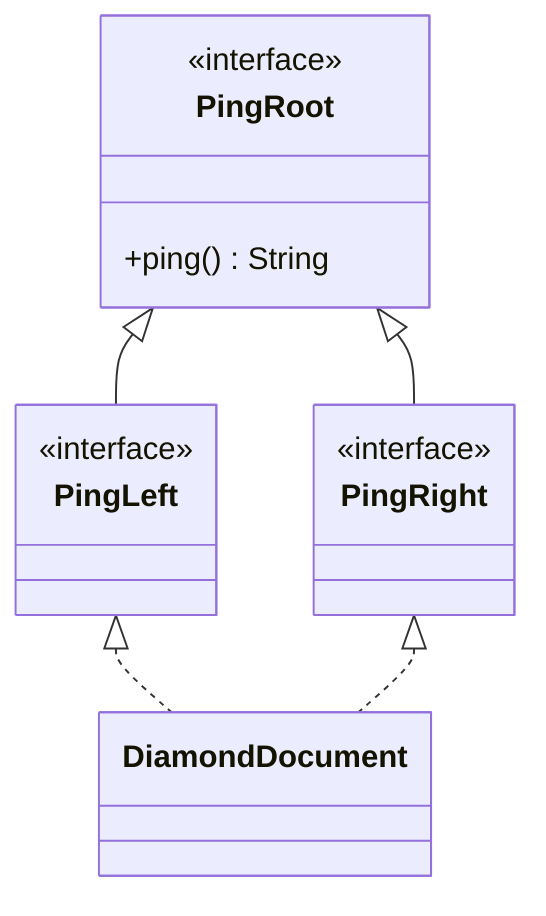

Hai nhánh `PingLeft` và `PingRight` **không tự override `ping()`**; cả hai cùng thừa hưởng một khai báo từ `PingRoot`, nên `DiamondDocument` không phải phân giải xung đột.

Nếu `PingLeft` và `PingRight` **mỗi bên override `ping()` bằng default riêng**, `DiamondDocument` sẽ nhận hai implementation ngang hàng và bắt buộc tự override.

Hình kim cương chỉ mô tả cấu trúc quan hệ; **xung đột có hay không phụ thuộc những phương thức thực sự được kế thừa và quy tắc ưu tiên**.

## 7. Không chỉ default method: xung đột còn đến từ tên và hợp đồng

### 7.1. Hằng số trùng tên

Field trong interface là `public static final`. Nếu hai interface khai báo hằng số cùng tên, lớp implement cả hai cần chỉ rõ nguồn khi truy cập:

```java
interface PdfConfig {
    String FORMAT = "pdf";
}

interface CsvConfig {
    String FORMAT = "csv";
}

class ExportJob implements PdfConfig, CsvConfig {
    public String formats() {
        // return FORMAT; // Mơ hồ
        return PdfConfig.FORMAT + "," + CsvConfig.FORMAT;
    }
}
```

Không có đa hình runtime cho hằng số hay field. **Field hiding/name ambiguity** là chuyện khác với override instance method.

### 7.2. Static method của interface

Static method được gọi bằng **tên interface**; lớp implement không kế thừa static method của interface theo cách gọi qua instance:

```java
interface Formats {
    static String normalize(String format) {
        return format.strip().toLowerCase();
    }
}

String result = Formats.normalize(" PDF "); // pdf
```

Không có xung đột dynamic dispatch giữa hai static method cùng tên từ hai interface, vì chúng được gọi qua tên interface tương ứng.

### 7.3. Cùng chữ ký nhưng hợp đồng ý nghĩa khác nhau

Giả sử một interface `MetersProvider` có `double distance()` trả về **mét**, còn một interface khác `KilometersProvider` cũng có `double distance()` nhưng trả về **kilomet**. Chúng có chữ ký tương thích về mặt cú pháp, nhưng ghép hai hợp đồng bằng một phương thức có thể gây lỗi đơn vị.

Ngay cả khi Java cho phép triển khai một phương thức để đáp ứng hai chữ ký, điều đó **không bảo đảm hợp đồng nghiệp vụ tương thích**.

Trong trường hợp này nên tách tên thành `distanceMeters()` / `distanceKilometers()`, dùng kiểu đơn vị rõ nghĩa hoặc thiết kế adapter thay vì cưỡng ép một override mang hai ý nghĩa.

## 8. Trình tự ra quyết định khi có xung đột hành vi

Có thể kiểm tra theo sơ đồ sau:

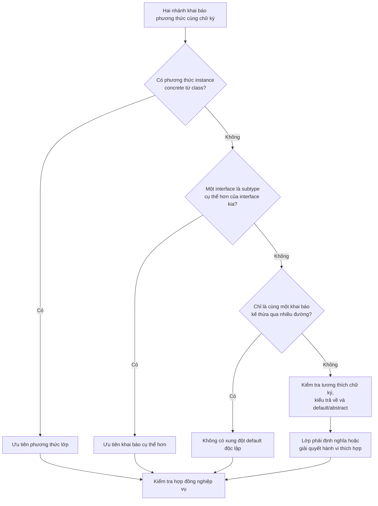

Đây là quy trình **đọc và kiểm tra thiết kế** cho các tình huống phổ biến, không thay thế toàn bộ quy tắc biên dịch của Java (ví dụ các trường hợp generic, erasure, override-equivalence, abstract method và kiểu trả về covariant).

Một nguyên tắc thực hành hữu ích là: **luôn viết `@Override` khi chủ động triển khai hoặc ghi đè hành vi**; compiler sẽ giúp phát hiện nhiều lỗi do sai chữ ký.

## 9. Nên dùng interface, kế thừa lớp hay composition?

Có thể kết hợp nhiều interface không có nghĩa đó luôn là cách tổ chức tốt nhất.

| Nhu cầu | Lựa chọn thường phù hợp | Vì sao |
|---|---|---|
| Lớp con thật sự là một loại cụ thể hơn của lớp cha | `extends` một class | Chuyên biệt hóa trạng thái và hành vi theo quan hệ *is-a* |
| Một loại đối tượng cần nhiều khả năng độc lập | `implements` nhiều interface | Ghép các hợp đồng mà không đa kế thừa trạng thái |
| Nhiều implementation cần chung API, không cần state chung | Interface | Caller làm việc với hành vi thống nhất |
| Nhiều lớp cùng một họ cần chung state/constructor/thuật toán | Cân nhắc abstract class làm superclass | Chia sẻ phần hiện thực có kiểm soát |
| Muốn kết hợp/đổi chiến lược xử lý lúc chạy | Composition/delegation | Không buộc lớp hiện tại phải kế thừa implementation |
| Hai interface có cùng tên hành vi nhưng ngữ nghĩa khác nhau | Tách hợp đồng hoặc dùng adapter | Tránh ép một phương thức làm hai nhiệm vụ trái nhau |

### Ví dụ composition thay cho cố gắng đa kế thừa lớp

Một hóa đơn cần xuất PDF và CSV. Thay vì muốn `Invoice extends PdfWriter, CsvWriter` (không hợp lệ), có thể cho hóa đơn **sử dụng** các chiến lược xuất dữ liệu:

```java
interface Exporter {
    String export(String content);
}

final class PdfExporter implements Exporter {
    @Override
    public String export(String content) {
        return "PDF: " + content;
    }
}

final class CsvExporter implements Exporter {
    @Override
    public String export(String content) {
        return "CSV: " + content;
    }
}

final class InvoiceService {
    public String exportInvoice(
            String invoiceText, Exporter exporter) {
        return exporter.export(invoiceText);
    }
}
```

Ở ví dụ này, `InvoiceService` không phải một loại `PdfExporter` hay `CsvExporter`. Nó **ủy quyền công việc** cho đối tượng phù hợp. Một interface hành vi nhỏ có thể phục vụ nhiều implementation, và việc thêm định dạng mới không cần thay đổi hệ phân cấp của `InvoiceService`.

Nếu ứng dụng cần xuất PDF/CSV thực sự, các class sẽ trả byte stream, file hoặc kết quả theo hợp đồng rõ ràng thay vì chuỗi tiền tố như mô phỏng.

Composition đặc biệt hữu ích khi các nguồn hành vi chứa **state và constructor riêng**, những thứ Java không cho kế thừa từ nhiều class cùng lúc.

## 10. Những hiểu lầm phổ biến

| Nhận định | Đúng/Sai | Giải thích |
|---|---|---|
| Java cho phép một class extends hai class | **Sai** | Một superclass trực tiếp |
| Java cho phép một class implements nhiều interface | **Đúng** | Kết hợp nhiều hợp đồng |
| Interface có thể extends nhiều interface khác | **Đúng** | Kế thừa nhiều giao diện |
| Mọi interface chỉ có abstract method | **Sai** | Có thể có default, static, private method tùy phiên bản Java |
| Hai interface cùng khai báo một abstract method tương thích luôn xung đột | **Sai** | Một implementation có thể đáp ứng cả hai |
| Hai default method độc lập cùng chữ ký sẽ được chọn ngẫu nhiên | **Sai** | Phải áp dụng quy tắc phân giải; thường cần override |
| Hai đường đến cùng một default method gốc luôn gây lỗi kim cương | **Sai** | Không có hai implementation độc lập trong trường hợp đó |
| Phương thức concrete của superclass thường thắng default method interface | **Đúng** | Quy tắc ưu tiên class |
| Subinterface có default override thường thắng superinterface | **Đúng** | Ưu tiên kiểu cụ thể hơn |
| Implement nhiều interface giống như kế thừa nhiều instance state | **Sai** | Interface không có instance field/constructor |
| `InterfaceName.super.method()` gọi được mọi method của interface | **Sai** | Chỉ dùng đúng ngữ cảnh và với default implementation thích hợp; không dùng để gọi abstract/static method tùy ý |

## 11. Bài tập thực hành

### Bài 1 — Chương trình có biên dịch không?

```java
interface Left {
    default String run() {
        return "L";
    }
}

interface Right {
    default String run() {
        return "R";
    }
}

class Combined implements Left, Right {
}
```

**Đáp án:** **Không.** `Combined` phải override `run()` để giải quyết hai default method độc lập cùng chữ ký. Có thể chọn một implementation:

```java
@Override
public String run() {
    return Left.super.run();
}
```

### Bài 2 — Class hay interface được chọn?

```java
class Parent {
    public String code() {
        return "P";
    }
}

interface Code {
    default String code() {
        return "I";
    }
}

class Child extends Parent implements Code {
}

System.out.println(new Child().code());
```

**Đáp án:** `P`, vì `Parent` có phương thức instance concrete và được ưu tiên hơn default của `Code`.

### Bài 3 — Có xung đột kim cương không?

```java
interface Root {
    default int value() {
        return 1;
    }
}

interface A extends Root {}
interface B extends Root {}
class C implements A, B {}

System.out.println(new C().value());
```

**Đáp án:** Biên dịch được, in `1`. `A` và `B` không tự định nghĩa hai cách thực hiện khác nhau mà cùng kế thừa từ `Root`.

### Bài 4 — Chọn cách thiết kế

Một `SmartDevice` cần chức năng **sạc pin**, **định vị GPS** và **phát nhạc**. Có ba class sẵn `BatteryManager`, `GpsEngine` và `MusicPlayer`, mỗi class giữ state và có constructor riêng.

**Câu hỏi:** Có nên viết `SmartDevice extends BatteryManager, GpsEngine, MusicPlayer` không?

**Gợi ý:** Không thể trong Java. Hãy cân nhắc interface biểu diễn những khả năng cần công khai (`Chargeable`, `Locatable`, `Playable`), còn implementation `SmartDevice` **chứa** các đối tượng `BatteryManager`, `GpsEngine`, `MusicPlayer` và ủy quyền thao tác. Đây là cách giữ được nhiều hành vi mà không cần đa kế thừa state.

---

**Ghi nhớ:** Java dùng **kế thừa đơn cho class**, nhưng cho phép **implement nhiều interface** và **interface extends nhiều interface**. Default method giúp interface chia sẻ hành vi, đồng thời đặt ra quy tắc xung đột: **class concrete được ưu tiên; interface cụ thể hơn được ưu tiên; hai default độc lập phải được giải quyết rõ ràng**. Đừng chỉ sửa cho code biên dịch: hãy kiểm tra các hành vi có cùng ý nghĩa nghiệp vụ hay không, và dùng **composition** khi muốn phối hợp nhiều thành phần mang trạng thái riêng.


</details>

- [Quay lại đầu trang](#back-to-top)

---

## <a id="inheritance-009">Mixin, trait và tái sử dụng hành vi tùy ngôn ngữ</a>

<details>
<summary>Xem chi tiết</summary>

# Mixin, trait và tái sử dụng hành vi tùy ngôn ngữ

Trong lập trình hướng đối tượng, một nhu cầu thường gặp là: **nhiều lớp không cùng một nhánh kế thừa vẫn cần sử dụng chung một hành vi**. Ví dụ, `Article` và `SupportTicket` đều cần thao tác gắn nhiều thẻ, nhưng không nhất thiết có cùng lớp cha về mặt nghiệp vụ.

**Mixin** và **trait** là những cách tổ chức khả năng dùng chung như vậy. Tuy nhiên, đây không phải hai từ khóa có định nghĩa cú pháp giống nhau trong mọi ngôn ngữ:

- **Mixin** thường chỉ một đơn vị cung cấp hành vi để “trộn” vào lớp khác, thay vì buộc mọi lớp tham gia cùng một cây kế thừa.
- **Trait** thường là một cấu trúc ngôn ngữ mô tả một tập khả năng/phương thức, đôi khi có cài đặt mặc định; quy tắc kết hợp, trạng thái và xung đột phụ thuộc từng ngôn ngữ.
- **Java** không có từ khóa `mixin` hoặc `trait` riêng. Java sử dụng **interface với `default method`** (từ Java 8) để chia sẻ một số cách thực hiện, đồng thời có thể dùng **composition/delegation** khi cần tái sử dụng trạng thái và thuật toán phức tạp.

Điểm học quan trọng là **tái sử dụng hành vi mà không xây dựng một quan hệ `is-a` giả tạo**; đồng thời phải hiểu giới hạn của từng cơ chế thay vì gọi mọi dạng kế thừa là mixin.

## 1. Vì sao chỉ kế thừa lớp cha chưa đủ?

Java cho phép một lớp chỉ `extends` **một lớp cha trực tiếp**, nhưng có thể `implements` **nhiều interface**:

```java
class BaseEntity {}

interface Searchable {}
interface Exportable {}

class Article extends BaseEntity implements Searchable, Exportable {}
```

Giả sử ứng dụng còn có `SupportTicket extends TicketBase`. Cả `Article` lẫn `SupportTicket` đều cần `addTags(...)`, nhưng việc ép chúng kế thừa một lớp `TaggableBase` vừa có thể đụng giới hạn một lớp cha, vừa tạo quan hệ phân cấp không thực sự phản ánh nghiệp vụ.

Một giải pháp là định nghĩa **khả năng nhỏ** ở interface, rồi để các lớp triển khai khả năng ấy theo trạng thái riêng. Một `default method` có thể cung cấp quy trình dùng chung dựa trên các phương thức trừu tượng của interface.

## 2. Java: tái sử dụng hành vi bằng interface default method

Ví dụ `Taggable` đặt ra một thao tác cơ bản `addTag(String)` và cung cấp thêm hành vi `addTags(List<String>)`:

```java
interface Taggable {
    void addTag(String tag);

    default void addTags(List<String> tags) {
        for (String tag : tags) {
            addTag(tag);
        }
    }
}
```

`addTags()` là một cách thực hiện dùng chung. Lớp triển khai chỉ cần định nghĩa cách thêm **một thẻ** theo chính sách của nó. Phương thức mặc định gọi `addTag()` theo cơ chế dispatch thông thường, do đó sử dụng triển khai của đối tượng thực tế.

Điều này tương tự một **mixin cung cấp hành vi**: interface không cần biết các thẻ được lưu trong `ArrayList`, `Set` hay một nguồn dữ liệu khác.

Tuy nhiên, interface Java **không mang trường instance** để mỗi đối tượng tự có một `List` riêng. Những trường khai báo trong interface đều là hằng/biến cấp interface (`public static final` ngầm định); chúng không trở thành trường mutable độc lập của từng đối tượng.

## 3. Ví dụ đầy đủ: cùng hành vi cho hai lớp không có chung lớp cha nghiệp vụ

Lưu đoạn sau vào **`Main.java`**; chạy bằng Java 17 hoặc Java 21.

```java
import java.util.ArrayList;
import java.util.LinkedHashSet;
import java.util.List;
import java.util.Objects;
import java.util.Set;

// Một khả năng dùng chung; không sở hữu trạng thái instance.
interface Taggable {
    void addTag(String tag);

    default void addTags(List<String> tags) {
        Objects.requireNonNull(tags, "tags");
        for (String tag : tags) {
            addTag(tag); // Gọi implementation của đối tượng hiện tại.
        }
    }
}

// Cung cấp dữ liệu tối thiểu để hành vi khác sử dụng.
interface Identified {
    String id();
}

// Một cách thực hiện mặc định dựa trên hợp đồng Identified.
interface AuditText extends Identified {
    default String auditMessage(String action) {
        if (action == null || action.isBlank()) {
            throw new IllegalArgumentException("Hành động không hợp lệ");
        }
        return "[" + id() + "] " + action;
    }
}

final class Article implements Taggable, AuditText {
    private final String id;
    private final Set<String> tags = new LinkedHashSet<>();

    Article(String id) {
        if (id == null || id.isBlank()) {
            throw new IllegalArgumentException("ID bài viết không hợp lệ");
        }
        this.id = id;
    }

    @Override
    public String id() {
        return id;
    }

    @Override
    public void addTag(String tag) {
        if (tag == null || tag.isBlank()) {
            throw new IllegalArgumentException("Thẻ không được trống");
        }
        tags.add(tag); // Set loại bỏ thẻ trùng.
    }

    List<String> tagsSnapshot() {
        return List.copyOf(tags);
    }
}

final class SupportTicket implements Taggable {
    private final List<String> tags = new ArrayList<>();

    @Override
    public void addTag(String tag) {
        if (tag == null || tag.isBlank()) {
            throw new IllegalArgumentException("Thẻ không được trống");
        }
        tags.add(tag); // Ticket cho phép ghi nhận thẻ lặp lại.
    }

    List<String> tagsSnapshot() {
        return List.copyOf(tags);
    }
}

public class Main {
    public static void main(String[] args) {
        Article article = new Article("ART-7");
        article.addTags(List.of("java", "oop", "java"));

        SupportTicket ticket = new SupportTicket();
        ticket.addTags(List.of("urgent", "support", "urgent"));

        System.out.println(article.tagsSnapshot());
        System.out.println(ticket.tagsSnapshot());
        System.out.println(article.auditMessage("đã xuất bản"));
    }
}
```

Biên dịch và chạy:

```bash
javac Main.java
java Main
```

Kết quả:

```text
[java, oop]
[urgent, support, urgent]
[ART-7] đã xuất bản
```

**Phân tích:**

1. `Article` và `SupportTicket` đều nhận được `addTags()` từ `Taggable`, không cần sao chép vòng lặp trong hai lớp.
2. `Article.addTag()` dùng `LinkedHashSet`, loại thẻ trùng và giữ thứ tự chèn. `SupportTicket.addTag()` dùng `ArrayList`, cho phép lặp.
3. Mỗi lớp tự sở hữu và bảo vệ trạng thái qua trường `private`; `Taggable` không biết cấu trúc lưu trữ.
4. `Article` còn thực hiện `AuditText`. `auditMessage()` dùng `id()` do `Article` cung cấp; `SupportTicket` không có nghĩa vụ cung cấp chức năng audit.
5. `List.copyOf(...)` giúp caller không thể sửa cấu trúc các danh sách trả về. Với `String` bất biến, các phần tử cũng an toàn trước việc sửa trạng thái.

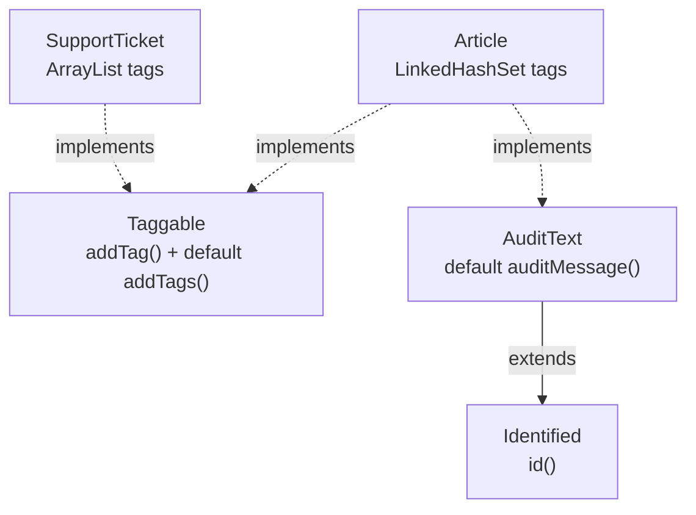

### Một giới hạn cần thấy ngay

`Taggable.addTags()` gọi `addTag()` nhiều lần; **nó không tự bảo đảm tính nguyên tử**. Nếu danh sách có ba thẻ nhưng thẻ thứ ba không hợp lệ, hai thẻ trước có thể đã được thêm. Muốn thao tác “hoặc thêm tất cả, hoặc không thêm gì”, lớp triển khai phải thiết kế lại bước xác thực và cập nhật, hoặc override `addTags()` để thực thi đúng hợp đồng.

Đó là lý do một `default method` chia sẻ được mã nguồn nhưng **không tự bảo đảm mọi ngữ nghĩa nghiệp vụ** cho tất cả lớp triển khai.

## 4. Mixin dựa trên default method phải tính đến xung đột

Nếu hai interface **độc lập** cùng cung cấp `default String greet()`, lớp implement cả hai phải tự định nghĩa một kết quả:

~~~java
interface ShortGreeting {
    default String greet() { return "Xin chào"; }
}
interface FriendlyGreeting {
    default String greet() { return "Chào bạn!"; }
}
final class Greeter implements ShortGreeting, FriendlyGreeting {
    @Override
    public String greet() {
        return ShortGreeting.super.greet()
                + " / " + FriendlyGreeting.super.greet();
    }
}
~~~

`new Greeter().greet()` trả `"Xin chào / Chào bạn!"`. Nếu bỏ override, compiler sẽ báo xung đột default method. `InterfaceName.super.method()` chỉ gọi default implementation hợp lệ trong ngữ cảnh kế thừa interface, không gọi abstract/static method tùy ý.

Java còn ưu tiên phương thức instance concrete từ **class** hơn default của interface và ưu tiên khai báo interface **chuyên biệt hơn** khi có quan hệ kế thừa. Hai đường dẫn đến **cùng một** default method gốc thường không tạo xung đột độc lập. Bài **Kế thừa đơn, kế thừa đa và xung đột hành vi** có bảng và chương trình kiểm chứng đầy đủ các quy tắc này; ở đây điều quan trọng là mixin/default tạo hành vi dùng chung nhưng cũng thêm nghĩa vụ duy trì hợp đồng tương thích.

## 5. `default` không biến Java thành đa kế thừa lớp

Một interface Java có thể chứa:

- Phương thức trừu tượng, ví dụ `void addTag(String tag)`.
- Phương thức `default` có thân để cung cấp một cách thực hiện.
- Phương thức `static`, được gọi qua tên interface.
- Phương thức `private` hỗ trợ tái sử dụng mã **trong chính interface** (từ Java 9).
- Trường hằng `public static final` (kể cả khi không ghi đủ modifier).

Nhưng interface Java **không chứa trường instance riêng cho từng đối tượng**. Nó cũng không có constructor giống lớp thông thường, và Java không cho phép một lớp `extends` đồng thời hai lớp cha.

Ngoài ra, interface không thể định nghĩa `default` method ghi đè các phương thức của `Object` như `equals(Object)`, `hashCode()`, `toString()`. Chúng thuộc hợp đồng gốc của đối tượng; muốn thay cách triển khai, hãy thực hiện ở lớp phù hợp.

Vì vậy, default method là công cụ **chia sẻ hành vi dựa trên hợp đồng**, đặc biệt phù hợp khi hành vi chung được biểu diễn bằng các phép gọi tới phương thức trừu tượng hoặc các phương thức public khác. Nó không phải nơi “nhét” trạng thái mutable dùng chung toàn hệ thống.

## 6. Trait/mixin trong các ngôn ngữ khác nhau

Thuật ngữ có nguồn gốc và quy tắc khác nhau. Bảng sau nêu cách nhìn ở mức thiết kế, không áp một ngôn ngữ làm chuẩn cho tất cả.

| Ngôn ngữ/cơ chế | Cách tái sử dụng hành vi | Trạng thái và cách xử lý xung đột |
| --- | --- | --- |
| **Java** — interface `default` | Lớp implements nhiều interface, nhận phương thức mặc định | Không có trường instance trong interface; Java có quy tắc ưu tiên và yêu cầu override khi xung đột |
| **Scala** — `trait` | Lớp kết hợp nhiều trait; trait có thể mang cả triển khai và trạng thái | Có quy tắc linearization/method resolution; các trait có thể khai báo trường, phải hiểu thứ tự kết hợp |
| **Rust** — `trait` | Định nghĩa hành vi chung và cài đặt cho kiểu (`impl Trait for Type`), có default method | Trait không đưa các trường instance vào struct; method resolution, associated types và quy tắc coherence theo Rust |
| **Kotlin** — `interface` | Interface hỗ trợ phương thức có thân; một lớp có thể implement nhiều interface | Interface không có backing field cho property; xung đột triển khai cần giải quyết rõ |
| **Python** — mixin qua multiple inheritance | Lớp mixin cung cấp phương thức để nhiều lớp kế thừa và kết hợp | Hành vi được phân giải bằng MRO; thường dùng `super()` phối hợp trong đa kế thừa |
| **Ruby** — module | `include`/`prepend` module vào chuỗi tra cứu phương thức | Quy tắc lookup theo ancestor chain; module có thể tương tác với trạng thái instance của object |
| **C++** — multiple inheritance / CRTP | Có thể dùng lớp mixin/template để bổ sung hành vi | Quy tắc kế thừa, name lookup và diamond khác Java; cần thiết kế rõ quyền sở hữu và ambiguity |

Chẳng hạn, một **Rust trait** thường biểu đạt các phương thức bắt buộc và có thể cung cấp cách thực hiện mặc định; kiểu dữ liệu lưu trường riêng theo định nghĩa struct. Một **Scala trait** có thể mang trạng thái và phối hợp các cách triển khai theo linearization. Vì thế câu “trait luôn không có state” hoặc “mixin luôn sao chép method vào lớp” đều quá tổng quát để áp dụng cho mọi ngôn ngữ.

Khi đọc tài liệu một ngôn ngữ cụ thể, cần hỏi: *cơ chế này có giữ trạng thái instance không, có nhiều lớp cha không, ưu tiên phương thức thế nào, và `super` có ý nghĩa gì?*

## 7. Khi nào Java nên dùng default method, abstract class hay composition?

Ba kỹ thuật có thể cùng đáp ứng nhu cầu dùng lại mã, nhưng phục vụ những kiểu quan hệ khác nhau.

| Kỹ thuật | Nên ưu tiên khi | Giới hạn/rủi ro |
| --- | --- | --- |
| Interface + `default` | Nhiều lớp khác nguồn gốc cùng có một **khả năng**, và hành vi chung dựa trên hợp đồng nhỏ | Không chứa trạng thái instance; dễ phát sinh xung đột default hoặc hành vi mặc định không phù hợp |
| Abstract class | Có quan hệ `is-a` thực sự, quy tắc chung, trường instance cần được lớp cha kiểm soát | Java chỉ có một lớp cha trực tiếp; lớp con gắn chặt với phân cấp |
| Composition/delegation | Muốn dùng lại thuật toán hoặc đối tượng có trạng thái độc lập, có thể thay thế/kết hợp khi chạy | Cần quản lý đối tượng delegate và chuyển tiếp lời gọi |
| Utility `static` | Thuật toán thuần, không cần hợp đồng của đối tượng | Không biểu diễn khả năng có thể thay thế qua dispatch như interface |

Một ví dụ delegation với khả năng ghi audit:

```java
interface AuditSink {
    void record(String message);
}

final class ConsoleAuditSink implements AuditSink {
    @Override
    public void record(String message) {
        System.out.println(message);
    }
}

final class ArticleService {
    private final AuditSink auditSink;

    ArticleService(AuditSink auditSink) {
        this.auditSink = java.util.Objects.requireNonNull(auditSink);
    }

    void publish(String articleId) {
        // Thực hiện quy trình xuất bản ...
        auditSink.record("Đã xuất bản " + articleId);
    }
}
```

Ở đây `ArticleService` **chứa một `AuditSink`**, không cần kế thừa từ `AuditableBase` và không cần nhét việc I/O vào default method. Có thể thay `ConsoleAuditSink` bằng adapter ghi file, database hay hệ thống sự kiện mà giữ nguyên `ArticleService`.

Nếu logic chung **cần tài nguyên, transaction, phụ thuộc được cấu hình hoặc trạng thái riêng có vòng đời**, composition thường rõ ràng hơn một mixin Java với những trường `static` dùng chung.

## 8. Thiết kế hợp đồng cho default method có ích

Có hai cách nhìn sai dễ gặp.

**Sai lầm A: mọi hành vi đều nên đưa vào interface default.**

```java
interface PaymentAction {
    default void charge(long amount) {
        // Không nên đặt logic tài chính giả định ở đây chỉ để
        // mọi triển khai khỏi phải viết một phương thức bắt buộc.
    }
}
```

Một method rỗng có thể khiến caller tưởng rằng thanh toán đã thành công. Nếu mỗi triển khai có cách tính/đảm bảo an toàn khác nhau, hãy giữ `charge()` là phương thức trừu tượng và đòi hỏi triển khai đúng hợp đồng.

**Sai lầm B: default method có sẵn nghĩa là hành vi luôn an toàn.**

```java
interface MutableAccess {
    List<String> internalTags();

    default void append(String tag) {
        internalTags().add(tag);
    }
}
```

Đoạn trên buộc lớp triển khai làm lộ collection mutable qua `internalTags()`. Caller có thể bỏ qua `append()` và sửa trực tiếp `internalTags()`. Phương án `Taggable` ở ví dụ chính tốt hơn cho mục tiêu đóng gói: nó chỉ yêu cầu **hành vi** `addTag()` và để mỗi lớp giữ dữ liệu `private`.

Khi soạn default method:

1. Mô tả **ngữ nghĩa** của phương thức, gồm tham số hợp lệ, kết quả và lỗi.
2. Chỉ triển khai hành vi thực sự đúng cho **mọi** lớp đáp ứng interface.
3. Gọi các primitive operation do lớp thực hiện, thay vì đòi getter lộ trạng thái mutable.
4. Xác định hành vi khi thực hiện một phần: phương thức mặc định có thể không bảo đảm giao dịch/atomicity.
5. Không giả định default method tự cung cấp đồng bộ hoặc an toàn đa luồng.
6. Nếu thêm default vào một interface đã tồn tại, kiểm tra khả năng **xung đột chữ ký** với các interface/lớp khác đang được triển khai.

Thêm `default method` giúp phát triển API mà không buộc tất cả implementation viết phương thức mới trong trường hợp thông thường, nhưng **không phải lúc nào cũng tương thích**: xung đột với một default khác hoặc hợp đồng hiện có có thể gây lỗi biên dịch hoặc thay đổi hành vi.

## 9. Một số lỗi cần tránh

| Lỗi | Hậu quả | Cách xử lý |
| --- | --- | --- |
| Coi Java interface là lớp có state instance | Muốn dùng trường như `private List<String> tags` trong interface | Đặt trạng thái ở lớp thực hiện hoặc delegate |
| Hai interface có default cùng chữ ký | Lớp không biên dịch nếu chưa giải quyết xung đột | Override rõ ràng, có thể dùng `Interface.super.method()` |
| Override default nhưng quên quy tắc nghiệp vụ | Các lớp thực hiện cho kết quả không tương thích | Viết rõ hợp đồng và kiểm thử chung |
| Gọi `this.addTags(...)` bên trong chính override `addTags()` | Có thể gọi lại chính phương thức đó và đệ quy | Dùng `Taggable.super.addTags(...)` khi hợp lệ và chủ đích giữ logic mặc định |
| Đưa trạng thái mutable vào trường interface | Trường thực chất là `public static final` tham chiếu dùng chung | Dùng trường instance `private` của lớp thực hiện |
| Dùng interface default để thay mọi trường hợp composition | Kéo I/O, DB và stateful services vào hợp đồng | Chọn delegation cho thành phần có vòng đời |
| Tưởng Scala trait, Rust trait, Java default giống hệt | Hiểu sai trạng thái, linearization và phân giải method | Học quy tắc từng ngôn ngữ |
| Chia sẻ default method có side effect nhưng không xác định thứ tự | Khó đoán thao tác thành công một phần | Thiết kế ngữ nghĩa transaction và lỗi cụ thể |

## 10. Tự kiểm tra

**Câu 1.** Vì sao `Article` và `SupportTicket` có thể dùng chung `Taggable.addTags()` dù không có cùng lớp cha nghiệp vụ?

**Đáp án:** Hai lớp đều implements `Taggable`; default method dùng thao tác `addTag()` do từng lớp cung cấp, không phụ thuộc chi tiết lưu trữ hay kế thừa từ một lớp trạng thái chung.

**Câu 2.** Nếu `ShortGreeting` và `FriendlyGreeting` đều có `default String greet()`, một lớp implements cả hai có tự động dùng `ShortGreeting` không?

**Đáp án:** Không. Khi không có quan hệ ưu tiên thích hợp và hai default xung đột, lớp phải override `greet()` để định nghĩa rõ hành vi.

**Câu 3.** Có thể khai báo `private int count;` làm trường instance trong Java interface không?

**Đáp án:** Không. Trường của interface luôn có ngữ nghĩa `public static final`; không có trường instance riêng trong interface.

**Câu 4.** Default `addTags()` gọi `addTag()` ba lần, đến lần thứ ba ném lỗi. Hai thẻ trước có chắc được hoàn tác không?

**Đáp án:** Không. Phương thức default mẫu không triển khai rollback. Nếu cần tính nguyên tử, phải bổ sung hợp đồng và triển khai phù hợp.

**Câu 5.** Có nên chuyển một `AuditSink` ghi file và giữ kết nối thành default method của interface chỉ để tái sử dụng code?

**Đáp án:** Thường không. Thành phần có trạng thái, vòng đời và tài nguyên riêng phù hợp hơn với composition/delegation, ví dụ tiêm một `AuditSink` vào đối tượng sử dụng.

**Câu 6.** Trait ở Rust có thể được kết luận là giống trait ở Scala về trạng thái và method resolution không?

**Đáp án:** Không. Cùng tên “trait” nhưng luật ngôn ngữ khác nhau: Rust định nghĩa hành vi và các implementation cho kiểu; Scala có cơ chế mixin/linearization và cho phép trạng thái trong trait.

**Ghi nhớ:** Hãy tái sử dụng những hành vi **thật sự chung theo hợp đồng**, không ép các lớp khác bản chất vào một lớp cha chỉ vì muốn tiết kiệm mã. Trong Java, interface `default` là công cụ phù hợp cho hành vi chia sẻ không cần state instance; khi hành vi gắn với tài nguyên hoặc phụ thuộc có trạng thái, hãy cân nhắc composition. Còn khi làm việc với mixin/trait ở ngôn ngữ khác, luôn đối chiếu quy tắc kết hợp và xử lý xung đột của chính ngôn ngữ đó.


</details>

- [Quay lại đầu trang](#back-to-top)

---

## <a id="inheritance-010">Giới hạn và chi phí của cây kế thừa sâu</a>

<details>
<summary>Xem chi tiết</summary>

# Giới hạn và chi phí của cây kế thừa sâu trong Java

> **OOP → Kế thừa.** Kế thừa (`extends`) giúp lớp con tái sử dụng và chuyên biệt hóa hành vi của lớp cha. Nhưng khi một lớp phải đi qua quá nhiều tầng `A → B → C → D → E`, việc hiểu và sửa nó ngày càng tốn công: hành vi có thể nằm rải rác, thay đổi ở lớp cha ảnh hưởng nhiều lớp con, còn kiểm thử phải xét cả các tương tác kế thừa. Bài học này phân biệt **chi phí thiết kế/bảo trì** với **chi phí thực thi**, và chỉ ra khi nào nên chuyển sang composition.

## 1. “Cây kế thừa sâu” nghĩa là gì?

Xét một hệ thống tính phí vận chuyển:

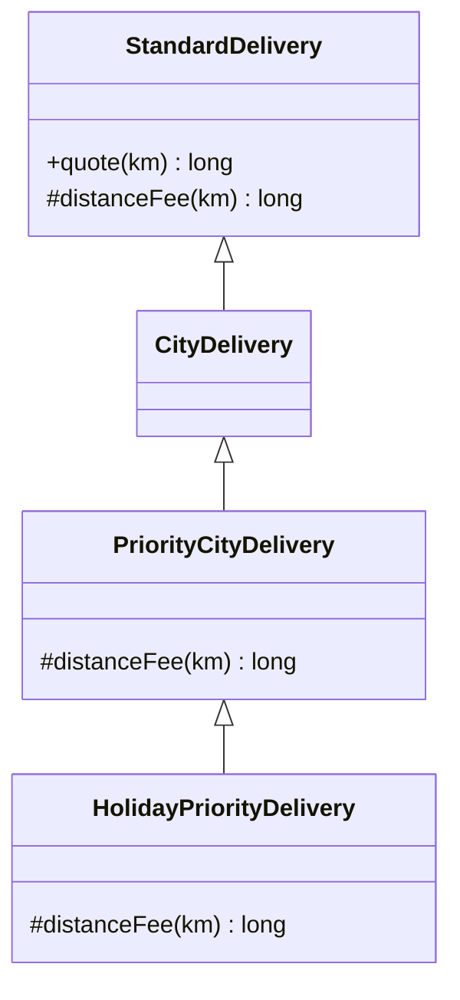

`HolidayPriorityDelivery` có ba lớp tổ tiên trực tiếp/gián tiếp. Để biết `quote(3)` ra bao nhiêu, người đọc phải lần theo phương thức ở các cấp:

- `StandardDelivery.quote` quyết định công thức tổng.
- `StandardDelivery.distanceFee` tính phí khoảng cách mặc định.
- `PriorityCityDelivery.distanceFee` gọi `super.distanceFee` rồi cộng phí ưu tiên.
- `HolidayPriorityDelivery.distanceFee` lại gọi `super.distanceFee` rồi cộng phí ngày lễ.

Càng nhiều tầng **ghi đè và gọi ngược về lớp cha**, càng khó suy ra toàn bộ hành vi chỉ bằng cách nhìn một file.

**Độ sâu** là số cấp trên đường từ một lớp tới tổ tiên của nó, không phải số lớp con cùng kế thừa một lớp cha. Một cây có một lớp cha và mười lớp con trực tiếp vẫn **nông**; một đường `A → B → C → D → E` mới là ví dụ sâu.

## 2. Ví dụ Java chạy được: chi phí đọc hiểu của nhiều tầng override

Lưu đoạn mã sau thành `DepthCostDemo.java` (Java 17+):

```java
import java.util.List;
import java.util.Objects;

public class DepthCostDemo {

    // Tầng 1: quy tắc tính tổng và phí khoảng cách mặc định.
    static class StandardDelivery {
        private final long baseFeeVnd;

        StandardDelivery(long baseFeeVnd) {
            if (baseFeeVnd < 0) {
                throw new IllegalArgumentException("Phí cơ bản không thể âm");
            }
            this.baseFeeVnd = baseFeeVnd;
        }

        public final long quote(int distanceKm) {
            if (distanceKm <= 0) {
                throw new IllegalArgumentException("Khoảng cách phải dương");
            }
            long extra = distanceFee(distanceKm);
            if (extra < 0) {
                throw new IllegalStateException("Phụ phí không thể âm");
            }
            return Math.addExact(baseFeeVnd, extra);
        }

        protected long distanceFee(int km) {
            return Math.multiplyExact(2_000L, km);
        }
    }

    // Tầng 2: dùng cùng phí cơ bản của giao hàng nội thành.
    static class CityDelivery extends StandardDelivery {
        CityDelivery() {
            super(10_000L);
        }
    }

    // Tầng 3: thêm phí ưu tiên.
    static class PriorityCityDelivery extends CityDelivery {
        @Override
        protected long distanceFee(int km) {
            return Math.addExact(super.distanceFee(km), 5_000L);
        }
    }

    // Tầng 4: thêm phí ngày lễ.
    static final class HolidayPriorityDelivery extends PriorityCityDelivery {
        @Override
        protected long distanceFee(int km) {
            return Math.addExact(super.distanceFee(km), 3_000L);
        }
    }

    // Phương án composition: mỗi thành phần phí là một quy tắc riêng.
    @FunctionalInterface
    interface FeeRule {
        long calculate(int distanceKm);
    }

    static final class QuoteService {
        private final long baseFeeVnd;
        private final List<FeeRule> rules;

        QuoteService(long baseFeeVnd, List<FeeRule> rules) {
            if (baseFeeVnd < 0) {
                throw new IllegalArgumentException("Phí cơ bản không thể âm");
            }
            this.baseFeeVnd = baseFeeVnd;
            this.rules = List.copyOf(
                Objects.requireNonNull(rules, "rules")
            );
        }

        long quote(int distanceKm) {
            if (distanceKm <= 0) {
                throw new IllegalArgumentException("Khoảng cách phải dương");
            }
            long total = baseFeeVnd;
            for (FeeRule rule : rules) {
                long fee = rule.calculate(distanceKm);
                if (fee < 0) {
                    throw new IllegalStateException("Phụ phí không thể âm");
                }
                total = Math.addExact(total, fee);
            }
            return total;
        }
    }

    public static void main(String[] args) {
        StandardDelivery deep = new HolidayPriorityDelivery();

        QuoteService composed = new QuoteService(
            10_000L,
            List.of(
                km -> Math.multiplyExact(2_000L, km),
                km -> 5_000L,
                km -> 3_000L
            )
        );

        System.out.println("Inheritance: " + deep.quote(3));
        System.out.println("Composition: " + composed.quote(3));
    }
}
```

Chạy:

```bash
javac DepthCostDemo.java
java DepthCostDemo
```

Kết quả:

```text
Inheritance: 24000
Composition: 24000
```

Với 3 km, cả hai cách đều tính **10.000 phí cơ bản + 6.000 phí khoảng cách + 5.000 phí ưu tiên + 3.000 phí ngày lễ = 24.000 VND**.

Sự khác nhau nằm ở **nơi lưu quy tắc** và **cách mở rộng**:

| Mục tiêu | Cây kế thừa sâu | Composition |
|---|---|---|
| Tìm nơi tính phí ưu tiên | Phải truy tới lớp `PriorityCityDelivery` | Tìm rule phí ưu tiên trong danh sách cấu hình |
| Thêm phí ngày lễ | Tạo lớp con mới, override và gọi `super` | Thêm một `FeeRule` |
| Kết hợp ưu tiên và ngày lễ theo thứ tự khác | Có thể cần thêm biến thể lớp con | Thay tổ hợp các rule |
| Chia sẻ kiểm tra đầu vào | Lớp cha `quote` | `QuoteService.quote` |
| Kiểm thử từng loại phí riêng | Có thể phải dựng cả chuỗi lớp | Có thể kiểm thử từng `FeeRule` |
| Nguy cơ phụ thuộc vào `super` | Cao hơn khi nhiều tầng override | Thấp hơn vì các quy tắc tách biệt |

**Composition không mặc nhiên tốt hơn trong mọi bài toán**: nếu một họ lớp thực sự có quan hệ “là một loại”, trạng thái chung và ít biến thể, kế thừa nông có thể đơn giản hơn. Mục tiêu là giảm những phụ thuộc không cần thiết, không phải xóa mọi `extends`.

## 3. Chi phí thứ nhất: phụ thuộc ngầm và “fragile base class”

Một lớp con được viết dựa trên hành vi hiện tại của lớp cha. Nếu lớp cha thay đổi cách gọi một phương thức `protected` có thể override, hành vi của lớp con có thể đổi mà không cần sửa một dòng nào trong lớp con.

Ví dụ:

```java
class BaseFormatter {
    String format(String value) {
        return decorate(value);
    }

    protected String decorate(String value) {
        return "[" + value + "]";
    }
}

class UpperFormatter extends BaseFormatter {
    @Override
    protected String decorate(String value) {
        return super.decorate(value.toUpperCase());
    }
}
```

Nếu `BaseFormatter.format` sau này chuyển sang gọi `decorate` hai lần, `UpperFormatter` cũng bị ảnh hưởng. Lớp con phụ thuộc vào **quy ước ngầm về lúc nào, bao nhiêu lần và theo thứ tự nào** lớp cha gọi hook.

Với cây nhiều tầng, sự phụ thuộc có thể thành chuỗi:

```text
HolidayPriorityDelivery
  → PriorityCityDelivery.distanceFee
    → StandardDelivery.distanceFee
```

Sửa công thức ở `StandardDelivery` sẽ ảnh hưởng các lớp con dựa vào `super.distanceFee`. Có khi đây là điều mong muốn, nhưng nếu lớp con giả định công thức cũ thì đây là lỗi phát sinh ngoài dự kiến.

Hiện tượng này thường được gọi là **fragile base class problem**: sửa lớp nền có thể phá lớp dẫn xuất dù chữ ký API vẫn giữ nguyên.

Cách giảm rủi ro:

- Ghi rõ phương thức nào là **extension point** cho lớp con override.
- Nêu hợp đồng của hook: điều kiện đầu vào, giá trị trả về, việc gọi một lần hay nhiều lần, side effect, ngoại lệ.
- Đánh dấu `final` cho phương thức kiểm soát quy trình quan trọng nếu lớp con không được thay toàn bộ thuật toán.
- Giữ trường nội bộ `private` khi có thể; dùng API `protected` có mục đích rõ, thay vì trao quyền sửa trực tiếp.
- Kiểm thử các implementation chịu ảnh hưởng khi sửa lớp nền.

## 4. Chi phí thứ hai: constructor phụ thuộc vào hành vi lớp lá

Với nhiều tầng kế thừa, constructor tổ tiên có thể gọi một method bị lớp lá override trong khi field riêng của lá vẫn chưa chạy initializer. Ví dụ:

~~~java
class Base {
    Base() { System.out.println("Base sees: " + display()); }
    String display() { return "base"; }
}
class Middle extends Base {
    @Override String display() { return "middle"; }
}
class Leaf extends Middle {
    String label = "READY";
    @Override String display() { return label; }
}
// new Leaf() in "Base sees: null".
~~~

Java dùng dynamic dispatch đến `Leaf.display()` ngay trong `Base()`, dù `Leaf.label` mới ở giá trị mặc định `null`. Việc đi qua nhiều lớp trung gian làm điểm xuất phát và implementation được gọi khó truy vết hơn; nếu override gọi `label.toUpperCase()`, sẽ xuất hiện `NullPointerException`.

Giữ constructor chỉ thiết lập trạng thái thuộc lớp hiện tại, tránh gọi hook overridable hoặc làm lộ `this` quá sớm. Trong chương này, bài **Khởi tạo lớp con và chuỗi khởi tạo lớp cha** giải thích đầy đủ static/instance initializer và constructor chaining; ở đây trọng tâm là **phạm vi ảnh hưởng tăng theo độ sâu**.

## 5. Chi phí thứ ba: cây lớp phình to khi kết hợp nhiều biến thể

Giả sử dịch vụ vận chuyển có các đặc tính độc lập:

- Khu vực: nội thành hoặc liên tỉnh.
- Tốc độ: thường hoặc hỏa tốc.
- Thời điểm: ngày thường hoặc lễ.
- Khách hàng: thường hoặc thành viên.

Nếu mỗi tổ hợp đều được mã hóa thành một lớp con, số phương án lý thuyết là:

\[
2 \times 2 \times 2 \times 2 = 16
\]

Nếu thêm một thuộc tính có 3 biến thể, số tổ hợp tăng lên:

\[
16 \times 3 = 48
\]

Không phải mọi tổ hợp thực tế đều được triển khai, nhưng số tổ hợp có thể tăng nhanh. Các tên lớp như `HolidayExpressMemberIntercityDelivery` báo hiệu thiết kế đang trộn **nhiều chiều thay đổi độc lập** trong một cây kế thừa.

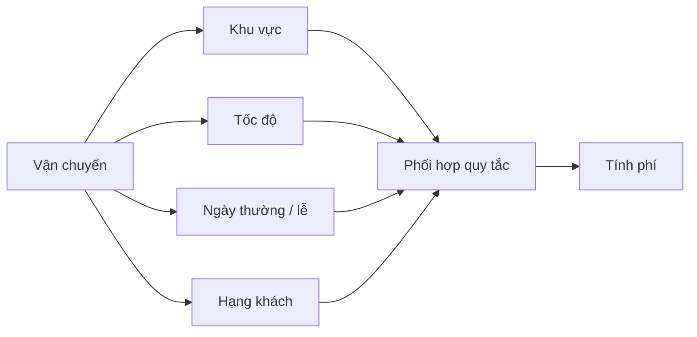

Trong tình huống này, composition thường hợp lý: tách `DistanceFeePolicy`, `SpeedSurcharge`, `HolidaySurcharge`, `MembershipDiscount` thành các chiến lược/quy tắc có giao diện rõ ràng, sau đó phối hợp ở một service.

**Lưu ý:** các thành phần có thể có thứ tự áp dụng quan trọng, như giảm 10% trước hoặc sau phụ phí. Composition không tự giải quyết vấn đề đó; service phải định nghĩa thứ tự, quy tắc làm tròn, cách xử lý lỗi và kiểm tra hợp đồng.

## 6. Chi phí thứ tư: khó kiểm thử và khó đoán phạm vi ảnh hưởng

Một thay đổi nhỏ ở lớp cha có thể ảnh hưởng mọi lớp kế thừa, kể cả lớp ở nhánh mà người sửa không để ý.

| Kiểu thay đổi | Cần xem lại điều gì? |
|---|---|
| Thêm kiểm tra đầu vào ở lớp cha | Lớp con có truyền dữ liệu hợp lệ, có xử lý ngoại lệ mới không? |
| Đổi cách gọi hook `protected` | Override ở mọi nhánh còn đúng ngữ nghĩa không? |
| Thay cấu trúc trạng thái lớp cha | Lớp con có phụ thuộc trường/logic cũ không? |
| Thêm overload hoặc đổi visibility | Có gây nhầm lời gọi hoặc phá API lớp con không? |
| Chỉnh constructor lớp cha | Chuỗi `super(...)` và invariant lớp con có còn đúng không? |

Mỗi đường đi qua nhiều tầng lớp đều là một bối cảnh kiểm thử. Điều này không có nghĩa phải thử mọi tổ hợp bất khả thi, mà là **phạm vi regression có thể rộng hơn nhiều so với file vừa chỉnh**.

Một cách kiểm soát tốt là có **contract tests** cho hành vi lớp nền và các implementation quan trọng:

```java
static void assertQuote(DepthCostDemo.StandardDelivery plan,
                        int distanceKm,
                        long expected) {
    long actual = plan.quote(distanceKm);
    if (actual != expected) {
        throw new AssertionError(
            "Expected " + expected + " but was " + actual
        );
    }
}

// Gọi trong cùng package với DepthCostDemo:
assertQuote(new DepthCostDemo.HolidayPriorityDelivery(), 3, 24_000);
```

Ví dụ này dùng các kiểu nested package-private trong `DepthCostDemo` và là đoạn kiểm tra minh họa đặt cùng package; phương thức `assertQuote` cần nằm trong một class khi biên dịch. Trong dự án thật có thể dùng JUnit để kiểm thử tham số hóa nhiều implementation.

Với thiết kế composition, có thể kiểm thử riêng từng rule (phí khoảng cách, phí ngày lễ) và thêm bài kiểm thử phối hợp cho `QuoteService`. Sự tách biệt thường giúp xác định lỗi ở một chính sách cụ thể thay vì đi qua toàn bộ cây lớp.

## 7. Chi phí runtime: có phải càng sâu càng chậm?

**Không nên kết luận độ sâu của cây kế thừa tự động khiến chương trình chậm.** Cần tách các loại chi phí:

| Nhóm chi phí | Điều gì có thể tăng? | Có xảy ra trong mọi trường hợp? |
|---|---|---|
| Đọc hiểu/bảo trì | Phải lần theo nhiều override, constructor, trạng thái, nhánh lớp | Thường tăng khi phụ thuộc nhiều tầng |
| Kiểm thử/regression | Nhiều lớp con bị ảnh hưởng bởi thay đổi ở cha | Phụ thuộc thiết kế và số nhánh |
| Khởi tạo lớp và object | Có thêm constructor, initializer, trường instance cần xử lý | Tùy số lớp và code thực tế |
| Bộ nhớ object | Trường instance kế thừa và trường mới được lưu trong object | Tùy cấu trúc trường; không phải mỗi tầng là một object độc lập |
| Gọi phương thức | Có thể xuất hiện nhiều lớp gọi `super.method()` nối tiếp | Tùy code; JIT có thể inline/tối ưu |
| Class metadata | Nhiều class phải được nạp và quản lý hơn | Có, nhưng quy mô tác động cần đo |

Java dùng **dynamic dispatch** cho phương thức instance có thể override. JVM/JIT hiện đại có thể inline các lời gọi mà nó suy ra được đích, kể cả trên cây kế thừa, và tối ưu theo profile runtime. Vì vậy không có quy tắc kiểu “thêm một tầng `extends` thì mỗi lời gọi tăng X mili giây”.

Mặt khác, một override có gọi `super` nhiều tầng và mỗi tầng thực hiện thêm tính toán/I/O thì tổng công việc **thật sự** tăng. Đó là chi phí của **logic được chạy**, không phải chi phí vô điều kiện của từ khóa `extends`.

Khi đánh giá hiệu năng:

1. Xác định đường chạy thực tế cần tối ưu.
2. Dùng profiler hoặc benchmark có warm-up phù hợp (ví dụ JMH cho microbenchmark Java).
3. Đo latency, throughput, allocation và GC trước/sau thay đổi.
4. Ưu tiên thiết kế dễ bảo trì nếu chưa có bằng chứng cây kế thừa là nút thắt hiệu năng.

Tránh viết microbenchmark bằng một vòng lặp rỗng gọi phương thức và suy luận ngay từ thời gian đo: JVM có thể loại bỏ công việc không có tác động quan sát được.

## 8. Khi nào kế thừa vẫn là lựa chọn hợp lý?

Một hệ phân cấp thường hợp lý khi:

- Thực sự tồn tại quan hệ **is-a** ổn định: mọi `Circle` đều là một `Shape`.
- Lớp con thực hiện đúng hợp đồng lớp cha và có thể thay thế lớp cha ở vị trí gọi (**Liskov Substitution Principle — LSP**).
- Có hành vi hoặc trạng thái chung rõ ràng, không phải chỉ chia sẻ vài dòng tiện ích.
- Các điểm mở rộng được tài liệu hóa, có kiểm thử và không phụ thuộc quá nhiều vào chi tiết nội bộ của tổ tiên.
- Cây nông và các thay đổi của lớp cha ít làm lớp con phải hiểu lại toàn bộ quy tắc.

Ví dụ `abstract class Shape` với `abstract double area()` và các lớp `Circle`, `Rectangle` trực tiếp kế thừa có thể rất dễ hiểu. Không cần thay một cây đơn giản, đúng bản chất bằng hàng loạt chiến lược và factory chỉ vì muốn tránh kế thừa.

### Tín hiệu nên xem lại cây hiện tại

- Mỗi chức năng mới thường đòi một lớp con với tên ngày càng dài.
- Override hầu hết chỉ gọi `super.method()` rồi cộng/trừ một chút logic.
- Thay lớp nền gây lỗi ở nhánh không liên quan.
- Nhiều lớp con phải ghi đè phương thức bằng implementation rỗng hoặc ném `UnsupportedOperationException`.
- Test lớp lá phải thiết lập rất nhiều trạng thái của tổ tiên.
- Lớp con đọc/sửa nhiều trường `protected` mà lớp cha lẽ ra phải tự bảo vệ.
- Phải dùng `instanceof` hoặc ép kiểu liên tục để biết loại lớp con rồi xử lý riêng.

Đây là **dấu hiệu cần phân tích**, không phải bằng chứng tuyệt đối. Một số cây phân loại dữ liệu cố định vẫn thích hợp với inheritance.

## 9. Cách giảm độ sâu mà vẫn giữ được hành vi

Cách làm an toàn nhất là bắt đầu từ **hợp đồng quan sát được** thay vì xóa `extends` ngay.

1. **Liệt kê các trường hợp đang được hỗ trợ:** loại vận chuyển, tham số đầu vào, kết quả, exception và tác động phụ.
2. **Ghi lại hành vi hiện tại bằng kiểm thử:** đặc biệt là những lớp lá quan trọng và các trường hợp biên.
3. **Tách những chiều thay đổi độc lập:** ví dụ phí khoảng cách, ngày lễ, ưu tiên thành `FeeRule` hoặc các interface riêng.
4. **Đưa quy trình phối hợp vào một service/composer:** một nơi kiểm tra đầu vào, thứ tự áp dụng rule và xử lý overflow.
5. **Thay dần mã gọi ở ranh giới:** giữ adapter cho API cũ nếu cần tương thích, tránh thay toàn hệ thống trong một bước.
6. **So sánh kết quả cũ/mới theo trường hợp nghiệp vụ:** sau đó mới loại các lớp trung gian không còn giá trị.

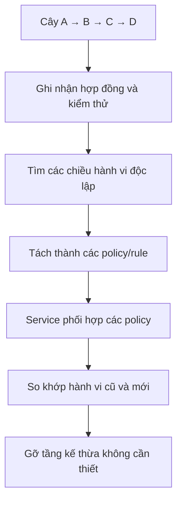

Có thể dùng **composition + interface** cho khả năng tùy biến, và giữ lại một **abstract class nông** nếu thật sự cần khung thuật toán chung. Hai kỹ thuật không loại trừ nhau.

## 10. Dùng `final` và `sealed` để kiểm soát phạm vi kế thừa

Khi không muốn ai cũng tùy ý tạo lớp con, có thể hạn chế khả năng mở rộng:

```java
final class FixedPolicy {
    // Không class nào được extends FixedPolicy.
}
```

Từ Java 17, `sealed` cho phép một lớp/interface công khai tập subtype trực tiếp được phép:

```java
sealed interface DeliveryMode
        permits Economy, Express {
}

record Economy() implements DeliveryMode {
}

record Express() implements DeliveryMode {
}
```

`Economy` và `Express` là record nên ngầm định `final`; chúng có thể triển khai sealed interface theo quy tắc Java. Ví dụ sử dụng các kiểu trong cùng file/package phù hợp. Các subtype trực tiếp của sealed class/interface phải tuân theo quy tắc `final`, `sealed` hoặc `non-sealed` khi áp dụng.

`sealed` hữu ích khi tập biến thể thực sự có giới hạn. Nó giúp biết những subtype nào hợp lệ, nhưng **không tự giảm độ sâu của một cây đã dài**; dùng nó để kiểm soát khả năng mở rộng theo thiết kế. `final` phù hợp với những lớp không được xây dựng để trở thành lớp cha.

## 11. Các bài tập thực hành

**Bài 1 — vẽ đường gọi.** Với `DepthCostDemo`, hãy vẽ chuỗi các phương thức chạy khi gọi `new HolidayPriorityDelivery().quote(4)`. Tính kết quả và xác định chỗ nào có thể gây overflow.

**Bài 2 — thay quy tắc.** Thay phí ưu tiên thành 7.000 VND. So sánh vị trí phải sửa trong thiết kế inheritance và composition; giải thích vì sao không thể chỉ dựa vào số dòng code để kết luận thiết kế nào tốt hơn.

**Bài 3 — thêm biến thể.** Một loại giao hàng cần phụ phí giờ cao điểm nhưng không có phụ phí ngày lễ. Hãy thiết kế phiên bản composition có thể kết hợp phí khoảng cách, phí cao điểm và phí ưu tiên mà không tạo thêm một chuỗi subclass dài.

**Bài 4 — bẫy constructor.** Đưa ví dụ `Base → Middle → Leaf` ở mục 4 vào một lớp `main`, giải thích vì sao in `Base sees: null`; sau đó sửa để chỉ gọi `display()` sau khi khởi tạo hoàn tất.

**Bài 5 — đánh giá cây lớp thật.** Chọn một cây kế thừa trong project Java của bạn và trả lời: quan hệ is-a có đúng không, có bao nhiêu tầng, có bao nhiêu override gọi `super`, thay đổi ở lớp cha ảnh hưởng những lớp nào, và có chiều biến thể nào độc lập nên tách ra không?

**Ghi nhớ:** Giới hạn quan trọng nhất của cây kế thừa sâu là **sự kết dính giữa các lớp và chi phí suy luận về hành vi**, chứ không phải một “hình phạt tốc độ” mặc định do JVM áp đặt. Hãy giữ kế thừa cho quan hệ is-a rõ ràng; khi các đặc tính thay đổi độc lập hoặc chuỗi override trở nên khó kiểm soát, dùng **composition, interface và các quy tắc nhỏ** để giảm phụ thuộc.


</details>

- [Quay lại đầu trang](#back-to-top)
