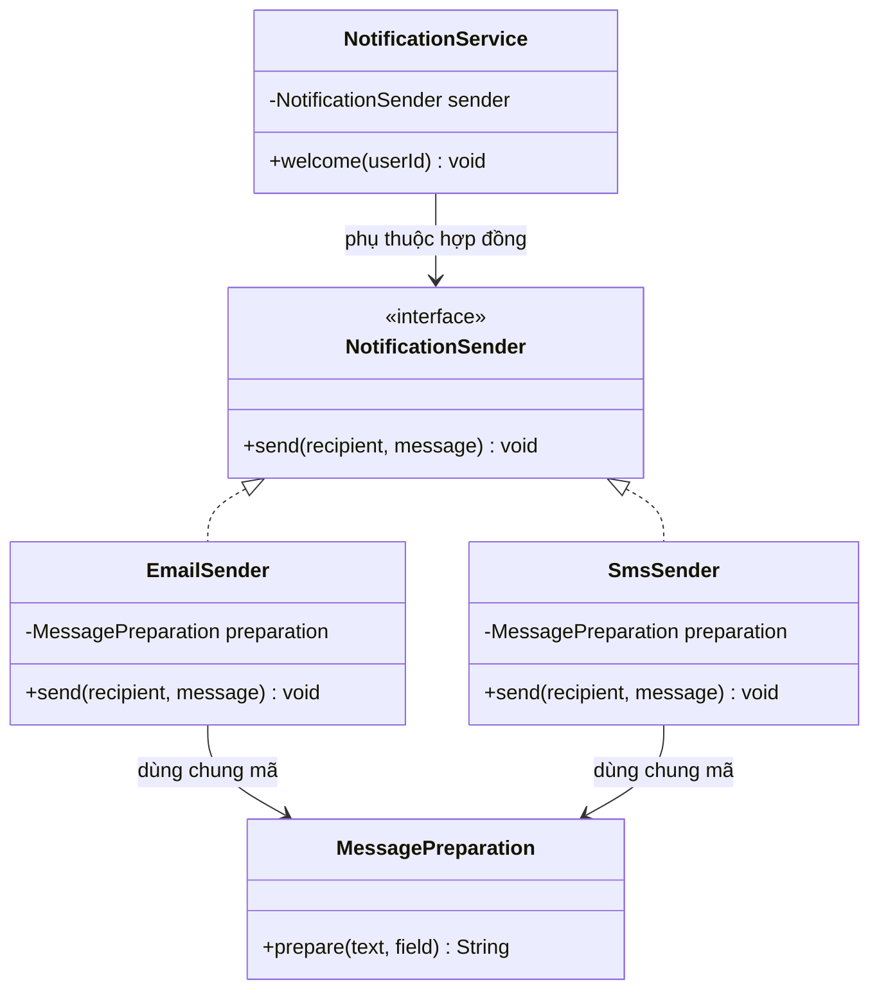
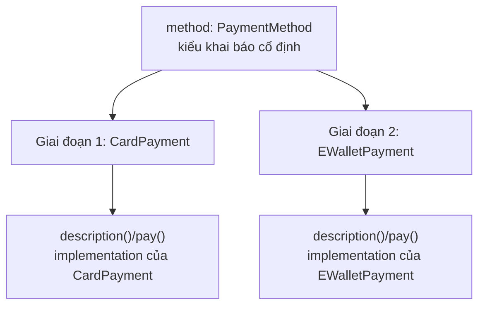
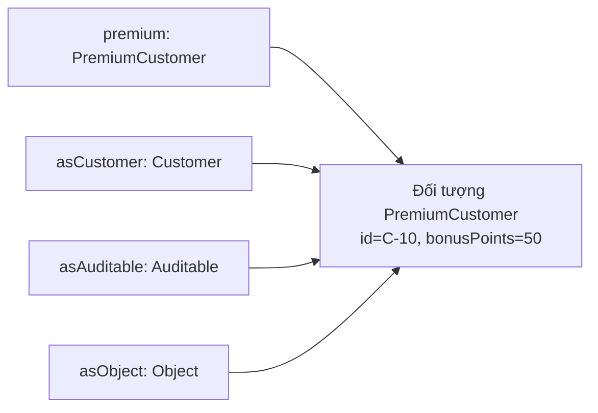
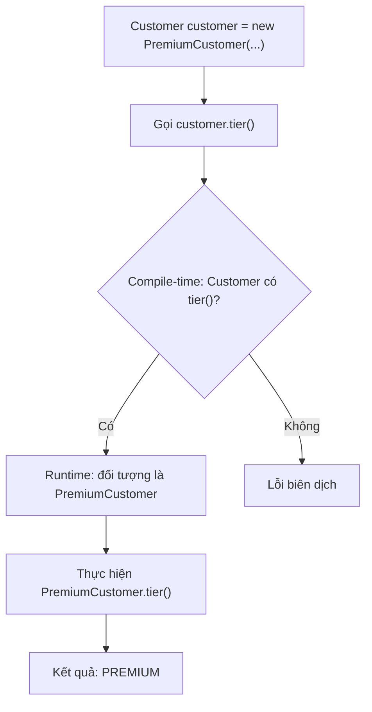
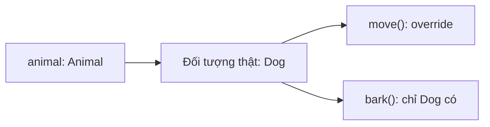
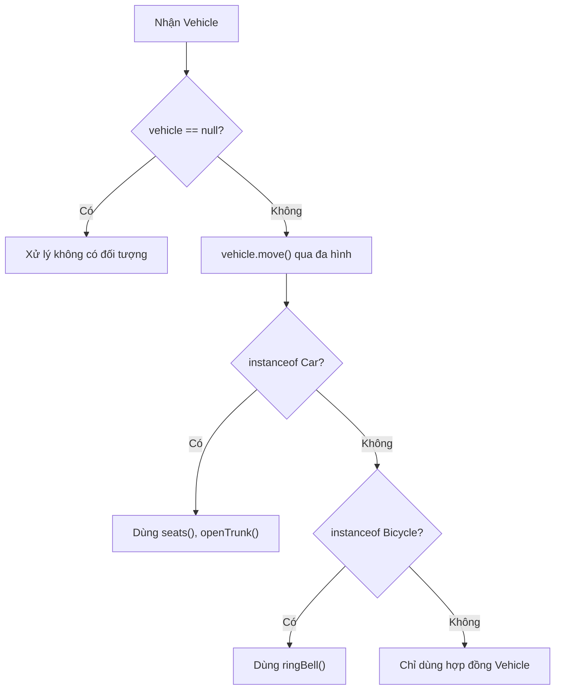
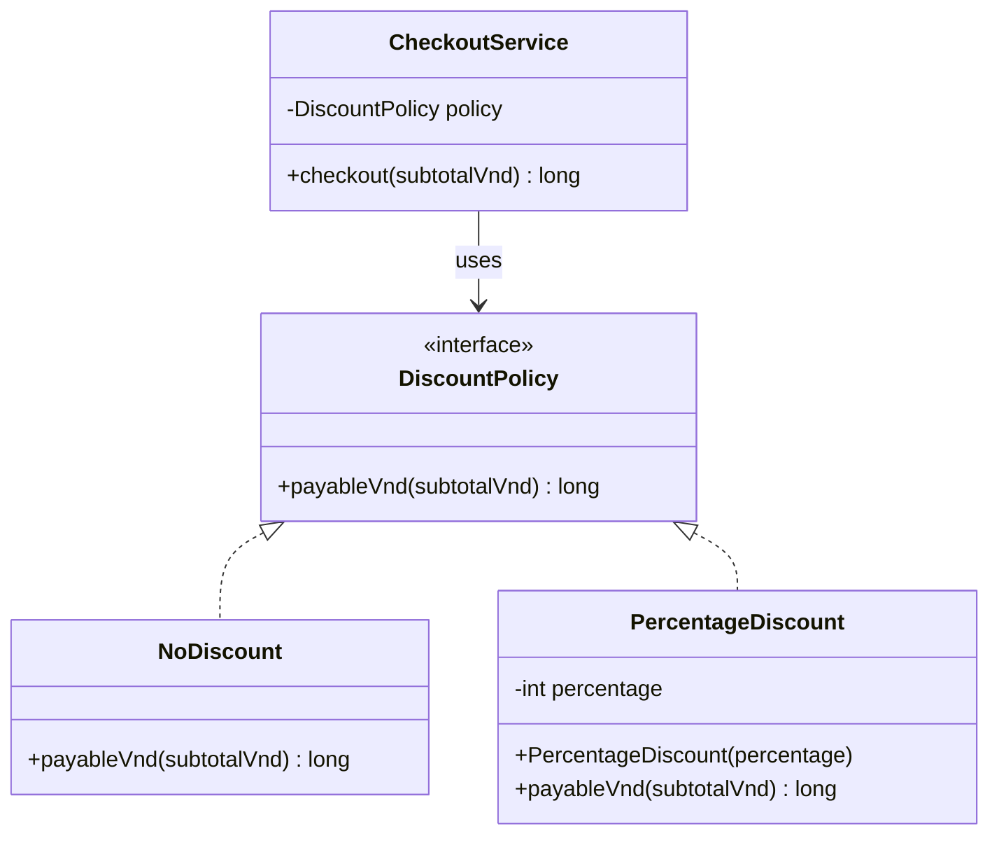
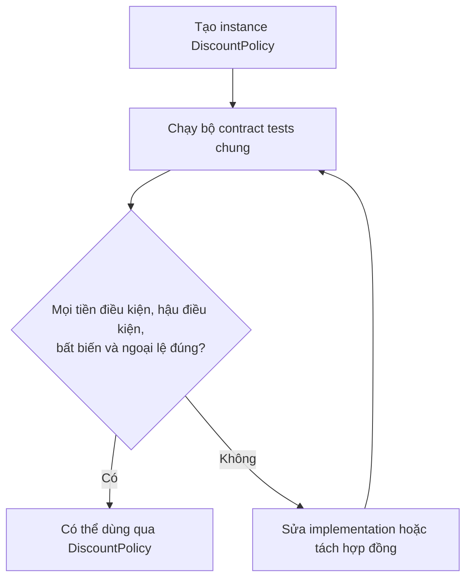

<a id="back-to-top"></a>

# Kiểu con

## Menu
- [Phân biệt kế thừa mã với quan hệ kiểu con](#subtyping-001)
- [Quan hệ “là một” và tính thay thế](#subtyping-002)
- [Tương thích kiểu theo tên và theo cấu trúc](#subtyping-003)
- [Kiểu khai báo và kiểu thực tế của đối tượng](#subtyping-004)
- [Chuyển từ kiểu con sang kiểu cha](#subtyping-005)
- [Ép về kiểu con và kiểm tra kiểu](#subtyping-006)
- [Giữ đúng hợp đồng khi mở rộng kiểu](#subtyping-007)
- [Phản ví dụ hình chữ nhật và hình vuông](#subtyping-008)

## <a id="subtyping-001">Phân biệt kế thừa mã với quan hệ kiểu con</a>

<details>
<summary>Xem chi tiết</summary>

# Phân biệt kế thừa mã với quan hệ kiểu con trong Java

Trong Java OOP, hai ý tưởng dễ bị gộp chung là **kế thừa mã (implementation inheritance / code reuse)** và **quan hệ kiểu con (subtyping)**. Chúng thường xuất hiện cùng lúc khi viết `extends`, nhưng giải quyết hai câu hỏi khác nhau:

- **Kế thừa mã:** “Làm sao tận dụng lại một phần chương trình đã viết, tránh nhân bản thuật toán hoặc xử lý chung?”
- **Quan hệ kiểu con:** “Đối tượng thuộc kiểu này có thể được dùng thay cho một kiểu trừu tượng khác mà vẫn giữ đúng hợp đồng không?”

Sự phân biệt quan trọng vì **tái sử dụng được code không đồng nghĩa với thay thế được về mặt hành vi**. Một lớp con có thể kế thừa phương thức, biên dịch hợp lệ, nhưng làm sai những kỳ vọng mà chương trình đang đặt vào lớp cha.

Bài này tập trung vào cơ chế của Java, minh họa bằng interface, `extends`, `implements`, ủy quyền qua composition và nguyên lý thay thế Liskov (LSP).

## 1. Hai trục thiết kế không đồng nhất

| Góc nhìn | Kế thừa mã | Quan hệ kiểu con |
| --- | --- | --- |
| Mục đích | Tận dụng logic hoặc cấu trúc chung | Cho phép dùng một đối tượng dưới hợp đồng kiểu rộng hơn |
| Câu hỏi | “Code nào có thể dùng lại?” | “Có thể thay A bằng B mà client vẫn đúng không?” |
| Cơ chế điển hình | `extends`, lớp cơ sở, hoặc **composition/delegation** để tái sử dụng không cần kế thừa | `extends` class, `implements` interface, `extends` interface |
| Điều phía sử dụng quan tâm | Chi tiết thực hiện, chi phí bảo trì | Phương thức, tiền/hậu điều kiện, bất biến, hành vi lỗi |
| Rủi ro | Kết dính chặt lớp con với chi tiết lớp cha | Vi phạm hợp đồng dù tương thích chữ ký |
| Khi nên ưu tiên | Có xử lý chung thật sự cần chia sẻ | Các kiểu cần được sử dụng thay thế theo một hợp đồng |

**Về mặt ngôn ngữ Java:** khi `Child extends Parent`, `Child` là *subtype danh nghĩa* của `Parent` và có thể kế thừa các thành phần thích hợp từ cha. Không thể dùng `extends` để “chỉ lấy code mà tuyệt đối không tạo quan hệ kiểu con”. Nếu mục đích chỉ là tái sử dụng thuật toán, composition/delegation thường diễn đạt chính xác hơn.

Khi `Worker implements Runnable`, `Worker` là kiểu con của `Runnable` dù interface chủ yếu mô tả chữ ký hành vi. Về nguyên tắc, subtype không bắt buộc phải xuất phát từ việc kế thừa **mã nguồn triển khai** của một superclass. Lưu ý Java interface hiện đại có thể có `default` method, nên không nên khẳng định mọi interface hoàn toàn không chứa code.

Từ đây có ba khái niệm nên phân biệt rõ:

1. **Quan hệ subtype theo hệ kiểu Java:** trình biên dịch cho phép chuyển tham chiếu `Child` thành `Parent` hoặc một interface được implement.
2. **Kế thừa implementation:** lớp con nhận lại code phù hợp của superclass (có thể override nơi được phép).
3. **Subtype đúng về hành vi:** việc thay đối tượng không phá cam kết mà client được phép dựa vào; đây là nội dung cốt lõi của LSP.

Hai điều đầu do cơ chế ngôn ngữ hỗ trợ. Điều thứ ba cần **thiết kế, mô tả hợp đồng và kiểm thử**.

## 2. Quan hệ kiểu con: phía gọi dựa vào hợp đồng

Ví dụ `NotificationSender` mô tả một khả năng gửi thông báo ở mức nghiệp vụ:

```java
// NotificationSender.java
public interface NotificationSender {

    /**
     * Gửi một thông báo tới người nhận.
     * recipient và message phải khác null, không được rỗng/trắng.
     * Đầu vào sai: IllegalArgumentException.
     *
     * Ví dụ học tập dùng thao tác in ra console.
     * Khi hoàn thành bình thường, phát ra đúng một dòng thông báo.
     */
    void send(String recipient, String message);
}
```

Một thành phần sử dụng chỉ biết `NotificationSender`:

```java
// NotificationService.java
import java.util.Objects;

public final class NotificationService {
    private final NotificationSender sender;

    public NotificationService(NotificationSender sender) {
        this.sender = Objects.requireNonNull(sender, "sender");
    }

    public void welcome(String userId) {
        sender.send(userId, "Chào mừng bạn đến hệ thống!");
    }
}
```

`NotificationService` không cần biết thông báo đi qua email hay SMS. Một đối tượng thực hiện interface này có thể được truyền vào constructor. Đó là **quan hệ kiểu con được khai thác qua đa hình**.

Điểm quyết định không phải hai implementation có cùng code hay không. Chúng cần chấp nhận cùng miền đầu vào mà interface đã hứa, báo lỗi nhất quán và tạo hiệu ứng được mô tả. Nếu bản SMS tự ý từ chối tất cả chuỗi dài trên 20 ký tự trong khi hợp đồng chung không đặt giới hạn, nó không còn là implementation thay thế được cho tất cả client hợp lệ.

## 3. Tái sử dụng code bằng composition, không cần kế thừa lớp khác

Hai cách gửi thông báo đều cần chuẩn hóa và kiểm tra văn bản. Việc này có thể nằm trong một **đối tượng trợ giúp** thay vì ép cả email và SMS kế thừa một lớp cha chứa xử lý chung.

### Bộ xử lý dùng chung

```java
// MessagePreparation.java
public final class MessagePreparation {

    public String prepare(String text, String field) {
        if (text == null || text.isBlank()) {
            throw new IllegalArgumentException(
                    field + " không được trống");
        }
        return text.strip();
    }
}
```

### Hai implementation cùng sử dụng helper

```java
// EmailSender.java
public final class EmailSender implements NotificationSender {
    private final MessagePreparation preparation;

    public EmailSender(MessagePreparation preparation) {
        this.preparation = java.util.Objects.requireNonNull(
                preparation, "preparation");
    }

    @Override
    public void send(String recipient, String message) {
        String to = preparation.prepare(recipient, "recipient");
        String body = preparation.prepare(message, "message");
        System.out.println("[EMAIL] " + to + ": " + body);
    }
}
```

```java
// SmsSender.java
public final class SmsSender implements NotificationSender {
    private final MessagePreparation preparation;

    public SmsSender(MessagePreparation preparation) {
        this.preparation = java.util.Objects.requireNonNull(
                preparation, "preparation");
    }

    @Override
    public void send(String recipient, String message) {
        String to = preparation.prepare(recipient, "recipient");
        String body = preparation.prepare(message, "message");
        System.out.println("[SMS] " + to + ": " + body);
    }
}
```

Thử sử dụng qua interface:

```java
// Main.java
public class Main {
    public static void main(String[] args) {
        MessagePreparation preparation = new MessagePreparation();

        NotificationService emailService = new NotificationService(
                new EmailSender(preparation));
        NotificationService smsService = new NotificationService(
                new SmsSender(preparation));

        emailService.welcome("an@example.test");
        smsService.welcome("0900000000");
    }
}
```

Biên dịch và chạy các tệp trong cùng thư mục:

```bash
javac NotificationSender.java NotificationService.java MessagePreparation.java EmailSender.java SmsSender.java Main.java
java Main
```

Kết quả:

```text
[EMAIL] an@example.test: Chào mừng bạn đến hệ thống!
[SMS] 0900000000: Chào mừng bạn đến hệ thống!
```

**Phân tích:**

- `EmailSender` và `SmsSender` đều là **subtype của `NotificationSender`** vì khai báo `implements`.
- Hai lớp sử dụng lại `MessagePreparation.prepare(...)` bằng **composition/delegation**.
- Không có quan hệ `EmailSender extends SmsSender` hay `EmailSender extends MessagePreparation`. Chia sẻ bộ xử lý không ngụ ý “email là một SMS” hoặc “email là một bộ chuẩn hóa”.
- `NotificationService` dùng kiểu interface nên có thể nhận cả hai implementation. Sự thay thế đến từ hợp đồng của interface, không đến từ việc hai lớp cùng gọi helper.
- Trong ví dụ console, tiền điều kiện có cùng cách kiểm tra; đầu ra khác nhãn kênh nhưng vẫn đáp ứng cam kết “phát một dòng”.

Sơ đồ phân biệt rõ **implements** với **has-a / uses-a**:



Nếu sau này thay bộ chuẩn hóa bằng cách khác, hai sender vẫn giữ loại quan hệ của mình. Nếu thêm kênh thông báo, tạo implementation mới mà `NotificationService` không phải đổi.

## 4. `extends` thường kết hợp cả kế thừa mã và quan hệ subtype

`extends` có thể phù hợp nếu lớp con **thực sự là một trường hợp chuyên biệt hợp lệ** của lớp cha và các phần cài đặt chung là nền tảng ổn định.

```java
abstract class AbstractReport {
    public final String render() {
        String title = title();
        String body = body();

        return "=== " + title + " ===\n" + body;
    }

    protected abstract String title();
    protected abstract String body();
}

final class SalesReport extends AbstractReport {
    @Override
    protected String title() {
        return "Báo cáo bán hàng";
    }

    @Override
    protected String body() {
        return "Doanh thu: 1.000.000 VND";
    }
}
```

Sử dụng:

```java
AbstractReport report = new SalesReport();
System.out.println(report.render());
```

Kết quả:

```text
=== Báo cáo bán hàng ===
Doanh thu: 1.000.000 VND
```

Ở đây:

- `SalesReport extends AbstractReport` tạo **quan hệ subtype**: biến `AbstractReport` có thể giữ `SalesReport`.
- `SalesReport` **kế thừa mã thực hiện `render()`** của `AbstractReport`.
- `render()` là `final` để giữ khung xử lý chung. Lớp con chỉ điền các điểm mở rộng `title()`, `body()`, giúp hạn chế việc vô tình thay đổi định dạng kết quả.
- Đây là dạng **Template Method** đơn giản. Nếu mọi báo cáo thuộc họ này tuân thủ cùng định dạng, quan hệ kế thừa có lý do rõ ràng.

Tuy nhiên, **chỉ vì `render()` tái sử dụng được code không đủ để khẳng định mọi loại đối tượng in được đều nên kế thừa `AbstractReport`**. Một hóa đơn, biên lai hoặc nhãn vận chuyển có thể cần hợp đồng khác dù cùng có thao tác “tạo chuỗi hiển thị”.

### Tại sao extends đôi khi gây kết dính mạnh?

Lớp con có thể phụ thuộc vào trình tự gọi method, field/protected API, bước kiểm tra và các giả định bên trong lớp cha. Thay đổi phương thức cha có thể vô tình làm lớp con chạy khác. Composition giữ việc tái sử dụng ở ranh giới đối tượng và thường giảm phụ thuộc vào chi tiết một superclass lớn.

Điều này không có nghĩa composition luôn tốt hơn extends; sự lựa chọn dựa trên **ngữ nghĩa quan hệ**, hợp đồng cần giữ và mức kiểm soát điểm mở rộng.

## 5. Phản ví dụ ngắn: subtype danh nghĩa nhưng không thay thế được

Phát biểu hình học “hình vuông là hình chữ nhật” chưa đủ để bảo đảm `Square extends Rectangle` **đúng về hành vi**. Giả sử `Rectangle` cho phép `setWidth(w)` và `setHeight(h)` thay đổi hai chiều **độc lập**, còn `Square` buộc hai chiều luôn bằng nhau. Cả hai không thể cùng giữ những cam kết đó.

~~~java
// Ý tưởng tối giản: Rectangle có hai setter độc lập.
// Square extends Rectangle và override setWidth/setHeight
// để cập nhật cả hai chiều giữ hình vuông.
// Đây là mô hình CỐ Ý SAI về hợp đồng.
void resize(Rectangle shape) {
    shape.setWidth(5);   // Đúng hợp đồng Rectangle: height không đổi
    shape.setHeight(4);  // Đúng hợp đồng Rectangle: width vẫn là 5
    System.out.println(shape.area()); // Kỳ vọng 20
}
~~~

Nếu đối tượng thực là `Square` và mỗi setter cập nhật cả hai chiều, kết quả cuối thành `4 × 4 = 16`, khác kỳ vọng hợp lệ `5 × 4 = 20`. `extends` giúp code biên dịch vì subtype danh nghĩa đã được khai báo; **compiler không tự kiểm tra hậu điều kiện của setter**.

| Quan sát | Kết luận |
| --- | --- |
| `Square` kế thừa implementation và đúng chữ ký | Có subtype và khả năng dùng lại mã theo Java |
| Client dựa vào hai setter độc lập | `Square` không giữ được hợp đồng |
| Chỉ cần `area()` và dữ liệu hình bất biến | `Rectangle`, `Square` có thể cùng triển khai một `Shape` nhỏ hơn |

Bài **Phản ví dụ hình chữ nhật và hình vuông** dành trọn hai chương trình Java chạy được, bảng so sánh từng phương án sửa, postcondition và contract test cho tình huống này. Ở đây, điểm cần rút ra là: *kế thừa mã và subtype theo cú pháp không chứng minh khả năng thay thế về nghiệp vụ*.

## 6. LSP: ranh giới giữa tương thích kiểu và tương thích hành vi

Nguyên lý thay thế Liskov có thể hiểu thực dụng như sau:

> Mã được viết đúng theo hợp đồng của kiểu cha phải tiếp tục đúng khi nhận một đối tượng kiểu con hợp lệ, không phải viết nhánh đặc biệt chỉ để tránh lỗi do kiểu con gây ra.

Một subtype về hành vi cần giữ các ràng buộc mà client được phép dựa vào:

| Khía cạnh | Điều subtype cần tôn trọng | Ví dụ vi phạm |
| --- | --- | --- |
| **Tiền điều kiện** | Không tự ý **siết chặt** điều kiện của các lời gọi hợp lệ | Cha nhận số nguyên dương; con chỉ nhận số từ 100 trở lên |
| **Hậu điều kiện** | Không **làm yếu** kết quả đã hứa | Cha hứa trả danh sách đã sắp xếp; con trả thứ tự tùy ý |
| **Bất biến** | Không phá quy tắc trạng thái quan sát được | Cha hứa số dư không âm; con cho phép âm |
| **Lỗi** | Giữ những bảo đảm lỗi đã công bố | Cha hứa thao tác lỗi không thay đổi dữ liệu; con cập nhật dở dang |
| **Hiệu ứng phụ** | Không thêm tác động trái với hợp đồng | Getter hứa chỉ đọc; con lại xóa bản ghi |
| **Quy tắc thời điểm/đồng thời** | Giữ những bảo đảm nếu chúng là một phần của hợp đồng | API hứa cập nhật xong trước khi trả về; con chỉ gửi job async |

LSP **không** yêu cầu mọi implementation trả cùng một kết quả cụ thể trong mọi tình huống. Nếu hợp đồng `Shape.area()` chỉ hứa diện tích chính xác của **hình đang biểu diễn**, các hình khác nhau có thể trả số khác nhau, miễn là mỗi implementation đáp ứng ý nghĩa và ràng buộc đã cam kết.

Cũng không phải cứ override khác hành vi là vi phạm: mục đích của đa hình chính là hỗ trợ các hành vi cụ thể khác nhau **trong phạm vi hợp đồng chung**.

### Test hợp đồng để bắt vi phạm

Với một interface quan trọng, có thể viết **cùng bộ kiểm tra** cho mọi implementation:

```java
static void verifyShape(Shape shape) {
    long first = shape.area();
    long second = shape.area();

    if (first <= 0 || first != second) {
        throw new AssertionError("Vi phạm hợp đồng Shape bất biến");
    }
}
```

Bộ test minh họa này chỉ kiểm tra vài điều kiện quan sát được; để kiểm tra công thức diện tích đầy đủ cần trường hợp đã biết chiều/cạnh, test biên và xem xét hợp đồng thực tế. Khi dùng JUnit, cùng một test có thể nhận factory tạo nhiều implementation khác nhau.

Nếu test cho `Rectangle` bao gồm “`setWidth` không đổi `getHeight`”, `Square` ở phần trước sẽ thất bại. Không nên sửa test để bỏ điều kiện chỉ vì muốn duy trì cấu trúc kế thừa đã chọn; hãy xem lại quan hệ subtype.

## 7. Có thể kế thừa hành vi mặc định từ interface không?

Có. Từ Java 8, interface được phép có `default method`:

```java
interface Named {
    String name();

    default String displayName() {
        return name().strip();
    }
}

final class Customer implements Named {
    private final String name;

    Customer(String name) {
        this.name = name;
    }

    @Override
    public String name() {
        return name;
    }
}
```

`Customer` là subtype của `Named` và nhận lại phần implementation mặc định của `displayName()`. Điều này chứng minh:

- Interface là công cụ định nghĩa subtype/hợp đồng, nhưng **có thể đóng góp code**.
- Quan hệ subtype không đồng nghĩa “tất cả method phải do class tự viết từ đầu”.
- Bổ sung một `default` method phải cân nhắc tương thích với method đã có và quy tắc phân giải xung đột của Java.

Không nên đánh đồng “kế thừa mã” với từ khóa `extends` duy nhất. Trong Java, class có thể tái sử dụng default method theo interface, kế thừa code từ abstract superclass, hoặc tái sử dụng logic qua delegation mà **không có quan hệ subtype với đối tượng được ủy quyền**.

## 8. Tại sao “is-a” chỉ là bước kiểm tra ban đầu?

Câu hỏi “X là một Y không?” (*is-a*) hữu ích để xem xét kế thừa, nhưng ngôn ngữ tự nhiên đôi khi đánh lừa ta. “Hình vuông là hình chữ nhật” về toán học chưa đủ để đảm bảo **một đối tượng `Square` có thể thay thế `Rectangle` với hai setter độc lập**.

Nên hỏi cụ thể hơn:

1. Tất cả thao tác mà client được quyền gọi trên kiểu cha có còn hợp lệ với kiểu con không?
2. Tiền điều kiện của kiểu con có nghiêm ngặt hơn không?
3. Kết quả, trạng thái và hành vi lỗi có đúng với hợp đồng kiểu cha không?
4. Kiểu con có phải phá bất biến của mình để đáp ứng thao tác của kiểu cha không?
5. Mục tiêu chỉ là sử dụng lại vài dòng xử lý, hay thật sự cần client nhìn đối tượng dưới kiểu cha?

Nếu mục tiêu là tái sử dụng logic mà câu trả lời về hợp đồng subtype không rõ ràng, hãy xem xét **composition**:

```java
final class CsvExporter {
    private final TextEscaper escaper;

    CsvExporter(TextEscaper escaper) {
        this.escaper = escaper;
    }

    String exportCell(String text) {
        return escaper.escape(text);
    }
}

final class TextEscaper {
    String escape(String text) {
        return "\"" + text.replace("\"", "\"\"") + "\"";
    }
}
```

`CsvExporter` **dùng** `TextEscaper`; nó không phải một loại `TextEscaper`. Cách này tận dụng xử lý thoát ký tự mà không tạo quan hệ kiểu con sai nghĩa.

## 9. Một số điểm cần nhớ về hệ kiểu Java

### Lớp con và interface đều tạo khả năng gán tham chiếu

```java
class Animal { }
class Cat extends Animal { }

interface RunnableTask {
    void run();
}
class Job implements RunnableTask {
    @Override
    public void run() { }
}

Animal animal = new Cat();          // Hợp lệ
RunnableTask task = new Job();      // Hợp lệ
Object any = new Job();             // Object là kiểu cha của class
```

Việc gán này minh họa **quan hệ subtype theo khai báo**. Nó không tự chứng minh lớp con giữ đúng toàn bộ hợp đồng nghiệp vụ.

### Class kế thừa class khác cùng interface

```java
interface Auditable {
    void audit();
}

abstract class BaseEntity {
    private final String id;

    protected BaseEntity(String id) {
        this.id = id;
    }

    public final String getId() {
        return id;
    }
}

final class Invoice extends BaseEntity implements Auditable {
    Invoice(String id) {
        super(id);
    }

    @Override
    public void audit() {
        System.out.println("Audit invoice " + getId());
    }
}
```

`Invoice` vừa là subtype của `BaseEntity`, vừa là subtype của `Auditable`. Nó kế thừa mã `getId()` của superclass, nhưng phần xử lý `audit()` tự thực hiện. Một class Java chỉ có thể `extends` trực tiếp **một class**, còn có thể `implements` nhiều interface.

### Generic không tự “đi theo” subtype của phần tử

```java
List<Cat> cats = new ArrayList<>();
// List<Animal> animals = cats; // Không biên dịch
```

Dù `Cat extends Animal`, `List<Cat>` **không** là subtype của `List<Animal>` vì generic Java bất biến (*invariant*) với tham số kiểu thông thường. Nếu API chỉ cần đọc các phần tử kiểu `Animal`, có thể dùng `List<? extends Animal>` với những giới hạn tương ứng về việc thêm phần tử.

Điểm này nhắc rằng cần dựa trên **quy tắc hệ kiểu cụ thể**, không suy luận subtype bằng trực giác.

## 10. Khi nào nên chọn từng thiết kế?

| Nhu cầu chính | Thiết kế có thể phù hợp | Lý do |
| --- | --- | --- |
| Nhiều loại dịch vụ khác nhau cần cùng API | Interface và các lớp `implements` | Quan hệ subtype rõ, hỗ trợ thay thế |
| Hai lớp cần dùng chung thuật toán nhưng không cùng bản chất | Composition/delegation | Tận dụng mã mà không ép quan hệ `is-a` |
| Một họ lớp thực sự cùng hợp đồng và quy trình | Abstract superclass với điểm mở rộng được kiểm soát | Vừa subtype, vừa tái sử dụng khung thực hiện |
| Muốn thêm chức năng quanh đối tượng sẵn có | Decorator/composition | Có thể bọc hành vi mà không phụ thuộc inheritance |
| Muốn nhiều đối tượng chia sẻ xử lý tiện ích thuần túy | Helper hoặc utility phù hợp | Không phải tạo superclass chỉ vì vài hàm |
| Hợp đồng cha không phù hợp với kiểu con dự kiến | Tách interface chung nhỏ hơn hoặc thiết kế lại abstraction | Tránh phá LSP |

Đừng chọn kế thừa chỉ để giảm số dòng code. Một cấu trúc có ít dòng trùng lặp nhưng hợp đồng sai thường tốn công sửa và bảo trì hơn việc tách đúng trách nhiệm.

## 11. Bài tập suy luận

**Bài 1 — subtype và code reuse.** Cho `interface Payable` với `long amountVnd()`. Hai lớp `Invoice` và `Refund` đều `implements Payable` nhưng sử dụng các thuật toán khác nhau. Chúng có quan hệ subtype với `Payable` không? Có. Chúng có bắt buộc kế thừa mã từ cùng một superclass không? Không.

**Bài 2 — thay một xử lý chung.** Hai lớp `JsonExporter` và `XmlExporter` cùng cần chuẩn hóa tên file. Hãy viết `FilenameValidator` rồi inject vào cả hai. Đưa ra lý do vì sao `JsonExporter extends FilenameValidator` không phản ánh đúng quan hệ nghiệp vụ.

**Bài 3 — kiểm tra LSP.** `ReadableFile` hứa `read()` trả toàn bộ nội dung và không thay đổi file. Một subtype override `read()` để xóa file sau khi trả kết quả. Phương thức biên dịch đúng chữ ký, nhưng làm sai cam kết **không thay đổi trạng thái**. Đề xuất thiết kế khác cho hành vi “đọc rồi xóa”.

**Bài 4 — hình chữ nhật.** Chỉnh lại `RectanglePitfall` thành hai lớp bất biến thực hiện `Shape`. Tạo client tính tổng diện tích của một `List<Shape>` mà không cần `instanceof Rectangle` hoặc `instanceof Square`.

**Bài 5 — quyết định kế thừa.** Một lớp `CachedPriceRepository` muốn dùng lại cách tra cứu `DatabasePriceRepository`, nhưng cần cache và vẫn phải bảo đảm giá sau `updatePrice` được đọc thấy ngay. Hãy cân nhắc wrapper theo interface repository và cách vô hiệu hóa cache trước khi quyết định dùng `extends` hay composition. Giải thích điều kiện nào khiến một giải pháp không giữ hợp đồng quan sát được.

### Checklist thiết kế

Trước khi viết `extends`, tự hỏi: lớp con có thể thay thế lớp cha ở **mọi lời gọi hợp lệ** không? Bất biến của lớp con có mâu thuẫn với API lớp cha không? Nếu chỉ muốn dùng lại xử lý, có thể giữ một đối tượng trợ giúp thay vì kế thừa không? Phần chung nên là **hợp đồng** hay chỉ là **chi tiết thuật toán**?

**Thông điệp chính:** trong Java, `extends` lớp vừa tạo quan hệ kiểu con vừa có thể kế thừa code, nhưng chỉ **tương thích hành vi** mới làm quan hệ kiểu con có ý nghĩa an toàn. `implements` diễn tả một hợp đồng; composition/delegation cho phép tái sử dụng implementation mà không áp đặt quan hệ kiểu con. Thiết kế tốt chọn quan hệ dựa trên điều client được phép kỳ vọng, không chỉ dựa trên việc có thể chia sẻ bao nhiêu dòng code.


</details>

- [Quay lại đầu trang](#back-to-top)

---

## <a id="subtyping-002">Quan hệ “là một” và tính thay thế</a>

<details>
<summary>Xem chi tiết</summary>

# Quan hệ “là một” và tính thay thế trong Java OOP

Khi thấy `Dog extends Animal` hoặc `ExpressShipping implements ShippingPolicy`, ta thường nói kiểu con có quan hệ **“là một” (*is-a*)** với kiểu cha. Trong lập trình, câu này có hai tầng ý nghĩa cần phân biệt:

- **Quan hệ kiểu (subtyping):** Java cho phép sử dụng một biểu thức kiểu con tại vị trí đang yêu cầu kiểu cha hoặc interface phù hợp.
- **Tính thay thế về hành vi (behavioral substitutability):** Sau khi thay đối tượng bằng một implementation khác, chương trình sử dụng hợp đồng chung vẫn hoạt động đúng theo những gì hợp đồng đã hứa.

Tầng thứ nhất phần lớn được trình biên dịch kiểm tra. Tầng thứ hai đòi hỏi người thiết kế định nghĩa và thực hiện **hợp đồng hành vi**: điều kiện đầu vào, điều được bảo đảm ở đầu ra, bất biến, lỗi, tác dụng phụ và các cam kết mà client dựa vào.

**Cốt lõi:** Có cú pháp `extends` hoặc `implements` chưa đủ để bảo đảm một quan hệ “là một” tốt về thiết kế. Kiểu con cần thật sự đảm nhiệm được vai trò của kiểu cha.

## 1. Hiểu đúng “là một” trong Java

Ví dụ:

~~~java
class Animal {
    public String describe() {
        return "Một động vật";
    }
}

class Dog extends Animal {
    @Override
    public String describe() {
        return "Một con chó";
    }

    public void bark() {
        System.out.println("Gâu!");
    }
}
~~~

Một đối tượng `Dog` cũng có thể được sử dụng như một `Animal`:

~~~java
Dog dog = new Dog();
Animal animal = dog; // Upcasting: hợp lệ, không cần ép kiểu tường minh.

System.out.println(animal.describe()); // Một con chó
// animal.bark(); // Không biên dịch: Animal không có bark().
~~~

Với đoạn này:

1. **Object thực tế** là `Dog`; phép gán `animal = dog` không tạo một `Animal` mới.
2. **Kiểu khai báo của biến** `animal` là `Animal`, nên compiler chỉ cho gọi những member có thể truy cập qua kiểu đó.
3. **Phương thức instance được override** được chọn tại runtime theo object thực tế: `Dog.describe()`.
4. `bark()` chỉ được khai báo trong `Dog`, không thuộc hợp đồng `Animal`, nên không gọi trực tiếp bằng tham chiếu `Animal`.

Đây là nền tảng của **đa hình động (runtime polymorphism)**.

~~~mermaid
classDiagram
    class Animal {
        +describe() String
    }
    class Dog {
        +describe() String
        +bark() void
    }
    Animal <|-- Dog
~~~

Trong Java, `extends` với class là cơ chế **kế thừa lớp**. Ngoài khả năng được nhìn như kiểu cha, subclass còn có quan hệ triển khai, constructor chaining và quy tắc override của Java. Một class chỉ có thể `extends` trực tiếp một class, nhưng có thể `implements` nhiều interface.

Ví dụ `Printer implements Printable` có nghĩa **Printer làm được vai trò Printable**, dù `Printer` không cần là một loại máy móc nằm trong cùng cây class với các implementation khác.

## 2. Quan hệ kiểu và khả năng thay thế không hoàn toàn giống nhau

| Câu hỏi | Tính thay thế theo kiểu Java | Tính thay thế theo hành vi |
|---|---|---|
| Kiểm tra chủ yếu ở đâu? | Compiler và hệ kiểu runtime | Thiết kế hợp đồng, kiểm thử, quan sát thực tế |
| Điều kiện cơ bản | `Dog` là subtype của `Animal` | `Dog` giữ đúng lời hứa công khai của `Animal` |
| Có cho phép thuật toán riêng? | Có | Có |
| Có yêu cầu đầu ra giống hệt? | Không | Không, trừ khi hợp đồng đòi hỏi |
| Có thể có lỗi mà compiler không phát hiện? | Có, như ép kiểu không hợp lệ | Có, như tự ý siết điều kiện hoặc trả kết quả sai nghĩa |
| Căn cứ đánh giá | `extends`, `implements`, method signature, type rules | Preconditions, postconditions, invariants, exception/side effects |

Chẳng hạn, một `ShippingPolicy` có thể báo mức phí khác nhau giữa gói tiêu chuẩn và hỏa tốc. Việc **mức phí khác nhau** không làm mất khả năng thay thế nếu hợp đồng cho phép mỗi gói có chính sách giá riêng. Nhưng nếu một implementation bất ngờ trả số âm khi hợp đồng quy định phí không âm, nó đã phá tính thay thế.

Ý tưởng này được biết đến qua **Nguyên tắc thay thế Liskov (Liskov Substitution Principle – LSP)**: những đối tượng của subtype phải có thể dùng thay cho đối tượng của supertype ở những nơi kỳ vọng supertype **mà không làm sai các thuộc tính đúng đắn đã được cam kết của chương trình**.

## 3. Ví dụ Java hoàn chỉnh: hai chính sách cùng một hợp đồng

Một ứng dụng bán hàng cần tính phí vận chuyển. Tầng đặt hàng chỉ cần một chính sách có khả năng **báo giá cho kiện hàng hợp lệ**; nó không cần biết mức giá được tính theo phương pháp nào.

Trong ví dụ này, hợp đồng quy định:

- Đầu vào là `Parcel` hợp lệ và khác `null`.
- `quote(parcel)` trả về một `ShippingQuote` khác `null`, phí không âm, tính bằng VND.
- Không được làm thay đổi `Parcel`.
- Với đầu vào `null`, implementation ném `NullPointerException`.
- Nếu phép tính vượt phạm vi `long`, implementation có thể ném `ArithmeticException`; không được âm thầm tràn số rồi báo phí sai.

Tạo file **`Demo.java`**; mã chạy với Java 17 trở lên:

~~~java
import java.util.Objects;

public class Demo {
    public static void main(String[] args) {
        Parcel parcel = new Parcel(1_500, 10);

        CheckoutService standard = new CheckoutService(
                new StandardShipping()
        );
        CheckoutService express = new CheckoutService(
                new ExpressShipping()
        );

        print(standard.calculate(parcel));
        print(express.calculate(parcel));
    }

    private static void print(ShippingQuote quote) {
        System.out.println(quote.method() + ": "
                + quote.feeVnd() + " VND");
    }
}

// Giá trị đầu vào hợp lệ ngay sau khi được tạo.
record Parcel(long weightGrams, int distanceKm) {
    Parcel {
        if (weightGrams <= 0) {
            throw new IllegalArgumentException(
                    "Trọng lượng phải dương");
        }
        if (distanceKm < 0) {
            throw new IllegalArgumentException(
                    "Khoảng cách không được âm");
        }
    }
}

record ShippingQuote(String method, long feeVnd) {
    ShippingQuote {
        Objects.requireNonNull(method, "method");
        if (method.isBlank() || feeVnd < 0) {
            throw new IllegalArgumentException(
                    "Báo giá không hợp lệ");
        }
    }
}

/**
 * Hợp đồng chung cho mọi chính sách vận chuyển.
 *
 * Với Parcel hợp lệ và khác null:
 * - Trả ShippingQuote khác null, feeVnd >= 0.
 * - Số tiền có đơn vị VND.
 * - Không sửa Parcel và không thực hiện ghi dữ liệu.
 *
 * @throws NullPointerException nếu parcel == null
 * @throws ArithmeticException nếu phép tính tràn long
 */
interface ShippingPolicy {
    ShippingQuote quote(Parcel parcel);
}

// Mô phỏng chính sách tiêu chuẩn.
final class StandardShipping implements ShippingPolicy {
    @Override
    public ShippingQuote quote(Parcel parcel) {
        Objects.requireNonNull(parcel, "parcel");

        long kilograms = ceilKilograms(parcel.weightGrams());
        long weightFee = Math.multiplyExact(kilograms, 5_000L);
        long distanceFee =
                Math.multiplyExact(parcel.distanceKm(), 2_000L);

        long total = Math.addExact(
                10_000L,
                Math.addExact(weightFee, distanceFee)
        );

        return new ShippingQuote("STANDARD", total);
    }

    private long ceilKilograms(long grams) {
        // grams > 0; tránh overflow của (grams + 999).
        return 1L + (grams - 1L) / 1_000L;
    }
}

// Mô phỏng chính sách hỏa tốc.
final class ExpressShipping implements ShippingPolicy {
    @Override
    public ShippingQuote quote(Parcel parcel) {
        Objects.requireNonNull(parcel, "parcel");

        long kilograms = 1L + (parcel.weightGrams() - 1L) / 1_000L;
        long weightFee = Math.multiplyExact(kilograms, 8_000L);
        long distanceFee =
                Math.multiplyExact(parcel.distanceKm(), 3_000L);

        long total = Math.addExact(
                20_000L,
                Math.addExact(weightFee, distanceFee)
        );

        return new ShippingQuote("EXPRESS", total);
    }
}

// Client chỉ cần khả năng báo giá, không cần biết class cụ thể.
final class CheckoutService {
    private final ShippingPolicy policy;

    CheckoutService(ShippingPolicy policy) {
        this.policy = Objects.requireNonNull(policy, "policy");
    }

    ShippingQuote calculate(Parcel parcel) {
        return policy.quote(parcel);
    }
}
~~~

Chạy:

~~~bash
javac Demo.java
java Demo
~~~

Kết quả:

~~~text
STANDARD: 40000 VND
EXPRESS: 66000 VND
~~~

Phép tính với kiện hàng 1.500 gram, 10 km:

| Chính sách | Phí cơ bản | Trọng lượng làm tròn 2 kg | Quãng đường 10 km | Tổng |
|---|---:|---:|---:|---:|
| Tiêu chuẩn | 10.000 | 2 × 5.000 | 10 × 2.000 | **40.000 VND** |
| Hỏa tốc | 20.000 | 2 × 8.000 | 10 × 3.000 | **66.000 VND** |

Mức phí khác nhau là **biến thể được hợp đồng cho phép**. Hai implementation vẫn thay thế được vì `CheckoutService` chỉ dựa vào một thao tác có cùng ý nghĩa: nhận kiện hàng hợp lệ và trả báo giá không âm theo VND.

~~~mermaid
classDiagram
    class ShippingPolicy {
        <<interface>>
        +quote(Parcel) ShippingQuote
    }
    class StandardShipping {
        +quote(Parcel) ShippingQuote
    }
    class ExpressShipping {
        +quote(Parcel) ShippingQuote
    }
    class CheckoutService {
        -ShippingPolicy policy
        +calculate(Parcel) ShippingQuote
    }
    ShippingPolicy <|.. StandardShipping
    ShippingPolicy <|.. ExpressShipping
    CheckoutService --> ShippingPolicy : phụ thuộc
~~~

Ở đây, subtype là **vai trò** `ShippingPolicy`. `StandardShipping` và `ExpressShipping` không nhất thiết cùng là một loại “đối tượng vật lý”; chúng là những chiến lược thực hiện cùng một khả năng.

## 4. Upcasting: truyền đối tượng con vào nơi nhận kiểu cha

Trong Java, phép gán hoặc truyền tham số từ subtype sang supertype phù hợp được gọi là **widening reference conversion**, thường được giải thích ngắn là *upcasting*:

~~~java
ShippingPolicy policy = new ExpressShipping();
CheckoutService service = new CheckoutService(policy);

ShippingQuote result = service.calculate(new Parcel(800, 4));
~~~

Phép chuyển kiểu này không làm biến thành một object mới, không sao chép dữ liệu và không “cắt bỏ” phần implementation. Object vẫn là `ExpressShipping`; biến `policy` chỉ cho phép sử dụng những thao tác công khai của `ShippingPolicy`.

Ví dụ dễ kiểm tra bằng Java:

~~~java
interface SoundMaker {
    String sound();
}

class Cat implements SoundMaker {
    @Override
    public String sound() {
        return "Meo";
    }

    public void scratch() {
        System.out.println("Cào");
    }
}

Cat cat = new Cat();
SoundMaker maker = cat;

System.out.println(maker.sound()); // Meo
System.out.println(maker == cat);  // true
// maker.scratch(); // Lỗi biên dịch: không thuộc SoundMaker.
~~~

Các dòng sử dụng đặt bên trong một phương thức Java thích hợp. Chính kiểu khai báo của tham chiếu giới hạn **những phương thức có thể gọi**, còn kiểu runtime của object quyết định **implementation của phương thức instance được override**.

Đừng nhầm với static method và field hiding:

~~~java
class Parent {
    public String kind = "Parent";

    public String describe() {
        return "Parent";
    }
}

class Child extends Parent {
    public String kind = "Child";

    @Override
    public String describe() {
        return "Child";
    }
}

Parent ref = new Child();
System.out.println(ref.kind);       // Parent: field theo kiểu tham chiếu.
System.out.println(ref.describe()); // Child: method theo kiểu runtime.
~~~

Kết quả cho thấy **field không override như instance method**. Vì vậy, thiết kế đa hình nên dựa vào phương thức/hợp đồng hơn là field công khai có cùng tên.

## 5. Điều kiện trước, điều kiện sau và bất biến trong LSP

Để một implementation thực sự thay thế được supertype, cần tôn trọng những lời hứa được client sử dụng.

### Không siết chặt precondition

Nếu `ShippingPolicy` cam kết hỗ trợ mọi `Parcel` hợp lệ, một implementation mới **không thể tự ý** đòi `distanceKm <= 5` rồi từ chối tất cả đơn đi xa hơn, trừ khi hợp đồng chung đã cho phép hành vi từ chối đó.

Đây là một implementation đáng nghi:

~~~java
final class VeryLocalShipping implements ShippingPolicy {
    @Override
    public ShippingQuote quote(Parcel parcel) {
        Objects.requireNonNull(parcel, "parcel");

        if (parcel.distanceKm() > 5) {
            throw new IllegalArgumentException(
                    "Chỉ giao trong bán kính 5 km");
        }
        return new ShippingQuote("LOCAL", 5_000L);
    }
}
~~~

Nó **biên dịch được**, nhưng vi phạm hợp đồng ví dụ đã xác định rằng mọi `Parcel` hợp lệ đều được báo giá, ngoại trừ trường hợp tràn số học. Client có thể truyền kiện hàng 10 km — một đầu vào hợp lệ theo hợp đồng chung — nhưng implementation tự bổ sung điều kiện đầu vào mới.

Nếu nghiệp vụ có chính sách vận chuyển chỉ phục vụ một số địa điểm, có thể thiết kế lại hợp đồng để biểu diễn **không hỗ trợ tuyến đường** như một kết quả hợp lệ, hoặc phân tách khả năng kiểm tra vùng phục vụ. Không nên giấu giới hạn mới trong subtype khiến client bất ngờ.

### Không làm yếu postcondition

Nếu hợp đồng hứa phí không âm, việc trả `null` hoặc một con số âm là sai. Ví dụ:

~~~java
final class NullShipping implements ShippingPolicy {
    @Override
    public ShippingQuote quote(Parcel parcel) {
        return null; // Biên dịch nhưng vi phạm hợp đồng non-null.
    }
}
~~~

Client có quyền dựa vào postcondition được công bố:

~~~java
ShippingQuote quote = policy.quote(parcel);
// Nếu hợp đồng được thực hiện đúng, quote != null.
System.out.println(quote.feeVnd());
~~~

Trong mã thực tế, nếu provider có thể từ chối hoặc hết dịch vụ, hãy thể hiện **trạng thái từ chối** bằng kiểu kết quả/exception đã được hợp đồng thống nhất. Không nên đánh tráo lỗi thành phí 0 nếu `0` mang nghĩa “miễn phí”.

### Giữ bất biến của supertype

Nếu một `Account` cam kết `balance >= 0`, lớp con không được làm `balance` âm qua những phương thức mới của mình. Một hành vi public bổ sung ở subtype cũng phải giữ trạng thái hợp lệ được supertype công bố.

Bất biến thường được bảo vệ qua constructor, kiểm tra trạng thái trước khi thay đổi và hạn chế cho subclass sửa trực tiếp field. Một interface không tự thực thi invariant bằng compiler; cần thiết kế implementation và kiểm thử.

### Giữ quy tắc lỗi và tác dụng phụ có thể quan sát

Một subtype không nên biến lời gọi vốn được hứa là chỉ tính toán thành thao tác âm thầm xóa dữ liệu. Nếu hợp đồng có quy tắc “không thực hiện I/O”, implementation mới không được bất ngờ gửi HTTP request hay ghi database.

Mặt khác, **không phải mọi khác biệt exception hoặc hiệu năng đều vi phạm LSP**. Điều cần xem là hợp đồng thực sự cam kết điều gì. Với kiểu `ShippingPolicy` ví dụ, `ArithmeticException` khi phép toán tràn đã là tình huống được công bố.

## 6. Một tên miền nghiệp vụ đúng chưa chắc có hợp đồng phù hợp

Trong hình học, hình vuông thuộc tập hình chữ nhật. Nhưng xét `Rectangle` **mutable** công khai hai setter độc lập:

~~~java
// Hợp đồng Rectangle: setWidth chỉ đổi width;
// setHeight chỉ đổi height.
rectangle.setWidth(5);
rectangle.setHeight(3);
System.out.println(rectangle.area()); // 15
~~~

Nếu `Square extends Rectangle` override mỗi setter để giữ `width == height`, sau hai lời gọi trên cả hai cạnh bằng `3`, diện tích thành `9`. Subtype đã **làm yếu hậu điều kiện** “chiều còn lại không đổi”. Nếu thay bằng cách ném lỗi khi hai chiều không bằng nhau, subtype lại **siết tiền điều kiện**: một đầu vào hợp lệ đối với `Rectangle` bị từ chối với `Square`.

Điều này minh họa ranh giới giữa *is-a theo cách gọi tên* và khả năng thay thế theo API. Hướng phù hợp là đưa `area()` lên một `Shape` chung, hoặc tách khả năng thay đổi kích thước của rectangle/square theo hợp đồng riêng. Bài cuối chương xây hai chương trình chạy được và contract tests để kiểm chứng từng trường hợp.

**Điểm riêng của bài hiện tại:** hãy đánh giá `ShippingPolicy` theo cùng tiêu chí: mọi implementation phải báo giá cho các kiện hàng hợp lệ được hợp đồng quy định; một biến thể có giá khác là hợp lệ, còn tự ý từ chối tuyến hợp lệ thì không.

## 7. “Is-a” và “has-a”: khi nào ưu tiên composition?

Một quan hệ kế thừa tốt thường đáp ứng được cả cách hiểu miền nghiệp vụ lẫn hợp đồng hành vi.

Các câu hỏi hữu ích:

1. Một đối tượng con có **thực sự là một loại** của đối tượng cha trong cách dùng của hệ thống không?
2. Mọi thao tác mà client có thể gọi trên kiểu cha có hợp lệ và có cùng ý nghĩa trên kiểu con không?
3. Một bất biến ở kiểu con có mâu thuẫn với cách thay đổi trạng thái mà kiểu cha cho phép không?
4. Ta đang muốn **thay thế theo hợp đồng**, hay chỉ đang muốn **tận dụng lại một ít code**?

Ví dụ, `Car extends Engine` là mô hình sai về ý nghĩa: xe **có một động cơ** (*has-a*), không phải **là một động cơ** (*is-a*). Sử dụng composition:

~~~java
final class Engine {
    public void start() {
        System.out.println("Động cơ hoạt động");
    }
}

final class Car {
    private final Engine engine;

    Car(Engine engine) {
        this.engine = java.util.Objects.requireNonNull(engine);
    }

    public void start() {
        engine.start();
    }
}
~~~

Code sử dụng:

~~~java
Car car = new Car(new Engine());
car.start();
~~~

`Car` giữ một collaborator `Engine` và ủy quyền hành vi. Composition thường phù hợp khi mối quan hệ là **có/chứa/sử dụng** hoặc khi muốn thay chi tiết thực hiện mà không ép class thành subtype sai.

Một quan hệ `extends` chỉ nhằm tái sử dụng code có thể khiến subclass phải nhận cả những thao tác của cha mà bản thân không thể đáp ứng đúng.

## 8. Các quy tắc Java khi override giúp bảo vệ một phần hợp đồng

Trình biên dịch Java thực thi một số giới hạn để giảm rủi ro khi subclass thay thế superclass.

| Quy tắc override | Ví dụ/ý nghĩa |
|---|---|
| Không giảm mức truy cập | Method cha `public` không được override thành `protected` |
| Có thể dùng kiểu trả về hiệp biến | Method con có thể trả subtype phù hợp của kiểu trả về tham chiếu |
| Không mở rộng checked exception trái phép | Method override không được khai báo checked exception rộng hơn quy tắc của method cha |
| Không override `final` instance method | `final` chặn override |
| Static method không override instance method | Static hiding và dynamic dispatch khác nhau |
| `private` method của lớp cha không được override | Subclass có thể có method cùng tên độc lập |
| `@Override` được compiler kiểm tra | Giúp phát hiện sai chữ ký hoặc nhầm quan hệ override |

Ví dụ kiểu trả về hiệp biến:

~~~java
class Animal {
    public Animal copy() {
        return new Animal();
    }
}

class Dog extends Animal {
    @Override
    public Dog copy() {
        return new Dog(); // Dog là subtype của Animal.
    }
}
~~~

Client có biến `Animal` vẫn có thể gọi `copy()` và nhận kết quả là `Animal` về mặt kiểu khai báo. Client có biến `Dog` biết rõ hơn rằng phương thức trả `Dog`.

Ví dụ checked exception:

~~~java
import java.io.IOException;

class Source {
    public String read() throws IOException {
        return "data";
    }
}

class CachedSource extends Source {
    @Override
    public String read() {
        return "cached"; // Không cần ném checked exception.
    }
}

// Không thể override read() thành:
// public String read() throws Exception { ... }
// vì Exception rộng hơn IOException.
~~~

Java cho phép override **giảm** phạm vi checked exception trong ví dụ trên, nhưng không cho thêm một checked exception không phù hợp với method gốc. Quy tắc ngôn ngữ hỗ trợ tính thay thế về mặt khai báo, song **không đủ** để chứng minh hành vi nghiệp vụ đúng.

Lưu ý: một subtype vẫn có thể ném unchecked exception lúc chạy. Vì thế việc “không có lỗi biên dịch” chưa đủ để bảo đảm mọi pre/postcondition được giữ.

## 9. Downcasting: vì sao ép kiểu về subtype có thể phá tính linh hoạt?

Upcasting từ subtype sang supertype thường tự động:

~~~java
ShippingPolicy policy = new StandardShipping();
~~~

Nhưng ép từ supertype sang một subtype cụ thể cần kiểm tra vì biến supertype có thể đang trỏ tới implementation khác:

~~~java
ShippingPolicy policy = new ExpressShipping();

// StandardShipping standard = (StandardShipping) policy;
// Nếu chạy: ClassCastException.
~~~

Java 17 hỗ trợ pattern matching với `instanceof` để kiểm tra an toàn:

~~~java
if (policy instanceof StandardShipping standard) {
    System.out.println("Đang dùng gói tiêu chuẩn");
}
~~~

Cách dùng này hợp lệ về cú pháp, nhưng nếu một client liên tục viết:

~~~java
if (policy instanceof StandardShipping) {
    // Một nhánh nghiệp vụ riêng.
} else if (policy instanceof ExpressShipping) {
    // Một nhánh khác.
}
~~~

thì nó bắt đầu phụ thuộc vào implementation cụ thể. Thêm một subtype mới lại phải sửa client, đi ngược mục tiêu đa hình.

Hãy tìm một thao tác chung thích hợp trong interface, hoặc tách chính sách lựa chọn implementation vào factory/configuration. Tuy vậy, `instanceof` vẫn có chỗ dùng khi xử lý kiểu thực tế là yêu cầu hợp lệ, như adapter tương thích ngược hoặc phân biệt một tập kiểu đóng.

**Không lạm dụng cast** chỉ để gọi phương thức ngoài hợp đồng. Nếu một khả năng chỉ thuộc một số implementation, cân nhắc interface vai trò riêng để mã cần khả năng đó có thể khai báo dependency chính xác.

## 10. Subtype của một đối tượng không có nghĩa collection cũng biến thành subtype

Một bẫy Java generics:

~~~java
class Animal {}
class Dog extends Animal {}

java.util.List<Dog> dogs = new java.util.ArrayList<>();

// java.util.List<Animal> animals = dogs; // Lỗi biên dịch.
~~~

Dù `Dog` là subtype của `Animal`, `List<Dog>` **không** là subtype của `List<Animal>`. Java generics mặc định **invariant**.

Nếu phép gán này được phép, ta có thể thêm một `Cat` vào danh sách thực tế chỉ dành cho `Dog`, phá an toàn kiểu.

Nếu muốn đọc các phần tử theo vai trò cha:

~~~java
java.util.List<Dog> dogs = java.util.List.of(new Dog());
java.util.List<? extends Animal> animals = dogs;

Animal first = animals.get(0);

// animals.add(new Animal()); // Không hợp lệ về type safety.
~~~

Wildcard `? extends Animal` cho phép đọc đối tượng như `Animal`, nhưng không thể tùy ý thêm một `Animal` cụ thể vì danh sách có thể đang thực sự chứa `Dog` hoặc một subtype khác.

Với nhu cầu thêm các `Dog` vào consumer:

~~~java
static void addDogs(java.util.List<? super Dog> destination) {
    destination.add(new Dog());
}
~~~

Quy tắc thực hành thường gọi là **PECS**: *Producer Extends, Consumer Super*. Đây là quy tắc variance của Java generics, không nên đồng nhất với phép upcasting giữa hai **đối tượng đơn lẻ**.

### Mảng khác generics

Mảng Java có tính **covariant**:

~~~java
Animal[] animals = new Dog[1];
// animals[0] = new Animal(); // ArrayStoreException lúc chạy.
~~~

Dù phép gán mảng biên dịch, JVM phải kiểm tra kiểu phần tử runtime. Generics invariant ngăn nhiều lỗi tương tự từ giai đoạn biên dịch.

## 11. Thiết kế hợp đồng để subtype có thể thay thế một cách hữu ích

Trong ví dụ tính phí, `ShippingPolicy` tập trung vào một khả năng nhỏ. Nếu cần thêm chính sách chỉ hỗ trợ tuyến ngắn, có hai hướng thiết kế tùy nghiệp vụ:

**Hướng A — Đổi hợp đồng để chấp nhận kết quả không phục vụ được.**

~~~java
sealed interface QuoteResult
        permits QuoteSuccess, UnsupportedRoute {}

record QuoteSuccess(ShippingQuote quote) implements QuoteResult {}
record UnsupportedRoute(String reason) implements QuoteResult {}
~~~

Một hợp đồng khác có thể khai báo `QuoteResult quote(Parcel parcel)`, và tất cả implementation thống nhất khi nào trả `UnsupportedRoute`. Client phải xử lý được trạng thái đó.

**Hướng B — Phân vai trò theo khả năng.** Ví dụ `RouteSupport` chỉ có `boolean supports(Parcel)`, còn `ShippingPolicy` báo giá khi được lựa chọn hợp lệ. Tuy nhiên, nếu `supports()` và `quote()` xảy ra ở thời điểm khác nhau, dữ liệu/điều kiện có thể thay đổi; API cần quy định tính nhất quán phù hợp.

Không có cách nào bắt mọi nhà cung cấp phải xử lý một đối tượng đầu vào vốn nằm ngoài khả năng thực tế của họ mà vẫn giữ nguyên hợp đồng cũ. Hãy thiết kế **ngôn ngữ kết quả hoặc ranh giới trách nhiệm** phản ánh đúng nghiệp vụ.

### Đừng hiểu LSP thành “mọi subtype phải giống nhau”

Một `Comparator<String>` có thể sắp xếp từ A đến Z hoặc Z đến A; một `PaymentMethod` có thể thực hiện thanh toán bằng thẻ hoặc ví; một `ShippingPolicy` có thể tính nhiều mức phí.

Khác biệt là hợp lệ nếu client chỉ dựa vào những cam kết chung. LSP không yêu cầu cùng thuật toán, cùng dữ liệu nội bộ hoặc cùng giá trị đầu ra bất kể hoàn cảnh.

### Phương thức thêm trong subtype có được không?

Có. `Dog` có thể có `bark()` dù `Animal` không có. Thêm khả năng riêng không nhất thiết phá LSP, miễn là khi đối tượng được sử dụng như `Animal`, mọi lời hứa `Animal` tiếp tục được giữ. Client cần `bark()` phải sử dụng kiểu/vai trò phù hợp, chứ không nên giả định mọi `Animal` đều sủa.

## 12. Kiểm thử tính thay thế bằng cùng một tập tình huống

Một cách làm thực tế là kiểm thử **hợp đồng chung** trên mọi implementation, sau đó có test riêng cho thuật toán của từng loại.

Với các class của `Demo.java`, thêm phương thức tĩnh sau vào class `Demo` nếu muốn chạy thử:

~~~java
private static void verifyContract(ShippingPolicy policy) {
    Parcel input = new Parcel(1_200, 8);
    ShippingQuote result = policy.quote(input);

    if (result == null || result.feeVnd() < 0) {
        throw new AssertionError("Báo giá không hợp lệ");
    }

    if (input.weightGrams() != 1_200 || input.distanceKm() != 8) {
        throw new AssertionError("Đầu vào bị thay đổi");
    }

    try {
        policy.quote(null);
        throw new AssertionError("Đáng lẽ phải từ chối null");
    } catch (NullPointerException expected) {
        // Hợp đồng yêu cầu lỗi này cho null.
    }
}
~~~

Dùng trong `main`:

~~~java
verifyContract(new StandardShipping());
verifyContract(new ExpressShipping());
System.out.println("Hai implementation vượt qua kiểm tra cơ bản");
~~~

Đây chỉ là một tập kiểm tra tối thiểu. Nó **không chứng minh** công thức tính tiền luôn đúng, không chứng minh độ an toàn đồng thời và không bao quát mọi tình huống biên. Với hệ thống thật, cần thử nhiều trọng lượng/khoảng cách, giới hạn số học, quy tắc làm tròn, lỗi từ provider và điều kiện tương thích nghiệp vụ.

Điểm đáng chú ý: cùng một bộ test kiểm tra những **lời hứa chung**, còn test riêng provider xác nhận những phần **đặc thù implementation**.

## 13. Các dấu hiệu nên xem lại quan hệ “is-a”

| Dấu hiệu | Nguy cơ | Cách cải thiện |
|---|---|---|
| Subclass phải ném `UnsupportedOperationException` cho nhiều method của cha | Subtype không đáp ứng vai trò được hứa | Tách interface nhỏ hoặc đổi hệ phân cấp |
| Class con thêm precondition bất ngờ | Client hợp lệ bị từ chối | Thiết kế lại hợp đồng hoặc phân vai trò |
| Class con bỏ bớt postcondition | Client đọc kết quả sai | Khôi phục cam kết, mở rộng kiểu kết quả hợp lệ |
| Subclass thường kiểm tra/cast về một kiểu cụ thể | Mã dùng phụ thuộc implementation | Tìm abstraction phù hợp, inject vai trò |
| Kế thừa chỉ để lấy vài utility methods | Quan hệ miền nghiệp vụ sai | Composition hoặc utility class |
| Lớp cha cho sửa field mà lớp con phải duy trì invariant chặt hơn | Xung đột quy tắc trạng thái | Giảm setter, ưu tiên hành vi hoặc immutable value |
| Client sử dụng `instanceof` để chọn nhánh cho mọi loại | Thêm subtype phải sửa client | Polymorphism hoặc factory/strategy đúng chỗ |
| Test qua lớp cha thành công, qua lớp con thất bại trái hợp đồng | Vi phạm khả năng thay thế | Sửa implementation hoặc định nghĩa lại abstraction |

Một câu hỏi thiết kế hữu ích: **“Nếu tôi chỉ biết kiểu cha, liệu tôi có thể dùng đối tượng con mà không phải đọc tên class thực tế hoặc thêm ngoại lệ đặc biệt không?”** Nếu thường xuyên phải trả lời “không”, quan hệ subtype cần xem lại.

## 14. Bài tập tự kiểm tra

**Bài 1: cùng đối tượng hay hai đối tượng?**

~~~java
Dog dog = new Dog();
Animal animal = dog;
~~~

Giả sử `Dog extends Animal`. Hỏi có bao nhiêu object được tạo bởi đoạn code và `animal instanceof Dog` trả gì?

**Đáp án:** một object `Dog`; `animal instanceof Dog` là `true`. Upcasting không tạo object mới.

**Bài 2: override và runtime dispatch**

~~~java
class A {
    String name() { return "A"; }
}
class B extends A {
    @Override String name() { return "B"; }
}
A item = new B();
System.out.println(item.name());
~~~

**Đáp án:** `B`, vì `name()` là instance method được override. Đoạn khai báo biến và in kết quả cần đặt trong một phương thức thích hợp.

**Bài 3: một subtype từ chối mọi đầu vào lớn hơn 5 kg dù hợp đồng cha nhận mọi trọng lượng dương. Có hợp lệ không?**

**Đáp án:** Đây là việc siết precondition của subtype. Nếu hợp đồng cha thực sự hứa xử lý mọi trọng lượng dương thì subtype phá khả năng thay thế. Hãy đưa giới hạn vào hợp đồng hoặc mô hình hóa một kết quả không được hỗ trợ.

**Bài 4: `Square extends Rectangle` luôn là sai?**

**Đáp án:** Không thể kết luận chỉ từ tên hai lớp. Với `Rectangle` mutable có `setWidth()` và `setHeight()` độc lập, `Square` khó giữ cả hợp đồng cha lẫn invariant hai cạnh bằng nhau. Với một `Shape` chỉ có `area()`, cả hai có thể triển khai hợp đồng một cách hợp lệ.

**Bài 5: có thể truyền `List<Dog>` cho phương thức nhận `List<Animal>` không?**

**Đáp án:** Không trực tiếp, vì Java generics invariant. Nếu phương thức chỉ cần đọc, cân nhắc `List<? extends Animal>` hoặc cấu trúc generic thích hợp.

**Bài 6: khi nào dùng `implements` tốt hơn `extends`?**

**Gợi ý:** Khi cần mô tả một **vai trò/khả năng chung** nhưng các implementation không có quan hệ kế thừa trạng thái/cài đặt tự nhiên. Ví dụ nhiều chiến lược vận chuyển cùng `implements ShippingPolicy`, còn công thức riêng của từng class.

**Bài 7: một subclass giữ nguyên chữ ký phương thức nhưng âm thầm sửa input object. Có thể gọi là thay thế được không?**

**Đáp án:** Nếu supertype cam kết không sửa đầu vào, thì không. Giữ chữ ký không đủ; side effect là phần có thể quan sát của hợp đồng.

## Cách áp dụng khi xây dựng một cây kiểu

Hãy xác định **hợp đồng được client sử dụng trước**, sau đó kiểm tra mỗi subtype bằng các câu hỏi:

1. **Is-a ở tầng nghiệp vụ:** kiểu con thực sự là một loại/vai trò của kiểu cha, hay chỉ “có” một thành phần thuộc kiểu cha?
2. **Các lời gọi hợp lệ:** khi dùng qua kiểu cha, subtype có chấp nhận những đầu vào mà hợp đồng cha cho phép không?
3. **Kết quả và lỗi:** subtype có giữ các cam kết về kiểu, ý nghĩa, invariant, điều kiện thành công và lỗi không?
4. **Đa hình:** code sử dụng có thể làm việc qua supertype mà không phụ thuộc liên tục vào tên implementation không?
5. **Kiểm chứng:** cùng một tập contract tests có chạy được trên các implementation không?

Một quan hệ `extends`/`implements` hữu ích khi nó cho phép **thay một đối tượng bằng một đối tượng khác đúng vai trò mà vẫn giữ các lời hứa chung**. Nếu cần liên tục thêm ngoại lệ hoặc sửa client theo từng class con, hãy cân nhắc trừu tượng nhỏ hơn, composition hoặc một mô hình kiểu khác phản ánh nghiệp vụ chính xác hơn.


</details>

- [Quay lại đầu trang](#back-to-top)

---

## <a id="subtyping-003">Tương thích kiểu theo tên và theo cấu trúc</a>

<details>
<summary>Xem chi tiết</summary>

# Tương thích kiểu theo tên và theo cấu trúc trong Java OOP

Khi một phương thức nhận tham số kiểu `MessageSender`, đối tượng nào được phép truyền vào? Liệu chỉ cần đối tượng có phương thức `send(...)` đúng tên và tham số là đủ, hay lớp của nó phải **khai báo quan hệ** với `MessageSender`?

Đó là khác biệt giữa **nominal typing** (tương thích kiểu theo tên/quan hệ khai báo) và **structural typing** (tương thích kiểu theo cấu trúc). Java sử dụng **nominal subtyping** cho quan hệ kiểu con giữa class/interface: để một kiểu được xem là kiểu con của interface/lớp khác, phải có quan hệ kế thừa hoặc triển khai được khai báo trong hệ phân cấp kiểu. Hai lớp tình cờ có cùng các phương thức **không tự động** tương thích.

## 1. Hai cách xác định kiểu có tương thích

**Theo tên (nominal)**: Java xem xét **danh tính kiểu và quan hệ kế thừa/triển khai đã khai báo**. Ví dụ `EmailSender implements MessageSender` nên `EmailSender` là kiểu con của `MessageSender`.

**Theo cấu trúc (structural)**: trong một hệ thống kiểu có cơ chế này, một giá trị có thể được chấp nhận khi nó cung cấp **tập thành viên phù hợp** mà nơi sử dụng đòi hỏi, dù không khai báo trực tiếp quan hệ `implements`. Chi tiết kiểm tra cấu trúc phụ thuộc từng ngôn ngữ, như kiểu tham số, kiểu trả về, quyền truy cập và các quy tắc khác.

| Tiêu chí | Theo tên (nominal) | Theo cấu trúc (structural) |
| --- | --- | --- |
| Dựa vào | Danh tính kiểu và quan hệ subtype được khai báo | Hình dạng/các thành viên mà kiểu cung cấp |
| Hai lớp có cùng phương thức | Chưa chắc tương thích | Có thể tương thích nếu đáp ứng hợp đồng cấu trúc |
| Quan hệ với hợp đồng | Thường được ghi rõ như `implements`, `extends` | Có thể được xác định ngầm khi kiểm tra kiểu |
| Ví dụ ngôn ngữ | Java với quan hệ class/interface | TypeScript có hệ thống kiểu phần lớn theo cấu trúc; interface trong Go được thỏa mãn ngầm |
| Ưu điểm | Hợp đồng công khai, chủ đích rõ ở định nghĩa kiểu | Linh hoạt với những kiểu đã có hình dạng phù hợp |
| Điểm cần cân nhắc | Phải khai báo/gắn kết kiểu, hoặc cần adapter | Giống hình dạng chưa chắc giống ngữ nghĩa |

**Lưu ý:** “tương thích kiểu” nói chung còn bao gồm những quy tắc khác như chuyển kiểu nguyên thủy, boxing/unboxing hay generic. Bài này tập trung vào **tương thích kiểu con giữa các lớp và interface**, không khẳng định mọi phép gán hợp lệ trong Java đều là quan hệ kế thừa.

## 2. Java không chấp nhận chỉ vì phương thức trùng chữ ký

Xét mã Java sau:

~~~java
interface MessageSender {
    void send(String receiver, String content);
}

class EmailSender implements MessageSender {
    @Override
    public void send(String receiver, String content) {
        System.out.println("Email đến " + receiver + ": " + content);
    }
}

// Cùng public method, cùng tham số/kiểu trả về, nhưng KHÔNG implements.
class LegacySmsSdk {
    public void send(String receiver, String content) {
        System.out.println("SMS đến " + receiver + ": " + content);
    }
}
~~~

Cả `EmailSender` và `LegacySmsSdk` đều có `public void send(String, String)`, nhưng chỉ `EmailSender` được công nhận là **kiểu con của `MessageSender`**:

~~~java
MessageSender sender = new EmailSender();  // Hợp lệ.

// LỖI BIÊN DỊCH:
// MessageSender sender2 = new LegacySmsSdk();
~~~

Lý do: định nghĩa `LegacySmsSdk` không có quan hệ `implements MessageSender` (trực tiếp hay được kế thừa từ một kiểu cha phù hợp). Java không “so hình dạng” từng class để suy ra interface này được triển khai chỉ vì phương thức tương tự.

~~~mermaid
classDiagram
    class MessageSender {
        <<interface>>
        +send(String,String) void
    }
    class EmailSender {
        +send(String,String) void
    }
    class LegacySmsSdk {
        +send(String,String) void
    }
    MessageSender <|.. EmailSender
~~~

Đường nét đứt với tam giác biểu thị `EmailSender implements MessageSender`. `LegacySmsSdk` đứng độc lập dù có chữ ký phương thức giống. Đây là điểm phân biệt trực quan giữa **“có hình dạng tương tự”** và **“đã xác lập quan hệ kiểu con”**.

## 3. Ví dụ hoàn chỉnh: dùng adapter để kết nối lớp không cùng hệ kiểu

Trong dự án thực tế, một SDK bên thứ ba có thể đã tồn tại và ta không được sửa mã của nó để thêm `implements MessageSender`. Ta có thể viết một **adapter** triển khai interface của ứng dụng rồi ủy quyền thao tác cho SDK.

Lưu đoạn sau vào tệp `NominalTypingDemo.java`, chạy bằng **Java 11+**:

~~~java
import java.util.List;
import java.util.Objects;

public class NominalTypingDemo {

    interface MessageSender {
        void send(String receiver, String content);
    }

    static final class EmailSender implements MessageSender {
        @Override
        public void send(String receiver, String content) {
            System.out.println("EMAIL -> " + receiver + ": " + content);
        }
    }

    // Giả lập thư viện ngoài có method phù hợp, nhưng không implements.
    static final class LegacySmsSdk {
        public void send(String receiver, String content) {
            System.out.println("SMS -> " + receiver + ": " + content);
        }
    }

    // Cầu nối: công bố hợp đồng của ứng dụng, dùng lại SDK sẵn có.
    static final class SmsSenderAdapter implements MessageSender {
        private final LegacySmsSdk sdk;

        SmsSenderAdapter(LegacySmsSdk sdk) {
            this.sdk = Objects.requireNonNull(sdk, "sdk");
        }

        @Override
        public void send(String receiver, String content) {
            sdk.send(receiver, content);
        }
    }

    static final class NotificationService {
        void notifyCustomer(MessageSender sender,
                            String receiver, String content) {
            Objects.requireNonNull(sender, "sender");
            if (receiver == null || receiver.isBlank()
                    || content == null || content.isBlank()) {
                throw new IllegalArgumentException(
                        "Người nhận/nội dung phải hợp lệ");
            }
            sender.send(receiver, content);
        }
    }

    public static void main(String[] args) {
        MessageSender email = new EmailSender();
        LegacySmsSdk externalSdk = new LegacySmsSdk();
        MessageSender sms = new SmsSenderAdapter(externalSdk);

        NotificationService service = new NotificationService();

        service.notifyCustomer(email, "KH-01", "Đơn đã xác nhận");
        service.notifyCustomer(sms, "KH-02", "Đơn đang giao");

        List<MessageSender> channels = List.of(email, sms);
        for (MessageSender channel : channels) {
            channel.send("KH-03", "Khuyến mãi");
        }

        // KHÔNG BIÊN DỊCH, dù LegacySmsSdk có đúng method send:
        // MessageSender incompatible = externalSdk;
    }
}
~~~

Chạy:

~~~bash
javac NominalTypingDemo.java
java NominalTypingDemo
~~~

Kết quả:

~~~text
EMAIL -> KH-01: Đơn đã xác nhận
SMS -> KH-02: Đơn đang giao
EMAIL -> KH-03: Khuyến mãi
SMS -> KH-03: Khuyến mãi
~~~

Trong ví dụ này:

1. `NotificationService` yêu cầu tham số **`MessageSender`**, một hợp đồng của ứng dụng.
2. `EmailSender` trực tiếp triển khai hợp đồng ấy.
3. `LegacySmsSdk` cung cấp chức năng tương tự nhưng **không phải một `MessageSender`** trong hệ kiểu Java.
4. `SmsSenderAdapter` là một kiểu con thật sự của `MessageSender` và gọi `sdk.send(...)` để thực thi.
5. Dù `NotificationService` không biết đối tượng nhận là loại nào, lời gọi `send(...)` được phân phối tới implementation runtime tương ứng (**đa hình**).

~~~mermaid
classDiagram
    class MessageSender {
        <<interface>>
        +send(String,String) void
    }
    class EmailSender
    class SmsSenderAdapter {
        -sdk LegacySmsSdk
        +send(String,String) void
    }
    class LegacySmsSdk {
        +send(String,String) void
    }
    class NotificationService {
        +notifyCustomer(MessageSender,String,String) void
    }

    MessageSender <|.. EmailSender
    MessageSender <|.. SmsSenderAdapter
    SmsSenderAdapter --> LegacySmsSdk : delegates
    NotificationService --> MessageSender : depends on
~~~

**Adapter không làm `LegacySmsSdk` trở thành subtype.** Nó tạo ra một **đối tượng adapter** có subtype relationship hợp lệ và giữ tham chiếu tới đối tượng SDK. Nhờ đó không phải sửa thư viện ngoài, đồng thời ý nghĩa của hợp đồng `MessageSender` vẫn được kiểm soát ở ranh giới ứng dụng.

## 4. Structural typing sẽ nhìn tình huống này khác thế nào?

Để đối chiếu nguyên lý, đây là một ví dụ **TypeScript (không phải Java)**:

~~~typescript
type Sender = {
    send(receiver: string, content: string): void;
};

class LegacySmsSdk {
    send(receiver: string, content: string): void {
        console.log(receiver, content);
    }
}

const sender: Sender = new LegacySmsSdk(); // Hợp lệ theo cấu trúc
sender.send("KH-01", "Xin chào");
~~~

`LegacySmsSdk` không cần khai báo `implements Sender` ở đây, vì kiểu của instance thỏa mãn hình dạng `Sender` mà TypeScript kiểm tra.

Trong Java, đoạn tương ứng sẽ **không** biên dịch nếu thiếu quan hệ subtype khai báo. Đây là khác biệt về **quy tắc hệ kiểu**, không phải chuyện cú pháp `implements` chỉ để trang trí.

### “Giống cấu trúc” chưa chắc “giống ý nghĩa”

Hai lớp đều có `void send(String, String)`, nhưng một phương thức có thể là gửi thông báo, phương thức khác lại gửi dữ liệu vào hệ thống kiểm toán. Các chữ ký trùng nhau **không bảo đảm** ngữ nghĩa, hợp đồng lỗi, bảo mật, thứ tự tham số hay hiệu ứng phụ giống nhau.

Nominal typing buộc lớp chủ động nhận một vai trò qua quan hệ được khai báo. Structural typing giúp tích hợp linh hoạt nhưng **vẫn cần thiết kế hợp đồng ngữ nghĩa rõ ràng**. Không hệ kiểu nào có thể tự chứng minh rằng một lời gọi thực hiện đúng nghiệp vụ chỉ qua tên và chữ ký.

## 5. Kiểu con Java được xác định như thế nào?

Các trường hợp cốt lõi:

~~~java
class Animal {
    void eat() {}
}

class Dog extends Animal {
    void bark() {}
}

interface RunnableTask {
    void run();
}

class ReportTask implements RunnableTask {
    @Override
    public void run() {}
}
~~~

| Phép gán | Kết quả | Lý do |
| --- | --- | --- |
| `Animal animal = new Dog();` | Hợp lệ | `Dog extends Animal` |
| `RunnableTask task = new ReportTask();` | Hợp lệ | `ReportTask implements RunnableTask` |
| `Object obj = new Dog();` | Hợp lệ | Các class Java kế thừa từ `Object` trực tiếp/gián tiếp |
| `Dog dog = new Animal();` | Không hợp lệ | Không phải mọi `Animal` là `Dog` |
| `RunnableTask task = new Dog();` | Không hợp lệ | `Dog` không được khai báo là subtype của `RunnableTask` |
| `Animal a = new ReportTask();` | Không hợp lệ | Không có quan hệ kiểu con giữa hai class |

**Subtype là quan hệ có hướng:** nếu `Dog extends Animal`, từ `Dog` có thể mở rộng lên `Animal` (*upcast*) mà không cần ép tường minh. Chiều ngược lại không tự hợp lệ.

Quan hệ được truyền qua các cấp:

~~~java
interface Identifiable {
    String id();
}

interface Named extends Identifiable {
    String name();
}

class Customer implements Named {
    @Override
    public String id() { return "C01"; }

    @Override
    public String name() { return "An"; }
}
~~~

~~~java
Named a = new Customer();
Identifiable b = new Customer(); // Hợp lệ qua Named extends Identifiable
~~~

`Customer` không cần viết trực tiếp `implements Identifiable` bởi nó đã khai báo `implements Named` và `Named` kế thừa `Identifiable`. **Tương thích theo tên không có nghĩa là chỉ tìm đúng chữ `implements X` trên dòng class hiện tại**; Java tính cả quan hệ subtype hợp lệ qua chuỗi kế thừa class và interface.

Cũng có trường hợp implementation được kế thừa từ superclass mà subclass khai báo `implements` interface:

~~~java
interface Greeter {
    String greet();
}

class BaseGreeter {
    public String greet() {
        return "Xin chào";
    }
}

class GreeterAdapter extends BaseGreeter implements Greeter {
    // Không cần viết lại greet() vì đã kế thừa implementation public.
}
~~~

`GreeterAdapter` là `Greeter` nhờ **khai báo `implements`**, dù bản thân nó không ghi đè `greet()` một lần nữa.

## 6. Hai interface có phương thức giống nhau vẫn là hai kiểu khác nhau

~~~java
interface Storable {
    void save(String value);
}

interface Auditable {
    void save(String value);
}

class FileStore implements Storable {
    @Override
    public void save(String value) {
        System.out.println("Lưu: " + value);
    }
}
~~~

~~~java
Storable s = new FileStore(); // Đúng.

// Auditable a = new FileStore(); // Sai: không implements Auditable.
~~~

Tuy `Storable` và `Auditable` có cùng một phương thức, Java vẫn coi chúng là **hai danh tính kiểu độc lập**. Nếu một lớp thực sự muốn đáp ứng cả hai:

~~~java
class DualStore implements Storable, Auditable {
    @Override
    public void save(String value) {
        System.out.println(value);
    }
}
~~~

Một implementation `save(String)` có thể thỏa cả hai interface vì chữ ký trùng và tương thích, nhưng quan hệ với **cả hai interface được khai báo rõ ràng**.

Điểm này giúp tránh hiểu nhầm: **cùng cấu trúc không tạo quan hệ subtype; nhưng khi quan hệ subtype đã tồn tại, một implementation có thể đáp ứng các hợp đồng có chữ ký tương thích**.

## 7. Java có “structural typing” qua lambda và method reference không?

Java hỗ trợ **functional interface**: interface có một phương thức trừu tượng chức năng (SAM). Lambda và method reference có thể được chuyển thành giá trị của **kiểu functional interface đích** nếu chữ ký và quy tắc liên quan phù hợp.

~~~java
@FunctionalInterface
interface TextFormatter {
    String format(String raw);
}

class PrefixFormatter {
    String prefix(String raw) {
        return "[INFO] " + raw;
    }
}
~~~

~~~java
PrefixFormatter legacy = new PrefixFormatter();

// LỖI: PrefixFormatter không implements TextFormatter.
// TextFormatter a = legacy;

// Hợp lệ: method reference được chuyển theo target type TextFormatter.
TextFormatter b = legacy::prefix;

System.out.println(b.format("Đã lưu")); // [INFO] Đã lưu
~~~

Điều này trông giống “chỉ cần phương thức có hình dạng phù hợp”, nhưng **không phải** Java tự động coi `PrefixFormatter` là subtype của `TextFormatter`. Thay vào đó, Java tạo/biểu diễn một giá trị của **functional interface đích** với hành vi gọi tới phương thức được tham chiếu.

Một lambda cũng cần **target type**:

~~~java
TextFormatter upper = text -> text.toUpperCase();

System.out.println(upper.format("java")); // JAVA
~~~

Lambda Java không có kiểu class tự chứa độc lập như một đối tượng `PrefixFormatter` được gán theo cấu trúc. Compiler cần một functional interface tương ứng làm đích, ví dụ khi gán biến hoặc truyền tham số.

**Kết luận đúng:** method reference/lambda làm việc với **kiểu hàm có cấu trúc chữ ký phù hợp** ở vị trí chuyển đổi, nhưng quan hệ class/interface thông thường của Java vẫn chủ yếu là **nominal**.

## 8. Cần phân biệt subtype với “có thể ép kiểu”

Một phép ép kiểu tường minh **không tạo ra** quan hệ subtype còn thiếu.

~~~java
interface MessageSender {
    void send(String receiver, String content);
}

class LegacySmsSdk {
    public void send(String receiver, String content) { }
}
~~~

Dòng sau có thể khiến compiler chấp nhận cú pháp khi ép qua `Object`, nhưng thất bại ở runtime:

~~~java
LegacySmsSdk legacy = new LegacySmsSdk();

// Biên dịch được vì ép qua Object, nhưng ném ClassCastException:
MessageSender sender = (MessageSender) (Object) legacy;
~~~

Đừng dùng cast như một cách bắt Java bỏ qua hợp đồng nominal. **Adapter** mới là giải pháp đúng nếu cần dùng một lớp đã có API phù hợp trong một giao diện của ứng dụng.

Ngược lại, một tham chiếu lớp cha thực sự giữ object lớp con thì có thể downcast an toàn khi đã kiểm tra:

~~~java
Animal animal = new Dog();

if (animal instanceof Dog) {
    Dog dog = (Dog) animal;
    dog.bark();
}
~~~

`instanceof` kiểm tra khả năng tương thích **theo kiểu thực tế** của đối tượng, không kiểm tra xem nó có tự nhiên sở hữu một tập tên phương thức nào đó hay không.

## 9. Generics: cùng quan hệ subtype nhưng collection chưa chắc gán được

Nếu `EmailSender implements MessageSender`, thì:

~~~java
EmailSender email = new EmailSender();
MessageSender sender = email; // Đúng.
~~~

Nhưng điều đó **không kéo theo**:

~~~java
List<EmailSender> emails = List.of(new EmailSender());

// LỖI: generic List<T> trong Java bất biến (invariant).
// List<MessageSender> senders = emails;
~~~

Nếu cho phép gán trên, người gọi có thể tưởng mình được thêm `SmsSenderAdapter` vào một `List<EmailSender>`, gây phá vỡ tính an toàn kiểu.

Khi muốn một phương thức **chỉ đọc danh sách phần tử thuộc một subtype của `MessageSender`**, có thể dùng wildcard:

~~~java
static void announce(
        List<? extends MessageSender> senders, String message) {
    for (MessageSender sender : senders) {
        sender.send("KH-01", message);
    }
}
~~~

~~~java
List<EmailSender> emails = List.of(new EmailSender());
announce(emails, "Thông báo");
~~~

`? extends MessageSender` cho phép **đọc ra** dưới kiểu `MessageSender` nhưng không thể thêm một `MessageSender` tùy ý vào danh sách này (ngoại trừ `null` theo quy tắc của Java). Đây là cách variance ở generics hoạt động, **khác với** việc xác định quan hệ nominal/structural của chính `EmailSender` và `MessageSender`.

Để dùng `List` trong các đoạn mã rời của phần này, cần `import java.util.List;` và các lớp/interface mẫu phải được định nghĩa trong phạm vi phù hợp.

## 10. Cùng hình dạng dữ liệu không làm hai record trở thành cùng kiểu

Với Java **17+**, hai `record` có thành phần cùng tên/cùng kiểu vẫn là hai **kiểu nominal khác nhau**:

~~~java
record Point(int x, int y) {}
record Position(int x, int y) {}

Point point = new Point(3, 5);
Position position = new Position(3, 5);

// LỖI BIÊN DỊCH:
// Position p = point;

System.out.println(point.equals(position)); // false
~~~

`Point` và `Position` không cùng class, không có quan hệ subtype thích hợp. Dù dữ liệu có cấu trúc giống nhau, chúng có thể mang **ý nghĩa miền nghiệp vụ khác nhau**: tọa độ hình học, vị trí trên bản đồ, v.v.

Có thể chuyển đổi **tường minh** khi thực sự muốn:

~~~java
Position p = new Position(point.x(), point.y());
~~~

Đó là **tạo một object khác bằng ánh xạ dữ liệu**, không phải gán tham chiếu theo subtype. Thao tác này cần được quyết định rõ thay vì tự động coi hai khái niệm bằng nhau chỉ vì cùng field.

## 11. Thiết kế API dựa trên hợp đồng nominal

Một API Java thường rõ ràng hơn khi kiểu tham số bộc lộ **năng lực mà nó cần**, thay vì yêu cầu một class cụ thể hoặc dựa vào reflection kiểm tra phương thức cùng tên.

Ví dụ:

~~~java
interface Exporter {
    void export(String fileName);
}

class ReportService {
    private final Exporter exporter;

    ReportService(Exporter exporter) {
        this.exporter = exporter;
    }

    void createReport() {
        // Tạo dữ liệu báo cáo...
        exporter.export("report.csv");
    }
}
~~~

`ReportService` chỉ cần biết đối tượng được truyền vào **tuân thủ hợp đồng `Exporter`**. Cách triển khai có thể là ghi CSV, xuất PDF hay chuyển tới một dịch vụ khác, miễn hành vi phù hợp. Hợp đồng nominal này hỗ trợ dependency injection và đa hình.

Nếu thư viện ngoài có phương thức tương tự nhưng không thực hiện `Exporter`, dùng **adapter** hoặc **method reference** (nếu hợp đồng là functional interface và chữ ký phù hợp) có thể là những cách tích hợp:

~~~java
// Ví dụ minh họa khi có một object legacy với phương thức
// void save(String fileName):
Exporter exporter = legacy::save;
~~~

Bản thân `legacy` **không trở thành subtype của `Exporter`**. Biểu thức method reference cung cấp một giá trị đáp ứng functional interface đích.

Không nên lạm dụng reflection để gọi method chỉ dựa vào tên/đối số trong những nơi đã biết hợp đồng Java. Reflection có thể hữu ích trong framework hoặc plugin đặc thù, nhưng bỏ qua nhiều kiểm tra tĩnh, phức tạp hơn và dễ lỗi runtime.

## 12. Các trường hợp dễ nhầm

| Nhận định | Đúng hay sai? | Giải thích |
| --- | --- | --- |
| “Hai class có cùng public method thì gán cho nhau được” | **Sai** trong Java thông thường | Thiếu quan hệ subtype nominal |
| “Class phải ghi trực tiếp `implements I` mới là subtype của I” | **Sai** | Có thể kế thừa quan hệ qua lớp/interface cha |
| “Một implementation kế thừa từ superclass có thể đáp ứng interface” | **Đúng** | Nếu class khai báo/nhận quan hệ interface hợp lệ và method kế thừa phù hợp |
| “Lớp implements hai interface cùng method phải viết hai bản sao method” | **Sai** | Một implementation tương thích đủ đáp ứng cả hai |
| “Lambda làm Java tự coi mọi object cùng hình dạng là subtype” | **Sai** | Lambda/method reference có chuyển đổi theo target functional interface |
| “Ép kiểu có thể biến class không implements thành interface” | **Sai** | Runtime vẫn kiểm tra kiểu, có thể ném `ClassCastException` |
| “`List<Sub>` là `List<Super>` khi Sub extends Super” | **Sai** | Generic Java mặc định bất biến |
| “Hai record có field giống nhau luôn là cùng kiểu” | **Sai** | Record vẫn có danh tính kiểu riêng |
| “Tương thích kiểu theo tên chỉ cần tên class viết giống nhau” | **Sai** | Là danh tính kiểu và quan hệ kiểu, không phải so chuỗi tên đơn giản |

## 13. Bài luyện tập có lời giải

**Câu 1.** Điều gì xảy ra?

~~~java
interface Readable {
    String read();
}

class FileSource {
    public String read() {
        return "Dữ liệu";
    }
}

// Readable input = new FileSource();
~~~

**Đáp án:** Dòng gán bị lỗi biên dịch. `FileSource` có phương thức cùng chữ ký nhưng không được khai báo là subtype của `Readable`. Có thể dùng một adapter `implements Readable` hoặc method reference `Readable input = new FileSource()::read;` vì `Readable` là functional interface.

**Câu 2.** Nếu `class SecureFileSource extends FileSource implements Readable { }`, lớp này có bắt buộc override `read()` không?

**Đáp án:** Không. `SecureFileSource` thỏa quan hệ nominal qua `implements Readable`, và thừa hưởng một implementation `public read()` phù hợp từ `FileSource`.

**Câu 3.** Vì sao `MessageSender sender = new SmsSenderAdapter(sdk)` hợp lệ dù `sdk` không implements `MessageSender`?

**Đáp án:** Đối tượng **được gán** là instance của `SmsSenderAdapter`, class thực sự `implements MessageSender`. Adapter giữ `sdk` bên trong và ủy quyền, không thay danh tính kiểu của `sdk`.

**Câu 4.** `interface A { void go(); }`, `interface B { void go(); }`, `class X implements A { public void go(){} }`. Có thể gán `B b = new X();` không?

**Đáp án:** Không. Hai interface cùng hình dạng nhưng không có quan hệ subtype với `X` theo kiểu `B`. Nếu `X` thực hiện cả hai, cần khai báo quan hệ đó (trực tiếp hoặc qua hierarchy phù hợp).

**Câu 5.** Tại sao có thể gán `Base x = new Derived();` nhưng không thể gán `List<Base> list = new ArrayList<Derived>();`?

**Đáp án:** Dòng đầu dựa vào quan hệ lớp con–lớp cha. Dòng sau bị từ chối vì các thể hiện `List<Base>` và `List<Derived>` không có quan hệ subtype tương ứng trong generics bất biến của Java. Dùng wildcard đúng nhu cầu khi cần đọc các subtype.

**Câu 6.** Trong TypeScript, một object có `send(receiver, content)` phù hợp có thể được dùng như `Sender` mà không khai báo `implements Sender`. Đó là hình thức tương thích gì?

**Đáp án:** Theo cấu trúc (*structural*), dựa trên thành viên đáp ứng hợp đồng. Cùng đoạn logic suy luận không áp dụng cho class/interface thông thường của Java.

**Câu 7.** Khi hai hệ thống dùng hai lớp `Customer` khác nhau nhưng đều có `id` và `name`, có nên ép gán trực tiếp để tái sử dụng không?

**Đáp án:** Không. Các kiểu có thể mang ràng buộc và ý nghĩa nghiệp vụ khác nhau. Nên ánh xạ dữ liệu một cách tường minh, dùng adapter hoặc định nghĩa hợp đồng chung ở ranh giới tích hợp khi thích hợp.

## Tóm ý cần nắm

Trong Java, **tương thích kiểu con** là câu chuyện về **danh tính kiểu và quan hệ `extends`/`implements` hợp lệ**, không phải chỉ nhìn hai class có những phương thức/field giống nhau. Hệ thống kiểu theo cấu trúc có thể chấp nhận một giá trị từ hình dạng thành viên phù hợp mà không cần khai báo quan hệ trực tiếp; đó là lựa chọn thiết kế khác của ngôn ngữ.

Khi gặp lỗi *incompatible types*, hãy hỏi: **(1)** Kiểu khai báo của biểu thức là gì? **(2)** Có quan hệ subtype nominal tới kiểu đích không? **(3)** Đây là chuyển đổi đặc biệt của Java hay một generic invariant? **(4)** Nếu hai hệ thống không cùng hợp đồng, có nên tạo adapter/chuyển đổi thay vì ép kiểu? Trả lời các câu đó thường chỉ ra nguyên nhân chính xác của lỗi và phương án thiết kế rõ ràng hơn.


</details>

- [Quay lại đầu trang](#back-to-top)

---

## <a id="subtyping-004">Kiểu khai báo và kiểu thực tế của đối tượng</a>

<details>
<summary>Xem chi tiết</summary>

# Kiểu khai báo và kiểu thực tế của đối tượng trong Java

Trong Java, một biến kiểu tham chiếu có thể được khai báo bằng **kiểu cha** hoặc **interface**, trong khi đối tượng mà biến đang tham chiếu lại thuộc một **lớp con cụ thể**. Đây là nền tảng của tính đa hình (polymorphism) và khả năng thay thế đối tượng theo hợp đồng.

Ví dụ:

```java
Animal animal = new Dog();
```

Có hai thông tin phải tách bạch:

- **Kiểu khai báo** (*declared type*, thường là kiểu tĩnh/*static type* của biểu thức biến): `Animal`.
- **Kiểu thực tế** (*runtime type*, *dynamic type*) của đối tượng mà biến đang tham chiếu: `Dog`.

Hai kiểu có thể khác nhau nhưng không mâu thuẫn: `Dog` phải là kiểu con tương thích với `Animal` để phép gán này hợp lệ.

## 1. Hai kiểu quyết định hai điều khác nhau

| Khía cạnh | Kiểu khai báo | Kiểu thực tế |
|---|---|---|
| Xác định từ đâu? | Khai báo biến/tham số/kiểu biểu thức khi biên dịch | Lớp của đối tượng thực sự được tạo và tham chiếu lúc chạy |
| Ví dụ `Animal a = new Dog();` | `Animal` | `Dog` |
| Quyết định thao tác nào được gọi trực tiếp qua biến? | Chủ yếu theo kiểu mà trình biên dịch biết | Không tự làm xuất hiện phương thức chỉ có ở subclass trong API kiểu cha |
| Quyết định implementation của instance method đã override? | Xác định chữ ký có thể gọi | Chọn implementation ở runtime qua dynamic dispatch |
| Có thay đổi theo phép gán lại biến? | Không, kiểu khai báo cố định | Có thể thay đổi đối tượng được tham chiếu |
| Có tồn tại khi biến bằng `null`? | Có | Không có đối tượng nên không có runtime class |

Ví dụ:

```java
Animal current = new Dog();
current = new Cat(); // Hợp lệ nếu Cat extends Animal
// current vẫn có kiểu khai báo Animal.
```

Trong khi đó, **kiểu thực tế của từng đối tượng không biến đổi** từ `Dog` thành `Cat`. Phép gán chỉ làm biến `current` tham chiếu đến **một đối tượng khác**.

> Ghi nhớ: biến tham chiếu có **kiểu khai báo**; đối tượng được tham chiếu có **lớp runtime**. Một biến có thể lần lượt tham chiếu nhiều đối tượng thuộc các kiểu con tương thích.

## 2. Ví dụ chạy độc lập: một interface, nhiều kiểu thực tế

Ta cần xây dựng chức năng thanh toán, nơi mã xử lý chỉ quan tâm một hợp đồng chung: đối tượng có thể cung cấp thông tin phương thức thanh toán và xác nhận yêu cầu thanh toán.

File `DeclaredRuntimeTypeDemo.java` (Java 17+):

```java
import java.util.Objects;

public class DeclaredRuntimeTypeDemo {

    interface PaymentMethod {
        String description();
        String pay(long amountVnd);
    }

    static final class CardPayment implements PaymentMethod {
        private final String lastFourDigits;

        CardPayment(String lastFourDigits) {
            if (lastFourDigits == null
                    || !lastFourDigits.matches("[0-9]{4}")) {
                throw new IllegalArgumentException(
                    "Phải cung cấp đúng 4 chữ số cuối"
                );
            }
            this.lastFourDigits = lastFourDigits;
        }

        @Override
        public String description() {
            return "Thẻ ****" + lastFourDigits;
        }

        @Override
        public String pay(long amountVnd) {
            requirePositive(amountVnd);
            return "Thanh toán qua thẻ: " + amountVnd + " VND";
        }

        public String lastFourDigits() {
            return lastFourDigits;
        }
    }

    static final class EWalletPayment implements PaymentMethod {
        private final String walletId;

        EWalletPayment(String walletId) {
            this.walletId = Objects.requireNonNull(walletId, "walletId");
            if (walletId.isBlank()) {
                throw new IllegalArgumentException("Mã ví rỗng");
            }
        }

        @Override
        public String description() {
            return "Ví " + walletId;
        }

        @Override
        public String pay(long amountVnd) {
            requirePositive(amountVnd);
            return "Thanh toán qua ví: " + amountVnd + " VND";
        }
    }

    private static void requirePositive(long amountVnd) {
        if (amountVnd <= 0) {
            throw new IllegalArgumentException("Số tiền phải dương");
        }
    }

    static void checkout(PaymentMethod method, long amountVnd) {
        System.out.println(method.description());
        System.out.println(method.pay(amountVnd));
    }

    public static void main(String[] args) {
        PaymentMethod method = new CardPayment("1234");

        System.out.println(method.description());
        System.out.println(method.getClass().getSimpleName());
        checkout(method, 50_000L);

        method = new EWalletPayment("WALLET-7");
        System.out.println(method.description());
        System.out.println(method.getClass().getSimpleName());
        checkout(method, 30_000L);

        if (method instanceof CardPayment card) {
            System.out.println(card.lastFourDigits());
        } else {
            System.out.println("Không phải CardPayment");
        }
    }
}
```

Chạy:

```bash
javac DeclaredRuntimeTypeDemo.java
java DeclaredRuntimeTypeDemo
```

Kết quả:

```text
Thẻ ****1234
CardPayment
Thẻ ****1234
Thanh toán qua thẻ: 50000 VND
Ví WALLET-7
EWalletPayment
Ví WALLET-7
Thanh toán qua ví: 30000 VND
Không phải CardPayment
```

### Phân tích từng giai đoạn

**Ban đầu:**

```java
PaymentMethod method = new CardPayment("1234");
```

- `PaymentMethod` là **kiểu khai báo** của `method`.
- `CardPayment` là **kiểu thực tế** của đối tượng.
- Hai lời gọi `method.description()` và `method.pay(...)` được compiler chấp nhận vì hai phương thức thuộc hợp đồng `PaymentMethod`.
- Implementation được thực thi là phiên bản của `CardPayment`.

**Sau đó:**

```java
method = new EWalletPayment("WALLET-7");
```

- Kiểu khai báo của `method` **vẫn là** `PaymentMethod`.
- Đối tượng mà `method` tham chiếu giờ thuộc `EWalletPayment`.
- Những lời gọi giống hệt `method.description()` và `method.pay(...)` nay dispatch đến implementation của `EWalletPayment`.

Hàm `checkout(PaymentMethod, long)` không cần dùng `if/else` để hỏi đối tượng có phải thẻ hay ví. Đây là **đa hình qua interface**: cách sử dụng ổn định trong khi kiểu thực tế và implementation có thể khác nhau.

Lưu ý đây là mô phỏng hành vi thanh toán, không kết nối hệ thống thanh toán thật.

## 3. Quan hệ giữa kiểu khai báo, đối tượng và lời gọi phương thức



Sơ đồ thể hiện **hai thời điểm liên tiếp**, không hàm ý biến có thể đồng thời tham chiếu hai đối tượng.

Phải tách hai quyết định:

1. **Compile time:** Với biểu thức `method.pay(50000)`, chữ ký nào có thể gọi dựa vào **kiểu tĩnh** mà compiler biết?
2. **Runtime:** Nếu phương thức instance được override/implemented, thân phương thức nào sẽ chạy dựa vào **kiểu thực tế** của đối tượng?

Cách phân biệt này đặc biệt hữu ích khi làm việc với superclass, interface, dependency injection và các collection có phần tử mang kiểu cha.

## 4. Vì sao không gọi được phương thức riêng của lớp con?

```java
PaymentMethod payment = new CardPayment("5678");

// System.out.println(payment.lastFourDigits());
// LỖI BIÊN DỊCH: PaymentMethod không khai báo lastFourDigits().
```

Mặc dù **ta biết từ biểu thức `new`** rằng đối tượng được tạo là `CardPayment`, trình biên dịch kiểm tra `payment.lastFourDigits()` theo **kiểu khai báo của biến `payment`**. Interface `PaymentMethod` không có phương thức này.

Nếu phương thức thực sự chỉ dành cho `CardPayment`, có thể sử dụng biến đúng kiểu:

```java
CardPayment card = new CardPayment("5678");
System.out.println(card.lastFourDigits()); // 5678
```

Hoặc kiểm tra runtime type trước khi sử dụng tính năng riêng:

```java
PaymentMethod payment = new CardPayment("5678");

if (payment instanceof CardPayment card) {
    System.out.println(card.lastFourDigits()); // 5678
}
```

Đây là **pattern matching for instanceof** (chuẩn từ Java 16, dùng được ở Java 17). Biến pattern `card` chỉ được sử dụng trong phạm vi mà compiler biết điều kiện kiểm tra đã thành công.

**Góc độ thiết kế:** Nếu rất nhiều nơi phải kiểm tra `instanceof CardPayment` rồi mới xử lý thanh toán, hãy cân nhắc xem hành vi đó có thuộc **hợp đồng chung `PaymentMethod`** hay không. Không nên lạm dụng ép kiểu xuống để thay thế đa hình, nhưng cũng không nên đưa chi tiết riêng của thẻ vào interface nếu các phương thức thanh toán khác không có cùng ý nghĩa.

## 5. Hai phép chuyển kiểu tham chiếu nhìn từ declared/runtime type

```java
CardPayment card = new CardPayment("1234");
PaymentMethod payment = card;             // Upcast tự động
CardPayment same = (CardPayment) payment; // Downcast thành công
System.out.println(card == same);         // true
```

**Upcast** cho phép sử dụng kiểu rộng hơn theo `extends` hoặc `implements`, không đổi lớp runtime và không tạo object mới. **Downcast** yêu cầu xác nhận object thật sự thuộc kiểu con cần dùng:

```java
PaymentMethod payment = new EWalletPayment("WALLET-7");
if (payment instanceof CardPayment card) {
    System.out.println(card.lastFourDigits());
} else {
    System.out.println("Không phải CardPayment");
}
```

Nếu ép thẳng `(CardPayment) payment` khi runtime object là `EWalletPayment`, JVM ném `ClassCastException`. Ép `null` sang kiểu tham chiếu hợp lệ nhận `null` nhưng gọi method sau đó vẫn ném `NullPointerException`. Bài **Upcasting** phân tích nhiều góc nhìn cùng một đối tượng; bài **Downcasting và kiểm tra kiểu** đi sâu vào `instanceof`, pattern variable, `getClass()` và type erasure. Tại đây chỉ cần nhớ **declared type giới hạn API, runtime type quyết định override**.

## 6. Overriding dùng kiểu runtime, nhưng overloading chọn từ kiểu compile-time

Đây là điểm đặc biệt dễ nhầm khi đọc code Java: **ghi đè (override)** và **nạp chồng (overload)** đều dùng tên phương thức, nhưng quy tắc chọn khác nhau.

File `DispatchRulesDemo.java`:

```java
public class DispatchRulesDemo {

    static class Animal {
        String sound() {
            return "Unknown";
        }
    }

    static class Dog extends Animal {
        @Override
        String sound() {
            return "Woof";
        }
    }

    static void inspect(Animal animal) {
        System.out.println("Overload: Animal");
    }

    static void inspect(Dog dog) {
        System.out.println("Overload: Dog");
    }

    public static void main(String[] args) {
        Animal declaredAsAnimal = new Dog();
        Dog declaredAsDog = new Dog();

        System.out.println(declaredAsAnimal.sound());
        inspect(declaredAsAnimal);
        inspect(declaredAsDog);
        inspect((Dog) declaredAsAnimal);
    }
}
```

Kết quả:

```text
Woof
Overload: Animal
Overload: Dog
Overload: Dog
```

Giải thích:

- `declaredAsAnimal.sound()` chạy `Dog.sound()`, vì `sound()` là **phương thức instance được override** và đối tượng thực tế là `Dog`.
- `inspect(declaredAsAnimal)` gọi overload nhận `Animal`, vì lựa chọn overload dựa trên kiểu **biểu thức đối số** compiler biết là `Animal`.
- `inspect(declaredAsDog)` gọi overload nhận `Dog`.
- `inspect((Dog) declaredAsAnimal)` chọn overload nhận `Dog` vì biểu thức ép kiểu có **kiểu tĩnh `Dog`**, với phép kiểm tra ép kiểu phù hợp ở runtime.

Cần phân biệt **giai đoạn chọn chữ ký overload** với **giai đoạn chọn implementation override**. Nếu một overload tự nó là phương thức instance có override, sau khi compiler chọn chữ ký overload, Java vẫn có thể dynamic dispatch cho implementation của chữ ký đó.

### So sánh nhanh

| Trường hợp | Chủ yếu dựa vào | Ví dụ |
|---|---|---|
| Kiểm tra biến có thể gọi phương thức nào | Kiểu tĩnh của biểu thức | `Animal a` không gọi được phương thức chỉ có trong `Dog` |
| Chọn overload (`foo(Animal)` hay `foo(Dog)`) | Kiểu tĩnh của đối số và quy tắc overload | `foo(a)` với `Animal a = new Dog()` chọn overload `Animal` |
| Chọn implementation của phương thức instance được override | Kiểu runtime của receiver | `a.sound()` chạy `Dog.sound()` |
| Truy cập field | Kiểu tĩnh của biểu thức nhận | Field không dynamic dispatch |
| Chọn static method | Phân giải tĩnh theo kiểu khai báo/biểu thức | Static method không override kiểu runtime |

## 7. Trường và phương thức static không có dynamic dispatch

Một instance method override được chọn theo runtime class; với **field** cùng tên, Java chọn theo kiểu tĩnh của biểu thức, còn **static method** được phân giải theo kiểu/lớp tại biên dịch.

```java
class Base {
    String label = "Base";
    String label() { return "Base method"; }
    static String category() { return "Base static"; }
}
class Derived extends Base {
    String label = "Derived";
    @Override String label() { return "Derived method"; }
    static String category() { return "Derived static"; }
}

Base value = new Derived();
System.out.println(value.label);       // Base
System.out.println(value.label());     // Derived method
System.out.println(Base.category());   // Base static
System.out.println(Derived.category());// Derived static
```

Đây là **field hiding** và **static method hiding**, không phải ghi đè đa hình. Nên dùng tên lớp khi gọi static method và tránh field trùng tên trong cây lớp. Phần tiếp theo dùng sự khác biệt này để giải thích lỗi khi đọc các biểu thức Java có overload và override.

## 8. Null không có kiểu thực tế của đối tượng

```java
PaymentMethod method = null;

System.out.println(method instanceof CardPayment); // false

// method.description(); // Ném NullPointerException
// method.getClass();    // Ném NullPointerException
```

Biến `method` vẫn có kiểu khai báo `PaymentMethod`, nhưng hiện tại **không tham chiếu đến đối tượng** nào, nên không có lớp runtime để truy vấn.

Không nên gọi `method.getClass()` chỉ nhằm quyết định hành vi nghiệp vụ nếu polymorphism đã cung cấp hợp đồng chung. `getClass()` hữu ích khi debug hoặc cần kiểm tra đúng lớp runtime; trong một số framework, lớp runtime có thể là proxy/subclass do framework tạo ra, không nhất thiết là tên lớp domain mà bạn tưởng tượng.

### Kiểu runtime không phải “kiểu của giá trị primitive”

Các biến primitive cũng có kiểu compile-time (`int`, `double`, `boolean`), nhưng chúng không giữ tham chiếu tới đối tượng như biến `PaymentMethod`. Thảo luận `getClass()` và phân biệt kiểu khai báo/kiểu thực tế ở đây chủ yếu nói về **biến kiểu tham chiếu và đối tượng**.

## 9. Ứng dụng trong collection, API và dependency injection

### Collection chứa kiểu cha

```java
import java.util.ArrayList;
import java.util.List;

List<Animal> animals = new ArrayList<>();
animals.add(new Dog());
animals.add(new Cat());

for (Animal animal : animals) {
    System.out.println(animal.sound());
}
```

Giả sử `Cat extends Animal` và override `sound()`, vòng lặp hoạt động như sau:

- Biến lặp `animal` luôn có kiểu khai báo `Animal`.
- Mỗi phần tử có thể là đối tượng `Dog` hoặc `Cat`.
- `animal.sound()` dispatch theo lớp thực tế tương ứng.

Tuy nhiên, không thể gán `List<Dog>` cho `List<Animal>` chỉ vì `Dog extends Animal`:

```java
List<Dog> dogs = new ArrayList<>();
// List<Animal> all = dogs; // Lỗi biên dịch
```

Java generics mặc định **invariant**: nếu cho phép phép gán đó thì có thể thêm `Cat` vào một `List<Dog>`. Khi chỉ cần đọc các đối tượng con như kiểu cha, có thể dùng `List<? extends Animal>` với các giới hạn ghi tương ứng.

Đừng nhầm **kiểu runtime của phần tử** với **tham số generic** của một collection. Do *type erasure*, `getClass()` của `ArrayList<String>` không cho biết tham số kiểu `String` như metadata generic runtime của chính instance.

### API nhận interface

Một service có thể khai báo phụ thuộc:

```java
final class CheckoutService {
    private final PaymentMethod paymentMethod;

    CheckoutService(PaymentMethod paymentMethod) {
        this.paymentMethod =
            java.util.Objects.requireNonNull(paymentMethod);
    }

    String charge(long amountVnd) {
        return paymentMethod.pay(amountVnd);
    }
}
```

Trong thực tế, `CheckoutService` có thể nhận `CardPayment`, `EWalletPayment` hoặc một implementation khác đáp ứng hợp đồng. Nó **không cần** biết kiểu thực tế để thực hiện hành vi `pay(...)`. Đây là lợi ích thiết kế của việc khai báo theo **kiểu trừu tượng phù hợp**.

Điều này cũng xuất hiện khi dùng dependency injection trong Spring: field hoặc tham số constructor thường khai báo interface, còn container đưa vào một implementation cụ thể. Điểm quan trọng không phải “Spring làm đổi kiểu biến”, mà là **biến giữ nguyên kiểu interface và tham chiếu một object runtime thuộc implementation được cung cấp**.

## 10. Khi nào nên cast, khi nào nên thiết kế lại hợp đồng?

Một phép downcast hợp lệ không đồng nghĩa với thiết kế tốt. Xem ví dụ:

```java
void process(PaymentMethod method) {
    if (method instanceof CardPayment card) {
        System.out.println(card.lastFourDigits());
    } else if (method instanceof EWalletPayment) {
        System.out.println("Ví điện tử");
    }
}
```

Đoạn này hợp lý nếu chức năng **thực sự** cần dữ liệu chỉ có ở thẻ, chẳng hạn màn hình hiển thị bốn số cuối. Nhưng nếu mục đích chỉ là hiển thị **mô tả phương thức thanh toán**, tốt hơn dùng hợp đồng:

```java
void showPayment(PaymentMethod method) {
    System.out.println(method.description());
}
```

Điều kiện cân nhắc:

| Nếu cần… | Thường nên… |
|---|---|
| Thực thi một hành vi có ý nghĩa với mọi implementation | Khai báo hành vi trong interface/superclass rồi gọi đa hình |
| Sử dụng khả năng riêng của một subtype | Kiểm tra `instanceof` hoặc dùng kiểu subtype ở đúng phạm vi |
| Lặp chuỗi `instanceof` để chọn cùng một hành vi nghiệp vụ | Xem xét chuyển sang polymorphic method |
| Tạo một đối tượng từ nhiều nguồn nhưng dùng chung API | Khai báo biến/tham số bằng kiểu cha hoặc interface |
| Biết chính xác chỉ cần `CardPayment` và dùng API riêng của thẻ | Khai báo trực tiếp `CardPayment`, không upcast chỉ vì “cho OOP” |

**Nguyên tắc:** kiểu khai báo nên thể hiện **những năng lực caller cần**, không nhất thiết là lớp cụ thể đã được dùng để khởi tạo đối tượng.

## 11. Những hiểu lầm hay gặp

| Nhận định | Đúng/Sai | Giải thích |
|---|---|---|
| `Animal a = new Dog()` khiến đối tượng trở thành `Animal` | Sai | Đối tượng vẫn thuộc lớp runtime `Dog` |
| Có thể gọi mọi method của `Dog` qua biến `Animal` | Sai | Compiler chỉ cho các method hợp lệ theo kiểu tĩnh |
| `a.sound()` gọi override của `Dog` nếu `a` tham chiếu `Dog` | Đúng | Dynamic dispatch cho instance method |
| Downcast làm thay đổi lớp runtime của đối tượng | Sai | Chỉ kiểm tra và thay đổi kiểu biểu thức tham chiếu |
| Ép kiểu sai có thể ném `ClassCastException` | Đúng | Khi kiểu runtime không tương thích |
| Overload được chọn dựa hoàn toàn vào lớp runtime của đối số | Sai | Lựa chọn overload dựa vào kiểu compile-time của biểu thức |
| Field của lớp con override field lớp cha | Sai | Field có thể bị che khuất, không dispatch động |
| Static method được override như instance method | Sai | Static method hiding/lexical resolution |
| Biến bằng `null` không còn kiểu khai báo | Sai | Vẫn có kiểu khai báo; không có đối tượng runtime |
| `List<Dog>` là subtype của `List<Animal>` | Sai | Generic collections mặc định invariant |

## 12. Bài tập tự kiểm tra

### Bài 1 — Kết quả nào được in?

```java
class Shape {
    String draw() { return "Shape"; }
}

class Circle extends Shape {
    @Override
    String draw() { return "Circle"; }

    int radius() { return 5; }
}

Shape shape = new Circle();
System.out.println(shape.draw());
// System.out.println(shape.radius()); // Có biên dịch không?
```

**Đáp án:** In `Circle`, vì phương thức instance được override theo kiểu runtime. `shape.radius()` **không biên dịch**, vì `Shape` không có method `radius()`. Có thể kiểm tra `shape instanceof Circle circle` rồi gọi `circle.radius()`.

### Bài 2 — Đổi tham chiếu, đổi kiểu gì?

```java
Shape current = new Circle();
current = new Shape();
System.out.println(current.draw());
```

**Đáp án:** In `Shape`. Biến `current` luôn có kiểu khai báo `Shape`; trước phép gán nó tham chiếu `Circle`, sau phép gán nó tham chiếu một `Shape` mới.

### Bài 3 — Overload hay override?

```java
class Animal {}
class Dog extends Animal {}

static void show(Animal a) {
    System.out.println("Animal");
}

static void show(Dog d) {
    System.out.println("Dog");
}

Animal animal = new Dog();
show(animal);
```

**Đáp án:** In `Animal`. Hai phương thức `show(...)` là overload; compiler chọn theo kiểu khai báo của biểu thức `animal`, không theo đối tượng `Dog` đang nằm sau tham chiếu.

### Bài 4 — Nhận diện ép kiểu sai

```java
PaymentMethod payment = new EWalletPayment("WALLET-9");
CardPayment card = (CardPayment) payment;
```

**Đáp án:** Biên dịch được vì các quan hệ kiểu cho phép thử ép từ interface sang lớp implementation, nhưng ném `ClassCastException` khi chạy vì đối tượng thực tế là `EWalletPayment`. Cần kiểm tra kiểu trước hoặc tránh downcast nếu hợp đồng chung đã đủ.

---

**Ghi nhớ:** Trong `Parent p = new Child()`, **`Parent` là kiểu khai báo của biến, `Child` là kiểu thực tế của đối tượng**. Kiểu khai báo giới hạn những thành viên và overload mà compiler có thể chọn; kiểu thực tế quyết định implementation của phương thức instance được override khi chạy. Upcast không đổi đối tượng, downcast không tạo đối tượng mới và có thể thất bại. Thiết kế API dựa trên interface/superclass giúp tận dụng đa hình, còn `instanceof` và ép kiểu chỉ nên dùng khi thực sự cần hành vi riêng của subtype.


</details>

- [Quay lại đầu trang](#back-to-top)

---

## <a id="subtyping-005">Chuyển từ kiểu con sang kiểu cha</a>

<details>
<summary>Xem chi tiết</summary>

# Chuyển từ kiểu con sang kiểu cha trong Java (Upcasting)

Trong Java, **kiểu con** (*subtype*) có thể được sử dụng ở nơi chương trình yêu cầu **kiểu cha** (*supertype*), miễn là tồn tại quan hệ kế thừa hoặc triển khai interface hợp lệ. Chuyển một tham chiếu có kiểu con sang kiểu cha gọi là **upcasting**.

```java
class Animal {}
class Dog extends Animal {}

Dog dog = new Dog();
Animal animal = dog;  // Upcasting ngầm định: Dog -> Animal
```

Phép gán trên **không tạo thêm đối tượng `Animal`** và không biến `Dog` thành một đối tượng khác. Hai biến `dog` và `animal` cùng tham chiếu đến **một đối tượng `Dog`**, nhưng trình biên dịch kiểm tra các thao tác được phép thực hiện trên `animal` theo kiểu khai báo `Animal`.

Đây là cơ sở của **đa hình (polymorphism)**: cùng một đoạn mã làm việc với kiểu cha hoặc interface nhưng nhận được các cách thực hiện khác nhau từ đối tượng cụ thể.

## 1. Khi nào có thể upcast?

Trong Java, quan hệ subtype/supertype thông dụng xuất hiện qua `extends` và `implements`:

```java
class Vehicle {}

class Car extends Vehicle {}

interface Insurable {}

class Taxi extends Car implements Insurable {}
```

Một đối tượng `Taxi` có thể được nhìn qua các kiểu:

```java
Taxi taxi = new Taxi();
Car asCar = taxi;
Vehicle asVehicle = taxi;
Insurable asInsurable = taxi;
Object asObject = taxi;
```

Các phép gán trên đều hợp lệ. `Taxi` kế thừa `Car`, `Car` kế thừa `Vehicle`, mọi đối tượng lớp thông thường cuối cùng đều có `Object` trong cây kế thừa, và `Taxi` implements `Insurable`.

Cùng một đối tượng có thể mang **nhiều kiểu tham chiếu**. Upcasting thường không cần cú pháp ép kiểu tường minh:

```java
Vehicle a = taxi;           // Nên dùng: rõ ràng, ngắn gọn
Vehicle b = (Vehicle) taxi; // Hợp lệ nhưng cast này không cần thiết
```

Một phép chuyển sang kiểu cha hợp lệ không làm mất phần dữ liệu thuộc lớp con. Kiểu cha chỉ **giới hạn những thành phần nhìn thấy được khi biên dịch thông qua tham chiếu đó**.

## 2. Ví dụ thực tế: khách hàng thường và khách hàng Premium

Đặt toàn bộ mã sau trong file **`Main.java`**, biên dịch bằng Java 17 hoặc Java 21.

```java
import java.util.List;
import java.util.Objects;

interface Auditable {
    String auditLabel();
}

class Customer {
    private final String id;

    Customer(String id) {
        if (id == null || id.isBlank()) {
            throw new IllegalArgumentException("Mã khách hàng không hợp lệ");
        }
        this.id = id;
    }

    public String id() {
        return id;
    }

    public String tier() {
        return "STANDARD";
    }

    public String greeting() {
        return "Xin chào " + id;
    }
}

final class PremiumCustomer extends Customer implements Auditable {
    private int bonusPoints;

    PremiumCustomer(String id, int bonusPoints) {
        super(id);
        if (bonusPoints < 0) {
            throw new IllegalArgumentException("Điểm thưởng không được âm");
        }
        this.bonusPoints = bonusPoints;
    }

    @Override
    public String tier() {
        return "PREMIUM";
    }

    @Override
    public String greeting() {
        return "Ưu tiên cho " + id();
    }

    public void addPoints(int points) {
        if (points <= 0) {
            throw new IllegalArgumentException("Điểm cộng phải dương");
        }
        bonusPoints = Math.addExact(bonusPoints, points);
    }

    public int points() {
        return bonusPoints;
    }

    @Override
    public String auditLabel() {
        return id() + ":" + tier();
    }
}

public class Main {
    public static void main(String[] args) {
        PremiumCustomer premium = new PremiumCustomer("C-10", 40);

        // Cùng một đối tượng, nhìn qua ba kiểu tham chiếu.
        Customer asCustomer = premium;
        Auditable asAuditable = premium;
        Object asObject = premium;

        System.out.println(asCustomer.id());
        System.out.println(asCustomer.tier());
        System.out.println(asCustomer.greeting());
        System.out.println(asAuditable.auditLabel());
        System.out.println(asCustomer == premium);
        System.out.println(asObject.getClass().getSimpleName());

        premium.addPoints(10);
        System.out.println(premium.points());

        // Lặp qua các đối tượng khác loại nhưng có chung kiểu cha.
        List<Customer> customers = List.of(
                premium,
                new Customer("C-20")
        );

        for (Customer customer : customers) {
            System.out.println(customer.id() + " -> " + customer.tier());
        }
    }
}
```

Chạy:

```bash
javac Main.java
java Main
```

Kết quả:

```text
C-10
PREMIUM
Ưu tiên cho C-10
C-10:PREMIUM
true
PremiumCustomer
50
C-10 -> PREMIUM
C-20 -> STANDARD
```

### Vì sao kết quả như vậy?

**Một đối tượng, nhiều tham chiếu:**



- `asCustomer == premium` trả `true` vì hai tham chiếu cùng trỏ đến một đối tượng.
- `asObject.getClass().getSimpleName()` trả `PremiumCustomer` vì đối tượng thực tế vẫn là `PremiumCustomer`, không phải một bản sao `Customer`.
- `premium.addPoints(10)` cập nhật cùng đối tượng mà `asCustomer` đang tham chiếu.
- `asCustomer.tier()` trả `PREMIUM` vì Java thực hiện phương thức `tier()` được **override** trong lớp con.
- Vòng lặp `List<Customer>` có thể xử lý cả `Customer` và `PremiumCustomer` bằng một hợp đồng chung.

Đây là hai khía cạnh cần tách biệt:

| Khái niệm | Trong `Customer asCustomer = premium;` |
| --- | --- |
| Kiểu khai báo của tham chiếu (*compile-time type*) | `Customer` |
| Kiểu thực tế của đối tượng (*runtime class*) | `PremiumCustomer` |
| Thành phần có thể gọi khi biên dịch | Thành phần có thể truy cập qua hợp đồng `Customer` |
| Phiên bản phương thức instance đã override được chạy | Theo đối tượng thực tế: `PremiumCustomer` |
| Có tạo bản sao hoặc cắt phần dữ liệu lớp con? | **Không** |
| Tham chiếu có dùng chung trạng thái với biến ban đầu? | **Có** |

## 3. Upcasting làm giới hạn API nhìn thấy, không xóa hành vi lớp con

Trong ví dụ:

```java
PremiumCustomer premium = new PremiumCustomer("C-10", 40);
Customer customer = premium;
```

Qua `customer`, ta gọi được các phương thức mà kiểu `Customer` công bố:

```java
customer.id();
customer.tier();
customer.greeting();
```

Nhưng đoạn sau **không biên dịch**:

```java
// customer.addPoints(10); // Customer không khai báo addPoints()
// customer.points();      // Customer không khai báo points()
```

Lý do không phải đối tượng mất trường `bonusPoints`; mà là trình biên dịch không thể bảo đảm **mọi `Customer`** đều có các khả năng đặc thù của `PremiumCustomer`.

Tương tự:

```java
Auditable auditable = premium;
auditable.auditLabel(); // Hợp lệ

// auditable.tier();     // Không biên dịch: Auditable không khai báo tier()
```

Interface `Auditable` cung cấp **một góc nhìn khác** trên cùng đối tượng, chỉ công bố khả năng cần thiết cho việc audit.

Điểm thiết kế đáng giá: service xử lý danh sách khách hàng thường chỉ cần biết `Customer`; service ghi audit có thể chỉ cần `Auditable`; cả hai không cần phụ thuộc vào những phương thức riêng của lớp Premium.

## 4. Dynamic dispatch: phương thức override chạy theo đối tượng thực tế

Giả sử:

```java
Customer customer = new PremiumCustomer("C-11", 0);
String tier = customer.tier();
```

Quy trình chọn phương thức gồm hai phần:

1. **Biên dịch:** Java kiểm tra `Customer` có phương thức `tier()` hợp lệ và có thể truy cập không.
2. **Chạy chương trình:** với lời gọi phương thức instance được override, Java chọn triển khai tương ứng với đối tượng thực tế `PremiumCustomer`.



Điều này cho phép xây các hàm tổng quát:

```java
static void printTier(Customer customer) {
    System.out.println(customer.tier());
}
```

`printTier(new Customer("C-1"))` và `printTier(new PremiumCustomer("C-2", 10))` cùng biên dịch nhưng có thể in hai kết quả khác nhau. Đó là đa hình thông qua lớp cha.

**Không phải mọi thành phần trong Java đều dispatch theo runtime type.** Phương thức `static`, truy cập trường và lựa chọn **overload** có những quy tắc khác; xem phần tiếp theo.

## 5. Những điều upcasting không làm thay đổi

Lúc `Customer asCustomer = premium`, object vẫn là `PremiumCustomer` và instance method được override như `tier()` vẫn chọn implementation `PremiumCustomer.tier()`. Nhưng không phải mọi cú pháp đều được chọn theo runtime type:

| Biểu thức | Compiler/runtime lựa chọn |
| --- | --- |
| `asCustomer.tier()` | Phương thức thuộc API `Customer`; override dispatch theo object |
| `asCustomer.someField` | Field theo **kiểu tĩnh** nếu truy cập hợp lệ; không override |
| `Printer.print(asCustomer)` với overload `print(Customer)` và `print(PremiumCustomer)` | Chọn `print(Customer)` theo kiểu đối số tại biên dịch |
| `SomeType.staticMethod()` | Phương thức static không dispatch động theo object |

```java
class Parent {
    String description() { return "Parent"; }
}
class Child extends Parent {
    @Override String description() { return "Child"; }
}
Parent ref = new Child();
System.out.println(ref.description()); // Child
```

Để tận dụng đa hình, công bố hành vi chung qua phương thức trên superclass/interface; hạn chế field hiding và quá nhiều overload phụ thuộc kiểu cụ thể. Bài về **kiểu khai báo/kiểu thực tế** phân tích kỹ lựa chọn overload và field hiding.

## 6. Upcasting sang interface đặc biệt hữu ích ở ranh giới module

Giả sử một lớp xử lý thanh toán có thể triển khai nhiều khả năng:

```java
interface PaymentProcessor {
    boolean pay(long amount);
}

interface RefundProcessor {
    boolean refund(long amount);
}

final class CardGateway implements PaymentProcessor, RefundProcessor {
    @Override
    public boolean pay(long amount) {
        return amount > 0;
    }

    @Override
    public boolean refund(long amount) {
        return amount > 0;
    }
}
```

Ta có thể chuyển cùng đối tượng sang hai kiểu interface:

```java
CardGateway gateway = new CardGateway();
PaymentProcessor payments = gateway;
RefundProcessor refunds = gateway;

System.out.println(payments.pay(100));  // true
System.out.println(refunds.refund(100)); // true
```

Một service chỉ cần thu tiền có thể nhận `PaymentProcessor` thay vì phụ thuộc trực tiếp vào `CardGateway`. Điều này giúp giảm kết nối giữa các module, dễ thay adapter khi cần và tránh cấp cho client một bề mặt API rộng không cần thiết.

Tuy nhiên, **upcasting không phải cơ chế phân quyền bảo mật**. Nó giới hạn những phương thức gọi được thông qua kiểu tham chiếu tại thời điểm biên dịch, chứ không vô hiệu hóa API khác hay khả năng truy cập được cấp qua các đường khác. Hệ thống thanh toán thực vẫn cần kiểm tra quyền, transaction, idempotency và hợp đồng lỗi.

## 7. Tại sao đi ngược chiều cần kiểm tra?

```java
Customer base = new PremiumCustomer("C-30", 10);
PremiumCustomer premium = (PremiumCustomer) base; // Hợp lệ
System.out.println(premium.points());             // 10
```

Nếu thay bằng `new Customer("C-30")`, cast về `PremiumCustomer` ném `ClassCastException`: **không phải mọi Customer đều là PremiumCustomer**. Cần dùng `instanceof PremiumCustomer p` (Java 16+) trước khi gọi `p.points()` nếu không bảo đảm kiểu runtime.

Đây là ranh giới quan trọng của upcasting: sử dụng kiểu cha không đánh mất trạng thái con, nhưng API chỉ có ở con phải được truy cập qua subtype hợp lệ. Cơ chế kiểm tra, phân biệt `getClass()` và `instanceof`, các trường hợp `null` và generic erasure được thực hành sâu trong bài **Ép về kiểu con và kiểm tra kiểu**.

## 8. Upcasting và `null`

Chuyển kiểu tham chiếu không kiểm tra đối tượng có tồn tại:

```java
PremiumCustomer premium = null;
Customer customer = premium; // Hợp lệ
System.out.println(customer == null); // true
```

Không có `PremiumCustomer` nào được tạo ở đây. Phép gán `null` hợp lệ đối với kiểu tham chiếu, nhưng gọi `customer.tier()` sẽ gây `NullPointerException`.

Ngoài ra, mọi đối tượng `PremiumCustomer` là `Customer`, nhưng không phải mọi `Customer` đều là `PremiumCustomer`. Quan hệ subtype có hướng: chuyển **lên kiểu cha** thường ngầm định được; chuyển **xuống kiểu con** cần kiểm tra loại thực tế.

## 9. Upcasting trong collection và generics: một điểm dễ nhầm

Phép gán một phần tử có kiểu con sang biến kiểu cha là hợp lệ:

```java
PremiumCustomer premium = new PremiumCustomer("C-50", 5);
Customer customer = premium;
```

Nhưng `List<PremiumCustomer>` **không** là subtype của `List<Customer>`:

```java
List<PremiumCustomer> premiumList = List.of(premium);

// Không biên dịch:
// List<Customer> customers = premiumList;
```

Java generics mặc định **invariant** ở tham số kiểu. Nếu cho phép gán như trên, code có thể thêm một `Customer` thường vào list mà nơi sở hữu chỉ kỳ vọng `PremiumCustomer`.

Nếu chỉ cần đọc theo kiểu cha, dùng wildcard có upper bound:

```java
List<? extends Customer> customers = premiumList;

for (Customer c : customers) {
    System.out.println(c.tier());
}

// customers.add(new Customer("C-60")); // Không biên dịch
```

`? extends Customer` cho phép đọc phần tử theo kiểu `Customer`; không cho thêm tùy ý một `Customer` vào list đó (ngoại trừ `null` theo các quy tắc đặc biệt).

Nếu cần một list riêng thật sự có kiểu `List<Customer>`, có thể tạo mới từ các phần tử:

```java
List<Customer> separate = new java.util.ArrayList<>(premiumList);
separate.add(new Customer("C-60")); // Hợp lệ trên list riêng
```

Danh sách mới có **cấu trúc độc lập**, nhưng phần tử `premium` vẫn là cùng đối tượng được chia sẻ, không bị clone.

**Phân biệt:** `PremiumCustomer -> Customer` là chuyển kiểu tham chiếu của **một phần tử**; không có quy tắc tự động tương tự cho **tham số generic của toàn bộ collection**.

## 10. Khi nào nên sử dụng upcasting?

| Nhu cầu | Cách dùng | Lợi ích |
| --- | --- | --- |
| Hàm xử lý nhiều lớp con | Tham số `Customer` | Viết logic dùng chung và phát huy đa hình |
| Service phụ thuộc một khả năng nhỏ | Tham số `PaymentProcessor` | Giấu adapter cụ thể và tránh phụ thuộc không cần |
| Danh sách nhiều đối tượng cùng hệ phân cấp | `List<Customer>` chứa nhiều subtype | Duyệt/xử lý qua một API thống nhất |
| Đổi triển khai mà giữ client | Biến, trường, tham số theo interface | Giảm phụ thuộc vào lớp cụ thể |
| Kiểm thử với stub/fake | Truyền triển khai khác của interface | Không cần phụ thuộc implementation thật |
| Cần gọi phương thức riêng của subtype | Xem lại hợp đồng, hoặc downcast có kiểm tra | Tránh cast nguy hiểm nếu có thiết kế đa hình tốt hơn |

Không nhất thiết phải viết biến kiểu cha ở mọi nơi. Nếu đoạn mã thật sự cần toàn bộ khả năng đặc thù của `PremiumCustomer`, khai báo biến kiểu `PremiumCustomer` có thể rõ ràng hơn. **Upcasting hữu ích khi nó phản ánh đúng phạm vi trách nhiệm của code sử dụng.**

## 11. Lỗi thường gặp

| Nhận định sai | Thực tế |
| --- | --- |
| `Customer x = premium;` tạo một `Customer` mới | Không; hai tham chiếu cùng trỏ đến đối tượng `PremiumCustomer` |
| Upcasting xóa trường và phương thức của lớp con | Không; đối tượng không đổi, chỉ API được nhìn qua tham chiếu thay đổi |
| Sau upcasting mọi lời gọi đều chạy phiên bản lớp cha | Phương thức instance override vẫn dispatch theo lớp thực tế |
| `Customer` biến nào cũng ép về `PremiumCustomer` được | Sai; downcast cần đối tượng thật sự thuộc subtype đích |
| Kiểu tham chiếu quyết định kết quả `getClass()` | `getClass()` phản ánh lớp thực tế của đối tượng |
| `List<PremiumCustomer>` dùng trực tiếp như `List<Customer>` | Sai vì generic invariance; dùng wildcard khi phù hợp |
| Biến kiểu interface chặn hoàn toàn quyền sử dụng API khác | Không; giới hạn khả năng gọi qua kiểu tham chiếu, không phải security boundary |
| Có upcasting nghĩa là không cần kiểm tra hợp đồng lớp con | Subtype vẫn phải giữ ngữ nghĩa mà supertype cam kết để thay thế được |

## 12. Bài tự kiểm tra

**Câu 1.** Đoạn sau có bao nhiêu đối tượng `Dog`?

```java
Dog d = new Dog();
Animal a = d;
Object o = a;
```

**Đáp án:** Một đối tượng `Dog`; ba biến `d`, `a`, `o` cùng trỏ đến nó.

**Câu 2.** `Customer c = new PremiumCustomer("P-1", 0);` rồi `c.tier()` trả về gì?

**Đáp án:** `PREMIUM`, vì `tier()` là phương thức instance được override trong `PremiumCustomer`.

**Câu 3.** Tại sao `c.points()` không biên dịch dù đối tượng thực tế là Premium?

**Đáp án:** `Customer` không công bố `points()`. Trình biên dịch kiểm tra API của kiểu tham chiếu; nếu thật sự cần khả năng riêng, phải thiết kế lại hợp đồng hoặc kiểm tra kiểu rồi downcast.

**Câu 4.** `PremiumCustomer p = (PremiumCustomer) new Customer("C-1");` có hợp lệ không?

**Đáp án:** Mã ép kiểu có thể biên dịch vì hai lớp có quan hệ kế thừa, nhưng tại runtime sẽ ném `ClassCastException`: đối tượng thực tế chỉ là `Customer`.

**Câu 5.** `List<PremiumCustomer>` có thể gán trực tiếp sang `List<Customer>` không?

**Đáp án:** Không. Java generics invariant; nếu chỉ cần đọc theo kiểu cha, dùng `List<? extends Customer>`.

**Câu 6.** Trong mã `Base b = new Derived();`, vì sao `b.describe()` và `b.label` có thể lấy giá trị từ các lớp khác nhau?

**Đáp án:** Phương thức instance override được dispatch theo **đối tượng thực tế**, còn truy cập trường được giải quyết theo **kiểu tham chiếu**.

**Ghi nhớ:** Upcasting là **đổi góc nhìn kiểu dữ liệu của một tham chiếu**, không phải biến đổi hoặc sao chép đối tượng. Java kiểm tra những phương thức được phép gọi theo supertype; khi chạy, phương thức instance override vẫn thực hiện theo subtype thực tế. Dùng upcasting tại nơi cần hợp đồng chung để khai thác đa hình, giảm phụ thuộc vào lớp cụ thể và tránh ép kiểu xuống không cần thiết.


</details>

- [Quay lại đầu trang](#back-to-top)

---

## <a id="subtyping-006">Ép về kiểu con và kiểm tra kiểu</a>

<details>
<summary>Xem chi tiết</summary>

# Ép về kiểu con và kiểm tra kiểu trong Java

**Chủ đề:** OOP → Kiểu con → Ép về kiểu con và kiểm tra kiểu.

Trong OOP, một biến có thể được khai báo theo kiểu cha hoặc interface nhưng đang tham chiếu tới **đối tượng thực thuộc kiểu con**. Điều này giúp lập trình đa hình, nhưng cũng đặt ra câu hỏi: làm sao sử dụng một phương thức chỉ tồn tại ở lớp con mà không gây lỗi ép kiểu? Câu trả lời liên quan tới **upcasting**, **downcasting**, toán tử `instanceof` và `ClassCastException`.

## 1. Kiểu khai báo khác kiểu thực tế

```java
class Animal {
    void move() {
        System.out.println("Di chuyển");
    }
}

class Dog extends Animal {
    @Override
    void move() {
        System.out.println("Chạy");
    }

    void bark() {
        System.out.println("Gâu gâu");
    }
}

Animal animal = new Dog();
animal.move();          // Chạy
// animal.bark();       // Lỗi biên dịch: Animal không khai báo bark()
```

| Khái niệm | Ví dụ | Tác dụng |
|---|---|---|
| Kiểu khai báo/compile-time type | `Animal` | Quyết định các thành viên mà trình biên dịch cho phép truy cập qua biến |
| Kiểu thực tế/runtime type | `Dog` | Quyết định implementation của phương thức instance được override |
| Quan hệ kiểu con | `Dog extends Animal` | Cho phép dùng `Dog` ở nơi nhận `Animal` |

**Điểm quan trọng:** `animal.move()` gọi `Dog.move()` bằng cơ chế dispatch đa hình, dù biến được khai báo `Animal`. Không cần downcast để Java tìm đúng implementation của một phương thức đã nằm trong hợp đồng kiểu cha.



Biến tham chiếu không chứa bản sao object. `Animal animal = new Dog()` chỉ tạo **một** đối tượng `Dog`.

## 2. Upcasting: từ kiểu con sang kiểu cha

```java
Dog dog = new Dog();
Animal animal = dog;             // Upcasting ngầm định
Animal explicit = (Animal) dog;  // Hợp lệ nhưng không cần thiết
```

Mọi `Dog` đều là `Animal` trong quan hệ kế thừa, vì thế phép gán được chấp nhận không cần cast. Khi upcast:

- Object **vẫn là Dog**, không biến thành Animal.
- Những phương thức chỉ khai báo ở `Dog` không thể gọi trực tiếp qua biến `Animal`.
- Những phương thức của `Animal` được override sẽ chạy phiên bản của đối tượng thực.

Việc gán object cho interface mà lớp đó triển khai cũng là một phép chuyển lên abstraction:

```java
interface RunnableJob {
    void execute();
}

class EmailJob implements RunnableJob {
    @Override
    public void execute() {
        System.out.println("Sending email");
    }
}

RunnableJob job = new EmailJob();
job.execute(); // Sending email
```

Đây là cách thường dùng để giảm phụ thuộc vào một lớp cụ thể.

## 3. Downcasting: từ kiểu cha xuống kiểu con

```java
Animal animal = new Dog();

Dog dog = (Dog) animal; // Thành công vì runtime object là Dog
dog.bark();             // Gâu gâu
```

Downcasting cần ghi **kiểu đích trong dấu ngoặc**. Trình biên dịch cho phép thử chuyển kiểu nếu quan hệ kiểu có thể phù hợp, nhưng JVM vẫn phải kiểm tra đối tượng thực tế tại runtime.

```java
class Cat extends Animal {}

Animal animal = new Cat();
Dog dog = (Dog) animal; // ClassCastException
```

Hai lớp `Dog` và `Cat` cùng kế thừa `Animal` không có nghĩa một `Cat` có thể được coi là `Dog`.

| Tình huống | Java xử lý |
|---|---|
| `Animal a = new Dog();` | Upcast hợp lệ |
| `Dog d = (Dog) a;` khi a trỏ tới Dog | Downcast hợp lệ |
| `Dog d = (Dog) a;` khi a trỏ tới Cat | Biên dịch có thể thành công, runtime ném `ClassCastException` |
| `Dog d = (Dog) null;` | Thành công và d nhận `null` |
| `Integer i = (Integer) text;` khi `text` được khai báo `String` | Lỗi biên dịch vì các kiểu cụ thể không tương thích |

Cast **không tạo object, không sao chép object và không thay đổi runtime type**. Nó chỉ kiểm tra rằng tham chiếu hiện tại có thể được nhìn nhận theo kiểu đích.

## 4. Kiểm tra an toàn bằng `instanceof`

Với cú pháp truyền thống:

```java
static void handle(Animal animal) {
    if (animal instanceof Dog) {
        Dog dog = (Dog) animal;
        dog.bark();
    }
}
```

`instanceof` trả `true` khi tham chiếu không phải `null` và object thực tế là một instance tương thích với kiểu đích, **bao gồm cả lớp con của kiểu đó**.

Từ **Java 16**, có thể dùng pattern matching cho `instanceof`:

```java
static void handle(Animal animal) {
    if (animal instanceof Dog dog) {
        dog.bark(); // Không cần (Dog) animal nữa
    }
}
```

Pattern variable `dog` chỉ được dùng tại nơi mà trình biên dịch xác định chắc chắn phép kiểm tra đã thành công. Ví dụ flow scoping:

```java
static void check(Animal animal) {
    if (!(animal instanceof Dog dog)) {
        return;
    }
    dog.bark(); // Hợp lệ: đi đến đây nghĩa là kiểm tra đã thành công
}
```

Không thể tùy tiện dùng `dog` ở mọi câu lệnh phía sau một `if` nếu còn đường điều khiển mà điều kiện `instanceof` có thể sai.

### `instanceof` xử lý null thế nào?

```java
Animal a = null;

System.out.println(a instanceof Dog); // false
Dog d = (Dog) a;                       // Hợp lệ: d == null

// d.bark();    // NullPointerException
// a.getClass(); // NullPointerException
```

Cast `null` không gây `ClassCastException` với kiểu tham chiếu hợp lệ. Nhưng gọi phương thức qua tham chiếu `null` vẫn gây `NullPointerException`.

## 5. Ví dụ đầy đủ: phương tiện và chức năng riêng của từng kiểu con

Giả sử mọi phương tiện có thể di chuyển, còn ô tô có thể mở cốp, xe đạp có thể bấm chuông. Lưu chương trình dưới đây thành **`SubtypeCheckDemo.java`** và chạy bằng Java 17 trở lên.

```java
public class SubtypeCheckDemo {
    static abstract class Vehicle {
        private final String code;

        protected Vehicle(String code) {
            if (code == null || code.isBlank()) {
                throw new IllegalArgumentException("Mã không hợp lệ");
            }
            this.code = code;
        }

        String code() {
            return code;
        }

        abstract String move();
    }

    static class Car extends Vehicle {
        private final int seats;

        Car(String code, int seats) {
            super(code);
            if (seats <= 0) {
                throw new IllegalArgumentException("Số chỗ phải dương");
            }
            this.seats = seats;
        }

        int seats() {
            return seats;
        }

        String openTrunk() {
            return "Mở cốp " + code();
        }

        @Override
        String move() {
            return "Ô tô " + code() + " di chuyển";
        }
    }

    static final class ElectricCar extends Car {
        ElectricCar(String code, int seats) {
            super(code, seats);
        }

        @Override
        String move() {
            return "Xe điện " + code() + " di chuyển";
        }
    }

    static final class Bicycle extends Vehicle {
        Bicycle(String code) {
            super(code);
        }

        String ringBell() {
            return "Chuông " + code();
        }

        @Override
        String move() {
            return "Xe đạp " + code() + " di chuyển";
        }
    }

    static void inspect(Vehicle vehicle) {
        if (vehicle == null) {
            System.out.println("Không có phương tiện");
            return;
        }

        // Không cần cast: move() đã thuộc hợp đồng Vehicle.
        System.out.println("MOVE: " + vehicle.move());

        if (vehicle instanceof Car car) {
            System.out.println("SEATS: " + car.seats());
            System.out.println(car.openTrunk());
        } else if (vehicle instanceof Bicycle bicycle) {
            System.out.println(bicycle.ringBell());
        }
    }

    public static void main(String[] args) {
        Vehicle first = new ElectricCar("EV-01", 5);
        Vehicle second = new Bicycle("BK-02");
        Vehicle none = null;

        System.out.println(first instanceof Car);
        System.out.println(first instanceof ElectricCar);
        System.out.println(first instanceof Bicycle);
        System.out.println(none instanceof Car);
        System.out.println(first.getClass() == Car.class);

        inspect(first);
        inspect(second);
        inspect(none);

        try {
            Bicycle wrong = (Bicycle) first;
            System.out.println(wrong.ringBell());
        } catch (ClassCastException ex) {
            System.out.println("Downcast sai: ClassCastException");
        }
    }
}
```

Chạy:

```bash
javac SubtypeCheckDemo.java
java SubtypeCheckDemo
```

Kết quả:

```text
true
true
false
false
false
MOVE: Xe điện EV-01 di chuyển
SEATS: 5
Mở cốp EV-01
MOVE: Xe đạp BK-02 di chuyển
Chuông BK-02
Không có phương tiện
Downcast sai: ClassCastException
```

Giải thích:

1. `first` khai báo là `Vehicle`, nhưng đối tượng thật là `ElectricCar`.
2. `ElectricCar extends Car`, vì vậy `first instanceof Car` là `true`.
3. `first.move()` gọi phần override ở `ElectricCar` mà không cần ép kiểu.
4. `first.getClass() == Car.class` là `false` vì lớp runtime **chính xác** là `ElectricCar`.
5. Ép `first` thành `Bicycle` sai kiểu runtime, nên JVM ném `ClassCastException`.



Sơ đồ cho thấy **chỉ những hành vi đặc thù** mới cần kiểm tra kiểu. `move()` là hành vi chung và nên dùng trực tiếp qua abstraction.

## 6. `getClass()` có giống `instanceof` không?

**Không.** Hai phép kiểm tra trả lời các câu hỏi khác nhau.

| Biểu thức | Câu hỏi | Với đối tượng `ElectricCar` |
|---|---|---|
| `v instanceof Car` | Đối tượng là Car hoặc subtype của Car? | `true` |
| `v instanceof ElectricCar` | Đối tượng là ElectricCar hoặc subtype tương thích? | `true` |
| `v.getClass() == Car.class` | Runtime class chính xác là Car? | `false` |
| `v.getClass() == ElectricCar.class` | Runtime class chính xác là ElectricCar? | `true` |
| `v == null` | Không có đối tượng? | `false` |

Dùng `instanceof` khi muốn chấp nhận cả subtype; chỉ dùng kiểm tra `getClass()` khi yêu cầu thật sự cần đúng một class runtime. Khác với `instanceof`, lời gọi `getClass()` trên `null` ném `NullPointerException`.

Khi kiểu kiểm tra được giữ trong đối tượng `Class<?>`, có thể dùng:

```java
Class<?> expected = Car.class;
Object object = new ElectricCar("EV-09", 4);

System.out.println(expected.isInstance(object)); // true
```

`Class.isInstance()` hữu ích khi kiểu đích được xác định động; với kiểu viết cố định trong mã, `instanceof` dễ đọc hơn.

## 7. Kiểm tra kiểu qua interface

Downcast không chỉ giới hạn ở các lớp liên quan bằng `extends`. Một đối tượng có thể triển khai thêm interface thể hiện khả năng tùy chọn:

```java
interface Printable {
    void print();
}

interface Downloadable {
    void download();
}

final class Report implements Printable, Downloadable {
    @Override
    public void print() {
        System.out.println("In báo cáo");
    }

    @Override
    public void download() {
        System.out.println("Tải báo cáo");
    }
}

class InterfaceExample {
    static void handle(Printable printable) {
        printable.print();

        if (printable instanceof Downloadable downloadable) {
            downloadable.download();
        }
    }

    public static void main(String[] args) {
        handle(new Report());
    }
}
```

Biến `Printable` không cho phép gọi trực tiếp `download()`. Tuy nhiên, nếu object thật có hỗ trợ `Downloadable`, pattern matching sẽ đưa khả năng đó vào nhánh tương ứng.

Khi **mọi đối tượng** đi vào một phương thức đều bắt buộc có khả năng download, hãy cân nhắc thay đổi hợp đồng tham số thay vì kiểm tra kiểu ở khắp nơi. `instanceof` phù hợp nhất khi có khả năng phụ chỉ tồn tại trên một số implementation.

## 8. Lỗi biên dịch và `ClassCastException`

`ClassCastException` là `RuntimeException`: phép chuyển kiểu được phép thử tại biên dịch, nhưng object không tương thích ở thời điểm chạy.

```java
Object value = "hello";
Integer number = (Integer) value; // ClassCastException
```

Ở đây `value` khai báo là `Object`, đủ rộng để compiler cho phép thử cast tới `Integer`. Nhưng object thật là `String`.

Trong khi đó:

```java
String value = "hello";
// Integer number = (Integer) value; // Lỗi biên dịch
```

Vì `String` và `Integer` đều là những class cụ thể không có quan hệ subtype phù hợp, trình biên dịch có thể xác định phép cast không thể hợp lệ.

Đừng dùng `try/catch (ClassCastException)` để thay cho việc thiết kế điều kiện kiểu đúng. Trong mã thông thường, `instanceof` hoặc một abstraction tốt thường diễn đạt ý định rõ hơn.

## 9. Một ngoại lệ quan trọng: generics và type erasure

Java không giữ đầy đủ tham số generic để kiểm tra bằng `instanceof` lúc chạy.

```java
import java.util.List;

Object value = List.of("A", "B");

if (value instanceof List<?> elements) {
    System.out.println(elements.size()); // 2
    Object first = elements.get(0);
    System.out.println(first);            // A
}

// Không hợp lệ:
// if (value instanceof List<String> strings) { ... }
```

`List<?>` kiểm tra được **đối tượng có phải List không**. Nó không chứng minh rằng phần tử là `String`, `Integer` hay kiểu nào khác.

Phép cast như `(List<String>) value` có thể phát sinh cảnh báo **unchecked cast**; do type erasure, JVM không thể kiểm chứng toàn bộ kiểu phần tử chỉ tại vị trí cast. Lỗi có thể xuất hiện sau đó khi đọc phần tử và compiler chèn ép kiểu.

Khi xử lý dữ liệu không tin cậy, nên kiểm tra cấu trúc và nội dung phần tử, thay vì cố tắt cảnh báo ép kiểu mà không có bằng chứng.

## 10. Khi nào nên tránh downcasting?

Xem mã sau:

```java
if (animal instanceof Dog dog) {
    System.out.println(dog.sound());
} else if (animal instanceof Cat cat) {
    System.out.println(cat.sound());
}
```

Nếu tất cả `Animal` đều cần có `sound()`, hãy cho đó là một phần hợp đồng chung thay vì kiểm tra từng subtype:

```java
abstract class Animal {
    abstract String sound();
}

final class Dog extends Animal {
    @Override
    String sound() {
        return "Gâu";
    }
}

final class Cat extends Animal {
    @Override
    String sound() {
        return "Meo";
    }
}

class SoundDemo {
    static void play(Animal animal) {
        System.out.println(animal.sound());
    }

    public static void main(String[] args) {
        play(new Dog()); // Gâu
        play(new Cat()); // Meo
    }
}
```

Khi thêm một lớp con mới, `play` không cần viết thêm `else if`: dynamic dispatch chọn đúng hành vi.

| Nhu cầu | Lựa chọn thường phù hợp |
|---|---|
| Cần hành vi chung của mọi subtype | Phương thức trên superclass/interface và override |
| Chỉ một số object có khả năng đặc biệt | Interface khả năng riêng hoặc `instanceof` có kiểm tra |
| Cần truy cập API chỉ tồn tại ở một subtype | Downcast an toàn khi thực sự cần |
| Mã có hàng loạt `instanceof` cho cùng một hành động | Đánh giá lại mô hình đa hình |
| Cần runtime class chính xác, không chấp nhận subtype | `getClass()` khi có yêu cầu cụ thể |

Downcasting là **công cụ**, không phải mục tiêu. Nếu phải dùng nó liên tục để gọi một hành vi phổ biến, thiết kế abstraction có thể chưa phù hợp.

## 11. Bài tập tự luyện

1. Tạo `Animal animal = new Dog()`. Dự đoán `animal instanceof Animal`, `animal instanceof Dog`, `animal instanceof Cat` và `animal.getClass() == Animal.class`, rồi giải thích.
2. Tạo `List<Animal>` gồm `Dog` và `Cat`. Viết vòng lặp chỉ gọi `bark()` với `Dog`, sử dụng `instanceof Dog dog` để tránh `ClassCastException`.
3. Dùng `if (!(animal instanceof Dog dog)) return;`, giải thích vì sao `dog` được sử dụng sau `if` và sự khác biệt so với nhánh không có `return`.
4. Thiết kế một interface `Refundable` có `refund()`; chỉ một số loại `PaymentMethod` triển khai nó. Viết phương thức nhận `PaymentMethod` và gọi `refund()` khi khả dụng.
5. Chuyển đoạn code dùng `instanceof` để tính phí riêng từng kiểu `Order` sang đa hình bằng `calculateFee()` ở lớp cha hoặc interface.
6. Giải thích vì sao `List<?>` có thể kiểm tra bằng `instanceof` nhưng `List<String>` không thể dùng trực tiếp như vậy và nguy cơ của unchecked cast.

**Ghi nhớ:** Upcasting cho phép dùng một đối tượng kiểu con qua hợp đồng kiểu cha; downcasting chỉ hợp lệ khi **runtime object** thật sự tương thích với kiểu đích. `instanceof` kiểm tra trước khi sử dụng API riêng của subtype, còn **đa hình** nên được ưu tiên khi hành vi thuộc hợp đồng chung.


</details>

- [Quay lại đầu trang](#back-to-top)

---

## <a id="subtyping-007">Giữ đúng hợp đồng khi mở rộng kiểu</a>

<details>
<summary>Xem chi tiết</summary>

# Giữ đúng hợp đồng khi mở rộng kiểu trong Java OOP

## 1. Một kiểu con có thể thay thế kiểu cha khi nào?

Giả sử một dịch vụ thanh toán nhận một đối tượng `DiscountPolicy` để tính số tiền khách phải trả. Ban đầu ứng dụng dùng chính sách không giảm giá; sau đó thay bằng chính sách giảm 20%. Nếu dịch vụ có thể sử dụng cả hai mà **không phải sửa cách gọi, thêm những kiểm tra bất ngờ, hoặc chịu kết quả sai quy tắc**, thiết kế đang đi đúng hướng.

Trong OOP, “kiểu con” (*subtype*) không chỉ là chuyện Java cho phép khai báo `extends` hoặc `implements`. Quan trọng hơn là **đối tượng kiểu con phải giữ lời hứa về hành vi** mà mã sử dụng kiểu cha đang dựa vào.

Đây là tinh thần của **Liskov Substitution Principle (LSP)**:

> Ở những vị trí chương trình mong đợi một đối tượng thuộc kiểu T, ta có thể dùng đối tượng thuộc kiểu con của T mà vẫn giữ được tính đúng đắn của các hành vi đã được T cam kết.

Cụ thể, nếu client đã viết đúng theo hợp đồng của kiểu cha, việc thay một implementation hợp lệ bằng implementation khác không được phá các bảo đảm ấy.

### Hợp đồng (*contract*) của một kiểu gồm những gì?

Không chỉ gồm chữ ký phương thức:

| Thành phần | Câu hỏi cần trả lời |
| --- | --- |
| **Tiền điều kiện (precondition)** | Caller phải bảo đảm điều gì trước khi gọi? |
| **Hậu điều kiện (postcondition)** | Nếu phương thức hoàn tất bình thường, nó cam kết điều gì? |
| **Bất biến (invariant)** | Những điều kiện nào phải luôn đúng ở trạng thái quan sát được của đối tượng? |
| **Ngoại lệ và cách xử lý lỗi** | Đầu vào nào bị từ chối, lỗi nào có thể phát sinh? |
| **Tác động phụ (side effects)** | Lời gọi được phép thay đổi những gì? |
| **Ý nghĩa của hành vi** | “Lưu”, “rút tiền”, “tính giá” thật sự có nghĩa gì? |

Một lớp con có thể **biên dịch thành công**, nhưng vẫn vi phạm hợp đồng vì thay đổi ý nghĩa nghiệp vụ hoặc đưa ra một giới hạn mới mà người sử dụng kiểu cha không được báo trước.

## 2. Ba quy tắc quan trọng nhất

Giả sử `Child` là kiểu con của `Parent`, cả hai cung cấp hành vi `operate(x)`.

**(1) Không tăng yêu cầu đầu vào.** Kiểu con không được yêu cầu **tiền điều kiện mạnh hơn** tiền điều kiện kiểu cha. Nếu kiểu cha chấp nhận mọi số nguyên không âm, kiểu con không thể tự ý từ chối số `0` hoặc các số nhỏ hơn một ngưỡng.

**(2) Không giảm bảo đảm đầu ra.** Kiểu con không được cung cấp **hậu điều kiện yếu hơn**. Nếu kiểu cha cam kết kết quả thuộc một khoảng hợp lệ, kiểu con phải giữ kết quả trong khoảng đó. Nó có thể đưa ra bảo đảm chặt chẽ hơn, miễn vẫn thỏa hợp đồng chung.

**(3) Giữ bất biến và các cam kết quan sát được.** Nếu đối tượng hứa rằng số dư không âm hoặc phương thức không sửa dữ liệu đầu vào, kiểu con không được phá điều kiện đó. Các ngoại lệ bất ngờ, trạng thái bị thay đổi ngoài dự kiến hoặc thao tác âm thầm không thực hiện cũng có thể làm sai hợp đồng.

Tóm tắt:

| Khía cạnh | Kiểu con nên làm | Ví dụ vi phạm |
| --- | --- | --- |
| Tiền điều kiện | Giữ nguyên hoặc cho phép *nhiều* đầu vào hơn nếu phù hợp | Kiểu cha chấp nhận giá trị 0, kiểu con yêu cầu giá trị từ 500.000 trở lên |
| Hậu điều kiện | Giữ nguyên hoặc bảo đảm *mạnh* hơn | Kiểu cha trả tiền phải trả không vượt tiền gốc, kiểu con tính cao hơn tiền gốc |
| Bất biến | Giữ tất cả bất biến đã cam kết | Một phương thức khiến số dư âm khi hợp đồng cấm |
| Ngoại lệ | Không xuất hiện từ chối mới đối với các lời gọi vốn hợp lệ theo hợp đồng | Ném `UnsupportedOperationException` khi phương thức đáng lẽ phải hoạt động |
| Tác động phụ | Tuân thủ giới hạn tác động đã mô tả | Phương thức chỉ tính toán nhưng âm thầm xóa dữ liệu |

Việc “cho phép thêm đầu vào” không có nghĩa được tự ý thay đổi cách xử lý đầu vào sai. Nếu hợp đồng nêu rõ loại ngoại lệ cho trường hợp không hợp lệ, các implementation cũng phải theo điều đó.

## 3. Thiết kế một hợp đồng rõ ràng: DiscountPolicy

Xét giao diện tính số tiền phải thanh toán sau khi áp dụng giảm giá. Ta thỏa thuận trước:

- `payableVnd(subtotalVnd)` nhận **mọi `long` không âm**, bao gồm `0`.
- Đầu vào âm bị từ chối bằng `IllegalArgumentException`.
- Khi hoàn tất bình thường, kết quả **không âm và không lớn hơn `subtotalVnd`**.
- Kết quả dùng đơn vị **VND nguyên**; chính sách giảm phần trăm làm tròn phần tiền được giảm xuống đồng gần nhất.
- Lời gọi chỉ tính toán, không sửa đơn hàng, tài khoản hay trạng thái nào khác.

Hai implementation hợp lệ có thể tính ra **kết quả khác nhau**. LSP không yêu cầu tất cả kiểu con trả kết quả giống nhau; nó yêu cầu chúng cùng tuân thủ **những bảo đảm được công bố**.



`CheckoutService` chỉ biết `DiscountPolicy`. Nó không cần xác định đối tượng bên trong là `NoDiscount` hay `PercentageDiscount` trước khi gọi phương thức.

## 4. Ví dụ Java hoàn chỉnh có thể chạy

Tạo file **`DiscountDemo.java`** (JDK 11 trở lên):

```java
import java.util.Objects;

interface DiscountPolicy {
    /**
     * Contract:
     * - subtotalVnd >= 0: trả kết quả trong [0, subtotalVnd].
     * - subtotalVnd < 0: ném IllegalArgumentException.
     * - Không sửa trạng thái bên ngoài.
     */
    long payableVnd(long subtotalVnd);

    static void requireValidSubtotal(long subtotalVnd) {
        if (subtotalVnd < 0) {
            throw new IllegalArgumentException(
                    "Tổng tiền ban đầu không được âm");
        }
    }
}

final class NoDiscount implements DiscountPolicy {
    @Override
    public long payableVnd(long subtotalVnd) {
        DiscountPolicy.requireValidSubtotal(subtotalVnd);
        return subtotalVnd;
    }
}

final class PercentageDiscount implements DiscountPolicy {
    private final int percentage;

    PercentageDiscount(int percentage) {
        if (percentage < 0 || percentage > 100) {
            throw new IllegalArgumentException(
                    "Phần trăm giảm phải từ 0 đến 100");
        }
        this.percentage = percentage;
    }

    @Override
    public long payableVnd(long subtotalVnd) {
        DiscountPolicy.requireValidSubtotal(subtotalVnd);

        // Tính floor(subtotal * percentage / 100)
        // mà không nhân trực tiếp subtotal * percentage,
        // vì phép nhân đó có thể tràn long.
        long discountedVnd =
                (subtotalVnd / 100) * percentage
                + ((subtotalVnd % 100) * percentage) / 100;

        return subtotalVnd - discountedVnd;
    }
}

final class CheckoutService {
    private final DiscountPolicy policy;

    CheckoutService(DiscountPolicy policy) {
        this.policy = Objects.requireNonNull(policy, "policy");
    }

    long checkout(long subtotalVnd) {
        DiscountPolicy.requireValidSubtotal(subtotalVnd);

        long payable = policy.payableVnd(subtotalVnd);

        // Phòng vệ tại biên tích hợp nếu có implementation lỗi.
        if (payable < 0 || payable > subtotalVnd) {
            throw new IllegalStateException(
                    "DiscountPolicy đã vi phạm hợp đồng");
        }
        return payable;
    }
}

public class DiscountDemo {
    private static void verifyContract(DiscountPolicy policy) {
        long[] inputs = {0L, 105L, 1_000L, Long.MAX_VALUE};

        for (long input : inputs) {
            long actual = policy.payableVnd(input);
            if (actual < 0 || actual > input) {
                throw new AssertionError(
                        "Kết quả ngoài hợp đồng: " + actual);
            }
        }

        try {
            policy.payableVnd(-1);
            throw new AssertionError(
                    "Lẽ ra phải từ chối số tiền âm");
        } catch (IllegalArgumentException expected) {
            // Đúng loại ngoại lệ đã cam kết.
        }
    }

    public static void main(String[] args) {
        CheckoutService regular =
                new CheckoutService(new NoDiscount());
        CheckoutService promotion =
                new CheckoutService(new PercentageDiscount(20));

        System.out.println(regular.checkout(1_000));   // 1000
        System.out.println(promotion.checkout(1_000)); // 800
        System.out.println(promotion.checkout(105));   // 84

        verifyContract(new NoDiscount());
        verifyContract(new PercentageDiscount(20));
        verifyContract(new PercentageDiscount(100));

        System.out.println("Contract tests: PASS");
    }
}
```

Chạy:

```bash
javac DiscountDemo.java
java DiscountDemo
```

Đầu ra dự kiến:

```text
1000
800
84
Contract tests: PASS
```

### Vì sao đây là mở rộng kiểu đúng?

`NoDiscount` và `PercentageDiscount` đều `implements DiscountPolicy` và dùng `@Override` để hiện thực cùng hành vi công khai.

Khi `CheckoutService` nhận một `DiscountPolicy`, Java dùng **đa hình lúc chạy (dynamic dispatch)** để gọi đúng `payableVnd` của đối tượng thực tế. Dù cách tính khác nhau, cả hai giữ tiền điều kiện và hậu điều kiện chung.

Ví dụ với 105 VND và mức giảm 20%:
- Tiền giảm: làm tròn xuống `105 × 20 / 100 = 21` VND.
- Tiền phải trả: `105 - 21 = 84` VND.

Công thức trong code chia phép nhân theo thương và phần dư của 100 để tránh tràn khi `subtotalVnd` gần `Long.MAX_VALUE`. Với `percentage` từ 0 tới 100, số tiền được giảm không vượt số tiền gốc, nên phép trừ cuối cùng vẫn hợp lệ.

### Constructor có quy tắc riêng với phương thức

`new PercentageDiscount(120)` không hợp lệ vì phần trăm vượt 100. Điều này **không phải** hành vi “tăng tiền điều kiện của `payableVnd`”. Đây là hợp đồng **khởi tạo đối tượng**: một instance `PercentageDiscount` chỉ tồn tại ở trạng thái hợp lệ nếu constructor thành công.

Sau khi khởi tạo thành công, `payableVnd` vẫn phải chấp nhận **mọi subtotal không âm**, không tự ý thêm một ngưỡng mới.

## 5. Vi phạm tiền điều kiện: kiểu con tự thêm giới hạn

Xét một implementation khác:

```java
final class WrongMinimumDiscount implements DiscountPolicy {
    @Override
    public long payableVnd(long subtotalVnd) {
        DiscountPolicy.requireValidSubtotal(subtotalVnd);

        if (subtotalVnd < 500_000) {
            throw new IllegalStateException(
                    "Chỉ xử lý đơn từ 500.000 VND");
        }

        return subtotalVnd - 100_000;
    }
}
```

Đoạn này **biên dịch được**: nó hiện thực đúng chữ ký `long payableVnd(long)`. Nhưng nó vi phạm hợp đồng vì `DiscountPolicy` đã nói mọi subtotal từ `0` trở lên đều hợp lệ.

`CheckoutService` có quyền gọi `checkout(100_000)`. Với `NoDiscount` hay `PercentageDiscount`, thao tác hoạt động. Với `WrongMinimumDiscount`, thao tác lại ném `IllegalStateException`. Client phải thêm điều kiện riêng cho kiểu con, làm mất khả năng thay thế.

**Phương án đúng phụ thuộc vào nghiệp vụ:**

- Nếu đơn nhỏ không đủ điều kiện nhận khuyến mãi, có thể trả **nguyên subtotal** thay vì từ chối tính tiền.
- Nếu một loại giao dịch thật sự chỉ chấp nhận đơn từ 500.000 VND và cần từ chối đơn nhỏ, hãy mô hình hóa nó thành **hợp đồng khác**, thay vì tuyên bố nó là một `DiscountPolicy` có hợp đồng rộng hơn.

Ví dụ trả tiền gốc cho đơn không đủ ngưỡng:

```java
final class MinimumOrderPromotion implements DiscountPolicy {
    @Override
    public long payableVnd(long subtotalVnd) {
        DiscountPolicy.requireValidSubtotal(subtotalVnd);

        if (subtotalVnd < 500_000) {
            return subtotalVnd; // Hợp lệ: không giảm, không ném lỗi
        }

        return subtotalVnd - 100_000;
    }
}
```

Cả hai nhánh đều trả giá trị trong khoảng `[0, subtotalVnd]`. Loại chính sách này chấp nhận **đầy đủ miền đầu vào** mà interface đã hứa, nên phù hợp để thay thế các policy khác.

## 6. Vi phạm hậu điều kiện: trả kết quả sai cam kết

Một implementation kiểu “phụ thu” vô tình được đưa vào hệ thống giảm giá:

```java
final class WrongSurcharge implements DiscountPolicy {
    @Override
    public long payableVnd(long subtotalVnd) {
        DiscountPolicy.requireValidSubtotal(subtotalVnd);
        return Math.addExact(subtotalVnd, 1_000);
    }
}
```

Với `subtotalVnd = 10_000`, kết quả là `11_000`, lớn hơn số tiền đầu vào. Phương thức dùng đúng tên, đúng kiểu tham số, đúng kiểu trả về nhưng **không giữ hậu điều kiện** của `DiscountPolicy`.

Nếu ứng dụng cần cả phụ thu lẫn giảm giá, nên thiết kế một hợp đồng khác như `PriceAdjustment`, với miền kết quả, cách xử lý phí và tràn số được xác định rõ; không ép một hành vi khác bản chất vào hợp đồng “giảm giá”.

Trong ví dụ `CheckoutService`, việc kiểm tra giá trị trả về giúp phát hiện một phần lỗi tích hợp. Tuy nhiên, **kiểm tra phòng vệ ở caller không biến một implementation vi phạm thành kiểu con đúng**. Nếu implementation gây tác động phụ trước khi trả kết quả, một kiểm tra sau lời gọi không thể tự khôi phục mọi trạng thái đã bị sửa.

## 7. Bất biến và ngoại lệ cũng là một phần của hợp đồng

Giả sử lớp cơ sở `BankAccount` cam kết:
- Số dư không âm.
- `withdraw(amount)` chấp nhận mọi `amount > 0` không vượt số dư.
- Khi rút thành công, số dư giảm **đúng `amount`**.
- Nếu không đủ tiền, phương thức không thay đổi số dư.

Một lớp con tự động trừ thêm phí nhưng không sửa hợp đồng, hoặc từ chối các khoản rút nhỏ hơn một ngưỡng khi tài khoản vẫn đủ tiền, có thể làm hỏng logic của client.

Ví dụ một chương trình kiểm tra:

```java
long before = account.getBalanceVnd();
account.withdraw(100_000);

long after = account.getBalanceVnd();
if (after != before - 100_000) {
    throw new AssertionError("Sai hợp đồng rút tiền");
}
```

Đoạn kiểm tra hợp lệ **nếu** caller đã bảo đảm đủ tiền và kiểu cha đã cam kết rút đúng số tiền yêu cầu. Nếu lớp con trừ 101.000 đồng vì có phí, hậu điều kiện bị vi phạm.

Ngược lại, nếu hợp đồng **ngay từ đầu** quy định rút tiền có thể phát sinh phí theo một biểu phí đã công bố, kết quả và cách kiểm tra phải theo hợp đồng rộng hơn đó. Không thể kết luận vi phạm LSP chỉ vì các implementation trả dữ liệu khác nhau; phải đối chiếu với **cam kết thực sự của kiểu cha**.

### Ngoại lệ checked và unchecked

Java kiểm tra một phần tính hợp lệ của override tại thời điểm biên dịch:

- Phương thức override không được khai báo thêm **checked exception rộng hơn** phương thức bị override cho cùng đường kế thừa.
- Nhưng Java vẫn cho phép ném `RuntimeException`, ví dụ `UnsupportedOperationException`, từ một lời gọi vốn được kiểu cha cam kết sẽ thành công.

Vì thế, **đúng quy tắc biên dịch chưa đủ để đúng quy tắc hành vi**. Hợp đồng cần mô tả trường hợp nào được phép từ chối, ngoại lệ nào có ý nghĩa nghiệp vụ và những hậu quả quan sát được khi thao tác thất bại.

Đặc biệt, nếu một interface chỉ định rõ một thao tác là **tùy chọn** (optional operation), việc implementation không hỗ trợ thao tác đó có thể vẫn đúng hợp đồng. Chẳng hạn, một số thao tác ghi trong Java Collections được quy định là tùy chọn, nên một danh sách không sửa được không mặc nhiên là vi phạm LSP chỉ vì ném `UnsupportedOperationException` khi thêm phần tử. Phải đọc đúng hợp đồng của API đang xét.

## 8. Không thể “nâng cấp” quan hệ kiểu con chỉ bằng extends

Ví dụ quen thuộc trong thiết kế:

```java
class Bird {
    void fly() {
        System.out.println("Bay trên trời");
    }
}

class Penguin extends Bird {
    @Override
    void fly() {
        throw new UnsupportedOperationException(
                "Chim cánh cụt không bay được");
    }
}
```

Về phân loại sinh học, chim cánh cụt là chim. Nhưng nếu hợp đồng của `Bird.fly()` là **mọi con chim đều có thể bay**, thì `Penguin` không thể thay thế một `Bird` trong client cần gọi `fly()`. Đây là dấu hiệu **mô hình lớp đã đặt hành vi chung quá rộng**.

Một thiết kế khác:

```java
interface Bird {
    void eat();
}

interface Flyable {
    void fly();
}

final class Sparrow implements Bird, Flyable {
    @Override
    public void eat() {
        System.out.println("Ăn hạt");
    }

    @Override
    public void fly() {
        System.out.println("Chim sẻ bay");
    }
}

final class Penguin implements Bird {
    @Override
    public void eat() {
        System.out.println("Ăn cá");
    }
}
```

Giờ đây những vị trí chỉ cần “chim có thể ăn” dùng `Bird`; vị trí cần khả năng bay dùng `Flyable`. `Penguin` không hứa điều nó không làm được.

Bài học: **quan hệ “là một” trong đời thực chưa đủ để quyết định inheritance**. Một kiểu chỉ nên là kiểu con của kiểu khác nếu giữ được các hành vi mà client của kiểu cha có quyền kỳ vọng.

Không phải lúc nào cũng phải tách một interface cho mỗi phương thức; việc phân chia cần dựa trên khả năng và hợp đồng thật sự cần được chia sẻ.

## 9. Vì sao Java báo lỗi khi override một số chữ ký, nhưng không phát hiện hết vi phạm?

Java giúp kiểm tra **tính tương thích về kiểu**:

```java
class Parent {
    Number value() {
        return 1;
    }
}

class Child extends Parent {
    @Override
    Integer value() {
        return 2;
    }
}
```

Đây là một ví dụ về **covariant return type**: kiểu trả về `Integer` là kiểu con của `Number`, nên Java cho phép thay `Number` bằng `Integer` ở vị trí trả về.

Ngược lại, Java **không** cho override bằng cách tự đổi kiểu tham số:

```java
class Parent {
    void process(Number value) {}
}

class Child extends Parent {
    // Đây là overload, KHÔNG phải override:
    void process(Integer value) {}
}
```

Khi một biến khai báo kiểu `Parent` gọi `process` với `Number`, việc thêm overload `process(Integer)` ở `Child` không thay thế `process(Number)`. `@Override` sẽ giúp compiler cảnh báo nếu bạn thực sự định override nhưng chữ ký không khớp.

Java còn kiểm soát một số khía cạnh như phạm vi truy cập (không được thu hẹp access của phương thức override) và checked exceptions. Tuy nhiên, compiler **không chứng minh** được phương thức luôn trả kết quả nằm trong khoảng hợp lệ, không âm thầm xóa dữ liệu, hoặc không tăng tiền điều kiện.

Vì vậy cần cả:
1. **Kiểu và chữ ký hợp lệ** để Java cho phép thay thế.
2. **Hợp đồng hành vi được giữ đúng** để client hoạt động như mong đợi.

## 10. Kiểm thử hợp đồng chung cho mọi implementation

Một cách thực tế là viết bộ kiểm thử sử dụng **kiểu cha/interface**, rồi chạy nguyên bộ kiểm thử với **từng implementation**.

Ví dụ `verifyContract(DiscountPolicy policy)` ở phần trước kiểm tra:
- `0` là đầu vào hợp lệ.
- Số tiền nhỏ và thông thường đều xử lý được.
- Giá trị cực lớn `Long.MAX_VALUE` không phá giới hạn kết quả.
- Đầu vào âm được từ chối đúng loại ngoại lệ.
- Kết quả luôn thuộc khoảng `[0, subtotalVnd]`.

Bộ kiểm thử có thể thêm kiểm tra các quy tắc đặc thù như không gây tác động phụ hoặc không thay đổi đối tượng bên ngoài, nếu đó là một phần hợp đồng. Các thuộc tính cần quan sát ngoài kết quả trả về phải được kiểm tra bằng trạng thái hoặc dependency giả lập tương ứng.



Có thể mở rộng test bằng những trường hợp biên quan trọng khác: tỉ lệ `0%`, `100%`, subtotal không chia hết cho 100, giá trị sát `Long.MAX_VALUE`. Với JUnit, những test này có thể dùng một lớp test trừu tượng hoặc parameterized tests; cách tổ chức nào cũng nhằm **chạy cùng một bộ cam kết lên các đối tượng thay thế**.

Tuy nhiên, test chỉ kiểm tra những trường hợp đã được chọn, không chứng minh đúng với *mọi* đầu vào. Hãy kết hợp test với lập luận về thuật toán, các bất biến và kiểm tra phạm vi dữ liệu.

## 11. Khi thấy kiểu con vi phạm hợp đồng, nên sửa ở đâu?

Đừng vội thêm một chuỗi `instanceof` hoặc `if (policy instanceof ...)` ở mọi caller. Cách đó khiến client phụ thuộc vào từng kiểu cụ thể và bỏ qua lợi ích của đa hình.

Một số lựa chọn:

| Tình huống | Hướng xử lý hợp lý |
| --- | --- |
| Kiểu con bổ sung yêu cầu mới không có trong hợp đồng | Bỏ yêu cầu bổ sung ở phương thức chung, hoặc tạo hợp đồng chuyên biệt |
| Hai loại hành vi có ý nghĩa khác nhau | Thiết kế interface thể hiện đúng khả năng: `DiscountPolicy`, `SurchargePolicy`… |
| Kiểu cha hứa quá nhiều thao tác mà một số kiểu con không hỗ trợ | Thu hẹp/tách hợp đồng theo khả năng thật sự của các loại đối tượng |
| Kiểu con chỉ khác thuật toán, vẫn cùng cam kết | Giữ chung interface; dùng đa hình hoặc Strategy |
| Cần biến thể hành vi tùy trạng thái | Diễn đạt quy tắc trạng thái trong hợp đồng chung hoặc chuyển việc điều phối sang service thích hợp |
| Một kiểm tra riêng phát sinh ở nhiều caller | Xem lại hợp đồng thay vì buộc caller biết implementation nào đang chạy |

**Nguyên tắc thiết kế:** hãy mô hình hóa kiểu con theo **hành vi mà nó có thể bảo đảm**, không chỉ theo tên gọi hay vẻ giống nhau của dữ liệu.

## 12. Bài tập tự kiểm tra

**Bài 1 — dự đoán:** Với `DiscountPolicy` ở ví dụ, `PercentageDiscount(25).payableVnd(1_000)` trả gì? Trường hợp `payableVnd(0)` có được từ chối không?

*Đáp án:* trả `750`; `0` là đầu vào hợp lệ và kết quả phải là `0`.

**Bài 2 — tìm vi phạm:** Một implementation mới được viết như sau:

```java
final class WrongPolicy implements DiscountPolicy {
    @Override
    public long payableVnd(long subtotalVnd) {
        if (subtotalVnd <= 0) {
            throw new IllegalArgumentException("Phải > 0");
        }
        return subtotalVnd / 2;
    }
}
```

*Gợi ý:* kiểu cha chấp nhận `0`, còn kiểu mới từ chối `0`. Hậu điều kiện với giá trị dương có thể đúng, nhưng tiền điều kiện đã bị tăng.

**Bài 3 — sửa cho đúng:** Hãy viết `FixedPolicy` thay `WrongPolicy`, xử lý mọi `subtotalVnd >= 0`, ném `IllegalArgumentException` cho giá trị âm, và trả một kết quả trong `[0, subtotalVnd]`. Chạy `verifyContract` với implementation này.

**Bài 4 — thiết kế:** Bạn có `Account` với phương thức `withdraw` cam kết mọi khoản rút dương không vượt số dư đều thành công. Hệ thống thêm tài khoản chỉ được xem số dư, không được rút tiền. Có nên để `ReadOnlyAccount extends Account` rồi override `withdraw` để ném lỗi? Vì sao? Hãy thử tách `BalanceReadable` và `Withdrawable` để diễn đạt đúng khả năng.

**Bài 5 — thảo luận:** Nếu toàn bộ implementation của `DiscountPolicy` đều được phép trả giá trị lớn hơn subtotal để tính phụ phí, điều gì phải thay đổi? Chỉ sửa tên phương thức có đủ không, hay phải sửa hợp đồng, test và cách sử dụng của `CheckoutService`?

## Checklist khi thiết kế hoặc review kiểu con

- Kiểu cha/interface có mô tả chính xác miền đầu vào hợp lệ không?
- Kiểu con có từ chối một trường hợp mà kiểu cha đã hứa xử lý không?
- Kết quả trả về có giữ tất cả hậu điều kiện của kiểu cha không?
- Trạng thái và ngoại lệ có thể quan sát được có giữ đúng cam kết không?
- Client có cần dùng `instanceof` hoặc kiểm tra class cụ thể mới sử dụng an toàn không?
- Có thể chạy **cùng một bộ contract tests** cho mọi implementation không?
- Quan hệ kế thừa đang phản ánh **khả năng thay thế** hay chỉ là giống nhau về tên gọi/dữ liệu?

**Kết luận:** Mở rộng kiểu đúng không chỉ là kế thừa được thuộc tính hoặc biên dịch được một phương thức `@Override`. Kiểu con phải **giữ hợp đồng của kiểu cha**: không thêm đòi hỏi bất ngờ cho đầu vào hợp lệ, không giảm bảo đảm đầu ra, không phá bất biến và không tạo tác động ngoài dự kiến. Khi điều đó được bảo đảm, đa hình mới giúp ứng dụng mở rộng hành vi mà không phải viết lại mã đang phụ thuộc vào kiểu trừu tượng.


</details>

- [Quay lại đầu trang](#back-to-top)

---

## <a id="subtyping-008">Phản ví dụ hình chữ nhật và hình vuông</a>

<details>
<summary>Xem chi tiết</summary>

# Phản ví dụ hình chữ nhật và hình vuông trong Java OOP

Trong hình học, **hình vuông là một trường hợp đặc biệt của hình chữ nhật**: cả hai đều có bốn góc vuông, và hình vuông có thêm điều kiện bốn cạnh bằng nhau. Tuy nhiên, khi chuyển phát biểu toán học này sang mã Java:

~~~java
class Square extends Rectangle {
    // ...
}
~~~

ta có thể tạo ra một thiết kế **biên dịch được nhưng sai về hành vi**.

Vấn đề không nằm ở kiến thức hình học. Nó nằm ở **hợp đồng sử dụng** mà kiểu `Rectangle` công bố. Nếu một hình chữ nhật cho phép thay đổi chiều rộng và chiều cao **độc lập**, thì hình vuông không thể đồng thời giữ hai yêu cầu sau:

1. Thay chiều rộng không tự ý đổi chiều cao, và ngược lại.
2. Sau mọi thao tác hợp lệ, chiều rộng luôn bằng chiều cao.

Đây là phản ví dụ nổi tiếng giúp hiểu **quan hệ “là một” (is-a)** và **Nguyên tắc thay thế Liskov (Liskov Substitution Principle – LSP)**: *một lớp con phải có thể dùng thay lớp cha trong những ngữ cảnh dựa vào hợp đồng lớp cha, mà không làm sai các điều đã được bảo đảm*.

## 1. Bài toán thật sự là hợp đồng của `Rectangle`

Giả sử hệ thống đồ họa có một lớp `Rectangle` **có thể thay đổi kích thước**. Ta công bố hợp đồng như sau:

| Thao tác | Điều kiện đầu vào | Cam kết sau khi thành công |
|---|---|---|
| `new Rectangle(w, h)` | `w > 0`, `h > 0` | Chiều rộng `w`, chiều cao `h` |
| `setWidth(w)` | `w > 0` | Chiều rộng mới bằng `w`; **chiều cao không đổi** |
| `setHeight(h)` | `h > 0` | Chiều cao mới bằng `h`; **chiều rộng không đổi** |
| `getWidth()` | Không | Trả chiều rộng hiện tại |
| `getHeight()` | Không | Trả chiều cao hiện tại |
| `area()` | Không | Trả tích chiều rộng × chiều cao |

Bất biến của lớp cha:

\[
width > 0 \quad\text{và}\quad height > 0
\]

Với bất kỳ đối tượng `Rectangle` hợp lệ, hai câu lệnh:

~~~java
rectangle.setWidth(5);
rectangle.setHeight(3);
~~~

phải dẫn đến kích thước **5 × 3**, diện tích **15**.

Đó không chỉ là “cách viết code” của một implementation: nó là **điều mà code sử dụng quyền kỳ vọng**, nếu hợp đồng định nghĩa hai setter độc lập.

## 2. Ví dụ Java chạy được: kế thừa gây vi phạm hợp đồng

Lưu file **`DemoBad.java`**. Chương trình này biên dịch và chạy được với Java 17+. Nó cố ý chứa một lỗi **thiết kế kế thừa** để quan sát hiện tượng.

~~~java
public class DemoBad {
    public static void main(String[] args) {
        Rectangle rectangle = new Rectangle(2, 2);
        Rectangle squareAsRectangle = new Square(2);

        System.out.println(
                "Rectangle: " + resizeAndCalculate(rectangle)
        );
        System.out.println(
                "Square: " + resizeAndCalculate(squareAsRectangle)
        );

        System.out.println(
                "Rectangle giữ hợp đồng: "
                + respectsIndependentSetters(new Rectangle(2, 2))
        );
        System.out.println(
                "Square giữ hợp đồng: "
                + respectsIndependentSetters(new Square(2))
        );
    }

    // Client chỉ biết kiểu Rectangle.
    private static int resizeAndCalculate(Rectangle rectangle) {
        rectangle.setWidth(5);
        rectangle.setHeight(3);
        return rectangle.area();
    }

    // Contract test thu gọn cho hai setter độc lập.
    private static boolean respectsIndependentSetters(Rectangle rectangle) {
        int oldHeight = rectangle.getHeight();
        rectangle.setWidth(5);

        if (rectangle.getWidth() != 5
                || rectangle.getHeight() != oldHeight) {
            return false;
        }

        int oldWidth = rectangle.getWidth();
        rectangle.setHeight(3);

        return rectangle.getHeight() == 3
                && rectangle.getWidth() == oldWidth;
    }
}

class Rectangle {
    private int width;
    private int height;

    Rectangle(int width, int height) {
        // Không gọi setter có thể bị override trong constructor.
        requirePositive(width);
        requirePositive(height);
        this.width = width;
        this.height = height;
    }

    public int getWidth() {
        return width;
    }

    public int getHeight() {
        return height;
    }

    public void setWidth(int width) {
        requirePositive(width);
        this.width = width;
    }

    public void setHeight(int height) {
        requirePositive(height);
        this.height = height;
    }

    public int area() {
        return Math.multiplyExact(width, height);
    }

    private static void requirePositive(int value) {
        if (value <= 0) {
            throw new IllegalArgumentException(
                    "Kích thước phải lớn hơn 0"
            );
        }
    }
}

class Square extends Rectangle {
    Square(int side) {
        super(side, side);
    }

    @Override
    public void setWidth(int side) {
        super.setWidth(side);
        super.setHeight(side); // Giữ hai cạnh bằng nhau.
    }

    @Override
    public void setHeight(int side) {
        super.setHeight(side);
        super.setWidth(side);  // Giữ hai cạnh bằng nhau.
    }
}
~~~

Chạy:

~~~bash
javac DemoBad.java
java DemoBad
~~~

Kết quả:

~~~text
Rectangle: 15
Square: 9
Rectangle giữ hợp đồng: true
Square giữ hợp đồng: false
~~~

### Vì sao nhận được 9 thay vì 15?

Hàm `resizeAndCalculate` chỉ nhận một tham chiếu kiểu `Rectangle`. Nó không biết người gọi đưa vào `Rectangle` thông thường hay `Square`.

Với `new Rectangle(2, 2)`:

1. `setWidth(5)` → chiều rộng = 5; chiều cao vẫn = 2.
2. `setHeight(3)` → chiều cao = 3; chiều rộng vẫn = 5.
3. `area()` → 5 × 3 = **15**.

Với `new Square(2)`, Java thực hiện **phương thức override của đối tượng thực tế**:

1. `setWidth(5)` → `Square.setWidth` đổi **cả hai** cạnh thành 5.
2. `setHeight(3)` → `Square.setHeight` đổi **cả hai** cạnh thành 3.
3. `area()` → 3 × 3 = **9**.

~~~mermaid
flowchart TD
    A["Client nhận Rectangle"] --> B["setWidth(5)"]
    B --> C["setHeight(3)"]
    C --> D{"Đối tượng thực tế?"}
    D -->|"Rectangle"| E["width=5, height=3<br/>area=15"]
    D -->|"Square"| F["width=3, height=3<br/>area=9"]
    F --> G["Sai hợp đồng<br/>setter độc lập"]
~~~

**Không có lỗi cú pháp Java** ở đây: `Square` override hợp lệ, giữ quyền truy cập `public` và trả về đúng kiểu `void`. Tuy nhiên, **hợp đồng hành vi đã bị phá vỡ**.

Lưu ý: tên class `Square` không làm compiler tự động kiểm tra các định lý hình học. Hai lần gọi setter sau khi đối tượng hoàn thành khởi tạo là điểm phát sinh mâu thuẫn mà developer phải nhận ra qua thiết kế và kiểm thử. Constructor của `Rectangle` được viết **kiểm tra và gán field trực tiếp**, tránh gọi setter overridable khi constructor lớp con chưa hoàn tất; như vậy phản ví dụ tập trung đúng vào sự vi phạm hợp đồng của các lời gọi client.

## 3. Vi phạm nguyên tắc Liskov ở chỗ nào?

**Nguyên tắc thay thế Liskov** yêu cầu một subtype không khiến những chương trình dùng supertype bị sai, miễn là chương trình đó chỉ dựa vào các cam kết hợp lệ của supertype.

Với phản ví dụ trên, xung đột xảy ra ở hai mức.

### 3.1. Lớp con thay đổi postcondition

Hợp đồng `Rectangle.setWidth(w)` nói:

> Sau khi gọi thành công, chiều rộng bằng `w` và **chiều cao giữ nguyên**.

Nhưng `Square.setWidth(w)` làm chiều cao đổi theo. Nó đã **làm yếu hoặc vi phạm điều bảo đảm sau lời gọi** (*postcondition*) của lớp cha.

Tương tự, `Square.setHeight(h)` đổi cả chiều rộng, vi phạm postcondition của `Rectangle.setHeight(h)`.

Điều này quan trọng hơn việc cả hai phương thức đều có tên `setWidth` hoặc có cùng chữ ký.

### 3.2. Bất biến của subtype xung đột với khả năng của supertype

Bất biến của `Square`:

\[
width = height > 0
\]

Bất biến của `Rectangle`:

\[
width > 0,\quad height > 0
\]

Nhìn riêng các bất biến, điều kiện của `Square` **chặt hơn** và không mâu thuẫn với các giá trị hợp lệ của `Rectangle`. Vấn đề nằm ở các **phép biến đổi mà supertype cho phép**.

`Rectangle` cho phép đạt trạng thái kích thước `5 × 3`. Nhưng `Square` không thể có trạng thái đó mà vẫn là hình vuông.

Nếu cố giữ `width == height`, `Square` phải đổi ngữ nghĩa setter. Nếu giữ ngữ nghĩa setter độc lập, `Square` sẽ không còn là hình vuông sau một số thao tác.

**Không tồn tại implementation thỏa đồng thời cả hai hợp đồng này** nếu vẫn giữ nguyên thiết kế mutable với hai setter độc lập.

## 4. Có thể sửa bằng cách ném exception khi hai cạnh khác nhau không?

Một đề xuất thường gặp là:

~~~java
@Override
public void setWidth(int width) {
    if (width != getHeight()) {
        throw new IllegalArgumentException(
                "Hình vuông phải có hai cạnh bằng nhau"
        );
    }
    super.setWidth(width);
}
~~~

Cách này giữ được invariant hình vuông, nhưng **không giải quyết tính thay thế**.

Ví dụ, đối với `Rectangle(2, 2)`, `setWidth(5)` hợp lệ vì `5 > 0`. Nhưng với `Square(2)`, cùng lời gọi lại ném lỗi.

Tức là subtype đã **siết chặt precondition**: đòi thêm `width == getHeight()` trong khi supertype không đòi.

Trong thiết kế hợp đồng, subtype không nên tự ý yêu cầu điều kiện đầu vào **mạnh hơn** hợp đồng cha hoặc cung cấp bảo đảm đầu ra **yếu hơn** hợp đồng cha.

| Cách viết `Square` | Có giữ bất biến hình vuông? | Có giữ hợp đồng setter độc lập của `Rectangle`? |
|---|---|---|
| Đổi cả hai cạnh trong mỗi setter | Có | **Không** |
| Từ chối đổi một cạnh khi làm hai cạnh khác nhau | Có | **Không** |
| Chỉ đổi một cạnh như `Rectangle` | **Không** | Có cho setter, nhưng mất nghĩa `Square` |
| Bỏ hai setter khỏi hợp đồng chung và thiết kế abstraction khác | Có thể | **Có thể**, với hợp đồng mới phù hợp |

Không thể “chữa” lỗi LSP bằng việc ném thêm `UnsupportedOperationException` cho những thao tác mà lớp cha đã hứa hỗ trợ.

## 5. Quan hệ toán học không tự động là quan hệ kiểu tốt

Phát biểu toán học:

> Hình vuông là hình chữ nhật có các cạnh bằng nhau.

khác với phát biểu OOP:

> Mọi thao tác được cung cấp cho một **đối tượng Rectangle mutable** đều có thể sử dụng với một **đối tượng Square mutable** và giữ nguyên ý nghĩa.

Một số tình huống cần phân biệt:

- **Hình học thuần túy:** square thuộc tập rectangle nếu định nghĩa rectangle có bốn góc vuông.
- **Đối tượng bất biến biểu diễn hình:** có thể là một trường hợp đặc biệt với tập khả năng chung `area()`, `perimeter()`.
- **Đối tượng mutable với hai setter độc lập:** Square không thể giữ cùng hợp đồng thay đổi kích thước với Rectangle.
- **Đối tượng chỉ đọc:** nếu API chỉ cung cấp truy vấn như `area()`, `width()`, `height()`, thì không có xung đột do setter độc lập. Tuy nhiên, vẫn phải giữ toàn bộ hợp đồng truy vấn khác nếu có.

**Bài học:** quyết định `extends` dựa trên **hành vi quan sát được và hợp đồng sử dụng**, không chỉ dựa vào tên lớp hoặc câu “trong đời thực A là một B”.

## 6. Thiết kế tốt hơn: một interface chỉ nói về khả năng đo hình

Nếu client chỉ cần tính diện tích, không nên bắt nó phụ thuộc vào API thay đổi chiều rộng/chiều cao.

Ta có thể biểu diễn hai hình dạng như hai **value object bất biến** độc lập, cùng thực hiện interface `Shape`.

Lưu vào **`DemoGood.java`**, Java 17+:

~~~java
public class DemoGood {
    public static void main(String[] args) {
        Shape rectangle = new RectShape(5, 3);
        Shape square = new SquareShape(3);

        show(rectangle);
        show(square);

        RectShape original = new RectShape(5, 3);
        RectShape changed = original.withWidth(7);

        System.out.println(
                "Original: " + original.width() + " x "
                + original.height()
        );
        System.out.println(
                "Changed: " + changed.width() + " x "
                + changed.height()
        );
    }

    private static void show(Shape shape) {
        System.out.println(shape.name()
                + ": area=" + shape.area());
    }
}

interface Shape {
    String name();
    long area();
}

record RectShape(long width, long height) implements Shape {
    RectShape {
        if (width <= 0 || height <= 0) {
            throw new IllegalArgumentException(
                    "Chiều rộng và chiều cao phải dương"
            );
        }
    }

    @Override
    public String name() {
        return "Rectangle";
    }

    @Override
    public long area() {
        return Math.multiplyExact(width, height);
    }

    // Tạo một RectShape mới, không sửa object ban đầu.
    public RectShape withWidth(long newWidth) {
        return new RectShape(newWidth, height);
    }

    public RectShape withHeight(long newHeight) {
        return new RectShape(width, newHeight);
    }
}

record SquareShape(long side) implements Shape {
    SquareShape {
        if (side <= 0) {
            throw new IllegalArgumentException(
                    "Cạnh hình vuông phải dương"
            );
        }
    }

    @Override
    public String name() {
        return "Square";
    }

    @Override
    public long area() {
        return Math.multiplyExact(side, side);
    }

    public SquareShape withSide(long newSide) {
        return new SquareShape(newSide);
    }
}
~~~

Chạy:

~~~bash
javac DemoGood.java
java DemoGood
~~~

Kết quả:

~~~text
Rectangle: area=15
Square: area=9
Original: 5 x 3
Changed: 7 x 3
~~~

### Vì sao cách này không mắc cùng lỗi?

`Shape` chỉ cam kết những gì cả hai loại hình đều đáp ứng:

- `name()` trả tên loại hình có ý nghĩa.
- `area()` trả diện tích theo các tham số hợp lệ.

Nó **không hứa** rằng mọi hình đều có hai chiều độc lập hoặc cho phép cập nhật chiều rộng/chiều cao bằng setter.

`RectShape` và `SquareShape` cài đặt cùng một vai trò `Shape`, nhưng không cần kế thừa implementation và trạng thái của nhau.

Các record giữ dữ liệu bất biến về mặt component. Để “thay kích thước”, chúng trả một đối tượng mới với các giá trị được constructor kiểm tra. Khi đó `SquareShape` chỉ có thao tác `withSide()`, tránh giả vờ hỗ trợ `withWidth()` thay đổi độc lập.

`Math.multiplyExact` ngăn overflow âm thầm. Nếu diện tích vượt phạm vi `long`, phương thức sẽ ném `ArithmeticException`. Đây là điều phải tính đến nếu hợp đồng `area()` được dùng cho dữ liệu rất lớn.

~~~mermaid
classDiagram
    class Shape {
        <<interface>>
        +name() String
        +area() long
    }
    class RectShape {
        +width() long
        +height() long
        +withWidth(long) RectShape
        +withHeight(long) RectShape
        +area() long
    }
    class SquareShape {
        +side() long
        +withSide(long) SquareShape
        +area() long
    }
    Shape <|.. RectShape
    Shape <|.. SquareShape
~~~

Không phải “giải pháp chính xác duy nhất” là dùng record. Ý chính là **thu hẹp hợp đồng chung thành những khả năng thật sự chia sẻ được**, thay vì ép hình vuông tuân theo một API setter không phù hợp.

## 7. Nếu vẫn cần các hình có thể thay đổi thì thiết kế thế nào?

Có hệ thống đồ họa thật sự cần thao tác kéo thả, resize và thay kích thước tại chỗ. Không phải cứ gặp phản ví dụ này là phải cấm mutable object.

Một cách là phân tách **hợp đồng chung** khỏi **hợp đồng chỉnh sửa riêng**.

~~~java
interface AreaMeasurable {
    long area();
}

interface RectangleResizer {
    void setWidth(long width);
    void setHeight(long height);
}

interface SquareResizer {
    void setSide(long side);
}
~~~

- Đối tượng hình chữ nhật mutable có thể thực hiện `AreaMeasurable` và `RectangleResizer`.
- Đối tượng hình vuông mutable có thể thực hiện `AreaMeasurable` và `SquareResizer`.
- Một client chỉ tính diện tích phụ thuộc vào `AreaMeasurable`.
- Một client cần thay chiều rộng **độc lập** phụ thuộc vào `RectangleResizer`, và không yêu cầu đối tượng hình vuông phải làm điều ấy.

Có thể triển khai độc lập hai class, hoặc dùng **composition** để tái sử dụng công thức tính diện tích/thẩm định kích thước. Không cần đặt `Square extends Rectangle` chỉ để tái sử dụng vài dòng mã.

Điều quan trọng là không ép `Square` implements `RectangleResizer` rồi ném lỗi hoặc tự sửa chiều cao trái lời hứa.

### Một API resize với tỉ lệ cố định có thể dùng chung không?

Có thể, **nếu hợp đồng được thiết kế phù hợp**. Ví dụ một interface chỉ có:

~~~java
interface Scalable {
    void scaleBy(double factor);
}
~~~

Nếu cả hai loại hình đều hỗ trợ phép phóng to/thu nhỏ đồng dạng với `factor > 0`, việc cùng implements `Scalable` có thể hợp lý.

Nhưng phải xác định rõ cách làm tròn, trường hợp kích thước bằng 0, overflow và các quy tắc khác. Với kích thước nguyên, phóng tỉ lệ không nguyên có thể gây mất chính xác: một ví dụ triển khai thật cần cam kết nhất quán về điều này.

**Tính thay thế phụ thuộc hợp đồng được chọn**, không phụ thuộc một khẩu hiệu “hình vuông phải hay không được kế thừa hình chữ nhật”.

## 8. Khi nào `Square extends Rectangle` vẫn có thể chấp nhận được?

Không phải mọi mô hình có quan hệ `Square extends Rectangle` đều sai tuyệt đối. Cần xem `Rectangle` định nghĩa **khả năng nào**.

Ví dụ nếu `Rectangle` là kiểu bất biến, chỉ cho đọc chiều rộng/chiều cao và diện tích, thì `Square` có thể là subtype về hành vi mà không đụng vào mâu thuẫn setter. Tuy nhiên:

- Các constructor và invariant phải đảm bảo `Square` luôn là hình vuông.
- Không được để lộ phương thức nào từ lớp cha cho phép biến một square thành hình không vuông.
- Các API đọc khác như `equals()`, `hashCode()`, `compareTo()` hoặc `perimeter()` phải được xem xét nếu hợp đồng cha công bố chúng.
- Nếu quan hệ kế thừa khiến thiết kế khó thay đổi, hai kiểu riêng cùng implements `Shape` vẫn có thể đơn giản và rõ hơn.

**Kết luận đúng không phải “Square không bao giờ là Rectangle”, mà là “Square không thay thế được Rectangle nếu hợp đồng Rectangle cho phép chỉnh hai chiều độc lập”.**

## 9. Hệ thống kiểu Java kiểm tra được gì, không kiểm tra được gì?

Ví dụ phản chứng cho thấy giới hạn của compiler:

~~~java
Rectangle value = new Square(2); // Upcasting: hợp lệ.
value.setWidth(5);               // Hợp lệ về mặt chữ ký.
value.setHeight(3);              // Hợp lệ về mặt chữ ký.
~~~

Java biết `Square` là subtype của `Rectangle` vì `extends`, và biết hai phương thức công khai tồn tại. Java **không chứng minh** postcondition “đặt width không đổi height”.

Các loại kiểm tra:

| Kiểm tra | Java compiler thường làm được? | Cần thêm gì? |
|---|---|---|
| Kiểu con có thể gán cho kiểu cha | Có | Thiết kế subtype đúng nghĩa |
| Method override đúng chữ ký và quyền truy cập | Có, đặc biệt khi dùng `@Override` | Kiểm thử ý nghĩa thực tế |
| `setWidth` không đổi `height` | Không tự động | Contract test, code review, thiết kế API |
| `Square` luôn giữ hai cạnh bằng nhau | Không tự động | Invariant, validation, kiểm thử |
| Lời gọi không siết precondition so với lớp cha | Không chứng minh tổng quát | Tài liệu hợp đồng và test |
| Code client dùng subtype vẫn đúng | Không chứng minh tổng quát | Kiểm thử thay thế qua supertype |

Vì thế, một hệ thống có thiết kế kế thừa tốt thường đi kèm **contract tests**: cùng một bộ kiểm thử đặt lên mọi subtype dự kiến có thể thay thế nhau.

Ví dụ `respectsIndependentSetters` trong `DemoBad.java` là một contract test rất nhỏ. Nó minh họa rõ hành vi lớp cha và lớp con khác nhau tại cùng một lời gọi.

## 10. Kiểm thử phản ví dụ một cách hệ thống

Khi đánh giá một lớp con, hãy kiểm tra **những điều mà code dùng lớp cha được quyền kỳ vọng**, không chỉ kiểm tra giá trị cuối cùng trên một case.

Với `Rectangle` mutable, nên có những kiểm tra như:

~~~java
static void verifyRectangleContract(Rectangle rectangle) {
    rectangle.setWidth(7);
    int oldHeight = rectangle.getHeight();

    rectangle.setWidth(5);

    if (rectangle.getWidth() != 5) {
        throw new AssertionError("Sai chiều rộng sau setWidth");
    }
    if (rectangle.getHeight() != oldHeight) {
        throw new AssertionError(
                "setWidth đã tự ý thay đổi chiều cao"
        );
    }

    int oldWidth = rectangle.getWidth();
    rectangle.setHeight(4);

    if (rectangle.getHeight() != 4) {
        throw new AssertionError("Sai chiều cao sau setHeight");
    }
    if (rectangle.getWidth() != oldWidth) {
        throw new AssertionError(
                "setHeight đã tự ý thay đổi chiều rộng"
        );
    }
}
~~~

Đặt phương thức này trong `DemoBad` hoặc một test class có quyền sử dụng `Rectangle`, rồi gọi:

~~~java
verifyRectangleContract(new Rectangle(2, 2)); // Thành công.
verifyRectangleContract(new Square(2));       // AssertionError.
~~~

Lời gọi thứ hai thất bại ngay ở bước `setWidth`, vì `Square` tự thay đổi chiều cao.

Đây không phải kiểm thử “hình vuông có diện tích đúng hay không”; `Square.area()` trả 9 cho hình vuông 3×3 là **đúng toán học**. Thứ sai là việc một instance được quảng bá là `Rectangle` lại không giữ được hợp đồng setter độc lập.

Một contract test thực tế cần thêm tình huống biên (0, số âm, giới hạn kiểu số, ngoại lệ) nếu hợp đồng công bố các quy tắc đó.

## 11. Có nên phát hiện Square bằng `instanceof` trong client?

Một giải pháp tình thế dễ gặp:

~~~java
static int resize(Rectangle shape) {
    if (shape instanceof Square) {
        // Xử lý hình vuông riêng.
        shape.setWidth(3);
        return shape.area();
    }

    shape.setWidth(5);
    shape.setHeight(3);
    return shape.area();
}
~~~

Cách này **né lỗi ở một nơi**, nhưng tạo vấn đề thiết kế:

1. Client phải biết cụ thể có subtype `Square`.
2. Khi xuất hiện `FixedRatioRectangle` hoặc kiểu mới, client phải thêm nhánh đặc biệt.
3. Nơi khác nhận `Rectangle` vẫn có thể vi phạm hợp đồng.
4. Cách sửa được thực hiện ở phía người dùng, trong khi **hợp đồng lớp cha và quan hệ subtype vẫn bất nhất**.

`instanceof` không phải lúc nào cũng xấu. Nó hữu ích trong một số bài toán phân loại kiểu có chủ đích. Nhưng dùng nó **liên tục để sửa các hành vi mà subtype đáng ra phải cung cấp đúng** là dấu hiệu mô hình kế thừa cần được thay đổi.

## 12. So sánh các hướng thiết kế

| Phương án | Có giữ hình vuông đúng nghĩa? | Có đáp ứng setter Rectangle độc lập? | Đánh giá |
|---|---|---|---|
| `Square extends MutableRectangle`, hai setter đổi đồng thời hai cạnh | Có | Không | **Phản ví dụ LSP** |
| `Square extends MutableRectangle`, từ chối setter phá invariant | Có | Không | **Siết precondition** |
| `Square extends MutableRectangle`, setter đổi một cạnh | Không | Có | Mất invariant của Square |
| Hai class độc lập cùng implements `Shape.area()` | Có | Không bắt buộc | Thiết kế hợp đồng chung phù hợp |
| Hai class immutable, thao tác thay kích thước tạo object mới | Có | Không có setter trái ngữ nghĩa | Dễ giữ invariant và kiểm thử |
| Mutable rectangle và mutable square có API resize riêng | Có | Chỉ rectangle cần hai setter độc lập | Phân tách vai trò rõ |
| Immutable `Square` là subtype của immutable `Rectangle` chỉ đọc | Có thể | Không áp dụng | Khả thi nếu **mọi** hợp đồng cha đều được giữ |

Một lựa chọn thực dụng cho ứng dụng đồ họa là:

- Kiểu/hợp đồng chung nêu khả năng như `area()`, `bounds()`, `render()`.
- Từng hình giữ invariant và quy tắc resize phù hợp riêng.
- Dùng composition khi chỉ muốn tái sử dụng tính toán hoặc thành phần hiển thị.
- Tránh kế thừa một API mutable quá rộng khi subtype không hỗ trợ đúng.

## 13. Bài tập tự kiểm tra

**Câu 1.** Trong `DemoBad`, vì sao `Square` trả về diện tích 9 thay vì 15 sau `setWidth(5)` và `setHeight(3)`?

**Đáp án:** Hai setter được override để giữ hai cạnh bằng nhau. Cuối cùng cả width và height đều bằng 3. Kết quả 9 đúng cho hình vuông 3×3, nhưng sai với hợp đồng `Rectangle` cho phép thay hai chiều độc lập.

**Câu 2.** Một `Square` ném exception nếu `setWidth(w)` khác chiều cao hiện tại. Điều này giải quyết LSP chưa?

**Đáp án:** Chưa. Đối với `Rectangle`, mọi `w > 0` đều hợp lệ; subtype tự thêm điều kiện `w == height`. Đây là siết precondition.

**Câu 3.** Nếu `Rectangle` chỉ cung cấp `area()` và không có setter, việc dùng `Square` thay thế có nhất thiết sai không?

**Đáp án:** Không. Nếu hai kiểu cùng giữ mọi cam kết của abstraction chỉ đọc, không có mâu thuẫn setter độc lập. Cần xét hợp đồng thực tế, không chỉ tên hình.

**Câu 4.** Dùng `private` field trong `Rectangle` có tự giải quyết lỗi không?

**Đáp án:** Không. `private` giúp bảo vệ truy cập dữ liệu trực tiếp, nhưng nếu public setter được override để thay đổi ý nghĩa, client vẫn gặp lỗi hành vi. Đóng gói field không thay cho thiết kế hợp đồng đúng.

**Câu 5.** Có nên dùng `extends` chỉ để tận dụng vài dòng code tính diện tích?

**Đáp án:** Không nên nếu quan hệ hành vi không thật sự phù hợp. Có thể dùng interface chung, utility method, một collaborator hoặc composition để tái sử dụng logic mà không gánh thêm hợp đồng cha sai.

**Câu 6.** Phần nào của LSP bị vi phạm trong `Square.setWidth` đổi luôn chiều cao?

**Đáp án:** Postcondition của `Rectangle.setWidth` là chiều cao giữ nguyên sau khi đặt chiều rộng. Subclass không giữ được lời hứa này.

## Kết luận cần nhớ

Phản ví dụ **Rectangle–Square** không phủ nhận quan hệ hình học “hình vuông là hình chữ nhật”. Nó minh họa rằng **quan hệ kiểu trong phần mềm được đánh giá bằng các thao tác và cam kết mà client có thể quan sát**.

Nếu `Rectangle` cho phép thay đổi width và height độc lập, `Square` không thể vừa kế thừa đúng hai hành vi ấy vừa duy trì invariant hai cạnh bằng nhau. Hãy xem xét hợp đồng từ góc nhìn người sử dụng, dùng contract tests để phát hiện vi phạm và thiết kế abstraction nhỏ, đúng vai trò. **Chỉ dùng quan hệ subtype khi đối tượng con thật sự có thể thay thế kiểu cha theo những lời hứa mà kiểu cha công bố.**


</details>

- [Quay lại đầu trang](#back-to-top)
