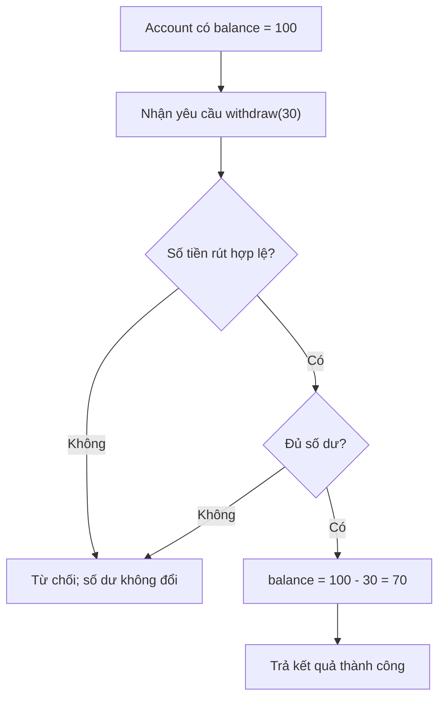
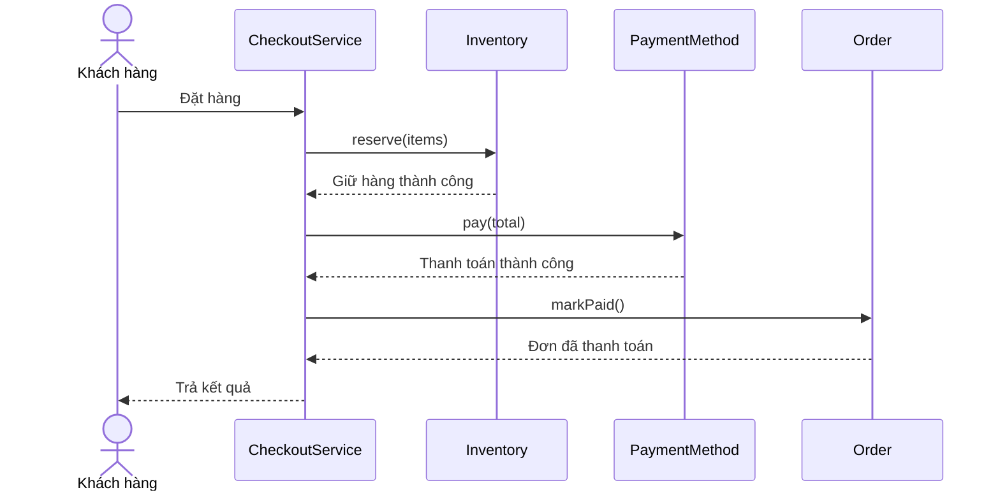
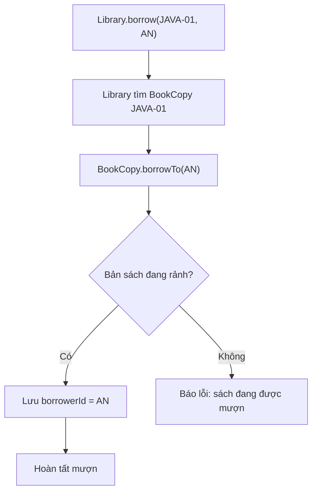
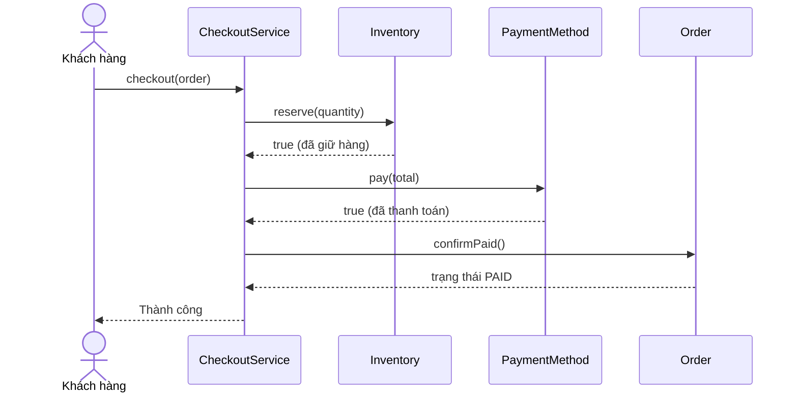

<a id="back-to-top"></a>

# Bắt đầu với OOP — học để giải quyết vấn đề gì?

## Menu
- [1.1 Lập trình hướng đối tượng (OOP) là gì?](#oop-1-1)
- [1.2 Vì sao cần OOP khi chương trình ngày càng lớn?](#oop-1-2)
- [1.3 OOP khác cách tổ chức chương trình theo thủ tục như thế nào?](#oop-1-3)
- [1.4 Một ứng dụng được tạo thành từ các đối tượng phối hợp ra sao?](#oop-1-4)

## <a id="oop-1-1">1.1 Lập trình hướng đối tượng (OOP) là gì?</a>

<details>
<summary>Xem chi tiết</summary>

**OOP (Object-Oriented Programming) — lập trình hướng đối tượng** là một cách **tư duy và tổ chức chương trình** bằng những **đối tượng (object)** có trách nhiệm rõ ràng. Mỗi đối tượng cung cấp các hành vi để những phần khác của chương trình yêu cầu nó thực hiện công việc; đối tượng có thể quản lý trạng thái liên quan đến công việc ấy.

Hãy tưởng tượng bạn đang xây dựng ứng dụng ngân hàng. Chương trình cần biết một tài khoản có bao nhiêu tiền, xử lý việc rút tiền và từ chối khi số tiền rút vượt quá số dư.

Trong cách thiết kế hướng đối tượng, ta có thể tạo một đối tượng `Account` (tài khoản ngân hàng). Thay vì cho mọi nơi trong ứng dụng tự tính lại `balance`, ta yêu cầu:

```java
account.withdraw(30);
```

Đối tượng `account` nhận yêu cầu, kiểm tra điều kiện và tự quyết định có cập nhật số dư hay không.

> **Cách hiểu quan trọng nhất:** Trong OOP, ta quan tâm **ai đang giữ thông tin, ai chịu trách nhiệm xử lý yêu cầu và các đối tượng cần hợp tác thế nào** để giải quyết công việc.

### Một đối tượng OOP trông như thế nào?

Giả sử tồn tại tài khoản của An có số dư 100 đơn vị tiền. Hãy quan sát đối tượng này từ bốn góc nhìn:

| Khía cạnh | Diễn giải | Ví dụ với `Account` |
|---|---|---|
| **Identity — định danh** | Xác định đối tượng cụ thể nào đang được nói đến | Tài khoản của An khác tài khoản của Bình |
| **State — trạng thái** | Thông tin hiện tại của đối tượng | Số dư đang bằng `100` |
| **Behavior — hành vi** | Những thao tác có thể yêu cầu đối tượng thực hiện | `withdraw(30)`, `deposit(20)` |
| **Responsibility — trách nhiệm** | Việc đối tượng phải quản lý, quy tắc phải giữ đúng | Không chấp nhận khoản rút vượt quá số dư |

**State** giống như câu trả lời cho “Đối tượng đang ở tình trạng nào?”. **Behavior** trả lời “Ta có thể yêu cầu nó làm gì?”. **Responsibility** giải thích “Tại sao việc đó nên do chính đối tượng này xử lý?”.

Ví dụ, việc gửi email xác nhận giao dịch có thể giao cho một đối tượng `Notifier`. Không cần bắt `Account` kiêm cả việc gửi email, đọc file cấu hình hay hiển thị màn hình.

#### Theo dõi một hành vi từ đầu đến cuối

Tài khoản ban đầu có 100. Người dùng yêu cầu rút 30.



Từ đầu đến cuối có thể đọc bằng ngôn ngữ đời thường:

1. **Trước yêu cầu:** tài khoản có 100.
2. **Nhận yêu cầu:** rút 30.
3. **Kiểm tra:** số tiền dương và không lớn hơn 100.
4. **Thực hiện:** cập nhật số dư thành 70.
5. **Kết quả quan sát được:** yêu cầu thành công, tài khoản còn 70.

Nếu **một tài khoản khác cũng bắt đầu từ 100** nhận yêu cầu rút 120, kiểm tra sẽ thất bại và tài khoản đó **vẫn còn 100**. Object không được tự sửa trạng thái khi yêu cầu không hợp lệ.

Ý nghĩa của OOP nằm ở chỗ **quy tắc kiểm tra thuộc về tài khoản**, nên phần mã đang sử dụng tài khoản không cần tự sao chép những điều kiện ấy ở nhiều nơi.

### Class và object: bản mô tả và đối tượng thật

Trong Java, ta thường viết một **class (lớp)** để mô tả cấu trúc và hành vi của một loại đối tượng, rồi tạo các **object** cụ thể từ class.

```text
                    CLASS Account
              +-----------------------+
              | owner                 |
              | balance               |
              | withdraw(amount)      |
              | getBalance()          |
              +-----------------------+
                    |          |
                 tạo ra      tạo ra
                    v          v
              Object An    Object Bình
              balance=100  balance=100
```

- **`Account` (class):** định nghĩa chung cho tài khoản.
- **`an` (object):** một tài khoản cụ thể, có số dư riêng.
- **`binh` (object):** một tài khoản khác, cũng có số dư riêng.
- **Instance:** tên gọi khác của một object khi nhấn mạnh nó được tạo ra từ class nào.

Hai object có thể cùng số dư 100 nhưng **không phải cùng một object**. Khi An rút tiền, số dư của Bình không tự nhiên thay đổi.

**Class không phải đối tượng duy nhất quyết định OOP.** Điều làm mô hình hướng đối tượng có ý nghĩa là các object có hành vi và trách nhiệm phù hợp, chứ không đơn thuần là chương trình có sử dụng từ khóa `class`.

### Ví dụ Java hoàn chỉnh: tài khoản tự quản lý số dư

Lưu đoạn mã này vào `Main.java` rồi chạy:

```java
public class Main {
    public static void main(String[] args) {
        Account an = new Account("An", 100);
        Account binh = new Account("Bình", 100);

        boolean anSuccess = an.withdraw(30);
        boolean binhSuccess = binh.withdraw(120);

        System.out.println("An rút thành công? " + anSuccess);
        System.out.println("An còn: " + an.getBalance());
        System.out.println("Bình rút thành công? " + binhSuccess);
        System.out.println("Bình còn: " + binh.getBalance());
        System.out.println("Cùng object? " + (an == binh));
    }
}

class Account {
    private final String owner;
    private int balance;

    public Account(String owner, int openingBalance) {
        if (owner == null || owner.isBlank()) {
            throw new IllegalArgumentException("Thiếu chủ tài khoản");
        }
        if (openingBalance < 0) {
            throw new IllegalArgumentException("Số dư ban đầu phải >= 0");
        }
        this.owner = owner;
        this.balance = openingBalance;
    }

    public boolean withdraw(int amount) {
        if (amount <= 0 || amount > balance) {
            return false;
        }
        balance -= amount;
        return true;
    }

    public int getBalance() {
        return balance;
    }

    public String getOwner() {
        return owner;
    }
}
```

Kết quả:

```text
An rút thành công? true
An còn: 70
Bình rút thành công? false
Bình còn: 100
Cùng object? false
```

#### Đọc từng thành phần của ví dụ

| Câu lệnh / thành phần | Đóng vai trò gì? |
|---|---|
| `class Account` | Mô tả loại đối tượng tài khoản |
| `new Account("An", 100)` | Tạo một tài khoản cụ thể với dữ liệu ban đầu |
| `private int balance` | Giữ số dư bên trong tài khoản, không cho mã ngoài gán trực tiếp |
| `withdraw(int amount)` | Hành vi rút tiền do tài khoản chịu trách nhiệm |
| `getBalance()` | Cung cấp thông tin số dư cho nơi cần đọc |
| `an.withdraw(30)` | Gửi yêu cầu đến đúng object `an` |
| `an == binh` | Kiểm tra hai biến có tham chiếu cùng object hay không; ở đây là không |

Điều cần chú ý là **nơi gọi không hề viết `an.balance = 70`**. Nó chỉ nói “An hãy rút 30”. `Account` tự kiểm tra, thay đổi trạng thái rồi trả kết quả `true` hoặc `false`.

Nếu có thêm màn hình ATM, ứng dụng di động và chức năng rút tiền tại quầy, những phần này đều có thể sử dụng hành vi `withdraw(...)`. Không cần để mỗi màn hình tự thiết kế một cách trừ số dư.

Ví dụ dùng `int` như **đơn vị tiền giả định** để học cách tổ chức object. Hệ thống ngân hàng thực tế còn cần biểu diễn tiền tệ phù hợp, giao dịch cơ sở dữ liệu và xử lý những yêu cầu đồng thời. Riêng cơ chế OOP không tự bảo đảm an toàn giao dịch trong các tình huống đó.

### Một ứng dụng thường có nhiều đối tượng phối hợp

Một tài khoản không thể tự làm mọi chức năng của ứng dụng. Ví dụ, ứng dụng đặt hàng có thể chia công việc như sau:

| Đối tượng | Trách nhiệm điển hình |
|---|---|
| `ShoppingCart` | Quản lý hàng được chọn và tổng tiền |
| `Inventory` | Kiểm tra và giữ số lượng hàng |
| `PaymentMethod` | Thực hiện một cách thanh toán |
| `Order` | Quản lý trạng thái đơn hàng |
| `Notifier` | Gửi thông báo về kết quả |

Nếu khách nhấn **Đặt hàng**, một luồng cộng tác có thể diễn ra:



Sơ đồ được giản lược để thể hiện ý tưởng, chưa mô tả các trường hợp thất bại, hoàn giữ hàng hay transaction.

`CheckoutService` điều phối công việc, còn mỗi object thực hiện phần trách nhiệm của nó. `Inventory` quyết định còn hàng hay không; `PaymentMethod` thực hiện thanh toán; `Order` giữ trạng thái đơn. **Các đối tượng giao tiếp bằng các lời gọi hành vi**, thay vì một đối tượng tự ý chỉnh sửa toàn bộ dữ liệu của đối tượng khác.

Một object cũng không bắt buộc biểu diễn “đồ vật” hữu hình trong đời thực. Các khái niệm như `DiscountPolicy` (quy tắc giảm giá), `PaymentMethod` (cách thanh toán), `Notification` (thông báo) đều có thể là đối tượng nếu cách mô hình hóa đó giúp công việc rõ ràng.

### Tại sao cách tổ chức này hữu ích?

Với một chương trình chỉ cần cộng hai số, tạo nhiều object có thể không đem lại lợi ích. Nhưng khi bài toán có hàng chục thực thể, trạng thái và quy tắc phối hợp, việc đặt rõ trách nhiệm sẽ giúp người viết và người đọc dễ tìm đúng chỗ để thay đổi.

Giả sử ứng dụng bổ sung một cách thanh toán mới: nếu chức năng thanh toán được tổ chức qua một hợp đồng chung, phần xử lý đơn hàng có thể tiếp tục yêu cầu thanh toán mà không phải tự học mọi chi tiết của phương thức mới.

OOP **có thể** hỗ trợ các lợi ích sau, khi được thiết kế tốt:

- **Diễn đạt nghiệp vụ:** những câu lệnh như `account.withdraw(30)` nói rõ ý định.
- **Bảo vệ trạng thái:** object có nơi tập trung kiểm tra trước khi thay đổi dữ liệu.
- **Phân chia trách nhiệm:** sửa quy tắc số dư tìm ở `Account`, sửa cách gửi thông báo tìm ở `Notifier`.
- **Thay đổi có kiểm soát:** bên gọi dùng hợp đồng hành vi rõ ràng, giảm sự phụ thuộc vào chi tiết bên trong.
- **Kiểm thử riêng:** có thể tạo một `Account` với 100 và kiểm tra độc lập các trường hợp rút 30 hay rút 120.

Tuy nhiên, **OOP không tự động khiến code tốt hơn**. Một class làm cả thanh toán, tồn kho, gửi email và tạo báo cáo vẫn có thể rất khó bảo trì. Thiết kế cần xác định đúng ranh giới trách nhiệm, chứ không phải cứ chia thành nhiều class là tốt.

### Bốn khái niệm thường gặp trong OOP

Khi tiếp tục tìm hiểu OOP, bạn sẽ gặp bốn khái niệm quan trọng:

| Khái niệm | Ý nghĩa ngắn gọn | Liên hệ ví dụ |
|---|---|---|
| **Encapsulation — đóng gói** | Gắn trạng thái và hành vi liên quan vào một đơn vị, kiểm soát cách bên ngoài tác động tới trạng thái | `Account` bảo vệ `balance` bằng hành vi `withdraw()` |
| **Abstraction — trừu tượng hóa** | Cung cấp những khả năng bên ngoài cần sử dụng mà không đòi hỏi biết hết chi tiết | Người dùng gọi `withdraw(30)` mà không tự viết từng bước kiểm tra |
| **Inheritance — kế thừa** | Mô tả một kiểu chuyên biệt dựa trên một kiểu chung khi quan hệ thực sự phù hợp | Một loại thông báo cụ thể có thể kế thừa từ kiểu thông báo chung |
| **Polymorphism — đa hình** | Cùng một hợp đồng hành vi có nhiều cách triển khai | Các cách thanh toán cùng hỗ trợ `pay(...)` nhưng xử lý khác nhau |

Đây là **những cách giúp thiết kế object**. Chúng không phải một công thức bắt buộc mọi class đều phải dùng cả bốn. Đặc biệt, kế thừa nên được chọn khi quan hệ giữa các kiểu thực sự hợp lý; một object chỉ cần sử dụng object khác thì nhiều lúc kết hợp các đối tượng sẽ phù hợp hơn.

### Những hiểu nhầm người mới dễ gặp

**“OOP có nghĩa là cứ thêm `class` vào chương trình?”** Không. Class là công cụ biểu diễn kiểu đối tượng. Nếu mọi nơi vẫn tự sửa dữ liệu và không rõ ai chịu trách nhiệm, thiết kế có thể chưa tận dụng được tư duy hướng đối tượng.

**“Object nhất thiết phải có dữ liệu thay đổi được?”** Không. Có những object **bất biến (immutable)**: sau khi tạo, trạng thái không thay đổi. Object vẫn có thể cung cấp hành vi tính toán hoặc trả thông tin.

**“Hai object có dữ liệu giống nhau có phải cùng object?”** Không. Hai tài khoản cùng số dư 100 có thể là hai object độc lập. `an == binh` trong ví dụ bằng `false` dù cả hai cùng được tạo với 100 ban đầu.

**“OOP tốt hơn lập trình thủ tục trong mọi trường hợp?”** Không. Các hàm thuần túy và cách tổ chức theo thủ tục vẫn rất hữu ích. OOP là lựa chọn phù hợp khi việc mô hình hóa các đối tượng, trách nhiệm và sự cộng tác giúp bài toán dễ hiểu hơn.

#### Tự kiểm tra bằng một tình huống

Một tài khoản đang có 100. Mã bên ngoài được gọi `account.withdraw(30)` rồi nhận kết quả thành công.

Hãy tự trả lời:

1. **State sau lời gọi là bao nhiêu?** — Còn 70.
2. **Ai quyết định yêu cầu được chấp nhận?** — Chính object `account`, thông qua hành vi `withdraw`.
3. **Nếu tài khoản khác cũng bắt đầu với 100 thì có bị thay đổi không?** — Không, nếu đó là một object độc lập.
4. **Vì sao `withdraw(30)` thể hiện tư duy OOP rõ hơn phép gán `balance = 70` từ bên ngoài?** — Vì nó nêu rõ hành động và đặt trách nhiệm kiểm tra, cập nhật vào đúng đối tượng.

Khi có thể giải thích **đối tượng nào tồn tại, đang có trạng thái gì, cung cấp hành vi nào và chịu trách nhiệm về quy tắc nào**, bạn đã nắm được ý tưởng cốt lõi của **lập trình hướng đối tượng**.

</details>

- [Quay lại đầu trang](#back-to-top)

---

## <a id="oop-1-2">1.2 Vì sao cần OOP khi chương trình ngày càng lớn?</a>

<details>
<summary>Xem chi tiết</summary>

### 1. Chương trình lớn lên thì điều gì bắt đầu khó?

Lúc mới học lập trình, một bài toán thường rất gọn: nhập dữ liệu, kiểm tra điều kiện, xử lý rồi in kết quả. Ví dụ, để cho một người mượn sách, ta chỉ cần kiểm tra xem cuốn sách còn hay không và đánh dấu là đã được mượn.

Với vài chục dòng code, viết một vài hàm là đủ. Nhưng hãy tưởng tượng thư viện bắt đầu hoạt động thật:

- Một đầu sách có nhiều **bản sách** với mã riêng.
- Mỗi bản sách chỉ được một người mượn tại một thời điểm.
- Trả sách phải đúng người đã mượn.
- Thành viên có giới hạn số sách đang mượn.
- Có hạn trả, gia hạn, đặt trước, tính phí trả muộn.
- Một ứng dụng web, một ứng dụng di động và một chương trình quản trị cùng sử dụng hệ thống.

Lúc này, vấn đề không chỉ là có **nhiều dòng code**. Vấn đề là các **quy tắc thay đổi** và nhiều phần của chương trình cùng tác động lên một dữ liệu.

Nếu mỗi chức năng tự kiểm tra “sách có đang được mượn không” theo cách riêng, chỉ cần quên kiểm tra ở một chỗ là hệ thống có thể xử lý sai. Khi bổ sung quy định mới, lập trình viên phải tìm và sửa rất nhiều nơi. Việc sửa một chức năng có thể vô tình làm hỏng chức năng khác.

**OOP (Object-Oriented Programming — lập trình hướng đối tượng)** là một cách tổ chức chương trình để đối phó với sự phức tạp đó. Thay vì để dữ liệu và các thao tác liên quan nằm rải rác, ta nhóm chúng theo những đối tượng có **trạng thái, trách nhiệm và hành vi rõ ràng**, rồi cho các đối tượng phối hợp với nhau.

OOP không khiến hệ thống lớn trở nên đơn giản một cách tự động. Nó cung cấp cách chia nhỏ vấn đề để con người có thể hiểu, sửa và mở rộng từng phần dễ hơn.

### 2. Khi logic còn nằm rải rác: một ví dụ cụ thể

Giả sử ban đầu ta dùng một `Map` để lưu thông tin: khóa là mã bản sách, giá trị là mã người đang mượn.

```java
import java.util.HashMap;
import java.util.Map;

class BorrowingExample {
    static final Map<String, String> borrowerByCopy = new HashMap<>();

    static void borrow(String copyId, String memberId) {
        if (borrowerByCopy.containsKey(copyId)) {
            throw new IllegalStateException("Sách đang được mượn");
        }
        borrowerByCopy.put(copyId, memberId);
    }

    static void returnBook(String copyId) {
        borrowerByCopy.remove(copyId);
    }
}
```

Trong một bài thực hành nhỏ, cách viết này rất dễ hiểu. Nó vẫn có thể chạy đúng với trường hợp đơn giản:

```java
BorrowingExample.borrow("JAVA-01", "AN");
BorrowingExample.returnBook("JAVA-01");
```

Nhưng hãy xem vài câu hỏi phát sinh:

1. `borrow("UNKNOWN", "AN")` có được phép không nếu mã bản sách chưa từng được đăng ký?
2. Ai kiểm tra `memberId` không được để trống?
3. Nếu người khác gọi `returnBook("JAVA-01")`, chương trình có kiểm tra đúng người mượn không?
4. Nếu các chức năng khác cũng sửa trực tiếp `borrowerByCopy`, liệu chúng có tuân theo cùng một quy tắc?

Ở bản ví dụ trên, `returnBook` xóa thông tin người mượn mà không xác định ai đang trả. Tệ hơn, vì dữ liệu nằm trong một `Map` có thể bị sửa trực tiếp bởi code có quyền truy cập, một đoạn mã khác có thể cập nhật hoặc xóa trạng thái mà không qua bất kỳ quy tắc nào.

**Lưu ý:** lỗi này không phải vì sử dụng hàm hoặc `Map` là sai. Ta hoàn toàn có thể thêm kiểm tra, chia module, ẩn biến và viết code thủ tục rất tốt. Điều cần nhìn ra là khi hệ thống có nhiều chức năng, việc **quy định nơi nào được phép thay đổi dữ liệu và nơi nào chịu trách nhiệm kiểm tra** trở nên đặc biệt quan trọng.

### 3. OOP đưa trách nhiệm về đúng đối tượng

Trong ví dụ thư viện, hãy chọn một đối tượng cụ thể: **một bản sách có mã `JAVA-01`**.

Bản sách có dữ liệu cần quản lý:
- Mã định danh của chính bản sách.
- Người đang mượn; nếu chưa ai mượn thì sách đang sẵn sàng.

Và nó có hành vi:
- Cho một thành viên mượn nếu bản sách đang rảnh.
- Nhận trả nếu đúng người đang mượn.
- Cho biết hiện tại có sẵn để mượn hay không.

Ta viết lớp `BookCopy` để **chịu trách nhiệm bảo vệ những quy tắc này**. Còn `Library` chịu trách nhiệm quản lý danh sách bản sách và tìm đúng bản sách khi nhận yêu cầu.

Dưới đây là ví dụ chạy được trong **một file `LibraryDemo.java`** với Java 11 trở lên:

```java
import java.util.HashMap;
import java.util.Map;
import java.util.Objects;

public class LibraryDemo {
    public static void main(String[] args) {
        Library library = new Library();
        library.add(new BookCopy("JAVA-01"));

        library.borrow("JAVA-01", "AN");
        System.out.println(library.isAvailable("JAVA-01")); // false

        try {
            library.borrow("JAVA-01", "BINH");
        } catch (IllegalStateException ex) {
            System.out.println(ex.getMessage()); // Sách đang được mượn
        }

        try {
            library.returnCopy("JAVA-01", "BINH");
        } catch (IllegalStateException ex) {
            System.out.println(ex.getMessage()); // Không đúng người mượn
        }

        library.returnCopy("JAVA-01", "AN");
        System.out.println(library.isAvailable("JAVA-01")); // true
    }
}

class BookCopy {
    private final String code;
    private String borrowerId; // null: chưa ai mượn

    BookCopy(String code) {
        if (code == null || code.isBlank()) {
            throw new IllegalArgumentException("Mã sách không hợp lệ");
        }
        this.code = code;
    }

    String code() {
        return code;
    }

    boolean isAvailable() {
        return borrowerId == null;
    }

    void borrowTo(String memberId) {
        requireMemberId(memberId);

        if (!isAvailable()) {
            throw new IllegalStateException("Sách đang được mượn");
        }

        borrowerId = memberId;
    }

    void returnFrom(String memberId) {
        requireMemberId(memberId);

        if (isAvailable()) {
            throw new IllegalStateException("Sách chưa được mượn");
        }
        if (!borrowerId.equals(memberId)) {
            throw new IllegalStateException("Không đúng người mượn");
        }

        borrowerId = null;
    }

    private void requireMemberId(String memberId) {
        if (memberId == null || memberId.isBlank()) {
            throw new IllegalArgumentException("Mã thành viên không hợp lệ");
        }
    }
}

class Library {
    private final Map<String, BookCopy> copies = new HashMap<>();

    void add(BookCopy copy) {
        Objects.requireNonNull(copy, "Bản sách không được null");

        if (copies.putIfAbsent(copy.code(), copy) != null) {
            throw new IllegalArgumentException("Trùng mã bản sách");
        }
    }

    void borrow(String copyId, String memberId) {
        findCopy(copyId).borrowTo(memberId);
    }

    void returnCopy(String copyId, String memberId) {
        findCopy(copyId).returnFrom(memberId);
    }

    boolean isAvailable(String copyId) {
        return findCopy(copyId).isAvailable();
    }

    private BookCopy findCopy(String copyId) {
        BookCopy copy = copies.get(copyId);

        if (copy == null) {
            throw new IllegalArgumentException("Không tìm thấy bản sách");
        }

        return copy;
    }
}
```

Ở đây, `borrowerId` là `private`; các lớp khác không thể gán trực tiếp cho nó. Muốn mượn hoặc trả, code phải đi qua hành vi được `BookCopy` cung cấp.

Hãy chú ý **mỗi lớp trả lời một câu hỏi riêng**:

| Đối tượng | Biết điều gì? | Chịu trách nhiệm điều gì? |
|---|---|---|
| `BookCopy` | Mã bản sách, người đang mượn | Giữ trạng thái mượn/trả nhất quán cho bản sách |
| `Library` | Có những bản sách nào | Tìm bản sách và chuyển yêu cầu đến đúng đối tượng |
| `LibraryDemo` | Kịch bản muốn thực hiện | Gửi yêu cầu và hiển thị kết quả |

Ví dụ này chưa có quy định thời hạn, số lượng tối đa hay lưu dữ liệu vào database. Nó chỉ minh họa cách **đặt một quy tắc vào đúng nơi chịu trách nhiệm về nó**. Hệ thống thật sẽ cần thêm thiết kế cho dữ liệu bền vững, giao dịch và truy cập đồng thời.

### 4. Theo dõi một yêu cầu để thấy điểm khác biệt

Giả sử bản sách `JAVA-01` ban đầu chưa ai mượn.



Sau khi An đã mượn, Bình gọi cùng yêu cầu. Lần này `BookCopy` tự biết nó đang được mượn, nên từ chối yêu cầu. Trạng thái không đổi. Nếu Bình cố trả cuốn sách đó, `returnFrom("BINH")` cũng từ chối vì người mượn hiện tại là `AN`.

Điểm đáng chú ý là **phần gọi từ bên ngoài không phải lặp lại quy tắc mượn/trả**. Mã xử lý giao diện web, dòng lệnh hay chức năng quản trị có thể chuyển yêu cầu đến `Library`; nơi cuối cùng kiểm soát tính hợp lệ của trạng thái là `BookCopy`.

Khi quy định về bản sách thay đổi, đội phát triển có một điểm tập trung để xem xét và sửa. Đây là lợi ích trực tiếp của việc giao **quyền sở hữu trạng thái và quy tắc** cho đối tượng.

### 5. Những lợi ích xuất hiện rõ nhất khi chương trình phát triển

#### 5.1. Dễ hiểu hơn vì code có ranh giới trách nhiệm

Một chương trình lớn luôn chứa nhiều phần việc: đăng nhập, tìm kiếm, mượn sách, trả sách, báo cáo, thanh toán phí trễ hạn…

Nếu mọi thứ đều nằm trong một lớp `Application` khổng lồ, lập trình viên muốn sửa một quy tắc mượn sách sẽ phải đọc cả phần thanh toán và báo cáo để biết có gì liên quan.

Khi phân chia tốt, người đọc có thể bắt đầu từ lớp hoặc đối tượng phụ trách vấn đề đang cần xử lý.

Ví dụ, câu hỏi “vì sao người khác không thể trả sách thay An?” có thể tìm lời giải ngay tại `BookCopy.returnFrom(...)`. Người đọc chưa cần hiểu cách in báo cáo hay cách lưu danh sách vào database.

**Giảm lượng thông tin phải giữ trong đầu cùng lúc** là một lợi ích quan trọng khi codebase lớn lên.

#### 5.2. Một thay đổi có thể tác động vào ít nơi hơn

Giả sử thư viện đổi quy định: khi nhận trả sách, phải kiểm tra người mượn và ghi lại thời điểm trả.

Nếu logic mượn/trả được viết lại trong nhiều controller hoặc màn hình, mỗi nơi có thể cần sửa. Nguy cơ sót một chỗ càng lớn khi số chức năng tăng.

Nếu hành vi trả sách có một nơi phụ trách, ta có thể mở rộng mô hình, chẳng hạn tách thông tin lượt mượn thành đối tượng `Loan` để lưu người mượn, ngày mượn, hạn trả và ngày trả. Các nơi sử dụng chỉ cần tiếp tục gửi yêu cầu “trả bản sách này” qua giao diện đã được thiết kế.

Tất nhiên **không phải mọi thay đổi đều được cô lập hoàn toàn**. Nếu quy tắc mới làm thay đổi dữ liệu đầu vào, kết quả hoặc hợp đồng giao tiếp, các phần khác vẫn có thể phải cập nhật. OOP giúp chúng ta thiết kế điểm thay đổi có kiểm soát, chứ không xóa bỏ quan hệ phụ thuộc.

#### 5.3. Bảo vệ dữ liệu và quy tắc nghiệp vụ

Nếu cho bất kỳ nơi nào cũng viết:

```java
// Giả định borrowerId bị công khai:
copy.borrowerId = null;
```

thì bất kỳ chức năng nào cũng có thể “trả sách” mà bỏ qua kiểm tra người mượn.

Với trạng thái `private`, chúng ta chủ động công khai **hành vi có ý nghĩa** như `borrowTo(...)` và `returnFrom(...)`. Mọi yêu cầu đều phải tuân thủ quy tắc do đối tượng quản lý.

Đây là ý nghĩa thực tế của **đóng gói**: dữ liệu và các thao tác bảo vệ dữ liệu được gắn với nhau. Nó giảm khả năng các phần khác vô tình làm hỏng trạng thái.

Hãy nhớ rằng `private` một mình chưa đủ. Nếu tạo `public void setBorrowerId(String id)` rồi cho gọi tùy ý, quy tắc vẫn có thể bị bỏ qua. Điều quan trọng là **thiết kế hành vi**, không chỉ thêm từ khóa truy cập.

#### 5.4. Dễ kiểm thử từng trách nhiệm

Khi cần biết `BookCopy` có giữ đúng trạng thái không, ta có thể tạo một bản sách và kiểm tra riêng:

```java
BookCopy copy = new BookCopy("JAVA-02");

assert copy.isAvailable();

copy.borrowTo("AN");
assert !copy.isAvailable();

try {
    copy.borrowTo("BINH");
    throw new AssertionError("Lẽ ra phải từ chối");
} catch (IllegalStateException expected) {
    // Đúng: không cho hai người mượn cùng một bản sách
}

copy.returnFrom("AN");
assert copy.isAvailable();
```

Đoạn trên dùng Java `assert` để minh họa; khi tự chạy, bật assertion bằng tùy chọn `-ea`. Trong dự án thật, có thể viết unit test bằng JUnit để kiểm tra những trường hợp này.

Điểm chính là ta **kiểm tra được quy tắc của một đối tượng** mà chưa cần dựng giao diện web, kết nối database hay gửi yêu cầu HTTP. Điều này giúp tìm nguyên nhân lỗi rõ hơn và giảm công sức kiểm tra lại cả hệ thống khi sửa một phần.

#### 5.5. Dễ bổ sung cách thực hiện khác khi thật sự có nhu cầu

Sau này, thư viện có thể áp dụng giới hạn mượn khác nhau cho sinh viên và giảng viên:

- Sinh viên: tối đa 5 cuốn.
- Giảng viên: tối đa 10 cuốn.

Ta có thể tách **quy tắc giới hạn mượn** khỏi đối tượng quản lý bản sách:

```java
interface BorrowLimitPolicy {
    boolean canBorrow(int currentBorrowedCount);
}

class StudentBorrowLimit implements BorrowLimitPolicy {
    @Override
    public boolean canBorrow(int currentBorrowedCount) {
        return currentBorrowedCount < 5;
    }
}

class LecturerBorrowLimit implements BorrowLimitPolicy {
    @Override
    public boolean canBorrow(int currentBorrowedCount) {
        return currentBorrowedCount < 10;
    }
}
```

Đây là một ví dụ **chính sách có thể thay thế**, chưa được tích hợp vào chương trình `LibraryDemo` ở trên. Trong hệ thống hoàn chỉnh, dịch vụ xử lý mượn cần kiểm tra chính sách của thành viên và phối hợp cập nhật lượt mượn một cách nhất quán.

Khi quy tắc đủ đa dạng, chương trình có thể làm việc thông qua `BorrowLimitPolicy` và chọn implementation phù hợp. Ta không cần nhồi mọi biến thể vào một dãy `if-else` ở tất cả nơi cần kiểm tra.

Tuy nhiên, chỉ **nên tạo interface hay thêm nhiều class khi có lý do**. Với một quy tắc đơn giản và ít thay đổi, một phương thức bình thường vẫn rất tốt. Tạo tầng trừu tượng quá sớm có thể khiến chương trình khó hiểu hơn.

### 6. Vì sao OOP giúp làm việc nhóm?

Hãy tưởng tượng ba lập trình viên đang cùng phát triển hệ thống thư viện:

| Người phụ trách | Phần việc | Điều cần thống nhất với nhau |
|---|---|---|
| Nhóm mượn/trả | `BookCopy`, quản lý lượt mượn | Cách yêu cầu mượn, trả và nhận lỗi |
| Nhóm giao diện | Trang tìm kiếm, nút mượn/trả | Gọi đúng hành vi đã công bố |
| Nhóm báo cáo | Sách đang mượn, thống kê quá hạn | Sử dụng dữ liệu và kết quả được cung cấp hợp lệ |

Khi từng phần có **trách nhiệm và giao diện trao đổi rõ**, các nhóm ít phải chạm vào logic nội bộ của nhau.

Chẳng hạn nhóm mượn/trả thay đổi cách lưu người đang mượn từ một chuỗi `borrowerId` sang một đối tượng `Loan`. Nếu hành vi mà các phần khác sử dụng vẫn giữ hợp đồng cũ, những phần đó có thể không cần thay đổi.

Điều này có tác dụng lớn trong bảo trì lâu dài: code sẽ được đọc và sửa bởi nhiều người, vào nhiều thời điểm khác nhau. Một lớp có tên, trạng thái và trách nhiệm rõ sẽ dễ tiếp cận hơn một tập hợp thao tác không xác định ai chịu trách nhiệm cuối cùng.

### 7. OOP giải quyết vấn đề gì, và không tự giải quyết vấn đề gì?

Một quan niệm dễ gặp là “chương trình càng lớn thì cứ có nhiều class sẽ càng tốt”. Thực tế, **chia thành nhiều class không đồng nghĩa với thiết kế tốt**.

| OOP có thể giúp khi thiết kế đúng | OOP không tự động bảo đảm |
|---|---|
| Gom trạng thái và hành vi liên quan vào nơi chịu trách nhiệm | Thuật toán luôn đúng |
| Giới hạn phần code được phép thay đổi trạng thái | Dữ liệu luôn an toàn khi nhiều luồng cùng truy cập |
| Thể hiện sự hợp tác giữa các thành phần | Thao tác qua nhiều đối tượng/database luôn có transaction |
| Cho phép thay implementation theo hợp đồng chung | Hệ thống tự nhiên chạy nhanh hơn |
| Giảm phụ thuộc vào chi tiết nội bộ | Mọi hệ thống đều nên dùng kế thừa sâu hoặc nhiều interface |
| Giúp chia nhỏ phạm vi hiểu, sửa và kiểm thử | Không bao giờ phải sửa nhiều phần khi yêu cầu thay đổi |

Ví dụ, chương trình `LibraryDemo` chỉ quản lý dữ liệu **trong bộ nhớ và trong một luồng sử dụng đơn giản**. Khi có nhiều yêu cầu mượn sách đồng thời hoặc nhiều máy chủ chạy cùng lúc, kiểm tra “đang rảnh” rồi cập nhật sẽ cần cơ chế nhất quán phù hợp như giao dịch database và kiểm soát cạnh tranh. Chỉ tạo đối tượng `BookCopy` không tự giải quyết việc đó.

OOP cũng không phải cách duy nhất để tổ chức chương trình lớn. Code dùng hàm thuần, module, kiểu dữ liệu bất biến hoặc phong cách functional vẫn có thể rất dễ bảo trì. Trong Java thực tế, các phong cách thường **kết hợp** với nhau. OOP hữu ích khi bài toán có những đối tượng, trạng thái và trách nhiệm cần quản lý qua thời gian.

### 8. Khi nào nên bắt đầu áp dụng OOP?

Bạn có thể dùng những dấu hiệu sau để đánh giá:

1. **Một dữ liệu đang bị sửa ở nhiều nơi?** Hãy xác định ai thực sự sở hữu dữ liệu đó và những thao tác nào được phép làm thay đổi nó.
2. **Một quy tắc nghiệp vụ lặp lại trong nhiều chức năng?** Hãy đưa quy tắc về một nơi có trách nhiệm rõ ràng.
3. **Mỗi lần thêm tính năng phải sửa nhiều nhánh điều kiện ở khắp chương trình?** Hãy xem các hành vi nào có thể được tách và thay thế qua một hợp đồng chung.
4. **Khó kiểm tra một chức năng nếu chưa chạy cả ứng dụng?** Hãy tìm cách chia trách nhiệm để phần logic quan trọng có thể được kiểm thử riêng.
5. **Một lớp đã biết quá nhiều việc?** Hãy cân nhắc tách trách nhiệm thay vì tiếp tục nhồi phương thức vào lớp đó.

Các câu hỏi này quan trọng hơn việc đếm số lớp hoặc cố áp dụng tất cả khái niệm OOP ngay từ đầu.

#### Bài tự suy nghĩ

Giả sử thư viện bổ sung tính năng **gia hạn sách** và quy tắc “không cho gia hạn nếu có người đang đặt trước”.

Bạn sẽ đặt đoạn kiểm tra ở đâu?

Nếu chỉ nhìn ví dụ hiện tại, đừng vội thêm hàng loạt class. Trước tiên hãy xác định:
- Đối tượng nào biết một **lượt mượn** đang còn hiệu lực và có hạn trả nào?
- Thành phần nào biết bản sách đang có **yêu cầu đặt trước**?
- Ai chịu trách nhiệm điều phối gia hạn để không bỏ sót hai điều kiện?

Khi phân rõ người chịu trách nhiệm về mỗi thông tin, cách tổ chức đối tượng bắt đầu có ý nghĩa. Có thể sau đó bạn sẽ cần một lớp `Loan` và một dịch vụ điều phối; quyết định này xuất phát từ **yêu cầu mới**, không phải vì thấy mỗi danh từ đều phải biến thành một class.

### 9. Điều cần mang theo khi học OOP

Câu hỏi “Vì sao cần OOP khi chương trình ngày càng lớn?” có thể trả lời bằng ba khó khăn rất thực tế:

**Khó hiểu:** Có quá nhiều dữ liệu và xử lý đan xen; người sửa code không biết bắt đầu từ đâu.

**Khó thay đổi:** Một quy tắc nằm ở nhiều nơi; thêm tính năng mới dễ kéo theo lỗi ở phần đang chạy ổn định.

**Khó kiểm soát:** Nhiều thành phần cùng thay đổi trạng thái; rất khó chắc chắn mọi thao tác tuân theo quy tắc nghiệp vụ.

OOP giúp đối phó bằng cách gắn **trạng thái với hành vi chịu trách nhiệm bảo vệ nó**, xác định **ranh giới và hợp đồng giao tiếp** giữa các đối tượng, rồi để chúng phối hợp hoàn thành công việc.

Với bài toán thư viện, `Library` tìm bản sách, `BookCopy` quản lý trạng thái mượn/trả, và chương trình gửi yêu cầu qua các hành vi đã được thiết kế. Khi quy tắc phát triển, mỗi phần có địa chỉ rõ ràng để kiểm tra và mở rộng.

**Tư duy quan trọng nhất:** trước khi hỏi “Tôi nên tạo bao nhiêu class?”, hãy hỏi **“Ai chịu trách nhiệm về dữ liệu và quy tắc này, và những phần khác cần yêu cầu nó làm gì?”**. Đó là lý do OOP có giá trị khi phần mềm ngày càng lớn và phải liên tục thay đổi.

</details>

- [Quay lại đầu trang](#back-to-top)

---

## <a id="oop-1-3">1.3 OOP khác cách tổ chức chương trình theo thủ tục như thế nào?</a>

<details>
<summary>Xem chi tiết</summary>

Giả sử bạn viết chương trình quản lý tài khoản ngân hàng. Chương trình cần giữ số dư, nạp tiền, rút tiền và từ chối giao dịch nếu số tiền không hợp lệ.

Có ít nhất hai cách tổ chức mã nguồn quen thuộc:

- **Theo thủ tục (procedural):** đặt các bước xử lý trong những hàm/thủ tục. Dữ liệu tài khoản được truyền vào các hàm để xử lý.
- **Theo hướng đối tượng (object-oriented, OOP):** biểu diễn tài khoản thành một đối tượng chịu trách nhiệm quản lý trạng thái và cung cấp những thao tác hợp lệ với trạng thái đó.

Cả hai đều có thể giải đúng cùng một bài toán. **Khác biệt cốt lõi nằm ở cách phân chia trách nhiệm: ai sở hữu dữ liệu, ai được quyền thay đổi dữ liệu, và mã bên ngoài phải biết những gì để thực hiện một công việc.**

Hãy bắt đầu từ một ví dụ thật, rồi nhìn lại vì sao sự khác biệt này trở nên quan trọng khi chương trình lớn dần.

### 1. Một bài toán, hai cách đặt câu hỏi

Người dùng yêu cầu: “Rút 30.000 đồng từ tài khoản có 100.000 đồng; nếu rút quá số dư thì từ chối”.

Khi tổ chức theo thủ tục, ta thường suy nghĩ:

> Cần những bước nào để xử lý yêu cầu? Hàm nào nhận dữ liệu, kiểm tra rồi cập nhật?

Khi tổ chức theo OOP, ta thường suy nghĩ:

> Đối tượng nào chịu trách nhiệm về số dư? Bên ngoài được yêu cầu đối tượng thực hiện những hành động nào?

Ví dụ về cách gọi ở hai kiểu tổ chức:

| Cách tổ chức | Mã gọi dễ gặp | Ai quyết định quy tắc rút tiền? |
| --- | --- | --- |
| Theo thủ tục | \`AccountOperations.withdraw(account, 30_000)\` | Hàm \`withdraw\` nhận dữ liệu tài khoản |
| Theo OOP | \`account.withdraw(30_000)\` | Chính đối tượng \`account\` thông qua phương thức của nó |

Nhìn riêng vào dấu chấm \`.\` chưa đủ để phân biệt hai tư duy. Trong Java, cả hàm \`static\` lẫn phương thức của đối tượng đều có thể được gọi bằng dấu chấm. Phải xem **quy tắc nằm ở đâu, dữ liệu được cung cấp thế nào, và ai kiểm soát quyền thay đổi**.

### 2. Cách tổ chức theo thủ tục: hàm xử lý, dữ liệu được đưa vào

Đây là một chương trình Java hoàn chỉnh. Lưu thành \`ProceduralDemo.java\` và chạy để quan sát:

\`\`\`java
class AccountData {
    final String owner;
    long balance;

    AccountData(String owner, long initialBalance) {
        if (owner == null || owner.isBlank()) {
            throw new IllegalArgumentException("Owner is required");
        }
        if (initialBalance < 0) {
            throw new IllegalArgumentException("Balance must be >= 0");
        }

        this.owner = owner;
        this.balance = initialBalance;
    }
}

final class AccountOperations {
    private AccountOperations() {
        // Utility class: không cần tạo instance.
    }

    static void deposit(AccountData account, long amount) {
        if (amount <= 0) {
            throw new IllegalArgumentException("Amount must be positive");
        }
        account.balance = Math.addExact(account.balance, amount);
    }

    static void withdraw(AccountData account, long amount) {
        if (amount <= 0) {
            throw new IllegalArgumentException("Amount must be positive");
        }
        if (amount > account.balance) {
            throw new IllegalStateException("Insufficient funds");
        }
        account.balance -= amount;
    }
}

public class ProceduralDemo {
    public static void main(String[] args) {
        AccountData account = new AccountData("An", 100_000);

        AccountOperations.withdraw(account, 30_000);
        System.out.println(account.balance); // 70000

        try {
            AccountOperations.withdraw(account, 120_000);
        } catch (IllegalStateException ex) {
            System.out.println(ex.getMessage()); // Insufficient funds
        }

        System.out.println(account.balance); // Vẫn là 70000
    }
}
\`\`\`

Chương trình này vẫn có kiểm tra dữ liệu và xử lý lỗi đúng cho những thao tác sử dụng \`AccountOperations\`. Cụ thể:

1. \`main\` giữ dữ liệu \`AccountData\` có \`balance = 100_000\`.
2. \`main\` chuyển dữ liệu đó cho hàm \`AccountOperations.withdraw(account, 30_000)\`.
3. Hàm kiểm tra số tiền cần rút rồi thay đổi \`account.balance\` thành \`70_000\`.
4. Lần rút \`120_000\` thất bại ở bước kiểm tra số dư, trước khi phép trừ xảy ra.
5. Số dư vẫn là \`70_000\`.

Điều đáng chú ý là **\`AccountData\` chỉ giữ thông tin, còn \`AccountOperations\` chứa các thao tác chính**. Khi muốn rút tiền, mã gọi phải chọn hàm thao tác và truyền đúng dữ liệu vào.

Kiểu tổ chức này có những ưu điểm thực tế:

- Các hàm xử lý được nhóm theo tác vụ và dễ đọc theo trình tự.
- Với công việc tính toán hoặc xử lý dữ liệu theo luồng rõ ràng, một chuỗi hàm nhỏ có thể đơn giản và dễ kiểm tra.
- Không cần tạo nhiều kiểu đối tượng nghiệp vụ chỉ để thực hiện vài bước cố định.

Nhưng hãy chú ý một điểm trong **thiết kế cụ thể** này: \`balance\` có quyền truy cập mặc định trong package. Mã khác cùng package có thể làm:

\`\`\`java
account.balance = -500_000;
\`\`\`

Nó bỏ qua hoàn toàn \`AccountOperations.withdraw(...)\`. Đây là một lỗ hổng đóng gói **của ví dụ**, không phải lỗi bắt buộc của mọi chương trình thủ tục. Người viết mã thủ tục vẫn có thể bảo vệ dữ liệu bằng module, hàm truy cập có kiểm tra, kiểu dữ liệu bất biến và quy ước phân quyền phù hợp.

Điểm cần nhìn là: nếu dữ liệu và mọi thao tác được tổ chức tách rời, người thiết kế phải quản lý rất cẩn thận **những nơi nào có quyền sửa dữ liệu**.

### 3. Tổ chức theo OOP: đối tượng quản lý trạng thái và hành vi

Cũng bài toán trên, ta thiết kế \`BankAccount\` là một đối tượng có trạng thái \`balance\` và các hành vi \`deposit\`, \`withdraw\`. Lưu thành file độc lập \`OopDemo.java\`:

\`\`\`java
final class BankAccount {
    private final String owner;
    private long balance;

    BankAccount(String owner, long initialBalance) {
        if (owner == null || owner.isBlank()) {
            throw new IllegalArgumentException("Owner is required");
        }
        if (initialBalance < 0) {
            throw new IllegalArgumentException("Balance must be >= 0");
        }

        this.owner = owner;
        this.balance = initialBalance;
    }

    public long getBalance() {
        return balance;
    }

    public void deposit(long amount) {
        if (amount <= 0) {
            throw new IllegalArgumentException("Amount must be positive");
        }
        balance = Math.addExact(balance, amount);
    }

    public void withdraw(long amount) {
        if (amount <= 0) {
            throw new IllegalArgumentException("Amount must be positive");
        }
        if (amount > balance) {
            throw new IllegalStateException("Insufficient funds");
        }
        balance -= amount;
    }
}

public class OopDemo {
    public static void main(String[] args) {
        BankAccount account = new BankAccount("An", 100_000);

        account.withdraw(30_000);
        System.out.println(account.getBalance()); // 70000

        try {
            account.withdraw(120_000);
        } catch (IllegalStateException ex) {
            System.out.println(ex.getMessage()); // Insufficient funds
        }

        System.out.println(account.getBalance()); // Vẫn là 70000
    }
}
\`\`\`

Kết quả nghiệp vụ **giống ví dụ trước**. Khác biệt nằm trong thiết kế:

- \`BankAccount\` có trách nhiệm giữ \`balance\` ở trạng thái hợp lệ.
- Trường \`balance\` là \`private\`, nên mã khác không thể tự gán số dư trực tiếp.
- Muốn thay đổi số dư, mã ngoài phải gửi yêu cầu qua hành vi \`deposit(...)\` hoặc \`withdraw(...)\`.
- Đối tượng tự kiểm tra quy tắc trước khi cập nhật; nếu không hợp lệ, nó từ chối thao tác.

Ví dụ:

\`\`\`java
account.withdraw(30_000); // Yêu cầu tài khoản rút tiền
account.getBalance();      // Hỏi số dư hiện tại

// account.balance = -10;  // Lỗi biên dịch: balance là private
\`\`\`

Đây là một cách thực hiện **đóng gói (encapsulation)** trong OOP: đối tượng gom trạng thái cùng với các hành vi chịu trách nhiệm về trạng thái đó, đồng thời công khai một giao diện sử dụng có kiểm soát.

Một quy tắc như “số dư của tài khoản không được âm” được gọi là **bất biến của đối tượng (invariant)**. Đặt thao tác \`withdraw(...)\` trong đối tượng giúp tập trung trách nhiệm duy trì quy tắc ấy.

Lưu ý: \`private\` không tự động tạo ra thiết kế OOP tốt. Nếu ta công khai \`setBalance(long anyValue)\` rồi cho phép gán tùy ý, quy tắc nghiệp vụ vẫn có thể bị phá vỡ. Điều quan trọng là **API của đối tượng thể hiện những hành động được phép**.

Cả hai đoạn code là mô hình dạy học đơn giản. Phần mềm ngân hàng thật còn cần lưu lịch sử giao dịch, xử lý lỗi lưu trữ, bảo đảm nhất quán và kiểm soát giao dịch đồng thời. Các vấn đề đó không tự biến mất chỉ vì dùng OOP.

### 4. So sánh luồng xử lý của hai cách

Cùng một yêu cầu “Rút 30.000 đồng”, ta có thể hình dung:

\`\`\`mermaid
flowchart TD
    subgraph Procedural["Tổ chức theo thủ tục"]
        P1["Mã gọi giữ AccountData"] --> P2["Gọi withdraw(account, 30000)"]
        P2 --> P3["Hàm kiểm tra và sửa account.balance"]
    end
    subgraph ObjectOriented["Tổ chức theo OOP"]
        O1["Mã gọi giữ BankAccount"] --> O2["Gửi yêu cầu account.withdraw(30000)"]
        O2 --> O3["Đối tượng tự kiểm tra và cập nhật balance"]
    end
\`\`\`

Bảng này giúp so sánh chính xác hơn những gì mỗi cách tổ chức khuyến khích:

| Góc nhìn | Tổ chức theo thủ tục | Tổ chức theo OOP |
| --- | --- | --- |
| Đơn vị tư duy trung tâm | Tác vụ, hàm, trình tự bước xử lý | Đối tượng, trách nhiệm, tương tác |
| Dữ liệu ở đâu? | Có thể tách thành cấu trúc được truyền giữa các hàm | Thường là trạng thái do đối tượng sở hữu/quản lý |
| Thao tác với dữ liệu | Gọi hàm và truyền dữ liệu cần thiết | Gọi phương thức trên đối tượng chịu trách nhiệm |
| Tổ chức mã nguồn | Theo chức năng hoặc quy trình | Theo thực thể/trách nhiệm và hợp đồng giữa các đối tượng |
| Kiểm soát thay đổi trạng thái | Thực hiện qua những hàm/module được thiết kế | Thực hiện qua API của đối tượng; có thể che chi tiết trạng thái |
| Mở rộng chức năng | Thêm/sửa hàm, quy trình hoặc module | Thêm/sửa hành vi hoặc đối tượng cùng hợp đồng |
| Rủi ro khi thiết kế kém | Dữ liệu có thể bị thao tác từ nhiều nơi không kiểm soát | Class có thể ôm quá nhiều trách nhiệm, kế thừa/quan hệ phức tạp |
| Phù hợp thường gặp | Luồng xử lý tuyến tính, biến đổi dữ liệu, script, thuật toán | Nhiều thực thể có trạng thái và quy tắc riêng, tương tác lâu dài |

Các đặc điểm trong bảng **không phải giới hạn tuyệt đối**. Chương trình thủ tục vẫn có thể chia module, bảo vệ dữ liệu và sử dụng hợp đồng tốt. OOP vẫn viết những hàm tuần tự bình thường; nhiều phương thức OOP thực chất chứa mã xử lý theo từng bước.

Vì vậy, chỉ nhìn số lượng class, dấu \`.\` hay từ khóa \`private\` sẽ không cho biết toàn bộ cách chương trình được thiết kế.

### 5. Sự khác biệt bộc lộ rõ hơn khi yêu cầu thay đổi

Ví dụ ban đầu chỉ có tài khoản thường. Bây giờ hệ thống bổ sung **tài khoản học sinh** với giới hạn rút tối đa 50.000 đồng mỗi lần.

Ở cách tổ chức theo thủ tục, một lựa chọn là truyền thông tin về loại tài khoản rồi kiểm tra trong hàm:

\`\`\`java
static void withdraw(AccountData account, long amount, boolean studentAccount) {
    if (amount <= 0) {
        throw new IllegalArgumentException("Amount must be positive");
    }
    if (studentAccount && amount > 50_000) {
        throw new IllegalStateException("Student withdrawal limit exceeded");
    }
    if (amount > account.balance) {
        throw new IllegalStateException("Insufficient funds");
    }
    account.balance -= amount;
}
\`\`\`

Đây là **một lựa chọn thiết kế**, không phải cách duy nhất của thủ tục. Nếu nhiều loại tài khoản và nhiều quy tắc được nối bằng \`if/else\` trong cùng một hàm, hàm có thể trở nên khó bảo trì.

Trong OOP, nếu quy tắc rút tiền thuộc trách nhiệm của tài khoản, ta có thể biểu diễn các biến thể bằng những đối tượng có cùng hợp đồng:

\`\`\`java
interface WithdrawableAccount {
    void withdraw(long amount);
    long getBalance();
}
\`\`\`

Một implementation có thể dành cho tài khoản thường, implementation khác có quy tắc của tài khoản học sinh. Mã sử dụng chỉ biết \`WithdrawableAccount\` để yêu cầu rút tiền.

Dùng interface **không bắt buộc** phải dùng kế thừa class. Một số trường hợp phù hợp hơn với việc truyền một đối tượng quy tắc (*policy*) vào tài khoản. Cũng tương tự, một chương trình tổ chức theo thủ tục có thể truyền hàm hoặc chiến lược kiểm tra vào \`withdraw\` thay vì viết \`if/else\` dài.

Bài học ở đây không phải “mỗi loại tài khoản phải có một lớp con”. Bài học là **OOP thường tổ chức biến thể hành vi quanh các đối tượng và hợp đồng**, giúp mã gọi nói chuyện với những khả năng chung mà không cần tự điều phối mọi chi tiết.

Nhìn vào một yêu cầu khác: cần thêm chức năng **in sao kê**. Nếu nó chỉ tạo báo cáo từ lịch sử giao dịch, ta không nhất thiết nhét cả logic in PDF vào \`BankAccount\`. Có thể để \`StatementService\` hoặc một thành phần xuất báo cáo riêng làm việc đó. Tổ chức OOP tốt phân chia **đúng trách nhiệm**, không yêu cầu mọi hành động có liên quan đến một thực thể đều nằm trong một class khổng lồ.

### 6. “Chương trình theo thủ tục” có nghĩa là chương trình không dùng class?

**Không.** Đây là điểm rất dễ nhầm khi dùng Java, bởi Java gần như luôn đặt mã trong class.

Ví dụ:

\`\`\`java
class PriceCalculator {
    static long total(long unitPrice, int quantity) {
        if (unitPrice < 0 || quantity < 0) {
            throw new IllegalArgumentException();
        }
        return Math.multiplyExact(unitPrice, quantity);
    }
}
\`\`\`

Nó là một class Java, nhưng đang tổ chức một **hàm tính toán**; ta không cần tạo đối tượng \`PriceCalculator\` có trạng thái riêng. Việc chứa phương thức trong class không tự biến cách giải này thành thiết kế hướng đối tượng theo nghĩa có các đối tượng cộng tác để quản lý trách nhiệm.

Ngược lại, một phương thức trong OOP vẫn chứa các câu lệnh thủ tục:

\`\`\`java
public void withdraw(long amount) {
    if (amount <= 0) {
        throw new IllegalArgumentException();
    }
    if (amount > balance) {
        throw new IllegalStateException();
    }
    balance -= amount;
}
\`\`\`

Phương thức này có trình tự kiểm tra và cập nhật dữ liệu rất rõ. **OOP không loại bỏ cách viết chương trình bằng những bước tuần tự.**

Cũng cần phân biệt hai thuật ngữ:

- **Lập trình mệnh lệnh (imperative programming)** nhấn mạnh việc mô tả các thao tác khiến trạng thái chương trình thay đổi như thế nào.
- **Lập trình theo thủ tục (procedural programming)** là cách tổ chức công việc thành các thủ tục/hàm có thể gọi lại, thường nằm trong họ tư duy mệnh lệnh.

Một chương trình OOP viết bằng Java cũng thường dùng câu lệnh mệnh lệnh bên trong phương thức. Vì thế, không nên hiểu “thủ tục” và “OOP” là hai thế giới hoàn toàn tách biệt hay phủ định nhau.

### 7. Vậy OOP có giải quyết vấn đề mà tổ chức theo thủ tục gặp phải không?

Khi hệ thống nhỏ, chỉ có vài hàm và vài dữ liệu, ta có thể dễ dàng biết biến nào đang được chỉnh sửa. Nhưng khi phần mềm lớn hơn, có hàng chục màn hình, API và quy trình cùng dùng thông tin về tài khoản, khó khăn bắt đầu xuất hiện:

**Một: ai chịu trách nhiệm giữ dữ liệu đúng?**

Giả sử ba nơi trong ứng dụng cùng trực tiếp sửa \`balance\`:

\`\`\`java
account.balance -= amount;
account.balance += refund;
account.balance = importedValue;
\`\`\`

Mỗi nơi phải nhớ chính xác mọi quy tắc. Nếu bỏ sót kiểm tra ở một nơi, dữ liệu có thể sai. Đưa những thao tác có ý nghĩa vào \`BankAccount\` giúp quy định rõ điểm được phép sửa trạng thái:

\`\`\`java
account.withdraw(amount);
account.deposit(refund);
\`\`\`

Nhưng **không thể kết luận rằng mã thủ tục luôn gây ra vấn đề này**: một module thủ tục quản lý dữ liệu kín và chỉ cho phép sửa qua hàm được kiểm soát cũng có thể giữ quy tắc nhất quán.

**Hai: ai cần biết chi tiết bên trong?**

Nếu mã ngoài liên tục biết và phụ thuộc vào từng trường dữ liệu, thay đổi cách lưu số dư có thể kéo theo sửa nhiều nơi. Khi bên ngoài chỉ biết những thao tác như \`withdraw\` và \`getBalance\`, đối tượng có thể thay cách cài đặt mà giữ nguyên hợp đồng công khai.

**Ba: làm sao phối hợp nhiều phần của hệ thống?**

Một luồng đặt hàng có thể cần giỏ hàng, thanh toán và thông báo. Trong tổ chức OOP, mỗi đối tượng hoặc service có trách nhiệm riêng và giao tiếp qua các phương thức/hợp đồng. Ta dễ mô tả:

\`\`\`text
CheckoutService yêu cầu Order xác nhận dữ liệu
CheckoutService yêu cầu PaymentGateway thanh toán
CheckoutService yêu cầu Notifier gửi thông báo
\`\`\`

Tuy nhiên, **phân chia thành các đối tượng không bảo đảm kiến trúc tốt**. Nếu các lớp phụ thuộc vòng quanh nhau, chia quá nhiều class nhỏ hoặc đưa mọi logic vào \`CheckoutService\`, chương trình OOP vẫn khó hiểu.

### 8. Chọn cách nào cho công việc thực tế?

Không phải bài toán nào cũng cần mô hình đối tượng phong phú. Lựa chọn nên dựa vào loại thay đổi và quy tắc mà chương trình cần quản lý.

| Nhu cầu | Một lựa chọn thường hợp lý | Vì sao |
| --- | --- | --- |
| Tính tổng một danh sách số | Hàm thủ tục hoặc hàm thuần | Đầu vào/đầu ra đơn giản, không có trạng thái nghiệp vụ riêng |
| Đọc CSV, lọc dữ liệu, xuất báo cáo | Chuỗi hàm hoặc pipeline | Công việc có các bước xử lý rõ |
| Quản lý đơn hàng với chuyển trạng thái hợp lệ | Đối tượng \`Order\` có hành vi kiểm soát | Quy tắc gắn với trạng thái của một đơn hàng |
| Quản lý giỏ hàng, số lượng và tổng tiền | Đối tượng \`Cart\` cùng các service liên quan | Cần đồng bộ nhiều thông tin trong một nhóm trách nhiệm |
| Gọi API bên ngoài đơn giản | Service hoặc hàm phù hợp | Không nhất thiết cần cả hệ phân cấp class |
| Nhiều cách thanh toán có cùng hành vi giao tiếp | Các implementation cùng interface | Caller sử dụng hợp đồng chung, không phụ thuộc trực tiếp vào mọi công nghệ thanh toán |

Với ứng dụng Java/Spring Boot, hai cách tổ chức thường xuất hiện **cùng nhau**:

- Một \`OrderService\` điều phối các bước của use case: tìm đơn, yêu cầu thanh toán, lưu kết quả, thông báo. Phần điều phối này khá giống tư duy thủ tục.
- Một \`Order\` chịu trách nhiệm các quy tắc của chính nó: \`cancel()\`, \`markPaid(...)\`, không cho phép hủy khi đã hoàn tất.
- Một \`PaymentGateway\` mô tả hợp đồng để service gọi các implementation khác nhau.
- Những phép tính thuần như \`calculateTax(...)\` hoặc các hàm chuyển đổi dữ liệu vẫn có thể là hàm đơn giản.

Không cần chọn một phe rồi cấm sạch cách còn lại. Vấn đề thực tế là **mỗi phần trách nhiệm nên được đặt ở đâu để dễ hiểu, dễ sửa và ít gây lỗi nhất**.

### 9. Một ví dụ sai lầm trong tư duy: chỉ đổi cú pháp nhưng chưa đổi thiết kế

Giả sử ban đầu mã viết theo thủ tục:

\`\`\`java
withdraw(account, amount);
\`\`\`

Sau đó đổi thành:

\`\`\`java
account.setBalance(account.getBalance() - amount);
\`\`\`

Thoạt nhìn, cú pháp mới có đối tượng và phương thức, nhưng chính **caller vẫn tự tính số dư và tự quyết định phép trừ**. Nó còn có thể quên kiểm tra \`amount > 0\` hay số dư có đủ không.

Một API phản ánh trách nhiệm tốt hơn:

\`\`\`java
account.withdraw(amount);
\`\`\`

Khi đó caller nêu **điều muốn thực hiện**, còn đối tượng chịu trách nhiệm **có cho phép thực hiện không và cập nhật trạng thái như thế nào**.

Điều này không có nghĩa \`getX()/setX()\` đều sai. Getter/setter rất phù hợp cho nhiều DTO, thông tin cấu hình hoặc thuộc tính được phép sửa độc lập. Chỉ cần tránh biến toàn bộ đối tượng nghiệp vụ thành một túi dữ liệu mà mọi service có thể gán tùy ý.

### 10. Tự kiểm tra mức độ hiểu

**Tình huống A.** Bạn có một hàm \`static int sum(int a, int b)\` trong class \`Calculator\`. Nó có trở thành “thiết kế OOP đầy đủ” chỉ vì nằm trong class không?

**Trả lời:** Không. Đây đơn thuần là một hàm tính toán được đặt trong class theo cú pháp Java. Điều quan trọng để nhận diện thiết kế OOP là cách đối tượng mang trách nhiệm và cộng tác, chứ không phải đếm số class.

**Tình huống B.** Một chương trình thủ tục quản lý trạng thái rất chặt, mọi thay đổi bắt buộc đi qua những hàm có kiểm tra. Có phải chương trình đó kém an toàn hơn OOP?

**Trả lời:** Không có kết luận chung như vậy. Chương trình thủ tục vẫn có thể đóng gói dữ liệu qua module và API. Chất lượng phụ thuộc vào thiết kế và việc tuân thủ các quy tắc.

**Tình huống C.** Class \`BankAccount\` có \`private balance\`, nhưng public \`setBalance(long balance)\` cho gán mọi giá trị. Class này có bảo vệ tốt quy tắc số dư không âm chưa?

**Trả lời:** Chưa. Trường \`private\` che quyền truy cập trực tiếp, nhưng setter công khai vẫn cho phép thay đổi tùy ý. Nên đưa thao tác nghiệp vụ và kiểm tra vào nơi chịu trách nhiệm phù hợp.

**Tình huống D.** Bạn có \`CheckoutService\` chỉ gồm một loạt lời gọi \`validate()\`, \`charge()\`, \`save()\`, \`notify()\`. Có phải chương trình đã “không còn OOP” vì vẫn xử lý theo từng bước?

**Trả lời:** Không. Các đối tượng có thể cộng tác thông qua một chuỗi bước. Tổ chức theo trách nhiệm đối tượng và tổ chức luồng điều phối theo thủ tục có thể bổ sung cho nhau.

Khi đối diện bài toán mới, thử tự hỏi hai câu: **“Quy trình cần những bước nào?”** và **“Thông tin này thuộc về ai, ai có trách nhiệm duy trì quy tắc của nó?”**. Câu thứ nhất giúp xác định luồng xử lý; câu thứ hai giúp tìm ra ranh giới đối tượng. Đó là khác biệt thực tế quan trọng nhất khi chuyển từ chỉ tổ chức hàm/thủ tục sang tư duy thiết kế hướng đối tượng.

</details>

- [Quay lại đầu trang](#back-to-top)

---

## <a id="oop-1-4">1.4 Một ứng dụng được tạo thành từ các đối tượng phối hợp ra sao?</a>

<details>
<summary>Xem chi tiết</summary>

Khi học OOP (Object-Oriented Programming), chúng ta thường bắt đầu bằng một object riêng lẻ: `Account` biết số dư và có phương thức `withdraw()`. Nhưng một ứng dụng thật không thể hoàn thành công việc chỉ với một đối tượng. Khi khách hàng **đặt hàng**, hệ thống còn phải xem sản phẩm có đủ không, xử lý thanh toán, cập nhật đơn và thông báo kết quả.

**Trong OOP, ứng dụng được tạo nên từ nhiều đối tượng có trách nhiệm riêng, cùng trao đổi yêu cầu và kết quả thông qua những hành vi (method) đã được định nghĩa.** Mỗi đối tượng giải quyết phần việc thuộc về nó. Một thành phần có thể đóng vai trò **điều phối** để quyết định thứ tự các bước.

Hãy hình dung một nhà hàng: nhân viên nhận đơn không cần tự xuống kho, tự nấu món hay tự làm thanh toán. Người đó chuyển yêu cầu cho đúng bộ phận và theo dõi kết quả. Các bộ phận cũng không tùy ý sửa sổ sách của nhau.

> OOP không chỉ là có nhiều `class`. Điều quan trọng là **ai phụ trách việc gì, ai được phép yêu cầu ai làm gì và kết quả được sử dụng ra sao**.

### 1. Từ một yêu cầu của người dùng đến nhiều object

Ta xây ứng dụng bán hàng với chức năng đơn giản:

> Khách muốn mua **1 sản phẩm giá 60 đơn vị tiền**. Kho đang có 2 sản phẩm. Ví của khách có 100 đơn vị tiền. Khách nhấn **Thanh toán**.

Để hoàn thành yêu cầu này, hệ thống phải trả lời nhiều câu hỏi khác nhau.

| Câu hỏi nghiệp vụ | Object phù hợp | Trách nhiệm của object |
|---|---|---|
| Khách mua số lượng bao nhiêu, đơn hàng ở trạng thái nào? | `Order` | Quản lý thông tin và trạng thái đơn |
| Kho có đủ số lượng để bán không? | `Inventory` | Quản lý và giữ số lượng hàng còn lại |
| Khách thanh toán được hay không? | `PaymentMethod` / `WalletPayment` | Xử lý yêu cầu trả tiền |
| Nên thực hiện bước nào trước, bước nào sau? | `CheckoutService` | Điều phối toàn bộ quá trình checkout |

Mỗi object có thể có **trạng thái** và **hành vi** riêng:

- `Inventory` giữ số lượng `stock` và cung cấp `reserve(quantity)` để thử giữ hàng.
- `WalletPayment` giữ `balance` và cung cấp `pay(amount)` để thử thanh toán.
- `Order` giữ `status` và chỉ chấp nhận những chuyển trạng thái hợp lệ.
- `CheckoutService` sử dụng các object trên theo thứ tự để hoàn thành yêu cầu.

Chú ý: `CheckoutService` không phải object “thần kỳ” có toàn bộ dữ liệu. Nó **biết phải nhờ ai** và **xử lý câu trả lời của họ**.

### 2. Sơ đồ: các đối tượng nói chuyện với nhau như thế nào?

Trong Java, việc một object “gửi yêu cầu” cho object khác thường được thể hiện bằng **lời gọi phương thức**.



Đây là một **sequence diagram**: đọc từ trên xuống dưới để thấy các lời gọi và phản hồi theo thời gian.

Ví dụ, lời gọi `inventory.reserve(1)` không có nghĩa `CheckoutService` đi vào sửa field `stock`. Nó chỉ gửi yêu cầu. Chính `Inventory` tự kiểm tra số lượng trước khi cập nhật.

Tương tự, `payment.pay(60)` nói với object thanh toán **cần làm gì**; còn cách kiểm tra và cập nhật ví thuộc trách nhiệm của object thanh toán.

#### Luồng thành công thay đổi trạng thái ra sao?

| Thời điểm | `Inventory.stock` | `WalletPayment.balance` | `Order.status` |
|---|---:|---:|---|
| Trước checkout | 2 | 100 | `NEW` |
| Kho giữ được 1 sản phẩm | 1 | 100 | `NEW` |
| Thanh toán thành công 60 | 1 | 40 | `NEW` |
| Đơn xác nhận đã thanh toán | 1 | 40 | `PAID` |

Lưu ý ba object có **trạng thái khác nhau**. Mỗi object cập nhật phần mình quản lý; kết quả cuối cùng đạt được nhờ các object hợp tác.

### 3. Ví dụ Java chạy được: Order, Inventory, PaymentMethod và CheckoutService

Ví dụ sau mô phỏng hệ thống trong bộ nhớ. Lưu toàn bộ vào file `Main.java`. Chúng ta cố ý dùng **một loại sản phẩm** và đơn vị tiền nguyên để tập trung vào OOP.

```java
public class Main {
    public static void main(String[] args) {
        Inventory inventory = new Inventory(2);
        WalletPayment wallet = new WalletPayment(100);
        CheckoutService checkout = new CheckoutService(inventory);

        // Trường hợp 1: còn hàng, ví đủ tiền.
        Order first = new Order(1, 60);
        checkout.checkout(first, wallet);
        printResult("Đơn 1", first, inventory, wallet);

        // Trường hợp 2: kho còn 1, nhưng ví chỉ còn 40.
        Order second = new Order(1, 50);
        checkout.checkout(second, wallet);
        printResult("Đơn 2", second, inventory, wallet);

        // Trường hợp 3: cần 2 sản phẩm, nhưng kho chỉ còn 1.
        Order third = new Order(2, 10);
        checkout.checkout(third, wallet);
        printResult("Đơn 3", third, inventory, wallet);
    }

    private static void printResult(
            String name, Order order,
            Inventory inventory, WalletPayment wallet) {
        System.out.println(name + ": " + order.getStatus()
                + " | kho: " + inventory.getAvailable()
                + " | ví: " + wallet.getBalance());
    }
}

enum OrderStatus {
    NEW, PAID, PAYMENT_FAILED, OUT_OF_STOCK
}

// Order quản lý dữ liệu và trạng thái của một đơn hàng.
class Order {
    private final int quantity;
    private final int unitPrice;
    private OrderStatus status = OrderStatus.NEW;

    Order(int quantity, int unitPrice) {
        if (quantity <= 0 || unitPrice <= 0) {
            throw new IllegalArgumentException("Đơn hàng không hợp lệ");
        }
        this.quantity = quantity;
        this.unitPrice = unitPrice;
    }

    int getQuantity() {
        return quantity;
    }

    int getTotal() {
        return Math.multiplyExact(quantity, unitPrice);
    }

    OrderStatus getStatus() {
        return status;
    }

    void confirmPaid() {
        changeStatus(OrderStatus.PAID);
    }

    void rejectOutOfStock() {
        changeStatus(OrderStatus.OUT_OF_STOCK);
    }

    void rejectPayment() {
        changeStatus(OrderStatus.PAYMENT_FAILED);
    }

    private void changeStatus(OrderStatus next) {
        if (status != OrderStatus.NEW) {
            throw new IllegalStateException("Đơn đã được xử lý");
        }
        status = next;
    }
}

// Inventory sở hữu và kiểm soát số lượng hàng.
class Inventory {
    private int available;

    Inventory(int initialStock) {
        if (initialStock < 0) {
            throw new IllegalArgumentException("Tồn kho không hợp lệ");
        }
        available = initialStock;
    }

    boolean reserve(int quantity) {
        if (quantity <= 0) {
            throw new IllegalArgumentException("Số lượng phải dương");
        }
        if (quantity > available) {
            return false;
        }
        available -= quantity;
        return true;
    }

    void release(int quantity) {
        if (quantity <= 0) {
            throw new IllegalArgumentException("Số lượng phải dương");
        }
        available = Math.addExact(available, quantity);
    }

    int getAvailable() {
        return available;
    }
}

// Hợp đồng chung cho một phương thức thanh toán.
interface PaymentMethod {
    boolean pay(int amount);
}

// Thanh toán bằng ví: tự kiểm tra và thay đổi số dư.
class WalletPayment implements PaymentMethod {
    private int balance;

    WalletPayment(int initialBalance) {
        if (initialBalance < 0) {
            throw new IllegalArgumentException("Số dư không hợp lệ");
        }
        balance = initialBalance;
    }

    @Override
    public boolean pay(int amount) {
        if (amount <= 0) {
            throw new IllegalArgumentException("Số tiền phải dương");
        }
        if (amount > balance) {
            return false;
        }
        balance -= amount;
        return true;
    }

    int getBalance() {
        return balance;
    }
}

// CheckoutService quyết định thứ tự phối hợp các object.
class CheckoutService {
    private final Inventory inventory;

    CheckoutService(Inventory inventory) {
        this.inventory = inventory;
    }

    void checkout(Order order, PaymentMethod payment) {
        if (order.getStatus() != OrderStatus.NEW) {
            throw new IllegalStateException("Đơn không còn mới");
        }

        int quantity = order.getQuantity();
        int total = order.getTotal();

        if (!inventory.reserve(quantity)) {
            order.rejectOutOfStock();
            return;
        }

        if (!payment.pay(total)) {
            inventory.release(quantity);
            order.rejectPayment();
            return;
        }

        order.confirmPaid();
    }
}
```

Kết quả dự kiến:

```text
Đơn 1: PAID | kho: 1 | ví: 40
Đơn 2: PAYMENT_FAILED | kho: 1 | ví: 40
Đơn 3: OUT_OF_STOCK | kho: 1 | ví: 40
```

Ví dụ sử dụng `int` cho tiền giả định; hệ thống thanh toán thật cần biểu diễn tiền, giao dịch, bảo mật, lỗi dịch vụ và cơ chế đồng bộ phù hợp. Ở đây `release()` đơn giản hóa việc trả lại số hàng đã giữ và giả định chỉ `CheckoutService` gọi đúng số lượng đã giữ thành công.

### 4. Đọc code theo các cuộc trao đổi giữa đối tượng

Để hiểu OOP, hãy theo dõi **một lời gọi**, thay vì đọc liên tục từ dòng code đầu đến cuối.

#### Trường hợp A: đơn hàng thành công

```java
Order first = new Order(1, 60);
checkout.checkout(first, wallet);
```

- `Main` tạo object `Order` có 1 sản phẩm giá 60, trạng thái `NEW`.
- `Main` gửi yêu cầu cho object `checkout`.
- `CheckoutService` hỏi `first` số lượng và tổng tiền thông qua các method của `Order`.
- `CheckoutService` gọi `inventory.reserve(1)`. Kho đang có 2 nên trả `true` và giảm xuống 1.
- `CheckoutService` gọi `wallet.pay(60)`. Ví đang có 100 nên trả `true` và giảm xuống 40.
- `CheckoutService` gọi `first.confirmPaid()`. `Order` tự xác nhận rằng đang ở trạng thái `NEW` rồi đổi sang `PAID`.

Kết quả: kho còn 1, ví còn 40, đơn hàng có trạng thái `PAID`.

**Ai thay đổi dữ liệu nào?** `Inventory` thay `available`; `WalletPayment` thay `balance`; `Order` thay `status`. `CheckoutService` không tự gán trực tiếp bất kỳ field nào trong ba object đó.

#### Trường hợp B: kho đủ nhưng thanh toán thất bại

Đơn thứ hai cần 1 sản phẩm giá 50. Kho đang có 1, ví còn 40.

```text
CheckoutService
     |
     v
Inventory.reserve(1) ----> true   (kho tạm còn 0)
     |
     v
WalletPayment.pay(50) ---> false  (ví vẫn còn 40)
     |
     v
Inventory.release(1)             (kho trở lại 1)
     |
     v
Order.rejectPayment()            (PAYMENT_FAILED)
```

Lời gọi thanh toán trả `false`, nên bộ điều phối **không đánh dấu đơn đã thanh toán**. Vì kho đã giữ hàng trước đó, bộ điều phối yêu cầu `Inventory` **trả lại số hàng đã giữ**.

Đây là điểm rất quan trọng trong việc phối hợp: **một hành động sau thất bại có thể đòi hỏi xử lý ngược lại hành động trước**. Việc phối hợp không chỉ là gọi nhiều method theo một đường thẳng.

Trong ví dụ, `CheckoutService` quản lý trình tự “giữ hàng → thanh toán → xác nhận” và xử lý khi thanh toán trả thất bại. `Inventory` vẫn là nơi duy nhất quyết định tăng/giảm số hàng của nó.

#### Trường hợp C: không đủ hàng

Đơn thứ ba cần 2 sản phẩm, kho chỉ còn 1.

```text
Inventory.reserve(2) --> false
                            |
                            v
                Order.rejectOutOfStock()
                            |
                            v
                 Không gọi payment.pay()
```

Vì bước đầu thất bại, checkout **không có lý do tiếp tục thanh toán**. Kết quả là ví giữ nguyên 40 và kho giữ nguyên 1.

Ba trường hợp cho thấy **kết quả do nhiều object cộng tác tạo nên**, nhưng **mỗi object vẫn chịu trách nhiệm cho phần việc của mình**.

### 5. Object biết cách gọi object khác bằng cách nào?

Trong Java, một object thường cộng tác với object khác qua **biến tham chiếu**.

Ví dụ:

```java
class CheckoutService {
    private final Inventory inventory;

    CheckoutService(Inventory inventory) {
        this.inventory = inventory;
    }

    // Các method sử dụng this.inventory...
}
```

Khi tạo `CheckoutService`:

```java
Inventory inventory = new Inventory(2);
CheckoutService checkout = new CheckoutService(inventory);
```

Ta **truyền tham chiếu** tới object kho vào constructor. Sau đó `checkout` có thể gọi `inventory.reserve(...)`. Đây là một kiểu **dependency injection qua constructor** ở mức đơn giản: object nhận cộng tác viên cần thiết từ bên ngoài.

Còn `PaymentMethod` được truyền vào phương thức:

```java
void checkout(Order order, PaymentMethod payment) {
    // ...
    payment.pay(order.getTotal());
}
```

`CheckoutService` chỉ cần biết hợp đồng `PaymentMethod.pay(...)`; không cần biết trước object cụ thể là ví, thẻ hay một cách thanh toán khác.

| Cách object tiếp cận cộng tác viên | Ví dụ | Khi hữu ích |
|---|---|---|
| Qua **constructor** | `new CheckoutService(inventory)` | Object dùng cộng tác viên ổn định trong suốt vòng đời |
| Qua **tham số method** | `checkout(order, payment)` | Mỗi lời gọi có thể dùng object khác nhau |
| Qua **kết quả trả về** | `Order order = factory.createOrder(...)` | Một object cung cấp object khác cho bên gọi |

Trong cả ba trường hợp, object giao tiếp qua tham chiếu và phương thức. Không cần ghép mọi logic thành một class duy nhất.

### 6. Sự phối hợp khác với việc tùy tiện thay đổi dữ liệu của nhau

Thử tưởng tượng ta để mọi field đều công khai:

```java
// Ví dụ thiết kế không phù hợp:
checkout.inventory.available--;
checkout.wallet.balance -= total;
order.status = "PAID";
```

Cách viết này khiến `CheckoutService` phải biết quá rõ cấu trúc bên trong của `Inventory`, `WalletPayment` và `Order`. Nó có thể quên kiểm tra đủ hàng, quên kiểm tra đủ tiền, hoặc chuyển trạng thái đơn sai thứ tự.

Cách gọi có trách nhiệm hơn:

```java
boolean reserved = inventory.reserve(quantity);
boolean paid = payment.pay(total);
order.confirmPaid();
```

Đoạn trên chỉ minh họa ba thao tác; trong luồng thật phải kiểm tra kết quả của từng bước rồi mới gọi bước tiếp theo, như trong `CheckoutService.checkout()`.

| Thiết kế | Ai nắm quy tắc? | Hệ quả |
|---|---|---|
| Code ngoài trực tiếp sửa mọi field | Quy tắc bị rải ra bên ngoài | Dễ tạo trạng thái sai, khó tìm lỗi |
| Object cung cấp hành vi có ý nghĩa | Object sở hữu dữ liệu kiểm tra quy tắc | Trách nhiệm rõ hơn và dễ kiểm thử |
| Có đối tượng điều phối | Điều phối quyết định thứ tự và xử lý kết quả | Luồng nghiệp vụ có nơi để đọc và sửa |

Sự phân chia này liên quan đến **đóng gói (encapsulation)**: object kiểm soát trạng thái của nó. Đồng thời liên quan đến **trừu tượng hóa (abstraction)**: bên gọi chỉ cần biết hành vi được cung cấp. Khi nhiều cách thanh toán cùng thực hiện `PaymentMethod`, việc dùng một hợp đồng chung còn cho phép **đa hình (polymorphism)**.

Những khái niệm này đều phục vụ một mục tiêu thực tế: **để các object phối hợp mà không làm hỏng trách nhiệm của nhau**.

### 7. Ai điều phối? Có phải luôn cần một Service?

Không có luật OOP nào bắt buộc mọi thao tác phải đi qua một lớp có hậu tố `Service`. Trong ví dụ, ta dùng `CheckoutService` vì quy trình checkout bao gồm **nhiều trách nhiệm và nhiều bước cần phối hợp**.

Nếu một hành vi hoàn toàn thuộc về một object, hãy để object đó làm. Ví dụ `Account.withdraw(amount)` nên được xử lý bởi tài khoản; không cần bắt một `AccountService` đọc số dư rồi tự gán số dư mới.

Nếu một nghiệp vụ bao gồm nhiều object, có thể cần một thành phần điều phối:

- **Object nghiệp vụ** giữ quy tắc nội tại của chính nó.
- **Object điều phối** quyết định gọi những object nào, theo thứ tự nào và xử lý kết quả ra sao.
- **Object tích hợp** thực hiện kết nối hệ thống bên ngoài khi cần.

Tên gọi cụ thể phụ thuộc thiết kế ứng dụng. Điều quan trọng là không biến object điều phối thành nơi chứa **tất cả quy tắc của mọi object**.

#### Dấu hiệu phân chia chưa hợp lý

**Một object làm mọi thứ:** một `GodObject` vừa tự quản lý kho, thanh toán, gửi email, tính thuế và kết nối database. Điều này khiến nó khó thay đổi và khó kiểm thử.

**Các object biết quá sâu về nhau:** `Order` truy cập trực tiếp nhiều lớp field lồng nhau của `PaymentMethod` để tự sửa dữ liệu.

**Có quá nhiều object chuyển tiếp vô nghĩa:** mỗi lời gọi lại chạy qua năm lớp chỉ để gọi một method đơn giản, làm người đọc khó lần theo luồng.

**Không ai chịu trách nhiệm khi thất bại:** kho đã giảm nhưng thanh toán từ chối, không có thành phần nào hoàn lại hàng. Trách nhiệm điều phối phải bao gồm cả đường lỗi.

### 8. Một số điều người mới dễ hiểu nhầm

**“Các object phối hợp nghĩa là chúng chạy đồng thời?”**  
Không. Trong ví dụ Java trên, các lời gọi là **đồng bộ, tuần tự**: gọi `reserve()` xong mới gọi `pay()`. OOP nói về cách tổ chức trách nhiệm; nó không đồng nghĩa với lập trình đa luồng.

**“Mỗi object luôn tương ứng với một bảng database?”**  
Không. `CheckoutService` có thể là object điều phối không cần bảng riêng; `PaymentMethod` có thể là hợp đồng; `Order` có thể được lưu vào database tùy thiết kế.

**“Object gọi method khác nghĩa là gửi HTTP request?”**  
Không. `wallet.pay(60)` trong ví dụ là lời gọi method trong cùng chương trình. Một triển khai thực tế có thể gọi API ngoài, nhưng **lời gọi method** và **giao tiếp mạng** là hai cơ chế khác nhau.

**“Nếu Order có PaymentMethod thì Order phải kế thừa PaymentMethod?”**  
Không. `Order` **sử dụng** `PaymentMethod` — quan hệ *has-a*. Nó không phải một loại phương thức thanh toán — quan hệ *is-a*. Dùng tham chiếu hoặc composition thường hợp nghĩa hơn.

**“Ví dụ này đã bảo đảm thanh toán thực tế an toàn?”**  
Chưa. Nếu nhiều yêu cầu checkout xảy ra đồng thời, hoặc xử lý phân tán qua database và dịch vụ thanh toán, cần thêm transaction, kiểm soát đồng thời, xử lý timeout, retry hoặc cơ chế bù trừ. OOP giúp phân chia vai trò; độ tin cậy giao dịch còn phụ thuộc các cơ chế khác.

### 9. Tự kiểm tra: bạn hiểu luồng cộng tác chưa?

Giả sử kho có 3 sản phẩm, ví khách có 80, đơn hàng yêu cầu mua 2 sản phẩm giá 30 mỗi sản phẩm.

| Bước | Câu hỏi | Đáp án |
|---|---|---|
| 1 | Ai quyết định kho đủ 2 sản phẩm không? | `Inventory.reserve(2)` |
| 2 | Tổng tiền được yêu cầu thanh toán là bao nhiêu? | `Order.getTotal()` trả 60 |
| 3 | Ai kiểm tra ví đủ 60 không? | Object triển khai `PaymentMethod`, ở đây là `WalletPayment` |
| 4 | Thanh toán thành công thì ai đổi trạng thái đơn? | `Order.confirmPaid()` |
| 5 | Ai quyết định thứ tự giữ hàng, trả tiền, xác nhận đơn? | `CheckoutService` |

Nếu yêu cầu thanh toán thất bại sau khi đã giữ hàng, **ai cần đưa ra yêu cầu hoàn giữ hàng?** Trong thiết kế ví dụ, đó là `CheckoutService`. **Ai trực tiếp cập nhật lại số lượng kho?** Đó vẫn là `Inventory`.

Hai câu trả lời này thể hiện sự khác nhau giữa **điều phối** và **sở hữu trạng thái**.

Khi đọc một ứng dụng OOP, hãy hình dung một cuộc hội thoại: **yêu cầu bắt đầu từ đâu → được giao cho object nào → object ấy nhờ ai → nhận kết quả gì → trạng thái nào thay đổi → trả kết quả cuối cùng ra sao**. Trả lời được chuỗi câu hỏi đó, bạn sẽ hiểu **ứng dụng được hình thành từ những đối tượng phối hợp** chứ không chỉ từ một danh sách các class.

</details>

- [Quay lại đầu trang](#back-to-top)
