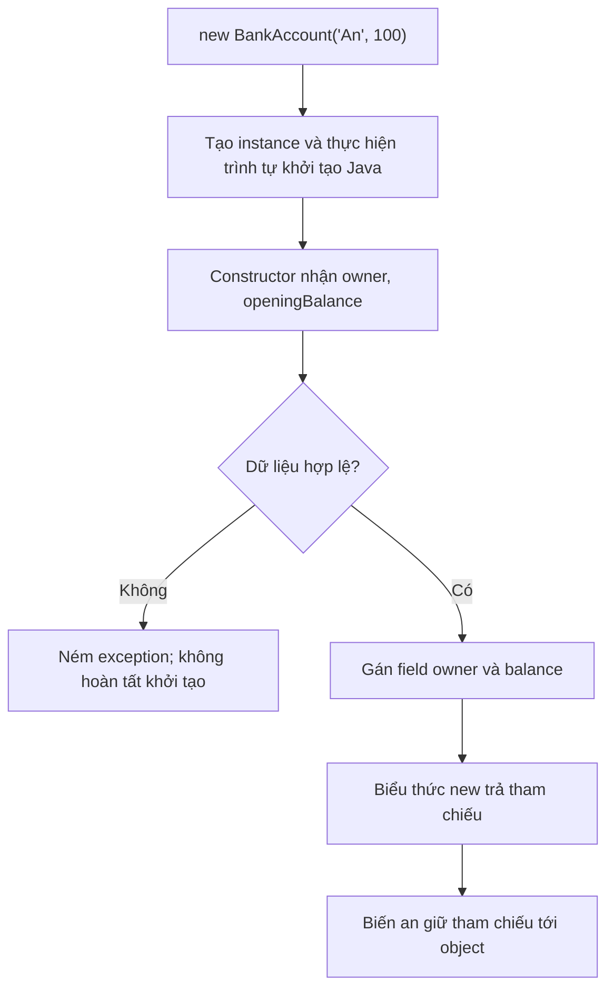

<a id="back-to-top"></a>

# Hiểu Class và Object — nền tảng trước khi học 4 tính chất

## Menu
- [2.1 Object là gì? Phân biệt identity, state, behavior và responsibility](#oop-2-1)
- [2.2 Class là gì? Phân biệt class với object/instance](#oop-2-2)
- [2.3 Khởi tạo object bằng constructor; từ khóa new và this trong Java](#oop-2-3)
- [2.4 Thuộc tính, phương thức và cách gọi phương thức](#oop-2-4)
- [2.5 Biến tham chiếu: hai biến cùng trỏ một object hay hai object khác nhau?](#oop-2-5)

## <a id="oop-2-1">2.1 Object là gì? Phân biệt identity, state, behavior và responsibility</a>

<details>
<summary>Xem chi tiết</summary>

Trong một ứng dụng ngân hàng, bạn có thể thấy những câu như:

- Tài khoản A đang có 100.000 đồng.
- Tài khoản A rút 30.000 đồng, số dư còn 70.000 đồng.
- Tài khoản B cũng có 100.000 đồng, nhưng đó là một tài khoản khác.
- Mỗi tài khoản phải tự bảo đảm không cho rút quá số dư.

Bốn câu này mô tả bốn khía cạnh của một **object (đối tượng)** trong lập trình hướng đối tượng (OOP): **identity**, **state**, **behavior** và **responsibility**.

Một object là một thực thể trong chương trình, được tạo ra để biểu diễn một khái niệm hay đảm nhận một vai trò. Nó có thể mang dữ liệu của riêng mình, cung cấp các hành vi và cộng tác với những object khác. Khi thiết kế OOP, điều quan trọng không chỉ là “object có những biến và phương thức nào?”, mà còn là “object này là ai và chịu trách nhiệm về điều gì?”.

Hãy đi từ ví dụ cụ thể, sau đó phân biệt từng khái niệm.

### 1. Object trong Java là gì?

Trong Java, một object là một **instance** của một class hoặc của một kiểu tham chiếu có thể tạo instance (chẳng hạn một class cụ thể hay một mảng).

Class mô tả kiểu cấu trúc và hành vi. Object là thực thể cụ thể tồn tại khi chương trình chạy.

Ví dụ:

\`\`\`java
class BankAccount {
    String owner;
    long balance;
}
\`\`\`

Đây mới là phần **định nghĩa class**. Chưa có tài khoản cụ thể nào được tạo chỉ vì bạn viết class này.

Khi chạy:

\`\`\`java
BankAccount accountA = new BankAccount();
accountA.owner = "An";
accountA.balance = 100_000;

BankAccount accountB = new BankAccount();
accountB.owner = "Bình";
accountB.balance = 100_000;
\`\`\`

Chương trình đã tạo hai object riêng biệt. Cả hai dùng cùng khuôn \`BankAccount\`, nhưng mang dữ liệu riêng và có sự tồn tại riêng.

Một hình dung đơn giản:

\`\`\`mermaid
flowchart TD
    C["Class BankAccount: mô tả kiểu tài khoản"]
    C -.-> A["Object A: owner = An, balance = 100000"]
    C -.-> B["Object B: owner = Bình, balance = 100000"]
\`\`\`

Trong Java, biến như \`accountA\` thường chứa **tham chiếu** đến object, chứ không phải bản sao toàn bộ object. Hai biến khác nhau có thể cùng tham chiếu đến **một object**.

Từ đây, ta sẽ thấy vì sao dữ liệu giống nhau chưa chắc là cùng một object.

> **Lưu ý thuật ngữ:** Java cũng có class gốc tên \`java.lang.Object\`. Đó là tên một class cụ thể trong thư viện Java. Còn từ “object” trong bài này chỉ **đối tượng** nói chung. Hai khái niệm liên quan, nhưng không đồng nghĩa hoàn toàn.

### 2. Identity: “Đây là đối tượng nào?”

**Identity** là đặc tính cho phép phân biệt một object với các object khác, ngay cả khi chúng có cùng loại và cùng giá trị dữ liệu.

Hãy tưởng tượng hai người đều tên “An”, cùng tuổi 25. Họ không trở thành cùng một người chỉ vì thông tin giống nhau.

Với Java:

\`\`\`java
BankAccount accountA = new BankAccount();
accountA.owner = "An";
accountA.balance = 100_000;

BankAccount accountB = new BankAccount();
accountB.owner = "An";
accountB.balance = 100_000;

BankAccount anotherReference = accountA;

System.out.println(accountA == accountB);         // false
System.out.println(accountA == anotherReference); // true
\`\`\`

Giải thích từng dòng:

- \`accountA\` và \`accountB\` được tạo bởi hai lần \`new\`, nên là hai object khác nhau, dù trạng thái hiện tại giống nhau.
- \`anotherReference = accountA\` **không tạo object mới**. Hai biến cùng trỏ đến object A.
- Với **tham chiếu**, toán tử \`==\` kiểm tra hai tham chiếu có trỏ đến **cùng một object** hay không. Nó không so sánh các trường \`owner\` và \`balance\`.

#### Identity có phải số ID trong database không?

Không nhất thiết. Có hai lớp ý nghĩa cần tách:

| Khái niệm | Ví dụ | Ý nghĩa |
| --- | --- | --- |
| Identity của object Java | \`a == b\` | Hai tham chiếu có trỏ cùng một object trong lúc chương trình chạy không? |
| Định danh trong nghiệp vụ | Mã tài khoản \`ACC-001\` | Hệ thống nhận biết một tài khoản nghiệp vụ qua các lần lưu và tải dữ liệu |
| Giá trị dữ liệu | \`balance = 100_000\` | Thông tin hiện tại của tài khoản; có thể thay đổi |

Ví dụ một tài khoản có mã \`ACC-001\` được đọc từ database ở hai lần khác nhau. Hệ thống có thể tạo hai object Java khác nhau cùng đại diện cho tài khoản nghiệp vụ \`ACC-001\`. Khi đó \`==\` có thể là \`false\`, dù chúng mô tả cùng một thực thể nghiệp vụ.

**Đừng đồng nhất object identity với địa chỉ bộ nhớ hiển thị, \`hashCode()\` hay ID database.** Cách JVM quản lý bộ nhớ là chi tiết cài đặt; giá trị hash cũng không phải định danh duy nhất tuyệt đối.

#### \`==\` khác \`equals()\` ra sao?

Với các đối tượng thông thường:

- \`==\` giữa hai tham chiếu luôn kiểm tra **cùng object hay khác object**.
- \`equals()\` kiểm tra **sự bằng nhau theo quy tắc được class định nghĩa**. Nếu không override, \`Object.equals()\` mặc định tương đương so sánh tham chiếu bằng \`==\`.
- Những class như \`String\` ghi đè \`equals()\` để so sánh nội dung.

Ví dụ:

\`\`\`java
String first = new String("Java");
String second = new String("Java");

System.out.println(first == second);      // false
System.out.println(first.equals(second)); // true
\`\`\`

Cùng nội dung \`"Java"\` không có nghĩa là cùng object.

Trong mô hình nghiệp vụ, có lúc cần định nghĩa \`equals()\` dựa vào mã định danh; có lúc cần dựa vào toàn bộ giá trị. Đó là **quyết định thiết kế** của class, không phải việc Java tự động coi mọi object có trường giống nhau là một.

### 3. State: “Đối tượng hiện đang như thế nào?”

**State (trạng thái)** là những thông tin hiện tại mô tả object ở một thời điểm.

Với tài khoản, ta có thể cần:

- Mã tài khoản: \`ACC-001\`.
- Chủ tài khoản: \`An\`.
- Số dư: \`100_000\`.
- Trạng thái hoạt động: đang mở hay bị khóa.

Một số thông tin có thể giữ nguyên trong suốt vòng đời object; số khác thay đổi qua thời gian.

Ví dụ trạng thái trước và sau khi rút tiền:

| Thời điểm | Tài khoản | Số dư |
| --- | --- | ---: |
| Trước khi rút | \`ACC-001\` | 100.000 |
| Sau khi rút 30.000 | \`ACC-001\` | 70.000 |
| Sau khi thử rút 120.000 và bị từ chối | \`ACC-001\` | 70.000 |

Vẫn là **cùng một đối tượng tài khoản** đang được theo dõi, nhưng state đã thay đổi sau giao dịch hợp lệ.

Điều này tách identity khỏi state:

**Identity trả lời “đây là ai/cái nào?”, còn state trả lời “hiện tại nó ra sao?”.**

#### State có bắt buộc phải thay đổi được không?

Không. Một object có thể **mutable** (trạng thái thay đổi được) hoặc **immutable** (trạng thái quan sát được của object không thay đổi sau khi tạo).

Ví dụ một tọa độ bất biến:

\`\`\`java
final class Point {
    private final int x;
    private final int y;

    Point(int x, int y) {
        this.x = x;
        this.y = y;
    }

    int x() { return x; }
    int y() { return y; }
}
\`\`\`

Hai object \`Point\` có thể cùng giá trị \`x, y\`, nhưng vẫn là hai object Java khác nhau. Không có setter không làm mất đi tính chất “object”.

Ngoài ra, khai báo trường \`final\` chỉ ngăn gán lại **tham chiếu hoặc giá trị của trường đó**. Nếu trường giữ một danh sách có thể sửa, nội dung danh sách vẫn có thể thay đổi. Vì thế, muốn tạo đối tượng immutable thực sự, cần xem cả những object mutable mà nó tham chiếu đến.

### 4. Behavior: “Đối tượng có thể làm gì?”

**Behavior (hành vi)** là các thao tác mà object có thể thực hiện hoặc các yêu cầu mà bên ngoài có thể gửi cho object, thường được thể hiện bằng **instance methods**.

Với tài khoản, behavior có thể là:

\`\`\`java
account.deposit(50_000);
account.withdraw(30_000);
long currentBalance = account.getBalance();
\`\`\`

Lệnh \`withdraw(30_000)\` không chỉ là một phép trừ. Hành vi có thể phải:

1. Kiểm tra số tiền yêu cầu lớn hơn 0.
2. Kiểm tra số dư hiện tại có đủ không.
3. Chỉ khi tất cả điều kiện hợp lệ mới cập nhật số dư.
4. Báo lỗi nếu không thể thực hiện.

Một behavior không bắt buộc phải sửa state. Ví dụ \`getBalance()\` chỉ quan sát, \`isActive()\` trả về trạng thái hoạt động, hoặc \`calculateFee()\` tính toán kết quả.

Tương tự, không phải behavior nào cũng được công khai ra ngoài. Object có thể có các phương thức \`private\` dùng để thực hiện chi tiết nội bộ, còn phương thức \`public\` là những hành vi nó cam kết cho bên ngoài sử dụng.

**Behavior không đồng nghĩa với “bất cứ hàm nào nằm trong class”.** Một hàm \`static\` thuộc về class và không có đối tượng nhận lời gọi cụ thể; còn instance method như \`account.withdraw(...)\` được gọi trên một đối tượng đang có trạng thái riêng.

### 5. Responsibility: “Đối tượng phải chịu trách nhiệm về điều gì?”

Đây là phần dễ bị nhầm với behavior nhất.

**Behavior** mô tả một hành động cụ thể. **Responsibility (trách nhiệm)** mô tả nghĩa vụ hay vai trò của object trong thiết kế: **nó phải biết gì, phải bảo đảm điều gì, và phải thực hiện phần việc nào để hệ thống hoạt động đúng**.

Với \`BankAccount\`:

- Behavior: \`deposit(amount)\`, \`withdraw(amount)\`, \`getBalance()\`.
- Responsibility: **quản lý số dư của tài khoản và bảo đảm các thao tác làm thay đổi số dư phải tuân theo quy tắc của tài khoản**.

Nếu một tài khoản không được thấu chi, bất biến (*invariant*) quan trọng là **số dư không được âm**. Object chịu trách nhiệm bảo vệ quy tắc ấy trong những thao tác nó cho phép.

Nhưng liệu tài khoản có phải tự tạo PDF sao kê, gửi SMS, gọi cổng thanh toán và render màn hình web?

Không nhất thiết. Các việc đó có thể thuộc về đối tượng hay thành phần khác.

| Thành phần | Trách nhiệm có thể phù hợp | Ví dụ hành vi |
| --- | --- | --- |
| \`BankAccount\` | Giữ trạng thái và quy tắc của một tài khoản | \`withdraw()\`, \`deposit()\` |
| \`TransferService\` | Điều phối chuyển tiền giữa nhiều tài khoản, xử lý yêu cầu và điều kiện hệ thống | \`transfer(from, to, amount)\` |
| \`StatementGenerator\` | Tạo nội dung sao kê từ dữ liệu giao dịch | \`generateStatement(...)\` |
| \`NotificationSender\` | Gửi thông báo qua kênh thích hợp | \`send(...)\` |

Như vậy, một object có thể có nhiều behaviors để hoàn thành **một nhóm trách nhiệm gắn kết**. Ngược lại, một behavior đơn lẻ không đủ để xác định chính xác trách nhiệm của object.

Ví dụ, một class \`AccountManager\` có tới 50 phương thức chưa chắc được thiết kế tốt; nếu nó vừa rút tiền, xuất PDF, gửi email, điều khiển giao diện và đọc cấu hình, trách nhiệm đã trở nên hỗn tạp. OOP không yêu cầu nhét mọi thứ liên quan đến “tài khoản” vào đúng một object.

#### Phân biệt bằng hai câu hỏi

Khi đọc tên một phương thức, thử hỏi:

- “Nó **làm gì**?” → đang nói về behavior.
- “**Vì sao** phần việc và quy tắc này thuộc về object đó?” → đang nói về responsibility.

Ví dụ \`withdraw()\` là hành vi. Còn chịu trách nhiệm **không cho tài khoản rơi vào trạng thái không hợp lệ** là một phần của thiết kế và hợp đồng hành vi ấy.

### 6. Một ví dụ Java hoàn chỉnh thể hiện cả bốn khái niệm

Lưu đoạn sau thành file \`Main.java\` rồi chạy:

\`\`\`java
final class BankAccount {
    // State: dữ liệu của từng object
    private final String accountNumber;
    private long balance;

    BankAccount(String accountNumber, long openingBalance) {
        if (accountNumber == null || accountNumber.isBlank()) {
            throw new IllegalArgumentException("Account number is required");
        }
        if (openingBalance < 0) {
            throw new IllegalArgumentException("Opening balance must be >= 0");
        }
        this.accountNumber = accountNumber;
        this.balance = openingBalance;
    }

    public String getAccountNumber() {
        return accountNumber;
    }

    public long getBalance() {
        return balance;
    }

    // Behavior: nạp tiền
    public void deposit(long amount) {
        requirePositive(amount);
        balance = Math.addExact(balance, amount);
    }

    // Behavior: rút tiền, có kiểm tra để bảo vệ invariant
    public void withdraw(long amount) {
        requirePositive(amount);
        if (amount > balance) {
            throw new IllegalStateException("Insufficient balance");
        }
        balance -= amount;
    }

    private static void requirePositive(long amount) {
        if (amount <= 0) {
            throw new IllegalArgumentException("Amount must be positive");
        }
    }
}

public class Main {
    public static void main(String[] args) {
        BankAccount accountA = new BankAccount("ACC-A", 100_000);
        BankAccount accountB = new BankAccount("ACC-B", 100_000);
        BankAccount aliasOfA = accountA;

        System.out.println(accountA == accountB);  // false
        System.out.println(accountA == aliasOfA);  // true

        accountA.withdraw(30_000);

        System.out.println(accountA.getBalance()); // 70000
        System.out.println(aliasOfA.getBalance()); // 70000
        System.out.println(accountB.getBalance()); // 100000

        try {
            accountA.withdraw(120_000);
        } catch (IllegalStateException ex) {
            System.out.println(ex.getMessage());
        }

        System.out.println(accountA.getBalance()); // 70000
    }
}
\`\`\`

Đầu ra:

\`\`\`text
false
true
70000
70000
100000
Insufficient balance
70000
\`\`\`

Chú ý ví dụ dùng kiểu \`long\` với đơn vị tiền nguyên để dễ học, không dùng \`double\` cho tiền. \`Math.addExact\` còn phát hiện tình huống cộng vượt giới hạn \`long\` bằng một ngoại lệ thay vì làm tràn số âm thầm. Đây là ví dụ mô phỏng state ở bộ nhớ; các yêu cầu thực tế về giao dịch, lưu trữ và đồng thời nằm ngoài phạm vi đoạn code.

#### Đọc ví dụ theo từng khái niệm

**Identity**

\`accountA\` và \`accountB\` là **hai object khác nhau**, dù ban đầu cùng có số dư 100.000. \`aliasOfA\` và \`accountA\` cùng trỏ đến **một object**.

**State**

\`accountA\` có \`accountNumber = "ACC-A"\` và ban đầu \`balance = 100_000\`. Sau khi rút, số dư thành \`70_000\`. Trạng thái của \`accountB\` vẫn là \`100_000\`.

**Behavior**

\`withdraw(30_000)\` là hành vi thực hiện rút tiền. \`getBalance()\` là hành vi đọc thông tin. \`deposit(...)\` là hành vi nạp tiền.

**Responsibility**

\`BankAccount\` có trách nhiệm giữ số dư và kiểm tra các yêu cầu rút/nạp tiền. Không có phương thức public \`setBalance(...)\` để caller gán số dư tùy ý.

#### Điều gì xảy ra khi rút không hợp lệ?

Trước khi gọi \`accountA.withdraw(120_000)\`, số dư đang là \`70_000\`.

\`\`\`text
Nhận yêu cầu withdraw(120000)
          |
          v
120000 > 0 ? -------- không --------> IllegalArgumentException
          |
          có
          v
120000 <= 70000 ? --- không --------> IllegalStateException
          |
         (không cập nhật balance)
\`\`\`

Phép trừ không được thực hiện; \`accountA\` vẫn có \`70_000\`. Đây là một tình huống giúp nhìn rõ mối quan hệ giữa behavior và responsibility: hành vi \`withdraw\` kiểm tra điều kiện để hoàn thành trách nhiệm giữ trạng thái hợp lệ.

### 7. Vì sao phân biệt identity với state quan trọng?

Giả sử bạn theo dõi một giỏ hàng:

- Lúc 9 giờ: giỏ có 1 món.
- Lúc 9 giờ 5 phút: giỏ có 3 món.
- Lúc 9 giờ 10 phút: giỏ trống sau khi đặt hàng.

Ta thường vẫn nói về **cùng một giỏ hàng**, dù nội dung thay đổi. Đó là vì identity giúp theo dõi thực thể qua thời gian, còn state mô tả một lát cắt hiện tại.

Điều ngược lại cũng đúng: hai giỏ hàng ở cùng trạng thái “trống” không trở thành cùng một giỏ.

Đây là lý do trong mô hình có những thực thể như \`Order\`, \`Account\`, \`ShoppingCart\`, việc nhận biết thực thể nào đang được xử lý rất quan trọng. Nhưng với một giá trị như tọa độ \`Point(2, 3)\` hay số tiền \`Money(50, "USD")\`, ta thường quan tâm **giá trị bằng nhau** hơn là hai object có chung tham chiếu không.

OOP có chỗ cho cả đối tượng **mang định danh nghiệp vụ** lẫn đối tượng **chủ yếu mang giá trị**. Không phải mọi object đều cần một trường \`id\` riêng hoặc cần ghi đè \`equals()\`.

### 8. Những hiểu nhầm thường gặp

| Phát biểu | Đúng hay sai? | Giải thích |
| --- | --- | --- |
| “Hai object có state giống nhau thì là cùng một object.” | Sai | Cùng dữ liệu không bảo đảm cùng identity. |
| “Hai biến tham chiếu khác nhau luôn trỏ đến hai object.” | Sai | \`aliasOfA = accountA\` tạo thêm tham chiếu đến object cũ. |
| “State chỉ gồm các trường có thể thay đổi.” | Sai | Thông tin bất biến cũng là một phần trạng thái. |
| “Object nào cũng phải có setter.” | Sai | Một object có thể bất biến hoặc chỉ cho phép thao tác qua hành vi nghiệp vụ. |
| “Behavior chỉ là phương thức làm thay đổi state.” | Sai | Phương thức đọc/kiểm tra/tính toán cũng biểu diễn hành vi. |
| “Responsibility là danh sách tên method.” | Chưa đủ | Trách nhiệm nói lên phần việc/quy tắc object chịu trách nhiệm bảo đảm. |
| “Cứ tạo class có field và getter/setter là thiết kế OOP tốt.” | Sai | Còn phải xét ranh giới trách nhiệm và cách bảo vệ trạng thái. |
| “Object Java và hàng trong database luôn tương ứng một-một.” | Sai | Một hàng có thể được tải thành nhiều object ở những thời điểm/ngữ cảnh khác nhau. |

Một lỗi thiết kế khác thường gặp là để **toàn bộ nghiệp vụ nằm ngoài object**, còn object chỉ chứa các field có getter/setter:

\`\`\`java
// Caller quyết định trực tiếp cách sửa balance:
account.setBalance(account.getBalance() - amount);
\`\`\`

Nếu không có quy tắc kiểm soát, caller có thể trừ quá số dư. Cách gọi \`account.withdraw(amount)\` làm rõ object nào có trách nhiệm xác minh và cập nhật số dư.

Dẫu vậy, các object chỉ chứa dữ liệu cũng có vai trò hữu ích, ví dụ DTO dùng để trao đổi dữ liệu giữa các tầng. Không phải tất cả class đều cần mang nghiệp vụ; cần thiết kế theo vai trò thực tế.

### 9. Tự thử suy luận: hai object hay một object?

Không cần chạy code ngay. Hãy đoán đầu ra:

\`\`\`java
BankAccount first = new BankAccount("ACC-1", 100);
BankAccount second = new BankAccount("ACC-2", 100);
BankAccount third = first;

first.withdraw(30);

System.out.println(first == second);      // ?
System.out.println(first == third);       // ?
System.out.println(second.getBalance());  // ?
System.out.println(third.getBalance());   // ?
\`\`\`

Đáp án:

\`\`\`text
false
true
100
70
\`\`\`

Lý do:

- \`first\` và \`second\` được tạo độc lập → khác identity.
- \`third\` trỏ cùng object với \`first\` → cùng identity.
- Việc thay đổi state qua \`first\` cũng được nhìn thấy qua \`third\`, vì chúng cùng tham chiếu một object.
- \`second\` có state riêng nên không bị tác động.

Bây giờ hãy tự mô tả một **đơn hàng** bằng đúng bốn câu, mỗi câu trả lời một ý:

1. **Identity:** Đơn hàng nào? Ví dụ đơn \`ORD-101\`.
2. **State:** Đơn đang có những thông tin hiện tại nào? Ví dụ danh sách sản phẩm, tổng tiền, trạng thái \`CREATED\`.
3. **Behavior:** Đơn cho phép thao tác gì? Ví dụ \`addItem()\`, \`cancel()\`, \`markPaid()\` nếu phù hợp nghiệp vụ.
4. **Responsibility:** Đơn phải bảo đảm điều gì? Ví dụ không cho sửa danh sách sản phẩm sau khi hoàn tất, hoặc không chuyển sang \`PAID\` nếu chưa được xác nhận thanh toán.

Nếu bạn mới chỉ trả lời “đơn hàng có các field \`id\`, \`status\`, \`total\`”, bạn chủ yếu đang mô tả **state**. Để thiết kế object có ý nghĩa, cần tiếp tục xác định **hành vi** và **trách nhiệm** của nó.

Bốn yếu tố luôn có mối liên hệ: **identity** cho phép nhận ra object đang xét; **state** cho biết nó đang ở tình trạng nào; **behavior** cho biết nó có thể thực hiện hoặc đáp ứng yêu cầu gì; **responsibility** giải thích vì sao chính object ấy phải thực hiện và bảo vệ những quy tắc liên quan.

</details>

- [Quay lại đầu trang](#back-to-top)

---

## <a id="oop-2-2">2.2 Class là gì? Phân biệt class với object/instance</a>

<details>
<summary>Xem chi tiết</summary>

### 1. Trả lời từ một ví dụ rất đời thường

Hãy nghĩ đến một hệ thống ngân hàng đang quản lý hai tài khoản:

- Tài khoản **A-01** của An có 100.000 đồng.
- Tài khoản **B-02** của Bình cũng có 100.000 đồng.

Cả hai tài khoản đều có những đặc điểm giống nhau: có mã tài khoản, có số dư và có thể nạp tiền. Nhưng chúng **không phải cùng một tài khoản**. Nếu An nạp thêm 50.000 đồng, số dư của Bình không tự tăng theo.

Trong lập trình hướng đối tượng (OOP), ta cần mô tả **điểm chung** của các tài khoản, đồng thời giữ **trạng thái riêng** cho từng tài khoản.

Đó là lúc hai khái niệm xuất hiện:

- **Class (lớp)**: một *định nghĩa kiểu đối tượng*, mô tả đối tượng thuộc kiểu này có dữ liệu và hành vi gì, cùng những quy tắc áp dụng cho chúng.
- **Object (đối tượng)**: một thực thể được tạo ra lúc chương trình chạy theo định nghĩa của class, có trạng thái và danh tính riêng.
- **Instance**: thường là cách gọi khác của object khi muốn nhấn mạnh rằng đối tượng ấy là **một thể hiện của một class cụ thể**.

Ví dụ, `BankAccount` là **class**; tài khoản A-01 đang tồn tại trong chương trình là **một object**, hay **một instance của `BankAccount`**.

Câu phân biệt quan trọng nhất là: **class mô tả một loại đối tượng; object là một đối tượng cụ thể thuộc loại đó**.

### 2. Viết một class trong Java

Xem phần khai báo sau:

```java
class BankAccount {
    private final String accountNumber;
    private long balance;

    BankAccount(String accountNumber, long initialBalance) {
        if (accountNumber == null || accountNumber.isBlank()) {
            throw new IllegalArgumentException("Mã tài khoản không hợp lệ");
        }
        if (initialBalance < 0) {
            throw new IllegalArgumentException("Số dư ban đầu không được âm");
        }

        this.accountNumber = accountNumber;
        this.balance = initialBalance;
    }

    String getAccountNumber() {
        return accountNumber;
    }

    long getBalance() {
        return balance;
    }

    void deposit(long amount) {
        if (amount <= 0) {
            throw new IllegalArgumentException("Số tiền nạp phải lớn hơn 0");
        }
        balance = Math.addExact(balance, amount);
    }
}
```

Hãy đọc class này theo ý nghĩa nghiệp vụ trước, rồi mới nhìn cú pháp Java.

**`class BankAccount`** khai báo một kiểu đối tượng có tên `BankAccount`. Nó không đại diện sẵn cho tài khoản của An hoặc của Bình.

Bên trong class có hai nhóm thành phần:

| Thành phần | Khai báo | Ý nghĩa |
|---|---|---|
| **Field (thuộc tính/trường)** | `accountNumber` | Mã định danh của tài khoản |
| **Field** | `balance` | Số dư hiện tại |
| **Constructor (hàm khởi tạo)** | `BankAccount(...)` | Kiểm tra dữ liệu và thiết lập trạng thái ban đầu |
| **Method (phương thức)** | `getBalance()` | Cho biết số dư |
| **Method** | `deposit(...)` | Nạp tiền theo quy tắc của tài khoản |

Field và method không chỉ là một cách đặt tên cho dữ liệu và hàm. Trong ví dụ này, chúng cho ta biết **tài khoản có gì** và **tài khoản biết làm gì**.

Hai trường được khai báo `private`, nhờ vậy mã bên ngoài không tùy ý đặt `balance = -100`. Muốn thay đổi số dư, nó yêu cầu đối tượng thực hiện hành vi `deposit(...)`. Điều này khiến class giữ được quy tắc mà chính nó quản lý.

**Nhưng đến đây chúng ta mới khai báo class.** Chưa có tài khoản cụ thể nào được tạo chỉ bởi việc viết định nghĩa `BankAccount`.

### 3. Tạo object từ class bằng `new`

Để chương trình có một tài khoản cụ thể, ta tạo đối tượng:

```java
BankAccount an = new BankAccount("A-01", 100_000);
BankAccount binh = new BankAccount("B-02", 100_000);
```

Đọc riêng dòng đầu tiên:

```text
BankAccount     an       =      new BankAccount("A-01", 100_000);
    │            │                     │
    │            │                     └─ Tạo đối tượng BankAccount mới
    │            └─ Biến tham chiếu có tên an
    └─ Kiểu dữ liệu của biến
```

Ở đây cần tách rõ ba thứ dễ bị gọi nhầm:

1. **`BankAccount`**: class, tức kiểu mà Java dùng để mô tả những thao tác hợp lệ.
2. **`new BankAccount(...)`**: biểu thức tạo một object mới và gọi constructor để khởi tạo object.
3. **`an`**: biến tham chiếu, dùng để trỏ tới và làm việc với object đã tạo.

Biến `an` **không phải là toàn bộ định nghĩa class**. Nó cũng không phải “bản thân class”. Biến này đang giữ một **tham chiếu** tới một object.

Có thể hình dung:

```text
                  ĐỊNH NGHĨA
             ┌──────────────────┐
             │ class BankAccount│
             │ accountNumber    │
             │ balance          │
             │ deposit()        │
             └──────────────────┘
                  │        │
                tạo      tạo
                  │        │
                  ▼        ▼
          ┌────────────┐  ┌────────────┐
          │ Object #1  │  │ Object #2  │
          │ id: A-01   │  │ id: B-02   │
          │ balance:   │  │ balance:   │
          │ 100.000    │  │ 100.000    │
          └────────────┘  └────────────┘
                ▲                ▲
                │                │
            biến an          biến binh
```

**Một class có thể tạo ra nhiều object.** Chúng cùng tuân theo định nghĩa của class, nhưng mỗi object có giá trị field instance riêng.

Trong Java, khai báo class còn có vai trò xác định kiểu để trình biên dịch kiểm tra, và JVM quản lý thông tin về kiểu trong lúc chạy. Hình vẽ trên chỉ diễn tả mối quan hệ khái niệm, không phải sơ đồ địa chỉ bộ nhớ chính xác của JVM.

### 4. Chạy thử: một class, hai object độc lập

Đây là chương trình hoàn chỉnh để tự chạy trong file `Main.java`. Mã có một class `Main` để khởi chạy và class `BankAccount` để biểu diễn tài khoản.

```java
public class Main {
    public static void main(String[] args) {
        BankAccount an = new BankAccount("A-01", 100_000);
        BankAccount binh = new BankAccount("B-02", 100_000);

        System.out.println(an.getBalance());   // 100000
        System.out.println(binh.getBalance()); // 100000

        an.deposit(50_000);

        System.out.println(an.getBalance());   // 150000
        System.out.println(binh.getBalance()); // 100000
    }
}

class BankAccount {
    private final String accountNumber;
    private long balance;

    BankAccount(String accountNumber, long initialBalance) {
        if (accountNumber == null || accountNumber.isBlank()) {
            throw new IllegalArgumentException("Mã tài khoản không hợp lệ");
        }
        if (initialBalance < 0) {
            throw new IllegalArgumentException("Số dư ban đầu không được âm");
        }
        this.accountNumber = accountNumber;
        this.balance = initialBalance;
    }

    String getAccountNumber() {
        return accountNumber;
    }

    long getBalance() {
        return balance;
    }

    void deposit(long amount) {
        if (amount <= 0) {
            throw new IllegalArgumentException("Số tiền nạp phải dương");
        }
        balance = Math.addExact(balance, amount);
    }
}
```

Kết quả:

```text
100000
100000
150000
100000
```

Điều gì đã xảy ra?

| Bước | Object của An | Object của Bình |
|---|---|---|
| Vừa tạo | `balance = 100_000` | `balance = 100_000` |
| Gọi `an.deposit(50_000)` | `balance = 150_000` | `balance = 100_000` |
| Đọc lại số dư | `150_000` | `100_000` |

**Phương thức được định nghĩa trong class, nhưng khi gọi trên một object, nó làm việc với trạng thái của object đó.**

Trong lệnh `an.deposit(50_000)`, phương thức `deposit` thay đổi `balance` của đối tượng mà `an` đang tham chiếu. Nó không tự sửa field instance của đối tượng mà `binh` tham chiếu.

Đây là một trong những lý do class và object phải được phân biệt: chúng cùng liên quan, nhưng phục vụ hai vai trò khác nhau.

### 5. Class giống bản thiết kế, nhưng phép so sánh có giới hạn

Người ta thường nói **class là bản thiết kế, object là sản phẩm được tạo ra từ bản thiết kế**.

Ví dụ:

- Bản thiết kế một kiểu ô tô mô tả các bộ phận và khả năng tăng tốc/phanh.
- Hai chiếc xe thực tế có thể dựa trên cùng một thiết kế nhưng có biển số, lượng xăng và quãng đường đã đi khác nhau.

Phép so sánh này giúp người mới học hiểu sự khác biệt giữa **mô tả chung** và **thực thể cụ thể**.

Tuy nhiên, có hai điểm cần hiểu chính xác hơn:

**Một là, class trong Java còn định nghĩa kiểu và hành vi.** Nó không chỉ là sơ đồ trống; nó có thể chứa code thực hiện phương thức, constructor, quy tắc về quyền truy cập và các thành phần tĩnh.

**Hai là, object không phải bản sao toàn bộ mã nguồn class.** Các object cùng lớp sử dụng cùng định nghĩa hành vi, nhưng có **trạng thái instance** riêng. Java và JVM quyết định cách tổ chức mã và bộ nhớ cụ thể; bạn không cần hình dung mỗi object chứa một bản sao đầy đủ của từng method.

Vì vậy, hãy dùng phép ví von bản thiết kế để **bắt đầu hiểu**, rồi quay về ba ý chính xác: **class định nghĩa kiểu — `new` tạo object — object giữ trạng thái riêng**.

### 6. Object và instance có khác nhau không?

Trong những câu như:

```java
BankAccount account = new BankAccount("A-01", 100_000);
```

ta có thể nói tương đương:

- “Biến `account` đang tham chiếu đến một **object**.”
- “Object này là một **instance của `BankAccount`**.”

Từ **object** nhấn mạnh một thực thể trong chương trình. Từ **instance** nhấn mạnh mối quan hệ của thực thể đó với class hoặc kiểu cụ thể.

Khi nói “`new BankAccount(...)` tạo instance của `BankAccount`”, bạn đang nói một điều hoàn toàn tự nhiên trong Java.

Cần lưu ý rằng một object của lớp con cũng có thể được nhìn qua kiểu lớp cha hoặc interface:

```java
class Animal { }

class Dog extends Animal { }

Animal pet = new Dog();

System.out.println(pet instanceof Animal); // true
System.out.println(pet instanceof Dog);    // true
```

Ở đây, object thực tế được tạo từ `Dog`, nhưng biến `pet` được khai báo là `Animal`. Khi muốn nói chính xác loại object được tạo, ta nói đó là **một đối tượng của lớp `Dog`**; nó đồng thời **thuộc các kiểu** tương thích như `Animal`.

Ví dụ này chỉ nhằm làm rõ class/object và kiểu tham chiếu. Bạn chưa cần học sâu về kế thừa để nắm được bài.

### 7. Phân biệt object với biến tham chiếu: hai biến có thể cùng trỏ một object

Đây là một nhầm lẫn rất thường gặp.

Xem code:

```java
BankAccount an = new BankAccount("A-01", 100_000);
BankAccount anotherName = an;

anotherName.deposit(20_000);

System.out.println(an.getBalance());          // 120000
System.out.println(anotherName.getBalance()); // 120000
```

Có **hai biến** `an` và `anotherName`, nhưng chỉ **một object BankAccount** được tạo. Phép gán `anotherName = an` **sao chép giá trị tham chiếu**, không tự tạo một đối tượng mới.

```text
an ──────────────┐
                 ▼
            ┌───────────────┐
anotherName ───► Object A-01 │
            │ balance:120000│
            └───────────────┘
```

Vì cả hai biến cùng tham chiếu đến một object, việc sửa trạng thái thông qua biến này cũng có thể quan sát qua biến kia.

Hãy đối chiếu:

```java
BankAccount first  = new BankAccount("A-01", 100_000);
BankAccount second = new BankAccount("B-02", 100_000);

System.out.println(first == second); // false

BankAccount alias = first;
System.out.println(first == alias);  // true
```

Toán tử `==` giữa hai **tham chiếu object** kiểm tra chúng có cùng trỏ đến **một object** không.

- `first == second` là `false`: hai lần `new` tạo hai object khác nhau.
- `first == alias` là `true`: hai biến cùng tham chiếu một object.

Ngay cả khi hai object có field bằng nhau, điều đó **không có nghĩa** chúng là cùng một object.

#### Vậy `equals()` dùng khi nào?

`==` kiểm tra **cùng object** đối với kiểu tham chiếu. Còn `equals()` là một method có thể được class định nghĩa lại để kiểm tra **bằng nhau theo ý nghĩa nghiệp vụ**.

Nếu class chưa override `equals()`, implementation mặc định kế thừa từ `Object` kiểm tra cùng đối tượng, tương tự `==`. Class như `String` đã override `equals()` để so sánh giá trị chuỗi.

```java
String x = new String("Java");
String y = new String("Java");

System.out.println(x == y);      // false: hai object String
System.out.println(x.equals(y)); // true: nội dung bằng nhau
```

Điểm cần hiểu ở bài này là: **danh tính (identity)** của object khác với **giá trị hoặc trạng thái (state)** mà object mang theo. Bạn sẽ gặp sự khác biệt này nhiều lần khi làm việc với danh sách, bản đồ dữ liệu hoặc các đối tượng nghiệp vụ.

### 8. Khi tạo object, điều gì được khởi tạo?

Với lệnh:

```java
BankAccount an = new BankAccount("A-01", 100_000);
```

ta có thể hiểu theo các bước:

1. Java kiểm tra việc gọi constructor có hợp lệ về mặt cú pháp và kiểu.
2. Khi chương trình chạy đến `new BankAccount(...)`, JVM tạo một object mới của kiểu tương ứng.
3. Các field instance có giá trị mặc định theo quy tắc Java trước khi phần khởi tạo của lớp được thực hiện.
4. Quá trình khởi tạo và constructor kiểm tra đầu vào rồi thiết lập `accountNumber` và `balance`.
5. Nếu khởi tạo hoàn tất, biểu thức trả về một tham chiếu tới object; tham chiếu ấy được gán cho biến `an`.

Ở ví dụ này, sau khi constructor kết thúc thành công, object có:

```text
accountNumber = "A-01"
balance       = 100000
```

Nếu `initialBalance` là `-5`, constructor ném `IllegalArgumentException` và lệnh tạo object không trả về một tham chiếu đã khởi tạo thành công để gán cho `an`.

Constructor **không phải** một object khác. Nó là cơ chế khởi tạo được chạy trong quá trình tạo object.

Bạn cũng sẽ gặp trường hợp:

```java
BankAccount account = null;
```

Dòng này **chỉ khai báo một biến tham chiếu**, chưa tạo `BankAccount` nào. `null` nghĩa là biến hiện không tham chiếu đến object. Gọi `account.getBalance()` khi đó gây `NullPointerException`.

Một lỗi nhận thức cần tránh: “Khai báo biến kiểu `BankAccount` đồng nghĩa đã có tài khoản.” Muốn có object mới theo ví dụ này, cần thực sự tạo nó, thông thường bằng `new`.

### 9. Field của object và thành phần `static` của class

Đến đây, ta đã thấy hai object `BankAccount` có số dư riêng. Điều đó đúng với **instance field** (field không có `static`), chẳng hạn:

```java
private long balance;
```

Nếu tạo hai object thì chúng có **hai giá trị `balance` độc lập**.

Vậy thành phần được khai báo `static` thì sao?

```java
class Greeting {
    static String language = "vi";
    String message;

    Greeting(String message) {
        this.message = message;
    }
}

Greeting a = new Greeting("Xin chào");
Greeting b = new Greeting("Chào bạn");

System.out.println(a.message);        // Xin chào
System.out.println(b.message);        // Chào bạn
System.out.println(Greeting.language); // vi
```

Ở đây:

| Thành phần | Thuộc về đâu về mặt ngữ nghĩa? | Giá trị được dùng thế nào? |
|---|---|---|
| `message` | Mỗi instance `Greeting` | `a` và `b` giữ giá trị khác nhau |
| `language` với `static` | Class `Greeting` | Là thành phần tĩnh dùng chung cho các instance của class đó trong cùng ngữ cảnh nạp lớp |
| Method `static` | Class | Có thể gọi qua tên class, không cần tạo instance |

`static` nhắc ta rằng **không phải mọi thành phần khai báo trong class đều được sao thành trạng thái riêng cho mỗi object**. Với thành phần tĩnh, nên truy cập qua tên class như `Greeting.language` để thể hiện rõ ý nghĩa.

Điều này không thay đổi khái niệm class/object đã học: class xác định cả thành phần chung và thành phần gắn với từng instance.

### 10. Những cách hiểu dễ nhầm

| Nhận định | Đúng hay sai? | Vì sao? |
|---|---|---|
| “Viết `class Car { }` là đã tạo một chiếc xe.” | **Sai** | Mới khai báo class, chưa tạo object `Car`. |
| “Một class có thể tạo nhiều object.” | **Đúng** | Mỗi lần tạo thành công một object mới, ta có thêm một instance. |
| “Hai object cùng class phải có field giống nhau.” | **Sai** | Chúng cùng cấu trúc nhưng trạng thái instance có thể khác. |
| “Hai biến khác tên luôn trỏ đến hai object khác nhau.” | **Sai** | Chúng có thể cùng chứa một tham chiếu. |
| “`new` là tên của class.” | **Sai** | `new` là toán tử dùng trong biểu thức tạo object. |
| “Object và instance thường chỉ cùng một thực thể.” | **Đúng** | Từ instance nhấn mạnh thực thể đó thuộc một class/kiểu. |
| “Biến `BankAccount account = null` đã có một object.” | **Sai** | Chưa có object nào được biến đó tham chiếu. |
| “Mọi field trong class đều thuộc riêng từng object.” | **Sai** | Instance field và `static` field có phạm vi gắn kết khác nhau. |
| “Hai object có cùng giá trị là cùng một object.” | **Sai** | Cần phân biệt trạng thái bằng nhau với danh tính đối tượng. |

Một điều nữa dễ gây bối rối: trong Java còn có kiểu thư viện `java.lang.Class` dùng để biểu diễn thông tin kiểu lúc chạy, ví dụ `BankAccount.class`. Đó là **một chủ đề khác** so với việc bạn viết khai báo `class BankAccount`. Bạn không cần hiểu sâu reflection hay đối tượng `Class<?>` để phân biệt class và object trong bài hiện tại.

### 11. Khi thiết kế một class, nên nghĩ từ đâu?

Người mới thường viết class bằng cách nhìn thấy một danh từ rồi lập tức tạo file: `Student`, `Book`, `Order`, `Payment`… Nhưng một class có ích phải thể hiện **một trách nhiệm có ý nghĩa trong chương trình**, chứ không chỉ là một cái tên.

Hãy tự hỏi:

1. **Đối tượng này đại diện cho điều gì?** Ví dụ một tài khoản ngân hàng cụ thể.
2. **Mỗi đối tượng cần giữ dữ liệu riêng nào?** Ví dụ mã tài khoản và số dư.
3. **Người dùng cần yêu cầu đối tượng làm gì?** Ví dụ nạp tiền hoặc đọc số dư.
4. **Có quy tắc nào bắt buộc phải giữ?** Ví dụ không được khởi tạo số dư âm, không nạp số tiền bằng 0.
5. **Thông tin nào nên nằm bên trong đối tượng?** Ví dụ không cho mã bên ngoài sửa trực tiếp `balance`.

Từ những câu hỏi này, ta hình thành một class có mục đích rõ ràng. Sau đó, khi cần quản lý nhiều tài khoản, ta tạo nhiều object cùng class và để mỗi object giữ trạng thái của riêng mình.

Không phải lúc nào cũng cần một object cho mọi khái niệm. Các hàm tiện ích đơn giản, giá trị bất biến hoặc dữ liệu tạm cũng có những cách biểu diễn phù hợp khác. OOP giúp ta tổ chức chương trình tốt hơn khi class và object được dùng **đúng vai trò**, không phải khi cố biến mọi thứ thành class.

### 12. Tự thử một bài rất ngắn

Cho đoạn chương trình:

```java
BankAccount a = new BankAccount("A-01", 100_000);
BankAccount b = new BankAccount("B-02", 100_000);
BankAccount c = a;

a.deposit(10_000);
c.deposit(20_000);

System.out.println(a.getBalance());
System.out.println(b.getBalance());
System.out.println(c.getBalance());
System.out.println(a == c);
System.out.println(a == b);
```

Trước khi xem lời giải, hãy đếm: **Có mấy biến? Có mấy object được tạo?** `a` và `c` có cùng số dư không? Vì sao?

**Đáp án:**

```text
130000
100000
130000
true
false
```

Có **ba biến tham chiếu** (`a`, `b`, `c`) nhưng chỉ có **hai object** vì chỉ có hai lần gọi `new BankAccount(...)`. `c = a` không tạo object mới.

Khi `a.deposit(10_000)`, tài khoản A-01 tăng từ 100.000 lên 110.000. Khi `c.deposit(20_000)`, chính tài khoản A-01 tăng tiếp lên 130.000 vì `c` cùng trỏ đến object của `a`. Tài khoản B-02 vẫn giữ 100.000.

Nếu hiểu đúng ví dụ này, bạn đã nắm được sự khác biệt quan trọng nhất:

- **Class**: định nghĩa chung về dữ liệu, hành vi và quy tắc.
- **Object/instance**: một thực thể cụ thể được tạo theo định nghĩa ấy và có trạng thái riêng.
- **Reference (tham chiếu)**: cách một biến Java tìm đến object; nhiều biến có thể cùng tham chiếu một object.

Phân biệt được ba khái niệm này sẽ giúp bạn đọc code Java tự tin hơn, đặc biệt ở những đoạn dùng `new`, truyền object vào method, thao tác với danh sách object hoặc thay đổi trạng thái thông qua nhiều biến khác nhau.

</details>

- [Quay lại đầu trang](#back-to-top)

---

## <a id="oop-2-3">2.3 Khởi tạo object bằng constructor; từ khóa new và this trong Java</a>

<details>
<summary>Xem chi tiết</summary>

Khi học lập trình hướng đối tượng bằng Java, sớm muộn bạn sẽ gặp dòng code:

```java
BankAccount an = new BankAccount("An", 100);
```

Dòng này tưởng như chỉ có nhiệm vụ “tạo tài khoản”, nhưng thực ra chứa ba ý khác nhau:

1. **`new`** tạo một đối tượng (`object`) mới.
2. **Constructor** khởi tạo đối tượng ấy với dữ liệu ban đầu phù hợp.
3. **`an`** là một **biến tham chiếu** dùng để truy cập đối tượng vừa tạo.

Bên trong constructor, từ khóa **`this`** giúp nói rõ “đây là dữ liệu hoặc hành vi của chính đối tượng đang được tạo”.

Hiểu rõ ba ý này sẽ giúp bạn trả lời được: **Object xuất hiện khi nào? Vì sao hai lần `new` tạo hai object khác nhau? Dữ liệu ban đầu lấy ở đâu? Và `this.name = name` đang gán cái gì?**

### 1. Từ class đến object: bắt đầu bằng `new`

Một **class** là bản mô tả chung. Chẳng hạn, class `BankAccount` nói rằng một tài khoản có tên chủ sở hữu, số dư và một số hành vi. Nhưng chỉ viết định nghĩa class thì chưa có “tài khoản của An” hay “tài khoản của Bình” cụ thể.

Để tạo object, ta dùng biểu thức `new`:

```java
BankAccount an = new BankAccount("An", 100);
BankAccount binh = new BankAccount("Bình", 100);
```

Hai lần `new` tạo **hai object độc lập**. Dù cùng có số dư 100, chúng không phải một tài khoản duy nhất.

```text
Class BankAccount
     |
     |  new BankAccount("An", 100)
     v
Object #1: { owner = "An", balance = 100 }  <--- biến an

     |  new BankAccount("Bình", 100)
     v
Object #2: { owner = "Bình", balance = 100 } <--- biến binh
```

Tách dòng code thành các phần:

| Phần code | Vai trò |
|---|---|
| `BankAccount` bên trái | Kiểu dữ liệu của biến tham chiếu |
| `an` | Tên biến để sử dụng object |
| `new` | Bắt đầu biểu thức tạo một object mới |
| `BankAccount("An", 100)` | Chọn và gọi constructor với các đối số tương ứng |
| `=` | Gán tham chiếu tới object đã tạo thành công cho biến `an` |

Một điểm cần phân biệt: **biến `an` không phải bản thân object**. Nó giữ một tham chiếu đến object. Ta có thể tạo hai biến cùng tham chiếu một object mà không tạo object thứ hai:

```java
BankAccount an = new BankAccount("An", 100);
BankAccount anotherName = an; // Không có new

System.out.println(an == anotherName); // true
```

Trong Java, `==` giữa hai biến tham chiếu kiểm tra chúng có trỏ đến **cùng một object** hay không. Dòng gán `anotherName = an` chỉ sao chép giá trị tham chiếu; nó không chạy constructor lần nữa.

### 2. Constructor là gì và có nhiệm vụ gì?

**Constructor (hàm khởi tạo)** là một thành phần đặc biệt của class được thực thi trong quá trình tạo object. Constructor thường dùng để:

- Nhận những thông tin bắt buộc khi tạo object.
- Kiểm tra dữ liệu đầu vào.
- Thiết lập trạng thái ban đầu hợp lệ.
- Bảo đảm object sẵn sàng cho những hành vi tiếp theo.

Hãy xem class đơn giản:

```java
class BankAccount {
    private String owner;
    private int balance;

    BankAccount(String owner, int openingBalance) {
        if (owner == null || owner.isBlank()) {
            throw new IllegalArgumentException("Tên chủ tài khoản không hợp lệ");
        }
        if (openingBalance < 0) {
            throw new IllegalArgumentException("Số dư ban đầu không thể âm");
        }

        this.owner = owner;
        this.balance = openingBalance;
    }
}
```

Khi gọi:

```java
BankAccount an = new BankAccount("An", 100);
```

constructor nhận `owner = "An"`, `openingBalance = 100`. Sau khi kiểm tra hợp lệ, nó gán dữ liệu vào các field thuộc **object đang được tạo**.

Nếu viết `new BankAccount("", -20)`, constructor ném `IllegalArgumentException`. Biểu thức tạo object không hoàn tất bình thường, nên biến ở vế trái của câu lệnh khởi tạo sẽ không nhận được tham chiếu tới một object đã tạo thành công.

#### Nhận diện constructor trong Java

| Đặc điểm | Constructor | Method thông thường |
|---|---|---|
| Tên | Phải trùng tên class | Đặt tên theo hành vi |
| Kiểu trả về khai báo | **Không có**, kể cả `void` | Có: `void`, `int`, `String`... |
| Khi chạy | Khi một instance được khởi tạo qua quá trình tạo object | Khi được gọi bằng một lời gọi method |
| Mục đích thường gặp | Đặt trạng thái ban đầu | Thực hiện hành vi sau khi object đã được tạo |
| Có thể gọi bằng `an.BankAccount(...)`? | Không | Không áp dụng; method được gọi bằng tên method |

Ví dụ, viết `void BankAccount(String name)` **không tạo ra constructor**; đó là một method mang tên `BankAccount` và có kiểu trả về `void`.

### 3. `new` và constructor phối hợp với nhau thế nào?

Nói đơn giản, với một class thông thường:

1. `new` bắt đầu việc tạo một instance và Java cấp vùng lưu trữ cho object.
2. Các field ban đầu nhận giá trị mặc định theo ngôn ngữ (ví dụ `int` là `0`, tham chiếu là `null`), rồi quá trình khởi tạo lớp cha, field initializer và constructor diễn ra theo quy tắc Java.
3. Constructor được chọn kiểm tra các tham số và thiết lập trạng thái ban đầu.
4. Nếu toàn bộ quá trình kết thúc thành công, biểu thức `new ...` trả về tham chiếu tới object.
5. Tham chiếu đó được gán vào biến `an`; từ đây ta có thể gọi các hành vi của object.



Trong trường hợp có kế thừa, Java còn phải khởi tạo phần lớp cha theo đúng thứ tự. Với một constructor không khai báo lời gọi constructor khác ở đầu, compiler thường thêm `super()` ngầm định nếu hợp lệ. Chi tiết thứ tự phức tạp hơn khi có nhiều cấp kế thừa; ở đây cần nắm ý chính: **constructor tham gia quá trình khởi tạo, còn `new` là biểu thức tạo instance**.

Cũng đừng nhầm constructor với việc “tạo thêm một object bên trong object”. Ví dụ `this(...)` gọi một constructor khác của **cùng instance đang khởi tạo**, không tạo thêm instance mới.

### 4. Từ khóa `this`: “đối tượng hiện tại”

Từ khóa **`this`** là tham chiếu tới **instance hiện tại** khi đang thực thi constructor hoặc instance method.

Đây là tình huống rất hay gặp:

```java
class Student {
    private String name;

    Student(String name) {
        this.name = name;
    }
}
```

Có hai thành phần cùng tên `name`:

- `name` ở bên phải dấu `=` là **tham số** được truyền vào constructor.
- `this.name` ở bên trái là **field của object hiện tại**.

```text
new Student("An")
        |
        v
Constructor: Student(String name)
                         |
                         +--> tham số name = "An"
        |
        v
this.name = name
    |         |
    |         +---- lấy giá trị "An" từ tham số
    +-------------- gán vào field name của object
```

Nếu sơ ý viết:

```java
Student(String name) {
    name = name;
}
```

hai vế `name` cùng trỏ đến **tham số cục bộ**, nên field của object không được gán. Field `name` có thể vẫn là `null`, khiến kết quả sau đó sai mà constructor chưa chắc báo lỗi.

#### Khi nào cần viết `this.field`?

Khi tên biến cục bộ hoặc tham số **trùng** tên field, `this.field` giúp phân biệt rõ ràng. Khi không có xung đột tên, có thể bỏ `this.`:

```java
class Counter {
    private int count;

    void increment() {
        count++;       // tương đương this.count++
    }

    int getCount() {
        return this.count;
    }
}
```

`this` cũng có thể dùng để gọi một instance method khác của chính object, chẳng hạn `this.increment()`.

**Lưu ý:** Không thể dùng `this` trong ngữ cảnh `static` để chỉ một instance cụ thể. Ví dụ `public static void main(...)` không có object hiện tại gắn với lời gọi `main`.

### 5. `this(...)` khác gì `this.field`?

Hai cách viết trông giống nhau nhưng chức năng khác:

| Cú pháp | Chức năng |
|---|---|
| `this.name` | Đọc hoặc gán field `name` của object hiện tại |
| `this.getName()` | Gọi instance method `getName()` trên object hiện tại |
| `this("An", 0)` | Gọi **constructor khác trong cùng class** |
| `super(...)` | Gọi constructor của lớp cha |

Một class có thể có **nhiều constructor** để cung cấp các cách khởi tạo khác nhau. Đây gọi là **constructor overloading** (nạp chồng constructor).

Ví dụ: khi tạo tài khoản mà không đưa số dư ban đầu, ta mặc định là 0.

```java
class BankAccount {
    private final String owner;
    private int balance;

    BankAccount(String owner) {
        this(owner, 0); // Gọi constructor hai tham số
    }

    BankAccount(String owner, int openingBalance) {
        if (owner == null || owner.isBlank() || openingBalance < 0) {
            throw new IllegalArgumentException("Thông tin không hợp lệ");
        }
        this.owner = owner;
        this.balance = openingBalance;
    }
}
```

Lúc này:

```java
BankAccount an = new BankAccount("An");        // balance ban đầu = 0
BankAccount binh = new BankAccount("Bình", 100); // balance ban đầu = 100
```

`this(owner, 0)` chuyển quyền khởi tạo cho constructor hai tham số. **Nó không tạo object mới**; mục đích là dùng chung quy tắc khởi tạo.

Trong cú pháp Java quen thuộc (bao gồm Java 21), lời gọi `this(...)` hoặc `super(...)` phải là **câu lệnh đầu tiên** của constructor nếu xuất hiện. Vì vậy, bạn không thể viết một lời gọi `this(...)` ở cuối constructor sau khi đã thực hiện các câu lệnh khác. Khi tự dùng các phiên bản Java mới có thay đổi ngôn ngữ ở khu vực này, hãy kiểm tra quy tắc theo đúng phiên bản JDK đang biên dịch.

Tương tự, một constructor không thể gọi cả `this(...)` và `super(...)` như hai lời gọi khởi tạo tường minh trong cùng constructor. Constructor được gọi cuối chuỗi `this(...)` sẽ chịu trách nhiệm khởi tạo lớp cha theo quy tắc thích hợp.

### 6. Ví dụ Java đầy đủ: nhìn thấy constructor, `new` và `this` cùng hoạt động

Lưu toàn bộ vào `Main.java`:

```java
public class Main {
    public static void main(String[] args) {
        BankAccount an = new BankAccount("An");
        BankAccount binh = new BankAccount("Bình", 100);

        System.out.println(an.describe());
        System.out.println(binh.describe());

        an.deposit(20);
        System.out.println(an.describe());
        System.out.println(binh.describe());

        BankAccount alias = an;
        System.out.println("alias cùng object với an? " + (alias == an));
        System.out.println("an cùng object với binh? " + (an == binh));
    }
}

class BankAccount {
    private final String owner;
    private int balance;

    // Không truyền openingBalance thì dùng mặc định 0.
    BankAccount(String owner) {
        this(owner, 0);
    }

    // Constructor chung: kiểm tra và gán trạng thái ban đầu.
    BankAccount(String owner, int openingBalance) {
        if (owner == null || owner.isBlank()) {
            throw new IllegalArgumentException("Tên chủ tài khoản không hợp lệ");
        }
        if (openingBalance < 0) {
            throw new IllegalArgumentException("Số dư ban đầu không thể âm");
        }

        this.owner = owner;
        this.balance = openingBalance;
    }

    void deposit(int amount) {
        if (amount <= 0) {
            throw new IllegalArgumentException("Số tiền nạp phải dương");
        }
        this.balance = Math.addExact(this.balance, amount);
    }

    String describe() {
        return this.owner + ": " + this.balance;
    }
}
```

Kết quả:

```text
An: 0
Bình: 100
An: 20
Bình: 100
alias cùng object với an? true
an cùng object với binh? false
```

#### Vì sao các dòng in ra như vậy?

**1. `new BankAccount("An")`:** `new` tạo instance mới. Constructor một tham số chạy và gọi `this(owner, 0)`. Constructor hai tham số kiểm tra `"An"` và `0`, gán vào field của object. Số dư An bắt đầu bằng 0.

**2. `new BankAccount("Bình", 100)`:** tạo instance **khác**. Constructor hai tham số chạy trực tiếp; object mới có số dư 100.

**3. `an.deposit(20)`:** đây là một hành vi của object đã tồn tại, **không phải khởi tạo lần nữa**. Phương thức cập nhật đúng field `balance` của object An thành 20.

**4. `binh.describe()` vẫn trả `"Bình: 100"`:** hai object độc lập, thay đổi An không ảnh hưởng Bình.

**5. `BankAccount alias = an`:** không xuất hiện `new`, do đó không tạo tài khoản thứ ba. `alias` và `an` đang tham chiếu cùng một object. Khi so sánh bằng `==`, kết quả là `true`.

#### Constructor trong ví dụ đã giữ quy tắc gì?

Ngay sau khi tạo thành công, mỗi tài khoản có:

- `owner` là chuỗi khác `null` và không rỗng.
- `balance` không âm.
- `owner` là field `final` nên không thể được gán lại sau quá trình khởi tạo hợp lệ.

Đây là một lợi ích của constructor: **đưa object vào trạng thái hợp lệ ngay từ khi bắt đầu được sử dụng**. Về sau, những method làm thay đổi trạng thái (ví dụ `deposit`, `withdraw`) vẫn phải giữ đúng các quy tắc đó.

### 7. Constructor không tham số và constructor mặc định

Hãy phân biệt ba trường hợp.

#### Không viết bất kỳ constructor nào

```java
class Box {
    int width;
}

Box box = new Box(); // Hợp lệ
```

Khi class không khai báo constructor nào, compiler cung cấp **default constructor** không tham số nếu class hợp lệ. Constructor mặc định này có cùng mức truy cập phù hợp với class theo quy tắc Java và gọi constructor cha thích hợp.

Field `width` kiểu `int` có giá trị mặc định `0`. Tuy nhiên, **việc 0 có hợp lệ về nghiệp vụ hay không** là chuyện thiết kế riêng. Không nên để mặc định chỉ vì Java cho phép.

#### Đã tự viết constructor có tham số

```java
class Box {
    private final int width;

    Box(int width) {
        this.width = width;
    }
}

Box a = new Box(10); // Hợp lệ
// Box b = new Box(); // Lỗi biên dịch: không có Box()
```

Khi tự khai báo bất kỳ constructor nào, compiler **không tự sinh** thêm default constructor không tham số. Nếu muốn hỗ trợ `new Box()`, bạn phải tự khai báo constructor tương ứng.

#### Chủ động khai báo constructor không tham số

```java
class Box {
    private final int width;

    Box() {
        this(1); // Đặt giá trị mặc định hợp lệ
    }

    Box(int width) {
        if (width <= 0) {
            throw new IllegalArgumentException("width phải dương");
        }
        this.width = width;
    }
}
```

Ở đây `Box()` là constructor không tham số **do lập trình viên tự định nghĩa**, khác với default constructor do compiler cung cấp. Nó có thể gọi `this(1)` để tái sử dụng validation.

### 8. Những lỗi rất thường gặp

| Cách viết hoặc suy nghĩ | Vấn đề | Cách hiểu đúng |
|---|---|---|
| `void Student(String name)` là constructor | Sai: có kiểu trả về `void` nên đó là method | Constructor có tên class và **không khai báo kiểu trả về** |
| `name = name` khi tham số trùng field | Hai vế có thể cùng trỏ tới tham số | Dùng `this.name = name` để gán field |
| Gọi `new Account()` khi chỉ có `Account(String owner)` | Không tồn tại constructor khớp tham số | Khai báo thêm `Account()` hoặc truyền đúng đối số |
| Nghĩ `this(owner, 0)` tạo object khác | Sai: nó gọi constructor khác trên **cùng instance** | Dùng để gom logic khởi tạo |
| Gọi `this` trong `static main` | Không có current instance | Cần object cụ thể hoặc dùng method static phù hợp |
| Dùng `new` nhiều lần rồi nghĩ các biến cùng trỏ một object | Mỗi biểu thức tạo instance hoàn tất bình thường tạo object mới | Chỉ phép gán tham chiếu như `b = a` mới làm hai biến cùng trỏ object cũ |
| Chỉ gán field mà không kiểm tra đầu vào | Object có thể bắt đầu với trạng thái sai | Constructor nên bảo vệ các điều kiện khởi tạo quan trọng |

Một lỗi tinh vi hơn: **gọi một method có thể bị ghi đè (overridable) trong constructor**. Khi ấy method của lớp con có thể chạy trước khi phần khởi tạo của lớp con hoàn tất, dẫn tới việc đọc dữ liệu chưa sẵn sàng. Với người mới, cách an toàn là giữ logic khởi tạo rõ ràng, ưu tiên dùng các phương thức `private` hoặc `final` khi cần logic hỗ trợ trong constructor, và tránh gọi hành vi có thể bị override từ constructor.

### 9. Tự dự đoán kết quả trước khi chạy

Xem class:

```java
class Counter {
    private int value;

    Counter() {
        this(0);
    }

    Counter(int value) {
        this.value = value;
    }

    void increase() {
        this.value++;
    }

    int getValue() {
        return value;
    }
}
```

Và đoạn dùng class:

```java
Counter a = new Counter();
Counter b = new Counter(5);
Counter c = a;

c.increase();

System.out.println(a.getValue());
System.out.println(b.getValue());
System.out.println(a == c);
System.out.println(a == b);
```

Hãy thử trả lời trước khi xem kết quả:

```text
1
5
true
false
```

**Vì sao?** `new Counter()` tạo object A, constructor không tham số gọi `this(0)` nên A bắt đầu bằng 0. `new Counter(5)` tạo object B độc lập, bắt đầu bằng 5. `c = a` chỉ sao chép tham chiếu; `c.increase()` tăng object A lên 1 nên `a.getValue()` cũng trả 1.

---

Khi đọc một dòng như `Student s = new Student("An")`, hãy hình dung rõ: **`new` tạo instance; constructor kiểm tra và thiết lập trạng thái khởi đầu; `this` chỉ chính instance đang được khởi tạo; biến `s` giữ tham chiếu để sử dụng instance đó**. Nhờ vậy, cú pháp Java không còn là một chuỗi từ khóa rời rạc mà trở thành một quá trình tạo object có thể theo dõi được.

</details>

- [Quay lại đầu trang](#back-to-top)

---

## <a id="oop-2-4">2.4 Thuộc tính, phương thức và cách gọi phương thức</a>

<details>
<summary>Xem chi tiết</summary>

Giả sử bạn viết chương trình quản lý một chiếc đèn bàn. Mỗi chiếc đèn cần biết **tên**, **trạng thái bật/tắt** và **độ sáng hiện tại**. Người sử dụng có thể **bật đèn**, **tắt đèn** hoặc **điều chỉnh độ sáng**.

Trong Java, ta có thể đặt những thông tin và thao tác liên quan ấy vào một class:

- **Thuộc tính (attribute/field):** mô tả những thông tin đối tượng đang nắm giữ, chẳng hạn \`name\`, \`on\`, \`brightness\`.
- **Phương thức (method):** định nghĩa hành động hoặc khả năng mà đối tượng cung cấp, chẳng hạn \`turnOn()\`, \`turnOff()\`, \`setBrightness(...)\`.

Điểm quan trọng là: **field cho biết đối tượng đang có dữ liệu gì; method cho biết có thể làm gì với đối tượng ấy**. Một phương thức có thể đọc, thay đổi hoặc tính toán từ dữ liệu, nhưng cũng có thể thực hiện công việc không thay đổi trạng thái.

### 1. Nhìn vào một class cụ thể

Đây là ví dụ đơn giản:

\`\`\`java
class Lamp {
    String name;        // Thuộc tính
    boolean on;         // Thuộc tính
    int brightness;     // Thuộc tính

    void turnOn() {     // Phương thức
        on = true;
    }

    void turnOff() {    // Phương thức
        on = false;
    }

    void showStatus() { // Phương thức
        System.out.println(name + ": on=" + on
                + ", brightness=" + brightness);
    }
}
\`\`\`

\`Lamp\` là **class**, tức khuôn mô tả cấu trúc và hành vi. Khi tạo object:

\`\`\`java
Lamp deskLamp = new Lamp();
deskLamp.name = "Đèn bàn";
deskLamp.brightness = 60;
deskLamp.turnOn();
deskLamp.showStatus();
\`\`\`

Kết quả:

\`\`\`text
Đèn bàn: on=true, brightness=60
\`\`\`

Hãy đọc các lệnh theo nghĩa thông thường:

| Biểu thức Java | Ý nghĩa |
| --- | --- |
| \`new Lamp()\` | Tạo một object kiểu \`Lamp\` |
| \`deskLamp.name\` | Truy cập thuộc tính \`name\` của object mà \`deskLamp\` trỏ tới |
| \`deskLamp.brightness = 60\` | Gán giá trị mới cho một field |
| \`deskLamp.turnOn()\` | Yêu cầu object thực hiện phương thức \`turnOn\` |
| \`deskLamp.showStatus()\` | Gọi phương thức hiển thị trạng thái |

Dấu chấm \`.\` là toán tử truy cập thành viên. Với **field**, ta viết \`object.field\`. Với **method**, ta thường viết \`object.method(arguments)\`, trong đó cặp ngoặc tròn dùng để thực hiện lời gọi phương thức.

Lưu ý: đoạn class ban đầu cho phép mã bên ngoài tùy ý gán \`brightness = -100\`. Nó giúp chúng ta nhận ra field và method, nhưng chưa bảo vệ tốt trạng thái. Phần sau sẽ dùng \`private\` và phương thức có kiểm tra để cải thiện thiết kế.

### 2. Thuộc tính (field): trạng thái của từng đối tượng

**Field** là biến được khai báo trực tiếp trong thân class, nằm ngoài các phương thức, constructor và khối lệnh cục bộ. Đối với *instance field*, mỗi object có phần trạng thái riêng.

Ví dụ:

\`\`\`java
class Student {
    String name;
    int score;
}

public class Main {
    public static void main(String[] args) {
        Student an = new Student();
        an.name = "An";
        an.score = 90;

        Student binh = new Student();
        binh.name = "Bình";
        binh.score = 75;

        System.out.println(an.score);   // 90
        System.out.println(binh.score); // 75
    }
}
\`\`\`

Dù \`an\` và \`binh\` cùng thuộc class \`Student\`, chúng là hai object khác nhau. Khi sửa \`an.score\`, điểm của \`binh\` không tự thay đổi.

Một cách hình dung:

\`\`\`text
Class Student
  - name: String
  - score: int

Object an                 Object binh
  name  = "An"              name  = "Bình"
  score = 90                score = 75
\`\`\`

#### Field có giá trị mặc định không?

Có. **Instance field** của object được Java gán giá trị mặc định trước khi chạy các bước khởi tạo rõ ràng:

| Kiểu field | Giá trị mặc định |
| --- | --- |
| \`byte\`, \`short\`, \`int\`, \`long\` | \`0\` |
| \`float\`, \`double\` | \`0.0\` |
| \`boolean\` | \`false\` |
| \`char\` | Ký tự \`'\u005cu0000'\` (mã 0) |
| Kiểu tham chiếu, ví dụ \`String\`, \`Student\` | \`null\` |

Tuy nhiên, **biến cục bộ (local variable)** trong phương thức không tự có giá trị mặc định để bạn sử dụng. Java yêu cầu biến cục bộ được gán trước khi đọc.

\`\`\`java
class Example {
    int count; // Instance field: mặc định bằng 0

    void run() {
        int number;
        // System.out.println(number); // Lỗi: number chưa được gán
        number = 10;
        System.out.println(number); // 10
    }
}
\`\`\`

#### Phân biệt field, parameter và local variable

\`\`\`java
class Rectangle {
    private int width; // Field

    void resize(int newWidth) { // newWidth là parameter
        int adjusted = Math.max(0, newWidth); // adjusted là local variable
        width = adjusted;
    }
}
\`\`\`

| Loại | Khai báo ở đâu? | Tồn tại để làm gì? |
| --- | --- | --- |
| Instance field \`width\` | Trong class, ngoài method | Lưu trạng thái riêng của object |
| Parameter \`newWidth\` | Danh sách tham số của method | Nhận giá trị được truyền khi gọi method |
| Local variable \`adjusted\` | Trong thân method | Giữ kết quả trung gian khi thực thi |

**Cần nhớ:** Field có thể vẫn tồn tại cùng object sau khi phương thức kết thúc. Local variable trong lần gọi method đó không phải một phần trạng thái lâu dài của object.

### 3. Phương thức (method): hành vi được khai báo như thế nào?

Cấu trúc thông dụng:

\`\`\`java
accessModifier returnType methodName(parameterType parameterName) {
    // Các câu lệnh xử lý
}
\`\`\`

Ví dụ:

\`\`\`java
public int add(int a, int b) {
    return a + b;
}
\`\`\`

Các thành phần:

| Thành phần | Trong ví dụ | Ý nghĩa |
| --- | --- | --- |
| \`public\` | Access modifier | Quy định phạm vi được phép gọi |
| \`int\` | Return type | Kiểu giá trị phương thức trả về |
| \`add\` | Method name | Tên phương thức |
| \`int a, int b\` | Parameters | Những giá trị mà phương thức cần |
| \`return a + b;\` | Return statement | Trả kết quả và kết thúc lời gọi |

Phương thức có thể **không có tham số**:

\`\`\`java
void ring() {
    System.out.println("Ting!");
}
\`\`\`

Phương thức cũng có thể **không trả về giá trị**:

\`\`\`java
void printGreeting(String name) {
    System.out.println("Xin chào " + name);
}
\`\`\`

Kiểu \`void\` thể hiện rằng người gọi không nhận một giá trị trả về từ phương thức. Phương thức \`void\` vẫn có thể dùng \`return;\` để kết thúc sớm.

Ngược lại, với một phương thức khai báo \`int\`, mỗi đường đi hoàn tất bình thường phải cung cấp kết quả phù hợp:

\`\`\`java
int square(int number) {
    return number * number;
}
\`\`\`

Lệnh \`return\` kết thúc lời gọi hiện tại. Những dòng phía sau \`return\` vô điều kiện trong cùng khối không thể thực thi sẽ bị Java báo lỗi *unreachable statement*.

#### Tham số khác đối số như thế nào?

Trong khai báo:

\`\`\`java
int multiply(int x, int y) {
    return x * y;
}
\`\`\`

\`x\` và \`y\` là **parameters (tham số hình thức)**.

Trong lời gọi:

\`\`\`java
int result = calculator.multiply(4, 5);
\`\`\`

\`4\` và \`5\` là **arguments (đối số thực tế)** được truyền vào phương thức.

Không phải phương thức nào cũng nhận đúng một hoặc hai đối số. Số lượng, thứ tự và kiểu đối số phải phù hợp với khai báo hoặc một overload được Java chọn.

### 4. Cách gọi phương thức trong Java

Có ba tình huống thường gặp.

#### A. Gọi phương thức trên một object cụ thể

\`\`\`java
Lamp lamp = new Lamp();
lamp.turnOn();
lamp.showStatus();
\`\`\`

Đây là **instance method call**: \`lamp\` là biểu thức tham chiếu đến một object; Java thực thi \`turnOn()\` trên object đó.

Nếu object có state, phương thức có thể dùng và thay đổi state riêng của chính object nhận lời gọi.

#### B. Gọi một phương thức khác ngay trong cùng class

\`\`\`java
class Speaker {
    void sayHello() {
        System.out.println("Hello");
    }

    void greetTwice() {
        sayHello();
        sayHello();
    }
}
\`\`\`

Khi \`speaker.greetTwice()\` chạy, hai lời gọi \`sayHello()\` được thực hiện trên cùng object \`speaker\`.

Trong instance method, \`sayHello()\` ở đây tương đương với \`this.sayHello()\` về đối tượng nhận lời gọi. \`this\` là tham chiếu đến **object hiện tại**. Khi nhìn thấy \`this\`, bạn có thể hỏi: “Lời gọi này đang làm việc trên object nào?”

#### C. Gọi phương thức \`static\` qua tên class

\`\`\`java
class NumberTools {
    static int doubleOf(int value) {
        return value * 2;
    }
}

public class Main {
    public static void main(String[] args) {
        System.out.println(NumberTools.doubleOf(6)); // 12
    }
}
\`\`\`

\`doubleOf\` thuộc về **class** theo cú pháp Java, không cần tạo object \`NumberTools\` để gọi. Việc gọi \`NumberTools.doubleOf(6)\` khác với \`lamp.turnOn()\`, vì \`turnOn()\` thực hiện trên một instance cụ thể.

Java cho phép một số cách gọi static method thông qua biểu thức tham chiếu, nhưng **nên dùng tên class** như \`NumberTools.doubleOf(...)\` để tránh hiểu nhầm rằng static method phụ thuộc vào trạng thái instance.

### 5. Ví dụ Java hoàn chỉnh: đối tượng tự quản lý thuộc tính qua phương thức

Đến đây, hãy nâng cấp \`Lamp\` theo cách phù hợp hơn với OOP. Chúng ta muốn:

- Mỗi đèn có tên riêng.
- Độ sáng chỉ nằm trong khoảng từ 0 đến 100.
- Khi tắt đèn, đèn không phát sáng dù còn nhớ mức độ sáng đã đặt.
- Mã bên ngoài có thể điều khiển bằng phương thức, không gán trạng thái tùy ý.

Lưu đoạn sau thành **\`Main.java\`** để chạy:

\`\`\`java
class Lamp {
    private final String name;
    private boolean on;
    private int brightness;

    Lamp(String name) {
        if (name == null || name.isBlank()) {
            throw new IllegalArgumentException("Lamp name is required");
        }
        this.name = name;
        this.on = false;
        this.brightness = 50;
    }

    public void turnOn() {
        on = true;
    }

    public void turnOff() {
        on = false;
    }

    public void setBrightness(int newBrightness) {
        if (newBrightness < 0 || newBrightness > 100) {
            throw new IllegalArgumentException("Brightness must be 0..100");
        }
        brightness = newBrightness;
    }

    public int getBrightness() {
        return brightness;
    }

    public boolean isOn() {
        return on;
    }

    public int currentLightOutput() {
        return on ? brightness : 0;
    }

    public String describe() {
        return name + " | on=" + on
                + " | brightness=" + brightness
                + " | output=" + currentLightOutput();
    }
}

public class Main {
    public static void main(String[] args) {
        Lamp desk = new Lamp("Đèn bàn");
        Lamp bedside = new Lamp("Đèn ngủ");

        System.out.println(desk.describe());

        desk.turnOn();
        desk.setBrightness(80);

        System.out.println(desk.getBrightness());
        System.out.println(desk.currentLightOutput());
        System.out.println(desk.describe());
        System.out.println(bedside.describe());

        desk.turnOff();
        System.out.println(desk.currentLightOutput());

        try {
            desk.setBrightness(150);
        } catch (IllegalArgumentException ex) {
            System.out.println(ex.getMessage());
        }
        System.out.println(desk.getBrightness());
    }
}
\`\`\`

Kết quả:

\`\`\`text
Đèn bàn | on=false | brightness=50 | output=0
80
80
Đèn bàn | on=true | brightness=80 | output=80
Đèn ngủ | on=false | brightness=50 | output=0
0
Brightness must be 0..100
80
\`\`\`

#### Đọc từng bước thay vì chỉ nhìn kết quả

**Bước 1 — Tạo hai object**

\`\`\`java
Lamp desk = new Lamp("Đèn bàn");
Lamp bedside = new Lamp("Đèn ngủ");
\`\`\`

Cả hai đều có kiểu \`Lamp\`, nhưng là hai object riêng. Mỗi object có trường \`name\`, \`on\`, \`brightness\` của riêng mình.

**Bước 2 — Gọi phương thức đổi trạng thái**

\`\`\`java
desk.turnOn();
desk.setBrightness(80);
\`\`\`

Lời gọi thứ nhất làm \`desk.on\` thành \`true\`. Lời gọi thứ hai yêu cầu thay đổi độ sáng; class \`Lamp\` kiểm tra giá trị 80 nằm trong khoảng hợp lệ trước khi gán field.

**Bước 3 — Gọi phương thức đọc và tính toán**

\`\`\`java
desk.getBrightness();
desk.currentLightOutput();
desk.describe();
\`\`\`

- \`getBrightness()\` đọc độ sáng đã lưu, trả \`int\`.
- \`currentLightOutput()\` tính ánh sáng thực tế; nếu đèn đang tắt thì kết quả bằng 0.
- \`describe()\` tạo chuỗi mô tả bằng cách sử dụng cả field và phương thức khác của chính object.

Những phương thức này không làm thay đổi trạng thái trong ví dụ.

**Bước 4 — Hai object không dùng chung instance fields**

Khi \`desk\` được bật và đặt độ sáng 80, \`bedside\` vẫn tắt với độ sáng thiết lập ban đầu 50. Điều này thể hiện mỗi object có state riêng.

**Bước 5 — Thao tác không hợp lệ bị từ chối**

\`\`\`java
desk.setBrightness(150);
\`\`\`

Phương thức phát hiện 150 vượt phạm vi 0–100 rồi ném \`IllegalArgumentException\` **trước khi gán**. Vì vậy, \`brightness\` vẫn bằng 80. Điều này cho thấy phương thức có thể là nơi bảo vệ quy tắc của object.

### 6. \`private\`, \`public\` và \`this\`: chúng giúp tổ chức việc truy cập thế nào?

Trong ví dụ trên:

\`\`\`java
private int brightness;
public void setBrightness(int newBrightness) { ... }
public int getBrightness() { ... }
\`\`\`

- \`private\`: trường chỉ được truy cập trực tiếp trong phạm vi class \`Lamp\` (ngoài một số quy tắc chi tiết về class lồng nhau).
- \`public\`: phương thức trở thành phần giao diện có thể gọi từ mã ở bên ngoài, với điều kiện object/members liên quan có thể truy cập được theo ngữ cảnh.
- \`this\`: giúp tham chiếu rõ đến object hiện tại, đặc biệt khi tên tham số trùng tên field.

Ví dụ:

\`\`\`java
class Person {
    private String name;

    Person(String name) {
        this.name = name;
    }

    public String getName() {
        return name;
    }
}
\`\`\`

Trong constructor \`Person(String name)\`, tên \`name\` bên phải chỉ tham số; \`this.name\` bên trái là field của object. Nếu viết \`name = name;\`, lệnh chỉ gán tham số cho chính nó và field không được cập nhật.

Không phải mọi field đều cần có \`getX()\` hay \`setX()\`. Với trạng thái chứa quy tắc nghiệp vụ, phương thức như \`withdraw(amount)\`, \`activate()\` hoặc \`cancel()\` có thể thể hiện trách nhiệm rõ hơn setter tự do. Trong bài về đèn, \`setBrightness(...)\` hợp lý vì việc thay đổi độ sáng là một thao tác được phép với kiểm tra đơn giản.

### 7. \`static\` field khác instance field thế nào?

Instance field thuộc về từng object. **Static field** thuộc về class và được chia sẻ giữa các instance của class đó.

Ví dụ:

\`\`\`java
class Ticket {
    private static int createdCount = 0;
    private final int serial;

    Ticket() {
        createdCount++;
        serial = createdCount;
    }

    int getSerial() {
        return serial;
    }

    static int getCreatedCount() {
        return createdCount;
    }
}

public class Main {
    public static void main(String[] args) {
        Ticket first = new Ticket();
        Ticket second = new Ticket();

        System.out.println(first.getSerial());       // 1
        System.out.println(second.getSerial());      // 2
        System.out.println(Ticket.getCreatedCount()); // 2
    }
}
\`\`\`

Ở đây \`serial\` là instance field; từng vé có số thứ tự riêng. \`createdCount\` là static field; các lần tạo \`Ticket\` cùng cập nhật một bộ đếm ở cấp class.

| Thành viên | Gắn với | Cách gọi/truy cập thường dùng |
| --- | --- | --- |
| Instance field | Một object | \`object.field\` nếu được phép truy cập |
| Instance method | Một object | \`object.method()\` |
| Static field | Class | \`ClassName.field\` |
| Static method | Class | \`ClassName.method()\` |

Một **static method** không có \`this\`; nó không được trực tiếp dùng instance field như \`brightness\` nếu không có tham chiếu object phù hợp. Ngược lại, instance method có thể truy cập cả instance members của mình lẫn static members theo các quy tắc Java.

Bộ đếm \`createdCount\` ở trên chỉ minh họa sự khác biệt và không bảo đảm an toàn khi nhiều thread cùng tạo đối tượng đồng thời. Nếu ứng dụng cần phát số thứ tự duy nhất thực tế, còn phải thiết kế đồng bộ, lưu trữ và phạm vi định danh thích hợp.

### 8. Gọi phương thức: kết quả, nhiều đối số và gọi nối tiếp

#### Nhận giá trị được trả về

\`\`\`java
int brightness = desk.getBrightness();
System.out.println(brightness);
\`\`\`

\`getBrightness()\` khai báo kiểu trả về là \`int\`, nên có thể gán kết quả vào biến \`int\`, truyền làm đối số hoặc dùng trong biểu thức.

\`\`\`java
if (desk.getBrightness() > 70) {
    System.out.println("Đèn đang đặt mức sáng cao");
}
\`\`\`

Nếu phương thức là \`void\`, bạn có thể gọi để thực hiện hành động:

\`\`\`java
desk.turnOn();
\`\`\`

Nhưng không thể viết \`int x = desk.turnOn();\` vì \`turnOn()\` không trả về giá trị.

#### Phương thức có nhiều tham số

\`\`\`java
class TextTools {
    static String repeat(String text, int times) {
        return text.repeat(times);
    }
}
\`\`\`

Gọi:

\`\`\`java
String result = TextTools.repeat("Hi", 3);
System.out.println(result); // HiHiHi
\`\`\`

Hai đối số \`"Hi"\` và \`3\` được truyền theo đúng vị trí của hai tham số \`String text\`, \`int times\`. Trong Java, \`String.repeat(times)\` yêu cầu \`times >= 0\`; số âm sẽ gây \`IllegalArgumentException\`.

#### Gọi nối tiếp (method chaining)

Nếu phương thức trả về một object, có thể gọi tiếp phương thức trên kết quả đó:

\`\`\`java
String input = "  java  ";
String result = input.trim().toUpperCase();
System.out.println(result); // JAVA
\`\`\`

Quá trình:

\`\`\`text
input = "  java  "
    -> trim() = "java"
    -> toUpperCase() = "JAVA"
\`\`\`

Ở đây cả \`trim()\` lẫn \`toUpperCase()\` trả về \`String\`, nên lời gọi tiếp theo là hợp lệ.

Không phải phương thức nào cũng có thể gọi nối tiếp. \`desk.turnOn().setBrightness(70)\` sẽ không biên dịch vì \`turnOn()\` trả \`void\`.

### 9. Overloading: cùng tên phương thức nhưng khác tham số

Java cho phép một class có nhiều phương thức cùng tên nếu danh sách tham số khác nhau một cách hợp lệ, gọi là **method overloading**.

\`\`\`java
class Greeting {
    void sayHello() {
        System.out.println("Xin chào!");
    }

    void sayHello(String name) {
        System.out.println("Xin chào, " + name);
    }

    void sayHello(String name, int times) {
        for (int i = 0; i < times; i++) {
            sayHello(name);
        }
    }
}

public class Main {
    public static void main(String[] args) {
        Greeting greeting = new Greeting();

        greeting.sayHello();
        greeting.sayHello("An");
        greeting.sayHello("Bình", 2);
    }
}
\`\`\`

Kết quả:

\`\`\`text
Xin chào!
Xin chào, An
Xin chào, Bình
Xin chào, Bình
\`\`\`

Trình biên dịch dựa trên tên, số lượng và kiểu đối số, cùng quy tắc chọn overload của Java, để tìm phương thức phù hợp. **Chỉ thay đổi kiểu trả về không đủ để overload.**

Ví dụ sau là lỗi khai báo trùng phương thức:

\`\`\`java
// Không hợp lệ trong cùng class:
int calculate(int number) { return number; }
long calculate(int number) { return number; }
\`\`\`

Trong bài này, cần phân biệt **overloading** với **overriding**: overriding là lớp con cung cấp cách triển khai lại một instance method kế thừa thích hợp; đó là chủ đề của quan hệ kế thừa, còn overloading ở đây là nhiều cách gọi khác nhau nhờ bộ tham số.

### 10. Khi gọi phương thức, Java truyền đối số thế nào?

Java **luôn truyền tham số theo giá trị (pass-by-value)**. Điều này thường gây nhầm khi đối số là object.

Với kiểu nguyên thủy như \`int\`, phương thức nhận **bản sao giá trị**:

\`\`\`java
static void changeNumber(int number) {
    number = 99;
}

public static void main(String[] args) {
    int value = 10;
    changeNumber(value);
    System.out.println(value); // 10
}
\`\`\`

Với tham chiếu object, phương thức nhận **bản sao của giá trị tham chiếu**; bản sao ấy vẫn trỏ đến cùng object. Vì vậy, phương thức có thể làm thay đổi trạng thái object nếu API cho phép, nhưng không thể gán lại biến tham chiếu ở phía người gọi.

Ví dụ độc lập:

\`\`\`java
class Counter {
    int value;
}

public class Main {
    static void increment(Counter counter) {
        counter.value++;
    }

    static void replace(Counter counter) {
        counter = new Counter();
        counter.value = 999;
    }

    public static void main(String[] args) {
        Counter original = new Counter();
        original.value = 10;

        increment(original);
        System.out.println(original.value); // 11

        replace(original);
        System.out.println(original.value); // 11
    }
}
\`\`\`

\`increment\` sửa chính object mà \`original\` tham chiếu đến. \`replace\` chỉ gán lại **bản sao tham chiếu trong tham số cục bộ**, nên không làm \`original\` trỏ sang object mới.

Nhìn được cơ chế này sẽ giúp tránh nhầm rằng “Java truyền object theo tham chiếu”. Chính xác hơn là **Java truyền bản sao giá trị của tham chiếu đến object**.

### 11. Những lỗi thường gặp khi truy cập thuộc tính và gọi phương thức

| Ví dụ | Vấn đề | Cách hiểu/sửa |
| --- | --- | --- |
| \`lamp.turnOn;\` | Chưa phải cú pháp gọi phương thức trong Java | Dùng \`lamp.turnOn();\` |
| \`lamp.brightness = -10;\` | Nếu field là \`private\`, mã ngoài không truy cập được | Dùng phương thức được thiết kế, ví dụ \`setBrightness(...)\` |
| \`lamp.turnOn(10);\` | Không có overload nhận một \`int\` trong ví dụ | Gọi đúng \`turnOn()\` hoặc khai báo overload khi cần |
| \`int x = lamp.turnOn();\` | Method trả \`void\`, không có giá trị gán cho biến | Chỉ gọi \`lamp.turnOn();\` |
| \`Lamp.turnOn();\` | \`turnOn()\` là instance method, không phải static | Tạo/tham chiếu object, gọi \`lamp.turnOn()\` |
| \`lamp.describe().length()\` | Hợp lệ khi \`describe()\` trả \`String\` khác \`null\` | Chaining dựa trên kiểu trả về |
| \`lamp = null; lamp.turnOn();\` | \`NullPointerException\` khi truy cập instance method qua tham chiếu null | Đảm bảo tham chiếu hợp lệ trước lời gọi |
| \`person.getName()\` ở nơi không có quyền truy cập | Quy tắc \`private\`/package/\`protected\`/class có thể cấm lời gọi | Thiết kế mức truy cập phù hợp |

Cần lưu ý \`NullPointerException\` không chỉ liên quan đến gọi phương thức. Truy cập instance field qua tham chiếu null cũng có thể gây lỗi. Cách tốt là xác định object đã được tạo và được truyền hợp lệ, thay vì luôn chờ lỗi xuất hiện rồi bắt mọi \`NullPointerException\`.

Một hiểu nhầm khác: **tên biến không quyết định object nào được gọi**. Ví dụ:

\`\`\`java
Lamp first = new Lamp("Một");
Lamp second = first;

second.turnOn();

System.out.println(first.isOn()); // true
\`\`\`

\`first\` và \`second\` là hai biến tham chiếu cùng một object; phương thức \`turnOn()\` thay đổi state của object chung ấy. Nếu tạo bằng hai lần \`new Lamp(...)\`, chúng mới là hai object khác nhau.

### 12. Khi nào tạo field, khi nào tạo method?

Đừng dựa vào tiêu chí “danh từ phải là field, động từ phải là method” một cách máy móc. Hãy xem dữ liệu nào cần được lưu và thao tác nào phải kiểm soát.

| Nhu cầu | Thiết kế có thể chọn | Lý do |
| --- | --- | --- |
| Nhớ tên đèn sau khi tạo object | Instance field \`name\` | Giá trị là một phần trạng thái |
| Bật đèn | Instance method \`turnOn()\` | Diễn đạt hành vi đổi trạng thái |
| Giới hạn độ sáng từ 0 đến 100 | Kiểm tra trong \`setBrightness(int)\` | Mọi lời gọi phải tuân theo quy tắc |
| Đọc độ sáng hiện tại | \`getBrightness()\` | Trả dữ liệu mà không cho quyền gán trực tiếp |
| Biết ánh sáng phát ra khi đèn tắt | \`currentLightOutput()\` | Là giá trị tính từ \`on\` và \`brightness\`, không nhất thiết cần thêm field |
| Chuyển một chuỗi thành chữ hoa | \`String.toUpperCase()\` hoặc hàm xử lý | Không nhất thiết phải lưu trạng thái |
| Đếm số đối tượng được tạo | Static field, nếu thực sự cần | Dữ liệu cấp class thay vì từng instance |

Cần tránh lưu thừa những field có thể tính lại dễ dàng từ field khác. Ví dụ, nếu lưu cả \`on\`, \`brightness\` và \`currentOutput\`, bạn phải bảo đảm \`currentOutput\` luôn đồng bộ sau mọi lần bật/tắt hoặc đổi độ sáng. Phương thức \`currentLightOutput()\` tính từ hai thông tin gốc sẽ đơn giản hơn trong ví dụ này.

### 13. Tự kiểm tra sau bài học

Đọc class sau:

\`\`\`java
class CartItem {
    private final int unitPrice;
    private int quantity;

    CartItem(int unitPrice, int quantity) {
        if (unitPrice < 0 || quantity <= 0) {
            throw new IllegalArgumentException();
        }
        this.unitPrice = unitPrice;
        this.quantity = quantity;
    }

    int total() {
        return Math.multiplyExact(unitPrice, quantity);
    }

    void addQuantity(int amount) {
        if (amount <= 0) {
            throw new IllegalArgumentException();
        }
        quantity = Math.addExact(quantity, amount);
    }
}
\`\`\`

Hãy tự trả lời trước khi xem lời giải:

1. Đâu là **field** và đâu là **method**?
2. Khi gọi \`item.total()\`, phương thức trả về kiểu gì?
3. Khi gọi \`item.addQuantity(2)\`, số \`2\` là tham số hay đối số?
4. \`CartItem item = new CartItem(10, 2);\` rồi \`item.addQuantity(3);\` thì \`item.total()\` bằng bao nhiêu?
5. Có thể gọi \`CartItem.total()\` mà không có object không?

**Lời giải:**

1. \`unitPrice\` và \`quantity\` là instance fields. \`total()\` và \`addQuantity(int)\` là methods. \`CartItem(...)\` là **constructor**, không phải method có kiểu trả về.
2. \`total()\` trả \`int\`, tính bằng \`unitPrice * quantity\` và dùng \`Math.multiplyExact\` để phát hiện overflow.
3. \`amount\` trong khai báo là parameter; \`2\` truyền lúc gọi là argument.
4. Sau khi tạo, \`quantity = 2\`. Gọi \`addQuantity(3)\` làm \`quantity = 5\`. Tổng là \`10 * 5 = 50\`.
5. Không. \`total()\` là instance method, cần một object phù hợp để gọi.

Khi đọc bất kỳ class Java nào, bạn có thể phân tích theo trình tự: **field nào giữ trạng thái**, **method nào được công khai**, **method nhận gì và trả gì**, **lời gọi diễn ra trên object nào**, và **thay đổi của phương thức có ảnh hưởng đến trạng thái object không**. Nắm chắc những câu hỏi đó sẽ giúp bạn đọc Java code chủ động hơn, thay vì chỉ nhớ cú pháp dấu chấm và ngoặc tròn.

</details>

- [Quay lại đầu trang](#back-to-top)

---

## <a id="oop-2-5">2.5 Biến tham chiếu: hai biến cùng trỏ một object hay hai object khác nhau?</a>

<details>
<summary>Xem chi tiết</summary>

### 1. Hai biến không có nghĩa là hai object

Giả sử một ứng dụng Java quản lý giỏ hàng của khách. Bạn có hai biến `cartA` và `cartB`. Câu hỏi đặt ra là: chúng đại diện cho **hai giỏ hàng độc lập**, hay chỉ là **hai cách gọi cùng một giỏ hàng**?

Chỉ nhìn tên biến, bạn không thể biết. Phải xem **object được tạo ở đâu** và **tham chiếu được gán như thế nào**.

Trong Java, với kiểu dữ liệu tham chiếu (reference type), biến chứa một **giá trị tham chiếu** dùng để chỉ tới một object; biến không chứa nguyên một bản sao object như ta thường hình dung.

Hãy xem hai tình huống:

```java
// Tình huống A: hai object riêng biệt
Cart cartA = new Cart();
Cart cartB = new Cart();

// Tình huống B: hai biến cùng tham chiếu một object
Cart cartC = new Cart();
Cart cartD = cartC;
```

- **Tình huống A:** có hai lần `new Cart()` thành công, nên có hai object `Cart` khác nhau. Mỗi biến giữ tham chiếu tới một object.
- **Tình huống B:** có một lần `new Cart()`. Lệnh `cartD = cartC` chỉ **sao chép giá trị tham chiếu** từ biến này sang biến kia. Không có object `Cart` mới nào được tạo.

Số lượng **biến** và số lượng **object** là hai chuyện khác nhau. Một object có thể được nhiều biến cùng tham chiếu.

### 2. Nhìn bằng sơ đồ: tham chiếu là đường nối đến object

```text
A. Hai object khác nhau

cartA ───► [ Cart #1 | quantity = 0 ]

cartB ───► [ Cart #2 | quantity = 0 ]

B. Hai biến cùng trỏ một object

cartC ────┐
          ▼
        [ Cart #3 | quantity = 0 ]
          ▲
cartD ────┘
```

Các nhãn `#1`, `#2`, `#3` trong sơ đồ chỉ giúp phân biệt các object, không phải số địa chỉ hay mã do JVM tự in ra.

Trong Java, ta thường nói “biến trỏ tới object”. Cách nói đó giúp hình dung quan hệ tham chiếu, nhưng **Java không cho lập trình viên thao tác trực tiếp con trỏ bộ nhớ** như một số ngôn ngữ khác. Bạn cần hiểu quan hệ tham chiếu và danh tính đối tượng, không cần biết địa chỉ máy thật của từng object.

Một ví dụ lớp `Cart` đơn giản:

```java
class Cart {
    private int quantity;

    public void add(int amount) {
        if (amount <= 0) {
            throw new IllegalArgumentException("Số lượng phải dương");
        }
        quantity = Math.addExact(quantity, amount);
    }

    public int getQuantity() {
        return quantity;
    }
}
```

`quantity` là **instance field**, tức trạng thái thuộc riêng về từng object `Cart`. Chính thuộc tính này sẽ giúp ta quan sát sự khác nhau.

### 3. Hai lần `new`: thay đổi object này không tự đổi object kia

Chạy đoạn sau:

```java
Cart first = new Cart();
Cart second = new Cart();

first.add(2);

System.out.println(first.getQuantity());  // 2
System.out.println(second.getQuantity()); // 0
System.out.println(first == second);      // false
```

Diễn biến:

| Bước | `first` | `second` |
|---|---|---|
| Sau hai lần `new Cart()` | Tham chiếu đến object #1, `quantity = 0` | Tham chiếu đến object #2, `quantity = 0` |
| Gọi `first.add(2)` | Object #1 có `quantity = 2` | Object #2 vẫn có `quantity = 0` |

Dù chúng được tạo từ **cùng một class** và ban đầu có **trạng thái giống nhau**, hai object vẫn có **danh tính (identity) khác nhau**.

Khi nói “hai object khác nhau”, ta đang nói về **danh tính** của object, không phải chúng có dữ liệu khác nhau hay không.

### 4. Gán biến tham chiếu: thay đổi nhìn thấy qua cả hai tên

Giờ chỉ tạo một object:

```java
Cart first = new Cart();
Cart alias = first;

alias.add(3);

System.out.println(first.getQuantity()); // 3
System.out.println(alias.getQuantity()); // 3
System.out.println(first == alias);      // true
```

Trước khi gọi `alias.add(3)`, hai biến `first` và `alias` đã cùng giữ tham chiếu tới một object.

```text
1) Cart first = new Cart();
   first ─────► [ Cart #1 | quantity = 0 ]

2) Cart alias = first;
   first ──────┐
               ▼
             [ Cart #1 | quantity = 0 ]
               ▲
   alias ──────┘

3) alias.add(3);
   first ──────┐
               ▼
             [ Cart #1 | quantity = 3 ]
               ▲
   alias ──────┘
```

Phương thức `add(3)` cập nhật **một object duy nhất**. Do cả hai biến đều tham chiếu tới object đó, đọc số lượng qua biến nào cũng được kết quả 3.

Hiện tượng nhiều biến hoặc thành phần cùng tham chiếu đến một object được gọi là **aliasing**. Nó rất thường gặp khi truyền object vào method, lưu object trong collection hoặc dùng lại một đối tượng ở nhiều nơi.

**Cần nhớ:** lệnh `alias = first` không gọi constructor, không sao chép field và không tạo bản sao dữ liệu.

### 5. Gán lại một biến khác với sửa object

Hai thao tác dưới đây nhìn khá giống nhau nhưng tạo ra kết quả khác hẳn.

#### Trường hợp 1: sửa trạng thái object qua biến

```java
Cart a = new Cart();
Cart b = a;

b.add(5);  // Sửa object mà b đang tham chiếu

System.out.println(a.getQuantity()); // 5
System.out.println(b.getQuantity()); // 5
```

Hai biến vẫn trỏ cùng object. Trạng thái chung thay đổi.

#### Trường hợp 2: cho biến tham chiếu sang object mới

```java
Cart a = new Cart();
Cart b = a;

b = new Cart(); // Thay tham chiếu được lưu trong b
b.add(5);

System.out.println(a.getQuantity()); // 0
System.out.println(b.getQuantity()); // 5
System.out.println(a == b);          // false
```

Sơ đồ sau lệnh `b = new Cart()`:

```text
a ───► [ Cart #1 | quantity = 0 ]

b ───► [ Cart #2 | quantity = 5 ]
```

Lệnh `b = new Cart()` **thay đổi biến `b` đang trỏ đến đâu**. Nó không sửa tham chiếu trong biến `a`, và cũng không tự biến object cũ thành object mới.

Đây là một phép phân biệt đặc biệt quan trọng:

| Câu lệnh | Thay đổi điều gì? | Biến khác cùng trỏ object cũ có bị đổi đích không? |
|---|---|---|
| `b.add(5)` | Trạng thái của object mà `b` tham chiếu | **Không đổi đích**, nhưng đọc được trạng thái vừa sửa |
| `b = new Cart()` | Giá trị tham chiếu chứa trong biến `b` | **Không**, biến khác vẫn trỏ object cũ |
| `b = a` | Giá trị tham chiếu chứa trong `b` | **Không**, chỉ `b` nhận tham chiếu của `a` |

Nếu object cũ không còn bất kỳ tham chiếu có thể truy cập nào, nó có thể trở thành đối tượng đủ điều kiện để garbage collector thu hồi về sau. **Việc mất tham chiếu không bảo đảm object bị hủy ngay tại thời điểm gán lại.**

### 6. Dùng `==` để xác định có cùng object hay không

Với hai biểu thức có **kiểu tham chiếu**, toán tử `==` trả về `true` khi chúng cùng chứa giá trị tham chiếu tới một object (hoặc đều là `null`).

```java
Cart a = new Cart();
Cart b = a;
Cart c = new Cart();

System.out.println(a == b); // true: cùng object
System.out.println(a == c); // false: hai object
System.out.println(b == c); // false: hai object
```

So sánh danh tính là câu trả lời chính xác cho câu hỏi **“Có phải chính object này không?”**.

Nhưng còn một câu hỏi khác: **“Hai object có dữ liệu hoặc ý nghĩa bằng nhau không?”** Câu đó thường được xử lý bằng phương thức `equals()`, nếu class có định nghĩa cách so sánh thích hợp.

Ví dụ rõ ràng với `String`:

```java
String left = new String("Java");
String right = new String("Java");

System.out.println(left == right);      // false
System.out.println(left.equals(right)); // true
```

Hai lần `new String(...)` tạo hai object riêng, nên `==` trả về `false`. `String.equals()` được viết để so sánh **nội dung chuỗi**, nên trả về `true`.

Với class `Cart` minh họa ở trên, ta chưa override `equals()`, vì vậy phương thức kế thừa mặc định từ `Object` so sánh danh tính.

Không nên rút ra quy tắc “cứ là object thì gọi `equals()` sẽ tự so sánh tất cả field”. **Ý nghĩa của `equals()` phụ thuộc vào cách class định nghĩa**, còn `==` giữa các tham chiếu luôn kiểm tra danh tính.

**Lưu ý riêng về String:** trong Java, các chuỗi literal có thể được chia sẻ thông qua string pool. Vì vậy đừng dùng `==` để kiểm tra **nội dung** chuỗi; hãy dùng `equals()` khi bạn thực sự muốn so sánh nội dung.

### 7. Truyền object vào method: Java truyền tham số bằng giá trị

Một nhầm lẫn khác rất phổ biến là: “Truyền object vào method nghĩa là Java truyền tham chiếu theo kiểu pass-by-reference, nên method có thể thay hẳn biến của người gọi.”

Trong Java, **mọi tham số đều được truyền bằng giá trị (pass-by-value)**. Khi đối số là biến tham chiếu, **giá trị được sao chép chính là giá trị tham chiếu**.

Hãy đọc ví dụ với cùng một lớp `Cart`:

```java
static void addTwo(Cart cart) {
    cart.add(2);
}

static void replace(Cart cart) {
    cart = new Cart();
    cart.add(9);
}

public static void main(String[] args) {
    Cart original = new Cart();

    addTwo(original);
    System.out.println(original.getQuantity()); // 2

    replace(original);
    System.out.println(original.getQuantity()); // 2
}
```

**Tại sao `addTwo()` có thể làm số lượng tăng?**

Khi gọi `addTwo(original)`, Java tạo một biến tham số cục bộ `cart` và sao chép vào đó giá trị tham chiếu đang nằm trong `original`. Lúc này cả hai đều tham chiếu cùng một object, nên `cart.add(2)` sửa trạng thái của object chung.

**Tại sao `replace()` không thay được object của `original`?**

Trong `replace()`, câu lệnh `cart = new Cart()` chỉ gán lại **biến tham số cục bộ `cart`**. Nó không thể gán lại biến `original` của người gọi. Object mới sẽ có số lượng 9, nhưng khi method kết thúc, `original` vẫn trỏ tới object cũ có số lượng 2.

```text
Trước lời gọi:
original ───► [ Cart #1 | quantity = 2 ]

Trong replace(original):
original ───► [ Cart #1 | quantity = 2 ]
cart     ───► [ Cart #2 | quantity = 9 ]

Sau khi method kết thúc:
original ───► [ Cart #1 | quantity = 2 ]
```

Nếu muốn method trả về một object mới để người gọi dùng, hãy **return** object đó rồi cho người gọi chủ động gán biến:

```java
static Cart freshCart() {
    return new Cart();
}

Cart original = new Cart();
original.add(2);

original = freshCart();
System.out.println(original.getQuantity()); // 0
```

Tóm lại, cần phân biệt rõ **sửa nội dung của object** với **thay giá trị tham chiếu trong một biến**. Java cho phép method sửa trạng thái của một object mutable mà nó được tham chiếu tới, nhưng gán lại biến tham số không tự gán lại biến của người gọi.

### 8. `null`: biến tham chiếu chưa trỏ tới object nào

Một biến tham chiếu cũng có thể chứa `null`:

```java
Cart cart = null;

System.out.println(cart == null); // true

// cart.add(1); // NullPointerException
```

`null` không phải một object `Cart`. Nó thể hiện **không có object được tham chiếu** bởi biến đó tại thời điểm này.

Khi chưa tạo hoặc chưa lấy được object mà chương trình lại cố gọi instance method qua `null`, Java phát sinh `NullPointerException`.

Một tình huống khác:

```java
Cart a = new Cart();
Cart b = a;

a = null;

System.out.println(a == null); // true
System.out.println(b == null); // false

b.add(1);
System.out.println(b.getQuantity()); // 1
```

Cho `a = null` **chỉ bỏ tham chiếu nằm trong biến `a`**. Object vẫn được `b` tham chiếu, nên hoàn toàn có thể tiếp tục sử dụng qua `b`.

Không nên xem `a = null` là lệnh “xóa object khỏi bộ nhớ”.

### 9. Collection cũng giữ tham chiếu: vấn đề xuất hiện trong ứng dụng thật

Khi bạn đưa một object vào `ArrayList` hoặc `HashMap`, thông thường collection giữ **tham chiếu tới chính object đó**, chứ không tự tạo bản sao sâu của object.

```java
import java.util.ArrayList;
import java.util.List;

Cart cart = new Cart();
List<Cart> carts = new ArrayList<>();
carts.add(cart);

cart.add(4);

System.out.println(carts.get(0).getQuantity()); // 4
System.out.println(carts.get(0) == cart);       // true
```

Luồng tác động:

```text
Biến cart ───────┐
                 ▼
            [ Cart #1 ]
                 ▲
                 │
carts.get(0) ────┘
```

Điều này giải thích một lỗi thực tế: lập trình viên nghĩ rằng “thêm object vào danh sách” là đã lưu một bản chụp độc lập. Sau đó một nơi khác sửa object, dữ liệu đọc lại từ danh sách cũng thay đổi.

Ví dụ với một đối tượng mutable, nếu muốn tách biệt dữ liệu, bạn cần **tạo một object khác theo cách sao chép có chủ đích**. Collection sẽ không tự làm việc đó giúp bạn.

Một danh sách bất biến hoặc view chỉ đọc cũng không mặc nhiên khiến **mọi object phần tử bên trong** trở thành bất biến. Tính bất biến của collection và tính bất biến của từng object là hai khía cạnh khác nhau.

### 10. Muốn có bản sao thật sự thì làm thế nào?

Với `Cart` chỉ có một field số nguyên, ta có thể thêm một constructor sao chép:

```java
class Cart {
    private int quantity;

    Cart() {
    }

    Cart(Cart other) {
        this.quantity = other.quantity;
    }

    void add(int amount) {
        if (amount <= 0) {
            throw new IllegalArgumentException("Số lượng phải dương");
        }
        quantity = Math.addExact(quantity, amount);
    }

    int getQuantity() {
        return quantity;
    }
}
```

Rồi tạo object thứ hai:

```java
Cart original = new Cart();
original.add(2);

Cart copy = new Cart(original);
copy.add(3);

System.out.println(original.getQuantity()); // 2
System.out.println(copy.getQuantity());     // 5
System.out.println(original == copy);       // false
```

Với ví dụ này, `new Cart(original)` **tạo một object mới** và sao chép giá trị `quantity`. Hai object vì thế độc lập về trạng thái đang có.

Nhưng nếu `Cart` chứa field tham chiếu tới một đối tượng mutable khác, chỉ sao chép giá trị các field tham chiếu thì object mới và object cũ vẫn có thể **chia sẻ đối tượng con**. Đó là lý do phải phân biệt **shallow copy** (sao chép nông) và **deep copy** (sao chép sâu) khi bài toán thực sự yêu cầu bản sao độc lập.

Ví dụ khái niệm:

```text
Sao chép nông:
original ─► Cart #1 ─► Customer #A
copy     ─► Cart #2 ────┘

Sao chép sâu (nếu chủ động sao chép cả Customer):
original ─► Cart #1 ─► Customer #A
copy     ─► Cart #2 ─► Customer #B
```

Đừng mặc định mọi object đều cần deep copy. Nếu dữ liệu bên trong bất biến hoặc việc chia sẻ là chủ đích, sao chép nông có thể phù hợp hơn. Quan trọng là bạn biết **phần nào đang được chia sẻ**.

### 11. Vì sao `final` không đồng nghĩa object bất biến?

Xem đoạn code:

```java
final Cart cart = new Cart();

cart.add(3); // Hợp lệ
// cart = new Cart(); // Lỗi biên dịch: không thể gán lại biến cart
```

Khi `final` đặt trên một **biến tham chiếu cục bộ**, Java ngăn bạn gán lại biến đó sau khi đã khởi tạo hợp lệ. Nhưng `final` ở biến này **không làm object được tham chiếu trở thành immutable**.

Nếu class vẫn cung cấp hành vi thay đổi trạng thái, object đó vẫn mutable, như lời gọi `cart.add(3)`.

Sự phân biệt:

| Điều cần hỏi | Câu trả lời trong ví dụ |
|---|---|
| Biến `cart` có được trỏ sang object khác sau khi gán không? | Không, vì biến có `final` |
| Object hiện tại có được thay đổi `quantity` không? | Có, qua `add(...)` |
| Biến khác có thể cùng tham chiếu object đó không? | Có, nếu được chia sẻ tham chiếu |
| Object này có phải immutable không? | Không, vì vẫn có thao tác đổi trạng thái |

Một class bất biến được thiết kế để trạng thái có thể quan sát của object không đổi sau khi xây dựng. Đó là **quyết định thiết kế class**, không phải hệ quả tự động của việc thêm `final` vào biến tham chiếu.

### 12. Dùng biến tham chiếu đúng cách trong thực tế

Hiểu việc nhiều biến cùng trỏ đến một object không chỉ giúp trả lời câu hỏi lý thuyết. Nó còn giúp bạn tránh những lỗi khó nhìn thấy:

| Hiện tượng | Nguyên nhân thường gặp | Điều cần kiểm tra |
|---|---|---|
| Sửa một object mà nhiều màn hình cùng thấy dữ liệu thay đổi | Các nơi đang giữ cùng tham chiếu | Ai sở hữu và được phép sửa object? |
| Thêm object vào danh sách, sau đó dữ liệu trong danh sách “tự đổi” | Danh sách giữ tham chiếu đến object mutable | Có thật sự cần sao chép khi thêm? |
| Gán `b = a` nhưng sửa `b` lại ảnh hưởng `a` | Hai biến là alias của cùng object | Có dùng `new` hay copy đúng nghĩa chưa? |
| Gọi method để “thay object” nhưng biến ở ngoài không đổi | Java truyền giá trị tham chiếu | Method có cần trả object mới để người gọi gán lại? |
| Kiểm tra hai object có cùng dữ liệu bằng `==` mà ra `false` | `==` so sánh danh tính | Có cần `equals()` theo ý nghĩa dữ liệu không? |
| Đặt `final` mà object vẫn thay đổi | `final` chỉ giữ cố định tham chiếu của biến | Class có thực sự được thiết kế immutable không? |

Mặt khác, **chia sẻ cùng object không phải lúc nào cũng là lỗi**. Khi nhiều thành phần cần phối hợp trên một tài khoản, phiên làm việc hoặc đối tượng mô hình đã được quản lý tốt, việc chia sẻ một danh tính thống nhất có thể là điều mong muốn. Bạn cần biết ai quản lý quyền thay đổi trạng thái và các bên phụ thuộc sẽ quan sát sự thay đổi đó thế nào.

Đối với chương trình đa luồng, chia sẻ object mutable còn đặt ra câu hỏi về an toàn luồng. Việc hai biến cùng tham chiếu một object **không tự bảo đảm** các thao tác cập nhật là thread-safe; vấn đề đồng bộ và nhất quán phải được xử lý riêng.

### 13. Bài kiểm tra cuối: đếm object và dự đoán kết quả

Dùng lớp `Cart` ban đầu (có `add()` và `getQuantity()`), hãy thử tự dự đoán **số object được tạo**, biến nào cùng tham chiếu object và các dòng được in:

```java
Cart a = new Cart();    // Object #1
Cart b = a;
Cart c = new Cart();    // Object #2
Cart d = c;

b.add(2);
d.add(5);

c = a;
c.add(3);

System.out.println(a.getQuantity());
System.out.println(b.getQuantity());
System.out.println(c.getQuantity());
System.out.println(d.getQuantity());

System.out.println(a == b);
System.out.println(a == c);
System.out.println(c == d);
```

**Lời giải:**

```text
5
5
5
5
true
true
false
```

Hãy theo dõi từng bước để giải thích kết quả:

1. `a` trỏ object #1; `b = a` khiến `b` cùng trỏ object #1.
2. `c` trỏ object #2; `d = c` khiến `d` cùng trỏ object #2.
3. `b.add(2)` sửa object #1 thành số lượng 2.
4. `d.add(5)` sửa object #2 thành số lượng 5.
5. `c = a` khiến **chỉ biến `c` đổi đích**, từ object #2 sang object #1. Biến `d` vẫn trỏ object #2.
6. `c.add(3)` sửa object #1 từ 2 lên 5. Object #2 vẫn có số lượng 5.

Lúc in ra, **hai object khác nhau tình cờ cùng có `quantity = 5`**. Vì vậy chỉ nhìn kết quả số lượng thì không thể biết hai biến có trỏ cùng object hay không. Cần xem **danh tính tham chiếu**, chẳng hạn `==`.

Trả lời ba câu hỏi:

- **Có bao nhiêu biến tham chiếu?** Bốn biến: `a`, `b`, `c`, `d`.
- **Có bao nhiêu object `Cart` được tạo trong đoạn code?** Hai object, vì chỉ có hai biểu thức `new Cart()`.
- **Cuối chương trình biến nào cùng trỏ một object?** `a`, `b`, `c` cùng trỏ object #1. `d` trỏ object #2.

Khi đọc một đoạn Java có nhiều biến tham chiếu, bạn chỉ cần theo dõi ba việc: **lúc nào tạo object mới bằng `new`; lúc nào chỉ sao chép hoặc gán lại tham chiếu; lúc nào sửa trạng thái object qua một trong các biến**. Làm rõ ba việc đó sẽ giúp bạn phân biệt chính xác “hai biến cùng một object” và “hai object độc lập”, ngay cả khi chúng có dữ liệu giống hệt nhau.

</details>

- [Quay lại đầu trang](#back-to-top)
