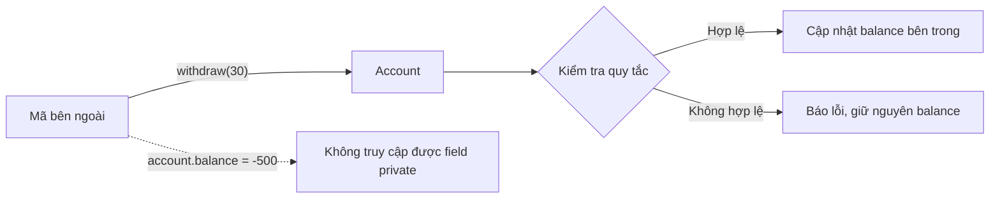
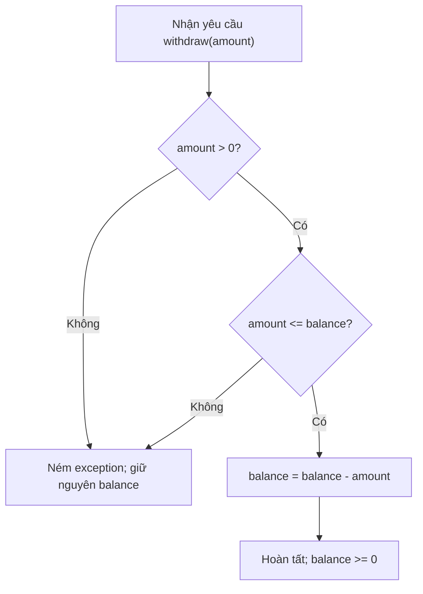

<a id="back-to-top"></a>

# Đóng gói (Encapsulation) — quản lý và bảo vệ trạng thái

## Menu
- [3.1 Đóng gói là gì và giải quyết vấn đề nào?](#oop-3-1)
- [3.2 public, private, protected và phạm vi truy cập](#oop-3-2)
- [3.3 Getter/setter: khi nào cần và vì sao không nên tạo tràn lan?](#oop-3-3)
- [3.4 Quy tắc bất biến của trạng thái (invariant): Account không cho rút quá số dư](#oop-3-4)

## <a id="oop-3-1">3.1 Đóng gói là gì và giải quyết vấn đề nào?</a>

<details>
<summary>Xem chi tiết</summary>

**Đóng gói (Encapsulation)** trong lập trình hướng đối tượng (OOP) là cách **đặt dữ liệu và những hành vi liên quan vào cùng một đối tượng, đồng thời kiểm soát cách bên ngoài tương tác với dữ liệu ấy**.

Hãy hình dung một tài khoản ngân hàng. Nó có số dư, có thể nhận tiền và rút tiền. Nhưng tài khoản phải tuân theo quy tắc: **không chấp nhận rút số tiền âm, bằng 0 hoặc vượt quá số dư hiện có**.

Nếu bất kỳ nơi nào trong chương trình cũng được tự ý sửa số dư, quy tắc này rất dễ bị phá vỡ. Đóng gói giúp tài khoản **tự chịu trách nhiệm** kiểm tra yêu cầu rồi mới thay đổi số dư của mình.

> **Điểm cốt lõi:** Các thành phần khác có thể **yêu cầu đối tượng thực hiện hành động**, nhưng không được tự ý thay đổi trạng thái của đối tượng theo cách phá vỡ quy tắc mà nó quản lý.

### 1. Vấn đề xuất hiện khi không có đóng gói

Giả sử lập trình viên viết một class `Account` như sau:

```java
class Account {
    public int balance = 100;
}
```

Các phần khác của ứng dụng có thể trực tiếp gán giá trị:

```java
Account account = new Account();

account.balance -= 30;      // Còn 70: trông có vẻ đúng
account.balance = -500;     // Số dư âm: vẫn được phép
account.balance = 999999;   // Tự ý thay đổi số dư: vẫn được phép
```

Vấn đề nằm ở chỗ **`Account` không kiểm soát được việc thay đổi số dư**. Mọi nơi có quyền truy cập field đều có thể sửa nó.

Trong ứng dụng nhỏ, lỗi này có thể chưa rõ ràng. Nhưng khi xuất hiện nhiều chức năng như ATM, chuyển khoản, hoàn tiền hoặc thu phí, từng nơi có thể cập nhật số dư theo cách khác nhau. Một đoạn mã quên kiểm tra là đủ để đưa object vào trạng thái không hợp lệ.

| Cách tổ chức | Điều có thể xảy ra |
|---|---|
| Cho phép sửa trực tiếp `account.balance` | Mỗi nơi tự quyết định cách tính và kiểm tra |
| Quy tắc rút tiền nằm rải rác | Nơi này kiểm tra, nơi khác có thể quên |
| Thay đổi quy tắc nghiệp vụ | Phải tìm và sửa nhiều chỗ |
| Object không kiểm soát dữ liệu của mình | Dễ tạo trạng thái sai hoặc khó truy vết nguồn gốc thay đổi |

Vì vậy, bài toán mà đóng gói giải quyết là: **làm thế nào để đối tượng giữ được quyền quản lý trạng thái và bảo đảm các quy tắc của chính nó?**

### 2. Giải pháp: giao trách nhiệm bảo vệ trạng thái cho object

Thay vì công khai `balance`, ta giữ nó bên trong `Account` và cung cấp những hành vi có ý nghĩa: `deposit(...)` và `withdraw(...)`.

Ví dụ Java có thể chạy trực tiếp khi lưu vào file `Main.java`:

```java
public class Main {
    public static void main(String[] args) {
        Account an = new Account(100);
        Account binh = new Account(100);

        an.withdraw(30);
        System.out.println("An còn: " + an.getBalance()); // 70

        try {
            binh.withdraw(120);
        } catch (IllegalArgumentException ex) {
            System.out.println("Bình: " + ex.getMessage());
        }

        System.out.println("Bình còn: " + binh.getBalance()); // 100

        an.deposit(20);
        System.out.println("An sau khi nạp: " + an.getBalance()); // 90
    }
}

class Account {
    private int balance;

    public Account(int openingBalance) {
        if (openingBalance < 0) {
            throw new IllegalArgumentException("Số dư ban đầu không hợp lệ");
        }
        this.balance = openingBalance;
    }

    public int getBalance() {
        return balance;
    }

    public void deposit(int amount) {
        if (amount <= 0) {
            throw new IllegalArgumentException("Tiền nạp phải lớn hơn 0");
        }
        balance = Math.addExact(balance, amount);
    }

    public void withdraw(int amount) {
        if (amount <= 0) {
            throw new IllegalArgumentException("Tiền rút phải lớn hơn 0");
        }
        if (amount > balance) {
            throw new IllegalArgumentException("Không đủ số dư");
        }
        balance -= amount;
    }
}
```

Kết quả:

```text
An còn: 70
Bình: Không đủ số dư
Bình còn: 100
An sau khi nạp: 90
```

Hãy đọc lại bằng ngôn ngữ đời thường:

1. Tài khoản An bắt đầu có 100. Yêu cầu rút 30 hợp lệ, nên tài khoản tự cập nhật thành 70.
2. Tài khoản Bình là **một object khác**, cũng bắt đầu có 100. Yêu cầu rút 120 bị từ chối; số dư của Bình vẫn là 100.
3. Tài khoản An nhận thêm 20 thông qua hành vi nạp tiền; số dư thành 90.
4. Bên ngoài có thể **đọc** số dư bằng `getBalance()`, nhưng không thể gán trực tiếp `an.balance = -500` vì field là `private`.

Trong ví dụ này, `int` chỉ biểu diễn **đơn vị tiền giả định** để tập trung vào OOP. Ứng dụng tài chính thật cần cách biểu diễn tiền, xử lý giao dịch và đồng thời phù hợp.

### 3. Đóng gói hoạt động qua ranh giới nào?



Bảng dưới chỉ rõ ai làm gì:

| Thành phần | Vai trò |
|---|---|
| `private int balance` | Giới hạn truy cập trực tiếp vào số dư từ mã bên ngoài class |
| `withdraw(amount)` | Định nghĩa hành động rút tiền có kiểm tra điều kiện |
| `deposit(amount)` | Định nghĩa hành động nạp tiền có kiểm tra điều kiện |
| `getBalance()` | Cung cấp thông tin số dư cho nơi có nhu cầu đọc |
| `Account` | Chịu trách nhiệm duy trì các quy tắc về số dư trong phạm vi object |

Có hai ý cần hiểu cùng nhau:

- **Gom dữ liệu và hành vi có liên quan**: `balance` nằm cạnh những hành vi cần thao tác trên nó.
- **Kiểm soát ranh giới tương tác**: bên ngoài biết gọi phương thức nào, còn object quyết định khi nào được sửa trạng thái.

Đóng gói **không có nghĩa là mọi field phải ẩn tuyệt đối hay mọi class đều phải có getter/setter**. Việc cho phép đọc hoặc thay đổi cần xuất phát từ trách nhiệm của object.

### 4. Vì sao `private` thôi vẫn chưa đủ?

Một hiểu nhầm phổ biến là chỉ cần đặt tất cả field thành `private`, sau đó tạo setter công khai cho từng field, thì đã đóng gói tốt.

Xem ví dụ:

```java
class Account {
    private int balance;

    public void setBalance(int balance) {
        this.balance = balance;
    }
}
```

Dù `balance` là `private`, mã bên ngoài vẫn có thể gọi `setBalance(-100)`. Một setter kiểm tra `balance >= 0` cũng chưa chắc giải quyết được nghiệp vụ: khi ấy người gọi vẫn có thể `setBalance(1000000)` để tăng tiền tùy ý.

**Điểm mấu chốt nằm ở hành vi được cho phép.** `withdraw(30)` diễn đạt việc rút tiền, nên object biết kiểm tra số tiền và số dư. `setBalance(70)` chỉ yêu cầu gán giá trị 70 mà không cho biết *tại sao* số dư phải trở thành 70.

| Cách gọi | Thể hiện điều gì? | Có dễ bảo vệ quy tắc rút tiền? |
|---|---|---|
| `account.balance = 70` | Thay field trực tiếp | Không; bỏ qua ranh giới object |
| `account.setBalance(70)` | Gán số dư bằng 70 | Chưa đủ ý nghĩa nghiệp vụ |
| `account.withdraw(30)` | Rút 30 từ số dư hiện có | Có; phương thức có thể kiểm tra trước khi cập nhật |

Điều đó không có nghĩa **setter luôn sai**. Với thuộc tính được phép thay đổi trực tiếp, ví dụ bật/tắt chế độ tối trong cài đặt giao diện, setter có thể hoàn toàn hợp lý. Nhưng với **trạng thái chịu ràng buộc nghiệp vụ**, phương thức diễn đạt hành động thường dễ hiểu và an toàn hơn.

### 5. Đóng gói đem lại những lợi ích gì?

**Bảo vệ quy tắc của object.** Nếu tài khoản phải luôn có số dư không âm, các thao tác thay đổi phải duy trì điều kiện đó. Ta thường gọi điều kiện cần luôn đúng này là **invariant**. Ví dụ `withdraw(...)` từ chối rút tiền vượt số dư.

**Giảm sự phụ thuộc vào chi tiết bên trong.** Phần khác của chương trình chỉ cần biết `withdraw(amount)` có tác dụng gì, không cần tự viết `balance = balance - amount`. Sau này class có thể đổi cách lưu hoặc tính toán nội bộ, miễn là hợp đồng sử dụng vẫn được giữ phù hợp.

**Tập trung kiểm tra và xử lý lỗi.** Nếu nhiều nơi dùng hành vi của `Account`, các tình huống như số tiền âm, bằng 0 hoặc quá số dư được kiểm tra ở cùng một ranh giới. Dễ tìm nơi đặt kiểm thử hơn.

**Giúp code diễn đạt nghiệp vụ.** `order.confirmPayment()` dễ cho người đọc hiểu ý định hơn một chuỗi gán `status`, `paidAt` và các field khác từ bên ngoài.

Nhưng đóng gói không phải công cụ tự giải quyết mọi vấn đề. Ví dụ `Account` trên chưa đủ bảo đảm an toàn khi có **nhiều luồng cập nhật cùng lúc**, hoặc khi số dư được lưu trong database có nhiều giao dịch đồng thời. Khi đó cần cơ chế đồng bộ, giao dịch hoặc kiểm soát nhất quán tương ứng.

### 6. Đóng gói có giống trừu tượng hóa không?

Hai khái niệm liên quan chặt chẽ nhưng trọng tâm khác nhau:

| Khái niệm | Câu hỏi trọng tâm | Ví dụ |
|---|---|---|
| **Encapsulation — Đóng gói** | Ai sở hữu trạng thái và kiểm soát cách thay đổi nó? | `Account` giữ `balance` và kiểm tra `withdraw()` |
| **Abstraction — Trừu tượng hóa** | Bên sử dụng cần nhìn thấy những khả năng nào? | Người gọi chỉ cần hiểu hợp đồng `withdraw(amount)` |

Một object có thể đồng thời áp dụng cả hai. Người gọi được thấy hành động rút tiền (khả năng cần dùng), còn dữ liệu và logic kiểm tra được quản lý trong object.

### 7. Tự kiểm tra bằng một tình huống

Giả sử một class `Order` có ba field: `status`, `paidAt` và `totalAmount`. Một đoạn code bên ngoài thực hiện:

```java
order.setStatus("PAID");
order.setPaidAt(null);
order.setTotalAmount(0);
```

Dù mỗi field được khai báo `private`, chuỗi setter này có thể tạo ra một đơn hàng vô lý: đã thanh toán nhưng thời điểm thanh toán không tồn tại, tổng tiền bị thay đổi tùy ý.

Một thiết kế theo trách nhiệm có thể cung cấp `order.confirmPayment(...)`. Bên trong phương thức, object sẽ kiểm tra trạng thái hiện tại, dữ liệu thanh toán và cập nhật những field liên quan theo một quy tắc nhất quán.

Hãy trả lời ba câu:

1. **Đóng gói giải quyết vấn đề gì?** — Giúp object sở hữu và kiểm soát trạng thái của mình, tránh để các phần mã khác sửa tùy tiện hoặc bỏ qua quy tắc.
2. **Chỉ dùng `private` là đủ chưa?** — Chưa. Cần xem những phương thức công khai có cho phép tạo trạng thái sai hay không.
3. **Tại sao `withdraw(30)` tốt hơn `setBalance(70)` trong tài khoản?** — Vì nó thể hiện đúng ý định rút tiền và đặt quy tắc kiểm tra trong object chịu trách nhiệm.

**Hãy nhớ:** Đóng gói không chỉ là **giấu dữ liệu**; nó là **thiết kế ranh giới trách nhiệm**. Object giữ thông tin mà nó quản lý và cung cấp hành vi giúp bên ngoài sử dụng thông tin ấy theo cách hợp lệ.

</details>

- [Quay lại đầu trang](#back-to-top)

---

## <a id="oop-3-2">3.2 public, private, protected và phạm vi truy cập</a>

<details>
<summary>Xem chi tiết</summary>

### 1. Vì sao một đối tượng cần giới hạn quyền truy cập?

Giả sử có đối tượng tài khoản ngân hàng đang giữ số dư 1.000.000 đồng. Nếu mã nguồn bên ngoài có thể tự ý sửa số dư, nó có thể gán thành số âm, tăng tiền tùy tiện hoặc bỏ qua quy tắc rút tiền. Khi đó lớp `BankAccount` không còn kiểm soát được trạng thái của chính mình.

Trong lập trình hướng đối tượng, **đóng gói (encapsulation)** có nghĩa là đối tượng quản lý dữ liệu và hành vi liên quan, đồng thời kiểm soát cách bên ngoài tương tác với chúng. **Access modifier (bộ điều chỉnh truy cập)** là một công cụ quan trọng để xác định đoạn mã nào được phép nhìn thấy và sử dụng thành phần của lớp.

Hãy hình dung lớp như một căn nhà:
- `public`: cửa dành cho mọi người có thể sử dụng.
- `private`: ngăn riêng chỉ mã bên trong lớp được trực tiếp thao tác.
- `protected`: khu vực dành cho mã cùng package hoặc lớp con theo quy tắc Java.
- **package-private** (không ghi từ khóa): lối nội bộ dành cho các lớp trong cùng package.

Phạm vi truy cập áp dụng cho nhiều thành phần: **field**, **method**, **constructor** và **kiểu lồng bên trong lớp**. Nó được Java kiểm tra khi biên dịch; không phải quy tắc “ai cũng có thể truy cập nếu biết tên”.

### 2. Bốn mức truy cập: bảng cần hiểu trước

Giả sử một thành phần được khai báo trong lớp `Account` thuộc package `com.example.bank`.

| Khai báo | Ngay trong `Account` | Lớp khác cùng package | Lớp con khác package | Lớp khác package không kế thừa |
|---|:---:|:---:|:---:|:---:|
| `private` | ✅ | ❌ | ❌ | ❌ |
| *package-private* (không ghi modifier) | ✅ | ✅ | ❌ | ❌ |
| `protected` | ✅ | ✅ | ✅* | ❌ |
| `public` | ✅ | ✅ | ✅ | ✅ |

**Dấu * ở `protected`:** lớp con thuộc package khác được truy cập theo quy tắc kế thừa; **không có nghĩa** lớp con được gọi thành phần `protected` trên mọi đối tượng `Account` tùy ý. Phần 5 sẽ có ví dụ biên dịch cụ thể.

Các mức truy cập có thể nhớ theo mức độ mở rộng:

```text
private  →  package-private  →  protected  →  public
hẹp nhất                                       rộng nhất
```

Đây là cách so sánh phạm vi thường gặp, không phải thứ tự yêu cầu bạn phải sử dụng. Hãy chọn quyền **vừa đủ cho trách nhiệm của thành phần**.

### 3. `private`: bảo vệ trạng thái và quy tắc của đối tượng

Ví dụ, một tài khoản chỉ chấp nhận nạp hoặc rút số tiền dương, và không cho rút vượt số dư:

```java
package com.example.bank;

public class BankAccount {
    private long balance;

    public BankAccount(long initialBalance) {
        if (initialBalance < 0) {
            throw new IllegalArgumentException("Số dư ban đầu không hợp lệ");
        }
        this.balance = initialBalance;
    }

    public long getBalance() {
        return balance;
    }

    public void deposit(long amount) {
        requirePositive(amount);
        balance = Math.addExact(balance, amount);
    }

    public void withdraw(long amount) {
        requirePositive(amount);
        if (amount > balance) {
            throw new IllegalStateException("Không đủ số dư");
        }
        balance -= amount;
    }

    private void requirePositive(long amount) {
        if (amount <= 0) {
            throw new IllegalArgumentException("Số tiền phải lớn hơn 0");
        }
    }
}
```

Mã sử dụng:

```java
BankAccount account = new BankAccount(1_000_000);
account.withdraw(200_000);
System.out.println(account.getBalance()); // 800000

// account.balance = -10;       // LỖI BIÊN DỊCH: balance là private
// account.requirePositive(10);  // LỖI BIÊN DỊCH: method là private
```

Ở đây, `balance` được giữ `private`; lớp tự đặt **bất biến (invariant)**: số dư không âm sau những thao tác hợp lệ. Người dùng được thực hiện nghiệp vụ qua `deposit()`, `withdraw()`, `getBalance()`, nhưng không được tự sửa field. Điều này làm quy tắc dễ kiểm soát và giúp lớp có quyền thay đổi cách lưu trạng thái bên trong mà ít ảnh hưởng mã gọi.

`private` **không cấm các phương thức trong cùng lớp truy cập lẫn nhau**. Ngay trong `BankAccount`, `withdraw()` vẫn gọi được `requirePositive()` và đọc `balance`. Hơn nữa, Java cho phép mã của lớp truy cập field `private` trên *một instance khác cùng lớp*:

```java
public boolean sameBalance(BankAccount other) {
    return this.balance == other.balance; // Hợp lệ khi method ở trong BankAccount
}
```

**Điểm cần hiểu:** `private` là phạm vi của **lớp**, không phải “chỉ đối tượng `this`”. Java còn có quy tắc riêng cho các lớp lồng (nestmates), nhưng khi mới học hãy tập trung vào việc mã bên ngoài lớp không được trực tiếp truy cập field `private`.

### 4. `public`: giao diện mà bên ngoài được phép dùng

`public` mở quyền truy cập từ các lớp khác, kể cả ở package khác, miễn là chính kiểu khai báo và đường dẫn truy cập cũng có thể nhìn thấy.

Trong ví dụ tài khoản, `withdraw()` là `public` vì bên ngoài cần sử dụng chức năng rút tiền. Nhưng **public không có nghĩa là được thực hiện mọi hành vi**: method vẫn kiểm tra số tiền hợp lệ và số dư.

```java
BankAccount account = new BankAccount(500_000);

account.deposit(100_000);   // Hợp lệ: còn 600000
account.withdraw(700_000);  // Ném IllegalStateException: không đủ số dư
```

Một số nguyên tắc thiết kế thực tế:
- Đưa ra `public` những hành vi mà mã sử dụng thực sự cần.
- Ưu tiên method thể hiện nghiệp vụ (`withdraw`, `deposit`) thay vì `public void setBalance(long x)` cho phép bỏ qua quy tắc.
- Không coi getter/setter là mặc định bắt buộc cho mọi field. `getBalance()` có ý nghĩa nếu cần đọc số dư; một `setBalance()` tùy ý có thể phá bất biến.
- Getter trả về một đối tượng mutable (ví dụ `List`) cũng có thể làm lộ khả năng sửa dữ liệu. Trường hợp đó cần cân nhắc bản sao hoặc dữ liệu chỉ đọc.

Một API có phạm vi công khai càng lớn thì càng có nhiều mã phụ thuộc vào nó. Do đó việc lựa chọn `public` cũng là quyết định về trách nhiệm duy trì hợp đồng sử dụng.

### 5. `protected`: mở quyền cho cùng package và tình huống kế thừa

`protected` thường dùng cho **điểm mở rộng** (extension point) có chủ đích khi thiết kế lớp cha cho lớp con. Ví dụ, lớp cha cung cấp khả năng mô tả tài khoản; lớp con có thể tùy chỉnh nhãn:

```java
// File: com/example/bank/Account.java
package com.example.bank;

public class Account {
    protected String accountType() {
        return "STANDARD";
    }

    public String description() {
        return "Account type: " + accountType();
    }
}
```

```java
// File: com/example/premium/PremiumAccount.java
package com.example.premium;

import com.example.bank.Account;

public class PremiumAccount extends Account {
    @Override
    protected String accountType() {
        return "PREMIUM";
    }

    public String ownType() {
        return this.accountType(); // OK: truy cập thông qua chính lớp con
    }

    public String anotherAccountType() {
        Account another = new Account();

        // return another.accountType(); // LỖI BIÊN DỊCH
        return this.accountType();
    }
}
```

```java
PremiumAccount premium = new PremiumAccount();
System.out.println(premium.description()); // Account type: PREMIUM
```

Giải thích:
1. `Account.description()` là `public`, nên nơi khác gọi được.
2. `PremiumAccount` ở package khác vẫn có thể **override** `accountType()` của lớp cha do method là `protected`.
3. Khi `description()` gọi `accountType()`, Java dùng implementation của đối tượng thực tế `PremiumAccount`; kết quả là `PREMIUM`.
4. Nhưng trong package `com.example.premium`, một subclass không được truy cập `accountType()` thông qua biến có kiểu `Account` độc lập như `another`. Quy tắc `protected` khác package giới hạn cách truy cập bằng tham chiếu đối tượng; `this` hoặc `super` là những trường hợp quen thuộc được phép.

**Một chi tiết dễ nhầm:** class không kế thừa nhưng **ở cùng package** với `Account` vẫn truy cập được member `protected` (nếu có đối tượng phù hợp). Ngược lại, lớp con ở package khác không tự động được quyền truy cập `private` hay package-private của lớp cha.

**Có nên đặt field `protected`?** Chỉ khi bạn thật sự muốn lớp con có khả năng tiếp xúc trực tiếp với nó. Với dữ liệu cần giữ bất biến, thường an toàn hơn khi để field `private` và cho lớp con dùng method `protected` có kiểm soát. Ví dụ `protected void validate...()` hoặc `protected String accountType()` có mục đích rõ ràng hơn `protected long balance` cho phép lớp con sửa số dư.

### 6. Package-private: không viết modifier nào

Java còn một mức truy cập rất hay gặp trong thư viện nội bộ:

```java
// File: com/example/bank/BalanceRules.java
package com.example.bank;

final class BalanceRules {        // package-private class
    static void requirePositive(long value) { // package-private method
        if (value <= 0) {
            throw new IllegalArgumentException("Phải lớn hơn 0");
        }
    }
}
```

```java
// File: com/example/bank/TransferService.java
package com.example.bank;

public class TransferService {
    public void validate(long amount) {
        BalanceRules.requirePositive(amount); // OK: cùng package
    }
}
```

Từ package `com.example.app`, câu lệnh `import com.example.bank.BalanceRules;` sẽ **không biến** `BalanceRules` thành kiểu có thể truy cập. Class này chỉ dùng trong `com.example.bank`.

Mức này gọi là **package-private** hoặc *default/package access*. Bạn chỉ cần **bỏ trống modifier**; không hề tồn tại cú pháp `default class BalanceRules` hay `default void validate()` cho mục đích này. Từ khóa `default` có nghĩa khác khi dùng với phương thức trong interface.

Cũng phải phân biệt: `com.example.bank` và `com.example.bank.internal` là **hai package khác nhau**. Dấu chấm trong tên chỉ tạo cách tổ chức tên, không tự động trao quyền truy cập cho package con.

### 7. Modifier áp dụng đến đâu?

Không phải khai báo nào cũng được sử dụng cả bốn từ khóa:

| Vị trí khai báo | Quy tắc |
|---|---|
| **Top-level class/interface** (không nằm trong lớp khác) | Chỉ được `public` hoặc *package-private*. Không thể khai báo `private class X` hay `protected class X` ở top-level. |
| **Field / method / constructor của class** | Có thể là `public`, `protected`, `private`, hoặc không ghi modifier. |
| **Kiểu lồng trong class** | Có thể dùng các mức trên, với các quy tắc riêng theo loại kiểu. |

Ví dụ `private` constructor thường được dùng khi lớp muốn tự kiểm soát việc tạo đối tượng, chẳng hạn factory method:

```java
public final class AccountId {
    private final String value;

    private AccountId(String value) {
        this.value = value;
    }

    public static AccountId of(String raw) {
        if (raw == null || raw.isBlank()) {
            throw new IllegalArgumentException("ID trống");
        }
        return new AccountId(raw.trim());
    }
}
```

Mã bên ngoài gọi `AccountId.of("A-01")`, nhưng không gọi được `new AccountId("A-01")`. Quyền truy cập được áp dụng cho **constructor**, không chỉ field hay method.

Ngoài ra, một method được khai báo `public` trong class nhưng tham số hoặc kiểu trả về lại không thể truy cập từ bên ngoài sẽ tạo API khó sử dụng. Khi thiết kế, hãy xem xét toàn bộ các kiểu xuất hiện trong giao diện công khai.

### 8. Bài tập tự kiểm tra: dòng nào biên dịch?

Giả sử file sau tồn tại:

```java
// package: com.demo.shop
package com.demo.shop;

public class Product {
    private long cost = 100;
    int stock = 5;                  // package-private
    protected String category = "BOOK";
    public String name = "Java";
}
```

Ở **cùng package `com.demo.shop`**:

```java
Product p = new Product();
// long a = p.cost;      // ❌ private
int b = p.stock;         // ✅ cùng package
String c = p.category;   // ✅ cùng package (dù không kế thừa)
String d = p.name;       // ✅ public
```

Ở **package khác**, trong lớp thường **không kế thừa** `Product`:

```java
Product p = new Product();
// long a = p.cost;       // ❌ private
// int b = p.stock;       // ❌ package-private
// String c = p.category; // ❌ protected
String d = p.name;        // ✅ public
```

Nếu viết `class BookProduct extends Product` trong package khác, lớp con được truy cập member `protected` đã kế thừa qua `this.category`; nó vẫn không thể dùng trực tiếp `cost` hay `stock` của lớp cha.

### 9. Chọn mức nào khi viết Java thật?

Đặt ba câu hỏi cho từng thành phần:

1. **Nó có phải chi tiết trạng thái hoặc logic nội bộ mà lớp phải tự quản lý?** Thường dùng `private`.
2. **Một nhóm lớp trong cùng package cần phối hợp nhưng bên ngoài không cần biết?** Cân nhắc *package-private*.
3. **Đây có phải điểm mở rộng có chủ đích cho lớp kế thừa?** Cân nhắc `protected` với hợp đồng rõ ràng.
4. **Mã sử dụng bên ngoài có thật sự cần chức năng này?** Khi đó khai báo `public`.

Trong các dự án Spring Boot, bạn có thể gặp `public` controller/service methods để thành phần khác gọi được, và `private` helper methods để giữ logic chi tiết bên trong. Tuy nhiên, **modifier chỉ quyết định quyền truy cập theo ngôn ngữ Java**; việc Spring có tạo bean, inject dependency, hay HTTP endpoint có yêu cầu xác thực hay không là những cơ chế khác.

Hãy tự thử sửa `BankAccount.balance` từ `private` sang `public`. Lúc này có thể viết `account.balance = -5`; chương trình sẽ cho phép bỏ qua `withdraw()` và kiểm tra số dư. Đó chính là lý do chọn modifier gắn liền với **đóng gói và giữ bất biến**, chứ không chỉ để làm mã biên dịch qua được.

> **Điều nên nhớ:** `public` cho mã bên ngoài dùng hợp đồng, `private` bảo vệ chi tiết bên trong, package-private cho hợp tác cùng package, còn `protected` có thêm cơ chế cho kế thừa. Quyền truy cập phù hợp giúp mỗi đối tượng giữ đúng trách nhiệm của nó.

</details>

- [Quay lại đầu trang](#back-to-top)

---

## <a id="oop-3-3">3.3 Getter/setter: khi nào cần và vì sao không nên tạo tràn lan?</a>

<details>
<summary>Xem chi tiết</summary>

Trong Java, **getter** thường là phương thức dùng để *đọc* một thuộc tính, còn **setter** thường dùng để *thay đổi* giá trị thuộc tính đó. Ví dụ, `getName()` trả về tên và `setName(...)` cập nhật tên.

Điểm cần hiểu trong OOP: **mỗi phương thức public là một quyền mà đối tượng trao cho mã bên ngoài**. Việc một trường được khai báo `private` không có nghĩa là thiết kế đã đóng gói tốt nếu mọi trạng thái đều có thể bị đọc, ghi tùy ý qua getter/setter.

### 1. Getter/setter thực sự làm gì?

```java
class User {
    private String name;

    public String getName() {
        return name;
    }

    public void setName(String name) {
        this.name = name;
    }
}
```

Sử dụng:

```java
User user = new User();
user.setName("An");
System.out.println(user.getName()); // An
```

Ở đây:
- `name` là **trạng thái** của đối tượng.
- `getName()` cung cấp cách **quan sát** trạng thái.
- `setName(...)` cung cấp cách **thay đổi** trạng thái.

Những phương thức này không tự động sai. Tuy nhiên, setter trong ví dụ cho phép truyền `null`, chuỗi rỗng hoặc tên không hợp lệ. Nếu phần mềm yêu cầu tên có ý nghĩa, đối tượng chưa tự bảo vệ quy tắc đó.

**Đóng gói (encapsulation)** là đặt dữ liệu và các thao tác liên quan trong cùng một đối tượng, đồng thời kiểm soát cách thế giới bên ngoài sử dụng đối tượng. Getter/setter chỉ là *công cụ có thể dùng* để thực hiện mục tiêu này.

### 2. Vì sao không nên tạo getter/setter cho mọi trường?

Hãy tưởng tượng một tài khoản ngân hàng có số dư 100:

```java
class BankAccount {
    private long balance = 100;

    public long getBalance() {
        return balance;
    }

    public void setBalance(long balance) {
        this.balance = balance;
    }
}
```

Mã bên ngoài có thể thực hiện:

```java
BankAccount account = new BankAccount();
account.setBalance(-500);     // Số dư âm, dù hệ thống không cho thấu chi
account.setBalance(1_000_000); // Tự tăng tiền mà không qua giao dịch
```

Vấn đề không chỉ nằm ở giá trị âm. Kể cả một `setBalance(200)` hợp lệ về kiểu dữ liệu, nó vẫn không giải thích **tiền đến từ đâu**. Mã gọi có quyền thay thế toàn bộ trạng thái mà không tuân theo hành vi gửi/rút tiền.

Khi lạm dụng setter, ta dễ gặp các hệ quả:

| Hệ quả | Ví dụ cụ thể |
| --- | --- |
| Phá vỡ bất biến (*invariant*) | Số dư âm hoặc ngày kết thúc trước ngày bắt đầu |
| Bỏ qua quy trình nghiệp vụ | Đổi `order.status` thành `PAID` khi chưa thanh toán |
| Rải logic ra ngoài đối tượng | Nhiều service tự kiểm tra và cập nhật cùng một trường |
| Tăng mức phụ thuộc | Nơi gọi biết quá rõ thuộc tính bên trong và phải sửa khi mô hình thay đổi |
| Khó lần theo nguyên nhân lỗi | Nhiều nơi đều có thể gọi `setBalance(...)` |

**Invariant** là điều kiện phải luôn đúng đối với một đối tượng ở những thời điểm trạng thái của nó được công khai cho bên ngoài. Ví dụ: với tài khoản không cho thấu chi, `balance >= 0` là một invariant.

### 3. Thay setter tùy ý bằng hành vi có ý nghĩa

Thay vì hỏi “làm sao cho bên ngoài sửa được `balance`?”, hãy hỏi “người dùng được phép làm gì với tài khoản?”.

```java
class BankAccount {
    private long balance;

    public BankAccount(long initialBalance) {
        if (initialBalance < 0) {
            throw new IllegalArgumentException("Initial balance must be >= 0");
        }
        this.balance = initialBalance;
    }

    public long getBalance() {
        return balance;
    }

    public void deposit(long amount) {
        if (amount <= 0) {
            throw new IllegalArgumentException("Amount must be positive");
        }
        balance = Math.addExact(balance, amount);
    }

    public void withdraw(long amount) {
        if (amount <= 0) {
            throw new IllegalArgumentException("Amount must be positive");
        }
        if (amount > balance) {
            throw new IllegalStateException("Insufficient funds");
        }
        balance -= amount;
    }
}
```

```java
BankAccount account = new BankAccount(100);

account.withdraw(30);
System.out.println(account.getBalance()); // 70

account.deposit(20);
System.out.println(account.getBalance()); // 90

account.withdraw(120); // Ném IllegalStateException
// Vì thao tác thất bại trước khi trừ tiền, số dư vẫn là 90.
```

**Điểm thay đổi quan trọng:** đối tượng tự quyết định khi nào số dư được phép đổi. Caller chỉ yêu cầu một hành động có ý nghĩa (`deposit`, `withdraw`); đối tượng kiểm tra quy tắc trước khi cập nhật. `getBalance()` vẫn hữu ích vì bên ngoài cần *biết* số dư, nhưng không cần quyền *gán* số dư.

Đây là ví dụ để hiểu đóng gói trong một đối tượng. Hệ thống ngân hàng thực tế còn cần giao dịch, lưu vết, kiểm soát đồng thời và nhiều bảo đảm khác; một class Java đơn lẻ chưa giải quyết hết các vấn đề đó.

### 4. Khi nào nên có getter?

Tạo getter khi một phần khác của chương trình **thật sự cần đọc một thông tin** để hiển thị, trả API, ghi log phù hợp hoặc phối hợp nghiệp vụ, và việc công khai thông tin ấy không làm mất quyền kiểm soát trạng thái.

| Tình huống | Thiết kế thường hợp lý |
| --- | --- |
| Giao diện cần hiện tên tài khoản | `getDisplayName()` |
| Hiển thị số dư nhưng không cho tự sửa | `getBalance()`, không có `setBalance(...)` |
| Kiểm tra đơn hàng đã thanh toán chưa | `isPaid()` có thể rõ nghĩa hơn đọc `getStatus()` rồi tự so sánh |
| Cần đọc mật khẩu, token bí mật, khóa nội bộ | Tránh công khai getter nếu không thực sự có quyền sử dụng dữ liệu |
| Cần đọc danh sách nội bộ có thể thay đổi | Trả về bản sao/immutable view phù hợp, không lộ tham chiếu để sửa trực tiếp |

Lưu ý: **getter không mặc nhiên vô hại**. Nếu getter trả về một đối tượng có thể thay đổi, caller có thể sửa dữ liệu nội bộ mà không cần setter.

```java
class Team {
    private final List<String> members = new ArrayList<>();

    // Không an toàn về đóng gói:
    public List<String> getMembersUnsafe() {
        return members;
    }

    // An toàn hơn với phần tử String bất biến:
    public List<String> getMembers() {
        return List.copyOf(members);
    }

    public void addMember(String name) {
        if (name == null || name.isBlank()) {
            throw new IllegalArgumentException("Invalid member name");
        }
        members.add(name);
    }
}
```

Với `getMembersUnsafe()`, mã ngoài có thể gọi `team.getMembersUnsafe().clear()` và xóa thành viên trực tiếp. Với `List.copyOf(members)`, caller nhận một danh sách không cho sửa và tách khỏi những thay đổi cấu trúc tiếp theo của danh sách gốc. Đây chưa phải “deep copy” cho mọi kiểu phần tử: nếu phần tử cũng là đối tượng mutable, cần cân nhắc sao chép phần tử hoặc trả về dữ liệu bất biến.

Các đoạn code minh họa dùng `java.util.List` và `java.util.ArrayList` (import chúng khi đặt vào file Java).

### 5. Khi nào setter là lựa chọn hợp lý?

**Setter không bị cấm trong OOP.** Nó hữu ích khi thuộc tính thực sự được phép chỉnh sửa độc lập, quy tắc chỉnh sửa đơn giản và tên `setX(...)` phản ánh đúng ý nghĩa thao tác.

Ví dụ tên hiển thị của người dùng được phép đổi:

```java
class UserProfile {
    private String displayName;

    public UserProfile(String displayName) {
        setDisplayName(displayName);
    }

    public String getDisplayName() {
        return displayName;
    }

    public void setDisplayName(String value) {
        if (value == null || value.isBlank()) {
            throw new IllegalArgumentException("Display name is required");
        }
        this.displayName = value.trim();
    }
}
```

Ở đây setter tập trung một quy tắc dùng chung cho cả khi khởi tạo và khi cập nhật. Nếu sau này đổi tên cần xác thực, ghi lịch sử hoặc kiểm duyệt, có thể một phương thức nghiệp vụ như `changeDisplayName(...)` sẽ biểu đạt ý định tốt hơn.

| Dữ liệu hoặc tình huống | Có nên dùng setter? | Lý do |
| --- | --- | --- |
| Tên hiển thị được sửa tự do với kiểm tra đơn giản | Có thể có | Cập nhật độc lập, dễ hiểu |
| Số dư, điểm thưởng, hạn mức khả dụng | Thường không | Cần thao tác có quy tắc: nạp, trừ, hoàn, khóa |
| Trạng thái đơn hàng | Thường không | Phải theo chuyển trạng thái hợp lệ như `pay()`, `cancel()` |
| Cặp `startDate` / `endDate` | Cẩn trọng | Hai trường phụ thuộc nhau; `reschedule(start, end)` có thể bảo vệ quy tắc tốt hơn |
| DTO dữ liệu dùng để nhận/trả request | Thường có thể | Chủ yếu vận chuyển dữ liệu, tùy cơ chế serialization/binding |
| Đối tượng bất biến | Không | Trạng thái đã chốt khi khởi tạo |

Một setter có kiểm tra dữ liệu cơ bản vẫn chưa đủ khi việc thay đổi còn phụ thuộc vào **trạng thái hiện tại**, **quyền người thao tác**, **quy tắc chuyển trạng thái** hoặc **sự phối hợp nhiều thuộc tính**. Lúc ấy hãy ưu tiên phương thức mang ngữ nghĩa nghiệp vụ.

### 6. Có phải class nào cũng phải có getter/setter để đúng chuẩn Java?

Không. `private` chỉ giới hạn truy cập trực tiếp tới trường. Getter/setter là các phương thức bình thường do người thiết kế API quyết định có công khai hay không.

Có những trường hợp sử dụng accessor nhiều là hợp lý:

- **JavaBeans và một số thư viện binding:** quy ước `getX`/`setX` giúp công cụ đọc hoặc điền thuộc tính. Hãy xác nhận cơ chế thư viện đang dùng thực sự cần gì.
- **DTO trong Spring Boot / JSON:** DTO có thể dùng getter/setter, constructor binding hoặc `record`, tùy phiên bản và cấu hình của thư viện. Đừng tự động áp quy tắc của DTO cho domain entity.
- **JPA entity:** JPA có thể truy cập field hoặc property theo cách ánh xạ, và thường cần constructor không tham số với độ truy cập phù hợp. Điều đó **không có nghĩa** mọi field đều phải có public setter. Nên kiểm soát các thay đổi nghiệp vụ của entity.
- **Lombok `@Getter` / `@Setter` / `@Data`:** giảm mã lặp, nhưng các phương thức được sinh ra vẫn tạo quyền truy cập thật. Ví dụ, gắn `@Setter` ở cấp class vô tình mở mọi thuộc tính có thể đổi; hãy cân nhắc đặt annotation có chọn lọc.
- **Java `record`:** tiện cho các cấu trúc dữ liệu bất biến về mặt gán lại trường; record có accessor dạng `name()`, không có setter. Nếu component tham chiếu tới đối tượng mutable thì vẫn cần xét bảo vệ dữ liệu.

Điểm phân biệt hữu ích là **đối tượng dữ liệu** (chủ yếu mang giá trị giữa các tầng) và **đối tượng nghiệp vụ** (chịu trách nhiệm duy trì quy tắc). Một thiết kế có thể dùng cả hai, không cần ép mọi class theo một khuôn.

### 7. Cách chọn API khi thiết kế một class

Trước mỗi getter/setter mới, hãy tự trả lời:

1. **Ai cần đọc/ghi thông tin này, nhằm mục đích gì?** Nếu chưa có nhu cầu rõ, chưa cần mở phương thức public.
2. **Người gọi cần biết giá trị hay cần yêu cầu hành động?** `getBalance()` để xem; `withdraw(amount)` để rút tiền.
3. **Giá trị mới có thể làm hỏng invariant không?** Nếu có, đặt kiểm tra trong đối tượng và ưu tiên thao tác nghiệp vụ.
4. **Thuộc tính có liên quan trường khác hay trạng thái trước đó không?** Nếu có, một setter độc lập dễ khiến object rơi vào trạng thái không hợp lệ.
5. **Getter có làm lộ tham chiếu mutable hoặc dữ liệu nhạy cảm không?** Nếu có, trả về bản sao/giá trị chỉ đọc phù hợp hoặc không cung cấp getter.
6. **Công cụ/framework thực sự cần kiểu accessor nào?** Chỉ công khai đúng phạm vi cần thiết thay vì sinh tất cả theo thói quen.

Một ví dụ nhỏ để so sánh tên API:

```java
order.setStatus(PAID);     // Ai bảo đảm đã thanh toán?
order.markPaid(paymentId); // Bộc lộ ý định và nơi đặt quy tắc kiểm tra

cart.setTotal(1000);       // Caller tự quyết tổng tiền
cart.addItem(product, 2);  // Cart có thể tự tính lại tổng
```

Các tên như `markPaid` hay `addItem` không tự động bảo đảm đúng: logic bên trong vẫn phải kiểm tra và bảo vệ các invariant cần thiết. Nhưng chúng **đặt trách nhiệm ở đúng nơi** và khiến hợp đồng của đối tượng rõ ràng hơn.

### 8. Tự kiểm tra hiểu bài

**Tình huống A:** `Product` có `private int stock` và public `setStock(int)`. Một service gọi `setStock(-3)`. Khai báo `private` đã đủ bảo vệ chưa?

→ **Chưa.** `private` ngăn sửa trực tiếp, nhưng public setter vẫn cho ghi giá trị bất hợp lệ. Tùy nghiệp vụ, có thể cần `restock(quantity)`, `reserve(quantity)`, `release(quantity)` với kiểm tra tương ứng.

**Tình huống B:** `getMembers()` trả về `List` nội bộ. Không có setter thì đối tượng đã an toàn chưa?

→ **Chưa.** Caller vẫn có thể thay đổi danh sách qua tham chiếu được trả về. Cần xem cách trả dữ liệu và kiểu phần tử.

**Tình huống C:** DTO nhận dữ liệu từ form có `getEmail()` và `setEmail(...)`. Thiết kế đó có phải anti-pattern?

→ **Không nhất thiết.** Với cấu trúc chủ yếu dùng truyền dữ liệu, accessor là lựa chọn phổ biến. Kiểm tra dữ liệu đầu vào vẫn cần được thực hiện ở ranh giới phù hợp; DTO không thay thế kiểm tra quy tắc ở domain.

**Điều cần ghi nhớ:** Getter/setter là những lựa chọn thiết kế API. Chỉ tạo chúng khi có nhu cầu truy cập thực tế; để đối tượng tự quản lý các thay đổi ảnh hưởng đến quy tắc và trạng thái hợp lệ. **Đóng gói tốt được đánh giá bằng quyền kiểm soát và trách nhiệm của đối tượng, không bằng số lượng từ khóa `private` hay số getter/setter được sinh ra.**

</details>

- [Quay lại đầu trang](#back-to-top)

---

## <a id="oop-3-4">3.4 Quy tắc bất biến của trạng thái (invariant): Account không cho rút quá số dư</a>

<details>
<summary>Xem chi tiết</summary>

Giả sử một tài khoản ngân hàng có **100 đơn vị tiền**. Khách hàng yêu cầu rút **30** thì tài khoản còn **70** — hợp lệ. Nhưng nếu khách hàng yêu cầu rút **120**, tài khoản phải từ chối và **vẫn giữ nguyên 100**, thay vì biến số dư thành `-20`.

Điều đang được bảo vệ ở đây là một **quy tắc bất biến của trạng thái** (*state invariant*).

### 1. Invariant là gì?

**Invariant** là một điều kiện mà trạng thái của object phải luôn đáp ứng tại những thời điểm object được coi là hợp lệ, đặc biệt **ngay sau khi tạo object và sau mỗi thao tác công khai đã hoàn tất**.

Với bài toán `Account` đơn giản, quy tắc nghiệp vụ là:

```text
balance >= 0
```

Nghĩa là **số dư không bao giờ được âm**.

Quy tắc này vẫn giữ nguyên dù giá trị số dư có thể thay đổi từ `100` thành `70`, rồi từ `70` thành `0`. Vì vậy, chữ *bất biến* nói về **điều kiện phải được duy trì**, không có nghĩa là **giá trị của biến không được thay đổi** (*immutability*).

Hãy phân biệt ba thứ:

| Khái niệm | Với thao tác rút tiền |
|---|---|
| **Trạng thái (state)** | Giá trị `balance` hiện tại, ví dụ `100` |
| **Điều kiện đầu vào / điều kiện trước (precondition)** | Số tiền rút phải lớn hơn `0` và không vượt số dư hiện có |
| **Bất biến trạng thái (invariant)** | Sau thao tác, `balance >= 0` vẫn đúng |

Điều kiện trước giúp quyết định **có cho phép thao tác xảy ra hay không**; invariant mô tả **một object hợp lệ phải luôn như thế nào**.

### 2. Tại sao Account phải tự bảo vệ quy tắc?

Một thiết kế thiếu bảo vệ có thể trông như sau:

```java
class Account {
    public long balance = 100;
}

// Mã bên ngoài có thể sửa trực tiếp:
Account account = new Account();
account.balance = -20; // Object rơi vào trạng thái không hợp lệ!
```

Kể cả khi khai báo `private long balance`, nếu lại cung cấp `setBalance(-20)` mà không kiểm tra, lỗi vẫn xảy ra. **Chỉ đặt `private` chưa đủ; mọi con đường thay đổi trạng thái đều phải tôn trọng quy tắc.**

Cách thiết kế phù hợp với OOP là: `Account` **sở hữu dữ liệu số dư và chịu trách nhiệm quyết định thao tác rút tiền có hợp lệ hay không**. Bên ngoài chỉ yêu cầu tài khoản thực hiện hành vi `withdraw(amount)`, không trực tiếp tính rồi gán số dư.

### 3. Ví dụ Java: kiểm tra trước, thay đổi sau

Giả sử số tiền là số nguyên theo một đơn vị tiền nhỏ nhất đã thống nhất; ví dụ dưới đây dùng `long` để tập trung vào invariant.

```java
public final class Account {
    private long balance;

    public Account(long initialBalance) {
        if (initialBalance < 0) {
            throw new IllegalArgumentException("Số dư ban đầu không được âm");
        }
        this.balance = initialBalance;
    }

    public long getBalance() {
        return balance;
    }

    public void withdraw(long amount) {
        if (amount <= 0) {
            throw new IllegalArgumentException("Số tiền rút phải lớn hơn 0");
        }

        if (amount > balance) {
            throw new IllegalStateException("Số dư không đủ để rút");
        }

        // Chỉ thay đổi trạng thái khi mọi điều kiện đều hợp lệ.
        balance -= amount;
    }

    public void deposit(long amount) {
        if (amount <= 0) {
            throw new IllegalArgumentException("Số tiền nạp phải lớn hơn 0");
        }

        // Nếu phép cộng tràn phạm vi long, Math.addExact ném lỗi;
        // phép gán không xảy ra và balance cũ vẫn được giữ nguyên.
        balance = Math.addExact(balance, amount);
    }
}
```

Hai điểm cần chú ý:

- **Constructor cũng phải kiểm tra.** Nếu cho phép `new Account(-10)`, object đã sai invariant ngay khi được tạo.
- **Kiểm tra xảy ra trước phép trừ.** Trong `withdraw`, khi số tiền rút không hợp lệ, phương thức ném exception **trước khi đụng vào `balance`**. Vì thế một yêu cầu thất bại không làm hỏng trạng thái tài khoản.

Mã sử dụng:

```java
public class Main {
    public static void main(String[] args) {
        Account successfulAccount = new Account(100);
        successfulAccount.withdraw(30);
        System.out.println(successfulAccount.getBalance()); // 70

        // Tài khoản khác, cũng bắt đầu từ 100: thử tình huống thất bại độc lập.
        Account rejectedAccount = new Account(100);
        try {
            rejectedAccount.withdraw(120);
        } catch (IllegalStateException ex) {
            System.out.println(ex.getMessage()); // Số dư không đủ để rút
        }
        System.out.println(rejectedAccount.getBalance()); // 100
    }
}
```

Ở nhánh thành công: `100 - 30 = 70`; invariant vẫn đúng. Ở nhánh thất bại: yêu cầu `120 > 100` bị từ chối; không hề có bước `100 - 120`, nên số dư vẫn là `100`.

### 4. Theo dõi trạng thái trước và sau thao tác

Mỗi dòng dưới đây là **một tình huống độc lập**, đều bắt đầu từ tài khoản có số dư `100`.

| Yêu cầu | Xử lý | Số dư sau cùng | Invariant `balance >= 0` |
|---|---|---:|---|
| Rút `30` | Chấp nhận | `70` | Đúng |
| Rút `100` | Chấp nhận, rút hết | `0` | Đúng |
| Rút `120` | Từ chối vì vượt số dư | `100` | Đúng |
| Rút `0` hoặc `-5` | Từ chối vì số tiền rút không hợp lệ | `100` | Đúng |

Luồng quyết định bên trong `withdraw`:



Đặt phép trừ **sau** các điều kiện kiểm tra giúp ta lập luận đơn giản: nếu `amount > 0` và `amount <= balance`, thì `balance - amount >= 0`. Như vậy thao tác rút tiền hợp lệ **bảo toàn invariant**.

### 5. Mối liên hệ với Encapsulation (đóng gói)

Đóng gói không chỉ là giấu trường `balance` bằng `private`. Điều quan trọng hơn là **giữ quyền kiểm soát cách trạng thái thay đổi** ở bên trong object.

Thay vì cho code bên ngoài thực hiện:

```java
// Thiết kế nguy hiểm: bên ngoài tự sửa trạng thái.
account.balance = account.balance - amount;
```

ta cung cấp một hành vi có ý nghĩa nghiệp vụ:

```java
account.withdraw(amount);
```

Nhờ đó, mọi nơi sử dụng `Account` đều đi qua cùng một quy tắc kiểm tra. Nếu một ngày nghiệp vụ bổ sung hạn mức rút, phí giao dịch hoặc trạng thái tài khoản bị khóa, logic kiểm tra cũng có một chỗ rõ ràng để đặt vào.

**Tuy nhiên, không nên hiểu rằng cứ có getter/setter là đã đóng gói đúng.** Một setter cho phép gán số dư tùy ý có thể phá bỏ toàn bộ cơ chế bảo vệ. Object nên cung cấp những hành vi phù hợp với nghiệp vụ (`withdraw`, `deposit`), thay vì mở quyền chỉnh sửa thẳng vào dữ liệu nội bộ.

### 6. Những nhầm lẫn cần tránh

**Nhầm lẫn 1 — “Invariant tức là số dư phải giữ nguyên.”** Không đúng. Số dư được thay đổi qua những thao tác hợp lệ; điều bất biến là điều kiện `balance >= 0`.

**Nhầm lẫn 2 — “Kiểm tra ở UI hoặc controller là đủ.”** UI có thể kiểm tra để thông báo sớm, nhưng một object nghiệp vụ không nên phụ thuộc vào việc mọi caller đều nhớ kiểm tra. Nếu có nhiều luồng gọi từ API, batch job hoặc test, quy tắc vẫn cần được thực thi tại nơi chịu trách nhiệm quản lý trạng thái.

**Nhầm lẫn 3 — “Có `private` là không thể sai.”** Ngay cả một phương thức nằm trong `Account` cũng có thể làm sai invariant nếu sửa `balance` thiếu kiểm tra. Encapsulation tạo **ranh giới kiểm soát**; chính code bên trong ranh giới phải duy trì tính đúng đắn.

**Nhầm lẫn 4 — “Code trên tự xử lý an toàn mọi lượt rút đồng thời.”** Chưa. Ví dụ này minh họa quy tắc trong một lần gọi tuần tự. Khi nhiều thread hoặc nhiều request cùng truy cập một tài khoản, thao tác **kiểm tra số dư và trừ tiền** cần được bảo vệ như một hành động nhất quán, chẳng hạn bằng đồng bộ phù hợp hoặc transaction/locking ở tầng lưu trữ. `private` và các câu `if` riêng lẻ không bảo đảm an toàn đồng thời.

### 7. Tự kiểm tra cách hiểu

Giả sử `Account` có `balance = 80`:

1. `withdraw(50)` được chấp nhận, số dư còn `30`.
2. Từ số dư `30`, `withdraw(40)` bị từ chối, số dư **vẫn là `30`**.
3. Một object `Account` mới có thể được tạo với `balance = 0`, nhưng không thể được tạo với số dư âm.

Nếu giải thích được **tại sao các bước trên bảo đảm `balance >= 0`** và **tại sao object cần tự kiểm tra trước khi thay đổi số dư**, bạn đã nắm đúng ý nghĩa của *state invariant* trong đóng gói OOP.

</details>

- [Quay lại đầu trang](#back-to-top)
