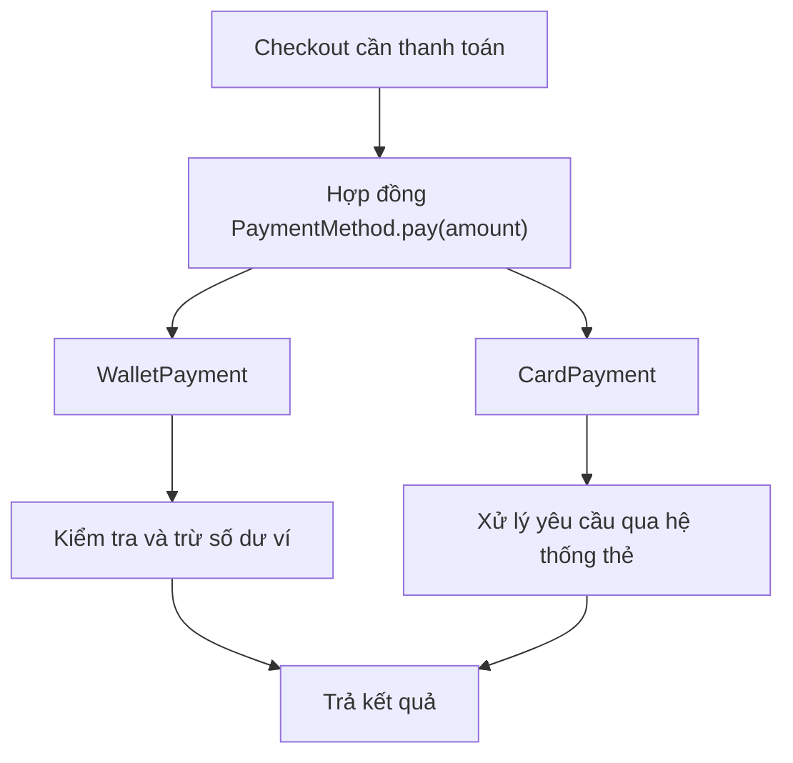
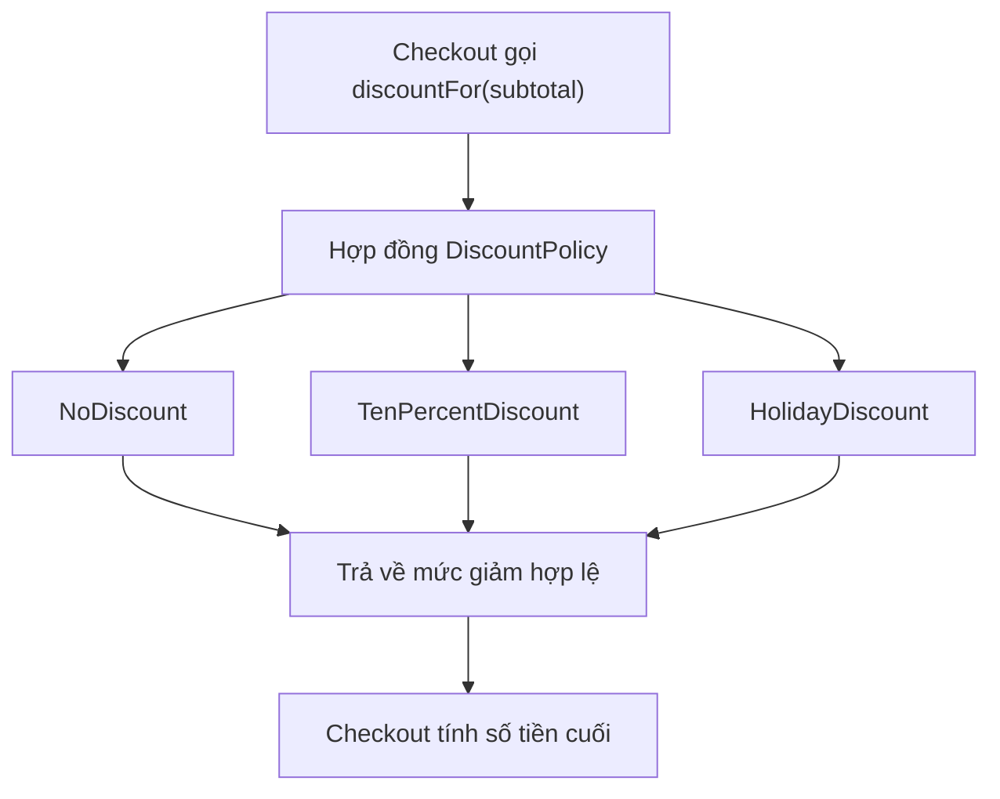
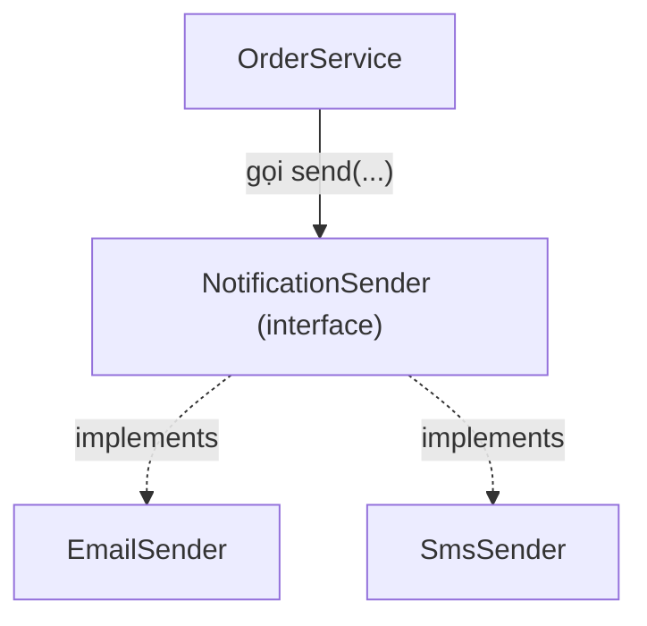
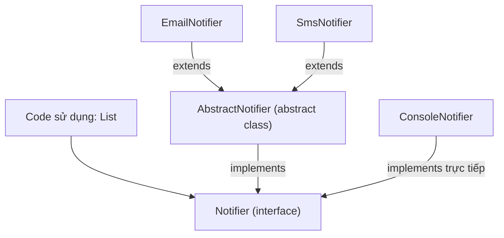

<a id="back-to-top"></a>

# Trừu tượng hóa (Abstraction) — xác định điều bên ngoài cần biết

## Menu
- [4.1 Trừu tượng hóa là gì? Phân biệt với đóng gói](#oop-4-1)
- [4.2 Hợp đồng hành vi: một đối tượng cam kết làm được những gì?](#oop-4-2)
- [4.3 Interface trong Java: định nghĩa và sử dụng](#oop-4-3)
- [4.4 Abstract class: khi nào chọn interface, khi nào chọn abstract class?](#oop-4-4)

## <a id="oop-4-1">4.1 Trừu tượng hóa là gì? Phân biệt với đóng gói</a>

<details>
<summary>Xem chi tiết</summary>

**Trừu tượng hóa (Abstraction)** trong lập trình hướng đối tượng (OOP) là cách **chọn ra những đặc điểm và hành vi cần thiết để bên sử dụng hiểu và làm việc với một đối tượng, đồng thời không bắt họ phụ thuộc vào mọi chi tiết triển khai bên trong**.

Hình dung bạn dùng máy ATM: bạn chọn **Rút tiền**, nhập số tiền rồi nhận kết quả. Bạn cần biết máy hỗ trợ rút tiền, nhập số tiền thế nào và điều gì xảy ra khi không đủ tiền. Bạn không cần tự thực hiện các bước kiểm tra phía sau máy ATM.

Trong code cũng tương tự:

```java
boolean success = paymentMethod.pay(100);
```

Phần gọi chỉ cần biết yêu cầu `pay(100)` có nghĩa gì và kết quả `true`/`false` thể hiện điều gì. Cách thanh toán bằng ví, thẻ hoặc phương thức khác có thể được thực hiện theo nhiều cách.

> **Ý chính:** Abstraction trả lời **“Bên sử dụng cần biết đối tượng làm được gì?”**. Encapsulation (đóng gói) trả lời **“Đối tượng quản lý dữ liệu và kiểm soát cách tương tác với trạng thái của mình ra sao?”**.

### 1. Tại sao cần trừu tượng hóa?

Giả sử ứng dụng bán hàng có hai hình thức thanh toán:

- **Ví nội bộ:** kiểm tra số dư rồi trừ tiền.
- **Thẻ:** gửi yêu cầu đến hệ thống xử lý thẻ và nhận kết quả.

Nếu phần xử lý đơn hàng tự viết cả hai quy trình, mỗi nơi thực hiện checkout phải biết quá nhiều chi tiết:

```text
Checkout
  → nếu là ví: đọc số dư, kiểm tra, trừ tiền
  → nếu là thẻ: gọi hệ thống thẻ, xử lý phản hồi
  → quyết định đơn đã thanh toán hay chưa
```

Mỗi khi thêm cách thanh toán mới, logic checkout có nguy cơ phình to. Quan trọng hơn, nó phải hiểu **chi tiết thuộc trách nhiệm của từng cách thanh toán**.

Ta có thể nhìn ở mức khái quát hơn: dù dùng ví hay thẻ, phần checkout đều cần một khả năng chung: **“thử thanh toán một số tiền và cho biết thành công hay thất bại.”**



Ở đây, `PaymentMethod` thể hiện **điều cần thiết đối với người dùng thành phần**. Các lớp cụ thể chịu trách nhiệm về **cách thực hiện**.

Nhờ vậy, người đọc checkout có thể hiểu luồng nghiệp vụ mà không phải lần theo từng bước xử lý thanh toán ngay từ đầu.

### 2. Abstraction là chọn điều quan trọng ở đúng mức nhìn

Một đối tượng có rất nhiều chi tiết, nhưng không phải bên sử dụng nào cũng cần biết tất cả.

| Khi sử dụng một chức năng | Thông tin cần biết | Chi tiết có thể để bên trong |
|---|---|---|
| Rút tiền từ tài khoản | Số tiền rút; điều kiện thành công hoặc lỗi | Cách lưu số dư và thứ tự kiểm tra nội bộ |
| Gửi thông báo | Người nhận, nội dung, kết quả | Cách kết nối SMTP hoặc dịch vụ gửi tin |
| Thanh toán | Số tiền; kết quả thanh toán | Cách kiểm tra ví, gọi cổng thanh toán |
| Tính phí vận chuyển | Điểm đến, kiện hàng, số tiền phải trả | Thuật toán bảng giá, cách tra khu vực |

Đó là lý do abstraction còn được mô tả bằng cách phân biệt **WHAT — làm được gì** và **HOW — thực hiện thế nào**.

Tuy nhiên, **trừu tượng hóa không đơn giản là “giấu càng nhiều càng tốt”**. Nếu người sử dụng không biết những điều quan trọng như đầu vào hợp lệ, các trường hợp thất bại hoặc ý nghĩa kết quả trả về, abstraction trở nên khó dùng.

Một hợp đồng tốt cần nói đủ những gì bên gọi phải hiểu:

- Phương thức có mục đích gì?
- Nó cần đầu vào gì?
- Nó trả kết quả hoặc báo lỗi thế nào?
- Có tác động phụ hoặc giới hạn nào mà bên gọi cần biết không?

Ví dụ, `pay(100)` cần được hiểu là **thử thanh toán**; trả `false` nghĩa là chưa thành công. Nếu một cách thanh toán mới âm thầm trừ tiền khi trả `false`, nó đã vi phạm kỳ vọng quan trọng của bên sử dụng.

### 3. Phân biệt abstraction và encapsulation

Hai khái niệm liên quan và thường được áp dụng cùng nhau, nhưng giải quyết **hai câu hỏi khác nhau**.

| Khía cạnh | **Abstraction — Trừu tượng hóa** | **Encapsulation — Đóng gói** |
|---|---|---|
| Mục đích trực tiếp | Đơn giản hóa cách người khác hiểu và sử dụng một thành phần | Gom trạng thái và hành vi liên quan, kiểm soát quyền tương tác |
| Câu hỏi chính | “Bên ngoài cần biết khả năng nào?” | “Ai sở hữu dữ liệu này và ai được phép thay đổi nó?” |
| Trọng tâm | Hợp đồng, khả năng, hành vi được công khai | Ranh giới truy cập, trạng thái và quy tắc được bảo vệ |
| Ví dụ thanh toán | `PaymentMethod.pay(amount)` | `WalletPayment` giữ `balance` là `private` và kiểm tra trước khi trừ tiền |
| Điều nên tránh | Bộc lộ quá nhiều chi tiết triển khai hoặc hợp đồng mơ hồ | Mở quyền sửa trạng thái tùy tiện, làm mất quy tắc |

#### Ví dụ ngắn với Account

Giả sử có lời gọi:

```java
account.withdraw(30);
```

**Góc nhìn abstraction:** Phần bên ngoài biết tài khoản có chức năng `withdraw(amount)`. Nó không cần biết tài khoản đang lưu dữ liệu theo cấu trúc gì, hay phương thức kiểm tra điều kiện bằng những câu lệnh nào.

**Góc nhìn encapsulation:** `Account` giữ `balance` bên trong và chỉ cho phép thay đổi thông qua những hành động hợp lệ. Phần bên ngoài không được tự gán `balance = -500`.

Cùng một thiết kế có thể đồng thời mang cả hai tính chất. Một phương thức công khai như `withdraw()` vừa là **khả năng được trình bày cho bên sử dụng**, vừa là **đường đi được kiểm soát để tương tác với trạng thái**.

#### Đừng đồng nhất hai khái niệm với các từ khóa Java

- `interface` là **một công cụ hữu ích** để diễn đạt abstraction, nhưng không phải mọi abstraction đều cần interface. Một class với các phương thức công khai có ý nghĩa cũng cung cấp một mức trừu tượng.
- `private` là **một công cụ quan trọng** của encapsulation, nhưng chỉ đặt field thành `private` chưa bảo đảm đóng gói tốt. Nếu tạo setter công khai cho phép gán giá trị bất kỳ, trạng thái vẫn có thể bị phá vỡ.
- `abstract class` cũng hỗ trợ xây dựng kiểu trừu tượng trong Java, nhưng abstraction là **ý tưởng thiết kế** rộng hơn từ khóa `abstract`.

### 4. Ví dụ Java: cả abstraction và encapsulation cùng xuất hiện

Ta thiết kế một chương trình checkout nhỏ. Phần xử lý checkout chỉ cần biết một hình thức thanh toán có thể `pay(amount)`, còn từng hình thức tự quyết định cách thực hiện.

Lưu toàn bộ ví dụ vào `Main.java`:

```java
public class Main {
    public static void main(String[] args) {
        WalletPayment wallet = new WalletPayment(100);
        CheckoutService checkout = new CheckoutService();

        checkout.checkout(wallet, 30);
        System.out.println("Ví còn: " + wallet.getBalance());

        checkout.checkout(wallet, 120);
        System.out.println("Ví vẫn còn: " + wallet.getBalance());

        PaymentMethod card = new DemoCardPayment();
        checkout.checkout(card, 40);
    }
}

// Khả năng chung mà CheckoutService cần biết
interface PaymentMethod {
    // true: thanh toán thành công; false: bị từ chối
    boolean pay(int amount);
}

// Cách thanh toán thứ nhất: ví có trạng thái riêng
class WalletPayment implements PaymentMethod {
    private int balance;

    WalletPayment(int openingBalance) {
        if (openingBalance < 0) {
            throw new IllegalArgumentException("Số dư ví không hợp lệ");
        }
        this.balance = openingBalance;
    }

    @Override
    public boolean pay(int amount) {
        if (amount <= 0) {
            throw new IllegalArgumentException("Số tiền phải lớn hơn 0");
        }
        if (amount > balance) {
            return false;
        }
        balance -= amount;
        return true;
    }

    public int getBalance() {
        return balance;
    }
}

// Cách thanh toán thứ hai: minh họa duyệt thẻ
class DemoCardPayment implements PaymentMethod {
    @Override
    public boolean pay(int amount) {
        if (amount <= 0) {
            throw new IllegalArgumentException("Số tiền phải lớn hơn 0");
        }
        System.out.println("Mô phỏng duyệt thẻ: " + amount);
        return true;
    }
}

// Checkout chỉ làm việc với hợp đồng chung
class CheckoutService {
    public void checkout(PaymentMethod method, int amount) {
        if (method.pay(amount)) {
            System.out.println("Thanh toán thành công");
        } else {
            System.out.println("Thanh toán bị từ chối");
        }
    }
}
```

Kết quả:

```text
Thanh toán thành công
Ví còn: 70
Thanh toán bị từ chối
Ví vẫn còn: 70
Mô phỏng duyệt thẻ: 40
Thanh toán thành công
```

Đọc ví dụ qua từng vai trò:

| Thành phần | Vai trò | Thể hiện điều gì? |
|---|---|---|
| `PaymentMethod` | Công bố khả năng `pay(amount)` | **Abstraction:** checkout làm việc với hợp đồng chung |
| `CheckoutService` | Gửi yêu cầu thanh toán và xử lý kết quả | Phụ thuộc vào khả năng thanh toán thay vì chi tiết một loại thanh toán |
| `WalletPayment` | Kiểm tra và trừ tiền trong ví | **Encapsulation:** quản lý `balance` và quy tắc giảm số dư |
| `DemoCardPayment` | Mô phỏng hình thức thanh toán khác | Cùng lời gọi `pay()` nhưng triển khai khác |
| `private int balance` | Ngăn bên ngoài tự gán số dư ví | Một phần của ranh giới bảo vệ trạng thái |

Điểm thú vị là `CheckoutService` **không cần biết một phương thức có field `balance` còn phương thức kia thì không**. Nó chỉ sử dụng hợp đồng `PaymentMethod`. Đó là lợi ích trực tiếp của abstraction.

Ngược lại, `WalletPayment` chịu trách nhiệm bảo đảm yêu cầu bị từ chối **không làm thay đổi số dư**. Đây là lợi ích của encapsulation.

Ví dụ `DemoCardPayment` chỉ in một thông báo và trả về thành công để minh họa Java, **không thực hiện giao dịch thẻ thật**. Hệ thống thực tế cần hợp đồng lỗi và kết quả phong phú hơn, cũng như kiểm soát giao dịch và bảo mật.

### 5. Abstraction tốt giúp thay đổi chương trình ra sao?

Giả sử ban đầu chỉ thanh toán bằng ví. Sau này thêm một cách thanh toán khác: `BankTransferPayment`.

Nếu cách mới thực hiện đúng hợp đồng `PaymentMethod` thì `CheckoutService` vẫn có thể gọi:

```java
method.pay(amount);
```

Không cần biến checkout thành nơi hiểu toàn bộ thủ tục của từng hệ thống thanh toán.

Nhưng abstraction **không có nghĩa không bao giờ phải sửa code gọi**. Ví dụ, nếu nghiệp vụ bắt đầu hỗ trợ trạng thái `PENDING` (đang chờ xác nhận), một kiểu trả về `boolean` có thể không còn đủ rõ. Khi đó cần thiết kế lại hợp đồng, ví dụ kết quả có các trạng thái `SUCCESS`, `FAILED`, `PENDING`. Đây là **thay đổi yêu cầu nghiệp vụ**, không thể khắc phục chỉ bằng cách thêm một implementation mới.

Một abstraction hữu ích phải thể hiện **đúng điểm chung thực sự** giữa những đối tượng tham gia. Nếu ép các cách thanh toán khác nhau vào một hợp đồng không phù hợp, người sử dụng sẽ gặp những ngoại lệ khó hiểu và mã xử lý rối rắm.

### 6. Những nhầm lẫn thường gặp

**“Abstraction là giấu hết code bên trong?”**

Không. Mục đích là cung cấp một cách nhìn **đủ và đúng cho mục đích sử dụng**. Những thông tin quan trọng như điều kiện gọi, kết quả và lỗi vẫn cần được nêu rõ.

**“Có interface là chắc chắn thiết kế đã trừu tượng hóa tốt?”**

Chưa chắc. Ví dụ một interface tên `PaymentMethod` nhưng buộc mọi implementation phải triển khai hàng loạt thao tác không liên quan sẽ gây khó dùng. Hợp đồng cần thể hiện năng lực chung thực sự.

**“Encapsulation và abstraction có phải cùng một việc?”**

Không. Encapsulation quản lý **ranh giới và tính hợp lệ của trạng thái**; abstraction chọn **khả năng mà bên sử dụng cần nhìn thấy**. Chúng có thể cùng tồn tại trong cùng một object.

**“Để mọi field là private và có getter/setter là đủ?”**

Chưa chắc. Nếu `WalletPayment` công khai `setBalance(-500)` thì dữ liệu vẫn có thể bị thay đổi sai. Hãy cung cấp hành vi phản ánh nghiệp vụ, chẳng hạn `pay(amount)` hoặc `addFunds(amount)`, và kiểm tra bên trong.

**“Abstraction chỉ liên quan kế thừa hoặc đa hình?”**

Không. Ngay cả `account.withdraw(30)` cũng là một mức abstraction: người dùng gọi hành động có ý nghĩa, còn chi tiết xử lý được đặt ở phía đối tượng. Interface và đa hình là những công cụ rất hiệu quả khi nhiều đối tượng cung cấp một khả năng chung.

### 7. Tự kiểm tra mức hiểu

| Tình huống | Khái niệm nào nổi bật? | Vì sao? |
|---|---|---|
| `CheckoutService` chỉ gọi `method.pay(100)` | **Abstraction** | Nó chỉ cần biết hợp đồng thanh toán |
| `WalletPayment` không cho ai tự chỉnh `balance` | **Encapsulation** | Object kiểm soát quyền thay đổi dữ liệu |
| Khi ví thiếu tiền, `pay()` trả `false` và giữ nguyên số dư | **Encapsulation** | Object giữ quy tắc nhất quán của trạng thái |
| Có thể đổi `WalletPayment` sang `DemoCardPayment` ở phía gọi | **Abstraction**, kết hợp đa hình | Nhiều implementation cùng đáp ứng một hợp đồng |

Hãy tự trả lời hai câu:

1. Nếu `CheckoutService` phải trực tiếp đọc `wallet.balance` rồi tự trừ tiền, thiết kế đang thiếu điều gì? — **Thiếu ranh giới đóng gói phù hợp**, đồng thời checkout còn đang phụ thuộc quá sâu vào chi tiết ví.
2. Nếu ta đổi cách lưu tiền trong `WalletPayment` mà vẫn giữ hành vi `pay(amount)` đúng hợp đồng, tại sao mã checkout có thể giữ nguyên? — Vì **abstraction** cho phép checkout làm việc với khả năng chung thay vì cấu trúc bên trong.

**Điều cần nhớ:** Trừu tượng hóa giúp bên sử dụng hiểu **đối tượng cung cấp khả năng gì**; đóng gói giúp đối tượng **quản lý và bảo vệ trạng thái của chính nó**. Khi phối hợp tốt, hai ý tưởng giúp mã nguồn vừa dễ dùng, vừa hạn chế những thay đổi sai quy tắc.

</details>

- [Quay lại đầu trang](#back-to-top)

---

## <a id="oop-4-2">4.2 Hợp đồng hành vi: một đối tượng cam kết làm được những gì?</a>

<details>
<summary>Xem chi tiết</summary>

### 1. Đối tượng không chỉ có phương thức; nó còn đưa ra lời hứa

Hãy tưởng tượng bạn đang viết chức năng thanh toán của một cửa hàng. Trước khi chốt đơn, chương trình cần hỏi một **chính sách giảm giá**:

> “Với đơn hàng trị giá 200.000 đồng, tôi được giảm bao nhiêu?”

Bạn không nhất thiết cần biết chính sách đó tính toán ra sao. Có thể cửa hàng đang áp dụng giảm 10%, có thể không giảm, hoặc một chương trình ưu đãi được thay đổi vào tháng sau. Nhưng để tính được số tiền cuối cùng, chương trình thanh toán phải biết **đối tượng chính sách giảm giá sẽ trả về điều gì, với đầu vào nào và trong trường hợp nào nó có thể báo lỗi**.

Đó là ý tưởng của **hợp đồng hành vi (behavioral contract)** trong OOP.

Hợp đồng hành vi là **cam kết có thể quan sát được** của một đối tượng đối với mã sử dụng nó: đối tượng nhận yêu cầu nào, cần điều kiện gì, thực hiện ý nghĩa nghiệp vụ gì, trả về kết quả gì, xử lý lỗi thế nào và có gây ra tác động nào mà người gọi cần biết hay không.

Hãy phân biệt hai câu:

- **“Đối tượng có phương thức `discountFor(long subtotal)`.”** Đây là thông tin về cách gọi.
- **“Đối tượng nhận tổng tiền không âm và trả về số tiền giảm hợp lệ, từ 0 đến tổng tiền, không làm thay đổi đơn hàng; tổng tiền âm sẽ bị từ chối.”** Đây là cam kết về hành vi.

Thông tin thứ hai mới giúp người dùng đối tượng **tin tưởng và sử dụng đúng** nó.

### 2. Một hợp đồng hành vi thường bao gồm những gì?

| Thành phần | Câu hỏi cần trả lời | Ví dụ chính sách giảm giá |
|---|---|---|
| **Khả năng** | Đối tượng làm được việc gì? | Tính số tiền được giảm |
| **Đầu vào và ý nghĩa** | Cần cung cấp dữ liệu nào, đơn vị gì? | `subtotal` là tổng tiền hàng, tính bằng đồng |
| **Điều kiện trước (precondition)** | Đầu vào phải thỏa mãn điều gì? | `subtotal >= 0` |
| **Điều kiện sau (postcondition)** | Nếu thao tác thành công, kết quả được bảo đảm thế nào? | `0 <= discount <= subtotal` |
| **Tác động bên ngoài (side effect)** | Có sửa trạng thái hoặc làm việc gì khác không? | Chỉ tính toán, không sửa đơn hàng |
| **Cách báo lỗi** | Khi yêu cầu không hợp lệ, điều gì xảy ra? | Ném `IllegalArgumentException` khi tiền âm |
| **Quy tắc nghiệp vụ đặc thù** | Người gọi cần hiểu cách diễn giải kết quả không? | Kết quả là số đồng nguyên, phần lẻ được làm tròn xuống |

Không phải phương thức nào cũng cần một bản mô tả dài. Một phương thức đơn giản có thể có hợp đồng rất ngắn. Nhưng các điều **ảnh hưởng trực tiếp đến cách người khác sử dụng phương thức** phải được nêu đủ rõ.

Có thể nhìn hợp đồng như sau:

```text
Người gọi gửi yêu cầu
        │
        ▼
[Điều kiện đầu vào hợp lệ?]
        │
    ┌───┴─────┐
    │         │
   Có       Không
    │         │
    ▼         ▼
Thực hiện   Báo lỗi đúng
hành vi     như đã cam kết
    │
    ▼
Trả kết quả / tạo tác động
đúng như đã cam kết
```

**Lưu ý:** đây là cách mô tả một ví dụ có kiểm tra đầu vào. Không phải mọi hợp đồng trong Java đều bắt buộc phải ném exception, trả dữ liệu hoặc có tác động bên ngoài. Chính hợp đồng cụ thể sẽ nói rõ điều đó.

### 3. Viết hợp đồng trước, rồi mới viết cách thực hiện

Trong Java, ta có thể biểu diễn **các hành vi được cung cấp** bằng một `interface`, sau đó mô tả ý nghĩa của phương thức bằng JavaDoc.

```java
// DiscountPolicy.java
public interface DiscountPolicy {

    /**
     * Tính số tiền được giảm từ tổng tiền hàng.
     *
     * Hợp đồng:
     * - subtotal tính bằng VNĐ, phải >= 0.
     * - Kết quả là số đồng nguyên, từ 0 đến subtotal.
     * - Nếu có phần lẻ, mức giảm được làm tròn xuống.
     * - Không sửa đơn hàng hoặc tạo tác động bên ngoài.
     *
     * @param subtotal tổng tiền hàng trước giảm giá
     * @return số tiền được giảm (VNĐ)
     * @throws IllegalArgumentException nếu subtotal < 0
     */
    long discountFor(long subtotal);
}
```

Nhìn vào đây, người viết chức năng thanh toán biết rằng:

1. Có thể **yêu cầu tính giảm giá** bằng cách gọi `discountFor(...)`.
2. Chỉ nên truyền tổng tiền hàng **không âm**.
3. Kết quả có thể đem trừ khỏi tổng tiền vì nó không âm và không lớn hơn tổng tiền.
4. Khi truyền tiền âm, chính sách **từ chối** bằng `IllegalArgumentException`.
5. Phương thức này chỉ tính toán; không lén cập nhật số dư, sửa đơn hàng hoặc gửi yêu cầu thanh toán.

Người gọi vẫn chưa biết *giảm bao nhiêu phần trăm*. Điều đó có thể tùy thuộc vào đối tượng cụ thể. Đây chính là giá trị của trừu tượng hóa: **thống nhất điều bên ngoài cần dựa vào, đồng thời cho phép bên trong có cách thực hiện khác nhau**.

#### Hai đối tượng, cùng một hợp đồng

Đối tượng thứ nhất không có ưu đãi:

```java
// NoDiscount.java
public final class NoDiscount implements DiscountPolicy {

    @Override
    public long discountFor(long subtotal) {
        if (subtotal < 0) {
            throw new IllegalArgumentException(
                "Tổng tiền không được âm"
            );
        }
        return 0;
    }
}
```

Đối tượng thứ hai giảm 10%, làm tròn xuống số đồng nguyên:

```java
// TenPercentDiscount.java
public final class TenPercentDiscount implements DiscountPolicy {

    @Override
    public long discountFor(long subtotal) {
        if (subtotal < 0) {
            throw new IllegalArgumentException(
                "Tổng tiền không được âm"
            );
        }
        return subtotal / 10;
    }
}
```

Cả hai đều **giữ lời hứa chung**:

| Đầu vào `subtotal` | `NoDiscount` | `TenPercentDiscount` | Giải thích |
|---:|---:|---:|---|
| `200_000` | `0` | `20_000` | Kết quả từ 0 đến tổng tiền |
| `99` | `0` | `9` | Phần lẻ của 10% được làm tròn xuống |
| `0` | `0` | `0` | Giá trị 0 hợp lệ |
| `-100` | Ném exception | Ném exception | Từ chối đầu vào vi phạm điều kiện |

Hai đối tượng **không hứa sẽ cho cùng mức giảm**. Chúng hứa rằng bất cứ mức giảm nào được tính ra cũng tuân thủ quy tắc chung.

### 4. Người gọi dựa vào hợp đồng như thế nào?

Ta viết lớp `Checkout` để tính số tiền khách phải trả. Lớp này nhận một đối tượng thuộc kiểu `DiscountPolicy`.

```java
// Checkout.java
import java.util.Objects;

public final class Checkout {
    private final DiscountPolicy discountPolicy;

    public Checkout(DiscountPolicy discountPolicy) {
        this.discountPolicy = Objects.requireNonNull(discountPolicy);
    }

    public long finalPrice(long subtotal) {
        long discount = discountPolicy.discountFor(subtotal);
        return subtotal - discount;
    }
}
```

Sử dụng:

```java
Checkout normal = new Checkout(new NoDiscount());
System.out.println(normal.finalPrice(200_000)); // 200000

Checkout promotion = new Checkout(new TenPercentDiscount());
System.out.println(promotion.finalPrice(200_000)); // 180000

// promotion.finalPrice(-100);
// -> IllegalArgumentException: Tổng tiền không được âm
```

Giả sử đang dùng `TenPercentDiscount`, luồng chạy là:

```text
Checkout nhận tổng tiền: 200.000
      │
      ▼
Gọi discountPolicy.discountFor(200.000)
      │
      ▼
Đối tượng thực tế TenPercentDiscount tính:
discount = 200.000 / 10 = 20.000
      │
      ▼
Trả về 20.000 theo hợp đồng
      │
      ▼
Checkout tính: 200.000 - 20.000 = 180.000
```

Nếu đổi thành `NoDiscount`, phần tính tiền cuối trong `Checkout` **không cần viết lại**. Phương thức vẫn gọi `discountFor`; chỉ đối tượng được truyền vào thay đổi.

Sự hợp tác này hoạt động vì `Checkout` có thể tin rằng **mọi `DiscountPolicy` hợp lệ đều trả số giảm tiền đúng quy tắc**.

Đối tượng được yêu cầu thực hiện một hành vi; người gọi biết kết quả và các điều kiện của hành vi, nhưng không cần tự thực hiện thuật toán của đối tượng đó.

### 5. Có `interface` là đã có hợp đồng hành vi chưa?

**Chưa đầy đủ.** Interface chủ yếu giúp Java kiểm tra **cấu trúc**: tên phương thức, loại tham số, kiểu trả về và một số quy tắc của hệ kiểu.

Ví dụ, class sau có thể được Java chấp nhận về mặt cú pháp:

```java
public final class BrokenDiscount implements DiscountPolicy {
    @Override
    public long discountFor(long subtotal) {
        return subtotal + 1;
    }
}
```

Nhưng nếu tổng tiền bằng `200_000`, nó trả `200_001`, lớn hơn tổng tiền. Kết quả đó **vi phạm hợp đồng hành vi**, dù chữ ký phương thức khớp với interface.

Một cách triển khai khác cũng sai:

```java
@Override
public long discountFor(long subtotal) {
    if (subtotal < 100_000) {
        throw new IllegalArgumentException("Đơn quá nhỏ");
    }
    return 0;
}
```

Vì hợp đồng chung nói **mọi tổng tiền không âm đều hợp lệ**, implementation này đã tự đặt thêm điều kiện từ chối. Người gọi đã tin rằng `discountFor(50_000)` được chấp nhận, nhưng đối tượng lại phá vỡ kỳ vọng đó.

Do vậy:

| Java kiểm tra được | Cần thiết kế, tài liệu và kiểm thử để bảo đảm |
|---|---|
| Có phương thức `discountFor(long)` | Phương thức tính đúng ý nghĩa “số tiền giảm” |
| Giá trị trả về thuộc kiểu `long` | Giá trị luôn nằm trong khoảng đã cam kết |
| Class có `implements DiscountPolicy` | Class xử lý mọi đầu vào hợp lệ đúng quy tắc |
| Quy tắc truy cập, kiểu dữ liệu | Side effect và tình huống lỗi đúng cam kết |

Một interface có thể **thể hiện** hợp đồng, nhưng **chỉ khai báo phương thức chưa tự động bảo đảm ngữ nghĩa** của hợp đồng.

Cũng không bắt buộc có interface mới có hợp đồng hành vi. Một method `public` của class thông thường, method trong abstract class, hoặc hành vi mà đối tượng cung cấp qua các phương thức cụ thể đều có thể có hợp đồng rõ ràng.

### 6. Hợp đồng nói điều quan sát được, không ép người gọi biết ruột máy

Một hợp đồng tốt nêu đủ những gì người sử dụng **cần** biết:

| Điều nên được cam kết khi liên quan | Điều người gọi thường không cần biết |
|---|---|
| Mức giảm hợp lệ trong khoảng nào | Công thức được chia thành mấy bước |
| Phương thức có báo lỗi không | Có dùng biến tạm nào |
| Đơn vị tiền và quy tắc làm tròn | Đặt tên field nội bộ ra sao |
| Có làm thay đổi trạng thái hay không | Dùng `if`, bảng tra cứu hay helper method |
| Kết quả thành công có ý nghĩa gì | Code được tổ chức thành bao nhiêu method private |

Chẳng hạn, bạn có thể thay `TenPercentDiscount` bằng một thuật toán tối ưu hơn. Miễn là các cam kết đã công bố vẫn giữ nguyên, lớp `Checkout` không phải biết sự thay đổi đó.

Tuy nhiên, **đừng lấy “ẩn cách làm” làm lý do bỏ qua thông tin quan trọng**. Ví dụ:

- Nếu mức giảm có thể bị làm tròn, người gọi cần biết cách làm tròn khi đối chiếu hóa đơn.
- Nếu một hành vi có thể trừ tiền thật, người gọi cần biết khi nào tiền đã được trừ, điều gì xảy ra nếu thất bại và có thể gọi lại an toàn hay không.
- Nếu một thao tác mất nhiều thời gian, không đồng bộ hoặc phụ thuộc mạng, hợp đồng cần diễn đạt rõ khi nào người gọi nhận được kết quả và kết quả ấy có ý nghĩa gì.

Trong ví dụ tính giảm giá, hợp đồng chọn **không có tác dụng phụ**. Nếu bài toán thực tế cần lưu giao dịch hoặc gọi API bên ngoài, đó phải là một cam kết khác, được mô tả chính xác theo nghiệp vụ.

### 7. Hợp đồng giúp thay thế đối tượng mà không phá mã gọi

Giả sử hệ thống sắp thêm `HolidayDiscount`. Để tương thích với `Checkout`, lớp mới có thể áp dụng công thức giảm giá riêng, nhưng phải giữ nguyên quy tắc chung của `DiscountPolicy`.

Hình dung:



Sơ đồ mô tả **các cách triển khai có thể thay thế nhau**, không phải một lần gọi sẽ chạy cả ba lớp. Tại mỗi lần tính tiền, `Checkout` sử dụng **một đối tượng policy thực tế** đã được truyền vào.

Một lớp triển khai đúng hợp đồng phải duy trì các kỳ vọng mà người gọi dựa vào. Nếu lớp mới đột nhiên trả số âm, làm giảm tiền nhiều hơn tổng tiền, hoặc từ chối một đầu vào đã được công bố là hợp lệ, việc thay lớp có thể khiến `Checkout` xử lý sai.

Đó là mối liên hệ giữa **trừu tượng hóa** và **khả năng thay thế implementation**: các lớp có thể khác nhau về cách làm, nhưng giữ những lời hứa chung để mã sử dụng hoạt động đúng.

Không phải mọi hành vi của mọi implementation đều giống hệt nhau. Khác biệt được phép nằm ở những chỗ mà hợp đồng **cố ý để mở**. Ví dụ hợp đồng của `DiscountPolicy` không buộc mọi policy giảm đúng 10%; chỉ buộc mức giảm nằm trong giới hạn và tuân thủ cách báo lỗi.

### 8. Làm thế nào để biết hợp đồng đã đủ rõ?

Bạn có thể tự hỏi bốn câu khi thiết kế một hành vi:

**Thứ nhất: người dùng đối tượng có biết mình được yêu cầu điều gì không?**

Ví dụ `discountFor(subtotal)` nói rõ tính **số tiền giảm**, khác với `finalPrice(subtotal)` là tính **số tiền phải trả**. Hai phương thức có cùng kiểu `long`, nhưng ý nghĩa khác nhau hoàn toàn.

**Thứ hai: người gọi có biết dữ liệu nào hợp lệ và kết quả nào đáng tin không?**

Nếu chỉ ghi “trả về `long`”, người gọi không biết kết quả âm có ý nghĩa gì, đồng hay xu, hoặc vượt tổng tiền được không. Hợp đồng cần làm rõ.

**Thứ ba: nếu hành vi thất bại thì người gọi có biết hệ thống còn ở trạng thái nào không?**

Trong ví dụ chỉ tính toán, đầu vào âm được báo lỗi và không có side effect. Với thao tác cập nhật dữ liệu, cần nói rõ việc cập nhật là toàn bộ hay một phần, có rollback không và lỗi nào người gọi phải xử lý. Không được mặc định mọi thao tác đều có tính nguyên tử hoặc tự phục hồi.

**Thứ tư: nếu thay implementation, mã sử dụng có cần sửa vì một lời hứa cũ bị phá vỡ không?**

Nếu có, hoặc implementation mới đang vi phạm hợp đồng, hoặc hợp đồng ban đầu còn thiếu và phải được thiết kế lại.

#### Những lỗi thường gặp

| Cách làm dễ gây lỗi | Vấn đề | Cách cải thiện |
|---|---|---|
| Chỉ nêu tên method | Người gọi không rõ kết quả có ý nghĩa gì | Nêu kết quả, điều kiện hợp lệ và lỗi |
| Gọi một việc nhưng âm thầm làm thêm việc khác | Side effect bất ngờ | Nêu rõ tác động hoặc tách trách nhiệm |
| Mỗi implementation hiểu khác nhau về đơn vị | Kết quả có thể sai nghiêm trọng | Quy định đơn vị và cách làm tròn |
| Implementation tự thêm điều kiện làm đầu vào hợp lệ bị từ chối | Người gọi không thể thay thế an toàn | Giữ cùng điều kiện chung hoặc thiết kế hợp đồng khác |
| Public hết field và method để “dễ dùng” | Chi tiết thực hiện bị lộ thành phụ thuộc | Chỉ công khai các hành vi người gọi cần |

### 9. Tự kiểm tra bằng tình huống nhỏ

Cho hợp đồng:

> `TemperatureConverter.toCelsius(double fahrenheit)` nhận nhiệt độ Fahrenheit hợp lệ, trả về độ C; kết quả là giá trị số và không làm thay đổi trạng thái bên ngoài.

Hãy thử phân biệt:

1. Một implementation dùng công thức `(fahrenheit - 32) * 5 / 9`, implementation khác dùng công thức đại số tương đương: **được phép**, miễn là độ chính xác và cách xử lý đầu vào theo yêu cầu vẫn phù hợp.
2. Implementation trả về độ Kelvin mà vẫn đặt tên `toCelsius`: **vi phạm hợp đồng về ý nghĩa và đơn vị**.
3. Implementation tự gửi email mỗi khi chuyển đổi: **vi phạm lời hứa không có side effect**.
4. Người gọi không biết implementation dùng biến nào để tính toán: **không phải vấn đề**, vì đó là chi tiết được che giấu.

Hợp đồng hành vi vì vậy trả lời câu hỏi **“Tôi có thể trông đợi điều gì khi yêu cầu đối tượng làm việc này?”**. Trong OOP, đó là cơ sở để các đối tượng cộng tác với nhau mà vẫn giữ ranh giới trách nhiệm rõ ràng.

**Ghi nhớ:** tên method và kiểu dữ liệu cho biết *cách gọi*; hợp đồng hành vi bổ sung *ý nghĩa, điều kiện, bảo đảm và cách xử lý thất bại*. Nhờ vậy, người gọi có thể làm việc với một đối tượng qua phần giao diện cần thiết mà không cần hiểu cách triển khai bên trong.

</details>

- [Quay lại đầu trang](#back-to-top)

---

## <a id="oop-4-3">4.3 Interface trong Java: định nghĩa và sử dụng</a>

<details>
<summary>Xem chi tiết</summary>

Một ứng dụng có thể gửi thông báo qua email, SMS hoặc ứng dụng chat. Mỗi cách gửi có công nghệ khác nhau, nhưng phần đặt hàng chỉ cần biết: **“Tôi có thể yêu cầu gửi một thông báo bằng cách nào?”**

Đây là một tình huống phù hợp với **interface** trong Java.

Interface mô tả một **hợp đồng (contract)** mà các class triển khai phải tuân theo. Hợp đồng cho biết bên ngoài **được gọi thao tác gì**, với tham số và kiểu kết quả nào. Class triển khai quyết định **thao tác ấy được thực hiện ra sao**.

Nói theo tư duy trừu tượng hóa trong OOP: code sử dụng đối tượng có thể làm việc với **khả năng chung** của nhiều đối tượng khác nhau, thay vì phải biết chi tiết kỹ thuật của từng loại.

### 1. Interface là gì?

Ví dụ, ta muốn biểu diễn khả năng gửi thông báo:

```java
public interface NotificationSender {
    void send(String recipient, String message);
}
```

Dòng `void send(String recipient, String message);` nói rằng một đối tượng có khả năng `NotificationSender` phải hỗ trợ thao tác `send` nhận người nhận và nội dung.

Nó **chưa nói** email cần giao tiếp với SMTP, SMS cần gọi API của nhà cung cấp, hay dữ liệu được lưu ở đâu. Những chi tiết đó thuộc về implementation.

Sự phân chia trách nhiệm:

| Thành phần | Trả lời câu hỏi nào? | Ví dụ |
| --- | --- | --- |
| Interface | Đối tượng **có thể làm gì**? | `NotificationSender.send(...)` |
| Class implements | Đối tượng **thực hiện như thế nào**? | `EmailSender`, `SmsSender` |
| Caller | **Khi nào** cần dùng khả năng đó? | `OrderService` gửi xác nhận |
| Object thực tế | Implementation **nào đang được sử dụng**? | Một instance `new EmailSender()` |

Interface là **kiểu tham chiếu (reference type)** trong Java. Bạn có thể khai báo biến, tham số hoặc kiểu trả về là một interface. Nhưng bạn không thể tạo đối tượng trực tiếp bằng `new NotificationSender()`, vì interface tự nó chưa xác định cách thực hiện đầy đủ.

### 2. Cú pháp khai báo và triển khai: `interface`, `implements`, `@Override`

Một class cam kết thực hiện hợp đồng bằng từ khóa `implements`:

```java
public class EmailSender implements NotificationSender {

    @Override
    public void send(String recipient, String message) {
        System.out.println("EMAIL to " + recipient + ": " + message);
    }
}
```

Một class khác có thể triển khai cùng interface theo cách khác:

```java
public class SmsSender implements NotificationSender {

    @Override
    public void send(String recipient, String message) {
        System.out.println("SMS to " + recipient + ": " + message);
    }
}
```

Trong ví dụ:

- `interface` khai báo hợp đồng.
- `implements` khai báo class nhận trách nhiệm thực hiện hợp đồng.
- `@Override` giúp trình biên dịch kiểm tra rằng phương thức đang triển khai/ghi đè đúng một phương thức được kế thừa.
- Cả `EmailSender` và `SmsSender` đều phải cung cấp `send(String, String)` với chữ ký hợp lệ.

Phương thức abstract được khai báo trong interface như trên mặc định là `public`. Vì vậy, phương thức triển khai cũng phải là `public`; viết `private` hay quyền truy cập mặc định (*package-private*) sẽ không hợp lệ. Một class cụ thể (*concrete class*) phải triển khai tất cả các phương thức abstract chưa được triển khai mà nó kế thừa. Nếu chưa làm được, class đó phải được khai báo `abstract`.

Trong Java, một class dùng `extends` để kế thừa class và dùng `implements` để triển khai interface. Đừng nhầm hai vai trò này.

### 3. Ví dụ hoàn chỉnh: code gọi không cần biết gửi qua email hay SMS

Hãy xem chương trình Java sau. Để dễ chạy thử, toàn bộ các class được đặt trong **một file `Main.java`**, chỉ `Main` là `public`. Trong dự án thông thường, bạn có thể tách chúng thành các file riêng.

```java
interface NotificationSender {
    void send(String recipient, String message);
}

class EmailSender implements NotificationSender {
    @Override
    public void send(String recipient, String message) {
        System.out.println("EMAIL to " + recipient + ": " + message);
    }
}

class SmsSender implements NotificationSender {
    @Override
    public void send(String recipient, String message) {
        System.out.println("SMS to " + recipient + ": " + message);
    }
}

class OrderService {
    private final NotificationSender sender;

    public OrderService(NotificationSender sender) {
        this.sender = sender;
    }

    public void confirmOrder(String customer) {
        System.out.println("Order confirmed for " + customer);
        sender.send(customer, "Your order is confirmed");
    }
}

public class Main {
    public static void main(String[] args) {
        NotificationSender email = new EmailSender();
        NotificationSender sms = new SmsSender();

        OrderService firstOrder = new OrderService(email);
        firstOrder.confirmOrder("An");

        OrderService secondOrder = new OrderService(sms);
        secondOrder.confirmOrder("Binh");
    }
}
```

Kết quả:

```text
Order confirmed for An
EMAIL to An: Your order is confirmed
Order confirmed for Binh
SMS to Binh: Your order is confirmed
```

Theo dõi từng bước:

1. `NotificationSender email = new EmailSender();` tạo **đối tượng thực tế** là `EmailSender`, nhưng đặt trong **biến tham chiếu** kiểu `NotificationSender`.
2. `new OrderService(email)` chuyển đối tượng đó cho `OrderService` qua constructor.
3. `confirmOrder("An")` thực hiện phần xử lý của đơn hàng, sau đó gọi `sender.send(...)`.
4. Vì `sender` đang trỏ đến `EmailSender`, Java chạy phần triển khai `EmailSender.send(...)`.
5. Với `secondOrder`, `sender` trỏ đến `SmsSender`; cùng dòng `sender.send(...)` sẽ gọi `SmsSender.send(...)`.

Điều này là một dạng **đa hình (polymorphism)**: cùng một hợp đồng và lời gọi, nhưng hành vi cụ thể phụ thuộc vào đối tượng thực tế.



Sơ đồ thể hiện quan hệ thiết kế: `OrderService` làm việc thông qua interface; việc chọn `EmailSender` hay `SmsSender` diễn ra khi ứng dụng tạo và truyền đối tượng vào service. Lúc chạy, Java gọi đúng implementation của đối tượng đã truyền.

**Lợi ích cụ thể:** nếu sau này bổ sung `PushNotificationSender`, `OrderService` vẫn có thể sử dụng class đó mà không cần sửa logic `confirmOrder(...)`, miễn implementation mới tuân theo hợp đồng mong đợi.

Ví dụ trên dùng `System.out.println` để quan sát hành vi; đây không phải là chương trình thực sự gửi email/SMS. Trong ứng dụng thật, các class triển khai sẽ kết nối với những dịch vụ gửi tương ứng và xử lý lỗi phù hợp.

### 4. Vì sao tham số thường khai báo kiểu interface?

Nhìn vào constructor:

```java
public OrderService(NotificationSender sender) {
    this.sender = sender;
}
```

Nếu đổi tham số thành `EmailSender`, `OrderService` chỉ nhận được kiểu email cụ thể. Khi khai báo `NotificationSender`, service chấp nhận **mọi implementation phù hợp**.

So sánh:

```java
// Gắn trực tiếp vào EmailSender:
class OrderServiceA {
    private final EmailSender sender = new EmailSender();
}

// Nhận khả năng gửi thông báo qua constructor:
class OrderServiceB {
    private final NotificationSender sender;

    OrderServiceB(NotificationSender sender) {
        this.sender = sender;
    }
}
```

Ở `OrderServiceB`, lớp sử dụng giữ trách nhiệm “cần gửi thông báo”; code bên ngoài quyết định cung cấp cách gửi nào. Đây là một dạng **dependency injection qua constructor** mà Java thông thường đã có thể thực hiện, chưa cần framework.

Trong Spring Boot, ý tưởng tương tự được áp dụng khi inject bean theo interface. Tuy nhiên nếu có nhiều bean cùng triển khai một interface, ứng dụng phải xác định bean cần chọn (chẳng hạn bằng `@Qualifier`, `@Primary` hoặc cấu hình tương ứng). Interface không tự biết cần dùng implementation nào.

**Một lưu ý quan trọng:** interface giúp giảm sự phụ thuộc vào tên class cụ thể, nhưng không tự động tạo thiết kế tốt. Nếu caller vẫn kiểm tra `instanceof EmailSender` rồi ép kiểu để gọi các phương thức riêng, lợi ích trừu tượng hóa sẽ giảm.

### 5. Interface có thể chứa những gì trong Java hiện đại?

Bên cạnh phương thức abstract, Java interface còn có thể có các thành phần sau:

| Thành phần | Ý nghĩa | Lưu ý |
| --- | --- | --- |
| Abstract method | Yêu cầu implementation cung cấp hành vi | Mặc định `public abstract` nếu khai báo như `void send();` |
| `default` method | Cung cấp triển khai mặc định cho instance | Class có thể override |
| `static` method | Tiện ích thuộc về chính interface | Gọi bằng `InterfaceName.method()` |
| `private` method | Logic hỗ trợ nội bộ trong interface | Có từ Java 9; không gọi được từ class triển khai |
| Hằng số | Giá trị dùng chung | Mọi field khai báo trong interface đều mặc định `public static final` |

Ví dụ:

```java
interface Greeter {
    void greet(String name);

    default void greetGuest() {
        greet("Guest");
    }

    static String defaultLanguage() {
        return "vi";
    }
}

class ConsoleGreeter implements Greeter {
    @Override
    public void greet(String name) {
        System.out.println("Hello, " + name);
    }
}

class Main {
    public static void main(String[] args) {
        Greeter greeter = new ConsoleGreeter();
        greeter.greet("An");       // Hello, An
        greeter.greetGuest();      // Hello, Guest

        System.out.println(Greeter.defaultLanguage()); // vi
    }
}
```

`greetGuest()` là phương thức `default`: class `ConsoleGreeter` được kế thừa phần triển khai đó mà không cần tự viết lại. Nó gọi `greet("Guest")`, và lệnh này cuối cùng chạy implementation của `ConsoleGreeter`.

Phương thức `static` được gọi qua tên interface. Nó không phải phương thức instance để override theo kiểu đa hình như `greet(...)`.

Trong các phiên bản Java hiện đại, interface đã có thêm cách chia sẻ logic. Tuy vậy, **mục đích chính của interface vẫn là định nghĩa khả năng/hợp đồng công khai**; tránh nhồi quá nhiều trạng thái và quy trình phức tạp vào các `default` method chỉ vì cú pháp cho phép.

**Về trạng thái:** interface không có trường instance thông thường để mỗi object tự lưu dữ liệu. Các field trong interface là hằng số `public static final`. Vì vậy, một interface không thích hợp để sở hữu trạng thái mutable riêng của từng đối tượng.

### 6. Một class có thể triển khai nhiều interface không?

Có. Java chỉ cho một class trực tiếp kế thừa một class cha, nhưng một class có thể triển khai nhiều interface.

```java
interface Printable {
    void print();
}

interface Exportable {
    String export();
}

class Invoice implements Printable, Exportable {
    @Override
    public void print() {
        System.out.println("Printing invoice");
    }

    @Override
    public String export() {
        return "invoice-data";
    }
}
```

`Invoice` có đồng thời hai khả năng: in và xuất dữ liệu. Code chỉ cần in hóa đơn có thể nhận tham số kiểu `Printable`; code chỉ cần xuất dữ liệu có thể nhận `Exportable`.

Interface cũng có thể **kế thừa các interface khác** bằng `extends`:

```java
interface Readable {
    String read();
}

interface Editable extends Readable {
    void edit(String value);
}
```

Class triển khai `Editable` phải bảo đảm cả `read()` lẫn `edit(...)` nếu chúng chưa có phần triển khai hợp lệ.

Lưu ý với nhiều interface chứa các `default` method trùng chữ ký: đôi khi Java buộc class triển khai phải tự override để giải quyết xung đột. Vì vậy, khả năng `implements` nhiều interface không có nghĩa Java tự chọn một trong các logic mặc định khi chúng mâu thuẫn.

### 7. Interface khác abstract class ở điểm nào?

Cả hai đều có thể biểu diễn trừu tượng, nhưng cách dùng khác nhau:

| Tiêu chí | Interface | Abstract class |
| --- | --- | --- |
| Cách class sử dụng | `implements` | `extends` |
| Mục tiêu thường gặp | Mô tả hợp đồng, khả năng | Cung cấp nền tảng và logic/trạng thái chung |
| Kế thừa từ một class | Có thể implement nhiều interface | Chỉ trực tiếp extend một class |
| Trạng thái instance | Không có field instance thông thường | Có thể có field instance |
| Constructor | Không có constructor | Có thể có constructor để khởi tạo phần được kế thừa |
| Phương thức có sẵn logic | `default`, `static`, `private` trong phạm vi cho phép | Phương thức concrete và abstract |

Ví dụ, `NotificationSender` là hợp đồng tốt vì nhiều cách gửi hoàn toàn khác nhau vẫn có thể tuân theo. Nhưng nếu các implementation thực sự cần **chung một trạng thái và quy trình khởi tạo**, abstract class có thể hữu ích.

Không nên chọn interface chỉ vì “dùng interface chuyên nghiệp hơn” hay chọn abstract class chỉ vì có thể chứa code. Hãy xuất phát từ mối quan hệ và trách nhiệm mà thiết kế cần biểu diễn.

### 8. Cách thiết kế một interface dễ hiểu

Interface tốt thường có **mục đích rõ và nhất quán**. Người gọi nhìn vào tên và phương thức sẽ biết nó cung cấp khả năng gì, điều kiện đầu vào và kết quả mong đợi.

Ví dụ:

```java
interface PaymentGateway {
    PaymentResult charge(String orderId, long amountInMinorUnits);
}
```

Với hợp đồng này, người thiết kế còn cần giải thích rõ: số tiền dùng đơn vị nhỏ nhất của tiền tệ nào, có cho phép bằng 0 không, gọi trùng `orderId` được xử lý ra sao, lỗi nào được trả về, và `PaymentResult` thể hiện trạng thái gì. **Một chữ ký phương thức là phần bắt đầu của hợp đồng, chưa phải toàn bộ hợp đồng.**

Các sai lầm thường gặp và cách xử lý:

| Dấu hiệu | Tác động | Gợi ý |
| --- | --- | --- |
| Mọi class đều được tạo thêm `IClassName` với đúng một implementation và chưa có nhu cầu trừu tượng hóa | Tăng số file, điều hướng khó hơn | Chỉ thêm interface khi hợp đồng riêng thật sự có ích |
| Interface có nhiều phương thức không liên quan | Caller bị phụ thuộc vào khả năng không cần | Tách theo nhóm trách nhiệm gắn kết |
| Implementation chỉ `throw new UnsupportedOperationException()` cho các phương thức bắt buộc | Hợp đồng hứa một khả năng nhưng đối tượng không thực hiện | Tách interface phù hợp hoặc sửa mô hình |
| Code khắp nơi ép kiểu từ interface về class cụ thể | Caller vẫn bị khóa vào implementation | Xem lại hợp đồng chung và cách phân trách nhiệm |
| Interface lộ chi tiết SDK hoặc công nghệ của một implementation | Khó thay implementation | Dùng kiểu và ngôn ngữ phản ánh nhu cầu của bên gọi khi phù hợp |
| Thay đổi chữ ký/ý nghĩa phương thức tùy tiện | Các implementation và caller có thể bị ảnh hưởng | Quản lý sự thay đổi như một thay đổi hợp đồng |

Một quy tắc chọn phương thức đơn giản: **đưa vào interface những khả năng mọi implementation của hợp đồng phải có ý nghĩa khi thực hiện**. Đừng yêu cầu một thiết bị chỉ có khả năng in phải triển khai luôn `scan()` chỉ để gom mọi thao tác vào một tên `Machine`.

### 9. Interface và kiểm thử

Một lợi ích thiết thực của việc code phụ thuộc vào interface là có thể thay implementation bằng một bản thử nghiệm để quan sát hành vi của service.

Ví dụ triển khai ghi lại thông báo thay vì gửi thật:

```java
class RecordingSender implements NotificationSender {
    String lastRecipient;
    String lastMessage;

    @Override
    public void send(String recipient, String message) {
        lastRecipient = recipient;
        lastMessage = message;
    }
}
```

Dùng cùng `OrderService` ở ví dụ trước:

```java
RecordingSender sender = new RecordingSender();
OrderService service = new OrderService(sender);

service.confirmOrder("An");

if (!"An".equals(sender.lastRecipient)) {
    throw new AssertionError("Wrong recipient");
}
if (!"Your order is confirmed".equals(sender.lastMessage)) {
    throw new AssertionError("Wrong message");
}
```

Bài thử này chứng minh `OrderService` đã **yêu cầu gửi đúng người và đúng nội dung** mà không cần gửi email/SMS thật. Nó **không** chứng minh dịch vụ email/SMS ngoài đời đã gửi thành công; phần đó cần kiểm thử riêng cho implementation hoặc kiểm thử tích hợp.

### 10. Tự kiểm tra cách hiểu

**Câu hỏi 1.** Có thể viết `NotificationSender sender = new EmailSender();` không, và có thể gọi `sender.send(...)` không?

Có. `EmailSender` implements `NotificationSender`, nên instance của nó có thể được giữ bằng tham chiếu interface. Phương thức `send` thuộc hợp đồng nên caller gọi được.

**Câu hỏi 2.** Có thể viết `new NotificationSender()` không?

Không, vì interface không được khởi tạo trực tiếp. Cần class triển khai cụ thể, hoặc trong một số tình huống sử dụng anonymous class/lambda phù hợp với functional interface.

**Câu hỏi 3.** Nếu tham chiếu là `NotificationSender` nhưng đối tượng thực tế là `SmsSender`, khi gọi `send(...)` thì chạy logic nào?

Chạy `SmsSender.send(...)`. Kiểu interface xác định những phương thức caller được phép sử dụng; đối tượng thực tế quyết định implementation của lời gọi instance.

**Câu hỏi 4.** Có phải interface càng nhiều phương thức càng tốt?

Không. Hợp đồng nên thể hiện một nhóm khả năng có ý nghĩa chung. Interface nhỏ, rõ trách nhiệm thường dễ triển khai, hiểu và thay thế hơn.

**Câu hỏi 5.** Có phải muốn dùng dependency injection trong Spring thì mọi class đều bắt buộc có interface?

Không. Spring có thể inject class cụ thể. Interface hữu ích khi cần hợp đồng chung, nhiều implementation, ranh giới thay thế hợp lý hoặc tổ chức phụ thuộc, nhưng không phải thủ tục bắt buộc cho mọi class.

Khi học interface, hãy nhìn lại dòng cốt lõi của ví dụ: **`OrderService` gọi `sender.send(...)` vì nó biết hợp đồng `NotificationSender`; còn gửi qua email hay SMS do đối tượng implementation đảm nhiệm.** Đây là cách interface giúp Java thể hiện trừu tượng hóa trong mã nguồn.

</details>

- [Quay lại đầu trang](#back-to-top)

---

## <a id="oop-4-4">4.4 Abstract class: khi nào chọn interface, khi nào chọn abstract class?</a>

<details>
<summary>Xem chi tiết</summary>

Giả sử ứng dụng cần gửi thông báo cho người dùng qua email, SMS hoặc màn hình ứng dụng. Ở nơi phát sinh thông báo, ta chỉ muốn viết: **“gửi nội dung này tới người nhận”**. Nơi gọi không cần biết email được gửi qua SMTP, SMS qua nhà cung cấp nào hay thông báo trong ứng dụng được lưu ra sao.

Đây là bài toán **trừu tượng hóa (abstraction)**: xác định điều mà phần còn lại của chương trình cần biết và che bớt chi tiết triển khai. Trong Java, cả **`interface`** và **`abstract class`** đều giúp tạo ra sự trừu tượng, nhưng phục vụ những nhu cầu thiết kế khác nhau.

### 1. Phân biệt bằng câu hỏi thực tế

- **`interface`** phù hợp khi bạn muốn định nghĩa **một hợp đồng/khả năng chung**: đối tượng nào đáp ứng hợp đồng cũng có thể được sử dụng. Ví dụ, mọi `Notifier` đều biết `send(recipient, message)`.
- **`abstract class`** phù hợp khi bạn có **một họ lớp có quan hệ kế thừa thật sự**, cùng chia sẻ trạng thái hoặc một phần quy trình thực hiện. Ví dụ, email và SMS cùng cần kiểm tra dữ liệu đầu vào, nhưng mỗi loại có cách gửi riêng.

Có thể hình dung:

> `interface` trả lời: **“Một đối tượng sử dụng được theo cách nào?”**  
> `abstract class` trả lời: **“Những lớp con cùng kế thừa nền tảng xử lý nào?”**

Không có quy tắc bắt buộc phải chọn một trong hai. Trong nhiều thiết kế, **interface mô tả API cho bên ngoài**, còn **abstract class là công cụ tùy chọn để một nhóm implementation dùng chung logic**.

### 2. So sánh hai công cụ

| Tiêu chí | `interface` | `abstract class` |
|---|---|---|
| Mục đích thường gặp | Định nghĩa hợp đồng, vai trò, khả năng | Định nghĩa lớp cơ sở cho một họ lớp liên quan |
| Cách một lớp sử dụng | `implements` | `extends` |
| Số lượng có thể dùng | Một class có thể `implements` nhiều interface | Một class chỉ có thể `extends` trực tiếp một class |
| Trạng thái riêng của object | Không có instance field; field khai báo trong interface mặc định là `public static final` | Có instance field, ví dụ `private final String channel` |
| Constructor | Không có constructor dành cho instance | Có constructor để khởi tạo phần chung khi tạo lớp con |
| Phương thức có sẵn phần thân | Có `default`, `static` và phương thức hỗ trợ `private` (Java 9+) | Có phương thức thường, `final`, `static` và phương thức `abstract` |
| Phương thức bắt buộc triển khai | Phương thức abstract trong interface mặc định là `public` | Phương thức `abstract` có thể mang mức truy cập phù hợp, chẳng hạn `protected` |
| Được `new` trực tiếp? | Không | Không |
| Điểm cần cân nhắc | Hợp đồng cần rõ hành vi, vì các implementation có thể rất khác nhau | Lớp con phụ thuộc vào cấu trúc và quyết định của lớp cha |

**Đừng hiểu interface là “chỉ khai báo method, không có code”.** Java cho phép `default method` có thân hàm. Tuy nhiên, `default method` **không biến interface thành nơi lưu trữ trạng thái riêng của từng object**.

Cũng đừng hiểu một `abstract class` bắt buộc phải có phương thức `abstract`: Java cho phép lớp khai báo `abstract` dù mọi phương thức đều có thân. Điểm cốt lõi là lớp ấy đóng vai trò cơ sở và không được khởi tạo trực tiếp.

### 3. Ví dụ Java hoàn chỉnh: dùng cả hai ở đúng vai trò

Đầu tiên, định nghĩa một hợp đồng mà phần ứng dụng gọi tới:

```java
interface Notifier {
    void send(String recipient, String message);

    default void sendWelcome(String recipient) {
        send(recipient, "Chào mừng bạn!");
    }
}
```

`send(...)` là khả năng bắt buộc: mọi lớp `implements Notifier` phải cung cấp hành vi này (trừ khi bản thân lớp vẫn là abstract). `sendWelcome(...)` là cách dùng chung một thao tác đã có; nó không cần trường dữ liệu instance.

Giả sử email và SMS còn cùng một quy trình: kiểm tra đầu vào trước, rồi giao bước gửi thật cho từng kênh. Ta tạo lớp cơ sở:

```java
abstract class AbstractNotifier implements Notifier {
    private final String channel;

    protected AbstractNotifier(String channel) {
        if (channel == null || channel.isBlank()) {
            throw new IllegalArgumentException("Kênh không hợp lệ");
        }
        this.channel = channel;
    }

    @Override
    public final void send(String recipient, String message) {
        if (recipient == null || recipient.isBlank()) {
            throw new IllegalArgumentException("Thiếu người nhận");
        }
        if (message == null || message.isBlank()) {
            throw new IllegalArgumentException("Nội dung trống");
        }

        // Quy trình chung: kiểm tra xong mới tới cách gửi cụ thể.
        doSend(recipient, message);
    }

    protected abstract void doSend(String recipient, String message);

    protected String channel() {
        return channel;
    }
}
```

Tại đây:

- `channel` là **trạng thái chung** được khởi tạo qua constructor và được giữ kín bằng `private`.
- `send(...)` là **quy trình chung**: kiểm tra đầu vào rồi gọi `doSend(...)`. Từ khóa `final` ngăn lớp con bỏ qua quy trình kiểm tra bằng cách override `send`.
- `doSend(...)` là **điểm thay đổi**: lớp cha chưa biết gửi email/SMS bằng cách nào, nên yêu cầu lớp con tự triển khai.

Hai lớp cụ thể chỉ cần xử lý phần riêng:

```java
final class EmailNotifier extends AbstractNotifier {
    EmailNotifier() {
        super("EMAIL");
    }

    @Override
    protected void doSend(String recipient, String message) {
        System.out.printf("[%s] Gửi email tới %s: %s%n",
                channel(), recipient, message);
    }
}

final class SmsNotifier extends AbstractNotifier {
    SmsNotifier() {
        super("SMS");
    }

    @Override
    protected void doSend(String recipient, String message) {
        System.out.printf("[%s] Gửi SMS tới %s: %s%n",
                channel(), recipient, message);
    }
}
```

Mặt khác, một lớp gửi thông báo ra console có thể **implements interface trực tiếp**. Nó không cần phải kế thừa `AbstractNotifier` nếu không sử dụng quy trình hoặc trạng thái của lớp đó:

```java
final class ConsoleNotifier implements Notifier {
    @Override
    public void send(String recipient, String message) {
        if (recipient == null || recipient.isBlank()
                || message == null || message.isBlank()) {
            throw new IllegalArgumentException("Thông báo không hợp lệ");
        }

        System.out.printf("[CONSOLE] %s: %s%n", recipient, message);
    }
}
```

Cuối cùng, nơi gọi chỉ biết đến kiểu `Notifier`:

```java
import java.util.List;

// Đặt các kiểu Notifier, AbstractNotifier, EmailNotifier,
// SmsNotifier và ConsoleNotifier ở trên trong cùng package.

public class Demo {
    public static void main(String[] args) {
        List<Notifier> channels = List.of(
                new EmailNotifier(),
                new SmsNotifier(),
                new ConsoleNotifier()
        );

        for (Notifier notifier : channels) {
            notifier.sendWelcome("user-01");
        }
    }
}
```

Kết quả minh họa:

```text
[EMAIL] Gửi email tới user-01: Chào mừng bạn!
[SMS] Gửi SMS tới user-01: Chào mừng bạn!
[CONSOLE] user-01: Chào mừng bạn!
```

Các phương thức `doSend` trên chỉ in ra console để học cấu trúc lớp; ứng dụng thật sẽ gọi những hệ thống gửi tương ứng. Nếu sao chép để chạy, hãy đặt các kiểu trong cùng package và lưu `Demo` trong `Demo.java`.

Sơ đồ mối quan hệ:



Điểm quan trọng: **code gọi thông báo phụ thuộc vào `Notifier`**, nên không bị ràng buộc với lớp cơ sở `AbstractNotifier`. Sau này có thêm `PushNotifier`, ta có thể chọn kế thừa lớp cơ sở hoặc triển khai interface trực tiếp tùy vào hành vi thực sự cần dùng chung.

### 4. Quy trình chạy diễn ra như thế nào?

Xét lời gọi `new EmailNotifier().sendWelcome("user-01")`:

1. Khi tạo `EmailNotifier`, constructor lớp con gọi `super("EMAIL")`; constructor `AbstractNotifier` kiểm tra rồi lưu `channel = "EMAIL"`.
2. `sendWelcome(...)` là `default method` từ `Notifier`; nó gọi `send("user-01", "Chào mừng bạn!")`.
3. `send(...)` được cung cấp bởi `AbstractNotifier`: kiểm tra người nhận và nội dung.
4. Khi điều kiện hợp lệ, `send(...)` gọi `doSend(...)` của `EmailNotifier`. Đây là **đa hình (polymorphism)**: cùng điểm gọi nhưng hành vi cụ thể phụ thuộc kiểu object.
5. Kết quả là dòng email minh họa được in ra. Nếu người nhận trống, exception xuất hiện **trước** `doSend`; quy trình gửi không chạy.

Như vậy, interface xác định **đầu vào mà người sử dụng có thể gọi**, còn abstract class giúp **tái sử dụng các bước giống nhau và yêu cầu lớp con hoàn thiện bước còn thiếu**.

### 5. Khi nào chọn loại nào?

| Tình huống | Hướng chọn | Lý do |
|---|---|---|
| Cần thay thế nhiều cách thanh toán, gửi thông báo, lưu trữ, tính phí | Bắt đầu bằng **interface** | Bên gọi cần một hợp đồng ổn định, không cần biết lớp cụ thể |
| Các lớp không cùng một cây kế thừa nhưng cùng có khả năng chạy, so sánh, đóng tài nguyên | **Interface** | Class có thể implements nhiều interface, ví dụ `Runnable` và `AutoCloseable` |
| Nhiều lớp trong cùng một họ cần trường instance, constructor và quy trình xử lý chung | Cân nhắc **abstract class** | Tập trung logic và bảo vệ trạng thái chung |
| Cần giữ thứ tự các bước cố định nhưng mỗi lớp thực hiện một bước khác nhau | Có thể dùng **abstract class** với phương thức khuôn mẫu (*Template Method*) | Như `send` là `final` còn `doSend` là `abstract` |
| Muốn có hợp đồng dùng chung, nhưng chỉ một vài implementation có logic giống nhau | **Kết hợp cả hai** | `interface` là API công khai, `abstract class implements interface` là phần hỗ trợ tùy chọn |
| Chỉ có vài dòng code giống nhau, các lớp không thật sự thuộc cùng một họ | Ưu tiên **composition** hoặc helper phù hợp | Tránh tạo quan hệ kế thừa chỉ để chia sẻ vài dòng code |

Ví dụ cuối đáng nhớ: hai lớp cùng có thao tác ghi log **không đủ** để kết luận chúng nên kế thừa chung một `AbstractLoggerUser`. Chúng có thể nhận cùng một đối tượng `Logger` qua constructor. Đó là **composition**: dùng một đối tượng hỗ trợ thay vì buộc mọi lớp phải thuộc cùng một cây kế thừa.

### 6. Những ngộ nhận thường gặp

**“Abstract class luôn tốt hơn interface vì viết sẵn code được.”** Không đúng. Interface có `default method`, nhưng điểm quyết định vẫn là **hợp đồng** hay **phần nền tảng chung**. Chỉ vì muốn tái sử dụng code không có nghĩa là nên thiết kế lớp cha.

**“Nếu dùng abstract class thì không cần interface.”** Đôi khi đúng với một hệ thống rất nhỏ và quan hệ kế thừa đã rõ. Nhưng khi code nghiệp vụ nên chấp nhận nhiều implementation không liên quan, một interface độc lập giúp mở rộng dễ hơn. Ví dụ `ConsoleNotifier` không phải kế thừa `AbstractNotifier`.

**“Class extends abstract class thì vẫn được implements nhiều interface chứ?”** Đúng:

```java
abstract class BaseJob implements Runnable, AutoCloseable {
    // Một class có thể implements nhiều interface.
}
```

Trong Java, một class chỉ được `extends` trực tiếp **một class**, kể cả class ấy là abstract; nhưng có thể `implements` **nhiều interface**.

**“Interface có bảo đảm mọi implementation thực hiện giống hệt nhau không?”** Không. Compiler kiểm tra chữ ký và những ràng buộc kiểu cơ bản; nó không chứng minh mọi implementation đều tuân thủ toàn bộ quy tắc nghiệp vụ. Ví dụ trên, `ConsoleNotifier` phải tự kiểm tra đầu vào vì không đi qua `AbstractNotifier`. Hợp đồng cần được mô tả rõ và xác nhận bằng kiểm thử phù hợp.

**“Lúc nào cũng nên tạo cả interface và abstract class?”** Không. Nếu chỉ có một implementation, chưa có nhu cầu thay thế hoặc chia sẻ quy trình, thêm hai tầng trừu tượng có thể làm bài toán khó theo dõi. Thiết kế nên xuất phát từ nhu cầu sử dụng và thay đổi thực tế.

### 7. Tự đặt câu hỏi khi thiết kế

Với một chức năng mới, hãy thử trả lời theo thứ tự:

1. **Bên gọi thực sự cần biết thao tác nào?** Nếu cần một hợp đồng dùng cho nhiều implementation, định nghĩa interface.
2. **Những implementation nào có chung trạng thái và trình tự xử lý?** Nếu có một nhóm liên quan chặt chẽ, cân nhắc abstract class cho chính nhóm đó.
3. **Có thể dùng một object hỗ trợ thay cho quan hệ kế thừa không?** Nếu mục tiêu đơn thuần là dùng lại vài phương thức, cân nhắc composition.
4. **Một lớp mới có phải vào đúng cây kế thừa cũ mới sử dụng được không?** Nếu không nên bị ràng buộc như vậy, cho code bên ngoài làm việc qua interface.

Ví dụ `Notifier` cho thấy ba ý tưởng có thể cùng tồn tại: **abstraction** (bên ngoài chỉ gọi `send`), **inheritance** (Email/SMS kế thừa xử lý chung) và **polymorphism** (một biến kiểu `Notifier` sử dụng được nhiều cách gửi).

Khi chọn `interface` hay `abstract class`, câu hỏi quan trọng nhất không phải “cái nào mạnh hơn”, mà là **bạn muốn cam kết một khả năng chung cho bên ngoài, hay chia sẻ cách tổ chức và duy trì hành vi giữa các lớp con?**

</details>

- [Quay lại đầu trang](#back-to-top)
