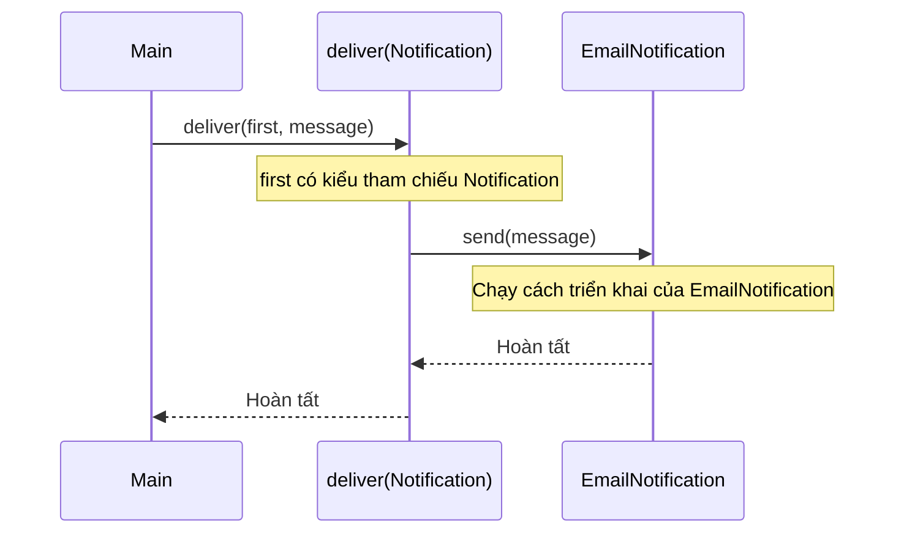
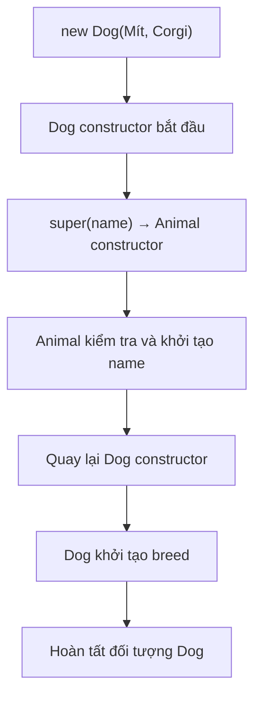
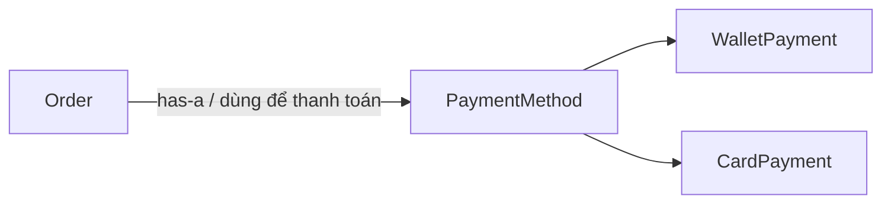
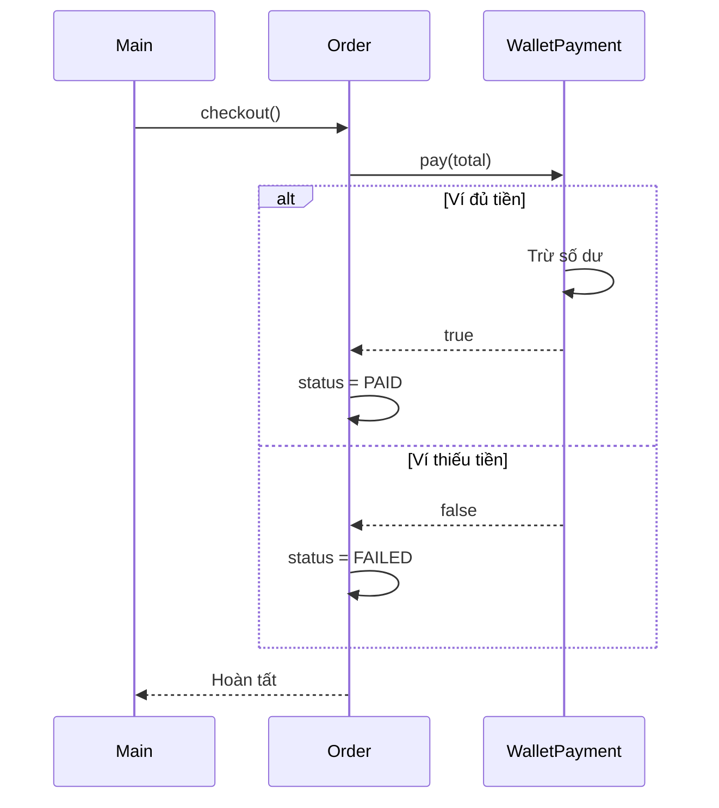

<a id="back-to-top"></a>

# Kế thừa (Inheritance) — dùng lại và mở rộng có chọn lọc

## Menu
- [5.1 Kế thừa là gì? Quan hệ is-a có nghĩa gì?](#oop-5-1)
- [5.2 extends, super và cách constructor hoạt động trong lớp con](#oop-5-2)
- [5.3 Ghi đè phương thức (overriding) và các điều kiện quan trọng](#oop-5-3)
- [5.4 Giới hạn của kế thừa: khi nào nên dùng composition (has-a)?](#oop-5-4)

## <a id="oop-5-1">5.1 Kế thừa là gì? Quan hệ is-a có nghĩa gì?</a>

<details>
<summary>Xem chi tiết</summary>

**Kế thừa (Inheritance)** là một cơ chế của lập trình hướng đối tượng (OOP), cho phép định nghĩa **lớp con (subclass)** dựa trên một **lớp cha (superclass)**. Lớp con có thể sử dụng các hành vi phù hợp từ lớp cha, bổ sung đặc điểm riêng hoặc triển khai lại một số hành vi theo quy tắc của ngôn ngữ.

Trong Java, ta thường dùng từ khóa `extends` để khai báo quan hệ kế thừa giữa hai class.

Ví dụ:

- `Notification`: khái niệm chung về một thông báo có thể gửi.
- `EmailNotification`: một loại thông báo được gửi qua email.
- `SmsNotification`: một loại thông báo được gửi qua SMS.

Ta có thể nói: **EmailNotification *is-a* Notification** — thông báo email **là một loại** thông báo.

> Ý nghĩa quan trọng của kế thừa không chỉ là “lấy lại code của lớp cha”. Nó còn thể hiện rằng **một đối tượng lớp con có thể được sử dụng ở những nơi đang mong đợi kiểu lớp cha**, miễn là lớp con giữ đúng những cam kết hành vi của lớp cha.

### 1. Hiểu quan hệ *is-a* từ ví dụ đời thường

Hãy xem ba phát biểu:

| Phát biểu | Loại quan hệ | Nhận xét |
|---|---|---|
| Chó **là một loại** động vật | *is-a* | Có thể phù hợp với kế thừa: `Dog extends Animal` |
| Xe hơi **là một loại** phương tiện | *is-a* | Có thể phù hợp: `Car extends Vehicle` nếu hợp đồng của `Vehicle` đủ đúng |
| Xe hơi **có một** động cơ | *has-a* | Không nên viết `Car extends Engine`; xe hơi **sử dụng** động cơ |
| Đơn hàng **có một** phương thức thanh toán | *has-a* | `Order` nên có quan hệ với `PaymentMethod`, không phải kế thừa nó |

*Is-a* trả lời câu hỏi: **“Đối tượng này có thực sự là một loại của đối tượng kia không?”**  
*Has-a* trả lời câu hỏi: **“Đối tượng này có, sở hữu hoặc sử dụng một thành phần khác không?”**

```text
                 Notification
                 /          \
                / is-a       \ is-a
               v              v
     EmailNotification    SmsNotification

        Order -------- has-a -------> PaymentMethod
```

Điểm dễ nhầm: cùng chứa thông tin hoặc dùng chung vài dòng code **chưa đủ** để kết luận có quan hệ *is-a*. Hai loại đối tượng có thể cùng có `name`, `id` hoặc `createdAt` nhưng không hề thuộc cùng một hệ phân loại có ý nghĩa về hành vi.

### 2. Kế thừa trong Java hoạt động như thế nào?

Dưới đây là một ví dụ độc lập, lưu trong file `Main.java` và chạy được:

```java
public class Main {
    public static void main(String[] args) {
        Notification first = new EmailNotification("an@example.com");
        Notification second = new SmsNotification("0900000000");

        deliver(first, "Đơn hàng đã được xác nhận");
        deliver(second, "Mã xác nhận: 123456");
    }

    static void deliver(Notification notification, String message) {
        notification.send(message);
    }
}

// Lớp cha: khái niệm chung của các thông báo
abstract class Notification {
    private final String recipient;

    protected Notification(String recipient) {
        if (recipient == null || recipient.isBlank()) {
            throw new IllegalArgumentException("Thiếu người nhận");
        }
        this.recipient = recipient;
    }

    protected String getRecipient() {
        return recipient;
    }

    // Mỗi loại thông báo tự xác định cách gửi
    public abstract void send(String message);
}

// Lớp con: thông báo qua email
class EmailNotification extends Notification {
    public EmailNotification(String recipient) {
        super(recipient);
    }

    @Override
    public void send(String message) {
        System.out.println("EMAIL tới " + getRecipient() + ": " + message);
    }
}

// Lớp con: thông báo qua SMS
class SmsNotification extends Notification {
    public SmsNotification(String recipient) {
        super(recipient);
    }

    @Override
    public void send(String message) {
        System.out.println("SMS tới " + getRecipient() + ": " + message);
    }
}
```

Kết quả:

```text
EMAIL tới an@example.com: Đơn hàng đã được xác nhận
SMS tới 0900000000: Mã xác nhận: 123456
```

Ví dụ chỉ **in ra màn hình** để minh họa OOP, chưa kết nối dịch vụ email hoặc SMS thực tế.

#### Đọc từng thành phần

| Thành phần Java | Ý nghĩa |
|---|---|
| `abstract class Notification` | Định nghĩa loại thông báo chung, chưa chỉ định cách gửi cụ thể |
| `extends Notification` | Khai báo `EmailNotification` / `SmsNotification` là các lớp con của `Notification` |
| `private final String recipient` | Dữ liệu chung được quản lý bên trong lớp cha |
| `protected Notification(...)` | Constructor của lớp cha khởi tạo phần dữ liệu chung |
| `super(recipient)` | Lớp con gọi constructor của lớp cha |
| `public abstract void send(...)` | Hợp đồng hành vi mà mỗi lớp con cụ thể phải thực hiện |
| `@Override` | Chỉ ra phương thức trong lớp con triển khai/ghi đè phương thức từ lớp cha |
| `Notification first = new EmailNotification(...)` | Biến kiểu cha đang tham chiếu object cụ thể thuộc lớp con |

Trong ví dụ, `Notification` là lớp trừu tượng vì ta chỉ cần khái niệm chung “thông báo có thể gửi”. Hai lớp con xác định cách gửi bằng email hoặc SMS. **Không phải mọi lớp cha đều phải là `abstract`**; ta chọn như vậy vì không có cách gửi chung hợp lý trong bài toán này.

#### Điều gì thực sự xảy ra khi gọi `deliver(first, ...)`?



Phương thức `deliver` không có nhánh kiểu:

```java
if (notification instanceof EmailNotification) { ... }
else if (notification instanceof SmsNotification) { ... }
```

Nó chỉ gọi `notification.send(message)`. Java chọn cách triển khai thích hợp dựa trên object cụ thể lúc chạy. Cách sử dụng một lớp con tại nơi chờ lớp cha là **một biểu hiện quan trọng của *is-a***; cơ chế gọi đúng phương thức còn liên quan đến **đa hình (polymorphism)**.

### 3. *Is-a* không dừng ở câu “A là một loại B”

Trong thiết kế phần mềm, phép thử *is-a* mạnh hơn phép so sánh tên gọi trong đời sống.

Ví dụ, giả sử một hàm đã hoạt động đúng với `Notification`:

```java
static void sendReminder(Notification notification) {
    notification.send("Đã đến hạn thanh toán");
}
```

Nếu truyền một `EmailNotification` hoặc `SmsNotification` vào hàm, cách sử dụng vẫn phải hợp lý: cả hai đều thực hiện yêu cầu **gửi thông báo** theo hợp đồng chung.

Vì vậy, trước khi cho `Child extends Parent`, hãy tự hỏi:

1. **Child có thật sự là một loại Parent trong bài toán này không?**
2. **Ở nơi đang chờ Parent, dùng Child có còn hợp nghĩa không?**
3. **Child có đáp ứng các cam kết quan trọng của Parent không?**
4. **Lớp con có phải thường xuyên ném “không hỗ trợ” khi được yêu cầu hành vi của lớp cha không?**

Nếu câu trả lời không ổn, quan hệ kế thừa có thể đang bị chọn sai.

#### Ví dụ phản trực giác: chim và khả năng bay

Ta có thể nghĩ “mọi loài chim đều bay”, rồi thiết kế:

```java
class Bird {
    void fly() {
        System.out.println("Đang bay");
    }
}
```

Nhưng chim cánh cụt cũng là chim mà không bay được. Nếu viết `Penguin extends Bird`, phương thức `fly()` của lớp cha có thể tạo một cam kết sai cho lớp con.

Vấn đề không nằm ở việc “chim cánh cụt có phải chim không?” — trong tự nhiên đúng là chim. Vấn đề là **hợp đồng phần mềm của `Bird` đã gắn hành vi bay cho mọi loại chim**, trong khi điều đó không đúng. Có thể đưa hành vi bay sang một hợp đồng `Flyable` dành cho những loài có khả năng bay, và để `Bird` chỉ mô tả phần chung thực sự phù hợp.

Đây là lý do **quan hệ *is-a* cần phù hợp cả về ý nghĩa lẫn hành vi**, không chỉ đúng một câu phân loại bằng tiếng Việt.

### 4. Kế thừa cho phép dùng lại những gì?

Trong ví dụ `Notification`, hai lớp con dùng chung logic khởi tạo và kiểm tra `recipient`. Lớp con cũng có thể thừa hưởng những phương thức có thể truy cập và không cần triển khai lại chúng.

Tuy nhiên, có vài điểm quan trọng:

- `private` field của lớp cha vẫn thuộc trạng thái của object nhưng **không thể truy cập trực tiếp bằng tên từ mã lớp con**. Ta dùng phương thức thích hợp như `getRecipient()` để cung cấp phần cần thiết.
- Constructor của lớp cha **không được kế thừa như một constructor của lớp con**; lớp con gọi constructor cha bằng `super(...)` khi khởi tạo.
- Lớp con có thể **thêm hành vi riêng**; nhưng phần mã chỉ biết biến có kiểu `Notification` không tự nhiên nhìn thấy mọi phương thức riêng của `EmailNotification`.
- Khi lớp con ghi đè phương thức, cách thực thi thực tế có thể khác với lớp cha; phải giữ đúng cam kết hành vi cho người sử dụng.

```text
Object EmailNotification
  ├─ phần trạng thái/hành vi chung từ Notification
  └─ phần hành vi riêng của EmailNotification
```

Sơ đồ này chỉ minh họa khái niệm. Không nên hình dung Java tạo hai object độc lập “một cha + một con” mỗi khi gọi `new EmailNotification(...)`. **Đó là một object có kiểu cụ thể `EmailNotification`**, bao gồm phần trạng thái thuộc cấp lớp cha trong hệ thống kế thừa.

### 5. Khi nào không nên dùng kế thừa?

Kế thừa tạo mối liên hệ tương đối chặt: lớp con gắn với thiết kế và cam kết của lớp cha. Nếu cha thay đổi, con có thể bị ảnh hưởng. Vì vậy, không nên dùng kế thừa chỉ vì hai class cùng có vài field hoặc muốn tránh lặp lại một đoạn mã ngắn.

Xem ví dụ về đơn hàng:

```java
// Không hợp nghĩa:
class Order extends PaymentMethod {
    // Đơn hàng không phải một loại phương thức thanh toán.
}
```

Hơn nữa, `PaymentMethod` trong thiết kế có thể là interface hoặc class; dòng trên chỉ nhằm minh họa một **quan hệ sai về mô hình**, không phải đoạn code hoàn chỉnh.

Đơn hàng **sử dụng** phương thức thanh toán, nên một thiết kế phù hợp hơn là:

```java
interface PaymentMethod {
    boolean pay(int amount);
}

class Order {
    private final PaymentMethod paymentMethod;

    Order(PaymentMethod paymentMethod) {
        this.paymentMethod = paymentMethod;
    }

    boolean checkout(int total) {
        if (total <= 0) {
            throw new IllegalArgumentException("Tổng tiền không hợp lệ");
        }
        return paymentMethod.pay(total);
    }
}
```

`Order` **has-a `PaymentMethod`**: đơn hàng giữ tham chiếu đến một đối tượng thanh toán và cộng tác với nó. Đó là **composition / kết hợp đối tượng** theo nghĩa thiết kế, không phải kế thừa.

| Khi cân nhắc | Kế thừa (*is-a*) | Kết hợp/sử dụng (*has-a*) |
|---|---|---|
| Bản chất mối quan hệ | “A là một loại B” | “A có hoặc sử dụng B” |
| Ví dụ | `EmailNotification extends Notification` | `Order` có `PaymentMethod` |
| Cách tái sử dụng | Chia sẻ một hệ phân loại và hành vi kế thừa | Cộng tác thông qua object khác |
| Thay đổi triển khai | Có thể bị ràng buộc với lớp cha | Có thể thay object cộng tác nếu hợp đồng tương thích |
| Nên chọn khi | Con thực sự thay thế được cha theo hợp đồng | Chỉ cần dùng một khả năng hoặc sở hữu thành phần khác |

Không phải cứ có tham chiếu đến object khác thì luôn là composition theo nghĩa vòng đời sở hữu nghiêm ngặt trong UML. Trong Java thực tế, nhiều thiết kế dùng association, aggregation hoặc dependency. Ở đây, ý chính cần hiểu là **“sử dụng/có một” khác “là một loại”**.

### 6. Một số hiểu nhầm thường gặp

**“Kế thừa chỉ để tiết kiệm code?”** — Tái sử dụng code là một lợi ích, nhưng động cơ quan trọng hơn là **mô hình hóa quan hệ kiểu đúng và hành vi thay thế phù hợp**. Dùng kế thừa để chia sẻ vài field giữa hai đối tượng không liên quan có thể khiến mô hình sai.

**“Lớp con có phải object khác bên trong object cha?”** — Không. Tạo `new EmailNotification(...)` cho ra một object `EmailNotification`, với phần dữ liệu và hành vi tương ứng toàn bộ hệ kế thừa.

**“Mọi thứ của lớp cha đều được lớp con truy cập trực tiếp?”** — Không. Ví dụ, field `private` của cha không thể truy cập trực tiếp từ mã lớp con.

**“Java cho phép một class kế thừa nhiều class?”** — Không. Một class Java chỉ có thể `extends` trực tiếp **một class**, nhưng có thể `implements` nhiều interface. Các interface cũng biểu đạt quan hệ kiểu, song kế thừa class và triển khai interface có quy tắc riêng.

**“Nếu tên gọi nghe giống *is-a* thì chắc nên extends?”** — Chưa chắc. Hãy kiểm tra **hợp đồng hành vi**. Ví dụ `Penguin` là một loại `Bird` nhưng không thể đáp ứng hợp đồng `fly()` nếu lớp cha sai khi yêu cầu mọi con chim phải bay.

### 7. Tự kiểm tra

| Câu hỏi | Cách trả lời |
|---|---|
| `EmailNotification extends Notification` diễn đạt quan hệ gì? | *Is-a*: thông báo email là một loại thông báo |
| `Order` giữ field kiểu `PaymentMethod` diễn đạt quan hệ gì? | *Has-a*: đơn hàng sử dụng một phương thức thanh toán |
| Vì sao `deliver(Notification n)` có thể nhận `EmailNotification`? | Lớp con là một kiểu của lớp cha và đáp ứng hợp đồng gửi thông báo |
| Tại sao không nên viết `Car extends Engine`? | Xe hơi có/sử dụng động cơ; nó không phải một loại động cơ |
| Tại sao *is-a* trong OOP phải xét cả hành vi? | Vì người dùng kiểu cha phải có thể làm việc hợp lý với object lớp con |

**Ghi nhớ:** Kế thừa giúp định nghĩa một **kiểu chuyên biệt từ kiểu chung**. Khi thiết kế `Child extends Parent`, hãy xác nhận **“Child là một loại Parent”** và **“Child giữ đúng những cam kết mà người sử dụng Parent đang trông đợi”**. Nếu quan hệ thực tế là **“A sử dụng B”**, hãy thiết kế sự cộng tác giữa hai object thay vì ép chúng vào quan hệ kế thừa.

</details>

- [Quay lại đầu trang](#back-to-top)

---

## <a id="oop-5-2">5.2 extends, super và cách constructor hoạt động trong lớp con</a>

<details>
<summary>Xem chi tiết</summary>

Khi học kế thừa trong Java, một câu hỏi dễ gây nhầm lẫn là: **“Nếu mình tạo đối tượng của lớp con, vì sao constructor của lớp cha cũng chạy?”** Để trả lời, cần hiểu ba điều liên quan chặt chẽ với nhau:

- `extends` xác định quan hệ kế thừa giữa hai class.
- `super` cho phép lớp con truy cập cách triển khai của lớp cha hoặc gọi constructor của lớp cha.
- Khi khởi tạo một đối tượng lớp con, Java phải hoàn tất phần khởi tạo thuộc lớp cha trước khi thực hiện phần khởi tạo của lớp con.

Chúng ta sẽ đi từ một ví dụ chạy được, sau đó phân tích các trường hợp dễ viết sai.

### 1. `extends` thể hiện quan hệ gì?

Giả sử hệ thống có `Animal` và `Dog`. Một con chó là một loại động vật, nên quan hệ **Dog is an Animal** có ý nghĩa:

```java
class Animal {
    public void eat() {
        System.out.println("Animal is eating");
    }
}

class Dog extends Animal {
    public void bark() {
        System.out.println("Woof!");
    }
}
```

Sử dụng:

```java
Dog dog = new Dog();
dog.eat();  // Animal is eating
dog.bark(); // Woof!
```

`Dog extends Animal` nghĩa là `Dog` là **lớp con** (subclass), còn `Animal` là **lớp cha** (superclass). `Dog` có thể sử dụng phương thức `eat()` được kế thừa và tự cung cấp thêm phương thức `bark()`.

Bên cạnh khả năng dùng lại hành vi, kế thừa còn xác định quan hệ kiểu dữ liệu:

```java
Animal animal = new Dog(); // Hợp lệ: Dog là một Animal
animal.eat();              // Hợp lệ: eat() có trong Animal
// animal.bark();          // Lỗi biên dịch: kiểu tham chiếu Animal không khai báo bark()
```

Đối tượng thực tế vẫn là `Dog`; biến `animal` chỉ cho phép gọi những thao tác mà kiểu `Animal` công khai. Nếu `Dog` ghi đè một instance method, Java có thể chọn implementation ở `Dog` khi chạy, dù biến có kiểu `Animal`.

Một class Java chỉ được trực tiếp `extends` **một class**. Nếu không khai báo lớp cha, class thông thường ngầm kế thừa `Object`. Không thể `extends` một class có khai báo `final`. Để mô tả thêm nhiều hợp đồng, Java có `implements` với các interface.

**Khi nào dùng `extends`?** Khi lớp con thật sự là một biến thể hợp lý của lớp cha, có thể tuân theo các kỳ vọng của lớp cha. Không nên kế thừa chỉ vì hai class tình cờ có vài dòng code giống nhau; trong những trường hợp như vậy, việc chứa một đối tượng khác (*composition*) có thể phù hợp hơn.

### 2. Ví dụ hoàn chỉnh: `extends`, `super(...)` và `super.method()`

Ví dụ sau có thể lưu nguyên vẹn thành file `Main.java` và chạy bằng Java 17 hoặc 21:

```java
class Animal {
    private final String name;

    public Animal(String name) {
        if (name == null || name.isBlank()) {
            throw new IllegalArgumentException("Name is required");
        }
        this.name = name;
        System.out.println("1. Animal constructor: " + name);
    }

    public String describe() {
        return "Animal: " + name;
    }

    protected String getName() {
        return name;
    }
}

class Dog extends Animal {
    private final String breed;

    public Dog(String name, String breed) {
        super(name); // Gọi constructor Animal(String)
        this.breed = breed;
        System.out.println("2. Dog constructor: " + breed);
    }

    @Override
    public String describe() {
        return "Dog: " + getName() + ", breed: " + breed;
    }

    public String describeAsAnimal() {
        return super.describe(); // Gọi implementation của lớp cha
    }
}

public class Main {
    public static void main(String[] args) {
        Dog dog = new Dog("Mít", "Corgi");

        System.out.println(dog.describe());
        System.out.println(dog.describeAsAnimal());
    }
}
```

Kết quả:

```text
1. Animal constructor: Mít
2. Dog constructor: Corgi
Dog: Mít, breed: Corgi
Animal: Mít
```

Hãy nhìn vào dòng:

```java
Dog dog = new Dog("Mít", "Corgi");
```

Ta **chỉ tạo một đối tượng `Dog`**. Đối tượng ấy có phần trạng thái do `Animal` quản lý (ví dụ `name`) và phần trạng thái do `Dog` quản lý (`breed`). Không có chuyện `super(name)` tạo ra một đối tượng `Animal` riêng biệt và độc lập bên cạnh đối tượng `Dog`.

Thứ tự xảy ra là:

1. Java bắt đầu quá trình khởi tạo đối tượng `Dog`.
2. Constructor `Dog(String, String)` gọi `super(name)`, tức constructor `Animal(String)`.
3. `Animal` kiểm tra và gán `name`, rồi in dòng thứ nhất.
4. Khi constructor lớp cha hoàn tất, việc khởi tạo `Dog` tiếp tục: gán `breed`, rồi in dòng thứ hai.
5. Đối tượng được trả về cho biến `dog`; lúc này ta gọi các phương thức `describe()` và `describeAsAnimal()`.

Sơ đồ lời gọi rút gọn:



Trong ví dụ này, `Animal` có trường `private name`: `Dog` không được phép đọc trực tiếp `name`, nhưng vẫn có thể dùng phương thức `protected getName()` mà lớp cha chủ động cung cấp. **Kế thừa không xóa bỏ quy tắc truy cập `private`.**

### 3. `super` có hai cách sử dụng rất dễ nhầm

`super` luôn nói đến **lớp cha trực tiếp** trong ngữ cảnh của lớp con, nhưng ngữ nghĩa tùy cách viết:

| Cú pháp | Dùng để làm gì? | Ví dụ |
| --- | --- | --- |
| `super(...)` | Gọi **constructor** của lớp cha | `super(name)` |
| `super.method(...)` | Gọi **implementation phương thức** ở lớp cha | `super.describe()` |
| `super.field` | Tham chiếu trường có thể truy cập được ở lớp cha, khi cần phân biệt với trường cùng tên | `super.value` |

#### `super(...)`: gọi constructor

Ví dụ:

```java
public Dog(String name, String breed) {
    super(name);
    this.breed = breed;
}
```

Java tìm constructor `Animal(String)` phù hợp với tham số `name`. Nếu lớp cha có nhiều constructor, kiểu và số lượng đối số quyết định constructor nào được chọn, theo quy tắc overload.

Trong **Java 21** (và các phiên bản cũ hơn), lời gọi constructor tường minh `super(...)` hoặc `this(...)` phải là **câu lệnh đầu tiên** trong constructor. Vì vậy, đoạn dưới đây không biên dịch trên Java 21:

```java
// Sai trong Java 21:
Dog(String name, String breed) {
    this.breed = breed;
    super(name);
}
```

Các phiên bản Java mới hơn có thay đổi về mức độ linh hoạt của phần lệnh trước lời gọi constructor; toàn bộ ví dụ trong bài này dùng quy tắc Java 21 để dễ học và phù hợp với cách viết truyền thống.

#### `super.method(...)`: gọi phần triển khai của cha

Trong ví dụ hoàn chỉnh:

```java
@Override
public String describe() {
    return "Dog: " + getName() + ", breed: " + breed;
}

public String describeAsAnimal() {
    return super.describe();
}
```

Gọi `dog.describe()` chạy phần code ở `Dog`, còn `dog.describeAsAnimal()` chủ động gọi `Animal.describe()`.

Lời gọi `super.describe()` **không phải gọi constructor**, và không cần nằm ở đầu một phương thức. Nó giúp lớp con dùng lại logic cha khi muốn bổ sung hành vi:

```java
@Override
public String describe() {
    return super.describe() + " (dog)";
}
```

Khi phương thức lớp cha là `private`, lớp con không thể gọi trực tiếp bằng `super.method()`. Nếu một phương thức được khai báo `final`, lớp con không được ghi đè phương thức đó.

### 4. Nếu không viết `super()` thì constructor cha có chạy không?

**Có.** Trong Java 21, nếu constructor không khai báo lời gọi `this(...)` hoặc `super(...)` ở đầu, trình biên dịch sẽ ngầm thêm `super()`.

Ví dụ:

```java
class Parent {
    Parent() {
        System.out.println("Parent()");
    }
}

class Child extends Parent {
    Child() {
        // Java 21 ngầm thực hiện super();
        System.out.println("Child()");
    }
}

public class Main {
    public static void main(String[] args) {
        new Child();
    }
}
```

Kết quả:

```text
Parent()
Child()
```

Đây là lý do bạn thấy constructor cha chạy dù trong constructor con không hề có chữ `super`.

Nhưng có một điều kiện: **lớp cha phải có constructor không tham số mà lớp con được phép gọi**.

Xem ví dụ:

```java
class Parent {
    Parent(String id) {
        System.out.println("Parent id: " + id);
    }
}

class Child extends Parent {
    Child() {
        System.out.println("Child");
    }
}
```

Đoạn trên **không biên dịch**. Java ngầm cố gọi `super()` nhưng `Parent` chỉ có `Parent(String)`, không có constructor không tham số.

Cách sửa:

```java
class Child extends Parent {
    Child() {
        super("P-01");
        System.out.println("Child");
    }
}
```

Một lựa chọn khác là bổ sung constructor không tham số hợp lệ cho `Parent`, nếu điều đó phù hợp với mô hình dữ liệu của lớp cha.

#### Phân biệt “constructor mặc định” và “constructor không tham số”

Khi class **không khai báo bất kỳ constructor nào**, Java tự sinh một *default constructor* không tham số, với quyền truy cập tương ứng theo quy tắc ngôn ngữ. Constructor này sẽ gọi `super()`.

Khi class **đã khai báo một constructor bất kỳ**, Java **không tự sinh thêm** constructor không tham số cho class ấy.

Ví dụ, `Parent(String id)` ở trên khiến `Parent()` không được sinh tự động. Điều này khác với việc class tự viết một constructor `Parent() { ... }` — đó là constructor không tham số **được khai báo tường minh**, không phải constructor mặc định do Java sinh.

Ngoài việc tồn tại, constructor cha còn phải **truy cập được** từ lớp con. Nếu constructor phù hợp bị `private` hoặc không thể truy cập theo quy tắc package/protected, lời gọi `super(...)` vẫn không hợp lệ.

### 5. `this(...)` và `super(...)`: mỗi constructor chỉ chọn một hướng nối

Giả sử lớp con hỗ trợ hai cách tạo đối tượng: có tên và không có tên.

```java
class Person {
    private final String name;

    Person(String name) {
        this.name = name;
        System.out.println("Person: " + name);
    }
}

class Employee extends Person {
    Employee() {
        this("Chưa đặt tên");
    }

    Employee(String name) {
        super(name);
        System.out.println("Employee created");
    }
}

public class Main {
    public static void main(String[] args) {
        new Employee();
    }
}
```

Kết quả:

```text
Person: Chưa đặt tên
Employee created
```

Điểm đáng chú ý:

- `this("Chưa đặt tên")` gọi một **constructor khác của chính `Employee`**.
- Constructor `Employee(String)` gọi `super(name)` để khởi tạo phần `Person`.
- Mặc dù đi qua hai constructor của `Employee`, quá trình khởi tạo phần `Person` của đối tượng diễn ra một lần.

Đường gọi là:

```text
new Employee()
    └─ Employee()
         └─ this("Chưa đặt tên")
              └─ Employee(String)
                   └─ super(name)
                        └─ Person(String)
```

Trong Java 21, một constructor không thể đặt **cả** `this(...)` lẫn `super(...)` làm hai câu lệnh gọi constructor tường minh. Hai cú pháp này đều đòi vị trí đầu constructor. Nếu chọn `this(...)`, chuỗi constructor được gọi cuối cùng vẫn phải dẫn tới việc khởi tạo lớp cha. Không được tạo vòng lặp kiểu `A() → A(int) → A()`, vì chuỗi gọi constructor đệ quy như vậy là lỗi biên dịch.

Đừng nhầm `this(...)` (gọi constructor cùng class) với `this.field` (trỏ đến trường của đối tượng hiện tại). Tương tự, `super(...)` khác với `super.method()`.

### 6. Thứ tự khởi tạo thực tế: trường, initializer block và constructor

Cho đến đây, các ví dụ chỉ có constructor. Nhưng một class còn có thể khởi tạo **instance field** ngay khi khai báo hoặc dùng **instance initializer block** (khối lệnh `{ ... }` trong thân class).

Ví dụ độc lập sau cho thấy thứ tự thực thi:

```java
class Parent {
    private final int parentValue = initParent();

    {
        System.out.println("2. Parent initializer block");
    }

    Parent() {
        System.out.println("3. Parent constructor");
    }

    private int initParent() {
        System.out.println("1. Parent field initializer");
        return 10;
    }
}

class Child extends Parent {
    private final int childValue = initChild();

    {
        System.out.println("5. Child initializer block");
    }

    Child() {
        // Ngầm gọi super();
        System.out.println("6. Child constructor");
    }

    private int initChild() {
        System.out.println("4. Child field initializer");
        return 20;
    }
}

public class Main {
    public static void main(String[] args) {
        new Child();
    }
}
```

Kết quả:

```text
1. Parent field initializer
2. Parent initializer block
3. Parent constructor
4. Child field initializer
5. Child initializer block
6. Child constructor
```

Có thể hiểu quá trình khởi tạo instance thông thường trong Java 21 như sau:

1. Java cấp phát bộ nhớ cho **một đối tượng lớp con**, và các instance field ban đầu mang giá trị mặc định (`0`, `false`, `null`...).
2. Chuỗi lời gọi constructor đi lên các lớp cha, cuối cùng tới `Object`.
3. Khi quay về một class sau khi constructor cha hoàn tất, Java chạy instance field initializers và instance initializer blocks của class đó **theo thứ tự xuất hiện trong mã nguồn**.
4. Tiếp theo Java chạy phần thân constructor của class ấy.
5. Trở lại class con và lặp lại trình tự tương ứng cho tới khi constructor cuối cùng hoàn tất.

Trong ví dụ, phần khởi tạo của `Parent` hoàn tất trước phần khởi tạo của `Child`. Tuy nhiên, **không nên hiểu rằng mọi dòng mã constructor cha đều là những lệnh đầu tiên được chạy trong chương trình**: việc nạp/khởi tạo class, static initializers và việc tính đối số để gọi constructor có quy tắc riêng. Bảng trên chỉ tập trung vào thứ tự khởi tạo **instance** trong ví dụ.

Một cách nhớ hữu ích: **constructor cha được gọi trước, nhưng field initializer của mỗi class chạy trước phần thân constructor của chính class ấy**.

### 7. Vì sao constructor lớp cha không nên gọi phương thức có thể bị override?

Đây là một lỗi khá khó nhận ra khi mới học kế thừa.

```java
class Parent {
    Parent() {
        showInfo();
    }

    void showInfo() {
        System.out.println("Parent info");
    }
}

class Child extends Parent {
    private String name = "An";

    @Override
    void showInfo() {
        System.out.println("Child name: " + name);
    }
}

public class Main {
    public static void main(String[] args) {
        new Child();
    }
}
```

Kết quả:

```text
Child name: null
```

Vì sao không phải `Child name: An`?

- `new Child()` bắt đầu bằng việc gọi constructor `Parent`.
- `Parent()` gọi `showInfo()`, một instance method **có thể bị override**.
- Đối tượng thực tế là `Child`, nên Java gọi `Child.showInfo()`.
- Lúc này initializer `name = "An"` của `Child` **chưa chạy**; `name` vẫn là giá trị mặc định `null`.
- Sau khi `Parent()` kết thúc, Java mới chạy initializer `name = "An"` rồi phần thân constructor `Child`.

Nếu `showInfo()` thực hiện `name.length()`, chương trình thậm chí có thể ném `NullPointerException` trong lúc tạo đối tượng.

**Bài học:** hạn chế gọi phương thức có thể bị override từ constructor, nhất là khi phương thức đó đọc trạng thái lớp con. Ưu tiên khởi tạo và kiểm tra các bất biến trực tiếp tại mỗi cấp lớp, hoặc chuyển hành vi cần toàn bộ đối tượng đã sẵn sàng sang phương thức được gọi sau khi khởi tạo.

### 8. Những quy tắc quan trọng khác khi viết constructor lớp con

| Tình huống | Quy tắc Java | Hệ quả thực tế |
| --- | --- | --- |
| Constructor lớp cha có tham số | `super(args)` chọn constructor tương ứng | Lớp con phải cung cấp dữ liệu cần cho lớp cha |
| Constructor lớp con bỏ qua `super` và `this` (Java 21) | Ngầm gọi `super()` | Lỗi biên dịch nếu không có constructor cha không tham số khả dụng |
| Constructor lớp con gọi `this(args)` | Chuyển sang constructor khác trong cùng lớp | Tránh lặp mã khởi tạo, nhưng chuỗi phải hợp lệ |
| Constructor lớp cha ném checked exception | Constructor con phải xử lý theo quy tắc của constructor invocation, thông thường phải khai báo `throws` phù hợp | Không thể bỏ qua checked exception khi dùng `super(...)` |
| Constructor cha thất bại | Quá trình tạo đối tượng thất bại, không trả về đối tượng khởi tạo thành công | Phần thân constructor con không chạy tiếp |
| Class cha là `abstract` | Vẫn có thể khai báo constructor và được gọi từ constructor con | Chỉ không được tạo instance abstract class trực tiếp |
| Class cha có trường `private` | Lớp con không được truy cập trực tiếp | Dùng API phù hợp mà lớp cha cung cấp |
| Class con không khai báo constructor | Java có thể tự sinh default constructor gọi `super()` | Phải có constructor cha không tham số truy cập được |
| Class cha có `final` | Không thể `extends` | Bắt buộc chọn thiết kế khác |

Ví dụ về checked exception:

```java
import java.io.IOException;

class Parent {
    Parent() throws IOException {
        throw new IOException("Cannot initialize parent");
    }
}

class Child extends Parent {
    Child() throws IOException {
        super();
    }
}
```

Constructor `Child()` khai báo `throws IOException` vì việc khởi tạo `Parent` có thể ném ngoại lệ đã kiểm tra. Caller cần xử lý hoặc tiếp tục khai báo ngoại lệ. Đặt `try/catch` trong thân constructor `Child` sau `super()` không thể bắt ngoại lệ đã xảy ra trong lời gọi `super()` trước đó. Nếu cần xử lý riêng lỗi khởi tạo cha, hãy thiết kế cách tạo đối tượng hoặc đường truyền ngoại lệ cho phù hợp.

### 9. Lỗi thường gặp khi mới dùng `extends` và `super`

**Lỗi 1 — Nghĩ rằng `extends` tự động cho phép truy cập mọi field cha.**

```java
class Parent {
    private int value = 10;
}

class Child extends Parent {
    // int x = value; // Lỗi: value là private
}
```

Lớp con có quan hệ kế thừa nhưng vẫn chịu kiểm soát truy cập. Điều này bảo vệ trạng thái thuộc trách nhiệm của lớp cha.

**Lỗi 2 — Nghĩ rằng constructor được kế thừa như phương thức.**

```java
class Parent {
    Parent(int value) {}
}

class Child extends Parent {
    Child(int value) {
        super(value);
    }
}
```

Constructor `Child(int)` là constructor **riêng của `Child`**, không phải constructor `Parent(int)` được “thừa hưởng”. `super(value)` là một lời gọi constructor cha trong quá trình tạo cùng một đối tượng.

**Lỗi 3 — Không hiểu khác biệt giữa `super()` và `super.someMethod()`.**

`super()` được dùng để khởi tạo phần lớp cha thông qua constructor. Còn `super.someMethod()` dùng để gọi một phương thức của lớp cha và có thể nằm trong phương thức instance thông thường.

**Lỗi 4 — Khởi tạo lớp con trước khi gọi constructor cha.**

Trong Java 21, không được đặt phép gán trường instance của lớp con trước lời gọi `super(...)`. Phần cha phải được khởi tạo thông qua chuỗi constructor theo trật tự hợp lệ.

**Lỗi 5 — Cho rằng kế thừa chỉ để tiết kiệm code.**

`Dog extends Animal` còn là lời tuyên bố về quan hệ kiểu và khả năng thay thế. Nếu một lớp không thực sự là một dạng của lớp cha, hãy cân nhắc dùng composition thay vì tạo quan hệ kế thừa thiếu ý nghĩa.

### 10. Tự kiểm tra bằng ba câu hỏi ngắn

**Câu 1.** Vì sao đoạn dưới đây in `Parent` trước `Child`?

```java
class Parent {
    Parent() { System.out.println("Parent"); }
}
class Child extends Parent {
    Child() { System.out.println("Child"); }
}
```

Vì `Child()` ngầm gọi `super()`. Constructor cha hoàn tất trước khi chạy phần thân constructor con.

**Câu 2.** `Parent` chỉ có `Parent(String name)`. Có thể viết `class Child extends Parent { Child() {} }` không?

Không. Java 21 sẽ tìm `Parent()` khi ngầm gọi `super()`; constructor ấy không tồn tại. Cần gọi `super("giá trị phù hợp")` hoặc thiết kế constructor cha khác.

**Câu 3.** Nếu `Dog` override `describe()`, `super.describe()` trong `Dog` gọi cách triển khai nào?

Gọi phần triển khai của `describe()` ở lớp cha trực tiếp `Animal`, với điều kiện phương thức đó có thể truy cập được. Còn `dog.describe()` thông thường chọn implementation được override ở `Dog`.

Điều quan trọng nhất khi đọc code kế thừa là lần theo hai đường riêng: **`extends` xác định quan hệ giữa các class**, còn **chuỗi constructor `super(...)` / `this(...)` xác định thứ tự khởi tạo đối tượng**. Nhìn đúng hai đường này, bạn sẽ hiểu vì sao constructor cha chạy, nơi nào có thể gán trường của lớp con và khi nào cần gọi `super` một cách tường minh.

</details>

- [Quay lại đầu trang](#back-to-top)

---

## <a id="oop-5-3">5.3 Ghi đè phương thức (overriding) và các điều kiện quan trọng</a>

<details>
<summary>Xem chi tiết</summary>

### 1. Ghi đè phương thức là gì?

Giả sử hệ thống bán hàng có hai cách giao hàng:

- **Giao thường:** phí 25.000 đồng, miễn phí với đơn từ 500.000 đồng.
- **Giao nhanh:** tính theo phí giao thường rồi cộng thêm 15.000 đồng.

Cả hai cùng trả lời một câu hỏi: **“Với đơn hàng có giá trị này, phí vận chuyển là bao nhiêu?”** Nhưng cách tính có thể khác nhau.

Trong lập trình hướng đối tượng, **method overriding (ghi đè phương thức)** cho phép lớp con cung cấp cách thực hiện riêng cho một **phương thức instance có thể kế thừa và ghi đè** từ lớp cha (hoặc thực hiện một phương thức được khai báo trong interface).

Nói cách khác: tên hành vi mà mã bên ngoài sử dụng vẫn là `feeFor(...)`, nhưng **đối tượng thực tế** quyết định phiên bản phương thức được chạy.

Điều này đặc biệt có ý nghĩa khi mã sử dụng chỉ biết kiểu cha, chẳng hạn `ShippingPolicy`, mà không cần kiểm tra đối tượng thuộc từng lớp con rồi tự chọn công thức.

### 2. Ví dụ Java: cùng lời gọi, kết quả tùy đối tượng

Viết một lớp cha cung cấp chính sách mặc định:

```java
// ShippingPolicy.java
public class ShippingPolicy {
    public long feeFor(long orderTotal) {
        if (orderTotal < 0) {
            throw new IllegalArgumentException(
                "Tổng tiền đơn hàng không được âm"
            );
        }

        return orderTotal >= 500_000 ? 0 : 25_000;
    }
}
```

Một lớp con kế thừa và **ghi đè** phương thức đó:

```java
// ExpressShippingPolicy.java
public final class ExpressShippingPolicy extends ShippingPolicy {

    @Override
    public long feeFor(long orderTotal) {
        long regularFee = super.feeFor(orderTotal);
        return regularFee + 15_000;
    }
}
```

Thử gọi:

```java
ShippingPolicy regular = new ShippingPolicy();
ShippingPolicy express = new ExpressShippingPolicy();

System.out.println(regular.feeFor(100_000)); // 25000
System.out.println(express.feeFor(100_000)); // 40000

System.out.println(regular.feeFor(600_000)); // 0
System.out.println(express.feeFor(600_000)); // 15000
```

Ở dòng `ShippingPolicy express = new ExpressShippingPolicy();`:

- **Kiểu khai báo của biến** là `ShippingPolicy`.
- **Đối tượng thực tế** là `ExpressShippingPolicy`.
- Vì `feeFor(long)` là phương thức instance được ghi đè hợp lệ, Java chạy phiên bản của **đối tượng thực tế**, tức `ExpressShippingPolicy.feeFor(...)`.

Nhờ đó, mã gọi có thể làm việc qua kiểu cha mà vẫn nhận hành vi riêng của lớp con.

#### Luồng gọi khi phí giao nhanh được tính

```text
Biến express có kiểu ShippingPolicy
               │
               ▼
express.feeFor(100_000)
               │
               ▼
Đối tượng thực tế: ExpressShippingPolicy
               │
               ▼
Chạy phiên bản feeFor() của lớp con
               │
               ▼
super.feeFor(100_000) → 25.000
               │
               ▼
Cộng thêm 15.000
               │
               ▼
Trả kết quả 40.000
```

Từ khóa `super` trong lớp con dùng để gọi cách thực hiện được kế thừa từ lớp cha. Ở ví dụ này, `super.feeFor(orderTotal)` giúp **tái sử dụng quy tắc kiểm tra tổng tiền không âm và tính phí cơ bản**.

Nếu truyền `-10`, phần kiểm tra trong lớp cha ném `IllegalArgumentException` và lớp con không đi tiếp đến bước cộng phí. Đó là điều cần lưu ý khi tái sử dụng hành vi cha bằng `super`.

### 3. Vì sao overriding gắn với đa hình?

Xét đoạn code chỉ biết đến kiểu `ShippingPolicy`:

```java
public static void printShippingFee(
        ShippingPolicy policy, long orderTotal) {
    System.out.println(policy.feeFor(orderTotal));
}

printShippingFee(new ShippingPolicy(), 100_000);        // 25000
printShippingFee(new ExpressShippingPolicy(), 100_000); // 40000
```

Phương thức `printShippingFee` không có `if` để nhận diện giao thường hay giao nhanh. Nó chỉ yêu cầu đối tượng thực hiện `feeFor(...)`.

Cơ chế **dynamic dispatch** (phân giải lời gọi phương thức tại thời điểm chạy) chọn implementation dựa trên lớp của đối tượng thực tế. Đây là một cách **đa hình (polymorphism)** xuất hiện nhờ ghi đè phương thức.

Tuy nhiên, khi biên dịch, Java vẫn dùng **kiểu khai báo của biến** để quyết định phương thức nào có thể được gọi. Một biến kiểu `ShippingPolicy` không tự nhiên gọi được phương thức mới chỉ tồn tại ở `ExpressShippingPolicy`. Phải có hành vi đó trong kiểu mà mã gọi đang nhìn thấy, hoặc dùng cơ chế chuyển kiểu phù hợp.

### 4. Điều kiện để một phương thức được ghi đè hợp lệ

Không phải cứ viết một phương thức **trùng tên** trong lớp con là đã overriding. Java kiểm tra một số quy tắc.

| Điều kiện | Quy tắc cần nhớ |
|---|---|
| **Có quan hệ kế thừa / thực hiện giao diện** | Phương thức lớp con phải thực sự override phương thức có thể override từ cha hoặc interface. |
| **Tên và danh sách tham số** | Chữ ký phương thức phải khớp theo quy tắc Java; đổi số lượng hay kiểu tham số thường trở thành **overloading**. |
| **Kiểu trả về** | Phải tương thích: với kiểu tham chiếu có thể trả về kiểu con (*covariant return*); với kiểu nguyên thủy thường phải giữ cùng kiểu, `void` phải giữ `void`. |
| **Phạm vi truy cập** | Lớp con **không được thu hẹp** quyền truy cập của phương thức được ghi đè. |
| **Checked exception** | Không được khai báo thêm checked exception rộng hơn hoặc mới không được bao phủ bởi khai báo `throws` của phương thức cha. |
| **`final`** | Phương thức `final` không thể ghi đè. |
| **`static`** | Phương thức `static` không có overriding theo cơ chế phương thức instance; khai báo cùng tên/chữ ký là **hiding** nếu hợp lệ. |
| **`private`** | Phương thức `private` của cha không được kế thừa để ghi đè. |

Ngoài ra, **constructor không thể bị ghi đè**: constructor không phải phương thức được kế thừa.

Các mục dưới đây đi vào những chỗ dễ nhầm nhất.

### 5. Phải khớp chữ ký: thay tham số là overloading

Ví dụ:

```java
class Printer {
    public void print(String message) {
        System.out.println("Cha: " + message);
    }
}

class FancyPrinter extends Printer {
    @Override
    public void print(String message) {
        System.out.println("Con: " + message);
    }
}
```

`FancyPrinter.print(String)` ghi đè `Printer.print(String)` vì cùng tên và cùng danh sách tham số.

Nhưng nếu đổi `String` thành `Object`:

```java
class FancyPrinter extends Printer {
    // Không đặt @Override: đây là một phương thức khác.
    public void print(Object message) {
        System.out.println("Object: " + message);
    }
}
```

Phương thức `print(Object)` **không ghi đè** `print(String)`. Nó tạo ra một phiên bản **nạp chồng (overloading)** với kiểu tham số khác. Cả hai có thể cùng tồn tại.

Nếu cố thêm `@Override` vào `print(Object)`, trình biên dịch sẽ báo lỗi vì không tìm thấy phương thức cha phù hợp để ghi đè.

**Phân biệt nhanh:**

| | Overriding | Overloading |
|---|---|---|
| Ý tưởng | Thay đổi cách thực hiện hành vi được kế thừa | Có thêm cách gọi phương thức với tham số khác |
| Tham số | Khớp chữ ký theo quy tắc override | Danh sách tham số khác nhau |
| Quan hệ kế thừa | Liên quan đến phương thức của cha/interface | Có thể xảy ra ngay trong một lớp |
| Việc chọn cách gọi | Phiên bản instance được chọn theo đối tượng thực tế | Việc chọn chữ ký phù hợp chủ yếu diễn ra lúc biên dịch |

Chỉ đổi **kiểu trả về** mà giữ nguyên tên/tham số không đủ để tạo overloading; Java không phân biệt các phương thức chỉ theo kiểu trả về.

### 6. Kiểu trả về: giống nhau hoặc tương thích theo kiểu con

Một method ghi đè có thể trả về **kiểu tham chiếu cụ thể hơn**. Đây là *covariant return type*.

```java
class Animal { }

class Dog extends Animal { }

class AnimalFactory {
    public Animal create() {
        return new Animal();
    }
}

class DogFactory extends AnimalFactory {
    @Override
    public Dog create() { // Hợp lệ: Dog là lớp con của Animal
        return new Dog();
    }
}
```

Tuy nhiên, nếu phương thức cha trả về `int`, lớp con không được tự đổi thành `long` dù cả hai là kiểu số:

```java
class BaseCounter {
    public int count() {
        return 1;
    }
}

class WrongCounter extends BaseCounter {
    // @Override
    // public long count() { return 1; } // LỖI BIÊN DỊCH
}
```

Với `void`, phương thức ghi đè cũng phải trả về `void`. Trong code sử dụng generic, Java còn có các quy tắc tương thích kiểu do type erasure; khi bắt đầu học, hãy tập trung vào kiểu trả về giống nhau và trường hợp kiểu tham chiếu con như trên.

### 7. Phạm vi truy cập: được mở rộng, không được thu hẹp

Giả sử lớp cha công khai hành vi cho mọi lớp:

```java
class Parent {
    public void execute() {
        System.out.println("Parent");
    }
}

class Child extends Parent {
    @Override
    public void execute() { // Hợp lệ
        System.out.println("Child");
    }
}
```

Lớp con **không thể** đổi phương thức `public` này thành `protected` hoặc `private`. Nếu làm vậy, những đoạn mã đang gọi phương thức thông qua hợp đồng công khai của lớp cha sẽ mất quyền sử dụng.

```java
class InvalidChild extends Parent {
    // @Override
    // protected void execute() { } // LỖI: hẹp hơn public
}
```

Ngược lại, lớp con **có thể mở rộng quyền**: một phương thức `protected` của cha có thể được ghi đè thành `public`.

Thứ tự mức độ mở thường gặp trong cùng điều kiện kế thừa là:

```text
package-private → protected → public
```

Nhưng điều này **không thay thế quy tắc package**: thành phần package-private của lớp cha thuộc package khác không được kế thừa như một phương thức có thể ghi đè thông thường. Nếu nghi ngờ, đặt `@Override` để trình biên dịch kiểm tra giúp bạn.

### 8. Checked exception: không được làm lời hứa của cha yếu đi

Phương thức cha có thể khai báo lỗi được kiểm tra (*checked exception*) mà người gọi phải xử lý hoặc khai báo tiếp.

Ví dụ:

```java
import java.io.FileNotFoundException;
import java.io.IOException;

class DataLoader {
    protected Number load() throws IOException {
        return 1;
    }
}

class LocalDataLoader extends DataLoader {
    @Override
    public Integer load() throws FileNotFoundException {
        return 2;
    }
}
```

Cách ghi đè này hợp lệ vì:

- `Integer` là kiểu trả về con của `Number`.
- `public` rộng hơn `protected`.
- `FileNotFoundException` là một loại `IOException`, nên phạm vi checked exception **hẹp hơn hoặc bằng** lời hứa của cha.

Ngược lại, nếu phương thức cha chỉ khai báo `throws IOException`, lớp con **không được** đổi thành `throws Exception` khi ghi đè, vì `Exception` rộng hơn và có thể buộc người gọi xử lý thêm những trường hợp ngoài hợp đồng đã biết.

Với **unchecked exception** (các kiểu thuộc `RuntimeException` và `Error`), quy tắc giới hạn `throws` nói trên không áp dụng theo cùng cách. Nhưng điều đó **không có nghĩa** lớp con nên tùy tiện gây lỗi mới cho các đầu vào hợp lệ: nó vẫn phải giữ hợp đồng hành vi mà mã gọi đang tin cậy.

### 9. Những thành phần không thể overriding

#### `private`: không được kế thừa để ghi đè

```java
class Parent {
    private void log() {
        System.out.println("Parent log");
    }

    public void run() {
        log();
    }
}

class Child extends Parent {
    public void log() {
        System.out.println("Child log");
    }
}
```

`Child.log()` ở đây là **một phương thức riêng của lớp con**, không override phương thức `private log()` của cha. Vì vậy `new Child().run()` vẫn in `Parent log`.

Nếu đặt `@Override` lên `Child.log()`, chương trình sẽ báo lỗi biên dịch. Điều đó chứng minh **cùng tên và tham số thôi chưa đủ**.

#### `final`: chủ ý không cho lớp con thay hành vi

```java
class PaymentRecord {
    public final String recordType() {
        return "PAYMENT";
    }
}

class CardPaymentRecord extends PaymentRecord {
    // @Override
    // public String recordType() { return "CARD"; }
    // LỖI: recordType() đã được đánh dấu final
}
```

Một class `final` thì **không thể được kế thừa**, nên cũng không có lớp con nào ghi đè các phương thức của class đó. Trong ví dụ giao hàng ở đầu bài, `ExpressShippingPolicy` là `final`: nó có thể **ghi đè phương thức của cha**, nhưng chính lớp `ExpressShippingPolicy` không cho kế thừa tiếp.

#### `static`: che khuất tên, không đa hình theo đối tượng

```java
class Parent {
    public static String label() {
        return "PARENT";
    }
}

class Child extends Parent {
    public static String label() {
        return "CHILD";
    }
}
```

Hai phương thức `static label()` ở đây là **method hiding**, không phải overriding. `Parent.label()` trả về `PARENT`, còn `Child.label()` trả về `CHILD`.

Một ví dụ dễ nhầm:

```java
Parent ref = new Child();
System.out.println(ref.label()); // PARENT
```

Dù đối tượng thực tế là `Child`, lời gọi method `static` sử dụng thông tin kiểu khi biên dịch; nó không được dispatch như method instance. Trong code thực tế, hãy gọi `Parent.label()` hoặc `Child.label()` qua **tên class** để tránh hiểu nhầm.

**Field cũng không overriding.** Nếu cha và con cùng khai báo một field tên `name`, đó là **field hiding**; truy cập field không có cơ chế chọn implementation theo runtime như lời gọi instance method.

#### Constructor không được ghi đè

`new Child(...)` là tạo một đối tượng mới, không phải override constructor của `Parent`. Constructor của cha được gọi theo quy tắc khởi tạo (`super(...)`) nhưng **không được kế thừa như một phương thức để ghi đè**.

### 10. `@Override` giúp gì?

`@Override` là annotation yêu cầu trình biên dịch xác nhận rằng phương thức thực sự ghi đè hoặc thực hiện một phương thức phù hợp từ kiểu cha/interface.

Ví dụ bạn lỡ gõ sai tên:

```java
class Parent {
    public void calculate() { }
}

class Child extends Parent {
    @Override
    public void calulate() { } // LỖI: đánh máy thiếu chữ c
}
```

Không có `@Override`, Java có thể coi `calulate()` là một phương thức mới và chương trình vẫn biên dịch, trong khi phương thức `calculate()` của cha vẫn được dùng. Annotation làm lỗi xuất hiện sớm.

Vì vậy, **nên thêm `@Override` bất cứ khi nào bạn thực sự có ý định ghi đè**, bao gồm cả khi triển khai phương thức của interface.

Annotation này **không tự tạo ra việc ghi đè** và không thay đổi cách chạy. Nó chỉ giúp trình biên dịch kiểm tra ý định của người viết.

### 11. Kế thừa hành vi đã có và thực hiện phương thức trừu tượng

Không phải phương thức ghi đè nào cũng có sẵn thân hàm ở lớp cha.

Với abstract class:

```java
abstract class MessageSender {
    public abstract void send(String message);
}

class ConsoleSender extends MessageSender {
    @Override
    public void send(String message) {
        System.out.println(message);
    }
}
```

`ConsoleSender` cung cấp cách thực hiện cho `send(String)`. Một lớp con **không abstract** phải thực hiện các phương thức abstract còn thiếu mà nó kế thừa (trừ khi phương thức đã có implementation phù hợp từ cha).

Với interface:

```java
interface Greeter {
    void greet(String name);
}

class VietnameseGreeter implements Greeter {
    @Override
    public void greet(String name) {
        System.out.println("Xin chào, " + name);
    }
}
```

Phương thức `greet` ở đây thực hiện hành vi mà interface yêu cầu. Trong thực hành Java, việc implement một method khai báo trong interface cũng thường được thảo luận cùng cơ chế overriding.

Nếu interface có phương thức `default`, class triển khai có thể ghi đè phương thức đó khi được phép. Nếu một class kế thừa hai phương thức `default` xung đột cùng chữ ký từ hai interface, class thường phải tự giải quyết xung đột bằng implementation rõ ràng.

### 12. Ghi đè hợp lệ về cú pháp chưa chắc hợp lý về hành vi

Hãy quay về ví dụ giao hàng. Giả sử lớp con viết:

```java
class BrokenShippingPolicy extends ShippingPolicy {
    @Override
    public long feeFor(long orderTotal) {
        return -50_000;
    }
}
```

Java có thể **biên dịch** method này: đúng tên, đúng tham số, đúng kiểu trả về và quyền truy cập. Tuy nhiên, nếu hợp đồng chung của `ShippingPolicy` nói rằng “phí giao hàng không âm”, thì lớp con đã phá cam kết. Một `Checkout` trừ phí vận chuyển khỏi tiền hàng có thể tính sai.

Một lớp con tốt phải tuân thủ **hợp đồng mà người dùng lớp cha đang dựa vào**. Nó có thể thay thuật toán và kết quả cụ thể trong phạm vi cho phép, nhưng phải giữ những điều bảo đảm cốt lõi.

Đây cũng là lý do không nên override tùy tiện chỉ để giảm số dòng code. Hãy tự hỏi:

- Lớp con có thực sự là một trường hợp hợp lý của lớp cha không?
- Hành vi mới có giữ những quy tắc người gọi đã tin cậy không?
- Có cần thay đổi hành vi từ lớp cha theo nhiều nhánh phức tạp hay sẽ rõ ràng hơn nếu tách thành các implementation của một interface?

Overriding hữu ích khi muốn **thay đổi một hành vi có chủ đích** mà vẫn giữ cách sử dụng thống nhất cho các đối tượng liên quan.

### 13. Tự kiểm tra nhanh

Đọc mỗi tình huống và dự đoán:

| Tình huống | Overriding? | Giải thích |
|---|---|---|
| Cha có `public void run()`, con có `@Override public void run()` | ✅ | Cùng chữ ký, quyền truy cập phù hợp |
| Cha có `void run(String x)`, con có `void run(int x)` | ❌ | Đổi tham số: overloading |
| Cha trả về `Animal`, con trả về `Dog extends Animal` | ✅ | Covariant return hợp lệ |
| Cha có `public void run()`, con dùng `protected void run()` | ❌ | Thu hẹp phạm vi truy cập |
| Cha có `final void run()`, con viết lại cùng chữ ký | ❌ | Không được override method `final` |
| Cha có `static void run()`, con cũng khai báo `static void run()` | ❌ | Static method hiding |
| Cha có `private void run()`, con viết `public void run()` | ❌ | Không override method `private` |

**Bài tập nhỏ:** sửa `ExpressShippingPolicy` thành “giao nhanh cộng 20.000 đồng phí dịch vụ”. Bạn chỉ cần đổi phần tính trong `feeFor(...)` của lớp con. Mã sử dụng qua kiểu `ShippingPolicy` tiếp tục gọi cùng phương thức; đó là hiệu quả trực tiếp của overriding kết hợp với đa hình.

Điều quan trọng nhất khi học overriding là phân biệt **chữ ký phương thức**, **đối tượng thực tế được gọi**, và **hợp đồng hành vi phải giữ**. Khi ba điều này rõ ràng, bạn sẽ biết tại sao một phương thức được phép ghi đè, khi nào Java chọn phiên bản của lớp con và lúc nào nên giữ nguyên cách thực hiện của lớp cha.

</details>

- [Quay lại đầu trang](#back-to-top)

---

## <a id="oop-5-4">5.4 Giới hạn của kế thừa: khi nào nên dùng composition (has-a)?</a>

<details>
<summary>Xem chi tiết</summary>

Khi hai class có một vài hành vi giống nhau, ta thường nghĩ đến **kế thừa (inheritance)** để tránh viết lại code. Nhưng không phải cứ muốn tái sử dụng hành vi thì nên dùng `extends`.

Có hai câu hỏi rất khác nhau:

- **Is-a:** “A **là một loại** B hay không?” → Có thể cân nhắc kế thừa.
- **Has-a:** “A **có hoặc sử dụng** B để thực hiện công việc hay không?” → Thường phù hợp với **composition**, tức kết hợp các đối tượng và để chúng cộng tác.

Ví dụ, `Car` **là một loại** `Vehicle`, nhưng `Car` **có một** `Engine`. Xe hơi không phải là một loại động cơ; nó *sử dụng* động cơ.

> **Thông điệp chính:** Kế thừa tạo quan hệ kiểu giữa lớp con và lớp cha. Composition tạo quan hệ cộng tác giữa các đối tượng. Khi một đối tượng chỉ cần **nhờ đối tượng khác thực hiện một phần công việc**, hãy cân nhắc composition trước khi viết `extends`.

### 1. Kế thừa có lợi ích gì, và giới hạn bắt đầu ở đâu?

Giả sử có hai loại thông báo:

```java
abstract class Notification {
    public abstract void send(String message);
}

class EmailNotification extends Notification {
    @Override
    public void send(String message) {
        System.out.println("Email: " + message);
    }
}

class SmsNotification extends Notification {
    @Override
    public void send(String message) {
        System.out.println("SMS: " + message);
    }
}
```

`EmailNotification` là một loại `Notification` và đáp ứng hợp đồng `send(...)`. Một nơi đang chờ `Notification` có thể nhận `EmailNotification`. Quan hệ **is-a** ở đây có ý nghĩa.

Nhưng nếu chỉ vì đơn hàng cần gửi email mà ta viết:

```java
// Minh họa cách mô hình hóa không phù hợp:
class Order extends EmailNotification {
    // Order không phải một loại thông báo email.
}
```

thì ta đã nhầm giữa **“đơn hàng sử dụng chức năng gửi email”** và **“đơn hàng là thông báo email”**.

Đối tượng `Order` có trách nhiệm quản lý đơn. Nó có thể *nhờ* một `Notifier` gửi thông báo, nhưng bản thân nó không trở thành một `Notifier` chỉ vì sử dụng hành vi đó.

Đây là giới hạn đầu tiên của kế thừa: **chia sẻ được code không chứng minh mối quan hệ kiểu là đúng**.

### 2. Những vấn đề khi lạm dụng kế thừa

#### 2.1. Lớp con phụ thuộc chặt vào thiết kế của lớp cha

Khi `Child extends Parent`, lớp con bị gắn với các hành vi và quy tắc kế thừa từ cha. Nếu cha thay đổi một phương thức mà con đang dựa vào, con có thể đổi hành vi hoặc bị lỗi.

Hãy hình dung `BaseOrder` vừa tính tổng tiền, vừa thanh toán, vừa gửi email. Sau này muốn dùng logic tính tổng tiền nhưng gửi thông báo qua SMS, lớp con phải xử lý các hành vi kế thừa không thực sự thuộc trách nhiệm của mình.

Nếu tính tổng tiền, thanh toán và gửi thông báo là những trách nhiệm có thể thay đổi độc lập, đặt tất cả vào một lớp cha lớn thường làm việc bảo trì khó hơn.

#### 2.2. Một lớp con có thể bị ép nhận hành vi không phù hợp

Ví dụ kinh điển:

```java
class Bird {
    void fly() {
        System.out.println("Đang bay");
    }
}

class Penguin extends Bird {
    @Override
    void fly() {
        throw new UnsupportedOperationException("Chim cánh cụt không bay");
    }
}
```

Chim cánh cụt là chim trong sinh học. Nhưng `Bird` ở đây đã đặt ra một **hợp đồng sai**: mọi object kiểu `Bird` đều có thể bay.

Nếu code khác nhận `Bird` và gọi `fly()`, thay bằng `Penguin` sẽ khiến chương trình thất bại. Đây là dấu hiệu vi phạm nguyên tắc **thay thế được lớp cha** (*Liskov Substitution Principle*): lớp con cần giữ các kỳ vọng quan trọng của nơi sử dụng kiểu cha.

Cách mô hình hóa phù hợp hơn có thể là:

```java
class Bird {
    // Thông tin, hành vi chung thực sự đúng cho các loài chim
}

interface Flyable {
    void fly();
}

class Sparrow extends Bird implements Flyable {
    @Override
    public void fly() {
        System.out.println("Chim sẻ đang bay");
    }
}

class Penguin extends Bird {
    // Không bị bắt buộc có hành vi fly()
}
```

Ta chỉ gán khả năng bay cho đối tượng **thực sự bay được**.

#### 2.3. Java chỉ cho một class kế thừa trực tiếp một class

Giả sử `Order` cần sử dụng thanh toán, lưu dữ liệu và gửi thông báo. Java không cho phép:

```java
// Không hợp lệ trong Java:
// class Order extends PaymentService, NotificationService, Repository { }
```

Dù một ngôn ngữ cho kế thừa nhiều lớp, việc coi tất cả các dịch vụ trên là **loại cha** của đơn hàng vẫn sai về mặt mô hình.

Composition cho phép `Order` hoặc thành phần điều phối giữ tham chiếu đến nhiều cộng tác viên, mỗi đối tượng lo một việc. Java cho một class `implements` nhiều interface, nhưng interface thể hiện **hợp đồng kiểu**, không tự động biến mọi quan hệ “sử dụng” thành kế thừa hợp lý.

#### 2.4. Cây kế thừa lớn khó thay đổi

Giả sử muốn mô tả kết hợp giữa **loại thanh toán** và **chế độ thông báo**. Nếu tạo một subclass cho mọi tổ hợp, ta có thể có:

```text
Order
├── CardOrder
│   ├── CardOrderWithEmail
│   └── CardOrderWithSms
└── TransferOrder
    ├── TransferOrderWithEmail
    └── TransferOrderWithSms
```

Sau này thêm ví điện tử hoặc thông báo push, số lớp cần tạo tăng nhanh nếu mỗi tổ hợp phải có class riêng.

Trong nhiều thiết kế, thanh toán và thông báo là **hai khả năng độc lập**; ta nên ghép chúng bằng các đối tượng riêng thay vì tạo hàng loạt lớp con.

### 3. Composition là gì?

**Composition theo nghĩa thiết kế OOP** là cách một đối tượng kết hợp và **ủy quyền công việc** cho các đối tượng khác thay vì tự kế thừa mọi hành vi cần sử dụng.

Ví dụ:

```java
class Car {
    private final Engine engine;

    Car(Engine engine) {
        this.engine = engine;
    }

    void start() {
        engine.start();
    }
}
```

Ở đây, `Car` **has-a `Engine`**: xe có/sử dụng động cơ. Xe gửi yêu cầu `start()` tới động cơ; không cần viết `Car extends Engine`.

Tương tự trong ứng dụng đặt hàng:

- `Order` quản lý trạng thái đơn hàng.
- `PaymentMethod` chịu trách nhiệm thử thanh toán.
- `Order` sử dụng `PaymentMethod` để hoàn thành một bước xử lý.



Mũi tên từ `Order` tới `PaymentMethod` là quan hệ **sử dụng cộng tác viên**. Hai kiểu thanh toán triển khai hợp đồng chung và có thể thay thế cho nhau tại nơi sử dụng kiểu `PaymentMethod`.

**Lưu ý thuật ngữ:** Trong nhiều cuộc trao đổi Java, “composition” được dùng khá rộng để chỉ việc ghép hành vi thông qua field và ủy quyền. Trong sơ đồ UML chính thức, *composition* còn có nghĩa chặt hơn về **quyền sở hữu và vòng đời** (biểu diễn bằng hình thoi đặc); một dependency được truyền qua constructor và chia sẻ với nhiều object có thể chỉ là *association*. Ta cần phân biệt khi vẽ UML chi tiết, nhưng không phải đòi hỏi quan trọng để hiểu *has-a* trong ví dụ này.

### 4. Ví dụ Java: một Order dùng các cách thanh toán khác nhau

Hãy giả sử mỗi đơn hàng chỉ cần biết:

1. Tổng tiền phải thanh toán.
2. Một đối tượng biết thực hiện thanh toán.
3. Kết quả: đã thanh toán hay chưa.

Đơn hàng **không cần biết** cách kiểm tra số dư ví hoặc giao tiếp với hệ thống thẻ. Ta định nghĩa hợp đồng `PaymentMethod` rồi truyền một implementation vào constructor của `Order`.

Đoạn code sau chạy được khi lưu trong `Main.java`:

```java
public class Main {
    public static void main(String[] args) {
        WalletPayment wallet = new WalletPayment(100);

        Order first = new Order(70, wallet);
        first.checkout();
        System.out.println("Đơn 1: " + first.getStatus());
        System.out.println("Ví còn: " + wallet.getBalance());

        Order second = new Order(50, wallet);
        second.checkout();
        System.out.println("Đơn 2: " + second.getStatus());
        System.out.println("Ví còn: " + wallet.getBalance());

        Order third = new Order(80, new DemoCardPayment());
        third.checkout();
        System.out.println("Đơn 3: " + third.getStatus());
    }
}

// Hợp đồng chung cho các cách thanh toán
interface PaymentMethod {
    boolean pay(int amount);
}

// Ví tự quản lý số dư của chính mình
class WalletPayment implements PaymentMethod {
    private int balance;

    WalletPayment(int initialBalance) {
        if (initialBalance < 0) {
            throw new IllegalArgumentException("Số dư ban đầu không hợp lệ");
        }
        balance = initialBalance;
    }

    @Override
    public boolean pay(int amount) {
        if (amount <= 0) {
            throw new IllegalArgumentException("Số tiền phải lớn hơn 0");
        }
        if (amount > balance) {
            return false;
        }
        balance -= amount;
        return true;
    }

    int getBalance() {
        return balance;
    }
}

// Mô phỏng một cách thanh toán khác
class DemoCardPayment implements PaymentMethod {
    @Override
    public boolean pay(int amount) {
        if (amount <= 0) {
            throw new IllegalArgumentException("Số tiền phải lớn hơn 0");
        }
        System.out.println("Mô phỏng thanh toán thẻ: " + amount);
        return true;
    }
}

// Đơn hàng sử dụng PaymentMethod: quan hệ has-a
class Order {
    private final int total;
    private final PaymentMethod paymentMethod;
    private String status = "NEW";

    Order(int total, PaymentMethod paymentMethod) {
        if (total <= 0 || paymentMethod == null) {
            throw new IllegalArgumentException("Đơn hàng không hợp lệ");
        }
        this.total = total;
        this.paymentMethod = paymentMethod;
    }

    void checkout() {
        if (!status.equals("NEW")) {
            throw new IllegalStateException("Đơn đã được xử lý");
        }
        status = paymentMethod.pay(total) ? "PAID" : "FAILED";
    }

    String getStatus() {
        return status;
    }
}
```

Kết quả:

```text
Đơn 1: PAID
Ví còn: 30
Đơn 2: FAILED
Ví còn: 30
Mô phỏng thanh toán thẻ: 80
Đơn 3: PAID
```

Diễn biến:

- **Đơn 1** dùng ví có 100, thanh toán 70 thành công nên còn 30.
- **Đơn 2** dùng **cùng object ví** đang còn 30, nên yêu cầu trả 50 thất bại. Số dư không đổi.
- **Đơn 3** dùng một cách thanh toán khác và thành công theo logic mô phỏng.
- `Order` vẫn là **một class duy nhất**. Ta đổi hành vi thanh toán bằng cách truyền vào object thực hiện `PaymentMethod` tương ứng.

Ở đây, `WalletPayment` và `DemoCardPayment` **implements** cùng một interface để thỏa hợp đồng kiểu. `Order` lại **has-a** `PaymentMethod` thông qua field được truyền vào. Hai ý tưởng — **đa hình** và **composition** — thường được sử dụng cùng nhau.

Các giá trị số nguyên chỉ là đơn vị tiền giả định. `DemoCardPayment` chưa xử lý giao dịch thật; ứng dụng thực tế còn cần giao dịch dữ liệu, xử lý lỗi và kiểm soát đồng thời.

#### Theo dõi sự cộng tác



**Điểm thiết kế:** `Order` biết **cần yêu cầu thanh toán**, còn `PaymentMethod` biết **cách thực hiện thanh toán**. Mỗi đối tượng giữ phần trách nhiệm phù hợp.

### 5. Vì sao composition thường linh hoạt hơn trong trường hợp này?

| Tiêu chí | Lạm dụng kế thừa | Composition qua đối tượng cộng tác |
|---|---|---|
| Mối quan hệ | `Order extends WalletPayment` làm đơn hàng bị coi là một loại ví | `Order` có/sử dụng `PaymentMethod` |
| Trách nhiệm | Trộn thanh toán và trạng thái đơn trong một cây class | Đơn quản lý đơn; phương thức thanh toán quản lý thanh toán |
| Thêm cách thanh toán | Có thể phải tạo thêm subclass hoặc sửa cây kế thừa | Có thể truyền implementation mới của `PaymentMethod` |
| Kiểm thử | Khó tách các hành vi kế thừa phức tạp | Có thể truyền một đối tượng thanh toán giả để kiểm tra `Order` |
| Thay đổi quy tắc thanh toán | Rủi ro ảnh hưởng lớp con phụ thuộc vào cha | Thường tập trung vào implementation thanh toán |
| Điều kiện áp dụng | Con phải là loại cha và giữ hợp đồng của cha | Đối tượng chỉ cần một cộng tác viên thực hiện công việc |

Ví dụ, khi kiểm thử `Order`, ta có thể truyền một `PaymentMethod` giả luôn trả `false` để kiểm tra trạng thái `FAILED`. Ta không phải kết nối ngân hàng chỉ để kiểm tra luật chuyển trạng thái của đơn hàng.

Một lợi ích khác là **có thể quyết định cộng tác viên khi tạo object**. Tùy thiết kế, object cũng có thể được cấu hình thay đổi cộng tác viên, nhưng không có nghĩa lúc nào cũng nên cho phép đổi tùy ý trong lúc nghiệp vụ đang thực hiện.

### 6. Composition không phải lúc nào cũng tốt hơn kế thừa

Có những trường hợp **kế thừa vẫn rất phù hợp**. Ví dụ nếu một `EmailNotification` thực sự là một loại `Notification` và cam kết đúng cách gửi thông báo chung, một kiểu cha chung có thể giúp thể hiện mô hình rõ ràng.

Tương tự, các framework đôi khi cung cấp lớp cha với những điểm mở rộng được thiết kế ổn định. Lúc này kế thừa có thể là cách dùng hợp lý theo hợp đồng của framework.

Composition cũng có chi phí:

- Phải tạo và kết nối các object cộng tác với nhau.
- Đôi khi phải viết phương thức trung gian chỉ để chuyển tiếp lời gọi.
- Cần xác định trách nhiệm tạo object, vòng đời và việc chia sẻ trạng thái; nếu chia sẻ một object có thể thay đổi cho nhiều nơi thì các nơi đó có thể ảnh hưởng lẫn nhau.
- Nếu giao tiếp qua quá nhiều tầng ủy quyền nhỏ, luồng xử lý vẫn khó đọc.

Vì vậy, **“ưu tiên composition hơn inheritance” là một nguyên tắc định hướng, không phải luật cấm dùng `extends`**.

### 7. Chọn inheritance hay composition bằng những câu hỏi cụ thể

Trước khi viết `extends`, hãy thử kiểm tra:

| Câu hỏi | Nếu trả lời như sau… | Hướng cân nhắc |
|---|---|---|
| “A có thực sự **là một loại B** không?” | Có, trong ngữ cảnh bài toán | Kế thừa có thể hợp lý |
| “Ở nơi cần B, đưa A vào có vẫn đúng hợp đồng không?” | Không; A phải từ chối nhiều hành vi của B | Xem lại kế thừa |
| “A chỉ cần **nhờ B làm một việc**?” | Đúng | Composition / cộng tác |
| “Có nhiều hành vi độc lập cần phối hợp?” | Có: thanh toán, lưu trữ, thông báo | Tách thành các object cộng tác |
| “Muốn thay một cách thực hiện mà không sửa logic chính?” | Có | Phụ thuộc vào interface và truyền implementation |
| “Chỉ trùng một vài dòng code hoặc field?” | Đúng | Chưa đủ lý do để kế thừa |

Một mẹo rất hiệu quả là đọc thành tiếng:

- **“Đơn hàng là một phương thức thanh toán”** → nghe sai, đừng `extends`.
- **“Đơn hàng sử dụng một phương thức thanh toán”** → hợp lý, dùng tham chiếu tới `PaymentMethod`.
- **“Thông báo email là một loại thông báo”** → hợp lý để cân nhắc *is-a*, miễn là hợp đồng kiểu cha được giữ đúng.

#### Một số hiểu nhầm đáng tránh

**“Có field kiểu B trong A thì chắc chắn là composition theo UML?”** Không nhất thiết. Điều đó cho biết A tham chiếu B. Quan hệ sở hữu, vòng đời và khả năng chia sẻ mới quyết định tên quan hệ UML chính xác. Với bài học này, ta dùng *composition* theo nghĩa thiết kế: kết hợp các object để thực hiện trách nhiệm.

**“Dùng interface tức là đã bỏ hoàn toàn kế thừa?”** Không. `implements PaymentMethod` vẫn xác lập quan hệ kiểu với interface; điều được tránh ở ví dụ là ép `Order` kế thừa một **implementation thanh toán cụ thể**.

**“Nếu dùng composition thì không còn phụ thuộc?”** Vẫn có phụ thuộc, nhưng `Order` phụ thuộc vào **hợp đồng `PaymentMethod`** thay vì chi tiết của `WalletPayment`. Thiết kế tốt làm phụ thuộc có ranh giới rõ ràng và phù hợp với trách nhiệm.

**“Một lớp cha có nhiều code dùng chung thì cứ kế thừa là tốt?”** Cần kiểm tra quan hệ *is-a* và khả năng thay thế được. Nếu không đúng, có thể chuyển phần code dùng chung thành một thành phần riêng rồi các object sử dụng nó.

### 8. Tự kiểm tra

Giả sử bạn thiết kế `Report` (báo cáo) cần xuất nội dung thành PDF.

**Phương án A:** `Report extends PdfExporter`.  
**Phương án B:** `Report` có một `Exporter`, và có thể sử dụng `PdfExporter` hoặc `CsvExporter`.

Phương án nào hợp nghĩa hơn? **B**, vì báo cáo **sử dụng bộ xuất dữ liệu**, báo cáo không phải một loại bộ xuất PDF. Cách thiết kế này còn cho phép thêm định dạng mới mà vẫn giữ ý nghĩa của `Report`.

Hãy tự trả lời thêm ba câu:

1. Nếu `Penguin extends Bird` nhưng `Bird` bắt buộc mọi chim `fly()`, vấn đề nằm ở đâu? — Hợp đồng kiểu cha sai với một số lớp con; không đáp ứng kỳ vọng thay thế.
2. Nếu `Order` cần cả thanh toán và gửi thông báo, có nên kế thừa đồng thời hai service không? — Không; đó là các khả năng mà `Order` hoặc thành phần điều phối **sử dụng**.
3. Composition giúp thêm `BankTransferPayment` vào ứng dụng ra sao? — Tạo cách triển khai tương thích với `PaymentMethod` và truyền vào nơi cần dùng, miễn là hợp đồng và yêu cầu nghiệp vụ vẫn phù hợp.

**Điều cần nhớ:** **Inheritance mô tả “là một loại” (*is-a*)** và đòi hỏi khả năng thay thế đúng nghĩa. **Composition mô tả “có/sử dụng” (*has-a*)** để các đối tượng cộng tác qua trách nhiệm rõ ràng. Khi mục đích là dùng một chức năng, thay đổi một chiến lược hoặc kết hợp nhiều khả năng độc lập, composition thường là lựa chọn dễ bảo trì hơn.

</details>

- [Quay lại đầu trang](#back-to-top)
