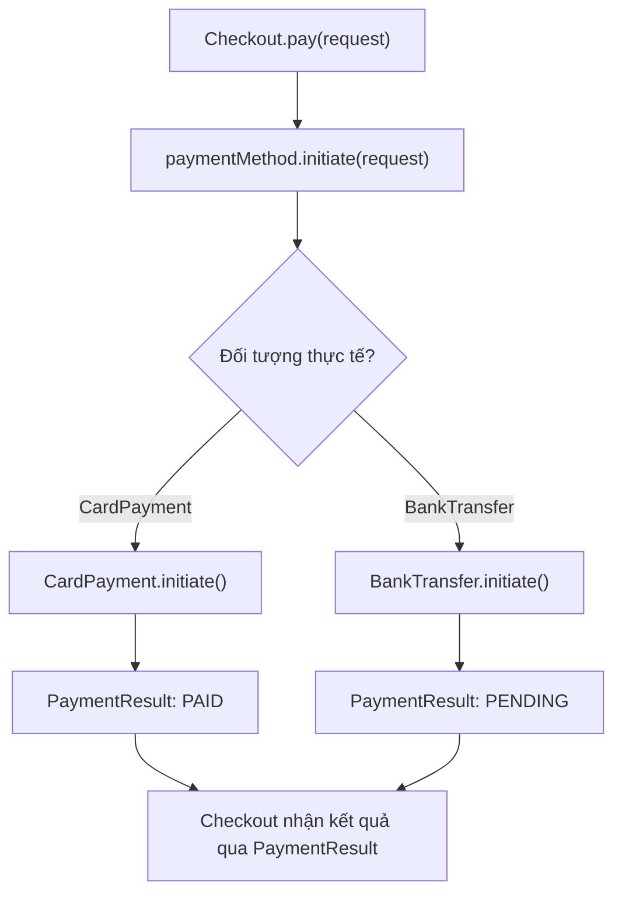
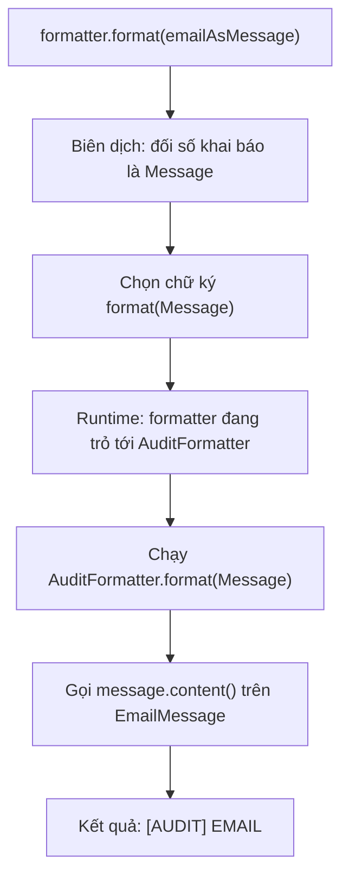
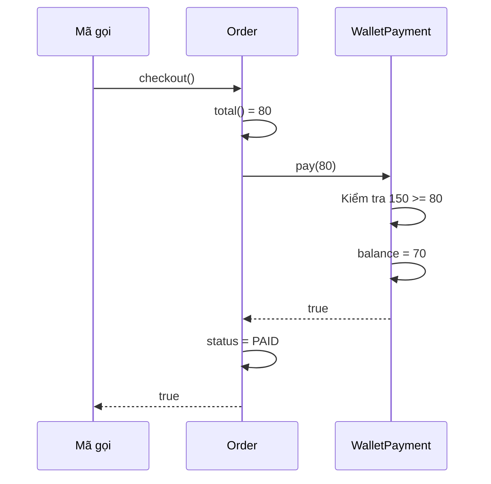
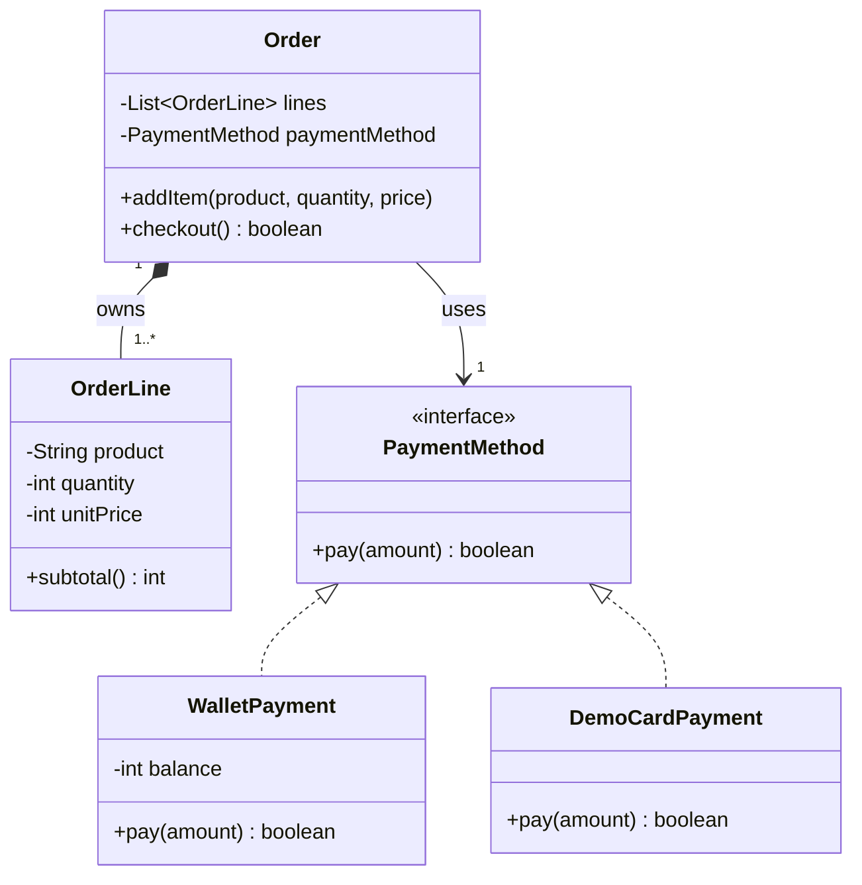
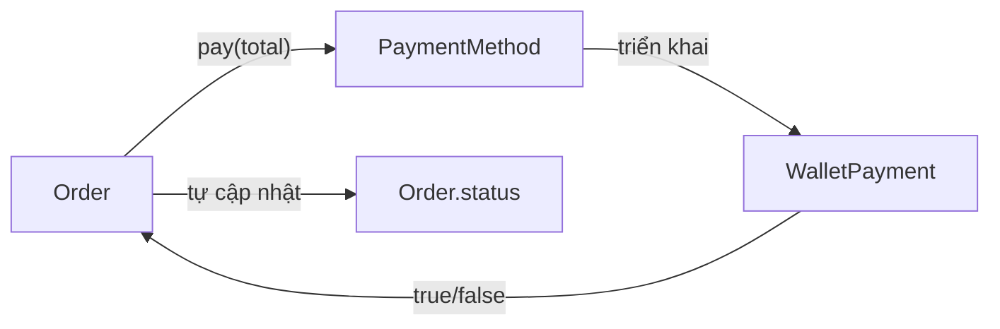

<a id="back-to-top"></a>

# Đa hình và các mối quan hệ giữa đối tượng

## Menu
- [6.1 Đa hình (Polymorphism) là gì? Vì sao hữu ích?](#oop-6-1)
- [6.2 Cùng một interface, nhiều cách triển khai: CardPayment/BankTransfer](#oop-6-2)
- [6.3 Override, overload và lựa chọn hành vi lúc chạy khác nhau thế nào?](#oop-6-3)
- [6.4 Các object cộng tác ra sao? Association và composition qua ví dụ Order–PaymentMethod](#oop-6-4)

## <a id="oop-6-1">6.1 Đa hình (Polymorphism) là gì? Vì sao hữu ích?</a>

<details>
<summary>Xem chi tiết</summary>

**Đa hình (Polymorphism)** trong lập trình hướng đối tượng (OOP) là khả năng **sử dụng nhiều loại đối tượng thông qua cùng một kiểu hoặc hợp đồng chung, trong khi mỗi đối tượng có thể thực hiện hành vi theo cách riêng của mình**.

Ví dụ một ứng dụng bán hàng hỗ trợ thanh toán bằng **ví điện tử** và **thẻ ngân hàng**. Khi xử lý đơn hàng, ta chỉ muốn yêu cầu: *“Hãy thanh toán số tiền này.”* Cách thanh toán qua ví sẽ kiểm tra số dư; cách thanh toán qua thẻ sẽ thực hiện một quy trình khác.

Ta muốn phía xử lý đơn hàng gọi cùng một phương thức:

```java
payment.pay(70);
```

Nhưng khi `payment` đang tham chiếu đến một object ví, Java chạy logic thanh toán ví; khi nó tham chiếu object thanh toán thẻ, Java chạy logic thanh toán thẻ.

Đó là hình ảnh trực quan nhất của **đa hình**: **cùng một lời gọi trên kiểu chung, nhiều cách thực hiện tùy đối tượng thực tế**.

> **Điểm mấu chốt:** Đa hình giúp nơi **sử dụng** một hành vi không cần viết toàn bộ logic để phân biệt từng **loại đối tượng thực hiện** hành vi ấy.

### 1. Vấn đề khi chưa tận dụng đa hình

Giả sử hàm checkout phải nhận loại thanh toán dưới dạng chuỗi:

```java
void checkout(String type, int amount) {
    if (type.equals("WALLET")) {
        // Kiểm tra số dư và trừ tiền trong ví.
    } else if (type.equals("CARD")) {
        // Xử lý thanh toán thẻ.
    } else if (type.equals("TRANSFER")) {
        // Xử lý chuyển khoản.
    } else {
        throw new IllegalArgumentException("Không hỗ trợ");
    }
}
```

Cách này có thể hoạt động trong chương trình nhỏ. Nhưng khi ứng dụng có thêm thanh toán QR, điểm thưởng, thẻ quà tặng…, khối `if/else` có nguy cơ ngày càng dài. Những chi tiết như kiểm tra số dư ví, xử lý thẻ và chuyển khoản bị đưa vào cùng một nơi.

Mỗi lần thêm hình thức thanh toán, ta phải quay lại nơi checkout để thêm nhánh và kiểm tra những nhánh đã tồn tại.

**Đa hình cho phép đặt cách xử lý ở đúng đối tượng thanh toán**, còn checkout chỉ biết một **hợp đồng chung**: `pay(amount)`.

| Điều muốn thay đổi | Dùng nhiều nhánh tại checkout | Dùng đa hình |
|---|---|---|
| Thêm cách thanh toán | Thường sửa `if/else` trong checkout | Thêm class thực hiện hợp đồng chung |
| Logic kiểm tra số dư ví | Có thể nằm chung với các cách thanh toán khác | Thuộc về object thanh toán ví |
| Mã checkout cần biết gì? | Tên từng loại và cách chọn nhánh | Hợp đồng `PaymentMethod` và kết quả trả về |
| Kiểm thử riêng từng cách thanh toán | Dễ phụ thuộc logic chung | Có thể kiểm tra từng implementation độc lập |

Không phải mọi câu lệnh `if` đều xấu. Điều cần tránh là **để bên sử dụng phải hiểu và quản lý chi tiết của nhiều loại đối tượng khi các loại ấy đã có một hành vi chung hợp lý**.

### 2. Hiểu đa hình qua hợp đồng chung

Ta định nghĩa một `interface` trong Java:

```java
interface PaymentMethod {
    boolean pay(int amount);
}
```

Interface nói rằng: **Một object được sử dụng như `PaymentMethod` phải cung cấp hành vi `pay(int amount)`**.

Hai class thực hiện cùng hợp đồng này:

```java
class WalletPayment implements PaymentMethod {
    @Override
    public boolean pay(int amount) {
        // Xử lý thanh toán bằng ví.
        return true;
    }
}

class CardPayment implements PaymentMethod {
    @Override
    public boolean pay(int amount) {
        // Xử lý thanh toán bằng thẻ.
        return true;
    }
}
```

Điều quan trọng không phải là hai class có code giống nhau. **Chúng có thể triển khai rất khác nhau**, miễn là đáp ứng những cam kết mà người gọi đang trông đợi từ `PaymentMethod`.

Một biến có kiểu `PaymentMethod` có thể tham chiếu một object thuộc các class triển khai nó:

```java
PaymentMethod first = new WalletPayment();
PaymentMethod second = new CardPayment();

first.pay(70);  // Gọi cách triển khai của WalletPayment
second.pay(70); // Gọi cách triển khai của CardPayment
```

Hai lời gọi có cùng tên method, cùng cách truyền tham số, nhưng Java thực thi phương thức tương ứng với **loại object thực tế** ở phía sau tham chiếu.

```text
          Kiểu chung: PaymentMethod
                     |
              pay(amount)
                  /     \
                 /       \
                v         v
        WalletPayment   CardPayment
        kiểm tra ví     xử lý thẻ
```

Đây là **đa hình qua interface**. Ngoài interface, đa hình còn xuất hiện khi lớp con ghi đè một instance method của lớp cha rồi được sử dụng qua tham chiếu kiểu cha.

### 3. Ví dụ Java hoàn chỉnh: checkout không cần biết đang dùng ví hay thẻ

Ta sẽ viết một chương trình có thể chạy khi lưu vào file `Main.java`.

Yêu cầu:

- Ví bắt đầu có 100 đơn vị tiền.
- Thanh toán 70 bằng ví phải thành công và làm ví còn 30.
- Thử thanh toán tiếp 50 bằng cùng ví phải bị từ chối, số dư không đổi.
- Một object thanh toán thẻ mô phỏng trả về thành công theo cách khác.
- `CheckoutService` không cần sửa code theo từng hình thức thanh toán.

```java
public class Main {
    public static void main(String[] args) {
        WalletPayment wallet = new WalletPayment(100);
        CheckoutService walletCheckout = new CheckoutService(wallet);

        walletCheckout.checkout(70);
        walletCheckout.checkout(50);

        PaymentMethod card = new DemoCardPayment();
        CheckoutService cardCheckout = new CheckoutService(card);
        cardCheckout.checkout(50);

        System.out.println("Ví còn: " + wallet.getBalance());
    }
}

// Hợp đồng chung: yêu cầu trả tiền và nhận kết quả.
interface PaymentMethod {
    boolean pay(int amount);
}

// Cách thực hiện thứ nhất: tự kiểm tra và trừ số dư ví.
class WalletPayment implements PaymentMethod {
    private int balance;

    WalletPayment(int openingBalance) {
        if (openingBalance < 0) {
            throw new IllegalArgumentException("Số dư ban đầu không hợp lệ");
        }
        this.balance = openingBalance;
    }

    @Override
    public boolean pay(int amount) {
        if (amount <= 0) {
            throw new IllegalArgumentException("Số tiền phải dương");
        }
        if (amount > balance) {
            return false;
        }
        balance -= amount;
        return true;
    }

    int getBalance() {
        return balance;
    }
}

// Cách thực hiện thứ hai: chỉ mô phỏng thanh toán thẻ.
class DemoCardPayment implements PaymentMethod {
    @Override
    public boolean pay(int amount) {
        if (amount <= 0) {
            throw new IllegalArgumentException("Số tiền phải dương");
        }
        System.out.println("Mô phỏng xử lý thẻ: " + amount);
        return true;
    }
}

// Nơi sử dụng: chỉ phụ thuộc vào PaymentMethod.
class CheckoutService {
    private final PaymentMethod paymentMethod;

    CheckoutService(PaymentMethod paymentMethod) {
        if (paymentMethod == null) {
            throw new IllegalArgumentException("Thiếu phương thức thanh toán");
        }
        this.paymentMethod = paymentMethod;
    }

    void checkout(int total) {
        if (total <= 0) {
            throw new IllegalArgumentException("Tổng tiền phải dương");
        }

        boolean success = paymentMethod.pay(total);
        System.out.println(
                success ? "Thanh toán thành công" : "Thanh toán bị từ chối"
        );
    }
}
```

**Kết quả:**

```text
Thanh toán thành công
Thanh toán bị từ chối
Mô phỏng xử lý thẻ: 50
Thanh toán thành công
Ví còn: 30
```

Ta đọc diễn biến:

1. `walletCheckout` giữ tham chiếu tới object `WalletPayment`. Gọi `checkout(70)` khiến `paymentMethod.pay(70)` chạy phương thức của ví. Ví trừ từ 100 xuống 30 rồi trả `true`.
2. Gọi `checkout(50)` trên **cùng ví** làm phương thức của ví kiểm tra 50 lớn hơn 30, trả `false` và giữ nguyên số dư.
3. `cardCheckout` giữ tham chiếu tới `DemoCardPayment`. Vẫn cùng câu lệnh `paymentMethod.pay(total)` nhưng cách thực hiện của object thẻ chạy, in ra thông báo mô phỏng và trả `true`.
4. Code trong `CheckoutService.checkout()` **không hề chứa** `if (paymentMethod instanceof WalletPayment)` hay `if (type.equals("CARD"))` để chọn logic.

Ví dụ dùng `int` làm đơn vị tiền giả định; `DemoCardPayment` không phải giao dịch ngân hàng thật. Một hệ thống thực tế phải xác định chính xác khi nào tiền được xác nhận, xử lý timeout, thất bại, transaction và đồng thời. Ở đây `boolean` cố tình đơn giản để nhìn rõ cơ chế đa hình.

#### Sơ đồ Java quyết định gọi method nào

```mermaid
sequenceDiagram
    participant Main
    participant Checkout as CheckoutService
    participant Payment as PaymentMethod
    participant Wallet as WalletPayment
    participant Card as DemoCardPayment
    Main->>Checkout: checkout(70) với ví
    Checkout->>Payment: pay(70)
    Note over Payment: Tham chiếu chung; object thật là WalletPayment
    Payment->>Wallet: pay(70)
    Wallet-->>Checkout: true
    Checkout-->>Main: In thành công
    Main->>Checkout: checkout(50) với thẻ
    Checkout->>Payment: pay(50)
    Note over Payment: Tham chiếu chung; object thật là DemoCardPayment
    Payment->>Card: pay(50)
    Card-->>Checkout: true
    Checkout-->>Main: In thành công
```

Sơ đồ nhấn mạnh **ý nghĩa kiểu chung**, không có nghĩa Java thật sự tạo thêm một object `PaymentMethod` trung gian khi gọi `pay()`. Interface là một hợp đồng kiểu; object thực sự là `WalletPayment` hoặc `DemoCardPayment`.

### 4. Tại sao biến kiểu cha/interface gọi được method của lớp con?

Xem hai dòng:

```java
PaymentMethod payment = new WalletPayment(100);
payment.pay(70);
```

Có hai khái niệm cần tách:

| Thành phần | Trong ví dụ | Dùng để làm gì? |
|---|---|---|
| **Kiểu khai báo của biến** (*reference type*) | `PaymentMethod` | Xác định những method nào mã gọi được phép sử dụng khi biên dịch |
| **Kiểu thực tế của object** (*runtime class*) | `WalletPayment` | Xác định cách triển khai instance method được chạy tại thời điểm thực thi |
| **Hợp đồng method** | `pay(int amount)` | Người gọi biết có thể yêu cầu thanh toán |
| **Cách triển khai method** | `WalletPayment.pay(...)` | Object thực hiện kiểm tra số dư và trừ tiền |

Compiler kiểm tra rằng `PaymentMethod` có `pay(int)` và lời gọi có tham số phù hợp. Khi chương trình chạy, Java sử dụng cách triển khai tương ứng với **object thực tế**.

Ví dụ, `PaymentMethod` không định nghĩa `getBalance()`. Do đó đoạn này **không biên dịch**:

```java
PaymentMethod payment = new WalletPayment(100);
// payment.getBalance(); // Không gọi được qua kiểu PaymentMethod
```

Không phải vì object ví không có method `getBalance()`; nguyên nhân là **kiểu mà mã đang nhìn thấy** chỉ hứa hẹn những hành vi của `PaymentMethod`.

Điều này đem lại một ranh giới hữu ích: bên checkout chỉ cần khả năng thanh toán; nó không cần biết chi tiết số dư ví.

#### Có cần ép kiểu xuống WalletPayment không?

Đôi khi có thể viết:

```java
if (payment instanceof WalletPayment wallet) {
    System.out.println(wallet.getBalance());
}
```

Nhưng nếu `CheckoutService` liên tục kiểm tra `instanceof` để gọi những method riêng của từng loại, ta đang làm **mất lợi ích của hợp đồng chung**. Khi đó nên hỏi lại: bên sử dụng có thật sự chỉ cần `PaymentMethod` không, hay hợp đồng hiện tại thiếu một khả năng có ý nghĩa chung?

### 5. Đa hình giúp gì khi thêm một hình thức mới?

Giả sử sau này ứng dụng hỗ trợ **GiftCardPayment**. Nếu cách thanh toán này tuân theo cùng hợp đồng, ta có thể thêm:

```java
class GiftCardPayment implements PaymentMethod {
    private int remaining = 200;

    @Override
    public boolean pay(int amount) {
        if (amount <= 0) {
            throw new IllegalArgumentException("Số tiền phải dương");
        }
        if (amount > remaining) {
            return false;
        }
        remaining -= amount;
        return true;
    }
}
```

Sau đó:

```java
PaymentMethod giftCard = new GiftCardPayment();
CheckoutService checkout = new CheckoutService(giftCard);
checkout.checkout(50);
```

**Không cần thêm nhánh GiftCardPayment trong `CheckoutService.checkout()`.** Checkout vẫn gọi `paymentMethod.pay(total)`.

Đây là một lợi ích thực tế: **mở rộng các cách thực hiện mà giảm nhu cầu sửa nơi sử dụng**. Tuy nhiên, việc khởi tạo và lựa chọn implementation ở ranh giới ứng dụng (ví dụ khi đọc lựa chọn của người dùng) vẫn có thể phải thay đổi. Đa hình **không xóa hết mọi điều kiện** hay bảo đảm không bao giờ phải sửa code cũ.

### 6. Đa hình và kế thừa có phải cùng một thứ?

Không hoàn toàn.

**Kế thừa (inheritance)** nói về **quan hệ kiểu**: một lớp con là một loại của lớp cha và có thể kế thừa hành vi phù hợp.

**Đa hình (polymorphism)** nói về **cách sử dụng qua kiểu chung**: mã gọi có thể giữ nguyên trong khi các object cụ thể thực hiện khác nhau.

Chẳng hạn, đa hình cũng hoạt động với quan hệ kế thừa class:

```java
abstract class Animal {
    abstract String makeSound();
}

class Dog extends Animal {
    @Override
    String makeSound() {
        return "Gâu gâu";
    }
}

class Cat extends Animal {
    @Override
    String makeSound() {
        return "Meo meo";
    }
}
```

Khi sử dụng:

```java
Animal first = new Dog();
Animal second = new Cat();

System.out.println(first.makeSound());  // Gâu gâu
System.out.println(second.makeSound()); // Meo meo
```

Ở đây `Dog` và `Cat` kế thừa `Animal`, ghi đè `makeSound()`. Người gọi chỉ biết kiểu `Animal`, nhưng Java chạy cách triển khai của object chó hoặc mèo.

**Không nhất thiết phải kế thừa một class cụ thể** để tận dụng đa hình: interface như `PaymentMethod` cũng cung cấp hợp đồng kiểu chung.

### 7. Vì sao đa hình giúp code dễ bảo trì và dễ kiểm thử?

#### Giảm phụ thuộc vào cách thực hiện cụ thể

Nếu `CheckoutService` chỉ phụ thuộc `PaymentMethod`, nó không cần đọc các field hay biết quy trình riêng của `WalletPayment`. Những thay đổi trong ví có thể được quản lý ở lớp ví, miễn là hợp đồng chung vẫn được đáp ứng.

#### Mỗi object chịu trách nhiệm hành vi của mình

`WalletPayment` tự kiểm tra số dư. `DemoCardPayment` tự xử lý bước mô phỏng thẻ. Checkout không trở thành nơi chứa logic của mọi cách thanh toán.

#### Dễ thử nghiệm các tình huống

Ta có thể tạo một implementation dùng riêng cho bài kiểm tra:

```java
class AlwaysRejectPayment implements PaymentMethod {
    @Override
    public boolean pay(int amount) {
        return false;
    }
}
```

Truyền nó vào `CheckoutService` sẽ giúp kiểm tra cách checkout phản ứng với việc thanh toán bị từ chối, mà không cần dựng một hệ thống thanh toán bên ngoài.

#### Cùng code điều phối, nhiều hành vi có thể thay thế

Ứng dụng có thể chạy cùng `CheckoutService` với ví, thẻ mô phỏng hoặc thẻ quà tặng. Mỗi loại có trạng thái, điều kiện và cách xử lý khác nhau.

| Lợi ích | Dấu hiệu trong code |
|---|---|
| Giảm sự phụ thuộc vào class cụ thể | Field của `CheckoutService` có kiểu `PaymentMethod` |
| Mở rộng hành vi | Thêm implementation mới của `pay()` |
| Cô lập trách nhiệm | `WalletPayment` tự quản lý `balance` |
| Kiểm thử có chủ đích | Dùng `AlwaysRejectPayment` để mô phỏng thất bại |
| Dễ hiểu ý định | Checkout yêu cầu `pay(total)` thay vì tự thực hiện mọi loại thanh toán |

### 8. Nhưng đa hình không có nghĩa “thay object nào cũng được”

Một interface không chỉ là tên và danh sách method. Nó còn mang **những kỳ vọng về hành vi**.

Ví dụ, nếu `PaymentMethod.pay(amount)` được hiểu là:

- Nhận số tiền **lớn hơn 0**.
- Trả `true` khi thanh toán thành công theo ý nghĩa đã thống nhất.
- Trả `false` khi bị từ chối mà **không ghi nhận thanh toán thành công**.

thì implementation mới phải tôn trọng cách hiểu đó. Nếu `CardPayment.pay(100)` luôn trả `true` dù giao dịch còn **đang chờ xử lý**, checkout có thể đánh dấu đơn đã thanh toán quá sớm.

Đó là vấn đề về **hợp đồng hành vi** và **khả năng thay thế**. Chỉ biên dịch được với một interface **chưa bảo đảm** các implementation thay thế được nhau một cách an toàn.

Nếu hệ thống thật cần trạng thái `SUCCESS`, `FAILED` và `PENDING`, hợp đồng `boolean` có thể chưa đủ. Khi yêu cầu nghiệp vụ thay đổi, việc cập nhật lại interface và nơi sử dụng là hợp lý. Đa hình **không loại bỏ nhu cầu thiết kế đúng hợp đồng**.

Ngoài ra, đa hình cũng không tự giải quyết vấn đề hiệu năng, an toàn đa luồng, giao dịch database, hay lỗi mạng. Những điều này cần thiết kế và cơ chế tương ứng.

### 9. Đừng nhầm đa hình lúc chạy với method overloading

Người mới học Java thường gặp hai cách nói:

- **Overriding (ghi đè):** nhiều lớp cung cấp cách triển khai khác nhau của một instance method chung; lời gọi qua kiểu cha/interface sẽ chạy implementation dựa trên **object thực tế**.
- **Overloading (nạp chồng):** nhiều method có cùng tên nhưng **danh sách tham số khác nhau**; compiler lựa chọn method phù hợp chủ yếu dựa trên kiểu và đối số tại thời điểm biên dịch.

Ví dụ overloading:

```java
class Printer {
    void print(String value) {
        System.out.println("Chuỗi: " + value);
    }

    void print(int value) {
        System.out.println("Số: " + value);
    }
}
```

Cả `print("OOP")` và `print(10)` đều có tên `print`, nhưng Java chọn **hai chữ ký khác nhau**. Một số tài liệu gọi đây là “đa hình thời điểm biên dịch”. Tuy nhiên, **ý chính về đa hình OOP trong bài này** là khả năng dùng kiểu chung và nhận hành vi khác nhau dựa trên object thực tế, như `PaymentMethod` và `Animal`.

Cũng cần nhớ: **static method không được override theo cơ chế dispatch của instance method**; field cũng không hoạt động giống phương thức ảo. Vì vậy, không nên mặc định mọi member cùng tên đều được chọn động theo object.

### Tự kiểm tra mức hiểu

Giả sử có:

```java
PaymentMethod payment = new WalletPayment(100);
payment.pay(30);
payment = new DemoCardPayment();
payment.pay(30);
```

Hãy trả lời:

1. Có bao nhiêu lần gọi `pay(30)`? **Hai lần**.
2. Hai lần gọi có phải cùng một cách triển khai không? **Không**. Lần đầu chạy `WalletPayment.pay`, lần sau chạy `DemoCardPayment.pay`.
3. Vì sao đoạn code gọi không cần đổi tên phương thức? Vì **cả hai object cùng đáp ứng hợp đồng `PaymentMethod`**.
4. Vì sao `PaymentMethod payment` không gọi trực tiếp được `wallet.getBalance()`? Vì kiểu `PaymentMethod` **không công bố** khả năng đọc số dư ví.
5. Nếu thêm `GiftCardPayment`, phải viết thêm `if` trong `CheckoutService` không? **Không**, nếu `GiftCardPayment` tuân theo cùng hợp đồng thanh toán và cách tổ chức checkout vẫn phù hợp.

**Ghi nhớ:** **Đa hình là “cùng một giao diện sử dụng, nhiều cách thực hiện”.** Nó giúp phần gọi tập trung vào **điều cần yêu cầu**, còn từng object đảm nhận **cách đáp ứng yêu cầu ấy**. Lợi ích lớn nhất không phải tiết kiệm vài dòng `if/else`, mà là **giảm phụ thuộc giữa các thành phần, giữ trách nhiệm rõ ràng và cho phép thay đổi cách triển khai có kiểm soát**.

</details>

- [Quay lại đầu trang](#back-to-top)

---

## <a id="oop-6-2">6.2 Cùng một interface, nhiều cách triển khai: CardPayment/BankTransfer</a>

<details>
<summary>Xem chi tiết</summary>

### 1. Một chức năng thanh toán, hai cách xử lý

Giả sử bạn đang xây dựng chức năng thanh toán cho một cửa hàng online. Khi khách bấm **Thanh toán**, họ có thể chọn:

- **Thẻ (CardPayment):** gửi yêu cầu thanh toán thẻ; trong ví dụ, bên xử lý trả kết quả đã duyệt hoặc từ chối ngay.
- **Chuyển khoản (BankTransfer):** tạo thông tin chuyển khoản để khách thực hiện; đơn hàng phải chờ hệ thống xác nhận thực sự đã nhận tiền.

Hai phương thức này thực hiện **cùng một mục đích: bắt đầu xử lý khoản thanh toán của đơn hàng**. Nhưng các bước nghiệp vụ phía sau khác nhau.

Nếu chương trình xử lý mọi lựa chọn bằng một chuỗi điều kiện:

```java
// Ví dụ minh họa ý tưởng ban đầu, không phải hệ thống thanh toán thật.
if (paymentType.equals("CARD")) {
    // Xử lý thanh toán thẻ
} else if (paymentType.equals("BANK_TRANSFER")) {
    // Tạo yêu cầu chuyển khoản
}
```

thì khi thêm ví điện tử, trả góp hoặc phương thức mới, ta có thể phải tiếp tục mở rộng nhánh điều kiện. Nếu những điều kiện tương tự xuất hiện ở nhiều màn hình hoặc service, mỗi lần thay đổi càng dễ bỏ sót.

Một cách thiết kế OOP là xác định **phần hành vi chung mà nơi gọi cần sử dụng**, rồi để từng đối tượng thực hiện theo cách riêng.

Trong Java, `interface` là công cụ phù hợp cho tình huống này:

```java
interface PaymentMethod {
    PaymentResult initiate(PaymentRequest request);
}
```

Dòng trên đặt ra một yêu cầu: **đối tượng thuộc kiểu `PaymentMethod` phải cung cấp hành vi `initiate(...)` theo hợp đồng chung**. `CardPayment` và `BankTransfer` có thể thực hiện hành vi đó theo các cách khác nhau.

Đây là ví dụ điển hình cho **đa hình (polymorphism)**: mã gọi sử dụng **một kiểu chung**, nhưng khi chương trình chạy, hành vi được thực hiện bởi **đối tượng cụ thể**.

### 2. Interface mô tả điểm chung nào?

Hãy bắt đầu từ góc nhìn của người viết chức năng `Checkout`.

Để xử lý một đơn hàng, `Checkout` cần gửi đi:

- Mã đơn hàng.
- Số tiền cần thanh toán.

Và nhận về:

- Trạng thái xử lý.
- Mã tham chiếu để theo dõi.
- Thông điệp mô tả kết quả.

`Checkout` **không nhất thiết cần biết** bên trong thanh toán thẻ phải gọi cổng thanh toán thế nào, hoặc chuyển khoản phải tạo nội dung chuyển khoản ra sao.

Ta mô tả điểm giao tiếp chung:

```java
interface PaymentMethod {
    PaymentResult initiate(PaymentRequest request);
}
```

Đọc câu lệnh này bằng ngôn ngữ thường:

> “Bất kỳ đối tượng nào được dùng làm `PaymentMethod` đều phải biết tiếp nhận yêu cầu khởi tạo thanh toán và trả về kết quả thuộc kiểu `PaymentResult`.”

Điều đó cho phép viết:

```java
PaymentMethod method = new CardPayment();
PaymentResult result = method.initiate(request);
```

Hoặc:

```java
PaymentMethod method = new BankTransfer();
PaymentResult result = method.initiate(request);
```

**Cách gọi không đổi. Cách thực hiện thay đổi theo đối tượng.**

Tên `initiate` được chọn có chủ đích: nó có nghĩa là **khởi tạo quá trình thanh toán**, không hứa rằng cứ gọi method xong là tiền đã đến nơi. Đây là một khác biệt quan trọng giữa thanh toán thẻ và chuyển khoản.

### 3. Ví dụ Java hoàn chỉnh: CardPayment và BankTransfer

Dưới đây là chương trình minh họa có thể chạy độc lập với **Java 17 trở lên**. Tạo file `Main.java`, đặt toàn bộ đoạn code vào file đó và chạy `Main.main()`.

Chương trình **mô phỏng** trạng thái trả về; nó không kết nối ngân hàng, không xử lý dữ liệu thẻ và không thực hiện giao dịch tiền thật.

```java
import java.util.Objects;

public class Main {
    public static void main(String[] args) {
        PaymentRequest request =
                new PaymentRequest("ORDER-001", 250_000);

        // Cùng một Checkout, thay đối tượng PaymentMethod.
        Checkout cardCheckout = new Checkout(new CardPayment());
        PaymentResult cardResult = cardCheckout.pay(request);

        Checkout bankCheckout = new Checkout(new BankTransfer());
        PaymentResult bankResult = bankCheckout.pay(request);

        printResult("CARD", cardResult);
        printResult("BANK", bankResult);
    }

    private static void printResult(
            String methodName, PaymentResult result) {
        System.out.println(methodName + " | "
                + result.status() + " | "
                + result.reference());
    }
}

// Thông tin cần thiết cho một yêu cầu thanh toán.
record PaymentRequest(String orderId, long amountVnd) {
    PaymentRequest {
        if (orderId == null || orderId.isBlank()) {
            throw new IllegalArgumentException("Mã đơn hàng trống");
        }
        if (amountVnd <= 0) {
            throw new IllegalArgumentException(
                    "Số tiền phải lớn hơn 0");
        }
    }
}

enum PaymentStatus {
    PAID,       // Đã được xác nhận thanh toán thành công
    PENDING,    // Đang chờ hoàn tất hoặc xác nhận
    FAILED      // Yêu cầu thanh toán thất bại
}

record PaymentResult(
        PaymentStatus status,
        String reference,
        String message) {
}

// Hợp đồng mà các cách thanh toán cùng tuân theo.
interface PaymentMethod {
    PaymentResult initiate(PaymentRequest request);
}

// Cách 1: Mô phỏng thanh toán thẻ được duyệt ngay.
final class CardPayment implements PaymentMethod {
    @Override
    public PaymentResult initiate(PaymentRequest request) {
        Objects.requireNonNull(request, "request");

        // Demo: giả lập bên xử lý thẻ đã xác nhận thành công.
        return new PaymentResult(
                PaymentStatus.PAID,
                "CARD-" + request.orderId(),
                "Thanh toán thẻ đã được duyệt (mô phỏng)"
        );
    }
}

// Cách 2: Tạo thông tin để chờ khách chuyển khoản.
final class BankTransfer implements PaymentMethod {
    @Override
    public PaymentResult initiate(PaymentRequest request) {
        Objects.requireNonNull(request, "request");

        // Tạo tham chiếu theo đơn hàng; chưa xác nhận đã nhận tiền.
        return new PaymentResult(
                PaymentStatus.PENDING,
                "BANK-" + request.orderId(),
                "Chờ xác nhận đã nhận chuyển khoản"
        );
    }
}

// Người sử dụng interface: không cần biết cách xử lý cụ thể.
final class Checkout {
    private final PaymentMethod paymentMethod;

    Checkout(PaymentMethod paymentMethod) {
        this.paymentMethod =
                Objects.requireNonNull(paymentMethod, "paymentMethod");
    }

    PaymentResult pay(PaymentRequest request) {
        return paymentMethod.initiate(request);
    }
}
```

Kết quả:

```text
CARD | PAID | CARD-ORDER-001
BANK | PENDING | BANK-ORDER-001
```

Hãy chú ý: hai kết quả **khác trạng thái**, và điều đó **không có nghĩa** hai lớp thực hiện sai interface. Hợp đồng cho phép nhiều trạng thái có ý nghĩa. Với thẻ, ví dụ giả lập bên xử lý đã duyệt; với chuyển khoản, mới có yêu cầu chờ nhận tiền.

Nếu triển khai ứng dụng thật, `PENDING` **không được xem là đã thanh toán thành công**. Hệ thống cần nhận và kiểm tra thông tin xác nhận chuyển khoản sau đó mới chuyển trạng thái đơn hàng sang đã thanh toán.

### 4. Đọc từng vai trò để hiểu thiết kế

| Thành phần | Vai trò | Phần nào được phép khác nhau? |
|---|---|---|
| `PaymentRequest` | Chứa thông tin đầu vào thống nhất | Không phụ thuộc loại thanh toán |
| `PaymentResult` | Biểu diễn kết quả và trạng thái | Giá trị trạng thái, tham chiếu, thông điệp |
| `PaymentMethod` | Khai báo hành vi chung `initiate(...)` | Không quyết định thuật toán bên trong |
| `CardPayment` | Thực hiện hành vi theo luồng thanh toán thẻ | Cách xử lý thẻ và trả kết quả |
| `BankTransfer` | Thực hiện hành vi theo luồng chuyển khoản | Cách tạo yêu cầu và chờ xác nhận |
| `Checkout` | Gọi một phương thức thanh toán được cung cấp | Không cần nhánh riêng cho từng loại |

Trong `CardPayment`, phương thức:

```java
@Override
public PaymentResult initiate(PaymentRequest request) {
    // Quy trình dành riêng cho thẻ.
}
```

và trong `BankTransfer`:

```java
@Override
public PaymentResult initiate(PaymentRequest request) {
    // Quy trình dành riêng cho chuyển khoản.
}
```

có **cùng chữ ký** theo hợp đồng interface: cùng tên `initiate`, cùng kiểu tham số `PaymentRequest` và cùng kiểu kết quả `PaymentResult`. Nhưng **thân phương thức** có thể khác nhau.

`@Override` nhờ trình biên dịch kiểm tra rằng method thực sự triển khai/ghi đè một phương thức tương ứng từ kiểu cha hoặc interface. Nếu gõ nhầm `initate(...)`, chương trình sẽ báo lỗi thay vì âm thầm coi đó là một phương thức hoàn toàn mới.

Một class `implements PaymentMethod` phải thực hiện các phương thức abstract còn thiếu của interface, hoặc bản thân class phải được khai báo `abstract`. Đây là **ràng buộc cấu trúc** mà Java kiểm tra khi biên dịch.

### 5. Đa hình diễn ra ở đâu?

Xét lại hai dòng:

```java
PaymentMethod method = new CardPayment();
method.initiate(request);
```

Ở đây có hai khái niệm cần phân biệt:

- **Kiểu biến `method`:** `PaymentMethod`. Trình biên dịch dựa vào kiểu này để biết những hành vi nào được phép gọi.
- **Đối tượng thực tế:** `new CardPayment()`. Khi gọi instance method có thể được triển khai/ghi đè, Java chọn cách thực hiện phù hợp với đối tượng này.

Nếu gán:

```java
PaymentMethod method = new BankTransfer();
method.initiate(request);
```

thì Java chạy `BankTransfer.initiate(...)`. Kiểu tham chiếu vẫn là `PaymentMethod`; mã gọi vẫn là `method.initiate(request)`.

Đây là **runtime polymorphism (đa hình lúc chạy)** thông qua cơ chế chọn implementation của phương thức instance, thường gọi là **dynamic dispatch**.



Sơ đồ này mô tả **hai khả năng cho một lời gọi**. Không có chuyện một lần gọi `initiate()` tự động chạy cả hai implementation. Trong ví dụ, mỗi `Checkout` được cung cấp **một đối tượng thực tế**.

Một điểm tinh tế: vì biến `method` được khai báo bằng `PaymentMethod`, nó chỉ cho phép gọi những hành vi có thể truy cập thông qua kiểu `PaymentMethod`. Nếu `CardPayment` có thêm `verifyCardNetwork()` nhưng interface không có method này, code giữ biến `PaymentMethod` không thể trực tiếp gọi method riêng đó.

Điều này khuyến khích phần gọi làm việc theo **hợp đồng chung** thay vì bám chặt vào chi tiết riêng của một lớp.

### 6. Thay cách thanh toán mà không đổi mã trong Checkout

Trong chương trình trên:

```java
final class Checkout {
    private final PaymentMethod paymentMethod;

    Checkout(PaymentMethod paymentMethod) {
        this.paymentMethod = Objects.requireNonNull(paymentMethod);
    }

    PaymentResult pay(PaymentRequest request) {
        return paymentMethod.initiate(request);
    }
}
```

`Checkout` nhận một `PaymentMethod` qua constructor. Cách làm này gọi là **dependency injection bằng constructor**: đối tượng phụ thuộc được cung cấp từ bên ngoài khi tạo `Checkout`.

Ta có thể đổi:

```java
Checkout checkout = new Checkout(new CardPayment());
```

thành:

```java
Checkout checkout = new Checkout(new BankTransfer());
```

mà **không cần sửa thân method `Checkout.pay(...)`**.

Mối quan hệ này có thể hiểu là:

```text
Checkout ──sử dụng──► PaymentMethod
                          ▲
                          │ implements
                   ┌──────┴──────┐
                   │             │
             CardPayment    BankTransfer
```

`Checkout` **có một đối tượng thực hiện `PaymentMethod`** thông qua field của nó, trong khi hai lớp thanh toán **implements cùng interface**.

Đó là hai quan hệ khác nhau:

- `CardPayment implements PaymentMethod`: quan hệ **thực hiện hợp đồng kiểu**.
- `Checkout` giữ field `PaymentMethod`: quan hệ **phối hợp/sử dụng đối tượng**, thường được thể hiện bằng composition ở mức thiết kế.

Nhờ kết hợp cả hai, mã xử lý quy trình mua hàng bớt phụ thuộc vào từng cách thanh toán cụ thể.

Bạn **không cần tạo interface riêng** cho mọi class. Nó có ích khi nhiều implementation thật sự chia sẻ một hành vi mà mã khác muốn sử dụng một cách thống nhất.

### 7. Cùng interface không có nghĩa cùng kết quả hoặc cùng quy trình

Một hiểu lầm dễ gặp là: “Nếu hai class implements cùng interface và cùng gọi `initiate(...)` thì chúng phải chạy giống nhau.”

Không đúng. Hợp đồng chung ở đây là **tiếp nhận yêu cầu và trả về kết quả khởi tạo thanh toán dưới dạng `PaymentResult`**, không phải “luôn trả về `PAID`”.

| Khía cạnh | CardPayment | BankTransfer |
|---|---|---|
| Hành vi chung | `initiate(request)` | `initiate(request)` |
| Dữ liệu đầu vào | Mã đơn + số tiền | Mã đơn + số tiền |
| Cách xử lý riêng | Xử lý/ủy quyền thanh toán thẻ | Tạo chỉ dẫn chuyển khoản, chờ tiền |
| Trạng thái có thể xuất hiện | `PAID`, `FAILED`, có thể `PENDING` | Thường `PENDING` ban đầu, sau đó mới xác nhận |
| Khi nào được xem là đã nhận tiền? | Khi có xác nhận hợp lệ từ hệ thống xử lý | Khi có bằng chứng xác nhận giao dịch chuyển khoản |
| Kết quả trả về cho mã gọi | `PaymentResult` | `PaymentResult` |

Các khả năng ở bảng phản ánh thiết kế nghiệp vụ thực tế; đoạn Java demo chỉ minh họa trường hợp thẻ được duyệt ngay và chuyển khoản đang chờ.

Nếu ép cả hai implementation luôn trả một `boolean success`, ta dễ gặp vấn đề: **chưa nhận được chuyển khoản thì phải trả `true` hay `false`?** Cả hai có thể gây hiểu nhầm. Một trạng thái rõ ràng như `PENDING` truyền tải đúng ý nghĩa hơn.

Tương tự, tên `initiate` chính xác hơn tên gợi ý rằng toàn bộ giao dịch tiền đã kết thúc. Thiết kế interface phải phản ánh **cam kết mà mọi implementation có thể thực hiện**, kể cả khi quy trình của chúng khác nhau.

### 8. Interface là lời hứa về hành vi, không chỉ là chữ ký method

Java có thể kiểm tra xem class có viết method đúng tên, đúng tham số, đúng kiểu trả về hay không. Nhưng nó không tự kiểm tra toàn bộ **ý nghĩa nghiệp vụ**.

Ví dụ:

```java
final class BrokenBankTransfer implements PaymentMethod {
    @Override
    public PaymentResult initiate(PaymentRequest request) {
        return new PaymentResult(
                PaymentStatus.PAID,
                "BANK-" + request.orderId(),
                "Đã thanh toán"
        );
    }
}
```

Lớp này có thể biên dịch, nhưng nếu chương trình **chưa thực sự xác minh tiền đã đến**, nó đã cung cấp thông tin `PAID` sai. Mã dùng kết quả có thể giao hàng trước khi nhận tiền.

Vì vậy, hợp đồng tốt cần nêu rõ những điều quan trọng:

1. **Đầu vào:** `PaymentRequest` mang mã đơn và số tiền dương theo đơn vị VND.
2. **Đầu ra:** `PaymentResult` thể hiện trạng thái, tham chiếu và thông tin cần thiết.
3. **Ý nghĩa trạng thái:** `PAID` chỉ dùng sau khi đã có xác nhận thành công hợp lệ; `PENDING` là đang chờ; `FAILED` là thất bại.
4. **Tình huống lỗi:** object và dịch vụ thanh toán phải có chính sách nhất quán đối với đầu vào không hợp lệ, lỗi mạng hoặc lỗi nhà cung cấp.
5. **Tác động bên ngoài:** khởi tạo thanh toán có thể gọi mạng hoặc ghi dữ liệu; người gọi cần biết khi nào thao tác hoàn tất và có thể gọi lại hay không.

Những điều này **vượt ra ngoài chữ ký method** và cần được thiết kế, viết tài liệu, kiểm thử.

Trong ví dụ Java, `PaymentRequest` dùng `record` cùng compact constructor để từ chối mã đơn rỗng hoặc số tiền không dương trước khi yêu cầu đến các implementation. Nhờ đó, hai lớp không phải sao chép cùng đoạn kiểm tra cơ bản.

`Objects.requireNonNull(request)` ở mỗi implementation là một bảo vệ bổ sung khi người gọi truyền `null`; ở ví dụ này, nó gây `NullPointerException` thay vì trả `PaymentResult`. Trong thiết kế thực tế, cần mô tả nhất quán hành vi lỗi để các implementation không gây bất ngờ cho mã sử dụng.

### 9. Thêm cách thanh toán mới: mã nào thay đổi?

Giả sử sau này cửa hàng bổ sung ví điện tử. Bạn có thể tạo một class mới:

```java
final class EWalletPayment implements PaymentMethod {
    @Override
    public PaymentResult initiate(PaymentRequest request) {
        Objects.requireNonNull(request, "request");

        return new PaymentResult(
                PaymentStatus.PENDING,
                "WALLET-" + request.orderId(),
                "Chờ khách xác nhận trên ví (mô phỏng)"
        );
    }
}
```

Mã sử dụng interface vẫn chạy:

```java
PaymentMethod method = new EWalletPayment();
Checkout checkout = new Checkout(method);

PaymentResult result = checkout.pay(
        new PaymentRequest("ORDER-002", 120_000)
);

System.out.println(result.status()); // PENDING
```

Với thay đổi này, method `Checkout.pay(...)` không cần thêm nhánh `if (type == WALLET)`.

Tuy nhiên, **một chỗ nào đó vẫn phải chọn implementation** theo lựa chọn của khách, ví dụ một factory, một cấu hình dependency injection hoặc một đoạn code điều phối ở biên ứng dụng. Interface không tự động biết người dùng đã chọn loại thanh toán nào.

Chẳng hạn ở lớp lắp ghép:

```java
PaymentMethod chosenMethod = switch (selectedType) {
    case "CARD" -> new CardPayment();
    case "BANK" -> new BankTransfer();
    case "WALLET" -> new EWalletPayment();
    default -> throw new IllegalArgumentException(
            "Loại thanh toán không hỗ trợ"
    );
};

Checkout checkout = new Checkout(chosenMethod);
```

Ở đây `selectedType` giả định là chuỗi do tầng giao diện/chọn lựa cung cấp. Có thể dùng `enum` thay chuỗi trong ứng dụng thật để hạn chế lỗi gõ sai.

Mục tiêu của đa hình **không phải xóa mọi câu lệnh điều kiện khỏi hệ thống**. Nó tập trung việc chọn implementation vào nơi thích hợp, rồi giúp phần xử lý nghiệp vụ chung không phải quan tâm quá nhiều đến từng loại cụ thể.

### 10. Vì sao không để Checkout trực tiếp tạo CardPayment?

Hãy xem một thiết kế quá phụ thuộc vào lớp cụ thể:

```java
class Checkout {
    private final CardPayment payment = new CardPayment();

    PaymentResult pay(PaymentRequest request) {
        return payment.initiate(request);
    }
}
```

Ở đây mọi `Checkout` đều bị gắn cố định với `CardPayment`. Muốn chuyển sang `BankTransfer`, ta phải sửa cách tạo và sử dụng dependency bên trong `Checkout`.

Trong ví dụ đã thiết kế:

```java
class Checkout {
    private final PaymentMethod paymentMethod;

    Checkout(PaymentMethod paymentMethod) {
        this.paymentMethod = paymentMethod;
    }

    PaymentResult pay(PaymentRequest request) {
        return paymentMethod.initiate(request);
    }
}
```

`Checkout` được cung cấp đối tượng thực hiện giao diện. Từ đó, code thanh toán chung sử dụng đúng **khả năng cần thiết**: `initiate(...)`.

Đây là lý do các dự án Java và Spring thường gặp constructor injection với interface, ví dụ `PaymentMethod`, `NotificationSender` hoặc `StorageService`. Nhưng ý tưởng **đa hình qua interface** là khả năng của Java, không phụ thuộc Spring.

### 11. Interface khác gì việc dùng một lớp cha chung?

Ta cũng có thể tạo một abstract class như `AbstractPayment`, rồi cho hai loại thanh toán kế thừa để chia sẻ code. Vậy tại sao ví dụ này ưu tiên interface?

`CardPayment` và `BankTransfer` có **cùng một khả năng cần công khai**, nhưng cách xử lý khác nhau đáng kể. Ta chưa có thuật toán hay trạng thái chung nào bắt buộc phải được chia sẻ bằng kế thừa lớp.

| Khi dùng interface | Khi cân nhắc abstract class |
|---|---|
| Muốn định nghĩa **đối tượng làm được gì** | Muốn vừa định nghĩa hành vi, vừa chia sẻ **trạng thái/cách thực hiện** giữa lớp con |
| Các implementation có thể rất khác nhau | Những lớp con có mối quan hệ kế thừa hợp lý |
| Một class có thể implement nhiều interface | Một class Java chỉ extends trực tiếp một class |
| Mã gọi làm việc qua hợp đồng chung | Lớp con có thể tái sử dụng code `protected` và phương thức cụ thể |

Không cần tạo abstract class chỉ để có một điểm chung về tên. Interface thường đủ khi mục tiêu là cho `Checkout` sử dụng nhiều implementation độc lập.

Đồng thời, interface không tự bảo đảm thiết kế tốt. Nếu tạo những method không thể có ý nghĩa chung, chẳng hạn ép `BankTransfer` phải `validateCardNumber()`, thì interface đang trộn trách nhiệm riêng vào hợp đồng chung. Khi ấy cần chia nhỏ interface hoặc thay đổi cách thiết kế.

### 12. Kiểm thử: làm sao biết Checkout sử dụng đúng hợp đồng?

Một lợi ích rõ ràng của việc phụ thuộc vào interface là có thể thay implementation thực tế bằng một đối tượng giả lập **có kiểm soát** trong kiểm thử.

Ví dụ:

```java
final class FakePaymentMethod implements PaymentMethod {
    private PaymentRequest received;

    @Override
    public PaymentResult initiate(PaymentRequest request) {
        received = request;
        return new PaymentResult(
                PaymentStatus.PAID,
                "TEST-001",
                "Mô phỏng thanh toán thành công"
        );
    }

    PaymentRequest received() {
        return received;
    }
}
```

Kiểm thử đơn giản:

```java
FakePaymentMethod fake = new FakePaymentMethod();
Checkout checkout = new Checkout(fake);

PaymentRequest request =
        new PaymentRequest("ORDER-TEST", 100_000);

PaymentResult result = checkout.pay(request);

System.out.println(fake.received() == request); // true
System.out.println(result.status());            // PAID
```

`Checkout` không cần kết nối ngân hàng để kiểm tra rằng nó gọi đúng dependency và chuyển đúng yêu cầu. Ví dụ này chỉ là kiểm thử rất nhỏ; hệ thống thật còn cần kiểm tra giao dịch thất bại, chuyển trạng thái, retry và nhận xác nhận từ nhà cung cấp.

Lưu ý rằng **có thể truyền fake không có nghĩa implementation thật tự động đúng**. Hành vi `CardPayment` và `BankTransfer` vẫn cần được kiểm tra riêng theo hợp đồng, đặc biệt đối với các tình huống lỗi.

### 13. Những điểm dễ hiểu sai khi áp dụng thực tế

#### “Implements interface nghĩa là kết quả luôn giống nhau.”

Không. Interface thống nhất **cách yêu cầu một khả năng và cách diễn đạt kết quả**, còn hành vi chi tiết có thể khác. `CardPayment` có thể trả `PAID`, còn `BankTransfer` trả `PENDING`; cả hai vẫn thực hiện đúng hợp đồng.

#### “Interface tự thực hiện thanh toán.”

Không. Khai báo `PaymentMethod` chỉ tạo **hợp đồng kiểu**. Chính class cụ thể phải cung cấp phần xử lý. Trong Java, interface còn có thể khai báo `default` hoặc `static` method, nhưng method abstract trong ví dụ này không có thân xử lý.

#### “Đa hình nghĩa là không còn cần phân biệt thẻ hay chuyển khoản.”

Không. Hệ thống vẫn phải chọn đúng `PaymentMethod` theo yêu cầu của khách. Đa hình giúp các phần **sử dụng hành vi chung** tránh phải kiểm tra loại cụ thể trong mọi lời gọi.

#### “Chỉ cần `PaymentResult` có trạng thái `PAID` là ngân hàng đã chuyển tiền.”

Không. `PAID` phải dựa trên dữ liệu xác nhận đáng tin cậy. Với chuyển khoản, bước khởi tạo thường chỉ đủ để đưa đơn vào `PENDING`. Cần một luồng xác nhận và đối soát riêng trước khi chuyển sang `PAID`.

#### “Càng nhiều interface càng tốt.”

Không. Nếu bài toán chỉ có một cách xử lý đơn giản và không có nhu cầu thay thế, interface có thể thêm tầng không cần thiết. Interface có giá trị khi nó diễn đạt **một khả năng chung có ý nghĩa**, được nhiều nơi hoặc nhiều implementation dùng thật sự.

### 14. Nếu biến ví dụ này thành thanh toán thật, cần thêm điều gì?

Ví dụ đã cố ý giữ ngắn phần code để tập trung vào **một interface, nhiều implementation**. Một hệ thống xử lý tiền thật sẽ có những yêu cầu khác nằm ngoài bản demo:

- **Tích hợp an toàn:** dùng SDK hoặc API hợp lệ của nhà cung cấp; không tự lưu thông tin thẻ nhạy cảm trong `CardPayment`.
- **Trạng thái giao dịch:** theo dõi quá trình chờ xác nhận, thành công, thất bại và các trạng thái trung gian nếu nhà cung cấp có hỗ trợ.
- **Đối soát và xác thực:** kiểm tra dữ liệu callback/webhook, mã giao dịch, số tiền, đơn hàng và nguồn xác nhận trước khi ghi nhận `PAID`.
- **Idempotency:** tránh xử lý trùng khi người dùng bấm lại nút thanh toán, API retry hoặc webhook được gửi nhiều lần.
- **Nhất quán dữ liệu:** đồng bộ trạng thái thanh toán với đơn hàng trong database và xử lý lỗi mạng hoặc giao dịch chưa rõ kết quả.

Những yêu cầu này có thể khiến interface thực tế cần thêm những khả năng chuyên biệt, hoặc hệ thống cần thêm service khác để xác nhận, hoàn tiền, đối soát. Nhưng ý tưởng nền tảng vẫn hữu ích: **xác định hợp đồng nào thực sự chung**, còn mỗi hình thức thanh toán có thể có các bước xử lý riêng.

### 15. Tự theo dõi một kịch bản cuối cùng

Giả sử khách chọn chuyển khoản cho đơn `ORDER-001` trị giá 250.000 đồng. Ứng dụng đã tạo:

```java
PaymentMethod payment = new BankTransfer();
Checkout checkout = new Checkout(payment);
PaymentRequest request =
        new PaymentRequest("ORDER-001", 250_000);
```

Khi gọi:

```java
PaymentResult result = checkout.pay(request);
```

chương trình đi qua những bước sau:

1. `Checkout.pay(request)` nhận thông tin thanh toán.
2. `Checkout` gọi `paymentMethod.initiate(request)` qua kiểu `PaymentMethod`.
3. Vì đối tượng thực tế là `BankTransfer`, Java chạy `BankTransfer.initiate(...)`.
4. Trong ví dụ, method tạo mã `BANK-ORDER-001` và trả `PENDING`.
5. `Checkout` nhận `PaymentResult` và trả kết quả cho nơi gọi. **Đơn hàng chưa được xem là đã thanh toán** chỉ vì yêu cầu khởi tạo đã chạy xong.

Nếu thay `new BankTransfer()` thành `new CardPayment()`, bước 2 vẫn giống hệt. Bước 3 chọn implementation thẻ, và đoạn demo trả `PAID` để mô phỏng trường hợp thanh toán đã được duyệt.

**Điểm mấu chốt:** `PaymentMethod` định nghĩa **hành vi chung mà mã gọi cần biết**. `CardPayment` và `BankTransfer` cung cấp **các cách thực hiện khác nhau**. `Checkout` dùng **kiểu interface** để làm việc với cả hai, còn Java chọn phương thức của **đối tượng thực tế** khi chạy. Đó là sức mạnh của đa hình trong một tình huống nghiệp vụ cụ thể.

</details>

- [Quay lại đầu trang](#back-to-top)

---

## <a id="oop-6-3">6.3 Override, overload và lựa chọn hành vi lúc chạy khác nhau thế nào?</a>

<details>
<summary>Xem chi tiết</summary>

Bạn có một đối tượng `EmailMessage`, nhưng biến đang giữ nó được khai báo là `Message`. Khi gọi một phương thức, Java dựa vào **kiểu của biến** hay **kiểu thực tế của object** để chọn hành vi?

Câu trả lời là **cả hai đều có vai trò, nhưng ở hai bước khác nhau**:

- **Overload (nạp chồng):** compiler chọn **chữ ký phương thức** phù hợp dựa trên các kiểu mà nó biết tại thời điểm biên dịch.
- **Override (ghi đè):** nếu chữ ký đã chọn thuộc một **phương thức instance có thể override**, JVM chọn **phần triển khai** theo kiểu thực tế của object nhận lời gọi khi chương trình chạy.

Hai cơ chế này dễ bị lẫn vì đều có thể liên quan đến nhiều phương thức **trùng tên**.

### 1. Nhìn nhanh sự khác biệt

| Khía cạnh | Overload | Override |
|---|---|---|
| Ý nghĩa | Nhiều cách gọi một tên phương thức với **danh sách tham số khác nhau** | Lớp con cung cấp **cách thực hiện mới** cho phương thức được kế thừa |
| Quan hệ lớp | Có thể nằm trong cùng một lớp; cũng có thể gồm phương thức kế thừa | Cần quan hệ kế thừa hoặc thực hiện interface |
| Chữ ký tham số | **Phải khác nhau** về số lượng, kiểu hoặc thứ tự tham số | **Phải tương ứng** với phương thức của lớp cha/interface |
| Thời điểm quyết định | Chọn overload khi **biên dịch** | Chọn implementation override khi **chạy** |
| Loại đa hình thường gọi | Đa hình tĩnh / compile-time polymorphism | Đa hình động / runtime polymorphism |
| `@Override` | Không dùng để biểu thị overload | Nên dùng để compiler kiểm tra việc ghi đè |

Lưu ý: trong Java, **chỉ thay đổi kiểu trả về** không tạo ra overload hợp lệ. Ví dụ `int total()` và `long total()` không thể cùng tồn tại trong một lớp nếu danh sách tham số giống nhau.

### 2. Overload: compiler quyết định sẽ gọi phiên bản nào

Giả sử ta muốn in các loại dữ liệu khác nhau:

```java
public class OverloadDemo {
    static class Printer {
        void print(Object value) {
            System.out.println("Object: " + value);
        }

        void print(String value) {
            System.out.println("String: " + value);
        }
    }

    public static void main(String[] args) {
        Printer printer = new Printer();

        String text = "Hello";
        Object object = "Hello";

        printer.print(text);   // String: Hello
        printer.print(object); // Object: Hello
        printer.print("Hi");   // String: Hi
    }
}
```

Cả `text` và `object` đều đang tham chiếu tới object kiểu `String`. Vậy tại sao kết quả khác nhau?

Tại dòng `printer.print(text)`, compiler thấy đối số có **kiểu khai báo `String`**. Cả `print(Object)` và `print(String)` đều có thể nhận giá trị này, nhưng `print(String)` cụ thể hơn nên được chọn.

Tại dòng `printer.print(object)`, compiler chỉ biết đối số có **kiểu khai báo `Object`**. Nó chọn `print(Object)`. Việc object thực tế bên trong là một `String` **không khiến JVM chọn lại overload `print(String)`** lúc chạy.

Có thể diễn đạt như sau:

```text
String text = "Hello"    --> compiler chọn print(String)
Object object = "Hello"  --> compiler chọn print(Object)
                            (dù object thực tế cũng là String)
```

Đây là điều quan trọng nhất cần nhớ về overload: **việc chọn giữa các danh sách tham số khác nhau không dựa vào kiểu runtime của đối số**.

#### Thế nào là “khác tham số”?

Các ví dụ sau là những overload hợp lệ:

```java
void send(String content) { }
void send(String recipient, String content) { }
void send(byte[] content) { }
```

Chúng khác số lượng hoặc kiểu tham số. Khi gọi `send(...)`, Java xem xét overload nào **áp dụng được** rồi chọn theo quy tắc độ phù hợp, độ cụ thể và chuyển đổi kiểu của ngôn ngữ.

Vì vậy, trong trường hợp phức tạp có `int`, `long`, kiểu tham chiếu, boxing/unboxing hay varargs, đừng suy đoán rằng Java luôn chọn phương thức “trông giống dữ liệu nhất”. Hãy xét **kiểu biểu thức ở vị trí lời gọi** và quy tắc chọn overload.

### 3. Override: object thực tế quyết định phần triển khai

Xét một hợp đồng chung:

```java
interface Message {
    String content();
}

class EmailMessage implements Message {
    @Override
    public String content() {
        return "Nội dung email";
    }
}

class SmsMessage implements Message {
    @Override
    public String content() {
        return "Nội dung SMS";
    }
}
```

Hai lớp đều triển khai phương thức `content()` theo hợp đồng `Message`, nhưng nội dung trả về khác nhau:

```java
Message message = new EmailMessage();
System.out.println(message.content()); // Nội dung email

message = new SmsMessage();
System.out.println(message.content()); // Nội dung SMS
```

Trong cả hai câu lệnh, kiểu khai báo của biến vẫn là `Message`, và chữ ký được gọi vẫn là `content()`. Nhưng JVM thực thi implementation của **`EmailMessage` hoặc `SmsMessage` tương ứng với object thực tế**.

Đây chính là **dynamic dispatch** (*phân phối lời gọi động*), nền tảng quan trọng của **đa hình runtime**.

`@Override` giúp compiler xác minh rằng phương thức thực sự đang ghi đè hoặc triển khai một phương thức thích hợp. Nếu vô tình viết `contents()` thay vì `content()`, compiler sẽ phát hiện sai ở ví dụ này.

### 4. Khi overload và override cùng xuất hiện: Java chọn theo hai bước

Ví dụ sau có thể lưu nguyên vào `Demo.java` và chạy. Nó kết hợp **cả overload lẫn override**, vì đây là nơi người học dễ nhầm nhất.

```java
public class Demo {
    interface Message {
        String content();
    }

    static final class EmailMessage implements Message {
        @Override
        public String content() {
            return "EMAIL";
        }
    }

    static final class SmsMessage implements Message {
        @Override
        public String content() {
            return "SMS";
        }
    }

    static class Formatter {
        // Overload số 1: nhận mọi Message
        String format(Message message) {
            return "Chung: " + message.content();
        }

        // Overload số 2: chỉ nhận EmailMessage
        String format(EmailMessage message) {
            return "Dành cho email: " + message.content();
        }
    }

    static final class AuditFormatter extends Formatter {
        // Override overload số 1, không override overload số 2.
        @Override
        String format(Message message) {
            return "[AUDIT] " + message.content();
        }
    }

    public static void main(String[] args) {
        Formatter formatter = new AuditFormatter();

        Message emailAsMessage = new EmailMessage();
        Message smsAsMessage = new SmsMessage();

        System.out.println(formatter.format(emailAsMessage));
        System.out.println(formatter.format(smsAsMessage));
        System.out.println(formatter.format(new EmailMessage()));
    }
}
```

Kết quả:

```text
[AUDIT] EMAIL
[AUDIT] SMS
Dành cho email: EMAIL
```

Cùng một biến `formatter` có kiểu khai báo `Formatter` và trỏ đến object `AuditFormatter`, nhưng vì sao dòng thứ ba không xuất hiện `[AUDIT]`?

Hãy lần theo từng lời gọi:

| Lời gọi | **Bước 1: compiler chọn overload** | **Bước 2: JVM chọn implementation** | Kết quả |
|---|---|---|---|
| `formatter.format(emailAsMessage)` | `format(Message)` vì đối số khai báo `Message` | `AuditFormatter.format(Message)` vì object nhận lời gọi là `AuditFormatter` | `[AUDIT] EMAIL` |
| `formatter.format(smsAsMessage)` | `format(Message)` | `AuditFormatter.format(Message)` | `[AUDIT] SMS` |
| `formatter.format(new EmailMessage())` | `format(EmailMessage)` vì đối số có kiểu `EmailMessage` | `Formatter.format(EmailMessage)` được kế thừa; `AuditFormatter` không override chữ ký này | `Dành cho email: EMAIL` |

Sơ đồ chọn phương thức cho dòng thứ nhất:



Có **hai lời gọi động** ở đây:

1. `formatter.format(...)`: sau khi compiler chọn chữ ký `format(Message)`, JVM chạy phiên bản override của `AuditFormatter`.
2. Bên trong đó, `message.content()`: JVM chạy phiên bản `content()` của `EmailMessage` hoặc `SmsMessage` theo object thực tế.

Một chi tiết rất đáng nhớ: **override không chọn lại overload**. `AuditFormatter.format(Message)` chỉ ghi đè phiên bản có tham số `Message`; nó không thay thế tất cả các phương thức cùng tên `format`.

### 5. Tại sao đây là đa hình trong OOP?

Đa hình cho phép bên sử dụng viết code theo **kiểu chung**, còn các object thực tế phản hồi theo cách riêng.

Ví dụ:

```java
void show(Message message) {
    System.out.println(message.content());
}
```

`show` không cần biết trước tham số là email hay SMS. Một lời gọi `content()` có thể tạo ra kết quả khác nhau tùy object. Điều đó giúp thêm loại message mới mà không phải sửa những đoạn code chỉ cần hợp đồng `Message`.

Ngược lại, overload giúp xây dựng **các cách gọi thuận tiện hoặc các xử lý dành cho kiểu tham số cụ thể**:

```java
void show(Message message) { /* xử lý chung */ }
void show(EmailMessage email) { /* xử lý chuyên biệt */ }
```

Nếu code đang cầm tham chiếu kiểu `Message`, phiên bản `show(EmailMessage)` **không tự được chọn** chỉ vì object runtime là `EmailMessage`.

Cả hai cùng hữu ích, nhưng mức độ linh hoạt khác nhau:

- Muốn các đối tượng cùng hợp đồng **tự quyết định hành vi riêng khi chạy**: thiết kế với **override**.
- Muốn hỗ trợ **nhiều dạng tham số hoặc nhiều cách sử dụng API** đã biết tại điểm gọi: dùng **overload**.

### 6. Các trường hợp dễ gây hiểu nhầm

#### 6.1. `static` không override theo cơ chế động

`static method` thuộc lớp, nên phương thức cùng chữ ký trong lớp con là **method hiding** (*che phương thức*), không phải override.

```java
class Parent {
    static String name() {
        return "Parent";
    }
}

class Child extends Parent {
    static String name() {
        return "Child";
    }
}

Parent ref = new Child();
System.out.println(ref.name()); // Parent
```

Ví dụ này cố ý gọi `static` qua biến để thấy sự khác biệt; trong code thông thường nên viết `Parent.name()` hoặc `Child.name()` rõ ràng. Compiler chọn phương thức dựa trên kiểu khai báo của biểu thức bên trái, không dùng dynamic dispatch như instance method được override.

#### 6.2. Method `private` và `final`

- Phương thức `private` không được lớp con override: lớp con có thể có phương thức trùng tên và tham số nhưng đó **không phải override** phương thức private của lớp cha.
- Phương thức instance `final` **không được override**. Nếu `final` và `static` cùng xuất hiện, đó là phương thức static và quy tắc liên quan đến static vẫn áp dụng.
- **Constructor có thể overload** với các danh sách tham số khác nhau, nhưng **không thể override**.

#### 6.3. Chỉ đổi kiểu trả về là chưa đủ để overload

```java
// Không biên dịch được nếu cùng khai báo trong một lớp:
int value() { return 1; }
String value() { return "one"; }
```

Với override, Java cho phép kiểu trả về **tương thích**, kể cả *covariant return type* trong trường hợp trả về kiểu tham chiếu. Tham số vẫn phải tương ứng để ghi đè; thay tham số có thể biến phương thức thành một overload mới.

#### 6.4. `null` và nhiều overload có thể gây nhập nhằng

```java
void print(String value) { }
void print(Integer value) { }

// print(null);  // Lỗi biên dịch: không có overload cụ thể hơn
```

`null` có thể gán cho cả `String` và `Integer`; hai kiểu này không có quan hệ kiểu con phù hợp để chọn một phương thức cụ thể hơn. Đây là **lỗi biên dịch**, chứ JVM không chờ đến runtime mới quyết định.

#### 6.5. Kiểu của đối số và kiểu của object nhận lời gọi đóng vai trò khác nhau

Trong biểu thức:

```java
formatter.format(emailAsMessage);
```

- **Kiểu khai báo của `emailAsMessage`** ảnh hưởng đến việc chọn overload.
- **Kiểu thực tế của `formatter`** ảnh hưởng đến việc chọn implementation override của chữ ký đã chọn.
- **Kiểu thực tế của `emailAsMessage`** tiếp tục ảnh hưởng đến các lời gọi override trên chính nó, chẳng hạn `emailAsMessage.content()`.

Đây là cách phân biệt rất hữu ích khi đọc code có nhiều lớp kế thừa và nhiều phương thức trùng tên.

### 7. Thử tự dự đoán kết quả

Cho đoạn code độc lập sau:

```java
class Animal {
    String sound() { return "Animal"; }
}

class Dog extends Animal {
    @Override
    String sound() { return "Dog"; }
}

class Reporter {
    String report(Animal animal) { return animal.sound(); }
    String report(Dog dog) { return "Special: " + dog.sound(); }
}

// Trong một phương thức chạy:
Animal a = new Dog();
Reporter reporter = new Reporter();

System.out.println(reporter.report(a));
System.out.println(reporter.report(new Dog()));
```

**Đáp án:**

```text
Dog
Special: Dog
```

Giải thích:

- `report(a)`: vì `a` được khai báo là `Animal`, compiler chọn `report(Animal)`. Bên trong phương thức, `animal.sound()` dispatch động đến `Dog.sound()` → `Dog`.
- `report(new Dog())`: biểu thức đối số có kiểu `Dog`, compiler chọn overload `report(Dog)` → `Special: Dog`.

Nếu dự đoán chính xác hai dòng này và chỉ ra được **overload chọn ở bước nào, override chọn ở bước nào**, bạn đã nắm được khác biệt cốt lõi giữa nạp chồng, ghi đè và đa hình lúc chạy trong Java.

</details>

- [Quay lại đầu trang](#back-to-top)

---

## <a id="oop-6-4">6.4 Các object cộng tác ra sao? Association và composition qua ví dụ Order–PaymentMethod</a>

<details>
<summary>Xem chi tiết</summary>

Một ứng dụng OOP hiếm khi chỉ có một object làm tất cả mọi việc. Chẳng hạn, khi khách hàng thanh toán đơn hàng, **`Order` quản lý đơn**, còn **`PaymentMethod` xử lý cách trả tiền**. Hai object cần biết cách phối hợp, nhưng không nhất thiết phải biết hoặc sở hữu mọi chi tiết của nhau.

Trong Java, cách phối hợp quen thuộc nhất là: **object này giữ hoặc nhận một tham chiếu tới object khác, rồi gọi phương thức mà object kia cung cấp**.

```java
boolean paid = paymentMethod.pay(order.getTotal());
```

Câu lệnh ngắn này có nhiều ý nghĩa:

- `order` cung cấp tổng tiền cần trả.
- `paymentMethod` chịu trách nhiệm thử thanh toán.
- Phần gọi phương thức nhận kết quả để quyết định bước tiếp theo.
- Một object không cần trực tiếp sửa các field `private` của object khác.

Để thiết kế hợp lý, ta cần phân biệt ít nhất hai kiểu quan hệ: **association** (liên kết/có biết đến nhau) và **composition** (quan hệ toàn thể–bộ phận có sở hữu vòng đời).

> **Điểm quan trọng:** Không phải cứ class A có field kiểu B thì quan hệ đó chắc chắn là composition. *Association* mô tả các object có liên kết để làm việc với nhau; *composition* là dạng quan hệ mạnh hơn khi một object là **thành phần thuộc về** toàn thể và vòng đời của nó gắn với toàn thể.

### 1. Tưởng tượng quy trình thanh toán một đơn hàng

Giả sử đơn `ORD-001` có hai cuốn sách, mỗi cuốn giá 40 đơn vị tiền; tổng cần thanh toán là 80. Khách có ví với số dư 150.

Hệ thống cần những trách nhiệm sau:

| Object | Dữ liệu hoặc hành vi chính | Điều không nên tự làm |
|---|---|---|
| `Order` | Các dòng hàng, tổng tiền, trạng thái `NEW`/`PAID`/`PAYMENT_FAILED` | Tự trực tiếp trừ số dư ví |
| `OrderLine` | Tên hàng, số lượng, đơn giá, thành tiền | Tự quyết định thanh toán |
| `PaymentMethod` | Hợp đồng `pay(amount)` | Quản lý trạng thái đơn hàng |
| `WalletPayment` | Số dư ví và cách xử lý thanh toán bằng ví | Tự sửa trạng thái của `Order` |

`Order` có thể gọi `paymentMethod.pay(80)`. Object ví kiểm tra 150 đủ trả 80, giảm số dư còn 70 rồi trả `true`. Nhận được kết quả, chính `Order` chuyển trạng thái của mình sang `PAID`.



Hãy chú ý **hướng giao tiếp**. Trong ví dụ này, `Order` biết đến một `PaymentMethod` và yêu cầu thanh toán. `WalletPayment` không cần biết có bao nhiêu dòng hàng, mã đơn là gì hoặc đơn sẽ đổi sang trạng thái nào.

Đó là một cách phân chia trách nhiệm dễ hiểu: **Order quyết định khi nào cần thanh toán; PaymentMethod quyết định cách xử lý yêu cầu thanh toán**.

### 2. Association là gì?

**Association** là quan hệ cho biết các đối tượng **có liên kết với nhau trong mô hình** và có thể tương tác. Chẳng hạn, `Order` giữ tham chiếu đến `PaymentMethod` để sử dụng lúc checkout.

```java
interface PaymentMethod {
    boolean pay(int amount);
}

class Order {
    private final PaymentMethod paymentMethod;

    Order(PaymentMethod paymentMethod) {
        this.paymentMethod = paymentMethod;
    }

    boolean checkout(int total) {
        return paymentMethod.pay(total);
    }
}
```

Đây là một ví dụ association có hướng từ `Order` tới `PaymentMethod`: `Order` có thể điều hướng tới object thanh toán mà nó giữ trong field.

#### Vì sao đây là liên kết chứ không phải kế thừa?

`Order` **không phải là một loại phương thức thanh toán**. Đoạn sau sai về ý nghĩa mô hình:

```java
// Sai ý nghĩa: không nên thiết kế Order là PaymentMethod.
// class Order extends SomePaymentClass { ... }
```

Quan hệ đúng hơn là: **Order sử dụng một PaymentMethod** — *has-a/uses-a*, không phải *is-a*.

Đối tượng thanh toán vẫn có thể tồn tại riêng:

```java
WalletPayment wallet = new WalletPayment(150);

Order first  = new Order(wallet);
Order second = new Order(wallet);
```

Ở đây có **hai object `Order`** nhưng **chỉ một object ví**. Hai đơn cùng tham chiếu một ví. Nếu đơn thứ nhất trừ tiền, đơn thứ hai sẽ thấy số dư mới khi dùng lại ví đó.

```text
  Order #1 ──────┐
                 ├──────> WalletPayment #1 (balance = 150)
  Order #2 ──────┘
```

Điều này cho thấy: **giữ một tham chiếu không tự động có nghĩa là sở hữu độc quyền hoặc kiểm soát vòng đời của object được tham chiếu**.

#### Association có nhất thiết phải là field?

Không phải mọi lần gọi method đều đòi hỏi hai object phải giữ nhau suốt vòng đời. Ví dụ, `Order` có thể nhận `PaymentMethod` qua tham số:

```java
boolean checkout(PaymentMethod paymentMethod) {
    return paymentMethod.pay(getTotal());
}
```

Trong cách mô hình UML chi tiết, một việc chỉ **dùng tạm** object qua tham số có thể được biểu diễn là **dependency** (phụ thuộc) thay vì association bền vững. Còn field `private final PaymentMethod paymentMethod` minh họa rõ hơn một **liên kết giữa các object** được duy trì qua thời gian.

Điểm cần nhớ ở mức OOP: object chỉ nên giữ tham chiếu đến cộng tác viên mà nó **thực sự cần**, không cần biết mọi object trong hệ thống.

### 3. Composition là gì, và khác association ở đâu?

**Composition** mô tả quan hệ **toàn thể–bộ phận** (*whole–part*) có sở hữu vòng đời mạnh. Trong ví dụ bán hàng, một dòng hàng `OrderLine` thường là **một phần của đúng một đơn hàng `Order`**.

- `Order` chịu trách nhiệm tạo và quản lý các `OrderLine` thuộc đơn đó.
- Một `OrderLine` chỉ có ý nghĩa trong ngữ cảnh đơn hàng sở hữu nó.
- Nếu đơn hàng bị xóa khỏi mô hình, những dòng hàng thuộc riêng nó cũng không còn tồn tại như những thành phần độc lập trong mô hình đó.
- Không nên để hai đơn hàng cùng sở hữu *một object dòng hàng* nếu đã xác định quan hệ composition độc quyền.

Trong code Java, ta có thể để `Order` tự tạo `OrderLine` và không trả tham chiếu có thể sửa được ra ngoài.

```java
class OrderLine {
    private final String product;
    private final int quantity;
    private final int unitPrice;

    OrderLine(String product, int quantity, int unitPrice) {
        this.product = product;
        this.quantity = quantity;
        this.unitPrice = unitPrice;
    }

    int subtotal() {
        return Math.multiplyExact(quantity, unitPrice);
    }
}

class Order {
    private final java.util.List<OrderLine> lines =
            new java.util.ArrayList<>();

    void addItem(String product, int quantity, int unitPrice) {
        // Order tự tạo component của mình.
        lines.add(new OrderLine(product, quantity, unitPrice));
    }
}
```

Ví dụ rút gọn này chỉ minh họa ý nghĩa sở hữu. Phần code hoàn chỉnh bên dưới sẽ có kiểm tra dữ liệu, trạng thái và thanh toán.

#### So sánh Association và Composition

| Câu hỏi | Association | Composition |
|---|---|---|
| Mối quan hệ nói lên điều gì? | A biết đến hoặc liên kết với B để tương tác | B là một bộ phận thuộc về A |
| A có sở hữu vòng đời B không? | Không bắt buộc | **Có** ở mức mô hình |
| Một object B có thể được các A khác cùng sử dụng? | Có thể, tùy mô hình | Không đồng thời là bộ phận độc quyền của nhiều toàn thể |
| Ví dụ trong bài | `Order` sử dụng `PaymentMethod` | `Order` sở hữu các `OrderLine` |
| Cách cài đặt thường thấy | Field hoặc tham chiếu tới cộng tác viên | Toàn thể tự tạo và quản lý các bộ phận |
| Khi toàn thể không còn | Cộng tác viên có thể vẫn tồn tại và được dùng ở nơi khác | Các bộ phận riêng của toàn thể cũng kết thúc vòng đời trong mô hình |

Trong UML, **association** thường được vẽ bằng đường nối; **composition** sử dụng hình thoi đặc ở phía *toàn thể*. Trong Mermaid class diagram, ký hiệu `*--` thể hiện composition.



Sơ đồ thể hiện:

1. `Order` **composition** các `OrderLine`: dòng hàng thuộc về đơn.
2. `Order` **association** tới `PaymentMethod`: đơn sử dụng một cộng tác viên thanh toán.
3. `WalletPayment` và `DemoCardPayment` **implements** interface `PaymentMethod`, nên có thể được dùng qua cùng một hợp đồng.

**Lưu ý về thuật ngữ:** Trong thực hành lập trình, cụm “dùng composition thay vì inheritance” đôi khi được dùng khá rộng, bao gồm cả việc **kết hợp các object và ủy quyền hành vi**. Vì thế, có người gọi `Order` “composition với `PaymentMethod`”. Nhưng nếu phân loại **đúng nghĩa UML về sở hữu vòng đời**, ví dụ một ví thanh toán được truyền từ ngoài vào và dùng chung giữa nhiều đơn là **association**, không phải composition độc quyền. Hai cách nói không nên bị đánh đồng khi thảo luận sơ đồ và vòng đời object.

#### Java có tự hủy các bộ phận khi toàn thể biến mất không?

Không nên hiểu composition là Java lập tức chạy một cơ chế “hủy `OrderLine`” mỗi khi `Order` không còn được dùng. Java có **garbage collection** dựa trên khả năng object còn được tham chiếu; không có lệnh hủy object tự động theo đồ thị UML trong đoạn code này.

Composition ở đây là **quy tắc thiết kế và sở hữu về mặt mô hình**: ứng dụng kiểm soát việc tạo, chia sẻ và chấm dứt sự tồn tại có ý nghĩa của bộ phận.

### 4. Ví dụ Java hoàn chỉnh: hai đơn chia sẻ một ví, mỗi đơn sở hữu dòng hàng riêng

Để thấy rõ cả association, composition và sự cộng tác, hãy chạy ví dụ dưới đây bằng Java. Lưu toàn bộ code vào `Main.java`.

```java
import java.util.ArrayList;
import java.util.List;

public class Main {
    public static void main(String[] args) {
        WalletPayment wallet = new WalletPayment(150);

        // Hai đơn dùng chung một object ví (association).
        Order first = new Order("ORD-001", wallet);
        first.addItem("Sách", 2, 40); // 2 x 40 = 80

        Order second = new Order("ORD-002", wallet);
        second.addItem("Tai nghe", 1, 100);

        System.out.println(first.checkout());
        System.out.println("Ví còn: " + wallet.getBalance());

        System.out.println(second.checkout());
        System.out.println("Ví còn: " + wallet.getBalance());

        // Một đơn dùng implementation thanh toán khác.
        Order third = new Order("ORD-003", new DemoCardPayment());
        third.addItem("Bút", 2, 25);
        System.out.println(third.checkout());
    }
}

// Hợp đồng mà Order sử dụng, không gắn với loại ví cụ thể.
interface PaymentMethod {
    boolean pay(int amount);
}

// Một implementation thanh toán tự quản lý số dư.
class WalletPayment implements PaymentMethod {
    private int balance;

    WalletPayment(int initialBalance) {
        if (initialBalance < 0) {
            throw new IllegalArgumentException("Số dư không hợp lệ");
        }
        this.balance = initialBalance;
    }

    @Override
    public boolean pay(int amount) {
        if (amount <= 0) {
            throw new IllegalArgumentException("Số tiền phải dương");
        }
        if (amount > balance) {
            return false;
        }
        balance -= amount;
        return true;
    }

    int getBalance() {
        return balance;
    }
}

// Implementation thứ hai, chỉ mô phỏng một giao dịch thẻ.
class DemoCardPayment implements PaymentMethod {
    @Override
    public boolean pay(int amount) {
        if (amount <= 0) {
            throw new IllegalArgumentException("Số tiền phải dương");
        }
        System.out.println("Mô phỏng thẻ thanh toán " + amount);
        return true;
    }
}

// Dòng hàng chỉ được Order tạo và quản lý.
final class OrderLine {
    private final String product;
    private final int quantity;
    private final int unitPrice;

    OrderLine(String product, int quantity, int unitPrice) {
        if (product == null || product.isBlank()
                || quantity <= 0 || unitPrice <= 0) {
            throw new IllegalArgumentException("Dòng hàng không hợp lệ");
        }
        this.product = product;
        this.quantity = quantity;
        this.unitPrice = unitPrice;
    }

    int subtotal() {
        return Math.multiplyExact(quantity, unitPrice);
    }
}

enum OrderStatus {
    NEW, PAID, PAYMENT_FAILED
}

class Order {
    private final String code;
    private final PaymentMethod paymentMethod;
    private final List<OrderLine> lines = new ArrayList<>();
    private OrderStatus status = OrderStatus.NEW;

    Order(String code, PaymentMethod paymentMethod) {
        if (code == null || code.isBlank() || paymentMethod == null) {
            throw new IllegalArgumentException("Đơn hàng không hợp lệ");
        }
        this.code = code;
        this.paymentMethod = paymentMethod;
    }

    void addItem(String product, int quantity, int unitPrice) {
        ensureNew();
        // Order tự tạo OrderLine => bộ phận thuộc đơn này.
        lines.add(new OrderLine(product, quantity, unitPrice));
    }

    int total() {
        int sum = 0;
        for (OrderLine line : lines) {
            sum = Math.addExact(sum, line.subtotal());
        }
        return sum;
    }

    String checkout() {
        ensureNew();
        if (lines.isEmpty()) {
            throw new IllegalStateException("Không thanh toán đơn trống");
        }

        boolean success = paymentMethod.pay(total());
        status = success ? OrderStatus.PAID : OrderStatus.PAYMENT_FAILED;
        return code + ": " + status;
    }

    private void ensureNew() {
        if (status != OrderStatus.NEW) {
            throw new IllegalStateException("Đơn đã được xử lý");
        }
    }
}
```

**Kết quả:**

```text
ORD-001: PAID
Ví còn: 70
ORD-002: PAYMENT_FAILED
Ví còn: 70
Mô phỏng thẻ thanh toán 50
ORD-003: PAID
```

Ví dụ dùng `int` làm đơn vị tiền giả định và mô phỏng xử lý thẻ. Giao dịch thật còn cần biểu diễn số tiền phù hợp, quản lý transaction, xác nhận kết quả, lỗi mạng và đồng thời. Ở đây ta tập trung vào **ranh giới giữa object**, không dựng một hệ thống thanh toán hoàn chỉnh.

### 5. Phân tích chính xác các quan hệ trong ví dụ

#### A. `Order` và `WalletPayment`: association

```java
WalletPayment wallet = new WalletPayment(150);
Order first = new Order("ORD-001", wallet);
Order second = new Order("ORD-002", wallet);
```

Điểm cần thấy: `wallet` được tạo ở bên ngoài `Order`, rồi **cùng một tham chiếu** được truyền cho cả hai đơn.

Trước khi đơn 1 thanh toán:

```text
first  ──> Order #1 ──┐
                      ├──> WalletPayment #1 (balance = 150)
second ──> Order #2 ──┘
```

Sau `first.checkout()`, ví giảm còn 70. `second.checkout()` tiếp tục dùng **chính object ví đó**. Nó cần trả 100 nên bị từ chối, số dư vẫn 70.

Đây là bằng chứng trực tiếp rằng hai `Order` **cộng tác với một object thanh toán được chia sẻ**, chứ mỗi đơn không nhất thiết sở hữu độc quyền một ví.

#### B. `Order` và `OrderLine`: composition

```java
void addItem(String product, int quantity, int unitPrice) {
    ensureNew();
    lines.add(new OrderLine(product, quantity, unitPrice));
}
```

Ở đây `Order` **tự tạo** `OrderLine` cho mình, quản lý chúng trong danh sách `private` và không cung cấp tham chiếu có thể chỉnh sửa trực tiếp từ ngoài.

Điều này hỗ trợ mô hình: **dòng hàng của đơn thuộc về chính đơn hàng ấy**. Khi thay đổi thiết kế sao cho một đơn bị xóa hoặc bị hủy bỏ khỏi hệ thống, những dòng hàng riêng của nó cũng được xử lý theo vòng đời đơn theo quy tắc ứng dụng.

Cùng một chuỗi `"Sách"` hoặc mã sản phẩm có thể xuất hiện trong nhiều đơn; đó là **cùng một sản phẩm được tham chiếu**, chứ không có nghĩa nhiều đơn dùng chung một **object `OrderLine`**. “Đơn hàng có một dòng hàng” khác với “đơn hàng sử dụng một sản phẩm trong danh mục”.

#### C. `WalletPayment` và `PaymentMethod`: quan hệ kiểu

```java
class WalletPayment implements PaymentMethod
```

Đây là quan hệ một class **triển khai interface**, không phải quan hệ sở hữu bộ phận. Nhờ nó, `Order` chỉ cần giữ field:

```java
private final PaymentMethod paymentMethod;
```

Nó không cần biết cụ thể đang thanh toán bằng ví hay thẻ.

| Quan hệ | Câu diễn đạt đúng | Cơ chế Java |
|---|---|---|
| `Order` → `PaymentMethod` | “Đơn **sử dụng** một phương thức thanh toán” | Tham chiếu trong field; gọi `pay()` |
| `Order` → `OrderLine` | “Dòng hàng là **bộ phận thuộc** đơn” | Order tạo và giữ những dòng hàng riêng |
| `WalletPayment` → `PaymentMethod` | “Ví **là một cách triển khai** hợp đồng thanh toán” | `implements` |
| `DemoCardPayment` → `PaymentMethod` | “Thanh toán thẻ mô phỏng cũng cung cấp hợp đồng đó” | `implements` |

### 6. Vì sao không để Order tự thực hiện mọi hành vi?

Ta có thể viết mọi thứ trong `Order`: kiểm tra số dư, tự trừ tiền, gửi email, lưu database... Nhưng class như vậy sớm trở nên khó đọc và thay đổi.

Nếu `Order` tự chứa các điều kiện chọn từng cách thanh toán:

```java
// Một dấu hiệu khiến Order phụ thuộc quá nhiều vào implementation:
if (paymentType.equals("WALLET")) {
    // Trừ số dư ví
} else if (paymentType.equals("CARD")) {
    // Xử lý giao dịch thẻ
}
```

thì mỗi lần thêm phương thức thanh toán, logic đơn hàng có thể phải sửa.

Trong ví dụ có hợp đồng chung:

```java
boolean success = paymentMethod.pay(total());
```

`Order` chỉ cần biết **đề nghị thanh toán và nhận kết quả**. `WalletPayment` tự lo kiểm tra số dư. `DemoCardPayment` tự lo phần mô phỏng thẻ. Đây là sự kết hợp của **association** (có cộng tác viên), **abstraction** (chỉ biết hợp đồng) và **polymorphism** (các object triển khai khác nhau).

**Tuy nhiên, sử dụng interface không có nghĩa sẽ không bao giờ phải sửa `Order`.** Nếu sau này có giao dịch trạng thái `PENDING` (chờ xác nhận), hợp đồng `boolean` có thể quá đơn giản. Khi yêu cầu nghiệp vụ thay đổi, ta cần thiết kế lại kết quả thanh toán phù hợp. OOP giúp xác định đúng nơi phải xem xét, không tự loại bỏ mọi thay đổi.

### 7. Một object biết đối tượng khác đến mức nào là vừa đủ?

Một dấu hiệu của phối hợp tốt là **object chỉ cần biết những khả năng thực sự phục vụ trách nhiệm của mình**.

Chẳng hạn, `Order` không cần đọc `wallet.balance` để tự trừ tiền. Nếu làm vậy, `Order` phải hiểu toàn bộ quy tắc của ví, kể cả trường hợp số dư thiếu hoặc số tiền bất hợp lệ.

Thay vào đó, nó gửi yêu cầu `pay(total)` và xử lý kết quả:



Mô hình còn cho phép kiểm thử độc lập. Nếu muốn kiểm tra trường hợp thanh toán bị từ chối, ta có thể tạo một implementation giả luôn trả `false` rồi truyền cho `Order`. Không cần dựng cổng thanh toán thật chỉ để kiểm tra cách đơn hàng phản ứng với kết quả thất bại.

Tuy vậy, **“chia nhỏ class” không phải đích đến cuối cùng**. Nếu một chức năng đơn giản bị chia qua quá nhiều object chuyển tiếp, luồng code có thể khó theo dõi hơn. Hãy chia theo **trách nhiệm thật sự**.

### 8. Những nhầm lẫn cần tránh

**“Có field kiểu B trong A thì chắc chắn là composition?”** Không. Field `PaymentMethod` trong `Order` là một liên kết tới object có thể được chia sẻ. Cần xét **quyền sở hữu và vòng đời** trước khi vẽ composition theo UML.

**“Composition nghĩa là dùng `extends`?”** Không. `extends` thể hiện quan hệ kiểu *is-a* với lớp cha; composition thể hiện quan hệ *whole–part* hoặc cách ghép object để cộng tác, tùy ngữ cảnh dùng thuật ngữ.

**“Order gọi PaymentMethod tức là PaymentMethod phải biết Order?”** Không. Trong ví dụ, `PaymentMethod.pay(amount)` chỉ nhận số tiền; object thanh toán không cần tham chiếu ngược về `Order`. Quan hệ association có thể chỉ điều hướng theo **một chiều**.

**“Hai biến khác nhau trỏ tới một object thì object được sao chép?”** Không. `first` và `second` giữ tham chiếu đến cùng `wallet`; việc truyền biến qua constructor không tự tạo ví mới.

**“Order có thành phần OrderLine thì JVM xóa ngay OrderLine khi xóa Order?”** Không. Composition là quy tắc sở hữu ở mức mô hình; thời điểm thu gom object trong Java tuân theo khả năng còn tham chiếu và cơ chế garbage collection.

**“Dùng nhiều object tự động bảo đảm transaction an toàn?”** Không. Nếu trong thực tế thanh toán thành công nhưng cập nhật trạng thái đơn thất bại, ta còn cần quản lý giao dịch và cơ chế phục hồi. Các object có trách nhiệm rõ không thay thế các bảo đảm đó.

### 9. Cách nhìn lại toàn bộ ví dụ

Từ góc nhìn người dùng, chỉ có một chức năng **“Thanh toán đơn hàng”**. Nhưng để chức năng đó hoạt động, các object hợp tác như sau:

1. `Order` nắm các `OrderLine` riêng của mình và tính tổng tiền.
2. `Order` sử dụng một object đáp ứng hợp đồng `PaymentMethod`.
3. Object thanh toán kiểm tra và thực hiện cách trả tiền của nó.
4. `Order` nhận kết quả, rồi tự cập nhật trạng thái.
5. Nếu một ví được chia sẻ giữa nhiều đơn, các đơn cùng nhìn thấy trạng thái ví đã được cập nhật bởi lần thanh toán trước.

**Tóm lại:**

- **Association:** `Order` **liên kết và cộng tác với** `PaymentMethod` để yêu cầu thanh toán. Cộng tác viên có thể tồn tại độc lập và được chia sẻ.
- **Composition:** `Order` **sở hữu các thành phần `OrderLine`** và quản lý vòng đời nghiệp vụ của chúng.
- **Đa hình:** `WalletPayment` và `DemoCardPayment` cùng đáp ứng `PaymentMethod`, nên `Order` dùng chung lời gọi `pay(total)` mà không cần xử lý riêng từng class.

Hiểu ba mối quan hệ này giúp bạn biết **object nào nên có trách nhiệm gì**, **nên giữ tham chiếu tới ai**, và **khi nào một object là bộ phận thuộc về object khác** — đó là nền tảng để xây dựng một ứng dụng OOP mà các thành phần phối hợp rõ ràng, thay vì gom tất cả logic vào một class.

</details>

- [Quay lại đầu trang](#back-to-top)
