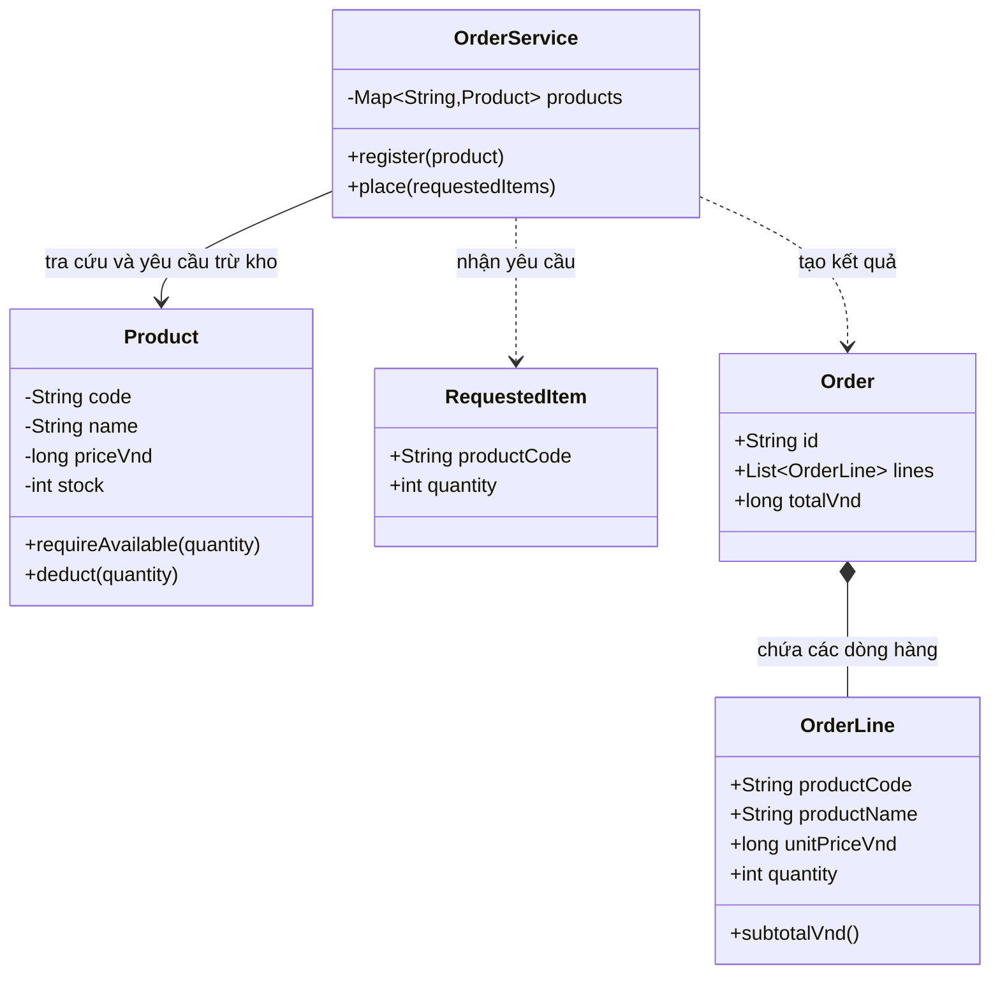
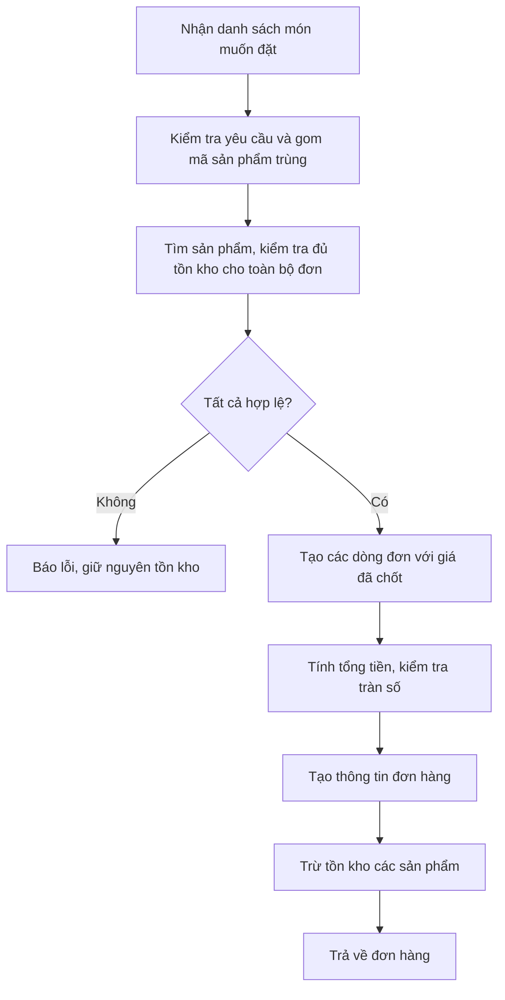
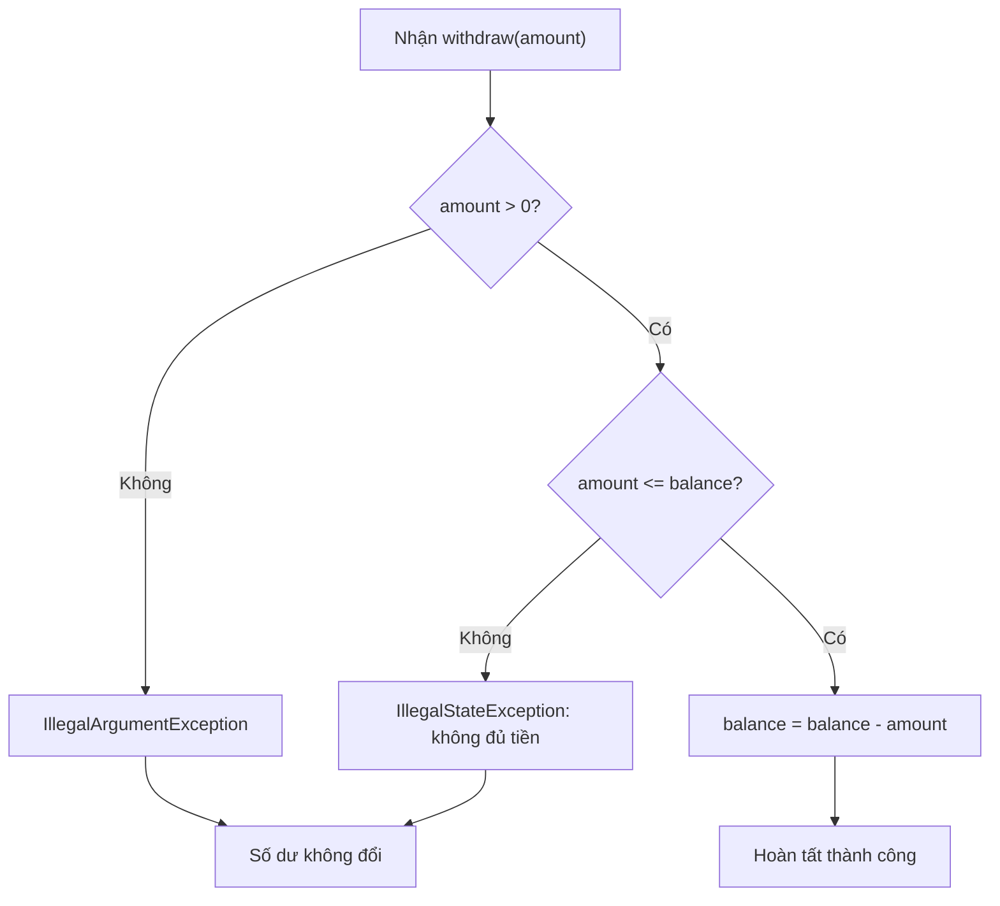
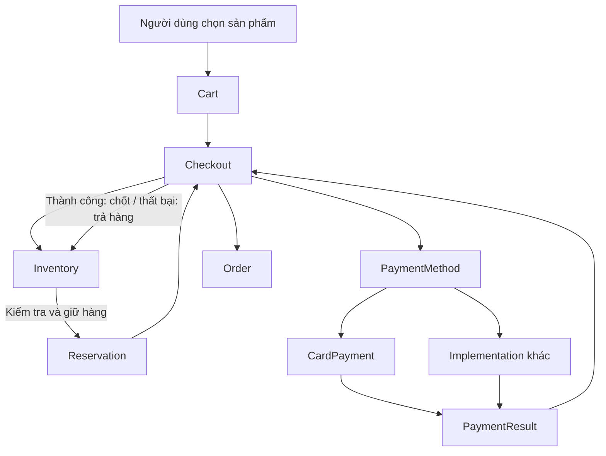
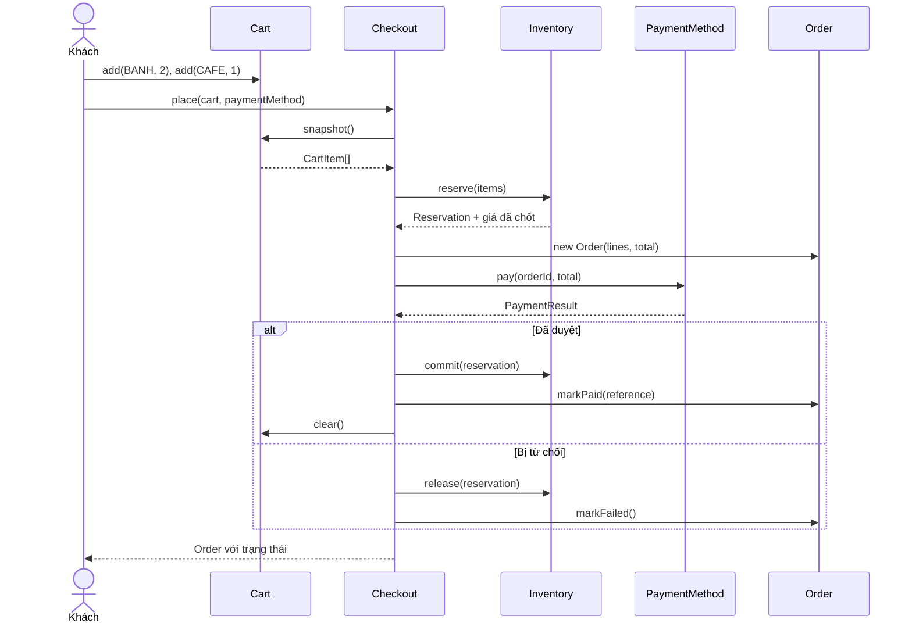
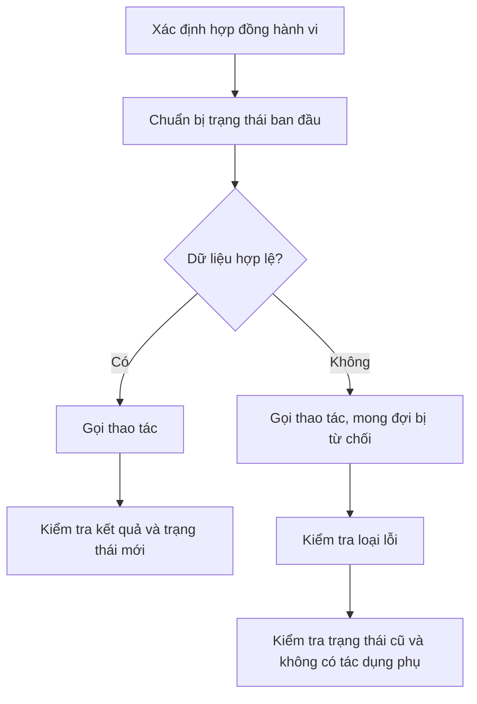
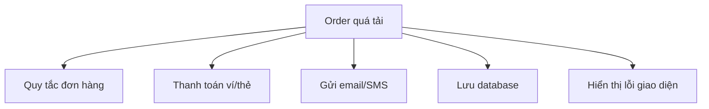
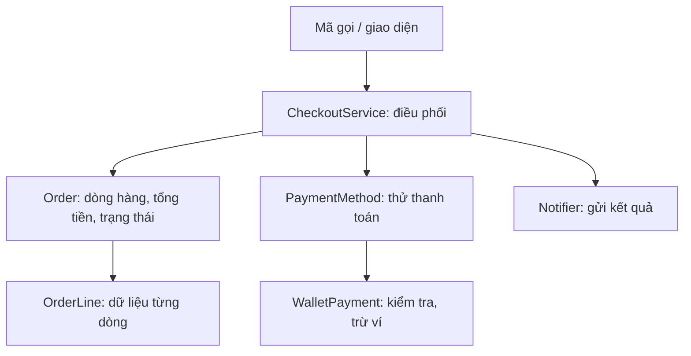

<a id="back-to-top"></a>

# Tự thiết kế một chương trình OOP hoàn chỉnh

## Menu
- [7.1 Từ yêu cầu nghiệp vụ đến danh sách object và trách nhiệm](#oop-7-1)
- [7.2 Thiết kế Account: rút tiền, kiểm tra lỗi, giữ trạng thái hợp lệ](#oop-7-2)
- [7.3 Thiết kế Checkout: Order, Cart, Inventory, PaymentMethod phối hợp](#oop-7-3)
- [7.4 Viết kiểm thử cho hành vi và tình huống thất bại](#oop-7-4)
- [7.5 Nhận ra thiết kế chưa tốt: class ôm quá nhiều việc, lạm dụng kế thừa, getter/setter vô tội vạ](#oop-7-5)

## <a id="oop-7-1">7.1 Từ yêu cầu nghiệp vụ đến danh sách object và trách nhiệm</a>

<details>
<summary>Xem chi tiết</summary>

### 1. Bắt đầu bằng bài toán, chưa vội tạo class

Giả sử bạn được giao xây dựng một chức năng nhỏ cho **tiệm bánh bán mang đi**. Chủ tiệm mô tả yêu cầu như sau:

> “Khách chọn loại bánh và số lượng muốn mua. Mỗi loại bánh có giá và số lượng còn trong kho. Nếu đủ tất cả các món, hệ thống tạo đơn hàng, tính tổng tiền và trừ tồn kho. Nếu có một món không đủ, hệ thống từ chối đơn và không trừ món nào.”

Một người mới học OOP có thể lập tức tạo các class `Customer`, `Bakery`, `Product`, `Cart`, `Order`, `Inventory`, `Payment`… vì thấy những danh từ đó trong bài toán.

Nhưng thiết kế object **không phải việc biến mọi danh từ thành một class**. Điều cần làm trước là xác định:

1. **Hệ thống thực sự phải làm gì?**
2. **Dữ liệu nào cần được giữ và ai có quyền thay đổi nó?**
3. **Quy tắc nghiệp vụ nào bắt buộc phải đúng?**
4. **Những đối tượng nào cần phối hợp để hoàn thành một yêu cầu?**

Trong ví dụ này, chúng ta chưa cần làm thanh toán, tài khoản khách hàng, gửi email hay lưu dữ liệu xuống database. Bài toán hiện tại chỉ yêu cầu **đặt đơn và cập nhật số lượng hàng trong một chương trình đơn giản**.

Khi giới hạn được phạm vi, chúng ta sẽ chọn được một bộ object đủ nhỏ để hiểu, đủ rõ để mở rộng.

### 2. Chuyển lời nói nghiệp vụ thành yêu cầu có thể kiểm tra

Đọc lại câu mô tả của chủ tiệm và phân loại những gì cần thực hiện.

| Câu nói nghiệp vụ | Cách hiểu cụ thể |
|---|---|
| “Khách chọn loại bánh và số lượng” | Một yêu cầu gồm một hoặc nhiều dòng: mã sản phẩm và số lượng |
| “Mỗi loại bánh có giá” | Mỗi sản phẩm có đơn giá, tính bằng VND |
| “Mỗi loại bánh có số lượng còn trong kho” | Phải biết tồn kho hiện tại của sản phẩm |
| “Nếu đủ tất cả các món” | Kiểm tra mọi dòng hàng trước khi chấp nhận |
| “Tạo đơn hàng, tính tổng tiền” | Đơn hàng chứa các dòng hàng và tổng tiền được tính từ số lượng × đơn giá |
| “Trừ tồn kho” | Chỉ khi đơn hợp lệ mới giảm số lượng còn lại |
| “Một món không đủ thì từ chối, không trừ món nào” | Trường hợp thất bại không được cập nhật kho một phần |

Trong đó có các **quy tắc bất biến** mà chương trình cần bảo vệ:

- Số lượng mua phải lớn hơn 0.
- Giá bán và tồn kho không được âm.
- Không được trừ vượt quá tồn kho.
- Tổng tiền bằng tổng thành tiền của các dòng hàng, không để phép tính số nguyên tràn âm thầm.
- Khi một yêu cầu đặt đơn bị từ chối do dữ liệu không hợp lệ hoặc thiếu hàng, tồn kho không bị thay đổi.

Một chi tiết đáng chú ý: khách có thể chọn cùng một loại bánh **hai lần** trong yêu cầu, ví dụ “2 bánh mì” và “4 bánh mì”. Khi kiểm tra kho, hệ thống phải xét **tổng cộng 6 bánh mì**. Nếu mỗi dòng tự kiểm tra riêng với kho còn 5, cả hai dòng đều có thể qua bước kiểm tra dù đơn tổng cộng không đủ hàng.

Việc phát hiện những trường hợp như vậy **trước khi viết class** giúp trách nhiệm của object được thiết kế chính xác hơn.

### 3. Từ danh từ đến ứng viên object

Trong câu chuyện này có nhiều danh từ: khách, bánh, sản phẩm, đơn hàng, giá, tồn kho, số lượng, cửa hàng, yêu cầu đặt hàng.

Hãy xem từng khái niệm có thực sự cần một object riêng hay không.

| Khái niệm | Có tạo class riêng lúc này? | Lý do |
|---|---|---|
| **Sản phẩm** | Có: `Product` | Có mã, tên, giá, tồn kho và quy tắc giảm kho |
| **Dòng yêu cầu đặt hàng** | Có: `RequestedItem` | Gói mã sản phẩm và số lượng khách yêu cầu |
| **Dòng hàng đã chốt trong đơn** | Có: `OrderLine` | Giữ thông tin sản phẩm, đơn giá và số lượng tại thời điểm đặt |
| **Đơn hàng** | Có: `Order` | Đại diện kết quả được tạo sau khi đặt thành công |
| **Quy trình đặt đơn** | Có: `OrderService` | Phối hợp tìm sản phẩm, kiểm tra cả đơn, tính tiền, cập nhật kho |
| **Giá tiền** | Chưa cần một class `Money` | Ví dụ chỉ dùng VND nguyên và không có quy đổi tiền tệ |
| **Khách hàng** | Chưa cần `Customer` | Chưa có yêu cầu quản lý danh tính, địa chỉ hay lịch sử mua |
| **Giỏ hàng** | Chưa cần `Cart` | Khách gửi yêu cầu đặt trực tiếp; chưa có giỏ lưu/chỉnh sửa |
| **Thanh toán** | Chưa cần `Payment` | Bài toán chưa yêu cầu thu tiền hoặc đối soát |
| **Database** | Chưa cần repository | Bản minh họa chỉ chạy trong bộ nhớ, chưa cần lưu bền vững |

Như vậy, ta chọn **năm kiểu dữ liệu/class** phục vụ đúng chức năng đang làm.

Điều quan trọng hơn số lượng class là: **mỗi class có một lý do tồn tại và một trách nhiệm có thể nói thành câu**.

Ví dụ, `Product` không xuất hiện chỉ vì “sản phẩm” là danh từ. Nó có lý do rõ ràng: hệ thống cần một đối tượng **quản lý tồn kho và bảo đảm không trừ quá số lượng đang có**.

Tương tự, `OrderService` không tồn tại chỉ để chứa một đống hàm tiện ích. Nó chịu trách nhiệm điều phối quy trình **đặt toàn bộ một đơn hàng**, vốn liên quan đến nhiều sản phẩm chứ không thuộc riêng một sản phẩm nào.

### 4. Giao trách nhiệm: ai biết, ai làm, ai không nên làm?

Đây là bước quan trọng nhất khi chuyển yêu cầu thành thiết kế OOP.

Một object thường có:

- **Trạng thái (state):** thông tin mà nó nắm giữ.
- **Hành vi (behavior):** việc nó có thể thực hiện.
- **Trách nhiệm (responsibility):** phần quy tắc hoặc kết quả mà nó phải bảo đảm.

Hãy lập bảng trách nhiệm:

| Object | Nó biết gì? | Nó làm gì? | Nó không nên phải biết |
|---|---|---|---|
| `Product` | Mã, tên, giá bán, lượng tồn | Kiểm tra đủ hàng và trừ tồn kho hợp lệ | Toàn bộ đơn có bao nhiêu loại hàng |
| `RequestedItem` | Mã món được chọn, số lượng yêu cầu | Mang dữ liệu yêu cầu đã được kiểm tra cơ bản | Giá bán hoặc tồn kho hiện tại |
| `OrderLine` | Mã, tên, đơn giá chốt, số lượng | Tính thành tiền của chính dòng | Còn bao nhiêu hàng trong kho |
| `Order` | Mã đơn, các dòng hàng, tổng tiền | Giữ kết quả đơn hàng sau khi tạo | Cách tìm sản phẩm hoặc cập nhật kho |
| `OrderService` | Danh sách sản phẩm được đăng ký | Điều phối đặt đơn: gom dòng trùng, kiểm tra, tính, trừ kho và tạo đơn | Tự đặt lại công thức giảm kho của từng sản phẩm |

Chú ý một quyết định: **đơn giá được lưu trong `OrderLine` khi đặt hàng**.

Vì sao không để dòng đơn hàng chỉ trỏ tới `Product` rồi đọc giá mới nhất? Nếu hôm nay bánh giá 18.000 đồng, ngày mai tăng lên 20.000 đồng, đơn được tạo hôm nay **không nên tự đổi tổng tiền** vào ngày mai. Vì vậy, `OrderLine` lưu một **ảnh chụp dữ liệu bán hàng cần thiết** tại thời điểm tạo đơn.

Đây là ví dụ về việc phân biệt **thực thể còn thay đổi** (`Product`, có tồn kho) với **giá trị của một giao dịch đã được ghi nhận** (`OrderLine`, mang thông tin đơn giá tại thời điểm đặt).

### 5. Quan hệ giữa các object

Trước khi viết code, hãy mô tả các mối quan hệ ở mức đủ để thấy ai gọi ai.



Bạn chưa cần hiểu hết ký hiệu UML. Hãy đọc sơ đồ như sau:

- `OrderService` **sử dụng** các `Product` để xử lý đơn.
- `OrderService` **nhận** các `RequestedItem` từ người gọi.
- Khi thành công, nó **tạo** một `Order` gồm các `OrderLine`.
- `OrderLine` giữ thông tin đã chốt, không cần trực tiếp sửa tồn kho.

Ở đây **không có quan hệ kế thừa**. Không phải bài toán OOP nào cũng phải dùng `extends`, `abstract` hoặc `interface`. Các object có thể phối hợp rất tốt thông qua việc **chứa dữ liệu và gọi hành vi của nhau**.

### 6. Thiết kế luồng đặt hàng trước khi đi vào Java

Ta cần làm rõ thứ tự xử lý. Nếu chọn sai thứ tự, chương trình có thể trừ kho của món đầu tiên rồi mới phát hiện món thứ hai đã hết.

Luồng hợp lý cho bản chạy trong bộ nhớ, xử lý tuần tự:



Có ba quyết định quan trọng ẩn trong sơ đồ:

**Thứ nhất, kiểm tra toàn bộ trước khi sửa.** Nếu thiếu hàng ở bất kỳ dòng nào thì đơn thất bại và tồn kho chưa bị giảm.

**Thứ hai, nếu cùng sản phẩm xuất hiện nhiều lần thì phải gom số lượng trước khi kiểm tra.** Từng dòng đơn lẻ không đủ để xác định có thể bán cả đơn hay không.

**Thứ ba, không tính tổng sau khi đã trừ kho.** Phần tính giá có thể gây lỗi (ví dụ tràn phạm vi kiểu số nguyên). Ta muốn phát hiện được lỗi đó trước khi cập nhật trạng thái sản phẩm.

Tuy nhiên, luồng này mới bảo vệ trường hợp **xử lý tuần tự trong bộ nhớ**. Nếu nhiều người đặt hàng đồng thời hoặc nhiều máy chủ cùng cập nhật kho, chúng ta còn cần giao dịch và cơ chế kiểm soát cạnh tranh thích hợp. Phần minh họa hiện tại chưa giải quyết những vấn đề hạ tầng đó.

### 7. Java hoàn chỉnh: chuyển thiết kế thành các object phối hợp

Đây là chương trình **một file `Main.java`**, dùng Java 17 trở lên. Chương trình mô phỏng đặt hàng, chưa dùng database hay thanh toán thật.

```java
import java.util.ArrayList;
import java.util.LinkedHashMap;
import java.util.List;
import java.util.Map;
import java.util.Objects;

public class Main {
    public static void main(String[] args) {
        Product bread = new Product("BANH", "Bánh mì", 18_000, 5);
        Product coffee = new Product("CAFE", "Cà phê", 25_000, 10);

        OrderService service = new OrderService();
        service.register(bread);
        service.register(coffee);

        Order order = service.place(List.of(
                new RequestedItem("BANH", 2),
                new RequestedItem("CAFE", 1)
        ));

        System.out.println("Đơn: " + order.id());
        System.out.println("Tổng: " + order.totalVnd());
        System.out.println("Bánh còn: " + bread.stock());
        System.out.println("Cà phê còn: " + coffee.stock());

        try {
            service.place(List.of(
                    new RequestedItem("BANH", 4),
                    new RequestedItem("CAFE", 2)
            ));
        } catch (IllegalStateException e) {
            System.out.println("Từ chối: " + e.getMessage());
        }

        System.out.println("Bánh sau lỗi: " + bread.stock());
        System.out.println("Cà phê sau lỗi: " + coffee.stock());
    }
}

// Đối tượng sở hữu trạng thái và quy tắc tồn kho của một sản phẩm.
final class Product {
    private final String code;
    private final String name;
    private final long priceVnd;
    private int stock;

    Product(String code, String name, long priceVnd, int stock) {
        if (code == null || code.isBlank()
                || name == null || name.isBlank()
                || priceVnd < 0 || stock < 0) {
            throw new IllegalArgumentException("Sản phẩm không hợp lệ");
        }
        this.code = code;
        this.name = name;
        this.priceVnd = priceVnd;
        this.stock = stock;
    }

    String code() {
        return code;
    }

    String name() {
        return name;
    }

    long priceVnd() {
        return priceVnd;
    }

    int stock() {
        return stock;
    }

    void requireAvailable(int quantity) {
        if (quantity <= 0) {
            throw new IllegalArgumentException("Số lượng phải dương");
        }
        if (quantity > stock) {
            throw new IllegalStateException(
                    "Không đủ tồn kho cho " + code);
        }
    }

    void deduct(int quantity) {
        requireAvailable(quantity);
        stock -= quantity;
    }
}

// Một dòng khách yêu cầu mua, chưa gắn với giá hoặc kho.
record RequestedItem(String productCode, int quantity) {
    RequestedItem {
        if (productCode == null || productCode.isBlank()
                || quantity <= 0) {
            throw new IllegalArgumentException(
                    "Dòng yêu cầu không hợp lệ");
        }
    }
}

// Thông tin đã chốt của một dòng trong đơn hàng.
record OrderLine(
        String productCode,
        String productName,
        long unitPriceVnd,
        int quantity) {

    long subtotalVnd() {
        return Math.multiplyExact(unitPriceVnd, quantity);
    }
}

// Kết quả đơn được tạo thành công.
record Order(String id, List<OrderLine> lines, long totalVnd) {
    Order {
        lines = List.copyOf(lines);
    }
}

// Điều phối một yêu cầu đặt hàng gồm nhiều loại sản phẩm.
final class OrderService {
    private final Map<String, Product> products =
            new LinkedHashMap<>();
    private long nextOrderNumber = 1;

    void register(Product product) {
        Objects.requireNonNull(product, "product");
        if (products.putIfAbsent(product.code(), product) != null) {
            throw new IllegalArgumentException("Trùng mã sản phẩm");
        }
    }

    Order place(List<RequestedItem> requests) {
        if (requests == null || requests.isEmpty()) {
            throw new IllegalArgumentException("Đơn hàng trống");
        }

        // Bước 1: gom các dòng cùng mã, tránh kiểm tra kho sai.
        Map<String, Integer> quantities = new LinkedHashMap<>();
        for (RequestedItem item : requests) {
            Objects.requireNonNull(item, "Dòng yêu cầu null");
            quantities.merge(
                    item.productCode(),
                    item.quantity(),
                    Math::addExact
            );
        }

        // Bước 2: kiểm tra toàn bộ và tính tiền TRƯỚC khi trừ kho.
        List<OrderLine> lines = new ArrayList<>();
        long total = 0;

        for (Map.Entry<String, Integer> entry
                : quantities.entrySet()) {

            Product product = products.get(entry.getKey());
            if (product == null) {
                throw new IllegalArgumentException(
                        "Không tìm thấy sản phẩm: " + entry.getKey());
            }

            product.requireAvailable(entry.getValue());

            OrderLine line = new OrderLine(
                    product.code(),
                    product.name(),
                    product.priceVnd(),
                    entry.getValue()
            );

            total = Math.addExact(total, line.subtotalVnd());
            lines.add(line);
        }

        // Tạo dữ liệu đơn trước khi cập nhật trạng thái kho.
        Order order = new Order(
                "ORDER-" + nextOrderNumber, lines, total);

        // Bước 3: tất cả hợp lệ, mới trừ từng sản phẩm.
        for (Map.Entry<String, Integer> entry
                : quantities.entrySet()) {
            products.get(entry.getKey()).deduct(entry.getValue());
        }

        nextOrderNumber++;
        return order;
    }
}
```

Đoạn code có năm kiểu dữ liệu chính như bản thiết kế. Nó cũng minh họa một sự khác biệt trong Java:

- `Product` và `OrderService` là **class có trạng thái và hành vi**. `Product.stock` thay đổi theo mỗi đơn được chấp nhận.
- `RequestedItem`, `OrderLine`, `Order` dùng **record**, thuận tiện để diễn tả dữ liệu mang theo giữa các bước. Record vẫn là một loại class trong Java. Nó có constructor, method và có thể thực hiện kiểm tra, không chỉ là “một danh sách field”.

`Order` dùng `List.copyOf(lines)` để giữ danh sách không thể chỉnh sửa qua reference được trả về. Vì `OrderLine` gồm các giá trị không thay đổi trong ví dụ, mã bên ngoài không thể sửa lại giá đã chốt bằng cách thay phần tử danh sách.

**Điều kiện chạy của demo:** các thao tác được gọi tuần tự trong một JVM; tồn kho chỉ thay đổi thông qua service và các đối tượng đang được dùng ở đây. Tính đúng đắn về giao dịch khi nhiều luồng hoặc nhiều tiến trình cùng đặt hàng là một bài toán bổ sung cần giải quyết trong hệ thống thực tế.

### 8. Theo dõi kết quả để hiểu các đối tượng phối hợp

Dữ liệu ban đầu:

| Sản phẩm | Mã | Giá | Tồn kho |
|---|---|---:|---:|
| Bánh mì | `BANH` | 18.000 VND | 5 |
| Cà phê | `CAFE` | 25.000 VND | 10 |

Khách đặt:

```java
List.of(
    new RequestedItem("BANH", 2),
    new RequestedItem("CAFE", 1)
)
```

Quy trình diễn ra:

1. `OrderService` nhận danh sách hai dòng yêu cầu.
2. Nó tìm `Product` tương ứng trong danh sách sản phẩm.
3. Nó hỏi từng `Product` có đủ số lượng không qua `requireAvailable(...)`.
4. Từ giá và số lượng đã kiểm tra, nó tạo các `OrderLine`.
5. Nó tính tổng: `2 × 18.000 + 1 × 25.000 = 61.000` VND.
6. Sau khi toàn bộ điều kiện hợp lệ, nó yêu cầu hai `Product` giảm kho.
7. Nó trả một `Order` có mã `ORDER-1`.

Kết quả in ra:

```text
Đơn: ORDER-1
Tổng: 61000
Bánh còn: 3
Cà phê còn: 9
Từ chối: Không đủ tồn kho cho BANH
Bánh sau lỗi: 3
Cà phê sau lỗi: 9
```

Lần đặt thứ hai yêu cầu **4 bánh mì** trong khi kho chỉ còn **3**, nên `Product` từ chối. `OrderService` chưa bắt đầu bước trừ kho, vì vậy cà phê cũng vẫn còn 9 dù khách đã yêu cầu thêm 2 ly.

Đây là minh chứng cụ thể cho quy tắc nghiệp vụ “**một món không đủ thì không trừ món nào**” trong bối cảnh demo.

Một người mới học OOP có thể thấy rằng chính `OrderService` vẫn viết vòng lặp và điều phối khá nhiều bước. Điều đó hoàn toàn bình thường. Nó **chịu trách nhiệm cho quy trình liên quan đến nhiều object**, còn quy tắc về tồn kho của từng sản phẩm vẫn thuộc về `Product`.

### 9. Vì sao Product tự trừ kho mà OrderService lại kiểm tra cả đơn?

Có vẻ như cả hai đều liên quan đến tồn kho, nhưng **trách nhiệm ở hai cấp độ khác nhau**.

`Product` chịu trách nhiệm: “Tôi không cho phép số lượng tồn kho của **chính tôi** xuống dưới 0.”

`OrderService` chịu trách nhiệm: “Một đơn hàng có nhiều sản phẩm chỉ được chấp nhận khi **tất cả** sản phẩm đều hợp lệ.”

Nếu cho `OrderService` sửa trực tiếp:

```java
// Không phải thiết kế đang dùng.
product.stock -= quantity;
```

thì mọi nơi sử dụng sản phẩm có thể bỏ qua kiểm tra và làm hỏng trạng thái. Vì thế `Product.stock` là `private` và có method `deduct(...)` bảo vệ quy tắc.

Nhưng nếu buộc mỗi `Product` tự biết toàn bộ đơn hàng, nó sẽ phải quản lý cả danh sách sản phẩm khác, tính tổng tiền và xử lý quy tắc liên sản phẩm. Điều đó khiến trách nhiệm của một sản phẩm bị mở rộng không hợp lý.

Cách chia trách nhiệm có thể viết thành hai câu:

> **Object giữ trạng thái** bảo vệ các quy tắc thuộc về trạng thái ấy.

> **Object điều phối** đảm bảo một yêu cầu gồm nhiều object được thực hiện theo đúng thứ tự và điều kiện chung.

Hai trách nhiệm này **bổ sung cho nhau**, không phải sự lặp lại vô ích.

### 10. Khi nào tách thêm object, khi nào giữ thiết kế nhỏ?

Một thiết kế OOP tốt có thể phát triển theo yêu cầu mới mà vẫn giữ đường đi dễ hiểu.

Nếu chủ tiệm yêu cầu **thêm thanh toán**, lúc đó mới đặt câu hỏi ai chịu trách nhiệm khởi tạo và xác nhận giao dịch. Có thể cần `PaymentMethod`, `PaymentService`, `PaymentResult`. Nhưng chưa có yêu cầu thì không cần thêm lớp cho đủ “bốn tính chất OOP”.

Nếu chủ tiệm yêu cầu **nhiều chi nhánh có tồn kho riêng**, việc để `Product` giữ `stock` có thể trở nên không phù hợp. Giá bán và danh tính sản phẩm là một chuyện, tồn kho của từng chi nhánh là chuyện khác. Khi đó có thể tách:

```text
Product
 ├─ code
 ├─ name
 └─ price

InventoryItem
 ├─ productCode
 ├─ branchId
 └─ availableQuantity
```

Nếu chủ tiệm yêu cầu **xem lịch sử đơn hàng sau khi khởi động lại**, một `Map` trong bộ nhớ chưa đủ. Lúc này cần persistence và có thể thêm `OrderRepository` để lưu, tìm kiếm đơn.

Nếu chủ tiệm yêu cầu **hai khách có thể đặt cùng lúc**, việc kiểm tra đủ hàng rồi trừ trong bộ nhớ không an toàn khi các thao tác chạy song song. Khi sử dụng database, cần thiết kế giao dịch và cách giữ nhất quán tồn kho phù hợp, chẳng hạn cập nhật có điều kiện hoặc locking. Tạo thêm class đơn thuần không ngăn được overselling.

Các trường hợp này cho thấy: **danh sách object không phải một sơ đồ bất biến từ đầu đến cuối dự án**. Nó được điều chỉnh theo những quy tắc và trách nhiệm thật sự xuất hiện.

### 11. Những sai lầm phổ biến khi chuyển yêu cầu thành object

| Cách làm | Vì sao dễ gây vấn đề | Cách suy nghĩ tốt hơn |
|---|---|---|
| Tạo class từ mọi danh từ trong yêu cầu | Xuất hiện nhiều class không có hành vi hoặc trách nhiệm rõ | Hỏi mỗi class **chịu trách nhiệm về quy tắc nào** |
| Đưa toàn bộ xử lý vào một `Main` hoặc `OrderService` khổng lồ | Quy tắc trạng thái bị rải rác; một thay đổi ảnh hưởng nhiều nơi | Để `Product` tự bảo vệ kho, `OrderService` điều phối |
| Cho mọi field là `public` | Bất kỳ phần nào cũng có thể phá quy tắc | Chỉ công khai những hành vi cần dùng |
| Bắt `Order` giữ tham chiếu tới sản phẩm có giá thay đổi và luôn đọc giá hiện tại | Đơn cũ có thể đổi số tiền ngoài ý muốn | Lưu đơn giá đã chốt ở `OrderLine` |
| Trừ kho ngay sau khi kiểm tra từng món | Món sau không đủ thì món trước đã bị trừ | Kiểm tra cả đơn, sau đó mới cập nhật |
| Không gom dòng hàng trùng mã | Một sản phẩm có thể bị đặt vượt tồn kho qua nhiều dòng | Gom số lượng theo mã trước khi kiểm tra |
| Dùng kế thừa chỉ để tái sử dụng vài dòng code | Quan hệ cha–con không có ý nghĩa nghiệp vụ | Ưu tiên phân chia trách nhiệm và hợp tác; dùng kế thừa khi thật sự phù hợp |
| Tạo interface cho mọi class ngay từ đầu | Tăng tầng trung gian dù chưa có sự thay thế nào | Tạo interface khi có hợp đồng chung mang giá trị thực |

Một quy tắc thực tế khi thiết kế: **nếu bạn không giải thích được tại sao một object cần tồn tại bằng một câu trách nhiệm rõ ràng, hãy xem lại việc tạo object đó.**

Tương tự, nếu một object liên tục phải hỏi chi tiết nội bộ của object khác để quyết định thay nó, rất có thể bạn đã giao sai trách nhiệm.

### 12. Từ yêu cầu đến object là một quá trình lặp

Khi nhận một yêu cầu, bạn có thể đi theo luồng suy nghĩ sau:

```text
YÊU CẦU NGHIỆP VỤ
        │
        ▼
Làm rõ đầu vào, đầu ra và trường hợp thất bại
        │
        ▼
Rút ra những quy tắc bắt buộc phải giữ
        │
        ▼
Xác định dữ liệu cần lưu và hành vi cần thực hiện
        │
        ▼
Chọn những object có trách nhiệm thực sự
        │
        ▼
Xác định ai gọi ai, ai được phép đổi trạng thái
        │
        ▼
Viết một luồng chạy cụ thể và kiểm tra kết quả
        │
        ▼
Điều chỉnh thiết kế khi xuất hiện điểm bất hợp lý
```

Đừng kỳ vọng sơ đồ đầu tiên luôn đúng. Trong ví dụ tiệm bánh, nếu ta phát hiện sau này giá bán thay đổi theo khung giờ, cần làm rõ **giá được chốt vào lúc chọn hàng hay lúc xác nhận đơn**. Câu trả lời nghiệp vụ sẽ quyết định nên đưa việc tính giá vào `Product`, một `PricingPolicy`, hay một thành phần khác.

Điểm xuất phát luôn là **quy tắc và trách nhiệm**, rồi mới đến từ khóa Java như `class`, `record`, `interface`, `private` hoặc `extends`.

Trong bài toán đã chọn, danh sách cuối cùng gồm `Product` quản lý từng mặt hàng, `RequestedItem` mang yêu cầu, `OrderLine` lưu thông tin đã chốt, `Order` biểu diễn đơn hàng và `OrderService` điều phối cả quy trình. Chúng phối hợp để đưa một yêu cầu từ “**khách muốn mua những món này**” đến “**đơn đã tạo và kho đã giảm đúng quy tắc**”.

Đó là cách biến một mô tả nghiệp vụ thành mô hình object có thể lập trình và kiểm tra được: **mỗi object tồn tại vì có trách nhiệm cụ thể; các đối tượng phối hợp theo quy tắc của bài toán**.

</details>

- [Quay lại đầu trang](#back-to-top)

---

## <a id="oop-7-2">7.2 Thiết kế Account: rút tiền, kiểm tra lỗi, giữ trạng thái hợp lệ</a>

<details>
<summary>Xem chi tiết</summary>

Giả sử bạn đang xây dựng ứng dụng ngân hàng. Một tài khoản đang có 100 đơn vị tiền; người dùng muốn rút 30. Nếu giao dịch hợp lệ, số dư phải giảm còn 70. Nếu người dùng đòi rút 120, số dư **phải giữ nguyên 100** thay vì thành -20.

Yêu cầu nghe rất đơn giản, nhưng đây là một bài toán thiết kế OOP điển hình: **ai được phép thay đổi số dư, kiểm tra nằm ở đâu và khi yêu cầu thất bại thì trạng thái của object ra sao?**

Chúng ta sẽ thiết kế một object `Account` có thể tự bảo vệ quy tắc về số dư, thay vì để mỗi màn hình hay dịch vụ tự ý tính lại tiền.

> **Tư duy chính:** `Account` không chỉ là một “túi dữ liệu” chứa `balance`. Nó là đối tượng **chịu trách nhiệm** về những hành động hợp lệ đối với số dư của mình. Bên ngoài yêu cầu `withdraw(amount)`; chính `Account` quyết định có được rút hay không.

### 1. Chuyển yêu cầu nghiệp vụ thành quy tắc của Account

Bài toán có thể diễn đạt bằng những tình huống sau:

| Tình huống | Số dư trước | Yêu cầu | Kết quả | Số dư sau |
|---|---:|---:|---|---:|
| Rút hợp lệ | 100 | Rút 30 | Thành công | 70 |
| Rút đúng toàn bộ số dư | 100 | Rút 100 | Thành công | 0 |
| Rút vượt số dư | 100 | Rút 120 | Bị từ chối | 100 |
| Rút số tiền bằng 0 | 100 | Rút 0 | Bị từ chối | 100 |
| Rút số tiền âm | 100 | Rút -5 | Bị từ chối | 100 |
| Số dư ban đầu âm | Chưa tạo object | Tạo tài khoản với -10 | Không cho tạo thành công | Không có tài khoản hợp lệ |

**Mỗi hàng trong bảng là một tình huống độc lập**, đều giả sử bắt đầu từ số dư 100. Khi viết chương trình có nhiều lời gọi nối tiếp, trạng thái của lời gọi sau phải dựa trên kết quả thật của lời gọi trước.

Từ bảng, ta rút ra các quy tắc:

1. Khi tạo tài khoản, số dư ban đầu phải **không âm**.
2. Số tiền muốn rút phải **lớn hơn 0**.
3. Số tiền rút không được **vượt quá số dư hiện tại**.
4. Sau khi rút thành công, số dư mới bằng số dư cũ trừ số tiền rút.
5. Khi rút thất bại, **không thay đổi số dư**.

Các quy tắc này thuộc về `Account` vì chính đối tượng này quản lý số dư. Nếu chuyển toàn bộ kiểm tra ra một controller hay UI, phần khác của ứng dụng có thể quên kiểm tra và tạo trạng thái sai.

### 2. Invariant: điều gì phải luôn đúng?

Một **invariant** của object là điều kiện về trạng thái mà object phải duy trì ở những thời điểm quan sát hợp lệ, ví dụ sau khi khởi tạo thành công và sau mỗi thao tác công khai kết thúc.

Với tài khoản đơn giản này, ta chọn:

```text
balance >= 0
```

Nói bằng tiếng Việt: **số dư của Account không bao giờ âm**.

Với trạng thái ban đầu `balance = 100`, nếu người dùng rút 30 thì số dư còn 70, vẫn hợp lệ. Nhưng nếu cứ trừ thẳng 120 thì số dư sẽ thành -20, vi phạm invariant.

Hãy nhìn hai cách viết:

**Cách dễ tạo lỗi:**

```java
class Account {
    public long balance = 100;

    // Bất kỳ phần mã nào cũng có thể:
    // account.balance -= 120;  // balance = -20
}
```

**Cách có ranh giới bảo vệ:**

```java
class Account {
    private long balance;

    void withdraw(long amount) {
        if (amount <= 0) {
            throw new IllegalArgumentException("Số tiền rút phải lớn hơn 0");
        }
        if (amount > balance) {
            throw new IllegalStateException("Không đủ số dư");
        }
        balance -= amount;
    }
}
```

Bản thứ hai đặt việc kiểm tra và cập nhật **trong cùng một hành vi**. Phần mã bên ngoài không tự gán `balance`; nó yêu cầu đối tượng rút tiền.

Ở đây, `private` giúp hạn chế truy cập trực tiếp. Nhưng **chỉ `private` là chưa đủ**: nếu ta công khai `setBalance(-20)` thì invariant vẫn có thể bị phá. Vì vậy, không tạo setter gán số dư tùy ý; chỉ cung cấp những hành vi có ý nghĩa nghiệp vụ.

### 3. Quyết định object cần có dữ liệu và hành vi gì

Một phiên bản `Account` tối thiểu có thể gồm:

| Thành phần | Vai trò | Vì sao cần? |
|---|---|---|
| `accountId` | Định danh tài khoản | Phân biệt các tài khoản trong nghiệp vụ |
| `balanceInCents` | Số dư hiện tại, lưu bằng đơn vị tiền nhỏ nhất | Tránh dùng số thực nhị phân cho số tiền ví dụ |
| Constructor | Khởi tạo accountId và số dư ban đầu | Chặn việc tạo trạng thái không hợp lệ |
| `withdraw(amountInCents)` | Thử rút tiền | Kiểm tra rồi cập nhật trạng thái |
| `getBalanceInCents()` | Cung cấp số dư để đọc | Cho xem dữ liệu mà không cấp quyền tự ý sửa |
| `getAccountId()` | Trả mã tài khoản | Cho nơi khác biết đang thao tác với tài khoản nào |

Tại sao chọn `long` và `balanceInCents` thay vì `double balance`?

Để tập trung vào OOP, ví dụ sẽ lưu tiền bằng **số nguyên của đơn vị nhỏ nhất**, chẳng hạn 10.000 cent tượng trưng cho 100,00 đơn vị tiền. Không nên dùng phép so sánh và trừ trực tiếp trên `double` để mô hình hóa tiền tệ vì biểu diễn nhị phân của số thập phân có thể làm xuất hiện sai số.

Trong phần code dưới đây:
- `10_000` là 100,00.
- `3_000` là 30,00.
- `7_000` là 70,00.

**Đây vẫn chỉ là mô phỏng.** Hệ thống tài chính thực tế cần mô hình tiền và tiền tệ chặt chẽ hơn, thường dùng kiểu số nguyên theo đơn vị nhỏ nhất hoặc `BigDecimal` với quy tắc làm tròn, đơn vị tiền, giới hạn số và transaction phù hợp.

### 4. Code Java hoàn chỉnh: Account tự kiểm tra và giữ trạng thái hợp lệ

Lưu toàn bộ nội dung sau vào file `Main.java`. Có thể chạy bằng Java thông thường, không cần Spring hay database.

```java
public class Main {
    public static void main(String[] args) {
        Account account = new Account("ACC-001", 10_000);

        System.out.println("Tài khoản: " + account.getAccountId());

        attemptWithdraw(account, 3_000);  // Rút 30,00: hợp lệ
        attemptWithdraw(account, 12_000); // Rút 120,00: vượt số dư
        attemptWithdraw(account, 0);      // Không hợp lệ
        attemptWithdraw(account, -500);   // Không hợp lệ
        attemptWithdraw(account, 7_000);  // Rút hết số dư còn lại
        attemptWithdraw(account, 1);      // Không còn tiền để rút
    }

    private static void attemptWithdraw(Account account, long amount) {
        long before = account.getBalanceInCents();

        try {
            account.withdraw(amount);
            System.out.println("Rút " + amount + ": THÀNH CÔNG");
        } catch (IllegalArgumentException | IllegalStateException ex) {
            System.out.println(
                    "Rút " + amount + ": THẤT BẠI - " + ex.getMessage()
            );
        }

        System.out.println("Số dư: " + before + " -> "
                + account.getBalanceInCents());
    }
}

class Account {
    private final String accountId;
    private long balanceInCents;

    public Account(String accountId, long openingBalanceInCents) {
        if (accountId == null || accountId.isBlank()) {
            throw new IllegalArgumentException("Mã tài khoản không hợp lệ");
        }
        if (openingBalanceInCents < 0) {
            throw new IllegalArgumentException("Số dư ban đầu không thể âm");
        }

        this.accountId = accountId;
        this.balanceInCents = openingBalanceInCents;
    }

    public String getAccountId() {
        return accountId;
    }

    public long getBalanceInCents() {
        return balanceInCents;
    }

    public void withdraw(long amountInCents) {
        if (amountInCents <= 0) {
            throw new IllegalArgumentException(
                    "Số tiền rút phải lớn hơn 0"
            );
        }

        if (amountInCents > balanceInCents) {
            throw new IllegalStateException("Không đủ số dư");
        }

        // Chỉ cập nhật sau khi mọi điều kiện đã hợp lệ.
        balanceInCents -= amountInCents;
    }
}
```

Kết quả:

```text
Tài khoản: ACC-001
Rút 3000: THÀNH CÔNG
Số dư: 10000 -> 7000
Rút 12000: THẤT BẠI - Không đủ số dư
Số dư: 7000 -> 7000
Rút 0: THẤT BẠI - Số tiền rút phải lớn hơn 0
Số dư: 7000 -> 7000
Rút -500: THẤT BẠI - Số tiền rút phải lớn hơn 0
Số dư: 7000 -> 7000
Rút 7000: THÀNH CÔNG
Số dư: 7000 -> 0
Rút 1: THẤT BẠI - Không đủ số dư
Số dư: 0 -> 0
```

Điều đáng chú ý là **khi thất bại, số dư trước và sau giống nhau**. Kết quả này không xuất hiện một cách ngẫu nhiên: nó đến từ thứ tự kiểm tra rồi mới cập nhật bên trong `withdraw()`.

#### Phân tích một lần rút thành công

Với số dư ban đầu `10_000`, gọi:

```java
account.withdraw(3_000);
```

`Account` xử lý:

1. Kiểm tra `3_000 <= 0`? Không.
2. Kiểm tra `3_000 > 10_000`? Không.
3. Trừ `balanceInCents -= 3_000`.
4. Số dư thành `7_000`.

Người dùng chỉ cần yêu cầu `withdraw(3_000)`, không cần biết object lưu số dư bằng field nào. Đây chính là cách **hành vi OOP bảo vệ dữ liệu mà nó quản lý**.

#### Phân tích một lần rút thất bại

Sau lần rút thành công, số dư còn `7_000`. Tiếp theo gọi:

```java
account.withdraw(12_000);
```

`Account` xử lý:

1. `12_000 <= 0`? Không.
2. `12_000 > 7_000`? Có.
3. Ném exception **trước** phép trừ.
4. Số dư vẫn là `7_000`.

Điều này khác với việc trừ tiền trước rồi mới kiểm tra:

```java
// Ví dụ SAI — không dùng.
balanceInCents -= amountInCents;

if (balanceInCents < 0) {
    throw new IllegalStateException("Không đủ số dư");
}
```

Ở đoạn sai, exception **không tự động hoàn tác** phép trừ vừa thực hiện trong bộ nhớ. Object có thể đang mang số dư âm khi bên gọi bắt exception và tiếp tục sử dụng nó.

Do đó, với một thao tác đơn giản như rút tiền trong bộ nhớ: **kiểm tra đầy đủ điều kiện trước, rồi mới thay đổi trạng thái**.

### 5. Dòng chảy của một yêu cầu rút tiền



Sơ đồ mô tả ranh giới quan trọng: **không có đường dẫn từ nhánh thất bại tới phép cập nhật `balance`**.

Ta có thể ghi ra điều kiện toán học để hiểu vì sao invariant được giữ:

```text
Trước giao dịch: balance >= 0

Điều kiện để rút:
  amount > 0
  amount <= balance

Sau giao dịch:
  newBalance = balance - amount

Vì amount <= balance nên newBalance >= 0.
```

Với trường hợp không thỏa điều kiện, không thực hiện phép trừ. Vì thế object giữ lại trạng thái hợp lệ ban đầu.

Đây là một cách chứng minh đơn giản cho thiết kế `withdraw()`: **mỗi nhánh kết thúc thành công đều giữ `balance >= 0`, còn các nhánh bị từ chối không làm thay đổi trạng thái**.

### 6. Phân biệt kiểm tra dữ liệu sai và trạng thái không cho phép

Trong ví dụ, chúng ta sử dụng hai loại exception có ý nghĩa khác nhau:

| Tình huống | Ví dụ | Exception | Ý nghĩa |
|---|---|---|---|
| Đầu vào không hợp lệ | `withdraw(0)`, `withdraw(-500)` | `IllegalArgumentException` | Người gọi gửi số tiền không hợp lệ |
| Không thể hoàn thành do số dư hiện tại | Số dư 7.000, muốn rút 12.000 | `IllegalStateException` | Số tiền dương nhưng trạng thái tài khoản không cho phép rút |
| Khởi tạo không hợp lệ | `new Account("A", -100)` | `IllegalArgumentException` | Không tạo một account có trạng thái ban đầu sai |

**Vì sao không in lỗi ngay trong `Account`?** Bởi `Account` nên quản lý quy tắc tài khoản, không phải tự quyết định giao diện hiển thị lỗi. Ứng dụng console có thể in ra dòng thông báo; REST API có thể chuyển lỗi thành HTTP response phù hợp; ứng dụng desktop có thể hiển thị popup.

Nơi sử dụng `Account` sẽ bắt exception ở ranh giới thích hợp và chuyển thành cách phản hồi cho người dùng.

Trong hệ thống lớn, một kiểu lỗi nghiệp vụ riêng như `InsufficientFundsException` hoặc kết quả `WithdrawalResult` có thể rõ nghĩa hơn `IllegalStateException`. Điều cần giữ nhất quán là **lỗi phải phân biệt được và không được vô tình sửa trạng thái**.

#### Có nên trả boolean thay vì ném exception?

Có thể thiết kế:

```java
boolean withdrawn = account.tryWithdraw(amount);
```

rồi trả `false` khi không đủ tiền. Cách này phù hợp khi “không đủ tiền” là một kết quả được dự kiến thường xuyên. Tuy nhiên, nó không mô tả đầy đủ lý do thất bại nếu ta còn cần phân biệt số tiền âm, tài khoản bị khóa, hạn mức giao dịch…

Không có một kiểu trả lỗi duy nhất đúng cho mọi hệ thống. Với bài học này, chúng ta chọn **exception** để làm rõ hai nhóm lỗi và dễ quan sát trạng thái sau mỗi tình huống.

### 7. Vì sao Account không có `setBalance()`?

Bạn có thể hỏi: “Sao không để field `private` rồi sinh getter và setter tự động?”

Hãy xem một setter:

```java
public void setBalanceInCents(long value) {
    this.balanceInCents = value;
}
```

Một đoạn mã bên ngoài có thể gọi:

```java
account.setBalanceInCents(-1);
```

Thế là invariant bị phá. Nếu setter chặn số âm, bên ngoài vẫn có thể gọi `setBalanceInCents(999_999_999)` để tự ý tăng số dư, không cần thông qua nghiệp vụ nào.

Đó là lý do khi mô hình hóa đối tượng nghiệp vụ, **đóng gói không phải chỉ đổi field từ `public` thành `private` rồi thêm setter cho tất cả field**.

| Thiết kế | Người gọi thể hiện ý định nào? | Đánh giá |
|---|---|---|
| `account.balanceInCents -= 3_000` | Tự sửa dữ liệu tài khoản | Dễ bỏ qua quy tắc |
| `account.setBalanceInCents(7_000)` | Ép số dư thành một giá trị | Không nói vì sao số dư thay đổi |
| `account.withdraw(3_000)` | Yêu cầu rút một khoản tiền | Object có thể kiểm tra toàn bộ điều kiện rút |

Điều này cũng cho thấy vì sao OOP ưu tiên **đưa hành vi và dữ liệu liên quan vào cùng một đối tượng**. Object có trách nhiệm về tính hợp lệ của trạng thái trong các thao tác được công bố.

### 8. Khi chương trình phát triển, kiểm tra lỗi đặt ở đâu?

Giả sử có ba nơi sử dụng tài khoản: giao diện ATM, ứng dụng di động và API của nhân viên. Nếu từng nơi tự kiểm tra:

```text
ATM      → kiểm tra số dư rồi tự trừ
Mobile   → kiểm tra số dư rồi tự trừ
API      → kiểm tra số dư rồi tự trừ
```

một nơi rất dễ quên quy tắc. Cách tổ chức rõ hơn là:

```text
ATM ─────┐
Mobile ──┼──> account.withdraw(amount)
API ─────┘         |
                    +--> Account kiểm tra và cập nhật số dư
```

Mỗi bên có thể kiểm tra sớm để hiển thị trải nghiệm tốt hơn, chẳng hạn chặn nhập số âm ở giao diện. Nhưng **không được chỉ dựa vào kiểm tra ở giao diện**.

`Account` vẫn cần tự bảo vệ mình, vì có thể được gọi từ nhiều nơi khác nhau, kể cả một mã chương trình chưa kiểm tra.

Trong thiết kế có database, ngoài quy tắc trong domain object còn cần đảm bảo các điều kiện ở **lớp lưu trữ và phạm vi transaction**. Đây không phải hai lựa chọn loại trừ nhau: một bên giúp object nhất quán về mặt mô hình, bên kia giúp dữ liệu bền vững và nhất quán khi có nhiều thao tác.

### 9. Những giới hạn của Account mẫu

Bài toán mô phỏng một object `Account` trong bộ nhớ. Nó giúp nhìn rõ OOP, nhưng **chưa đủ để dùng như hệ thống ngân hàng thật**.

#### Nhiều luồng cùng rút tiền

Nếu hai luồng đồng thời cùng đọc số dư 100 rồi mỗi luồng muốn rút 80, chúng có thể đều thấy đủ tiền trước khi cả hai cập nhật. Với code hiện tại, thao tác kiểm tra rồi trừ **không được bảo đảm nguyên tử khi có concurrency**.

Một cách làm phù hợp tùy hệ thống là đồng bộ truy cập object, dùng transaction và khóa trong database, hoặc cơ chế kiểm soát cạnh tranh khi nhiều service cùng xử lý một tài khoản.

**Invariant được diễn đạt trong code không tự bảo đảm an toàn đa luồng** nếu các lần cập nhật có thể xen kẽ.

#### Hệ thống có database hoặc nhiều service

Trong ứng dụng thực tế, số dư có thể nằm trong database và nhiều instance của service cùng phục vụ giao dịch. Lúc này không thể chỉ dựa vào một object Java trong một JVM.

Ví dụ, đọc số dư từ database rồi kiểm tra bằng Java vẫn có thể không ngăn được rút quá tiền nếu hai transaction cập nhật cùng một hàng mà không có cơ chế phối hợp phù hợp. Cần thêm thiết kế transaction, optimistic/pessimistic locking hoặc cập nhật có điều kiện và kiểm tra kết quả.

#### Các quy tắc nghiệp vụ phức tạp hơn

Tài khoản thật có thể có hạn mức rút mỗi ngày, trạng thái khóa/mở, phí dịch vụ, loại tiền, lịch sử giao dịch, yêu cầu xác thực, idempotency…

Khi thêm các yêu cầu đó, cần xác định **trách nhiệm nào vẫn thuộc `Account` và trách nhiệm nào nên giao cho các thành phần khác**. Không nên nhét giao tiếp mạng, hiển thị giao diện và toàn bộ xử lý giao dịch vào một class `Account` chỉ vì nó có tên giống thực thể nghiệp vụ.

### 10. Kiểm chứng thiết kế bằng những tình huống quan sát được

Một cách tự rà soát object là nhìn **đầu vào → kết quả → trạng thái cuối**:

| Bắt đầu từ | Lệnh gọi | Có thay đổi state không? | Kỳ vọng |
|---|---|---|---|
| 10.000 | `withdraw(3_000)` | Có | 7.000 |
| 7.000 | `withdraw(12_000)` | Không | Vẫn 7.000 |
| 7.000 | `withdraw(0)` | Không | Vẫn 7.000 |
| 7.000 | `withdraw(-500)` | Không | Vẫn 7.000 |
| 7.000 | `withdraw(7_000)` | Có | 0 |
| 0 | `withdraw(1)` | Không | Vẫn 0 |

Đọc bảng này có thể nhận ra ba điều quan trọng:

- **Trạng thái trước** quyết định thao tác tiếp theo có được phép hay không.
- **Mọi đường thất bại** đều giữ nguyên số dư.
- **Mọi đường thành công** đều giữ số dư không âm.

Nếu một thay đổi trong `withdraw()` làm sai một dòng của bảng, khả năng cao quy tắc bảo vệ trạng thái đã bị vi phạm.

### Kết luận

Một thiết kế `Account` đúng tinh thần OOP không dừng ở việc khai báo field và getter. Ta cần xác định:

- **State:** tài khoản giữ `balanceInCents` và mã định danh.
- **Responsibility:** tài khoản tự bảo vệ quy tắc số dư hợp lệ.
- **Behavior:** người khác yêu cầu `withdraw(amount)` thay vì tự sửa số dư.
- **Validation:** từ chối số tiền rút không dương hoặc vượt số dư.
- **Failure behavior:** khi không thể rút tiền, không thay đổi trạng thái.
- **Invariant:** sau khởi tạo và các thao tác hợp lệ, `balanceInCents >= 0`.

**Điều cần nhớ:** Khi một object sở hữu dữ liệu quan trọng, hãy đưa quy tắc thay đổi dữ liệu vào các hành vi mang ý nghĩa nghiệp vụ của chính object ấy. Với `Account`, thiết kế tốt là **kiểm tra trước, chỉ cập nhật khi hợp lệ, và không để yêu cầu thất bại làm hỏng trạng thái**.

</details>

- [Quay lại đầu trang](#back-to-top)

---

## <a id="oop-7-3">7.3 Thiết kế Checkout: Order, Cart, Inventory, PaymentMethod phối hợp</a>

<details>
<summary>Xem chi tiết</summary>

### 1. Một lần bấm “Đặt hàng” thực chất yêu cầu những gì?

Hãy hình dung cửa hàng bán bánh và cà phê. Khách thêm **2 bánh mì** và **1 cà phê** vào giỏ, sau đó bấm **Thanh toán**.

Từ phía người dùng, đây là một hành động. Bên trong chương trình, nhiều trách nhiệm phải phối hợp:

1. Đọc các món và số lượng khách đã chọn.
2. Xác định sản phẩm, đơn giá và tổng tiền.
3. Kiểm tra toàn bộ sản phẩm có đủ tồn kho.
4. Giữ số hàng cần bán để tránh cùng một lượng hàng bị dùng cho đơn khác trong lúc thanh toán.
5. Gửi yêu cầu thanh toán bằng phương thức khách chọn.
6. Nếu thành công, chốt đơn và trừ hàng đã giữ khỏi lượng có thể bán; nếu thất bại, trả lại lượng hàng đã giữ.
7. Trả cho khách **trạng thái đơn hàng** có ý nghĩa rõ ràng.

Nếu nhồi tất cả vào một hàm dài trong controller, mã sẽ rất khó bảo trì: phần giỏ hàng có thể biết cách gọi ngân hàng, phần thanh toán lại sửa tồn kho, và nơi hiển thị đơn tự tính lại giá. OOP giúp phân chia **ai sở hữu dữ liệu, ai bảo vệ quy tắc, ai điều phối toàn bộ quy trình**.

Trong bài này, bốn khái niệm nghiệp vụ trọng tâm là **`Cart`, `Inventory`, `PaymentMethod`, `Order`**. Một lớp `Checkout` sẽ phối hợp chúng.

Ta giả định chương trình demo chạy với Java 17, trong bộ nhớ và các thao tác được thực hiện tuần tự. Thanh toán được mô phỏng, không có tiền thật hay kết nối ngân hàng.

### 2. Viết quy tắc trước khi tạo đối tượng

Một thiết kế chỉ rõ tên class vẫn chưa đủ. Ta cần biết hệ thống phải giữ những cam kết nào:

| Tình huống | Kết quả mong muốn |
|---|---|
| Giỏ hàng có 2 bánh mì và 1 cà phê, tất cả đủ hàng | Tính đúng giá, thanh toán thành công thì tạo đơn `PAID` |
| Một món trong giỏ không tồn tại hoặc thiếu hàng | Từ chối trước khi gọi thanh toán; không giảm lượng hàng có thể bán |
| Thanh toán bị từ chối | Đơn có trạng thái thất bại; hàng đã giữ được trả lại |
| Thanh toán thành công | Không tự trả lượng hàng đã giữ về tồn có thể bán; giỏ được làm rỗng |
| Khách thêm cùng một mã sản phẩm nhiều lần | Gộp số lượng để kiểm tra tồn kho tổng cộng |
| Giá sản phẩm được sửa về sau | Tổng tiền và đơn giá đã chốt trong `Order` không tự thay đổi |
| Khách muốn mua số lượng bằng 0 hoặc âm | Từ chối yêu cầu không hợp lệ |

Quy tắc “một món thiếu thì không trừ món nào” khiến bước **kiểm tra toàn bộ giỏ** phải diễn ra trước bước giữ hàng. Quy tắc “thanh toán thất bại thì trả hàng” khiến cần một khái niệm **reservation (lượng hàng đã giữ cho yêu cầu thanh toán)**.

Đây là cách thiết kế object dựa trên nghiệp vụ: mỗi object sinh ra để chịu trách nhiệm cho một phần quy tắc cụ thể.

### 3. Mỗi đối tượng chịu trách nhiệm phần nào?

| Đối tượng | Dữ liệu/trách nhiệm sở hữu | Hành vi chính | Không nên đảm nhận |
|---|---|---|---|
| **`Cart`** | Các mã sản phẩm và số lượng khách đang chọn | Thêm hàng, cung cấp bản chụp giỏ, làm rỗng giỏ | Tự trừ kho, tự gọi ngân hàng, tự xác nhận đã thanh toán |
| **`Inventory`** | Sản phẩm, đơn giá hiện tại và lượng hàng có thể bán | Kiểm tra đủ hàng, giữ hàng, chốt giữ hàng hoặc trả lại | Quyết định thanh toán được duyệt hay không |
| **`PaymentMethod`** | Hợp đồng xử lý thanh toán | Nhận mã đơn và tổng tiền, trả kết quả thanh toán | Trực tiếp sửa giỏ và tồn kho |
| **`Order`** | Mã đơn, danh sách mặt hàng đã chốt, tổng tiền, trạng thái | Biểu diễn kết quả giao dịch và thay đổi trạng thái hợp lệ | Tự tìm sản phẩm và tự gửi yêu cầu thanh toán |
| **`Checkout`** | Các thành phần cần phối hợp | Điều phối chuỗi thao tác từ giỏ đến đơn hàng | Viết lại quy tắc tồn kho hoặc logic nội bộ của từng cách thanh toán |

Ta còn dùng một số **đối tượng dữ liệu nhỏ**:

- `CartItem`: một mã hàng và số lượng trong giỏ.
- `Product`: thông tin mặt hàng và giá.
- `OrderLine`: tên hàng, đơn giá và số lượng đã được chốt trong đơn.
- `PaymentResult`: kết quả từ phương thức thanh toán.
- `Reservation`: một lần giữ hàng có thể được chốt hoặc hoàn lại.

Những đối tượng phụ này có ý nghĩa rõ ràng, giúp các phương thức trao đổi dữ liệu mà không phải nhận nhiều tham số rời rạc.

### 4. Nhìn toàn cảnh quan hệ giữa các thành phần



Sơ đồ nêu **vai trò và hướng phối hợp**, không phải mọi đối tượng đều gọi đồng thời. Ở một lượt checkout, chỉ **một implementation thực tế** của `PaymentMethod` được sử dụng.

Bốn quan hệ cần nhận ra:

**`Checkout` sử dụng `Cart`.** Nó đọc giỏ; giỏ không cần biết có một Checkout đang tồn tại.

**`Checkout` sử dụng `Inventory`.** Kho chịu trách nhiệm cuối cùng về lượng hàng còn bán được; Checkout không tự sửa field số lượng.

**`Checkout` phụ thuộc vào `PaymentMethod`.** Nó chỉ biết hợp đồng `pay(...)`, còn lớp cụ thể cung cấp cách xử lý.

**`Checkout` tạo `Order`.** Đơn lưu thông tin đã chốt, không phụ thuộc vào việc người dùng tiếp tục sửa giỏ.

Đây là ví dụ **composition và collaboration (hợp tác)** giữa các object. Không phải mỗi bài toán OOP đều cần cây kế thừa phức tạp.

### 5. Thứ tự xử lý quan trọng không kém tên class

Giả sử kho còn 5 bánh mì và 10 cà phê. Khách đặt 2 bánh mì, 1 cà phê.



Trong sơ đồ, `reserve()` **chuyển lượng hàng đang có sang trạng thái được giữ**. Nếu phí thanh toán không thành công, `release()` trả hàng về. Nếu thanh toán thành công, `commit()` chốt phần đã giữ: hàng đó vẫn không còn có thể bán cho đơn khác.

Vì trạng thái đơn có thể khác nhau, `Checkout.place()` trả về một `Order`. Phía giao diện kiểm tra `order.status()` để hiện đúng thông báo thay vì chỉ dựa vào việc hàm không ném exception.

**Lưu ý nghiệp vụ:** nếu tích hợp chuyển khoản không đồng bộ, việc “khởi tạo thanh toán” thường trả `PENDING`, chưa phải `PAID`. Khi đó phải thiết kế thêm luồng xác nhận và thời hạn giữ hàng. Demo dưới đây chủ ý dùng hai kết quả mô phỏng **duyệt/từ chối ngay**, để tập trung vào cách các object phối hợp.

### 6. Java chạy độc lập: một file, đủ luồng thành công và thất bại

Đặt toàn bộ đoạn code sau vào file `Main.java`, chạy với **Java 17+**. Đây là ví dụ trong bộ nhớ: không gọi API thanh toán và không có giao dịch database.

```java
import java.util.ArrayList;
import java.util.LinkedHashMap;
import java.util.List;
import java.util.Map;
import java.util.Objects;

public class Main {
    public static void main(String[] args) {
        Inventory inventory = new Inventory();
        inventory.register(new Product("BANH", "Bánh mì", 18_000), 5);
        inventory.register(new Product("CAFE", "Cà phê", 25_000), 10);

        Checkout checkout = new Checkout(inventory);
        Cart cart = new Cart();
        cart.add("BANH", 2);
        cart.add("CAFE", 1);

        Order paid = checkout.place(cart, new DemoCardPayment(true));

        System.out.println(paid.id() + " | " + paid.status());
        System.out.println("Total: " + paid.totalVnd());
        System.out.println("BANH available: " + inventory.available("BANH"));
        System.out.println("Items in cart: " + cart.snapshot().size());

        cart.add("BANH", 1);
        Order declined =
                checkout.place(cart, new DemoCardPayment(false));

        System.out.println(declined.id() + " | " + declined.status());
        System.out.println("BANH available: " + inventory.available("BANH"));
        System.out.println("Items in cart: " + cart.snapshot().size());
    }
}

// Thông tin một sản phẩm ở danh mục.
record Product(String sku, String name, long unitPriceVnd) {
    Product {
        if (sku == null || sku.isBlank()
                || name == null || name.isBlank()
                || unitPriceVnd < 0) {
            throw new IllegalArgumentException("Product không hợp lệ");
        }
    }
}

// Giỏ chỉ lưu mã sản phẩm và số lượng khách đang chọn.
record CartItem(String sku, int quantity) {
    CartItem {
        if (sku == null || sku.isBlank() || quantity <= 0) {
            throw new IllegalArgumentException("CartItem không hợp lệ");
        }
    }
}

final class Cart {
    private final Map<String, Integer> quantities =
            new LinkedHashMap<>();

    void add(String sku, int quantity) {
        CartItem item = new CartItem(sku, quantity);
        quantities.merge(
                item.sku(), item.quantity(), Math::addExact);
    }

    List<CartItem> snapshot() {
        List<CartItem> result = new ArrayList<>();
        for (var entry : quantities.entrySet()) {
            result.add(new CartItem(entry.getKey(), entry.getValue()));
        }
        return List.copyOf(result);
    }

    void clear() {
        quantities.clear();
    }
}

// Dòng đơn hàng: chốt tên, giá và số lượng tại thời điểm mua.
record OrderLine(
        String sku, String productName,
        long unitPriceVnd, int quantity) {

    long subtotalVnd() {
        return Math.multiplyExact(unitPriceVnd, quantity);
    }
}

enum OrderStatus {
    CREATED, PAID, PAYMENT_FAILED
}

// Đơn hàng có trạng thái riêng, độc lập với giỏ sau khi tạo.
final class Order {
    private final String id;
    private final List<OrderLine> lines;
    private final long totalVnd;

    private OrderStatus status = OrderStatus.CREATED;
    private String paymentReference;

    Order(String id, List<OrderLine> lines, long totalVnd) {
        this.id = id;
        this.lines = List.copyOf(lines);
        this.totalVnd = totalVnd;
    }

    String id() { return id; }
    long totalVnd() { return totalVnd; }
    List<OrderLine> lines() { return lines; }
    OrderStatus status() { return status; }

    void markPaid(String reference) {
        requireCreated();
        paymentReference = Objects.requireNonNull(reference);
        status = OrderStatus.PAID;
    }

    void markFailed() {
        requireCreated();
        status = OrderStatus.PAYMENT_FAILED;
    }

    private void requireCreated() {
        if (status != OrderStatus.CREATED) {
            throw new IllegalStateException(
                    "Không thể đổi trạng thái đơn lần nữa");
        }
    }
}

// Một phiên giữ hàng, được Inventory dùng để chốt/hoàn kho.
final class Reservation {
    private final List<OrderLine> lines;
    private final long totalVnd;
    private boolean active = true;

    Reservation(List<OrderLine> lines, long totalVnd) {
        this.lines = List.copyOf(lines);
        this.totalVnd = totalVnd;
    }

    List<OrderLine> lines() { return lines; }
    long totalVnd() { return totalVnd; }
    boolean active() { return active; }
    void finish() { active = false; }
}

// Inventory sở hữu số lượng có thể bán và quy tắc giữ hàng.
final class Inventory {
    private static final class Stock {
        final Product product;
        int available;

        Stock(Product product, int available) {
            this.product = product;
            this.available = available;
        }
    }

    private final Map<String, Stock> stocks =
            new LinkedHashMap<>();

    synchronized void register(Product product, int quantity) {
        Objects.requireNonNull(product);
        if (quantity < 0) {
            throw new IllegalArgumentException("Kho không được âm");
        }
        if (stocks.putIfAbsent(
                product.sku(), new Stock(product, quantity)) != null) {
            throw new IllegalArgumentException("Trùng mã sản phẩm");
        }
    }

    synchronized int available(String sku) {
        Stock stock = stocks.get(sku);
        if (stock == null) {
            throw new IllegalArgumentException("Không có SKU: " + sku);
        }
        return stock.available;
    }

    synchronized Reservation reserve(List<CartItem> items) {
        if (items == null || items.isEmpty()) {
            throw new IllegalArgumentException("Giỏ trống");
        }

        // Kiểm tra toàn bộ + tính tiền trước khi sửa tồn kho.
        List<OrderLine> lines = new ArrayList<>();
        long total = 0;

        for (CartItem item : items) {
            Objects.requireNonNull(item, "CartItem null");
            Stock stock = stocks.get(item.sku());

            if (stock == null) {
                throw new IllegalArgumentException(
                        "Không có SKU: " + item.sku());
            }
            if (stock.available < item.quantity()) {
                throw new IllegalStateException(
                        "Không đủ hàng: " + item.sku());
            }

            OrderLine line = new OrderLine(
                    stock.product.sku(),
                    stock.product.name(),
                    stock.product.unitPriceVnd(),
                    item.quantity()
            );
            total = Math.addExact(total, line.subtotalVnd());
            lines.add(line);
        }

        Reservation reservation = new Reservation(lines, total);

        for (CartItem item : items) {
            stocks.get(item.sku()).available -= item.quantity();
        }
        return reservation;
    }

    synchronized void commit(Reservation reservation) {
        requireActive(reservation);
        reservation.finish();
        // Hàng đã trừ khỏi available lúc reserve.
    }

    synchronized void release(Reservation reservation) {
        requireActive(reservation);
        for (OrderLine line : reservation.lines()) {
            stocks.get(line.sku()).available += line.quantity();
        }
        reservation.finish();
    }

    private void requireActive(Reservation reservation) {
        Objects.requireNonNull(reservation);
        if (!reservation.active()) {
            throw new IllegalStateException(
                    "Reservation đã được xử lý");
        }
    }
}

enum PaymentOutcome { APPROVED, DECLINED }

record PaymentResult(PaymentOutcome outcome, String reference) {
    PaymentResult {
        Objects.requireNonNull(outcome);
        Objects.requireNonNull(reference);
    }
}

interface PaymentMethod {
    PaymentResult pay(String orderId, long amountVnd);
}

// Mock thanh toán thẻ; approved được cấp khi tạo object.
final class DemoCardPayment implements PaymentMethod {
    private final boolean approved;

    DemoCardPayment(boolean approved) {
        this.approved = approved;
    }

    @Override
    public PaymentResult pay(String orderId, long amountVnd) {
        if (amountVnd < 0) {
            throw new IllegalArgumentException("Số tiền âm");
        }
        return approved
                ? new PaymentResult(
                        PaymentOutcome.APPROVED, "CARD-" + orderId)
                : new PaymentResult(
                        PaymentOutcome.DECLINED, "REJECTED-" + orderId);
    }
}

// Nơi điều phối, không tự tính lại quy tắc tồn kho/thanh toán.
final class Checkout {
    private final Inventory inventory;
    private long nextOrderNumber = 1;

    Checkout(Inventory inventory) {
        this.inventory = Objects.requireNonNull(inventory);
    }

    Order place(Cart cart, PaymentMethod paymentMethod) {
        Objects.requireNonNull(cart);
        Objects.requireNonNull(paymentMethod);

        Reservation reservation = inventory.reserve(cart.snapshot());
        Order order = new Order(
                "ORDER-" + nextOrderNumber++,
                reservation.lines(),
                reservation.totalVnd()
        );

        PaymentResult result;
        try {
            result = Objects.requireNonNull(
                    paymentMethod.pay(order.id(), order.totalVnd()));
        } catch (RuntimeException ex) {
            inventory.release(reservation);
            order.markFailed();
            throw ex;
        }

        if (result.outcome() == PaymentOutcome.APPROVED) {
            inventory.commit(reservation);
            order.markPaid(result.reference());
            cart.clear();
        } else {
            inventory.release(reservation);
            order.markFailed();
        }

        return order;
    }
}
```

Kết quả chương trình:

```text
ORDER-1 | PAID
Total: 61000
BANH available: 3
Items in cart: 0
ORDER-2 | PAYMENT_FAILED
BANH available: 3
Items in cart: 1
```

Lần đầu, tổng tiền là `2 × 18.000 + 1 × 25.000 = 61.000` đồng. `Inventory` giữ hàng, `DemoCardPayment(true)` trả `APPROVED`, `Checkout` chốt reservation và chuyển đơn sang `PAID`. Giỏ hàng sau thành công được xóa.

Lần hai, khách thêm 1 bánh mì vào giỏ. `DemoCardPayment(false)` trả `DECLINED`; `Checkout` gọi `release()`, nên kho bánh mì vẫn còn 3. Giỏ được giữ nguyên để khách có thể thử lại hoặc chọn cách thanh toán khác.

### 7. Đọc code theo trách nhiệm, không đọc từ trên xuống như một câu chuyện duy nhất

Bốn điểm dưới đây giúp bạn nhận ra vì sao chia object như vậy.

#### Cart chỉ biết điều khách muốn mua

```java
Cart cart = new Cart();
cart.add("BANH", 2);
cart.add("CAFE", 1);

List<CartItem> request = cart.snapshot();
```

Giỏ không cần lưu giá niêm yết hay trạng thái thanh toán. Vì giá có thể đổi, `Inventory` là nơi tìm giá hiện tại khi chuẩn bị đặt đơn. Còn `OrderLine` sẽ lưu **giá đã chốt** của giao dịch.

Việc `snapshot()` trả một danh sách mới giúp Checkout có dữ liệu đầu vào xác định cho một lần xử lý. Nhưng bản `Cart` demo vẫn mutable và **không được thiết kế cho nhiều luồng cùng sửa**.

#### Inventory bảo vệ tồn kho

```java
Reservation reservation = inventory.reserve(cart.snapshot());
```

Mã bên ngoài không truy cập trực tiếp `stock.available -= 2`. Nó yêu cầu `Inventory` giữ hàng. Trong `reserve()`, kho kiểm tra tất cả các dòng và tính toàn bộ giá trị trước khi thay đổi tồn.

Trong demo, `Cart` đã gộp các lần thêm cùng SKU nên mỗi mã chỉ xuất hiện một lần trong `snapshot()`. Nếu nguồn dữ liệu đầu vào khác không có đặc tính này, `Inventory.reserve()` cần tự gộp các dòng trùng SKU trước khi kiểm tra; không nên giả định mọi danh sách bên ngoài đều đã được chuẩn hóa.

Các thao tác kho trong ví dụ có `synchronized` để giữ các phần kiểm tra/cập nhật trong một `Inventory` không xen kẽ ở mức method. Điều này **không thay thế giao dịch database**, đồng bộ giữa nhiều server hoặc quy trình bồi hoàn khi thanh toán thật.

#### PaymentMethod trả lời việc thanh toán, không điều khiển kho

```java
interface PaymentMethod {
    PaymentResult pay(String orderId, long amountVnd);
}
```

`Checkout` có thể dùng `DemoCardPayment` hoặc một implementation khác của `PaymentMethod`. Lúc chạy, Java thực hiện method của **đối tượng thanh toán cụ thể**.

Ví dụ có thể tạo implementation khác để test, như một `FakePaymentMethod` luôn từ chối. `Checkout` không cần thêm `if ("CARD")` hay `if ("WALLET")` trong logic xử lý chung.

Tuy nhiên, chính implementation có trách nhiệm diễn giải kết quả từ nhà cung cấp. Nếu chưa nhận xác nhận tiền thật, nó không được tùy tiện trả `APPROVED`.

#### Order giữ lại kết quả giao dịch

```java
Order order = new Order(
        "ORDER-1",
        reservation.lines(),
        reservation.totalVnd()
);
```

`Order` có dữ liệu snapshot các dòng hàng và tổng tiền, không gọi lại `cart.snapshot()` để hiển thị đơn sau khi tạo. Khách thay đổi giỏ sau đó không thể làm thay đổi thông tin đơn đã chốt.

`Order.status()` cũng không được phép đổi tùy tiện từ bên ngoài. Trong ví dụ, các method `markPaid(...)` và `markFailed()` chỉ chấp nhận chuyển từ `CREATED`. Điều này giúp mã biểu diễn đúng một phần vòng đời đơn hàng.

### 8. Tại sao Checkout là người điều phối?

Một lỗi thiết kế thường gặp là bắt một đối tượng làm quá nhiều việc.

Ví dụ, nếu `Cart` có phương thức `payAndUpdateInventory()`, nó phải biết cả nhà cung cấp thanh toán và quy tắc kho. Mỗi khi thêm phương thức thanh toán mới, class giỏ hàng có nguy cơ phải sửa.

Nếu `PaymentMethod` tự sửa số lượng tồn kho, nó phải biết chi tiết sản phẩm và đơn hàng; việc thay provider cũng có thể ảnh hưởng quy tắc tồn.

Nếu `Order` tự chọn phương thức thanh toán, tra cứu kho và gửi mạng, nó phải biết quá nhiều thành phần ngoài trách nhiệm lưu kết quả đơn.

`Checkout` giữ vai trò **application service / người điều phối use case**:

```text
Cart cho biết khách chọn gì
            │
            ▼
Checkout yêu cầu Inventory giữ hàng
            │
            ▼
Checkout tạo Order với giá đã chốt
            │
            ▼
Checkout yêu cầu PaymentMethod thanh toán
            │
            ▼
Checkout chốt hoặc trả hàng và cập nhật Order
```

Một phương thức điều phối có thể gọi nhiều đối tượng. Điều đó **không đồng nghĩa** nó đang ôm mọi trách nhiệm. Ranh giới tốt nằm ở chỗ từng đối tượng vẫn là nơi duy nhất quản lý các quy tắc riêng của nó.

### 9. Trường hợp thiếu hàng xảy ra ở bước nào?

Giả sử sau đơn đầu tiên kho còn 3 bánh mì, khách muốn mua 4.

```java
Cart cart = new Cart();
cart.add("BANH", 4);

checkout.place(cart, new DemoCardPayment(true));
```

Lệnh `Inventory.reserve(...)` phát hiện số lượng yêu cầu vượt số lượng có thể bán và ném `IllegalStateException`.

Vì việc kiểm tra xảy ra **trước khi tạo reservation và trước khi gọi `PaymentMethod`**, không có yêu cầu thanh toán nào cần thực hiện. Đơn không được trả về; giao diện có thể hiện thông báo hết hàng.

Điều này khác tình huống **đủ hàng nhưng thanh toán bị từ chối**: khi đó có một `Order` được tạo và trả về với trạng thái `PAYMENT_FAILED`, đồng thời hàng được trả lại. Hai loại thất bại có ý nghĩa nghiệp vụ khác nhau, nên chương trình xử lý khác nhau.

Với một API web thực tế, bạn có thể chuyển lỗi thiếu hàng thành phản hồi có cấu trúc như `OUT_OF_STOCK`, thay vì gửi nguyên văn exception Java cho trình duyệt.

### 10. Vì sao dùng Reservation thay vì trừ kho vĩnh viễn ngay?

Nếu chương trình viết:

```java
inventory.deduct(items);
PaymentResult result = paymentMethod.pay(...);
```

rồi thanh toán thất bại, tồn kho đã giảm; nếu không có bước hoàn lại, dữ liệu sai.

Ngược lại, nếu **thanh toán trước, kiểm tra kho sau**:

```java
PaymentResult result = paymentMethod.pay(...);
inventory.deduct(items);
```

thì có thể vừa thu tiền xong mới phát hiện hết hàng.

Reservation giúp diễn đạt một trạng thái trung gian: **“Tôi đang giữ số lượng này cho một quá trình thanh toán, chưa hoàn thành đơn.”** Trong demo, giữ hàng làm giảm lượng `available`, nhưng còn một quyết định chưa đưa ra: chốt hay hoàn.

| Thời điểm | Kho có thể bán | Reservation | Trạng thái đơn |
|---|---:|---|---|
| Ban đầu | 5 bánh mì | Chưa có | Chưa tạo |
| Giữ 2 bánh mì | 3 bánh mì | Active, giữ 2 | `CREATED` |
| Thanh toán thành công | 3 bánh mì | Đã chốt | `PAID` |
| Hoặc thanh toán thất bại | Trở lại 5 bánh mì | Đã hoàn | `PAYMENT_FAILED` |

Một reservation có quy tắc **chỉ xử lý kết thúc một lần**, để tránh hoàn hai lần khiến số lượng tồn tăng sai. Đó là lý do demo lưu cờ `active` và từ chối `commit/release` lần thứ hai.

Trong hệ thống thật, reservation nên có mã, chủ sở hữu, thời hạn và trạng thái được lưu bền vững; các bước phải được thiết kế cho retry và phục hồi sau sự cố.

### 11. Những gì ví dụ này chưa bảo đảm khi triển khai thực tế

Code trên có chủ ý minh họa **phân chia trách nhiệm OOP**, chứ chưa phải hệ thống thanh toán production.

**Tính nhất quán khi gọi dịch vụ bên ngoài.** Một yêu cầu thanh toán có thể đã được duyệt nhưng kết nối bị ngắt trước khi ứng dụng nhận phản hồi. Nếu chỉ bắt exception rồi hoàn kho như demo, hệ thống có thể tưởng giao dịch thất bại dù tiền thực tế đã được xử lý. Khi gặp kết quả **không rõ**, cần lưu và đối soát trạng thái, không tự khẳng định đã từ chối.

**Giao dịch giữa database và provider.** Lưu đơn, giữ kho và gọi cổng thanh toán thường không nằm trong một transaction database duy nhất. Các hệ thống thực tế cần idempotency key, trạng thái giao dịch rõ ràng, cơ chế retry, timeout và quy trình bồi hoàn hoặc đối soát.

**Chuyển khoản không đồng bộ.** Nếu `PaymentMethod` trả `PENDING`, `Checkout` phải giữ reservation, lưu trạng thái `PENDING_PAYMENT`, rồi chờ webhook hoặc bước xác nhận được kiểm chứng. Khi hết hạn hoặc bị hủy, nó phải trả hàng theo quy tắc nghiệp vụ. Đừng tự coi `PENDING` là `PAID`.

**Cạnh tranh tồn kho.** Một `Inventory` dùng `synchronized` chỉ bảo vệ các thao tác trên **cùng instance Java trong một JVM**. Nhiều instance ứng dụng cùng sử dụng một database cần cập nhật tồn kho có kiểm soát cạnh tranh, chẳng hạn transaction kèm câu lệnh update có điều kiện, optimistic locking hoặc pessimistic locking tùy bài toán.

**Định danh đơn.** Biến đếm `nextOrderNumber` trong `Checkout` chỉ dùng để hiển thị ở demo. Khi chạy nhiều luồng hoặc nhiều máy chủ, cần cơ chế tạo ID duy nhất phù hợp. Giỏ hàng cũng có thể được hai request thay đổi đồng thời; lúc đó phải xác định cách chốt snapshot để thanh toán.

Các vấn đề này quan trọng khi triển khai thật, nhưng không làm thay đổi ý tưởng chính: **mỗi object cần có trách nhiệm và hợp đồng rõ ràng, rồi một use case điều phối chúng theo thứ tự bảo vệ được quy tắc nghiệp vụ**.

### 12. Tự đánh giá thiết kế Checkout

Khi xem lại một sơ đồ lớp hoặc đoạn code tương tự, hãy đặt những câu hỏi cụ thể:

| Câu hỏi kiểm tra | Dấu hiệu thiết kế có ranh giới rõ |
|---|---|
| Ai quyết định số lượng khách muốn mua? | `Cart` |
| Ai bảo đảm không giữ quá số hàng có thể bán? | `Inventory` |
| Ai biết cách gọi nhà cung cấp thanh toán? | Implementation cụ thể của `PaymentMethod` |
| Ai quyết định khi nào chuyển đơn thành `PAID`? | `Checkout` dựa trên kết quả thanh toán đáng tin, thông qua hành vi trạng thái của `Order` |
| Ai giữ giá đã chốt và các dòng hàng sau khi giỏ thay đổi? | `Order` và `OrderLine` |
| Ai hoàn lại lượng hàng đã giữ khi bị từ chối? | `Checkout` yêu cầu `Inventory.release()` |
| Muốn thay thanh toán thẻ bằng cách khác có phải sửa `Cart`/`Inventory`? | Không, miễn là implementation mới tuân thủ hợp đồng chung |
| Nếu thiếu hàng thì có được gửi yêu cầu thu tiền không? | Không; kho kiểm tra trước bước thanh toán |

Nếu câu trả lời “ai chịu trách nhiệm?” luôn phải là “controller biết hết”, hoặc nhiều class cùng tùy ý cập nhật trạng thái của nhau, ranh giới OOP đang chưa rõ.

Qua ví dụ này, **`Cart` mô tả ý định mua, `Inventory` quản lý khả năng đáp ứng, `PaymentMethod` xử lý việc thanh toán, `Order` ghi nhận kết quả, và `Checkout` phối hợp cả bốn**. Người học OOP cần hiểu được chuỗi tương tác ấy: object nào nhận thông điệp, object nào thay đổi trạng thái, và mỗi bước giữ lời hứa nghiệp vụ gì.

</details>

- [Quay lại đầu trang](#back-to-top)

---

## <a id="oop-7-4">7.4 Viết kiểm thử cho hành vi và tình huống thất bại</a>

<details>
<summary>Xem chi tiết</summary>

Giả sử bạn vừa thiết kế một class `Account`. Bạn đã có phương thức `withdraw(30)` và chạy thử thấy số dư giảm từ `100` xuống `70`. Nhưng còn khi người dùng rút `120`, rút `0`, nhập số âm, hoặc rút đúng toàn bộ số dư thì sao?

Một chương trình OOP có nhiều object và phương thức sẽ không tự động đáng tin cậy chỉ vì code biên dịch được. **Kiểm thử (testing)** giúp xác minh rằng các object thực hiện **đúng hành vi đã cam kết**, kể cả khi nhận yêu cầu không hợp lệ hoặc khi một thao tác thất bại.

Ở bài này, chúng ta viết kiểm thử tự động bằng **Java và JUnit 5**, bắt đầu từ một object đơn giản, rồi nhìn sang cách kiểm tra object hợp tác với object khác.

### 1. Kiểm thử hành vi là kiểm tra điều gì?

Một phương thức có thể có nhiều chi tiết triển khai: `if`, vòng lặp, biến tạm, helper method. Khi kiểm thử, hãy bắt đầu từ điều mà người sử dụng object **có thể quan sát**:

- **Kết quả trả về:** phương thức trả giá trị đúng?
- **Trạng thái sau thao tác:** số dư, trạng thái đơn hàng hoặc số lượng tồn có đúng?
- **Lỗi được báo rõ ràng:** đầu vào không hợp lệ có bị từ chối bằng exception phù hợp?
- **Không gây tác dụng phụ ngoài ý muốn:** thao tác thất bại có giữ trạng thái cũ và không gửi thông báo/thực hiện thanh toán sai?
- **Tương tác với object cộng tác:** có gọi đúng thành phần cần thiết khi công việc thành công, và không gọi khi phải từ chối?

Ví dụ, với `Account`, yêu cầu “rút tiền” có thể được mô tả bằng hợp đồng hành vi như sau:

| Tình huống | Đầu vào/trạng thái đầu | Kết quả cần kiểm tra |
|---|---|---|
| Rút hợp lệ | Có `100`, rút `30` | Còn `70` |
| Rút vừa đủ | Có `100`, rút `100` | Còn `0` |
| Rút quá số dư | Có `100`, rút `120` | Ném lỗi, **vẫn còn `100`** |
| Rút số tiền không dương | Có `100`, rút `0` hoặc `-5` | Ném lỗi, **vẫn còn `100`** |
| Tạo tài khoản âm | Khởi tạo với `-1` | Không tạo được object hợp lệ |

Chú ý: một bài test kiểm tra exception nhưng **quên kiểm tra trạng thái sau lỗi** có thể bỏ sót bug rất nguy hiểm: phương thức đã trừ tiền rồi mới ném lỗi.

### 2. Chuẩn bị class cần kiểm thử

Ví dụ dùng `long` làm số tiền theo một đơn vị nhỏ nhất đã thống nhất, nhằm tập trung vào thiết kế object. Trong ứng dụng tài chính thật, cần quy định rõ đơn vị, độ chính xác và giao dịch đồng thời.

File `src/main/java/example/oop/Account.java`:

```java
package example.oop;

public final class Account {
    private long balance;

    public Account(long initialBalance) {
        if (initialBalance < 0) {
            throw new IllegalArgumentException(
                    "Số dư ban đầu không được âm");
        }
        this.balance = initialBalance;
    }

    public long getBalance() {
        return balance;
    }

    public void withdraw(long amount) {
        if (amount <= 0) {
            throw new IllegalArgumentException(
                    "Số tiền rút phải lớn hơn 0");
        }

        if (amount > balance) {
            throw new IllegalStateException("Không đủ số dư");
        }

        balance -= amount;
    }

    public void deposit(long amount) {
        if (amount <= 0) {
            throw new IllegalArgumentException(
                    "Số tiền nạp phải lớn hơn 0");
        }

        // Nếu cộng tràn long, phép gán sẽ không được thực hiện.
        balance = Math.addExact(balance, amount);
    }
}
```

Hợp đồng của `Account` là:

1. Khi khởi tạo thành công, `balance >= 0`.
2. Rút hợp lệ làm giảm số dư đúng bằng số tiền rút.
3. Nạp hợp lệ làm tăng số dư đúng bằng số tiền nạp.
4. Yêu cầu không hợp lệ ném exception **trước khi thay đổi số dư**.
5. Đọc số dư qua `getBalance()`; bên ngoài không thể gán trực tiếp vào `balance`.

Đây là kết nối giữa **encapsulation** và **testing**: object tự bảo vệ trạng thái, còn test xác minh hành vi đó qua API công khai.

### 3. Viết unit test đầu tiên với JUnit 5

**Unit test** kiểm tra một đơn vị hành vi nhỏ trong chương trình. Ở đây, chúng ta tạo một `Account` riêng cho mỗi test và gọi trực tiếp các phương thức công khai của nó.

File `src/test/java/example/oop/AccountTest.java`:

```java
package example.oop;

import org.junit.jupiter.api.Test;
import org.junit.jupiter.params.ParameterizedTest;
import org.junit.jupiter.params.provider.ValueSource;

import static org.junit.jupiter.api.Assertions.*;

class AccountTest {

    @Test
    void withdrawValidAmount_shouldDecreaseBalance() {
        // Arrange: chuẩn bị object và dữ liệu ban đầu.
        Account account = new Account(100);

        // Act: thực hiện hành vi cần kiểm tra.
        account.withdraw(30);

        // Assert: so sánh kết quả thực tế với kết quả mong đợi.
        assertEquals(70, account.getBalance());
    }

    @Test
    void withdrawEntireBalance_shouldLeaveZero() {
        Account account = new Account(100);

        account.withdraw(100);

        assertEquals(0, account.getBalance());
    }

    @Test
    void withdrawMoreThanBalance_shouldRejectAndKeepBalance() {
        Account account = new Account(100);

        IllegalStateException error = assertThrows(
                IllegalStateException.class,
                () -> account.withdraw(120)
        );

        assertEquals("Không đủ số dư", error.getMessage());
        assertEquals(100, account.getBalance());
    }

    @ParameterizedTest
    @ValueSource(longs = {0, -1, -50})
    void withdrawNonPositiveAmount_shouldRejectAndKeepBalance(long amount) {
        Account account = new Account(100);

        assertThrows(
                IllegalArgumentException.class,
                () -> account.withdraw(amount)
        );

        assertEquals(100, account.getBalance());
    }

    @Test
    void negativeInitialBalance_shouldRejectConstruction() {
        assertThrows(
                IllegalArgumentException.class,
                () -> new Account(-1)
        );
    }

    @Test
    void depositThenWithdraw_shouldProduceExpectedBalance() {
        Account account = new Account(100);

        account.deposit(50);
        account.withdraw(80);

        assertEquals(70, account.getBalance());
    }

    @Test
    void depositOverflow_shouldRejectAndKeepBalance() {
        Account account = new Account(Long.MAX_VALUE);

        assertThrows(
                ArithmeticException.class,
                () -> account.deposit(1)
        );

        assertEquals(Long.MAX_VALUE, account.getBalance());
    }
}
```

Mỗi test kiểm tra một ý định rõ ràng. Chẳng hạn:

- `withdrawValidAmount_shouldDecreaseBalance` kiểm tra **đường thành công**.
- `withdrawMoreThanBalance_shouldRejectAndKeepBalance` kiểm tra **tình huống thất bại** với hai yêu cầu: ném lỗi và không thay đổi số dư.
- `withdrawNonPositiveAmount_shouldRejectAndKeepBalance` dùng `@ParameterizedTest` để chạy lại cùng một hợp đồng với nhiều giá trị đầu vào.
- `depositOverflow_shouldRejectAndKeepBalance` kiểm tra trường hợp biên của kiểu `long`; `Math.addExact` phát hiện tràn số trước khi phép gán thực hiện.

#### Arrange – Act – Assert (AAA)

Một cấu trúc dễ đọc của test là:

```text
Arrange  → Tạo object, dữ liệu và điều kiện ban đầu
Act      → Gọi hành vi đang kiểm tra
Assert   → Kiểm tra kết quả, lỗi hoặc tác dụng phụ
```

Với test thất bại, bước **Act** thường nằm bên trong `assertThrows(...)`. Assertion về trạng thái sau lỗi vẫn nên được giữ ở bước **Assert**.

`assertThrows` thành công **khi đoạn code thật sự ném exception thuộc loại mong đợi hoặc một subtype phù hợp**. Nếu không có exception, hoặc exception không thuộc loại phù hợp, test sẽ fail.

### 4. Phân biệt một test tốt và một test thiếu ý nghĩa

Xem test này:

```java
@Test
void weakTest() {
    Account account = new Account(100);

    assertThrows(IllegalStateException.class,
            () -> account.withdraw(120));
}
```

Test trên xác minh việc **báo lỗi**, nhưng không đảm bảo `Account` vẫn có số dư `100`. Một cách triển khai sai vẫn có thể qua test:

```java
// Ví dụ cố tình viết sai: không được dùng trong ứng dụng!
void withdraw(long amount) {
    balance -= amount;  // balance có thể thành -20
    if (balance < 0) {
        throw new IllegalStateException("Không đủ số dư");
    }
}
```

Với `withdraw(120)` từ `100`, đoạn code sai này vẫn ném `IllegalStateException`; test yếu sẽ **PASS**, dù invariant `balance >= 0` đã bị phá vỡ.

Bởi vậy, test tốt cần chứng minh **hành vi trọn vẹn** theo hợp đồng, nhất là sau tình huống thất bại:

```java
@Test
void rejectedWithdrawalMustNotChangeState() {
    Account account = new Account(100);

    assertThrows(IllegalStateException.class,
            () -> account.withdraw(120));

    assertEquals(100, account.getBalance());
}
```

Một dấu hiệu khác của test yếu là chỉ kiểm tra những chi tiết nội bộ như “helper A phải được gọi hai lần” mặc dù người dùng object không quan tâm. Điều đó dễ khiến test hỏng khi bạn refactor code nhưng **hành vi vẫn đúng**.

### 5. Chọn ca kiểm thử theo ranh giới hành vi

Với rút tiền, nếu số dư là `100`, các giá trị thử nghiệm đáng quan tâm không chỉ có `30` hoặc `50`:

```text
Rút số tiền                Kết quả
-1                         Từ chối: không dương
 0                         Từ chối: không dương
 1                         Chấp nhận: còn 99
99                         Chấp nhận: còn 1
100                        Chấp nhận: còn 0
101                        Từ chối: vượt số dư, giữ 100
```

Các giá trị `0`/`1` và `100`/`101` nằm ngay hai phía của **ranh giới quyết định**. Đây là lý do **boundary-value testing** rất hiệu quả: nó kiểm tra nơi quy tắc nghiệp vụ đổi từ “cho phép” sang “từ chối”.

Tư duy này áp dụng được cho nhiều object:

| Object | Tình huống thành công | Ranh giới/thất bại cần kiểm tra |
|---|---|---|
| `Inventory` | Trừ tồn kho trong phạm vi còn hàng | Hết hàng, yêu cầu âm, đặt vượt số lượng |
| `Order` | Chuyển từ `NEW` sang `PAID` | Thanh toán khi đã `CANCELLED`, thanh toán lặp |
| `Booking` | Giữ chỗ còn trống | Không đủ chỗ, thời điểm đặt không hợp lệ |
| `UserAccount` | Đổi mật khẩu hợp lệ | Mật khẩu cũ sai, mật khẩu mới không đạt điều kiện |
| `Account` | Rút trong số dư | Rút quá số dư, số tiền không dương, tràn số khi nạp |

Mỗi dòng tương ứng với một **hợp đồng nghiệp vụ** cần được làm rõ trước khi code. Đừng cố kiểm tra mọi giá trị có thể; hãy chọn các nhóm trường hợp khác nhau về hành vi và điểm biên quan trọng.

### 6. Kiểm thử khi các object cộng tác

Trong chương trình OOP hoàn chỉnh, một object thường gọi object khác. Ví dụ `RegistrationService` gửi thông báo sau khi chấp nhận đăng ký. Ta muốn bảo đảm rằng nếu đầu vào không hợp lệ, **không có thông báo nào được gửi**.

Tạo một hợp đồng cho thành phần gửi thông báo:

```java
interface Notifier {
    void sendWelcome(String username);
}

final class RegistrationService {
    private final Notifier notifier;

    RegistrationService(Notifier notifier) {
        this.notifier = java.util.Objects.requireNonNull(notifier);
    }

    void register(String username) {
        if (username == null || username.isBlank()) {
            throw new IllegalArgumentException("Tên người dùng trống");
        }

        notifier.sendWelcome(username);
    }
}
```

Để test, ta không cần gửi email/SMS thật. Ta dùng một **fake đơn giản** để ghi nhận lời gọi:

```java
import org.junit.jupiter.api.Test;

import static org.junit.jupiter.api.Assertions.*;

class RegistrationServiceTest {

    static final class RecordingNotifier implements Notifier {
        int sendCount = 0;
        String lastUsername;

        @Override
        public void sendWelcome(String username) {
            sendCount++;
            lastUsername = username;
        }
    }

    @Test
    void validUsername_shouldSendOneWelcomeMessage() {
        RecordingNotifier notifier = new RecordingNotifier();
        RegistrationService service = new RegistrationService(notifier);

        service.register("alice");

        assertEquals(1, notifier.sendCount);
        assertEquals("alice", notifier.lastUsername);
    }

    @Test
    void blankUsername_shouldRejectWithoutSendingMessage() {
        RecordingNotifier notifier = new RecordingNotifier();
        RegistrationService service = new RegistrationService(notifier);

        assertThrows(IllegalArgumentException.class,
                () -> service.register("   "));

        assertEquals(0, notifier.sendCount);
    }
}
```

Nếu đưa ví dụ này vào dự án cùng `Account`, đặt `Notifier` và `RegistrationService` thành các top-level type trong package `example.oop`; thêm khai báo `package example.oop;` vào file chứa `RegistrationServiceTest`. Hai class production có thể nằm trong một file `RegistrationService.java` với mức truy cập package-private như ví dụ.

#### Tại sao dùng fake?

`RegistrationService` phụ thuộc vào **hợp đồng `Notifier`**, vì thế test truyền vào một implementation ghi nhận lời gọi. Test kiểm tra được hành vi quan trọng: đăng ký hợp lệ gửi thông báo một lần; đăng ký lỗi **không gửi thông báo**.

Trong dự án lớn có thể dùng mock framework như Mockito. Nhưng khi học OOP, viết một fake nhỏ thường giúp thấy rõ **dependency injection, interface và cách các object cộng tác** mà không cần công cụ phức tạp.

### 7. Unit test khác integration test ở đâu?

Giả sử `Account` ngoài đời được lưu bằng JPA trong database và rút tiền được xử lý qua một service:

- **Unit test** kiểm tra quy tắc của `Account` bằng object trong bộ nhớ, chạy nhanh và dễ xác định lỗi logic.
- **Integration test** kiểm tra sự phối hợp thật của service, repository, database, transaction hoặc các adapter cần thiết.
- **End-to-end test** kiểm tra một hành trình từ đầu vào hệ thống đến kết quả bên ngoài, chẳng hạn gọi API rút tiền rồi đọc lại số dư.

| Câu hỏi cần xác minh | Loại test phù hợp |
|---|---|
| `withdraw(120)` có bị từ chối và giữ nguyên số dư? | Unit test |
| Repository có ghi và đọc lại số dư chính xác? | Integration test |
| Hai yêu cầu rút cùng lúc có tránh rút vượt số dư? | Integration/concurrency test với cơ chế transaction/locking thực tế |
| API trả status/error đúng khi số dư không đủ? | API/integration test |
| Từ giao diện đến database, giao dịch hoạt động đúng? | End-to-end test |

Các unit test ở mục trên **không chứng minh an toàn đồng thời**. Hai request có thể cùng đọc một số dư trước khi ghi nếu hệ thống không bảo vệ việc đọc–kiểm tra–cập nhật. Cần kiểm thử tầng xử lý giao dịch và khóa phù hợp với môi trường triển khai.

Cũng không nên biến mọi thứ thành end-to-end test: chúng thường chậm, khó xác định nguyên nhân và tốn thiết lập hơn so với unit test.

### 8. Chạy test trong dự án Gradle

Nếu bạn tạo một dự án Java Gradle đơn giản, có thể dùng cấu hình Groovy DSL sau trong `build.gradle` (ví dụ dùng JUnit Jupiter 5.11.4):

```groovy
plugins {
    id 'java'
}

repositories {
    mavenCentral()
}

dependencies {
    testImplementation 'org.junit.jupiter:junit-jupiter:5.11.4'
    testRuntimeOnly 'org.junit.platform:junit-platform-launcher'
}

test {
    useJUnitPlatform()
}
```

Cấu trúc file tương ứng:

```text
src/
├── main/
│   └── java/example/oop/Account.java
└── test/
    └── java/example/oop/AccountTest.java
```

Chạy kiểm thử:

```bash
./gradlew test
```

Trên Windows PowerShell, dùng:

```powershell
.\gradlew.bat test
```

Khi test fail, đọc tên test, kiểu assertion thất bại và giá trị **expected/actual**. Gradle thường tạo báo cáo HTML ở `build/reports/tests/test/index.html`. Nếu làm việc trong IntelliJ IDEA, có thể chạy test class hoặc test method trực tiếp từ biểu tượng Run cạnh tên test.

Nếu ứng dụng đã có Spring Boot và cấu hình JUnit phù hợp, hãy dùng hệ thống dependency/test đang có của dự án thay vì thêm trùng các thư viện.

### 9. Một quy trình kiểm thử dễ áp dụng cho mỗi hành vi OOP

Khi thêm một hành vi mới, hãy tự hỏi lần lượt:

1. **Hành vi được cam kết là gì?** Viết một câu kiểm chứng được: “Rút tiền vượt số dư phải báo lỗi và không làm đổi số dư”.
2. **Thành công trông như thế nào?** Chọn đầu vào hợp lệ và kết quả kỳ vọng.
3. **Thất bại trông như thế nào?** Chọn đầu vào bị từ chối; quyết định exception, giá trị trả về hoặc trạng thái lỗi theo hợp đồng.
4. **Object phải giữ nguyên điều gì khi thất bại?** Kiểm tra trạng thái còn nguyên và không có tác dụng phụ sai.
5. **Có điểm biên nào quan trọng?** Kiểm tra ngay trước, ngay tại và ngay sau ngưỡng.
6. **Nếu cần cộng tác với object khác, điều gì phải/không được gọi?** Dùng fake hoặc test tích hợp tùy nhu cầu.
7. **Thử làm sai một điều kiện rồi chạy lại test.** Nếu bỏ kiểm tra `amount > balance` mà các test vẫn xanh, bộ test đang thiếu kiểm chứng quan trọng.

Sơ đồ tư duy khi thiết kế test cho một thao tác:



Kiểm thử tốt không cần biết mọi chi tiết bên trong object. Nó cần đủ bằng chứng rằng **người sử dụng nhận đúng hành vi đã hứa**, bất kể sau này bạn refactor cách triển khai `Account`, thay cơ chế gửi thông báo hay thêm những loại object mới.

**Bài tập tự làm:** bổ sung phương thức `transferTo(Account target, long amount)`. Trước khi code, viết ra test cho chuyển tiền thành công, chuyển quá số dư, chuyển số tiền không dương, chuyển cho chính mình và tài khoản đích không hợp lệ. Đặc biệt, xác định rõ **cả hai số dư phải ra sao nếu chuyển tiền thất bại**. Đây là bước chuyển từ test một object sang kiểm tra tính đúng đắn khi nhiều object phối hợp.

</details>

- [Quay lại đầu trang](#back-to-top)

---

## <a id="oop-7-5">7.5 Nhận ra thiết kế chưa tốt: class ôm quá nhiều việc, lạm dụng kế thừa, getter/setter vô tội vạ</a>

<details>
<summary>Xem chi tiết</summary>

Một chương trình có nhiều `class`, mọi field đều `private` và sử dụng `extends` chưa chắc đã được thiết kế OOP tốt. **Chất lượng thiết kế nằm ở chỗ mỗi object có trách nhiệm hợp lý, các object cộng tác đúng cách và trạng thái quan trọng không bị thay đổi tùy tiện.**

Có ba dấu hiệu thường gặp khi nhìn vào code:

1. **Một class ôm quá nhiều việc**: nó tự tính tiền, thanh toán, gửi email, truy cập database và quyết định mọi quy tắc.
2. **Lạm dụng kế thừa**: chỉ muốn dùng lại vài dòng code nên cho class này `extends` class khác, dù không có quan hệ “là một loại” (*is-a*) hợp lý.
3. **Getter/setter vô tội vạ**: field là `private` nhưng gần như bất cứ nơi nào cũng có thể gọi `set...()` để thay đổi trạng thái, bỏ qua quy tắc nghiệp vụ.

Chúng ta sẽ nhận diện từng vấn đề qua cùng một ví dụ: **ứng dụng đặt hàng**. Sau đó so sánh một thiết kế khó bảo trì với thiết kế rõ trách nhiệm hơn.

> **Nguyên tắc để nhìn ra vấn đề:** Đừng chỉ hỏi “code này chạy được không?”. Hãy hỏi thêm: **“Khi yêu cầu thay đổi hoặc dữ liệu sai, ai chịu trách nhiệm? Tôi phải sửa bao nhiêu nơi? Object có tự bảo vệ quy tắc của nó không?”**

### 1. Một ví dụ: Order đang làm quá nhiều việc

Giả sử ứng dụng ban đầu rất nhỏ: khách chọn sản phẩm rồi thanh toán. Người viết code tạo một class `Order` chứa gần như tất cả:

```java
class EmailSender {
    void sendEmail(String message) {
        System.out.println("EMAIL: " + message);
    }
}

// Ví dụ CÓ VẤN ĐỀ, không phải mẫu để áp dụng.
class Order extends EmailSender {
    private int total;
    private String status = "NEW";

    int getTotal() {
        return total;
    }

    void setTotal(int total) {
        this.total = total;  // Có thể gán -100, hoặc 1 triệu tùy ý
    }

    String getStatus() {
        return status;
    }

    void setStatus(String status) {
        this.status = status; // Có thể gán PAID dù chưa thanh toán
    }

    void checkout(String paymentType) {
        if ("WALLET".equals(paymentType)) {
            System.out.println("Giả lập trừ tiền ví");
        } else if ("CARD".equals(paymentType)) {
            System.out.println("Giả lập xử lý thẻ");
        }

        status = "PAID";       // Không dựa trên kết quả thanh toán
        sendEmail("Đơn đã thanh toán");
    }
}
```

Đoạn code trên cố ý mô phỏng một thiết kế yếu, không xử lý thanh toán thật. Nó có ba dấu hiệu rất rõ:

| Dấu hiệu trong code | Vấn đề sâu hơn | Hậu quả |
|---|---|---|
| `Order.checkout()` tự chọn loại thanh toán rồi gửi email | `Order` ôm nhiều trách nhiệm độc lập | Muốn đổi cách gửi email cũng phải xem code đơn hàng |
| `Order extends EmailSender` | Đơn hàng không phải một loại bộ gửi email | Tạo quan hệ kiểu sai chỉ để dùng lại `sendEmail()` |
| `setTotal(...)` và `setStatus(...)` công khai | Người ngoài có thể bỏ qua quy tắc đơn hàng | Có thể xuất hiện đơn `PAID` khi chưa trả tiền |
| Luôn gán `PAID` bất kể phương thức thanh toán | Không xác nhận kết quả nghiệp vụ | Trạng thái phản ánh sai thực tế |
| `paymentType` là chuỗi với nhiều nhánh | Bên xử lý đơn phải biết từng implementation | Thêm loại thanh toán có thể phải sửa `Order` |

**Điều đáng sợ là chương trình vẫn có thể chạy và in “Đơn đã thanh toán”.** Lỗi thiết kế không nhất thiết xuất hiện dưới dạng lỗi biên dịch. Nhiều vấn đề chỉ bộc lộ khi nghiệp vụ lớn lên, thêm tính năng mới hoặc xảy ra tình huống thất bại.

### 2. Dấu hiệu thứ nhất: class ôm quá nhiều việc

Một class bắt đầu trở nên đáng ngờ khi nó phải **thay đổi vì nhiều lý do khác nhau, không liên quan chặt chẽ đến trách nhiệm chính**.

Chẳng hạn, với `Order`:

- Đổi quy tắc tính tổng tiền → phải sửa `Order`: hợp lý, vì tổng tiền thuộc về đơn hàng.
- Đổi từ email sang SMS → vẫn phải sửa `Order`: đáng nghi, vì cách gửi thông báo không phải bản chất đơn hàng.
- Thêm thanh toán chuyển khoản → lại phải sửa `Order`: đáng nghi nếu đã có thành phần chuyên xử lý thanh toán.
- Đổi cách kết nối database → cũng sửa `Order`: cần xem lại ranh giới giữa mô hình nghiệp vụ và lưu trữ.

Đây là vấn đề thường được gọi là **God Class / God Object** hoặc class “biết tất cả, làm tất cả”.

#### Vì sao nó gây khó bảo trì?

Khi trách nhiệm trộn lẫn, một thay đổi ở thanh toán có thể ảnh hưởng tới việc gửi thông báo, cập nhật trạng thái hoặc tính tổng. Người sửa code phải hiểu nhiều chi tiết mà đáng lẽ không liên quan.



Lối thoát **không phải chia mỗi method thành một class**. Ta cần hỏi: trách nhiệm nào thuộc bản chất của đơn, trách nhiệm nào có thể do object chuyên trách thực hiện?

| Trách nhiệm | Nơi hợp lý hơn | Lý do |
|---|---|---|
| Quản lý danh sách hàng, tổng tiền, trạng thái | `Order` | Đó là trạng thái và quy tắc của đơn |
| Thực hiện một cách thanh toán | `PaymentMethod`, ví dụ `WalletPayment` | Thanh toán có logic riêng |
| Gửi kết quả tới khách | `Notifier` | Gửi thông báo có thể thay đổi độc lập |
| Quyết định thứ tự gọi các object | `CheckoutService` | Checkout là quá trình phối hợp nhiều đối tượng |
| Đọc/ghi database | Repository / lớp lưu trữ | Chi tiết hạ tầng không nên chen vào mọi hành vi của domain object |

Một class `CheckoutService` điều phối nhiều đối tượng **không tự động là God Class**. Nếu nó chỉ điều phối thứ tự, xử lý kết quả và giao trách nhiệm đúng nơi, đó là vai trò hợp lý. Nó trở thành vấn đề khi chứa luôn quy tắc nội tại của tất cả cộng tác viên.

#### Dấu hiệu khi đọc code

Bạn có thể tự hỏi:

- Constructor của class có quá nhiều dependency thuộc những lĩnh vực hoàn toàn khác nhau không?
- Mỗi tính năng mới đều phải quay lại chỉnh class này?
- Một method vừa kiểm tra nghiệp vụ, vừa gọi HTTP, vừa dựng nội dung email, vừa ghi database?
- Test một phép tính đơn giản mà cũng phải dựng SMTP, payment gateway và database?
- Trong cùng class có những nhóm method hầu như không liên quan hoặc không dùng chung trạng thái?

Không có con số cứng như “hơn 10 method là sai”. Một class lớn có thể có lý do chính đáng. Vấn đề là **thiếu một trách nhiệm mạch lạc**, chứ không phải số dòng code đơn thuần.

### 3. Dấu hiệu thứ hai: lạm dụng kế thừa

**Kế thừa (inheritance)** trong Java được thể hiện bằng `extends`. Khi viết:

```java
class Child extends Parent {
}
```

ta không đơn giản “mượn code”. Ta đang tuyên bố **`Child` là một loại `Parent`**, đồng thời nhận những quan hệ kiểu và hành vi kế thừa tương ứng.

Vì vậy, cách viết này rất đáng ngờ:

```java
class Order extends EmailSender {
}
```

Đơn hàng **không phải một loại dịch vụ gửi email**. Nó chỉ **cần sử dụng** một thành phần gửi thông báo.

Mối quan hệ nên là:

```java
interface Notifier {
    void send(String message);
}

class OrderNotificationService {
    private final Notifier notifier;

    OrderNotificationService(Notifier notifier) {
        this.notifier = notifier;
    }

    void notifyPaid(String orderId) {
        notifier.send("Đơn " + orderId + " đã thanh toán");
    }
}
```

Trong ví dụ này, `OrderNotificationService` **có/sử dụng** `Notifier`, không kế thừa class triển khai gửi email. Đây là cách **kết hợp object** (*composition* theo cách nói thiết kế thông dụng; nếu phân tích UML chặt chẽ, quan hệ phụ thuộc/association và quyền sở hữu vòng đời cần phân biệt riêng).

#### Bài kiểm tra *is-a*: lớp con có thay thế được lớp cha không?

Một quan hệ kế thừa tốt phải phù hợp cả về **ý nghĩa** và **hành vi**.

Chẳng hạn, ví dụ sau có lỗi thiết kế:

```java
class Bird {
    void fly() {
        System.out.println("Đang bay");
    }
}

class Penguin extends Bird {
    @Override
    void fly() {
        throw new UnsupportedOperationException("Không thể bay");
    }
}
```

Trong sinh học, chim cánh cụt đúng là chim. Nhưng class `Bird` lại ngầm cam kết *mọi Bird đều bay được*. Một method nhận `Bird` và gọi `fly()` sẽ thất bại khi gặp `Penguin`.

Sai ở đây là **hợp đồng kiểu cha**, không phải do từ khóa `extends` tự nó xấu.

Ta có thể tách khả năng bay ra thành một hợp đồng chỉ dành cho đối tượng thực sự bay được:

```java
class Bird {
    // Hành vi chung thực sự phù hợp với các loại chim.
}

interface Flyable {
    void fly();
}

class Sparrow extends Bird implements Flyable {
    @Override
    public void fly() {
        System.out.println("Chim sẻ bay");
    }
}

class Penguin extends Bird {
    // Không bắt buộc phải có fly().
}
```

Bài học rút ra: **đừng ép lớp con phải ném “không hỗ trợ” cho một hành vi quan trọng của lớp cha** chỉ để tận dụng các field/method dùng chung. Đây là dấu hiệu cần xem lại khả năng thay thế (*substitutability*).

#### Khi nào nên chọn kế thừa, khi nào kết hợp object?

| Tình huống | Gợi ý |
|---|---|
| “`EmailNotification` là một loại `Notification`” và giữ đúng hợp đồng chung | Kế thừa class hoặc triển khai interface có thể phù hợp |
| “`Order` sử dụng `PaymentMethod` để thanh toán” | Dùng tham chiếu/cộng tác, không `Order extends PaymentMethod` |
| “Hai class đều cần format ngày” | Chỉ trùng logic chưa đủ để tạo quan hệ kế thừa |
| “Tôi muốn thay chiến lược xử lý bằng một implementation khác” | Truyền object thực hiện interface qua constructor/method |
| “Lớp con phải vô hiệu hóa hoặc ném lỗi nhiều method của lớp cha” | Nên xem lại cây kế thừa |

**Ưu tiên composition hơn inheritance** là một nguyên tắc thiết kế hữu ích, **không phải lệnh cấm `extends`**. Kế thừa vẫn tốt khi thực sự có mối quan hệ kiểu hợp lý, hợp đồng lớp cha ổn định và lớp con có thể thay thế được.

### 4. Dấu hiệu thứ ba: getter/setter vô tội vạ

Nhiều người mới học OOP được hướng dẫn biến mọi field thành `private` rồi tạo đủ `getX()` và `setX()`. Cách này đáp ứng yêu cầu hạn chế truy cập trực tiếp nhưng **không tự bảo đảm đóng gói đúng nghĩa**.

Xem ví dụ:

```java
class Order {
    private int total;
    private String status;

    public int getTotal() {
        return total;
    }

    public void setTotal(int total) {
        this.total = total;
    }

    public String getStatus() {
        return status;
    }

    public void setStatus(String status) {
        this.status = status;
    }
}
```

Mã bên ngoài có thể gọi:

```java
order.setTotal(-500);
order.setStatus("PAID");
```

Lúc này object vẫn có thể mang một trạng thái phi lý. `private` chỉ ngăn người ngoài truy cập field trực tiếp; **setter công khai không kiểm soát được ý định nghiệp vụ có thể mở lại đúng lỗ hổng ấy**.

#### Hãy hỏi “hành động gì?”, không chỉ “gán giá trị gì?”

Với đơn hàng, điều ta thực sự cần có thể là:

```java
order.addItem("Sách", 2, 40);
order.markPaid();
```

- `addItem(...)` có thể kiểm tra số lượng và đơn giá hợp lệ, chỉ cho thêm khi đơn còn mới.
- `markPaid()` có thể từ chối chuyển trạng thái nếu đơn đã bị hủy hoặc đã xử lý.
- `getTotal()` có thể tính tổng từ các dòng hàng, thay vì cho nơi khác gán một con số không khớp với đơn.

| API công khai | Điều người gọi đang yêu cầu | Vấn đề hoặc lợi ích |
|---|---|---|
| `setTotal(999)` | “Ép tổng đơn thành 999” | Không nói vì sao tổng thay đổi |
| `addItem("Sách", 2, 40)` | “Thêm 2 sách, đơn giá 40” | Hành vi có ý nghĩa; object có nơi kiểm tra |
| `setStatus("PAID")` | “Ép đơn thành đã thanh toán” | Có thể bỏ qua quy tắc thanh toán |
| `markPaid()` | “Xác nhận đơn đã thanh toán” | Object có thể kiểm tra trạng thái hiện tại |
| `getTotal()` | “Cho tôi biết tổng hiện tại” | Cho phép đọc mà không cấp quyền sửa |

Không phải *mọi* setter đều xấu. Với `UserPreferences`, phương thức `setDarkMode(boolean)` có thể hợp lý nếu thuộc tính đó thực sự được phép điều chỉnh trực tiếp. Điều quan trọng là **mức tự do thay đổi phải phù hợp với trách nhiệm của object**.

#### Getter cũng có thể làm lộ trạng thái bên trong

Một bẫy khác là getter trả thẳng collection có thể thay đổi:

```java
class Order {
    private final java.util.List<String> items =
            new java.util.ArrayList<>();

    public java.util.List<String> getItems() {
        return items; // Trả thẳng danh sách mutable
    }
}
```

Khi đó:

```java
order.getItems().clear();
```

Mã bên ngoài có thể làm rỗng danh sách mà không thông qua hành vi kiểm tra của `Order`.

Cách đơn giản hơn khi muốn cung cấp danh sách chỉ để đọc:

```java
public java.util.List<String> getItems() {
    return java.util.List.copyOf(items);
}
```

`List.copyOf(...)` tạo một danh sách không cho người gọi sửa thông qua danh sách trả về; nếu phần tử bên trong cũng là object mutable thì vẫn cần cân nhắc cách bảo vệ chúng. Với thiết kế có `OrderLine` bất biến, việc trả bản sao danh sách sẽ an toàn hơn.

#### Có trường hợp chỉ có getter/setter vẫn hợp lý không?

Có. Một **DTO (Data Transfer Object)** dùng để vận chuyển dữ liệu giữa các tầng có thể chủ yếu chứa field và accessor. Một framework cũng có thể yêu cầu cách khởi tạo/truy cập nhất định.

Nhưng đừng nhầm DTO với **đối tượng nghiệp vụ** phải bảo vệ quy tắc. Nếu một domain object cho mọi nơi gọi `setBalance(...)`, `setStatus(...)` mà không kiểm soát chuyển trạng thái, thì dù đã bọc field bằng accessor, trách nhiệm nghiệp vụ vẫn bị phân tán.

### 5. Cùng bài toán Order, thiết kế lại theo trách nhiệm

Đây là một cách refactor vừa đủ để người mới nhìn ra sự khác biệt:



Ta **không** tạo `Order extends WalletPayment` hay `Order extends ConsoleNotifier`. `CheckoutService` giữ tham chiếu đến cộng tác viên, gọi chúng theo trách nhiệm của từng bên.

#### Ví dụ Java chạy được

Lưu toàn bộ đoạn mã sau trong `Main.java`:

```java
import java.util.ArrayList;
import java.util.List;

public class Main {
    public static void main(String[] args) {
        WalletPayment wallet = new WalletPayment(100);
        CheckoutService checkout =
                new CheckoutService(new ConsoleNotifier());

        Order first = new Order("ORD-001");
        first.addItem("Sách", 2, 40); // Tổng = 80
        checkout.checkout(first, wallet);
        System.out.println(first.getStatus()); // PAID
        System.out.println(wallet.getBalance()); // 20

        Order second = new Order("ORD-002");
        second.addItem("Bút", 3, 10); // Tổng = 30
        checkout.checkout(second, wallet);
        System.out.println(second.getStatus()); // PAYMENT_FAILED
        System.out.println(wallet.getBalance()); // Vẫn 20

        try {
            first.addItem("Vở", 1, 5);
        } catch (IllegalStateException ex) {
            System.out.println(ex.getMessage());
        }
    }
}

// Mỗi dòng hàng chịu trách nhiệm về thành tiền của mình.
final class OrderLine {
    private final String product;
    private final int quantity;
    private final int price;

    OrderLine(String product, int quantity, int price) {
        if (product == null || product.isBlank()
                || quantity <= 0 || price <= 0) {
            throw new IllegalArgumentException("Dòng hàng không hợp lệ");
        }
        this.product = product;
        this.quantity = quantity;
        this.price = price;
    }

    int subtotal() {
        return Math.multiplyExact(quantity, price);
    }
}

enum OrderStatus {
    NEW, PAID, PAYMENT_FAILED
}

// Order chỉ quản lý quy tắc của đơn hàng.
class Order {
    private final String id;
    private final List<OrderLine> lines = new ArrayList<>();
    private OrderStatus status = OrderStatus.NEW;

    Order(String id) {
        if (id == null || id.isBlank()) {
            throw new IllegalArgumentException("Mã đơn không hợp lệ");
        }
        this.id = id;
    }

    void addItem(String product, int quantity, int price) {
        ensureNew();
        lines.add(new OrderLine(product, quantity, price));
    }

    int getTotal() {
        int sum = 0;
        for (OrderLine line : lines) {
            sum = Math.addExact(sum, line.subtotal());
        }
        return sum;
    }

    void markPaid() {
        ensureNew();
        status = OrderStatus.PAID;
    }

    void markPaymentFailed() {
        ensureNew();
        status = OrderStatus.PAYMENT_FAILED;
    }

    String getId() {
        return id;
    }

    OrderStatus getStatus() {
        return status;
    }

    private void ensureNew() {
        if (status != OrderStatus.NEW) {
            throw new IllegalStateException(
                    "Không được thay đổi đơn đã xử lý"
            );
        }
    }
}

// Thanh toán có hợp đồng riêng, không bị gắn với Order.
interface PaymentMethod {
    boolean pay(int amount);
}

class WalletPayment implements PaymentMethod {
    private int balance;

    WalletPayment(int balance) {
        if (balance < 0) {
            throw new IllegalArgumentException("Số dư không hợp lệ");
        }
        this.balance = balance;
    }

    @Override
    public boolean pay(int amount) {
        if (amount <= 0) {
            throw new IllegalArgumentException("Tiền phải dương");
        }
        if (amount > balance) {
            return false;
        }
        balance -= amount;
        return true;
    }

    int getBalance() {
        return balance;
    }
}

// Gửi thông báo là trách nhiệm độc lập.
interface Notifier {
    void send(String message);
}

class ConsoleNotifier implements Notifier {
    @Override
    public void send(String message) {
        System.out.println("THÔNG BÁO: " + message);
    }
}

// Chỉ phối hợp các bước, không tự trừ ví hoặc sửa field của Order.
class CheckoutService {
    private final Notifier notifier;

    CheckoutService(Notifier notifier) {
        if (notifier == null) {
            throw new IllegalArgumentException("Thiếu Notifier");
        }
        this.notifier = notifier;
    }

    void checkout(Order order, PaymentMethod payment) {
        if (order == null || payment == null) {
            throw new IllegalArgumentException("Thiếu đối tượng");
        }
        if (order.getStatus() != OrderStatus.NEW) {
            throw new IllegalStateException("Đơn đã xử lý");
        }

        int total = order.getTotal();
        if (total <= 0) {
            throw new IllegalStateException("Đơn hàng trống");
        }

        if (payment.pay(total)) {
            order.markPaid();
            notifier.send(order.getId() + " thanh toán thành công");
        } else {
            order.markPaymentFailed();
            notifier.send(order.getId() + " thanh toán thất bại");
        }
    }
}
```

**Kết quả dự kiến:**

```text
THÔNG BÁO: ORD-001 thanh toán thành công
PAID
20
THÔNG BÁO: ORD-002 thanh toán thất bại
PAYMENT_FAILED
20
Không được thay đổi đơn đã xử lý
```

Ví dụ dùng `int` làm đơn vị tiền giả định và in thông báo ra console, không tích hợp thanh toán thật. Trong ứng dụng thực tế, cần transaction, kết quả giao dịch chính xác, xử lý lỗi khi gửi thông báo, idempotency và đồng thời. Chẳng hạn, một lỗi khi gửi email không được tự động làm “quên” khoản tiền đã thanh toán.

#### Thiết kế mới giải quyết ba vấn đề thế nào?

**Class ôm quá nhiều việc:** `Order` chỉ quản lý đơn; `WalletPayment` chỉ xử lý ví; `Notifier` chịu trách nhiệm thông báo; `CheckoutService` điều phối. Khi đổi cách gửi thông báo, ta không phải đưa code gửi email vào `Order`.

**Lạm dụng kế thừa:** `Order` không kế thừa `WalletPayment` hoặc `ConsoleNotifier`. Nó không phải loại ví hoặc loại bộ gửi thông báo. Các đối tượng **cộng tác qua interface/tham chiếu**.

**Getter/setter vô tội vạ:** `Order` không có `setStatus(String)` hay `setTotal(int)`. Tổng tiền được tính từ các dòng hàng; trạng thái chỉ thay đổi qua phương thức có ý nghĩa nghiệp vụ. Khi đơn đã thanh toán, `addItem(...)` từ chối thay đổi.

#### Quan sát một đường thành công và một đường thất bại

| Đơn hàng | Tổng tiền | Số dư ví trước | `pay()` | Trạng thái đơn sau | Số dư ví sau |
|---|---:|---:|---|---|---:|
| `ORD-001` | 80 | 100 | `true` | `PAID` | 20 |
| `ORD-002` | 30 | 20 | `false` | `PAYMENT_FAILED` | 20 |

Đối tượng `WalletPayment` quyết định đủ tiền hay không và giữ số dư không âm. `Order` giữ các chuyển trạng thái của mình. `CheckoutService` dựa trên kết quả để gọi hành vi tương ứng, thay vì trực tiếp ghi `order.status = "PAID"`.

**Giới hạn cần biết:** ví dụ chưa mô hình hóa retry, trạng thái `PENDING`, hoàn tiền hay transaction. Trong hệ thống thật, việc thanh toán thành công nhưng cập nhật đơn thất bại phải được xử lý bằng cơ chế nhất quán phù hợp. Một thiết kế tách trách nhiệm không thay thế yêu cầu về tính đúng đắn khi vận hành.

### 6. Sửa thiết kế thế nào mà không biến mọi thứ thành phức tạp?

Nhìn thấy code chưa tốt không có nghĩa cần đập đi viết lại toàn bộ. Có thể cải thiện **từng ranh giới trách nhiệm**:

```text
Thiết kế ban đầu
   Order: tính tiền + thanh toán + gửi email + setStatus/setTotal
            |
            v
Bước 1: giữ dữ liệu và quy tắc đơn trong Order
            |
            v
Bước 2: đưa logic thanh toán sang PaymentMethod
            |
            v
Bước 3: đưa gửi thông báo sang Notifier
            |
            v
Bước 4: để CheckoutService phối hợp các bước
            |
            v
Bước 5: kiểm tra lại các luồng thành công/thất bại
```

Khi tách code, cần giữ lại hành vi thực sự đúng của hệ thống. Tránh việc refactor chỉ để tăng số lượng class rồi vô tình đổi cách chương trình hoạt động.

Một cách đánh giá hữu ích là **so sánh hậu quả của một thay đổi giả định**:

| Thay đổi | Nếu thiết kế tốt | Nếu thiết kế còn rối |
|---|---|---|
| Thêm gửi SMS | Bổ sung implementation `Notifier` | Phải sửa nhiều chỗ trong `Order` |
| Thêm thanh toán bằng thẻ | Bổ sung implementation `PaymentMethod` | Phải thêm nhánh thanh toán trong nhiều method |
| Cấm sửa đơn sau khi thanh toán | Quy tắc tập trung tại `Order` | Phải nhớ kiểm tra ở nhiều controller/service |
| Đổi cách tính tổng | Tập trung vào `Order`/`OrderLine` | Nhiều nơi tự đặt `total` khác nhau |
| Kiểm tra khi ví không đủ tiền | Dùng object thanh toán trả thất bại | Cần giả lập cả luồng email, database chỉ để kiểm tra số dư |

Tuy nhiên, **không phải mọi code không có interface đều là sai**. Nếu ứng dụng chỉ có một hành vi đơn giản, thêm nhiều lớp trừu tượng chưa chắc giúp dễ hiểu. Chọn giải pháp tối giản **đáp ứng đúng ranh giới trách nhiệm hiện có**.

### 7. Một bảng nhận diện nhanh khi review code OOP

| Thấy trong code | Vì sao đáng nghi? | Câu hỏi nên đặt ra |
|---|---|---|
| `Order` có method `sendEmail()`, `chargeCard()`, `saveToDatabase()` | Có nhiều lý do độc lập để class phải sửa | Những việc này có nên giao cho cộng tác viên? |
| `Order extends EmailSender` | Quan hệ `is-a` sai ý nghĩa | Order có thật sự là một loại EmailSender? |
| `Child` override một method để ném `UnsupportedOperationException` | Có thể vi phạm hợp đồng kiểu cha | Child có thay thế Parent hợp lệ không? |
| `setBalance(-100)` hoặc `setStatus("PAID")` từ code ngoài | Phá hoặc bỏ qua quy tắc trạng thái | Object có hành vi nghiệp vụ thay thế không? |
| `getItems().clear()` làm thay đổi dữ liệu nội bộ | Getter lộ tham chiếu mutable | Có cần bản sao/chỉ đọc hoặc hành vi chuyên biệt? |
| Mọi nơi tự viết `if (paymentType...)` | Mã gọi phụ thuộc chi tiết từng loại | Có một hợp đồng `PaymentMethod` chung hợp lý không? |
| Mỗi class chỉ có một dòng gọi sang class kế tiếp | Có thể bị chia vụn không cần thiết | Các tầng trung gian có trách nhiệm thật không? |
| Muốn test tổng tiền phải dựng payment gateway và SMTP | Trách nhiệm bị trộn, khó kiểm thử riêng | Có thể cô lập quy tắc tổng tiền không? |

**Đừng dùng bảng này như “luật cấm”.** Ví dụ, `getStatus()` thường hoàn toàn hợp lý để đọc trạng thái; setter cho cài đặt giao diện cũng có thể hợp lý. Cần xem **ý nghĩa nghiệp vụ và hậu quả thật** thay vì phán đoán chỉ qua tên method.

### 8. Ba câu hỏi giúp phát hiện vấn đề gốc

**Câu 1: “Nếu yêu cầu thay đổi, class nào bắt buộc phải sửa?”**

Nếu đổi email sang SMS mà `Order` phải sửa, có thể `Order` đang biết quá nhiều chi tiết ngoài trách nhiệm của mình.

**Câu 2: “Lớp con có thực sự là một loại của lớp cha và thay thế được lớp cha không?”**

Nếu `Order extends EmailSender` chỉ để dùng lại `sendEmail()`, có lẽ bạn đã chọn kế thừa vì tiện code thay vì vì quan hệ kiểu đúng.

**Câu 3: “Người ngoài có thể khiến object rơi vào trạng thái vô lý không?”**

Nếu `order.setStatus("PAID")` chạy được trong khi chưa thanh toán hoặc `order.getItems().clear()` phá cấu trúc đơn hàng, object chưa kiểm soát tốt ranh giới thay đổi trạng thái.

Đây là ba cách hỏi mạnh hơn việc chỉ kiểm tra một class có `private`, `extends` hay bao nhiêu method.

### Kết luận

**Thiết kế OOP chưa tốt thường lộ ra khi trách nhiệm không rõ, quan hệ giữa các kiểu không đúng ý nghĩa, hoặc state của object bị mở cho bên ngoài thay đổi tùy ý.**

Với ứng dụng đặt hàng:

- **Class ôm quá nhiều việc:** đưa các trách nhiệm thanh toán và thông báo sang object phù hợp, để `Order` tập trung vào quy tắc đơn.
- **Lạm dụng kế thừa:** chỉ dùng `extends` khi quan hệ *is-a* và hợp đồng hành vi thực sự đúng; nếu chỉ cần dùng chức năng, hãy cộng tác qua object khác.
- **Getter/setter vô tội vạ:** không mở setter cho mọi field theo thói quen; hãy cung cấp hành vi có ý nghĩa như `addItem()`, `markPaid()` và giữ invariant bên trong object.

Một thiết kế tốt không nhất thiết nhiều class hoặc nhiều interface. Nó cần giúp người đọc trả lời dễ dàng: **“Ai chịu trách nhiệm? Ai được thay đổi trạng thái? Khi thất bại điều gì vẫn phải đúng? Và thêm một khả năng mới sẽ tác động tới đâu?”**

</details>

- [Quay lại đầu trang](#back-to-top)
